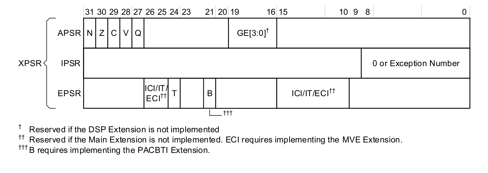
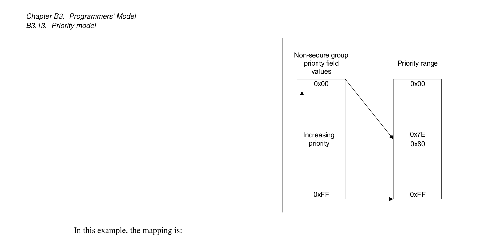
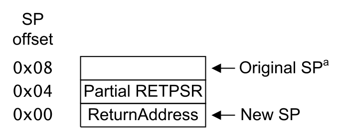
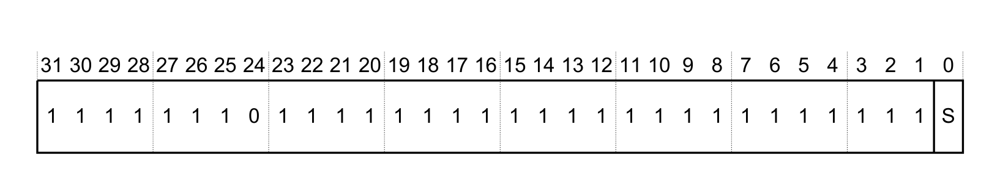
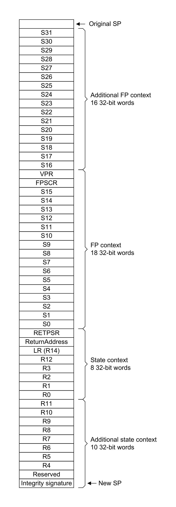
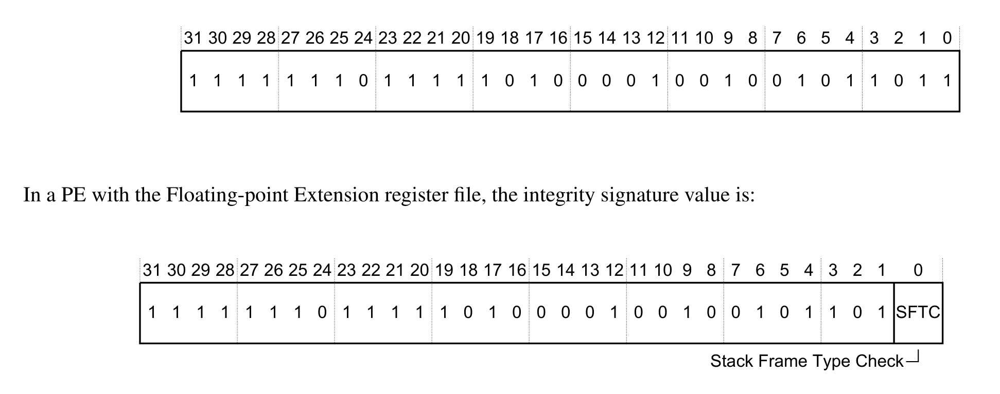
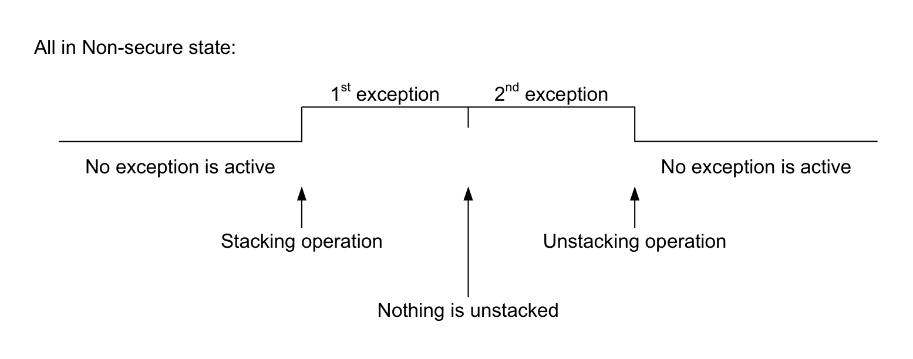
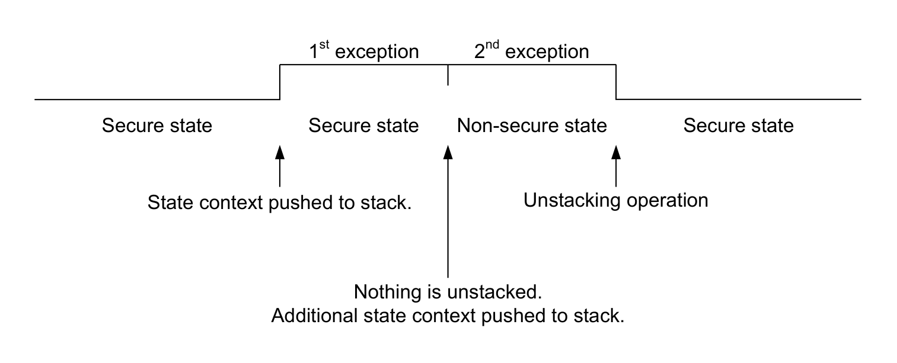
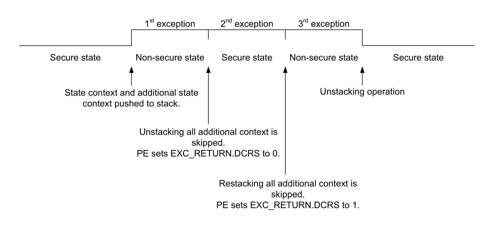

本文译自 Part B《Armv8-M 架构规则》（Armv8-M Architecture Rules） Chapter B3《程序员模型》（Programmers' Model）。

本章规定 **Armv8-M** 程序员模型的架构规则。

## 1. PE 模式：Thread 模式与 Handler 模式

**PE** 有两种模式：

- **Thread** 模式。
- **Handler** 模式。

适用于 **Armv8.0-M** 及以后架构版本的实现。

**PE** 模式的一种常见用法是：

- **Thread** 模式：应用程序。
- **Handler** 模式：操作系统内核及管理系统资源的相关功能。

适用于 **Armv8.0-M** 及以后架构版本的实现。

**PE** 在 **Handler** 模式下处理所有异常。

适用于 **Armv8.0-M** 及以后架构版本的实现。

复位时选择 **Thread** 模式。

适用于 **Armv8.0-M** 及以后架构版本的实现。

参见：

- 第 B3.2 节《特权与非特权执行》（Privileged and unprivileged execution）。
- 第 B3.5.1 节《中断程序状态寄存器（IPSR）》（Interrupt Program Status Register (IPSR)）。
- 第 B3.6 节《安全状态：Secure 状态与 Non-secure 状态》（Security states: Secure state, and Non-secure state）。

## 2. 特权与非特权执行

**Thread** 模式：执行可以是特权的或非特权的。

**Handler** 模式：执行始终是特权的。

适用于 **Armv8.0-M** 及以后架构版本的实现。

**CONTROL.nPRIV** 决定 **Thread** 模式下的执行是否为非特权。

适用于 **Armv8.0-M** 及以后架构版本的实现。

在未实现 **Main Extension** 的 **PE** 中，**CONTROL.nPRIV** 能否置 1 属于 **IMPLEMENTATION DEFINED**。

适用于 **Armv8.0-M** 及以后架构版本的实现。扩展要求为 - !M。

执行特权可以决定资源是否可访问。

适用于 **Armv8.0-M** 及以后架构版本的实现。

特权执行通常比非特权执行可以访问更多资源。

适用于 **Armv8.0-M** 及以后架构版本的实现。

参见：

- 第 B3.1 节《PE 模式：Thread 模式与 Handler 模式》（PE modes, Thread mode and Handler mode）。

## 3. 寄存器

寄存器有以下类型：

通用寄存器，均为 32 位：

- **R0-R12**（**Rn**）。
- **R13**。即栈指针（**SP**）。
- **R14**。即链接寄存器（**LR**）。

程序计数器，32 位：

- **R15** 即程序计数器（**PC**）。

特殊用途寄存器：

- 掩码寄存器：
  - 1 位异常掩码寄存器 **PRIMASK**。
  - 8 位基优先级掩码寄存器 **BASEPRI**。
  - 1 位故障掩码寄存器 **FAULTMASK**。
- **CONTROL** 寄存器。
- 两个 32 位栈指针限值寄存器 **MSPLIM** 与 **PSPLIM**；若未实现 **Main Extension**，这些寄存器的 **Non-secure** 版本为 **RAZ/WI**。
- 一个组合的 32 位程序状态寄存器（**XPSR**），包括：
  - 应用程序状态寄存器（**APSR**）。
  - 中断程序状态寄存器（**IPSR**）。
  - 执行程序状态寄存器（**EPSR**）。
- 向量谓词与控制寄存器（**VPR**）。
- 浮点状态与控制寄存器（**FPSCR**）。

内存映射寄存器：

- 所有其他寄存器。

适用于 **Armv8.0-M** 及以后架构版本的实现。注意，**MVE** 与 **PACBTI** 需要 **Armv8.1-M**。

一个 32 位组合的异常返回程序状态寄存器 **RETPSR** 包含一份由 **XPSR** 派生的已保存状态载荷。

适用于 **Armv8.0-M** 及以后架构版本的实现。

扩展可能向基本寄存器集添加更多寄存器。

适用于 **Armv8.0-M** 及以后架构版本的实现。

**SP** 指活动栈指针，即 **Main** 栈指针或 **Process** 栈指针。

适用于 **Armv8.0-M** 及以后架构版本的实现。

若实现了 **Main Extension**，则 **LR** 在热复位时被置为 0xFFFFFFFF。

适用于 **Armv8.0-M** 及以后架构版本的实现。扩展要求为 - M。

若未实现 **Main Extension**，则 **LR** 在热复位时变为 **UNKNOWN**。

适用于 **Armv8.0-M** 及以后架构版本的实现。扩展要求为 - !M。

**PC** 在热复位时被装入复位处理程序的起始地址。

适用于 **Armv8.0-M** 及以后架构版本的实现。

**PC** 包含当前正在执行指令的指令地址。若某条指令读取 **PC** 的值，则所用值为 **PC** 加 4。

适用于 **Armv8.0-M** 及以后架构版本的实现。

除对 **CONTROL** 寄存器的写入外，`CPS` 或 `MSR` 指令对特殊用途寄存器的任何更改均保证：

- 不影响该 `CPS` 或 `MSR` 指令，也不影响程序顺序中位于其之前的任何指令。
- 对程序顺序中位于该 `CPS` 或 `MSR` 之后的所有指令可见。

适用于 **Armv8.0-M** 及以后架构版本的实现。

本参考手册所述寄存器中，具有已分配值的字段的所有未分配值或保留值，除寄存器描述中另有说明外，均按以下方式之一处理：

- 该编码映射到任何已分配值，但不引起 **CONSTRAINED UNPREDICTABLE** 行为。
- 该编码引起可通过多个已分配编码组合实现的效果。
- 该编码使该字段无功能效果。

适用于 **Armv8.0-M** 及以后架构版本的实现。

对描述为只写（**WO**）的寄存器的读取表现为 **RES0**。

适用于 **Armv8.0-M** 及以后架构版本的实现。

对描述为只读（**RO**）的寄存器或字段的写入不会导致该只读寄存器或字段被修改。

适用于 **Armv8.0-M** 及以后架构版本的实现。

参见：

- 第 B8 章《系统地址映射》（The System Address Map）。
- 第 B3.32 节《用于可配置优先级提升的特殊用途掩码寄存器 PRIMASK、BASEPRI、FAULTMASK》（Special-purpose mask registers, PRIMASK, BASEPRI, FAULTMASK, for configurable priority boosting）。
- 第 B3.4 节《特殊用途 CONTROL 寄存器》（Special-purpose CONTROL register）。
- 第 B3.21 节《栈限值检查》（Stack limit checks）。
- 第 B3.5 节《XPSR、APSR、IPSR 与 EPSR》（XPSR, APSR, IPSR, and EPSR）。
- 第 B1.1 节《复位、冷复位与热复位》（Resets, Cold reset, and Warm reset）。
- Part D《寄存器与载荷规范》（Register and Payload Specification）。

## 4. 特殊用途 CONTROL 寄存器

可以使用 `MRS` 与 `MSR` 指令访问 **CONTROL** 寄存器。

适用于 **Armv8.0-M** 及以后架构版本的实现。

特权执行可以写入 **CONTROL** 寄存器。**PE** 忽略对 **CONTROL** 寄存器的非特权写入。无论特权级别如何，对 **CONTROL** 寄存器的所有读取均被允许。

适用于 **Armv8.0-M** 及以后架构版本的实现。

架构要求使用**上下文同步事件**来保证对 **CONTROL** 寄存器的更改将影响程序顺序中稍后出现的指令的执行。

适用于 **Armv8.0-M** 及以后架构版本的实现。

**PE** 在异常进入与异常返回时自动更新 **CONTROL.SPSEL**。

适用于 **Armv8.0-M** 及以后架构版本的实现。

当 **PE** 处于 **Thread** 模式时，**CONTROL.SPSEL** 选择栈指针。

适用于 **Armv8.0-M** 及以后架构版本的实现。

参见：

- 第 B3.35 节《上下文同步事件》（Context Synchronization Event）。
- **CONTROL**，控制寄存器（Control Register）。

## 5. XPSR、APSR、IPSR 与 EPSR

**APSR**、**IPSR** 与 **EPSR** 组合成一个寄存器，即 **XPSR**。



图中脚注：† 若未实现 **DSP Extension**，则该字段为保留；†† 若未实现 **Main Extension**，则该字段为保留，**ECI** 要求实现 **MVE Extension**；††† **B** 要求实现 **PACBTI Extension**。

**APSR**、**IPSR** 或 **EPSR** 中任何未使用的位，以及组合 **XPSR** 中任何未使用的位，均为保留。

适用于 **Armv8.0-M** 及以后架构版本的实现。注意，**ECI** 功能仅在 **Armv8.1-M** 实现中可用。

`MRS` 与 `MSR` 指令识别以下助记符，用于访问 **APSR**、**IPSR** 或 **EPSR**，或它们的组合：

| 助记符 | 访问的寄存器 |
| --- | --- |
| `APSR` | **APSR** |
| `IPSR` | **IPSR** |
| `EPSR` | **EPSR** |
| `IAPSR` | **IPSR** 与 **APSR** |
| `EAPSR` | **EPSR** 与 **APSR** |
| `IEPSR` | **IPSR** 与 **EPSR** |
| `XPSR` | **APSR**、**IPSR** 与 **EPSR** |

适用于 **Armv8.0-M** 及以后架构版本的实现。

Arm 不推荐使用未带 `_<bits>` 限定符的 `MSR APSR` 作为 `MSR APSR_nzcvq` 的别名。

适用于 **Armv8.0-M** 及以后架构版本的实现。

参见：

- 第 B3.3 节《寄存器》（Registers）。
- **APSR**，应用程序状态寄存器（Application Program Status Register）。
- 第 B3.5.1 节《中断程序状态寄存器（IPSR）》（Interrupt Program Status Register (IPSR)）。
- 第 B3.5.2 节《执行程序状态寄存器（EPSR）》（Execution Program Status Register (EPSR)）。

### 5.1 中断程序状态寄存器（IPSR）

当 **PE** 处于 **Thread** 模式时，**IPSR** 的值为 0。

当 **PE** 处于 **Handler** 模式时：

- 在接受异常的情况下，**IPSR** 保存正在处理的异常的异常编号。
- 当发生了从 **Secure** 状态到 **Non-secure** 状态的函数调用时，**IPSR** 的值为 1。

**PE** 在异常进入与异常返回时更新 **IPSR**。

适用于 **Armv8.0-M** 及以后架构版本的实现。注意，**Secure** 状态要求 S。

**PE** 忽略 `MSR` 指令对 **IPSR** 的写入。

适用于 **Armv8.0-M** 及以后架构版本的实现。

若使用 **DCRDR** 改变 **IPSR** 的值，则 **IPSR** 的值变为 **UNKNOWN**。若 **DCRDR** 试图将 **IPSR** 置为非法值，则该 **UNKNOWN** 值被置为某个已知的合法值。

适用于 **Armv8.0-M** 及以后架构版本的实现。扩展要求为 - HDBG。

使用 **DCRDR** 与 **DCRSR** 机制对 **IPSR** 的写入被忽略。

适用于 **Armv8.1-M** 及以后架构版本的实现。扩展要求为 - HDBG。

参见：

- 第 B3.5 节《XPSR、APSR、IPSR 与 EPSR》（XPSR, APSR, IPSR, and EPSR）。
- 第 B3.16 节《从 Secure 状态到 Non-secure 状态的函数调用》（Function calls from Secure state to Non-secure state）。
- **IPSR**，中断程序状态寄存器（Interrupt Program Status Register）。
- `BX`、`BXNS`。

### 5.2 执行程序状态寄存器（EPSR）

复位将 **EPSR.T** 置为复位向量第 [0] 位的值。

适用于 **Armv8.0-M** 及以后架构版本的实现。

当 **EPSR.T** 为：

- 0：任何试图执行任何指令的行为都将产生：
  - 在具有 **Main Extension** 的 **PE** 中产生 **INVSTATE UsageFault**。
  - 在不具有 **Main Extension** 的 **PE** 中产生 **HardFault**。
- 1：指令集状态为 **T32** 状态，所有指令均按 **T32** 指令译码。

适用于 **Armv8.0-M** 及以后架构版本的实现。注意，**UsageFault** 要求 M。

其意图是：指令集状态始终为 **T32** 状态。

适用于 **Armv8.0-M** 及以后架构版本的实现。

使用 `MRS` 指令读取时，**EPSR** 的所有字段均读为 0。**PE** 忽略 `MSR` 指令对 **EPSR** 的写入。

适用于 **Armv8.0-M** 及以后架构版本的实现。

参见：

- 第 B3.5 节《XPSR、APSR、IPSR 与 EPSR》（XPSR, APSR, IPSR, and EPSR）。
- 第 B3.5.2 节《执行程序状态寄存器（EPSR）》（Execution Program Status Register (EPSR)）。

## 6. 安全状态：Secure 状态与 Non-secure 状态

具有 **Security Extension** 的 **PE** 有两种安全状态：

- **Secure** 状态。
  - **Secure Thread** 模式。
  - **Secure Handler** 模式。
- **Non-secure** 状态。
  - **Non-secure Thread** 模式。
  - **Non-secure Handler** 模式。

适用于 **Armv8.0-M** 及以后架构版本的实现。扩展要求为 - S。

若实现了 **Security Extension**，则标记为安全的存储区域与其他关键资源仅在 **PE** 于 **Secure** 状态执行时才能访问。

适用于 **Armv8.0-M** 及以后架构版本的实现。扩展要求为 - S。

具有 **Security Extension** 的 **PE** 在热复位时复位进入 **Secure** 状态。

适用于 **Armv8.0-M** 及以后架构版本的实现。扩展要求为 - S。

不具有 **Security Extension** 的 **PE** 在热复位时复位进入 **Non-secure** 状态。

适用于 **Armv8.0-M** 及以后架构版本的实现。扩展要求为 - !S。

参见：

- 第 B3.1 节《PE 模式：Thread 模式与 Handler 模式》（PE modes, Thread mode and Handler mode）。
- 第 B3.2 节《特权与非特权执行》（Privileged and unprivileged execution）。
- 第 B3.7 节《安全状态与安全状态之间的寄存器分组》（Security states and register banking between Security states）。
- 第 B3.11 节《安全状态与异常分组》（Security states, exception banking）。
- 第 B3.15 节《安全状态转换》（Security state transitions）。
- 第 B5 章《向量扩展》（Vector Extension）。适用于 **Armv8.1-M** 及以后架构版本的实现。

## 7. 安全状态与安全状态之间的寄存器分组

在具有 **Security Extension** 的 **PE** 中，某些寄存器在安全状态之间分组（**banked**）。寄存器以这种方式分组时，在 **Secure** 状态存在该寄存器的一个独立实例，在 **Non-secure** 状态存在另一个独立实例。

适用于 **Armv8.0-M** 及以后架构版本的实现。扩展要求为 - S。

在具有 **Security Extension** 的 **PE** 中：

- 分组的通用寄存器为：
  - **R13**。即栈指针（**SP**）。
- 分组的特殊用途寄存器为：
  - 掩码寄存器 **PRIMASK**、**BASEPRI** 与 **FAULTMASK**。
  - **CONTROL** 寄存器中的某些位。
  - **Main** 与 **Process** 栈指针限值寄存器 **MSPLIM** 与 **PSPLIM**。
- 系统控制空间（**SCS**）中的所有寄存器都有一个 **Non-secure** 别名，该别名只能从 **Secure** 状态访问。

适用于 **Armv8.0-M** 及以后架构版本的实现。扩展要求为 - S。

对于 `MRS` 与 `MSR`（寄存器）指令，指令编码中的 **SYSm[7]** 指定访问分组寄存器的 **Secure** 实例还是 **Non-secure** 实例：

| 访问来源 | SYSm[7] = 0 | SYSm[7] = 1 |
| --- | --- | --- |
| **Secure** 状态 | **Secure** 实例 | **Non-secure** 实例 |
| **Non-secure** 状态 | **Non-secure** 实例 | RAZ/WI |

适用于 **Armv8.0-M** 及以后架构版本的实现。扩展要求为 - S。

本规范使用以下命名约定来标识分组寄存器：

- `<register name>_S`：寄存器的 **Secure** 实例。
- `<register name>_NS`：寄存器的 **Non-secure** 实例。
- `<register name>`：与当前安全状态相关联的实例。

适用于 **Armv8.0-M** 及以后架构版本的实现。扩展要求为 - S。

参见：

- 第 B3.3 节《寄存器》（Registers）。
- 第 B3.6 节《安全状态：Secure 状态与 Non-secure 状态》（Security states: Secure state, and Non-secure state）。
- 第 B3.8 节《栈指针》（Stack pointer）。
- 第 B8.3 节《系统控制空间（SCS）》（The System Control Space (SCS)）。

## 8. 栈指针

在具有 **Security Extension** 的 **PE** 中，实现四个栈与四个栈指针寄存器：

| 安全状态 | 栈 | 栈指针寄存器 |
| --- | --- | --- |
| **Secure** | Main | **MSP_S** |
| **Secure** | Process | **PSP_S** |
| **Non-secure** | Main | **MSP_NS** |
| **Non-secure** | Process | **PSP_NS** |

适用于 **Armv8.0-M** 及以后架构版本的实现。扩展要求为 - S。

在不具有 **Security Extension** 的 **PE** 中，实现两个栈与两个栈指针寄存器：

| 栈 | 栈指针寄存器 |
| --- | --- |
| Main | **MSP** |
| Process | **PSP** |

适用于 **Armv8.0-M** 及以后架构版本的实现。扩展要求为 - !S。

在异常返回时，**Armv8-M** 架构仅支持双字对齐的栈指针。

适用于 **Armv8.0-M** 及以后架构版本的实现。

若在异常返回时用于出栈操作的栈指针不是双字对齐的，则行为为 **CONSTRAINED UNPREDICTABLE**。在计算出栈操作的地址时，允许以下任一行为：

- 将栈指针按其实际值处理。
- 将栈指针视为已对齐。

适用于 **Armv8.0-M** 及以后架构版本的实现。

若在异常返回时被调整的栈指针不是双字对齐的，则行为为 **CONSTRAINED UNPREDICTABLE**。允许以下任一行为：

- SP = SP + framesize + (sprealign « 2)
- SP = (SP + framesize) OR (sprealign « 2)

适用于 **Armv8.0-M** 及以后架构版本的实现。

在 **Handler** 模式下，**PE** 使用主栈。

适用于 **Armv8.0-M** 及以后架构版本的实现。

在 **Thread** 模式下，**CONTROL.SPSEL** 决定 **PE** 使用主栈还是进程栈。

适用于 **Armv8.0-M** 及以后架构版本的实现。

在不具有 **Security Extension** 的 **PE** 中，复位时选择并初始化 **MSP**。

适用于 **Armv8.0-M** 及以后架构版本的实现。扩展要求为 - !S。

在具有 **Security Extension** 的 **PE** 中，复位时选择并初始化 **Secure** 主栈 **MSP_S**。

适用于 **Armv8.0-M** 及以后架构版本的实现。扩展要求为 - S。

在热复位时，所选栈指针（**MSP** 或 **MSP_S**）被置为向量表中包含的值，如 `TakeReset()` 所述。

适用于 **Armv8.0-M** 及以后架构版本的实现。注意，**MSP_S** 要求 S。

任一安全状态下 **MSP** 或 **PSP** 的第 [1:0] 位均为 **RES0H**，因此所有栈指针始终保证字对齐。

适用于 **Armv8.0-M** 及以后架构版本的实现。扩展要求为 - S。

当某条指令声明 **SP** 为 **UNPREDICTABLE** 且使用了 **SP** 时：

- 从 **SP** 读取或写入 **SP** 的值为 **UNKNOWN**。
- 允许将该指令按 **UNDEFINED** 处理。
- 若正在写入 **SP**，是否应用栈限值检查为 **UNKNOWN**。

适用于 **Armv8.0-M** 及以后架构版本的实现。

异常进入的压栈操作成功完成后，因异常进入而入栈的那个栈的栈指针为双字对齐。

适用于 **Armv8.0-M** 及以后架构版本的实现。

Arm 建议将 **Secure** 栈放置在 **Secure** 存储器中。

适用于 **Armv8.0-M** 及以后架构版本的实现。扩展要求为 - S。

参见：

- 第 B3.6 节《安全状态：Secure 状态与 Non-secure 状态》（Security states: Secure state, and Non-secure state）。
- 第 B3.1 节《PE 模式：Thread 模式与 Handler 模式》（PE modes, Thread mode and Handler mode）。
- 第 B3.19 节《异常进入与上下文压栈》（Exception entry, context stacking）。
- 第 B3.30 节《向量表》（Vector tables）。
- 第 B3.3 节《寄存器》（Registers）。
- 第 B3.21 节《栈限值检查》（Stack limit checks）。

## 9. 异常编号与异常优先级编号

每个异常都关联一个异常编号和一个优先级编号。

适用于 **Armv8.0-M** 及以后架构版本的实现。

在具有 **Main Extension** 的 **PE** 中，异常及其关联的编号与优先级编号如下：

| 异常 | 异常编号 | 优先级编号 |
| --- | --- | --- |
| Reset | 1 | -4（最高优先级） |
| Secure HardFault（**AIRCR.BFHFNMINS** 为 1 时） | 3 | -3 |
| NMI | 2 | -2 |
| Secure HardFault（**AIRCR.BFHFNMINS** 为 0 时） | 3 | -1 |
| Non-secure HardFault | 3 | -1 |
| MemManage fault | 4 | 可配置 |
| BusFault | 5 | 可配置 |
| UsageFault | 6 | 可配置 |
| SecureFault | 7 | 可配置 |
| 保留 | 8-10 | - |
| SVCall | 11 | 可配置 |
| DebugMonitor | 12 | 可配置 |
| 保留 | 13 | - |
| PendSV | 14 | 可配置 |
| SysTick | 15 | 可配置 |
| 外部中断 0 | 16 | 可配置 |
| 外部中断 N | 16+N | 可配置 |

适用于 **Armv8.0-M** 及以后架构版本的实现。扩展要求为 - M。注意，**Secure** 故障要求 S。

在不具有 **Main Extension** 的 **PE** 中，异常及其关联的编号与优先级编号如下：

| 异常 | 异常编号 | 优先级编号 |
| --- | --- | --- |
| Reset | 1 | -4（最高优先级） |
| Secure HardFault（**AIRCR.BFHFNMINS** 为 1 时） | 3 | -3 |
| NMI | 2 | -2 |
| Secure HardFault（**AIRCR.BFHFNMINS** 为 0 时） | 3 | -1 |
| Non-secure HardFault | 3 | -1 |
| 保留 | 4-10 | - |
| SVCall | 11 | 可配置 |
| 保留 | 12-13 | - |
| PendSV | 14 | 可配置 |
| SysTick | 15 | 可配置 |
| 外部中断 0 | 16 | 可配置 |
| 外部中断 N | 16+N | 可配置 |

适用于 **Armv8.0-M** 及以后架构版本的实现。扩展要求为 - !M。注意，**SysTick** 异常要求 ST。

支持的外部中断数量是可配置的，最大为 496。

适用于 **Armv8.0-M** 及以后架构版本的实现。

架构允许实现在没有外部设备连接到相应中断引脚时省略外部可配置中断。若实现省略了此类中断，则相应的挂起、活动、使能与优先级寄存器为 **RES0**。

适用于 **Armv8.0-M** 及以后架构版本的实现。

在具有 **Main Extension** 的 **PE** 中，以下具有可配置优先级编号的异常可通过系统控制块（**SCB**）中的 **SHPR1**–**SHPR3** 配置：

- MemManage Fault。
- BusFault。
- UsageFault。
- SecureFault（若实现了 **Security Extension**）。
- SVCall。
- DebugMonitor 异常。
- PendSV。
- SysTick。

适用于 **Armv8.0-M** 及以后架构版本的实现。扩展要求为 - M。

在不具有 **Main Extension** 的 **PE** 中，以下具有可配置优先级编号的异常可通过系统控制块（**SCB**）中的 **SHPR2** 与 **SHPR3** 配置：

- SVCall。
- PendSV。
- SysTick。

适用于 **Armv8.0-M** 及以后架构版本的实现。扩展要求为 - !M。

所有其他可配置异常可使用 **NVIC_IPRn.PRI_&lt;n&gt;** 寄存器字段配置。

适用于 **Armv8.0-M** 及以后架构版本的实现。

可配置优先级编号从 0 开始，0 为最高的可配置异常优先级编号。

适用于 **Armv8.0-M** 及以后架构版本的实现。

在具有 **Main Extension** 的 **PE** 中，可配置优先级编号的数量是 **IMPLEMENTATION DEFINED** 的 2 的幂，范围为 8–256：

| SHPRIn.PRI_n 实现的优先级位数 | 可配置优先级编号数量 | 最小优先级编号（最高优先级） | 最大优先级编号（最低优先级） |
| --- | --- | --- | --- |
| 3 | 8 | 0 | 0b11100000 = 224 |
| 4 | 16 | 0 | 0b11110000 = 240 |
| 5 | 32 | 0 | 0b11111000 = 248 |
| 6 | 64 | 0 | 0b11111100 = 252 |
| 7 | 128 | 0 | 0b11111110 = 254 |
| 8 | 256 | 0 | 0b11111111 = 255 |

**SHPRIn.PRI_n** 中未实现为优先级位的所有低位均为 **RAZ/WI**，如最大优先级编号列所示。

适用于 **Armv8.0-M** 及以后架构版本的实现。扩展要求为 - M。

在不具有 **Main Extension** 的 **PE** 中，可配置优先级编号的数量为 4：

| SHPRIn.PRI_n 实现的优先级位数 | 可配置优先级编号数量 | 最小优先级编号（最高优先级） | 最大优先级编号（最低优先级） |
| --- | --- | --- | --- |
| 2 | 4 | 0 | 0b11000000 = 192 |

**SHPRn.PRI_n[5:0]** 为 **RAZ/WI**，如最大优先级编号列所示。

适用于 **Armv8.0-M** 及以后架构版本的实现。扩展要求为 - !M。

参见：

- 第 B3.11 节《安全状态与异常分组》（Security states, exception banking）。
- 第 B3.12 节《故障》（Faults）。
- 第 B3.13 节《优先级模型》（Priority model）。
- **SHPR1**、**SHPR2**、**SHPR3**。
- **NVIC_IPRn**。
- `ExecutionPriority()`。

## 10. 异常的使能位、挂起位与活动位

**SHCSR**、**ICSR**、**DEMCR**、**NVIC_IABRn**、**NVIC_ISPRn**、**NVIC_ISERn** 包含异常使能、挂起与活动字段。可使用 **STIR** 挂起异常。

适用于 **Armv8.0-M** 及以后架构版本的实现。

以下异常始终使能，因此没有异常使能位：

- Secure HardFault，或未实现 **Security Extension** 时的 Non-secure HardFault。
- NMI。
- SVCall。
- PendSV。

适用于 **Armv8.0-M** 及以后架构版本的实现。注意，**Secure HardFault** 要求 S。

中断可由软件通过以下方式挂起：

- 特权执行可通过写 **NVIC_ISPRn** 挂起中断。
- 当 **CCR.USERSETMPEND** 为 1 时，非特权执行可通过写 **STIR** 挂起中断。
- 仅允许 **Non-secure** 访问挂起配置为以 **Non-secure** 状态为目标、且由 **NVIC_ITNSn** 控制的中断。

适用于 **Armv8.0-M** 及以后架构版本的实现。

下表标识故障使能位、状态位与活动位：

| 故障 | 使能位（SHCSR）与陷阱位 | 状态位（SHCSR、ICSR） | 挂起位（SHCSR） | 活动位（SHCSR） |
| --- | --- | --- | --- | --- |
| Secure HardFault | **HFSR.VECTTBL**、**HFSR.FORCED**、**HFSR.DEBUGEVT** | - | **HARDFAULTPENDED** | **HARDFAULTACT** |
| NMI | - | - | **PENDNMISET** | **NMIACT** |
| HardFault | **HFSR.VECTTBL**、**HFSR.FORCED**、**HFSR.DEBUGEVT**、**AIRCR.BFHFNMINS** | - | **HARDFAULTPENDED** | **HARDFAULTACT** |
| MemManageFault | **MEMFAULTENA** | **MMFSR.IACCVIOL**、**MMFSR.DACCVIOL**、**MMFSR.MUNSTKERR**、**MMFSR.MSTKERR**、**MMFSR.MLSPERR** | **MEMFAULTPENDED** | **MEMFAULTACT** |
| BusFault | **BUSFAULTENA** | **BFSR.IBUSERR**、**BFSR.PRECISERR**、**BFSR.IMPRECISERR**、**BFSR.UNSTKERR**、**BFSR.STKERR**、**BFSR.LSPERR** | **BUSFAULTPENDED** | **BUSFAULTACT** |
| UsageFault | **USGFAULTENA**、**CCR.UNALIGN_TRP**、**CCR.DIV_0_TRP** | **UFSR.UNDEFINSTR**、**UFSR.INVSTATE**、**UFSR.INVPC**、**UFSR.NOCP**、**UFSR.STKOF**、**UFSR.UNALIGNED**、**UFSR.DIVBYZERO** | **USGFAULTPENDED** | **USGFAULTACT** |
| SecureFault | **SECUREFAULTENA** | **SFSR.INVEP**、**SFSR.INVIS**、**SFSR.INVER**、**SFSR.AUVIOL**、**SFSR.INVTRAN**、**SFSR.LSPERR**、**SFSR.LSERR** | **SECUREFAULTPENDED** | **SECUREFAULTACT** |
| SVCall | - | - | **SVCALLPENDED** | **SVCALLACT** |
| DebugMonitor | **DEMCR.MON_EN** | - | **DEMCR.MON_PEND** | **MONITORACT** |
| PendSV | - | - | **PENDSVSET** | **PENDSVACT** |
| SysTick | **SYST_CSR.ENABLE** 与 **SYST_CSR.TICKINT** | - | **PENDSTSET** | **SYSTICKACT** |
| 外部中断 | **NVIC_ISERn**、**NVIC_ICERn** | - | **NVIC_ISPRn**、**NVIC_ICPRn** | **NVIC_IABRn** |

适用于 **Armv8.0-M** 及以后架构版本的实现。

## 11. 安全状态与异常分组

有些异常是分组的。分组异常具有以下全部特征：

- 分组的使能位、挂起位与活动位。
- 一个分组的 **SHPRn.PRI** 字段。

下表列出哪些异常是分组的：

| 异常 | 是否分组 |
| --- | --- |
| Reset | 否 |
| HardFault | 是（有条件） |
| NMI | 否 |
| MemManage fault | 是 |
| BusFault | 否 |
| UsageFault | 是 |
| SecureFault | 否 |
| SVCall | 是 |
| DebugMonitor | 否 |
| PendSV | 是 |
| SysTick | 是 |
| 外部中断 0 | 否 |
| 外部中断 N | 否 |

适用于 **Armv8.0-M** 及以后架构版本的实现。注意，某些异常要求 M、S、DebugMonitor 异常或 ST。

分组同步异常以异常被接受时所处的安全状态为目标，但以下情况除外：

- 若因 **NSACR** 的相关字段为 0 而产生 **NOCP UsageFault**，则该 **UsageFault** 以 **Secure** 状态为目标。
- 若因相关的 **CPPWR.SU\*** 字段为 1 而产生 **NOCP UsageFault**，则该 **UsageFault** 以以下状态为目标：
  - 若相应的 **CPPWR.SUSm** 位为 1，则以 **Secure** 状态为目标。
  - 若相应的 **CPPWR.SUSm** 位为 0，则以当前安全状态为目标。
- 若某条指令触发惰性浮点状态保存，则分组异常的引发方式如同当前安全状态与激活该惰性浮点状态保存的状态相同，该状态由 **FPCCR.S** 指示。
- 由取指产生的分组故障与异常以指令地址所关联的安全状态为目标，而不是当前安全状态。
- **MemManage Fault** 以用于检查该访问的 **MPU** 分组所关联的安全状态为目标。
- 在 **Non-secure HardFault** 使能（即 **AIRCR.BFHFNMINS** 置 1）的情况下，适用以下规则：
  - 通过升级产生的 **HardFault** 异常，以原始异常升级为 **HardFault** 之前所处安全状态为目标。
  - 因向量取指失败而产生的 **HardFault**，以向量取指失败期间引发的异常所处安全状态为目标，而不是当前安全状态。
- 由异常进入（包括尾链）时压入 State 上下文字寄存器或 Additional state 上下文字寄存器所触发的 **MemManage Fault**，以背景状态所关联的安全状态为目标，该状态由 **EXC_RETURN.S** 指示。

适用于 **Armv8.0-M** 及以后架构版本的实现。扩展要求为 - S。注意，**UsageFault** 要求 M，浮点状态要求 FP。

若 **AIRCR.BFHFNMINS** == 0，则所有 **Non-secure HardFault** 均被禁用并升级为 **Secure HardFault**。

适用于 **Armv8.0-M** 及以后架构版本的实现。

若实现具有两个 **SysTick** 定时器（每个安全状态各一个），则每个定时器以其所属安全状态为目标，而不是 **PE** 的当前执行状态。

适用于 **Armv8.0-M** 及以后架构版本的实现。扩展要求为 - S && ST。

**NMI** 可通过 **AIRCR.BFHFNMINS** 配置为以任一安全状态为目标。

适用于 **Armv8.0-M** 及以后架构版本的实现。

**BusFault** 可通过 **AIRCR.BFHFNMINS** 配置为以任一安全状态为目标。

适用于 **Armv8.0-M** 及以后架构版本的实现。

**SecureFault** 始终以 **Secure** 状态为目标。

适用于 **Armv8.0-M** 及以后架构版本的实现。扩展要求为 - S。

若状态位 **DEMCR.SDME** 为 1，则 **DebugMonitor** 异常以 **Secure** 状态为目标；否则以 **Non-secure** 状态为目标。

适用于 **Armv8.0-M** 及以后架构版本的实现。

每个外部中断 0–N 以 **NVIC_ITNSn[位编号]** 所指定的安全状态为目标。

适用于 **Armv8.0-M** 及以后架构版本的实现。

当 `<exception>` 以 **Secure** 状态为目标时，其优先级字段、使能位、挂起位与活动位的 **Non-secure** 视图均为 **RAZ/WI**。

`<exception>` 为以下之一：

- **NMI**。
- **BusFault**。
- **DebugMonitor**。
- 外部中断 N。
- 在不具有 **Main Extension** 且只有单个 **SysTick** 定时器实例的 **PE** 中，为 **SysTick**。

适用于 **Armv8.0-M** 及以后架构版本的实现。扩展要求为 - S。注意，**BusFault** 异常要求 M，**DebugMonitor** 异常要求 DebugMonitor 异常支持。

当异常被接受至另一安全状态时，**PE** 自动转换到目标安全状态。

适用于 **Armv8.0-M** 及以后架构版本的实现。扩展要求为 - S。

**Secure** 软件必须确保在更改异常的目标安全状态时，该异常既不处于挂起状态也不处于活动状态。在异常处于挂起或活动状态时更改其安全状态可能导致 **UNPREDICTABLE** 行为。

适用于 **Armv8.0-M** 及以后架构版本的实现。注意，要求 S。

参见：

- 第 B3.9 节《异常编号与异常优先级编号》（Exception numbers and exception priority numbers）。
- 第 B3.30 节《向量表》（Vector tables）。
- **SHCSR**，系统处理程序控制与状态寄存器（System Handler Control and State Register）。

## 12. 故障

存在以下故障状态寄存器：

- HardFault 状态寄存器 **HFSR**。
- MemManage 故障状态寄存器 **MMFSR**。
- BusFault 状态寄存器 **BFSR**。
- UsageFault 状态寄存器 **UFSR**。
- SecureFault 状态寄存器 **SFSR**。
- 调试故障状态寄存器 **DFSR**。
- 辅助故障状态寄存器 **AFSR**。该寄存器的内容为 **IMPLEMENTATION DEFINED**。
- RAS 故障状态寄存器 **RFSR**。

在具有 **Main Extension** 的 **PE** 中，**BFSR**、**MMFSR** 与 **UFSR** 组合成一个寄存器，称为可配置故障状态寄存器（**CFSR**）。

存在以下故障地址寄存器：

- MemManage 故障地址寄存器（**MMFAR**）。
- BusFault 地址寄存器（**BFAR**）。
- SecureFault 地址寄存器（**SFAR**）。

适用于 **Armv8.0-M** 及以后架构版本的实现。扩展要求为 - M。注意，**RFSR** 要求 RAS。

除另有说明外，**MMFAR** 仅在数据访问发生 **MemManage** 故障时更新。

适用于 **Armv8.0-M** 及以后架构版本的实现。扩展要求为 - M。

除另有说明外，**BFAR** 仅在数据访问发生同步 **BusFault** 时更新。

适用于 **Armv8.0-M** 及以后架构版本的实现。扩展要求为 - M。

除另有说明外，**SFAR** 在以下情况下因 **SAU/IDAU** 违规而被设置：

- 数据访问。
- 异常压栈与出栈访问，包括尾链期间的压栈。
- 惰性状态保存访问。

适用于 **Armv8.0-M** 及以后架构版本的实现。扩展要求为 - M && S。

每个故障地址寄存器都有一个关联的有效位。**PE** 更新故障地址寄存器时，将该有效位置 1。

| 故障地址寄存器 | 有效位 |
| --- | --- |
| **MMFAR** | **MMFSR.MMFARVALID** |
| **BFAR** | **BFSR.BFARVALID** |
| **SFAR** | **SFSR.SFARVALID** |

适用于 **Armv8.0-M** 及以后架构版本的实现。扩展要求为 - M。

若发生的故障本应将某个 FAR 有效位置 1，而该位已由先前的故障置 1，则以下哪种行为属于 **IMPLEMENTATION DEFINED**：

- **FAR** 寄存器被更新为新的故障征候。
- **FAR** 寄存器保留原始故障的征候。

适用于 **Armv8.0-M** 及以后架构版本的实现。

若未实现 **Security Extension**，是否实现独立的 **BFAR** 与 **MMFAR** 属于 **IMPLEMENTATION DEFINED**。若实现一个共享的故障地址寄存器，则在本应更新该共享故障地址寄存器的故障发生时，若另一个有效位已置 1，则以下哪种行为属于 **IMPLEMENTATION DEFINED**：

- 更新共享故障地址寄存器，置位该故障的有效位，并清除另一个有效位。
- 不更新共享故障地址寄存器，且不改变各有效位。

适用于 **Armv8.0-M** 及以后架构版本的实现。扩展要求为 - M && !S。

若实现了 **Security Extension**，是否为每种故障实现独立的故障地址寄存器属于 **IMPLEMENTATION DEFINED**。若每个安全状态实现一个共享故障地址寄存器，则在本应更新该共享故障地址寄存器的故障发生时，若同一安全状态的另一个 FAR 有效位已置 1，则以下哪种行为属于 **IMPLEMENTATION DEFINED**：

- 更新共享故障地址寄存器，置位该故障的有效位，并清除另一个有效位。
- 不更新共享故障地址寄存器，且不改变各有效位。

适用于 **Armv8.0-M** 及以后架构版本的实现。扩展要求为 - M && S。

**AIRCR.BFHFNMINS** 决定哪些故障寄存器可以共享：

- **SFAR** 与 **MMFAR_S**，以及当 **AIRCR.BFHFNMINS** 为 0 时的 **BFAR**。
- **MMFAR_NS**，以及当 **AIRCR.BFHFNMINS** 为 1 时的 **BFAR**。

适用于 **Armv8.0-M** 及以后架构版本的实现。扩展要求为 - M && S。

例如，在包含共享故障地址寄存器的实现中，该共享故障寄存器可能被写入导致 **BusFault** 故障的被访问存储位置的地址，并置 **BFSR.BFARVALID** 为 1。若随后发生可能更新该共享故障地址寄存器的 **MemManage** 故障时 **BFSR.BFARVALID** 仍为 1，则以下哪种行为属于 **IMPLEMENTATION DEFINED** 的选择：

- 用导致 **MemManage** 故障的征候更新共享故障地址寄存器，清除 **BFSR.BFARVALID**，并为该 **MemManage** 故障置 **MMFSR.MMFARVALID**。
- 保留导致 **BusFault** 的存储位置地址，丢弃 **MemManage** 故障产生的故障地址信息，且不清除 **BFSR.BFARVALID**，也不为该 **MemManage** 故障更新 **MMFSR.MMFARVALID**。

适用于 **Armv8.0-M** 及以后架构版本的实现。扩展要求为 - M && !S。

若发生以 **Secure** 状态为目标的 **Secure MemManage** 故障（如 `ExceptionTargetsSecure()` 所述），则 **Secure** 共享故障寄存器被写入导致该 **MemManage** 故障的存储位置的地址，并置 **MMFSR_S.MMFARVALID** 为 1。

若随后发生 **SecureFault** 时 **MMFSR_S.MMFARVALID** 仍为 1，则以下哪种行为属于 **IMPLEMENTATION DEFINED** 的选择：

- 用导致 **SecureFault** 的存储位置的地址更新共享故障地址寄存器，清除 **MMFSR_S.MMFARVALID**，并置 **SFSR.SFARVALID**。
- 保留导致 **MemManageFault** 的存储位置的地址，丢弃 **SecureFault** 产生的故障地址信息，且不清除 **MMFSR_S.MMFARVALID**，也不更新 **SFSR.SFARVALID**。

适用于 **Armv8.0-M** 及以后架构版本的实现。扩展要求为 - M && S。

Arm 强烈建议：若实现了独立的 **BFAR**，则在更改 **AIRCR.BFHFNMINS** 时清除关联的 **BFAR** 与 **BFSR.BFARVALID** 位，以免向 **Non-secure** 状态暴露最后访问的地址。

适用于 **Armv8.0-M** 及以后架构版本的实现。扩展要求为 - M && S。

当实现了 **Security Extension** 时：

- 若 **AIRCR.BFHFNMINS** 为 0，则读取 **BFAR_NS** 将返回 0。
- 若 **AIRCR.BFHFNMINS** 为 1，则读取 **BFAR_NS** 与 **BFAR_S** 可能返回相同的值。若在不同安全状态下读取 **BFAR** 之间 **AIRCR.BFHFNMINS** 发生了变化，则不能依赖该行为。

适用于 **Armv8.0-M** 及以后架构版本的实现。扩展要求为 - M && S。

在具有 **Main Extension** 的 **PE** 中，故障如下：

| 异常编号 | 异常 | 故障状态位 |
| --- | --- | --- |
| 3 | HardFault，向量表条目读取错误导致的 HardFault | **HFSR.VECTTBL** |
| 3 | HardFault，故障升级导致的 HardFault | **HFSR.FORCED** |
| 3 | HardFault，`BKPT` 升级导致的 HardFault | **HFSR.DEBUGEVT** |
| 4 | MemManage Fault，取指时的 MemManage 故障 | **MMFSR.IACCVIOL** |
| 4 | MemManage Fault，直接数据访问时的 MemManage 故障 | **MMFSR.DACCVIOL** |
| 4 | MemManage Fault，硬件上下文出栈时的 MemManage 故障 | **MMFSR.MUNSTKERR** |
| 4 | MemManage Fault，硬件上下文压栈时的 MemManage 故障 | **MMFSR.MSTKERR** |
| 4 | MemManage Fault，浮点惰性状态保存时的 MemManage 故障 | **MMFSR.MLSPERR** |
| 5 | BusFault，精确的取指 BusFault | **BFSR.IBUSERR** |
| 5 | BusFault，精确的数据访问 BusFault | **BFSR.PRECISERR** |
| 5 | BusFault，不精确的数据访问 BusFault | **BFSR.IMPRECISERR** |
| 5 | BusFault，硬件上下文出栈时的 BusFault | **BFSR.UNSTKERR** |
| 5 | BusFault，硬件上下文压栈时的 BusFault | **BFSR.STKERR** |
| 5 | BusFault，浮点惰性状态保存时的 BusFault | **BFSR.LSPERR** |
| 6 | UsageFault，未定义指令 | **UFSR.UNDEFINSTR** |
| 6 | UsageFault，无效指令集状态：**EPSR.T** 为 0，或在存在有效 **EPSR.ICI**、**ECI** 值时试图执行与 ICI 或 ECI 不兼容的指令 | **UFSR.INVSTATE** |
| 6 | UsageFault，异常返回或函数返回时完整性检查失败 | **UFSR.INVPC** |
| 6 | UsageFault，无协处理器 | **UFSR.NOCP** |
| 6 | UsageFault，栈溢出 | **UFSR.STKOF** |
| 6 | UsageFault，非对齐访问 | **UFSR.UNALIGNED** |
| 6 | UsageFault，**CCR.DIV_0_TRP** 为 1 时除零 | **UFSR.DIVBYZERO** |
| 7 | SecureFault，无效的 Secure 状态入口点 | **SFSR.INVEP** |
| 7 | SecureFault，出栈时无效的完整性签名 | **SFSR.INVIS** |
| 7 | SecureFault，无效的异常返回 | **SFSR.INVER** |
| 7 | SecureFault，归属单元违规 | **SFSR.AUVIOL** |
| 7 | SecureFault，从 Secure 状态的无效转换 | **SFSR.INVTRAN** |
| 7 | SecureFault，惰性浮点状态保存错误 | **SFSR.LSPERR** |
| 7 | SecureFault，惰性浮点状态错误 | **SFSR.LSERR** |

适用于 **Armv8.0-M** 及以后架构版本的实现。扩展要求为 - M。注意，**Secure** 故障要求 S，**EPSR.ECI** 要求 **MVE**。

异常向量读取使用系统地址映射。

适用于 **Armv8.0-M** 及以后架构版本的实现。

在 **Armv8.1-M** 实现中，因读取向量表而产生 **HardFault** 时不置 **HFSR.FORCED**。在 **Armv8.0-M** 实现中，因向量表读取产生的 **HardFault** 是否置 **HFSR.FORCED** 属于 **IMPLEMENTATION DEFINED**。

适用于 **Armv8.1-M** 及以后架构版本的实现。

**RAS** 故障可以产生 **BusFault**，这些故障记录在 **RFSR** 中。

适用于 **Armv8.1-M** 及以后架构版本的实现。扩展要求为 - RAS。

在不具有 **Main Extension** 的 **PE** 中，**SHCSR** 中仅属于具有 **Main Extension** 的 **PE** 的那些故障的使能位、挂起位与活动位为 **RES0**。

适用于 **Armv8.0-M** 及以后架构版本的实现。扩展要求为 - M。

在不具有 **Main Extension** 的 **PE** 中，故障为：

| 异常编号 | 异常 |
| --- | --- |
| 3 | HardFault |

架构中所述的所有其他故障的行为如同被禁用，并升级为 **HardFault**。

适用于 **Armv8.0-M** 及以后架构版本的实现。扩展要求为 - !M。

关于各 **Armv8-M** 故障产生的确切情形，参见相应的故障状态寄存器描述。

适用于 **Armv8.0-M** 及以后架构版本的实现。扩展要求为 - M。

参见：

- 第 B3.9 节《异常编号与异常优先级编号》（Exception numbers and exception priority numbers）。
- 第 B3.31 节《硬件控制的优先级升级为 HardFault》（Hardware-controlled priority escalation to HardFault）。
- 第 B13 章《调试》（Debug）。
- Part D《寄存器与载荷规范》（Register and Payload Specification）。

## 13. 优先级模型

除复位以外的异常具有以下可能状态：

- **活动（Active）**：满足以下任一项的异常：
  - 正在被处理。
  - 曾被处理，但其处理程序被更高优先级异常的处理程序抢占。
- **挂起（Pending）**：已产生但未处于活动状态的异常。
- **非活动（Inactive）**：异常尚未产生。
- **活动且挂起（Active and pending）**：该异常的一个实例处于活动状态，同时该异常的第二个实例处于挂起状态。只有异步异常可以处于活动且挂起状态。同步异常只能处于非活动、挂起或活动状态。

适用于 **Armv8.0-M** 及以后架构版本的实现。

优先级编号越小，优先级越高。

适用于 **Armv8.0-M** 及以后架构版本的实现。

正在执行的指令流可被具有足够高优先级的异常中断。即，该异常的优先级数值小于当前组执行优先级。

适用于 **Armv8.0-M** 及以后架构版本的实现。

当前组执行优先级通过执行以下步骤确定：

- 每一步都选择最高优先级，即最小的数值。
- 最高优先级活动异常的优先级按如下方式确定：
  - 若实现了 **Main Extension**，则对每个活动异常的优先级值应用 **AIRCR.PRIGROUP**。
  - 若实现了 **Security Extension**，则对 **Non-secure** 异常应用 **AIRCR.PRIS**。
  - 若没有活动异常，则使用数值 256。
- 若实现了 **Main Extension**，则在按 **AIRCR.PRIGROUP** 调整 **BASEPRI** 值之后应用 **BASEPRI** 的作用；若实现了 **Security Extension**，则 **Non-secure** 值还需按 **AIRCR.PRIS** 调整。
- 若实现了 **Main Extension**，则应用 **FAULTMASK** 的作用。若实现了 **Security Extension**，则对由 **FAULTMASK_NS** 引起的任何优先级提升应用 **AIRCR.PRIS**。
- 应用 **PRIMASK**。若实现了 **Security Extension**，则对由 **PRIMASK_NS** 引起的任何优先级提升应用 **AIRCR.PRIS**。

适用于 **Armv8.0-M** 及以后架构版本的实现。

在特定优先级上的执行只能被具有更低组优先级数值的异常抢占。

适用于 **Armv8.0-M** 及以后架构版本的实现。

在具有 **Main Extension** 的 **PE** 中，**BASEPRI** 以及每个 **SHPRn.PRI_m** 与 **NVIC_IPRn.PRI_Nm** 都是 8 位字段，**AIRCR.PRIGROUP** 将其拆分为两个字段，即组优先级字段与子优先级字段：

| **AIRCR.PRIGROUP** 值 | 组优先级字段 | 子优先级字段 |
| --- | --- | --- |
| 0 | [7:1] | [0] |
| 1 | [7:2] | [1:0] |
| 2 | [7:3] | [2:0] |
| 3 | [7:4] | [3:0] |
| 4 | [7:5] | [4:0] |
| 5 | [7:6] | [5:0] |
| 6 | [7] | [6:0] |
| 7 | - | [7:0] |

在不具有 **Main Extension** 的 **PE** 中，优先级字段为两位宽，且 **AIRCR.PRIGROUP** 为 **RES0**，因此每个 **SHPRn.PRI_m** 与 **NVIC_IPRn.PRI_Nm** 字段都被视为组优先级。在不具有 **Main Extension** 的 **PE** 中，**SHPRn.PRI_m[5:0]** 与 **NVIC_IPRn.PRI_Nm[5:0]** 为 **RES0**。**BASEPRI**、**SHPRn.PRI** 与 **NVIC_IPRn.PRI_Nm** 中所有未实现为优先级位的低位为 **RAZ/WI**。

适用于 **Armv8.0-M** 及以后架构版本的实现。

当 **AIRCR.PRIS** 为 1 时，每个 **Non-secure** 异常的 **NVIC_IPRn.PRI_Nm** 优先级字段值 [7:0] 都要经过以下序列：

1. 除以二。
2. 然后加上常量 0x80。

这等价于优先级字段值 `output_pri = '1':input_pri[7:1]`，并且优先级比较在除以 2 并加 0x80 之后的有效字段值上进行。
这将 **Non-secure** 优先级字段值映射到优先级范围的下半部分。应用该序列时，**AIRCR.PRIGROUP** 的任何影响都已计入。

适用于 **Armv8.0-M** 及以后架构版本的实现。扩展要求为 - S。注意，子优先级要求 M。

下图给出了一个示例。在该示例中，**Non-secure** 异常优先级字段的全部 8 位都实现为优先级位，且 **AIRCR.PRIGROUP_NS** 为 0。



在该示例中，映射关系为：

| Non-secure 异常优先级 | 映射到 |
| --- | --- |
| 0x00 | 0x80 |
| 0x02 | 0x81 |
| 0x04 | 0x82 |
| 0x06 | 0x83 |
| … | … |
| 0xFE | 0xFF |

在该示例中，位于 0x00–0x7F 范围内的 **Secure** 异常优先于所有 **Non-secure** 异常。

适用于 **Armv8.0-M** 及以后架构版本的实现。扩展要求为 - M && S。

应用 **AIRCR.PRIS** 之后：

- 若有多个挂起异常，则组优先级字段值最低的挂起异常优先。
- 若有多个挂起异常具有相同的组优先级字段值，则子优先级字段值最低的挂起异常优先。
- 若有多个挂起异常具有相同的组优先级字段值和相同的子优先级字段值，则异常编号最小的挂起异常优先。
- 若一个挂起 **Secure** 异常与一个挂起 **Non-secure** 异常具有相同的组优先级字段值、相同的子优先级字段值和相同的异常编号，则 **Secure** 异常优先。

适用于 **Armv8.0-M** 及以后架构版本的实现。注意，**Secure** 异常要求 S。

在不具有 **Main Extension** 但具有 **Security Extension** 的 **PE** 中，当 **AIRCR.PRIS** 为 1 时，**Non-secure** 异常被映射到优先级范围的下半部分，如下表所示：

| Non-secure 组优先级值 | 映射到 |
| --- | --- |
| 0x00 | 0x80 |
| 0x40 | 0xA0 |
| 0x80 | 0xC0 |
| 0xC0 | 0xE0 |

适用于 **Armv8.0-M** 及以后架构版本的实现。扩展要求为 - S && !M。

在确定最高优先级挂起异常时，以下哪种行为属于 **IMPLEMENTATION DEFINED**：

- 使用单个优先级比较树，且不应用 **AIRCR.PRIGROUP**。
- 对 **Secure** 与 **Non-secure** 异常分别使用独立的优先级比较树。在比较以确定总体最高优先级挂起异常之前，对每棵树的输出应用 **AIRCR.PRIGROUP**。

适用于 **Armv8.0-M** 及以后架构版本的实现。

Arm 强烈建议使用单个优先级比较树且不应用 **AIRCR.PRIGROUP**。

适用于 **Armv8.0-M** 及以后架构版本的实现。

以下是一个具有不同优先级的异常示例。
本示例考虑以下异常，它们都具有可配置的优先级编号：

- **A** 具有最高优先级。
- **B** 具有中等优先级。
- **C** 具有最低优先级。

事件序列示例：

1. 没有异常处于活动状态，也没有优先级提升处于活动状态。
2. 产生 **B**。**PE** 接受异常 **B** 并开始执行其处理程序。异常 **B** 现在处于活动状态，当前执行优先级为 **B** 的优先级。
3. 产生 **A**。**A** 具有更高优先级，因此 **A** 抢占 **B**，**PE** 开始执行 **A** 的处理程序。异常 **A** 现在处于活动状态，当前执行优先级为 **A** 的优先级。异常 **B** 仍保持活动状态。
4. 产生 **C**。**C** 具有最低优先级，因此它处于挂起状态。
5. 完成 **A** 之后，**PE** 重新启动 **B** 的处理程序。完成 **B** 之后，**PE** 接受异常 **C** 并开始执行其处理程序。**C** 现在处于活动状态，当前执行优先级为 **C** 的优先级。

适用于 **Armv8.0-M** 及以后架构版本的实现。

允许实现将异常优先级扩展为 9 位，以便在应用 **AIRCR.PRIS** 时不丢弃 **Non-secure** 异常的最低有效位（LSB）。
当不应用 **AIRCR.PRIS** 时，通过在优先级值的最低有效端追加 '0' 将异常优先级扩展为 9 位。
在应用 **AIRCR.PRIGROUP** 确定组优先级时，仅使用 9 位优先级中最高有效的 8 位。

适用于 **Armv8.0-M** 及以后架构版本的实现。扩展要求为 - S && M。

扩展的 9 位异常优先级的最低有效位可视为一个分数子优先级位。

适用于 **Armv8.0-M** 及以后架构版本的实现。扩展要求为 - S && M。

参见：

- 第 B3.9 节《异常编号与异常优先级编号》（Exception numbers and exception priority numbers）。
- 第 B3.32 节《用于可配置优先级提升的特殊用途掩蔽寄存器 PRIMASK、BASEPRI、FAULTMASK》（Special-purpose mask registers, PRIMASK, BASEPRI, FAULTMASK, for configurable priority boosting）。
- 第 B3.31 节《硬件控制的优先级升级为 HardFault》（Hardware-controlled priority escalation to HardFault）。
- `ExceptionPriority()`。
- `ExecutionPriority()`。
- `ComparePriorities()`。
- `RawExecutionPriority()`。

## 14. 安全地址保护

**NS-Req** 定义 **PE** 或 **DAP** 请求在哪个安全状态中执行存储器访问。

适用于 **Armv8.0-M** 及以后架构版本的实现。扩展要求为 - S。

**NS-Attr** 将存储器访问标记为 **Secure** 或 **Non-secure**。

适用于 **Armv8.0-M** 及以后架构版本的实现。扩展要求为 - S。

对于 **PE** 数据访问，**NS-Req** 等于当前安全状态。

适用于 **Armv8.0-M** 及以后架构版本的实现。扩展要求为 - S。

对于 **PE** 与 **DAP** 访问，**NS-Attr** 按如下方式确定：

| **NS-Req** | 所访问存储位置的安全属性 | **NS-Attr** |
| --- | --- | --- |
| Non-secure | Non-secure | Non-secure |
| Non-secure | Secure | N/a |
| Secure | Non-secure | Non-secure |
| Secure | Secure | Secure |

若 **NS-Req** 为 **Non-secure** 且所访问存储位置的安全属性为 **Secure**，则该存储器事务以错误终止。对于 **PE** 产生的访问，该错误会生成带相应征候的 **SecureFault**。

适用于 **Armv8.0-M** 及以后架构版本的实现。扩展要求为 - S。

若存储器事务是异常向量取指访问，则 **NS-Req** 被设为该异常的安全状态。

适用于 **Armv8.0-M** 及以后架构版本的实现。扩展要求为 - S。

若存储器事务是异常栈帧压栈或出栈的一部分，则 **NS-Req** 由后台上下文的安全状态确定，如 **EXC_RETURN.S** 所示。

适用于 **Armv8.0-M** 及以后架构版本的实现。扩展要求为 - S。

若存储器事务是跨状态函数返回的一部分，则对于函数返回栈帧的出栈，**NS-Req** 始终为 **Secure**。

适用于 **Armv8.0-M** 及以后架构版本的实现。扩展要求为 - S。

若存储器事务是惰性浮点状态保存的一部分，则 **NS-Req** 由 **FPCCR.S** 确定。

适用于 **Armv8.0-M** 及以后架构版本的实现。扩展要求为 - S && FP。

参见：

- 第 B3.15 节《安全状态转换》（Security state transitions）。
- 第 B3.17 节《从 Non-secure 状态进行函数返回》（Function returns from Non-secure state）。
- 第 B3.19 节《异常进入与上下文压栈》（Exception entry, context stacking）。
- 第 B13.3.4 节《DAP 访问权限》（DAP access permissions）。
- 第 B10.2 节《安全归属》（Security attribution）。

## 15. 安全状态转换

当分支到属于不同安全状态的地址时，执行安全状态之间的转换，如下表所示：

| 当前安全状态 | 分支目标地址的安全属性 | 安全状态改变的条件 |
| --- | --- | --- |
| **Secure** | **Non-secure** | 若该分支为跨状态分支指令 `BXNS` 或 `BLXNS`，且其目标地址的最低有效位为 0，则转换到 **Non-secure** 状态。 |
| **Non-secure** | **Secure** 且为 **Non-secure callable** | 若分支目标地址处包含一条 `SG` 指令，该指令被取指并成功执行，则转换到 **Secure** 状态。 |

适用于 **Armv8.0-M** 及以后架构版本的实现。扩展要求为 - S。

**Secure** 存储器中的 `SG` 指令是进入 **Secure** 代码的有效入口点。它们防止 **Non-secure** 代码跳转到 **Secure** 代码中的任意地址。

适用于 **Armv8.0-M** 及以后架构版本的实现。扩展要求为 - S。

当 **PE** 处于 **Secure** 状态时，任何试图执行 **Non-secure** 存储器中指令的操作都会导致生成 **INVTRAN SecureFault**。

适用于 **Armv8.0-M** 及以后架构版本的实现。扩展要求为 - S。

目标地址最低有效位为零的跨状态分支会使 **PE** 转换到 **Non-secure** 状态。因此，随后试图从 **Non-secure** 存储器执行指令时不会生成 **INVTRAN SecureFault**。

适用于 **Armv8.0-M** 及以后架构版本的实现。扩展要求为 - S。

从 **Non-secure** 状态转换到 **Secure** 状态时，若分支目标地址处没有 `SG` 指令，或该地址处的整条指令未被标记为 **Non-secure callable**，则执行下一条指令将生成 **INVEP SecureFault**。

适用于 **Armv8.0-M** 及以后架构版本的实现。扩展要求为 - S。

若顺序指令执行从 **Non-secure** 存储器跨越到 **Secure** 存储器，则在 **Secure** 存储器入口点包含 `SG` 指令、且该 **Secure** 存储器入口点处的整条指令被标记为 **Secure** 属性并标记为 **Non-secure callable** 的情况下，以下哪种行为属于 **CONSTRAINED UNPREDICTABLE**：

- **PE** 改变为 **Secure** 状态。
- 生成 **INVEP SecureFault**。

适用于 **Armv8.0-M** 及以后架构版本的实现。扩展要求为 - S。注意，**INVEP SecureFault** 要求 M。

除 `SG` 指令以外，不可能在 **Non-secure** 状态下执行 **Secure** 代码。也不可能在 **Secure** 状态下执行 **Non-secure** 代码。

适用于 **Armv8.0-M** 及以后架构版本的实现。扩展要求为 - S。

当满足以下所有条件时，从存储器中加载当前 **Secure** 栈指针所指示位置处的值：

- `SG` 指令在 **Non-secure** 状态下执行。
- **SAU** 或 **IDAU**，或两者，指示该 `SG` 指令是从 **Secure** 存储器取指的。
- **PE** 正在 **Thread** 模式下执行。

当前 **Secure** 栈指针所指示值的加载，以 **CONTROL_S.nPriv** 所指示的特权级别执行，且 **NS-req** 设为 **Secure**。

适用于 **Armv8.1-M** 及以后架构版本的实现。扩展要求为 - S。

若以下所有条件均为真，则产生 **INVEP SecureFault**：

- **CCR_S.TRD** 被置为 1。
- 以下任一条件或两个条件均满足：
  - **CONTROL_S.SPSEL** 为 0。
  - 从存储器加载的当前 **Secure** 栈指针所指示位置处的值的高 31 位与 0xFEFA125A 的高 31 位匹配。

适用于 **Armv8.1-M** 及以后架构版本的实现。扩展要求为 - S。

参见：

- 第 C1.4.7 节《指令集、互操作与跨状态支持》（Instruction set, interworking and interstating support）。
- 第 B10 章《Armv8-M 受保护存储器系统架构》（The Armv8-M Protected Memory System Architecture）。

## 16. 从 Secure 状态到 Non-secure 状态的函数调用

若 `BLXNS` 跨状态分支引发从 **Secure** 状态到 **Non-secure** 状态的改变，则在安全状态改变之前：

- 返回地址（即引起函数调用的指令之后那条指令的地址）、**IPSR** 值与 **CONTROL.SFPA** 被存储到当前栈上，如下图所示。**ReturnAddress[0]** 被置 1，以指示返回到 T32 指令集状态。**IPSR** 压入部分 **RETPSR**，**CONTROL.SFPA** 压入部分 **RETPSR** 的位 [20]。
- 若 **PE** 处于 **Handler** 模式，则 **IPSR** 的值为 1。
- **FNC_RETURN** 值被保存在 **LR** 中。



适用于 **Armv8.0-M** 及以后架构版本的实现。扩展要求为 - S。注意，**CONTROL.SFPA** 要求 FP。

当函数调用栈帧不是双字对齐时，行为属于 **CONSTRAINED UNPREDICTABLE**，并且必须发生以下行为之一：

- 该指令使用栈指针的当前值。
- 该指令的行为如同栈指针的位 [2:0] 为 0b000。

适用于 **Armv8.0-M** 及以后架构版本的实现。扩展要求为 - S。

Arm 建议：当 **Secure** 代码调用 **Non-secure** 函数时，将所有不传递函数参数的寄存器置为 0。

适用于 **Armv8.0-M** 及以后架构版本的实现。扩展要求为 - S。

参见：

- 第 C1.4.7 节《指令集、互操作与跨状态支持》（Instruction set, interworking and interstating support）。

## 17. 从 Non-secure 状态进行函数返回

当以下指令之一将 **FNC_RETURN** 值加载到 **PC** 时，跨状态函数返回开始：

- 包含加载 **PC** 的 `POP`（多寄存器）或 `LDM`。
- 以 **PC** 为目的地的 `LDR` 指令。
- 使用任意寄存器的 `BX` 指令。
- 使用任意寄存器的 `BXNS` 指令。

在 **PC** 中检测到 **FNC_RETURN** 值时：

- **FNC_RETURN** 栈帧被出栈。
- **EPSR.IT** 被置为 0x00。
- 执行以下函数返回完整性检查：
  - 检查 **IPSR** 在恢复其值之前为零或 1。
  - 检查若函数返回在 **Thread** 模式下执行，则压栈的 **RETPSR.Exception** 值为零。
  - 检查若函数返回在 **Handler** 模式下执行，则压栈的 **RETPSR.Exception** 值非零。

适用于 **Armv8.0-M** 及以后架构版本的实现。扩展要求为 - S。

当函数调用栈帧不是双字对齐时，行为属于 **CONSTRAINED UNPREDICTABLE**。

适用于 **Armv8.0-M** 及以后架构版本的实现。扩展要求为 - S。

**FNC_RETURN** 值为：



位 [31:1]：正是该字段将该值标识为 **FNC_RETURN** 值。

位 [0]，S：函数返回来自：

- 0：**Secure** 状态。
- 1：**Non-secure** 状态。

适用于 **Armv8.0-M** 及以后架构版本的实现。扩展要求为 - S。

函数返回时产生的任何故障都与将 **FNC_RETURN** 值加载到 **PC** 的那条指令同步。

适用于 **Armv8.0-M** 及以后架构版本的实现。扩展要求为 - S。

函数返回时任何未通过的完整性检查都会生成 **Secure INVPC UsageFault**。

适用于 **Armv8.0-M** 及以后架构版本的实现。扩展要求为 - S。

若 **FNC_RETURN** 未使完整性检查失败，则 **PE** 的行为如下：

- **ReturnAddress** 的位 [31:1] 写入 **PC**。
- **ReturnAddress** 的位 [0] 写入 **EPSR.T**。
- 部分 **RETPSR** 写入 **IPSR Exception** 与 **CONTROL.SFPA**。
- **EPSR.IT** 被清零。

适用于 **Armv8.0-M** 及以后架构版本的实现。扩展要求为 - S。注意，**CONTROL.SFPA** 要求 FP。

若 **PE** 不支持 **RETPSR.Exception** 所指示的异常，则 **IPSR.Exception** 被置为 **UNKNOWN** 值。

适用于 **Armv8.0-M** 及以后架构版本的实现。扩展要求为 - S。

若在 **FNC_RETURN** 栈帧出栈期间产生精确 **BusFault**，则允许无论 **CCR.BFHFNMIGN** 的状态如何都产生该故障。

适用于 **Armv8.0-M** 及以后架构版本的实现。扩展要求为 - S。

参见：

- 第 B3.16 节《从 Secure 状态到 Non-secure 状态的函数调用》（Function calls from Secure state to Non-secure state）。
- 第 B3.31 节《硬件控制的优先级升级为 HardFault》（Hardware-controlled priority escalation to HardFault）。
- 第 B3.33 节《锁定》（Lockup）。

## 18. 异常处理

本节描述在已识别到异常的情况下，进入异常处理程序时的硬件行为。

适用于 **Armv8.0-M** 及以后架构版本的实现。

若发生**异步异常**，则要求该异常在有限时间内按架构规定被挂起（**pended**）。一旦异步异常已被挂起，若该异步异常已使能且具有足够优先级抢占当前执行优先级，则要求该异常在有限时间内被接受。

适用于 **Armv8.0-M** 及以后架构版本的实现。

若某异常曾处于挂起状态，但在被接受之前变为非挂起状态，则架构允许该异常被接受，但不要求该异常被接受。若该异常被接受，则必须在该异常变为非挂起状态之后的第一个**上下文同步事件**之前被接受。

适用于 **Armv8.0-M** 及以后架构版本的实现。

不会导致**锁定**（lockup）的异常会同时置位以下两项：

- 其处理程序的挂起位，或 **HardFault** 处理程序的挂起位，置 1。
- 相关的故障状态信息。

适用于 **Armv8.0-M** 及以后架构版本的实现。

当某个挂起异常的组优先级值低于当前执行的组优先级值（包括计入 **AIRCR.PRIS** 所做的任何优先级调整）时，该挂起异常抢占当前执行。

适用于 **Armv8.0-M** 及以后架构版本的实现。

对当前执行的抢占会引起以下基本序列：

1. 确定返回地址，并将其与**状态上下文**寄存器一起压栈。
2. 根据 **EXC_RETURN.DCRS** 的值以及所进行的安全状态转换，可能压栈**附加状态上下文**。
3. 可能压栈浮点上下文，可以是以下任一情况：
   - 不压栈也不保存浮点上下文。
   - 压栈基本浮点上下文。
   - 压栈基本浮点上下文以及附加浮点上下文。
   - 激活**惰性浮点状态保存**（Lazy Floating-point state preservation）。
4. **LR** 被置为 **EXC_RETURN**。
5. 根据安全状态转换情况，可能清零浮点寄存器。
6. 以下标志也会被清零：
   - 若实现了 **Main Extension**，则清零 **IT** 状态。
   - 若实现了 **Floating-point Extension**，则清零 **CONTROL.FPCA**。
   - 若实现了 **Floating-point Extension** 与 **Security Extension**，则清零 **CONTROL.SFPA**。
7. 选择要接受的异常，并相应地设置 **IPSR.Exception**。将 **IPSR.Exception** 置为非零值会使 **PE** 切换到 **Handler** 模式。
8. **CONTROL.SPSEL** 被置 0，表示选择主栈，具体取决于所针对的安全状态。
9. 要接受的异常的挂起位被置 0。要接受的异常的活动位被置 1。
10. 安全状态改变为正在激活的异常所属的安全状态。
11. 根据所进行的安全状态转换以及所实现的架构特性，已压栈的**状态上下文**寄存器要么被置为 **UNKNOWN**，要么被清零为 0。
12. 根据所进行的安全状态转换以及所实现的架构特性，已压栈的**附加状态上下文**寄存器要么被保留，要么被置为 **UNKNOWN**，要么被清零为 0。
13. **EPSR.T** 被置为要接受的异常的异常向量的第 [0] 位。
14. **PC** 被置为要接受的异常的异常向量。

适用于 **Armv8.0-M** 及以后架构版本的实现。注意，某些步骤可能需要额外的扩展。

在异常进入期间，当异常的目标安全状态与异常向量所指向内存的安全状态不同时：

- 若该异常为 **Non-secure** 且异常向量指向 **Secure** 内存，则生成 **INVEP SecureFault**。
  - 若该异常关联于 **Non-secure** 状态且指向位于 **Secure** 且 **Non-secure callable** 内存中的 `SG` 指令，则可避免该 **INVEP SecureFault**。
- 若该异常为 **Secure** 且异常向量指向 **Non-secure** 内存，则生成 **INVTRAN SecureFault**。

适用于 **Armv8.0-M** 及以后架构版本的实现。扩展要求为 - S。注意，**INVEP** 或 **INVTRAN SecureFault** 要求 M。

返回地址为以下之一：

- 对于同步异常（**SVCall** 异常以及升级为 **HardFault** 的 `SVC` 指令除外），为引起该异常的指令的地址。
- 对于异步异常，为程序顺序中的下一条指令的地址。
- 对于 **SVCall** 异常以及升级为 **HardFault** 的 `SVC` 指令，为程序顺序中的下一条指令的地址。

适用于 **Armv8.0-M** 及以后架构版本的实现。

异常返回地址的最低有效位为 **RES0**。

适用于 **Armv8.0-M** 及以后架构版本的实现。

异常处理期间可能遇到的故障及其顺序，在《Arm® Armv8-M Faults on Exception Handling》（ARM DDI 0625）中描述。

适用于 **Armv8.0-M** 及以后架构版本的实现。

参见：

- 第 B3.10 节《异常的使能、挂起与活动位》（Exception enable, pending, and active bits）。
- 第 B3.13 节《优先级模型》（Priority model）。
- 第 B3.19 节《异常进入与上下文压栈》（Exception entry, context stacking）。
- 第 B3.20 节《异常进入：上下文压栈后的寄存器清零》（Exception entry, register clearing after context stacking）。
- 第 B3.30 节《向量表》（Vector tables）。
- 第 B3.21 节《栈限值检查》（Stack limit checks）。
- 第 B3.24 节《异常进入期间的异常》（Exceptions during exception entry）。
- 第 B5 章《向量扩展》（Vector Extension）。适用于 **Armv8.1-M** 及以后架构版本的实现。
- 《Arm® Armv8-M Faults on Exception Handling》（ARM DDI 0625）。

## 19. 异常进入与上下文压栈

在异常进入时压栈上下文（包括尾链）使用**满递减栈**（full descending stack）。

适用于 **Armv8.0-M** 及以后架构版本的实现。

下图给出异常进入时生成的栈帧格式。



适用于 **Armv8.0-M** 及以后架构版本的实现。

异常栈帧分为以下四个部分：

- **状态上下文**寄存器。
- **附加状态上下文**寄存器。
- 浮点上下文寄存器。
- **附加浮点上下文**寄存器。

**状态上下文**寄存器在异常进入时总是被压栈，尾链除外。其他部分是否存在取决于所进行的异常转换类型，以及是否存在活动的浮点上下文。除另有说明外，若某一部分未被压栈，则其他部分向上移位，以减少所需的栈空间。

适用于 **Armv8.0-M** 及以后架构版本的实现。

接受异常时（需要从 **Secure** 状态转换到 **Non-secure** 状态的尾链除外），**PE** 硬件保存**附加状态上下文**寄存器。

适用于 **Armv8.0-M** 及以后架构版本的实现。扩展要求为 - S。

若从 **Secure** 执行上下文接受 **Secure** 异常，则以下各项属于 **IMPLEMENTATION DEFINED**：

- 不尝试**附加状态上下文**寄存器压栈，并将 **EXC_RETURN.DCRS** 置 1。
- 尝试**附加状态上下文**寄存器压栈，并将 **EXC_RETURN.DCRS** 置 0。

适用于 **Armv8.0-M** 及以后架构版本的实现。扩展要求为 - S。

若在异常进入期间，在 **PE** 已开始压栈附加状态上下文之后、但在任何异常处理程序开始执行之前，出现了一个更高优先级的、不需要压栈**附加状态上下文**寄存器的 **Secure** 异常，则为准备接受该 **Secure** 异常，**PE** 可以：

- 放弃**附加状态上下文**寄存器的压栈，并将 **EXC_RETURN.DCRS** 置 1。
- 完成**附加状态上下文**寄存器的压栈，并将 **EXC_RETURN.DCRS** 置 0。

适用于 **Armv8.0-M** 及以后架构版本的实现。扩展要求为 - S。

若接受异常时 **CONTROL.FPCA** 为 1（尾链除外），则在保存状态上下文之外，浮点上下文按以下方式之一处理：

- 压栈浮点上下文。
- 在栈上预留空间以便稍后保存浮点上下文。这称为**惰性浮点状态保存**（lazy Floating-point state preservation）。

若 **CONTROL.FPCA** 为 0，则没有活动的浮点上下文。不进行浮点上下文的压栈，也不进行惰性状态保存。

适用于 **Armv8.0-M** 及以后架构版本的实现。扩展要求为 - FP || MVE。

当接受异常时，若 **CONTROL.FPCA** 为 1、**FPCCR_S.TS** 为 1 且背景状态为 **Secure** 状态，则 **PE** 硬件要么同时压栈浮点上下文与**附加浮点上下文**，要么在使能了惰性浮点状态保存时在栈上为浮点上下文与**附加浮点上下文**二者预留空间。

适用于 **Armv8.0-M** 及以后架构版本的实现。扩展要求为 - (FP || MVE) && S。

若在异常进入（包括尾链）的压栈操作期间产生了以下异常之一，则允许 **PE** 放弃任何剩余的压栈操作：

- **MemManage** 故障。
- **BusFault**。
- **AUVIOL SecureFault**。
- **STKOF UsageFault**。

适用于 **Armv8.0-M** 及以后架构版本的实现。

在异常进入期间产生的、与压栈状态上下文和附加状态上下文无关的异常（例如 **NOCP UsageFault** 或 **LSERR SecureFault**），**PE** 必须完成状态上下文与附加状态上下文的压栈。

适用于 **Armv8.0-M** 及以后架构版本的实现。

发生异常时，压栈的 **RETPSR** 值为以下全部内容：

- **APSR**、**IPSR** 与 **EPSR**。
- 若背景状态为 **Secure** 状态，则 **CONTROL.SFPA** 存入 **RETPSR.SFPA**。

适用于 **Armv8.0-M** 及以后架构版本的实现。注意，**CONTROL.SFPA** 要求 S && (FP || MVE)。

在异常进入时（尾链除外），若被抢占上下文所属的栈指针不是双字对齐的，则栈指针减 4 以强制双字对齐。**RETPSR.SPREALIGN** 被置 1 以表示栈指针已减 4。若栈指针未被重新对齐，则 **RETPSR.SPREALIGN** 被置 0。

适用于 **Armv8.0-M** 及以后架构版本的实现。

在具有 **Floating-point Extension** 或 **MVE** 的 **PE** 中，由于将 **FPCCR.ASPEN** 置 1 会使 **PE** 在执行浮点指令或 **MVE** 指令时自动将 **CONTROL.FPCA** 置 1，因此将 **FPCCR.ASPEN** 置 1 意味着：对于任何使用浮点或 **MVE** 的软件，**PE** 硬件会自动执行以下之一：

- 在接受异常时压栈浮点上下文。
- 在接受异常时激活惰性浮点状态保存。

若 **CONTROL.FPCA** == 1，则由 **FPCCR.LSPEN** 决定 **PE** 硬件执行压栈还是惰性浮点状态保存：

- 0：**PE** 硬件自动压栈浮点寄存器。
- 1：接受异常时，**PE** 硬件激活惰性浮点状态保存，并置位以下全部内容：
  - **FPCAR**，指向预留的 **S0** 栈地址。
  - **FPCCR.LSPACT** 置 1。
  - **FPCCR.{USER, THREAD, HFREADY, MMRDY, BFRDY, SFRDY, MONRDY, UFRDY, SPLIMVIOL}**，以记录要施加于后续任何浮点上下文与**附加浮点上下文**保存的权限与故障可能性。

适用于 **Armv8.0-M** 及以后架构版本的实现。扩展要求为 - FP || MVE。

执行 `VLSTM` 指令可以激活惰性浮点状态保存。

适用于 **Armv8.0-M** 及以后架构版本的实现。扩展要求为 - FP || MVE。

激活惰性浮点状态保存时：

- 若惰性浮点保存的激活由异常进入触发，且压栈操作会违反栈指针限值，则将 **FPCCR.SPLIMVIOL** 置 1，否则将 **FPCCR.SPLIMVIOL** 置 0。
- 若当前安全状态为 **Secure**，则将 **FPCCR.S** 置 1，否则置 0。
- 若当前特权级别为特权级，则将 **FPPCR.USER** 置 0。若当前特权级别为非特权级，则将 **FPPCR.USER** 置 1。
- 若当前模式为 **Thread**，则将 **FPPCR.THREAD** 置 1。若当前模式为 **Handler**，则将 **FPPCR.THREAD** 置 0。
- 若惰性浮点状态保存由异常进入触发，则将 **FPCAR** 设为指向预留的 **S0** 栈地址。
- 若惰性浮点保存的激活由 `VLSTM` 指令触发，则将 **FPCAR** 设为该指令所指定的地址。
- **FPCCR.LSPACT** 置 1。
- 将 **FPCCR.{USER, THREAD, HFRDY, MMRDY, BFRDY, SFRDY, MONRDY, UFRDY}** 置 1 或 0，以记录要施加于后续任何浮点上下文与**附加浮点上下文**压栈的权限与故障可能性。这些字段按以下条件置 1：
  - 若执行优先级值（由 `ExecutionPriority()` 定义）大于 -1，则 **FPCCR.HFRDY** 置 1，否则该字段置 0。
  - 若 **SHCSR.BUSFAULTENA** 已置位且执行优先级值（由 `ExecutionPriority()` 定义）大于 **BusFault** 的优先级值，则 **FPCCR.BFRDY** 置 1，否则该字段置 0。
  - 若 **SHCSR.MEMFAULTENA** 已置位且执行优先级值（由 `ExecutionPriority()` 定义）大于 **MemManage** 故障的优先级值，则当前安全状态的 **FPCCR.MMRDY** 位置 1，否则该字段置 0。
  - 若 **SHCSR_S.USGFAULTENA** 已置位且执行优先级值（由 `ExecutionPriority()` 定义）大于 **Secure UsageFault** 的优先级值，则 **FPCCR_S.UFRDY** 置 1，否则该字段置 0。
  - 若 **SHCSR_NS.USGFAULTENA** 已置位且执行优先级值（由 `ExecutionPriority()` 定义）大于 **Non-secure UsageFault** 的优先级值，则 **FPCCR_NS.UFRDY** 置 1，否则该字段置 0。
  - 若 **SHCSR.SECUREFAULTENA** 已置位且执行优先级值（由 `ExecutionPriority()` 定义）大于 **SecureFault** 的优先级值，则 **FPCCR.SFRDY** 置 1，否则该字段置 0。
  - 若 `CanPendMonitorOnEvent()` 返回 TRUE，则 **FPCCR.MONRDY** 置 1，否则该字段置 0。

适用于 **Armv8.0-M** 及以后架构版本的实现。扩展要求为 - FP || MVE。

在惰性浮点状态保存处于活动状态时（即 **FPCCR.S** 所指示安全状态的分组 **FPCCR.LSPACT** 为 1 时）执行浮点或 **MVE** 指令，会触发浮点状态的保存。

适用于 **Armv8.0-M** 及以后架构版本的实现。扩展要求为 - FP || MVE。

若在惰性浮点状态保存处于活动状态时尝试执行浮点或 **MVE** 指令，则在内存访问权限相关检查之外，还要针对激活惰性浮点状态保存的那个上下文检查 **CPACR** 与 **NSACR** 所定义的访问权限。

- 若未检测到权限违例，则 **PE**：
  1. 若 **AIRCR.IESB** 置 1，则执行隐式**错误同步屏障**。
  2. 将浮点上下文保存到栈上由 **FPCAR** 标识的预留区域。
  3. 若 **FPCCR.S** 所指示安全状态的 **FPCCR.TS** == 1，则保存**附加浮点上下文**。
  4. 若 **FPCCR_S.TS** == 1 且 **FPCCR.S** == 1，则清零已保存到栈上的浮点寄存器。否则，**PE** 将浮点寄存器置为 **UNKNOWN** 值。
  5. 将 **FPCCR.LSPACT** 置 0，表示惰性浮点状态保存不再活动。
  6. 若 **AIRCR.IESB** 置 1，则执行隐式**错误同步屏障**。
  7. 处理该浮点指令。
- 若检测到 **CPACR** 或 **NSACR** 权限违例，则 **PE** 产生 **NOCP UsageFault**，并且不将浮点寄存器保存到栈上的预留区域，也不清零它们。

适用于 **Armv8.0-M** 及以后架构版本的实现。扩展要求为 - FP || MVE。

异常进入期间由保存浮点寄存器引起的任何故障，其升级方式与压栈状态上下文时的故障相同。

适用于 **Armv8.0-M** 及以后架构版本的实现。扩展要求为 - FP || MVE。

若在惰性浮点状态保存期间产生故障，则是否升级该故障由 **FPCCR.*RDY** 字段（而非当前执行优先级）确定。

若该异常已使能，则将该故障的异常优先级值与当前执行优先级值比较。若该异常优先级值不足以抢占执行优先级，则该故障被挂起。该故障将在执行优先级降低到允许其抢占执行的水平之后被接受。

适用于 **Armv8.0-M** 及以后架构版本的实现。扩展要求为 - FP || MVE。

在异常进入时（尾链除外），若满足以下全部条件，则产生 **LSERR SecureFault**：

- 对于正在从中接受异常的背景上下文，**CONTROL.FPCA** 已置位。
- 由 **FPCCR_S.S** 所指示的**分组版** **FPCCR.LSPACT** 已置位。

若产生 **LSERR SecureFault**，则以下各项均发生：

- 现有的惰性状态激活不被修改。
- 与浮点上下文相关的寄存器不被修改。
- 与**附加浮点上下文**相关的寄存器不被修改。
- 不执行任何压栈操作。

适用于 **Armv8.0-M** 及以后架构版本的实现。扩展要求为 - (FP || MVE) && S。

在异常进入时，当满足以下全部条件时，**PE** 产生 **Secure NOCP UsageFault**，跳过所有浮点寄存器保存、清零或惰性浮点状态保存激活，且不为浮点寄存器在栈上分配空间：

- **CONTROL.FPCA** == 1。
- **NSACR.CP10** 为 0。
- 背景状态为 **Non-secure** 状态。

适用于 **Armv8.0-M** 及以后架构版本的实现。扩展要求为 - (FP || MVE) && S。

对于检查惰性浮点状态保存（通过直接或间接调用 `PreserveFPState()`）的逐拍（beat-wise）指令，其检查是在每一拍执行前进行，还是在某条指令第一条待执行的拍之前进行一次，属于 **IMPLEMENTATION DEFINED**。若该指令以非零 **ECI** 值执行，则第一拍可能不是第 0 拍。

适用于 **Armv8.1-M** 及以后架构版本的实现。扩展要求为 - MVE。

当执行惰性浮点状态保存且不会导致当前指令执行终止时，仅清除 **FPCCR.S** 所指示安全状态对应的 **FPCCR.LSPACT** 标志，还是清除两个安全状态的 **FPCCR.LSPACT** 标志，属于 **IMPLEMENTATION DEFINED**。

适用于 **Armv8.0-M** 及以后架构版本的实现。扩展要求为 - (FP || MVE) && S。

Arm 建议在执行惰性浮点状态保存时，同时清除 **Secure** 与 **Non-secure** 的 **FPCCR.LSPACT** 标志。

适用于 **Armv8.0-M** 及以后架构版本的实现。扩展要求为 - (FP || MVE) && S。

对于 **Armv8.0-M** 实现，Arm 建议：对于所有属于 `IsCPInstruction()` 函数所描述范围的指令，**NOCP UsageFault** 优先于 **UNDEFINSTR** 故障，以下指令除外：

- `VLLDM`。
- `VLSTM`。

适用于 **Armv8.0-M** 及以后架构版本的实现。

从 **Armv8.1-M** 起，对于所有属于 `IsCPInstruction()` 函数所描述范围的指令，**NOCP UsageFault** 优先于 **UNDEFINSTR** 故障，以下指令除外：

- `VLLDM`。
- `VLSTM`。
- `VSCCLRM`。

适用于 **Armv8.1-M** 及以后架构版本的实现。注意，更多信息参见各指令的描述。

对于以下指令，当其尝试从 **Non-secure** 状态访问 **FPCXT** 载荷时，**UNDEFINSTR** 故障优先于 **NOCP UsageFault**：

- `VLDR (System Register)`。
- `VMRS`。
- `VMSR`。
- `VSTR (System Register)`。

适用于 **Armv8.1-M** 及以后架构版本的实现。注意，更多信息参见各指令的描述。

若 **CP10** 未实现或被禁用，则执行 **MVE** 向量指令会产生 **NOCP UsageFault**。

适用于 **Armv8.1-M** 及以后架构版本的实现。

指令编码空间 0b111x_1111_xxxx_xxxx_xxxx_xxxx_xxxx_xxxx 被视为 **CP10** 的一部分，因此与其他协处理器指令一样，**NOCP UsageFault** 优先于 **UNDEFINSTR UsageFault**。

适用于 **Armv8.1-M** 及以后架构版本的实现。

**CONTROL.SFPA** 的值由硬件在以下任一事件中自动设置：

- 从 **Secure** 内存取指并在 **Non-secure** 状态执行的 `SG` 指令将 **CONTROL.SFPA** 清零为 0。
- 引起从 **Secure** 状态到 **Non-secure** 状态转换的 `BXNS` 指令将 **CONTROL.SFPA** 清零为 0。
- 引起从 **Secure** 状态到 **Non-secure** 状态转换的 `BLXNS` 指令将 **CONTROL.SFPA** 的值保存在 **FNC_RETURN** 栈帧中，然后将 **CONTROL.SFPA** 清零为 0。
- 将 **FNC_RETURN** 加载到 **PC** 的有效指令将 **CONTROL.SFPA** 置为从 **FNC_RETURN** 载荷中取回的值。
- **CONTROL.SFPA** 在异常进入或返回时通过栈帧中的 **RETPSR** 值保存与恢复。
- 异常进入（包括尾链）将 **CONTROL.SFPA** 清零为 0。
- 若 **FPCCR.ASPEN** 的值为 1，则在 **Secure** 状态执行的任何浮点或 **MVE** 指令（`VLLDM` 与 `VLSTM` 以及 **FPCXT_NS** 访问指令除外）将 **CONTROL.SFPA** 的值置 1。若 **FPCCR.ASPEN** 的值为 1 且在 **Secure** 状态执行浮点指令时 **CONTROL.SFPA** 的值为 0，则 **FPSCR** 的值取自 **FPDSCR** 中设置的值。

适用于 **Armv8.0-M** 及以后架构版本的实现。扩展要求为 - (FP || MVE) && S。

为确保未来兼容性，Arm 建议用于封缄栈顶的值为 0xFEF5EDA5。该值具有以下性质：

- 它不是有效的 **FNC_RETURN** 或 **EXC_RETURN** 值。
- 它不是用于保护栈帧底部的完整性签名，且不能被用来无意中将该栈标记为包含有效的异常栈帧。
- 该值以 0xF 开头，因此不是有效的指令地址，若被解释为 **FNC_RETURN** 栈帧将导致故障。

适用于 **Armv8.0-M** 及以后架构版本的实现。

若在异常进入的压栈内存访问期间发生 **MemManage** 故障、**BusFault** 或 **AUVIOL SecureFault**，则**附加状态上下文**的压栈是可选的。

无论是否选择进行**附加状态上下文**的压栈，按 `ExceptionTaken()` 中的描述，异常进入时仍然要求清零**附加状态上下文**。

适用于 **Armv8.0-M** 及以后架构版本的实现。扩展要求为 - S。

在异常进入期间或惰性浮点状态保存期间，寄存器保存到栈上的顺序不属于架构规定。

适用于 **Armv8.0-M** 及以后架构版本的实现。

浮点惰性状态保存期间可能遇到的故障及其顺序，在《Arm® Armv8-M Faults on Exception Handling》（ARM DDI 0625）中描述。

适用于 **Armv8.0-M** 及以后架构版本的实现。

参见：

- 第 B3.8 节《栈指针》（Stack pointer）。
- 第 B3.20 节《异常进入：上下文压栈后的寄存器清零》（Exception entry, register clearing after context stacking）。
- 第 B3.23 节《完整性签名》（Integrity signature）。
- 第 B3.24 节《异常进入期间的异常》（Exceptions during exception entry）。
- `PushStack()`。
- `UpdateFPCCR()`。
- `MergeExcInfo()`。
- 《Arm® Armv8-M Faults on Exception Handling》（ARM DDI 0625）。

## 20. 异常进入：上下文压栈后的寄存器清零

在异常进入（包括尾链）时，**PE** 将**状态上下文**、**APSR** 与 **EPSR** 置为：

- 若所接受的异常不指向 **Secure** 状态，或实现了 **Armv8.1-M**，则置 0。
- 其他所有情况下置 **UNKNOWN**。

若进行了压栈，则 **PE** 将**附加状态上下文**置为：

- 若背景状态为 **Secure** 且异常指向 **Non-secure** 状态，则置 0。
- 若满足以下全部条件，则置 **UNKNOWN**：
  - 背景状态为 **Secure**。
  - 异常指向 **Secure** 状态。
  - **EXC_RETURN.DCRS** 为 0。
- 否则**附加状态上下文**的值不变。

适用于 **Armv8.0-M** 及以后架构版本的实现。扩展要求为 - S。

若浮点上下文已被压栈，则在异常进入时执行以下操作：

- 若将浮点上下文压入栈时 **FPCCR_S.TS** 为 0，则在压栈之后将寄存器置为 **UNKNOWN** 值。
- 若将浮点上下文与**附加浮点上下文**二者都压入栈时 **FPCCR_S.TS** 为 1，则在压栈之后将寄存器清零。

适用于 **Armv8.0-M** 及以后架构版本的实现。扩展要求为 - FP && S。

参见：

- 第 B3.19 节《异常进入与上下文压栈》（Exception entry, context stacking）。
- 第 B3.26 节《尾链》（Tail-chaining）。

## 21. 栈限值检查

未实现 **Main Extension** 且未实现 **Security Extension** 的 **PE** 不实现栈限值检查。

适用于 **Armv8.0-M** 及以后架构版本的实现。扩展要求为 - !M && !S。

在未实现 **Main Extension** 但实现了 **Security Extension** 的 **PE** 中，为进行栈限值检查，**Secure** 状态下有两个栈限值寄存器。

| 安全状态 | 栈 | 栈限值寄存器 |
| --- | --- | --- |
| **Secure** | Main | **MSPLIM_S** |
| **Secure** | Process | **PSPLIM_S** |

适用于 **Armv8.0-M** 及以后架构版本的实现。扩展要求为 - S && !M。

在实现 **Main Extension** 但未实现 **Security Extension** 的 **PE** 中，有两个栈限值寄存器。

| 栈 | 栈限值寄存器 |
| --- | --- |
| Main | **MSPLIM** |
| Process | **PSPLIM** |

适用于 **Armv8.0-M** 及以后架构版本的实现。扩展要求为 - M && !S。

在同时实现 **Main Extension** 与 **Security Extension** 的 **PE** 中，有四个栈限值寄存器。

| 安全状态 | 栈 | 栈限值寄存器 |
| --- | --- | --- |
| **Secure** | Main | **MSPLIM_S** |
| **Secure** | Process | **PSPLIM_S** |
| **Non-secure** | Main | **MSPLIM_NS** |
| **Non-secure** | Process | **PSPLIM_NS** |

适用于 **Armv8.0-M** 及以后架构版本的实现。扩展要求为 - M && S。

栈可以下降到其栈限值。任何试图将栈下降到超出其栈限值的操作都属于**违反栈限值**。

适用于 **Armv8.0-M** 及以后架构版本的实现。

xSPLIM_x[2:0] 被视为 **RES0**，因此所有栈指针限值始终保证双字对齐。xSPLIM_x 寄存器的第 [31:3] 位可写。

适用于 **Armv8.0-M** 及以后架构版本的实现。

在栈帧创建期间，对以下所有情形执行栈限值检查：

- 异常进入。
- 从 **Secure** 异常到 **Non-secure** 异常的尾链。
- 从 **Secure** 代码到 **Non-secure** 代码的函数调用。

适用于 **Armv8.0-M** 及以后架构版本的实现。注意，**Secure** 异常与 **Secure** 代码要求 S。

在异常进入或尾链期间违反栈限值时：

- 产生同步 **STKOF UsageFault**。
- 栈指针被置为栈限值。
- 不执行压栈到低于栈限值地址的操作。
- 对等于或高于栈限值地址的压栈操作是否执行属于 **IMPLEMENTATION DEFINED**。

适用于 **Armv8.0-M** 及以后架构版本的实现。

若在异常进入或尾链时，正在写入的栈帧绕过了 32 位内存地址空间的顶部或底部边界，则是否应用栈限值检查属于 **IMPLEMENTATION DEFINED**。

适用于 **Armv8.0-M** 及以后架构版本的实现。

在压栈 **FNC_RETURN** 栈帧期间违反 **Secure** 栈限值时：

- 产生同步 **STKOF UsageFault**。
- 不执行压栈到低于栈限值地址的操作。
- 对等于或高于栈限值地址的压栈操作是否执行属于 **IMPLEMENTATION DEFINED**。

适用于 **Armv8.0-M** 及以后架构版本的实现。扩展要求为 - S。

出栈操作不受栈限值检查约束。

适用于 **Armv8.0-M** 及以后架构版本的实现。

针对 **SP_NS** 的 `MSR` 指令对栈指针的更新受栈限值检查约束。其他任何 `MSR` 指令对栈指针及栈指针限值的更新不受栈限值检查约束。

`LDR` 指令会写入两个寄存器：地址寄存器与目的寄存器。仅当栈指针作为地址寄存器时，`LDR` 指令对栈指针的更新才受栈限值检查约束。对于加载指令以 **SP** 作为目的寄存器的情形，是否执行栈限值检查属于 **IMPLEMENTATION DEFINED**。

适用于 **Armv8.0-M** 及以后架构版本的实现。

若在 **Secure** 状态通过 `MSR{SP_NS}` 指令访问 **Non-secure** 栈指针时产生 **STKOF UsageFault**，则该 **STKOF UsageFault** 可以指向 **Secure** 状态或 **Non-secure** 状态。

适用于 **Armv8.0-M** 及以后架构版本的实现。扩展要求为 - S。

Arm 建议：在 **Secure** 状态由 `MSR` 指令访问 **Non-secure** 栈指针而产生的 **STKOF UsageFault** 应指向 **Non-secure** 状态。

适用于 **Armv8.0-M** 及以后架构版本的实现。扩展要求为 - S。

当指令更新栈指针并导致违反栈限值时，产生异常的是栈指针的修改本身，而不是使用越界栈指针的那次访问。

适用于 **Armv8.0-M** 及以后架构版本的实现。

**CCR.STKOFHFNMIGN** 控制在请求的执行优先级为负值时是否忽略栈限值违例。

适用于 **Armv8.0-M** 及以后架构版本的实现。

对任何被标记为 **UNPREDICTABLE** 的 **SP** 使用是否执行栈限值检查属于 **UNKNOWN**。

适用于 **Armv8.0-M** 及以后架构版本的实现。

受栈限值检查约束的指令以小于栈限值的值写入当前栈指针时，将产生 **STKOF UsageFault**。

适用于 **Armv8.0-M** 及以后架构版本的实现。

将栈限值设为高于当前 **SP** 的值不会直接引起 **STKOF UsageFault**。但是，若在完成对 **SP** 的更新之后 **SP** 仍低于栈限值，则下一条修改 **SP** 的指令将引起 **STKOF UsageFault**。

适用于 **Armv8.0-M** 及以后架构版本的实现。

由于当前栈指针只会递增而不会递减，因此架构上不要求在异常返回时执行栈限值检查。

适用于 **Armv8.0-M** 及以后架构版本的实现。

架构上不要求在可中断继续指令（interrupt-continuable instruction）的指令恢复时执行栈限值检查。可异常继续指令（exception-continuable instruction）的指令恢复时要求执行栈限值检查。

适用于 **Armv8.0-M** 及以后架构版本的实现。扩展要求为 - M。

若指令试图进行低于栈限值的访问，则对于执行回写到当前栈指针、且写入当前栈指针的值大于栈限值的存储操作，是否产生 **STKOF UsageFault** 属于 **UNKNOWN**。

适用于 **Armv8.0-M** 及以后架构版本的实现。扩展要求为 - M || S。

当指令产生 **STKOF UsageFault** 时：

- 不会执行任何低于栈限值的访问。
- 该指令对高于栈限值位置的访问是否执行属于 **IMPLEMENTATION DEFINED**。

适用于 **Armv8.0-M** 及以后架构版本的实现。

参见：

- 第 B3.8 节《栈指针》（Stack pointer）。
- 第 B3.26 节《尾链》（Tail-chaining）。

## 22. 异常返回

当以下两个条件都为真时，**PE** 开始异常返回：

- **PE** 处于 **Handler** 模式。
- 以下指令之一将 **EXC_RETURN** 值 0xFFXXXXXX 加载到 **PC**：
  - `POP`（多寄存器）或包含加载 **PC** 的 `LDM`。
  - 以 **PC** 为目的寄存器的 `LDR`。
  - 任意寄存器的 `BX`。
  - 任意寄存器的 `BXNS`。

当这两个条件都为真时，在检测到 **PC** 中出现 **EXC_RETURN** 值之后，**PE** 将异常栈帧出栈并恢复执行该出栈得到的上下文。

当满足以下任一条件时，加载到 **PC** 中的 **EXC_RETURN** 值将被当作地址处理：

- 该值由所列指令之外的指令加载。
- 该值由向量取指从向量表加载。
- **PE** 处于 **Thread** 模式时加载该值。

适用于 **Armv8.0-M** 及以后架构版本的实现。

若 **EXC_RETURN** 中某个具有保留值的字段被设为与保留值冲突的值，则行为为 **UNPREDICTABLE**。

适用于 **Armv8.0-M** 及以后架构版本的实现。

异常返回时执行以下过程：

1. 在具有 **Security Extension** 的 **PE** 中，执行称为 **EXC_RETURN.ES** 有效性检查的完整性检查，如下：
   - 若将 **EXC_RETURN** 加载到 **PC** 时 **PE** 处于 **Non-secure** 状态且 **EXC_RETURN.ES** 为 1，则产生 **INVER SecureFault**，且 **EXC_RETURN.ES** 在异常返回过程的其余部分具有为 0 的有效值。
   - 若 **EXC_RETURN.DCRS** 与 **EXC_RETURN.ES** 均为 0，则产生 **INVER SecureFault**。
2. 检查 **IPSR** 中保存的、正在从中返回的异常编号是否显示为活动。实现 **Security Extension** 时，该异常必须对 **EXC_RETURN.ES** 所指示的安全状态为活动。若正在从中返回的异常可以配置为指向任一安全状态，则它必须指向 **EXC_RETURN.ES** 所指示的安全状态。若该检查失败：
   - 产生 **INVPC UsageFault**。
   - 该 **UsageFault** 指向执行该异常返回指令时所处的安全状态。
3. 检查：若返回到 **Thread** 模式，则从 **RETPSR** 恢复到 **IPSR** 的值为 0；若返回到 **Handler** 模式，则从 **RETPSR** 恢复到 **IPSR** 的值为非 0。若该检查失败：
   - 产生 **INVPC UsageFault**。
   - 该 **UsageFault** 指向 **EXC_RETURN.S** 所指示的背景安全状态。

适用于 **Armv8.0-M** 及以后架构版本的实现。

从 **Non-secure** 状态返回时，若 **EXC_RETURN.ES** 引起 **INVER** 完整性检查失败，则允许在进入所派生异常时于 **LR** 中呈现的后续 **EXC_RETURN.DCRS** 位为 **UNKNOWN**。

适用于 **Armv8.0-M** 及以后架构版本的实现。扩展要求为 - S。

Arm 建议：在进入所派生异常时于 **LR** 中呈现的后续 **EXC_RETURN.DCRS** 位不应为 **UNKNOWN**，而应置 1。

适用于 **Armv8.0-M** 及以后架构版本的实现。

从异常返回时，若原始执行优先级大于或等于 0，则 **PE** 清除 **EXC_RETURN.ES** 所指示安全状态的 **FAULTMASK.FM**。若原始执行优先级小于 0，则清除以下异常：

- 若原始执行优先级为 -1 且 **AIRCR.BFHFNMINS** 为 0，表示 **Secure HardFault**。
- 若原始执行优先级为 -1 且 **AIRCR.BFHFNMINS** 为 1，表示 **Non-secure HardFault**。
- 若原始执行优先级为 -2，表示 **NMI**。
- 若原始执行优先级为 -3，表示 **Secure HardFault**。

适用于 **Armv8.0-M** 及以后架构版本的实现。扩展要求为 - M。

若在异常返回过程中产生故障，则 **PE** 将尾链进入该异常。若无法尾链——因为在升级为 **HardFault** 之后优先级仍不足以抢占背景代码——则 **PE** 将进入**锁定**。

适用于 **Armv8.0-M** 及以后架构版本的实现。

若异常返回成功返回到背景状态、且没有尾链或完整性检查失败，则安全状态被置为 **EXC_RETURN.S**。

适用于 **Armv8.0-M** 及以后架构版本的实现。扩展要求为 - S。

在具有 **Security Extension** 的 **PE** 中，成功异常返回到背景状态之后，**PE** 在执行背景代码的下一条指令之前已处于正确的安全状态。这意味着，在背景状态为 **Secure** 状态的情况下，异常返回地址处不需要 `SG` 指令。

适用于 **Armv8.0-M** 及以后架构版本的实现。扩展要求为 - S。

在异常返回时，若没有要尾链进入的已产生异常，则将 **EXC_RETURN.FType** 的反值写入 **CONTROL.FPCA**。

适用于 **Armv8.0-M** 及以后架构版本的实现。

Arm 建议将 **FPCCR.CLRONRET** 置 1，以确保硬件在异常返回时自动将浮点上下文寄存器清零。

适用于 **Armv8.0-M** 及以后架构版本的实现。扩展要求为 - FP || MVE。

异常返回期间由恢复浮点寄存器引起的任何故障，其升级方式与状态上下文出栈时的故障相同。

适用于 **Armv8.0-M** 及以后架构版本的实现。扩展要求为 - FP。

若满足以下全部条件，则在异常返回时产生 **LSERR SecureFault**：

- **CONTROL.FPCA** 为 1。
- **FPCCR.CLRONRET** 为 1。
- **FPCCR_S.LSPACT** 为 1。

适用于 **Armv8.0-M** 及以后架构版本的实现。扩展要求为 - S && (FP || MVE)。

当满足以下条件时，**PE** 在出栈浮点上下文或**附加浮点上下文**之前，在异常返回时产生 **LSERR SecureFault**：

- **EXC_RETURN.FType** 为 0。
- **Secure** 惰性浮点状态保存处于活动状态，即 **FPCCR_S.LSPACT** 为 1。
- 返回到 **Non-secure** 状态。

适用于 **Armv8.0-M** 及以后架构版本的实现。扩展要求为 - S && (FP || MVE)。

若满足以下全部条件，则在异常返回时产生 **NOCP UsageFault**：

- **CONTROL.FPCA** == 1。
- **FPCCR.LSPACT** == 0。
- **FPCCR.CLRONRET** == 1。
- 从 **EXC_RETURN.ES** 所指示的、返回异常所属安全状态对 **CP10** 的访问被 **NSACR**、**CPACR** 或 **CPPWR** 禁用。

**NOCP UsageFault** 的目标安全状态如下：

- 若被 **NSACR** 阻止，则为 **Secure** 状态。
- 若被 **CPACR** 阻止，则为 **EXC_RETURN.ES** 所指示的返回异常所属的同一安全状态。
- 若访问被 **CPPWR** 阻止，则当 **CPPWR.SUS10** == 1 时 **NOCP UsageFault** 指向 **Secure** 状态。否则，**NOCP UsageFault** 指向 **EXC_RETURN.ES** 所指示的返回异常所属的同一安全状态。

适用于 **Armv8.1-M** 及以后架构版本的实现。扩展要求为 - FP || MVE。

当满足以下全部条件时，**PE** 硬件将 **S0-S15**、**FPSCR** 与 **VPR** 清零：

- **CONTROL.FPCA** 为 1。
- **FPCCR.CLRONRET** 为 1。
- **CPACR**、**CPPWR**，以及（若实现了 **Security Extension**）**NSACR**，对 **EXC_RETURN.ES** 所指示的返回异常所属安全状态授予 **CP10** 访问权限。
- 若实现了 **Security Extension**，**FPCCR_S.LSPACT** 为 0。

适用于 **Armv8.0-M** 及以后架构版本的实现。扩展要求为 - FP || MVE。

在成功返回背景状态的异常返回中，**PE** 执行以下步骤：

- 若 **EXC_RETURN.FType** 为 1，则不进行任何浮点寄存器出栈。
- 若 **EXC_RETURN.FType** 为 0，且背景安全状态（由 **EXC_RETURN.S** 指示）的 **FPCCR.LSPACT** 为 1，则将 **FPCCR.LSPACT** 清零为 0，且不进行任何浮点寄存器出栈。
- 否则，浮点上下文被出栈；并且若背景安全状态（由 **EXC_RETURN.S** 指示）的 **FPCCR.TS** 为 1，则**附加浮点上下文**被出栈。

适用于 **Armv8.0-M** 及以后架构版本的实现。扩展要求为 - FP || MVE。

在出栈浮点寄存器之前，针对 **EXC_RETURN.S** 所指示的安全状态检查 **CPACR.CP10** 以及 **NSACR** 与 **CPPWR** 中的相关字段。

若该检查失败，则产生 **NOCP UsageFault**。**NOCP UsageFault** 的目标安全状态为：

- 若被 **NSACR** 阻止，则为 **Secure** 状态。
- 若访问被 **CPPWR** 阻止，则当 **CPPWR.SUS10** == 1 时 **NOCP UsageFault** 指向 **Secure** 状态。
- 否则，**NOCP UsageFault** 指向 **EXC_RETURN.S** 所指示的返回异常所属的同一安全状态。

适用于 **Armv8.0-M** 及以后架构版本的实现。扩展要求为 - FP || MVE。

若出栈前的检查失败，则 **S0** 至 **S31**、**FPSCR** 与 **VPR** 不被修改。

适用于 **Armv8.0-M** 及以后架构版本的实现。扩展要求为 - FP || MVE。注意，**VPR** 要求 **MVE**。

若 **PE** 放弃浮点寄存器的出栈以尾链进入另一异常，则在实现了 **Security Extension** 时，**PE** 将本应被出栈的任何浮点寄存器、**FPSCR** 与 **VPR** 清零。

适用于 **Armv8.0-M** 及以后架构版本的实现。扩展要求为 - (FP || MVE) && S。注意，**VPR** 要求 **MVE**。

若 **PE** 放弃浮点寄存器的出栈以尾链进入另一异常，则在未实现 **Security Extension** 时，本应被出栈的浮点寄存器、**FPSCR** 与 **VPR** 变为 **UNKNOWN**。

适用于 **Armv8.0-M** 及以后架构版本的实现。扩展要求为 - (FP || MVE) && !S。注意，**VPR** 要求 **MVE**。

若以下各项都为真，则 **PE** 将进入 **IMPLEMENTATION DEFINED** 的睡眠模式：

- 返回到 **Thread** 模式。
- **SCR.SLEEPONEXIT** 为 1。
- 在停用正在返回的异常之后没有其他活动异常。

适用于 **Armv8.0-M** 及以后架构版本的实现。

在完成 **EXC_RETURN** 值的有效性检查要求之后，**PE** 恢复执行，并发生以下情况：

- 根据 **EXC_RETURN** 标志从栈帧恢复寄存器：
  - 若 **EXC_RETURN.S** 为 1，则使用 **Secure** 主栈或进程栈。若 **EXC_RETURN.S** 为 0，则使用 **Non-secure** 主栈或进程栈。
  - 若 **EXC_RETURN.ES** 为 1，则将 **EXC_RETURN.SPSEL** 写入 **CONTROL_S.SPSEL**。
  - 若 **EXC_RETURN.ES** 为 0，则将 **EXC_RETURN.SPSEL** 写入 **CONTROL_NS.SPSEL**。
  - 按 **EXC_RETURN.S** 的指示读取 **CONTROL.SPSEL** 的 **Secure** 或 **Non-secure** 分组。若读到的 **CONTROL.SPSEL** 为 1，则使用进程栈指针，否则使用主栈指针。
- 从栈中弹出**状态上下文**。
- 若 **EXC_RETURN.S** 为 1，且满足以下任一条件，则从栈中弹出**附加状态上下文**：
  - **EXC_RETURN.ES** 为 0。
  - **EXC_RETURN.DCRS** 为 0。
- 若 **EXC_RETURN.Mode** 为 1，则 **PE** 转换到 **Thread** 模式。
- 从 **RETPSR** 恢复 **APSR**、**EPSR** 与 **IPSR**。
- **PC** 被置为 ReturnAddress[31:1]:'0'。
- **ReturnAddress** 的第 [0] 位被丢弃。
- 若 **EXC_RETURN.S** 为 1，则 **CONTROL.SFPA** 被置为 **RETPSR.SFPA**。

适用于 **Armv8.0-M** 及以后架构版本的实现。

从栈中恢复寄存器（包括浮点寄存器）的顺序不属于架构规定。

适用于 **Armv8.0-M** 及以后架构版本的实现。

若返回时出栈**附加状态上下文**寄存器，则 **PE** 将检查从栈中弹出的**完整性签名**。若从栈中弹出的**完整性签名**与期望签名不匹配，则产生 **INVIS SecureFault**。

适用于 **Armv8.0-M** 及以后架构版本的实现。

异常返回所触发的出栈内存操作，按在执行返回目标安全状态（由 **EXC_RETURN.S** 指示）下的一条加载指令来对待。出栈内存操作所产生的任何故障，其行为与加载指令的故障相同，并指向相应的安全状态。

适用于 **Armv8.0-M** 及以后架构版本的实现。

参见：

- 第 B2 章《电源管理》（Power Management）。
- 第 B3.18 节《异常处理》（Exception handling）。
- 第 B3.23 节《完整性签名》（Integrity signature）。
- 第 B3.33 节《锁定》（Lockup）。
- 第 B5 章《向量扩展》（Vector Extension）。适用于 **Armv8.1-M** 及以后架构版本的实现。
- `ExceptionReturn()`。
- `ValidateExceptionReturn()`。

## 23. 完整性签名

在不具有 **Floating-point Extension** 寄存器堆的 **PE** 中，完整性签名值为：



图中第二条为具有 **Floating-point Extension** 寄存器堆的 **PE** 的完整性签名，其第 [0] 位为 **SFTC**（Stack Frame Type Check，栈帧类型检查）。

适用于 **Armv8.0-M** 及以后架构版本的实现。扩展要求为 - S。

当 **EXC_RETURN.S** 为 1、异常返回时出栈**附加状态上下文**，且出栈得到的完整性签名不包含有效值（包括 **SFTC** 与 **EXC_RETURN.FType** 不匹配的情形）时，产生 **INVIS SecureFault**。

适用于 **Armv8.0-M** 及以后架构版本的实现。扩展要求为 - S。

完整性签名是一个 **XN** 地址。当从 **Non-secure** 代码执行函数返回时，若完整性签名值被恢复为 **PC** 中的函数返回地址，则 **PE** 尝试执行时会产生 **MemManage** 故障。

适用于 **Armv8.0-M** 及以后架构版本的实现。扩展要求为 - S。

参见：

- 第 B3.19 节《异常进入与上下文压栈》（Exception entry, context stacking）。
- 第 B3.22 节《异常返回》（Exception return）。

## 24. 异常进入期间的异常

异常进入期间可能发生异常，例如异步异常；或者异常进入序列本身也可能引起异常，例如压栈到栈上时产生 **MemManage** 故障。

在异常进入期间发生的任何异常都是**迟到异常**（late-arriving exception），并且：

- 引起原进入序列的异常是**原异常**（original exception）。
- 原异常发生时正在运行的代码流的优先级是**被抢占优先级**（preempted priority）。

当异常进入序列本身引起异常时，后一异常是**派生异常**（derived exception）。

以下机制称为**迟到抢占**（late-arrival preemption）。若迟到异常的优先级更高（包括计入 **AIRCR.PRIS** 所做的任何优先级调整，或任何必需的到 **HardFault** 的升级），则 **PE** 在异常进入期间接受该迟到异常。

迟到异常受**升级为 HardFault** 与**锁定**相关规则的约束。

适用于 **Armv8.0-M** 及以后架构版本的实现。

在迟到抢占中：

- 迟到异常使用由原异常开始的异常进入序列。原异常保持挂起。
- **PE** 从迟到异常返回之后接受原异常。
- 在迟到抢占时接受派生异常的过程中，**PE** 忽略非终止性故障。

伪代码 `DerivedlateArrival()` 描述了该过程。

适用于 **Armv8.0-M** 及以后架构版本的实现。

对于**派生异常**，迟到抢占是必需的。

适用于 **Armv8.0-M** 及以后架构版本的实现。

对于迟到的**异步**异常，是否使用迟到抢占属于 **IMPLEMENTATION DEFINED**。若 **PE** 未对迟到的异步异常实现迟到抢占，则迟到的异步异常变为挂起。

适用于 **Armv8.0-M** 及以后架构版本的实现。

当背景状态为 **Secure** 时，若在进入 **Non-secure** 异常期间出现了更高优先级的迟到 **Secure** 异常，则以下各项属于 **IMPLEMENTATION DEFINED**：

- 回滚**附加状态上下文**的压栈。
- 完成**附加状态上下文**的压栈，并将 **EXC_RETURN.DCRS** 置 0。

适用于 **Armv8.0-M** 及以后架构版本的实现。扩展要求为 - S。

若派生异常的组优先级值高于或等于被抢占优先级：

- 若该派生异常为 **DebugMonitor** 异常，则被忽略。
- 否则，若由于当前优先级无法接受 **HardFault**，则 **PE** 将该派生异常升级为 **HardFault** 或**锁定**。

适用于 **Armv8.0-M** 及以后架构版本的实现。注意，**DebugMonitor** 异常要求实现 **DebugMonitor** 异常。

架构未规定 **PE** 在异常进入期间的哪一时点识别到异步异常的到来。

适用于 **Armv8.0-M** 及以后架构版本的实现。

异常进入期间可能遇到的故障及其顺序，在《Arm® Armv8-M Faults on Exception Handling》（ARM DDI 0625）中描述。

适用于 **Armv8.0-M** 及以后架构版本的实现。

参见：

- 第 B3.9 节《异常编号与异常优先级编号》（Exception numbers and exception priority numbers）。
- 第 B3.13 节《优先级模型》（Priority model）。
- 第 B3.18 节《异常处理》（Exception handling）。
- 第 B3.26 节《尾链》（Tail-chaining）。
- 第 B3.31 节《硬件控制的优先级升级为 HardFault》（Hardware-controlled priority escalation to HardFault）。
- 第 B3.33 节《锁定》（Lockup）。
- 《Arm® Armv8-M Faults on Exception Handling》（ARM DDI 0625）。

## 25. 异常返回期间的异常

异常返回期间可能发生异常，例如异步异常；或者异常返回本身也可能引起异常。

在异常返回期间发生的任何异常都是**迟到异常**。

当异常返回序列本身引起异常时，后一异常是**派生异常**。

适用于 **Armv8.0-M** 及以后架构版本的实现。

当异常返回期间的迟到异常的优先级值低于正在返回的目标优先级时，**PE** 通过**尾链**接受该迟到异常。

适用于 **Armv8.0-M** 及以后架构版本的实现。

架构未规定 **PE** 在异常返回期间的哪一时点识别到异步异常的到来。若 **PE** 在异常返回完成之后才识别到异步异常，则没有机会对该异步异常进行尾链。

适用于 **Armv8.0-M** 及以后架构版本的实现。

若异常返回期间派生异常的组优先级值等于或高于正在返回的目标执行优先级：

- 若该派生异常为 **DebugMonitor** 异常，则 **PE** 忽略该派生异常。
- 否则，**PE** 将该派生异常升级为 **HardFault**，并对升级后的异常进行尾链；或者，若由于正在返回的目标执行优先级而无法接受 **HardFault**，则 **PE** 进入**锁定**。

适用于 **Armv8.0-M** 及以后架构版本的实现。注意，**DebugMonitor** 异常要求实现 **DebugMonitor** 异常。

若异常返回期间派生异常的优先级值（在适当情况下经过优先级升级之后）低于正在返回的目标执行优先级，则 **PE** 使用**尾链**接受该派生异常。

适用于 **Armv8.0-M** 及以后架构版本的实现。

异常返回期间可能遇到的故障及其顺序，在《Arm® Armv8-M Faults on Exception Handling》（ARM DDI 0625）中描述。

适用于 **Armv8.0-M** 及以后架构版本的实现。

参见：

- 第 B3.9 节《异常编号与异常优先级编号》（Exception numbers and exception priority numbers）。
- 第 B3.13 节《优先级模型》（Priority model）。
- 第 B3.22 节《异常返回》（Exception return）。
- 第 B3.26 节《尾链》（Tail-chaining）。
- 第 B3.33 节《锁定》（Lockup）。
- **DebugMonitor** 异常。
- 《Arm® Armv8-M Faults on Exception Handling》（ARM DDI 0625）。

## 26. 尾链

**尾链**（tail-chaining）的行为如下：

在 **PC** 中检测到 **EXC_RETURN** 值时，若存在挂起异常，或产生了组优先级值低于正在返回的目标执行优先级的派生异常，则 **PE** 硬件：

1. 不将异常栈帧出栈。
2. 接受该挂起异常或派生异常。
3. 进行尾链时，**PE** 不会执行被原异常抢占的背景状态中的任何指令。

适用于 **Armv8.0-M** 及以后架构版本的实现。

尾链省去了出栈与重新压栈操作。在以下示例中，第二个异常是**尾链异常**：



适用于 **Armv8.0-M** 及以后架构版本的实现。

异步异常的尾链属于 **IMPLEMENTATION DEFINED** 的优化。

适用于 **Armv8.0-M** 及以后架构版本的实现。

若尾链避免了异常返回时的派生异常（例如出栈操作上的 **MemManage** 故障），则该派生异常可能改为在从最后一个尾链异常返回时产生。

适用于 **Armv8.0-M** 及以后架构版本的实现。

当背景状态为 **Secure** 状态（由 **EXC_RETURN.S** 指示）时，若尾链引起安全状态从 **Secure** 变为 **Non-secure**，则在接受 **Non-secure** 异常时，若尚未按 **EXC_RETURN.DCRS** 的指示保存附加上下文，则保存该附加上下文：



适用于 **Armv8.0-M** 及以后架构版本的实现。扩展要求为 - S。

当异常被尾链、且正在返回的异常为 **Secure** 时，**EXC_RETURN.DCRS** 跟踪附加上下文是否已压栈。下图是一个示例：



适用于 **Armv8.0-M** 及以后架构版本的实现。扩展要求为 - S。

当异常在 **Secure** 与 **Non-secure** 两种状态下进行尾链时，尾链异常不能依赖状态上下文寄存器仍包含无活动异常时所具有的值。

适用于 **Armv8.0-M** 及以后架构版本的实现。

当异常进行尾链时，若背景状态为 **Secure**，则尾链异常不能依赖附加状态上下文寄存器仍包含无活动异常时所具有的值。

适用于 **Armv8.0-M** 及以后架构版本的实现。

若 **PE** 在进行尾链时识别到新的异步异常，且该新异步异常的优先级高于下一个被尾链的异常，则 **PE** 可以改为使用**迟到抢占**接受该新异步异常。

即使下一个被尾链的异常是派生异常，此规则依然成立。**PE** 可以改为接受该新异步异常；若如此，则该派生异常变为挂起。

适用于 **Armv8.0-M** 及以后架构版本的实现。

在异常返回期间进入尾链异常处理程序之前，与背景安全状态（由 **EXC_RETURN.S** 位指示）相关联的**分组版** **FPCCR.LSPACT** 字段，若在异常返回之前为 1，则必须置 1。

适用于 **Armv8.0-M** 及以后架构版本的实现。扩展要求为 - FP || MVE。

参见：

- 第 B3.19 节《异常进入与上下文压栈》（Exception entry, context stacking）。
- 第 B3.25 节《异常返回期间的异常》（Exceptions during exception return）。

## 27. 异常、指令恢复与指令重启

### 27.1 基本定义

支持**指令恢复**的 Load multiple、Store multiple 或 Clear multiple 指令称为**可中断继续指令**（interrupt-continuable instruction）。

适用于 **Armv8.0-M** 及以后架构版本的实现。扩展要求为 - M。

**PE** 可以在可中断继续指令执行期间接受异常，实际上暂停该指令，并在从异常返回之后恢复该指令的执行。这称为**指令恢复**（instruction resume）。

适用于 **Armv8.0-M** 及以后架构版本的实现。扩展要求为 - M。

指令恢复是一种**可选**优化。

适用于 **Armv8.0-M** 及以后架构版本的实现。扩展要求为 - M。

**PE** 可以放弃可中断继续指令的执行以接受异常，并在从异常返回之后从该指令的开头重新启动该可中断继续指令。这称为**指令重启**（instruction restart）。

适用于 **Armv8.0-M** 及以后架构版本的实现。

若实现了 **MVE**，则架构支持在多条部分执行的指令中间中断逐拍指令，这些指令是**可异常继续指令**（exception-continuable instruction）。

适用于 **Armv8.1-M** 及以后架构版本的实现。扩展要求为 - MVE。

### 27.2 指令重启行为

为支持指令重启，单字加载与存储指令在 **PE** 执行期间接受异常时不更新目的寄存器。

适用于 **Armv8.0-M** 及以后架构版本的实现。

若在执行访问 **Normal** 内存的加载或存储双字指令期间，在两次内存访问之间接受了异常，则行为如下：

- 该加载指令所使用的、但不用于生成该加载指令所用地址的任何寄存器可以包含 **UNKNOWN** 值。
- 用于生成加载指令所用地址的任何寄存器被恢复为其初始值。
- 存储指令正在存储到的任何位置可以具有 **UNKNOWN** 值。

加载与存储双字指令的示例有 `LDRD (literal)` 或 `STRD (immediate)`。

适用于 **Armv8.0-M** 及以后架构版本的实现。扩展要求为 - M。

若在执行 `VLLDM` 指令期间接受故障，则 **PE** 放弃 **Secure** 浮点寄存器内容的压栈，且不修改浮点寄存器，以便在从故障返回时该指令可以重启。

适用于 **Armv8.0-M** 及以后架构版本的实现。扩展要求为 - S && (FP || MVE)。

若 **PE** 使用指令重启，则 Arm 建议不要对 **Device** 内存中的数据使用 Load Multiple 或 Store Multiple 指令。

适用于 **Armv8.0-M** 及以后架构版本的实现。

### 27.3 可中断继续指令

可中断继续指令如下：

- `LDM`。
- `LDMDB`。
- `STM`。
- `STMDB`。
- `POP`（多寄存器）。
- `PUSH`（多寄存器）。

适用于 **Armv8.0-M** 及以后架构版本的实现。扩展要求为 - M。

在具有 **Floating-point Extension** 的 **PE** 中，浮点可中断继续指令如下：

- `VLDM`。
- `VSTM`。
- `VPOP`。
- `VPUSH`。

适用于 **Armv8.0-M** 及以后架构版本的实现。扩展要求为 - FP || MVE。

`CLRM` 指令是否为可中断继续指令属于 **IMPLEMENTATION DEFINED**。

适用于 **Armv8.1-M** 及以后架构版本的实现。扩展要求为 - M。

`VSCCLRM` 指令是否为可中断继续指令属于 **IMPLEMENTATION DEFINED**。

适用于 **Armv8.1-M** 及以后架构版本的实现。扩展要求为 - M。

若存在异步异常，在触发了惰性浮点状态保存之后、但在更新浮点寄存器的所有权之前，指令执行是否可以被中断，属于 **IMPLEMENTATION DEFINED**。

适用于 **Armv8.0-M** 及以后架构版本的实现。扩展要求为 - FP || MVE。

若某指令可以触发 **CONTROL.FPCA** 的更新并初始化 **FPSCR**、**VPR** 而不产生异常，且该指令因异常而被放弃，则这些寄存器是否被保留属于 **IMPLEMENTATION DEFINED**。

适用于 **Armv8.0-M** 及以后架构版本的实现。扩展要求为 - FP || MVE。

`VLLDM` 与 `VLSTM` 指令不是可中断继续指令。发生中断时 `VLLDM` 与 `VLSTM` 指令是中止还是完成，属于 **IMPLEMENTATION DEFINED**。

适用于 **Armv8.0-M** 及以后架构版本的实现。扩展要求为 - M。

在执行 `VLLDM` 指令时，若 **FPCCR.LSPACT** 为 0，且该指令既不产生 **NOCP UsageFault** 也不产生 **UNALIGNED UsageFault**，而是因内存故障被中断或中止，则必须清零该指令本应加载的任何寄存器。

若因被中断的 `VLLDM` 指令而没有寄存器被更新，则允许这些寄存器保留其原值。

适用于 **Armv8.0-M** 及以后架构版本的实现。扩展要求为 - M。

当 **PE** 使用指令恢复时，**EPSR.ICI** 被置为一个非零值，即可中断继续指令的**继续状态**：

- 对于 `LDM`、`LDMDB`、`STM`、`STMDB`、`POP`（多寄存器）、`PUSH`（多寄存器）与 `CLRM` 指令，**EPSR.ICI** 包含指令恢复之后第一个要加载、存储或清零的寄存器在寄存器列表中的编号。
- 对于浮点指令 `VLDM`、`VSTM`、`VPOP`、`VPUSH` 与 `VSCCLRM`，**EPSR.ICI** 包含 **PE** 接受异常之前未加载、存储或清零的编号最小的双字 **Floating-point Extension** 寄存器编号。

下表中给出的 **EPSR.ICI** 值是有效的 **EPSR.ICI** 值：

| EPSR[26:25] | EPSR[15:12] | EPSR[11:10] |
| --- | --- | --- |
| ICI[7:6] = 0b00 | ICI[5:2] = reg num | ICI[1:0] = 0b00 |
| ICI[7:6] = 0b00 | ICI[5:2] = 0b0000 | ICI[1:0] = 0b00 |

适用于 **Armv8.0-M** 及以后架构版本的实现。扩展要求为 - M。注意，所列指令中的某些指令要求 FP。

若 **EPSR.ICI** 包含有效的非零 **ICI** 值，且其所包含的寄存器编号属于以下情况之一：

- 不在可中断继续指令的寄存器列表中。
- 是可中断继续指令的寄存器列表中的第一个寄存器。

则执行可中断继续指令时，行为是以下二者之间的 **CONSTRAINED UNPREDICTABLE** 选择：

- 该指令产生 **INVSTATE UsageFault**。
- 该指令完成执行。

适用于 **Armv8.0-M** 及以后架构版本的实现。扩展要求为 - M。

当允许作为可中断继续指令的指令完成执行且位于 `IT` 块之外时，**EPSR.ICI** 字段被清零。

适用于 **Armv8.1-M** 及以后架构版本的实现。扩展要求为 - M。

清零 **EPSR.ICI** 的要求与 **PE** 是否支持指令恢复无关，也与 **PE** 是否将某个可选地可中断继续的指令实现为可中断继续指令无关。

适用于 **Armv8.1-M** 及以后架构版本的实现。扩展要求为 - M。

### 27.4 可中断继续指令的行为

若 `VSCCLRM` 指令支持从非零 **EPSR.ICI** 值恢复，则该 **ICI** 值对应寄存器列表中的浮点寄存器，而不对应 **VPR** 寄存器。当寄存器列表中最后一个浮点寄存器被清零时，**VPR** 寄存器也必须被清零，且该指令必须完成。

适用于 **Armv8.1-M** 及以后架构版本的实现。扩展要求为 - S && (MVE || FP)。

若 `VSCCLRM` 指令不支持从非零 **EPSR.ICI** 值进行指令恢复，则 **PE** 不产生 **INVSTATE UsageFault**。若试图以非零 **EPSR.ICI** 值恢复该指令，则忽略该非零 **EPSR.ICI** 值并重启该指令。

适用于 **Armv8.1-M** 及以后架构版本的实现。扩展要求为 - S && (MVE || FP)。

若 **PE** 在 Load multiple 可中断继续指令期间使用指令恢复，则在该指令被中断之后，寄存器列表中所有寄存器的值均为 **UNKNOWN**，以下寄存器除外：

- 被 **EPSR.ICI** 标记为已加载的寄存器。
- 基址寄存器。
- **PC**。

适用于 **Armv8.0-M** 及以后架构版本的实现。扩展要求为 - M。

若 **PE** 在 Clear multiple 可中断继续指令期间使用指令恢复，则在该指令被中断之后，寄存器列表中所有寄存器的值均为 **UNKNOWN**，被 **EPSR.ICI** 标记为已清零的寄存器除外。

适用于 **Armv8.0-M** 及以后架构版本的实现。扩展要求为 - M。

### 27.5 可中断继续指令期间的异常

当 **PE** 使用指令恢复来恢复一条寄存器列表中包含 **PC** 的 Load Multiple 指令时，若 **PC** 在产生异常之前已被加载，则 **PE** 必须在接受异常之前恢复 **PC**。

适用于 **Armv8.0-M** 及以后架构版本的实现。扩展要求为 - M。

在未实现 **EPSR.ICI** 的 **PE** 中，或在任何 Load Multiple 或 Store Multiple 指令（包括 `PUSH`（多寄存器）与 `POP`（多寄存器））期间接受故障时，**PE** 使用**指令重启**，且基址寄存器被恢复为原值。若该指令位于 `IT` 块之外，则 **EPSR.ICI** 被清零为 0。

适用于 **Armv8.0-M** 及以后架构版本的实现。

若 **PE** 实现了可中断继续指令，并在任何 Load Multiple 或 Store Multiple 指令（包括别名，例如 `PUSH`（多寄存器）与 `POP`（多寄存器））期间接受中断，且以下各项均成立：

- 不在 `IT` 块中。
- 该指令使用 **SP** 作为基址寄存器。
- 该指令执行 **SP** 回写。

则若呈现给异常进入序列的 **SP** 低于 `STM` 已压入的任何元素、或 `LDM` 尚未弹出的任何元素，则 **SP** 被置为列表中的最低值，且该指令在异常返回之后使用 **EPSR.ICI** 中保存的继续状态恢复执行。

适用于 **Armv8.0-M** 及以后架构版本的实现。扩展要求为 - M。

若 **PE** 在任何不位于 `IT` 块中的 Load Multiple 或 Store Multiple 指令期间接受中断，且该指令不使用 **SP** 作为基址寄存器并指定了基址寄存器回写，则：

- 对于 **Decrement Before** 变体的指令，基址寄存器被置为初始值，它对应列表中最低编号寄存器在内存中的地址。
- 对于 **Increment After** 变体的指令，基址寄存器被置为最终值，它对应列表中最高编号寄存器在内存中的地址。
- 在两种情况下，**PE** 都使用**指令恢复**，且 **EPSR.ICI** 保存继续状态。

适用于 **Armv8.0-M** 及以后架构版本的实现。扩展要求为 - M。

若在可中断继续指令执行期间发生以下任一情况且使用了回写，则 **EPSR.ICI** 被清零为 0，且基址寄存器被恢复为原值：

- 同步异常。
- **PE** 接受异步故障。
- **PE** 接受中断，且该可中断继续指令位于 `IT` 块中。

适用于 **Armv8.0-M** 及以后架构版本的实现。扩展要求为 - M。

若 **PE** 在一条不位于 `IT` 块中的 Load Multiple 指令期间接受中断，且该指令的基址寄存器在其寄存器列表中、异常是在加载基址寄存器之后被接受的，则：

- 基址寄存器被恢复为原值。
- **EPSR.IT/ICI** 字段可以被置为某个值，该值对应一个 **IMPLEMENTATION DEFINED** 寄存器，使得从异常返回之后至少加载基址寄存器及任何后续位置。

适用于 **Armv8.0-M** 及以后架构版本的实现。扩展要求为 - M。

### 27.6 可异常继续指令的行为

**MVE** 将向量操作划分为**拍**（Beat）。架构允许多条指令的拍同时执行。向量操作的任何一拍之后都可以接受异常。发生异常时，写入 **EPSR.ECI** 的值指示正在进行的向量操作中哪些拍已经完成。

适用于 **Armv8.1-M** 及以后架构版本的实现。扩展要求为 - MVE。

架构支持在多条部分执行的可异常继续指令的中间接受异常。

适用于 **Armv8.1-M** 及以后架构版本的实现。扩展要求为 - MVE。

对于在正在执行的逐拍向量可异常继续指令中间发生的异常：

- 异常返回地址指向最早未完成的指令。
- 异常栈帧中的 **RETPSR.ECI** 保存关于以下情况的信息：返回地址处指令的多少拍、以及后续指令的多少拍已经被完全执行。

适用于 **Armv8.1-M** 及以后架构版本的实现。扩展要求为 - MVE。

在 **EPSR**、**XPSR** 与 **RETPSR** 中，**ECI** 与 **ICI** 字段以及 **ITSTATE** 相互重叠。

适用于 **Armv8.1-M** 及以后架构版本的实现。扩展要求为 - MVE。

架构跟踪向量指令内各拍的完成情况。由于 **Element** 大小可以小于拍大小，因此可能出现某拍只部分完成就产生异常的情况。

适用于 **Armv8.1-M** 及以后架构版本的实现。扩展要求为 - MVE。

若某拍的执行被放弃，则：

- **RETPSR.ECI** 仅在该拍相关联的所有 **Element** 都已完成时，才指示该拍已完成。
- 若某目的向量寄存器与因异常而被放弃的指令的源向量寄存器不同，则：与该被放弃的拍以及被放弃指令所有后续拍相关联的目的向量寄存器部分，若在指令完成时本应被写入，则被置为 **UNKNOWN** 值。目的寄存器中不受该指令影响的部分不得变为 **UNKNOWN**，而应保有其先前值，如同该指令未被放弃一样。
- 任何标量目的寄存器、**VPR** 状态与 **FPSCR.QC** 标志记录所有与完全完成的拍相关联的架构状态更新。与被放弃的拍以及该指令所有后续拍相关联的更新不被记录。

对被放弃的拍以及所有后续拍可能访问的位置的部分存储可能被观察到。对被放弃的拍以及所有后续拍所在位置的加载可能被观察到。

适用于 **Armv8.1-M** 及以后架构版本的实现。扩展要求为 - MVE。

指令取指故障（例如 **MemManage** 故障）的返回地址始终是触发该故障的指令的地址。该故障在所有先前指令完成之后被接受。

适用于 **Armv8.1-M** 及以后架构版本的实现。扩展要求为 - MVE。

若异常返回的目标是某条在其他方面有效的 **MVE** 逐拍指令中的 **UNDEFINED** 指令编码（例如 **D** 位置 1 的 `VAND`），且返回的目标 **ECI** 值无效，则产生 **UNDEFINSTR** 还是 **INVSTATE UsageFault** 属于 **IMPLEMENTATION DEFINED**。

适用于 **Armv8.1-M** 及以后架构版本的实现。扩展要求为 - MVE。

与**架构节拍**（Architecture tick）相关联的架构状态更新按以下方式之一被观察到：

- 对架构状态的所有更新均可观察到。
- 对于因异常而终止且可以在不发生数据损坏的情况下重启的指令，允许架构状态（寄存器与内存）的部分更新。换言之，该指令能够进行指令恢复或重启，且存在有效的 **EPSR.ECI** 值。

适用于 **Armv8.1-M** 及以后架构版本的实现。扩展要求为 - MVE。

若在执行相互重叠的逐拍可执行指令期间接受异常，则这可能成为架构上可见的。

适用于 **Armv8.1-M** 及以后架构版本的实现。扩展要求为 - MVE。

向量加载或存储指令可能被放弃并随后重启某一拍的执行，这可能引起对同一内存位置的多次访问。

适用于 **Armv8.1-M** 及以后架构版本的实现。扩展要求为 - MVE。

参见：

- 第 B5 章《向量扩展》（Vector Extension）。

### 27.7 无效的 ICI 与 ECI 值

若不满足以下任一条件，则当 **EPSR.ICI** 或 **EPSR.ECI** 包含有效的非零值时，试图执行指令会使 **PE** 产生 **INVSTATE UsageFault**：

- 该指令是 `BKPT` 指令或 **FPB** 产生的断点。
- **EPSR.ICI** 是有效的非零值，且该指令是可中断继续指令。
- 实现了 **MVE**，**EPSR.ECI** 是有效的非零值，且该指令是逐拍可执行指令。
- 实现了 **MVE**，**EPSR.ECI** 是有效的非零值，且该指令是 `LETP` 循环结束指令。

**INVSTATE UsageFault** 指向当前安全状态。

`BKPT` 指令、**FPB** 产生的断点或 `LETP` 循环结束指令的执行，不会推进用于中断继续或逐拍执行跟踪的任何寄存器字段。

适用于 **Armv8.0-M** 及以后架构版本的实现。扩展要求为 - M。

参见：

- 第 B5 章《向量扩展》（Vector Extension）。

## 28. 低开销循环

**LOB Extension** 是 **Armv8.1-M** 架构的必备特性。

适用于 **Armv8.1-M** 及以后架构版本的实现。扩展要求为 - LOB。

若既未实现 **MVE** 也未实现 **Floating-point extension**，则 **LTPSIZE** 是固定整数值 4。伪代码函数 `LTPSIZE()` 描述了这一点。

适用于 **Armv8.1-M** 及以后架构版本的实现。扩展要求为 - LOB && !MVE && !FP。

若实现了 **Floating-point extension**，则 **LTPSIZE** 是固定值 4，且 **LTPSIZE** 的值保存在 **FPSCR.LTPSIZE** 中。

适用于 **Armv8.1-M** 及以后架构版本的实现。扩展要求为 - LOB && FP && !MVE。

若实现了 **MVE**，则 **LTPSIZE** 不是固定的，**LTPSIZE** 的值保存在 **FPSCR.LTPSIZE** 中，在 **LOB** 尾部谓词（tail predication）进行期间，它读出的值可能不是 4。

适用于 **Armv8.1-M** 及以后架构版本的实现。扩展要求为 - LOB && MVE。

**Armv8.1-M** 架构使用以下指令支持低开销循环：

- `WLS` - While Loop Start。
- `DLS` - Do Loop Start。
- `LE` - Loop End。

适用于 **Armv8.1-M** 及以后架构版本的实现。扩展要求为 - LOB。

包含 **MVE** 的实现还具有以下额外指令，它们可用于低开销循环或用于创建低开销循环：

- `WLSTP` - While Loop Start with Tail Predication。
- `DLSTP` - Do Loop Start with Tail Predication。
- `LCTP` - Loop Clear with Tail Predication。
- `LETP` - Loop End with Tail Predication。

适用于 **Armv8.1-M** 及以后架构版本的实现。扩展要求为 - LOB && MVE。

循环内的指令可以读取和写入循环迭代次数，该次数位于 **LR** 中。

适用于 **Armv8.1-M** 及以后架构版本的实现。扩展要求为 - LOB。

当 **LOB** 处理使 **PC** 返回到循环起始处时，**LR** 被更新。

适用于 **Armv8.1-M** 及以后架构版本的实现。扩展要求为 - LOB。

以下是使用 `LE` 指令 **T1** 变体的一个简单 `memcpy` 示例。**T1** 变体使用 **LR**：

```arm
memcpy:
    PUSH    {R0, LR}
    WLS     LR, R2, loopEnd        // R2 = size
loopStart:
    LDRSB   R3, [R1], #1           // R1 = srcPtr, R3 = temp reg
    STRB    R3, [R0], #1           // R0 = destPtr
    LE      LR, loopStart

loopEnd:
    POP     {R0, PC}
```

`WLS` 与 `LE` 指令使循环体执行 n 次，其中 n 由 **R2** 的值指定。在本示例中，低开销循环指令的行为如下：

- 若传递给 `WLS` 指令的迭代次数非零，则循环迭代次数被复制到 **LR**。若迭代次数为零，则 `WLS` 指令跳转到循环末尾。
- 若执行 `LE` 指令时（由 **LR** 中的值指示）还需要更多次循环迭代，则迭代次数递减 **LR** 并分支回循环起始处。`LE` 指令还会将循环分支信息缓存到 **LO_BRANCH_INFO** 中。后续迭代可能不需要重新执行 `LE` 指令。
- 若 **LR** 指示不再需要更多迭代，则当执行到达循环体中的最后一条指令时，**PE** 跳过 `LE` 指令。

`LE` 指令的 **T2** 变体不以 **LR** 作为参数，可用于迭代次数事先未知的场合。

适用于 **Armv8.1-M** 及以后架构版本的实现。扩展要求为 - LOB。

`LE` 指令的 **T3** 变体是 `LETP`，即尾部谓词循环。若迭代次数事先未知，可以使用尾部谓词循环。此处给出 `LETP` 指令的一个简单 `memcpy` 示例：

```arm
memcpy:
    PUSH    {R0, LR}
    WLSTP.8 LR, R2, vectLoopEnd    // R2 = element / byte count

vectLoopStart:
    VLDRB.8 Q0, [R1], #16          // R1 = srcPtr
    VSTRB.8 Q0, [R0], #16          // R0 = destPtr
    LETP    LR, vectLoopStart

vectLoopEnd:
    POP     {R0, PC}
```

适用于 **Armv8.1-M** 及以后架构版本的实现。扩展要求为 - LOB && MVE。

`LE`、`LETP` 指令将循环分支信息缓存到 **LO_BRANCH_INFO** 中。

适用于 **Armv8.1-M** 及以后架构版本的实现。扩展要求为 - LOB。

执行 `LE` 指令时，**LR** 在循环的每次迭代中减 1。

适用于 **Armv8.1-M** 及以后架构版本的实现。扩展要求为 - LOB。

若执行 `LE` 指令时 **FPSCR.LTPSIZE** 读出的值不是 4，则产生 **INVSTATE UsageFault**。

适用于 **Armv8.1-M** 及以后架构版本的实现。扩展要求为 - LOB。

当 **FPSCR.LTPSIZE** 在 0 到 4（含）之间时执行 `LETP` 指令不会产生 **INVSTATE UsageFault**。

适用于 **Armv8.1-M** 及以后架构版本的实现。扩展要求为 - LOB && MVE。

对于低开销循环指令，**LR** 保存循环迭代次数。对于尾部谓词低开销循环指令，**LR** 保存要处理的向量元素个数。

适用于 **Armv8.1-M** 及以后架构版本的实现。扩展要求为 - LOB。注意，尾部谓词要求 **MVE**。

执行 `LETP` 指令时，**LR** 按 **FPSCR.LTPSIZE** 中指示的元素宽度递减。当 **FPSCR.LTPSIZE** 未设为 4 时，按 **LR** 中的值施加尾部谓词。元素个数由向量宽度 128 除以 **FPSCR.LTPSIZE** 中的元素宽度计算得出。

适用于 **Armv8.1-M** 及以后架构版本的实现。扩展要求为 - LOB && MVE。

以下事件会更新低开销循环标志，如 **LO_BRANCH_INFO.VALID** 位所指示。

| Event | LO_BRANCH_INFO |
| --- | --- |
| Reset | Cleared |
| LE, LETP instruction | Conditionally set |
| BF, BFX, BFL, BFLX, BFCSEL instruction | Set |
| Context synchronization event | Cleared |
| BXNS or BLXNS instruction that cause a Security State transition | Cleared |
| SG instuction that causes a transition from Non-secure to Secure state | Cleared |
| Unstacking a FNC_RETURN stack frame | Cleared |
| SVC instruction | Cleared |
| Any instruction that modifies the PC when LO_BRANCH_INFO.BF is set | Cleared |
| IMPLEMENTATION DEFINED events | Cleared |

适用于 **Armv8.1-M** 及以后架构版本的实现。扩展要求为 - LOB。注意，某些行要求 S。

在 `SVC` 指令上清除 **LO_BRANCH_INFO.VALID** 位，可保证 **ReturnAddress** 是紧接 `SVC` 指令之后的那条指令。

适用于 **Armv8.1-M** 及以后架构版本的实现。扩展要求为 - LOB。

若调试器期望可预测的控制流，则 Arm 建议禁用隐式分支并清除相关缓存。

适用于 **Armv8.1-M** 及以后架构版本的实现。扩展要求为 - LOB。

对于包含 **MVE** 的实现，架构允许循环末尾的向量指令与循环下一次迭代起始处的指令在架构上重叠执行，以下情形除外：

- 循环末尾的向量指令写入 **LR**。
- 循环起始处的指令读取或写入 **LR**。
- 向量指令之间的数据依赖关系被破坏。

适用于 **Armv8.1-M** 及以后架构版本的实现。扩展要求为 - LOB && MVE。

当创建新的浮点上下文且 **FPCCR.ASPEN** 置 1 时，**PE** 自动将 **FPSCR.LTPSIZE** 初始化为 4。

适用于 **Armv8.1-M** 及以后架构版本的实现。扩展要求为 - LOB && (MVE || FP)。

当创建新的浮点上下文且 **FPCCR.ASPEN** 置 0 时，由软件负责正确地初始化 **FPSCR.LTPSIZE**。

适用于 **Armv8.1-M** 及以后架构版本的实现。扩展要求为 - LOB && (MVE || FP)。

当使用 `WLSTP` 或 `DLSTP` 指令初始化循环时，循环结束指令必须是 `LETP` 指令。若在此情形下使用 `LE` 指令，所施加的谓词可能不正确。

适用于 **Armv8.1-M** 及以后架构版本的实现。扩展要求为 - LOB && MVE。

当使用 `WLS` 或 `DLS` 指令初始化循环时，循环结束指令必须是 `LE` 指令。

适用于 **Armv8.1-M** 及以后架构版本的实现。扩展要求为 - LOB。

隐式或显式 `LE`、`LETP` 指令在 `IT` 块内任何位置执行都属于 **CONSTRAINED UNPREDICTABLE**。当该指令提交执行时，发生以下之一：

- 接受 **UNDEFINED** 异常。
- **ITSTATE** 被清零为 0。
- 指令按已通过条件码检查的方式执行，且 **ITSTATE** 前进。
- 指令按 **NOP** 执行，如同未通过条件码检查，且 **ITSTATE** 不前进。

适用于 **Armv8.1-M** 及以后架构版本的实现。扩展要求为 - LOB。

参见：

- 第 B5.5.1 节《循环尾部谓词》（Loop tail predication）。
- `WLS`、`DLS`、`WLSTP`、`DLSTP`。
- `LE`、`LETP`。
- `LTPSIZE`。

## 29. 分支预取

**Armv8.1-M** 架构支持**分支预取指令**（BF 指令）。**BF** 指令及其变体是对 **PE** 的请求：在将来执行一次分支。分支预取指令的变体有 `BF`、`BFX`、`BFL`、`BFLX` 与 `BFCSEL`。

适用于 **Armv8.1-M** 及以后架构版本的实现。扩展要求为 - LOB。

**BF** 分支点的一个示例如下：

```arm
start:
    BFX     b_label, LR          // Set up BF at b_label
    ADD     r0, r0, r1
    ADD     r0, r0, r2
    ADD     r0, r0, r3
    // This is the BF branch point
b_label:
    BX      LR                   // Executed if LO_BRANCH_INFO invalid
```

适用于 **Armv8.1-M** 及以后架构版本的实现。扩展要求为 - LOB。

若紧接 **BF** 分支点之前的那条指令写入 **LR**，且由 `BFL` 或 `BFLX` 设置了该 **BF** 分支点，则 **LR** 被置为返回地址，而不是被置为 **BF** 分支点处那条指令所生成的值。

适用于 **Armv8.1-M** 及以后架构版本的实现。扩展要求为 - LOB。

**BF** 初始化 **LO_BRANCH_INFO** 寄存器，以在执行到达指定标号（即分支点）之前引起一次低开销分支。

适用于 **Armv8.1-M** 及以后架构版本的实现。扩展要求为 - LOB。

当 **BF** 引起一次分支时，该分支在分支点处发生。若该分支被接受，则分支点之后的指令不执行。

适用于 **Armv8.1-M** 及以后架构版本的实现。扩展要求为 - LOB。

将 **BF** 分支点插在一条 **T32** 指令中间会产生以下 **CONSTRAINED UNPREDICTABLE** 行为之一：

- 它按 **NOP** 执行。
- 它产生 **UNDEFINED** 指令故障。
- 它正常执行，并且与 **BF** 指令相关联的分支被接受。
- 它正常执行，并且与 **BF** 指令相关联的分支不被接受。

适用于 **Armv8.1-M** 及以后架构版本的实现。扩展要求为 - LOB。

若 **BF** 分支点位于 `IT` 块中，且它不紧邻 `IT` 块中的最后一条指令，则可能产生以下 **CONSTRAINED UNPREDICTABLE** 行为：

- 该指令正常执行，并且与 **BF** 指令相关联的分支不被接受。**BF** 指令可以被当作 **NOP** 处理。
- **BF** 分支点之前的指令产生 **UNDEFINED** 指令故障。
- **ITSTATE** 被清零为 0。
- 接受与 **BF** 指令相关联的分支会使 **ITSTATE** 变为 **UNKNOWN**。

适用于 **Armv8.1-M** 及以后架构版本的实现。扩展要求为 - LOB。

若 **BF** 分支点位于 `IT` 块中，则由 **BF** 指令创建的分支不受 `IT` 条件的影响。

适用于 **Armv8.1-M** 及以后架构版本的实现。扩展要求为 - LOB。

在 **Handler** 模式下执行时，试图引起到 **EXC_RETURN** 的分支的 **BF** 指令表现为 **NOP**。

适用于 **Armv8.1-M** 及以后架构版本的实现。扩展要求为 - LOB。

在包含 **Security Extension** 的实现中，试图引起到 **FNC_RETURN** 的分支的 **BF** 指令表现为 **NOP**。

适用于 **Armv8.1-M** 及以后架构版本的实现。扩展要求为 - LOB && S。

接受由 **BF** 指令创建的分支会将 **ITSTATE** 清零为 0。

适用于 **Armv8.1-M** 及以后架构版本的实现。扩展要求为 - LOB。

参见：

- 第 C1 章《指令集概述》（Instruction Set Overview）。
- 第 B3.28 节《低开销循环》（Low overhead loops）。
- 第 C1.3.5 节《ITSTATE》。
- `BF`、`BFX`、`BFL`、`BFLX` 与 `BFCSEL`。

适用于 **Armv8.1-M** 及以后架构版本的实现。

## 30. 向量表

在具有 **Security Extension** 的 **PE** 中，实现两个向量表：**Secure** 向量表与 **Non-secure** 向量表。以下两项中哪一项为真，属于 **IMPLEMENTATION DEFINED**：

- **PE** 支持对每个向量表基址进行配置，并为此提供两个向量表偏移寄存器 **VTOR_S** 与 **VTOR_NS**。
- **PE** 不支持对任一向量表基址进行配置，**VTOR_S** 与 **VTOR_NS** 为 **WI**。

若 **PE** 支持对每个向量表基址进行配置：

- 指向 **Secure** 状态的异常使用 **VTOR_S** 确定 **Secure** 向量表的基址。
- 指向 **Non-secure** 状态的异常使用 **VTOR_NS** 确定 **Non-secure** 向量表的基址。

适用于 **Armv8.0-M** 及以后架构版本的实现。扩展要求为 - S。

在未实现 **Security Extension** 的 **PE** 中，实现单个向量表。以下两项中哪一项为真，属于 **IMPLEMENTATION DEFINED**：

- **PE** 支持对向量表基址进行配置，并为此提供单个向量表偏移寄存器 **VTOR**。
- **PE** 不支持对向量表基址进行配置，**VTOR** 为 **WI**。

适用于 **Armv8.0-M** 及以后架构版本的实现。扩展要求为 - !S。

Arm 建议 **VTOR_S** 指向 **Secure** 且非 **Non-secure callable** 的内存。

适用于 **Armv8.0-M** 及以后架构版本的实现。扩展要求为 - S。

向量表包含以下两部分：

- 复位时主栈指针的初始值。
- 每个异常处理程序的起始地址。

异常编号决定表项的顺序。

| 向量表中的字偏移 | 该偏移处保存的值 |
| --- | --- |
| 0 | 复位时主栈指针的初始值。 |
| 1 | 复位处理程序的起始地址。 |
| 异常编号 | 该编号异常的处理程序的起始地址。 |
| … | … |
| 异常编号 | 该编号异常的处理程序的起始地址。 |

适用于 **Armv8.0-M** 及以后架构版本的实现。

在向量表基址可配置的 **PE** 中，向量表自然对齐到 2 的幂，对齐值为：

- 最小 128 字节。
- 大于或等于（所支持的异常个数 × 4）。

适用于 **Armv8.0-M** 及以后架构版本的实现。

对于超出相关 **VTOR** 自然对齐范围的表项，向量取指从向量表内的 **UNKNOWN** 表项进行。

适用于 **Armv8.0-M** 及以后架构版本的实现。

Arm 建议确保向量表与 **VTOR** 对齐，使所接受的最高编号异常的表项落在该表的自然对齐范围内，且至少保证向量表 128 字节对齐。**PE** 可能对 **VTOR** 施加进一步的限制。

适用于 **Armv8.0-M** 及以后架构版本的实现。

若向量取指引起 **Security attribution unit** 违例、**IMPLEMENTATION DEFINED** 归属单元违例或 **BusFault**，则产生 **Secure VECTTBL HardFault**。若异常优先级使任何 **Secure VECTTBL HardFault** 都无法抢占，则发生以下之一：

- **PE** 按原异常的优先级进入**锁定**。
- 原异常从挂起状态转换为活动状态。

适用于 **Armv8.0-M** 及以后架构版本的实现。扩展要求为 - S。注意，**SAU** 与 **IDAU** 要求 M。

对于除偏移 0 处的表项之外的所有向量表项，若第 [0] 位未置 1，则该异常中的第一条指令导致 **INVSTATE UsageFault** 或 **HardFault**。

适用于 **Armv8.0-M** 及以后架构版本的实现。

对于除偏移 0 处的表项之外的所有向量表项，第 [0] 位定义异常进入时的 **EPSR.T**。将第 [0] 位置 1 表示该异常处理程序处于 **T32** 指令集状态。

适用于 **Armv8.0-M** 及以后架构版本的实现。

向量取指可以使用指令接口进行，从而避免产生 **DWT** 匹配与数据观察点。

适用于 **Armv8.0-M** 及以后架构版本的实现。

参见：

- 第 B10.4 节《IMPLEMENTATION DEFINED 归属单元（IDAU）》（IMPLEMENTATION DEFINED Attribution Unit (IDAU)）。
- 第 B10.3 节《安全归属单元（SAU）》（Security attribution unit (SAU)）。
- 第 B3.9 节《异常编号与异常优先级编号》（Exception numbers and exception priority numbers）。
- 第 B3.5.2 节《执行程序状态寄存器（EPSR）》（Execution Program Status Register (EPSR)）。

## 31. 硬件控制的优先级升级为 HardFault

若某同步异常的优先级等于或低于执行优先级并处于挂起状态，则 **PE** 硬件将其升级为 **HardFault**。本规则适用于所有同步异常，以及由 `BKPT` 指令引起的 **DebugMonitor** 异常。本规则不适用于异步异常以及所有其他 **DebugMonitor** 异常。若无法接受 **HardFault**，则 **PE** 进入**锁定**。

适用于 **Armv8.0-M** 及以后架构版本的实现。注意，**DebugMonitor** 异常要求 M。

由惰性浮点状态保存引起的同步异常的升级，由 **FPCCR.*RDY**（而非当前执行优先级）确定。这意味着异步异常可能被挂起。

适用于 **Armv8.0-M** 及以后架构版本的实现。

当执行优先级低于 **HardFault** 且发生被禁用的可配置优先级异常时，**PE** 将该可配置优先级故障升级为 **HardFault**。

适用于 **Armv8.0-M** 及以后架构版本的实现。扩展要求为 - M。

已升级为 **HardFault** 且未被挂起的故障，保留原故障的返回地址行为，并将 **HFSR.FORCED** 置 1。

适用于 **Armv8.0-M** 及以后架构版本的实现。

当 **AIRCR.IESB** 为 1 时，检测到的异步 **BusFault** 将被同步处理。

适用于 **Armv8.1-M** 及以后架构版本的实现。扩展要求为 - RAS。

参见：

- 第 B3.9 节《异常编号与异常优先级编号》（Exception numbers and exception priority numbers）。
- **DebugMonitor** 异常。
- 第 B3.33 节《锁定》（Lockup）。
- 第 B3.11 节《安全状态与异常分组》（Security states, exception banking）。
- 第 B16 章《可靠性、可用性与可维护性（RAS）扩展》（Reliability, Availability, and Serviceability (RAS) Extension）。
- `RaiseAsyncBusFault()`。

## 32. 用于可配置优先级提升的特殊用途掩码寄存器 PRIMASK、BASEPRI、FAULTMASK

在具有 **Main Extension** 的 **PE** 中，**PRIMASK**、**FAULTMASK** 与 **BASEPRI** 寄存器可按如下方式使用。未实现 **Main Extension** 的 **PE** 实现 **PRIMASK**，但不实现 **FAULTMASK** 与 **BASEPRI**。

**PRIMASK**

在未实现 **Security Extension** 的 **PE** 中：

- 将该位置 1 会将当前执行优先级提升到 0，从而掩蔽优先级等于或低于该值的所有异常。

在具有 **Security Extension** 的 **PE** 中：

- 将 **PRIMASK_S** 置 1 会将当前执行优先级提升到 0。
- 若 **AIRCR.PRIS** 为：
  - 0：将 **PRIMASK_NS** 置 1 会将当前执行优先级提升到 0。
  - 1：将 **PRIMASK_NS** 置 1 会将当前执行优先级提升到 0x80。

在具有 **Security Extension** 的 **PE** 中，当当前执行优先级被提升到某特定值时，优先级等于或低于该值的所有异常都被掩蔽。

**FAULTMASK**

在未实现 **Security Extension** 的 **PE** 中：

- 将该位置 1 会将当前执行优先级提升到 -1，从而掩蔽优先级等于或低于该值的所有异常。

在具有 **Security Extension** 的 **PE** 中，若 **AIRCR.BFHFNMINS** 为：

- 0：
  - 将 **FAULTMASK_S** 置 1 会将当前执行优先级提升到 -1。
  - 若 **AIRCR.PRIS** 为：
    - 0：将 **FAULTMASK_NS** 置 1 会将当前执行优先级提升到 0。
    - 1：将 **FAULTMASK_NS** 置 1 会将当前执行优先级提升到 0x80。
- 1：
  - 将 **FAULTMASK_S** 置 1 会将当前执行优先级提升到 -3。
  - 将 **FAULTMASK_NS** 置 1 会将当前执行优先级提升到 -1。

在具有 **Security Extension** 的 **PE** 中，当当前执行优先级被提升到某特定值时，优先级等于或低于该值的所有异常都被掩蔽。

**BASEPRI**

在未实现 **Security Extension** 的 **PE** 中：

- 该字段可设为 1 到所支持的最大优先级编号之间的优先级编号。这会将当前执行优先级提升到该编号，从而掩蔽优先级等于或低于该值的所有异常。

在具有 **Security Extension** 的 **PE** 中：

- **BASEPRI_S** 可设为 1 到所支持的最大优先级编号之间的优先级编号。
- 若 **AIRCR.PRIS** 为：
  - 0：**BASEPRI_NS** 可设为 1 到所支持的最大优先级编号之间的优先级编号。
  - 1：**BASEPRI_NS** 可设为 1 到所支持的最大优先级编号之间的优先级编号。**BASEPRI_NS** 中的值随后被映射到优先级范围的下半部分，从而当前执行优先级被提升到优先级范围下半部分的映射目标值，即从 0x80 到所支持的最大值。

在具有 **Security Extension** 的 **PE** 中，当当前执行优先级被提升到某特定值时，优先级等于或低于该值的所有异常都被掩蔽。

适用于 **Armv8.0-M** 及以后架构版本的实现。注意，**FAULTMASK** 与 **BASEPRI** 要求 M。

**PRIMASK**、**FAULTMASK** 与 **BASEPRI** 优先级提升机制只提升组优先级，不提升子优先级。

适用于 **Armv8.0-M** 及以后架构版本的实现。注意，**FAULTMASK** 与 **BASEPRI** 要求 M。

未实现 **Security Extension** 时：

- 异常返回将 **FAULTMASK** 置 0。

适用于 **Armv8.0-M** 及以后架构版本的实现。扩展要求为 - !S && M。

实现 **Security Extension** 时：

- 若原始执行优先级大于或等于 0，则异常返回将 **FAULTMASK** 置 0。**EXC_RETURN.ES** 指示哪个**分组版** **FAULTMASK** 实例被置 0。

适用于 **Armv8.0-M** 及以后架构版本的实现。扩展要求为 - S && M。

原始执行优先级是：

- 执行优先级减去任何可配置的 **PRIMASK**、**FAULTMASK** 或 **BASEPRI** 优先级提升所产生的影响。

适用于 **Armv8.0-M** 及以后架构版本的实现。扩展要求为 - M。

当满足以下任一条件时，某安全状态的请求执行优先级为负值：

- **分组版** **FAULTMASK** 位为 1，包括 **AIRCR.PRIS** 也为 1 的情形。
- 有 **HardFault** 处于活动状态。
- 有 **NMI** 处于活动状态，且该 **NMI** 指向正在为其计算请求执行优先级的那个安全状态。

适用于 **Armv8.0-M** 及以后架构版本的实现。注意，**FAULTMASK** 要求 M。

**PRIMASK** 与 **FAULTMASK** 的值可以通过执行 `CPS` 指令设置。当以下任一条件成立时，该指令的效果保证可见：

- 若执行的是 `CPSID` 变体，则 **PE** 将该更改串行化，使其对 `CPSID` 指令完成之后程序顺序中出现的指令可见。
- 若执行的是 `CPSIE` 变体，则该指令的效果仅在**上下文同步事件**之后保证可见。

适用于 **Armv8.0-M** 及以后架构版本的实现。注意，**FAULTMASK** 要求 M。

参见：

- 第 B3.13 节《优先级模型》（Priority model）。
- 第 B3.9 节《异常编号与异常优先级编号》（Exception numbers and exception priority numbers）。

## 33. 锁定

**锁定**（Lockup）是一种 **PE** 状态：**PE** 因某个错误而停止执行指令，由于当前执行优先级的限制，无法将该错误升级到适当的 **HardFault** 处理程序。例如，某同步异常升级为 **Secure HardFault**，但由于 **Secure HardFault** 已处于活动状态而无法升级为 **Secure HardFault**。

适用于 **Armv8.0-M** 及以后架构版本的实现。

Arm 建议实现提供一个 **LOCKUP** 信号，当 **PE** 处于锁定状态时向外部系统指示 **PE** 处于锁定状态。

适用于 **Armv8.0-M** 及以后架构版本的实现。

当 **PE** 处于锁定状态时：

- **DHCSR.S_LOCKUP** 读为 1。
- **PC** 读为 0xEFFFFFFE。这是一个 **XN** 地址。
- **PE** 停止取指与执行指令。
- 若实现提供了外部 **LOCKUP** 信号，则该 **LOCKUP** 信号被置为高电平。

适用于 **Armv8.0-M** 及以后架构版本的实现。

异步 **BusFault** 不会引起锁定。

适用于 **Armv8.0-M** 及以后架构版本的实现。

当 **BusFault** 未引起锁定时，对产生该 **BusFault** 的位置所读取或写入的值是 **UNKNOWN**。

适用于 **Armv8.0-M** 及以后架构版本的实现。

**PE** 处于锁定状态时 **ITSTATE** 不前进。

适用于 **Armv8.0-M** 及以后架构版本的实现。

退出锁定只能通过以下方式之一：

- 冷复位。
- 热复位。
- 进入 **Debug** 状态。
- 被 **NMI** 异常抢占。

适用于 **Armv8.0-M** 及以后架构版本的实现。注意，进入 **Debug** 状态要求 HDBG。

Arm 建议将进入锁定视为致命情况，并要求复位 **PE**。

适用于 **Armv8.0-M** 及以后架构版本的实现。

退出锁定会使 **DHCSR.S_LOCKUP** 以及（若实现）外部 **LOCKUP** 信号被取消置位。

适用于 **Armv8.0-M** 及以后架构版本的实现。

在通过进入 **Debug** 状态或被其他异常抢占而退出锁定时，返回地址为 0xEFFFFFFE。

适用于 **Armv8.0-M** 及以后架构版本的实现。注意，进入 **Debug** 状态要求 HDBG。

在通过进入 **Debug** 状态或被其他异常抢占而退出锁定之后，若不修改返回地址而从 **Debug** 状态或该异常返回，则尝试从 0xEFFFFFFE 执行。从该地址执行保证会产生 **IACCVIOL MemManage** 故障，从而在执行优先级未被修改的情况下使 **PE** 重新进入锁定。修改返回地址可以恢复执行，但 Arm 建议将进入锁定视为致命情况，并要求复位 **PE**。

适用于 **Armv8.0-M** 及以后架构版本的实现。注意，进入 **Debug** 状态要求 HDBG。

参见：

- 第 B3.13 节《优先级模型》（Priority model）。
- 第 B13 章《调试》（Debug）。

### 33.1 锁定行为

#### 指令执行

在指令执行期间接受的同步异常（由惰性浮点状态保存引起的故障除外），在以下情况下导致锁定：

- 若该同步异常原本会升级为 **Secure HardFault**，且满足以下任一条件：
  - **Secure HardFault** 已处于活动状态。
  - **NMI** 处于活动状态且 **AIRCR.BFHFNMINS** 为 0。
  - **FAULTMASK_S.FM** 为 1。
  - **Non-secure HardFault** 处于活动状态且 **AIRCR.BFHFNMINS** 为 0。
- 若该同步异常原本会升级为 **Non-secure HardFault**，且满足以下任一条件：
  - **Non-secure HardFault** 或 **Secure HardFault** 已处于活动状态。
  - **NMI** 处于活动状态。
  - **FAULTMASK_NS.FM** 或 **FAULTMASK_S.FM** 为 1。

适用于 **Armv8.0-M** 及以后架构版本的实现。扩展要求为 - S。注意，**FAULTMASK** 要求 M。

当 **FPCCR.LSPACT** 为 1 时，惰性浮点状态保存期间的 **NOCP UsageFault**、**AU** 违例、**MPU** 违例或同步 **BusFault**，在满足以下全部条件时导致锁定：

- **FPCCR.HFRDY** 为 0。
- 与原异常相关联的 **FPCCR.*RDY** 位为 0。
- 当前执行优先级足够高，能够阻止抢占。

适用于 **Armv8.0-M** 及以后架构版本的实现。扩展要求为 - FP。注意，**MPU** 违例要求 MPU，**SAU** 违例要求 S。

在指令执行期间（包括惰性浮点状态保存期间）进入锁定会引起：

- 与该异常相关联的任何故障状态寄存器被更新。
- 挂起异常状态与活动异常状态均不更新。
- **PC** 被置为 0xEFFFFFFE。
- 允许 **EPSR.IT** 变为 **UNKNOWN**。Arm 建议进入锁定不修改 **EPSR.IT** 位。

此外，**HFSR.FORCED** 不变。

适用于 **Armv8.0-M** 及以后架构版本的实现。

### 33.2 与异常相关的锁定行为

#### 复位时的向量或栈指针错误

复位时，若读取向量表以获取复位处理程序的向量或主栈指针的初始值引起 **BusFault**，则 **PE** 以 **HardFault** 进入锁定，行为如下：

- **HFSR.VECTTBL** 置 1。
- 在具有 **Security Extension** 的 **PE** 中，**Secure HardFault** 被置为活动状态，即 **SHCSR_S.HARDFAULTACT** 置 1。
- 在未实现 **Security Extension** 的 **PE** 中，**HardFault** 被置为活动状态，即 **SHCSR.HARDFAULTACT** 置 1。
- **UNKNOWN** 值被装入主栈指针。
- **IPSR** 被置为 0。
- **EPSR.T** 为 **UNKNOWN**。
- **EPSR.IT** 被置为 0。
- **PC** 被置为 0xEFFFFFFE。

适用于 **Armv8.0-M** 及以后架构版本的实现。注意，**Secure HardFault** 要求 S。

#### 异常进入的抢占与压栈期间的错误

压栈上下文期间发生 **AU** 违例、**MPU** 违例、**NOCP UsageFault**、**STKOF UsageFault**、**LSERR SecureFault** 或同步 **BusFault** 时，在以下情况下导致锁定：

- 若满足以下任一条件，该异常原本会升级为 **Secure HardFault**：
  - **Secure HardFault** 已处于活动状态。
  - **NMI** 处于活动状态且 **AIRCR.BFHFNMINS** 为 0。
  - **FAULTMASK_S.FM** 为 1。
  - **Non-secure HardFault** 处于活动状态且 **AIRCR.BFHFNMINS** 为 0。
- 若满足以下任一条件，该异常原本会升级为 **Non-secure HardFault**：
  - **Non-secure HardFault** 或 **Secure HardFault** 已处于活动状态。
  - **NMI** 处于活动状态。
  - **FAULTMASK_NS.FM** 或 **FAULTMASK_S.FM** 为 1。

在这些情况下，**PE** 进入锁定的时点是在选定了要接受的异常之后、进入该异常的处理程序之时。这些情况本身不会导致任何额外异常变为挂起。

适用于 **Armv8.0-M** 及以后架构版本的实现。扩展要求为 - S。注意，**AU** 违例要求 S，**MPU** 违例要求 MPU，**UsageFault** 要求 M，**SecureFault** 要求 S。

当压栈上下文期间发生 **AU** 违例、**MPU** 违例、**NOCP UsageFault**、**STKOF UsageFault**、**LSERR SecureFault** 或同步 **BusFault** 时，**PE** 是否继续压栈任何剩余上下文属于 **IMPLEMENTATION DEFINED**。

适用于 **Armv8.0-M** 及以后架构版本的实现。扩展要求为 - S。注意，**AU** 违例要求 S，**MPU** 违例要求 MPU，**UsageFault** 要求 M，**SecureFault** 要求 S，**LSERR** 要求 FP。

在压栈上下文期间遇到 **AU** 违例、**MPU** 违例、**NOCP UsageFault**、**STKOF UsageFault**、**LSERR SecureFault** 或同步总线错误时，**PE**：

- 更新与该错误相关联的任何故障状态寄存器。
- 不改变 **HFSR.FORCED**。

在进入锁定的时点：

- 所有状态（包括 **LR**、**IPSR** 以及活动位与挂起位）的修改方式，使得压栈上下文时的故障仿佛从未发生，以下各项除外：
  - **EPSR.T** 变为 **UNKNOWN**。
  - **EPSR.IT** 被置为 0。
  - **PC** 被置为 0xEFFFFFFE。

适用于 **Armv8.0-M** 及以后架构版本的实现。扩展要求为 - S。注意，**AU** 违例要求 S，**MPU** 违例要求 MPU，**UsageFault** 要求 M，**SecureFault** 要求 S，**LSERR** 要求 FP。

#### NMI 或 HardFault 进入时的向量读取错误

在进入 **NMI** 或 **HardFault** 时，若读取向量表以获取 **NMI** 或 **HardFault** 处理程序的向量引起总线错误，则 **PE** 进入锁定，行为如下：

- **HFSR.VECTTBL** 置 1。
- **IPSR** 被更新为所接受异常的异常编号。
- 所接受异常的活动位置 1。
- 所接受异常的挂起位被清零为 0。
- **EPSR.T** 为 **UNKNOWN**。
- **EPSR.IT** 被置为 0。
- **LR** 被置为若未发生该故障时本应使用的 **EXC_RETURN** 值。
- **PC** 被置为 0xEFFFFFFE。

适用于 **Armv8.0-M** 及以后架构版本的实现。

由于向量读取上的 **AU** 违例必须按迟到异常处理，因此它们不会导致锁定，而是导致接受一个更高优先级的异常。向量读取始终使用系统地址映射，不能产生 **MPU** 违例。

适用于 **Armv8.0-M** 及以后架构版本的实现。

#### 异常返回时的锁定

异常返回时任何失败的完整性检查所产生的故障，是在正在返回的异常的活动位、或 **NMI**/**HardFault** 的活动位被清零为 0 之后产生的；若适用，也是在 **FAULTMASK** 被清零为 0 之后产生的。

上下文出栈在异常返回所要求的、对异常活动位或 **FAULTMASK** 的任何清零已经可见之后进行。

异常返回时失败的完整性检查所产生的故障，或上下文出栈期间的同步异常，在以下情况下导致锁定：

- 若满足以下任一条件，该异常原本会升级为 **Secure HardFault**：
  - **Secure HardFault** 已处于活动状态。
  - **NMI** 处于活动状态且 **AIRCR.BFHFNMINS** 为 0。
  - **FAULTMASK_S.FM** 为 1。
  - **Non-secure HardFault** 处于活动状态且 **AIRCR.BFHFNMINS** 为 0。
- 若满足以下任一条件，该异常原本会升级为 **Non-secure HardFault**：
  - **Non-secure HardFault** 或 **Secure HardFault** 已处于活动状态。
  - **NMI** 处于活动状态。
  - **FAULTMASK_NS.FM** 或 **FAULTMASK_S.FM** 为 1。

适用于 **Armv8.0-M** 及以后架构版本的实现。扩展要求为 - S。

当 **PE** 因异常返回时的故障（由失败的完整性检查或上下文出栈产生）而进入锁定时，**PE**：

- 更新与该错误相关联的任何故障状态寄存器。
- 若正在返回的异常的 **EXC_RETURN** 指示返回到 **Thread** 模式，则将 **IPSR** 置为 0。
- 若正在返回的异常的 **EXC_RETURN** 指示返回到 **Handler** 模式，则将 **IPSR** 置为 3。
- 将用于出栈的栈指针置为若未发生该故障时本应具有的值。
  - 若加载 **RETPSR** 时发生故障，则 **SP** 为 64 位对齐。
- 根据 **EXC_RETURN.FType** 更新 **CONTROL.FPCA**。
- **CONTROL.SFPA** 变为 **UNKNOWN**。
- **PC** 被置为 0xEFFFFFFE。
- 以下寄存器变为 **UNKNOWN**：
  - **APSR**。
  - **EPSR**。
  - **FPSCR**。
  - **R0-R12**。
  - **LR**。
  - **S0-S31**。
  - **VPR**。

适用于 **Armv8.0-M** 及以后架构版本的实现。注意，**CONTROL.FPCA** 与 **SFPA**、**FPSCR** 与 **S0-S31** 要求 FP || MVE。

参见：

- 第 B3.22 节《异常返回》（Exception return）。

## 34. 数据无关时序

**Armv8.1-M** 架构支持**数据无关时序**（Data independent timing）操作。

适用于 **Armv8.1-M** 及以后架构版本的实现。扩展要求为 - DIT。

只有当指令通过其条件码检查时，**DIT** 行为才适用。该指令仍受架构规则约束，但与通过了条件码检查的同一条指令相比，允许具有不同的执行时间。

适用于 **Armv8.1-M** 及以后架构版本的实现。扩展要求为 - DIT。

当 **AIRCR.DIT** 置 1 时，除另有说明外，数据无关时序操作所需的时间与操作从以下寄存器所访问的所有值无关：

- **FPCSR.{N, Z, C, V}**。
- **APSR**。
- 通用寄存器。
- **Floating-point Extension** 寄存器（**S0-S31**、**D0-D15** 与 **Q0-Q7**）。
- 在有限的情况下，**VPR.P0**。

适用于 **Armv8.1-M** 及以后架构版本的实现。扩展要求为 - DIT。注意，浮点寄存器要求 FP 或 MVE，**VPR** 要求 MVE。

当 **AIRCR.DIT** 置 1 时，这会影响以下特性：

- 异常处理。除标准寄存器集之外，以下操作对 **VPR.P0** 的访问也表现出数据无关时序：
  - 异常进入。
  - 尾链。
  - 惰性浮点状态保存。
  - 异常返回。
- **EPSR.ICI**。**PE** 是否对 Load/Store multiple 指令使用 **ICI**，不依赖于所加载或保存的数据值。这不包括所指向的地址。
- 逐拍执行。数据无关时序向量指令是否与另一条向量指令重叠，不依赖于该数据无关时序向量指令所处理的数据值。

适用于 **Armv8.1-M** 及以后架构版本的实现。扩展要求为 - DIT。注意，**VPR** 与向量指令要求 MVE。

关于必须符合数据无关时序的指令的更多信息，参见各指令的描述。

适用于 **Armv8.1-M** 及以后架构版本的实现。扩展要求为 - DIT。

指令的执行必须相对于该指令未直接或间接访问的寄存器中的值具有时序不变性。

例如，`MOV R1, R0` 的时序不得受 **R8** 或 **R9** 中所保存的值的影响。

适用于 **Armv8.1-M** 及以后架构版本的实现。扩展要求为 - DIT。

对于非架构规定的访问，所有指令（包括未列为数据无关时序指令的那些指令）相对于保存在指定 **DIT** 寄存器中、且未被该指令按架构规定访问的数据，都表现出数据无关时序。

适用于 **Armv8.1-M** 及以后架构版本的实现。扩展要求为 - DIT。

参见：

- 第 B5.4 节《拍》（Beats）。
- 第 C2 章《指令规范》（Instruction Specification）。

## 35. 上下文同步事件

架构要求使用**上下文同步事件**来保证对本架构中所述任何内存映射寄存器的任何更改为可见。

在上下文同步事件之后，对某个内存映射寄存器的已完成写入，对位于该上下文同步事件之后程序顺序中的指令的间接读取可见。

适用于 **Armv8.0-M** 及以后架构版本的实现。

上下文同步事件为以下之一：

- 执行一次 `ISB` 操作。当执行 `ISB` 指令且未通过其条件码检查时，执行一次 `ISB` 操作。
- 接受异常，包括尾链。
- 从异常返回。
- 进入 **Debug** 状态。
- 退出 **Debug** 状态。

适用于 **Armv8.0-M** 及以后架构版本的实现。

通过跨安全状态的分支与返回所进行的安全状态转换不是上下文同步事件。

适用于 **Armv8.0-M** 及以后架构版本的实现。扩展要求为 - S。

在需要同步的特殊用途寄存器或内存映射寄存器的任何更改与随后的上下文同步事件之间，**PE** 对该寄存器的间接读取使用旧值还是新值属于 **IMPLEMENTATION DEFINED**，且可能在每次使用该未同步值时有所不同。

若在上下文同步事件之前对需要同步的特殊用途寄存器或内存映射寄存器进行多次更改，则每个值可能独立地为旧值或新值。

适用于 **Armv8.0-M** 及以后架构版本的实现。

## 36. 协处理器支持

协处理器支持是**可选的**。

适用于 **Armv8.0-M** 及以后架构版本的实现。扩展要求为 - M。

当不支持协处理器时，**CPACR**、**NSACR** 与 **CPPWR** 中与不受支持的协处理器相关联的字段为 **RAZ/WI**。

适用于 **Armv8.0-M** 及以后架构版本的实现。扩展要求为 - M。

架构支持 0 至 16 个协处理器，即 **CP0** 至 **CP15**。

适用于 **Armv8.0-M** 及以后架构版本的实现。扩展要求为 - M。

若未被 **CDE** 使用，则 **CP0** 至 **CP7** 属于 **IMPLEMENTATION DEFINED**。

适用于 **Armv8.0-M** 及以后架构版本的实现。扩展要求为 - M。

**CP0** 至 **CP7** 能否从 **Secure** 与 **Non-secure** 两种状态使用，还是该协处理器仅为 **Secure** 状态或仅为 **Non-secure** 状态使能，属于 **IMPLEMENTATION DEFINED**。

适用于 **Armv8.0-M** 及以后架构版本的实现。扩展要求为 - M。注意，**Secure** 状态要求 S。

Arm 保留 **CP8** 至 **CP15**。

适用于 **Armv8.0-M** 及以后架构版本的实现。扩展要求为 - M。

**CP10** 至 **CP11** 为支持 **Floating-point Extension** 而保留，且 **CP10** 控制 **CP11** 浮点指令。

适用于 **Armv8.0-M** 及以后架构版本的实现。扩展要求为 - M。

从架构版本 8.1-M 起，对 **CP10** 的访问控制也控制 **CP8**、**CP9**、**CP14** 与 **CP15**。

适用于 **Armv8.1-M** 及以后架构版本的实现。

**CPPWR.SU10** 中描述的与浮点单元相关联的状态适用于 **S** 寄存器、**D** 寄存器与 **FPSCR**。

适用于 **Armv8.0-M** 及以后架构版本的实现。扩展要求为 - FP || MVE。

从架构版本 8.1-M 起，**CPPWR.SU10** 中描述的与浮点单元相关联的状态也适用于 **Q** 寄存器与 **VPR**。

适用于 **Armv8.1-M** 及以后架构版本的实现。扩展要求为 - MVE。

发往未实现或被禁用协处理器的指令会产生 **NOCP UsageFault**。

适用于 **Armv8.0-M** 及以后架构版本的实现。扩展要求为 - M。

若协处理器无法完成某条指令，则产生 **UNDEFINSTR UsageFault**。

适用于 **Armv8.0-M** 及以后架构版本的实现。扩展要求为 - M。

参见：

- 第 B4 章《浮点支持》（Floating-point Support）。
- **CPACR**，协处理器访问控制寄存器（Coprocessor Access Control Register）。
- **CPPWR**，协处理器电源控制寄存器（Coprocessor Power Control Register）。

## 37. 自定义数据通路扩展

### 37.1 自定义数据通路扩展概述

**CDE** 在协处理器指令空间中引入三类指令：

- 三类指令操作通用寄存器堆，包括条件码标志 **APSR_nzcv**。
- 三类指令仅操作 **Floating-point** 或 **SIMD** 寄存器堆。

适用于 **Armv8.0-M** 及以后架构版本的实现。扩展要求为 - CDE。注意，浮点寄存器堆要求 (FP || MVE)。**MVE** 仅在 **Armv8.1-M** 实现中可用。

操作 **Floating-point** 或 **SIMD** 寄存器堆的自定义数据通路指令使用以下寄存器之一：

- 32 位 **S** 寄存器。
- 64 位 **D** 寄存器。
- 128 位 **Q** 寄存器。

适用于 **Armv8.0-M** 及以后架构版本的实现。扩展要求为 - CDE && (FP || MVE)。注意，**Q** 寄存器要求 **MVE**，**MVE** 仅在 **Armv8.1-M** 实现中可用。

三类 **CDE** 指令由以下模式定义：

- `<operation code> <destination register>`。
- `<operation code> <destination register>, <source register>`。
- `<operation code> <destination register>, <source register 1>, <source register 2>`。

适用于 **Armv8.0-M** 及以后架构版本的实现。扩展要求为 - CDE。

自定义数据通路指令的目的寄存器可以被可选地读取，也可以被写入。

适用于 **Armv8.0-M** 及以后架构版本的实现。扩展要求为 - CDE。

操作码可以拆分为自定义数据通路中的真实操作码与自定义数据通路中使用的立即数值。架构不规定任何拆分方式。

适用于 **Armv8.0-M** 及以后架构版本的实现。扩展要求为 - CDE。

上述规定的直接结果是：

- 任何对浮点或 **SIMD** 寄存器的操作都不能设置条件码。
- 没有任何指令支持同时使用以下全部或任意组合：
  - **S** 寄存器。
  - **D** 寄存器。
  - **Q** 寄存器。
  - 通用寄存器堆。

适用于 **Armv8.0-M** 及以后架构版本的实现。扩展要求为 - CDE。注意，**Q** 寄存器要求 **MVE**，**MVE** 仅在 **Armv8.1-M** 实现中可用。

对通用寄存器堆的操作以 32 位寄存器为单位，或以一个双寄存器为单位，后者由编号为偶数的通用寄存器与其紧邻的下一个奇数编号寄存器构成 64 位值。

适用于 **Armv8.0-M** 及以后架构版本的实现。扩展要求为 - CDE。

### 37.2 使能 CDE 指令

可以在现有的协处理器编码与编号空间内找到自定义数据通路指令，且它们与这些空间相关联。

适用于 **Armv8.0-M** 及以后架构版本的实现。扩展要求为 - CDE。

自定义数据通路指令落在与 0 到 7（含）范围内的协处理器编号相关联的编码空间中。

适用于 **Armv8.0-M** 及以后架构版本的实现。扩展要求为 - CDE。

使能实现自定义数据通路扩展的协处理器空间，与其他 **IMPLEMENTATION DEFINED** 协处理器的使能方式相同。函数 `IsCPEnabled()` 描述了这一点。

适用于 **Armv8.0-M** 及以后架构版本的实现。扩展要求为 - CDE。注意，**Secure** 状态要求 S。

若某协处理器与自定义数据通路扩展相关联，则该协处理器不能执行以下指令：

- `CDP`、`CDP2`。
- `LDC`、`LDC2 (immediate)`。
- `LDC`、`LDC2 (literal)`。
- `MCR`、`MCR2`。
- `MCRR`、`MCRR2`。
- `MRC`、`MRC2`。
- `MRRC`、`MRRC2`。
- `STC`、`STC2`。

适用于 **Armv8.0-M** 及以后架构版本的实现。扩展要求为 - CDE。

执行访问 **Floating-point** 或 **SIMD** 寄存器堆的自定义数据通路指令会引起本架构规定的**惰性浮点压栈**。

适用于 **Armv8.0-M** 及以后架构版本的实现。扩展要求为 - CDE && (FP || MVE)。

执行 **CDE** 指令时，**PE** 检查与 **CDE** 相关联的协处理器已使能。若需要访问另一协处理器（例如 **Floating-point Extension** 或 **MVE**），则执行第二次协处理器检查。

适用于 **Armv8.0-M** 及以后架构版本的实现。扩展要求为 - CDE && (FP || MVE)。

在解码指令之后、为执行而访问 **S**、**D** 或 **Q** 寄存器堆的 **CDE** 指令时，**PE** 执行 `ExecuteFPCheck()` 函数与 `Coproc_Accepted()` 函数的顺序属于 **IMPLEMENTATION DEFINED**。

适用于 **Armv8.0-M** 及以后架构版本的实现。扩展要求为 - CDE && (FP || MVE)。

若 **CDE** 指令的执行需要访问浮点或 **MVE** 寄存器堆，则必须根据安全状态通过 **CPACR** 或 **NSACR** 使能 **Floating-point Extension** 或 **MVE**。在执行需要访问 **Floating-point Extension** 或 **MVE** 寄存器堆的 **CDE** 指令之前，检查以下寄存器以确保 **CP10** 已使能：

- **CPACR**。
- **NSACR**。
- **CPPWR**。

适用于 **Armv8.0-M** 及以后架构版本的实现。扩展要求为 - CDE && (FP || MVE)。

**Armv8-M** 双精度 **Floating-point Extension** 实现 16 个 **“D”** 寄存器，即 **D0** 至 **D15**。自定义数据通路扩展所定义的指令能够索引 **D0** 至 **D31**。

适用于 **Armv8.0-M** 及以后架构版本的实现。扩展要求为 - CDE && (FP || MVE)。

**Armv8.1-M MVE** 实现 8 个 **“Q”** 寄存器，即 **Q0** 至 **Q7**。自定义数据通路扩展所定义的指令能够索引 **Q0** 至 **Q15**。

适用于 **Armv8.1-M** 及以后架构版本的实现。扩展要求为 - CDE && MVE。

若执行某条自定义数据通路指令时试图访问未实现的浮点或 **SIMD** 寄存器，则行为为 **CONSTRAINED UNPREDICTABLE**，可能发生以下任一行为：

- 该指令为 **UNDEFINED**。
- 该指令被当作 **NOP** 处理。

适用于 **Armv8.0-M** 及以后架构版本的实现。扩展要求为 - CDE && (FP || MVE)。

参见：

- 第 B3.36 节《协处理器支持》（Coprocessor support）。
- **CPACR**，协处理器访问控制寄存器（Coprocessor Access Control Register）。
- **CPPWR**，协处理器电源控制寄存器（Coprocessor Power Control Register）。
- **NSACR**，Non-secure 访问控制寄存器（Non-secure Access Control Register）。

### 37.3 CDE 指令的执行

任何自定义数据通路指令的源寄存器与目的寄存器都限于该指令伪代码所指定的那些寄存器。

适用于 **Armv8.0-M** 及以后架构版本的实现。扩展要求为 - CDE。

自定义数据通路指令的操作不能是**有状态的**，也不能直接操作内存。

适用于 **Armv8.0-M** 及以后架构版本的实现。扩展要求为 - CDE。

实现哪些自定义数据通路指令属于 **IMPLEMENTATION DEFINED**。

适用于 **Armv8.0-M** 及以后架构版本的实现。扩展要求为 - CDE。

若某条未实现的自定义数据通路指令所关联的协处理器未被禁用，则该指令为 **UNDEFINED**。

适用于 **Armv8.0-M** 及以后架构版本的实现。扩展要求为 - CDE。

若在自定义数据通路指令的编码中执行未实现的立即数值、累加器、非累加器、单精度或双精度变体，则行为为 **CONSTRAINED UNPREDICTABLE**，可能发生以下任一行为：

- 该指令为 **UNDEFINED**。
- 该指令被当作 **NOP** 处理。

适用于 **Armv8.0-M** 及以后架构版本的实现。扩展要求为 - CDE。

哪些协处理器遵循自定义数据通路扩展、哪些遵循 Arm 架构协处理器指令集，属于 **IMPLEMENTATION DEFINED**。

适用于 **Armv8.0-M** 及以后架构版本的实现。扩展要求为 - CDE。

Arm 强烈建议 **CDE** 指令必须符合数据无关时序。

适用于 **Armv8.1-M** 及以后架构版本的实现。扩展要求为 - CDE && DIT。

Arm 建议：无论使用哪些寄存器或变体，**CDE** 指令的执行行为都应相同。

适用于 **Armv8.0-M** 及以后架构版本的实现。扩展要求为 - CDE。

若实现了 **Performance Monitors Extension**，则 **CDE** 指令表现出以下行为：

- 由 **CDE** 指令引起的事件（包括 `INST_RETIRED`、`INST_SPEC`、`OP_RETIRED` 与 `OP_SPEC`）按它们相对于任何其他指令的方式计数。
- **IMPLEMENTATION DEFINED** 事件可以配置为对 **CDE** 相关操作计数。
- **CDE** 指令不直接访问内存。因内存访问而计数的事件在 **CDE** 指令执行时不被计数。
- **CDE** 指令不构成由已定义的 **PMU** 事件所计数的一类指令。例如，**CDE** 指令不会使 `BR_RETIRED`、`LD_RETIRED` 或 `MVE_INST_RETIRED` 被计数。
- 与直接操作无关的事件（例如 `L1I_CACHE_REFILL`）在缓存被填充时即被计数，无论该缓存填充的原因为何。

适用于 **Armv8.1-M** 及以后架构版本的实现。扩展要求为 - CDE && PMU。

执行 **CDE** 标量双寄存器指令时，支持 **CDE** 的协处理器必须按 **PE** 当前的端序处理通用寄存器对。

适用于 **Armv8.0-M** 及以后架构版本的实现。扩展要求为 - CDE。

**M-Profile Vector Extension** 以及**低开销循环与分支预取扩展**所要求的全部规则适用于所有 **CDE** 逐拍兼容指令。

这包括但不限于以下各项：

- 可异常继续行为。
- 逐拍指令的重叠。
- **VPT** 谓词。
- 尾部谓词低开销循环。

**CDE** 指令如下：

- `VCX1`（向量）。
- `VCX2`（向量）。
- `VCX3`（向量）。

适用于 **Armv8.1-M** 及以后架构版本的实现。扩展要求为 - CDE && MVE && LOB。

参见：

- 第 C1 章《指令规范》（Instruction Specification）。
- 第 B15 章《性能监视器扩展》（The Performance Monitors Extension）。
