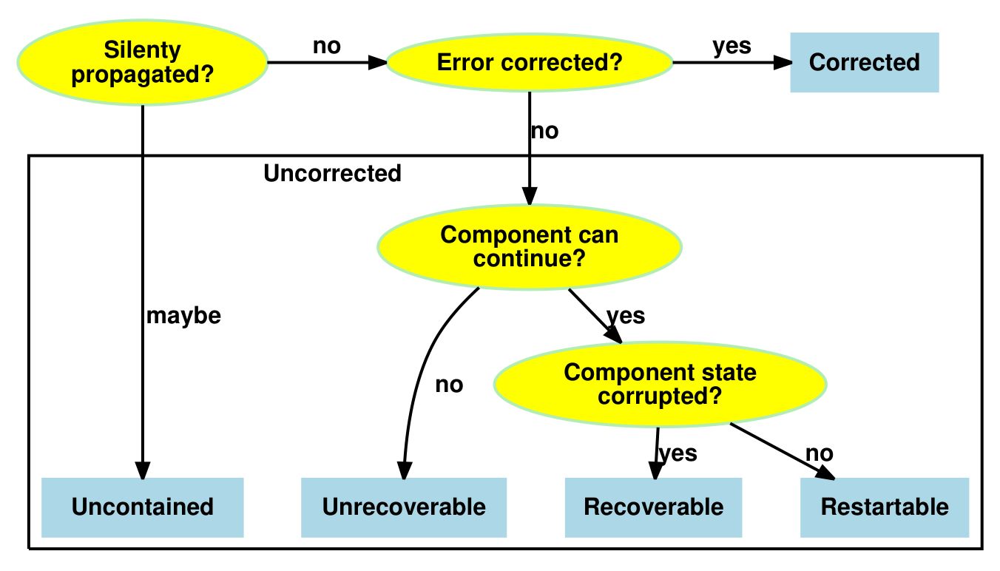
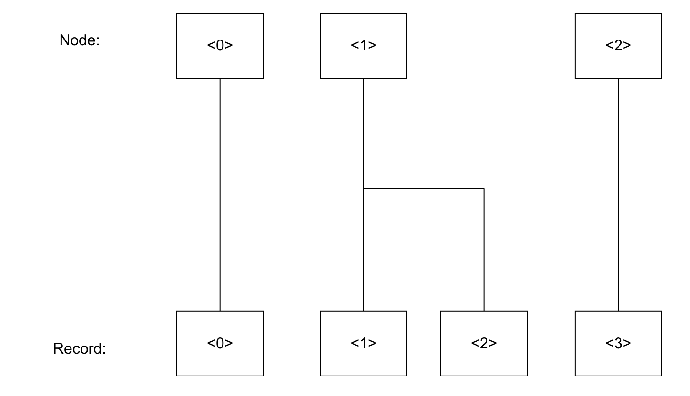

本文译自 Part B《Armv8-M 架构规则》（Armv8-M Architecture Rules） Chapter B16《RAS 扩展》（Reliability, Availability, and Serviceability (RAS) Extension）。

本章规定 **Armv8.1-M** 可靠性、可用性与可服务性（RAS）扩展。该扩展的最小实现对于任何 **Armv8.1-M** 架构实现都是强制的，但任何附加 RAS 特性都是可选的。

适用于 **Armv8.1-M** 及以后架构版本的实现。扩展要求为 - RAS。

## 1. 概述

关于可能的 **RAS** 错误的详细说明，参见《Arm® Reliability, Availability, and Serviceability (RAS) Specification, Armv8, for the Armv8-A architecture profile》。

适用于 **Armv8.1-M** 及以后架构版本的实现。扩展要求为 - RAS。

**Armv8.1-M** 架构的实现必须提供 RAS 扩展的最小实现。

适用于 **Armv8.1-M** 及以后架构版本的实现。扩展要求为 - RAS。

实现 RAS 扩展时，`ID_PFR0.RAS` 为非零。

适用于 **Armv8.1-M** 及以后架构版本的实现。扩展要求为 - RAS。

**错误**（error）是对正确服务的偏离。为描述 RAS 扩展，对正确服务的偏离用以下术语定义：

- **失效**（failure）是偏离正确服务的事件。它包括数据损坏、数据丢失与服务丢失。
- **错误**（error）是这种偏离。
- **故障**（fault）是错误的原因。

适用于 **Armv8.1-M** 及以后架构版本的实现。扩展要求为 - RAS。

当 **PE** 访问内存或其他状态时，可能在该内存或状态中检测到错误，并对其纠正、延迟，或作为**已检出错误**（Detected error）向 **PE** 指示。由 **PE** 写操作的消费者检测到的错误是否向 **PE** 指示、并成为由该 **PE** 消费的**已检出错误**，是 **IMPLEMENTATION DEFINED** 的。

适用于 **Armv8.1-M** 及以后架构版本的实现。扩展要求为 - RAS。

作为 **PE** 一部分而包含的节点（包括 Armv8-M PE）是 **IMPLEMENTATION DEFINED** 的。

适用于 **Armv8.1-M** 及以后架构版本的实现。扩展要求为 - RAS。

单个错误可能产生多个异常。

适用于 **Armv8.1-M** 及以后架构版本的实现。扩展要求为 - RAS。

软件必须意识到错误可能被重复报告。

适用于 **Armv8.1-M** 及以后架构版本的实现。扩展要求为 - RAS。

参见：

- 第 B16.9 节《最小 RAS 实现》。

## 2. 错误分类

架构未规定以下技术：

- 故障预防。
- 故障移除。
- 故障注入。
- 测试。

这些是 **IMPLEMENTATION DEFINED** 的，且在本架构范围之外。

适用于 **Armv8.1-M** 及以后架构版本的实现。扩展要求为 - RAS。

### 2.1 架构错误传播

对于 **PE**，**错误传播**（Error propagation）适用于已检出错误在通用寄存器或**浮点扩展**寄存器堆，与 **PE** 的任何程序可见架构状态之间的传播，包括：

- 其他通用寄存器与**浮点扩展**寄存器堆。
- 内存映射寄存器。
- 特殊用途寄存器。
- 内存。

也就是说，错误通过以下方式传播：

- 存储一个损坏的值。
- 向系统寄存器或特殊用途寄存器写入损坏的值。感染系统寄存器状态可能意味着 **PE** 会产生原本不被允许的事务。
- 任何在错误未被激活时本来不被允许发生的操作，包括：
  - 原本不被允许的加载或指令取指，包括由硬件推测或预取产生的那些。
  - 写入错误地址，或原本不会进行或不被允许的存储。
  - 原本不会进行或不被允许的、对特殊用途寄存器或系统寄存器的直接或间接写。
  - 原本不会被置位的任何信号（例如中断）被置位。
- 任何在错误未被激活时本来会发生的操作却没有发生。
- 接受异步异常。
- **PE** 丢弃其以已修改状态持有的数据。
- 其他任何单处理器语义、顺序或一致性的丢失。

适用于 **Armv8.1-M** 及以后架构版本的实现。扩展要求为 - RAS。

若传播的错误没有作为**已检出错误**向消费者指示，则该错误被**静默传播**（silently propagated）。

适用于 **Armv8.1-M** 及以后架构版本的实现。扩展要求为 - RAS。

**PE** 为抑制错误而包含的特性是 **IMPLEMENTATION DEFINED** 的，错误能否作为**已检出错误**向消费者指示也是 **IMPLEMENTATION DEFINED** 的。

适用于 **Armv8.1-M** 及以后架构版本的实现。扩展要求为 - RAS。

### 2.2 架构上感染、抑制与未抑制

**已感染**（Infected）、**已投毒**（Poisoned）、**可抑制**（Containable）与**不可抑制**（Uncontainable）适用于 **PE** 的所有程序可见架构状态，包括通用寄存器、**浮点扩展**寄存器堆、特殊用途寄存器、系统寄存器与内存。

适用于 **Armv8.1-M** 及以后架构版本的实现。扩展要求为 - RAS。

若错误被**静默传播**，则该错误对 **PE** 而言是**不可抑制的**（Uncontainable），除非因以下全部为真而被抑制：

- 损坏的值位于通用寄存器或**浮点扩展**寄存器堆中。
- 该错误仅由满足以下条件之一的、在程序顺序上位于其后的指令静默传播：
  - 接受由该错误产生的 **BusFault**。
  - 同步该错误的**错误同步屏障**操作。
- 该错误没有以其他任何方式被静默传播。

适用于 **Armv8.1-M** 及以后架构版本的实现。扩展要求为 - RAS。

### 2.3 架构上消费的错误

对于 **PE**，若以下任一为真，则错误被**架构上消费**（architecturally consumed）：

- 一条指令把损坏提交到 **PE** 的可见状态。
- 错误位于指令取指上，且该指令被提交执行。

适用于 **Armv8.1-M** 及以后架构版本的实现。扩展要求为 - RAS。

对于已检出且被架构上消费的错误，**PE** 通过以下方式之一采取措施：

- 产生**错误异常**。
- 进入**失效模式**（failure mode）。

适用于 **Armv8.1-M** 及以后架构版本的实现。扩展要求为 - RAS。

### 2.4 其他错误

来自软件故障的错误不在 RAS 扩展错误恢复架构的范围之内。

适用于 **Armv8.1-M** 及以后架构版本的实现。扩展要求为 - RAS。

在 **PE** 自身内部，还可能检测到其他错误。这些错误并非由 **PE** 的架构模型检出，因此按由其他组件检出的错误方式处理。其他组件可以使用**错误恢复中断**向 **PE** 报告错误。一个例子是由高速缓存（而非 **PE**）检测到 RAM 错误。其他组件可以使用错误恢复中断向 **PE** 报告错误。

适用于 **Armv8.1-M** 及以后架构版本的实现。扩展要求为 - RAS。

## 3. 产生错误异常

下图给出已消费错误的分类：

适用于 **Armv8.1-M** 及以后架构版本的实现。扩展要求为 - RAS。

对于所有已检出、既非 **Corrected** 也非 **Deferred** 的 **RAS** 错误，都会产生**错误异常**。这些错误异常被指示给 **PE** 并由其消费，且不被静默传播。

适用于 **Armv8.1-M** 及以后架构版本的实现。扩展要求为 - RAS。

**Corrected** 错误由 **PE** 检出并纠正，且不被静默传播。

适用于 **Armv8.1-M** 及以后架构版本的实现。扩展要求为 - RAS。

在正常情况下，**Corrected** 错误不再感染该节点。在 **IMPLEMENTATION DEFINED** 的情形下，该 **Corrected** 错误可能仍以潜伏形式留在节点中。

适用于 **Armv8.1-M** 及以后架构版本的实现。扩展要求为 - RAS。

对于**不可抑制**错误，若该错误无法隔离到某个应用，则软件必须关闭系统以避免**灾难性失效**（Catastrophic failure）。

适用于 **Armv8.1-M** 及以后架构版本的实现。扩展要求为 - RAS。

对于**不可恢复**（Unrecoverable）错误，应用无法继续，必须由软件方法隔离。

适用于 **Armv8.1-M** 及以后架构版本的实现。扩展要求为 - RAS。

对于**可恢复**（Recoverable）错误，若软件无法定位并修复该错误，则必须由软件方法隔离该应用。

适用于 **Armv8.1-M** 及以后架构版本的实现。扩展要求为 - RAS。

对于**可重启**（Restartable）错误，软件可以在该错误被消费之前采取措施定位并修复它。**PE** 可以由软件重启，而无需软件采取任何定位并修复该错误的动作。

适用于 **Armv8.1-M** 及以后架构版本的实现。扩展要求为 - RAS。

在每次错误异常时，错误是否已被抑制、或属于**不可抑制**，是 **IMPLEMENTATION DEFINED** 的。若错误已被抑制，则接受错误异常时 **PE** 的状态是**不可恢复**、**可恢复**还是**可重启**，进一步是 **IMPLEMENTATION DEFINED** 的：

**不可抑制错误（UC）**：若错误已被静默传播或可能已被静默传播，则该错误是**不可抑制的**。这也称为**未被抑制的错误**（Uncontained error）。

**不可恢复错误（UEU）**：若以下全部为真，则 **PE** 的状态是**不可恢复的**：

- 错误未被静默传播。
- **PE** 无法从该异常的返回地址恢复执行。这可能是因为以下之一：
  - 错误已被 **PE** 架构上消费，并感染了 **PE** 的通用寄存器、**浮点扩展**寄存器堆与系统寄存器状态。
  - 该异常是异步的。

**可恢复错误（UER）**：若以下全部为真，则 **PE** 的状态是**可恢复的**：

- 错误未被静默传播。
- 错误未被 **PE** 架构上消费（**PE** 的架构状态未被感染）。
- 该异常是同步的，且 **PE** 能从该异常的返回地址恢复执行。

**PE** 在不消费该错误、或以其他方式使该错误变为**不可恢复**的情况下，无法正确推进。该错误仍潜伏在系统中。

**可重启错误（UEO）**：若以下全部为真，则 **PE** 的状态是**可重启的**：

- 错误未被静默传播。
- 错误未被 **PE** 架构上消费（**PE** 的架构状态未被感染）。
- 该异常是同步的，且 **PE** 能从该异常的返回地址恢复执行。

**PE** 可以继续推进。不过，该错误可能仍潜伏在系统中。

适用于 **Armv8.1-M** 及以后架构版本的实现。扩展要求为 - RAS。

实现可以报告的错误类型集合是 **IMPLEMENTATION DEFINED** 的。实现可以：

- 把任何**可重启**错误报告为**可恢复**、**不可恢复**或**不可抑制**。
- 把任何**可恢复**错误报告为**不可恢复**或**不可抑制**。
- 把任何**不可恢复**错误报告为**不可抑制**。

适用于 **Armv8.1-M** 及以后架构版本的实现。扩展要求为 - RAS。

若 **PE** 的状态被报告为**可恢复**，并不意味着该错误一定能够被恢复。例如，内存中的错误可能使软件无法恢复该操作。更准确地说，软件若能修复该错误并继续执行，则可能恢复。

适用于 **Armv8.1-M** 及以后架构版本的实现。扩展要求为 - RAS。

**总线错误**可能作为以下情形的响应而产生：

- 架构内存读，或指令取指中的读。
- 对内存的架构写，或高速缓存维护操作。
- 因硬件推测、预取或其他非架构机制而产生的内存读。

触发总线错误的事件是 **IMPLEMENTATION DEFINED** 的。

适用于 **Armv8.1-M** 及以后架构版本的实现。扩展要求为 - RAS。

对于由 **PE** 写操作的消费者检出的 **RAS** 错误，以下哪一项是 **IMPLEMENTATION DEFINED** 的：

- 延迟给消费者。
- 作为总线错误返回给 **PE**。
- 产生**错误恢复中断**。

行为可能因物理地址或内存类型而异。

适用于 **Armv8.1-M** 及以后架构版本的实现。扩展要求为 - RAS。

延迟错误的方法取决于组件，且是实现特定的。

适用于 **Armv8.1-M** 及以后架构版本的实现。扩展要求为 - RAS。

延迟错误的一种常见机制是创建**已投毒状态**（Poisoned state），该状态在被访问时随后产生错误。

适用于 **Armv8.1-M** 及以后架构版本的实现。扩展要求为 - RAS。

任何已实现的错误检测机制，其**保护粒度**（Protection granule）的大小是 **IMPLEMENTATION DEFINED** 的，且系统可以实现在不同保护粒度上工作的多种错误检测机制。

适用于 **Armv8.1-M** 及以后架构版本的实现。扩展要求为 - RAS。

从保护粒度中清除错误或投毒的机制是 **IMPLEMENTATION DEFINED** 的，是否存在此类机制也是 **IMPLEMENTATION DEFINED** 的。

适用于 **Armv8.1-M** 及以后架构版本的实现。扩展要求为 - RAS。

对于由 **RAS** 错误产生的每个 **BusFault**，`BFSR` 都会被填充。对于每个 **RAS** **BusFault** 异常，`RFSR` 都会被填充；对于其他异步 **BusFault** 异常是否也更新 `RFSR`，是 **IMPLEMENTATION DEFINED** 的。若更新 `RFSR`，则置位 `RFSR.V`。

适用于 **Armv8.1-M** 及以后架构版本的实现。扩展要求为 - RAS。

错误的严重程度与 **PE** 的状态在错误异常被挂起时报告。

适用于 **Armv8.1-M** 及以后架构版本的实现。扩展要求为 - RAS。

若 **BusFault** 异常处理程序正在处理前一个错误异常时又发生错误异常，则适用既有的异常嵌套行为。这可能导致异常升级为 **HardFault** 或 **Lockup**。

适用于 **Armv8.1-M** 及以后架构版本的实现。扩展要求为 - RAS。

导致同步 **RAS** 错误的 **DAP** 请求会向调试器返回错误，但不更新 `RFSR`、`BFSR` 与 `BFAR`。

适用于 **Armv8.1-M** 及以后架构版本的实现。扩展要求为 - RAS。

导致异步 **RAS** 错误的 **DAP** 访问不会向调试器返回错误，但对于读访问会返回 **UNKNOWN** 数据。此时可能产生 **BusFault**，并更新 `RFSR`、`BFSR` 与 `BFAR`。

适用于 **Armv8.1-M** 及以后架构版本的实现。扩展要求为 - RAS。

### 3.1 错误纠正与延迟

若硬件能够纠正或延迟错误，则它会这样做。该错误被记录；若节点被配置为此行为，则产生**故障处理中断**用于故障处理。

适用于 **Armv8.1-M** 及以后架构版本的实现。扩展要求为 - RAS。

## 4. 错误同步屏障（ESB）

RAS 扩展引入一条新指令：**错误同步屏障**（ESB）。

适用于 **Armv8.1-M** 及以后架构版本的实现。扩展要求为 - RAS。

当系统无法同步 **RAS** 错误时，`ESB` 表现为 **NOP**。

适用于 **Armv8.1-M** 及以后架构版本的实现。扩展要求为 - RAS。

`ESB` 本身不更新任何寄存器，但随后产生的任何 **RAS** **BusFault** 异常至少会更新 `BFSR` 与 `RFSR`。

适用于 **Armv8.1-M** 及以后架构版本的实现。扩展要求为 - RAS。

`ESB` 可能更新综合位（syndrome bits），例如在 IESB 被禁用时。

适用于 **Armv8.1-M** 及以后架构版本的实现。扩展要求为 - RAS。

在以下任一情况下，`ESB` 表现为**数据同步屏障**：

- 存在挂起的 **BusFault** 异常，该异常可能因调用 `SynchronizeBusFault()` 而被强制识别。
- 存在挂起的 **HardFault** 异常，该异常可能由因 **BusFault** 异常被禁用而升级的异步 **BusFault** 引起。

该行为保证随后对内存映射综合寄存器以及 `BFSR`、`RFSR`、`SHCSR` 中挂起位的读取返回正确的值。

若因 `ESB` 指令而识别或升级的 **BusFault** 异常影响当前安全状态，则综合寄存器中的值必须与当前安全状态一致。在判断 `ESB` 指令是否同时充当隐式数据同步屏障时，只需检查与当前安全状态相关的相应异常位。

适用于 **Armv8.1-M** 及以后架构版本的实现。扩展要求为 - RAS。

参见：

- 第 B16.5 节《隐式错误同步（IESB）》。

### 4.1 ESB 与不可恢复错误

`ESB` 充当所有不可恢复（RAS 相关与非 RAS 相关）总线错误的屏障，并使任何**潜伏故障**（Latent fault）与该指令同步地被识别。

适用于 **Armv8.1-M** 及以后架构版本的实现。扩展要求为 - RAS。

取决于 **PE** 的当前状态，识别潜伏总线错误可能只是导致挂起一个 **BusFault**，也可能使该 **BusFault** 被接受或升级。

适用于 **Armv8.1-M** 及以后架构版本的实现。扩展要求为 - RAS。

**错误同步屏障**操作为当前软件上下文抑制该错误。

适用于 **Armv8.1-M** 及以后架构版本的实现。扩展要求为 - RAS。

### 4.2 ESB 与其他可抑制错误

对于其他类型的**可抑制**错误：

- **可恢复**错误尚未被 **PE** 消费。
- **可重启**与 **Corrected** 错误，以及来自硬件推测读取、不损坏 **PE** 状态的 **BusFault** 异常，尚未被 **PE** 消费。

适用于 **Armv8.1-M** 及以后架构版本的实现。扩展要求为 - RAS。

未被消费的 **RAS** 错误可能在 `ESB` 处被接受。

适用于 **Armv8.1-M** 及以后架构版本的实现。扩展要求为 - RAS。

### 4.3 ESB 与其他错误

同步 **BusFault** 异常不被**错误同步屏障**同步。

适用于 **Armv8.1-M** 及以后架构版本的实现。扩展要求为 - RAS。

中断不被 `ESB` 同步。

适用于 **Armv8.1-M** 及以后架构版本的实现。扩展要求为 - RAS。

`ESB` 指令会同步异步 **BusFault**。

适用于 **Armv8.1-M** 及以后架构版本的实现。扩展要求为 - RAS。

`ESB` 始终同步**可抑制**错误，但 **IMPLEMENTATION DEFINED** 与未分类的 **BusFault** 异常是否属于**不可抑制**、以及能否被**错误同步屏障**同步，是 **IMPLEMENTATION DEFINED** 的。

适用于 **Armv8.1-M** 及以后架构版本的实现。扩展要求为 - RAS。

**不可抑制**错误可能未被抑制，且**不可抑制** **BusFault** 异常可能是异步的。**不可抑制**错误可能在 `ESB` 处被接受，但架构并不要求如此。

适用于 **Armv8.1-M** 及以后架构版本的实现。扩展要求为 - RAS。

**IMPLEMENTATION DEFINED** 与未分类的中断属于**可抑制**还是**不可抑制**，是 **IMPLEMENTATION DEFINED** 的。

适用于 **Armv8.1-M** 及以后架构版本的实现。扩展要求为 - RAS。

**不可抑制**错误可能在**错误同步屏障**处被接受，或由 `ESB` 指令记录到 `RFSR.IS`。

适用于 **Armv8.1-M** 及以后架构版本的实现。扩展要求为 - RAS。

执行 `ESB` 指令时，任何被接受的 **BusFault** 异常的返回地址是该 `ESB` 指令。

适用于 **Armv8.1-M** 及以后架构版本的实现。扩展要求为 - RAS。

## 5. 隐式错误同步（IESB）

为确保故障在适当的 **PE** 状态下出现，可以在每次异常进入、异常返回以及惰性状态压栈操作上可选地插入**隐式错误同步事件**（IESB）。进入与退出**调试状态**都不插入 IESB。

适用于 **Armv8.1-M** 及以后架构版本的实现。扩展要求为 - RAS。

只有在同步了潜伏的异步总线错误时，IESB 才至少更新 `BFSR` 或 `RFSR` 之一。

适用于 **Armv8.1-M** 及以后架构版本的实现。扩展要求为 - RAS。

IESB 充当所有**不可恢复**（RAS 相关与非 RAS 相关）总线错误的屏障。

适用于 **Armv8.1-M** 及以后架构版本的实现。扩展要求为 - RAS。

使能 IESB 会使所有异步 **BusFault** 按同步 **BusFault** 的方式升级，无论它们是异步被识别的，还是由 `ESB` 或 IESB 强制识别的。

适用于 **Armv8.1-M** 及以后架构版本的实现。扩展要求为 - RAS。

因 IESB 被使能而同步升级的异步 **BusFault** 仍作为异步故障报告。这意味着异常返回地址并不指向引发该故障的指令。

适用于 **Armv8.1-M** 及以后架构版本的实现。扩展要求为 - RAS。

`AIRCR.IESB` 决定异常进入或异常返回是否表现为**隐式错误同步事件**，并要求确认任何未决的 **RAS** 异常：

- 在异常进入时，只有与后台代码及寄存器压栈相关的错误受 `AIRCR.IESB` 影响。异常进入所产生的任何 **BusFault** 将遵循**派生异常**的规则。
- 在异常返回时，只有与处理程序代码相关的错误受 `AIRCR.IESB` 影响。寄存器出栈与后台代码相关，不受隐式错误同步屏障影响，并在返回 **Thread 模式**时按异常优先级规则处理。当 `AIRCR.IESB` 为 1 时，在异常返回过程中、切换到 **Thread 模式**之前发生的任何 **BusFault**，将作为对处理程序的同步异常处理。

这确保故障与触发它的上下文相关联。

适用于 **Armv8.1-M** 及以后架构版本的实现。扩展要求为 - RAS。

**Arm** 建议：当异步异常及其相关时序可能使错误关联到与引发该错误的上下文不同的上下文时，实现应支持隐式错误同步行为。

适用于 **Armv8.1-M** 及以后架构版本的实现。扩展要求为 - RAS。

若 **PE** 不支持可配置的隐式 ESB 插入，则软件对 `AIRCR.IESB` 的写可能被 **PE** 忽略。读回的值决定该特性是否被支持。

适用于 **Armv8.1-M** 及以后架构版本的实现。扩展要求为 - RAS。

使能 IESB 时：

- 在惰性浮点状态压栈之前发生一次 IESB，任何 **RAS** 错误关联到前台代码。
- 在惰性浮点状态压栈之后发生一次 IESB，任何 **RAS** 错误关联到寄存器压栈。

适用于 **Armv8.1-M** 及以后架构版本的实现。扩展要求为 - RAS && (FP || MVE)。

**RAS** 故障按以下列表设置第一个适用的综合信息：

- 若错误归因于惰性状态保存压栈，则 `BFSR.LSPERR`。
- 若错误归因于异常寄存器压栈，则 `BFSR.STKERR`。
- 若错误归因于异常寄存器出栈，则 `BFSR.UNSTKERR`。
- 若错误由指令取指或预取引起，则 `BFSR.IBUSERR`。
- 若错误同步发生且归因于指令执行，则 `BFSR.PRECISERR`。
- 否则 `BFSR.IMPRECISERR`。

适用于 **Armv8.1-M** 及以后架构版本的实现。扩展要求为 - RAS。

## 6. 故障处理

**RAS** 错误报告有四种形式：

- 对 **PE** 动作作出响应的总线错误。
- **错误恢复中断**。
- **故障处理中断**。
- **严重错误中断**（critical error interrupt）。

取决于系统配置，这些中断可以通过系统中断控制器或 **NVIC** 路由。

适用于 **Armv8.1-M** 及以后架构版本的实现。扩展要求为 - RAS。

**错误恢复中断**可以向软件通知系统中检出的 **RAS** 故障。

适用于 **Armv8.1-M** 及以后架构版本的实现。扩展要求为 - RAS。

**故障处理中断**可以向软件通知系统中检出的 **RAS** 事件。

适用于 **Armv8.1-M** 及以后架构版本的实现。扩展要求为 - RAS。

当支持故障报告的节点检出错误时，该节点把该错误记录到**错误记录寄存器**中，并在被配置为此行为时产生 **RAS 故障处理中断**。

适用于 **Armv8.1-M** 及以后架构版本的实现。扩展要求为 - RAS。

**RAS 故障处理中断**可能在系统层面被路由到并不直接受该故障影响的 **PE**。反之，**PE** 也可能收到与系统中其他设备相关的故障处理中断。

适用于 **Armv8.1-M** 及以后架构版本的实现。扩展要求为 - RAS。

**RAS 故障处理中断**可以通过 **IMPLEMENTATION DEFINED** 的方式发送到专用的故障处理 **PE**。

适用于 **Armv8.1-M** 及以后架构版本的实现。扩展要求为 - RAS。

**错误恢复中断**、**故障处理中断**与**严重错误中断**与其他中断一样，是电平敏感或脉冲敏感的。节点采用电平敏感还是脉冲敏感中断，是 **IMPLEMENTATION DEFINED** 的。

适用于 **Armv8.1-M** 及以后架构版本的实现。扩展要求为 - RAS。

在错误条件或故障被观察到或纠正后的有限时间内，**错误恢复中断**、**故障处理中断**与**严重错误中断**被挂起。

适用于 **Armv8.1-M** 及以后架构版本的实现。扩展要求为 - RAS。

节点对**严重错误条件**与**严重错误中断**的支持是 **IMPLEMENTATION DEFINED** 的。

适用于 **Armv8.1-M** 及以后架构版本的实现。扩展要求为 - RAS。

**严重错误**的一个例子是节点已进入**失效模式**，这意味着主要的错误恢复机制无法使用。例如，若某个内存控制器进入失效模式并停止处理来自应用处理器的内存请求，而应用处理器承载主要错误恢复软件，则该错误被指示给具有自己私有资源以记录该错误的**第二错误控制器**。RAS 扩展允许节点在此类错误发生时产生一个专用中断，称为**严重错误中断**。

适用于 **Armv8.1-M** 及以后架构版本的实现。扩展要求为 - RAS。

对于给定节点，若 `ERRFRn.CI != 0b00`，则实现**严重错误中断**。

适用于 **Armv8.1-M** 及以后架构版本的实现。扩展要求为 - RAS。

对于给定节点，若实现了**严重错误中断**，则也实现**错误恢复中断**。

适用于 **Armv8.1-M** 及以后架构版本的实现。扩展要求为 - RAS。

当 `ERRCTRLn.CI` 置 1 时，使能**严重错误中断**。

适用于 **Armv8.1-M** 及以后架构版本的实现。扩展要求为 - RAS。

若实现了**严重错误中断**，则在记录**严重错误条件**时，节点置位 `ERRSTATUSn.CI`，无论该严重错误中断是使能还是禁用。

适用于 **Armv8.1-M** 及以后架构版本的实现。扩展要求为 - RAS。

若实现了**严重错误中断**且其被禁用，则当检出**严重错误条件**时，节点按**不可抑制**错误记录该严重错误。

适用于 **Armv8.1-M** 及以后架构版本的实现。扩展要求为 - RAS。

在**严重错误中断**未使能时把**严重错误条件**归类为**不可抑制**错误，其效果是使节点产生**错误恢复中断**。节点还会置位 `ERRSTATUSn.CI`。若**严重错误中断**已使能，则该错误在节点处如何归类是 **IMPLEMENTATION DEFINED** 的。除按正常方式处理的其他综合信息外，严重错误标志置 1。

适用于 **Armv8.1-M** 及以后架构版本的实现。扩展要求为 - RAS。

参见：

- 第 B12 章《嵌套向量中断控制器》。

## 7. RAS 错误记录

遇到错误时，节点写入 **RAS 错误记录**。随后软件可以分析这些记录，以判断是否存在需要处理的系统性问题。

适用于 **Armv8.1-M** 及以后架构版本的实现。扩展要求为 - RAS。

每个节点至少提供一个**错误记录**，用于控制错误报告并暴露状态。

适用于 **Armv8.1-M** 及以后架构版本的实现。扩展要求为 - RAS。

若节点提供多个逻辑上不同的功能，则它可以提供多个**错误记录**。

适用于 **Armv8.1-M** 及以后架构版本的实现。扩展要求为 - RAS。

若节点提供多个**错误记录**，则这些记录按序编号。除第一条记录外，每条记录的 `ERRFRn` 寄存器为 RAZ/WI，且 `ERRTCTRLn` 寄存器为 RES0。

适用于 **Armv8.1-M** 及以后架构版本的实现。扩展要求为 - RAS。

下图给出一个由三个节点拥有的四条错误记录组成的记录组的示例：

图中：

- Node\<0\> 拥有一条错误记录：\<0\>。
- Node\<1\> 拥有两条错误记录：\<1\> 与 \<2\>。
- Node\<2\> 拥有一条错误记录：\<3\>。

适用于 **Armv8.1-M** 及以后架构版本的实现。扩展要求为 - RAS。

标准**错误记录**包含：

- 公共特性的控制项，以及这些控制项的标识机制。对于每个节点，故障与错误报告机制是同时适用于读和写、还是可以分别对读与写单独控制，是 **IMPLEMENTATION DEFINED** 的。
- 公共状态字段的状态寄存器，例如错误的类型与粗略特征。
- 地址寄存器（如适用）。
- **IMPLEMENTATION DEFINED** 的控制与标识寄存器。
- **IMPLEMENTATION DEFINED** 的状态寄存器。

适用于 **Armv8.1-M** 及以后架构版本的实现。扩展要求为 - RAS。

**Arm** 建议标准**错误记录**中的 **IMPLEMENTATION DEFINED** 状态寄存器用于：

- 标识**现场可更换单元**（Field Replaceable Unit，FRU）。
- 在 FRU 内定位错误。
- 可选的 **Corrected** 错误计数器，供软件轮询 **Corrected** 错误的速率。

架构为这些计数器提供可选格式。

适用于 **Armv8.1-M** 及以后架构版本的实现。扩展要求为 - RAS。

**错误记录**的内容与格式是灵活的，以便实现选择合适的报告量。

适用于 **Armv8.1-M** 及以后架构版本的实现。扩展要求为 - RAS。

一组**错误记录**可以是稀疏填充的，这意味着该组中并非所有寄存器都包含有效信息。未实现的错误记录寄存器，其关联的 `ERRFRn` 寄存器字段读为 0。

适用于 **Armv8.1-M** 及以后架构版本的实现。扩展要求为 - RAS。

可通过内存映射寄存器访问的**错误记录**数量是 **IMPLEMENTATION DEFINED** 的，且可能为零。`ERRDEVID.NUM` 表示可访问错误记录的最高编号索引加一。

适用于 **Armv8.1-M** 及以后架构版本的实现。扩展要求为 - RAS。

**错误记录**寄存器的内容在**热复位**后保持不变。

适用于 **Armv8.1-M** 及以后架构版本的实现。扩展要求为 - RAS。

**Arm** 建议所有**错误记录**都应可远程访问，供系统中所有 **PE**、或**基板管理控制器**（BMC）、**系统控制处理器**（SCP）或调试器访问。远程访问机制是 **IMPLEMENTATION DEFINED** 的，但可能使用类 **CoreSight** 接口。**Arm** 建议在系统其余部分处于失效状态时（例如系统已锁死时）仍可远程访问。

适用于 **Armv8.1-M** 及以后架构版本的实现。扩展要求为 - RAS。

当检出新的错误时，节点：

- 置位或修改 `ERRSTATUSn.{CE, DE, CI, UE, UET}`，以指示新**已检出错误**的类型。
- 节点执行以下之一：
  - 若新错误的优先级高于先前记录的最高优先级错误，则用新错误的综合信息覆盖该错误记录。
  - 若新错误的优先级低于或等于先前记录的最高优先级错误，则保留先前错误的综合信息。
- 若该错误为 **Corrected** 错误且实现了计数器，则计数该错误。
- 置位 `ERRSTATUSn.V` 为 1。
- 按需产生中断。

适用于 **Armv8.1-M** 及以后架构版本的实现。扩展要求为 - RAS。

**Corrected** 错误的计数器是**可选**的。

适用于 **Armv8.1-M** 及以后架构版本的实现。扩展要求为 - RAS。

错误的覆盖取决于先前最高优先级错误的类型与新记录错误的类型。下表给出该行为。表中使用以下缩写：

- **CE**：Corrected error。
- **CO**：Count and overflow。保留先前的错误综合信息并计数该错误。若计数该错误导致计数器无符号溢出，则置位 `ERRSTATUSn.OF` 为 1。
- **CW**：Count and overwrite。若实现了计数器则计数 CE，并覆盖。若实现了计数器且其溢出，则 `ERRSTATUSn.OF` 被置为 **UNKNOWN** 值。否则，`ERRSTATUSn.OF` 被置为 0 还是保持不变，是 **IMPLEMENTATION DEFINED** 的。
- **CWO**：Count and overwrite or keep。行为是 **IMPLEMENTATION DEFINED** 的，由 `ERRFRn.CEO` 的取值描述：

  0：若实现了计数器则计数 CE，并保留先前的错误综合信息。
  1：计数 CE。若在计数该 CE 之前 `ERRSTATUSn.OF == 1`，则保留先前的综合信息；否则记录新的错误综合信息。

  若计数器溢出或未实现计数器，则置位 `ERRSTATUSn.OF` 为 1。

- **DE**：Detected error。
- **O**：Overflow。保留先前的错误综合信息并置位 `ERRSTATUSn.OF` 为 1。
- **UEO**：Restartable error。
- **UER**：Recoverable error。
- **UEU**：Unrecoverable error。
- **UC**：Uncontainable error。
- **WO**：Overwrite and overflow。`ERRSTATUSn.OF` 置为 1。

若未实现计数器，则 CW 的行为与 W 相同，CWO 与 CO 的行为与 O 相同。

| 先前错误类型 | CE | DE | UEO | UER | UEU | UC |
| --- | --- | --- | --- | --- | --- | --- |
|  | CW | W | W | W | W | W |
| CE | CWO | WO | WO | WO | WO | WO |
| DE | CO | O | WO | WO | WO | WO |
| UEO | CO | O | O | WO | WO | WO |
| UER | CO | O | O | O | WO | WO |
| UEU | CO | O | O | O | O | WO |
| UC | CO | O | O | O | O | O |

适用于 **Armv8.1-M** 及以后架构版本的实现。扩展要求为 - RAS。

当节点产生中断或异常时，它保证随后对**错误记录**的读返回已更新的值。

适用于 **Armv8.1-M** 及以后架构版本的实现。扩展要求为 - RAS。

`ERRGSRn` 包含 `ERRSTATUSn.V` 的只读副本。

适用于 **Armv8.1-M** 及以后架构版本的实现。扩展要求为 - RAS。

## 8. 多重 BusFault 异常

异步 **BusFault** 可能由多个异常条件产生。架构未定义它们的相对优先级。

适用于 **Armv8.1-M** 及以后架构版本的实现。扩展要求为 - RAS。

由多个异常条件产生的总线错误是否作为单个 **BusFault** 异常接受，是 **IMPLEMENTATION DEFINED** 的。

适用于 **Armv8.1-M** 及以后架构版本的实现。扩展要求为 - RAS。

在接受 **BusFault** 异常时（无论对应一个还是多个 **BusFault** 异常条件），该 **BusFault** 异常或这些 **BusFault** 异常对 **PE** 状态的影响在 `RFSR.UET` 中报告为以下之一：

- **Uncontained** 错误。
- **Unrecoverable** 错误。
- **Restartable** 错误。
- **Recoverable** 错误。

适用于 **Armv8.1-M** 及以后架构版本的实现。扩展要求为 - RAS。

**错误同步屏障**操作要求所有**不可恢复**错误被同步。若有多个未决请求，它们都由单次**错误同步屏障**操作同步。

适用于 **Armv8.1-M** 及以后架构版本的实现。扩展要求为 - RAS。

## 9. 最小 RAS 实现

最小 **RAS** 扩展在 **Armv8.1-M** 实现中是强制的。所有附加 **RAS** 特性都是可选的。

适用于 **Armv8.1-M** 及以后架构版本的实现。扩展要求为 - RAS。

**RAS** 扩展的设计目标是为 **RAS** 支持有限的设备提供较低的实现成本。

适用于 **Armv8.1-M** 及以后架构版本的实现。扩展要求为 - RAS。

**RAS** 扩展的最小实现是：

- `ESB` 指令。对于不提供 **RAS** 引起的 **BusFault** 的实现，它可以实现为 **NOP**。
- `RFSR`。它可以实现为 RAZ/WI。
- `ERRDEVID`。它可以实现为 RAZ/WI。
- `AIRCR.IESB`。它可以实现为 RAZ/WI。
- `ID_PFR0.RAS` 读为 `0b0010`。

这提供了必要的架构支持，但不提供任何实际的 **RAS** 报告功能。

适用于 **Armv8.1-M** 及以后架构版本的实现。扩展要求为 - RAS。

未实现的**错误记录**寄存器为 RES0。在最小实现中，可能没有任何**错误记录**。

适用于 **Armv8.1-M** 及以后架构版本的实现。扩展要求为 - RAS。
