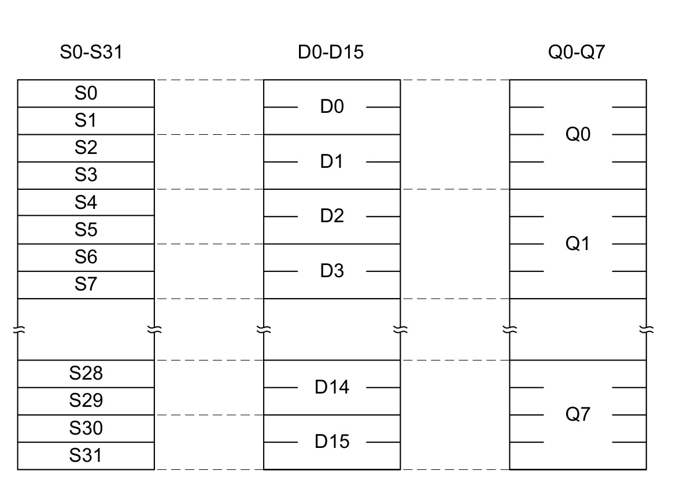
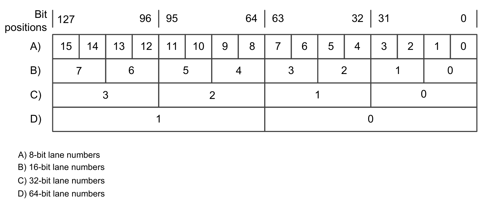
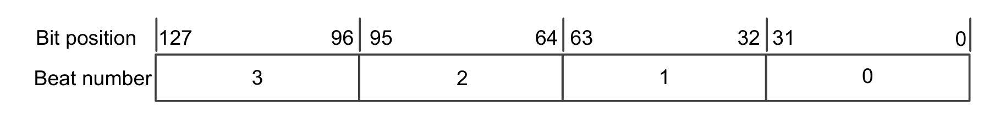
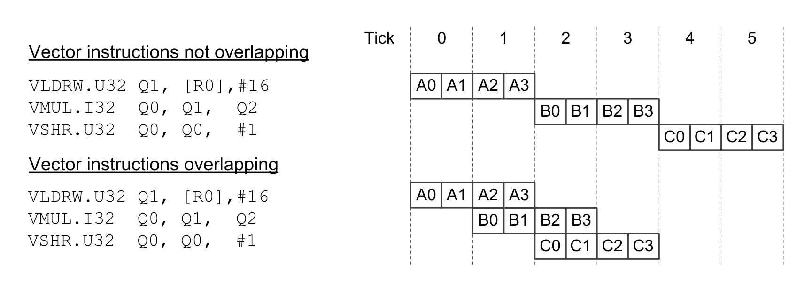
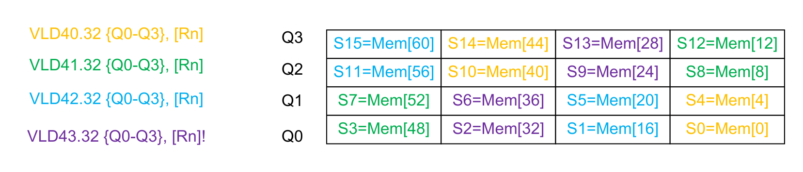

本文译自 Part B《Armv8-M 架构规则》（Armv8-M Architecture Rules） Chapter B5《向量扩展》（Vector Extension）。

本章规定可选的 **Armv8.1-M** 向量扩展规则。

## 1. Vector Extension 操作

**MVE-I** 处理 32 位、16 位与 8 位数据类型，包括 **Q7**、**Q15**、**Q31** 整数值。

**MVE-F** 处理半精度与单精度浮点值。

适用于 **Armv8.1-M** 及以后架构版本的实现。

向量指令在固定的 128 位向量宽度上操作。

适用于 **Armv8.1-M** 及以后架构版本的实现。扩展要求为 - MVE。

整数 **MVE**（**MVE-I**）指令可以在实现或不实现标量浮点扩展的情况下实现。

适用于 **Armv8.1-M** 及以后架构版本的实现。扩展要求为 - MVE。

浮点 **MVE**（**MVE-F**）指令要求已实现浮点扩展。

适用于 **Armv8.1-M** 及以后架构版本的实现。扩展要求为 - MVE。

包含 **MVE** 的实现同时包含 **DSP** 扩展。

适用于 **Armv8.1-M** 及以后架构版本的实现。

向量运算按两种正交方式划分：

- **Lanes**（通道）。
- **Beats**（节拍）。

适用于 **Armv8.1-M** 及以后架构版本的实现。扩展要求为 - MVE。

本规范使用 **Element** 一词来指代放入某个**通道**的数据。

适用于 **Armv8.1-M** 及以后架构版本的实现。

每个**节拍**可以执行多个**通道**。每条向量指令有四个**节拍**。

适用于 **Armv8.1-M** 及以后架构版本的实现。扩展要求为 - MVE。

每条向量指令的伪代码执行四次，每个**节拍**执行一次。`GetCurInstrBeat()` 函数返回当前**节拍**编号与谓词细节，二者决定本次代码执行期间对哪些**通道**进行操作。

适用于 **Armv8.1-M** 及以后架构版本的实现。扩展要求为 - MVE。

由同一条向量存储指令产生、被同一 **Observer** 观察到的多次 **Element** 写入可按任意顺序被观察到，但对同一位置的、由不同 **Element** 产生的写入按**向量元素编号递增**的顺序被观察到。

适用于 **Armv8.1-M** 及以后架构版本的实现。扩展要求为 - MVE。

若 `CCR.BFHFNMIGN` 置 1，且多访问加载或存储指令在请求的负优先级下执行时产生 **BusFault**，则该 **BusFault** 可能影响该指令产生的所有访问，而不仅是产生该 **BusFault** 的那次访问。

适用于 **Armv8.1-M** 及以后架构版本的实现。扩展要求为 - MVE。

此时，加载操作的目标寄存器中的值为 **UNKNOWN**。

适用于 **Armv8.1-M** 及以后架构版本的实现。扩展要求为 - MVE。

参见：

- 第 B3.28 节《低开销循环》（Low overhead loops）。
- 第 B3.18 节《异常处理》（Exception handling）。

## 2. 向量寄存器组

**MVE** 定义了 8 个向量寄存器 **Q\<n\>**，它们叠加在浮点扩展的寄存器组上。

1. `Q[0][127:96] = S3`，`Q[0][95:64] = S2`，`Q[0][63:32] = S1`，`Q[0][31:0] = S0`
2. `Q[1][127:96] = S7`，`Q[1][95:64] = S6`，`Q[1][63:32] = S5`，`Q[1][31:0] = S4`
3. …
4. `Q[7][127:96] = S31`，`Q[7][95:64] = S30`，`Q[7][63:32] = S29`，`Q[7][31:0] = S28`

这些寄存器的映射关系如下：



适用于 **Armv8.1-M** 及以后架构版本的实现。扩展要求为 - MVE。

若 **CP10** 已使能，则允许访问向量寄存器 0-7，除非各指令描述中另有说明。

适用于 **Armv8.1-M** 及以后架构版本的实现。扩展要求为 - MVE。

为减轻向量寄存器组的压力，许多向量指令可以使用来自通用寄存器组的标量参数。

适用于 **Armv8.1-M** 及以后架构版本的实现。

热复位之后，**Q0-Q7** 的值为 **UNKNOWN**。

适用于 **Armv8.1-M** 及以后架构版本的实现。

参见：

- 第 C1.4 节《指令集编码信息》（Instruction set encoding information）。

## 3. 通道（Lanes）

所执行的运算的**通道**宽度由正在执行的指令指定。

适用于 **Armv8.1-M** 及以后架构版本的实现。扩展要求为 - MVE。

允许的**通道**宽度以及每个**节拍**的**通道**操作数如下：

- 对于 64 位**通道**尺寸，一个**节拍**执行半个**通道**操作。
- 对于 32 位**通道**尺寸，一个**节拍**执行一个**通道**操作。
- 对于 16 位**通道**尺寸，一个**节拍**执行两个**通道**操作。
- 对于 8 位**通道**尺寸，一个**节拍**执行四个**通道**操作。



适用于 **Armv8.1-M** 及以后架构版本的实现。扩展要求为 - MVE。

参见：

- 第 C2 章《指令规范》（Instruction specification）。

## 4. 节拍（Beats）

向量指令按节拍 0-3 依次执行。



适用于 **Armv8.1-M** 及以后架构版本的实现。

每个 tick 的**节拍**数描述在常见情况下每个 **Architecture tick** 更新多少架构状态。在一个简单实现中，一个 **Architecture tick** 可以是一个时钟周期：

- 在单**节拍**系统中，每个 tick 可能发生一个**节拍**。
- 在双**节拍**系统中，每个 tick 可能发生两个**节拍**。
- 在四**节拍**系统中，每个 tick 可能完成四个**节拍**。

适用于 **Armv8.1-M** 及以后架构版本的实现。

每个 **Architecture tick** 执行多少个**节拍**是 **IMPLEMENTATION DEFINED** 的。

适用于 **Armv8.1-M** 及以后架构版本的实现。扩展要求为 - MVE。

每个 tick 的**节拍**数可以在运行时改变，不要求恒定。

适用于 **Armv8.1-M** 及以后架构版本的实现。

在一个 **Architecture tick** 内可能发生多个错误。此时只产生一个错误。所产生的错误按以下优先级确定：

- 来自最旧指令的错误优先。
- 若多个错误都与最旧的出错指令相关，则产生自编号最小的**节拍**的错误优先。

适用于 **Armv8.1-M** 及以后架构版本的实现。扩展要求为 - MVE。

可以在向量指令的任意**节拍**上接受异常。异常栈帧中的 `RETPSR.ECI` 保存以下信息：返回地址处的指令已执行了多少个**节拍**，以及后续指令已执行了多少个**节拍**。

适用于 **Armv8.1-M** 及以后架构版本的实现。扩展要求为 - MVE。

当按**节拍**执行的指令因 **SAU** 或 **IDAU** 权限违反而产生 **MemManage**、**BusFault** 或 **SecureFault** 时，与该异常关联的 **Fault Address Register** 允许报告该指令任意**通道**所关联的任意地址（包括谓词为假的**通道**），前提是以下各项均成立：

- 被报告地址所关联的**通道**与引发该错误的**通道**属于同一**节拍**。
- 被报告地址与引发该错误的**通道**处于同一个 32 字节自然对齐的地址范围内。

适用于 **Armv8.1-M** 及以后架构版本的实现。扩展要求为 - MVE。

若某条按**节拍**执行的指令的多个**通道**在同一个 **Architecture tick** 内因 **SAU** 或 **IDAU** 权限违反而产生 **MemManage**、**BusFault** 或 **SecureFault**，则产生哪个**通道**的错误是 **IMPLEMENTATION DEFINED** 的。

无论产生哪个**通道**的错误，都必须生成有效的 **ECI** 值，且该 **ECI** 值必须与其他架构状态的更新保持一致，例如 **Q** 或 **R** 寄存器的值。

适用于 **Armv8.1-M** 及以后架构版本的实现。扩展要求为 - MVE。

双**节拍**重叠系统意味着一条向量指令的最后两个**节拍**可以与下一条向量指令的前两个**节拍**重叠。

适用于 **Armv8.1-M** 及以后架构版本的实现。

以下是一个双**节拍**系统的示例，其中每个 **Architecture tick** 执行两个**节拍**。图中标号为：

- **Tick**：**Architecture tick**。
- **A0-A3**：`VLDRW` 指令的各**节拍**。
- **B0-B3**：`VMUL` 指令的各**节拍**。
- **C0-C3**：`VSHR` 指令的各**节拍**。

```
VLDRW.U32 Q1, [R0],#16
VMUL.I32  Q0, Q1,  Q2
VSHR.U32  Q0, Q0,  #1

VLDRW.U32 Q1, [R0],#16
VMUL.I32  Q0, Q1,  Q2
VSHR.U32  Q0, Q0,  #1
```



`EPSR.ECI` 说明了**节拍**在 **ECI** 字段中如何被捕获。

适用于 **Armv8.1-M** 及以后架构版本的实现。

PE 可以从任意有效的 **ECI** 值恢复**异常可继续指令**的执行，即使 PE 无法产生全部 **ECI** 值。

适用于 **Armv8.1-M** 及以后架构版本的实现。扩展要求为 - MVE。

受按**节拍**执行约束的指令，只有在执行顺序上相邻时才可以重叠。

适用于 **Armv8.1-M** 及以后架构版本的实现。扩展要求为 - MVE。

对受按**节拍**执行约束的指令，只有满足以下条件时才允许架构上可见的重叠：

- 该重叠不违反指令**节拍**之间的数据依赖。
- 该重叠不发生在两条都访问内存的、受按**节拍**执行约束的指令之间。
- 在低开销循环中，该重叠不违反 **LR** 冒险。
- 该重叠不发生在 **BF** 分支点之前的指令与 **BF** 目标处的指令之间。
- 当 `LO_BRANCH_INFO` 有效、且循环体末尾执行了隐式 `LE`、`LETP` 指令时，该重叠不发生在该隐式 `LE`、`LETP` 指令与执行顺序上紧随其后的、受按**节拍**执行约束的指令之间。

适用于 **Armv8.1-M** 及以后架构版本的实现。扩展要求为 - MVE。

若数据依赖处于**节拍**粒度而非指令粒度，则允许向量指令重叠。

适用于 **Armv8.1-M** 及以后架构版本的实现。

每个 **Architecture tick** 之后，架构上可见的指令重叠可以用一个有效的 `EPSR.ECI` 值表示。

适用于 **Armv8.1-M** 及以后架构版本的实现。扩展要求为 - MVE。

只有当一条指令的所有**节拍**完成后，**PC** 才会更新。

适用于 **Armv8.1-M** 及以后架构版本的实现。扩展要求为 - MVE。

参见：

- 第 B5.5.1 节《循环尾谓词》（Loop tail predication）。
- 第 B3.29 节《分支预取》（Branch future）。
- 第 B3.27.6 节《异常可继续指令的行为》（Exception-continuable instruction behavior）。
- 第 C2 章《指令规范》（Instruction specification）。

## 5. 谓词/条件执行

**MVE** 包含谓词机制，可对向量运算中的每个**通道**独立掩蔽。它支持以下谓词机制：

- **Loop tail predication**（循环尾谓词）：消除了在待处理 **Element** 数不是向量中 **Element** 数整数倍的循环之后编写特殊向量尾部处理代码的需要。
- **VPT predication**（VPT 谓词）：使基于数据值比较的、依赖于数据的条件能够分别掩蔽每个向量**通道**。

适用于 **Armv8.1-M** 及以后架构版本的实现。扩展要求为 - MVE。

循环尾谓词与 **VPT** 谓词分别独立工作。两种机制产生的谓词标志相与，因此只有循环尾谓词与 **VPT** 谓词条件同时为真时，向量运算的某个**通道**才处于活动状态。

适用于 **Armv8.1-M** 及以后架构版本的实现。扩展要求为 - MVE。

参见：

- 第 B5.5.1 节《循环尾谓词》（Loop tail predication）。
- 第 B5.5.2 节《VPT 谓词》（VPT predication）。
- 第 B5.5.3 节《谓词的效果》（Effects of predication）。

### 5.1 循环尾谓词

低开销循环可以与向量指令一起使用，例如与基于字的内存复制指令一起使用。要复制的字数可能不是向量长度的整数倍，因此循环尾谓词可以消除任何额外的尾部处理步骤。

**MVE** 包含专门的循环尾谓词指令 `WLSTP`、`DLSTP`、`LETP` 与 `LCTP`，其工作方式如下：

- 循环起始指令的源寄存器中包含要处理的向量 **Element** 数量，而不是迭代次数。
- 循环起始指令将 `FPSCR.LTPSIZE` 设置为所请求的 **Element** 尺寸。这改变每次循环迭代结束时 **LR** 中 **Element** 计数递减的量。
- 在循环的最后一次迭代中，**LR** 与 `FPSCR.LTPSIZE` 的值决定要掩蔽的向量**通道**数。
- 最后一次循环迭代的最后一条指令执行完毕后，通过将 `FPSCR.LTPSIZE` 置为 `0b100` 来禁用尾谓词。

适用于 **Armv8.1-M** 及以后架构版本的实现。扩展要求为 - MVE。

活动浮点状态由 `ActiveFPState()` 定义。

适用于 **Armv8.1-M** 及以后架构版本的实现。

为防止意外创建浮点上下文以及在循环之外对向量运算施加谓词，`FPSCR.LTPSIZE` 的行为如下：

- 若无活动的浮点状态，则 `FPSCR.LTPSIZE` 读出为 `0b100`。
- 若发生以下任一事件，则 `FPSCR.LTPSIZE` 被置为 `0b100`：
  - 在循环的最后一次迭代中，通过执行 `LETP` 指令，或通过在 `LO_BRANCH_INFO` 有效且浮点上下文处于活动状态（即 `CONTROL.FPCA` 为 1）时执行到达循环体末尾。
  - 执行了 `LCTP` 指令。

适用于 **Armv8.1-M** 及以后架构版本的实现。扩展要求为 - MVE。

**Arm** 建议带尾谓词的循环起始指令只与带尾谓词的循环结束指令配合使用。

适用于 **Armv8.1-M** 及以后架构版本的实现。

`FPDSCR.LTPSIZE` 始终读出为 `0b100`，因此被自动初始化的浮点上下文在创建时处于禁用谓词的状态。

适用于 **Armv8.1-M** 及以后架构版本的实现。扩展要求为 - MVE。

受按**节拍**执行约束的指令若修改 **LR** 且位于带尾谓词的低开销循环中，其行为是 **CONSTRAINED UNPREDICTABLE** 的，允许的行为是以下之一：

- 产生 **UNDEFINSTR UsageFault**。
- 该指令以及任何允许重叠的相邻指令受到 **UNKNOWN** 谓词约束。

适用于 **Armv8.1-M** 及以后架构版本的实现。扩展要求为 - MVE。

### 5.2 VPT 谓词

基于比较的谓词由向量谓词块支持。

适用于 **Armv8.1-M** 及以后架构版本的实现。扩展要求为 - MVE。

向量谓词块称为 **VPT 块**。**VPT 块**定义为 `VPT` 或 `VPST` 指令之后的 n 条指令，其中 n 是该 `VPT` 或 `VPST` 指令所定义的受谓词条件约束的指令数。谓词条件存储在 **VPR** 寄存器中。n 小于或等于 4。

适用于 **Armv8.1-M** 及以后架构版本的实现。

**VPT 块**中的指令可以受该条件约束，也可以受该条件的反约束。

适用于 **Armv8.1-M** 及以后架构版本的实现。扩展要求为 - MVE。

`VCMP`（向量）或 `VCMP`（浮点）指令可以放在 **VPT 块**内。`VCMP` 指令在完成时更新谓词标志，从而影响 **VPT 块**中的后续指令。**VPT 块**中的后续指令既受 **VPT 块**谓词的约束，也受 `VCMP` 指令所做更新的约束。连续执行多条 `VCMP` 指令可以构造出复杂的谓词条件。

适用于 **Armv8.1-M** 及以后架构版本的实现。

允许指令受条件或其反条件约束，使得 IF 语句中 **THEN**（`T` 装饰符）与 **ELSE**（`E` 装饰符）两部分中的指令都可以由单条 `VPT` 指令加上谓词。

适用于 **Armv8.1-M** 及以后架构版本的实现。

下表给出 `VPT` 指令的各种变体、掩码字段编码，以及施加在后续指令上的相应装饰符。

| 指令名 | 掩码值 | 待加谓词的后续指令数 | 第一条 | 第二条 | 第三条 | 第四条 |
| --- | --- | --- | --- | --- | --- | --- |
| VPT | 0b1000 | 1 | T | - | - | - |
| VPTT | 0b0100 | 2 | T | T | - | - |
| VPTE | 0b1100 | 2 | T | E | - | - |
| VPTTT | 0b0010 | 3 | T | T | T | - |
| VPTTE | 0b0110 | 3 | T | T | E | - |
| VPTEE | 0b1010 | 3 | T | E | E | - |
| VPTET | 0b1110 | 3 | T | E | T | - |
| VPTTTT | 0b0001 | 4 | T | T | T | T |
| VPTTTE | 0b0011 | 4 | T | T | T | E |
| VPTTEE | 0b0101 | 4 | T | T | E | E |
| VPTTET | 0b0111 | 4 | T | T | E | T |
| VPTEEE | 0b1001 | 4 | T | E | E | E |
| VPTEET | 0b1011 | 4 | T | E | E | T |
| VPTETT | 0b1101 | 4 | T | E | T | T |
| VPTETE | 0b1111 | 4 | T | E | T | E |

`VPST` 使用相同的编码格式。

适用于 **Armv8.1-M** 及以后架构版本的实现。扩展要求为 - MVE。

**VPR** 为向量指令的每对**节拍**包含一个 **MASK** 字段。这使得 `VPT` 或 `VPST` 指令可以与周围的向量指令按**节拍**重叠。

适用于 **Armv8.1-M** 及以后架构版本的实现。扩展要求为 - MVE。

当 **VPT 块**的使用导致 **CONSTRAINED UNPREDICTABLE** 行为时，**VPR** 的状态为 **UNKNOWN**。

适用于 **Armv8.1-M** 及以后架构版本的实现。扩展要求为 - MVE。

以下条件作用于 **VPT 块**时会导致 **CONSTRAINED UNPREDICTABLE** 行为：

- **VPT 块**中存在与 **VPT** 不兼容的指令。包括：
  - 所有不属于 **MVE** 的指令，`BKPT` 除外。
  - 被标记为与 **VPT** 不兼容的 **MVE** 指令。
- **VPT 块**内存在 **BF** 分支点。
- 跳转进入 **VPT 块**。
- 若 `VPR.{MASK23, MASK01}` 与返回进入 **VPT 块**的位置不一致，则异常返回或从调试状态返回。

适用于 **Armv8.1-M** 及以后架构版本的实现。扩展要求为 - MVE。注意，调试状态要求 **HDBG**。

**VPT 块**的 **CONSTRAINED UNPREDICTABLE** 行为是以下之一：

- `VPT` 或 `VPST` 指令产生 **UNDEFINED** 指令错误。
- 导致 **CONSTRAINED UNPREDICTABLE** 行为的指令执行以下之一：
  - 产生 **UNDEFINED** 指令错误。
  - 正常执行。
  - 被施加 **UNKNOWN** 谓词。

适用于 **Armv8.1-M** 及以后架构版本的实现。扩展要求为 - MVE。

在 **VPT 块**中，只有在受按**节拍**执行约束的、与 **VPT** 兼容的指令内的一对**节拍**完成之后，**VPR** 状态才会推进。

适用于 **Armv8.1-M** 及以后架构版本的实现。扩展要求为 - MVE。

当 **VPR** 掩码非零时，与 **VPT** 兼容的指令在 **VPT 块**之外执行时的 **CONSTRAINED UNPREDICTABLE** 行为是以下之一：

- 产生 **UNDEFINED** 指令错误。
- 正常执行。
- 被施加 **UNKNOWN** 谓词。

适用于 **Armv8.1-M** 及以后架构版本的实现。扩展要求为 - MVE。

在 **VPT 块**之外，当 `VPR.{MASK32, MASK01}` 非零时，执行与 **VPT** 不兼容的指令不是 **UNPREDICTABLE** 的，且不会推进 **VPT** 状态。

适用于 **Armv8.1-M** 及以后架构版本的实现。扩展要求为 - MVE。

在异常返回或从调试状态返回的情况下，表现出 **CONSTRAINED UNPREDICTABLE** 行为的指令被定义为正在返回的目标指令。

适用于 **Armv8.1-M** 及以后架构版本的实现。扩展要求为 - MVE。注意，调试状态要求 **HDBG**。

对于 **VPT 块**内的 **BF** 分支点，表现出 **CONSTRAINED UNPREDICTABLE** 行为的指令可以是以下之一：

- **BF** 分支点之前的指令。
- **BF** 分支点之后的指令。
- **BF** 分支目标地址处的指令。

适用于 **Armv8.1-M** 及以后架构版本的实现。扩展要求为 - MVE。

就本节所述的 **CONSTRAINED UNPREDICTABLE** 行为而言，一个内存位置被视为位于 **VPT 块**中，直到：

- `VPT` 或 `VPST` 指令已被移除。
- **VPT 块**所覆盖的所有地址已在指令缓存（若已实现）中失效。
- 随后发生了**上下文同步事件**。

适用于 **Armv8.1-M** 及以后架构版本的实现。扩展要求为 - MVE。

**VPT/VPR** 与 **IT/ITSTATE** 之间有相似之处，但也有若干重要差异，如下：

- 与 **IT** 不同，`VPT` 指令除了把比较结果施加到后续指令上之外，还实际执行比较。因此，**VPT** 可以视为 **CMP** 与 **IT** 的向量化组合。
- **VPR** 中有多个 **MASK** 字段，用于处理指令重叠期间由异常引起的部分指令执行。
- **MASK** 字段类似于 `ITSTATE[3:0]`，既编码当前 **VPT 块**中尚未执行的指令数，也编码这些指令受 **THEN** 还是 **ELSE** 条件约束。

适用于 **Armv8.1-M** 及以后架构版本的实现。

`VPR.P0` 为每个 8 位**通道**包含一个谓词位。若相应的掩码位被置 1，则 **VPR** 掩码位会使 **VPR** 谓词位取反。被移出的掩码位会翻转当前谓词条件，且不属于谓词条件的一部分。`VPR.MASK01` 的值影响 `VPR.P0` 的 bits[7:0]，`VPR.MASK23` 的值影响 `VPR.P0` 的 bits[15:8]。

适用于 **Armv8.1-M** 及以后架构版本的实现。扩展要求为 - MVE。

执行 **VPT 块**中的最后一条指令之后，**VPR** 谓词位不会被取反。

适用于 **Armv8.1-M** 及以后架构版本的实现。扩展要求为 - MVE。

**VPR** 寄存器中的状态可以使用 `VMRS`、`VMSR`、`VLDR`（系统寄存器）与 `VSTR`（系统寄存器）指令直接访问。使用 `VMSR` 或 `VLDR`（系统寄存器）指令设置 **VPR** 不会使紧随其后的指令成为 **VPT 块**的一部分。

适用于 **Armv8.1-M** 及以后架构版本的实现。扩展要求为 - MVE。

与 **VPT** 兼容的指令在 **VPT 块**之外、且 `VPR.{MASK23, MASK01}` 值非零时执行，会导致 **CONSTRAINED UNPREDICTABLE** 行为，并执行以下之一：

- 产生 **UNDEFINED** 指令错误。
- 正常执行。
- 被施加 **UNKNOWN** 谓词。

适用于 **Armv8.1-M** 及以后架构版本的实现。扩展要求为 - MVE。

若尝试以非特权方式读取 **VPR**（这是被禁止的），将发生以下哪种行为是 **IMPLEMENTATION DEFINED** 的：

- 返回零。
- 表现为 **NOP**。

适用于 **Armv8.1-M** 及以后架构版本的实现。扩展要求为 - MVE。

参见：

- 第 C1 章《指令集概述》（Instruction Set Overview）。

### 5.3 谓词的效果

谓词值为假时的确切效果在各指令的伪代码中定义。

适用于 **Armv8.1-M** 及以后架构版本的实现。

向量谓词对标量指令没有影响。

适用于 **Armv8.1-M** 及以后架构版本的实现。扩展要求为 - MVE。

对于写向量寄存器组的非加载指令，谓词始终按**字节**粒度施加，与向量指令所指定的 **Element** 尺寸无关。

适用于 **Armv8.1-M** 及以后架构版本的实现。扩展要求为 - MVE。

对于非加载指令，谓词标志决定目标寄存器的字节是更新为新值还是保留原值。对于加载指令，谓词为假的**通道**所对应的目标寄存器部分被置 0。

适用于 **Armv8.1-M** 及以后架构版本的实现。扩展要求为 - MVE。

对于基址指针回写，向量谓词不影响加载与存储指令中的地址回写。无论地址位于标量寄存器还是向量寄存器中，这一点都适用。

适用于 **Armv8.1-M** 及以后架构版本的实现。扩展要求为 - MVE。

谓词标志决定是否执行某个**通道**操作。对于此处所列类型、**Element** 尺寸大于 8 位的指令，相应谓词标志组的 **LSB** 决定：

- 对于跨向量进行归约并产生标量结果的向量运算，该值是否累加。
- 对于向量存储指令，是否执行存储。
- 对于向量加载指令，是加载该值还是向目标寄存器的该元素写入零。
- `FPSCR.QC` 饱和标志的设置。

就谓词而言，64 位向量内存加载/存储操作被视为一对 32 位操作。

适用于 **Armv8.1-M** 及以后架构版本的实现。扩展要求为 - MVE。

**通道**宽度与 `VPR.P0` 中各位的关系如下：

| 通道宽度 | VPR.P0 中的位 |
| --- | --- |
| 32 位 | [12, 8, 4, 0] |
| 16 位 | [14, 12, 10, 8, 6, 4, 2, 0] |
| 8 位 | [15:0] |

适用于 **Armv8.1-M** 及以后架构版本的实现。

参见：

- 第 B5.5.1 节《循环尾谓词》（Loop tail predication）。
- 第 B5.5.2 节《VPT 谓词》（VPT predication）。

### 5.4 IT 块

受按**节拍**执行约束的指令不允许出现在 **IT 块**中。关于此规则的例外情况，参见各指令描述中的译码伪代码。在这些例外情况下，不执行按**节拍**执行，且该指令不与其他指令重叠。

适用于 **Armv8.1-M** 及以后架构版本的实现。扩展要求为 - MVE。

## 6. MVE 交织/解交织加载与存储

对于包含 **MVE** 的实现，可以使用 `VLD2`/`VLD4` 与 `VST2`/`VST4` 以 2 与 4 为步长对数据流进行交织与解交织。

适用于 **Armv8.1-M** 及以后架构版本的实现。

交织与解交织指令始终一次处理 128 位数据。

适用于 **Armv8.1-M** 及以后架构版本的实现。扩展要求为 - MVE。

使用 `VLD4` 时，四条指令各自加载 128 位数据，并部分更新四个目标向量寄存器。所访问的内存偏移与目标寄存器片段经过安排，使得四条指令全部执行完毕时，解交织操作已完成。



适用于 **Armv8.1-M** 及以后架构版本的实现。

`VLD2`/`VLD4` 与 `VST2`/`VST4` 的汇编语法列出要访问的向量寄存器范围。只有编号最小的寄存器被编码进操作码。若该寄存器编号加上要访问的寄存器数大于 7（编号最大的向量寄存器），则行为是 **CONSTRAINED UNPREDICTABLE** 的，为以下之一：

- 该指令为 **UNDEFINED**。
- 该指令被当作 **NOP** 处理。
- 一个或多个向量寄存器变为 **UNKNOWN**。若该指令指定回写，则基址寄存器变为 **UNKNOWN**。其他通用寄存器不受影响。

适用于 **Armv8.1-M** 及以后架构版本的实现。扩展要求为 - MVE。
