本文译自 Part C《Armv8-M 指令》（Armv8-M Instructions） Chapter C2《指令规范》（Instruction Specification）。

本章是第 C2 章《指令规范》的全文译文：先给出 T32 指令编码的顶层划分与 16 位分配（C2.1–C2.2），再给出 32 位 T32 指令编码的解码树（C2.3），最后按字母顺序逐条给出各指令的说明（C2.4）。指令助记符、字段名、解码值、伪代码与汇编语法保持原样，说明文字译为中文。

## 1. 顶层 T32 指令集编码

T32 指令流是一串半字对齐的半字。每条 T32 指令要么是该流中的单个 16 位半字，要么是由该流中两个连续半字组成的 32 位指令。

若正在解码的半字的位 [15:11] 为以下之一，则该半字是 32 位指令的第一个半字：

- `0b11101`。
- `0b11110`。
- `0b11111`。

否则，该半字是 16 位指令。

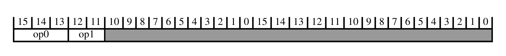

下表给出解码字段取值与所关联的子分组：

| op0 | op1 | 子分组 |
| --- | --- | --- |
| != 111 | - | 16 位 T32 指令编码 |
| 111 | != 00 | 32 位 T32 指令编码 |

下表给出解码字段取值与所关联的指令：

| op0 | op1 | 指令 |
| --- | --- | --- |
| 111 | 00 | B T2 |

## 2. 16 位 T32 指令编码

本节描述 16 位 T32 指令编码的编码方式。本节由**顶层 T32 指令集编码**解码。

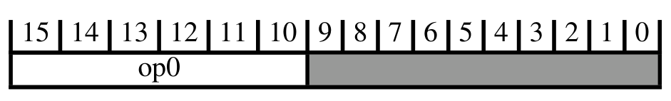

下表给出解码字段取值与所关联的子分组：

| op0 | 子分组 |
| --- | --- |
| 00xxxx | （立即数）移位、加、减、移动与比较 |
| 010000 | 数据处理（两个低寄存器） |
| 010001 | 特殊数据指令以及分支与交换 |
| 0101xx | 加载/存储（寄存器偏移） |
| 011xxx | 加载/存储字/字节（立即数偏移） |
| 1000xx | 加载/存储半字（立即数偏移） |
| 1001xx | 加载/存储（SP 相对） |
| 1010xx | 加 PC/SP（立即数） |
| 1011xx | 杂项 16 位指令 |
| 1100xx | 加载/存储多寄存器 |
| 1101xx | 条件分支与超级用户调用 |

下表给出解码字段取值与所关联的指令：

| op0 | 指令 |
| --- | --- |
| 01001x | LDR (literal) T1 |

### 2.1. （立即数）移位、加、减、移动与比较
本节描述**（立即数）移位、加、减、移动与比较**的编码方式。本节由 **16 位 T32 指令编码**解码。

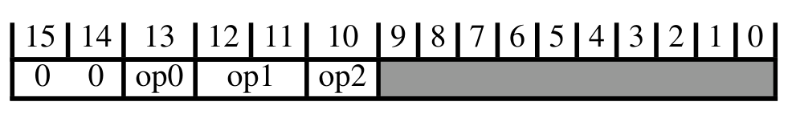

下表给出解码字段取值与所关联的子分组：

| op0 | op1 | op2 | 子分组 |
| --- | --- | --- | --- |
| 0 | 11 | 0 | 加、减（三个低寄存器） |
| 0 | 11 | 1 | 加、减（两个低寄存器与立即数） |
| 1 | - | - | 加、减、比较、移动（一个低寄存器与立即数） |

下表给出解码字段取值与所关联的指令：

| op0 | op1 | op2 | 指令 | 别名 |
| --- | --- | --- | --- | --- |
| Alias |  |  | ASRS (immediate) T2 | ASR (immediate) T2 |
|  |  |  | LSLS (immediate) T2 | LSL (immediate) T2 |
|  |  |  | LSRS (immediate) T2 | LSR (immediate) T2 |
| 0 | != 11 | - | MOV (register) T2 |  |

#### 2.1.1. 加、减（三个低寄存器）
本节描述**加、减（三个低寄存器）**的编码方式。本节由**（立即数）移位、加、减、移动与比较**解码。

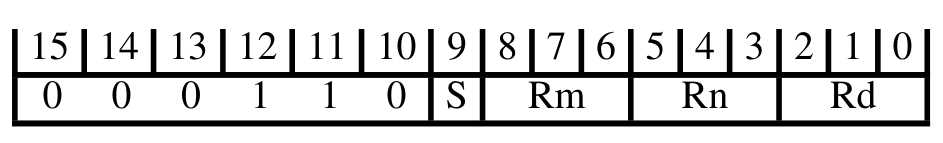

下表给出解码字段取值与所关联的指令：

| S | 指令 |
| --- | --- |
| 0 | ADD (register) T1 |
| 1 | SUB (register) T1 |

#### 2.1.2. 加、减（两个低寄存器与立即数）
本节描述**加、减（两个低寄存器与立即数）**的编码方式。本节由**（立即数）移位、加、减、移动与比较**解码。

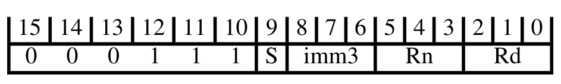

下表给出解码字段取值与所关联的指令：

| S | 指令 |
| --- | --- |
| 0 | ADD (immediate) T1 |
| 1 | SUB (immediate) T1 |

#### 2.1.3. 加、减、比较、移动（一个低寄存器与立即数）
本节描述**加、减、比较、移动（一个低寄存器与立即数）**的编码方式。本节由**（立即数）移位、加、减、移动与比较**解码。

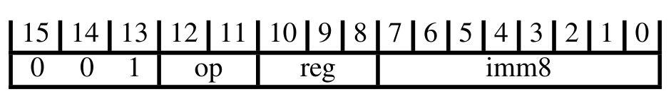

下表给出解码字段取值与所关联的指令：

| op | 指令 |
| --- | --- |
| 00 | MOV (immediate) T1 |
| 01 | CMP (immediate) T1 |
| 10 | ADD (immediate) T2 |
| 11 | SUB (immediate) T2 |

### 2.2. 数据处理（两个低寄存器）
本节描述**数据处理（两个低寄存器）**的编码方式。本节由 **16 位 T32 指令编码**解码。

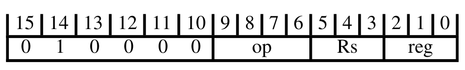

下表给出解码字段取值与所关联的指令：

| op | 指令 |
| --- | --- |
| 0000 | AND (register) T1 |
| 0001 | EOR (register) T1 |
| Alias | LSL (register) T1 |
| Alias | LSLS (register) T1 |
| Alias | LSR (register) T1 |
| Alias | LSRS (register) T1 |
| Alias | ASR (register) T1 |
| Alias | ASRS (register) T1 |
| 0101 | ADC (register) T1 |
| 0110 | SBC (register) T1 |
| Alias | ROR (register) T1 |
| Alias | RORS (register) T1 |
| 1000 | TST (register) T1 |
| 1001 | RSB (immediate) T1 |
| 1010 | CMP (register) T1 |
| 1011 | CMN (register) T1 |
| 1100 | ORR (register) T1 |
| 1101 | MUL T1 |
| 1110 | BIC (register) T1 |
| 1111 | MVN (register) T1 |
| 0010 |  |
| 0011 |  |
| 0100 |  |
| 0111 |  |

### 2.3. 特殊数据指令以及分支与交换
本节描述**特殊数据指令以及分支与交换**的编码方式。本节由 **16 位 T32 指令编码**解码。

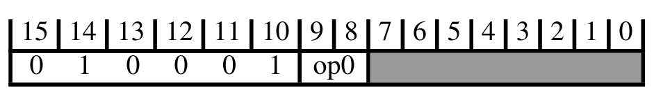

下表给出解码字段取值与所关联的子分组：

| op0 | 子分组 |
| --- | --- |
| 11 | 分支与交换 |
| != 11 | 加、减、比较、移动（两个高寄存器） |

#### 2.3.1. 分支与交换
本节描述**分支与交换**的编码方式。本节由**特殊数据指令以及分支与交换**解码。

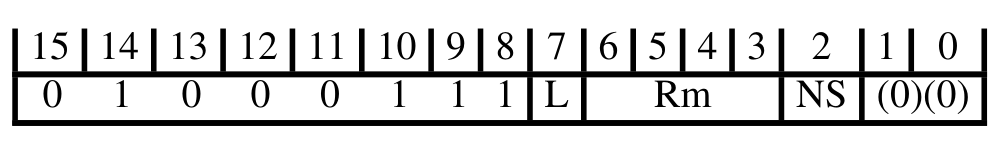

下表给出解码字段取值与所关联的指令：

| L | 指令 |
| --- | --- |
| 0 | BX, BXNS T1 |
| 1 | BLX, BLXNS T1 |

#### 2.3.2. 加、减、比较、移动（两个高寄存器）
本节描述**加、减、比较、移动（两个高寄存器）**的编码方式。本节由**特殊数据指令以及分支与交换**解码。

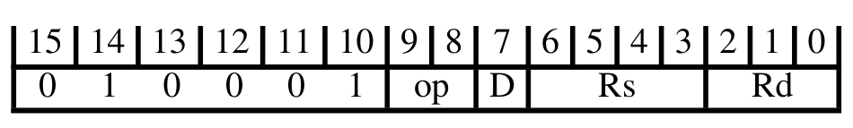

下表给出解码字段取值与所关联的指令：

| D:Rd | Rs | op | 指令 |
| --- | --- | --- | --- |
| != 1101 | != 1101 | 00 | ADD (register) T2 |
| - | 1101 | 00 | ADD (SP plus register) T1 |
| 1101 | != 1101 | 00 | ADD (SP plus register) T2 |
| - | - | 01 | CMP (register) T2 |
| - | - | 10 | MOV (register) T1 |

### 2.4. 加载/存储（寄存器偏移）
本节描述**加载/存储（寄存器偏移）**的编码方式。本节由 **16 位 T32 指令编码**解码。

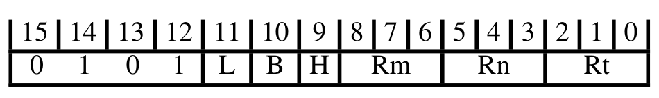

下表给出解码字段取值与所关联的指令：

| B | H | L | 指令 |
| --- | --- | --- | --- |
| 0 | 0 | 0 | STR (register) T1 |
| 0 | 1 | 0 | STRH (register) T1 |
| 1 | 0 | 0 | STRB (register) T1 |
| 1 | 1 | 0 | LDRSB (register) T1 |
| 0 | 0 | 1 | LDR (register) T1 |
| 0 | 1 | 1 | LDRH (register) T1 |
| 1 | 0 | 1 | LDRB (register) T1 |
| 1 | 1 | 1 | LDRSH (register) T1 |

### 2.5. 加载/存储字/字节（立即数偏移）
本节描述**加载/存储字/字节（立即数偏移）**的编码方式。本节由 **16 位 T32 指令编码**解码。

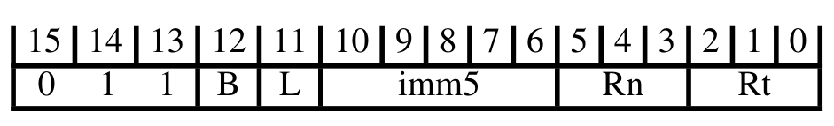

下表给出解码字段取值与所关联的指令：

| B | L | 指令 |
| --- | --- | --- |
| 0 | 0 | STR (immediate) T1 |
| 0 | 1 | LDR (immediate) T1 |
| 1 | 0 | STRB (immediate) T1 |
| 1 | 1 | LDRB (immediate) T1 |

### 2.6. 加载/存储半字（立即数偏移）
本节描述**加载/存储半字（立即数偏移）**的编码方式。本节由 **16 位 T32 指令编码**解码。

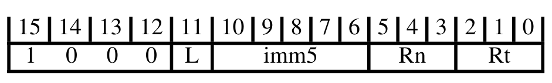

下表给出解码字段取值与所关联的指令：

| L | 指令 |
| --- | --- |
| 0 | STRH (immediate) T1 |
| 1 | LDRH (immediate) T1 |

### 2.7. 加载/存储（SP 相对）
本节描述**加载/存储（SP 相对）**的编码方式。本节由 **16 位 T32 指令编码**解码。

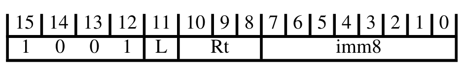

下表给出解码字段取值与所关联的指令：

| L | 指令 |
| --- | --- |
| 0 | STR (immediate) T2 |
| 1 | LDR (immediate) T2 |

### 2.8. 加 PC/SP（立即数）
本节描述**加 PC/SP（立即数）**的编码方式。本节由 **16 位 T32 指令编码**解码。

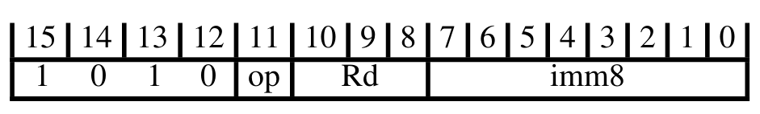

下表给出解码字段取值与所关联的指令：

| op | 指令 |
| --- | --- |
| Alias | ADD (immediate, to PC) T1 |
| 0 | ADR T1 |
| 1 | ADD (SP plus immediate) T1 |

### 2.9. 杂项 16 位指令
本节描述**杂项 16 位指令**的编码方式。本节由 **16 位 T32 指令编码**解码。

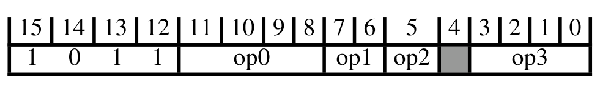

下表给出解码字段取值与所关联的子分组：

| op0 | op1 | op2 | op3 | 子分组 |
| --- | --- | --- | --- | --- |
| 0000 | - | - | - | 调整 SP（立即数） |
| 0010 | - | - | - | 扩展 |
| 1010 | != 10 | - | - | 反转字节 |
| 1111 | - | - | 0000 | 提示 |
| x10x | - | - | - | 压栈与出栈 |

下表给出解码字段取值与所关联的指令：

| op0 | op1 | op2 | op3 | 指令 |
| --- | --- | --- | --- | --- |
| 0110 | 01 | 1 | - | CPS T1 |
| 1110 | - | - | - | BKPT T1 |
| 1111 | - | - | != 0000 | IT T1 |
| x0x1 | - | - | - | CBNZ, CBZ T1 |

#### 2.9.1. 调整 SP（立即数）
本节描述**调整 SP（立即数）**的编码方式。本节由**杂项 16 位指令**解码。

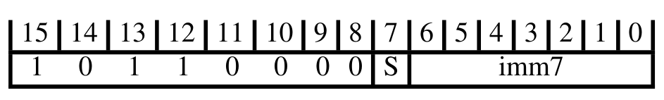

下表给出解码字段取值与所关联的指令：

| S | 指令 |
| --- | --- |
| 0 | ADD (SP plus immediate) T2 |
| 1 | SUB (SP minus immediate) T1 |

#### 2.9.2. 扩展
本节描述**扩展**的编码方式。本节由**杂项 16 位指令**解码。

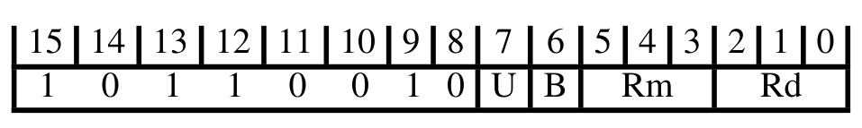

下表给出解码字段取值与所关联的指令：

| B | U | 指令 |
| --- | --- | --- |
| 0 | 0 | SXTH T1 |
| 1 | 0 | SXTB T1 |
| 0 | 1 | UXTH T1 |
| 1 | 1 | UXTB T1 |

#### 2.9.3. 反转字节
本节描述**反转字节**的编码方式。本节由**杂项 16 位指令**解码。

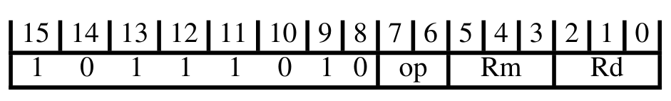

下表给出解码字段取值与所关联的指令：

| op | 指令 |
| --- | --- |
| 00 | REV T1 |
| 01 | REV16 T1 |
| 11 | REVSH T1 |

#### 2.9.4. 提示
本节描述**提示**的编码方式。本节由**杂项 16 位指令**解码。

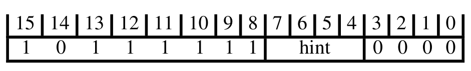

下表给出解码字段取值与所关联的指令：

| hint | 指令 |
| --- | --- |
| 0000 | NOP T1 |
| 0001 | YIELD T1 |
| 0010 | WFE T1 |
| 0011 | WFI T1 |
| 0100 | SEV T1 |
| 0101 | 保留提示，表现为 NOP |
| 011x | 保留提示，表现为 NOP |
| 1xxx | 保留提示，表现为 NOP |

#### 2.9.5. 压栈与出栈
本节描述**压栈与出栈**的编码方式。本节由**杂项 16 位指令**解码。

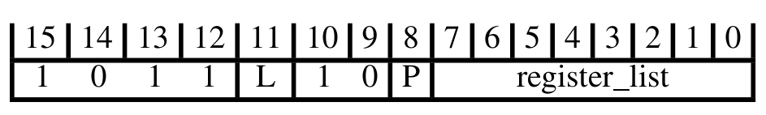

下表给出解码字段取值与所关联的指令：

| L | 指令 |
| --- | --- |
| 1 | LDM, LDMIA, LDMFD T3 |
| Alias | POP (multiple registers) T3 |
| Alias | PUSH (multiple registers) T2 |
| 0 | STMDB, STMFD T2 |

### 2.10. 加载/存储多寄存器
本节描述**加载/存储多寄存器**的编码方式。本节由 **16 位 T32 指令编码**解码。


下表给出解码字段取值与所关联的指令：

| L | 指令 |
| --- | --- |
| 1 | LDM, LDMIA, LDMFD T1 |
| 0 | STM, STMIA, STMEA T1 |

### 2.11. 条件分支与超级用户调用
本节描述**条件分支与超级用户调用**的编码方式。本节由 **16 位 T32 指令编码**解码。

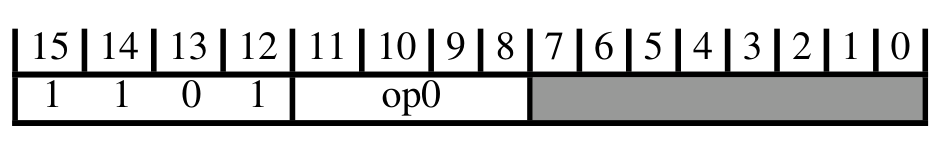

下表给出解码字段取值与所关联的子分组：

| op0 | 子分组 |
| --- | --- |
| 111x | 异常生成 |

下表给出解码字段取值与所关联的指令：

| op0 | 指令 |
| --- | --- |
| != 111x | B T1 |

#### 2.11.1. 异常生成
本节描述**异常生成**的编码方式。本节由**条件分支与超级用户调用**解码。


下表给出解码字段取值与所关联的指令：

| S | imm8 | 指令 |
| --- | --- | --- |
| 0 | - | UDF T1 |
| 1 | - | SVC T1 |

## 3. 32 位 T32 指令编码

本节描述 **32 位 T32 指令编码**的编码方式。本节由**顶层 T32 指令集编码**解码。

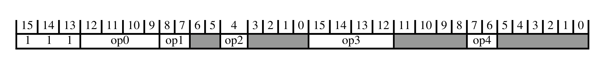

下表给出解码字段取值与所关联的子分组：

| op0 | op1 | op1:op2 | op2 | op3 | op4 | 子分组 |
| --- | --- | --- | --- | --- | --- | --- |
| x11x | - | - | - | - | - | 协处理器、浮点与向量指令 |
| 0100 | - | - | - | - | - | 加载/存储（多寄存器、双字、独占、获取-释放） |
| 0101 | - | - | - | - | - | 数据处理（移位寄存器） |
| 10xx | - | - | - | 1xxx | - | 分支与杂项控制 |
| 10x0 | - | - | - | 0xxx | - | 数据处理（修改立即数） |
| 10x1 | - | - | 0 | 0xxx | - | 数据处理（纯二进制立即数） |
| 1100 | - | != 1x0 | - | - | - | 加载/存储单个 |
| 1101 | 0x | - | - | 1111 | - | 数据处理（寄存器） |
| 1101 | 10 | - | - | - | 00 | 乘法、乘加与绝对差 |
| 1101 | 11 | - | - | - | - | 长乘法与除法 |

### 3.1. 协处理器、浮点与向量指令

本节描述**协处理器、浮点与向量指令**的编码方式。本节由 **32 位 T32 指令编码**解码。

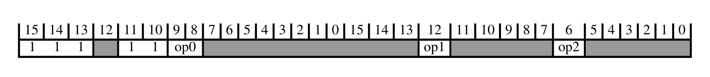

下表给出解码字段取值与所关联的子分组：

| op0 | op1 | op2 | 子分组 |
| --- | --- | --- | --- |
| 10 | - | - | 浮点与向量杂项指令 |
| 0x | - | - | 浮点与向量加载/存储、移动与协处理器指令 |
| 11 | 0 | 1 | 杂项向量算术指令 |

#### 3.1.1. 浮点与向量杂项指令

本节描述**浮点与向量杂项指令**的编码方式。本节由**协处理器、浮点与向量指令**解码。

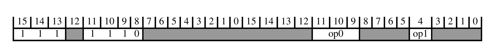

下表给出解码字段取值与所关联的子分组：

| op0 | op1 | 子分组 |
| --- | --- | --- |
| 0xx | - | 协处理器数据处理指令 |
| 100 | 1 | 向量移动指令 |
| 10x | 0 | 浮点数据处理、minNum/maxNum 与转换 |
| 101 | 1 | 浮点与向量移动（寄存器） |
| 110 | - | 架构定义的协处理器数据处理指令 |
| 111 | 0 | 向量立即数与寄存器，以及协处理器数据处理指令 |

##### 3.1.1.1. 协处理器数据处理指令

本节描述**协处理器数据处理指令**的编码方式。本节由**浮点与向量杂项指令**解码。

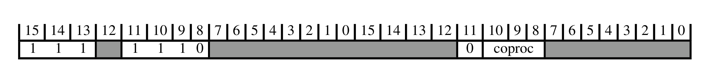

下表给出解码字段取值与所关联的子分组：

| CoprocType(UInt(coproc)) | 子分组 |
| --- | --- |
| CP_GCP | 架构定义的协处理器数据处理指令 |
| CP_CDEv1 | 自定义通用寄存器指令 |

###### 架构定义的协处理器数据处理指令

本节描述**架构定义的协处理器数据处理指令**的编码方式。本节由**协处理器数据处理指令**解码。

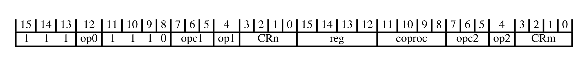

下表给出解码字段取值与所关联的指令：

| op0 | op1 | op2 | 指令 |
| --- | --- | --- | --- |
| 0 | - | 0 | CDP, CDP2 T1 |
| 1 | - | 0 | CDP, CDP2 T2 |
| 0 | 0 | 1 | MCR, MCR2 T1 |
| 1 | 0 | 1 | MCR, MCR2 T2 |
| 0 | 1 | 1 | MRC, MRC2 T1 |
| 1 | 1 | 1 | MRC, MRC2 T2 |

###### 自定义通用寄存器指令

本节描述**自定义通用寄存器指令**的编码方式。本节由**协处理器数据处理指令**解码。

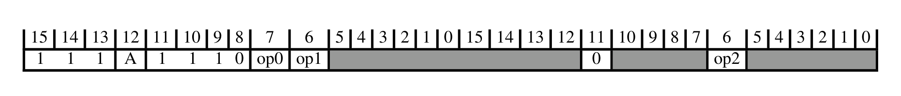

下表给出解码字段取值与所关联的指令：

| op0 | op1 | op2 | 指令 |
| --- | --- | --- | --- |
| 0 | 0 | 0 | CX1 T1 |
| 0 | 0 | 1 | CX1D T1 |
| 0 | 1 | 0 | CX2 T1 |
| 0 | 1 | 1 | CX2D T1 |
| 1 | - | 0 | CX3 T1 |
| 1 | - | 1 | CX3D T1 |

##### 3.1.1.2. 向量移动指令

本节描述**向量移动指令**的编码方式。本节由**浮点与向量杂项指令**解码。

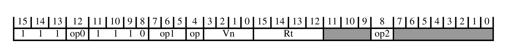

下表给出解码字段取值与所关联的指令：

| op0 | op1 | op2 | 指令 |
| --- | --- | --- | --- |
| 0 | 000 | 1 | VMOV (between general-purpose register and half-precision register) T1 |

##### 3.1.1.3. 浮点数据处理、minNum/maxNum 与转换

本节描述**浮点数据处理、minNum/maxNum 与转换**的编码方式。本节由**浮点与向量杂项指令**解码。

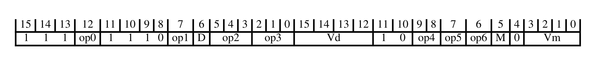

下表给出解码字段取值与所关联的指令：

| op0 | op1 | op2 | op3 | op4 | op5 | op6 | 指令 |
| --- | --- | --- | --- | --- | --- | --- | --- |
| 1 | 1 | 00x | - | - | - | 1 | VMINNM T2 |
| 1 | 1 | 111 | 110 | - | - | 1 | VCVTP T1 |
| 0 | 1 | 00x | - | - | - | 0 | VDIV T1 |
| 0 | 0 | 11x | - | - | - | 0 | VADD T2 |
| 0 | 0 | 01x | - | - | - | 0 | VNMLS T1 |
| 1 | 1 | 111 | 010 | - | 0 | 1 | VRINTP T1 |
| 0 | 1 | 110 | 000 | 1x | 0 | 1 | VMOV (register) T2 |
| 0 | 1 | 111 | 000 | - | - | 1 | VCVT (integer to floating-point) T1 |
| 0 | 1 | 10x | - | - | - | 1 | VFMS T2 |
| 0 | 1 | 01x | - | - | - | 0 | VFNMS T1 |
| 0 | 1 | 110 | 100 | - | 1 | 1 | VCMPE T1 |
| 0 | 1 | 110 | 101 | - | 1 | 1 | VCMPE T2 |
| 0 | 1 | 110 | 01x | 1x | 1 | 1 | VCVTT T1 |
| 1 | 1 | 111 | 011 | - | 0 | 1 | VRINTM T1 |
| 1 | 1 | 111 | 000 | - | 0 | 1 | VRINTA T1 |
| 0 | 1 | 110 | 001 | - | 0 | 1 | VNEG T2 |
| 0 | 1 | 110 | 111 | - | 0 | 1 | VRINTX T1 |
| 1 | 1 | 111 | 111 | - | - | 1 | VCVTM T1 |
| 0 | 1 | 110 | 01x | 1x | 0 | 1 | VCVTB T1 |
| 1 | 1 | 00x | - | - | - | 0 | VMAXNM T2 |
| 0 | 0 | 00x | - | - | - | 0 | VMLA T2 |
| 0 | 0 | 00x | - | - | - | 1 | VMLS T2 |
| 0 | 1 | 111 | 10x | - | 1 | 1 | VCVT (floating-point to integer) T1 |
| 0 | 1 | 01x | - | - | - | 1 | VFNMA T1 |
| 0 | 1 | 10x | - | - | - | 0 | VFMA T2 |
| 0 | 1 | 110 | 000 | - | 1 | 1 | VABS T2 |
| 0 | 1 | 110 | 110 | - | 0 | 1 | VRINTR T1 |
| 0 | 1 | 11x | - | - | - | 0 | VMOV (immediate) T2 |
| 0 | 1 | 110 | 100 | - | 0 | 1 | VCMP T1 |
| 1 | 1 | 110 | 000 | 10 | 0 | 1 | VMOVX T1 |
| 0 | 1 | 110 | 101 | - | 0 | 1 | VCMP T2 |
| 0 | 1 | 110 | 111 | 1x | 1 | 1 | VCVT (between double-precision and single-precision) T1 |
| 0 | 1 | 111 | x1x | - | - | 1 | VCVT (between floating-point and fixed-point) T1 |
| 1 | 1 | 110 | 000 | 10 | 1 | 1 | VINS T1 |
| 1 | 1 | 111 | 001 | - | 0 | 1 | VRINTN T1 |
| 1 | 0 | - | - | - | - | 0 | VSEL T1 |
| 0 | 0 | 01x | - | - | - | 1 | VNMLA T1 |
| 0 | 1 | 110 | 110 | - | 1 | 1 | VRINTZ T1 |
| 1 | 1 | 111 | 101 | - | - | 1 | VCVTN T1 |
| 0 | 0 | 10x | - | - | - | 0 | VMUL T2 |
| 1 | 1 | 111 | 100 | - | - | 1 | VCVTA T1 |
| 0 | 1 | 110 | 001 | - | 1 | 1 | VSQRT T1 |
| 0 | 1 | 111 | 10x | - | 0 | 1 | VCVTR T1 |
| 0 | 0 | 10x | - | - | - | 1 | VNMUL T2 |
| 0 | 0 | 11x | - | - | - | 1 | VSUB T2 |

##### 3.1.1.4. 浮点与向量移动（寄存器）

本节描述**浮点与向量移动（寄存器）**的编码方式。本节由**浮点与向量杂项指令**解码。

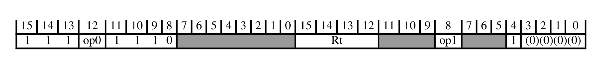

下表给出解码字段取值与所关联的子分组：

| op0 | op1 | 子分组 |
| --- | --- | --- |
| 0 | 1 M | 浮点寄存器与向量寄存器之间的移动 |
| 0 | 0 M | 通用寄存器与浮点特殊寄存器之间的移动 |

###### 浮点寄存器与向量寄存器之间的移动

本节描述**浮点寄存器与向量寄存器之间的移动**的编码方式。本节由**浮点与向量移动（寄存器）**解码。

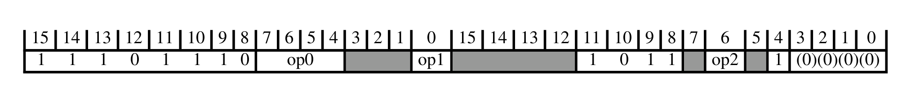

下表给出解码字段取值与所关联的指令：

| op0 | op1 | op2 | 指令 |
| --- | --- | --- | --- |
| 1x10 | 0 | 0 | VDUP T1 |
| 0xx0 | - | - | VMOV (general-purpose register to vector lane) T1 |
| xxx1 | - | - | VMOV (vector lane to general-purpose register) T1 |
| Alias |  |  | VMOV (single general-purpose register to half of doubleword register) T1 |
| Alias |  |  | VMOV (half of doubleword register to single general-purpose register) T1 |

###### 通用寄存器与浮点特殊寄存器之间的移动

本节描述**通用寄存器与浮点特殊寄存器之间的移动**的编码方式。本节由**浮点与向量移动（寄存器）**解码。

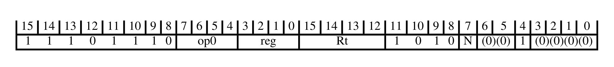

下表给出解码字段取值与所关联的指令：

| op0 | 指令 |
| --- | --- |
| 000x | VMOV (between general-purpose register and single-precision register) T1 |
| 1111 | VMRS T1 |
| 1110 | VMSR T1 |

##### 3.1.1.5. 架构定义的协处理器数据处理指令

本节描述**架构定义的协处理器数据处理指令**的编码方式。本节由**浮点与向量杂项指令**解码。


下表给出解码字段取值与所关联的指令：

| op0 | op1 | op2 | 指令 |
| --- | --- | --- | --- |
| 0 | - | 0 | CDP, CDP2 T1 |
| 1 | - | 0 | CDP, CDP2 T2 |
| 0 | 0 | 1 | MCR, MCR2 T1 |
| 1 | 0 | 1 | MCR, MCR2 T2 |
| 0 | 1 | 1 | MRC, MRC2 T1 |
| 1 | 1 | 1 | MRC, MRC2 T2 |

##### 3.1.1.6. 向量立即数与寄存器，以及协处理器数据处理指令

本节描述**向量立即数与寄存器，以及协处理器数据处理指令**的编码方式。本节由**浮点与向量杂项指令**解码。

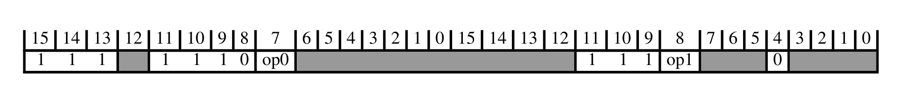

下表给出解码字段取值与所关联的子分组：

| op0 | op1 | 子分组 |
| --- | --- | --- |
| 0 | 0 | 杂项向量寄存器指令 |
| 1 | 0 | 杂项向量寄存器与立即数指令 |
| 0 | 1 | 向量寄存器、立即数与谓词化指令 |
| 1 | 1 | 向量算术、最小值、最大值与移位指令 |

###### 杂项向量寄存器指令

本节描述**杂项向量寄存器指令**的编码方式。本节由**向量立即数与寄存器，以及协处理器数据处理指令**解码。

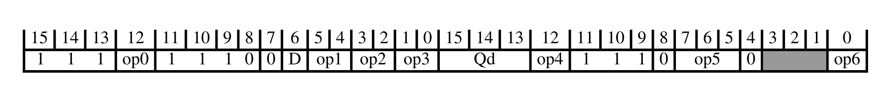

下表给出解码字段取值与所关联的指令：

| op0 | op1 | op2 | op3 | op4 | op5 | op6 | 指令 |
| --- | --- | --- | --- | --- | --- | --- | --- |
| 0 | 11 | != 11 | 01 | - | 10x | 1 | VQMOVUN T1 |
| - | != 11 | - | x1 | 1 | x10 | - | VMLAS (vector by vector plus scalar) T1 |
| - | 11 | != 11 | 11 | 1 | 10x | 1 | VMIN, VMINA T2 |
| 1 | != 11 | - | x0 | - | x0x | 0 | VQDMLSDH, VQRDMLSDH T1 |
| - | 11 | != 11 | 01 | 1 | 111 | - | VQSHL, VQSHLU T1 |
| - | 11 | 11 | 11 | 1 | 10x | 1 | VMINNM, VMINNMA (floating-point) T2 |
| - | 11 | != 11 | 11 | 0 | 10x | 1 | VMAX, VMAXA T2 |
| - | 11 | - | x1 | - | x0x | 0 | VMULL (polynomial) T1 |
| 1 | 11 | != 11 | 01 | - | 10x | 1 | VMOVN T1 |
| - | != 11 | - | x1 | 0 | x0x | 1 | VMULH, VRMULH T1 |
| - | != 11 | - | x1 | 1 | x0x | 1 | VMULH, VRMULH T2 |
| 0 | != 11 | - | x1 | 1 | x11 | - | VMUL (vector) T2 |
| - | != 11 | - | x0 | 0 | x11 | - | VQDMLAH, VQRDMLAH (vector by scalar plus vector) T1 |
| - | != 11 | - | x0 | 0 | x10 | - | VQDMLAH, VQRDMLAH (vector by scalar plus vector) T2 |
| - | 11 | - | x1 | 0 | x10 | - | VFMA (vector by scalar plus vector, floating-point) T1 |
| 0 | != 11 | - | x0 | - | x0x | 1 | VQDMLADH, VQRDMLADH T2 |
| - | 11 | - | x1 | 0 | x11 | - | VMUL (floating-point) T2 |
| - | 11 | - | x1 | 1 | x10 | - | VFMAS (vector by vector plus scalar, floating-point) T1 |
| 0 | != 11 | - | x1 | 0 | x11 | - | VQDMULH, VQRDMULH T3 |
| - | 11 | - | x0 | - | x0x | - | VCMUL (floating-point) T1 |
| 0 | != 11 | - | x0 | - | x0x | 0 | VQDMLADH, VQRDMLADH T1 |
| 1 | != 11 | - | x1 | 0 | x11 | - | VQDMULH, VQRDMULH T4 |
| 1 | != 11 | - | x0 | - | x0x | 1 | VQDMLSDH, VQRDMLSDH T2 |
| - | != 11 | - | x0 | 1 | x11 | - | VQDMLASH, VQRDMLASH (vector by vector plus scalar) T1 |
| - | != 11 | - | x0 | 1 | x10 | - | VQDMLASH, VQRDMLASH (vector by vector plus scalar) T2 |
| - | 11 | != 11 | 01 | - | 00x | 1 | VSHLL T2 |
| - | 11 | != 11 | 11 | 1 | 011 | - | VRSHL T2 |
| - | 11 | != 11 | 01 | 1 | 011 | - | VSHL T2 |
| - | 11 | 11 | 11 | - | 00x | 1 | VCVT (between single and half-precision floating-point) T1 |
| - | 11 | != 11 | 11 | - | 00x | 1 | VQMOVN T1 |
| - | != 11 | - | x1 | - | x0x | 0 | VMULL (integer) T1 |
| 1 | != 11 | - | x1 | 1 | x11 | - | VBRSR T1 |
| - | 11 | 11 | 11 | 0 | 10x | 1 | VMAXNM, VMAXNMA (floating-point) T2 |
| - | 11 | != 11 | 11 | 1 | 111 | - | VQRSHL T2 |
| - | != 11 | - | x1 | 0 | x10 | - | VMLA (vector by scalar plus vector) T1 |

###### 杂项向量寄存器与立即数指令

本节描述**杂项向量寄存器与立即数指令**的编码方式。本节由**向量立即数与寄存器，以及协处理器数据处理指令**解码。

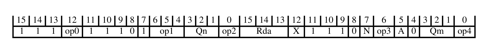

下表给出解码字段取值与所关联的指令：

| op0 | op1 | op2 | op3 | op4 | 指令 |
| --- | --- | --- | --- | --- | --- |
| - | 111 | - | 0 | 0 | VMLADAV T1 |
| Alias |  |  |  |  | VMLAV T1 |
| Alias |  |  |  |  | VMLALV T1 |
| - | != 111 | - | 0 | 0 | VMLALDAV T1 |
| 0 | != 111 | - | 0 | 1 | VMLSLDAV T1 |
| 0 | 111 | - | 0 | 1 | VMLSDAV T1 |
| 1 | 111 | 0 | 0 | 1 | VMLSDAV T2 |
| 1 | != 111 | 0 | 0 | 1 | VRMLSLDAVH T1 |

###### 向量寄存器、立即数与谓词化指令

本节描述**向量寄存器、立即数与谓词化指令**的编码方式。本节由**向量立即数与寄存器，以及协处理器数据处理指令**解码。

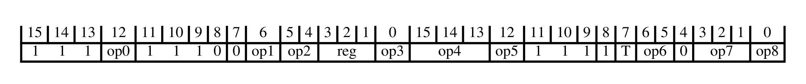

下表给出解码字段取值与所关联的指令：

| op0 | op1:op4 | op2 | op3:op4:op5 | op5:op8 | op6 | op7 | op7:op8 | op8 | 指令 |
| --- | --- | --- | --- | --- | --- | --- | --- | --- | --- |
| 0 | - | != 11 | 1xxx0 | - | 11 | 111 | - | - | VIDUP, VIWDUP T2 |
| 0 | - | != 11 | 1xxx0 | - | 11 | != 111 | - | - | VIDUP, VIWDUP T1 |
| - | - | 11 | 0xxxx | - | 0x | - | - | 1 | VQDMULL T1 |
| - | - | != 11 | 0xxx0 | - | 11 | - | - | - | VQADD T2 |
| - | - | 11 | 0xxx0 | - | 10 | - | - | - | VADD (floating-point) T2 |
| 0 | - | != 11 | 1xxx1 | - | 10 | - | - | - | VSUB (vector) T2 |
| 0 | - | != 11 | 1xxx0 | - | 10 | - | - | - | VADD (vector) T2 |
| 0 | - | != 11 | 0xxxx | - | 0x | - | - | 0 | VHCADD T1 |
| 0 | - | != 11 | 1xxx1 | - | 11 | 111 | - | - | VDDUP, VDWDUP T2 |
| 0 | - | != 11 | 1xxx1 | - | 11 | != 111 | - | - | VDDUP, VDWDUP T1 |
| 1 | - | != 11 | 0xxxx | - | 0x | - | - | 0 | VCADD T1 |
| - | - | != 11 | 0xxx0 | - | 10 | - | - | - | VHADD T2 |
| - | - | 11 | 0xxx1 | - | 10 | - | - | - | VSUB (floating-point) T2 |
| - | - | != 11 | 0xxx1 | - | 10 | - | - | - | VHSUB T2 |
| 1 | - | 11 | 1xxx0 | 01 | 0x | - | - | - | VPSEL T1 |
| 1 | 0000 | 11 | 1xxxx | - | 1x | - | 1101 | - | VPNOT T1 |
| 1 | 0000 | != 11 | 10000 | - | 0x | - | - | 0 | VCMP (vector) T1 |
| 1 | 0000 | != 11 | 10000 | - | 0x | - | - | 1 | VCMP (vector) T2 |
| 1 | 0000 | != 11 | 10001 | - | 0x | - | - | - | VCMP (vector) T3 |
| 1 | 0000 | != 11 | 10000 | - | 10 | - | - | - | VCMP (vector) T4 |
| 1 | 0000 | != 11 | 10000 | - | 11 | - | - | - | VCMP (vector) T5 |
| 1 | 0000 | != 11 | 10001 | - | 1x | - | - | - | VCMP (vector) T6 |
| - | 0000 | 11 | 1000x | - | 1x | - | != 1101 | - | VCMP (floating-point) T2 |
| - | 0000 | 11 | 1000x | != 01 | 0x | - | - | - | VCMP (floating-point) T1 |
| 1 | != 0000 | 11 | 1xxxx | - | 1x | - | 1101 | - | VPST T1 |
| 1 | != 0000 | != 11 | 1xxx0 | - | 0x | - | - | 0 | VPT T1 |
| 1 | != 0000 | != 11 | 1xxx0 | - | 0x | - | - | 1 | VPT T2 |
| 1 | != 0000 | != 11 | 1xxx1 | - | 0x | - | - | - | VPT T3 |
| 1 | != 0000 | != 11 | 1xxx0 | - | 10 | - | - | - | VPT T4 |
| 1 | != 0000 | != 11 | 1xxx0 | - | 11 | - | - | - | VPT T5 |
| 1 | != 0000 | != 11 | 1xxx1 | - | 1x | - | - | - | VPT T6 |
| - | != 0000 | 11 | 1xxxx | - | 1x | - | != 1101 | - | VPT (floating-point) T2 |
| - | != 0000 | 11 | 1xxxx | != 01 | 0x | - | - | - | VPT (floating-point) T1 |
| 0 | - | 11 | 0xxxx | - | 0x | - | - | 0 | VADC T1 |
| - | - | != 11 | 0xxx1 | - | 11 | - | - | - | VQSUB T2 |
| - | - | 11 | 0xxxx | - | 11 | - | - | - | VQDMULL T2 |
| 1 | - | 11 | 0xxxx | - | 0x | - | - | 0 | VSBC T1 |

###### 向量算术、最小值、最大值与移位指令

本节描述**向量算术、最小值、最大值与移位指令**的编码方式。本节由**向量立即数与寄存器，以及协处理器数据处理指令**解码。

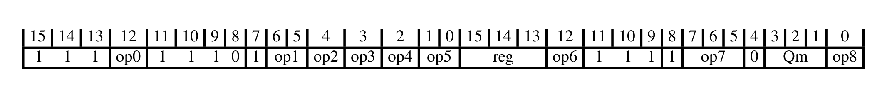

下表给出解码字段取值与所关联的指令：

| op0 | op1:op2 | op2:op3:op4:op5 | op3:op4 | op5 | op6 | op7 | op8 | 指令 |
| --- | --- | --- | --- | --- | --- | --- | --- | --- |
| - | 110 | - | != 11 | 00 | - | 10x | 0 | VMINV, VMINAV T2 |
| 0 | x0x | - | - | - | - | 11x | 1 | VSHRN T1 |
| - | 110 | - | != 11 | 10 | - | 10x | 0 | VMINV, VMINAV T1 |
| 1 | x0x | - | - | - | - | 11x | 0 | VQRSHRUN T1 |
| - | 110 | - | 11 | 10 | - | 10x | 0 | VMINNMV, VMINNMAV (floating-point) T1 |
| - | 111 | - | - | x0 | - | x0x | 0 | VMLADAV T2 |
| - | != 111 | - | - | 01 | - | 00x | 0 | VADDLV T1 |
| - | 111 | - | != 11 | 01 | - | 00x | 0 | VADDV T1 |
| - | 110 | - | 11 | 00 | - | 10x | 0 | VMINNMV, VMINNMAV (floating-point) T2 |
| 0 | x1x | - | - | - | 0 | 110 | - | VSHLC T1 |
| 0 | x0x | - | - | - | - | 11x | 0 | VQSHRUN T1 |
| - | x0x | - | - | - | - | 01x | 0 | VQSHRN T1 |
| 1 | x0x | - | - | - | - | 11x | 1 | VRSHRN T1 |
| - | 110 | - | 11 | 10 | - | 00x | 0 | VMAXNMV, VMAXNMAV (floating-point) T1 |
| - | 110 | - | != 11 | 00 | - | 00x | 0 | VMAXV, VMAXAV T2 |
| - | 110 | - | != 11 | 10 | - | 00x | 0 | VMAXV, VMAXAV T1 |
| - | 110 | - | 11 | 00 | - | 00x | 0 | VMAXNMV, VMAXNMAV (floating-point) T2 |
| - | != 11x | - | - | x0 | - | x0x | 0 | VRMLALDAVH T1 |
| Alias |  |  |  |  |  |  |  | VRMLALVH T1 |
| - | x0x | - | - | - | - | 01x | 1 | VQRSHRN T1 |
| - | 00x 010 | - | - | x0 | - | x0x | 1 | VABAV T1 |
| - | x1x | 00000 11000 xx001 xx01x xx1xx | - | - | - | 01x | 0 | VSHLL T1 |
| - | x1x | 01000 10000 | - | - | - | 01x | 0 | VMOVL T1 |

#### 3.1.2. 浮点与向量加载/存储、移动与协处理器指令

本节描述**浮点与向量加载/存储、移动与协处理器指令**的编码方式。本节由**协处理器、浮点与向量指令**解码。

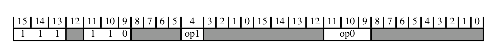

下表给出解码字段取值与所关联的子分组：

| op0 | op1 | 子分组 |
| --- | --- | --- |
| 0xx | - | 协处理器加载、存储与移动指令 |
| 100 | - | 浮点与向量加载/存储及复数算术指令 |
| 101 | - | 协处理器与浮点加载/存储、移动与安全 |
| 110 | - | 架构定义的协处理器加载、存储与移动指令 |
| 111 | 1 | 向量加载指令 |
| 111 | 0 | 向量存储指令 |

##### 3.1.2.1. 协处理器加载、存储与移动指令

本节描述**协处理器加载、存储与移动指令**的编码方式。本节由**浮点与向量加载/存储、移动与协处理器指令**解码。

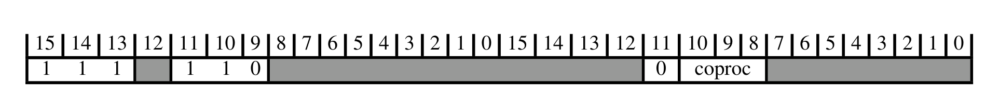

下表给出解码字段取值与所关联的子分组：

| CoprocType(UInt(coproc)) | 子分组 |
| --- | --- |
| CP_GCP | 架构定义的协处理器加载、存储与移动指令 |
| CP_CDEv1 | 自定义浮点与向量指令 |

###### 架构定义的协处理器加载、存储与移动指令

本节描述**架构定义的协处理器加载、存储与移动指令**的编码方式。本节由**协处理器加载、存储与移动指令**解码。


下表给出解码字段取值与所关联的指令：

| op0 | op1 | op2 | op3 | 指令 |
| --- | --- | --- | --- | --- |
| 0 | != 0010 | 1 | != 1111 | LDC, LDC2 (immediate) T1 |
| 1 | != 0010 | 1 | != 1111 | LDC, LDC2 (immediate) T2 |
| 0 | != 0010 | 1 | 1111 | LDC, LDC2 (literal) T1 |
| 1 | != 0010 | 1 | 1111 | LDC, LDC2 (literal) T2 |
| 0 | != 0010 | 0 | - | STC, STC2 T1 |
| 1 | != 0010 | 0 | - | STC, STC2 T2 |
| 0 | 0010 | 1 | - | MRRC, MRRC2 T1 |
| 1 | 0010 | 1 | - | MRRC, MRRC2 T2 |
| 0 | 0010 | 0 | - | MCRR, MCRR2 T1 |
| 1 | 0010 | 0 | - | MCRR, MCRR2 T2 |

###### 自定义浮点与向量指令

本节描述**自定义浮点与向量指令**的编码方式。本节由**协处理器加载、存储与移动指令**解码。

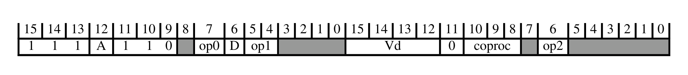

下表给出解码字段取值与所关联的指令：

| op0 | op1 | op2 | 指令 |
| --- | --- | --- | --- |
| 0 | 10 | 1 | VCX1 (vector) T1 |
| 0 | 10 | 0 | VCX1 T1 |
| 0 | 11 | 1 | VCX2 (vector) T1 |
| 0 | 11 | 0 | VCX2 T1 |
| 1 | - | 1 | VCX3 (vector) T1 |
| 1 | - | 0 | VCX3 T1 |

##### 3.1.2.2. 浮点与向量加载/存储及复数算术指令

本节描述**浮点与向量加载/存储及复数算术指令**的编码方式。本节由**浮点与向量加载/存储、移动与协处理器指令**解码。

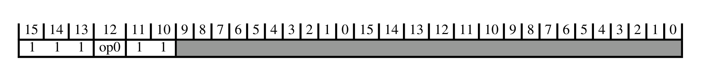

下表给出解码字段取值与所关联的子分组：

| op0 | 子分组 |
| --- | --- |
| 1 | 浮点与向量复数算术指令 |
| 0 | 浮点与向量加载/存储指令 |

###### 浮点与向量复数算术指令

本节描述**浮点与向量复数算术指令**的编码方式。本节由**浮点与向量加载/存储及复数算术指令**解码。

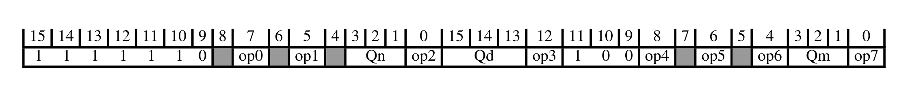

下表给出解码字段取值与所关联的指令：

| op0 | op1 | op2 | op3 | op4 | op5 | op6 | op7 | 指令 |
| --- | --- | --- | --- | --- | --- | --- | --- | --- |
| 1 | 0 | 0 | 0 | 0 | 1 | 0 | 0 | VCADD (floating-point) T1 |
| - | 1 | 0 | 0 | 0 | 1 | 0 | 0 | VCMLA (floating-point) T1 |

###### 浮点与向量加载/存储指令

本节描述**浮点与向量加载/存储指令**的编码方式。本节由**浮点与向量加载/存储及复数算术指令**解码。

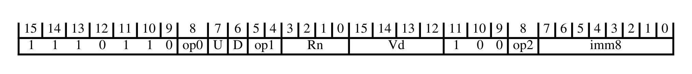

下表给出解码字段取值与所关联的指令：

| op0 | op1 | op2 | 指令 |
| --- | --- | --- | --- |
| 1 | 01 | 1 | VLDR T3 |
| 1 | 00 | 1 | VSTR T3 |

##### 3.1.2.3. 协处理器与浮点加载/存储、移动与安全

本节描述**协处理器与浮点加载/存储、移动与安全**的编码方式。本节由**浮点与向量加载/存储、移动与协处理器指令**解码。

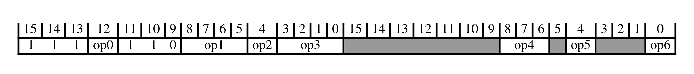

下表给出解码字段取值与所关联的指令：

| op0 | op1 | op1:op3 | op2 | op3 | op4 | op5 | op6 | 指令 |
| --- | --- | --- | --- | --- | --- | --- | --- | --- |
| 0 | 00x1 01xx 1xx1 | != 01x01111 | 1 | - | 1xx | - | 1 | FLDMDBX, FLDMIAX T1 |
| 0 | 00x1 01xx 1xx1 | != 01x01111 | 1 | - | 1xx | - | 0 | VLDM T1 |
| 0 | 01xx 1xx1 | != 01x01111 | 1 | - | 0xx | - | - | VLDM T2 |
| 0 | 1xx0 | - | 1 | - | 1xx | - | - | VLDR T1 |
| 0 | 1xx0 | - | 1 | - | 0xx | - | - | VLDR T2 |
| 0 | 00x1 | - | 1 | - | 00x | - | - | VLLDM T1 |
| 0 | 00x1 | - | 1 | - | 01x | - | - | VLLDM T2 |
| Alias |  |  |  |  |  |  |  | VPOP T1 |
| Alias |  |  |  |  |  |  |  | VPOP T2 |
| 0 | 00x1 01xx 1xx1 | - | 0 | - | 1xx | - | 1 | FSTMDBX, FSTMIAX T1 |
| 0 | 00x1 01xx 1xx1 | - | 0 | - | 1xx | - | 0 | VSTM T1 |
| 0 | 01xx 1xx1 | - | 0 | - | 0xx | - | - | VSTM T2 |
| 0 | 1xx0 | - | 0 | - | 1xx | - | - | VSTR T1 |
| 0 | 1xx0 | - | 0 | - | 0xx | - | - | VSTR T2 |
| 0 | 00x1 | - | 0 | - | 00x | - | - | VLSTM T1 |
| 0 | 00x1 | - | 0 | - | 01x | - | - | VLSTM T2 |
| Alias |  |  |  |  |  |  |  | VPUSH T1 |
| Alias |  |  |  |  |  |  |  | VPUSH T2 |
| 0 | 0010 | - | - | - | 100 | 1 | - | VMOV (two GP registers and a doubleword register) T1 |
| 0 | 0010 | - | - | - | 000 | 1 | - | VMOV (two GP registers and two SP registers) T1 |
| 0 | 01x0 | - | 1 | 1111 | 1xx | - | 0 | VSCCLRM T1 |
| 0 | 01x0 | - | 1 | 1111 | 0xx | - | - | VSCCLRM T2 |

##### 3.1.2.4. 架构定义的协处理器加载、存储与移动指令

本节描述**架构定义的协处理器加载、存储与移动指令**的编码方式。本节由**浮点与向量加载/存储、移动与协处理器指令**解码。

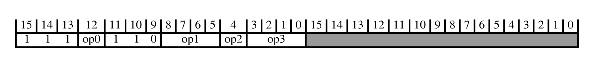

下表给出解码字段取值与所关联的指令：

| op0 | op1 | op2 | op3 | 指令 |
| --- | --- | --- | --- | --- |
| 0 | != 0010 | 1 | != 1111 | LDC, LDC2 (immediate) T1 |
| 1 | != 0010 | 1 | != 1111 | LDC, LDC2 (immediate) T2 |
| 0 | != 0010 | 1 | 1111 | LDC, LDC2 (literal) T1 |
| 1 | != 0010 | 1 | 1111 | LDC, LDC2 (literal) T2 |
| 0 | != 0010 | 0 | - | STC, STC2 T1 |
| 1 | != 0010 | 0 | - | STC, STC2 T2 |
| 0 | 0010 | 1 | - | MRRC, MRRC2 T1 |
| 1 | 0010 | 1 | - | MRRC, MRRC2 T2 |
| 0 | 0010 | 0 | - | MCRR, MCRR2 T1 |
| 1 | 0010 | 0 | - | MCRR, MCRR2 T2 |

##### 3.1.2.5. 向量加载指令

本节描述**向量加载指令**的编码方式。本节由**浮点与向量加载/存储、移动与协处理器指令**解码。

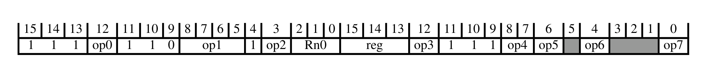

下表给出解码字段取值与所关联的指令：

| op0 | op1 | op2 | op3 | op4 | op5 | op6 | op7 | 指令 |
| --- | --- | --- | --- | --- | --- | --- | --- | --- |
| 1 | 01xx | - | 1 | != 11 | - | - | 0 | VLD2 T1 |
| 1 | 01xx | - | 1 | != 11 | - | - | 1 | VLD4 T1 |
| 0 | 1xxx 0xx1 | - | 1 | 00 | - | - | - | VLDRB, VLDRH, VLDRW T5 |
| 0 | 1xxx 0xx1 | - | 1 | 01 | - | - | - | VLDRB, VLDRH, VLDRW T6 |
| 0 | 1xxx 0xx1 | - | 1 | 10 | - | - | - | VLDRB, VLDRH, VLDRW T7 |
| 1 | 1xxx | - | 1 | 0x | - | - | - | VLDRB, VLDRH, VLDRW, VLDRD (vector) T5 |
| 1 | 1xxx | - | 1 | 1x | - | - | - | VLDRB, VLDRH, VLDRW, VLDRD (vector) T6 |
| - | 1x0x 0x01 | 0 | 0 | != 11 | - | - | - | VLDRB, VLDRH, VLDRW T1 |
| - | 1x0x 0x01 | 1 | 0 | != 11 | - | - | - | VLDRB, VLDRH, VLDRW T2 |
| - | 1xxx 0xx1 | - | 0 | 11 | - | - | - | VLDR (System Register) T1 |
| - | 01x0 | - | 0 | - | 0 | 0 | - | VLDRB, VLDRH, VLDRW, VLDRD (vector) T1 |
| - | 01x0 | - | 0 | - | 0 | 1 | - | VLDRB, VLDRH, VLDRW, VLDRD (vector) T2 |
| - | 01x0 | - | 0 | - | 1 | 0 | - | VLDRB, VLDRH, VLDRW, VLDRD (vector) T3 |
| - | 01x0 | - | 0 | - | 1 | 1 | - | VLDRB, VLDRH, VLDRW, VLDRD (vector) T4 |
| 0 | 00x0 | - | 0 | 1x | - | - | - | VMOV (two general-purpose registers to two 32-bit vector lanes) T1 |

##### 3.1.2.6. 向量存储指令

本节描述**向量存储指令**的编码方式。本节由**浮点与向量加载/存储、移动与协处理器指令**解码。

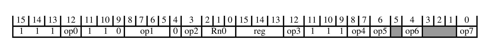

下表给出解码字段取值与所关联的指令：

| op0 | op1 | op2 | op3 | op4 | op5 | op6 | op7 | 指令 |
| --- | --- | --- | --- | --- | --- | --- | --- | --- |
| 1 | 01xx | - | 1 | != 11 | - | - | 0 | VST2 T1 |
| 1 | 01xx | - | 1 | != 11 | - | - | 1 | VST4 T1 |
| 0 | 1xxx 0xx1 | - | 1 | 00 | - | - | - | VSTRB, VSTRH, VSTRW T5 |
| 0 | 1xxx 0xx1 | - | 1 | 01 | - | - | - | VSTRB, VSTRH, VSTRW T6 |
| 0 | 1xxx 0xx1 | - | 1 | 10 | - | - | - | VSTRB, VSTRH, VSTRW T7 |
| 1 | 1xxx | - | 1 | 0x | - | - | - | VSTRB, VSTRH, VSTRW, VSTRD (vector) T5 |
| 1 | 1xxx | - | 1 | 1x | - | - | - | VSTRB, VSTRH, VSTRW, VSTRD (vector) T6 |
| - | 1x0x 0x01 | 0 | 0 | != 11 | - | - | - | VSTRB, VSTRH, VSTRW T1 |
| - | 1x0x 0x01 | 1 | 0 | != 11 | - | - | - | VSTRB, VSTRH, VSTRW T2 |
| - | 1xxx 0xx1 | - | 0 | 11 | - | - | - | VSTR (System Register) T1 |
| - | 01x0 | - | 0 | - | 0 | 0 | - | VSTRB, VSTRH, VSTRW, VSTRD (vector) T1 |
| - | 01x0 | - | 0 | - | 0 | 1 | - | VSTRB, VSTRH, VSTRW, VSTRD (vector) T2 |
| - | 01x0 | - | 0 | - | 1 | 0 | - | VSTRB, VSTRH, VSTRW, VSTRD (vector) T3 |
| - | 01x0 | - | 0 | - | 1 | 1 | - | VSTRB, VSTRH, VSTRW, VSTRD (vector) T4 |
| 0 | 00x0 | - | 0 | 1x | - | - | - | VMOV (two 32-bit vector lanes to two general-purpose registers) T1 |

#### 3.1.3. 杂项向量算术指令

本节描述**杂项向量算术指令**的编码方式。本节由**协处理器、浮点与向量指令**解码。

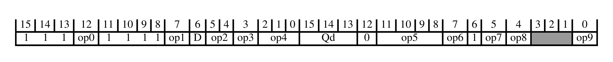

下表给出解码字段取值与所关联的指令：

| op0 | op1 | op2 | op2:op3 | op4 | op5 | op6 | op7:op5 | op7:op8 | op9 | 指令 |
| --- | --- | --- | --- | --- | --- | --- | --- | --- | --- | --- |
| 1 | 1 | 11 | - | x00 | 0100 | 0 | - | x0 | 0 | VCLS T1 |
| 0 | 0 | 00 | - | xx0 | 0001 | - | - | x1 | 0 | VAND T1 |
| - | 1 | - | 000 | - | - | 0 | 1111x 0xxx0 011x1 | x1 | - | VMOV (immediate) (vector) T1 |
| - | 0 | - | - | xx0 | 0000 | - | - | x1 | 0 | VQADD T1 |
| Alias |  |  |  |  |  |  |  |  |  | VORN (immediate) T1 |
| - | 0 | != 11 | - | xx0 | 0100 | - | - | x0 | 0 | VSHL T3 |
| - | 1 | - | 000 | - | 0xx1 10x1 | 0 | - | 11 | - | VBIC (immediate) T1 |
| - | 0 | != 11 | - | xx0 | 0110 | - | - | x1 | 0 | VMIN, VMINA T1 |
| 0 | 0 | 0x | - | xx0 | 1101 | - | - | x0 | 0 | VADD (floating-point) T1 |
| 1 | 0 | 1x | - | xx0 | 1111 | - | - | x1 | 0 | VMINNM, VMINNMA (floating-point) T1 |
| - | 1 | - | != 000 | - | 0111 | 0 | - | x1 | 0 | VQSHL, VQSHLU T2 |
| - | 0 | != 11 | - | xx0 | 0110 | - | - | x0 | 0 | VMAX, VMAXA T1 |
| 0 | 0 | - | - | xx0 | 1000 | - | - | x0 | 0 | VADD (vector) T1 |
| - | 1 | - | != 000 | - | 0010 | 0 | - | x1 | 0 | VRSHR T1 |
| - | 0 | - | - | xx0 | 0111 | - | - | x0 | 0 | VABD T1 |
| - | 1 | - | != 000 | - | 0000 | 0 | - | x1 | 0 | VSHR T1 |
| - | 1 | - | 000 | - | 0xx1 10x1 | 0 | - | 01 | - | VORR (immediate) T1 |
| Alias |  |  |  |  |  |  |  |  |  | VMOV (register) (vector) T1 |
| 1 | 0 | - | - | xx0 | 1000 | - | - | x0 | 0 | VSUB (vector) T1 |
| 0 | 0 | 1x | - | xx0 | 1100 | - | - | x1 | 0 | VFMA, VFMS (floating-point) T2 |
| 0 | 0 | 0x | - | xx0 | 1100 | - | - | x1 | 0 | VFMA, VFMS (floating-point) T1 |
| - | 1 | - | != 000 | - | 11xx | 0 | - | x1 | 0 | VCVT (between floating-point and fixed-point) (vector) T1 |
| 1 | 1 | 11 | - | x00 | 0000 | 0 | - | x0 | 0 | VREV64 T1 |
| 0 | 0 | - | - | xx0 | 1001 | - | - | x1 | 0 | VMUL (vector) T1 |
| 0 | 0 | 1x | - | xx0 | 1101 | - | - | x0 | 0 | VSUB (floating-point) T1 |
| - | 0 | - | - | xx0 | 0000 | - | - | x0 | 0 | VHADD T1 |
| 1 | 0 | 0x | - | xx0 | 1101 | - | - | x1 | 0 | VMUL (floating-point) T1 |
| 1 | 1 | 11 | - | x01 | 0111 | 0 | - | x0 | 0 | VABS (floating-point) T1 |
| 1 | 1 | 11 | - | x00 | 0111 | 1 | - | x0 | 0 | VQNEG T1 |
| - | 0 | - | - | xx0 | 0010 | - | - | x0 | 0 | VHSUB T1 |
| 1 | 1 | - | 110 | 000 | 0101 | 1 | - | x0 | 0 | VMVN (register) T1 |
| - | 0 | != 11 | - | xx0 | 0101 | - | - | x0 | 0 | VRSHL T1 |
| 1 | 0 | - | - | xx0 | 1011 | - | - | x0 | 0 | VQDMULH, VQRDMULH T2 |
| Alias |  |  |  |  |  |  |  |  |  | VAND (immediate) T1 |
| 1 | 1 | 11 | - | x00 | 0111 | 0 | - | x0 | 0 | VQABS T1 |
| 1 | 1 | 11 | - | x01 | 0011 | 0 | - | x0 | 0 | VABS (vector) T1 |
| 1 | 1 | 11 | - | x10 | 01xx | - | - | x0 | 0 | VRINT (floating-point) T1 |
| 1 | 0 | 1x | - | xx0 | 1101 | - | - | x0 | 0 | VABD (floating-point) T1 |
| 1 | 1 | 11 | - | x11 | 011x | - | - | x0 | 0 | VCVT (between floating-point and integer) T1 |
| 0 | 1 | - | != 000 | - | 0101 | 0 | - | x1 | 0 | VSHL T1 |
| - | 0 | - | - | xx0 | 0001 | - | - | x0 | 0 | VRHADD T1 |
| 0 | 0 | 11 | - | xx0 | 0001 | - | - | x1 | 0 | VORN T1 |
| 1 | 1 | - | != 000 | - | 0101 | 0 | - | x1 | 0 | VSLI T1 |
| 1 | 1 | - | != 000 | - | 0100 | 0 | - | x1 | 0 | VSRI T1 |
| 0 | 0 | 10 | - | xx0 | 0001 | - | - | x1 | 0 | VORR T1 |
| 1 | 0 | 00 | - | xx0 | 0001 | - | - | x1 | 0 | VEOR T1 |
| 0 | 0 | - | - | xx0 | 1011 | - | - | x0 | 0 | VQDMULH, VQRDMULH T1 |
| 1 | 1 | 11 | - | x11 | 00xx | - | - | x0 | 0 | VCVT (from floating-point to integer) T1 |
| 1 | 1 | 11 | - | x01 | 0011 | 1 | - | x0 | 0 | VNEG (vector) T1 |
| - | 1 | - | 000 | - | 0xx0 10x0 110x | 0 | - | 11 | - | VMVN (immediate) T1 |
| - | 0 | != 11 | - | xx0 | 0100 | - | - | x1 | 0 | VQSHL, VQSHLU T4 |
| 1 | 1 | 11 | - | x01 | 0111 | 1 | - | x0 | 0 | VNEG (floating-point) T1 |
| 1 | 1 | 11 | - | x00 | 0001 | 0 | - | x0 | 0 | VREV16 T1 |
| 1 | 0 | 0x | - | xx0 | 1111 | - | - | x1 | 0 | VMAXNM, VMAXNMA (floating-point) T1 |
| 0 | 0 | 01 | - | xx0 | 0001 | - | - | x1 | 0 | VBIC (register) T1 |
| 1 | 1 | - | != 000 | - | 0110 | 0 | - | x1 | 0 | VQSHL, VQSHLU T3 |
| 1 | 1 | 11 | - | x00 | 0000 | 1 | - | x0 | 0 | VREV32 T1 |
| - | 0 | - | - | xx0 | 0010 | - | - | x1 | 0 | VQSUB T1 |
| 1 | 1 | 11 | - | x00 | 0100 | 1 | - | x0 | 0 | VCLZ T1 |
| - | 0 | != 11 | - | xx0 | 0101 | - | - | x1 | 0 | VQRSHL T1 |

### 3.2. 加载/存储（多寄存器、双字、独占、获取-释放）

本节描述**加载/存储（多寄存器、双字、独占、获取-释放）**的编码方式。本节由 **32 位 T32 指令编码**解码。

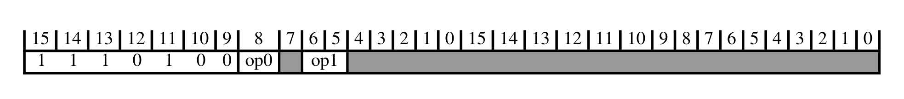

下表给出解码字段取值与所关联的子分组：

| op0 | op1 | 子分组 |
| --- | --- | --- |
| - | 0x | 加载/存储多寄存器 |
| 0 | 10 | 加载/存储独占、加载-获取/存储-释放 |
| 0 | 11 | 加载/存储双字（后索引） |
| 1 | 10 | 加载/存储双字（字面值与立即数） |
| 1 | 11 | 加载/存储双字（前索引）、安全网关 |

#### 3.2.1. 加载/存储多寄存器

本节描述**加载/存储多寄存器**的编码方式。本节由**加载/存储（多寄存器、双字、独占、获取-释放）**解码。


下表给出解码字段取值与所关联的指令：

| L | Rn | opc | 指令 |
| --- | --- | --- | --- |
| 0 | - | 01 | STM, STMIA, STMEA T2 |
| 1 | != 1111 | 01 | LDM, LDMIA, LDMFD T2 |
| 1 | 1111 | 01 | CLRM T1 |
| 0 | - | 10 | STMDB, STMFD T1 |
| 1 | - | 10 | LDMDB, LDMEA T1 |
| Alias |  |  | PUSH (multiple registers) T1 |
| Alias |  |  | POP (multiple registers) T2 |

#### 3.2.2. 加载/存储独占、加载-获取/存储-释放

本节描述**加载/存储独占、加载-获取/存储-释放**的编码方式。本节由**加载/存储（多寄存器、双字、独占、获取-释放）**解码。


下表给出解码字段取值与所关联的子分组：

| op0 | op1 | op2 | 子分组 |
| --- | --- | --- | --- |
| 0 | != 0xxxx1111 | - | 加载/存储独占 |
| 1 | - | 01x | 加载/存储独占字节/半字/双字 |
| 1 | - | 1xx | 加载-获取 / 存储-释放 |

下表给出解码字段取值与所关联的指令：

| op0 | op1 | op2 | 指令 |
| --- | --- | --- | --- |
| 0 | 0xxxx1111 | - | TT, TTT, TTA, TTAT T1 |
| 1 | 1xxxxxxxx | 000 | TBB, TBH T1 |

##### 3.2.2.1. 加载/存储独占

本节描述**加载/存储独占**的编码方式。本节由**加载/存储独占、加载-获取/存储-释放**解码。


下表给出解码字段取值与所关联的指令：

| L | 指令 |
| --- | --- |
| 0 | STREX T1 |
| 1 | LDREX T1 |

##### 3.2.2.2. 加载/存储独占字节/半字/双字

本节描述**加载/存储独占字节/半字/双字**的编码方式。本节由**加载/存储独占、加载-获取/存储-释放**解码。


下表给出解码字段取值与所关联的指令：

| L | sz | 指令 |
| --- | --- | --- |
| 0 | 00 | STREXB T1 |
| 0 | 01 | STREXH T1 |
| 1 | 00 | LDREXB T1 |
| 1 | 01 | LDREXH T1 |

##### 3.2.2.3. 加载-获取 / 存储-释放

本节描述**加载-获取 / 存储-释放**的编码方式。本节由**加载/存储独占、加载-获取/存储-释放**解码。


下表给出解码字段取值与所关联的指令：

| L | op | sz | 指令 |
| --- | --- | --- | --- |
| 0 | 0 | 00 | STLB T1 |
| 0 | 0 | 01 | STLH T1 |
| 0 | 0 | 10 | STL T1 |
| 0 | 1 | 00 | STLEXB T1 |
| 0 | 1 | 01 | STLEXH T1 |
| 0 | 1 | 10 | STLEX T1 |
| 1 | 0 | 00 | LDAB T1 |
| 1 | 0 | 01 | LDAH T1 |
| 1 | 0 | 10 | LDA T1 |
| 1 | 1 | 00 | LDAEXB T1 |
| 1 | 1 | 01 | LDAEXH T1 |
| 1 | 1 | 10 | LDAEX T1 |

#### 3.2.3. 加载/存储双字（后索引）

本节描述**加载/存储双字（后索引）**的编码方式。本节由**加载/存储（多寄存器、双字、独占、获取-释放）**解码。


下表给出解码字段取值与所关联的指令：

| L | Rn | 指令 |
| --- | --- | --- |
| 0 | != 1111 | STRD (immediate) T1 |
| 1 | != 1111 | LDRD (immediate) T1 |
| - | 1111 | UNPREDICTABLE |

#### 3.2.4. 加载/存储双字（字面值与立即数）

本节描述**加载/存储双字（字面值与立即数）**的编码方式。本节由**加载/存储（多寄存器、双字、独占、获取-释放）**解码。


下表给出解码字段取值与所关联的指令：

| L | Rn | 指令 |
| --- | --- | --- |
| 1 | 1111 | LDRD (literal) T1 |
| 0 | != 1111 | STRD (immediate) T1 |
| 1 | != 1111 | LDRD (immediate) T1 |

#### 3.2.5. 加载/存储双字（前索引）、安全网关

本节描述**加载/存储双字（前索引）、安全网关**的编码方式。本节由**加载/存储（多寄存器、双字、独占、获取-释放）**解码。


下表给出解码字段取值与所关联的指令：

| op0 | op1 | op2 | op3 | 指令 |
| --- | --- | --- | --- | --- |
| 0 | 0 | 1111 | - | UNPREDICTABLE |
| 0 | 1 | 1111 | != 1110100101111111 | UNPREDICTABLE |
| 0 | 1 | 1111 | 1110100101111111 | SG T1 |
| - | 0 | != 1111 | - | STRD (immediate) T1 |
| 1 | - | 1111 | - | UNPREDICTABLE |
| - | 1 | != 1111 | - | LDRD (immediate) T1 |

### 3.3. 数据处理（移位寄存器）

本节描述**数据处理（移位寄存器）**的编码方式。本节由 **32 位 T32 指令编码**解码。


下表给出解码字段取值与所关联的子分组：

| op0 | 子分组 |
| --- | --- |
| 0010 | 宽移位、移位与条件指令 |
| != 0010 | 移位寄存器指令 |

#### 3.3.1. 宽移位、移位与条件指令

本节描述**宽移位、移位与条件指令**的编码方式。本节由**数据处理（移位寄存器）**解码。


下表给出解码字段取值与所关联的指令：

| Rn | S | op0 | op1 | op2 | op3 | op4 | 指令 |
| --- | --- | --- | --- | --- | --- | --- | --- |
| xxx0 | 1 | 0 | - | != 111 | 10 | 1111 | ASRL (immediate) T1 |
| xxx0 | 1 | 0 | - | != 111 | 00 | 1111 | LSLL (immediate) T1 |
| xxx0 | 1 | 0 | - | != 111 | 01 | 1111 | LSRL (immediate) T1 |
| - | 1 | 0 | - | != 111 | 11 | 1111 | SQSHLL (immediate) T1 |
| xxx1 | 1 | 0 | - | != 111 | 10 | 1111 | SRSHRL (immediate) T1 |
| xxx1 | 1 | 0 | - | != 111 | 00 | 1111 | UQSHLL (immediate) T1 |
| xxx1 | 1 | 0 | - | != 111 | 01 | 1111 | URSHRL (immediate) T1 |
| - | 1 | 0 | - | 111 | 11 | 1111 | SQSHL (immediate) T1 |
| - | 1 | 0 | - | 111 | 10 | 1111 | SRSHR (immediate) T1 |
| - | 1 | 0 | - | 111 | 00 | 1111 | UQSHL (immediate) T1 |
| - | 1 | 0 | - | 111 | 01 | 1111 | URSHR (immediate) T1 |
| xxx0 | 1 | - | - | != 111 | 10 | 1101 | ASRL (register) T1 |
| xxx0 | 1 | - | - | != 111 | 00 | 1101 | LSLL (register) T1 |
| - | 1 | - | - | 111 | 10 | 1101 | SQRSHR (register) T1 |
| xxx1 | 1 | - | - | != 111 | 10 | 1101 | SQRSHRL (register) T1 |
| - | 1 | - | - | 111 | 00 | 1101 | UQRSHL (register) T1 |
| xxx1 | 1 | - | - | != 111 | 00 | 1101 | UQRSHLL (register) T1 |
| != 1111 | 0 | 0 | - | - | - | - | ORR (register) T2 |
| != 1111 | 1 | 0 | - | - | - | != 11x1 | ORRS (register) T2 |
| 1111 | 0 | 0 | - | - | - | - | MOV (register) T3 |
| 1111 | 1 | 0 | - | - | - | != 11x1 | MOVS (register) T3 |
| Alias |  |  |  |  |  |  | ASR (immediate) T3 |
| Alias |  |  |  |  |  |  | ASRS (immediate) T3 |
| Alias |  |  |  |  |  |  | LSL (immediate) T3 |
| Alias |  |  |  |  |  |  | LSLS (immediate) T3 |
| Alias |  |  |  |  |  |  | LSR (immediate) T3 |
| Alias |  |  |  |  |  |  | LSRS (immediate) T3 |
| Alias |  |  |  |  |  |  | ROR (immediate) T3 |
| Alias |  |  |  |  |  |  | RORS (immediate) T3 |
| Alias |  |  |  |  |  |  | RRX T3 |
| Alias |  |  |  |  |  |  | RRXS T3 |
| - | 1 | 1 | 00 | - | - | != 1101 | CSEL T1 |
| - | 1 | 1 | 01 | - | - | != 1101 | CSINC T1 |
| - | 1 | 1 | 10 | - | - | != 1101 | CSINV T1 |
| - | 1 | 1 | 11 | - | - | != 1101 | CSNEG T1 |
| Alias |  |  |  |  |  |  | CINC T1 |
| Alias |  |  |  |  |  |  | CINV T1 |
| Alias |  |  |  |  |  |  | CNEG T1 |
| Alias |  |  |  |  |  |  | CSET T1 |
| Alias |  |  |  |  |  |  | CSETM T1 |

#### 3.3.2. 移位寄存器指令

本节描述**移位寄存器指令**的编码方式。本节由**数据处理（移位寄存器）**解码。


下表给出解码字段取值与所关联的指令：

| Rd | Rn | S | imm3:imm2:sr_type | op0 | 指令 |
| --- | --- | --- | --- | --- | --- |
| - | - | 0 | != 0000011 | 0000 | AND (register) T2 |
| - | - | 0 | 0000011 | 0000 | AND extend (register) T2 |
| != 1111 | - | 1 | != 0000011 | 0000 | ANDS (register) T2 |
| != 1111 | - | 1 | 0000011 | 0000 | ANDS extend (register) T2 |
| 1111 | - | 1 | != 0000011 | 0000 | TST (register) T2 |
| 1111 | - | 1 | 0000011 | 0000 | TST extend (register) T2 |
| - | - | - | - | 0001 | BIC (register) T2 |
| - | != 1111 | 0 | - | 0011 | ORN (register) T1 |
| - | != 1111 | 1 | - | 0011 | ORNS (register) T1 |
| - | 1111 | 0 | - | 0011 | MVN (register) T2 |
| - | 1111 | 1 | - | 0011 | MVNS (register) T2 |
| - | - | 0 | != 0000011 | 0100 | EOR (register) T2 |
| - | - | 0 | 0000011 | 0100 | EOR extend (register) T2 |
| != 1111 | - | 1 | != 0000011 | 0100 | EORS (register) T2 |
| != 1111 | - | 1 | 0000011 | 0100 | EORS extend (register) T2 |
| 1111 | - | 1 | != 0000011 | 0100 | TEQ (register) T1 |
| 1111 | - | 1 | 0000011 | 0100 | TEQ extend (register) T1 |
| - | - | 0 | xxxxxx0 | 0110 | PKHBT, PKHTB T1 |
| - | != 1101 | 0 | - | 1000 | ADD (register) T3 |
| != 1111 | != 1101 | 1 | - | 1000 | ADDS (register) T3 |
| - | 1101 | 0 | - | 1000 | ADD (SP plus register) T3 |
| != 1111 | 1101 | 1 | - | 1000 | ADDS (SP plus register) T3 |
| 1111 | - | 1 | - | 1000 | CMN (register) T2 |
| - | - | - | - | 1010 | ADC (register) T2 |
| - | - | - | - | 1011 | SBC (register) T2 |
| - | != 1101 | 0 | - | 1101 | SUB (register) T2 |
| != 1111 | != 1101 | 1 | - | 1101 | SUBS (register) T2 |
| - | 1101 | 0 | - | 1101 | SUB (SP minus register) T1 |
| != 1111 | 1101 | 1 | - | 1101 | SUBS (SP minus register) T1 |
| 1111 | - | 1 | - | 1101 | CMP (register) T3 |
| - | - | - | - | 1110 | RSB (register) T1 |

### 3.4. 分支与杂项控制

本节描述**分支与杂项控制**的编码方式。本节由 **32 位 T32 指令编码**解码。


下表给出解码字段取值与所关联的子分组：

| op0 | op1 | op2 | op3 | op4 | op5 | op6 | 子分组 |
| --- | --- | --- | --- | --- | --- | --- | --- |
| 0 | 1110 | 10 | 0 | 0 | 000 | - | 提示 |
| 0 | 1110 | 11 | 0 | 0 | - | - | 杂项系统 |
| 1 | 1111 | 1x | 0 | 0 | - | - | 异常生成 |
| - | - | - | 1 | 0 | - | 1 | 循环与分支指令 |

下表给出解码字段取值与所关联的指令：

| op0 | op1 | op2 | op3 | op4 | op5 | op6 | 指令 |
| --- | --- | --- | --- | --- | --- | --- | --- |
| 0 | 1110 | 0x | 0 | 0 | - | - | MSR (register) T1 |
| 0 | 1111 | 1x | 0 | 0 | - | - | MRS T1 |
| - | != 111x | - | 0 | 0 | - | - | B T3 |
| - | - | - | 0 | 1 | - | - | B T4 |
| - | - | - | 1 | 1 | - | - | BL T1 |

#### 3.4.1. 提示

本节描述**提示**的编码方式。本节由**分支与杂项控制**解码。


下表给出解码字段取值与所关联的指令：

| hint | option | 指令 |
| --- | --- | --- |
| 0000 | 0000 | NOP T2 |
| 0000 | 0001 | YIELD T2 |
| 0000 | 0010 | WFE T2 |
| 0000 | 0011 | WFI T2 |
| 0000 | 0100 | SEV T2 |
| 0000 | 0101 | 保留提示（若实现了 Main 扩展则表现为 NOP，否则为 UNDEFINED） |
| 0000 | 011x | 保留提示（若实现了 Main 扩展则表现为 NOP，否则为 UNDEFINED） |
| 0000 | 10xx | 保留提示（若实现了 Main 扩展则表现为 NOP，否则为 UNDEFINED） |
| 0000 | 11x0 | 保留提示（若实现了 Main 扩展则表现为 NOP，否则为 UNDEFINED） |
| 0000 | 1101 | PACBTI T1 |
| 0000 | 1111 | BTI T1 |
| 0001 | 0000 | ESB T1 |
| 0001 | 001x | 保留提示（若实现了 Main 扩展则表现为 NOP，否则为 UNDEFINED） |
| 0001 | 0100 | CSDB T1 |
| 0001 | 0x01 | 保留提示（若实现了 Main 扩展则表现为 NOP，否则为 UNDEFINED） |
| 0001 | 011x | 保留提示（若实现了 Main 扩展则表现为 NOP，否则为 UNDEFINED） |
| 0001 | 10xx | 保留提示（若实现了 Main 扩展则表现为 NOP，否则为 UNDEFINED） |
| 0001 | 11x0 | 保留提示（若实现了 Main 扩展则表现为 NOP，否则为 UNDEFINED） |
| 0001 | 1101 | PAC T1 |
| 0001 | 1111 | 保留提示（若实现了 Main 扩展则表现为 NOP，否则为 UNDEFINED） |
| 0010 | 0xxx | 保留提示（若实现了 Main 扩展则表现为 NOP，否则为 UNDEFINED） |
| 0010 | 10xx | 保留提示（若实现了 Main 扩展则表现为 NOP，否则为 UNDEFINED） |
| 0010 | 11x0 | 保留提示（若实现了 Main 扩展则表现为 NOP，否则为 UNDEFINED） |
| 0010 | 1101 | AUT T1 |
| 0010 | 1111 | 保留提示（若实现了 Main 扩展则表现为 NOP，否则为 UNDEFINED） |
| 0011 | - | 保留提示（若实现了 Main 扩展则表现为 NOP，否则为 UNDEFINED） |
| 01xx | - | 保留提示（若实现了 Main 扩展则表现为 NOP，否则为 UNDEFINED） |
| 10xx | - | 保留提示（若实现了 Main 扩展则表现为 NOP，否则为 UNDEFINED） |
| 110x | - | 保留提示（若实现了 Main 扩展则表现为 NOP，否则为 UNDEFINED） |
| 1110 | - | 保留提示（若实现了 Main 扩展则表现为 NOP，否则为 UNDEFINED） |
| 1111 | - | DBG T1 |

#### 3.4.2. 杂项系统

本节描述**杂项系统**的编码方式。本节由**分支与杂项控制**解码。


下表给出解码字段取值与所关联的指令：

| opc | option | 指令 |
| --- | --- | --- |
| 0010 | - | CLREX T1 |
| 0100 | != 0x00 | DSB T1 |
| 0100 | 0000 | SSBB T1 |
| 0100 | 0100 | PSSBB T1 |
| 0101 | - | DMB T1 |
| 0110 | - | ISB T1 |

#### 3.4.3. 异常生成

本节描述**异常生成**的编码方式。本节由**分支与杂项控制**解码。


下表给出解码字段取值与所关联的指令：

| o1 | o2 | 指令 |
| --- | --- | --- |
| 1 | 1 | UDF T2 |

#### 3.4.4. 循环与分支指令

本节描述**循环与分支指令**的编码方式。本节由**分支与杂项控制**解码。


下表给出解码字段取值与所关联的子分组：

| op0 | 子分组 |
| --- | --- |
| != 0000 | 分支未来指令 |
| 0000 | 循环指令 |

##### 3.4.4.1. 分支未来指令

本节描述**分支未来指令**的编码方式。本节由**循环与分支指令**解码。


下表给出解码字段取值与所关联的指令：

| op0 | op1 | 指令 |
| --- | --- | --- |
| - | 0 | BF, BFX, BFL, BFLX, BFCSEL T4 |
| 0xx | 1 | BF, BFX, BFL, BFLX, BFCSEL T2 |
| 10x | 1 | BF, BFX, BFL, BFLX, BFCSEL T1 |
| 110 | 1 | BF, BFX, BFL, BFLX, BFCSEL T3 |
| 111 | 1 | BF, BFX, BFL, BFLX, BFCSEL T5 |

##### 3.4.4.2. 循环指令

本节描述**循环指令**的编码方式。本节由**循环与分支指令**解码。


下表给出解码字段取值与所关联的指令：

| imml | op0 | op1 | op2 | 指令 |
| --- | --- | --- | --- | --- |
| - | 0xx | 1111 | 1 | LCTP T1 |
| - | 000 | 1111 | 0 | LE, LETP T1 |
| - | 01x | 1111 | 0 | LE, LETP T2 |
| - | 001 | 1111 | 0 | LE, LETP T3 |
| - | 1xx | - | 0 | WLS, DLS, WLSTP, DLSTP T1 |
| - | 1xx | - | 1 | WLS, DLS, WLSTP, DLSTP T2 |
| - | 0xx | != 1111 | 0 | WLS, DLS, WLSTP, DLSTP T3 |
| 0 | 0xx | != 1111 | 1 | WLS, DLS, WLSTP, DLSTP T4 |
| 1 | 0xx | != 1111 | 1 | VCTP T1 |

### 3.5. 数据处理（修改立即数）

本节描述**数据处理（修改立即数）**的编码方式。本节由 **32 位 T32 指令编码**解码。


下表给出解码字段取值与所关联的指令：

| Rd | Rn | S | op1 | 指令 |
| --- | --- | --- | --- | --- |
| - | - | 0 | 0000 | AND (immediate) T1 |
| != 1111 | - | 1 | 0000 | ANDS (immediate) T1 |
| 1111 | - | 1 | 0000 | TST (immediate) T1 |
| - | - | - | 0001 | BIC (immediate) T1 |
| - | != 1111 | - | 0010 | ORR (immediate) T1 |
| - | 1111 | - | 0010 | MOV (immediate) T2 |
| - | != 1111 | - | 0011 | ORN (immediate) T1 |
| - | 1111 | - | 0011 | MVN (immediate) T1 |
| - | - | 0 | 0100 | EOR (immediate) T1 |
| != 1111 | - | 1 | 0100 | EORS (immediate) T1 |
| 1111 | - | 1 | 0100 | TEQ (immediate) T1 |
| - | != 1101 | 0 | 1000 | ADD (immediate) T3 |
| != 1111 | != 1101 | 1 | 1000 | ADDS (immediate) T3 |
| - | 1101 | 0 | 1000 | ADD (SP plus immediate) T3 |
| != 1111 | 1101 | 1 | 1000 | ADDS (SP plus immediate) T3 |
| 1111 | - | 1 | 1000 | CMN (immediate) T1 |
| - | - | - | 1010 | ADC (immediate) T1 |
| - | - | - | 1011 | SBC (immediate) T1 |
| - | != 1101 | 0 | 1101 | SUB (immediate) T3 |
| != 1111 | != 1101 | 1 | 1101 | SUBS (immediate) T3 |
| - | 1101 | 0 | 1101 | SUB (SP minus immediate) T2 |
| != 1111 | 1101 | 1 | 1101 | SUBS (SP minus immediate) T2 |
| 1111 | - | 1 | 1101 | CMP (immediate) T2 |
| - | - | - | 1110 | RSB (immediate) T2 |

### 3.6. 数据处理（纯二进制立即数）

本节描述**数据处理（纯二进制立即数）**的编码方式。本节由 **32 位 T32 指令编码**解码。


下表给出解码字段取值与所关联的子分组：

| op0 | op1 | 子分组 |
| --- | --- | --- |
| 0 | 0x | 数据处理（简单立即数） |
| 0 | 10 | 宽移动（16 位立即数） |
| 1 | - | 饱和、位域 |

#### 3.6.1. 数据处理（简单立即数）

本节描述**数据处理（简单立即数）**的编码方式。本节由**数据处理（纯二进制立即数）**解码。


下表给出解码字段取值与所关联的指令：

| Rn | o1 | o2 | 指令 |
| --- | --- | --- | --- |
| Alias |  |  | ADD (immediate, to PC) T3 |
| != 11x1 | 0 | 0 | ADD (immediate) T4 |
| 1101 | 0 | 0 | ADD (SP plus immediate) T4 |
| 1111 | 0 | 0 | ADR T3 |
| != 11x1 | 1 | 1 | SUB (immediate) T4 |
| 1101 | 1 | 1 | SUB (SP minus immediate) T3 |
| 1111 | 1 | 1 | ADR T2 |
| Alias |  |  | SUB (immediate, from PC) T2 |

#### 3.6.2. 宽移动（16 位立即数）

本节描述**宽移动（16 位立即数）**的编码方式。本节由**数据处理（纯二进制立即数）**解码。


下表给出解码字段取值与所关联的指令：

| o1 | 指令 |
| --- | --- |
| 0 | MOV (immediate) T3 |
| 1 | MOVT T1 |

#### 3.6.3. 饱和、位域

本节描述**饱和、位域**的编码方式。本节由**数据处理（纯二进制立即数）**解码。


下表给出解码字段取值与所关联的指令：

| Rn | imm3:imm2 | op1 | 指令 |
| --- | --- | --- | --- |
| - | - | 000 | SSAT LSL T1 |
| - | != 00000 | 001 | SSAT ASR T1 |
| - | 00000 | 001 | SSAT16 T1 |
| - | - | 010 | SBFX T1 |
| != 1111 | - | 011 | BFI T1 |
| 1111 | - | 011 | BFC T1 |
| - | - | 100 | USAT LSL T1 |
| - | != 00000 | 101 | USAT ASR T1 |
| - | 00000 | 101 | USAT16 T1 |
| - | - | 110 | UBFX T1 |

### 3.7. 加载/存储单个

本节描述**加载/存储单个**的编码方式。本节由 **32 位 T32 指令编码**解码。


下表给出解码字段取值与所关联的子分组：

| op0 | op1 | op2 | op3 | 子分组 |
| --- | --- | --- | --- | --- |
| 00 | - | != 1111 | 000000 | 加载/存储，无符号（寄存器偏移） |
| 00 | - | != 1111 | 10xxxx | 加载/存储，无符号（立即数，后索引） |
| 00 | - | != 1111 | 1100xx | 加载/存储，无符号（负立即数） |
| 00 | - | != 1111 | 1110xx | 加载/存储，无符号（非特权） |
| 00 | - | != 1111 | 11x1xx | 加载/存储，无符号（立即数，前索引） |
| 01 | - | != 1111 | - | 加载/存储，无符号（正立即数） |
| 0x | - | 1111 | - | 加载，无符号（字面值） |
| 10 | 1 | != 1111 | 000000 | 加载/存储，有符号（寄存器偏移） |
| 10 | 1 | != 1111 | 10xxxx | 加载/存储，有符号（立即数，后索引） |
| 10 | 1 | != 1111 | 1100xx | 加载/存储，有符号（负立即数） |
| 10 | 1 | != 1111 | 1110xx | 加载/存储，有符号（非特权） |
| 10 | 1 | != 1111 | 11x1xx | 加载/存储，有符号（立即数，前索引） |
| 11 | 1 | != 1111 | - | 加载/存储，有符号（正立即数） |
| 1x | 1 | 1111 | - | 加载，有符号（字面值） |

#### 3.7.1. 加载/存储，无符号（寄存器偏移）

本节描述**加载/存储，无符号（寄存器偏移）**的编码方式。本节由**加载/存储单个**解码。


下表给出解码字段取值与所关联的指令：

| L | Rt | size | 指令 |
| --- | --- | --- | --- |
| 0 | - | 00 | STRB (register) T2 |
| 1 | != 1111 | 00 | LDRB (register) T2 |
| 1 | 1111 | 0x | PLD, PLDW (register) T1 |
| 0 | - | 01 | STRH (register) T2 |
| 1 | != 1111 | 01 | LDRH (register) T2 |
| 0 | - | 10 | STR (register) T2 |
| 1 | - | 10 | LDR (register) T2 |

#### 3.7.2. 加载/存储，无符号（立即数，后索引）

本节描述**加载/存储，无符号（立即数，后索引）**的编码方式。本节由**加载/存储单个**解码。


下表给出解码字段取值与所关联的指令：

| L | size | 指令 |
| --- | --- | --- |
| 0 | 00 | STRB (immediate) T3 |
| 1 | 00 | LDRB (immediate) T3 |
| 0 | 01 | STRH (immediate) T3 |
| 1 | 01 | LDRH (immediate) T3 |
| 0 | 10 | STR (immediate) T4 |
| Alias |  | PUSH (single register) T4 |
| 1 | 10 | LDR (immediate) T4 |
| Alias |  | POP (single register) T4 |

#### 3.7.3. 加载/存储，无符号（负立即数）

本节描述**加载/存储，无符号（负立即数）**的编码方式。本节由**加载/存储单个**解码。


下表给出解码字段取值与所关联的指令：

| L | Rt | size | 指令 |
| --- | --- | --- | --- |
| 0 | - | 00 | STRB (immediate) T3 |
| 1 | != 1111 | 00 | LDRB (immediate) T3 |
| 1 | 1111 | 0x | PLD, PLDW (immediate) T2 |
| 0 | - | 01 | STRH (immediate) T3 |
| 1 | != 1111 | 01 | LDRH (immediate) T3 |
| 0 | - | 10 | STR (immediate) T4 |
| Alias |  |  | PUSH (single register) T4 |
| 1 | - | 10 | LDR (immediate) T4 |
| Alias |  |  | POP (single register) T4 |

#### 3.7.4. 加载/存储，无符号（非特权）

本节描述**加载/存储，无符号（非特权）**的编码方式。本节由**加载/存储单个**解码。


下表给出解码字段取值与所关联的指令：

| L | size | 指令 |
| --- | --- | --- |
| 0 | 00 | STRBT T1 |
| 1 | 00 | LDRBT T1 |
| 0 | 01 | STRHT T1 |
| 1 | 01 | LDRHT T1 |
| 0 | 10 | STRT T1 |
| 1 | 10 | LDRT T1 |

#### 3.7.5. 加载/存储，无符号（立即数，前索引）

本节描述**加载/存储，无符号（立即数，前索引）**的编码方式。本节由**加载/存储单个**解码。


下表给出解码字段取值与所关联的指令：

| L | size | 指令 |
| --- | --- | --- |
| 0 | 00 | STRB (immediate) T3 |
| 1 | 00 | LDRB (immediate) T3 |
| 0 | 01 | STRH (immediate) T3 |
| 1 | 01 | LDRH (immediate) T3 |
| 0 | 10 | STR (immediate) T4 |
| Alias |  | PUSH (single register) T4 |
| 1 | 10 | LDR (immediate) T4 |
| Alias |  | POP (single register) T4 |

#### 3.7.6. 加载/存储，无符号（正立即数）

本节描述**加载/存储，无符号（正立即数）**的编码方式。本节由**加载/存储单个**解码。


下表给出解码字段取值与所关联的指令：

| L | Rt | size | 指令 |
| --- | --- | --- | --- |
| 0 | - | 00 | STRB (immediate) T2 |
| 1 | != 1111 | 00 | LDRB (immediate) T2 |
| 1 | 1111 | 0x | PLD, PLDW (immediate) T1 |
| 0 | - | 01 | STRH (immediate) T2 |
| 1 | != 1111 | 01 | LDRH (immediate) T2 |
| 0 | - | 10 | STR (immediate) T3 |
| 1 | - | 10 | LDR (immediate) T3 |

#### 3.7.7. 加载，无符号（字面值）

本节描述**加载，无符号（字面值）**的编码方式。本节由**加载/存储单个**解码。


下表给出解码字段取值与所关联的指令：

| L | Rt | size | 指令 |
| --- | --- | --- | --- |
| 1 | != 1111 | 00 | LDRB (literal) T1 |
| 1 | 1111 | 0x | PLD (literal) T1 |
| 1 | != 1111 | 01 | LDRH (literal) T1 |
| 1 | - | 10 | LDR (literal) T2 |

#### 3.7.8. 加载/存储，有符号（寄存器偏移）

本节描述**加载/存储，有符号（寄存器偏移）**的编码方式。本节由**加载/存储单个**解码。


下表给出解码字段取值与所关联的指令：

| Rt | size | 指令 |
| --- | --- | --- |
| != 1111 | 00 | LDRSB (register) T2 |
| 1111 | 00 | PLI (register) T1 |
| != 1111 | 01 | LDRSH (register) T2 |
| 1111 | 01 | 保留提示（若实现了 Main 扩展则表现为 NOP，否则为 UNDEFINED） |

#### 3.7.9. 加载/存储，有符号（立即数，后索引）

本节描述**加载/存储，有符号（立即数，后索引）**的编码方式。本节由**加载/存储单个**解码。


下表给出解码字段取值与所关联的指令：

| size | 指令 |
| --- | --- |
| 00 | LDRSB (immediate) T2 |
| 01 | LDRSH (immediate) T2 |

#### 3.7.10. 加载/存储，有符号（负立即数）

本节描述**加载/存储，有符号（负立即数）**的编码方式。本节由**加载/存储单个**解码。


下表给出解码字段取值与所关联的指令：

| Rt | size | 指令 |
| --- | --- | --- |
| != 1111 | 00 | LDRSB (immediate) T2 |
| 1111 | 00 | PLI (immediate, literal) T2 |
| != 1111 | 01 | LDRSH (immediate) T2 |
| 1111 | 01 | 保留提示（若实现了 Main 扩展则表现为 NOP，否则为 UNDEFINED） |

#### 3.7.11. 加载/存储，有符号（非特权）

本节描述**加载/存储，有符号（非特权）**的编码方式。本节由**加载/存储单个**解码。


下表给出解码字段取值与所关联的指令：

| size | 指令 |
| --- | --- |
| 00 | LDRSBT T1 |
| 01 | LDRSHT T1 |

#### 3.7.12. 加载/存储，有符号（立即数，前索引）

本节描述**加载/存储，有符号（立即数，前索引）**的编码方式。本节由**加载/存储单个**解码。


下表给出解码字段取值与所关联的指令：

| size | 指令 |
| --- | --- |
| 00 | LDRSB (immediate) T2 |
| 01 | LDRSH (immediate) T2 |

#### 3.7.13. 加载/存储，有符号（正立即数）

本节描述**加载/存储，有符号（正立即数）**的编码方式。本节由**加载/存储单个**解码。


下表给出解码字段取值与所关联的指令：

| Rt | size | 指令 |
| --- | --- | --- |
| != 1111 | 00 | LDRSB (immediate) T1 |
| 1111 | 00 | PLI (immediate, literal) T1 |
| != 1111 | 01 | LDRSH (immediate) T1 |
| 1111 | 01 | 保留提示（若实现了 Main 扩展则表现为 NOP，否则为 UNDEFINED） |

#### 3.7.14. 加载，有符号（字面值）

本节描述**加载，有符号（字面值）**的编码方式。本节由**加载/存储单个**解码。


下表给出解码字段取值与所关联的指令：

| Rt | size | 指令 |
| --- | --- | --- |
| != 1111 | 00 | LDRSB (literal) T1 |
| 1111 | 00 | PLI (immediate, literal) T3 |
| != 1111 | 01 | LDRSH (literal) T1 |
| 1111 | 01 | 保留提示（若实现了 Main 扩展则表现为 NOP，否则为 UNDEFINED） |

### 3.8. 数据处理（寄存器）

本节描述**数据处理（寄存器）**的编码方式。本节由 **32 位 T32 指令编码**解码。


下表给出解码字段取值与所关联的子分组：

| op0 | op1 | 子分组 |
| --- | --- | --- |
| 0 | 1xxx | 寄存器扩展 |
| 1 | 0xxx | 并行加/减 |
| 1 | 10xx | 数据处理（两个源寄存器） |

下表给出解码字段取值与所关联的指令：

| op0 | op1 | 指令 |
| --- | --- | --- |
| Alias |  | ASRS (register) T2 |
| Alias |  | ASR (register) T2 |
| Alias |  | LSLS (register) T2 |
| Alias |  | LSL (register) T2 |
| Alias |  | LSRS (register) T2 |
| Alias |  | LSR (register) T2 |
| 0 | 0000 | MOV, MOVS (register-shifted register) T2 |
| Alias |  | RORS (register) T2 |
| Alias |  | ROR (register) T2 |

#### 3.8.1. 寄存器扩展

本节描述**寄存器扩展**的编码方式。本节由**数据处理（寄存器）**解码。


下表给出解码字段取值与所关联的指令：

| Rn | U | op1 | 指令 |
| --- | --- | --- | --- |
| != 1111 | 0 | 00 | SXTAH T1 |
| 1111 | 0 | 00 | SXTH T2 |
| != 1111 | 1 | 00 | UXTAH T1 |
| 1111 | 1 | 00 | UXTH T2 |
| != 1111 | 0 | 01 | SXTAB16 T1 |
| 1111 | 0 | 01 | SXTB16 T1 |
| != 1111 | 1 | 01 | UXTAB16 T1 |
| 1111 | 1 | 01 | UXTB16 T1 |
| != 1111 | 0 | 10 | SXTAB T1 |
| 1111 | 0 | 10 | SXTB T2 |
| != 1111 | 1 | 10 | UXTAB T1 |
| 1111 | 1 | 10 | UXTB T2 |

#### 3.8.2. 并行加/减

本节描述**并行加/减**的编码方式。本节由**数据处理（寄存器）**解码。


下表给出解码字段取值与所关联的指令：

| H | S | U | op1 | 指令 |
| --- | --- | --- | --- | --- |
| 0 | 0 | 0 | 000 | SADD8 T1 |
| 0 | 1 | 0 | 000 | QADD8 T1 |
| 1 | 0 | 0 | 000 | SHADD8 T1 |
| 0 | 0 | 1 | 000 | UADD8 T1 |
| 0 | 1 | 1 | 000 | UQADD8 T1 |
| 1 | 0 | 1 | 000 | UHADD8 T1 |
| 0 | 0 | 0 | 001 | SADD16 T1 |
| 0 | 1 | 0 | 001 | QADD16 T1 |
| 1 | 0 | 0 | 001 | SHADD16 T1 |
| 0 | 0 | 1 | 001 | UADD16 T1 |
| 0 | 1 | 1 | 001 | UQADD16 T1 |
| 1 | 0 | 1 | 001 | UHADD16 T1 |
| 0 | 0 | 0 | 010 | SASX T1 |
| 0 | 1 | 0 | 010 | QASX T1 |
| 1 | 0 | 0 | 010 | SHASX T1 |
| 0 | 0 | 1 | 010 | UASX T1 |
| 0 | 1 | 1 | 010 | UQASX T1 |
| 1 | 0 | 1 | 010 | UHASX T1 |
| 0 | 0 | 0 | 100 | SSUB8 T1 |
| 0 | 1 | 0 | 100 | QSUB8 T1 |
| 1 | 0 | 0 | 100 | SHSUB8 T1 |
| 0 | 0 | 1 | 100 | USUB8 T1 |
| 0 | 1 | 1 | 100 | UQSUB8 T1 |
| 1 | 0 | 1 | 100 | UHSUB8 T1 |
| 0 | 0 | 0 | 101 | SSUB16 T1 |
| 0 | 1 | 0 | 101 | QSUB16 T1 |
| 1 | 0 | 0 | 101 | SHSUB16 T1 |
| 0 | 0 | 1 | 101 | USUB16 T1 |
| 0 | 1 | 1 | 101 | UQSUB16 T1 |
| 1 | 0 | 1 | 101 | UHSUB16 T1 |
| 0 | 0 | 0 | 110 | SSAX T1 |
| 0 | 1 | 0 | 110 | QSAX T1 |
| 1 | 0 | 0 | 110 | SHSAX T1 |
| 0 | 0 | 1 | 110 | USAX T1 |
| 0 | 1 | 1 | 110 | UQSAX T1 |
| 1 | 0 | 1 | 110 | UHSAX T1 |

#### 3.8.3. 数据处理（两个源寄存器）

本节描述**数据处理（两个源寄存器）**的编码方式。本节由**数据处理（寄存器）**解码。


下表给出解码字段取值与所关联的指令：

| op0 | op1 | 指令 |
| --- | --- | --- |
| 000 | 00 | QADD T1 |
| 000 | 01 | QDADD T1 |
| 000 | 10 | QSUB T1 |
| 000 | 11 | QDSUB T1 |
| 001 | 00 | REV T2 |
| 001 | 01 | REV16 T2 |
| 001 | 10 | RBIT T1 |
| 001 | 11 | REVSH T2 |
| 010 | 00 | SEL T1 |
| 011 | 00 | CLZ T1 |

### 3.9. 乘法、乘加与绝对差

本节描述**乘法、乘加与绝对差**的编码方式。本节由 **32 位 T32 指令编码**解码。


下表给出解码字段取值与所关联的指令：

| Ra | Rd | op1 | op2 | 指令 |
| --- | --- | --- | --- | --- |
| != 1111 | - | 000 | 00 | MLA T1 |
| - | - | 000 | 01 | MLS T1 |
| 1111 | - | 000 | 00 | MUL T2 |
| != 1111 | - | 001 | - | SMLABB, SMLABT, SMLATB, SMLATT T1 |
| 1111 | - | 001 | - | SMULBB, SMULBT, SMULTB, SMULTT T1 |
| != 1111 | - | 010 | 0x | SMLAD, SMLADX T1 |
| 1111 | - | 010 | 0x | SMUAD, SMUADX T1 |
| != 1111 | - | 011 | 0x | SMLAWB, SMLAWT T1 |
| 1111 | - | 011 | 0x | SMULWB, SMULWT T1 |
| != 1111 | - | 100 | 0x | SMLSD, SMLSDX T1 |
| 1111 | - | 100 | 0x | SMUSD, SMUSDX T1 |
| != 1111 | != 1111 | 101 | 0x | SMMLA, SMMLAR T1 |
| != 1111 | 1111 | 101 | 00 | AUTG T1 |
| != 1111 | 1111 | 101 | 01 | BXAUT T1 |
| 1111 | - | 101 | 0x | SMMUL, SMMULR T1 |
| != 1111 | - | 110 | 0x | SMMLS, SMMLSR T1 |
| 1111 | - | 110 | 00 | PACG T1 |
| != 1111 | - | 111 | 00 | USADA8 T1 |
| 1111 | - | 111 | 00 | USAD8 T1 |

### 3.10. 长乘法与除法

本节描述**长乘法与除法**的编码方式。本节由 **32 位 T32 指令编码**解码。


下表给出解码字段取值与所关联的指令：

| op1 | op2 | 指令 |
| --- | --- | --- |
| 000 | 0000 | SMULL T1 |
| 001 | 1111 | SDIV T1 |
| 010 | 0000 | UMULL T1 |
| 011 | 1111 | UDIV T1 |
| 100 | 0000 | SMLAL T1 |
| 100 | 10xx | SMLALBB, SMLALBT, SMLALTB, SMLALTT T1 |
| 100 | 110x | SMLALD, SMLALDX T1 |
| 101 | 110x | SMLSLD, SMLSLDX T1 |
| 110 | 0000 | UMLAL T1 |
| 110 | 0110 | UMAAL T1 |

## 4. 按字母顺序的指令列表

本节按指令助记符的字母顺序逐条列出各指令。手册原文共 493 条（C2.4.1–C2.4.493，印刷 528–1440）；当前已译 A–V 段（C2.4.1–C2.4.489），W–Y 段随后续批次补充。

### 4.1. ADC (immediate)：立即数带进位加

带进位加（立即数）。ADC (immediate) 把一个立即数和进位标志值加到一个寄存器值上，并把结果写入目标寄存器；它可以选择根据结果更新条件标志。

#### 4.1.1. 编码 T1

适用于 Armv8-M Main 扩展。


**ADC 变体**（当 `S == 0` 时适用）

```arm
ADC{<c>}{<q>} {<Rd>,} <Rn>, #<const>
```

**ADCS 变体**（当 `S == 1` 时适用）

```arm
ADCS{<c>}{<q>} {<Rd>,} <Rn>, #<const>
```

**解码**

```arm
if !HaveMainExt() then UNDEFINED;
d = UInt(Rd);  n = UInt(Rn);  setflags = (S == '1');  imm32 = T32ExpandImm(i:imm3:imm8);
if d IN {13,15} || n IN {13,15} then UNPREDICTABLE;
```

#### 4.1.2. 汇编符号（所有编码）

- **`<c>`**：见 C1.2.5 标准汇编语法字段。
- **`<q>`**：见 C1.2.5 标准汇编语法字段。
- **`<Rd>`**：通用目标寄存器，编码在 `Rd` 字段中。若省略，则该寄存器与 `<Rn>` 相同。
- **`<Rn>`**：通用源寄存器，编码在 `Rn` 字段中。
- **`<const>`**：由编码在 `i:imm3:imm8` 字段中的 12 位立即数导出的立即数。取值范围见 C1.5 修改立即数常量。

#### 4.1.3. 操作（所有编码）

```arm
if ConditionPassed() then
  EncodingSpecificOperations();
  (result, carry, overflow) = AddWithCarry(R[n], imm32, APSR.C);
  R[d] = result;
  if setflags then
    APSR.N = result[31];
    APSR.Z = IsZeroBit(result);
    APSR.C = carry;
    APSR.V = overflow;
```

#### 4.1.4. 受限行为

无额外限制。

#### 4.1.5. 数据独立时序行为

若 `AIRCR.DIT` 为 1：

- 本指令的执行时间与以下各项无关：
  - 其任一寄存器中提供的数据值。
  - N、Z、C、V 标志的值。
- 异步异常的接受时刻不因以下各项而变化：
  - 本指令所使用的任一寄存器中提供的数据值。
  - N、Z、C、V 标志的值。

### 4.2. ADC (register)：寄存器带进位加

带进位加（寄存器）。ADC (register) 把一个寄存器值、进位标志值以及一个可选移位的寄存器值相加，并把结果写入目标寄存器；它可以选择根据结果更新条件标志。

#### 4.2.1. 编码 T1

适用于 Armv8-M。


**T1 变体**

```arm
ADC<c>{<q>} {<Rdn>,} <Rdn>, <Rm>
  // IT 块内
ADCS{<q>} {<Rdn>,} <Rdn>, <Rm>
  // IT 块外
```

**解码**

```arm
d = UInt(Rdn);  n = UInt(Rdn);  m = UInt(Rm);  setflags = !InITBlock();
(shift_t, shift_n) = (SRType_LSL, 0);
```

#### 4.2.2. 编码 T2

适用于 Armv8-M Main 扩展。


**ADC，带扩展的循环右移变体**（当 `S == 0 && imm3 == 000 && imm2 == 00 && sr_type == 11` 时适用）

```arm
ADC{<c>}{<q>} {<Rd>,} <Rn>, <Rm>, RRX
```

**ADC，按值移位或循环移位变体**（当 `S == 0 && !(imm3 == 000 && imm2 == 00 && sr_type == 11)` 时适用）

```arm
ADC<c>.W {<Rd>,} <Rn>, <Rm>
  // IT 块内，且 <Rd>、<Rn>、<Rm> 可用 T1 表示
ADC{<c>}{<q>} {<Rd>,} <Rn>, <Rm> {, <shift> #<amount>}
```

**ADCS，带扩展的循环右移变体**（当 `S == 1 && imm3 == 000 && imm2 == 00 && sr_type == 11` 时适用）

```arm
ADCS{<c>}{<q>} {<Rd>,} <Rn>, <Rm>, RRX
```

**ADCS，按值移位或循环移位变体**（当 `S == 1 && !(imm3 == 000 && imm2 == 00 && sr_type == 11)` 时适用）

```arm
ADCS.W {<Rd>,} <Rn>, <Rm>
  // IT 块外，且 <Rd>、<Rn>、<Rm> 可用 T1 表示
ADCS{<c>}{<q>} {<Rd>,} <Rn>, <Rm> {, <shift> #<amount>}
```

**解码**

```arm
if !HaveMainExt() then UNDEFINED;
d = UInt(Rd);  n = UInt(Rn);  m = UInt(Rm);  setflags = (S == '1');
(shift_t, shift_n) = DecodeImmShift(sr_type, imm3:imm2);
if d IN {13,15} || n IN {13,15} || m IN {13,15} then UNPREDICTABLE;
```

#### 4.2.3. 汇编符号（所有编码）

- **`<c>`**：见 C1.2.5 标准汇编语法字段。
- **`<q>`**：见 C1.2.5 标准汇编语法字段。
- **`<Rdn>`**：第一个通用源寄存器兼目标寄存器，编码在 `Rdn` 字段中。
- **`<Rd>`**：通用目标寄存器，编码在 `Rd` 字段中。若省略，则该寄存器与 `<Rn>` 相同。
- **`<Rn>`**：第一个通用源寄存器，编码在 `Rn` 字段中。
- **`<Rm>`**：第二个通用源寄存器，编码在 `Rm` 字段中。
- **`<shift>`**：施加于第二个源寄存器的移位类型，编码在 `sr_type` 字段中，可取以下值：
  - `LSL`：当 `sr_type = 00` 时。
  - `LSR`：当 `sr_type = 01` 时。
  - `ASR`：当 `sr_type = 10` 时。
  - `ROR`：当 `sr_type = 11` 时。
- **`<amount>`**：移位量，取值 1–31（`<shift>` 为 `LSL` 或 `ROR` 时）或 1–32（`<shift>` 为 `LSR` 或 `ASR` 时），以 `<amount>` 对 32 取模后编码在 `imm3:imm2` 字段中。

#### 4.2.4. 操作（所有编码）

```arm
if ConditionPassed() then
  EncodingSpecificOperations();
  shifted = Shift(R[m], shift_t, shift_n, APSR.C);
  (result, carry, overflow) = AddWithCarry(R[n], shifted, APSR.C);
  R[d] = result;
  if setflags then
    APSR.N = result[31];
    APSR.Z = IsZeroBit(result);
    APSR.C = carry;
    APSR.V = overflow;
```

#### 4.2.5. 受限行为

无额外限制。

#### 4.2.6. 数据独立时序行为

若 `AIRCR.DIT` 为 1：

- 本指令的执行时间与以下各项无关：
  - 其任一寄存器中提供的数据值。
  - N、Z、C、V 标志的值。
- 异步异常的接受时刻不因以下各项而变化：
  - 本指令所使用的任一寄存器中提供的数据值。
  - N、Z、C、V 标志的值。

### 4.3. ADD (SP plus immediate)：SP 加（立即数）

SP 加（立即数）。ADD (SP plus immediate) 把一个立即数加到 SP 值上，并把结果写入目标寄存器。

本指令受栈限检查（stack limit checking）约束。

#### 4.3.1. 编码 T1

适用于 Armv8-M。


**T1 变体**

```arm
ADD{<c>}{<q>} <Rd>, SP, #<imm8>
```

**解码**

```arm
d = UInt(Rd);  setflags = FALSE;  imm32 = ZeroExtend(imm8:'00', 32);
```

#### 4.3.2. 编码 T2

适用于 Armv8-M。


**T2 变体**

```arm
ADD{<c>}{<q>} {SP,} SP, #<imm7>
```

**解码**

```arm
d = 13;  setflags = FALSE;  imm32 = ZeroExtend(imm7:'00', 32);
```

#### 4.3.3. 编码 T3

适用于 Armv8-M Main 扩展。


**ADD 变体**（当 `S == 0` 时适用）

```arm
ADD{<c>}.W {<Rd>,} SP, #<const>
  // <Rd>、<const> 可用 T1 或 T2 表示
ADD{<c>}{<q>} {<Rd>,} SP, #<const>
```

**ADDS 变体**（当 `S == 1 && Rd != 1111` 时适用）

```arm
ADDS{<c>}{<q>} {<Rd>,} SP, #<const>
```

**解码**

```arm
if Rd == '1111' && S == '1' then SEE "CMN (immediate)";
if !HaveMainExt() then UNDEFINED;
d = UInt(Rd);  setflags = (S == '1');  imm32 = T32ExpandImm(i:imm3:imm8);
if d == 15 && S == '0' then UNPREDICTABLE;
```

#### 4.3.4. 编码 T4

适用于 Armv8-M Main 扩展。


**T4 变体**

```arm
ADD{<c>}{<q>} {<Rd>,} SP, #<imm12>
  // <imm12> 无法用 T1、T2、T3 表示
ADDW{<c>}{<q>} {<Rd>,} SP, #<imm12>
  // <imm12> 可用 T1、T2、T3 表示
```

**解码**

```arm
if !HaveMainExt() then UNDEFINED;
d = UInt(Rd);  setflags = FALSE;  imm32 = ZeroExtend(i:imm3:imm8, 32);
if d == 15 then UNPREDICTABLE;
```

#### 4.3.5. 汇编符号（所有编码）

- **`<c>`**：见 C1.2.5 标准汇编语法字段。
- **`<q>`**：见 C1.2.5 标准汇编语法字段。
- **`<imm7>`**：无符号立即数，为 4 的倍数，取值 0–508，以 `<imm7>/4` 编码在 `imm7` 字段中。
- **`<Rd>`**：目标寄存器。编码 T1 中为通用目标寄存器，编码在 `Rd` 字段中；编码 T3、T4 中为通用目标寄存器，编码在 `Rd` 字段中。若省略，则该寄存器为 SP。
- **`<imm8>`**：无符号立即数，为 4 的倍数，取值 0–1020，以 `<imm8>/4` 编码在 `imm8` 字段中。
- **`<imm12>`**：12 位无符号立即数，取值 0–4095，编码在 `i:imm3:imm8` 字段中。
- **`<const>`**：由编码在 `i:imm3:imm8` 字段中的 12 位立即数导出的立即数。取值范围见 C1.5 修改立即数常量。

#### 4.3.6. 操作（所有编码）

```arm
if ConditionPassed() then
  EncodingSpecificOperations();
  (result, carry, overflow) = AddWithCarry(SP, imm32, '0');
  RSPCheck[d] = result;
  if setflags then
    APSR.N = result[31];
    APSR.Z = IsZeroBit(result);
    APSR.C = carry;
    APSR.V = overflow;
```

### 4.4. ADD (SP plus register)：SP 加（寄存器）

SP 加（寄存器）。ADD (SP plus register) 把一个可选移位的寄存器值加到 SP 值上，并把结果写入目标寄存器。

本指令受栈限检查约束。

#### 4.4.1. 编码 T1

适用于 Armv8-M。


**T1 变体**

```arm
ADD{<c>}{<q>} {<Rdm>,} SP, <Rdm>
```

**解码**

```arm
d = UInt(DM:Rdm);  m = UInt(DM:Rdm);  setflags = FALSE;
if d == 15 && InITBlock() && !LastInITBlock() then UNPREDICTABLE;
(shift_t, shift_n) = (SRType_LSL, 0);
```

#### 4.4.2. 编码 T2

适用于 Armv8-M。


**T2 变体**

```arm
ADD{<c>}{<q>} {SP,} SP, <Rm>
```

**解码**

```arm
if Rm == '1101' then SEE "encoding T1";
m = UInt(Rm);  d = 13;  setflags = FALSE;
(shift_t, shift_n) = (SRType_LSL, 0);
```

#### 4.4.3. 编码 T3

适用于 Armv8-M Main 扩展。


**ADD，带扩展的循环右移变体**（当 `S == 0 && imm3 == 000 && imm2 == 00 && sr_type == 11` 时适用）

```arm
ADD{<c>}{<q>} {<Rd>,} SP, <Rm>, RRX
```

**ADD，按值移位或循环移位变体**（当 `S == 0 && !(imm3 == 000 && imm2 == 00 && sr_type == 11)` 时适用）

```arm
ADD{<c>}.W {<Rd>,} SP, <Rm>
  // <Rd>、<Rm> 可用 T1 或 T2 表示
ADD{<c>}{<q>} {<Rd>,} SP, <Rm> {, <shift> #<amount>}
```

**ADDS，带扩展的循环右移变体**（当 `S == 1 && imm3 == 000 && Rd != 1111 && imm2 == 00 && sr_type == 11` 时适用）

```arm
ADDS{<c>}{<q>} {<Rd>,} SP, <Rm>, RRX
```

**ADDS，按值移位或循环移位变体**（当 `S == 1 && !(imm3 == 000 && imm2 == 00 && sr_type == 11) && Rd != 1111` 时适用）

```arm
ADDS{<c>}{<q>} {<Rd>,} SP, <Rm> {, <shift> #<amount>}
```

**解码**

```arm
if Rd == '1111' && S == '1' then SEE "CMN (register)";
if !HaveMainExt() then UNDEFINED;
d = UInt(Rd);  m = UInt(Rm);  setflags = (S == '1');
(shift_t, shift_n) = DecodeImmShift(sr_type, imm3:imm2);
if d == 13 && (shift_t != SRType_LSL || shift_n > 3) then UNPREDICTABLE;
if (d == 15 && S == '0') || m IN {13,15} then UNPREDICTABLE;
```

#### 4.4.4. 汇编符号（所有编码）

- **`<c>`**：见 C1.2.5 标准汇编语法字段。
- **`<q>`**：见 C1.2.5 标准汇编语法字段。
- **`<Rdm>`**：通用目标寄存器兼第二个源寄存器，编码在 `Rdm` 字段中。若省略，则该寄存器为 SP。Arm 不建议把 PC 用作目标寄存器，但若使用 PC，本指令就是对运算所得地址的简单分支。
- **`<Rd>`**：通用目标寄存器，编码在 `Rd` 字段中。若省略，则该寄存器为 SP。
- **`<Rm>`**：第二个通用源寄存器。编码 T2 中编码在 `Rm` 字段中，可使用 PC 但不建议；编码 T3 中编码在 `Rm` 字段中。
- **`<shift>`**：施加于第二个源寄存器的移位类型，编码在 `sr_type` 字段中，可取以下值：
  - `LSL`：当 `sr_type = 00` 时。
  - `LSR`：当 `sr_type = 01` 时。
  - `ASR`：当 `sr_type = 10` 时。
  - `ROR`：当 `sr_type = 11` 时。
- **`<amount>`**：移位量，取值 1–31（`<shift>` 为 `LSL` 或 `ROR` 时）或 1–32（`<shift>` 为 `LSR` 或 `ASR` 时），以 `<amount>` 对 32 取模后编码在 `imm3:imm2` 字段中。

#### 4.4.5. 操作（所有编码）

```arm
if ConditionPassed() then
  EncodingSpecificOperations();
  shifted = Shift(R[m], shift_t, shift_n, APSR.C);
  (result, carry, overflow) = AddWithCarry(SP, shifted, '0');
  if d == 15 then
    BranchTo(result);  // 此处 setflags 恒为 FALSE
  else
    RSPCheck[d] = result;
    if setflags then
      APSR.N = result[31];
      APSR.Z = IsZeroBit(result);
      APSR.C = carry;
      APSR.V = overflow;
```

### 4.5. ADD (immediate)：加（立即数）

加（立即数）。ADD (immediate) 把一个立即数加到一个寄存器值上，并把结果写入目标寄存器；它可以选择根据结果更新条件标志。

#### 4.5.1. 编码 T1

适用于 Armv8-M。


**T1 变体**

```arm
ADD<c>{<q>} <Rd>, <Rn>, #<imm3>
  // IT 块内
ADDS{<q>} <Rd>, <Rn>, #<imm3>
  // IT 块外
```

**解码**

```arm
d = UInt(Rd);  n = UInt(Rn);  setflags = !InITBlock();  imm32 = ZeroExtend(imm3, 32);
```

#### 4.5.2. 编码 T2

适用于 Armv8-M。


**T2 变体**

```arm
ADD<c>{<q>} <Rdn>, #<imm8>
  // IT 块内，且 <Rdn>、<imm8> 可用 T1 表示
ADD<c>{<q>} {<Rdn>,} <Rdn>, #<imm8>
  // IT 块内，且 <Rdn>、<imm8> 无法用 T1 表示
ADDS{<q>} <Rdn>, #<imm8>
  // IT 块外，且 <Rdn>、<imm8> 可用 T1 表示
ADDS{<q>} {<Rdn>,} <Rdn>, #<imm8>
  // IT 块外，且 <Rdn>、<imm8> 无法用 T1 表示
```

**解码**

```arm
d = UInt(Rdn);  n = UInt(Rdn);  setflags = !InITBlock();  imm32 = ZeroExtend(imm8, 32);
```

#### 4.5.3. 编码 T3

适用于 Armv8-M Main 扩展。


**ADD 变体**（当 `S == 0` 时适用）

```arm
ADD<c>.W {<Rd>,} <Rn>, #<const>
  // IT 块内，且 <Rd>、<Rn>、<const> 可用 T1 或 T2 表示
ADD{<c>}{<q>} {<Rd>,} <Rn>, #<const>
```

**ADDS 变体**（当 `S == 1 && Rd != 1111` 时适用）

```arm
ADDS.W {<Rd>,} <Rn>, #<const>
  // IT 块外，且 <Rd>、<Rn>、<const> 可用 T1 或 T2 表示
ADDS{<c>}{<q>} {<Rd>,} <Rn>, #<const>
```

**解码**

```arm
if Rd == '1111' && S == '1' then SEE "CMN (immediate)";
if Rn == '1101' then SEE "ADD (SP plus immediate)";
if !HaveMainExt() then UNDEFINED;
d = UInt(Rd);  n = UInt(Rn);  setflags = (S == '1');  imm32 = T32ExpandImm(i:imm3:imm8);
if d == 13 || (d == 15 && S == '0') || n == 15 then UNPREDICTABLE;
```

#### 4.5.4. 编码 T4

适用于 Armv8-M Main 扩展。


**T4 变体**

```arm
ADD{<c>}{<q>} {<Rd>,} <Rn>, #<imm12>
  // <imm12> 无法用 T1、T2、T3 表示
ADDW{<c>}{<q>} {<Rd>,} <Rn>, #<imm12>
  // <imm12> 可用 T1、T2、T3 表示
```

**解码**

```arm
if Rn == '1111' then SEE ADR;
if Rn == '1101' then SEE "ADD (SP plus immediate)";
if !HaveMainExt() then UNDEFINED;
d = UInt(Rd);  n = UInt(Rn);  setflags = FALSE;  imm32 = ZeroExtend(i:imm3:imm8, 32);
if d IN {13,15} then UNPREDICTABLE;
```

#### 4.5.5. 汇编符号（所有编码）

- **`<c>`**：见 C1.2.5 标准汇编语法字段。
- **`<q>`**：见 C1.2.5 标准汇编语法字段。
- **`<Rdn>`**：通用源寄存器兼目标寄存器，编码在 `Rdn` 字段中。
- **`<imm8>`**：8 位无符号立即数，取值 0–255，编码在 `imm8` 字段中。
- **`<Rd>`**：通用目标寄存器，编码在 `Rd` 字段中。若省略，则该寄存器与 `<Rn>` 相同。
- **`<Rn>`**：通用源寄存器，编码在 `Rn` 字段中。编码 T3 中若使用 SP，参见 C2.4.3 ADD (SP plus immediate)；编码 T4 中若使用 SP，参见 C2.4.3 ADD (SP plus immediate)，若使用 PC，参见 C2.4.8 ADR。
- **`<imm3>`**：3 位无符号立即数，取值 0–7，编码在 `imm3` 字段中。
- **`<imm12>`**：12 位无符号立即数，取值 0–4095，编码在 `i:imm3:imm8` 字段中。
- **`<const>`**：由编码在 `i:imm3:imm8` 字段中的 12 位立即数导出的立即数。取值范围见 C1.5 修改立即数常量。

#### 4.5.6. 操作（所有编码）

```arm
if ConditionPassed() then
  EncodingSpecificOperations();
  (result, carry, overflow) = AddWithCarry(R[n], imm32, '0');
  R[d] = result;
  if setflags then
    APSR.N = result[31];
    APSR.Z = IsZeroBit(result);
    APSR.C = carry;
    APSR.V = overflow;
```

#### 4.5.7. 受限行为

无额外限制。

#### 4.5.8. 数据独立时序行为

若 `AIRCR.DIT` 为 1：

- 本指令的执行时间与以下各项无关：
  - 其任一寄存器中提供的数据值。
  - N、Z、C、V 标志的值。
- 异步异常的接受时刻不因以下各项而变化：
  - 本指令所使用的任一寄存器中提供的数据值。
  - N、Z、C、V 标志的值。

### 4.6. ADD (immediate, to PC)：PC 加（立即数）

PC 加。Add to PC 把一个立即数加到 Align(PC, 4) 值上，形成 PC 相对地址，并把结果写入目标寄存器。Arm 建议软件尽可能避免使用该别名。

本指令是 ADR 指令的伪指令，这意味着：

- 本说明中的编码按 ADR 的编码命名。
- 汇编语法只用于汇编，不用于反汇编。
- ADR 的说明给出了本指令的操作伪代码。

#### 4.6.1. 编码 T1

适用于 Armv8-M。


**T1 变体**

```arm
ADD{<c>}{<q>} <Rd>, PC, #<imm8>
```

**等价于**

```arm
ADR{<c>}{<q>} <Rd>, <label>
```

**且从不是首选的反汇编形式。**

#### 4.6.2. 编码 T3

适用于 Armv8-M Main 扩展。


**T3 变体**

```arm
ADDW{<c>}{<q>} <Rd>, PC, #<imm12>
  // <Rd>、<imm12> 可用 T1 表示
```

**等价于**

```arm
ADR{<c>}{<q>} <Rd>, <label>
```

**且从不是首选的反汇编形式。**

**T3 变体**

```arm
ADD{<c>}{<q>} <Rd>, PC, #<imm12>
```

**等价于**

```arm
ADR{<c>}{<q>} <Rd>, <label>
```

**且从不是首选的反汇编形式。**

#### 4.6.3. 汇编符号（所有编码）

- **`<c>`**：见 C1.2.5 标准汇编语法字段。
- **`<q>`**：见 C1.2.5 标准汇编语法字段。
- **`<Rd>`**：通用目标寄存器，编码在 `Rd` 字段中。
- **`<label>`**：要装入 `<Rd>` 的指令或字面量数据项的标号。汇编器根据 ADR 指令的 Align(PC, 4) 值计算到该标号所需的偏移值；偏移大小允许取 0–1020 范围内 4 的倍数（编码 T1），或 0–4095（编码 T2、T3）。编码 T2、T3 中，若偏移为零或正数则使用编码 T3，`imm32` 等于该偏移；若偏移为负数则使用编码 T2，`imm32` 等于偏移的大小，即使用编码 T2 表示所需偏移为 `imm32` 的负值。
- **`<imm8>`**：无符号立即数，为 4 的倍数，取值 0–1020，以 `<imm8>/4` 编码在 `imm8` 字段中。
- **`<imm12>`**：12 位无符号立即数，取值 0–4095，编码在 `i:imm3:imm8` 字段中。

#### 4.6.4. 操作（所有编码）

ADR 的说明给出了本指令的操作伪代码。

### 4.7. ADD (register)：寄存器加

寄存器加。ADD (register) 把一个寄存器值与一个可选移位的寄存器值相加，并把结果写入目标寄存器；它可以选择根据结果更新条件标志。

#### 4.7.1. 编码 T1

适用于 Armv8-M。


**T1 变体**

```arm
ADD<c>{<q>} <Rd>, <Rn>, <Rm>
  // IT 块内
ADDS{<q>} {<Rd>,} <Rn>, <Rm>
  // IT 块外
```

**解码**

```arm
d = UInt(Rd);  n = UInt(Rn);  m = UInt(Rm);  setflags = !InITBlock();
(shift_t, shift_n) = (SRType_LSL, 0);
```

#### 4.7.2. 编码 T2

适用于 Armv8-M。


**T2 变体**

```arm
ADD<c>{<q>} <Rdn>, <Rm>
  // 首选语法，IT 块内
ADD{<c>}{<q>} {<Rdn>,} <Rdn>, <Rm>
```

**解码**

```arm
if (DN:Rdn) == '1101' || Rm == '1101' then SEE "ADD (SP plus register)";
d = UInt(DN:Rdn);  n = UInt(DN:Rdn);  m = UInt(Rm);  setflags = FALSE;
(shift_t, shift_n) = (SRType_LSL, 0);
if d == 15 && InITBlock() && !LastInITBlock() then UNPREDICTABLE;
if d == 15 && m == 15 then UNPREDICTABLE;
```

#### 4.7.3. 编码 T3

适用于 Armv8-M Main 扩展。


**ADD，带扩展的循环右移变体**（当 `S == 0 && imm3 == 000 && imm2 == 00 && sr_type == 11` 时适用）

```arm
ADD{<c>}{<q>} {<Rd>,} <Rn>, <Rm>, RRX
```

**ADD，按值移位或循环移位变体**（当 `S == 0 && !(imm3 == 000 && imm2 == 00 && sr_type == 11)` 时适用）

```arm
ADD<c>.W {<Rd>,} <Rn>, <Rm>
  // IT 块内，且 <Rd>、<Rn>、<Rm> 可用 T1 或 T2 表示
ADD{<c>}{<q>} {<Rd>,} <Rn>, <Rm> {, <shift> #<amount>}
```

**ADDS，带扩展的循环右移变体**（当 `S == 1 && imm3 == 000 && Rd != 1111 && imm2 == 00 && sr_type == 11` 时适用）

```arm
ADDS{<c>}{<q>} {<Rd>,} <Rn>, <Rm>, RRX
```

**ADDS，按值移位或循环移位变体**（当 `S == 1 && !(imm3 == 000 && imm2 == 00 && sr_type == 11) && Rd != 1111` 时适用）

```arm
ADDS.W {<Rd>,} <Rn>, <Rm>
  // IT 块外，且 <Rd>、<Rn>、<Rm> 可用 T1 或 T2 表示
ADDS{<c>}{<q>} {<Rd>,} <Rn>, <Rm> {, <shift> #<amount>}
```

**解码**

```arm
if Rd == '1111' && S == '1' then SEE "CMN (register)";
if Rn == '1101' then SEE "ADD (SP plus register)";
if !HaveMainExt() then UNDEFINED;
d = UInt(Rd);  n = UInt(Rn);  m = UInt(Rm);  setflags = (S == '1');
(shift_t, shift_n) = DecodeImmShift(sr_type, imm3:imm2);
if d == 13 || (d == 15 && S == '0') || n == 15 || m IN {13,15} then UNPREDICTABLE;
```

#### 4.7.4. 汇编符号（所有编码）

- **`<c>`**：见 C1.2.5 标准汇编语法字段。
- **`<q>`**：见 C1.2.5 标准汇编语法字段。
- **`<Rdn>`**：通用源寄存器兼目标寄存器，编码在 `DN:Rdn` 字段中。若使用 PC，则本指令是对运算所得地址的分支，即简单分支。汇编语言允许 `<Rdn>` 在汇编语法中出现一次或两次：在 IT 块内且 `<Rdn>`、`<Rm>` 位于 R0–R7 时，`<Rdn>` 必须只出现一次，以便优先选用编码 T2 而非编码 T1；其他情况下，`<Rdn>` 出现一次或两次的行为没有差别。
- **`<Rd>`**：通用目标寄存器。编码 T1 中编码在 `Rd` 字段中：在 IT 块内使用时必须指定 `<Rd>`；在 IT 块外使用时 `<Rd>` 可选，省略时该寄存器与 `<Rn>` 相同，指定时优先选用编码 T1 而非编码 T2。编码 T3 中编码在 `Rd` 字段中，若省略，则该寄存器与 `<Rn>` 相同。
- **`<Rn>`**：第一个通用源寄存器，编码在 `Rn` 字段中。编码 T3 中若使用 SP，参见 C2.4.4 ADD (SP plus register)。
- **`<Rm>`**：第二个通用源寄存器，编码在 `Rm` 字段中。编码 T1 与 T3 中编码在 `Rm` 字段中；编码 T2 中编码在 `Rm` 字段中，可使用 PC。
- **`<shift>`**：施加于第二个源寄存器的移位类型，编码在 `sr_type` 字段中，可取以下值：
  - `LSL`：当 `sr_type = 00` 时。
  - `LSR`：当 `sr_type = 01` 时。
  - `ASR`：当 `sr_type = 10` 时。
  - `ROR`：当 `sr_type = 11` 时。
- **`<amount>`**：移位量，取值 1–31（`<shift>` 为 `LSL` 或 `ROR` 时）或 1–32（`<shift>` 为 `LSR` 或 `ASR` 时），以 `<amount>` 对 32 取模后编码在 `imm3:imm2` 字段中。

#### 4.7.5. 操作（所有编码）

```arm
if ConditionPassed() then
  EncodingSpecificOperations();
  shifted = Shift(R[m], shift_t, shift_n, APSR.C);
  (result, carry, overflow) = AddWithCarry(R[n], shifted, '0');
  if d == 15 then
    BranchTo(result);  // 此处 setflags 恒为 FALSE
  else
    R[d] = result;
    if setflags then
      APSR.N = result[31];
      APSR.Z = IsZeroBit(result);
      APSR.C = carry;
      APSR.V = overflow;
```

#### 4.7.6. 受限行为

无额外限制。

#### 4.7.7. 数据独立时序行为

若 `AIRCR.DIT` 为 1：

- 本指令的执行时间与以下各项无关：
  - 其任一寄存器中提供的数据值。
  - N、Z、C、V 标志的值。
- 异步异常的接受时刻不因以下各项而变化：
  - 本指令所使用的任一寄存器中提供的数据值。
  - N、Z、C、V 标志的值。

### 4.8. ADR：形成 PC 相对地址

形成 PC 相对地址。Address to Register 把一个立即数加到 PC 值上，并把结果写入目标寄存器。

本指令被伪指令 ADD (immediate, to PC) 与 SUB (immediate, from PC) 使用。

#### 4.8.1. 编码 T1

适用于 Armv8-M。


**T1 变体**

```arm
ADR{<c>}{<q>} <Rd>, <label>
```

**解码**

```arm
d = UInt(Rd);  imm32 = ZeroExtend(imm8:'00', 32);  add = TRUE;
```

#### 4.8.2. 编码 T2

适用于 Armv8-M Main 扩展。


**T2 变体**

```arm
ADR{<c>}{<q>} <Rd>, <label>
```

**解码**

```arm
if !HaveMainExt() then UNDEFINED;
d = UInt(Rd);  imm32 = ZeroExtend(i:imm3:imm8, 32);  add = FALSE;
if d IN {13,15} then UNPREDICTABLE;
```

#### 4.8.3. 编码 T3

适用于 Armv8-M Main 扩展。


**T3 变体**

```arm
ADR{<c>}.W <Rd>, <label>
  // <Rd>、<label> 可用 T1 表示
ADR{<c>}{<q>} <Rd>, <label>
```

**解码**

```arm
if !HaveMainExt() then UNDEFINED;
d = UInt(Rd);  imm32 = ZeroExtend(i:imm3:imm8, 32);  add = TRUE;
if d IN {13,15} then UNPREDICTABLE;
```

#### 4.8.4. 别名条件

| 别名或伪指令 | 优先使用条件 |
| --- | --- |
| ADD (immediate, to PC) | 从不 |
| SUB (immediate, from PC) | `i:imm3:imm8 == '000000000000'` |

#### 4.8.5. 汇编符号（所有编码）

- **`<c>`**：见 C1.2.5 标准汇编语法字段。
- **`<q>`**：见 C1.2.5 标准汇编语法字段。
- **`<Rd>`**：通用目标寄存器，编码在 `Rd` 字段中。
- **`<label>`**：要装入 `<Rd>` 的指令或字面量数据项的标号。汇编器根据 ADR 指令的 Align(PC, 4) 值计算到该标号所需的偏移值；偏移大小允许取 0–1020 范围内 4 的倍数（编码 T1），或 0–4095（编码 T2、T3）。编码 T2、T3 中，若偏移为零或正数则使用编码 T3，`imm32` 等于该偏移；若偏移为负数则使用编码 T2，`imm32` 等于偏移的大小，即使用编码 T2 表示所需偏移为 `imm32` 的负值。

#### 4.8.6. 操作（所有编码）

```arm
if ConditionPassed() then
  EncodingSpecificOperations();
  result = if add then (Align(PC,4) + imm32) else (Align(PC,4) - imm32);
  R[d] = result;
```

### 4.9. AND (immediate)：立即数按位与

按位与（立即数）。AND (immediate) 对一个寄存器值与一个立即数执行按位与运算，并把结果写入目标寄存器。

#### 4.9.1. 编码 T1

适用于 Armv8-M Main 扩展。


**AND 变体**（当 `S == 0` 时适用）

```arm
AND{<c>}{<q>} {<Rd>,} <Rn>, #<const>
```

**ANDS 变体**（当 `S == 1 && Rd != 1111` 时适用）

```arm
ANDS{<c>}{<q>} {<Rd>,} <Rn>, #<const>
```

**解码**

```arm
if Rd == '1111' && S == '1' then SEE "TST (immediate)";
if !HaveMainExt() then UNDEFINED;
d = UInt(Rd);  n = UInt(Rn);  setflags = (S == '1');
(imm32, carry) = T32ExpandImm_C(i:imm3:imm8, APSR.C);
if d == 13 || (d == 15 && S == '0') || n IN {13,15} then UNPREDICTABLE;
```

#### 4.9.2. 汇编符号（所有编码）

- **`<c>`**：见 C1.2.5 标准汇编语法字段。
- **`<q>`**：见 C1.2.5 标准汇编语法字段。
- **`<Rd>`**：通用目标寄存器，编码在 `Rd` 字段中。若省略，则该寄存器与 `<Rn>` 相同。
- **`<Rn>`**：通用源寄存器，编码在 `Rn` 字段中。
- **`<const>`**：由编码在 `i:imm3:imm8` 字段中的 12 位立即数导出的立即数。取值范围见 C1.5 修改立即数常量。

#### 4.9.3. 操作（所有编码）

```arm
if ConditionPassed() then
  EncodingSpecificOperations();
  result = R[n] AND imm32;
  R[d] = result;
  if setflags then
    APSR.N = result[31];
    APSR.Z = IsZeroBit(result);
    APSR.C = carry;
    // APSR.V 不变
```

#### 4.9.4. 受限行为

无额外限制。

#### 4.9.5. 数据独立时序行为

若 `AIRCR.DIT` 为 1：

- 本指令的执行时间与以下各项无关：
  - 其任一寄存器中提供的数据值。
  - N、Z、C、V 标志的值。
- 异步异常的接受时刻不因以下各项而变化：
  - 本指令所使用的任一寄存器中提供的数据值。
  - N、Z、C、V 标志的值。

### 4.10. AND (register)：寄存器按位与

按位与（寄存器）。AND (register) 对一个寄存器值与一个可选移位的寄存器值执行按位与运算，并把结果写入目标寄存器；它可以选择根据结果更新条件标志。

#### 4.10.1. 编码 T1

适用于 Armv8-M。


**T1 变体**

```arm
AND<c>{<q>} {<Rdn>,} <Rdn>, <Rm>
  // IT 块内
ANDS{<q>} {<Rdn>,} <Rdn>, <Rm>
  // IT 块外
```

**解码**

```arm
d = UInt(Rdn);  n = UInt(Rdn);  m = UInt(Rm);  setflags = !InITBlock();
(shift_t, shift_n) = (SRType_LSL, 0);
```

#### 4.10.2. 编码 T2

适用于 Armv8-M Main 扩展。


**AND，带扩展的循环右移变体**（当 `S == 0 && imm3 == 000 && imm2 == 00 && sr_type == 11` 时适用）

```arm
AND{<c>}{<q>} {<Rd>,} <Rn>, <Rm>, RRX
```

**AND，按值移位或循环移位变体**（当 `S == 0 && !(imm3 == 000 && imm2 == 00 && sr_type == 11)` 时适用）

```arm
AND<c>.W {<Rd>,} <Rn>, <Rm>
  // IT 块内，且 <Rd>、<Rn>、<Rm> 可用 T1 表示
AND{<c>}{<q>} {<Rd>,} <Rn>, <Rm> {, <shift> #<amount>}
```

**ANDS，带扩展的循环右移变体**（当 `S == 1 && imm3 == 000 && Rd != 1111 && imm2 == 00 && sr_type == 11` 时适用）

```arm
ANDS{<c>}{<q>} {<Rd>,} <Rn>, <Rm>, RRX
```

**ANDS，按值移位或循环移位变体**（当 `S == 1 && !(imm3 == 000 && imm2 == 00 && sr_type == 11) && Rd != 1111` 时适用）

```arm
ANDS.W {<Rd>,} <Rn>, <Rm>
  // IT 块外，且 <Rd>、<Rn>、<Rm> 可用 T1 表示
ANDS{<c>}{<q>} {<Rd>,} <Rn>, <Rm> {, <shift> #<amount>}
```

**解码**

```arm
if Rd == '1111' && S == '1' then SEE "TST (register)";
if !HaveMainExt() then UNDEFINED;
d = UInt(Rd);  n = UInt(Rn);  m = UInt(Rm);  setflags = (S == '1');
(shift_t, shift_n) = DecodeImmShift(sr_type, imm3:imm2);
if d == 13 || (d == 15 && S == '0') || n IN {13,15} || m IN {13,15} then UNPREDICTABLE;
```

#### 4.10.3. 汇编符号（所有编码）

- **`<c>`**：见 C1.2.5 标准汇编语法字段。
- **`<q>`**：见 C1.2.5 标准汇编语法字段。
- **`<Rdn>`**：第一个通用源寄存器兼目标寄存器，编码在 `Rdn` 字段中。
- **`<Rd>`**：通用目标寄存器，编码在 `Rd` 字段中。若省略，则该寄存器与 `<Rn>` 相同。
- **`<Rn>`**：第一个通用源寄存器，编码在 `Rn` 字段中。
- **`<Rm>`**：第二个通用源寄存器，编码在 `Rm` 字段中。
- **`<shift>`**：施加于第二个源寄存器的移位类型，编码在 `sr_type` 字段中，可取以下值：
  - `LSL`：当 `sr_type = 00` 时。
  - `LSR`：当 `sr_type = 01` 时。
  - `ASR`：当 `sr_type = 10` 时。
  - `ROR`：当 `sr_type = 11` 时。
- **`<amount>`**：移位量，取值 1–31（`<shift>` 为 `LSL` 或 `ROR` 时）或 1–32（`<shift>` 为 `LSR` 或 `ASR` 时），以 `<amount>` 对 32 取模后编码在 `imm3:imm2` 字段中。

#### 4.10.4. 操作（所有编码）

```arm
if ConditionPassed() then
  EncodingSpecificOperations();
  (shifted, carry) = Shift_C(R[m], shift_t, shift_n, APSR.C);
  result = R[n] AND shifted;
  R[d] = result;
  if setflags then
    APSR.N = result[31];
    APSR.Z = IsZeroBit(result);
    APSR.C = carry;
    // APSR.V 不变
```

#### 4.10.5. 受限行为

无额外限制。

#### 4.10.6. 数据独立时序行为

若 `AIRCR.DIT` 为 1：

- 本指令的执行时间与以下各项无关：
  - 其任一寄存器中提供的数据值。
  - N、Z、C、V 标志的值。
- 异步异常的接受时刻不因以下各项而变化：
  - 本指令所使用的任一寄存器中提供的数据值。
  - N、Z、C、V 标志的值。

### 4.11. ASR (immediate)：立即数算术右移

算术右移（立即数）。ASR (immediate) 把一个寄存器值右移一个立即数位数，空出的高位用其符号位的副本填充，并把结果写入目标寄存器。

本指令是 MOV (register) 指令的别名，这意味着：

- 本说明中的编码按 MOV (register) 的编码命名。
- MOV (register) 的说明给出了本指令的操作伪代码。

#### 4.11.1. 编码 T2

适用于 Armv8-M Main 扩展。


**T2 变体**

```arm
ASR<c>{<q>} {<Rd>,} <Rm>, #<imm>
  // IT 块内
```

**等价于**

```arm
MOV<c>{<q>} <Rd>, <Rm>, ASR #<imm>
```

**当 `InITBlock()` 时为首选的反汇编形式。**

#### 4.11.2. 编码 T3

适用于 Armv8-M Main 扩展。

- 在 Armv8.0-M 中，bit[15]（编码的低 16 位）[0] 表示 (0)。
- 在 Armv8.1-M 中，bit[15]（编码的低 16 位）[0] 表示 0。


**MOV，按值移位或循环移位变体**

```arm
ASR<c>.W {<Rd>,} <Rm>, #<imm>
  // IT 块内，且 <Rd>、<Rm>、<imm> 可用 T2 表示
```

**等价于**

```arm
MOV{<c>}{<q>} <Rd>, <Rm>, ASR #<imm>
```

**且始终是首选的反汇编形式。**

**MOV，按值移位或循环移位变体**

```arm
ASR{<c>}{<q>} {<Rd>,} <Rm>, #<imm>
```

**等价于**

```arm
MOV{<c>}{<q>} <Rd>, <Rm>, ASR #<imm>
```

**且始终是首选的反汇编形式。**

#### 4.11.3. 汇编符号（所有编码）

- **`<c>`**：见 C1.2.5 标准汇编语法字段。
- **`<q>`**：见 C1.2.5 标准汇编语法字段。
- **`<Rd>`**：通用目标寄存器，编码在 `Rd` 字段中。
- **`<Rm>`**：通用源寄存器，编码在 `Rm` 字段中。
- **`<imm>`**：移位量，取值 1–32。编码 T2 中以 `<imm>` 对 32 取模后编码在 `imm5` 字段中；编码 T3 中以 `<imm>` 对 32 取模后编码在 `imm3:imm2` 字段中。

#### 4.11.4. 操作（所有编码）

MOV (register) 的说明给出了本指令的操作伪代码。

#### 4.11.5. 受限行为

无额外限制。

#### 4.11.6. 数据独立时序行为

若 `AIRCR.DIT` 为 1：

- 本指令的执行时间与以下各项无关：
  - 其任一寄存器中提供的数据值。
  - N、Z、C、V 标志的值。
- 异步异常的接受时刻不因以下各项而变化：
  - 本指令所使用的任一寄存器中提供的数据值。
  - N、Z、C、V 标志的值。

### 4.12. ASR (register)：寄存器算术右移

算术右移（寄存器）。ASR (register) 把一个寄存器值右移一个可变位数，空出的高位用其符号位的副本填充，并把结果写入目标寄存器；该位数取自另一个寄存器的最低字节。

本指令是 MOV, MOVS (register-shifted register) 指令的别名，这意味着：

- 本说明中的编码按 MOV, MOVS (register-shifted register) 的编码命名。
- MOV, MOVS (register-shifted register) 的说明给出了本指令的操作伪代码。

#### 4.12.1. 编码 T1

适用于 Armv8-M Main 扩展。


**算术右移变体**

```arm
ASR<c>{<q>} {<Rdm>,} <Rdm>, <Rs>
  // IT 块内
```

**等价于**

```arm
MOV<c>{<q>} <Rdm>, <Rdm>, ASR <Rs>
```

**当 `InITBlock()` 时为首选的反汇编形式。**

#### 4.12.2. 编码 T2

适用于 Armv8-M Main 扩展。


**非标志设置变体**

```arm
ASR<c>.W {<Rd>,} <Rm>, <Rs>
  // IT 块内，且 <Rd>、<Rm>、<sr_type>、<Rs> 可用 T1 表示
```

**等价于**

```arm
MOV{<c>}{<q>} <Rd>, <Rm>, ASR <Rs>
```

**且始终是首选的反汇编形式。**

**非标志设置变体**

```arm
ASR{<c>}{<q>} {<Rd>,} <Rm>, <Rs>
```

**等价于**

```arm
MOV{<c>}{<q>} <Rd>, <Rm>, ASR <Rs>
```

**且始终是首选的反汇编形式。**

#### 4.12.3. 汇编符号（所有编码）

- **`<c>`**：见 C1.2.5 标准汇编语法字段。
- **`<q>`**：见 C1.2.5 标准汇编语法字段。
- **`<Rdm>`**：第一个通用源寄存器兼目标寄存器，编码在 `Rdm` 字段中。
- **`<Rd>`**：通用目标寄存器，编码在 `Rd` 字段中。
- **`<Rm>`**：第一个通用源寄存器，编码在 `Rm` 字段中。
- **`<Rs>`**：第二个通用源寄存器，其最低 8 位存放移位量，编码在 `Rs` 字段中。

#### 4.12.4. 操作（所有编码）

MOV, MOVS (register-shifted register) 的说明给出了本指令的操作伪代码。

#### 4.12.5. 受限行为

无额外限制。

#### 4.12.6. 数据独立时序行为

若 `AIRCR.DIT` 为 1：

- 本指令的执行时间与以下各项无关：
  - 其任一寄存器中提供的数据值。
  - N、Z、C、V 标志的值。
- 异步异常的接受时刻不因以下各项而变化：
  - 本指令所使用的任一寄存器中提供的数据值。
  - N、Z、C、V 标志的值。

### 4.13. ASRL (immediate)：立即数长算术右移

长算术右移。把存放在两个通用寄存器中的 64 位值算术右移 1–32 位。

#### 4.13.1. 编码 T1

适用于 Armv8.1-M MVE。


**T1：ASRL 变体**

```arm
ASRL<c><q> RdaLo, RdaHi, #<imm>
```

**解码**

```arm
if RdaHi == '111'  then SEE "SRSHR (immediate)";
if !HaveMainExt()  then UNDEFINED;
if !HasArchVersion(Armv8p1) then SEE "Related encodings";
if !HaveMve()  then UNDEFINED;
dah = UInt(RdaHi:'1');
dal = UInt(RdaLo:'0');
(-, amount) = DecodeImmShift('10', immh:imml);
if RdaHi == '110' then CONSTRAINED_UNPREDICTABLE;
```

#### 4.13.2. 汇编符号（所有编码）

- **`<c, q>`**：见 C1.2.5 标准汇编语法字段。
- **`<RdaLo>`**：64 位源兼目标值低半部分所用的通用寄存器，其中存放待移位的值。该寄存器必须是偶数编号寄存器。
- **`<RdaHi>`**：64 位源兼目标值高半部分所用的通用寄存器，其中存放待移位的值。该寄存器必须是奇数编号寄存器。
- **`<imm>`**：移位位数，取值 1–32。

#### 4.13.3. 操作（所有编码）

```arm
if ConditionPassed() then
  EncodingSpecificOperations();
  op1  = SInt(R[dah]:R[dal]);
  result = (op1 >> amount)[63:0];
  R[dah] = result[63:32];
  R[dal] = result[31:0];
```

#### 4.13.4. 受限行为

无额外限制。

#### 4.13.5. 数据独立时序行为

若 `AIRCR.DIT` 为 1：

- 本指令的执行时间与本指令所处理数据的取值无关。
- 异步异常的接受时刻不因本指令所使用的取值而变化。

### 4.14. ASRL (register)：寄存器长算术右移

长算术右移。把存放在两个通用寄存器中的 64 位值算术右移 0–64 位，移位量取自 `Rm` 的最低字节；若移位量为负，则移位方向相反。

#### 4.14.1. 编码 T1

适用于 Armv8.1-M MVE。


**T1：ASRL 变体**

```arm
ASRL<c><q> RdaLo, RdaHi, Rm
```

**解码**

```arm
if RdaHi == '111'  then SEE "SQRSHR (register)";
if !HaveMainExt()  then UNDEFINED;
if !HasArchVersion(Armv8p1) then SEE "Related encodings";
if !HaveMve()  then UNDEFINED;
dah = UInt(RdaHi:'1');
dal = UInt(RdaLo:'0');
m = UInt(Rm);
if RdaHi == '110' || Rm == '11x1' || Rm == RdaHi:'1' then CONSTRAINED_UNPREDICTABLE;
if Rm  == RdaLo:'0' then CONSTRAINED_UNPREDICTABLE;
```

#### 4.14.2. 汇编符号（所有编码）

- **`<c, q>`**：见 C1.2.5 标准汇编语法字段。
- **`<RdaLo>`**：64 位源兼目标值低半部分所用的通用寄存器，其中存放待移位的值。该寄存器必须是偶数编号寄存器。
- **`<RdaHi>`**：64 位源兼目标值高半部分所用的通用寄存器，其中存放待移位的值。该寄存器必须是奇数编号寄存器。
- **`<Rm>`**：通用源寄存器，其最低 8 位存放移位量。

#### 4.14.3. 操作（所有编码）

```arm
if ConditionPassed() then
  EncodingSpecificOperations();
  amount = SInt(R[m][7:0]);
  op1  = SInt(R[dah]:R[dal]);
  result = (op1 >> amount)[63:0];
  R[dah] = result[63:32];
  R[dal] = result[31:0];
```

#### 4.14.4. 受限行为

无额外限制。

#### 4.14.5. 数据独立时序行为

若 `AIRCR.DIT` 为 1：

- 本指令的执行时间与本指令所处理数据的取值无关。
- 异步异常的接受时刻不因本指令所使用的取值而变化。

### 4.15. ASRS (immediate)：立即数算术右移并设置标志

算术右移并设置标志（立即数）。ASRS (immediate) 把一个寄存器值右移一个立即数位数，空出的高位用其符号位的副本填充，把结果写入目标寄存器，并根据结果更新条件标志。

本指令是 MOV (register) 指令的别名，这意味着：

- 本说明中的编码按 MOV (register) 的编码命名。
- MOV (register) 的说明给出了本指令的操作伪代码。

#### 4.15.1. 编码 T2

适用于 Armv8-M。


**T2 变体**

```arm
ASRS{<q>} {<Rd>,} <Rm>, #<imm>
  // IT 块外
```

**等价于**

```arm
MOVS{<q>} <Rd>, <Rm>, ASR #<imm>
```

**当 `!InITBlock()` 时为首选的反汇编形式。**

#### 4.15.2. 编码 T3

适用于 Armv8-M Main 扩展。

- 在 Armv8.0-M 中，bit[15]（编码的低 16 位）[0] 表示 (0)。
- 在 Armv8.1-M 中，bit[15]（编码的低 16 位）[0] 表示 0。


**MOVS，按值移位或循环移位变体**

```arm
ASRS.W {<Rd>,} <Rm>, #<imm>
  // IT 块外，且 <Rd>、<Rm>、<imm> 可用 T2 表示
```

**等价于**

```arm
MOVS{<c>}{<q>} <Rd>, <Rm>, ASR #<imm>
```

**且始终是首选的反汇编形式。**

**MOVS，按值移位或循环移位变体**

```arm
ASRS{<c>}{<q>} {<Rd>,} <Rm>, #<imm>
```

**等价于**

```arm
MOVS{<c>}{<q>} <Rd>, <Rm>, ASR #<imm>
```

**且始终是首选的反汇编形式。**

#### 4.15.3. 汇编符号（所有编码）

- **`<c>`**：见 C1.2.5 标准汇编语法字段。
- **`<q>`**：见 C1.2.5 标准汇编语法字段。
- **`<Rd>`**：通用目标寄存器，编码在 `Rd` 字段中。
- **`<Rm>`**：通用源寄存器，编码在 `Rm` 字段中。
- **`<imm>`**：移位量，取值 1–32。编码 T2 中以 `<imm>` 对 32 取模后编码在 `imm5` 字段中；编码 T3 中以 `<imm>` 对 32 取模后编码在 `imm3:imm2` 字段中。

#### 4.15.4. 操作（所有编码）

MOV (register) 的说明给出了本指令的操作伪代码。

#### 4.15.5. 受限行为

无额外限制。

#### 4.15.6. 数据独立时序行为

若 `AIRCR.DIT` 为 1：

- 本指令的执行时间与以下各项无关：
  - 其任一寄存器中提供的数据值。
  - N、Z、C、V 标志的值。
- 异步异常的接受时刻不因以下各项而变化：
  - 本指令所使用的任一寄存器中提供的数据值。
  - N、Z、C、V 标志的值。

### 4.16. ASRS (register)：寄存器算术右移并设置标志

算术右移并设置标志（寄存器）。ASRS (register) 把一个寄存器值右移一个可变位数，空出的高位用其符号位的副本填充，把结果写入目标寄存器，并根据结果更新条件标志；该位数取自另一个寄存器的最低字节。

本指令是 MOV, MOVS (register-shifted register) 指令的别名，这意味着：

- 本说明中的编码按 MOV, MOVS (register-shifted register) 的编码命名。
- MOV, MOVS (register-shifted register) 的说明给出了本指令的操作伪代码。

#### 4.16.1. 编码 T1

适用于 Armv8-M。


**算术右移变体**

```arm
ASRS{<q>} {<Rdm>,} <Rdm>, <Rs>
  // IT 块外
```

**等价于**

```arm
MOVS{<q>} <Rdm>, <Rdm>, ASR <Rs>
```

**当 `!InITBlock()` 时为首选的反汇编形式。**

#### 4.16.2. 编码 T2

适用于 Armv8-M Main 扩展。


**标志设置变体**

```arm
ASRS.W {<Rd>,} <Rm>, <Rs>
  // IT 块外，且 <Rd>、<Rm>、<sr_type>、<Rs> 可用 T1 表示
```

**等价于**

```arm
MOVS{<c>}{<q>} <Rd>, <Rm>, ASR <Rs>
```

**且始终是首选的反汇编形式。**

**标志设置变体**

```arm
ASRS{<c>}{<q>} {<Rd>,} <Rm>, <Rs>
```

**等价于**

```arm
MOVS{<c>}{<q>} <Rd>, <Rm>, ASR <Rs>
```

**且始终是首选的反汇编形式。**

#### 4.16.3. 汇编符号（所有编码）

- **`<c>`**：见 C1.2.5 标准汇编语法字段。
- **`<q>`**：见 C1.2.5 标准汇编语法字段。
- **`<Rdm>`**：第一个通用源寄存器兼目标寄存器，编码在 `Rdm` 字段中。
- **`<Rd>`**：通用目标寄存器，编码在 `Rd` 字段中。
- **`<Rm>`**：第一个通用源寄存器，编码在 `Rm` 字段中。
- **`<Rs>`**：第二个通用源寄存器，其最低 8 位存放移位量，编码在 `Rs` 字段中。

#### 4.16.4. 操作（所有编码）

MOV, MOVS (register-shifted register) 的说明给出了本指令的操作伪代码。

#### 4.16.5. 受限行为

无额外限制。

#### 4.16.6. 数据独立时序行为

若 `AIRCR.DIT` 为 1：

- 本指令的执行时间与本指令所处理数据的取值无关。
- 异步异常的接受时刻不因本指令所使用的取值而变化。

### 4.17. AUT：使用密钥验证链接寄存器

使用密钥验证链接寄存器。本指令以 LR 作为地址、SP 作为修饰符并配合密钥计算指针认证码，把计算出的 PAC 与 R12 中的 PAC 比较；若两者不相等，则产生 INVSTATE UsageFault。

本指令不允许出现在 IT 块中。

本指令是兼容 NOP 的提示（NOP-compatible hint）。

#### 4.17.1. 编码 T1

适用于 Armv8.1-M PACBTI。


**T1 变体**

```arm
AUT R12, LR, SP
```

**解码**

```arm
if !HaveMainExt() then UNDEFINED;
if InITBlock()  then CONSTRAINED_UNPREDICTABLE;
```

#### 4.17.2. 受限不可预测（CONSTRAINED UNPREDICTABLE）行为

若 `InITBlock()` 为真，则必须出现下列行为之一：

- 该指令为 UNDEFINED。
- 该指令按 NOP 执行。
- 该指令无条件执行。
- 该指令条件执行。

#### 4.17.3. 汇编符号（所有编码）

- **`LR`**：`LR` 寄存器，本指令必须使用该寄存器；该寄存器存放地址。
- **`SP`**：`SP` 寄存器，本指令必须使用该寄存器；该寄存器存放生成 PAC 码期间施加的修饰符。
- **`R12`**：`R12` 寄存器，本指令必须使用该寄存器；该寄存器存放用于比较的 PAC。

#### 4.17.4. 操作（所有编码）

```arm
EncodingSpecificOperations();
if PACEnabled() then
  if !ValidatePAC(LR, SP, R[12]) then
    UFSR.INVSTATE = '1';
    excInfo = CreateException(UsageFault);
    HandleException(excInfo);
```

#### 4.17.5. 受限行为

**数据独立时序行为与 PACBTI 扩展**

无论 `AIRCR.DIT` 取何值，本指令在访问以下各项时的时序都对所加载或所存储数据的取值不敏感：

- `PAC_KEY_P_n`。
- `PAC_KEY_U_n`。
- 指针值。
- 修饰符值。
- PAC 值。

异步异常的接受时刻不因以下各项而变化：

- `PAC_KEY_P_n`。
- `PAC_KEY_U_n`。
- 指针值。
- 修饰符值。
- PAC 值。

### 4.18. AUTG：使用密钥验证通用值

使用密钥验证通用值。本指令使用两个输入寄存器和一把密钥计算指针认证码，把计算出的 PAC 与指定寄存器中的 PAC 比较；若两者不相等，则产生 INVSTATE UsageFault。

#### 4.18.1. 编码 T1

适用于 Armv8.1-M PACBTI。


**T1 变体**

```arm
AUTG{<c>} <Ra>, <Rn>, <Rm>
```

**解码**

```arm
if !HavePACBTIExt() then
  if HaveDSPExt() then UNPREDICTABLE; else UNDEFINED;
if Ra == '1111' then SEE SMMUL;
a = UInt(Ra); n = UInt(Rn); m = UInt(Rm);
if n == 15 || m == 15 || a == 13 then UNPREDICTABLE;
```

#### 4.18.2. 汇编符号（所有编码）

- **`<c>`**：见 C1.2.5 标准汇编语法字段。
- **`<Rn>`**：存放待加密值的通用源寄存器，编码在 `Rn` 字段中。
- **`<Rm>`**：存放加密操作所用修饰符的通用源寄存器，编码在 `Rm` 字段中。
- **`<Ra>`**：存放已加密值的通用寄存器，编码在 `Ra` 字段中。该寄存器中的值将与加密操作产生的值比较。

#### 4.18.3. 操作（所有编码）

```arm
if ConditionPassed() then
  EncodingSpecificOperations();
  if PACEnabled() then
    if !ValidatePAC(R[n], R[m], R[a]) then
      UFSR.INVSTATE = '1';
      excInfo = CreateException(UsageFault);
      HandleException(excInfo);
```

#### 4.18.4. 受限行为

**数据独立时序行为与 PACBTI 扩展**

无论 `AIRCR.DIT` 取何值，本指令在访问以下各项时的时序都对所加载或所存储数据的取值不敏感：

- `PAC_KEY_P_n`。
- `PAC_KEY_U_n`。
- 指针值。
- 修饰符值。
- PAC 值。

异步异常的接受时刻不因以下各项而变化：

- `PAC_KEY_P_n`。
- `PAC_KEY_U_n`。
- 指针值。
- 修饰符值。
- PAC 值。

### 4.19. B：分支

分支。Branch 使程序分支到目标地址。

#### 4.19.1. 编码 T1

适用于 Armv8-M。


**T1 变体**

```arm
B<c>{<q>} <label>
  // 不允许出现在 IT 块中
```

**解码**

```arm
if cond == '1110' then SEE UDF;
if cond == '1111' then SEE SVC;
imm32 = SignExtend(imm8:'0', 32);
if InITBlock() then UNPREDICTABLE;
```

#### 4.19.2. 编码 T2

适用于 Armv8-M。


**T2 变体**

```arm
B{<c>}{<q>} <label>
  // IT 块外，或 IT 块中的最后一条
```

**解码**

```arm
imm32 = SignExtend(imm11:'0', 32);
cond = CurrentCond();
if InITBlock() && !LastInITBlock() then UNPREDICTABLE;
```

#### 4.19.3. 编码 T3

适用于 Armv8-M Main 扩展。


**T3 变体**

```arm
B<c>.W <label>
  // 不允许出现在 IT 块中，且 <label> 可用 T1 表示
B<c>{<q>} <label>
  // 不允许出现在 IT 块中
```

**解码**

```arm
if cond[3:1] == '111' then SEE "Related encodings";
if !HaveMainExt() then UNDEFINED;
imm32 = SignExtend(S:J2:J1:imm6:imm11:'0', 32);
if InITBlock() then UNPREDICTABLE;
```

#### 4.19.4. 编码 T4

适用于 Armv8-M。


**T4 变体**

```arm
B{<c>}.W <label>
  // <label> 可用 T2 表示
B{<c>}{<q>} <label>
```

**解码**

```arm
I1 = NOT(J1 EOR S);  I2 = NOT(J2 EOR S);  imm32 = SignExtend(S:I1:I2:imm10:imm11:'0', 32);
cond = CurrentCond();
if InITBlock() && !LastInITBlock() then UNPREDICTABLE;
```

#### 4.19.5. 汇编符号（所有编码）

- **`<c>`**：见 C1.2.5 标准汇编语法字段。编码 T1、T3 中不得为 `AL`，也不得省略。
- **`<q>`**：见 C1.2.5 标准汇编语法字段。
- **`<label>`**：要分支到的指令的标号。汇编器根据 B 指令的 PC 值计算到该标号所需的偏移值，然后选择一种把 `imm32` 置为该偏移的编码。允许的偏移为偶数：编码 T1 为 −256 至 254，编码 T2 为 −2048 至 2046，编码 T3 为 −1048576 至 1048574，编码 T4 为 −16777216 至 16777214。

#### 4.19.6. 操作（所有编码）

```arm
if ConditionPassed(cond) then
  EncodingSpecificOperations();
  BranchTo(PC + imm32);
```

### 4.20. BF, BFX, BFL, BFLX, BFCSEL：分支未来

分支未来、分支未来并交换、带链接的分支未来、带链接并交换的分支未来、分支未来条件选择。这些指令把即将发生的到 `<label>` 的分支通知给 PE，使该分支被执行，而不是取指并执行 `<b_label>` 处的指令。这样 PE 可以减少或消除因未被告知的分支可能带来的性能损失。该指令是否被当作 NOP 处理由实现定义；为保证此类情况下程序流的正确行为，应在 `<b_label>` 指定的位置放置回退代码。

对带链接的分支未来变体，分支执行时会更新链接寄存器。写入值相对分支点偏移 4 字节，对应回退代码中通常紧跟分支点的 BL (immediate) 指令长度。

对带链接并交换的分支未来变体，分支执行时会更新链接寄存器。写入值相对分支点偏移 2 字节，对应回退代码中通常紧跟分支点的 BLX (register) 指令长度。若实现了 PACBTI 扩展，本指令会把 `LO_BRANCH_INFO.BTI` 置 1（若 BFX 中以 LR 寄存器作为参数，则该位不置位）。分支被执行且启用 BTI 时，`EPSR.B` 置 1。

分支未来条件选择变体在条件码通过时创建到 `<label>` 的未来分支。若显式条件码不通过，该变体不作为 NOP 处理，而是在循环与分支缓存中没有其他有效 BF 条目时，创建到 `<ba_label>` 所指定指令的未来分支。

#### 4.20.1. 编码 T1

适用于 Armv8.1-M 低开销分支扩展。


**T1：BF 变体**

```arm
BF<c><q> <b_label>, <label>
```

**解码**

```arm
if boff == '0000' then SEE "Related encodings";
if !HaveLOBExt()  then UNDEFINED;
endOffset = ZeroExtend(boff:'0', 32);
offset  = SignExtend(immA:immB:immC:'1', 32);
bOffset  = bits(32) UNKNOWN;
n  = integer UNKNOWN;
regAddr  = FALSE;
link  = FALSE;
setBti  = FALSE;
bcond  = CondAL;
```

#### 4.20.2. 编码 T2

适用于 Armv8.1-M 低开销分支扩展。


**T2：BFCSEL 变体**

```arm
BFCSEL <b_label>, <label>, <ba_label>, <bcond>
```

**解码**

```arm
if boff == '0000' then SEE "Related encodings";
if !HaveLOBExt()  then UNDEFINED;
endOffset = ZeroExtend(boff:'0', 32);
offset  = SignExtend(immA:immB:immC:'1', 32);
bOffset  = (if T == '1' then 5 else 3)[31:0];
n  = integer UNKNOWN;
regAddr  = FALSE;
link  = FALSE;
setBti  = FALSE;
if InITBlock()  then CONSTRAINED_UNPREDICTABLE;
if bcond == '111x' then CONSTRAINED_UNPREDICTABLE;
```

#### 4.20.3. 编码 T3

适用于 Armv8.1-M 低开销分支扩展。


**T3：BFX 变体**

```arm
BFX<c><q> <b_label>, Rn
```

**解码**

```arm
if boff == '0000' then SEE "Related encodings";
if !HaveLOBExt()  then UNDEFINED;
endOffset = ZeroExtend(boff:'0', 32);
offset  = Zeros(32);
bOffset  = bits(32) UNKNOWN;
n  = UInt(Rn);
regAddr  = TRUE;
link  = FALSE;
setBti  = if n != 14 then TRUE else FALSE;
bcond  = CondAL;
if Rn == '11x1' then CONSTRAINED_UNPREDICTABLE;
```

#### 4.20.4. 编码 T4

适用于 Armv8.1-M 低开销分支扩展。


**T4：BFL 变体**

```arm
BFL<c><q> <b_label>, <label>
```

**解码**

```arm
if boff == '0000' then SEE "Related encodings";
if !HaveLOBExt()  then UNDEFINED;
endOffset = ZeroExtend(boff:'0', 32);
offset  = SignExtend(immA:immB:immC:'1', 32);
bOffset  = bits(32) UNKNOWN;
n  = integer UNKNOWN;
regAddr  = FALSE;
link  = TRUE;
setBti  = FALSE;
bcond  = CondAL;
```

#### 4.20.5. 编码 T5

适用于 Armv8.1-M 低开销分支扩展。


**T5：BFLX 变体**

```arm
BFLX<c><q> <b_label>, Rn
```

**解码**

```arm
if boff == '0000' then SEE "Related encodings";
if !HaveLOBExt()  then UNDEFINED;
endOffset = ZeroExtend(boff:'0', 32);
offset  = Zeros(32);
bOffset  = bits(32) UNKNOWN;
n  = UInt(Rn);
regAddr  = TRUE;
link  = TRUE;
setBti  = TRUE;
bcond  = CondAL;
if Rn == '11x1' then CONSTRAINED_UNPREDICTABLE;
```

#### 4.20.6. 汇编符号（所有编码）

- **`<c, q>`**：见 C1.2.5 标准汇编语法字段。
- **`<b_label>`**：回退代码中第一条指令的 PC 相对偏移；若未来分支被执行，该指令不会被执行。
- **`<Rn>`**：要分支到的地址。
- **`<ba_label>`**：当关联的 BFCSEL 条件码检查失败且没有其他挂起的分支未来时，要分支到的地址的 PC 相对偏移。该地址范围允许跳过位于 `<b_label>` 的 2 字节或 4 字节指令。
- **`<T>`**：选择 `<b_label>` 处被绕过的指令是 2 字节（`T = 0`）还是 4 字节（`T = 1`），由 `<ba_label>` 规定。
- **`<bcond>`**：使用的比较条件。该比较在指令执行时求值，而不是在分支执行时求值。取值如下：
  - `EQ`：编码为 `bcond = 0000`。
  - `NE`：编码为 `bcond = 0001`。
  - `CS`：编码为 `bcond = 0010`。
  - `CC`：编码为 `bcond = 0011`。
  - `MI`：编码为 `bcond = 0100`。
  - `PL`：编码为 `bcond = 0101`。
  - `VS`：编码为 `bcond = 0110`。
  - `VC`：编码为 `bcond = 0111`。
  - `HI`：编码为 `bcond = 1000`。
  - `LS`：编码为 `bcond = 1001`。
  - `GE`：编码为 `bcond = 1010`。
  - `LT`：编码为 `bcond = 1011`。
  - `GT`：编码为 `bcond = 1100`。
  - `LE`：编码为 `bcond = 1101`。
- **`<label>`**：要分支到的地址的 PC 相对偏移。

#### 4.20.7. 操作（所有编码）

```arm
if ConditionPassed() then
  EncodingSpecificOperations();
  // BF 可以实现为 NOP
  allow_bf = boolean IMPLEMENTATION_DEFINED "BF allowed";
  if ConditionPassed(bcond) then
    jump_addr = if regAddr then R[n] else PC + offset;
  else
    jump_addr = PC + endOffset + bOffset;
    // 条件失败时，仅在不覆盖已有 BF 条目时才捕获 BF 条目
    if LO_BRANCH_INFO.VALID == '1' && LO_BRANCH_INFO.BF == '1' then
      allow_bf = FALSE;
  // 导致切换到不同指令集的分支会使 BF 指令被当作 NOP
  allow_bf = allow_bf && (jump_addr[0] == '1');
  // 会导致 FNC_RETURN 或 EXC_RETURN 的分支不受支持，
  // 同样使 BF 被当作 NOP
  allow_bf = allow_bf && (!regAddr || IsReturn(jump_addr) == AddrType_NORMAL);
  // 检查是否启用了分支缓存信息
  allow_bf = allow_bf && CCR.LOB == '1';
  // 若允许，则建立分支信息缓存
  if allow_bf then
    LO_BRANCH_INFO.VALID  = '1';
    LO_BRANCH_INFO.BF  = '1';
    LO_BRANCH_INFO.LF  = if link  then '1' else '0';
    LO_BRANCH_INFO.T16IND  = if regAddr then '1' else '0';
    LO_BRANCH_INFO.BTI  = if setBti  then '1' else '0';
    LO_BRANCH_INFO.END_ADDR  = (PC + endOffset)[31:1];
    LO_BRANCH_INFO.JUMP_ADDR = jump_addr[31:1];
```

### 4.21. BFC：位域清零

位域清零。Bit Field Clear 清除寄存器中任意位置的任意数量相邻位，不影响寄存器中的其他位。

#### 4.21.1. 编码 T1

适用于 Armv8-M Main 扩展。


**T1 变体**

```arm
BFC{<c>}{<q>} <Rd>, #<lsb>, #<width>
```

**解码**

```arm
if !HaveMainExt() then UNDEFINED;
d = UInt(Rd);  msbit = UInt(msb);  lsbit = UInt(imm3:imm2);
if msbit < lsbit then UNPREDICTABLE;
if d IN {13,15} then UNPREDICTABLE;
```

#### 4.21.2. 受限不可预测（CONSTRAINED UNPREDICTABLE）行为

若 `msbit < lsbit`，则必须出现下列行为之一：

- 该指令为 UNDEFINED。
- 该指令按 NOP 执行。
- 目标寄存器中的值为 UNKNOWN。

#### 4.21.3. 汇编符号（所有编码）

- **`<c>`**：见 C1.2.5 标准汇编语法字段。
- **`<q>`**：见 C1.2.5 标准汇编语法字段。
- **`<Rd>`**：通用目标寄存器，编码在 `Rd` 字段中。
- **`<lsb>`**：要清除的最低有效位，取值 0–31，编码在 `imm3:imm2` 字段中。
- **`<width>`**：要清除的位数，取值 1 至 32−`<lsb>`，以 `<lsb>+<width>-1` 编码在 `msb` 字段中。

#### 4.21.4. 操作（所有编码）

```arm
if ConditionPassed() then
  EncodingSpecificOperations();
  if msbit >= lsbit then
    R[d][msbit:lsbit] = Replicate('0', msbit-lsbit+1);
    // R[d] 的其他位不变
  else
    R[d] = bits(32) UNKNOWN;
```

#### 4.21.5. 受限行为

无额外限制。

#### 4.21.6. 数据独立时序行为

若 `AIRCR.DIT` 为 1：

- 本指令的执行时间与以下各项无关：
  - 其任一寄存器中提供的数据值。
  - N、Z、C、V 标志的值。
- 异步异常的接受时刻不因以下各项而变化：
  - 本指令所使用的任一寄存器中提供的数据值。
  - N、Z、C、V 标志的值。

### 4.22. BFI：位域插入

位域插入。Bit Field Insert 把寄存器中任意数量的低位复制到目标寄存器任意位置起同样数量的相邻位上。

#### 4.22.1. 编码 T1

适用于 Armv8-M Main 扩展。


**T1 变体**

```arm
BFI{<c>}{<q>} <Rd>, <Rn>, #<lsb>, #<width>
```

**解码**

```arm
if Rn == '1111' then SEE BFC;
if !HaveMainExt() then UNDEFINED;
d = UInt(Rd);  n = UInt(Rn);  msbit = UInt(msb);  lsbit = UInt(imm3:imm2);
if msbit < lsbit then UNPREDICTABLE;
if d IN {13,15} || n == 13 then UNPREDICTABLE;
```

#### 4.22.2. 受限不可预测（CONSTRAINED UNPREDICTABLE）行为

若 `msbit < lsbit`，则必须出现下列行为之一：

- 该指令为 UNDEFINED。
- 该指令按 NOP 执行。
- 目标寄存器中的值为 UNKNOWN。

#### 4.22.3. 汇编符号（所有编码）

- **`<c>`**：见 C1.2.5 标准汇编语法字段。
- **`<q>`**：见 C1.2.5 标准汇编语法字段。
- **`<Rd>`**：通用目标寄存器，编码在 `Rd` 字段中。
- **`<Rn>`**：通用源寄存器，编码在 `Rn` 字段中。
- **`<lsb>`**：最低有效目标位，取值 0–31，编码在 `imm3:imm2` 字段中。
- **`<width>`**：要复制的位数，取值 1 至 32−`<lsb>`，以 `<lsb>+<width>-1` 编码在 `msb` 字段中。

#### 4.22.4. 操作（所有编码）

```arm
if ConditionPassed() then
  EncodingSpecificOperations();
  if msbit >= lsbit then
    R[d][msbit:lsbit] = R[n][(msbit-lsbit):0];
    // R[d] 的其他位不变
  else
    R[d] = bits(32) UNKNOWN;
```

#### 4.22.5. 受限行为

无额外限制。

#### 4.22.6. 数据独立时序行为

若 `AIRCR.DIT` 为 1：

- 本指令的执行时间与以下各项无关：
  - 其任一寄存器中提供的数据值。
  - N、Z、C、V 标志的值。
- 异步异常的接受时刻不因以下各项而变化：
  - 本指令所使用的任一寄存器中提供的数据值。
  - N、Z、C、V 标志的值。

### 4.23. BIC (immediate)：立即数位清除

位清除（立即数）。BIC (immediate) 对一个寄存器值与一个立即数的反码执行按位与运算，并把结果写入目标寄存器；它可以选择根据结果更新条件标志。

#### 4.23.1. 编码 T1

适用于 Armv8-M Main 扩展。


**BIC 变体**（当 `S == 0` 时适用）

```arm
BIC{<c>}{<q>} {<Rd>,} <Rn>, #<const>
```

**BICS 变体**（当 `S == 1` 时适用）

```arm
BICS{<c>}{<q>} {<Rd>,} <Rn>, #<const>
```

**解码**

```arm
if !HaveMainExt() then UNDEFINED;
d = UInt(Rd);  n = UInt(Rn);  setflags = (S == '1');
(imm32, carry) = T32ExpandImm_C(i:imm3:imm8, APSR.C);
if d IN {13,15} || n IN {13,15} then UNPREDICTABLE;
```

#### 4.23.2. 汇编符号（所有编码）

- **`<c>`**：见 C1.2.5 标准汇编语法字段。
- **`<q>`**：见 C1.2.5 标准汇编语法字段。
- **`<Rd>`**：通用目标寄存器，编码在 `Rd` 字段中。若省略，则该寄存器与 `<Rn>` 相同。
- **`<Rn>`**：通用源寄存器，编码在 `Rn` 字段中。
- **`<const>`**：由编码在 `i:imm3:imm8` 字段中的 12 位立即数导出的立即数。取值范围见 C1.5 修改立即数常量。

#### 4.23.3. 操作（所有编码）

```arm
if ConditionPassed() then
  EncodingSpecificOperations();
  result = R[n] AND NOT(imm32);
  R[d] = result;
  if setflags then
    APSR.N = result[31];
    APSR.Z = IsZeroBit(result);
    APSR.C = carry;
    // APSR.V 不变
```

#### 4.23.4. 受限行为

无额外限制。

#### 4.23.5. 数据独立时序行为

若 `AIRCR.DIT` 为 1：

- 本指令的执行时间与以下各项无关：
  - 其任一寄存器中提供的数据值。
  - N、Z、C、V 标志的值。
- 异步异常的接受时刻不因以下各项而变化：
  - 本指令所使用的任一寄存器中提供的数据值。
  - N、Z、C、V 标志的值。

### 4.24. BIC (register)：寄存器位清除

位清除（寄存器）。BIC (register) 对一个寄存器值与一个可选移位的寄存器值的反码执行按位与运算，并把结果写入目标寄存器；它可以选择根据结果更新条件标志。

#### 4.24.1. 编码 T1

适用于 Armv8-M。


**T1 变体**

```arm
BIC<c>{<q>} {<Rdn>,} <Rdn>, <Rm>
  // IT 块内
BICS{<q>} {<Rdn>,} <Rdn>, <Rm>
  // IT 块外
```

**解码**

```arm
d = UInt(Rdn);  n = UInt(Rdn);  m = UInt(Rm);  setflags = !InITBlock();
(shift_t, shift_n) = (SRType_LSL, 0);
```

#### 4.24.2. 编码 T2

适用于 Armv8-M Main 扩展。


**BIC，带扩展的循环右移变体**（当 `S == 0 && imm3 == 000 && imm2 == 00 && sr_type == 11` 时适用）

```arm
BIC{<c>}{<q>} {<Rd>,} <Rn>, <Rm>, RRX
```

**BIC，按值移位或循环移位变体**（当 `S == 0 && !(imm3 == 000 && imm2 == 00 && sr_type == 11)` 时适用）

```arm
BIC<c>.W {<Rd>,} <Rn>, <Rm>
  // IT 块内，且 <Rd>、<Rn>、<Rm> 可用 T1 表示
BIC{<c>}{<q>} {<Rd>,} <Rn>, <Rm> {, <shift> #<amount>}
```

**BICS，带扩展的循环右移变体**（当 `S == 1 && imm3 == 000 && imm2 == 00 && sr_type == 11` 时适用）

```arm
BICS{<c>}{<q>} {<Rd>,} <Rn>, <Rm>, RRX
```

**BICS，按值移位或循环移位变体**（当 `S == 1 && !(imm3 == 000 && imm2 == 00 && sr_type == 11)` 时适用）

```arm
BICS.W {<Rd>,} <Rn>, <Rm>
  // IT 块外，且 <Rd>、<Rn>、<Rm> 可用 T1 表示
BICS{<c>}{<q>} {<Rd>,} <Rn>, <Rm> {, <shift> #<amount>}
```

**解码**

```arm
if !HaveMainExt() then UNDEFINED;
d = UInt(Rd);  n = UInt(Rn);  m = UInt(Rm);  setflags = (S == '1');
(shift_t, shift_n) = DecodeImmShift(sr_type, imm3:imm2);
if d IN {13,15} || n IN {13,15} || m IN {13,15} then UNPREDICTABLE;
```

#### 4.24.3. 汇编符号（所有编码）

- **`<c>`**：见 C1.2.5 标准汇编语法字段。
- **`<q>`**：见 C1.2.5 标准汇编语法字段。
- **`<Rdn>`**：第一个通用源寄存器兼目标寄存器，编码在 `Rdn` 字段中。
- **`<Rd>`**：通用目标寄存器，编码在 `Rd` 字段中。若省略，则该寄存器与 `<Rn>` 相同。
- **`<Rn>`**：第一个通用源寄存器，编码在 `Rn` 字段中。
- **`<Rm>`**：第二个通用源寄存器，编码在 `Rm` 字段中。
- **`<shift>`**：施加于第二个源寄存器的移位类型，编码在 `sr_type` 字段中，可取以下值：
  - `LSL`：当 `sr_type = 00` 时。
  - `LSR`：当 `sr_type = 01` 时。
  - `ASR`：当 `sr_type = 10` 时。
  - `ROR`：当 `sr_type = 11` 时。
- **`<amount>`**：移位量，取值 1–31（`<shift>` 为 `LSL` 或 `ROR` 时）或 1–32（`<shift>` 为 `LSR` 或 `ASR` 时），以 `<amount>` 对 32 取模后编码在 `imm3:imm2` 字段中。

#### 4.24.4. 操作（所有编码）

```arm
if ConditionPassed() then
  EncodingSpecificOperations();
  (shifted, carry) = Shift_C(R[m], shift_t, shift_n, APSR.C);
  result = R[n] AND NOT(shifted);
  R[d] = result;
  if setflags then
    APSR.N = result[31];
    APSR.Z = IsZeroBit(result);
    APSR.C = carry;
    // APSR.V 不变
```

#### 4.24.5. 受限行为

无额外限制。

#### 4.24.6. 数据独立时序行为

若 `AIRCR.DIT` 为 1：

- 本指令的执行时间与以下各项无关：
  - 其任一寄存器中提供的数据值。
  - N、Z、C、V 标志的值。
- 异步异常的接受时刻不因以下各项而变化：
  - 本指令所使用的任一寄存器中提供的数据值。
  - N、Z、C、V 标志的值。

### 4.25. BKPT：断点

断点。Breakpoint 依据调试支持的配置产生 DebugMonitor 异常或调试暂停。

BKPT 是无条件指令，在 IT 指令块内外都按无条件方式执行。

#### 4.25.1. 编码 T1

适用于 Armv8-M。


**T1 变体**

```arm
BKPT{<q>} {#}<imm>
```

**解码**

```arm
imm32 = ZeroExtend(imm8, 32);
// imm32 仅用于汇编/反汇编，硬件忽略该值。
```

#### 4.25.2. 汇编符号（所有编码）

- **`<q>`**：见 C1.2.5 标准汇编语法字段。BKPT 指令必须是无条件指令。
- **`<imm>`**：8 位无符号立即数，取值 0–255，编码在 `imm8` 字段中。PE 忽略该值，但调试器可以用它保存关于断点的附加信息。

#### 4.25.3. 操作（所有编码）

```arm
EncodingSpecificOperations();
GenerateDebugEventResponse(DebugEventCause_BKPT);
```

### 4.26. BL：带链接的分支

带链接的分支。Branch with Link (immediate) 调用 PC 相对地址处的子程序。

#### 4.26.1. 编码 T1

适用于 Armv8-M。


**T1 变体**

```arm
BL{<c>}{<q>} <label>
```

**解码**

```arm
I1 = NOT(J1 EOR S);  I2 = NOT(J2 EOR S);  imm32 = SignExtend(S:I1:I2:imm10:imm11:'0', 32);
if InITBlock() && !LastInITBlock() then UNPREDICTABLE;
```

#### 4.26.2. 汇编符号（所有编码）

- **`<c>`**：见 C1.2.5 标准汇编语法字段。
- **`<q>`**：见 C1.2.5 标准汇编语法字段。
- **`<label>`**：要分支到的指令的标号。汇编器根据 BL 指令的 PC 值计算到该标号所需的偏移值，然后选择一种把 `imm32` 置为该偏移的编码。允许的偏移为 −16777216 至 16777214 范围内的偶数。

#### 4.26.3. 操作（所有编码）

```arm
if ConditionPassed() then
  EncodingSpecificOperations();
  LR = (ThisInstrAddr()[31:1] : '1') + ThisInstrLength();
  BranchTo(PC + imm32);
```

### 4.27. BLX, BLXNS：带链接与交换的分支

带链接与交换的分支（非安全）。Branch with Link and Exchange 调用一个地址处的子程序，该地址与指令集由寄存器指定。bit[0] 遵循 Arm 架构在 A32 与 T32 指令集之间切换的互工作规则；但 Armv8-M 只支持 T32 指令集，因此 bit[0] 必须为 1。若 bit[0] 为 0，PE 会在目标地址处的指令上产生 INVSTATE UsageFault 异常。

Branch with Link and Exchange Non-secure 调用一个由寄存器指定的地址处的子程序；若目标地址的 bit[0] 为 0，则该指令引起从安全状态到非安全状态的转换。只有在已采取使此类转换安全的附加步骤时，才可使用本指令的这一变体。

在非安全状态下执行时，或未实现安全扩展时，BLXNS 为 UNDEFINED。

若实现了 PACBTI 扩展，且目标安全状态与特权模式启用了 BTI，则本指令是 BTI 设置指令；执行本指令会把 `EPSR.B` 置 1。

本指令受栈限检查约束。

#### 4.27.1. 编码 T1

适用于 Armv8-M。


**BLX 变体**（当 `NS == 0` 时适用）

```arm
BLX{<c>}{<q>} <Rm>
```

**BLXNS 变体**（当 `NS == 1` 时适用）

```arm
BLXNS{<c>}{<q>} <Rm>
```

**解码**

```arm
m = UInt(Rm); allowNonSecure = NS == '1';
if !IsSecure() && allowNonSecure then UNDEFINED;
if m IN {13,15} then UNPREDICTABLE;
if InITBlock() && !LastInITBlock() then UNPREDICTABLE;
```

#### 4.27.2. 汇编符号（所有编码）

- **`<c>`**：见 C1.2.5 标准汇编语法字段。
- **`<q>`**：见 C1.2.5 标准汇编语法字段。
- **`<Rm>`**：存放要分支到的地址的通用寄存器，编码在 `Rm` 字段中。

#### 4.27.3. 操作（所有编码）

```arm
if ConditionPassed() then
  EncodingSpecificOperations();
  target  = R[m];
  nextInstrAddr = (ThisInstrAddr()[31:1] : '1') + ThisInstrLength();
  if allowNonSecure && (target[0] == '0') then
    targetIsSecure = FALSE;
    if !IsAligned(SP, 8) then UNPREDICTABLE;
    address = SP - 8;
    RETPSR_Type savedPSR = Zeros();
    // EPSR.B 不在栈上保存
    savedPSR.Exception  = IPSR.Exception;
    savedPSR.SFPA  = CONTROL_S.SFPA;
    // 只有栈位置是架构定义的，存储顺序不是
    spName = LookUpSP();
    mode  = CurrentMode();
    exc  = Stack(address, 0, spName, mode, nextInstrAddr);
    if exc.fault == NoFault then exc = Stack(address, 4, spName, mode, savedPSR);
    HandleException(exc);
    // 栈指针更新若违反限值将产生故障
    SP = address;
    LR = 0xFEFFFFFF[31:0];
    // 若处于处理模式，IPSR 必须非零。为避免泄露是哪个安全处理程序
    // 在调用非安全代码，IPSR 被置为一个非法但非零的值（即复位异常号）
    if mode == PEMode_Handler then
      IPSR = 0x1[31:0];
  else
    targetIsSecure = IsSecure();
    LR  = nextInstrAddr;
  setBti = BTIEnabled(targetIsSecure);
  BranchCall(target, allowNonSecure, setBti);
```

#### 4.27.4. 受限不可预测（CONSTRAINED UNPREDICTABLE）行为

若 `!IsAligned(SP, 8)`，则必须出现下列行为之一：

- 该指令使用栈指针的当前值。
- 该指令的行为如同栈指针的 bits[2:0] 为 `0b000`。

### 4.28. BTI：分支目标识别

分支目标识别。启用 PACBTI 扩展时，本指令被当作跳转与调用的有效着陆垫（landing pad），并把 `EPSR.B` 复位为 0。

本指令不允许出现在 IT 块中。

本指令是兼容 NOP 的提示。

#### 4.28.1. 编码 T1

适用于 Armv8.1-M PACBTI。


**T1 变体**

```arm
BTI
```

**解码**

```arm
if !HaveMainExt() then UNDEFINED;
if InITBlock()  then CONSTRAINED_UNPREDICTABLE;
```

#### 4.28.2. 受限不可预测（CONSTRAINED UNPREDICTABLE）行为

若 `InITBlock()` 为真，则必须出现下列行为之一：

- 该指令为 UNDEFINED。
- 该指令按 NOP 执行。
- 该指令无条件执行。
- 该指令条件执行。

#### 4.28.3. 汇编符号（所有编码）

无。

#### 4.28.4. 操作（所有编码）

```arm
EncodingSpecificOperations();
// 本指令是显式的 BTI 着陆垫指令
// EPSR.B 位被复位为 0
EPSR.B = '0';
```

### 4.29. BX, BXNS：分支与交换

分支与交换（非安全）。Branch and Exchange 分支到一个地址，该地址与指令集由寄存器指定。bit[0] 遵循 Arm 架构在 A32 与 T32 指令集之间切换的互工作规则；但 Armv8-M 只支持 T32 指令集，因此 bit[0] 必须为 1。若 bit[0] 为 0，PE 会在目标地址处的指令上产生 INVSTATE UsageFault 异常。

Branch and Exchange Non-secure 分支到一个由寄存器指定的地址。若目标地址的 bit[0] 为 0，且目标地址不是 FNC_RETURN 或 EXC_RETURN，则该指令引起从安全状态到非安全状态的转换。只有在已采取使此类转换安全的附加步骤时，才可使用本指令的这一变体。

BX 也可用于异常返回。

在非安全状态下执行时，或未实现安全扩展时，BXNS 为 UNDEFINED。

若实现了 PACBTI 扩展、目标安全与特权状态启用了 BTI、该操作不是 FNC_RETURN 或 EXC_RETURN 且 `<Rm>` 不是 LR，则本指令是 BTI 设置指令，执行时会把 `EPSR.B` 置 1。

#### 4.29.1. 编码 T1

适用于 Armv8-M。


**BX 变体**（当 `NS == 0` 时适用）

```arm
BX{<c>}{<q>} <Rm>
```

**BXNS 变体**（当 `NS == 1` 时适用）

```arm
BXNS{<c>}{<q>} <Rm>
```

**解码**

```arm
m = UInt(Rm); allowNonSecure = NS == '1';
if !IsSecure() && allowNonSecure then UNDEFINED;
if m IN {13,15} then UNPREDICTABLE;
if InITBlock() && !LastInITBlock() then UNPREDICTABLE;
```

#### 4.29.2. 汇编符号（所有编码）

- **`<c>`**：见 C1.2.5 标准汇编语法字段。
- **`<q>`**：见 C1.2.5 标准汇编语法字段。
- **`<Rm>`**：存放要分支到的地址的通用寄存器，编码在 `Rm` 字段中。

#### 4.29.3. 操作（所有编码）

```arm
if ConditionPassed() then
  EncodingSpecificOperations();
  // 若启用了 BTI，该分支会置位 EPSR.B，以确保目标指令是 BTI 清零的。
  // 若使用寄存器 LR，则分支目标处不需要 BTI 清零指令。
  target  = R[m];
  targetIsSecure = IsSecure() && !(allowNonSecure && target[0] == '0');
  setBti  = BTIEnabled(targetIsSecure) && m != 14;
  exc  = BranchReturn(target, allowNonSecure, setBti);
  HandleException(exc);
```

### 4.30. BXAUT：验证地址后使用密钥的分支交换

验证地址后使用密钥的分支交换。本指令使用地址、一个修饰符和一把密钥计算指针认证码，把计算出的 PAC 与指定寄存器中的 PAC 比较；若两者不相等，则产生 INVSTATE UsageFault。地址通过认证后，PE 分支到该地址。

bit[0] 遵循 Arm 架构在 A32 与 T32 指令集之间切换的互工作规则；但 Armv8-M 只支持 T32 指令集，因此 bit[0] 必须为 1。若 bit[0] 为 0，PE 会在目标地址处的指令上产生 INVSTATE UsageFault 异常。

BXAUT 可用于异常返回。

本指令必须位于任何 IT 块之外，或作为 IT 块中的最后一条指令。

#### 4.30.1. 编码 T1

适用于 Armv8.1-M PACBTI。


**T1 变体**

```arm
BXAUT{<c>} <Ra>, <Rn>, <Rm>
```

**解码**

```arm
if !HavePACBTIExt() then
  if HaveDSPExt() then UNPREDICTABLE; else UNDEFINED;
if Ra == '1111' then SEE SMMUL;
a = UInt(Ra); n = UInt(Rn); m = UInt(Rm);
if n IN {13,15} || m == 15 || a == 13  then UNPREDICTABLE;
if InITBlock() && !LastInITBlock()  then CONSTRAINED_UNPREDICTABLE;
```

#### 4.30.2. 受限不可预测（CONSTRAINED UNPREDICTABLE）行为

若 `InITBlock() && !LastInITBlock()`，则必须出现下列行为之一：

- 该指令为 UNDEFINED。
- 该指令按 NOP 执行。
- 该指令无条件执行。
- 该指令条件执行。

#### 4.30.3. 汇编符号（所有编码）

- **`<c>`**：见 C1.2.5 标准汇编语法字段。
- **`<Rn>`**：存放待加密地址的通用源寄存器，编码在 `Rn` 字段中。
- **`<Rm>`**：存放加密操作所用修饰符的通用源寄存器，编码在 `Rm` 字段中。
- **`<Ra>`**：存放已加密值的通用寄存器，编码在 `Ra` 字段中。该寄存器中的值将与加密操作产生的值比较。

#### 4.30.4. 操作（所有编码）

```arm
if ConditionPassed() then
  EncodingSpecificOperations();
  if PACEnabled() then
    if !ValidatePAC(R[n], R[m], R[a]) then
      UFSR.INVSTATE = '1';
      excInfo = CreateException(UsageFault);
      HandleException(excInfo);
  exc = BranchReturn(R[n], FALSE);
  HandleException(exc);
```

#### 4.30.5. 受限行为

**数据独立时序行为与 PACBTI 扩展**

无论 `AIRCR.DIT` 取何值，本指令在访问以下各项时的时序都对所加载或所存储数据的取值不敏感：

- `PAC_KEY_P_n`。
- `PAC_KEY_U_n`。
- 指针值。
- 修饰符值。
- PAC 值。

异步异常的接受时刻不因以下各项而变化：

- `PAC_KEY_P_n`。
- `PAC_KEY_U_n`。
- 指针值。
- 修饰符值。
- PAC 值。

### 4.31. CBNZ, CBZ：非零/零比较并分支

非零比较并分支、零比较并分支。CBNZ 与 CBZ 把一个寄存器中的值与零比较，并据此向前条件分支一个常量距离；它们不影响条件标志。

#### 4.31.1. 编码 T1

适用于 Armv8-M。


**CBNZ 变体**（当 `op == 1` 时适用）

```arm
CBNZ{<q>} <Rn>, <label>
```

**CBZ 变体**（当 `op == 0` 时适用）

```arm
CBZ{<q>} <Rn>, <label>
```

**解码**

```arm
n = UInt(Rn);  imm32 = ZeroExtend(i:imm5:'0', 32);  nonzero = (op == '1');
if InITBlock() then UNPREDICTABLE;
```

#### 4.31.2. 汇编符号（所有编码）

- **`<q>`**：见 C1.2.5 标准汇编语法字段。
- **`<Rn>`**：待测试的通用寄存器，编码在 `Rn` 字段中。
- **`<label>`**：条件分支到的程序标号。其相对 PC 的偏移为 0–126 范围内 2 的倍数，以 `i:imm5` 乘以 4 的形式编码。

#### 4.31.3. 操作（所有编码）

```arm
EncodingSpecificOperations();
if nonzero != IsZero(R[n]) then
  BranchTo(PC + imm32);
```

### 4.32. CDP, CDP2：协处理器数据处理

协处理器数据处理。Coprocessor Data Processing 指示协处理器执行某个操作。

若没有协处理器能执行该指令，则产生 UsageFault 异常。

Arm 保留协处理器 CP8–CP15；本手册定义了 `coproc` 处于该范围时的有效指令。

#### 4.32.1. 编码 T1

适用于 Armv8-M Main 扩展。


**T1 变体**

```arm
CDP{<c>}{<q>} <coproc>, {#}<opc1>, <CRd>, <CRn>, <CRm> {, {#}<opc2>}
```

**解码**

```arm
if coproc IN {'100x', '101x', '111x'}  then SEE "Floating-point and MVE";
if CoprocType(UInt(coproc)) == CP_CDEv1 then SEE "CDE instructions";
cp = UInt(coproc);
CheckCPDecodeFaults(cp);
if !HaveMainExt()  then UNDEFINED;
```

#### 4.32.2. 编码 T2

适用于 Armv8-M Main 扩展。


**T2 变体**

```arm
CDP2{<c>}{<q>} <coproc>, {#}<opc1>, <CRd>, <CRn>, <CRm> {, {#}<opc2>}
```

**解码**

```arm
if coproc IN {'100x', '101x', '111x'}  then SEE "Floating-point and MVE";
if CoprocType(UInt(coproc)) == CP_CDEv1 then SEE "CDE instructions";
cp = UInt(coproc);
CheckCPDecodeFaults(cp);
if !HaveMainExt()  then UNDEFINED;
```

#### 4.32.3. 汇编符号（所有编码）

- **`<c>`**：见 C1.2.5 标准汇编语法字段。
- **`<q>`**：见 C1.2.5 标准汇编语法字段。
- **`<coproc>`**：协处理器名称，编码在 `coproc` 字段中。通用协处理器名称为 `p0` 至 `p15`。
- **`<opc1>`**：协处理器专用操作码，取值 0–15，编码在 `opc1` 字段中。
- **`<CRd>`**：目标协处理器寄存器，编码在 `CRd` 字段中。
- **`<CRn>`**：存放第一个操作数的协处理器寄存器，编码在 `CRn` 字段中。
- **`<CRm>`**：存放第二个操作数的协处理器寄存器，编码在 `CRm` 字段中。
- **`<opc2>`**：协处理器专用操作码，取值 0–7，默认为 0，编码在 `opc2` 字段中。

#### 4.32.4. 操作（所有编码）

```arm
if ConditionPassed() then
  EncodingSpecificOperations();
  if !Coproc_Accepted(cp, ThisInstr()) then
    GenerateCoprocessorException();
  else
    Coproc_InternalOperation(cp, ThisInstr());
```

### 4.33. CINC：条件自增

条件自增。若条件为 TRUE，则在目标寄存器中返回源寄存器值加 1；否则返回源寄存器的值。

本指令是 CSINC 的别名，满足以下条件：`Rn == Rm && Rn != 15`。

该别名是首选的反汇编形式。

#### 4.33.1. 编码 T1


**CINC 变体**

```arm
CINC<q> Rd, Rn, <fcond>
```

**等价于**

```arm
CSINC<q> Rd, Rn, Rn, invert (<cond>)
```

**当 `Rn == Rm && Rn != 15` 时为首选的反汇编形式。**

#### 4.33.2. 受限行为

**数据独立时序行为**

若 `AIRCR.DIT` 为 1：

- 本指令的执行时间与以下各项无关：
  - 其任一寄存器中提供的数据值。
  - N、Z、C、V 标志的值。
- 异步异常的接受时刻不因以下各项而变化：
  - 本指令所使用的任一寄存器中提供的数据值。
  - N、Z、C、V 标志的值。

### 4.34. CINV：条件取反

条件取反。若条件为 TRUE，则在目标寄存器中返回源寄存器值的按位取反；否则返回源寄存器的值。

本指令是 CSINV 的别名，满足以下条件：`Rn == Rm && Rn != 15`。

该别名是首选的反汇编形式。

#### 4.34.1. 编码 T1


**T1：CINV 变体**

```arm
CINV<q> Rd, Rn, <fcond>
```

**等价于**

```arm
CSINV<q> Rd, Rn, Rn, invert (<cond>)
```

**当 `Rn == Rm && Rn != 15` 时为首选的反汇编形式。**

#### 4.34.2. 受限行为

**数据独立时序行为**

若 `AIRCR.DIT` 为 1：

- 本指令的执行时间与以下各项无关：
  - 其任一寄存器中提供的数据值。
  - N、Z、C、V 标志的值。
- 异步异常的接受时刻不因以下各项而变化：
  - 本指令所使用的任一寄存器中提供的数据值。
  - N、Z、C、V 标志的值。

### 4.35. CLREX：清除独占

清除独占。Clear Exclusive 清除执行 PE 关于某地址存在独占访问请求的本地记录。

#### 4.35.1. 编码 T1

适用于 Armv8-M。


**T1 变体**

```arm
CLREX{<c>}{<q>}
```

**解码**

```arm
// 无需附加解码
```

#### 4.35.2. 汇编符号（所有编码）

- **`<c>`**：见 C1.2.5 标准汇编语法字段。
- **`<q>`**：见 C1.2.5 标准汇编语法字段。

#### 4.35.3. 操作（所有编码）

```arm
if ConditionPassed() then
  EncodingSpecificOperations();
  ClearExclusiveLocal(ProcessorID());
```

### 4.36. CLRM：清除多寄存器

清除多寄存器。把指定的通用寄存器清零。本指令是否可被中断续行由实现定义，见 `EPSR.ICI`。若异常返回到本指令时 `EPSR.ICI` 位非零，且 PE 不支持可中断续行的行为，则本指令从头重新开始执行。

#### 4.36.1. 编码 T1

适用于 Armv8.1-M Main 扩展。


**T1：CLRM 变体**

```arm
CLRM<c><q> <registers>
```

**解码**

```arm
if !HaveMainExt()  then UNDEFINED;
if !HasArchVersion(Armv8p1) then CONSTRAINED_UNPREDICTABLE;
registers = A:M:'0':register_list;
if BitCount(registers) < 1 then CONSTRAINED_UNPREDICTABLE;
```

#### 4.36.2. 汇编符号（所有编码）

- **`<c, q>`**：见 C1.2.5 标准汇编语法字段。
- **`<registers>`**：要清除的寄存器列表，以逗号分隔并用 `{` 与 `}` 括起。有效寄存器为 APSR、LR/R14 以及 R12–R0，以位掩码形式编码在 `A`、`M` 和 `register_list` 字段中。

#### 4.36.3. 操作（所有编码）

```arm
if ConditionPassed() then
  EncodingSpecificOperations();
  for i = 0 to 14
    if registers[i] == '1' then
      R[i] = Zeros(32);
  if registers[15] == '1' then
    APSR = Zeros(32);
```

### 4.37. CLZ：前导零计数

前导零计数。Count Leading Zeros 返回一个值中第一个二进制 1 之前的二进制 0 的个数。

#### 4.37.1. 编码 T1

适用于 Armv8-M Main 扩展。


**T1 变体**

```arm
CLZ{<c>}{<q>} <Rd>, <Rm>
```

**解码**

```arm
if !HaveMainExt() then UNDEFINED;
if Rm != Rm2 then UNPREDICTABLE;
d = UInt(Rd);  m = UInt(Rm); m2 = UInt(Rm2);
if d IN {13,15} || m IN {13,15} || m2 IN {13,15} then UNPREDICTABLE;
```

#### 4.37.2. 受限不可预测（CONSTRAINED UNPREDICTABLE）行为

若 `Rm != Rm2`，则必须出现下列行为之一：

- 该指令为 UNDEFINED。
- 该指令按 NOP 执行。
- 该指令按所述方式执行，行为不变且无附加副作用。
- 目标寄存器中的值为 UNKNOWN。

#### 4.37.3. 汇编符号（所有编码）

- **`<c>`**：见 C1.2.5 标准汇编语法字段。
- **`<q>`**：见 C1.2.5 标准汇编语法字段。
- **`<Rd>`**：通用目标寄存器，编码在 `Rd` 字段中。
- **`<Rm>`**：通用源寄存器，编码在 `Rm` 字段中。其编号必须编码两次。

#### 4.37.4. 操作（所有编码）

```arm
if ConditionPassed() then
  EncodingSpecificOperations();
  result = CountLeadingZeroBits(R[m]);
  R[d] = result[31:0];
```

#### 4.37.5. 受限行为

无额外限制。

#### 4.37.6. 数据独立时序行为

若 `AIRCR.DIT` 为 1：

- 本指令的执行时间与以下各项无关：
  - 其任一寄存器中提供的数据值。
  - N、Z、C、V 标志的值。
- 异步异常的接受时刻不因以下各项而变化：
  - 本指令所使用的任一寄存器中提供的数据值。
  - N、Z、C、V 标志的值。

### 4.38. CMN (immediate)：立即数比较负数

比较负数（立即数）。CMN (immediate) 把一个寄存器值与一个立即数相加，根据结果更新条件标志，并丢弃结果。

#### 4.38.1. 编码 T1

适用于 Armv8-M Main 扩展。


**T1 变体**

```arm
CMN{<c>}{<q>} <Rn>, #<const>
```

**解码**

```arm
if !HaveMainExt() then UNDEFINED;
n = UInt(Rn);  imm32 = T32ExpandImm(i:imm3:imm8);
if n == 15 then UNPREDICTABLE;
```

#### 4.38.2. 汇编符号（所有编码）

- **`<c>`**：见 C1.2.5 标准汇编语法字段。
- **`<q>`**：见 C1.2.5 标准汇编语法字段。
- **`<Rn>`**：通用源寄存器，编码在 `Rn` 字段中。
- **`<const>`**：由编码在 `i:imm3:imm8` 字段中的 12 位立即数导出的立即数。取值范围见 C1.5 修改立即数常量。

#### 4.38.3. 操作（所有编码）

```arm
if ConditionPassed() then
  EncodingSpecificOperations();
  (result, carry, overflow) = AddWithCarry(R[n], imm32, '0');
  APSR.N = result[31];
  APSR.Z = IsZeroBit(result);
  APSR.C = carry;
  APSR.V = overflow;
```

#### 4.38.4. 受限行为

无额外限制。

#### 4.38.5. 数据独立时序行为

若 `AIRCR.DIT` 为 1：

- 本指令的执行时间与以下各项无关：
  - 其任一寄存器中提供的数据值。
  - N、Z、C、V 标志的值。
- 异步异常的接受时刻不因以下各项而变化：
  - 本指令所使用的任一寄存器中提供的数据值。
  - N、Z、C、V 标志的值。

### 4.39. CMN (register)：寄存器比较负数

比较负数（寄存器）。CMN (register) 把一个寄存器值与一个可选移位的寄存器值相加，根据结果更新条件标志，并丢弃结果。

#### 4.39.1. 编码 T1

适用于 Armv8-M。


**T1 变体**

```arm
CMN{<c>}{<q>} <Rn>, <Rm>
```

**解码**

```arm
n = UInt(Rn);  m = UInt(Rm);
(shift_t, shift_n) = (SRType_LSL, 0);
```

#### 4.39.2. 编码 T2

适用于 Armv8-M Main 扩展。


**带扩展的循环右移变体**（当 `imm3 == 000 && imm2 == 00 && sr_type == 11` 时适用）

```arm
CMN{<c>}{<q>} <Rn>, <Rm>, RRX
```

**按值移位或循环移位变体**（当 `!(imm3 == 000 && imm2 == 00 && sr_type == 11)` 时适用）

```arm
CMN{<c>}.W <Rn>, <Rm>
  // <Rn>、<Rm> 可用 T1 表示
CMN{<c>}{<q>} <Rn>, <Rm> {, <shift> #<amount>}
```

**解码**

```arm
if !HaveMainExt() then UNDEFINED;
n = UInt(Rn);  m = UInt(Rm);
(shift_t, shift_n) = DecodeImmShift(sr_type, imm3:imm2);
if n == 15 || m IN {13,15} then UNPREDICTABLE;
```

#### 4.39.3. 汇编符号（所有编码）

- **`<c>`**：见 C1.2.5 标准汇编语法字段。
- **`<q>`**：见 C1.2.5 标准汇编语法字段。
- **`<Rn>`**：第一个通用源寄存器，编码在 `Rn` 字段中。
- **`<Rm>`**：第二个通用源寄存器，编码在 `Rm` 字段中。
- **`<shift>`**：施加于第二个源寄存器的移位类型，编码在 `sr_type` 字段中，可取以下值：
  - `LSL`：当 `sr_type = 00` 时。
  - `LSR`：当 `sr_type = 01` 时。
  - `ASR`：当 `sr_type = 10` 时。
  - `ROR`：当 `sr_type = 11` 时。
- **`<amount>`**：移位量，取值 1–31（`<shift>` 为 `LSL` 或 `ROR` 时）或 1–32（`<shift>` 为 `LSR` 或 `ASR` 时），以 `<amount>` 对 32 取模后编码在 `imm3:imm2` 字段中。

#### 4.39.4. 操作（所有编码）

```arm
if ConditionPassed() then
  EncodingSpecificOperations();
  shifted = Shift(R[m], shift_t, shift_n, APSR.C);
  (result, carry, overflow) = AddWithCarry(R[n], shifted, '0');
  APSR.N = result[31];
  APSR.Z = IsZeroBit(result);
  APSR.C = carry;
  APSR.V = overflow;
```

#### 4.39.5. 受限行为

无额外限制。

#### 4.39.6. 数据独立时序行为

若 `AIRCR.DIT` 为 1：

- 本指令的执行时间与以下各项无关：
  - 其任一寄存器中提供的数据值。
  - N、Z、C、V 标志的值。
- 异步异常的接受时刻不因以下各项而变化：
  - 本指令所使用的任一寄存器中提供的数据值。
  - N、Z、C、V 标志的值。

### 4.40. CMP (immediate)：立即数比较

比较（立即数）。CMP (immediate) 从一个寄存器值中减去一个立即数，根据结果更新条件标志，并丢弃结果。

#### 4.40.1. 编码 T1

适用于 Armv8-M。


**T1 变体**

```arm
CMP{<c>}{<q>} <Rn>, #<imm8>
```

**解码**

```arm
n = UInt(Rn);  imm32 = ZeroExtend(imm8, 32);
```

#### 4.40.2. 编码 T2

适用于 Armv8-M Main 扩展。


**T2 变体**

```arm
CMP{<c>}.W <Rn>, #<const>
  // <Rn>、<const> 可用 T1 表示
CMP{<c>}{<q>} <Rn>, #<const>
```

**解码**

```arm
if !HaveMainExt() then UNDEFINED;
n = UInt(Rn);  imm32 = T32ExpandImm(i:imm3:imm8);
if n == 15 then UNPREDICTABLE;
```

#### 4.40.3. 汇编符号（所有编码）

- **`<c>`**：见 C1.2.5 标准汇编语法字段。
- **`<q>`**：见 C1.2.5 标准汇编语法字段。
- **`<Rn>`**：通用源寄存器，编码在 `Rn` 字段中（编码 T1、T2 相同）。
- **`<imm8>`**：8 位无符号立即数，取值 0–255，编码在 `imm8` 字段中。
- **`<const>`**：由编码在 `i:imm3:imm8` 字段中的 12 位立即数导出的立即数。取值范围见 C1.5 修改立即数常量。

#### 4.40.4. 操作（所有编码）

```arm
if ConditionPassed() then
  EncodingSpecificOperations();
  (result, carry, overflow) = AddWithCarry(R[n], NOT(imm32), '1');
  APSR.N = result[31];
  APSR.Z = IsZeroBit(result);
  APSR.C = carry;
  APSR.V = overflow;
```

#### 4.40.5. 受限行为

无额外限制。

#### 4.40.6. 数据独立时序行为

若 `AIRCR.DIT` 为 1：

- 本指令的执行时间与以下各项无关：
  - 其任一寄存器中提供的数据值。
  - N、Z、C、V 标志的值。
- 异步异常的接受时刻不因以下各项而变化：
  - 本指令所使用的任一寄存器中提供的数据值。
  - N、Z、C、V 标志的值。

### 4.41. CMP (register)：寄存器比较

比较（寄存器）。CMP (register) 从一个寄存器值中减去一个可选移位的寄存器值，根据结果更新条件标志，并丢弃结果。

#### 4.41.1. 编码 T1

适用于 Armv8-M。


**T1 变体**

```arm
CMP{<c>}{<q>} <Rn>, <Rm>
  // <Rn> 与 <Rm> 均位于 R0–R7
```

**解码**

```arm
n = UInt(Rn);  m = UInt(Rm);
(shift_t, shift_n) = (SRType_LSL, 0);
```

#### 4.41.2. 编码 T2

适用于 Armv8-M。


**T2 变体**

```arm
CMP{<c>}{<q>} <Rn>, <Rm>
  // <Rn> 与 <Rm> 不都位于 R0–R7
```

**解码**

```arm
n = UInt(N:Rn);  m = UInt(Rm);
(shift_t, shift_n) = (SRType_LSL, 0);
if n < 8 && m < 8 then UNPREDICTABLE;
if n == 15 || m == 15 then UNPREDICTABLE;
```

#### 4.41.3. 受限不可预测（CONSTRAINED UNPREDICTABLE）行为

若 `n < 8 && m < 8`，则必须出现下列行为之一：

- 该指令为 UNDEFINED。
- 该指令按 NOP 执行。
- 该指令按所述方式执行，行为不变且无附加副作用。
- 条件标志变为 UNKNOWN。

#### 4.41.4. 编码 T3

适用于 Armv8-M Main 扩展。


**带扩展的循环右移变体**（当 `imm3 == 000 && imm2 == 00 && sr_type == 11` 时适用）

```arm
CMP{<c>}{<q>} <Rn>, <Rm>, RRX
```

**按值移位或循环移位变体**（当 `!(imm3 == 000 && imm2 == 00 && sr_type == 11)` 时适用）

```arm
CMP{<c>}.W <Rn>, <Rm>
  // <Rn>、<Rm> 可用 T1 或 T2 表示
CMP{<c>}{<q>} <Rn>, <Rm>, <shift> #<amount>
```

**解码**

```arm
if !HaveMainExt() then UNDEFINED;
n = UInt(Rn);  m = UInt(Rm);
(shift_t, shift_n) = DecodeImmShift(sr_type, imm3:imm2);
if n == 15 || m IN {13,15} then UNPREDICTABLE;
```

#### 4.41.5. 汇编符号（所有编码）

- **`<c>`**：见 C1.2.5 标准汇编语法字段。
- **`<q>`**：见 C1.2.5 标准汇编语法字段。
- **`<Rn>`**：第一个通用源寄存器。编码 T1、T3 中编码在 `Rn` 字段中；编码 T2 中编码在 `N:Rn` 字段中。
- **`<Rm>`**：第二个通用源寄存器，编码在 `Rm` 字段中。
- **`<shift>`**：施加于第二个源寄存器的移位类型，编码在 `sr_type` 字段中，可取以下值：
  - `LSL`：当 `sr_type = 00` 时。
  - `LSR`：当 `sr_type = 01` 时。
  - `ASR`：当 `sr_type = 10` 时。
  - `ROR`：当 `sr_type = 11` 时。
- **`<amount>`**：移位量，取值 1–31（`<shift>` 为 `LSL` 或 `ROR` 时）或 1–32（`<shift>` 为 `LSR` 或 `ASR` 时），以 `<amount>` 对 32 取模后编码在 `imm3:imm2` 字段中。

#### 4.41.6. 操作（所有编码）

```arm
if ConditionPassed() then
  EncodingSpecificOperations();
  shifted = Shift(R[m], shift_t, shift_n, APSR.C);
  (result, carry, overflow) = AddWithCarry(R[n], NOT(shifted), '1');
  APSR.N = result[31];
  APSR.Z = IsZeroBit(result);
  APSR.C = carry;
  APSR.V = overflow;
```

#### 4.41.7. 受限行为

无额外限制。

#### 4.41.8. 数据独立时序行为

若 `AIRCR.DIT` 为 1：

- 本指令的执行时间与以下各项无关：
  - 其任一寄存器中提供的数据值。
  - N、Z、C、V 标志的值。
- 异步异常的接受时刻不因以下各项而变化：
  - 本指令所使用的任一寄存器中提供的数据值。
  - N、Z、C、V 标志的值。

### 4.42. CNEG：条件取负

条件取负。若条件为 TRUE，则在目标寄存器中返回源寄存器值的相反数；否则返回源寄存器的值。

本指令是 CSNEG 的别名，满足以下条件：`Rn == Rm`。

该别名是首选的反汇编形式。

#### 4.42.1. 编码 T1


**CNEG 变体**

```arm
CNEG<q> Rd, Rn, <fcond>
```

**等价于**

```arm
CSNEG<q> Rd, Rn, Rn, invert (<cond>)
```

**当 `Rn == Rm` 时为首选的反汇编形式。**

#### 4.42.2. 受限行为

**数据独立时序行为**

若 `AIRCR.DIT` 为 1：

- 本指令的执行时间与以下各项无关：
  - 其任一寄存器中提供的数据值。
  - N、Z、C、V 标志的值。
- 异步异常的接受时刻不因以下各项而变化：
  - 本指令所使用的任一寄存器中提供的数据值。
  - N、Z、C、V 标志的值。

### 4.43. CPS：更改 PE 状态

更改 PE 状态。本指令修改 PRIMASK 与 FAULTMASK 专用寄存器的值。

#### 4.43.1. 编码 T1

适用于 Armv8-M。


**CPSID 变体**（当 `im == 1` 时适用）

```arm
CPSID{<q>} <iflags>
```

**CPSIE 变体**（当 `im == 0` 时适用）

```arm
CPSIE{<q>} <iflags>
```

**解码**

```arm
enable = (im == '0');  disable = (im == '1');
if InITBlock() then UNPREDICTABLE;
if (I == '0' && F =='0') then UNPREDICTABLE;
affectPRI = (I == '1');  affectFAULT = (F == '1');
if !HaveMainExt() then
  if (I == '0') then UNPREDICTABLE;
  if (F == '1') then UNPREDICTABLE;
```

#### 4.43.2. 受限不可预测（CONSTRAINED UNPREDICTABLE）行为

若 `I == '0' && F == '0'`，则必须出现下列行为之一：

- 该指令为 UNDEFINED。
- 该指令按 NOP 执行。

若 `!HaveMainExt() && (I == '0' || F == '1')`，则必须出现下列行为之一：

- 该指令为 UNDEFINED。
- 该指令按 NOP 执行。

#### 4.43.3. 汇编符号（所有编码）

- **`<q>`**：见 C1.2.5 标准汇编语法字段。
- **`<iflags>`**：一个或多个下列取值的序列，用于指定受影响的中断屏蔽位：
  - `f`：FAULTMASK。置 1 时把执行优先级提升到 −1，与 HardFault 的优先级相同。这是一个 1 位寄存器，只能由特权软件更新；从除 NMI 以外的任何异常返回时该寄存器清零。
  - `i`：PRIMASK。置 1 时把执行优先级提升到 0。这是一个 1 位寄存器，只能由特权软件更新。

#### 4.43.4. 操作（所有编码）

```arm
EncodingSpecificOperations();
if CurrentModeIsPrivileged() then
  if enable then
    if affectPRI then
      PRIMASK.PM = '0';
    if affectFAULT then
      FAULTMASK.FM = '0';
  if disable then
    if affectPRI then
      PRIMASK.PM = '1';
    if affectFAULT && ExecutionPriority() > -1 then
      FAULTMASK.FM = '1';
```

### 4.44. CSDB：推测数据消耗屏障

推测数据消耗屏障。Consumption of Speculative Data Barrier 是控制推测执行与数据值预测的内存屏障。

按程序顺序出现在 CSDB 之后的指令中，除分支指令和写入 PC 的指令外，任何指令都不得使用以下任一结果进行推测执行：

- 任何指令的数据值预测。
- 按程序顺序出现在 CSDB 之前、尚未在架构上解决的、除条件分支指令和写入 PC 的条件指令以外的任何指令的 APSR.N、Z、C、V 预测。

APSR.N、Z、C、V 不视为数据值。本指令允许：

- CSDB 前后的控制流推测。
- CSDB 之后条件数据处理指令的推测执行，除非它们使用了按程序顺序出现在 CSDB 之前、尚未在架构上解决的指令的数据值或 APSR.N、Z、C、V 预测结果。

本指令是兼容 NOP 的提示。

#### 4.44.1. 编码 T1

适用于 Armv8-M Main 扩展。


**T1 变体**

```arm
CSDB{<c>}.W
```

**解码**

```arm
if !HaveMainExt() then UNDEFINED;
if InITBlock() then UNPREDICTABLE;
```

#### 4.44.2. 受限不可预测（CONSTRAINED UNPREDICTABLE）行为

若 `InITBlock()` 为真，则必须出现下列行为之一：

- 该指令为 UNDEFINED。
- 该指令按 NOP 执行。
- 该指令无条件执行。
- 该指令条件执行。

#### 4.44.3. 汇编符号（所有编码）

- **`<c>`**：见 C1.2.5 标准汇编语法字段。

#### 4.44.4. 操作（所有编码）

```arm
EncodingSpecificOperations();
ConsumptionOfSpeculativeDataBarrier();
```

### 4.45. CSEL：条件选择

条件选择。若条件为 TRUE，则在目标寄存器中返回第一个源寄存器的值；否则返回第二个源寄存器的值。

本指令不允许出现在 IT 块中。

#### 4.45.1. 编码 T1

适用于 Armv8.1-M Main 扩展。


**T1：CSEL 变体**

```arm
CSEL<q> Rd, Rn, Rm, <fcond>
```

**解码**

```arm
if Rm == '1101'  then SEE "Related encodings";
if !HaveMainExt()  then UNDEFINED;
if !HasArchVersion(Armv8p1) then CONSTRAINED_UNPREDICTABLE;
d = UInt(Rd);
m = UInt(Rm);
n = UInt(Rn);
if InITBlock()  then CONSTRAINED_UNPREDICTABLE;
if Rd  == '11x1' || Rn == '1101' then CONSTRAINED_UNPREDICTABLE;
if fcond == '111x'  then CONSTRAINED_UNPREDICTABLE;
```

#### 4.45.2. 汇编符号（所有编码）

- **`<q>`**：见 C1.2.5 标准汇编语法字段。
- **`<Rd>`**：目标通用寄存器。
- **`<Rn>`**：第一个源通用寄存器（允许 ZR，不允许 PC）。
- **`<Rm>`**：第二个源通用寄存器（允许 ZR，不允许 PC）。
- **`<fcond>`**：使用的比较条件，采用标准 Arm 条件码格式。取值如下：
  - `EQ`：编码为 `fcond = 0000`。
  - `NE`：编码为 `fcond = 0001`。
  - `CS`：编码为 `fcond = 0010`。
  - `CC`：编码为 `fcond = 0011`。
  - `MI`：编码为 `fcond = 0100`。
  - `PL`：编码为 `fcond = 0101`。
  - `VS`：编码为 `fcond = 0110`。
  - `VC`：编码为 `fcond = 0111`。
  - `HI`：编码为 `fcond = 1000`。
  - `LS`：编码为 `fcond = 1001`。
  - `GE`：编码为 `fcond = 1010`。
  - `LT`：编码为 `fcond = 1011`。
  - `GT`：编码为 `fcond = 1100`。
  - `LE`：编码为 `fcond = 1101`。

#### 4.45.3. 操作（所有编码）

```arm
EncodingSpecificOperations();
bits(32) result;
if ConditionHolds(fcond) then
  result = RZ[n];
else
  result = RZ[m];
R[d] = result;
```

#### 4.45.4. 受限行为

无额外限制。

#### 4.45.5. 数据独立时序行为

若 `AIRCR.DIT` 为 1：

- 本指令的执行时间与以下各项无关：
  - 其任一寄存器中提供的数据值。
  - N、Z、C、V 标志的值。
- 异步异常的接受时刻不因以下各项而变化：
  - 本指令所使用的任一寄存器中提供的数据值。
  - N、Z、C、V 标志的值。

### 4.46. CSET：条件置位

条件置位。若条件为 TRUE，则把目标寄存器置为 1；否则置为 0。

本指令是 CSINC 的别名，满足以下条件：`Rn==15 && Rm==15`。

该别名是首选的反汇编形式。

#### 4.46.1. 编码 T1


**CSET 变体**

```arm
CSET<q> Rd, <fcond>
```

**等价于**

```arm
CSINC<q> Rd, Zr, Zr, invert (<cond>)
```

**当 `Rn == 15 && Rm == 15` 时为首选的反汇编形式。**

#### 4.46.2. 受限行为

**数据独立时序行为**

若 `AIRCR.DIT` 为 1：

- 本指令的执行时间与以下各项无关：
  - 其任一寄存器中提供的数据值。
  - N、Z、C、V 标志的值。
- 异步异常的接受时刻不因以下各项而变化：
  - 本指令所使用的任一寄存器中提供的数据值。
  - N、Z、C、V 标志的值。

### 4.47. CSETM：条件置屏蔽

条件置屏蔽。若条件为 TRUE，则把目标寄存器的所有位置为 1；否则全部置为 0。

本指令是 CSINV 的别名，满足以下条件：`Rn==15 && Rm==15`。

该别名是首选的反汇编形式。

#### 4.47.1. 编码 T1


**T1：CSETM 变体**

```arm
CSETM<q> Rd, <fcond>
```

**等价于**

```arm
CSINV<q> Rd, Zr, Zr, invert (<cond>)
```

**当 `Rn == 15 && Rm == 15` 时为首选的反汇编形式。**

#### 4.47.2. 受限行为

**数据独立时序行为**

若 `AIRCR.DIT` 为 1：

- 本指令的执行时间与以下各项无关：
  - 其任一寄存器中提供的数据值。
  - N、Z、C、V 标志的值。
- 异步异常的接受时刻不因以下各项而变化：
  - 本指令所使用的任一寄存器中提供的数据值。
  - N、Z、C、V 标志的值。

### 4.48. CSINC：条件选择自增

条件选择自增。若条件为 TRUE，则在目标寄存器中返回第一个源寄存器的值；否则返回第二个源寄存器的值加 1。

本指令不允许出现在 IT 块中。

#### 4.48.1. 编码 T1

适用于 Armv8.1-M Main 扩展。


**T1：CSINC 变体**

```arm
CSINC<q> Rd, Rn, Rm, <fcond>
```

**解码**

```arm
if Rm == '1101'  then SEE "Related encodings";
if !HaveMainExt()  then UNDEFINED;
if !HasArchVersion(Armv8p1) then CONSTRAINED_UNPREDICTABLE;
d = UInt(Rd);
m = UInt(Rm);
n = UInt(Rn);
if InITBlock()  then CONSTRAINED_UNPREDICTABLE;
if Rd  == '11x1' || Rn == '1101' then CONSTRAINED_UNPREDICTABLE;
if fcond == '111x'  then CONSTRAINED_UNPREDICTABLE;
```

#### 4.48.2. 汇编符号（所有编码）

- **`<q>`**：见 C1.2.5 标准汇编语法字段。
- **`<Rd>`**：目标通用寄存器。
- **`<Rn>`**：第一个源通用寄存器（允许 ZR，不允许 PC）。
- **`<Rm>`**：第二个源通用寄存器（允许 ZR，不允许 PC）。
- **`<fcond>`**：使用的比较条件，采用标准 Arm 条件码格式。取值如下：
  - `EQ`：编码为 `fcond = 0000`。
  - `NE`：编码为 `fcond = 0001`。
  - `CS`：编码为 `fcond = 0010`。
  - `CC`：编码为 `fcond = 0011`。
  - `MI`：编码为 `fcond = 0100`。
  - `PL`：编码为 `fcond = 0101`。
  - `VS`：编码为 `fcond = 0110`。
  - `VC`：编码为 `fcond = 0111`。
  - `HI`：编码为 `fcond = 1000`。
  - `LS`：编码为 `fcond = 1001`。
  - `GE`：编码为 `fcond = 1010`。
  - `LT`：编码为 `fcond = 1011`。
  - `GT`：编码为 `fcond = 1100`。
  - `LE`：编码为 `fcond = 1101`。

#### 4.48.3. 操作（所有编码）

```arm
EncodingSpecificOperations();
bits(32) result;
if ConditionHolds(fcond) then
  result = RZ[n];
else
  result = RZ[m] + 1;
R[d] = result;
```

#### 4.48.4. 受限行为

无额外限制。

#### 4.48.5. 数据独立时序行为

若 `AIRCR.DIT` 为 1：

- 本指令的执行时间与以下各项无关：
  - 其任一寄存器中提供的数据值。
  - N、Z、C、V 标志的值。
- 异步异常的接受时刻不因以下各项而变化：
  - 本指令所使用的任一寄存器中提供的数据值。
  - N、Z、C、V 标志的值。

### 4.49. CSINV：条件选择取反

条件选择取反。若条件为 TRUE，则在目标寄存器中返回第一个源寄存器的值；否则返回第二个源寄存器的按位取反值。

本指令不允许出现在 IT 块中。

#### 4.49.1. 编码 T1

适用于 Armv8.1-M Main 扩展。


**T1：CSINV 变体**

```arm
CSINV<q> Rd, Rn, Rm, <fcond>
```

**解码**

```arm
if Rm == '1101'  then SEE "Related encodings";
if !HaveMainExt()  then UNDEFINED;
if !HasArchVersion(Armv8p1) then CONSTRAINED_UNPREDICTABLE;
d = UInt(Rd);
m = UInt(Rm);
n = UInt(Rn);
if InITBlock()  then CONSTRAINED_UNPREDICTABLE;
if Rd  == '11x1' || Rn == '1101' then CONSTRAINED_UNPREDICTABLE;
if fcond == '111x'  then CONSTRAINED_UNPREDICTABLE;
```

#### 4.49.2. 汇编符号（所有编码）

- **`<q>`**：见 C1.2.5 标准汇编语法字段。
- **`<Rd>`**：目标通用寄存器。
- **`<Rn>`**：第一个源通用寄存器（允许 ZR，不允许 PC）。
- **`<Rm>`**：第二个源通用寄存器（允许 ZR，不允许 PC）。
- **`<fcond>`**：使用的比较条件，采用标准 Arm 条件码格式。取值如下：
  - `EQ`：编码为 `fcond = 0000`。
  - `NE`：编码为 `fcond = 0001`。
  - `CS`：编码为 `fcond = 0010`。
  - `CC`：编码为 `fcond = 0011`。
  - `MI`：编码为 `fcond = 0100`。
  - `PL`：编码为 `fcond = 0101`。
  - `VS`：编码为 `fcond = 0110`。
  - `VC`：编码为 `fcond = 0111`。
  - `HI`：编码为 `fcond = 1000`。
  - `LS`：编码为 `fcond = 1001`。
  - `GE`：编码为 `fcond = 1010`。
  - `LT`：编码为 `fcond = 1011`。
  - `GT`：编码为 `fcond = 1100`。
  - `LE`：编码为 `fcond = 1101`。

#### 4.49.3. 操作（所有编码）

```arm
EncodingSpecificOperations();
bits(32) result;
if ConditionHolds(fcond) then
  result = RZ[n];
else
  result = NOT(RZ[m]);
R[d] = result;
```

#### 4.49.4. 受限行为

无额外限制。

#### 4.49.5. 数据独立时序行为

若 `AIRCR.DIT` 为 1：

- 本指令的执行时间与以下各项无关：
  - 其任一寄存器中提供的数据值。
  - N、Z、C、V 标志的值。
- 异步异常的接受时刻不因以下各项而变化：
  - 本指令所使用的任一寄存器中提供的数据值。
  - N、Z、C、V 标志的值。

### 4.50. CSNEG：条件选择取负

条件选择取负。若条件为 TRUE，则在目标寄存器中返回第一个源寄存器的值；否则返回第二个源寄存器的相反数。

本指令不允许出现在 IT 块中。

#### 4.50.1. 编码 T1

适用于 Armv8.1-M Main 扩展。


**T1：CSNEG 变体**

```arm
CSNEG<q> Rd, Rn, Rm, <fcond>
```

**解码**

```arm
if Rm == '1101'  then SEE "Related encodings";
if !HaveMainExt()  then UNDEFINED;
if !HasArchVersion(Armv8p1) then CONSTRAINED_UNPREDICTABLE;
d = UInt(Rd);
m = UInt(Rm);
n = UInt(Rn);
if InITBlock()  then CONSTRAINED_UNPREDICTABLE;
if Rd  == '11x1' || Rn == '1101' then CONSTRAINED_UNPREDICTABLE;
if fcond == '111x'  then CONSTRAINED_UNPREDICTABLE;
```

#### 4.50.2. 汇编符号（所有编码）

- **`<q>`**：见 C1.2.5 标准汇编语法字段。
- **`<Rd>`**：目标通用寄存器。
- **`<Rn>`**：第一个源通用寄存器（允许 ZR，不允许 PC）。
- **`<Rm>`**：第二个源通用寄存器（允许 ZR，不允许 PC）。
- **`<fcond>`**：使用的比较条件，采用标准 Arm 条件码格式。取值如下：
  - `EQ`：编码为 `fcond = 0000`。
  - `NE`：编码为 `fcond = 0001`。
  - `CS`：编码为 `fcond = 0010`。
  - `CC`：编码为 `fcond = 0011`。
  - `MI`：编码为 `fcond = 0100`。
  - `PL`：编码为 `fcond = 0101`。
  - `VS`：编码为 `fcond = 0110`。
  - `VC`：编码为 `fcond = 0111`。
  - `HI`：编码为 `fcond = 1000`。
  - `LS`：编码为 `fcond = 1001`。
  - `GE`：编码为 `fcond = 1010`。
  - `LT`：编码为 `fcond = 1011`。
  - `GT`：编码为 `fcond = 1100`。
  - `LE`：编码为 `fcond = 1101`。

#### 4.50.3. 操作（所有编码）

```arm
EncodingSpecificOperations();
bits(32) result;
if ConditionHolds(fcond) then
  result = RZ[n];
else
  result = NOT(RZ[m]);
  result = result + 1;
R[d] = result;
```

#### 4.50.4. 受限行为

无额外限制。

#### 4.50.5. 数据独立时序行为

若 `AIRCR.DIT` 为 1：

- 本指令的执行时间与以下各项无关：
  - 其任一寄存器中提供的数据值。
  - N、Z、C、V 标志的值。
- 异步异常的接受时刻不因以下各项而变化：
  - 本指令所使用的任一寄存器中提供的数据值。
  - N、Z、C、V 标志的值。

### 4.51. CX1：自定义指令类 1

自定义指令类 1。自定义指令类 1 根据一个立即数以及（可选地）目标值计算出一个值，并把结果写入目标寄存器。

源寄存器与目标寄存器可以是一般通用寄存器，也可以是条件标志（用 `APSR_nzcv` 指定）。

#### 4.51.1. 编码 T1

适用于 Armv8-M 自定义数据通路扩展。


**累加器变体**（当 `A == 1` 时适用）

```arm
CX1A<c>, <coproc>, <Rd>, #<imm>
```

**非累加器变体**（当 `A == 0` 时适用）

```arm
CX1 <coproc>, <Rd>, #<imm>
```

**解码**

```arm
if CoprocType(UInt(coproc)) != CP_CDEv1 then SEE "Coprocessor instructions";
if !HaveMainExt()  then UNDEFINED;
cp  = UInt(coproc);
d  = UInt(Rd);
imm = op1:op2:op3;
acc = (A == '1');
CheckCPDecodeFaults(cp);
if d == 13  then UNPREDICTABLE;
if !acc && InITBlock()  then UNPREDICTABLE;
```

#### 4.51.2. 受限不可预测（CONSTRAINED UNPREDICTABLE）行为

若 `d == 13`，则必须出现下列行为之一：

- 该指令为 UNDEFINED。
- 该指令在 SP 中返回 UNKNOWN 值，且是否执行栈限检查为 UNKNOWN。
- 该指令按 NOP 执行。

若 `!acc && InITBlock()`，则必须出现下列行为之一：

- 该指令为 UNDEFINED。
- 该指令如同通过了条件码检查一样执行。
- 该指令按 NOP 执行。

#### 4.51.3. 汇编符号（所有编码）

- **`<A>`**：与现有寄存器内容累加。取值如下：
  - `-`：编码为 `A = 0`。
  - `A`：编码为 `A = 1`。
- **`<c>`**：见 C1.2.5 标准汇编语法字段。
- **`<coproc>`**：协处理器名称，编码在 `coproc` 字段中。有效名称为 `p0` 至 `p7`。
- **`<Rd>`**：通用寄存器 R0–R14 或 `APSR_nzcv` 目标寄存器，编码在 `Rd` 字段中。对累加器变体，`<Rd>` 同时指定源寄存器；`APSR_nzcv` 以 `Rd` 字段值 `0b1111` 编码。
- **`<imm>`**：编码在 `op1:op2:op3` 中的立即数。

#### 4.51.4. 操作（所有编码）

```arm
if ConditionPassed() then
  EncodingSpecificOperations();
  if (!Coproc_Accepted(cp, ThisInstr())) then
    GenerateCoprocessorException();
  elsif acc then
    RF[d] = CX_op1(ThisInstr(), RF[d], 32);
  else
    RF[d] = CX_op0(ThisInstr(), 32);
```

### 4.52. CX1D：自定义指令类 1（双寄存器）

自定义指令类 1（双寄存器）。自定义指令类 1 双寄存器根据一个立即数以及（可选地）目标寄存器对的值计算出一个值，并把结果写入目标寄存器对。

目标寄存器是一对连续的通用寄存器。

每一对中两个字的重要性与当前数据端序一致。

#### 4.52.1. 编码 T1

适用于 Armv8-M 自定义数据通路扩展。


**累加器变体**（当 `A == 1` 时适用）

```arm
CX1DA<c>, <coproc>, <Rd>, <Rd+1>, #<imm>
```

**非累加器变体**（当 `A == 0` 时适用）

```arm
CX1D <coproc>, <Rd>, <Rd+1>, #<imm>
```

**解码**

```arm
if CoprocType(UInt(coproc)) != CP_CDEv1 then SEE "Coprocessor instructions";
if !HaveMainExt()  then UNDEFINED;
cp  = UInt(coproc);
d  = UInt(Rd);
d2  = d + 1;
imm = op1:op2:op3;
acc = (A == '1');
CheckCPDecodeFaults(cp);
// 寄存器对中包含 SP 或 PC 时为 UNPREDICTABLE
if d > 10  then UNPREDICTABLE;
if Rd[0] == '1'  then UNPREDICTABLE;
if !acc && InITBlock()  then UNPREDICTABLE;
```

#### 4.52.2. 受限不可预测（CONSTRAINED UNPREDICTABLE）行为

若 `d` 为奇数，则必须出现下列行为之一：

- 该指令为 UNDEFINED。
- 该指令在 `Rd`、`Rd + 1` 与 `Rd - 1` 中返回 UNKNOWN 值。
- 该指令按 NOP 执行。

若 `d == 12`，则必须出现下列行为之一：

- 该指令为 UNDEFINED。
- 该指令在 R12 与 SP 中返回 UNKNOWN 值。
- 该指令按 NOP 执行。

若 `d == 12 || d == 13`，则必须出现下列行为之一：

- 是否执行栈限检查为 UNKNOWN。

若 `d == 14`，则必须出现下列行为之一：

- 该指令为 UNDEFINED。
- 该指令按 NOP 执行。

若 `!acc && InITBlock()`，则必须出现下列行为之一：

- 该指令为 UNDEFINED。
- 该指令如同通过了条件码检查一样执行。
- 该指令按 NOP 执行。

#### 4.52.3. 汇编符号（所有编码）

- **`<A>`**：与现有寄存器内容累加。取值如下：
  - `-`：编码为 `A = 0`。
  - `A`：编码为 `A = 1`。
- **`<c>`**：见 C1.2.5 标准汇编语法字段。
- **`<coproc>`**：协处理器名称，编码在 `coproc` 字段中。有效名称为 `p0` 至 `p7`。
- **`<Rd>`**：指定目标寄存器对中第一个寄存器的通用寄存器 R0–R10，编码在 `Rd` 字段中。对累加器变体，`<Rd>` 同时指定源寄存器。
- **`<imm>`**：编码在 `op1:op2:op3` 中的立即数。

#### 4.52.4. 操作（所有编码）

```arm
if ConditionPassed() then
  EncodingSpecificOperations();
  if (!Coproc_Accepted(cp, ThisInstr())) then
    GenerateCoprocessorException();
  elsif acc then
    RFD[d] = CX_op1(ThisInstr(), RFD[d], 64);
  else
    RFD[d] = CX_op0(ThisInstr(), 64);
```

### 4.53. CX2：自定义指令类 2

自定义指令类 2。自定义指令类 2 根据一个源寄存器、一个立即数以及（可选地）目标值计算出一个值，并把结果写入目标寄存器。源寄存器与目标寄存器可以是一般通用寄存器，也可以是条件标志（用 `APSR_nzcv` 指定）。

#### 4.53.1. 编码 T1

适用于 Armv8-M 自定义数据通路扩展。


**累加器变体**（当 `A == 1` 时适用）

```arm
CX2A<c>, <coproc>, <Rd>, <Rn>, #<imm>
```

**非累加器变体**（当 `A == 0` 时适用）

```arm
CX2 <coproc>, <Rd>, <Rn>, #<imm>
```

**解码**

```arm
if CoprocType(UInt(coproc)) != CP_CDEv1 then SEE "Coprocessor instructions";
if !HaveMainExt()  then UNDEFINED;
cp  = UInt(coproc);
d  = UInt(Rd);
n  = UInt(Rn);
imm = op1:op2:op3;
acc = (A == '1');
CheckCPDecodeFaults(cp);
if d == 13 || n == 13  then UNPREDICTABLE;
if !acc && InITBlock()  then UNPREDICTABLE;
```

#### 4.53.2. 受限不可预测（CONSTRAINED UNPREDICTABLE）行为

若 `d == 13`，则必须出现下列行为之一：

- 该指令为 UNDEFINED。
- 该指令在 SP 中返回 UNKNOWN 值，且是否执行栈限检查为 UNKNOWN。
- 该指令按 NOP 执行。

若 `n == 13`，则必须出现下列行为之一：

- 该指令按 NOP 执行。
- 该指令返回 UNKNOWN 值。
- 该指令为 UNDEFINED。

若 `!acc && InITBlock()`，则必须出现下列行为之一：

- 该指令为 UNDEFINED。
- 该指令如同通过了条件码检查一样执行。
- 该指令按 NOP 执行。

#### 4.53.3. 汇编符号（所有编码）

- **`<A>`**：与现有寄存器内容累加。取值如下：
  - `-`：编码为 `A = 0`。
  - `A`：编码为 `A = 1`。
- **`<c>`**：见 C1.2.5 标准汇编语法字段。
- **`<coproc>`**：协处理器名称，编码在 `coproc` 字段中。有效名称为 `p0` 至 `p7`。
- **`<Rd>`**：通用寄存器 R0–R14 或 `APSR_nzcv` 目标寄存器，编码在 `Rd` 字段中。对累加器变体，`<Rd>` 同时指定源寄存器；`APSR_nzcv` 以 `Rd` 字段值 `0b1111` 编码。
- **`<Rn>`**：通用寄存器 R0–R14 或 `APSR_nzcv` 源寄存器，编码在 `Rn` 字段中；`APSR_nzcv` 以 `Rn` 字段值 `0b1111` 编码。
- **`<imm>`**：编码在 `op1:op2:op3` 中的立即数。

#### 4.53.4. 操作（所有编码）

```arm
if ConditionPassed() then
  EncodingSpecificOperations();
  if (!Coproc_Accepted(cp, ThisInstr())) then
    GenerateCoprocessorException();
  elsif acc then
    RF[d] = CX_op2(ThisInstr(), RF[d], RF[n], 32);
  else
    RF[d] = CX_op1(ThisInstr(), RF[n], 32);
```

### 4.54. CX2D：自定义指令类 2（双寄存器）

自定义指令类 2（双寄存器）。自定义指令类 2 双寄存器根据一个源寄存器、一个立即数以及（可选地）目标寄存器对的值计算出一个值，并把结果写入目标寄存器对。

目标寄存器是一对连续的通用寄存器。

源寄存器可以是一般通用寄存器，也可以是条件标志（用 `APSR_nzcv` 指定）。

每一对中两个字的重要性与当前数据端序一致。

#### 4.54.1. 编码 T1

适用于 Armv8-M 自定义数据通路扩展。


**累加器变体**（当 `A == 1` 时适用）

```arm
CX2DA<c>, <coproc>, <Rd>, <Rd+1>, <Rn>, #<imm>
```

**非累加器变体**（当 `A == 0` 时适用）

```arm
CX2D <coproc>, <Rd>, <Rd+1>, <Rn>, #<imm>
```

**解码**

```arm
if CoprocType(UInt(coproc)) != CP_CDEv1 then SEE "Coprocessor instructions";
if !HaveMainExt()  then UNDEFINED;
cp  = UInt(coproc);
d  = UInt(Rd);
n  = UInt(Rn);
imm = op1:op2:op3;
acc = (A == '1');
CheckCPDecodeFaults(cp);
// 寄存器对中包含 SP 或 PC 时为 UNPREDICTABLE
if d > 10  then UNPREDICTABLE;
if n == 13  then UNPREDICTABLE;
if Rd[0] == '1'  then UNPREDICTABLE;
if !acc && InITBlock()  then UNPREDICTABLE;
```

#### 4.54.2. 受限不可预测（CONSTRAINED UNPREDICTABLE）行为

若 `d` 为奇数，则必须出现下列行为之一：

- 该指令为 UNDEFINED。
- 该指令在 `Rd`、`Rd + 1` 与 `Rd - 1` 中返回 UNKNOWN 值。
- 该指令按 NOP 执行。

若 `d == 12`，则必须出现下列行为之一：

- 该指令为 UNDEFINED。
- 该指令在 R12 与 SP 中返回 UNKNOWN 值。
- 该指令按 NOP 执行。

若 `d == 12 || d == 13`，则必须出现下列行为之一：

- 是否执行栈限检查为 UNKNOWN。

若 `d == 14`，则必须出现下列行为之一：

- 该指令为 UNDEFINED。
- 该指令按 NOP 执行。

若 `n == 13`，则必须出现下列行为之一：

- 该指令为 UNDEFINED。
- 目标寄存器中的值为 UNKNOWN。
- 该指令按 NOP 执行。

若 `!acc && InITBlock()`，则必须出现下列行为之一：

- 该指令为 UNDEFINED。
- 该指令如同通过了条件码检查一样执行。
- 该指令按 NOP 执行。

#### 4.54.3. 汇编符号（所有编码）

- **`<A>`**：与现有寄存器内容累加。取值如下：
  - `-`：编码为 `A = 0`。
  - `A`：编码为 `A = 1`。
- **`<c>`**：见 C1.2.5 标准汇编语法字段。
- **`<coproc>`**：协处理器名称，编码在 `coproc` 字段中。有效名称为 `p0` 至 `p7`。
- **`<Rd>`**：指定目标寄存器对中第一个寄存器的通用寄存器 R0–R10，编码在 `Rd` 字段中。对累加器变体，`<Rd>` 同时指定源寄存器。
- **`<Rn>`**：通用寄存器 R0–R14 或 `APSR_nzcv` 源寄存器，编码在 `Rn` 字段中；`APSR_nzcv` 以 `Rn` 字段值 `0b1111` 编码。
- **`<imm>`**：编码在 `op1:op2:op3` 中的立即数。

#### 4.54.4. 操作（所有编码）

```arm
if ConditionPassed() then
  EncodingSpecificOperations();
  if (!Coproc_Accepted(cp, ThisInstr())) then
    GenerateCoprocessorException();
  elsif acc then
    RFD[d] = CX_op2(ThisInstr(), RFD[d], RF[n], 64);
  else
    RFD[d] = CX_op1(ThisInstr(), RF[n], 64);
```

### 4.55. CX3：自定义指令类 3

自定义指令类 3。自定义指令类 3 根据两个源寄存器、一个立即数以及（可选地）目标值计算出一个值，并把结果写入目标寄存器。

源寄存器与目标寄存器可以是一般通用寄存器，也可以是条件标志（用 `APSR_nzcv` 指定）。

#### 4.55.1. 编码 T1

适用于 Armv8-M 自定义数据通路扩展。


**累加器变体**（当 `A == 1` 时适用）

```arm
CX3A<c>, <coproc>, <Rd>, <Rn>, <Rm>, #<imm>
```

**非累加器变体**（当 `A == 0` 时适用）

```arm
CX3 <coproc>, <Rd>, <Rn>, <Rm>, #<imm>
```

**解码**

```arm
if CoprocType(UInt(coproc)) != CP_CDEv1 then SEE "Coprocessor instructions";
if !HaveMainExt()  then UNDEFINED;
cp  = UInt(coproc);
d  = UInt(Rd);
n  = UInt(Rn);
m  = UInt(Rm);
imm = op1:op2:op3;
acc = (A == '1');
CheckCPDecodeFaults(cp);
if d == 13 || n == 13 || m == 13  then UNPREDICTABLE;
if !acc && InITBlock()  then UNPREDICTABLE;
```

#### 4.55.2. 受限不可预测（CONSTRAINED UNPREDICTABLE）行为

若 `d == 13`，则必须出现下列行为之一：

- 该指令为 UNDEFINED。
- 该指令在 SP 中返回 UNKNOWN 值，且是否执行栈限检查为 UNKNOWN。
- 该指令按 NOP 执行。

若 `n == 13 or m == 13`，则必须出现下列行为之一：

- 该指令为 UNDEFINED。
- 该指令在 SP 中返回 UNKNOWN 值。
- 该指令按 NOP 执行。

若 `!acc && InITBlock()`，则必须出现下列行为之一：

- 该指令为 UNDEFINED。
- 该指令如同通过了条件码检查一样执行。
- 该指令按 NOP 执行。

#### 4.55.3. 汇编符号（所有编码）

- **`<A>`**：与现有寄存器内容累加。取值如下：
  - `-`：编码为 `A = 0`。
  - `A`：编码为 `A = 1`。
- **`<c>`**：见 C1.2.5 标准汇编语法字段。
- **`<coproc>`**：协处理器名称，编码在 `coproc` 字段中。有效名称为 `p0` 至 `p7`。
- **`<Rd>`**：通用寄存器 R0–R14 或 `APSR_nzcv` 目标寄存器，编码在 `Rd` 字段中。对累加器变体，`<Rd>` 同时指定源寄存器；`APSR_nzcv` 以 `Rd` 字段值 `0b1111` 编码。
- **`<Rn>`**：通用寄存器 R0–R14 或 `APSR_nzcv` 寄存器，编码在 `Rn` 字段中；`APSR_nzcv` 以 `Rn` 字段值 `0b1111` 编码。
- **`<Rm>`**：通用寄存器 R0–R14 或 `APSR_nzcv` 寄存器，编码在 `Rm` 字段中；`APSR_nzcv` 以 `Rm` 字段值 `0b1111` 编码。
- **`<imm>`**：编码在 `op1:op2:op3` 中的立即数。

#### 4.55.4. 操作（所有编码）

```arm
if ConditionPassed() then
  EncodingSpecificOperations();
  if (!Coproc_Accepted(cp, ThisInstr())) then
    GenerateCoprocessorException();
  elsif acc then
    RF[d] = CX_op3(ThisInstr(), RF[d], RF[n], RF[m], 32);
  else
    RF[d] = CX_op2(ThisInstr(), RF[n], RF[m], 32);
```

### 4.56. CX3D：自定义指令类 3（双寄存器）

自定义指令类 3（双寄存器）。自定义指令类 3 双寄存器根据两个源寄存器、一个立即数以及（可选地）目标寄存器对的值计算出一个值，并把结果写入目标寄存器对。

源寄存器可以是一般通用寄存器，也可以是条件标志（用 `APSR_nzcv` 指定）。

目标寄存器是一对连续的通用寄存器。

每一对中两个字的重要性与当前数据端序一致。

#### 4.56.1. 编码 T1

适用于 Armv8-M 自定义数据通路扩展。


**累加器变体**（当 `A == 1` 时适用）

```arm
CX3DA<c>, <coproc>, <Rd>, <Rd+1>, <Rn>, <Rm>, #<imm>
```

**非累加器变体**（当 `A == 0` 时适用）

```arm
CX3D <coproc>, <Rd>, <Rd+1>, <Rn>, <Rm>, #<imm>
```

**解码**

```arm
if CoprocType(UInt(coproc)) != CP_CDEv1 then SEE "Coprocessor instructions";
if !HaveMainExt()  then UNDEFINED;
cp  = UInt(coproc);
d  = UInt(Rd);
n  = UInt(Rn);
m  = UInt(Rm);
imm = op1:op2:op3;
acc = (A == '1');
CheckCPDecodeFaults(cp);
// 寄存器对中包含 SP 或 PC 时为 UNPREDICTABLE
if d > 10  then UNPREDICTABLE;
if n == 13 || m == 13  then UNPREDICTABLE;
if Rd[0] == '1'  then UNPREDICTABLE;
if !acc && InITBlock()  then UNPREDICTABLE;
```

#### 4.56.2. 受限不可预测（CONSTRAINED UNPREDICTABLE）行为

若 `d` 为奇数，则必须出现下列行为之一：

- 该指令为 UNDEFINED。
- 该指令在 `Rd`、`Rd + 1` 与 `Rd - 1` 中返回 UNKNOWN 值。
- 该指令按 NOP 执行。

若 `d == 12`，则必须出现下列行为之一：

- 该指令为 UNDEFINED。
- 该指令在 SP 中返回 UNKNOWN 值。
- 该指令按 NOP 执行。

若 `d == 12 || d == 13`，则必须出现下列行为之一：

- 是否执行栈限检查为 UNKNOWN。

若 `d == 14`，则必须出现下列行为之一：

- 该指令为 UNDEFINED。
- 该指令按 NOP 执行。

若 `n == 13 || m == 13`，则必须出现下列行为之一：

- 该指令为 UNDEFINED。
- 目标寄存器中的值为 UNKNOWN。
- 该指令按 NOP 执行。

若 `!acc && InITBlock()`，则必须出现下列行为之一：

- 该指令为 UNDEFINED。
- 该指令如同通过了条件码检查一样执行。
- 该指令按 NOP 执行。

#### 4.56.3. 汇编符号（所有编码）

- **`<A>`**：与现有寄存器内容累加。取值如下：
  - `-`：编码为 `A = 0`。
  - `A`：编码为 `A = 1`。
- **`<c>`**：见 C1.2.5 标准汇编语法字段。
- **`<coproc>`**：协处理器名称，编码在 `coproc` 字段中。有效名称为 `p0` 至 `p7`。
- **`<Rd>`**：指定目标寄存器对中第一个寄存器的通用寄存器 R0–R10，编码在 `Rd` 字段中。对累加器变体，`<Rd>` 同时指定源寄存器。
- **`<Rn>`**：通用寄存器 R0–R14 或 `APSR_nzcv` 源寄存器，编码在 `Rn` 字段中；`APSR_nzcv` 以 `Rn` 字段值 `0b1111` 编码。
- **`<Rm>`**：通用寄存器 R0–R14 或 `APSR_nzcv` 源寄存器，编码在 `Rm` 字段中；`APSR_nzcv` 以 `Rm` 字段值 `0b1111` 编码。
- **`<imm>`**：编码在 `op1:op2:op3` 中的立即数。

#### 4.56.4. 操作（所有编码）

```arm
if ConditionPassed() then
  EncodingSpecificOperations();
  if (!Coproc_Accepted(cp, ThisInstr())) then
    GenerateCoprocessorException();
  elsif acc then
    RFD[d] = CX_op3(ThisInstr(), RFD[d], RF[n], RF[m], 64);
  else
    RFD[d] = CX_op2(ThisInstr(), RF[n], RF[m], 64);
```

### 4.57. DBG：调试提示

调试提示。DBG 向调试跟踪支持及相关调试系统提供提示；具体如何使用（如有）由调试架构文档规定。

DBG 是一条兼容 NOP 的提示。

#### 4.57.1. 编码 T1

适用于 Armv8-M Main 扩展。


**T1 变体**

```arm
DBG{<c>}{<q>} #<option>
```

**解码**

```arm
if !HaveMainExt() then UNDEFINED;
// 'option' 的任何解码均由调试系统规定
```

#### 4.57.2. 汇编符号（所有编码）

- **`<c>`**：见 C1.2.5 标准汇编语法字段。
- **`<q>`**：见 C1.2.5 标准汇编语法字段。
- **`<option>`**：4 位无符号立即数，取值 0–15，编码在 `option` 字段中。

#### 4.57.3. 操作（所有编码）

```arm
if ConditionPassed() then
  EncodingSpecificOperations();
  Hint_Debug(option);
```

### 4.58. DMB：数据内存屏障

数据内存屏障。DMB 充当内存屏障：它确保按程序顺序出现在 DMB 之前的全部显式内存访问，都在按程序顺序出现在 DMB 之后的任何显式内存访问之前被观察到。它不影响 PE 上执行的其他任何指令的顺序。

#### 4.58.1. 编码 T1

适用于 Armv8-M。


**T1 变体**

```arm
DMB{<c>}{<q>} {<option>}
```

**解码**

```arm
// 无需额外解码
```

#### 4.58.2. 汇编符号（所有编码）

- **`<c>`**：见 C1.2.5 标准汇编语法字段。
- **`<q>`**：见 C1.2.5 标准汇编语法字段。
- **`<option>`**：指定对屏障操作的可选限制。取值为：
  - `SY`：全系统屏障操作，编码为 `option = 0b1111`。可省略。
  - 其他所有 `option` 编码均保留；相应指令按全系统屏障操作执行，但软件不得依赖这一点。

#### 4.58.3. 操作（所有编码）

```arm
if ConditionPassed() then
  EncodingSpecificOperations();
  DataMemoryBarrier(option);
```

### 4.59. DSB：数据同步屏障

数据同步屏障。DSB 是一种特殊的内存屏障：按程序顺序出现在本指令之后的任何指令，在本指令完成之前都不得执行。本指令仅在以下两个条件同时满足时才完成：

- 本指令之前做出的任何显式内存访问均已完成。
- 任何执行上下文更改操作的 SCS 访问的副作用均可见。

#### 4.59.1. 编码 T1

适用于 Armv8-M。


**T1 变体**

```arm
DSB{<c>}{<q>} {<option>}
```

**解码**

```arm
if option == '0000' then SEE "SSBB";
if option == '0100' then SEE "PSSBB";
```

#### 4.59.2. 汇编符号（所有编码）

- **`<c>`**：见 C1.2.5 标准汇编语法字段。
- **`<q>`**：见 C1.2.5 标准汇编语法字段。
- **`<option>`**：指定对屏障操作的可选限制。取值为：
  - `option`：在指令编码的 bits[3:0] 中编码为 `0b1111`。
  - `SY`：全系统屏障操作，编码为 `option = 0b1111`。可省略。

  当 `option = 0b0000` 时，该指令编码对应 SSBB；当 `option = 0b0100` 时对应 PSSBB。其他所有 `option` 编码均保留，并按全系统屏障操作执行，但软件不得依赖这一点。

#### 4.59.3. 操作（所有编码）

```arm
if ConditionPassed() then
  EncodingSpecificOperations();
  // SY 编码为 option == '1111'
  DataSynchronizationBarrier('1111');
```

### 4.60. EOR (immediate)：立即数异或

异或（立即数）。EOR (immediate) 对一个寄存器值和一个立即数执行按位异或，并把结果写入目标寄存器；它可以选择根据结果更新条件标志。

#### 4.60.1. 编码 T1

适用于 Armv8-M Main 扩展。


**EOR 变体**（当 `S == 0` 时适用）

```arm
EOR{<c>}{<q>} {<Rd>,} <Rn>, #<const>
```

**EORS 变体**（当 `S == 1 && Rd != 1111` 时适用）

```arm
EORS{<c>}{<q>} {<Rd>,} <Rn>, #<const>
```

**解码**

```arm
if Rd == '1111' && S == '1' then SEE "TEQ (immediate)";
if !HaveMainExt() then UNDEFINED;
d = UInt(Rd);  n = UInt(Rn);  setflags = (S == '1');
(imm32, carry) = T32ExpandImm_C(i:imm3:imm8, APSR.C);
if d == 13 || (d == 15 && S == '0') || n IN {13,15} then UNPREDICTABLE;
```

#### 4.60.2. 汇编符号（所有编码）

- **`<c>`**：见 C1.2.5 标准汇编语法字段。
- **`<q>`**：见 C1.2.5 标准汇编语法字段。
- **`<Rd>`**：通用目标寄存器，编码在 `Rd` 字段中。若省略，则该寄存器与 `<Rn>` 相同。
- **`<Rn>`**：通用源寄存器，编码在 `Rn` 字段中。
- **`<const>`**：由编码在 `i:imm3:imm8` 字段中的 12 位立即数导出的立即数。取值范围见 C1.5 修改立即数常量。

#### 4.60.3. 操作（所有编码）

```arm
if ConditionPassed() then
  EncodingSpecificOperations();
  result = R[n] EOR imm32;
  R[d] = result;
  if setflags then
    APSR.N = result[31];
    APSR.Z = IsZeroBit(result);
    APSR.C = carry;
    // APSR.V 不变
```

#### 4.60.4. 受限行为

无额外限制。

#### 4.60.5. 数据独立时序行为

若 `AIRCR.DIT` 为 1：

- 本指令的执行时间与以下各项无关：
  - 其任一寄存器中提供的数据值。
  - N、Z、C、V 标志的值。
- 异步异常的接受时刻不因以下各项而变化：
  - 本指令所使用的任一寄存器中提供的数据值。
  - N、Z、C、V 标志的值。

### 4.61. EOR (register)：寄存器异或

异或（寄存器）。EOR (register) 对一个寄存器值和一个可选移位的寄存器值执行按位异或，并把结果写入目标寄存器；它可以选择根据结果更新条件标志。

#### 4.61.1. 编码 T1

适用于 Armv8-M。


**T1 变体**

```arm
EOR<c>{<q>} {<Rdn>,} <Rdn>, <Rm>
  // IT 块内
EORS{<q>} {<Rdn>,} <Rdn>, <Rm>
  // IT 块外
```

**解码**

```arm
d = UInt(Rdn);  n = UInt(Rdn);  m = UInt(Rm);  setflags = !InITBlock();
(shift_t, shift_n) = (SRType_LSL, 0);
```

#### 4.61.2. 编码 T2

适用于 Armv8-M Main 扩展。


**EOR，带扩展的循环右移变体**（当 `S == 0 && imm3 == 000 && imm2 == 00 && sr_type == 11` 时适用）

```arm
EOR{<c>}{<q>} {<Rd>,} <Rn>, <Rm>, RRX
```

**EOR，按值移位或循环移位变体**（当 `S == 0 && !(imm3 == 000 && imm2 == 00 && sr_type == 11)` 时适用）

```arm
EOR<c>.W {<Rd>,} <Rn>, <Rm>
  // IT 块内，且 <Rd>、<Rn>、<Rm> 可用 T1 表示
EOR{<c>}{<q>} {<Rd>,} <Rn>, <Rm> {, <shift> #<amount>}
```

**EORS，带扩展的循环右移变体**（当 `S == 1 && imm3 == 000 && Rd != 1111 && imm2 == 00 && sr_type == 11` 时适用）

```arm
EORS{<c>}{<q>} {<Rd>,} <Rn>, <Rm>, RRX
```

**EORS，按值移位或循环移位变体**（当 `S == 1 && !(imm3 == 000 && imm2 == 00 && sr_type == 11) && Rd != 1111` 时适用）

```arm
EORS.W {<Rd>,} <Rn>, <Rm>
  // IT 块外，且 <Rd>、<Rn>、<Rm> 可用 T1 表示
EORS{<c>}{<q>} {<Rd>,} <Rn>, <Rm> {, <shift> #<amount>}
```

**解码**

```arm
if Rd == '1111' && S == '1' then SEE "TEQ (register)";
if !HaveMainExt() then UNDEFINED;
d = UInt(Rd);  n = UInt(Rn);  m = UInt(Rm);  setflags = (S == '1');
(shift_t, shift_n) = DecodeImmShift(sr_type, imm3:imm2);
if d == 13 || (d == 15 && S == '0') || n IN {13,15} || m IN {13,15} then UNPREDICTABLE;
```

#### 4.61.3. 汇编符号（所有编码）

- **`<c>`**：见 C1.2.5 标准汇编语法字段。
- **`<q>`**：见 C1.2.5 标准汇编语法字段。
- **`<Rdn>`**：第一个通用源寄存器兼目标寄存器，编码在 `Rdn` 字段中。
- **`<Rd>`**：通用目标寄存器，编码在 `Rd` 字段中。若省略，则该寄存器与 `<Rn>` 相同。
- **`<Rn>`**：第一个通用源寄存器，编码在 `Rn` 字段中。
- **`<Rm>`**：第二个通用源寄存器，编码在 `Rm` 字段中。
- **`<shift>`**：施加于第二个源寄存器的移位类型，编码在 `sr_type` 字段中，可取以下值：
  - `LSL`：当 `sr_type = 00` 时。
  - `LSR`：当 `sr_type = 01` 时。
  - `ASR`：当 `sr_type = 10` 时。
  - `ROR`：当 `sr_type = 11` 时。
- **`<amount>`**：移位量，取值 1–31（`<shift>` 为 `LSL` 或 `ROR` 时）或 1–32（`<shift>` 为 `LSR` 或 `ASR` 时），以 `<amount>` 对 32 取模后编码在 `imm3:imm2` 字段中。

#### 4.61.4. 操作（所有编码）

```arm
if ConditionPassed() then
  EncodingSpecificOperations();
  (shifted, carry) = Shift_C(R[m], shift_t, shift_n, APSR.C);
  result = R[n] EOR shifted;
  R[d] = result;
  if setflags then
    APSR.N = result[31];
    APSR.Z = IsZeroBit(result);
    APSR.C = carry;
    // APSR.V 不变
```

#### 4.61.5. 受限行为

无额外限制。

#### 4.61.6. 数据独立时序行为

若 `AIRCR.DIT` 为 1：

- 本指令的执行时间与以下各项无关：
  - 其任一寄存器中提供的数据值。
  - N、Z、C、V 标志的值。
- 异步异常的接受时刻不因以下各项而变化：
  - 本指令所使用的任一寄存器中提供的数据值。
  - N、Z、C、V 标志的值。

### 4.62. ESB：错误同步屏障

错误同步屏障。用于同步任何异步 RAS 异常，即通知给 PE 的 RAS 错误不会静默越过本指令继续传播。本指令是一条兼容 NOP 的提示。

#### 4.62.1. 编码 T1

适用于 Armv8.1-M Main 扩展。


**T1：ESB 变体**

```arm
ESB<c><q>
```

**解码**

```arm
if !HaveMainExt() then UNDEFINED;
```

#### 4.62.2. 汇编符号（所有编码）

- **`<c, q>`**：见 C1.2.5 标准汇编语法字段。

#### 4.62.3. 操作（所有编码）

```arm
if ConditionPassed() then
  EncodingSpecificOperations();

  supported = boolean IMPLEMENTATION_DEFINED "Detection of Unrecoverable errors supported";
  if HasArchVersion(Armv8p1) && supported then
    exc = SynchronizeBusFault();
    // 执行 ESB 时，任何由此产生的异常的返回地址都是这条 ESB 指令。
    // 这是通过指示任何将被抢占的异常都应终止 ESB 的执行来实现的。
    if exc.fault != NoFault then
      if ExceptionPriority(exc.fault, exc.isSecure, TRUE) < ExecutionPriority() then
        exc.termInst = TRUE;
      HandleException(exc);
  // 在以下任一情况下，ESB 充当数据同步屏障：
  //
  // - 存在挂起的 BusFault（它可能因上述 SynchronizeBusFault() 调用而被强制识别）。
  // - 存在挂起的 HardFault（它可能由异步 BusFault 因 BusFault 异常被禁用而升级所致）。
  //
  // 该行为保证后续加载内存映射的 syndrome 寄存器和挂起位（BFSR、RFSR 和 SHCSR）时返回正确的值。
  //
  // 若因 ESB 指令而识别或升级的 BusFault 异常影响当前安全状态，
  // 则 syndrome 寄存器中的值必须与当前安全状态一致。
  // 在确定 ESB 指令是否同时充当隐式 DSB 时，只需检查与当前安全状态相关的对应异常位。
  if SHCSR.BUSFAULTPENDED == '1' || SHCSR.HARDFAULTPENDED == '1' then
    DataSynchronizationBarrier('1111');
```

### 4.63. FLDMDBX、FLDMIAX：浮点扩展寄存器多加载（前递减、后递增）

FLDMX（前递减、后递增）。FLDMX（Decrement Before, Increment After）使用通用寄存器中的地址，从连续内存位置加载多个扩展寄存器。

Arm 已弃用 FLDMDBX 与 FLDMIAX，仅在反汇编以及重新汇编反汇编代码时使用。

本指令受栈限检查（stack limit checking）约束。

#### 4.63.1. 编码 T1

适用于 Armv8-M 浮点扩展、Armv8.1-M 浮点扩展或 Armv8.1-M MVE。


**前递减变体**（当 `P == 1 && U == 0 && W == 1` 时适用）

```arm
FLDMDBX{<c>}{<q>} <Rn>{!}, <dreglist>
```

**后递增变体**（当 `P == 0 && U == 1` 时适用）

```arm
FLDMIAX{<c>}{<q>} <Rn>{!}, <dreglist>
```

**解码**

```arm
if P == '0' && U == '0' && W == '0' then SEE "Related encodings";
if P == '0' && U == '1' && W == '0' && Rn == '1111' then SEE "VSCCLRM";
if P == '1' && W == '0' then SEE VLDR;
CheckDecodeFaults(ExtType_MveOrFp);
if P == U && W == '1' then UNDEFINED;
// 其余组合为 PUW = 010（IA 不带 !）、011（IA 带 !）、101（DB 带 !）
single_regs = FALSE;  add = (U == '1');  wback = (W == '1');  imm8 = imm7 : imm1;
d = UInt(D:Vd);  n = UInt(Rn);  imm32 = ZeroExtend(imm8:'00', 32);
regs = UInt(imm8) DIV 2;
if n == 15 then UNPREDICTABLE;
if regs == 0 || (d+regs) > 32 then UNPREDICTABLE;
if !HasArchVersion(Armv8p1) then
  if VFPSmallRegisterBank() && (d+regs) > 16 then UNPREDICTABLE;
```

#### 4.63.2. 受限不可预测（CONSTRAINED UNPREDICTABLE）行为

若 `regs == 0`，则必须出现下列行为之一：

- 该指令为 UNDEFINED。
- 该指令按 NOP 执行。
- 该指令按相同寻址模式作为 FLDMX 执行，但不加载任何寄存器。

若 `(d + regs) > 32`，则必须出现下列行为之一：

- 该指令为 UNDEFINED。
- 该指令按 NOP 执行。
- 一个或多个浮点寄存器为 UNKNOWN。若指令指定写回，则基址寄存器变为 UNKNOWN。该行为不影响任何通用寄存器。

#### 4.63.3. 汇编符号（所有编码）

- **`<c>`**：见 C1.2.5 标准汇编语法字段。
- **`<q>`**：见 C1.2.5 标准汇编语法字段。
- **`<Rn>`**：通用基址寄存器，编码在 `Rn` 字段中。
- **`!`**：指定基址寄存器写回。存在时在 `W` 字段中编码为 1，否则为 0。
- **`<dreglist>`**：要传输的连续编号的 64 位浮点寄存器列表。列表中的第一个寄存器编码在 `D:Vd` 中，`imm8` 设为其寄存器数量的两倍加一。列表必须至少包含一个寄存器。

#### 4.63.4. 操作（所有编码）

```arm
if ConditionPassed() then
  EncodingSpecificOperations();
  ExecuteFPCheck();
  address = if add then R[n] else R[n]-imm32;
  regval = if add then R[n]+imm32 else R[n]-imm32;

  // 判断是否必须检查栈指针限值
  if n == 13 && wback then
    // 若因违反栈限而未执行内存操作，且 SP 自身的写回不引发栈限违例，
    // 则是否引发 SPLIM 异常由 IMPLEMENTATION_DEFINED 规定。
    // Arm 建议：任何因栈限违例而丢弃内存访问、且 SP 自身的写回不引发
    // 栈限违例的指令，都应产生 SPLIM 异常。
    if boolean IMPLEMENTATION_DEFINED "SPLIM exception on invalid memory access" then
      if ViolatesSPLim(LookUpSP(), address) then
        if HaveMainExt() then
          UFSR.STKOF = '1';
          // 若未实现 Main 扩展，该故障总是升级为 HardFault
        excInfo = CreateException(UsageFault);
        HandleException(excInfo);
        applylimit = TRUE;
    else
      applylimit = FALSE;

  // 仅在未违反限值时才执行内存操作
  if !(applylimit && ViolatesSPLim(LookUpSP(), regval)) then
    for r = 0 to regs-1
      if single_regs then
        if (d+r) < 32 || !VFPSmallRegisterBank() then
          S[d+r] = MemA[address, 4];
          address = address+4;
      else
        if (d+r) < 16 || !VFPSmallRegisterBank() then
          word1 = MemA[address, 4];  word2 = MemA[address+4, 4];
          // 按当前端序把字对齐的字组合成正确顺序。
          D[d+r] = if BigEndian(address, 8) then word1:word2 else word2:word1;
        elsif boolean UNKNOWN then
          - = MemA[address, 4];  - = MemA[address+4, 4];
        address = address+8;

  // 若更新栈指针，违反限值将引发故障
  if wback then RSPCheck[n] = regval;
```

### 4.64. FSTMDBX、FSTMIAX：浮点扩展寄存器多存储（前递减、后递增）

FSTMX（前递减、后递增）。FSTMX（Decrement Before, Increment After）使用通用寄存器中的地址，把多个扩展寄存器存储到连续内存位置。

Arm 已弃用 FSTMDBX 与 FSTMIAX，仅在反汇编以及重新汇编反汇编代码时使用。

本指令受栈限检查（stack limit checking）约束。

#### 4.64.1. 编码 T1

适用于 Armv8-M 浮点扩展、Armv8.1-M 浮点扩展或 Armv8.1-M MVE。


**前递减变体**（当 `P == 1 && U == 0 && W == 1` 时适用）

```arm
FSTMDBX{<c>}{<q>} <Rn>{!}, <dreglist>
```

**后递增变体**（当 `P == 0 && U == 1` 时适用）

```arm
FSTMIAX{<c>}{<q>} <Rn>{!}, <dreglist>
```

**解码**

```arm
if P == '0' && U == '0' && W == '0' then SEE "Related encodings";
if P == '1' && W == '0' then SEE VSTR;
CheckDecodeFaults(ExtType_MveOrFp);
if P == U && W == '1' then UNDEFINED;
// 其余组合为 PUW = 010（IA 不带 !）、011（IA 带 !）、101（DB 带 !）
single_regs = FALSE;  add = (U == '1');  wback = (W == '1');  imm8 = imm7 : imm1;
d = UInt(D:Vd);  n = UInt(Rn);  imm32 = ZeroExtend(imm8:'00', 32);
regs = UInt(imm8) DIV 2;
if n == 15 then UNPREDICTABLE;
if regs == 0 || (d+regs) > 32 then UNPREDICTABLE;
if !HasArchVersion(Armv8p1) then
  if VFPSmallRegisterBank() && (d+regs) > 16 then UNPREDICTABLE;
```

#### 4.64.2. 受限不可预测（CONSTRAINED UNPREDICTABLE）行为

若 `regs == 0`，则必须出现下列行为之一：

- 该指令为 UNDEFINED。
- 该指令按 NOP 执行。
- 该指令按相同寻址模式作为 FSTMX 执行，但不存储任何寄存器。

若 `(d + regs) > 32`，则必须出现下列行为之一：

- 该指令为 UNDEFINED。
- 该指令按 NOP 执行。
- 该指令所指定的内存位置以及（若寄存器列表未越界时）该指令所指定的寄存器数量变为 UNKNOWN。若指令指定写回，则该寄存器变为 UNKNOWN。该行为不影响任何其他内存位置。

#### 4.64.3. 汇编符号（所有编码）

- **`<c>`**：见 C1.2.5 标准汇编语法字段。
- **`<q>`**：见 C1.2.5 标准汇编语法字段。
- **`<Rn>`**：通用基址寄存器，编码在 `Rn` 字段中。
- **`!`**：指定基址寄存器写回。存在时在 `W` 字段中编码为 1，否则为 0。
- **`<dreglist>`**：要传输的连续编号的 64 位浮点寄存器列表。列表中的第一个寄存器编码在 `D:Vd` 中，`imm8` 设为其寄存器数量的两倍加一。列表必须至少包含一个寄存器。

#### 4.64.4. 操作（所有编码）

```arm
if ConditionPassed() then
  EncodingSpecificOperations();
  ExecuteFPCheck();
  address = if add then R[n] else R[n]-imm32;
  regval = if add then R[n]+imm32 else R[n]-imm32;

  // 判断是否应检查栈指针限值
  if n == 13 && wback then
    violatesLimit = ViolatesSPLim(LookUpSP(), regval);
  else
    violatesLimit = FALSE;

  // 仅在未违反限值时才执行内存操作
  if !violatesLimit then
    for r = 0 to regs-1
      if single_regs then
        if (d+r) < 32 || !VFPSmallRegisterBank() then
          MemA[address, 4] = S[d+r];
          address = address+4;
      else
        // 按当前端序存储为两个字对齐的字。
        if (d+r) < 16 || !VFPSmallRegisterBank() then
          bigEndian = BigEndian(address, 8);
          MemA[address, 4] = if bigEndian then D[d+r][63:32] else D[d+r][31:0];
          MemA[address+4, 4] = if bigEndian then D[d+r][31:0] else D[d+r][63:32];
        elsif boolean UNKNOWN then
          MemA[address, 4] = bits(32) UNKNOWN;
          MemA[address+4, 4] = bits(32) UNKNOWN;
        address = address+8;

  // 若更新栈指针，违反限值将引发故障
  if wback then RSPCheck[n] = regval;
```

### 4.65. ISB：指令同步屏障

**指令同步屏障**（Instruction Synchronization Barrier）。ISB 冲刷 PE 中的流水线，是一个上下文同步事件（context synchronization event）。

#### 4.65.1. 编码 T1

适用于 Armv8-M。


**T1 变体**

```arm
ISB{<c>}{<q>} {<option>}
```

**解码**

```arm
// 无需额外解码
```

#### 4.65.2. 汇编符号（所有编码）

- **`<c>`**：见 C1.2.5 标准汇编语法字段。
- **`<q>`**：见 C1.2.5 标准汇编语法字段。
- **`<option>`**：指定屏障操作的可选限制。取值为：
  - `SY`：完整系统屏障操作，编码为 `option = 0b1111`。可以省略。
  - `option` 的所有其他编码均为保留。相应指令按完整系统屏障操作执行，但软件不得依赖该行为。

#### 4.65.3. 操作（所有编码）

```arm
if ConditionPassed() then
  EncodingSpecificOperations();
  InstructionSynchronizationBarrier(option);
```

### 4.66. IT：If-Then

**If-Then**。IT 使后续最多四条指令（即 IT 块）成为条件执行。IT 块中各指令的条件可以相同，其中一些也可以是另一些的反（inverse）。

IT 不影响条件码标志。不允许分支到 IT 块中的任何指令，由异常返回执行的分支除外。

IT 块中的 16 位指令（`CMP (register)`、`CMN (register)` 与 `TST (register)` 除外）不设置条件码标志。可以指定 `AL` 条件，从而在不进行条件执行的前提下获得这种改变后的行为。

#### 4.66.1. 编码 T1

仅适用于 Armv8-M Main 扩展。


**T1 变体**

```arm
IT{<x>{<y>{<z>}}}{<q>} <cond>
```

**解码**

```arm
if mask == '0000' then SEE "Related encodings";
if !HaveMainExt() then UNDEFINED;
if firstcond == '1111' || (firstcond == '1110' && BitCount(mask) != 1) then UNPREDICTABLE;
if InITBlock() then UNPREDICTABLE;
```

#### 4.66.2. 受限不可预测（CONSTRAINED UNPREDICTABLE）行为

若 `firstcond == '1111'`，或 `firstcond == '1110'` 且 `BitCount(mask) != 1`，则必须出现下列行为之一：

- 该指令为 UNDEFINED。
- 该指令按 NOP 执行。
- 将 `'1111'` 条件视为与 `'1110'` 条件相同（即恒成立），并按处理任何其他 `cond_base` 值的方式推进 ITSTATE 状态机。

#### 4.66.3. 汇编符号（所有编码）

- **`<x>`**：IT 块中第二条指令的条件。若省略，`mask` 字段置为 `0b1000`。若存在，则编码在 `mask[3]` 字段中：
  - `E`：`NOT firstcond[0]`。
  - `T`：`firstcond[0]`。
- **`<y>`**：IT 块中第三条指令的条件。若省略且 `<x>` 存在，则 `mask[2:0]` 字段置为 `0b100`。若 `<y>` 存在，则编码在 `mask[2]` 字段中：
  - `E`：`NOT firstcond[0]`。
  - `T`：`firstcond[0]`。
- **`<z>`**：IT 块中第四条指令的条件。若省略且 `<y>` 存在，则 `mask[1:0]` 字段置为 `0b10`。若 `<z>` 存在，则 `mask[0]` 字段置为 1，并编码在 `mask[1]` 字段中：
  - `E`：`NOT firstcond[0]`。
  - `T`：`firstcond[0]`。
- **`<q>`**：见 C1.2.5 标准汇编语法字段。
- **`<cond>`**：IT 块中第一条指令的条件，编码在 `firstcond` 字段中。可用条件范围及其编码见 C1.3 条件执行。

#### 4.66.4. 操作（所有编码）

```arm
if ConditionPassed() then
  EncodingSpecificOperations();
  ITSTATE[7:0] = firstcond:mask;
```

### 4.67. LCTP：带尾谓词的循环清除

**带尾谓词的循环清除**（Loop Clear with Tail Predication）。LCTP 通过使 `LO_BRANCH_INFO` 无效来退出循环模式，并清除当前应用的任何尾谓词（tail predication）。

#### 4.67.1. 编码 T1

适用于 Armv8.1-M MVE。


**T1 变体**

```arm
LCTP<c><q>
```

**解码**

```arm
if !HaveLOBExt() then UNDEFINED;
if !HaveMve() then UNDEFINED;
HandleException(CheckCPEnabled(10));
```

#### 4.67.2. 汇编符号（所有编码）

- **`<c, q>`**：见 C1.2.5 标准汇编语法字段。

#### 4.67.3. 操作（所有编码）

```arm
if ConditionPassed() then
  EncodingSpecificOperations();
  ExecuteFPCheck();
  FPSCR.LTPSIZE = 4[2:0];  // 禁用循环谓词
  if LO_BRANCH_INFO.BF == '0' then
    LO_BRANCH_INFO.VALID = '0';
```

### 4.68. LDA：加载-获取字

**加载-获取字**（Load-Acquire Word）。LDA 从内存加载一个字并写入寄存器。该指令还具有内存排序（memory ordering）语义。

#### 4.68.1. 编码 T1

适用于 Armv8-M。


**T1 变体**

```arm
LDA{<c>}{<q>} <Rt>, [<Rn>]
```

**解码**

```arm
t = UInt(Rt);  n = UInt(Rn);
if t IN {13,15} || n == 15 then UNPREDICTABLE;
```

#### 4.68.2. 汇编符号（所有编码）

- **`<c>`**：见 C1.2.5 标准汇编语法字段。
- **`<q>`**：见 C1.2.5 标准汇编语法字段。
- **`<Rt>`**：要传输的通用寄存器，编码在 `Rt` 字段中。
- **`<Rn>`**：通用基址寄存器，编码在 `Rn` 字段中。

#### 4.68.3. 操作（所有编码）

```arm
if ConditionPassed() then
  EncodingSpecificOperations();
  address = R[n];
  R[t] = MemO[address, 4];
```

#### 4.68.4. 受限行为

无额外限制。

#### 4.68.5. 数据独立时序行为

若 `AIRCR.DIT` 为 1：

- 本指令的执行时间与所加载的数据值无关。
- 异步异常的接受时刻不因本指令所加载的数据值而变化。

该时序不变性不适用于所访问的地址。

### 4.69. LDAB：加载-获取字节

**加载-获取字节**（Load-Acquire Byte）。LDAB 从内存加载一个字节，将其零扩展为 32 位字并写入寄存器。该指令还具有内存排序语义。

#### 4.69.1. 编码 T1

适用于 Armv8-M。


**T1 变体**

```arm
LDAB{<c>}{<q>} <Rt>, [<Rn>]
```

**解码**

```arm
t = UInt(Rt);  n = UInt(Rn);
if t IN {13,15} || n == 15 then UNPREDICTABLE;
```

#### 4.69.2. 汇编符号（所有编码）

- **`<c>`**：见 C1.2.5 标准汇编语法字段。
- **`<q>`**：见 C1.2.5 标准汇编语法字段。
- **`<Rt>`**：要传输的通用寄存器，编码在 `Rt` 字段中。
- **`<Rn>`**：通用基址寄存器，编码在 `Rn` 字段中。

#### 4.69.3. 操作（所有编码）

```arm
if ConditionPassed() then
  EncodingSpecificOperations();
  address = R[n];
  R[t] = ZeroExtend(MemO[address, 1], 32);
```

#### 4.69.4. 受限行为

无额外限制。

#### 4.69.5. 数据独立时序行为

若 `AIRCR.DIT` 为 1：

- 本指令的执行时间与所加载的数据值无关。
- 异步异常的接受时刻不因本指令所加载的数据值而变化。

该时序不变性不适用于所访问的地址。

### 4.70. LDAEX：加载-获取独占字

**加载-获取独占字**（Load-Acquire Exclusive Word）。LDAEX 从内存加载一个字，写入寄存器，并：

- 若该地址具有 Shareable 内存属性，则在全局监视器（global monitor）中为执行 PE 将该物理地址标记为独占访问。
- 使执行 PE 在本地监视器（local monitor）中指示存在活动的独占访问。

该指令还具有内存排序语义。

#### 4.70.1. 编码 T1

适用于 Armv8-M。


**T1 变体**

```arm
LDAEX{<c>}{<q>} <Rt>, [<Rn>]
```

**解码**

```arm
t = UInt(Rt);  n = UInt(Rn);
if t IN {13,15} || n == 15 then UNPREDICTABLE;
```

#### 4.70.2. 汇编符号（所有编码）

- **`<c>`**：见 C1.2.5 标准汇编语法字段。
- **`<q>`**：见 C1.2.5 标准汇编语法字段。
- **`<Rt>`**：要传输的通用寄存器，编码在 `Rt` 字段中。
- **`<Rn>`**：通用基址寄存器，编码在 `Rn` 字段中。

#### 4.70.3. 操作（所有编码）

```arm
if ConditionPassed() then
  EncodingSpecificOperations();
  address = R[n];
  SetExclusiveMonitors(address, 4);
  R[t] = MemO[address, 4];
```

#### 4.70.4. 受限行为

无额外限制。

#### 4.70.5. 数据独立时序行为

若 `AIRCR.DIT` 为 1：

- 本指令的执行时间与所加载的数据值无关。
- 异步异常的接受时刻不因本指令所加载的数据值而变化。

该时序不变性不适用于所访问的地址。

### 4.71. LDAEXB：加载-获取独占字节

**加载-获取独占字节**（Load-Acquire Exclusive Byte）。LDAEXB 从内存加载一个字节，将其零扩展为 32 位字，写入寄存器，并：

- 若该地址具有 Shareable 内存属性，则在全局监视器中为执行 PE 将该物理地址标记为独占访问。
- 使执行 PE 在本地监视器中指示存在活动的独占访问。

该指令还具有内存排序语义。

#### 4.71.1. 编码 T1

适用于 Armv8-M。


**T1 变体**

```arm
LDAEXB{<c>}{<q>} <Rt>, [<Rn>]
```

**解码**

```arm
t = UInt(Rt);  n = UInt(Rn);
if t IN {13,15} || n == 15 then UNPREDICTABLE;
```

#### 4.71.2. 汇编符号（所有编码）

- **`<c>`**：见 C1.2.5 标准汇编语法字段。
- **`<q>`**：见 C1.2.5 标准汇编语法字段。
- **`<Rt>`**：要传输的通用寄存器，编码在 `Rt` 字段中。
- **`<Rn>`**：通用基址寄存器，编码在 `Rn` 字段中。

#### 4.71.3. 操作（所有编码）

```arm
if ConditionPassed() then
  EncodingSpecificOperations();
  address = R[n];
  SetExclusiveMonitors(address, 1);
  R[t] = ZeroExtend(MemO[address, 1], 32);
```

#### 4.71.4. 受限行为

无额外限制。

#### 4.71.5. 数据独立时序行为

若 `AIRCR.DIT` 为 1：

- 本指令的执行时间与所加载的数据值无关。
- 异步异常的接受时刻不因本指令所加载的数据值而变化。

该时序不变性不适用于所访问的地址。

### 4.72. LDAEXH：加载-获取独占半字

**加载-获取独占半字**（Load-Acquire Exclusive Halfword）。LDAEXH 从内存加载一个半字，将其零扩展为 32 位字，写入寄存器，并：

- 若该地址具有 Shareable 内存属性，则在全局监视器中为执行 PE 将该物理地址标记为独占访问。
- 使执行 PE 在本地监视器中指示存在活动的独占访问。

该指令还具有内存排序语义。

#### 4.72.1. 编码 T1

适用于 Armv8-M。


**T1 变体**

```arm
LDAEXH{<c>}{<q>} <Rt>, [<Rn>]
```

**解码**

```arm
t = UInt(Rt);  n = UInt(Rn);
if t IN {13,15} || n == 15 then UNPREDICTABLE;
```

#### 4.72.2. 汇编符号（所有编码）

- **`<c>`**：见 C1.2.5 标准汇编语法字段。
- **`<q>`**：见 C1.2.5 标准汇编语法字段。
- **`<Rt>`**：要传输的通用寄存器，编码在 `Rt` 字段中。
- **`<Rn>`**：通用基址寄存器，编码在 `Rn` 字段中。

#### 4.72.3. 操作（所有编码）

```arm
if ConditionPassed() then
  EncodingSpecificOperations();
  address = R[n];
  SetExclusiveMonitors(address, 2);
  R[t] = ZeroExtend(MemO[address, 2], 32);
```

#### 4.72.4. 受限行为

无额外限制。

#### 4.72.5. 数据独立时序行为

若 `AIRCR.DIT` 为 1：

- 本指令的执行时间与所加载的数据值无关。
- 异步异常的接受时刻不因本指令所加载的数据值而变化。

该时序不变性不适用于所访问的地址。

### 4.73. LDAH：加载-获取半字

**加载-获取半字**（Load-Acquire Halfword）。LDAH 从内存加载一个半字，将其零扩展为 32 位字并写入寄存器。该指令还具有内存排序语义。

#### 4.73.1. 编码 T1

适用于 Armv8-M。


**T1 变体**

```arm
LDAH{<c>}{<q>} <Rt>, [<Rn>]
```

**解码**

```arm
t = UInt(Rt);  n = UInt(Rn);
if t IN {13,15} || n == 15 then UNPREDICTABLE;
```

#### 4.73.2. 汇编符号（所有编码）

- **`<c>`**：见 C1.2.5 标准汇编语法字段。
- **`<q>`**：见 C1.2.5 标准汇编语法字段。
- **`<Rt>`**：要传输的通用寄存器，编码在 `Rt` 字段中。
- **`<Rn>`**：通用基址寄存器，编码在 `Rn` 字段中。

#### 4.73.3. 操作（所有编码）

```arm
if ConditionPassed() then
  EncodingSpecificOperations();
  address = R[n];
  R[t] = ZeroExtend(MemO[address, 2], 32);
```

#### 4.73.4. 受限行为

无额外限制。

#### 4.73.5. 数据独立时序行为

若 `AIRCR.DIT` 为 1：

- 本指令的执行时间与所加载的数据值无关。
- 异步异常的接受时刻不因本指令所加载的数据值而变化。

该时序不变性不适用于所访问的地址。

### 4.74. LDC、LDC2 (immediate)：协处理器加载（立即数）

**协处理器加载（立即数）**（Load Coprocessor (immediate)）。LDC 从一串连续的内存地址把内存数据加载到协处理器。若没有协处理器能执行该指令，则产生 UsageFault 异常。

这是一条通用协处理器指令。部分字段没有架构定义的功能，可由协处理器指令集设计者自由使用。这些字段是 `D` 位、`CRd` 字段，以及（仅在无索引寻址模式下）`imm8` 字段。

Arm 保留协处理器 CP8 至 CP15，本手册定义了 `coproc` 处于该范围时的有效指令。

本指令受栈限检查（stack limit checking）约束。

#### 4.74.1. 编码 T1

仅适用于 Armv8-M Main 扩展。


**偏移变体**（当 `P == 1 && W == 0` 时适用）

```arm
LDC{L}{<c>}{<q>} <coproc>, <CRd>, [<Rn>{, #{+/-}<imm>}]
```

**后索引变体**（当 `P == 0 && W == 1` 时适用）

```arm
LDC{L}{<c>}{<q>} <coproc>, <CRd>, [<Rn>], #{+/-}<imm>
```

**前索引变体**（当 `P == 1 && W == 1` 时适用）

```arm
LDC{L}{<c>}{<q>} <coproc>, <CRd>, [<Rn>, #{+/-}<imm>]!
```

**无索引变体**（当 `P == 0 && U == 1 && W == 0` 时适用）

```arm
LDC{L}{<c>}{<q>} <coproc>, <CRd>, [<Rn>], <option>
```

**解码**

```arm
if Rn == '1111' then SEE "LDC (literal)";
if coproc IN {'100x', '101x', '111x'} then SEE "Floating-point and MVE";
if CoprocType(UInt(coproc)) == CP_CDEv1 then SEE "CDE instructions";
if P == '0' && U == '0' && D == '1' && W == '0' then SEE "MRRC, MRRC2";
cp = UInt(coproc);
CheckCPDecodeFaults(cp);
if P == '0' && U == '0' && D == '0' && W == '0' then UNDEFINED;
if !HaveMainExt() then UNDEFINED;
n = UInt(Rn);
imm32 = ZeroExtend(imm8:'00', 32);
index = (P == '1');  add = (U == '1');  wback = (W == '1');
```

#### 4.74.2. 编码 T2

仅适用于 Armv8-M Main 扩展。


**偏移变体**（当 `P == 1 && W == 0` 时适用）

```arm
LDC2{L}{<c>}{<q>} <coproc>, <CRd>, [<Rn>{, #{+/-}<imm>}]
```

**后索引变体**（当 `P == 0 && W == 1` 时适用）

```arm
LDC2{L}{<c>}{<q>} <coproc>, <CRd>, [<Rn>], #{+/-}<imm>
```

**前索引变体**（当 `P == 1 && W == 1` 时适用）

```arm
LDC2{L}{<c>}{<q>} <coproc>, <CRd>, [<Rn>, #{+/-}<imm>]!
```

**无索引变体**（当 `P == 0 && U == 1 && W == 0` 时适用）

```arm
LDC2{L}{<c>}{<q>} <coproc>, <CRd>, [<Rn>], <option>
```

**解码**

```arm
if Rn == '1111' then SEE "LDC (literal)";
if coproc IN {'100x', '101x', '111x'} then SEE "Floating-point and MVE";
if CoprocType(UInt(coproc)) == CP_CDEv1 then SEE "CDE instructions";
if P == '0' && U == '0' && D == '1' && W == '0' then SEE "MRRC, MRRC2";
cp = UInt(coproc);
CheckCPDecodeFaults(cp);
if P == '0' && U == '0' && D == '0' && W == '0' then UNDEFINED;
if !HaveMainExt() then UNDEFINED;
n = UInt(Rn);
imm32 = ZeroExtend(imm8:'00', 32);
index = (P == '1');  add = (U == '1');  wback = (W == '1');
```

#### 4.74.3. 汇编符号（所有编码）

- **`L`**：若指定，选择 `D == 1` 形式的编码。若省略，选择 `D == 0` 形式。
- **`<c>`**：见 C1.2.5 标准汇编语法字段。
- **`<q>`**：见 C1.2.5 标准汇编语法字段。
- **`<coproc>`**：协处理器名称，编码在 `coproc` 字段中。通用协处理器名称为 `p0` 到 `p15`。
- **`<CRd>`**：要传输的协处理器寄存器，编码在 `CRd` 字段中。
- **`<Rn>`**：通用基址寄存器，编码在 `Rn` 字段中。若使用 PC，见 C2.4.75 LDC、LDC2 (literal)。
- **`<option>`**：协处理器选项，取值范围 0 到 255，用 `{}` 括起，编码在 `imm8` 字段中。
- **`+/-`**：指定偏移是加到基址寄存器还是从基址寄存器中减去，省略时默认为 `+`，编码在 `U` 字段中。取值如下：
  - `-`：当 `U = 0` 时。
  - `+`：当 `U = 1` 时。
- **`<imm>`**：用于形成地址的立即数偏移，为 0–1020 范围内 4 的倍数，默认为 0，以 `<imm>/4` 编码在 `imm8` 字段中。

#### 4.74.4. 操作（所有编码）

```arm
if ConditionPassed() then
  EncodingSpecificOperations();

  thisInstr = ThisInstr();
  if !Coproc_Accepted(cp, thisInstr) then
    GenerateCoprocessorException();
  else
    offset_addr = if add then (R[n] + imm32) else (R[n] - imm32);
    address = if index then offset_addr else R[n];

    // 判断是否应执行栈指针限值检查
    if wback && n == 13 then
      violatesLimit = ViolatesSPLim(LookUpSP(), offset_addr);
    else
      violatesLimit = FALSE;

    // 仅在未违反限值时才执行内存操作
    if !violatesLimit then
      repeat
        Coproc_SendLoadedWord(MemA[address, 4], cp, thisInstr);
        address = address + 4;
      until Coproc_DoneLoading(cp, thisInstr);

  // 若更新栈指针，违反限值将引发故障
  if wback then RSPCheck[n] = offset_addr;
```

#### 4.74.5. 受限行为

无额外限制。

#### 4.74.6. 数据独立时序行为

若 `AIRCR.DIT` 为 1：

- 本指令的执行时间与所加载的数据值无关。
- 异步异常的接受时刻不因本指令所加载的数据值而变化。

该时序不变性不适用于所访问的地址。

### 4.75. LDC、LDC2 (literal)：协处理器加载（字面量）

**协处理器加载（字面量）**（Load Coprocessor (literal)）。LDC 从一串连续的内存地址把内存数据加载到协处理器。若没有协处理器能执行该指令，则产生 UsageFault 异常。

这是一条通用协处理器指令。`D` 位与 `CRd` 字段没有架构定义的功能，可由协处理器指令集设计者自由使用。

Arm 保留协处理器 CP8 至 CP15，本手册定义了 `coproc` 处于该范围时的有效指令。

#### 4.75.1. 编码 T1

仅适用于 Armv8-M Main 扩展。


**T1 变体**

```arm
LDC{L}{<c>}{<q>} <coproc>, <CRd>, <label>
LDC{L}{<c>}{<q>} <coproc>, <CRd>, [PC, #{+/-}<imm>]
```

**解码**

```arm
if coproc IN {'100x', '101x', '111x'} then SEE "Floating-point and MVE";
if CoprocType(UInt(coproc)) == CP_CDEv1 then SEE "CDE instructions";
if P == '0' && U == '0' && D == '1' && W == '0' then SEE "MRRC, MRRC2";
cp = UInt(coproc);
CheckCPDecodeFaults(cp);
if P == '0' && U == '0' && D == '0' && W == '0' then UNDEFINED;
if !HaveMainExt() then UNDEFINED;
index = (P == '1');  // 在 T32 指令集中恒为 TRUE
add = (U == '1');
imm32 = ZeroExtend(imm8:'00', 32);
if W == '1' || P == '0' then UNPREDICTABLE;
```

#### 4.75.2. 编码 T2

仅适用于 Armv8-M Main 扩展。


**T2 变体**

```arm
LDC2{L}{<c>}{<q>} <coproc>, <CRd>, <label>
LDC2{L}{<c>}{<q>} <coproc>, <CRd>, [PC, #{+/-}<imm>]
```

**解码**

```arm
if coproc IN {'100x', '101x', '111x'} then SEE "Floating-point and MVE";
if CoprocType(UInt(coproc)) == CP_CDEv1 then SEE "CDE instructions";
if P == '0' && U == '0' && D == '1' && W == '0' then SEE "MRRC, MRRC2";
cp = UInt(coproc);
CheckCPDecodeFaults(cp);
if P == '0' && U == '0' && D == '0' && W == '0' then UNDEFINED;
if !HaveMainExt() then UNDEFINED;
index = (P == '1');  // 在 T32 指令集中恒为 TRUE
add = (U == '1');
imm32 = ZeroExtend(imm8:'00', 32);
if W == '1' || P == '0' then UNPREDICTABLE;
```

#### 4.75.3. 受限不可预测（CONSTRAINED UNPREDICTABLE）行为

下列行为对 T1 与 T2 两种编码均适用。若 `W == '1'` 或 `P == '0'`，则必须出现下列行为之一：

- 该指令为 UNDEFINED。
- 该指令按 NOP 执行。
- 该指令执行时不写回基址。
- 该指令按带 PC 写回的 LDC 执行。

#### 4.75.4. 汇编符号（所有编码）

- **`L`**：若指定，选择 `D == 1` 形式的编码。若省略，选择 `D == 0` 形式。
- **`<c>`**：见 C1.2.5 标准汇编语法字段。
- **`<q>`**：见 C1.2.5 标准汇编语法字段。
- **`<coproc>`**：协处理器名称，编码在 `coproc` 字段中。通用协处理器名称为 `p0` 到 `p15`。
- **`<CRd>`**：要传输的协处理器寄存器，编码在 `CRd` 字段中。
- **`<label>`**：要加载到 `<Rt>` 中的字面量数据项的标签。汇编器根据该指令的 `Align(PC, 4)` 值到该标签的距离算出所需的偏移值。允许的偏移值为 -1020 到 1020 范围内 4 的倍数。若偏移为零或正，则 `imm32` 等于该偏移且 `add == TRUE`（编码为 `U == 1`）。若偏移为负，则 `imm32` 等于该偏移的负值且 `add == FALSE`（编码为 `U == 0`）。
- **`+/-`**：指定偏移是加到基址寄存器还是从基址寄存器中减去，省略时默认为 `+`，编码在 `U` 字段中。取值如下：
  - `-`：当 `U = 0` 时。
  - `+`：当 `U = 1` 时。
- **`<imm>`**：用于形成地址的立即数偏移，为 0–1020 范围内 4 的倍数，默认为 0，以 `<imm>/4` 编码在 `imm8` 字段中。

#### 4.75.5. 操作（所有编码）

```arm
if ConditionPassed() then
  EncodingSpecificOperations();

  thisInstr = ThisInstr();
  if !Coproc_Accepted(cp, thisInstr) then
    GenerateCoprocessorException();
  else
    offset_addr = if add then (Align(PC,4) + imm32) else (Align(PC,4) - imm32);
    address = if index then offset_addr else Align(PC,4);
    repeat
      Coproc_SendLoadedWord(MemA[address, 4], cp, thisInstr);
      address = address + 4;
    until Coproc_DoneLoading(cp, thisInstr);
```

#### 4.75.6. 受限行为

无额外限制。

#### 4.75.7. 数据独立时序行为

若 `AIRCR.DIT` 为 1：

- 本指令的执行时间与所加载的数据值无关。
- 异步异常的接受时刻不因本指令所加载的数据值而变化。

该时序不变性不适用于所访问的地址。

### 4.76. LDM、LDMIA、LDMFD：多加载（后递增、满递减）

**多加载（后递增、满递减）**（Load Multiple (Increment After, Full Descending)）。LDM 使用基址寄存器中的地址，从连续的内存位置加载多个寄存器。这些连续的内存位置从该地址开始，最后一个位置之上的地址可以选择写回基址寄存器。

被加载的寄存器可以包含 PC。若包含 PC，则为 PC 加载的字被视作分支地址、函数返回值或异常返回值。PC 中地址的 bit[0] 遵循 Arm 架构在 A32 与 T32 指令集之间切换的互操作（interworking）规则。然而 Armv8-M 仅支持 T32 指令集，因此 bit[0] 必须为 1。若目标地址的 bit[0] 为 0，且目标地址不是 `FNC_RETURN` 或 `EXC_RETURN`，则 PE 在目标地址处的指令上产生 INVSTATE UsageFault 异常。

该指令被别名 `POP (multiple registers)` 使用。

当下列条件全部成立时，该指令是一条 BTI 设置（BTI setting）指令：

- 实现了 PACBTI 扩展。
- 对目标安全状态与特权状态启用了 BTI。
- 该操作不是 `FNC_RETURN` 或 `EXC_RETURN`。
- 使用了 PC。
- 基址寄存器为：
  - 不是 SP。
  - 是 SP 且不发生写回。

该指令可被中断续行（interrupt-continuable）。

本指令受栈限检查约束。

#### 4.76.1. 编码 T1

适用于 Armv8-M。


**T1 变体**

```arm
LDM{IA}{<c>}{<q>} <Rn>{!}, <registers>
  // 首选语法
LDMFD{<c>}{<q>} <Rn>{!}, <registers>
  // 备用语法，满递减栈
```

**解码**

```arm
n = UInt(Rn);
registers = '00000000':register_list;
wback = (registers[n] == '0');
if BitCount(registers) < 1 then UNPREDICTABLE;
```

#### 4.76.2. 编码 T2

仅适用于 Armv8-M Main 扩展。


**T2 变体**

```arm
LDM{IA}{<c>}.W <Rn>{!}, <registers>
  // 首选语法
  // 若 <Rn>、'!' 与 <registers> 可用 T1 表示
LDMFD{<c>}.W <Rn>{!}, <registers>
  // 备用语法
  // 满递减栈；若 <Rn>、'!' 与 <registers> 可用 T1 表示
LDM{IA}{<c>}{<q>} <Rn>{!}, <registers>
  // 首选语法
LDMFD{<c>}{<q>} <Rn>{!}, <registers>
  // 备用语法，满递减栈
```

**解码**

```arm
if Rn == '1111' && HasArchVersion(Armv8p1) then SEE "CLRM";
if !HaveMainExt() then UNDEFINED;
n = UInt(Rn);
registers = P:M:'0':register_list;
wback = (W == '1');
if n == 15 || BitCount(registers) < 2 || (P == '1' && M == '1') then UNPREDICTABLE;
if registers[15] == '1' && InITBlock() && !LastInITBlock() then UNPREDICTABLE;
if wback && registers[n] == '1' then UNPREDICTABLE;
```

#### 4.76.3. 编码 T3

适用于 Armv8-M。


**T3 变体**

```arm
LDM{<c>}{<q>} SP!, <registers>
```

**解码**

```arm
n = 13;  wback = TRUE;
registers = P:'0000000':register_list;
if BitCount(registers) < 1 then UNPREDICTABLE;
if registers[15] == '1' && InITBlock() && !LastInITBlock() then UNPREDICTABLE;
```

#### 4.76.4. 受限不可预测（CONSTRAINED UNPREDICTABLE）行为

若 `BitCount(registers) < 1`（对 T1、T2 与 T3 编码均适用），则必须出现下列行为之一：

- 该指令为 UNDEFINED。
- 该指令按 NOP 执行。
- 该指令按相同寻址模式作为 LDM 执行，但目标寄存器集合未指定。这些寄存器可能包含 R15。若指令指定写回，则写回时对基址的修改可能与加载的寄存器数量不同。

若 `wback && registers<n> == '1'`（T2 编码），则必须出现下列行为之一：

- 该指令为 UNDEFINED。
- 该指令按 NOP 执行。
- 该指令使用指定寻址模式执行全部加载，且被写回的寄存器内容为 UNKNOWN。此外，若在此类指令执行期间发生异常，基址可能被破坏，以致该指令无法重复执行。

若 `BitCount(registers) == 1`（T2 编码），则必须出现下列行为之一：

- 该指令为 UNDEFINED。
- 该指令按 NOP 执行。
- 该指令使用指定寻址模式加载单个寄存器。
- 该指令按相同寻址模式作为 LDM 执行，但目标寄存器集合未指定。这些寄存器可能包含 R15。

若 `P == '1' && M == '1'`（T2 编码），则必须出现下列行为之一：

- 该指令为 UNDEFINED。
- 该指令按 NOP 执行。
- 该指令加载寄存器列表，以及 R14 或 R15、同时包含 R14 与 R15，或这两者都不包含。

#### 4.76.5. 汇编符号（所有编码）

- **`IA`**：后递增（Increment After）形式的可选后缀。
- **`<c>`**：见 C1.2.5 标准汇编语法字段。
- **`<q>`**：见 C1.2.5 标准汇编语法字段。
- **`<Rn>`**：通用基址寄存器，编码在 `Rn` 字段中。
- **`!`**：
  - 对 T1 编码：按所加载数据大小调整后的地址写回基址寄存器。若 `<Rn>` 包含在 `<registers>` 中则省略，否则必须存在。
  - 对 T2 编码：按所加载数据大小调整后的地址写回基址寄存器。若指定，则编码在 `W` 字段中为 1，否则该字段默认为 0。
- **`<registers>`**：
  - 对 T1 编码：要加载的一个或多个寄存器列表，用逗号分隔并用 `{` 与 `}` 括起。列表中的寄存器必须在 R0–R7 范围内，编码在 `register_list` 字段中。
  - 对 T2 编码：要加载的一个或多个寄存器列表，用逗号分隔并用 `{` 与 `}` 括起。列表中的寄存器必须在 R0–R12 范围内，编码在 `register_list` 字段中，并可选包含 LR 或 PC 之一。若列表中有 LR，则 `M` 字段置为 1，否则默认为 0。若列表中有 PC，则 `P` 字段置为 1，否则默认为 0。若列表中有 PC：
    - 列表中不得有 LR。
    - 该指令必须位于任何 IT 块之外，或为 IT 块中的最后一条指令。
  - 对 T3 编码：要加载的一个或多个寄存器列表，用逗号分隔并用 `{` 与 `}` 括起。列表中的寄存器必须在 R0–R7 范围内，编码在 `register_list` 字段中，并可可选包含 PC。若列表中有 PC，则 `P` 字段置为 1，否则该字段默认为 0。若列表中有 PC，该指令必须位于任何 IT 块之外，或为 IT 块中的最后一条指令。

#### 4.76.6. 操作（所有编码）

```arm
if ConditionPassed() then
  EncodingSpecificOperations();
  address = R[n];

  if n == 13 && wback then
    // 若因栈限违例而未执行内存操作，且 SP 自身的写回不引发栈限违例，
    // 则是否引发 SPLIM 异常由 IMPLEMENTATION_DEFINED 规定。
    // Arm 建议：任何因栈限违例而丢弃内存访问、且 SP 自身的写回不引发
    // 栈限违例的指令，都应产生 SPLIM 异常。
    if boolean IMPLEMENTATION_DEFINED "SPLIM exception on invalid memory access" then
      if ViolatesSPLim(LookUpSP(), address) then
        if HaveMainExt() then
          UFSR.STKOF = '1';
          // 若未实现 Main 扩展，该故障总是升级为 HardFault
        excInfo = CreateException(UsageFault);
        HandleException(excInfo);
        applylimit = TRUE;
    else
      applylimit = FALSE;

  for i = 0 to 14
    // 若 R[n] 为 SP，则仅在未违反限值时才执行内存操作
    if registers[i] == '1' && !(applylimit && ViolatesSPLim(LookUpSP(), address)) then
      if i != n then
        R[i] = MemA[address, 4];
      else
        newBaseVal = MemA[address, 4];
      address = address + 4;

  setPC = registers[15] == '1' && !(applylimit && ViolatesSPLim(LookUpSP(), address));
  if setPC then
    newPCVal = MemA[address, 4];

  // 若寄存器列表包含保存基址的寄存器，则必须在完成所有内存读取之后再更新它。
  // 这样可以避免在某次内存读取引发故障时基址被覆盖。
  if registers[n] == '1' then
    wback = TRUE;
  else
    newBaseVal = R[n] + 4*BitCount(registers);

  // 若寄存器列表包含 PC，则在此更新 PC，这可能引发故障；
  // 同样，若 R[n] 为 SP，则写回可能因 SP 限值违例而引发故障
  if setPC then
    // 若启用了 BTI，该分支设置 EPSR.B 标志，以确保目标指令为 BTI 清除（BTI clearing）。
    setBti = BTIEnabled() && (n != 13 || (n == 13 && !wback));
    LoadWritePC(newPCVal, n, newBaseVal, wback, FALSE, setBti);
  elsif wback then
    RSPCheck[n] = newBaseVal;
```

#### 4.76.7. 受限行为

无额外限制。

#### 4.76.8. 数据独立时序行为

若 `AIRCR.DIT` 为 1：

- 本指令的执行时间与所加载的数据值无关。
- 异步异常的接受时刻不因本指令所加载的数据值而变化。

该时序不变性不适用于加载到 R15 的值，但对加载到任何其他指定寄存器的所有值均适用，即使正在使用 R15。

该时序不变性不适用于所访问的地址。

### 4.77. LDMDB、LDMEA：多加载（前递减、空递增）

**多加载前递减（空递增）**（Load Multiple Decrement Before (Empty Ascending)）。LDMDB（LDMEA）使用基址寄存器中的地址，从顺序的内存位置加载多个寄存器。这些顺序的内存位置在该地址之下结束，第一个位置的地址可以选择写回基址寄存器。

被加载的寄存器可以包含 PC。若包含 PC，则为 PC 加载的字被视作分支地址或异常返回值。bit[0] 遵循 Arm 架构在 A32 与 T32 指令集之间切换的互操作规则。然而 Armv8-M 仅支持 T32 指令集，因此 bit[0] 必须为 1。若 bit[0] 为 0，则 PE 在目标地址处的指令上产生 INVSTATE UsageFault 异常。

当下列条件全部成立时，该指令是一条 BTI 设置指令：

- 实现了 PACBTI 扩展。
- 对目标安全状态与特权状态启用了 BTI。
- 该操作不是 `FNC_RETURN` 或 `EXC_RETURN`。
- 使用了 PC。
- 基址寄存器为：
  - 不是 SP。
  - 是 SP 且不发生写回。

该指令可被中断续行。

本指令受栈限检查约束。

#### 4.77.1. 编码 T1

仅适用于 Armv8-M Main 扩展。


**T1 变体**

```arm
LDMDB{<c>}{<q>} <Rn>{!}, <registers>
  // 首选语法
LDMEA{<c>}{<q>} <Rn>{!}, <registers>
  // 备用语法，空递增栈
```

**解码**

```arm
if !HaveMainExt() then UNDEFINED;
n = UInt(Rn);
registers = P:M:'0':register_list;
wback = (W == '1');
if n == 15 || BitCount(registers) < 2 || (P == '1' && M == '1') then UNPREDICTABLE;
if registers[15] == '1' && InITBlock() && !LastInITBlock() then UNPREDICTABLE;
if wback && registers[n] == '1' then UNPREDICTABLE;
```

#### 4.77.2. 受限不可预测（CONSTRAINED UNPREDICTABLE）行为

若 `wback && registers<n> == '1'`，则必须出现下列行为之一：

- 该指令为 UNDEFINED。
- 该指令按 NOP 执行。
- 该指令使用指定寻址模式执行全部加载，且被写回的寄存器内容为 UNKNOWN。此外，若在此类指令执行期间发生异常，基址可能被破坏，以致该指令无法重复执行。

若 `BitCount(registers) < 1`，则必须出现下列行为之一：

- 该指令为 UNDEFINED。
- 该指令按 NOP 执行。
- 该指令按相同寻址模式作为 LDM 执行，但目标寄存器集合未指定。这些寄存器可能包含 R15。若指令指定写回，则写回时对基址的修改可能与加载的寄存器数量不同。

若 `BitCount(registers) == 1`，则必须出现下列行为之一：

- 该指令为 UNDEFINED。
- 该指令按 NOP 执行。
- 该指令使用指定寻址模式加载单个寄存器。
- 该指令按相同寻址模式作为 LDM 执行，但目标寄存器集合未指定。这些寄存器可能包含 R15。

若 `P == '1' && M == '1'`，则必须出现下列行为之一：

- 该指令为 UNDEFINED。
- 该指令按 NOP 执行。
- 该指令加载寄存器列表，以及 R14 或 R15、同时包含 R14 与 R15，或这两者都不包含。

#### 4.77.3. 汇编符号（所有编码）

- **`<c>`**：见 C1.2.5 标准汇编语法字段。
- **`<q>`**：见 C1.2.5 标准汇编语法字段。
- **`<Rn>`**：通用基址寄存器，编码在 `Rn` 字段中。
- **`!`**：按所加载数据大小调整后的地址写回基址寄存器。若指定，则编码在 `W` 字段中为 1，否则该字段默认为 0。
- **`<registers>`**：要加载的一个或多个寄存器列表，用逗号分隔并用 `{` 与 `}` 括起。列表中的寄存器必须在 R0–R12 范围内，编码在 `register_list` 字段中，并可选包含 LR 或 PC 之一。若列表中有 LR，则 `M` 字段置为 1，否则默认为 0。若列表中有 PC，则 `P` 字段置为 1，否则默认为 0。若列表中有 PC：
  - 列表中不得有 LR。
  - 该指令必须位于任何 IT 块之外，或为 IT 块中的最后一条指令。

#### 4.77.4. 操作（所有编码）

```arm
if ConditionPassed() then
  EncodingSpecificOperations();
  address = R[n] - 4*BitCount(registers);

  // 判断是否应执行栈指针限值检查
  if n == 13 && wback && registers[n] == '0' then
    violatesLimit = ViolatesSPLim(LookUpSP(), address);
  else
    violatesLimit = FALSE;

  for i = 0 to 15
    // 仅在未违反限值时才执行内存操作
    if registers[i] == '1' && !violatesLimit then
      data = MemA[address, 4];
      address = address + 4;
      if i == 15 then
        newPCVal = data;
        setPC = TRUE;
      elsif i == n then
        newBaseVal = data;
      else
        R[i] = data;

  // 若寄存器列表包含保存基址的寄存器，则必须在完成所有内存读取之后再更新它。
  // 这样可以避免在某次内存读取引发故障时基址被覆盖。
  if registers[n] == '1' then
    wback = TRUE;
  else
    newBaseVal = R[n] - 4*BitCount(registers);

  // 若寄存器列表包含 PC，则在此更新 PC，这可能引发故障
  if setPC then
    // 若启用了 BTI，该分支设置 EPSR.B 标志，以确保目标指令为 BTI 清除。
    setBti = BTIEnabled() && (n != 13 || (n == 13 && !wback));
    LoadWritePC(newPCVal, n, newBaseVal, wback, TRUE, setBti);
  elsif wback then
    RSPCheck[n] = newBaseVal;
```

#### 4.77.5. 受限行为

无额外限制。

#### 4.77.6. 数据独立时序行为

若 `AIRCR.DIT` 为 1：

- 本指令的执行时间与所加载的数据值无关。
- 异步异常的接受时刻不因本指令所加载的数据值而变化。

该时序不变性不适用于加载到 R15 的值，但对加载到任何其他指定寄存器的所有值均适用，即使正在使用 R15。

该时序不变性不适用于所访问的地址。

### 4.78. LDR (immediate)：加载寄存器（立即数）

**加载寄存器（立即数）**（Load Register (immediate)）。LDR 由基址寄存器值与立即数偏移算出地址，从内存加载一个字并写入寄存器。它可以使用偏移、后索引或前索引寻址。

被加载的寄存器可以是 PC。若是，则为 PC 加载的字被视作分支地址或异常返回值。bit[0] 遵循 Arm 架构在 A32 与 T32 指令集之间切换的互操作规则。然而 Armv8-M 仅支持 T32 指令集，因此 bit[0] 必须为 1。若 bit[0] 为 0，则 PE 在目标地址处的指令上产生 INVSTATE UsageFault 异常。

该指令被别名 `POP (single register)` 使用。

当下列条件全部成立时，该指令是一条 BTI 设置指令：

- 实现了 PACBTI 扩展。
- 对目标安全状态与特权状态启用了 BTI。
- 该操作不是 `FNC_RETURN` 或 `EXC_RETURN`。
- 使用了 PC。
- 基址寄存器为：
  - 不是 SP。
  - 是 SP 且不发生写回。

本指令受栈限检查约束。

#### 4.78.1. 编码 T1

适用于 Armv8-M。


**T1 变体**

```arm
LDR{<c>}{<q>} <Rt>, [<Rn> {, #{+}<imm>}]
```

**解码**

```arm
t = UInt(Rt);
n = UInt(Rn);
imm32 = ZeroExtend(imm5:'00', 32);
index = TRUE;  add = TRUE;  wback = FALSE;
```

#### 4.78.2. 编码 T2

适用于 Armv8-M。


**T2 变体**

```arm
LDR{<c>}{<q>} <Rt>, [SP{, #{+}<imm>}]
```

**解码**

```arm
t = UInt(Rt);
n = 13;
imm32 = ZeroExtend(imm8:'00', 32);
index = TRUE;  add = TRUE;  wback = FALSE;
```

#### 4.78.3. 编码 T3

仅适用于 Armv8-M Main 扩展。


**T3 变体**

```arm
LDR{<c>}.W <Rt>, [<Rn> {, #{+}<imm>}]
  // 若 <Rt>、<Rn>、<imm> 可用 T1 或 T2 表示
LDR{<c>}{<q>} <Rt>, [<Rn> {, #{+}<imm>}]
```

**解码**

```arm
if Rn == '1111' then SEE "LDR (literal)";
if !HaveMainExt() then UNDEFINED;
t = UInt(Rt);  n = UInt(Rn);
imm32 = ZeroExtend(imm12, 32);
index = TRUE;  add = TRUE;
wback = FALSE;
if t == 15 && InITBlock() && !LastInITBlock() then UNPREDICTABLE;
```

#### 4.78.4. 编码 T4

仅适用于 Armv8-M Main 扩展。


**偏移变体**（当 `P == 1 && U == 0 && W == 0` 时适用）

```arm
LDR{<c>}{<q>} <Rt>, [<Rn> {, #-<imm>}]
```

**后索引变体**（当 `P == 0 && W == 1` 时适用）

```arm
LDR{<c>}{<q>} <Rt>, [<Rn>], #{+/-}<imm>
```

**前索引变体**（当 `P == 1 && W == 1` 时适用）

```arm
LDR{<c>}{<q>} <Rt>, [<Rn>, #{+/-}<imm>]!
```

**解码**

```arm
if Rn == '1111' then SEE "LDR (literal)";
if P == '1' && U == '1' && W == '0' then SEE LDRT;
if P == '0' && W == '0' then UNDEFINED;
if !HaveMainExt() then UNDEFINED;
t = UInt(Rt);  n = UInt(Rn);
imm32 = ZeroExtend(imm8, 32);
index = (P == '1');  add = (U == '1');  wback = (W == '1');
if (wback && n == t) || (t == 15 && InITBlock() && !LastInITBlock()) then UNPREDICTABLE;
```

#### 4.78.5. 别名条件

| 别名或伪指令 | 优先使用条件 |
| --- | --- |
| POP (single register) | `Rn == '1101' && P == '0' && U == '1' && W == '1' && imm8 == '00000100'` |

#### 4.78.6. 受限不可预测（CONSTRAINED UNPREDICTABLE）行为

若 `wback && n == t`，则必须出现下列行为之一：

- 该指令为 UNDEFINED。
- 该指令按 NOP 执行。
- 该指令使用指定寻址模式执行全部加载，且被写回的寄存器内容为 UNKNOWN。此外，若在此类指令执行期间发生异常，基址可能被破坏，以致该指令无法重复执行。

若 `t == 15 && address<1:0> != '00'`，则必须出现下列行为之一：

- 该指令按所述方式执行，行为不变且无额外副作用。
- 该指令产生 UNALIGNED UsageFault。

#### 4.78.7. 汇编符号（所有编码）

- **`<c>`**：见 C1.2.5 标准汇编语法字段。
- **`<q>`**：见 C1.2.5 标准汇编语法字段。
- **`<Rt>`**：
  - 对 T1 与 T2 编码：要传输的通用寄存器，编码在 `Rt` 字段中。
  - 对 T3 编码：要传输的通用寄存器，编码在 `Rt` 字段中。可使用 SP。若该指令位于 IT 块之外或为 IT 块中的最后一条指令，则可使用 PC。若使用 PC，该指令分支到加载到 PC 的地址（数据）。
  - 对 T4 编码：要传输的通用寄存器，编码在 `Rt` 字段中。若该指令位于 IT 块之外或为 IT 块中的最后一条指令，则可使用 PC。若使用 PC，该指令分支到加载到 PC 的地址（数据）。
- **`<Rn>`**：
  - 对 T1 编码：通用基址寄存器，编码在 `Rn` 字段中。
  - 对 T3 与 T4 编码：通用基址寄存器，编码在 `Rn` 字段中。PC 的使用见 C2.4.79 LDR (literal)。
- **`+/-`**：指定偏移是加到基址寄存器还是从基址寄存器中减去，省略时默认为 `+`，编码在 `U` 字段中。取值如下：
  - `-`：当 `U = 0` 时。
  - `+`：当 `U = 1` 时。
- **`+`**：指定偏移加到基址寄存器。
- **`<imm>`**：
  - 对后索引或前索引变体：8 位无符号立即数字节偏移，范围 0 到 255，编码在 `imm8` 字段中。
  - 对 T1 编码：可选的正无符号立即数字节偏移，为 0 到 124 范围内 4 的倍数，默认为 0，以 `<imm>/4` 编码在 `imm5` 字段中。
  - 对 T2 编码：可选的正无符号立即数字节偏移，为 0 到 1020 范围内 4 的倍数，默认为 0，以 `<imm>/4` 编码在 `imm8` 字段中。
  - 对 T3 编码：可选的 12 位无符号立即数字节偏移，范围 0 到 4095，默认为 0，编码在 `imm12` 字段中。
  - 对 T4 编码：可选的 8 位无符号立即数字节偏移，范围 0 到 255，默认为 0，编码在 `imm8` 字段中。

#### 4.78.8. 操作（所有编码）

```arm
if ConditionPassed() then
  EncodingSpecificOperations();
  offset_addr = if add then (R[n] + imm32) else (R[n] - imm32);
  address = if index then offset_addr else R[n];

  // 判断是否应执行栈指针限值检查
  if n == 13 && wback then
    violatesLimit = ViolatesSPLim(LookUpSP(), offset_addr);
  else
    violatesLimit = FALSE;
  // 仅在未违反限值时才执行内存操作
  if !violatesLimit then
    data = MemU[address, 4];

  // 若更新栈指针，违反限值将引发故障
  if t == 15 then
    if address[1:0] == '00' then
      // 若启用了 BTI，该分支设置 EPSR.B 标志，以确保目标指令为 BTI 清除。
      setBti = BTIEnabled() && (n != 13 || (n == 13 && !wback));
      LoadWritePC(data, n, offset_addr, wback, TRUE, setBti);
    else
      UNPREDICTABLE;
  else
    if wback then RSPCheck[n] = offset_addr;
    R[t] = data;
```

#### 4.78.9. 受限行为

无额外限制。

#### 4.78.10. 数据独立时序行为

若 `AIRCR.DIT` 为 1，且未使用 R15 作为目标寄存器：

- 本指令的执行时间与所加载的数据值无关。
- 异步异常的接受时刻不因本指令所加载的数据值而变化。

该时序不变性不适用于所访问的地址。

### 4.79. LDR (literal)：加载寄存器（字面量）

**加载寄存器（字面量）**（Load Register (literal)）。LDR 由 PC 值与立即数偏移算出地址，从内存加载一个字并写入寄存器。

被加载的寄存器可以是 PC。若是，则为 PC 加载的字被视作分支地址或异常返回值。bit[0] 遵循 Arm 架构在 A32 与 T32 指令集之间切换的互操作规则。然而 Armv8-M 仅支持 T32 指令集，因此 bit[0] 必须为 1。若 bit[0] 为 0，则 PE 在目标地址处的指令上产生 INVSTATE UsageFault 异常。

若实现了 PACBTI 扩展、对目标安全状态与特权状态启用了 BTI、该操作不是 `FNC_RETURN` 或 `EXC_RETURN`，且目标寄存器为 PC，则该指令是一条 BTI 设置指令；执行该指令时将把 EPSR.B 置为 1。

本指令受栈限检查约束。

#### 4.79.1. 编码 T1

适用于 Armv8-M。


**T1 变体**

```arm
LDR{<c>}{<q>} <Rt>, <label>
  // 常规形式
```

**解码**

```arm
t = UInt(Rt);
imm32 = ZeroExtend(imm8:'00', 32);
add = TRUE;
```

#### 4.79.2. 编码 T2

仅适用于 Armv8-M Main 扩展。


**T2 变体**

```arm
LDR{<c>}.W <Rt>, <label>
  // 首选语法；若 <Rt>、<label> 可用 T1 表示
LDR{<c>}{<q>} <Rt>, <label>
  // 首选语法
LDR{<c>}{<q>} <Rt>, [PC, #{+/-}<imm>]
  // 备用语法
```

**解码**

```arm
if !HaveMainExt() then UNDEFINED;
t = UInt(Rt);
imm32 = ZeroExtend(imm12, 32);
add = (U == '1');
if t == 15 && InITBlock() && !LastInITBlock() then UNPREDICTABLE;
```

#### 4.79.3. 汇编符号（所有编码）

- **`<c>`**：见 C1.2.5 标准汇编语法字段。
- **`<q>`**：见 C1.2.5 标准汇编语法字段。
- **`<Rt>`**：
  - 对 T1 编码：要传输的通用寄存器，编码在 `Rt` 字段中。
  - 对 T2 编码：要传输的通用寄存器，编码在 `Rt` 字段中。可使用 SP。若该指令位于 IT 块之外或为 IT 块中的最后一条指令，则可使用 PC。若使用 PC，该指令分支到加载到 PC 的地址（数据）。
- **`<label>`**：
  - 对 T1 编码：要加载到 `<Rt>` 中的字面量数据项的标签。汇编器根据该指令的 `Align(PC, 4)` 值到该标签的距离算出所需的偏移值。允许的偏移值为 0 到 1020 范围内 4 的倍数。
  - 对 T2 编码：要加载到 `<Rt>` 中的字面量数据项的标签。汇编器根据该指令的 `Align(PC, 4)` 值到该标签的距离算出所需的偏移值。允许的偏移值为 -4095 到 4095。若偏移为零或正，则 `imm32` 等于该偏移且 `add == TRUE`（编码为 `U == 1`）。若偏移为负，则 `imm32` 等于该偏移的负值且 `add == FALSE`（编码为 `U == 0`）。
- **`+/-`**：指定偏移是加到基址寄存器还是从基址寄存器中减去，省略时默认为 `+`，编码在 `U` 字段中。取值如下：
  - `-`：当 `U = 0` 时。
  - `+`：当 `U = 1` 时。
- **`<imm>`**：12 位无符号立即数字节偏移，范围 0 到 4095，编码在 `imm12` 字段中。

#### 4.79.4. 操作（所有编码）

```arm
if ConditionPassed() then
  EncodingSpecificOperations();
  base = Align(PC,4);
  address = if add then (base + imm32) else (base - imm32);
  data = MemU[address, 4];
  if t == 15 then
    if address[1:0] == '00' then
      // 若启用了 BTI，该分支设置 EPSR.B 标志，以确保目标指令为 BTI 清除。
      LoadWritePC(data, 0, Zeros(32), FALSE, FALSE, BTIEnabled());
    else
      UNPREDICTABLE;
  else
    R[t] = data;
```

#### 4.79.5. 受限不可预测（CONSTRAINED UNPREDICTABLE）行为

若 `t == 15 && address<1:0> != '00'`，则必须出现下列行为之一：

- 该指令按所述方式执行，行为不变且无额外副作用。
- 该指令产生 UNALIGNED UsageFault。

#### 4.79.6. 受限行为

无额外限制。

#### 4.79.7. 数据独立时序行为

若 `AIRCR.DIT` 为 1，且未使用 R15 作为目标寄存器：

- 本指令的执行时间与所加载的数据值无关。
- 异步异常的接受时刻不因本指令所加载的数据值而变化。

该时序不变性不适用于所访问的地址。

### 4.80. LDR (register)：加载寄存器（寄存器）

**加载寄存器（寄存器）**（Load Register (register)）。LDR 由基址寄存器值与偏移寄存器值算出地址，从内存加载一个字并写入寄存器。偏移寄存器值可以左移 0、1、2 或 3 位。

被加载的寄存器可以是 PC。若是，则为 PC 加载的字被视作分支地址或异常返回值。bit[0] 遵循 Arm 架构在 A32 与 T32 指令集之间切换的互操作规则。然而 Armv8-M 仅支持 T32 指令集，因此 bit[0] 必须为 1。若 bit[0] 为 0，则 PE 在目标地址处的指令上产生 INVSTATE UsageFault 异常。

若实现了 PACBTI 扩展、对目标安全状态与特权状态启用了 BTI、该操作不是 `FNC_RETURN` 或 `EXC_RETURN`，且目标寄存器为 PC，则该指令是一条 BTI 设置指令；执行该指令时将把 EPSR.B 置为 1。

本指令受栈限检查约束。

#### 4.80.1. 编码 T1

适用于 Armv8-M。


**T1 变体**

```arm
LDR{<c>}{<q>} <Rt>, [<Rn>, {+}<Rm>]
```

**解码**

```arm
t = UInt(Rt);  n = UInt(Rn);  m = UInt(Rm);
index = TRUE;  add = TRUE;  wback = FALSE;
(shift_t, shift_n) = (SRType_LSL, 0);
```

#### 4.80.2. 编码 T2

仅适用于 Armv8-M Main 扩展。


**T2 变体**

```arm
LDR{<c>}.W <Rt>, [<Rn>, {+}<Rm>]
  // 若 <Rt>、<Rn>、<Rm> 可用 T1 表示
LDR{<c>}{<q>} <Rt>, [<Rn>, {+}<Rm>{, LSL #<imm>}]
```

**解码**

```arm
if Rn == '1111' then SEE "LDR (literal)";
if !HaveMainExt() then UNDEFINED;
t = UInt(Rt);  n = UInt(Rn);  m = UInt(Rm);
index = TRUE;  add = TRUE;  wback = FALSE;
(shift_t, shift_n) = (SRType_LSL, UInt(imm2));
if m IN {13,15} then UNPREDICTABLE;
if t == 15 && InITBlock() && !LastInITBlock() then UNPREDICTABLE;
```

#### 4.80.3. 受限不可预测（CONSTRAINED UNPREDICTABLE）行为

若 `t == 15 && address<1:0> != '00'`，则必须出现下列行为之一：

- 该指令按所述方式执行，行为不变且无额外副作用。
- 该指令产生 UNALIGNED UsageFault。

#### 4.80.4. 汇编符号（所有编码）

- **`<c>`**：见 C1.2.5 标准汇编语法字段。
- **`<q>`**：见 C1.2.5 标准汇编语法字段。
- **`<Rt>`**：
  - 对 T1 编码：要传输的通用寄存器，编码在 `Rt` 字段中。
  - 对 T2 编码：要传输的通用寄存器，编码在 `Rt` 字段中。可使用 SP。若该指令位于 IT 块之外或为 IT 块中的最后一条指令，则可使用 PC。若使用 PC，该指令分支到加载到 PC 的地址（数据）。
- **`<Rn>`**：通用基址寄存器，编码在 `Rn` 字段中。
- **`+`**：指定索引寄存器加到基址寄存器。
- **`<Rm>`**：通用索引寄存器，编码在 `Rm` 字段中。
- **`<imm>`**：若存在，为对 `<Rm>` 的值施加的左移位数，范围 1–3，编码在 `imm2` 中。若不存在，则不指定移位，`imm2` 编码为 `0b00`。

#### 4.80.5. 操作（所有编码）

```arm
if ConditionPassed() then
  EncodingSpecificOperations();
  offset = Shift(R[m], shift_t, shift_n, APSR.C);
  offset_addr = if add then (R[n] + offset) else (R[n] - offset);
  address = if index then offset_addr else R[n];

  // 判断是否应执行栈指针限值检查
  if n == 13 && wback then
    violatesLimit = ViolatesSPLim(LookUpSP(), offset_addr);
  else
    violatesLimit = FALSE;
  // 仅在未违反限值时才执行内存操作
  if !violatesLimit then
    data = MemU[address, 4];

  // 若更新栈指针，违反限值将引发故障
  if t == 15 then
    if address[1:0] == '00' then
      // 若启用了 BTI，该分支设置 EPSR.B 标志，以确保目标指令为 BTI 清除。
      LoadWritePC(data, n, offset_addr, wback, TRUE, BTIEnabled());
    else
      UNPREDICTABLE;
  else
    if wback then RSPCheck[n] = offset_addr;
    R[t] = data;
```

#### 4.80.6. 受限行为

无额外限制。

#### 4.80.7. 数据独立时序行为

若 `AIRCR.DIT` 为 1，且未使用 R15 作为目标寄存器：

- 本指令的执行时间与所加载的数据值无关。
- 异步异常的接受时刻不因本指令所加载的数据值而变化。

该时序不变性不适用于所访问的地址。

### 4.81. LDRB (immediate)：加载寄存器字节（立即数）

**加载寄存器字节（立即数）**（Load Register Byte (immediate)）。LDRB 由基址寄存器值与立即数偏移算出地址，从内存加载一个字节，将其零扩展为 32 位字并写入寄存器。它可以使用偏移、后索引或前索引寻址。

本指令受栈限检查约束。

#### 4.81.1. 编码 T1

适用于 Armv8-M。


**T1 变体**

```arm
LDRB{<c>}{<q>} <Rt>, [<Rn> {, #{+}<imm>}]
```

**解码**

```arm
t = UInt(Rt);
n = UInt(Rn);
imm32 = ZeroExtend(imm5, 32);
index = TRUE;  add = TRUE;  wback = FALSE;
```

#### 4.81.2. 编码 T2

仅适用于 Armv8-M Main 扩展。


**T2 变体**

```arm
LDRB{<c>}.W <Rt>, [<Rn> {, #{+}<imm>}]
  // 若 <Rt>、<Rn>、<imm> 可用 T1 表示
LDRB{<c>}{<q>} <Rt>, [<Rn> {, #{+}<imm>}]
```

**解码**

```arm
if Rt == '1111' then SEE "PLD (immediate)";
if Rn == '1111' then SEE "LDRB (literal)";
if !HaveMainExt() then UNDEFINED;
t = UInt(Rt);  n = UInt(Rn);
imm32 = ZeroExtend(imm12, 32);
index = TRUE;  add = TRUE;  wback = FALSE;
if t == 13 then UNPREDICTABLE;
```

#### 4.81.3. 编码 T3

仅适用于 Armv8-M Main 扩展。


**偏移变体**（当 `Rt != 1111 && P == 1 && U == 0 && W == 0` 时适用）

```arm
LDRB{<c>}{<q>} <Rt>, [<Rn> {, #-<imm>}]
```

**后索引变体**（当 `P == 0 && W == 1` 时适用）

```arm
LDRB{<c>}{<q>} <Rt>, [<Rn>], #{+/-}<imm>
```

**前索引变体**（当 `P == 1 && W == 1` 时适用）

```arm
LDRB{<c>}{<q>} <Rt>, [<Rn>, #{+/-}<imm>]!
```

**解码**

```arm
if Rt == '1111' && P == '1' && U == '0' && W == '0' then SEE "PLD (immediate)";
if Rn == '1111' then SEE "LDRB (literal)";
if P == '1' && U == '1' && W == '0' then SEE LDRBT;
if P == '0' && W == '0' then UNDEFINED;
if !HaveMainExt() then UNDEFINED;
t = UInt(Rt);  n = UInt(Rn);
imm32 = ZeroExtend(imm8, 32);
index = (P == '1');  add = (U == '1');  wback = (W == '1');
if t == 13 || (wback && n == t) then UNPREDICTABLE;
if t == 15 && W == '1' then UNPREDICTABLE;
```

#### 4.81.4. 受限不可预测（CONSTRAINED UNPREDICTABLE）行为

若 `wback && n == t`，则必须出现下列行为之一：

- 该指令为 UNDEFINED。
- 该指令按 NOP 执行。
- 该指令使用指定寻址模式执行全部加载，且被写回的寄存器内容为 UNKNOWN。此外，若在此类指令执行期间发生异常，基址可能被破坏，以致该指令无法重复执行。

#### 4.81.5. 汇编符号（所有编码）

- **`<c>`**：见 C1.2.5 标准汇编语法字段。
- **`<q>`**：见 C1.2.5 标准汇编语法字段。
- **`<Rt>`**：要传输的通用寄存器，编码在 `Rt` 字段中。
- **`<Rn>`**：
  - 对 T1 编码：通用基址寄存器，编码在 `Rn` 字段中。
  - 对 T2 与 T3 编码：通用基址寄存器，编码在 `Rn` 字段中。PC 的使用见 C2.4.82 LDRB (literal)。
- **`+/-`**：指定偏移是加到基址寄存器还是从基址寄存器中减去，省略时默认为 `+`，编码在 `U` 字段中。取值如下：
  - `-`：当 `U = 0` 时。
  - `+`：当 `U = 1` 时。
- **`+`**：指定偏移加到基址寄存器。
- **`<imm>`**：
  - 对后索引或前索引变体：8 位无符号立即数字节偏移，范围 0 到 255，编码在 `imm8` 字段中。
  - 对 T1 编码：可选的 5 位无符号立即数字节偏移，范围 0 到 31，默认为 0，编码在 `imm5` 字段中。
  - 对 T2 编码：可选的 12 位无符号立即数字节偏移，范围 0 到 4095，默认为 0，编码在 `imm12` 字段中。
  - 对 T3 编码：可选的 8 位无符号立即数字节偏移，范围 0 到 255，默认为 0，编码在 `imm8` 字段中。

#### 4.81.6. 操作（所有编码）

```arm
if ConditionPassed() then
  EncodingSpecificOperations();
  offset_addr = if add then (R[n] + imm32) else (R[n] - imm32);
  address = if index then offset_addr else R[n];

  // 判断是否应执行栈指针限值检查
  if n == 13 && wback then
    violatesLimit = ViolatesSPLim(LookUpSP(), offset_addr);
  else
    violatesLimit = FALSE;

  // 仅在未违反限值时才执行内存操作
  if !violatesLimit then
    R[t] = ZeroExtend(MemU[address, 1], 32);

  // 若更新栈指针，违反限值将引发故障
  if wback then RSPCheck[n] = offset_addr;
```

#### 4.81.7. 受限行为

无额外限制。

#### 4.81.8. 数据独立时序行为

若 `AIRCR.DIT` 为 1，且未使用 R15 作为目标寄存器：

- 本指令的执行时间与所加载的数据值无关。
- 异步异常的接受时刻不因本指令所加载的数据值而变化。

该时序不变性不适用于所访问的地址。

### 4.82. LDRB (literal)：加载寄存器字节（字面量）

**加载寄存器字节（字面量）**（Load Register Byte (literal)）。LDRB 由 PC 值与立即数偏移算出地址，从内存加载一个字节，将其零扩展为 32 位字并写入寄存器。

#### 4.82.1. 编码 T1

仅适用于 Armv8-M Main 扩展。


**T1 变体**

```arm
LDRB{<c>}{<q>} <Rt>, <label>
  // 首选语法
LDRB{<c>}{<q>} <Rt>, [PC, #{+/-}<imm>]
  // 备用语法
```

**解码**

```arm
if Rt == '1111' then SEE "PLD (literal)";
if !HaveMainExt() then UNDEFINED;
t = UInt(Rt);
imm32 = ZeroExtend(imm12, 32);
add = (U == '1');
if t == 13 then UNPREDICTABLE;
```

#### 4.82.2. 汇编符号（所有编码）

- **`<c>`**：见 C1.2.5 标准汇编语法字段。
- **`<q>`**：见 C1.2.5 标准汇编语法字段。
- **`<Rt>`**：要传输的通用寄存器，编码在 `Rt` 字段中。
- **`<label>`**：要加载到 `<Rt>` 中的字面量数据项的标签。汇编器根据该指令的 `Align(PC, 4)` 值到该标签的距离算出所需的偏移值。允许的偏移值为 -4095 到 4095。若偏移为零或正，则 `imm32` 等于该偏移且 `add == TRUE`（编码为 `U == 1`）。若偏移为负，则 `imm32` 等于该偏移的负值且 `add == FALSE`（编码为 `U == 0`）。
- **`+/-`**：指定偏移是加到基址寄存器还是从基址寄存器中减去，省略时默认为 `+`，编码在 `U` 字段中。取值如下：
  - `-`：当 `U = 0` 时。
  - `+`：当 `U = 1` 时。
- **`<imm>`**：12 位无符号立即数字节偏移，范围 0 到 4095，编码在 `imm12` 字段中。

#### 4.82.3. 操作（所有编码）

```arm
if ConditionPassed() then
  EncodingSpecificOperations();
  base = Align(PC,4);
  address = if add then (base + imm32) else (base - imm32);
  R[t] = ZeroExtend(MemU[address, 1], 32);
```

#### 4.82.4. 受限行为

无额外限制。

#### 4.82.5. 数据独立时序行为

若 `AIRCR.DIT` 为 1：

- 本指令的执行时间与所加载的数据值无关。
- 异步异常的接受时刻不因本指令所加载的数据值而变化。

该时序不变性不适用于所访问的地址。

### 4.83. LDRB (register)：加载寄存器字节（寄存器）

**加载寄存器字节（寄存器）**（Load Register Byte (register)）。LDRB 由基址寄存器值与偏移寄存器值算出地址，从内存加载一个字节，将其零扩展为 32 位字并写入寄存器。偏移寄存器值可以左移 0、1、2 或 3 位。

#### 4.83.1. 编码 T1

适用于 Armv8-M。


**T1 变体**

```arm
LDRB{<c>}{<q>} <Rt>, [<Rn>, {+}<Rm>]
```

**解码**

```arm
t = UInt(Rt);  n = UInt(Rn);  m = UInt(Rm);
index = TRUE;  add = TRUE;  wback = FALSE;
(shift_t, shift_n) = (SRType_LSL, 0);
```

#### 4.83.2. 编码 T2

仅适用于 Armv8-M Main 扩展。


**T2 变体**

```arm
LDRB{<c>}.W <Rt>, [<Rn>, {+}<Rm>]
  // 若 <Rt>、<Rn>、<Rm> 可用 T1 表示
LDRB{<c>}{<q>} <Rt>, [<Rn>, {+}<Rm>{, LSL #<imm>}]
```

**解码**

```arm
if Rt == '1111' then SEE "PLD (register)";
if Rn == '1111' then SEE "LDRB (literal)";
if !HaveMainExt() then UNDEFINED;
t = UInt(Rt);  n = UInt(Rn);  m = UInt(Rm);
index = TRUE;  add = TRUE;  wback = FALSE;
(shift_t, shift_n) = (SRType_LSL, UInt(imm2));
if t == 13 || m IN {13,15} then UNPREDICTABLE;
```

#### 4.83.3. 汇编符号（所有编码）

- **`<c>`**：见 C1.2.5 标准汇编语法字段。
- **`<q>`**：见 C1.2.5 标准汇编语法字段。
- **`<Rt>`**：要传输的通用寄存器，编码在 `Rt` 字段中。
- **`<Rn>`**：通用基址寄存器，编码在 `Rn` 字段中。
- **`+`**：指定索引寄存器加到基址寄存器。
- **`<Rm>`**：通用索引寄存器，编码在 `Rm` 字段中。
- **`<imm>`**：若存在，为对 `<Rm>` 的值施加的左移位数，范围 1–3，编码在 `imm2` 中。若不存在，则不指定移位，`imm2` 编码为 `0b00`。

#### 4.83.4. 操作（所有编码）

```arm
if ConditionPassed() then
  EncodingSpecificOperations();
  offset = Shift(R[m], shift_t, shift_n, APSR.C);
  offset_addr = if add then (R[n] + offset) else (R[n] - offset);
  address = if index then offset_addr else R[n];
  R[t] = ZeroExtend(MemU[address, 1], 32);
```

#### 4.83.5. 受限行为

无额外限制。

#### 4.83.6. 数据独立时序行为

若 `AIRCR.DIT` 为 1：

- 本指令的执行时间与所加载的数据值无关。
- 异步异常的接受时刻不因本指令所加载的数据值而变化。

该时序不变性不适用于所访问的地址。

### 4.84. LDRBT：非特权加载寄存器字节

**非特权加载寄存器字节**（Load Register Byte Unprivileged）。LDRBT 由基址寄存器值与立即数偏移算出地址，从内存加载一个字节，将其零扩展为 32 位字并写入寄存器。

当特权软件使用 LDRBT 指令时，内存访问受到限制，如同该软件处于非特权状态。

#### 4.84.1. 编码 T1

仅适用于 Armv8-M Main 扩展。


**T1 变体**

```arm
LDRBT{<c>}{<q>} <Rt>, [<Rn> {, #{+}<imm>}]
```

**解码**

```arm
if Rn == '1111' then SEE "LDRB (literal)";
if !HaveMainExt() then UNDEFINED;
t = UInt(Rt);
n = UInt(Rn);
postindex = FALSE;
add = TRUE;
register_form = FALSE;
imm32 = ZeroExtend(imm8, 32);
if t IN {13,15} then UNPREDICTABLE;
```

#### 4.84.2. 汇编符号（所有编码）

- **`<c>`**：见 C1.2.5 标准汇编语法字段。
- **`<q>`**：见 C1.2.5 标准汇编语法字段。
- **`<Rt>`**：要传输的通用寄存器，编码在 `Rt` 字段中。
- **`<Rn>`**：通用基址寄存器，编码在 `Rn` 字段中。
- **`+`**：指定偏移加到基址寄存器。
- **`<imm>`**：可选的 8 位无符号立即数字节偏移，范围 0 到 255，默认为 0，编码在 `imm8` 字段中。

#### 4.84.3. 操作（所有编码）

```arm
if ConditionPassed() then
  EncodingSpecificOperations();
  address = R[n] + imm32;
  R[t] = ZeroExtend(MemU_unpriv[address, 1], 32);
```

#### 4.84.4. 受限行为

无额外限制。

#### 4.84.5. 数据独立时序行为

若 `AIRCR.DIT` 为 1：

- 本指令的执行时间与所加载的数据值无关。
- 异步异常的接受时刻不因本指令所加载的数据值而变化。

该时序不变性不适用于所访问的地址。

### 4.85. LDRD (immediate)：加载寄存器双字（立即数）

**加载寄存器双字（立即数）**（Load Register Dual (immediate)）。LDRD 由基址寄存器值与立即数偏移算出地址，从内存加载两个字并写入两个寄存器。它可以使用偏移、后索引或前索引寻址。

本指令受栈限检查约束。

#### 4.85.1. 编码 T1

仅适用于 Armv8-M Main 扩展。


**偏移变体**（当 `P == 1 && W == 0` 时适用）

```arm
LDRD{<c>}{<q>} <Rt>, <Rt2>, [<Rn> {, #{+/-}<imm>}]
```

**后索引变体**（当 `P == 0 && W == 1` 时适用）

```arm
LDRD{<c>}{<q>} <Rt>, <Rt2>, [<Rn>], #{+/-}<imm>
```

**前索引变体**（当 `P == 1 && W == 1` 时适用）

```arm
LDRD{<c>}{<q>} <Rt>, <Rt2>, [<Rn>, #{+/-}<imm>]!
```

**解码**

```arm
if P == '0' && W == '0' then SEE "Related encodings";
if Rn == '1111' then SEE "LDRD (literal)";
if !HaveMainExt() then UNDEFINED;
t = UInt(Rt);  t2 = UInt(Rt2);  n = UInt(Rn);
imm32 = ZeroExtend(imm8:'00', 32);
index = (P == '1');  add = (U == '1');  wback = (W == '1');
if wback && (n == t || n == t2) then UNPREDICTABLE;
if t IN {13,15} || t2 IN {13,15} || t == t2 then UNPREDICTABLE;
```

#### 4.85.2. 受限不可预测（CONSTRAINED UNPREDICTABLE）行为

若 `wback && (n == t || n == t2)`，则必须出现下列行为之一：

- 该指令为 UNDEFINED。
- 该指令按 NOP 执行。
- 该指令使用指定寻址模式执行全部加载，且被写回的寄存器内容为 UNKNOWN。此外，若在此类指令执行期间发生异常，基址可能被破坏，以致该指令无法重复执行。

若 `t == t2`，则必须出现下列行为之一：

- 该指令为 UNDEFINED。
- 该指令按 NOP 执行。
- 该加载指令执行，但目标寄存器取值 UNKNOWN。

#### 4.85.3. 汇编符号（所有编码）

- **`<c>`**：见 C1.2.5 标准汇编语法字段。
- **`<q>`**：见 C1.2.5 标准汇编语法字段。
- **`<Rt>`**：要传输的第一个通用寄存器，编码在 `Rt` 字段中。
- **`<Rt2>`**：要传输的第二个通用寄存器，编码在 `Rt2` 字段中。
- **`<Rn>`**：通用基址寄存器，编码在 `Rn` 字段中。PC 的使用见 C2.4.86 LDRD (literal)。
- **`+/-`**：指定偏移是加到基址寄存器还是从基址寄存器中减去，省略时默认为 `+`，编码在 `U` 字段中。取值如下：
  - `-`：当 `U = 0` 时。
  - `+`：当 `U = 1` 时。
- **`<imm>`**：
  - 对偏移变体：可选的无符号立即数字节偏移，为 0 到 1020 范围内 4 的倍数，默认为 0，以 `<imm>/4` 编码在 `imm8` 字段中。
  - 对后索引与前索引变体：无符号立即数字节偏移，为 0 到 1020 范围内 4 的倍数，以 `<imm>/4` 编码在 `imm8` 字段中。

#### 4.85.4. 操作（所有编码）

```arm
if ConditionPassed() then
  EncodingSpecificOperations();
  offset_addr = if add then (R[n] + imm32) else (R[n] - imm32);
  address = if index then offset_addr else R[n];

  // 判断是否应执行栈指针限值检查
  if n == 13 && wback then
    violatesLimit = ViolatesSPLim(LookUpSP(), offset_addr);
  else
    violatesLimit = FALSE;
  // 仅在未违反限值时才执行内存操作
  if !violatesLimit then
    R[t] = MemA[address, 4];
    R[t2] = MemA[address+4, 4];

  // 若更新栈指针，违反限值将引发故障
  if wback then RSPCheck[n] = offset_addr;
```

#### 4.85.5. 受限行为

无额外限制。

#### 4.85.6. 数据独立时序行为

若 `AIRCR.DIT` 为 1：

- 本指令的执行时间与所加载的数据值无关。
- 异步异常的接受时刻不因本指令所加载的数据值而变化。

该时序不变性不适用于所访问的地址。

### 4.86. LDRD (literal)：加载寄存器双字（字面量）

**加载寄存器双字（字面量）**（Load Register Dual (literal)）。LDRD 由 PC 值与立即数偏移算出地址，从内存加载两个字并写入两个寄存器。

对 M profile，PC 值必须字对齐，否则该指令的行为为 UNPREDICTABLE。

#### 4.86.1. 编码 T1

仅适用于 Armv8-M Main 扩展。


**T1 变体**

```arm
LDRD{<c>}{<q>} <Rt>, <Rt2>, <label>
  // 常规形式
LDRD{<c>}{<q>} <Rt>, <Rt2>, [PC, #{+/-}<imm>]
  // 备用形式
```

**解码**

```arm
if P == '0' && W == '0' then SEE "Related encodings";
if !HaveMainExt() then UNDEFINED;
t = UInt(Rt);  t2 = UInt(Rt2);
imm32 = ZeroExtend(imm8:'00', 32);
add = (U == '1');
if t IN {13,15} || t2 IN {13,15} || t == t2 then UNPREDICTABLE;
if W == '1' then UNPREDICTABLE;
```

#### 4.86.2. 受限不可预测（CONSTRAINED UNPREDICTABLE）行为

若 `t == t2`，则必须出现下列行为之一：

- 该指令为 UNDEFINED。
- 该指令按 NOP 执行。
- 该加载指令执行，但目标寄存器取值 UNKNOWN。

若 `W == '1'`，则必须出现下列行为之一：

- 该指令为 UNDEFINED。
- 该指令按 NOP 执行。
- 该指令执行，但不写回基址。
- 当 `P == '0'` 时该指令使用后索引寻址，否则使用前索引寻址。

#### 4.86.3. 汇编符号（所有编码）

- **`<c>`**：见 C1.2.5 标准汇编语法字段。
- **`<q>`**：见 C1.2.5 标准汇编语法字段。
- **`<Rt>`**：要传输的第一个通用寄存器，编码在 `Rt` 字段中。
- **`<Rt2>`**：要传输的第二个通用寄存器，编码在 `Rt2` 字段中。
- **`<label>`**：要加载到 `<Rt>` 中的字面量数据项的标签。汇编器根据该指令的 `Align(PC, 4)` 值到该标签的距离算出所需的偏移值。允许的偏移值为 -1020 到 1020 范围内 4 的倍数。若偏移为零或正，则 `imm32` 等于该偏移且 `add == TRUE`（编码为 `U == 1`）。若偏移为负，则 `imm32` 等于该偏移的负值且 `add == FALSE`（编码为 `U == 0`）。
- **`+/-`**：指定偏移是加到基址寄存器还是从基址寄存器中减去，省略时默认为 `+`，编码在 `U` 字段中。取值如下：
  - `-`：当 `U = 0` 时。
  - `+`：当 `U = 1` 时。
- **`<imm>`**：可选的 8 位无符号立即数字节偏移，范围 0 到 255，默认为 0，编码在 `imm8` 字段中。

#### 4.86.4. 操作（所有编码）

```arm
// 由于 SG 指令不受 IT 条件约束，对该指令的 SEE 检查必须在条件码检查之前完成，
// 而不是放在（由 EncodingSpecificOperations() 调用的）解码伪代码内。
if P == '1' && W == '1' && U == '0' then SEE SG;

if ConditionPassed() then
  EncodingSpecificOperations();
  if PC[1:0] != '00' then UNPREDICTABLE;
  address = if add then (PC + imm32) else (PC - imm32);
  R[t] = MemA[address, 4];
  R[t2] = MemA[address+4, 4];
```

#### 4.86.5. 受限不可预测（CONSTRAINED UNPREDICTABLE）行为：PC 对齐

若 `PC<1:0> != '00'`，则必须出现下列行为之一：

- 该指令按所述方式执行，行为不变且无额外副作用。
- 该指令产生 UNALIGNED UsageFault。

#### 4.86.6. 受限行为

无额外限制。

#### 4.86.7. 数据独立时序行为

若 `AIRCR.DIT` 为 1：

- 本指令的执行时间与所加载的数据值无关。
- 异步异常的接受时刻不因本指令所加载的数据值而变化。

该时序不变性不适用于所访问的地址。

### 4.87. LDREX：加载寄存器独占

**加载寄存器独占**（Load Register Exclusive）。LDREX 由基址寄存器值与立即数偏移算出地址，从内存加载一个字并写入寄存器，并且：

- 若该地址具有 Shareable 内存属性，则在全局监视器中为执行 PE 将该物理地址标记为独占访问。
- 使执行 PE 在本地监视器中指示存在活动的独占访问。

#### 4.87.1. 编码 T1

适用于 Armv8-M。


**T1 变体**

```arm
LDREX{<c>}{<q>} <Rt>, [<Rn> {, #<imm>}]
```

**解码**

```arm
t = UInt(Rt);  n = UInt(Rn);
imm32 = ZeroExtend(imm8:'00', 32);
if t IN {13,15} || n == 15 then UNPREDICTABLE;
```

#### 4.87.2. 汇编符号（所有编码）

- **`<c>`**：见 C1.2.5 标准汇编语法字段。
- **`<q>`**：见 C1.2.5 标准汇编语法字段。
- **`<Rt>`**：要传输的通用寄存器，编码在 `Rt` 字段中。
- **`<Rn>`**：通用基址寄存器，编码在 `Rn` 字段中。
- **`<imm>`**：加到 `<Rn>` 值上以计算地址的立即数偏移。`<imm>` 可省略，表示偏移为 0。取值为 0–1020 范围内 4 的倍数。

#### 4.87.3. 操作（所有编码）

```arm
if ConditionPassed() then
  EncodingSpecificOperations();
  address = R[n] + imm32;
  SetExclusiveMonitors(address, 4);
  R[t] = MemA[address, 4];
```

#### 4.87.4. 受限行为

无额外限制。

#### 4.87.5. 数据独立时序行为

若 `AIRCR.DIT` 为 1：

- 本指令的执行时间与所加载的数据值无关。
- 异步异常的接受时刻不因本指令所加载的数据值而变化。

该时序不变性不适用于所访问的地址。

### 4.88. LDREXB：加载寄存器独占字节

**加载寄存器独占字节**（Load Register Exclusive Byte）。LDREXB 由基址寄存器值推导出地址，从内存加载一个字节，将其零扩展为 32 位字，写入寄存器，并且：

- 若该地址具有 Shareable 内存属性，则在全局监视器中为执行 PE 将该物理地址标记为独占访问。
- 使执行 PE 在本地监视器中指示存在活动的独占访问。

#### 4.88.1. 编码 T1

适用于 Armv8-M。


**T1 变体**

```arm
LDREXB{<c>}{<q>} <Rt>, [<Rn>]
```

**解码**

```arm
t = UInt(Rt);  n = UInt(Rn);
if t IN {13,15} || n == 15 then UNPREDICTABLE;
```

#### 4.88.2. 汇编符号（所有编码）

- **`<c>`**：见 C1.2.5 标准汇编语法字段。
- **`<q>`**：见 C1.2.5 标准汇编语法字段。
- **`<Rt>`**：要传输的通用寄存器，编码在 `Rt` 字段中。
- **`<Rn>`**：通用基址寄存器，编码在 `Rn` 字段中。

#### 4.88.3. 操作（所有编码）

```arm
if ConditionPassed() then
  EncodingSpecificOperations();
  address = R[n];
  SetExclusiveMonitors(address, 1);
  R[t] = ZeroExtend(MemA[address, 1], 32);
```

#### 4.88.4. 受限行为

无额外限制。

#### 4.88.5. 数据独立时序行为

若 `AIRCR.DIT` 为 1：

- 本指令的执行时间与所加载的数据值无关。
- 异步异常的接受时刻不因本指令所加载的数据值而变化。

该时序不变性不适用于所访问的地址。

### 4.89. LDREXH：加载寄存器独占半字

**加载寄存器独占半字**（Load Register Exclusive Halfword）。LDREXH 由基址寄存器值推导出地址，从内存加载一个半字，将其零扩展为 32 位字，写入寄存器，并且：

- 若该地址具有 Shareable 内存属性，则在全局监视器中为执行 PE 将该物理地址标记为独占访问。
- 使执行 PE 在本地监视器中指示存在活动的独占访问。

#### 4.89.1. 编码 T1

适用于 Armv8-M。


**T1 变体**

```arm
LDREXH{<c>}{<q>} <Rt>, [<Rn>]
```

**解码**

```arm
t = UInt(Rt);  n = UInt(Rn);
if t IN {13,15} || n == 15 then UNPREDICTABLE;
```

#### 4.89.2. 汇编符号（所有编码）

- **`<c>`**：见 C1.2.5 标准汇编语法字段。
- **`<q>`**：见 C1.2.5 标准汇编语法字段。
- **`<Rt>`**：要传输的通用寄存器，编码在 `Rt` 字段中。
- **`<Rn>`**：通用基址寄存器，编码在 `Rn` 字段中。

#### 4.89.3. 操作（所有编码）

```arm
if ConditionPassed() then
  EncodingSpecificOperations();
  address = R[n];
  SetExclusiveMonitors(address, 2);
  R[t] = ZeroExtend(MemA[address, 2], 32);
```

#### 4.89.4. 受限行为

无额外限制。

#### 4.89.5. 数据独立时序行为

若 `AIRCR.DIT` 为 1：

- 本指令的执行时间与所加载的数据值无关。
- 异步异常的接受时刻不因本指令所加载的数据值而变化。

该时序不变性不适用于所访问的地址。

### 4.90. LDRH (immediate)：加载寄存器半字（立即数）

**加载寄存器半字（立即数）**（Load Register Halfword (immediate)）。LDRH 由基址寄存器值与立即数偏移算出地址，从内存加载一个半字，将其零扩展为 32 位字并写入寄存器。它可以使用偏移、后索引或前索引寻址。

本指令受栈限检查约束。

#### 4.90.1. 编码 T1

适用于 Armv8-M。


**T1 变体**

```arm
LDRH{<c>}{<q>} <Rt>, [<Rn> {, #{+}<imm>}]
```

**解码**

```arm
t = UInt(Rt);
n = UInt(Rn);
imm32 = ZeroExtend(imm5:'0', 32);
index = TRUE;  add = TRUE;  wback = FALSE;
```

#### 4.90.2. 编码 T2

仅适用于 Armv8-M Main 扩展。


**T2 变体**

```arm
LDRH{<c>}.W <Rt>, [<Rn> {, #{+}<imm>}]
  // 若 <Rt>、<Rn>、<imm> 可用 T1 表示
LDRH{<c>}{<q>} <Rt>, [<Rn> {, #{+}<imm>}]
```

**解码**

```arm
if Rt == '1111' then SEE "Related encodings";
if Rn == '1111' then SEE "LDRH (literal)";
if !HaveMainExt() then UNDEFINED;
t = UInt(Rt);  n = UInt(Rn);
imm32 = ZeroExtend(imm12, 32);
index = TRUE;  add = TRUE;  wback = FALSE;
if t == 13 then UNPREDICTABLE;
```

#### 4.90.3. 编码 T3

仅适用于 Armv8-M Main 扩展。


**偏移变体**（当 `Rt != 1111 && P == 1 && U == 0 && W == 0` 时适用）

```arm
LDRH{<c>}{<q>} <Rt>, [<Rn> {, #-<imm>}]
```

**后索引变体**（当 `P == 0 && W == 1` 时适用）

```arm
LDRH{<c>}{<q>} <Rt>, [<Rn>], #{+/-}<imm>
```

**前索引变体**（当 `P == 1 && W == 1` 时适用）

```arm
LDRH{<c>}{<q>} <Rt>, [<Rn>, #{+/-}<imm>]!
```

**解码**

```arm
if Rn == '1111' then SEE "LDRH (literal)";
if Rt == '1111' && P == '1' && U == '0' && W == '0' then SEE "Related encodings";
if P == '1' && U == '1' && W == '0' then SEE LDRHT;
if P == '0' && W == '0' then UNDEFINED;
if !HaveMainExt() then UNDEFINED;
t = UInt(Rt);  n = UInt(Rn);
imm32 = ZeroExtend(imm8, 32);
index = (P == '1');  add = (U == '1');  wback = (W == '1');
if t == 13 || (t == 15 && W == '1') || (wback && n == t) then UNPREDICTABLE;
```

#### 4.90.4. 受限不可预测（CONSTRAINED UNPREDICTABLE）行为

若 `wback && n == t`，则必须出现下列行为之一：

- 该指令为 UNDEFINED。
- 该指令按 NOP 执行。
- 该指令使用指定寻址模式执行全部加载，且被写回的寄存器内容为 UNKNOWN。此外，若在此类指令执行期间发生异常，基址可能被破坏，以致该指令无法重复执行。

#### 4.90.5. 汇编符号（所有编码）

- **`<c>`**：见 C1.2.5 标准汇编语法字段。
- **`<q>`**：见 C1.2.5 标准汇编语法字段。
- **`<Rt>`**：要传输的通用寄存器，编码在 `Rt` 字段中。
- **`<Rn>`**：
  - 对 T1 编码：通用基址寄存器，编码在 `Rn` 字段中。
  - 对 T2 与 T3 编码：通用基址寄存器，编码在 `Rn` 字段中。PC 的使用见 C2.4.91 LDRH (literal)。
- **`+/-`**：指定偏移是加到基址寄存器还是从基址寄存器中减去，省略时默认为 `+`，编码在 `U` 字段中。取值如下：
  - `-`：当 `U = 0` 时。
  - `+`：当 `U = 1` 时。
- **`+`**：指定偏移加到基址寄存器。
- **`<imm>`**：
  - 对后索引或前索引变体：8 位无符号立即数字节偏移，范围 0 到 255，编码在 `imm8` 字段中。
  - 对 T1 编码：可选的正无符号立即数字节偏移，为 0 到 62 范围内 2 的倍数，默认为 0，以 `<imm>/2` 编码在 `imm5` 字段中。
  - 对 T2 编码：可选的 12 位无符号立即数字节偏移，范围 0 到 4095，默认为 0，编码在 `imm12` 字段中。
  - 对 T3 编码：可选的 8 位无符号立即数字节偏移，范围 0 到 255，默认为 0，编码在 `imm8` 字段中。

#### 4.90.6. 操作（所有编码）

```arm
if ConditionPassed() then
  EncodingSpecificOperations();
  offset_addr = if add then (R[n] + imm32) else (R[n] - imm32);
  address = if index then offset_addr else R[n];

  // 判断是否应执行栈指针限值检查
  if n == 13 && wback then
    violatesLimit = ViolatesSPLim(LookUpSP(), offset_addr);
  else
    violatesLimit = FALSE;
  // 仅在未违反限值时才执行内存操作
  if !violatesLimit then
    R[t] = ZeroExtend(MemU[address, 2], 32);

  // 若更新栈指针，违反限值将引发故障
  if wback then RSPCheck[n] = offset_addr;
```

#### 4.90.7. 受限行为

无额外限制。

#### 4.90.8. 数据独立时序行为

若 `AIRCR.DIT` 为 1，且未使用 R15 作为目标寄存器：

- 本指令的执行时间与所加载的数据值无关。
- 异步异常的接受时刻不因本指令所加载的数据值而变化。

该时序不变性不适用于所访问的地址。

### 4.91. LDRH (literal)：加载寄存器半字（字面量）

**加载寄存器半字（字面量）**（Load Register Halfword (literal)）。LDRH 由 PC 值与立即数偏移算出地址，从内存加载一个半字，将其零扩展为 32 位字并写入寄存器。

#### 4.91.1. 编码 T1

仅适用于 Armv8-M Main 扩展。


**T1 变体**

```arm
LDRH{<c>}{<q>} <Rt>, <label>
  // 首选语法
LDRH{<c>}{<q>} <Rt>, [PC, #{+/-}<imm>]
  // 备用语法
```

**解码**

```arm
if Rt == '1111' then SEE "PLD (literal)";
if !HaveMainExt() then UNDEFINED;
t = UInt(Rt);
imm32 = ZeroExtend(imm12, 32);
add = (U == '1');
if t == 13 then UNPREDICTABLE;
```

#### 4.91.2. 汇编符号（所有编码）

- **`<c>`**：见 C1.2.5 标准汇编语法字段。
- **`<q>`**：见 C1.2.5 标准汇编语法字段。
- **`<Rt>`**：要传输的通用寄存器，编码在 `Rt` 字段中。
- **`<label>`**：要加载到 `<Rt>` 中的字面量数据项的标签。汇编器根据该指令的 `Align(PC, 4)` 值到该标签的距离算出所需的偏移值。允许的偏移值为 -4095 到 4095。若偏移为零或正，则 `imm32` 等于该偏移且 `add == TRUE`（编码为 `U == 1`）。若偏移为负，则 `imm32` 等于该偏移的负值且 `add == FALSE`（编码为 `U == 0`）。
- **`+/-`**：指定偏移是加到基址寄存器还是从基址寄存器中减去，省略时默认为 `+`，编码在 `U` 字段中。取值如下：
  - `-`：当 `U = 0` 时。
  - `+`：当 `U = 1` 时。
- **`<imm>`**：12 位无符号立即数字节偏移，范围 0 到 4095，编码在 `imm12` 字段中。

#### 4.91.3. 操作（所有编码）

```arm
if ConditionPassed() then
  EncodingSpecificOperations();
  base = Align(PC,4);
  address = if add then (base + imm32) else (base - imm32);
  data = MemU[address, 2];
  R[t] = ZeroExtend(data, 32);
```

#### 4.91.4. 受限行为

无额外限制。

#### 4.91.5. 数据独立时序行为

若 `AIRCR.DIT` 为 1：

- 本指令的执行时间与所加载的数据值无关。
- 异步异常的接受时刻不因本指令所加载的数据值而变化。

该时序不变性不适用于所访问的地址。

### 4.92. LDRH (register)：加载寄存器半字（寄存器）

**加载寄存器半字（寄存器）**（Load Register Halfword (register)）。LDRH 由基址寄存器值与偏移寄存器值算出地址，从内存加载一个半字，将其零扩展为 32 位字并写入寄存器。偏移寄存器值可以左移 0、1、2 或 3 位。

#### 4.92.1. 编码 T1

适用于 Armv8-M。


**T1 变体**

```arm
LDRH{<c>}{<q>} <Rt>, [<Rn>, {+}<Rm>]
```

**解码**

```arm
t = UInt(Rt);  n = UInt(Rn);  m = UInt(Rm);
index = TRUE;  add = TRUE;  wback = FALSE;
(shift_t, shift_n) = (SRType_LSL, 0);
```

#### 4.92.2. 编码 T2

仅适用于 Armv8-M Main 扩展。


**T2 变体**

```arm
LDRH{<c>}.W <Rt>, [<Rn>, {+}<Rm>]
  // 若 <Rt>、<Rn>、<Rm> 可用 T1 表示
LDRH{<c>}{<q>} <Rt>, [<Rn>, {+}<Rm>{, LSL #<imm>}]
```

**解码**

```arm
if Rn == '1111' then SEE "LDRH (literal)";
if Rt == '1111' then SEE "Related encodings";
if !HaveMainExt() then UNDEFINED;
t = UInt(Rt);  n = UInt(Rn);  m = UInt(Rm);
index = TRUE;  add = TRUE;  wback = FALSE;
(shift_t, shift_n) = (SRType_LSL, UInt(imm2));
if t == 13 || m IN {13,15} then UNPREDICTABLE;
```

#### 4.92.3. 汇编符号（所有编码）

- **`<c>`**：见 C1.2.5 标准汇编语法字段。
- **`<q>`**：见 C1.2.5 标准汇编语法字段。
- **`<Rt>`**：要传输的通用寄存器，编码在 `Rt` 字段中。
- **`<Rn>`**：通用基址寄存器，编码在 `Rn` 字段中。
- **`+`**：指定索引寄存器加到基址寄存器。
- **`<Rm>`**：通用索引寄存器，编码在 `Rm` 字段中。
- **`<imm>`**：若存在，为对 `<Rm>` 的值施加的左移位数，范围 1–3，编码在 `imm2` 中。若不存在，则不指定移位，`imm2` 编码为 `0b00`。

#### 4.92.4. 操作（所有编码）

```arm
if ConditionPassed() then
  EncodingSpecificOperations();
  offset = Shift(R[m], shift_t, shift_n, APSR.C);
  offset_addr = if add then (R[n] + offset) else (R[n] - offset);
  address = if index then offset_addr else R[n];
  data = MemU[address, 2];
  if wback then R[n] = offset_addr;
  R[t] = ZeroExtend(data, 32);
```

#### 4.92.5. 受限行为

无额外限制。

#### 4.92.6. 数据独立时序行为

若 `AIRCR.DIT` 为 1：

- 本指令的执行时间与所加载的数据值无关。
- 异步异常的接受时刻不因本指令所加载的数据值而变化。

该时序不变性不适用于所访问的地址。

### 4.93. LDRHT：非特权加载寄存器半字

**非特权加载寄存器半字**（Load Register Halfword Unprivileged）。LDRHT 由基址寄存器值与立即数偏移算出地址，从内存加载一个半字，将其零扩展为 32 位字并写入寄存器。

当特权软件使用 LDRHT 指令时，内存访问受到限制，如同该软件处于非特权状态。

#### 4.93.1. 编码 T1

仅适用于 Armv8-M Main 扩展。


**T1 变体**

```arm
LDRHT{<c>}{<q>} <Rt>, [<Rn> {, #{+}<imm>}]
```

**解码**

```arm
if Rn == '1111' then SEE "LDRH (literal)";
if !HaveMainExt() then UNDEFINED;
t = UInt(Rt);
n = UInt(Rn);
postindex = FALSE;
add = TRUE;
register_form = FALSE;
imm32 = ZeroExtend(imm8, 32);
if t IN {13,15} then UNPREDICTABLE;
```

#### 4.93.2. 汇编符号（所有编码）

- **`<c>`**：见 C1.2.5 标准汇编语法字段。
- **`<q>`**：见 C1.2.5 标准汇编语法字段。
- **`<Rt>`**：要传输的通用寄存器，编码在 `Rt` 字段中。
- **`<Rn>`**：通用基址寄存器，编码在 `Rn` 字段中。
- **`+`**：指定偏移加到基址寄存器。
- **`<imm>`**：可选的 8 位无符号立即数字节偏移，范围 0 到 255，默认为 0，编码在 `imm8` 字段中。

#### 4.93.3. 操作（所有编码）

```arm
if ConditionPassed() then
  EncodingSpecificOperations();
  address = R[n] + imm32;
  data = MemU_unpriv[address, 2];
  R[t] = ZeroExtend(data, 32);
```

#### 4.93.4. 受限行为

无额外限制。

#### 4.93.5. 数据独立时序行为

若 `AIRCR.DIT` 为 1：

- 本指令的执行时间与所加载的数据值无关。
- 异步异常的接受时刻不因本指令所加载的数据值而变化。

该时序不变性不适用于所访问的地址。

### 4.94. LDRSB (immediate)：加载寄存器有符号字节（立即数）

**加载寄存器有符号字节（立即数）**（Load Register Signed Byte (immediate)）。LDRSB 由基址寄存器值与立即数偏移算出地址，从内存加载一个字节，将其符号扩展为 32 位字并写入寄存器。它可以使用偏移、后索引或前索引寻址。

本指令受栈限检查约束。

#### 4.94.1. 编码 T1

仅适用于 Armv8-M Main 扩展。


**T1 变体**

```arm
LDRSB{<c>}{<q>} <Rt>, [<Rn> {, #{+}<imm>}]
```

**解码**

```arm
if Rt == '1111' then SEE "PLI (immediate, literal)";
if Rn == '1111' then SEE "LDRSB (literal)";
if !HaveMainExt() then UNDEFINED;
t = UInt(Rt);
n = UInt(Rn);
imm32 = ZeroExtend(imm12, 32);
index = TRUE;  add = TRUE;  wback = FALSE;
if t == 13 then UNPREDICTABLE;
```

#### 4.94.2. 编码 T2

仅适用于 Armv8-M Main 扩展。


**偏移变体**（当 `P == 1 && U == 0 && W == 0` 时适用）

```arm
LDRSB{<c>}{<q>} <Rt>, [<Rn> {, #-<imm>}]
```

**后索引变体**（当 `P == 0 && W == 1` 时适用）

```arm
LDRSB{<c>}{<q>} <Rt>, [<Rn>], #{+/-}<imm>
```

**前索引变体**（当 `P == 1 && W == 1` 时适用）

```arm
LDRSB{<c>}{<q>} <Rt>, [<Rn>, #{+/-}<imm>]!
```

**解码**

```arm
if Rt == '1111' && P == '1' && U == '0' && W == '0' then SEE "PLI (immediate, literal)";
if Rn == '1111' then SEE "LDRSB (literal)";
if P == '1' && U == '1' && W == '0' then SEE LDRSBT;
if P == '0' && W == '0' then UNDEFINED;
if !HaveMainExt() then UNDEFINED;
t = UInt(Rt);  n = UInt(Rn);
imm32 = ZeroExtend(imm8, 32);
index = (P == '1');  add = (U == '1');  wback = (W == '1');
if t == 13 || (t == 15 && W == '1') || (wback && n == t) then UNPREDICTABLE;
```

#### 4.94.3. 受限不可预测（CONSTRAINED UNPREDICTABLE）行为

若 `wback && n == t`，则必须出现下列行为之一：

- 该指令为 UNDEFINED。
- 该指令按 NOP 执行。
- 该指令使用指定寻址模式执行全部加载，且被写回的寄存器内容为 UNKNOWN。此外，若在此类指令执行期间发生异常，基址可能被破坏，以致该指令无法重复执行。

#### 4.94.4. 汇编符号（所有编码）

- **`<c>`**：见 C1.2.5 标准汇编语法字段。
- **`<q>`**：见 C1.2.5 标准汇编语法字段。
- **`<Rt>`**：要传输的通用寄存器，编码在 `Rt` 字段中。
- **`<Rn>`**：通用基址寄存器，编码在 `Rn` 字段中。PC 的使用见 C2.4.95 LDRSB (literal)。
- **`+/-`**：指定偏移是加到基址寄存器还是从基址寄存器中减去，省略时默认为 `+`，编码在 `U` 字段中。取值如下：
  - `-`：当 `U = 0` 时。
  - `+`：当 `U = 1` 时。
- **`+`**：指定偏移加到基址寄存器。
- **`<imm>`**：
  - 对后索引或前索引变体：8 位无符号立即数字节偏移，范围 0 到 255，编码在 `imm8` 字段中。
  - 对 T1 编码：可选的 12 位无符号立即数字节偏移，范围 0 到 4095，默认为 0，编码在 `imm12` 字段中。
  - 对 T2 编码：可选的 8 位无符号立即数字节偏移，范围 0 到 255，默认为 0，编码在 `imm8` 字段中。

#### 4.94.5. 操作（所有编码）

```arm
if ConditionPassed() then
  EncodingSpecificOperations();
  offset_addr = if add then (R[n] + imm32) else (R[n] - imm32);
  address = if index then offset_addr else R[n];

  // 判断是否应执行栈指针限值检查
  if n == 13 && wback then
    violatesLimit = ViolatesSPLim(LookUpSP(), offset_addr);
  else
    violatesLimit = FALSE;
  // 仅在未违反限值时才执行内存操作
  if !violatesLimit then
    R[t] = SignExtend(MemU[address, 1], 32);

  // 若更新栈指针，违反限值将引发故障
  if wback then RSPCheck[n] = offset_addr;
```

#### 4.94.6. 受限行为

无额外限制。

#### 4.94.7. 数据独立时序行为

若 `AIRCR.DIT` 为 1，且未使用 R15 作为目标寄存器：

- 本指令的执行时间与所加载的数据值无关。
- 异步异常的接受时刻不因本指令所加载的数据值而变化。

该时序不变性不适用于所访问的地址。

### 4.95. LDRSB (literal)：加载寄存器有符号字节（字面量）

**加载寄存器有符号字节（字面量）**（Load Register Signed Byte (literal)）。LDRSB 由 PC 值与立即数偏移算出地址，从内存加载一个字节，将其符号扩展为 32 位字并写入寄存器。

#### 4.95.1. 编码 T1

仅适用于 Armv8-M Main 扩展。


**T1 变体**

```arm
LDRSB{<c>}{<q>} <Rt>, <label>
  // 首选语法
LDRSB{<c>}{<q>} <Rt>, [PC, #{+/-}<imm>]
  // 备用语法
```

**解码**

```arm
if Rt == '1111' then SEE "PLI (immediate, literal)";
if !HaveMainExt() then UNDEFINED;
t = UInt(Rt);
imm32 = ZeroExtend(imm12, 32);
add = (U == '1');
if t == 13 then UNPREDICTABLE;
```

#### 4.95.2. 汇编符号（所有编码）

- **`<c>`**：见 C1.2.5 标准汇编语法字段。
- **`<q>`**：见 C1.2.5 标准汇编语法字段。
- **`<Rt>`**：要传输的通用寄存器，编码在 `Rt` 字段中。
- **`<label>`**：要加载到 `<Rt>` 中的字面量数据项的标签。汇编器根据该指令的 `Align(PC, 4)` 值到该标签的距离算出所需的偏移值。允许的偏移值为 -4095 到 4095。若偏移为零或正，则 `imm32` 等于该偏移且 `add == TRUE`（编码为 `U == 1`）。若偏移为负，则 `imm32` 等于该偏移的负值且 `add == FALSE`（编码为 `U == 0`）。
- **`+/-`**：指定偏移是加到基址寄存器还是从基址寄存器中减去，省略时默认为 `+`，编码在 `U` 字段中。取值如下：
  - `-`：当 `U = 0` 时。
  - `+`：当 `U = 1` 时。
- **`<imm>`**：12 位无符号立即数字节偏移，范围 0 到 4095，编码在 `imm12` 字段中。

#### 4.95.3. 操作（所有编码）

```arm
if ConditionPassed() then
  EncodingSpecificOperations();
  base = Align(PC,4);
  address = if add then (base + imm32) else (base - imm32);
  R[t] = SignExtend(MemU[address, 1], 32);
```

#### 4.95.4. 受限行为

无额外限制。

#### 4.95.5. 数据独立时序行为

若 `AIRCR.DIT` 为 1：

- 本指令的执行时间与所加载的数据值无关。
- 异步异常的接受时刻不因本指令所加载的数据值而变化。

该时序不变性不适用于所访问的地址。

### 4.96. LDRSB (register)：加载寄存器有符号字节（寄存器）

**加载寄存器有符号字节（寄存器）**（Load Register Signed Byte (register)）。LDRSB 由基址寄存器值与偏移寄存器值算出地址，从内存加载一个字节，将其符号扩展为 32 位字并写入寄存器。偏移寄存器值可以左移 0、1、2 或 3 位。

#### 4.96.1. 编码 T1

适用于 Armv8-M。


**T1 变体**

```arm
LDRSB{<c>}{<q>} <Rt>, [<Rn>, {+}<Rm>]
```

**解码**

```arm
t = UInt(Rt);  n = UInt(Rn);  m = UInt(Rm);
index = TRUE;  add = TRUE;  wback = FALSE;
(shift_t, shift_n) = (SRType_LSL, 0);
```

#### 4.96.2. 编码 T2

仅适用于 Armv8-M Main 扩展。


**T2 变体**

```arm
LDRSB{<c>}.W <Rt>, [<Rn>, {+}<Rm>]
  // 若 <Rt>、<Rn>、<Rm> 可用 T1 表示
LDRSB{<c>}{<q>} <Rt>, [<Rn>, {+}<Rm>{, LSL #<imm>}]
```

**解码**

```arm
if Rt == '1111' then SEE "PLI (register)";
if Rn == '1111' then SEE "LDRSB (literal)";
if !HaveMainExt() then UNDEFINED;
t = UInt(Rt);  n = UInt(Rn);  m = UInt(Rm);
index = TRUE;  add = TRUE;  wback = FALSE;
(shift_t, shift_n) = (SRType_LSL, UInt(imm2));
if t == 13 || m IN {13,15} then UNPREDICTABLE;
```

#### 4.96.3. 汇编符号（所有编码）

- **`<c>`**：见 C1.2.5 标准汇编语法字段。
- **`<q>`**：见 C1.2.5 标准汇编语法字段。
- **`<Rt>`**：要传输的通用寄存器，编码在 `Rt` 字段中。
- **`<Rn>`**：通用基址寄存器，编码在 `Rn` 字段中。
- **`+`**：指定索引寄存器加到基址寄存器。
- **`<Rm>`**：通用索引寄存器，编码在 `Rm` 字段中。
- **`<imm>`**：若存在，为对 `<Rm>` 的值施加的左移位数，范围 1–3，编码在 `imm2` 中。若不存在，则不指定移位，`imm2` 编码为 `0b00`。

#### 4.96.4. 操作（所有编码）

```arm
if ConditionPassed() then
  EncodingSpecificOperations();
  offset = Shift(R[m], shift_t, shift_n, APSR.C);
  offset_addr = if add then (R[n] + offset) else (R[n] - offset);
  address = if index then offset_addr else R[n];
  data = MemU[address, 1];
  if wback then R[n] = offset_addr;
  R[t] = SignExtend(data, 32);
```

#### 4.96.5. 受限行为

无额外限制。

#### 4.96.6. 数据独立时序行为

若 `AIRCR.DIT` 为 1：

- 本指令的执行时间与所加载的数据值无关。
- 异步异常的接受时刻不因本指令所加载的数据值而变化。

该时序不变性不适用于所访问的地址。

### 4.97. LDRSBT：非特权加载寄存器有符号字节

**非特权加载寄存器有符号字节**（Load Register Signed Byte Unprivileged）。LDRSBT 由基址寄存器值与立即数偏移算出地址，从内存加载一个字节，将其符号扩展为 32 位字并写入寄存器。

当特权软件使用 LDRSBT 指令时，内存访问受到限制，如同该软件处于非特权状态。

#### 4.97.1. 编码 T1

仅适用于 Armv8-M Main 扩展。


**T1 变体**

```arm
LDRSBT{<c>}{<q>} <Rt>, [<Rn> {, #{+}<imm>}]
```

**解码**

```arm
if Rn == '1111' then SEE "LDRSB (literal)";
if !HaveMainExt() then UNDEFINED;
t = UInt(Rt);
n = UInt(Rn);
postindex = FALSE;
add = TRUE;
register_form = FALSE;
imm32 = ZeroExtend(imm8, 32);
if t IN {13,15} then UNPREDICTABLE;
```

#### 4.97.2. 汇编符号（所有编码）

- **`<c>`**：见 C1.2.5 标准汇编语法字段。
- **`<q>`**：见 C1.2.5 标准汇编语法字段。
- **`<Rt>`**：要传输的通用寄存器，编码在 `Rt` 字段中。
- **`<Rn>`**：通用基址寄存器，编码在 `Rn` 字段中。
- **`+`**：指定偏移加到基址寄存器。
- **`<imm>`**：可选的 8 位无符号立即数字节偏移，范围 0 到 255，默认为 0，编码在 `imm8` 字段中。

#### 4.97.3. 操作（所有编码）

```arm
if ConditionPassed() then
  EncodingSpecificOperations();
  address = R[n] + imm32;
  R[t] = SignExtend(MemU_unpriv[address, 1], 32);
```

#### 4.97.4. 受限行为

无额外限制。

#### 4.97.5. 数据独立时序行为

若 `AIRCR.DIT` 为 1：

- 本指令的执行时间与所加载的数据值无关。
- 异步异常的接受时刻不因本指令所加载的数据值而变化。

该时序不变性不适用于所访问的地址。

### 4.98. LDRSH (immediate)：加载寄存器有符号半字（立即数）

**加载寄存器有符号半字（立即数）**（Load Register Signed Halfword (immediate)）。LDRSH 由基址寄存器值与立即数偏移算出地址，从内存加载一个半字，将其符号扩展为 32 位字并写入寄存器。它可以使用偏移、后索引或前索引寻址。

本指令受栈限检查约束。

#### 4.98.1. 编码 T1

仅适用于 Armv8-M Main 扩展。


**T1 变体**

```arm
LDRSH{<c>}{<q>} <Rt>, [<Rn> {, #{+}<imm>}]
```

**解码**

```arm
if Rn == '1111' then SEE "LDRSH (literal)";
if Rt == '1111' then SEE "Related encodings";
if !HaveMainExt() then UNDEFINED;
t = UInt(Rt);
n = UInt(Rn);
imm32 = ZeroExtend(imm12, 32);
index = TRUE;  add = TRUE;  wback = FALSE;
if t == 13 then UNPREDICTABLE;
```

#### 4.98.2. 编码 T2

仅适用于 Armv8-M Main 扩展。


**偏移变体**（当 `Rt != 1111 && P == 1 && U == 0 && W == 0` 时适用）

```arm
LDRSH{<c>}{<q>} <Rt>, [<Rn> {, #-<imm>}]
```

**后索引变体**（当 `P == 0 && W == 1` 时适用）

```arm
LDRSH{<c>}{<q>} <Rt>, [<Rn>], #{+/-}<imm>
```

**前索引变体**（当 `P == 1 && W == 1` 时适用）

```arm
LDRSH{<c>}{<q>} <Rt>, [<Rn>, #{+/-}<imm>]!
```

**解码**

```arm
if Rn == '1111' then SEE "LDRSH (literal)";
if Rt == '1111' && P == '1' && U == '0' && W == '0' then SEE "Related encodings";
if P == '1' && U == '1' && W == '0' then SEE LDRSHT;
if P == '0' && W == '0' then UNDEFINED;
if !HaveMainExt() then UNDEFINED;
t = UInt(Rt);  n = UInt(Rn);
imm32 = ZeroExtend(imm8, 32);
index = (P == '1');  add = (U == '1');  wback = (W == '1');
if t == 13 || (t == 15 && W == '1') || (wback && n == t) then UNPREDICTABLE;
```

#### 4.98.3. 受限不可预测（CONSTRAINED UNPREDICTABLE）行为

若 `wback && n == t`，则必须出现下列行为之一：

- 该指令为 UNDEFINED。
- 该指令按 NOP 执行。
- 该指令使用指定寻址模式执行全部加载，且被写回的寄存器内容为 UNKNOWN。此外，若在此类指令执行期间发生异常，基址可能被破坏，以致该指令无法重复执行。

#### 4.98.4. 汇编符号（所有编码）

- **`<c>`**：见 C1.2.5 标准汇编语法字段。
- **`<q>`**：见 C1.2.5 标准汇编语法字段。
- **`<Rt>`**：要传输的通用寄存器，编码在 `Rt` 字段中。
- **`<Rn>`**：通用基址寄存器，编码在 `Rn` 字段中。PC 的使用见 C2.4.99 LDRSH (literal)。
- **`+/-`**：指定偏移是加到基址寄存器还是从基址寄存器中减去，省略时默认为 `+`，编码在 `U` 字段中。取值如下：
  - `-`：当 `U = 0` 时。
  - `+`：当 `U = 1` 时。
- **`+`**：指定偏移加到基址寄存器。
- **`<imm>`**：
  - 对后索引或前索引变体：8 位无符号立即数字节偏移，范围 0 到 255，编码在 `imm8` 字段中。
  - 对 T1 编码：可选的 12 位无符号立即数字节偏移，范围 0 到 4095，默认为 0，编码在 `imm12` 字段中。
  - 对 T2 编码：可选的 8 位无符号立即数字节偏移，范围 0 到 255，默认为 0，编码在 `imm8` 字段中。

#### 4.98.5. 操作（所有编码）

```arm
if ConditionPassed() then
  EncodingSpecificOperations();
  offset_addr = if add then (R[n] + imm32) else (R[n] - imm32);
  address = if index then offset_addr else R[n];

  // 判断是否应执行栈指针限值检查
  if n == 13 && wback then
    violatesLimit = ViolatesSPLim(LookUpSP(), offset_addr);
  else
    violatesLimit = FALSE;
  // 仅在未违反限值时才执行内存操作
  if !violatesLimit then
    R[t] = SignExtend(MemU[address, 2], 32);

  // 若更新栈指针，违反限值将引发故障
  if wback then RSPCheck[n] = offset_addr;
```

#### 4.98.6. 受限行为

无额外限制。

#### 4.98.7. 数据独立时序行为

若 `AIRCR.DIT` 为 1，且未使用 R15 作为目标寄存器：

- 本指令的执行时间与所加载的数据值无关。
- 异步异常的接受时刻不因本指令所加载的数据值而变化。

该时序不变性不适用于所访问的地址。

### 4.99. LDRSH (literal)：加载寄存器有符号半字（字面量）

**加载寄存器有符号半字（字面量）**（Load Register Signed Halfword (literal)）。LDRSH 由 PC 值与立即数偏移算出地址，从内存加载一个半字，将其符号扩展为 32 位字并写入寄存器。

#### 4.99.1. 编码 T1

仅适用于 Armv8-M Main 扩展。


**T1 变体**

```arm
LDRSH{<c>}{<q>} <Rt>, <label>
  // 首选语法
LDRSH{<c>}{<q>} <Rt>, [PC, #{+/-}<imm>]
  // 备用语法
```

**解码**

```arm
if Rt == '1111' then SEE "Related encodings";
if !HaveMainExt() then UNDEFINED;
t = UInt(Rt);
imm32 = ZeroExtend(imm12, 32);
add = (U == '1');
if t == 13 then UNPREDICTABLE;
```

#### 4.99.2. 汇编符号（所有编码）

- **`<c>`**：见 C1.2.5 标准汇编语法字段。
- **`<q>`**：见 C1.2.5 标准汇编语法字段。
- **`<Rt>`**：要传输的通用寄存器，编码在 `Rt` 字段中。
- **`<label>`**：要加载到 `<Rt>` 中的字面量数据项的标签。汇编器根据该指令的 `Align(PC, 4)` 值到该标签的距离算出所需的偏移值。允许的偏移值为 -4095 到 4095。若偏移为零或正，则 `imm32` 等于该偏移且 `add == TRUE`（编码为 `U == 1`）。若偏移为负，则 `imm32` 等于该偏移的负值且 `add == FALSE`（编码为 `U == 0`）。
- **`+/-`**：指定偏移是加到基址寄存器还是从基址寄存器中减去，省略时默认为 `+`，编码在 `U` 字段中。取值如下：
  - `-`：当 `U = 0` 时。
  - `+`：当 `U = 1` 时。
- **`<imm>`**：12 位无符号立即数字节偏移，范围 0 到 4095，编码在 `imm12` 字段中。

#### 4.99.3. 操作（所有编码）

```arm
if ConditionPassed() then
  EncodingSpecificOperations();
  base = Align(PC,4);
  address = if add then (base + imm32) else (base - imm32);
  data = MemU[address, 2];
  R[t] = SignExtend(data, 32);
```

#### 4.99.4. 受限行为

无额外限制。

#### 4.99.5. 数据独立时序行为

若 `AIRCR.DIT` 为 1：

- 本指令的执行时间与所加载的数据值无关。
- 异步异常的接受时刻不因本指令所加载的数据值而变化。

该时序不变性不适用于所访问的地址。

### 4.100. LDRSH (register)：加载寄存器有符号半字（寄存器）

**加载寄存器有符号半字（寄存器）**（Load Register Signed Halfword (register)）。LDRSH 由基址寄存器值与偏移寄存器值算出地址，从内存加载一个半字，将其符号扩展为 32 位字并写入寄存器。偏移寄存器值可以左移 0、1、2 或 3 位。

#### 4.100.1. 编码 T1

适用于 Armv8-M。


**T1 变体**

```arm
LDRSH{<c>}{<q>} <Rt>, [<Rn>, {+}<Rm>]
```

**解码**

```arm
t = UInt(Rt);  n = UInt(Rn);  m = UInt(Rm);
index = TRUE;  add = TRUE;  wback = FALSE;
(shift_t, shift_n) = (SRType_LSL, 0);
```

#### 4.100.2. 编码 T2

仅适用于 Armv8-M Main 扩展。


**T2 变体**

```arm
LDRSH{<c>}.W <Rt>, [<Rn>, {+}<Rm>]
  // 若 <Rt>、<Rn>、<Rm> 可用 T1 表示
LDRSH{<c>}{<q>} <Rt>, [<Rn>, {+}<Rm>{, LSL #<imm>}]
```

**解码**

```arm
if Rn == '1111' then SEE "LDRSH (literal)";
if Rt == '1111' then SEE "Related encodings";
if !HaveMainExt() then UNDEFINED;
t = UInt(Rt);  n = UInt(Rn);  m = UInt(Rm);
index = TRUE;  add = TRUE;  wback = FALSE;
(shift_t, shift_n) = (SRType_LSL, UInt(imm2));
if t == 13 || m IN {13,15} then UNPREDICTABLE;
```

#### 4.100.3. 汇编符号（所有编码）

- **`<c>`**：见 C1.2.5 标准汇编语法字段。
- **`<q>`**：见 C1.2.5 标准汇编语法字段。
- **`<Rt>`**：要传输的通用寄存器，编码在 `Rt` 字段中。
- **`<Rn>`**：通用基址寄存器，编码在 `Rn` 字段中。
- **`+`**：指定索引寄存器加到基址寄存器。
- **`<Rm>`**：通用索引寄存器，编码在 `Rm` 字段中。
- **`<imm>`**：若存在，为对 `<Rm>` 的值施加的左移位数，范围 1–3，编码在 `imm2` 中。若不存在，则不指定移位，`imm2` 编码为 `0b00`。

#### 4.100.4. 操作（所有编码）

```arm
if ConditionPassed() then
  EncodingSpecificOperations();
  offset = Shift(R[m], shift_t, shift_n, APSR.C);
  offset_addr = if add then (R[n] + offset) else (R[n] - offset);
  address = if index then offset_addr else R[n];
  data = MemU[address, 2];
  if wback then R[n] = offset_addr;
  R[t] = SignExtend(data, 32);
```

#### 4.100.5. 受限行为

无额外限制。

#### 4.100.6. 数据独立时序行为

若 `AIRCR.DIT` 为 1：

- 本指令的执行时间与所加载的数据值无关。
- 异步异常的接受时刻不因本指令所加载的数据值而变化。

该时序不变性不适用于所访问的地址。

### 4.101. LDRSHT：非特权加载寄存器有符号半字

**非特权加载寄存器有符号半字**（Load Register Signed Halfword Unprivileged）。LDRSHT 由基址寄存器值与立即数偏移算出地址，从内存加载一个半字，将其符号扩展为 32 位字并写入寄存器。

当特权软件使用 LDRSHT 指令时，内存访问受到限制，如同该软件处于非特权状态。

#### 4.101.1. 编码 T1

仅适用于 Armv8-M Main 扩展。


**T1 变体**

```arm
LDRSHT{<c>}{<q>} <Rt>, [<Rn> {, #{+}<imm>}]
```

**解码**

```arm
if Rn == '1111' then SEE "LDRSH (literal)";
if !HaveMainExt() then UNDEFINED;
t = UInt(Rt);
n = UInt(Rn);
postindex = FALSE;
add = TRUE;
register_form = FALSE;
imm32 = ZeroExtend(imm8, 32);
if t IN {13,15} then UNPREDICTABLE;
```

#### 4.101.2. 汇编符号（所有编码）

- **`<c>`**：见 C1.2.5 标准汇编语法字段。
- **`<q>`**：见 C1.2.5 标准汇编语法字段。
- **`<Rt>`**：要传输的通用寄存器，编码在 `Rt` 字段中。
- **`<Rn>`**：通用基址寄存器，编码在 `Rn` 字段中。
- **`+`**：指定偏移加到基址寄存器。
- **`<imm>`**：可选的 8 位无符号立即数字节偏移，范围 0 到 255，默认为 0，编码在 `imm8` 字段中。

#### 4.101.3. 操作（所有编码）

```arm
if ConditionPassed() then
  EncodingSpecificOperations();
  address = R[n] + imm32;
  data = MemU_unpriv[address, 2];
  R[t] = SignExtend(data, 32);
```

#### 4.101.4. 受限行为

无额外限制。

#### 4.101.5. 数据独立时序行为

若 `AIRCR.DIT` 为 1：

- 本指令的执行时间与所加载的数据值无关。
- 异步异常的接受时刻不因本指令所加载的数据值而变化。

该时序不变性不适用于所访问的地址。

### 4.102. LDRT：非特权加载寄存器

**非特权加载寄存器**（Load Register Unprivileged）。LDRT 由基址寄存器值与立即数偏移算出地址，从内存加载一个字并写入寄存器。

当特权软件使用 LDRT 指令时，内存访问受到限制，如同该软件处于非特权状态。

#### 4.102.1. 编码 T1

仅适用于 Armv8-M Main 扩展。


**T1 变体**

```arm
LDRT{<c>}{<q>} <Rt>, [<Rn> {, #{+}<imm>}]
```

**解码**

```arm
if Rn == '1111' then SEE "LDR (literal)";
if !HaveMainExt() then UNDEFINED;
t = UInt(Rt);
n = UInt(Rn);
postindex = FALSE;
add = TRUE;
register_form = FALSE;
imm32 = ZeroExtend(imm8, 32);
if t IN {13,15} then UNPREDICTABLE;
```

#### 4.102.2. 汇编符号（所有编码）

- **`<c>`**：见 C1.2.5 标准汇编语法字段。
- **`<q>`**：见 C1.2.5 标准汇编语法字段。
- **`<Rt>`**：要传输的通用寄存器，编码在 `Rt` 字段中。
- **`<Rn>`**：通用基址寄存器，编码在 `Rn` 字段中。
- **`+`**：指定偏移加到基址寄存器。
- **`<imm>`**：可选的 8 位无符号立即数字节偏移，范围 0 到 255，默认为 0，编码在 `imm8` 字段中。

#### 4.102.3. 操作（所有编码）

```arm
if ConditionPassed() then
  EncodingSpecificOperations();
  address = R[n] + imm32;
  data = MemU_unpriv[address, 4];
  R[t] = data;
```

#### 4.102.4. 受限行为

无额外限制。

#### 4.102.5. 数据独立时序行为

若 `AIRCR.DIT` 为 1：

- 本指令的执行时间与所加载的数据值无关。
- 异步异常的接受时刻不因本指令所加载的数据值而变化。

该时序不变性不适用于所访问的地址。

### 4.103. LE、LETP：循环结束

**循环结束、带尾谓词的循环结束**（Loop End, Loop End with Tail Predication）。若循环还需要更多迭代，该指令分支回 `<label>`。它还把循环信息存入循环信息缓存，使该循环后续的迭代在遇到 LE 指令之前就分支回循环起始处。该指令的第一个变体检查循环迭代计数器（存放在 LR 中）以确定是否需要更多迭代，同时递减计数器以备下一次迭代。

第二个变体不使用迭代计数，总是触发循环的下一次迭代。

第三个（TP）变体也检查循环迭代计数器以确定是否需要更多迭代。但计数器递减的量是一个向量的元素个数（由 `FPSCR.LTPSIZE` 字段指示）。在循环的最后一次迭代中，该变体禁用尾谓词。

该指令不允许出现在 IT 块中。

#### 4.103.1. 编码 T1

适用于 Armv8.1-M Low Overhead Branch 扩展。


**T1：LE 变体**

```arm
LE<q> LR, <label>
```

**解码**

```arm
if !HaveLOBExt() then UNDEFINED;
forever = FALSE;
tp = FALSE;
imm32 = ZeroExtend(immh:imml:'0', 32);
if InITBlock() then CONSTRAINED_UNPREDICTABLE;
```

#### 4.103.2. 编码 T2

适用于 Armv8.1-M Low Overhead Branch 扩展。


**T2：LE 变体**

```arm
LE<q> <label>
```

**解码**

```arm
if !HaveLOBExt() then UNDEFINED;
forever = TRUE;
tp = FALSE;
imm32 = ZeroExtend(immh:imml:'0', 32);
if InITBlock() then CONSTRAINED_UNPREDICTABLE;
```

#### 4.103.3. 编码 T3

适用于 Armv8.1-M Low Overhead Branch 扩展与 MVE。


**T3：LETP 变体**

```arm
LETP<q> LR, <label>
```

**解码**

```arm
if !HaveLOBExt() then UNDEFINED;
if !HaveMve() then UNDEFINED;
HandleException(CheckCPEnabled(10));
forever = FALSE;
tp = TRUE;
imm32 = ZeroExtend(immh:imml:'0', 32);
if InITBlock() then CONSTRAINED_UNPREDICTABLE;
```

#### 4.103.4. 汇编符号（所有编码）

- **`<q>`**：见 C1.2.5 标准汇编语法字段。
- **`<LR>`**：LR 用于保存循环的迭代计数器，该指令必须始终使用该寄存器。
- **`<label>`**：指定循环体中第一条指令的标签。

#### 4.103.5. 操作（所有编码）

```arm
EncodingSpecificOperations();
if tp then
  ExecuteFPCheck();
elsif LTPSIZE != 4 then
  // 尾谓词循环的开始必须与 LETP 循环结束配对。
  // 在这种情况下使用 LE 指令属于编程错误。
  UFSR.INVSTATE = '1';
  HandleException(CreateException(UsageFault));

if !forever && IsLastLowOverheadLoop() then
  if tp then
    FPSCR.LTPSIZE = 4[2:0];  // 禁用循环谓词
  else
    // 递减循环计数器
    if !forever then
      LR = LR - (1 << (4 - LTPSIZE))[31:0];

// 设置分支缓存信息
jumpAddr = PC - imm32;
if CCR.LOB == '1' then
  LO_BRANCH_INFO.VALID     = '1';
  LO_BRANCH_INFO.BF        = '0';
  LO_BRANCH_INFO.LF        = if forever then '1' else '0';
  LO_BRANCH_INFO.T16IND    = '0';
  LO_BRANCH_INFO.BTI       = '0';
  LO_BRANCH_INFO.JUMP_ADDR = jumpAddr[31:1];
  LO_BRANCH_INFO.END_ADDR  = ThisInstrAddr()[31:1];

// 分支到循环起始处
BranchTo(jumpAddr);
```

### 4.104. LSL (immediate)：逻辑左移（立即数）

**逻辑左移（立即数）**（Logical Shift Left (immediate)）。LSL 将寄存器值左移一个立即数位数，空出的低位补零，并把结果写入目标寄存器。

该指令是 `MOV (register)` 指令的别名。这意味着：

- 本说明中的编码命名与 `MOV (register)` 的编码保持一致。
- `MOV (register)` 的说明给出了本指令的操作伪代码。

#### 4.104.1. 编码 T2

仅适用于 Armv8-M Main 扩展。


**T2 变体**（位于 IT 块内）

```arm
LSL<c>{<q>} {<Rd>,} <Rm>, #<imm>
```

位于 IT 块内时等价于：

```arm
MOV<c>{<q>} <Rd>, <Rm>, LSL #<imm>
```

并且当 `InITBlock()` 时，这是首选的反汇编形式。

#### 4.104.2. 编码 T3

仅适用于 Armv8-M Main 扩展。

- 在 Armv8.0-M 中，bit[15]（编码低 16 位的 [0]）表示 (0)。
- 在 Armv8.1-M 中，bit[15]（编码低 16 位的 [0]）表示 0。


**MOV、按值移位或循环变体**

```arm
LSL<c>.W {<Rd>,} <Rm>, #<imm>
  // 位于 IT 块内，且 <Rd>、<Rm>、<imm> 可用 T2 表示
  // 等价于 MOV{<c>}{<q>} <Rd>, <Rm>, LSL #<imm>，且始终是首选反汇编
LSL{<c>}{<q>} {<Rd>,} <Rm>, #<imm>
  // 等价于 MOV{<c>}{<q>} <Rd>, <Rm>, LSL #<imm>，且始终是首选反汇编
```

#### 4.104.3. 汇编符号（所有编码）

- **`<c>`**：见 C1.2.5 标准汇编语法字段。
- **`<q>`**：见 C1.2.5 标准汇编语法字段。
- **`<Rd>`**：通用目标寄存器，编码在 `Rd` 字段中。
- **`<Rm>`**：通用源寄存器，编码在 `Rm` 字段中。
- **`<imm>`**：
  - 对 T2 编码：移位量，范围 1 到 31，编码在 `imm5` 字段中。
  - 对 T3 编码：移位量，范围 1 到 31，编码在 `imm3:imm2` 字段中。

#### 4.104.4. 操作（所有编码）

`MOV (register)` 的说明给出了本指令的操作伪代码。

#### 4.104.5. 受限行为

无额外限制。

#### 4.104.6. 数据独立时序行为

若 `AIRCR.DIT` 为 1：

- 本指令的执行时间与下列各项无关：
  - 其任何寄存器中所提供的数据值。
  - N、Z、C、V 标志的取值。
- 异步异常的接受时刻不因下列任何一项而变化：
  - 本指令所用任何寄存器中所提供的数据值。
  - N、Z、C、V 标志的取值。

### 4.105. LSL (register)：逻辑左移（寄存器）

**逻辑左移（寄存器）**（Logical Shift Left (register)）。LSL 将寄存器值左移由一个寄存器低位字节给出的可变位数，空出的低位补零，并把结果写入目标寄存器。

该指令是 `MOV, MOVS (register-shifted register)` 指令的别名。这意味着：

- 本说明中的编码命名与 `MOV, MOVS (register-shifted register)` 的编码保持一致。
- `MOV, MOVS (register-shifted register)` 的说明给出了本指令的操作伪代码。

#### 4.105.1. 编码 T1

仅适用于 Armv8-M Main 扩展。


**逻辑左移变体**

```arm
LSL<c>{<q>} {<Rdm>,} <Rdm>, <Rs>
```

位于 IT 块内时等价于：

```arm
MOV<c>{<q>} <Rdm>, <Rdm>, LSL <Rs>
```

并且当 `InITBlock()` 时，这是首选的反汇编形式。

#### 4.105.2. 编码 T2

仅适用于 Armv8-M Main 扩展。


**不设置标志变体**

```arm
LSL<c>.W {<Rd>,} <Rm>, <Rs>
  // 位于 IT 块内，且 <Rd>、<Rm>、<sr_type>、<Rs> 可用 T1 表示
  // 等价于 MOV{<c>}{<q>} <Rd>, <Rm>, LSL <Rs>，且始终是首选反汇编
LSL{<c>}{<q>} {<Rd>,} <Rm>, <Rs>
  // 等价于 MOV{<c>}{<q>} <Rd>, <Rm>, LSL <Rs>，且始终是首选反汇编
```

#### 4.105.3. 汇编符号（所有编码）

- **`<c>`**：见 C1.2.5 标准汇编语法字段。
- **`<q>`**：见 C1.2.5 标准汇编语法字段。
- **`<Rdm>`**：第一个通用源寄存器兼目标寄存器，编码在 `Rdm` 字段中。
- **`<Rd>`**：通用目标寄存器，编码在 `Rd` 字段中。
- **`<Rm>`**：第一个通用源寄存器，编码在 `Rm` 字段中。
- **`<Rs>`**：第二个通用源寄存器，其低 8 位存放移位量，编码在 `Rs` 字段中。

#### 4.105.4. 操作（所有编码）

`MOV, MOVS (register-shifted register)` 的说明给出了本指令的操作伪代码。

#### 4.105.5. 受限行为

无额外限制。

#### 4.105.6. 数据独立时序行为

若 `AIRCR.DIT` 为 1：

- 本指令的执行时间与下列各项无关：
  - 其任何寄存器中所提供的数据值。
  - N、Z、C、V 标志的取值。
- 异步异常的接受时刻不因下列任何一项而变化：
  - 本指令所用任何寄存器中所提供的数据值。
  - N、Z、C、V 标志的取值。

### 4.106. LSLL (immediate)：长字逻辑左移（立即数）

**长字逻辑左移**（Logical Shift Left Long）。LSLL 对存放在两个通用寄存器中的 64 位值左移 1 到 32 位。

#### 4.106.1. 编码 T1

适用于 Armv8.1-M MVE。


**T1：LSLL 变体**

```arm
LSLL<c><q> RdaLo, RdaHi, #<imm>
```

**解码**

```arm
if RdaHi == '111' then SEE "UQSHL (immediate)";
if !HaveMainExt() then UNDEFINED;
if !HasArchVersion(Armv8p1) then SEE "Related encodings";
if !HaveMve() then UNDEFINED;
dah = UInt(RdaHi:'1');
dal = UInt(RdaLo:'0');
(-, amount) = DecodeImmShift('10', immh:imml);
if RdaHi == '110' then CONSTRAINED_UNPREDICTABLE;
```

#### 4.106.2. 汇编符号（所有编码）

- **`<c, q>`**：见 C1.2.5 标准汇编语法字段。
- **`<RdaLo>`**：64 位源与目标的低半部分所用的通用寄存器，存放要移位的值。必须为偶数编号寄存器。
- **`<RdaHi>`**：64 位源与目标的高半部分所用的通用寄存器，存放要移位的值。必须为奇数编号寄存器。
- **`<imm>`**：要移位的位数，范围 1–32。

#### 4.106.3. 操作（所有编码）

```arm
if ConditionPassed() then
  EncodingSpecificOperations();
  op1 = UInt(R[dah]:R[dal]);
  result = (op1 << amount)[63:0];
  R[dah] = result[63:32];
  R[dal] = result[31:0];
```

#### 4.106.4. 受限行为

无额外限制。

#### 4.106.5. 数据独立时序行为

若 `AIRCR.DIT` 为 1：

- 本指令的执行时间与本指令所作用的数据值无关。
- 异步异常的接受时刻不因本指令所使用的数据值而变化。

### 4.107. LSLL (register)：长字逻辑左移（寄存器）

**长字逻辑左移**（Logical Shift Left Long）。LSLL 对存放在两个通用寄存器中的 64 位值左移 0 到 64 位。移位量从 `Rm` 的低位字节读入。若移位量为负，则移位方向反转。

#### 4.107.1. 编码 T1

适用于 Armv8.1-M MVE。


**T1：LSLL 变体**

```arm
LSLL<c><q> RdaLo, RdaHi, Rm
```

**解码**

```arm
if RdaHi == '111' then SEE "UQRSHL (register)";
if !HaveMainExt() then UNDEFINED;
if !HasArchVersion(Armv8p1) then SEE "Related encodings";
if !HaveMve() then UNDEFINED;
dah = UInt(RdaHi:'1');
dal = UInt(RdaLo:'0');
m = UInt(Rm);
if RdaHi == '110' || Rm == '11x1' || Rm == RdaHi:'1' then CONSTRAINED_UNPREDICTABLE;
if Rm == RdaLo:'0' then CONSTRAINED_UNPREDICTABLE;
```

#### 4.107.2. 汇编符号（所有编码）

- **`<c, q>`**：见 C1.2.5 标准汇编语法字段。
- **`<RdaLo>`**：64 位源与目标的低半部分所用的通用寄存器，存放要移位的值。必须为偶数编号寄存器。
- **`<RdaHi>`**：64 位源与目标的高半部分所用的通用寄存器，存放要移位的值。必须为奇数编号寄存器。
- **`<Rm>`**：通用源寄存器，其低位字节存放移位量。

#### 4.107.3. 操作（所有编码）

```arm
if ConditionPassed() then
  EncodingSpecificOperations();
  amount = SInt(R[m][7:0]);
  op1 = UInt(R[dah]:R[dal]);
  result = (op1 << amount)[63:0];
  R[dah] = result[63:32];
  R[dal] = result[31:0];
```

#### 4.107.4. 受限行为

无额外限制。

#### 4.107.5. 数据独立时序行为

若 `AIRCR.DIT` 为 1：

- 本指令的执行时间与本指令所作用的数据值无关。
- 异步异常的接受时刻不因本指令所使用的数据值而变化。

### 4.108. LSLS (immediate)：逻辑左移并设置标志（立即数）

**逻辑左移并设置标志（立即数）**（Logical Shift Left, Setting flags (immediate)）。LSLS 将寄存器值左移一个立即数位数，空出的低位补零，把结果写入目标寄存器，并根据结果更新条件标志。

该指令是 `MOV (register)` 指令的别名。这意味着：

- 本说明中的编码命名与 `MOV (register)` 的编码保持一致。
- `MOV (register)` 的说明给出了本指令的操作伪代码。

#### 4.108.1. 编码 T2

适用于 Armv8-M。


**T2 变体**（位于 IT 块之外）

```arm
LSLS{<q>} {<Rd>,} <Rm>, #<imm>
```

位于 IT 块之外时等价于：

```arm
MOVS{<q>} <Rd>, <Rm>, LSL #<imm>
```

并且当 `!InITBlock()` 时，这是首选的反汇编形式。

#### 4.108.2. 编码 T3

仅适用于 Armv8-M Main 扩展。

- 在 Armv8.0-M 中，bit[15]（编码低 16 位的 [0]）表示 (0)。
- 在 Armv8.1-M 中，bit[15]（编码低 16 位的 [0]）表示 0。


**MOVS、按值移位或循环变体**

```arm
LSLS.W {<Rd>,} <Rm>, #<imm>
  // 位于 IT 块之外，且 <Rd>、<Rm>、<imm> 可用 T2 表示
  // 等价于 MOVS{<c>}{<q>} <Rd>, <Rm>, LSL #<imm>，且始终是首选反汇编
LSLS{<c>}{<q>} {<Rd>,} <Rm>, #<imm>
  // 等价于 MOVS{<c>}{<q>} <Rd>, <Rm>, LSL #<imm>，且始终是首选反汇编
```

#### 4.108.3. 汇编符号（所有编码）

- **`<c>`**：见 C1.2.5 标准汇编语法字段。
- **`<q>`**：见 C1.2.5 标准汇编语法字段。
- **`<Rd>`**：通用目标寄存器，编码在 `Rd` 字段中。
- **`<Rm>`**：通用源寄存器，编码在 `Rm` 字段中。
- **`<imm>`**：
  - 对 T2 编码：移位量，范围 1 到 31，编码在 `imm5` 字段中。
  - 对 T3 编码：移位量，范围 1 到 31，编码在 `imm3:imm2` 字段中。

#### 4.108.4. 操作（所有编码）

`MOV (register)` 的说明给出了本指令的操作伪代码。

#### 4.108.5. 受限行为

无额外限制。

#### 4.108.6. 数据独立时序行为

若 `AIRCR.DIT` 为 1：

- 本指令的执行时间与下列各项无关：
  - 其任何寄存器中所提供的数据值。
  - N、Z、C、V 标志的取值。
- 异步异常的接受时刻不因下列任何一项而变化：
  - 本指令所用任何寄存器中所提供的数据值。
  - N、Z、C、V 标志的取值。

### 4.109. LSLS (register)：逻辑左移并设置标志（寄存器）

**逻辑左移并设置标志（寄存器）**（Logical Shift Left, Setting flags (register)）。LSLS 将寄存器值左移由一个寄存器低位字节给出的可变位数，空出的低位补零，把结果写入目标寄存器，并根据结果更新条件标志。

该指令是 `MOV, MOVS (register-shifted register)` 指令的别名。这意味着：

- 本说明中的编码命名与 `MOV, MOVS (register-shifted register)` 的编码保持一致。
- `MOV, MOVS (register-shifted register)` 的说明给出了本指令的操作伪代码。

#### 4.109.1. 编码 T1

适用于 Armv8-M。


**逻辑左移变体**（位于 IT 块之外）

```arm
LSLS{<q>} {<Rdm>,} <Rdm>, <Rs>
```

位于 IT 块之外时等价于：

```arm
MOVS{<q>} <Rdm>, <Rdm>, LSL <Rs>
```

并且当 `!InITBlock()` 时，这是首选的反汇编形式。

#### 4.109.2. 编码 T2

仅适用于 Armv8-M Main 扩展。


**设置标志变体**

```arm
LSLS.W {<Rd>,} <Rm>, <Rs>
  // 位于 IT 块之外，且 <Rd>、<Rm>、<sr_type>、<Rs> 可用 T1 表示
  // 等价于 MOVS{<c>}{<q>} <Rd>, <Rm>, LSL <Rs>，且始终是首选反汇编
LSLS{<c>}{<q>} {<Rd>,} <Rm>, <Rs>
  // 等价于 MOVS{<c>}{<q>} <Rd>, <Rm>, LSL <Rs>，且始终是首选反汇编
```

#### 4.109.3. 汇编符号（所有编码）

- **`<c>`**：见 C1.2.5 标准汇编语法字段。
- **`<q>`**：见 C1.2.5 标准汇编语法字段。
- **`<Rdm>`**：第一个通用源寄存器兼目标寄存器，编码在 `Rdm` 字段中。
- **`<Rd>`**：通用目标寄存器，编码在 `Rd` 字段中。
- **`<Rm>`**：第一个通用源寄存器，编码在 `Rm` 字段中。
- **`<Rs>`**：第二个通用源寄存器，其低 8 位存放移位量，编码在 `Rs` 字段中。

#### 4.109.4. 操作（所有编码）

`MOV, MOVS (register-shifted register)` 的说明给出了本指令的操作伪代码。

#### 4.109.5. 受限行为

无额外限制。

#### 4.109.6. 数据独立时序行为

若 `AIRCR.DIT` 为 1：

- 本指令的执行时间与下列各项无关：
  - 其任何寄存器中所提供的数据值。
  - N、Z、C、V 标志的取值。
- 异步异常的接受时刻不因下列任何一项而变化：
  - 本指令所用任何寄存器中所提供的数据值。
  - N、Z、C、V 标志的取值。

### 4.110. LSR (immediate)：逻辑右移（立即数）

**逻辑右移（立即数）**（Logical Shift Right (immediate)）。LSR 将寄存器值右移一个立即数位数，空出的高位补零，并把结果写入目标寄存器。

该指令是 `MOV (register)` 指令的别名。这意味着：

- 本说明中的编码命名与 `MOV (register)` 的编码保持一致。
- `MOV (register)` 的说明给出了本指令的操作伪代码。

#### 4.110.1. 编码 T2

仅适用于 Armv8-M Main 扩展。


**T2 变体**（位于 IT 块内）

```arm
LSR<c>{<q>} {<Rd>,} <Rm>, #<imm>
```

位于 IT 块内时等价于：

```arm
MOV<c>{<q>} <Rd>, <Rm>, LSR #<imm>
```

并且当 `InITBlock()` 时，这是首选的反汇编形式。

#### 4.110.2. 编码 T3

仅适用于 Armv8-M Main 扩展。

- 在 Armv8.0-M 中，bit[15]（编码低 16 位的 [0]）表示 (0)。
- 在 Armv8.1-M 中，bit[15]（编码低 16 位的 [0]）表示 0。


**MOV、按值移位或循环变体**

```arm
LSR<c>.W {<Rd>,} <Rm>, #<imm>
  // 位于 IT 块内，且 <Rd>、<Rm>、<imm> 可用 T2 表示
  // 等价于 MOV{<c>}{<q>} <Rd>, <Rm>, LSR #<imm>，且始终是首选反汇编
LSR{<c>}{<q>} {<Rd>,} <Rm>, #<imm>
  // 等价于 MOV{<c>}{<q>} <Rd>, <Rm>, LSR #<imm>，且始终是首选反汇编
```

#### 4.110.3. 汇编符号（所有编码）

- **`<c>`**：见 C1.2.5 标准汇编语法字段。
- **`<q>`**：见 C1.2.5 标准汇编语法字段。
- **`<Rd>`**：通用目标寄存器，编码在 `Rd` 字段中。
- **`<Rm>`**：通用源寄存器，编码在 `Rm` 字段中。
- **`<imm>`**：
  - 对 T2 编码：移位量，范围 1 到 32，以 `<imm>` 对 32 取模的形式编码在 `imm5` 字段中。
  - 对 T3 编码：移位量，范围 1 到 32，以 `<imm>` 对 32 取模的形式编码在 `imm3:imm2` 字段中。

#### 4.110.4. 操作（所有编码）

`MOV (register)` 的说明给出了本指令的操作伪代码。

#### 4.110.5. 受限行为

无额外限制。

#### 4.110.6. 数据独立时序行为

若 `AIRCR.DIT` 为 1：

- 本指令的执行时间与下列各项无关：
  - 其任何寄存器中所提供的数据值。
  - N、Z、C、V 标志的取值。
- 异步异常的接受时刻不因下列任何一项而变化：
  - 本指令所用任何寄存器中所提供的数据值。
  - N、Z、C、V 标志的取值。

### 4.111. LSR (register)：逻辑右移（寄存器）

**逻辑右移（寄存器）**（Logical Shift Right (register)）。LSR 将寄存器值右移由一个寄存器低位字节给出的可变位数，空出的高位补零，把结果写入目标寄存器。

该指令是 `MOV, MOVS (register-shifted register)` 指令的别名。这意味着：

- 本说明中的编码命名与 `MOV, MOVS (register-shifted register)` 的编码保持一致。
- `MOV, MOVS (register-shifted register)` 的说明给出了本指令的操作伪代码。

#### 4.111.1. 编码 T1

仅适用于 Armv8-M Main 扩展。


**逻辑右移变体**（位于 IT 块之外）

```arm
LSR<c>{<q>} {<Rdm>,} <Rdm>, <Rs>
```

位于 IT 块之外时等价于：

```arm
MOV<c>{<q>} <Rdm>, <Rdm>, LSR <Rs>
```

并且当 `!InITBlock()` 时，这是首选的反汇编形式。

#### 4.111.2. 编码 T2

仅适用于 Armv8-M Main 扩展。


**不设置标志变体**

```arm
LSR<c>.W {<Rd>,} <Rm>, <Rs>
  // 位于 IT 块内，且 <Rd>、<Rm>、<sr_type>、<Rs> 可用 T1 表示
  // 等价于 MOV{<c>}{<q>} <Rd>, <Rm>, LSR <Rs>，且始终是首选反汇编
LSR{<c>}{<q>} {<Rd>,} <Rm>, <Rs>
  // 等价于 MOV{<c>}{<q>} <Rd>, <Rm>, LSR <Rs>，且始终是首选反汇编
```

#### 4.111.3. 汇编符号（所有编码）

- **`<c>`**：见 C1.2.5 标准汇编语法字段。
- **`<q>`**：见 C1.2.5 标准汇编语法字段。
- **`<Rdm>`**：第一个通用源寄存器兼目标寄存器，编码在 `Rdm` 字段中。
- **`<Rd>`**：通用目标寄存器，编码在 `Rd` 字段中。
- **`<Rm>`**：第一个通用源寄存器，编码在 `Rm` 字段中。
- **`<Rs>`**：第二个通用源寄存器，其低 8 位存放移位量，编码在 `Rs` 字段中。

#### 4.111.4. 操作（所有编码）

`MOV, MOVS (register-shifted register)` 的说明给出了本指令的操作伪代码。

#### 4.111.5. 受限行为

无额外限制。

#### 4.111.6. 数据独立时序行为

若 `AIRCR.DIT` 为 1：

- 本指令的执行时间与下列各项无关：
  - 其任何寄存器中所提供的数据值。
  - N、Z、C、V 标志的取值。
- 异步异常的接受时刻不因下列任何一项而变化：
  - 本指令所用任何寄存器中所提供的数据值。
  - N、Z、C、V 标志的取值。

### 4.112. LSRL (immediate)：立即数长逻辑右移

**立即数长逻辑右移**（Logical Shift Right Long）。把存放在两个通用寄存器中的 64 位值逻辑右移 1–32 位。

#### 4.112.1. 编码 T1

适用于 Armv8.1-M MVE。


**T1：LSRL 变体**

```arm
LSRL<c><q> RdaLo, RdaHi, #<imm>
```

**解码**

```arm
if RdaHi == '111'  then SEE "URSHR (immediate)";
if !HaveMainExt()  then UNDEFINED;
if !HasArchVersion(Armv8p1) then SEE "Related encodings";
if !HaveMve()  then UNDEFINED;
dah = UInt(RdaHi:'1');
dal = UInt(RdaLo:'0');
(-, amount) = DecodeImmShift('10', immh:imml);
if RdaHi == '110' then CONSTRAINED_UNPREDICTABLE;
```

#### 4.112.2. 汇编符号（所有编码）

- **`<c, q>`**：见 C1.2.5 标准汇编语法字段。
- **`<RdaLo>`**：64 位源兼目标值低半部分所用的通用寄存器，其中存放待移位的值。该寄存器必须是偶数编号寄存器。
- **`<RdaHi>`**：64 位源兼目标值高半部分所用的通用寄存器，其中存放待移位的值。该寄存器必须是奇数编号寄存器。
- **`<imm>`**：移位位数，取值 1–32。

#### 4.112.3. 操作（所有编码）

```arm
if ConditionPassed() then
  EncodingSpecificOperations();
  op1  = UInt(R[dah]:R[dal]);
  result = (op1 >> amount)[63:0];
  R[dah] = result[63:32];
  R[dal] = result[31:0];
```

#### 4.112.4. 受限行为

无额外限制。

#### 4.112.5. 数据独立时序行为

若 `AIRCR.DIT` 为 1：

- 本指令的执行时间与本指令所处理数据的取值无关。
- 异步异常的接受时刻不因本指令所使用的取值而变化。

### 4.113. LSRS (immediate)：逻辑右移并设置标志（立即数）

**逻辑右移并设置标志（立即数）**（Logical Shift Right, Setting flags (immediate)）。LSRS 将寄存器值右移一个立即数位数，空出的高位补零，把结果写入目标寄存器，并根据结果更新条件标志。

该指令是 `MOV (register)` 指令的别名。这意味着：

- 本说明中的编码命名与 `MOV (register)` 的编码保持一致。
- `MOV (register)` 的说明给出了本指令的操作伪代码。

#### 4.113.1. 编码 T2

适用于 Armv8-M。


**T2 变体**（位于 IT 块之外）

```arm
LSRS{<q>} {<Rd>,} <Rm>, #<imm>
```

位于 IT 块之外时等价于：

```arm
MOVS{<q>} <Rd>, <Rm>, LSR #<imm>
```

并且当 `!InITBlock()` 时，这是首选的反汇编形式。

#### 4.113.2. 编码 T3

仅适用于 Armv8-M Main 扩展。

- 在 Armv8.0-M 中，bit[15]（编码低 16 位的 [0]）表示 (0)。
- 在 Armv8.1-M 中，bit[15]（编码低 16 位的 [0]）表示 0。


**MOVS、按值移位或循环变体**

```arm
LSRS.W {<Rd>,} <Rm>, #<imm>
  // 位于 IT 块之外，且 <Rd>、<Rm>、<imm> 可用 T2 表示
  // 等价于 MOVS{<c>}{<q>} <Rd>, <Rm>, LSR #<imm>，且始终是首选反汇编
LSRS{<c>}{<q>} {<Rd>,} <Rm>, #<imm>
  // 等价于 MOVS{<c>}{<q>} <Rd>, <Rm>, LSR #<imm>，且始终是首选反汇编
```

#### 4.113.3. 汇编符号（所有编码）

- **`<c>`**：见 C1.2.5 标准汇编语法字段。
- **`<q>`**：见 C1.2.5 标准汇编语法字段。
- **`<Rd>`**：通用目标寄存器，编码在 `Rd` 字段中。
- **`<Rm>`**：通用源寄存器，编码在 `Rm` 字段中。
- **`<imm>`**：
  - 对 T2 编码：移位量，范围 1 到 32，以 `<imm>` 对 32 取模的形式编码在 `imm5` 字段中。
  - 对 T3 编码：移位量，范围 1 到 32，以 `<imm>` 对 32 取模的形式编码在 `imm3:imm2` 字段中。

#### 4.113.4. 操作（所有编码）

`MOV (register)` 的说明给出了本指令的操作伪代码。

#### 4.113.5. 受限行为

无额外限制。

#### 4.113.6. 数据独立时序行为

若 `AIRCR.DIT` 为 1：

- 本指令的执行时间与下列各项无关：
  - 其任何寄存器中所提供的数据值。
  - N、Z、C、V 标志的取值。
- 异步异常的接受时刻不因下列任何一项而变化：
  - 本指令所用任何寄存器中所提供的数据值。
  - N、Z、C、V 标志的取值。

### 4.114. LSRS (register)：逻辑右移并设置标志（寄存器）

**逻辑右移并设置标志（寄存器）**（Logical Shift Right, Setting flags (register)）。LSRS 将寄存器值右移由一个寄存器低位字节给出的可变位数，空出的高位补零，把结果写入目标寄存器，并根据结果更新条件标志。

该指令是 `MOV, MOVS (register-shifted register)` 指令的别名。这意味着：

- 本说明中的编码命名与 `MOV, MOVS (register-shifted register)` 的编码保持一致。
- `MOV, MOVS (register-shifted register)` 的说明给出了本指令的操作伪代码。

#### 4.114.1. 编码 T1

适用于 Armv8-M。


**逻辑右移变体**（位于 IT 块之外）

```arm
LSRS{<q>} {<Rdm>,} <Rdm>, <Rs>
```

位于 IT 块之外时等价于：

```arm
MOVS{<q>} <Rdm>, <Rdm>, LSR <Rs>
```

并且当 `!InITBlock()` 时，这是首选的反汇编形式。

#### 4.114.2. 编码 T2

仅适用于 Armv8-M Main 扩展。


**设置标志变体**

```arm
LSRS.W {<Rd>,} <Rm>, <Rs>
  // 位于 IT 块之外，且 <Rd>、<Rm>、<sr_type>、<Rs> 可用 T1 表示
  // 等价于 MOVS{<c>}{<q>} <Rd>, <Rm>, LSR <Rs>，且始终是首选反汇编
LSRS{<c>}{<q>} {<Rd>,} <Rm>, <Rs>
  // 等价于 MOVS{<c>}{<q>} <Rd>, <Rm>, LSR <Rs>，且始终是首选反汇编
```

#### 4.114.3. 汇编符号（所有编码）

- **`<c>`**：见 C1.2.5 标准汇编语法字段。
- **`<q>`**：见 C1.2.5 标准汇编语法字段。
- **`<Rdm>`**：第一个通用源寄存器兼目标寄存器，编码在 `Rdm` 字段中。
- **`<Rd>`**：通用目标寄存器，编码在 `Rd` 字段中。
- **`<Rm>`**：第一个通用源寄存器，编码在 `Rm` 字段中。
- **`<Rs>`**：第二个通用源寄存器，其低 8 位存放移位量，编码在 `Rs` 字段中。

#### 4.114.4. 操作（所有编码）

`MOV, MOVS (register-shifted register)` 的说明给出了本指令的操作伪代码。

#### 4.114.5. 受限行为

无额外限制。

#### 4.114.6. 数据独立时序行为

若 `AIRCR.DIT` 为 1：

- 本指令的执行时间与下列各项无关：
  - 其任何寄存器中所提供的数据值。
  - N、Z、C、V 标志的取值。
- 异步异常的接受时刻不因下列任何一项而变化：
  - 本指令所用任何寄存器中所提供的数据值。
  - N、Z、C、V 标志的取值。

### 4.115. MCR, MCR2：从寄存器移入协处理器

**从寄存器移入协处理器**（Move to Coprocessor from Register）。该指令把通用寄存器的值传给协处理器。

若没有协处理器能执行该指令，则产生 UsageFault 异常。

Arm 保留协处理器 CP8 至 CP15，本手册定义 `coproc` 处于该范围时的有效指令。

#### 4.115.1. 编码 T1

仅适用于 Armv8-M Main 扩展。


**T1 变体**

```arm
MCR{<c>}{<q>} <coproc>, {#}<opc1>, <Rt>, <CRn>, <CRm>{, {#}<opc2>}
```

**解码**

```arm
if coproc IN {'100x', '101x', '111x'} then SEE "Floating-point and MVE";
if CoprocType(UInt(coproc)) == CP_CDEv1 then SEE "CDE instructions";
cp = UInt(coproc);
CheckCPDecodeFaults(cp);
if !HaveMainExt() then UNDEFINED;
t = UInt(Rt);
if t == 15 || t == 13 then UNPREDICTABLE;
```

#### 4.115.2. 编码 T2

仅适用于 Armv8-M Main 扩展。


**T2 变体**

```arm
MCR2{<c>}{<q>} <coproc>, {#}<opc1>, <Rt>, <CRn>, <CRm>{, {#}<opc2>}
```

**解码**

```arm
if coproc IN {'100x', '101x', '111x'} then SEE "Floating-point and MVE";
if CoprocType(UInt(coproc)) == CP_CDEv1 then SEE "CDE instructions";
cp = UInt(coproc);
CheckCPDecodeFaults(cp);
if !HaveMainExt() then UNDEFINED;
t = UInt(Rt);
if t == 15 || t == 13 then UNPREDICTABLE;
```

#### 4.115.3. 汇编符号（所有编码）

- **`<c>`**：见 C1.2.5 标准汇编语法字段。
- **`<q>`**：见 C1.2.5 标准汇编语法字段。
- **`<coproc>`**：协处理器名称，编码在 `coproc` 字段中。通用协处理器名称取 `p0` 到 `p15`。
- **`<opc1>`**：协处理器专用操作码，范围 0 到 7，编码在 `opc1` 字段中。
- **`<Rt>`**：要传输的通用寄存器，编码在 `Rt` 字段中。
- **`<CRn>`**：第一个协处理器寄存器，编码在 `CRn` 字段中。
- **`<CRm>`**：第二个协处理器寄存器，编码在 `CRm` 字段中。
- **`<opc2>`**：协处理器专用操作码，范围 0 到 7，默认为 0，编码在 `opc2` 字段中。

#### 4.115.4. 操作（所有编码）

```arm
if ConditionPassed() then
  EncodingSpecificOperations();
  if !Coproc_Accepted(cp, ThisInstr()) then
    GenerateCoprocessorException();
  else
    Coproc_SendOneWord(R[t], cp, ThisInstr());
```

### 4.116. MCRR, MCRR2：从两个寄存器移入协处理器

**从两个寄存器移入协处理器**（Move to Coprocessor from two Registers）。该指令把两个通用寄存器的值传给协处理器。

若没有协处理器能执行该指令，则产生 UsageFault 异常。

Arm 保留协处理器 CP8 至 CP15，本手册定义 `coproc` 处于该范围时的有效指令。

#### 4.116.1. 编码 T1

仅适用于 Armv8-M Main 扩展。


**T1 变体**

```arm
MCRR{<c>}{<q>} <coproc>, {#}<opc1>, <Rt>, <Rt2>, <CRm>
```

**解码**

```arm
if coproc IN {'100x', '101x', '111x'} then SEE "Floating-point and MVE";
if CoprocType(UInt(coproc)) == CP_CDEv1 then SEE "CDE instructions";
cp = UInt(coproc);
CheckCPDecodeFaults(cp);
if !HaveMainExt() then UNDEFINED;
t = UInt(Rt);  t2 = UInt(Rt2);
if t == 15 || t2 == 15 then UNPREDICTABLE;
if t == 13 || t2 == 13 then UNPREDICTABLE;
```

#### 4.116.2. 编码 T2

仅适用于 Armv8-M Main 扩展。


**T2 变体**

```arm
MCRR2{<c>}{<q>} <coproc>, {#}<opc1>, <Rt>, <Rt2>, <CRm>
```

**解码**

```arm
if coproc IN {'100x', '101x', '111x'} then SEE "Floating-point and MVE";
if CoprocType(UInt(coproc)) == CP_CDEv1 then SEE "CDE instructions";
cp = UInt(coproc);
CheckCPDecodeFaults(cp);
if !HaveMainExt() then UNDEFINED;
t = UInt(Rt);  t2 = UInt(Rt2);
if t == 15 || t2 == 15 then UNPREDICTABLE;
if t == 13 || t2 == 13 then UNPREDICTABLE;
```

#### 4.116.3. 汇编符号（所有编码）

- **`<c>`**：见 C1.2.5 标准汇编语法字段。
- **`<q>`**：见 C1.2.5 标准汇编语法字段。
- **`<coproc>`**：协处理器名称，编码在 `coproc` 字段中。通用协处理器名称取 `p0` 到 `p15`。
- **`<opc1>`**：协处理器专用操作码，范围 0 到 15，编码在 `opc1` 字段中。
- **`<Rt>`**：要传输的第一个通用寄存器，编码在 `Rt` 字段中。
- **`<Rt2>`**：要传输的第二个通用寄存器，编码在 `Rt2` 字段中。
- **`<CRm>`**：协处理器寄存器，编码在 `CRm` 字段中。

#### 4.116.4. 操作（所有编码）

```arm
if ConditionPassed() then
  EncodingSpecificOperations();
  if !Coproc_Accepted(cp, ThisInstr()) then
    GenerateCoprocessorException();
  else
    Coproc_SendTwoWords(R[t2], R[t], cp, ThisInstr());
```

### 4.117. MLA：乘加

**乘加**（Multiply Accumulate）。MLA 把两个寄存器值相乘，再加上第三个寄存器值。结果的最低有效 32 位写入目标寄存器。这 32 位与执行有符号计算还是无符号计算无关。

#### 4.117.1. 编码 T1

仅适用于 Armv8-M Main 扩展。


**T1 变体**

```arm
MLA{<c>}{<q>} <Rd>, <Rn>, <Rm>, <Ra>
```

**解码**

```arm
if Ra == '1111' then SEE MUL;
if !HaveMainExt() then UNDEFINED;
d = UInt(Rd);  n = UInt(Rn);  m = UInt(Rm);  a = UInt(Ra);
setflags = FALSE;
if d IN {13,15} || n IN {13,15} || m IN {13,15} || a == 13 then UNPREDICTABLE;
```

#### 4.117.2. 汇编符号（所有编码）

- **`<c>`**：见 C1.2.5 标准汇编语法字段。
- **`<q>`**：见 C1.2.5 标准汇编语法字段。
- **`<Rd>`**：通用目标寄存器，编码在 `Rd` 字段中。
- **`<Rn>`**：保存被乘数的第一个通用源寄存器，编码在 `Rn` 字段中。
- **`<Rm>`**：保存乘数的第二个通用源寄存器，编码在 `Rm` 字段中。
- **`<Ra>`**：保存加数的第三个通用源寄存器，编码在 `Ra` 字段中。

#### 4.117.3. 操作（所有编码）

```arm
if ConditionPassed() then
  EncodingSpecificOperations();
  operand1 = SInt(R[n]);          // operand1 = UInt(R[n]) produces the same final results
  operand2 = SInt(R[m]);          // operand2 = UInt(R[m]) produces the same final results
  addend   = SInt(R[a]);          // addend   = UInt(R[a]) produces the same final results
  result = operand1 * operand2 + addend;
  R[d] = result[31:0];
  if setflags then
    APSR.N = result[31];
    APSR.Z = IsZeroBit(result[31:0]);
    // APSR.C unchanged
    // APSR.V unchanged
```

#### 4.117.4. 受限行为

无额外限制。

#### 4.117.5. 数据独立时序行为

若 `AIRCR.DIT` 为 1：

- 本指令的执行时间与下列各项无关：
  - 其任何寄存器中所提供的数据值。
  - N、Z、C、V 标志的取值。
- 异步异常的接受时刻不因下列任何一项而变化：
  - 本指令所用任何寄存器中所提供的数据值。
  - N、Z、C、V 标志的取值。

### 4.118. MLS：乘减

**乘减**（Multiply and Subtract）。MLS 把两个寄存器值相乘，并从第三个寄存器值中减去结果的最低有效 32 位。这 32 位与执行有符号计算还是无符号计算无关。结果写入目标寄存器。

#### 4.118.1. 编码 T1

仅适用于 Armv8-M Main 扩展。


**T1 变体**

```arm
MLS{<c>}{<q>} <Rd>, <Rn>, <Rm>, <Ra>
```

**解码**

```arm
if !HaveMainExt() then UNDEFINED;
d = UInt(Rd);  n = UInt(Rn);  m = UInt(Rm);  a = UInt(Ra);
if d IN {13,15} || n IN {13,15} || m IN {13,15} || a IN {13,15} then UNPREDICTABLE;
```

#### 4.118.2. 汇编符号（所有编码）

- **`<c>`**：见 C1.2.5 标准汇编语法字段。
- **`<q>`**：见 C1.2.5 标准汇编语法字段。
- **`<Rd>`**：通用目标寄存器，编码在 `Rd` 字段中。
- **`<Rn>`**：保存被乘数的第一个通用源寄存器，编码在 `Rn` 字段中。
- **`<Rm>`**：保存乘数的第二个通用源寄存器，编码在 `Rm` 字段中。
- **`<Ra>`**：保存被减数的第三个通用源寄存器，编码在 `Ra` 字段中。

#### 4.118.3. 操作（所有编码）

```arm
if ConditionPassed() then
  EncodingSpecificOperations();
  operand1 = SInt(R[n]);          // operand1 = UInt(R[n]) produces the same final results
  operand2 = SInt(R[m]);          // operand2 = UInt(R[m]) produces the same final results
  addend   = SInt(R[a]);          // addend   = UInt(R[a]) produces the same final results
  result = addend - operand1 * operand2;
  R[d] = result[31:0];
```

#### 4.118.4. 受限行为

无额外限制。

#### 4.118.5. 数据独立时序行为

若 `AIRCR.DIT` 为 1：

- 本指令的执行时间与下列各项无关：
  - 其任何寄存器中所提供的数据值。
  - N、Z、C、V 标志的取值。
- 异步异常的接受时刻不因下列任何一项而变化：
  - 本指令所用任何寄存器中所提供的数据值。
  - N、Z、C、V 标志的取值。

### 4.119. MOV (immediate)：移动（立即数）

**移动（立即数）**（Move (immediate)）。MOV (immediate) 把一个立即数写入目标寄存器。它可以选择根据该值更新条件标志。

#### 4.119.1. 编码 T1

适用于 Armv8-M。


**T1 变体**

```arm
MOV<c>{<q>} <Rd>, #<imm8>
  // 位于 IT 块内
MOVS{<q>} <Rd>, #<imm8>
  // 位于 IT 块之外
```

**解码**

```arm
d = UInt(Rd);  setflags = !InITBlock();  imm32 = ZeroExtend(imm8, 32);  carry = APSR.C;
```

#### 4.119.2. 编码 T2

仅适用于 Armv8-M Main 扩展。


**MOV 变体**（当 `S == 0` 时适用）

```arm
MOV<c>.W <Rd>, #<const>
  // 位于 IT 块内，且 <Rd>、<const> 可用 T1 表示
MOV{<c>}{<q>} <Rd>, #<const>
```

**MOVS 变体**（当 `S == 1` 时适用）

```arm
MOVS.W <Rd>, #<const>
  // 位于 IT 块之外，且 <Rd>、<const> 可用 T1 表示
MOVS{<c>}{<q>} <Rd>, #<const>
```

**解码**

```arm
if !HaveMainExt() then UNDEFINED;
d = UInt(Rd);  setflags = (S == '1');  (imm32, carry) = T32ExpandImm_C(i:imm3:imm8, APSR.C);
if d IN {13,15} then UNPREDICTABLE;
```

#### 4.119.3. 编码 T3

适用于 Armv8-M。


**T3 变体**

```arm
MOV{<c>}{<q>} <Rd>, #<imm16>
  // <imm16> 无法用 T1 或 T2 表示
MOVW{<c>}{<q>} <Rd>, #<imm16>
  // <imm16> 可用 T1 或 T2 表示
```

**解码**

```arm
d = UInt(Rd);  setflags = FALSE;  imm32 = ZeroExtend(imm4:i:imm3:imm8, 32);
carry = bit UNKNOWN;
if d IN {13,15} then UNPREDICTABLE;
```

#### 4.119.4. 汇编符号（所有编码）

- **`<c>`**：见 C1.2.5 标准汇编语法字段。
- **`<q>`**：见 C1.2.5 标准汇编语法字段。
- **`<Rd>`**：通用目标寄存器，编码在 `Rd` 字段中。
- **`<imm8>`**：8 位无符号立即数，范围 0 到 255，编码在 `imm8` 字段中。
- **`<imm16>`**：16 位无符号立即数，范围 0 到 65535，编码在 `imm4:i:imm3:imm8` 字段中。
- **`<const>`**：由编码在 `i:imm3:imm8` 字段中的 12 位立即数派生出的立即数值。取值范围见 C1.5 修改型立即数常量。

#### 4.119.5. 操作（所有编码）

```arm
if ConditionPassed() then
  EncodingSpecificOperations();
  result = imm32;
  R[d] = result;
  if setflags then
    APSR.N = result[31];
    APSR.Z = IsZeroBit(result);
    APSR.C = carry;
    // APSR.V unchanged
```

#### 4.119.6. 受限行为

无额外限制。

#### 4.119.7. 数据独立时序行为

若 `AIRCR.DIT` 为 1：

- 本指令的执行时间与下列各项无关：
  - 其任何寄存器中所提供的数据值。
  - N、Z、C、V 标志的取值。
- 异步异常的接受时刻不因下列任何一项而变化：
  - 本指令所用任何寄存器中所提供的数据值。
  - N、Z、C、V 标志的取值。

### 4.120. MOV (register)：移动（寄存器）

**移动（寄存器）**（Move (register)）。MOV (register) 把寄存器中的值复制到目标寄存器。它可以选择根据该值更新条件标志。

本指令受栈限检查约束。

该指令被别名 `ASRS (immediate)`、`ASR (immediate)`、`LSLS (immediate)`、`LSL (immediate)`、`LSRS (immediate)`、`LSR (immediate)`、`RORS (immediate)`、`ROR (immediate)`、`RRXS`、`RRX` 使用。

#### 4.120.1. 编码 T1

适用于 Armv8-M。


**T1 变体**

```arm
MOV{<c>}{<q>} <Rd>, <Rm>
```

**解码**

```arm
d = UInt(D:Rd);  m = UInt(Rm);  setflags = FALSE;
(shift_t, shift_n) = (SRType_LSL, 0);
if HaveMainExt() then
  if d == 15 && InITBlock() && !LastInITBlock() then UNPREDICTABLE;
```

#### 4.120.2. 编码 T2

适用于 Armv8-M。


**T2 变体**

```arm
MOV<c>{<q>} <Rd>, <Rm> {, <shift> #<amount>}
  // 位于 IT 块内
MOVS{<q>} <Rd>, <Rm> {, <shift> #<amount>}
  // 位于 IT 块之外
```

**解码**

```arm
if op == '11' then SEE "Related encodings";
d = UInt(Rd);  m = UInt(Rm);  setflags = !InITBlock();
(shift_t, shift_n) = DecodeImmShift(op, imm5);
if op == '00' && imm5 == '00000' && InITBlock() then UNPREDICTABLE;
```

#### 4.120.3. 受限不可预测（CONSTRAINED UNPREDICTABLE）行为

若 `op == '00' && imm5 == '00000' && InITBlock()`，则必须出现下列行为之一：

- 该指令为 UNDEFINED。
- 该指令视作通过其条件码检查而执行。
- 该指令按 NOP 执行，视作未通过其条件码检查。
- 该指令按 `MOV Rd, Rm` 执行。

#### 4.120.4. 编码 T3

仅适用于 Armv8-M Main 扩展。

- 在 Armv8.0-M 中，bit[15]（编码低 16 位的 [0]）表示 (0)。
- 在 Armv8.1-M 中，bit[15]（编码低 16 位的 [0]）表示 0。


**MOV, 带扩展的循环右移变体**（当 `S == 0 && imm3 == 000 && imm2 == 00 && sr_type == 11` 时适用）

```arm
MOV{<c>}{<q>} <Rd>, <Rm>, RRX
```

**MOV, 按值移位或循环变体**（当 `S == 0 && !(imm3 == 000 && imm2 == 00 && sr_type == 11)` 时适用）

```arm
MOV<c>.W <Rd>, <Rm> {, <shift> #<amount>}
  // 位于 IT 块内
  // 且 <Rd>、<Rm>、<shift>、<amount> 可用 T1 或 T2 表示
MOV{<c>}{<q>} <Rd>, <Rm> {, <shift> #<amount>}
```

**MOVS, 带扩展的循环右移变体**（当 `S == 1 && imm3 == 000 && imm2 == 00 && sr_type == 11` 时适用）

```arm
MOVS{<c>}{<q>} <Rd>, <Rm>, RRX
```

**MOVS, 按值移位或循环变体**（当 `S == 1 && !(imm3 == 000 && imm2 == 00 && sr_type == 11)` 时适用）

```arm
MOVS.W <Rd>, <Rm> {, <shift> #<amount>}
  // 位于 IT 块之外
  // 且 <Rd>、<Rm>、<shift>、<amount> 可用 T1 或 T2 表示
MOVS{<c>}{<q>} <Rd>, <Rm> {, <shift> #<amount>}
```

**解码**

```arm
if HasArchVersion(Armv8p1) then
  if S == '1' && Rm == '11x1' then SEE "Wide shift instructions";
if !HaveMainExt() then UNDEFINED;
d = UInt(Rd);  m = UInt(Rm);  setflags = (S == '1');
(shift_t, shift_n) = DecodeImmShift(sr_type, imm3:imm2);
if !setflags && (imm3:imm2:sr_type == '0000000') then
  if (d == 15 || m == 15 || (d == 13 && m == 13)) then UNPREDICTABLE;
else
  if (d IN {13,15} || m IN {13,15}) then UNPREDICTABLE;
```

#### 4.120.5. 别名条件

| 别名 | 变体 | 优先使用条件 |
| --- | --- | --- |
| ASRS (immediate) | T3 | `S == '1' && sr_type == '10'` |
| ASRS (immediate) | T2 | `op == '10' && !InITBlock()` |
| ASR (immediate) | T3 | `S == '0' && sr_type == '10'` |
| ASR (immediate) | T2 | `op == '10' && InITBlock()` |
| LSLS (immediate) | T3 | `S == '1' && imm3:Rd:imm2 != '000xxxx00' && sr_type == '00'` |
| LSLS (immediate) | T2 | `op == '00' && imm5 != '00000' && !InITBlock()` |
| LSL (immediate) | T3 | `S == '0' && imm3:Rd:imm2 != '000xxxx00' && sr_type == '00'` |
| LSL (immediate) | T2 | `op == '00' && imm5 != '00000' && InITBlock()` |
| LSRS (immediate) | T3 | `S == '1' && sr_type == '01'` |
| LSRS (immediate) | T2 | `op == '01' && !InITBlock` |
| LSR (immediate) | T3 | `S == '0' && sr_type == '01'` |
| LSR (immediate) | T2 | `op == '01' && InITBlock()` |
| RORS (immediate) | - | `S == '1' && imm3:Rd:imm2 != '000xxxx00' && sr_type == '11'` |
| ROR (immediate) | - | `S == '0' && imm3:Rd:imm2 != '000xxxx00' && sr_type == '11'` |
| RRXS | - | `S == '1' && imm3 == '000' && imm2 == '00' && sr_type == '11'` |
| RRX | - | `S == '0' && imm3 == '000' && imm2 == '00' && sr_type == '11'` |

#### 4.120.6. 汇编符号（所有编码）

- **`<c>`**：见 C1.2.5 标准汇编语法字段。
- **`<q>`**：见 C1.2.5 标准汇编语法字段。
- **`<Rd>`**：
  - 对 T1 编码：通用目标寄存器，编码在 `D:Rd` 字段中。若使用 PC：
    - 该指令会产生一次简单分支，跳转到移入 PC 的地址。
    - 该指令必须位于 IT 块之外，或为 IT 块中的最后一条指令。
  - 对 T2 与 T3 编码：通用目标寄存器，编码在 `Rd` 字段中。
- **`<Rm>`**：
  - 对 T1 编码：通用源寄存器，编码在 `Rm` 字段中。可使用 PC。
  - 对 T2 与 T3 编码：通用源寄存器，编码在 `Rm` 字段中。
- **`<shift>`**：
  - 对 T2 编码：施加到源寄存器上的移位类型，编码在 `op` 字段中。取值如下：
    - `LSL`：当 `sr_type = 00` 时。
    - `LSR`：当 `sr_type = 01` 时。
    - `ASR`：当 `sr_type = 10` 时。
  - 对 T3 编码：施加到源寄存器上的移位类型，编码在 `sr_type` 字段中。取值如下：
    - `LSL`：当 `sr_type = 00` 时。
    - `LSR`：当 `sr_type = 01` 时。
    - `ASR`：当 `sr_type = 10` 时。
    - `ROR`：当 `sr_type = 11` 时。
- **`<amount>`**：
  - 对 T2 编码：移位量，当 `<shift>` = `LSL` 或 `ROR` 时范围 1 到 31，当 `<shift>` = `LSR` 或 `ASR` 时范围 1 到 32，以 `<amount>` 对 32 取模的形式编码在 `imm5` 字段中。
  - 对 T3 编码：移位量，当 `<shift>` = `LSL` 或 `ROR` 时范围 1 到 31，当 `<shift>` = `LSR` 或 `ASR` 时范围 1 到 32，以 `<amount>` 对 32 取模的形式编码在 `imm3:imm2` 字段中。

#### 4.120.7. 操作（所有编码）

```arm
if ConditionPassed() then
  EncodingSpecificOperations();
  (result, carry) = Shift_C(R[m], shift_t, shift_n, APSR.C);
  if d == 15 then
    BranchTo(result);
    // setflags is always FALSE here
  else
    RSPCheck[d] = result;
    if setflags then
      APSR.N = result[31];
      APSR.Z = IsZeroBit(result);
      APSR.C = carry;
      // APSR.V unchanged
```

#### 4.120.8. 受限行为

无额外限制。

#### 4.120.9. 数据独立时序行为

若 `AIRCR.DIT` 为 1：

- 本指令的执行时间与下列各项无关：
  - 其任何寄存器中所提供的数据值。
  - N、Z、C、V 标志的取值。
- 异步异常的接受时刻不因下列任何一项而变化：
  - 本指令所用任何寄存器中所提供的数据值。
  - N、Z、C、V 标志的取值。

### 4.121. MOV, MOVS (register-shifted register)：移动（寄存器移位寄存器）

**移动（寄存器移位寄存器）**（Move (register-shifted register)）。该指令把一个经寄存器移位的寄存器值复制到目标寄存器。它可以选择根据该值更新条件标志。

该指令被别名 `ASRS (register)`、`ASR (register)`、`LSLS (register)`、`LSL (register)`、`LSRS (register)`、`LSR (register)`、`RORS (register)`、`ROR (register)` 使用。

#### 4.121.1. 编码 T1

适用于 Armv8-M。


**算术右移变体**（当 `op == 0100` 时适用）

```arm
MOV<c>{<q>} <Rdm>, <Rdm>, ASR <Rs>
  // 位于 IT 块内
MOVS{<q>} <Rdm>, <Rdm>, ASR <Rs>
  // 位于 IT 块之外
```

**逻辑左移变体**（当 `op == 0010` 时适用）

```arm
MOV<c>{<q>} <Rdm>, <Rdm>, LSL <Rs>
  // 位于 IT 块内
MOVS{<q>} <Rdm>, <Rdm>, LSL <Rs>
  // 位于 IT 块之外
```

**逻辑右移变体**（当 `op == 0011` 时适用）

```arm
MOV<c>{<q>} <Rdm>, <Rdm>, LSR <Rs>
  // 位于 IT 块内
MOVS{<q>} <Rdm>, <Rdm>, LSR <Rs>
  // 位于 IT 块之外
```

**循环右移变体**（当 `op == 0111` 时适用）

```arm
MOV<c>{<q>} <Rdm>, <Rdm>, ROR <Rs>
  // 位于 IT 块内
MOVS{<q>} <Rdm>, <Rdm>, ROR <Rs>
  // 位于 IT 块之外
```

**解码**

```arm
if !(op IN {'0010', '0011', '0100', '0111'}) then SEE "Related encodings";
d = UInt(Rdm);  m = UInt(Rdm);  s = UInt(Rs);
setflags = !InITBlock();
shift_t = DecodeRegShift(op[2]:op[0]);
```

#### 4.121.2. 编码 T2

仅适用于 Armv8-M Main 扩展。


**设置标志变体**（当 `S == 1` 时适用）

```arm
MOVS.W <Rd>, <Rm>, <sr_type> <Rs>
  // 位于 IT 块之外，且 <Rd>、<Rm>、<sr_type>、<Rs> 可用 T1 表示
MOVS{<c>}{<q>} <Rd>, <Rm>, <sr_type> <Rs>
```

**不设置标志变体**（当 `S == 0` 时适用）

```arm
MOV<c>.W <Rd>, <Rm>, <sr_type> <Rs>
  // 位于 IT 块内，且 <Rd>、<Rm>、<sr_type>、<Rs> 可用 T1 表示
MOV{<c>}{<q>} <Rd>, <Rm>, <sr_type> <Rs>
```

**解码**

```arm
if !HaveMainExt() then UNDEFINED;
d = UInt(Rd);  m = UInt(Rm);  s = UInt(Rs);
setflags = (S == '1');
shift_t = DecodeRegShift(sr_type);
if d IN {13,15} || m IN {13,15} || s IN {13,15} then UNPREDICTABLE;
```

#### 4.121.3. 别名条件

| 别名 | 变体 | 优先使用条件 |
| --- | --- | --- |
| ASRS (register) | T1（算术右移） | `op == '0100' && !InITBlock()` |
| ASRS (register) | T2（设置标志） | `sr_type == '10' && S == '1'` |
| ASR (register) | T1（算术右移） | `op == '0100' && InITBlock()` |
| ASR (register) | T2（不设置标志） | `sr_type == '10' && S == '0'` |
| LSLS (register) | T1（逻辑左移） | `op == '0010' && !InITBlock()` |
| LSLS (register) | T2（设置标志） | `sr_type == '00' && S == '1'` |
| LSL (register) | T1（逻辑左移） | `op == '0010' && InITBlock()` |
| LSL (register) | T2（不设置标志） | `sr_type == '00' && S == '0'` |
| LSRS (register) | T1（逻辑右移） | `op == '0011' && !InITBlock()` |
| LSRS (register) | T2（设置标志） | `sr_type == '01' && S == '1'` |
| LSR (register) | T1（逻辑右移） | `op == '0011' && InITBlock()` |
| LSR (register) | T2（不设置标志） | `sr_type == '01' && S == '0'` |
| RORS (register) | T1（循环右移） | `op == '0111' && !InITBlock()` |
| RORS (register) | T2（设置标志） | `sr_type == '11' && S == '1'` |
| ROR (register) | T1（循环右移） | `op == '0111' && InITBlock()` |
| ROR (register) | T2（不设置标志） | `sr_type == '11' && S == '0'` |

#### 4.121.4. 汇编符号（所有编码）

- **`<c>`**：见 C1.2.5 标准汇编语法字段。
- **`<q>`**：见 C1.2.5 标准汇编语法字段。
- **`<Rdm>`**：通用源寄存器兼目标寄存器，编码在 `Rdm` 字段中。
- **`<Rd>`**：通用目标寄存器，编码在 `Rd` 字段中。
- **`<Rm>`**：通用源寄存器，编码在 `Rm` 字段中。
- **`<sr_type>`**：施加到第二个源寄存器上的移位类型，编码在 `sr_type` 字段中。取值如下：
  - `LSL`：当 `sr_type = 00` 时。
  - `LSR`：当 `sr_type = 01` 时。
  - `ASR`：当 `sr_type = 10` 时。
  - `ROR`：当 `sr_type = 11` 时。
- **`<Rs>`**：通用源寄存器，其低 8 位存放移位量，编码在 `Rs` 字段中。

#### 4.121.5. 操作（所有编码）

```arm
if ConditionPassed() then
  EncodingSpecificOperations();
  shift_n = UInt(R[s][7:0]);
  (result, carry) = Shift_C(R[m], shift_t, shift_n, APSR.C);
  R[d] = result;
  if setflags then
    APSR.N = result[31];
    APSR.Z = IsZeroBit(result);
    APSR.C = carry;
    // APSR.V unchanged
```

#### 4.121.6. 受限行为

无额外限制。

#### 4.121.7. 数据独立时序行为

若 `AIRCR.DIT` 为 1：

- 本指令的执行时间与下列各项无关：
  - 其任何寄存器中所提供的数据值。
  - N、Z、C、V 标志的取值。
- 异步异常的接受时刻不因下列任何一项而变化：
  - 本指令所用任何寄存器中所提供的数据值。
  - N、Z、C、V 标志的取值。

### 4.122. MOVT：移动高半字

**移动高半字**（Move Top）。MOVT 把一个立即数写入目标寄存器的高半字。它不影响低半字的内容。

#### 4.122.1. 编码 T1

适用于 Armv8-M。


**T1 变体**

```arm
MOVT{<c>}{<q>} <Rd>, #<imm16>
```

**解码**

```arm
d = UInt(Rd);  imm16 = imm4:i:imm3:imm8;
if d IN {13,15} then UNPREDICTABLE;
```

#### 4.122.2. 汇编符号（所有编码）

- **`<c>`**：见 C1.2.5 标准汇编语法字段。
- **`<q>`**：见 C1.2.5 标准汇编语法字段。
- **`<Rd>`**：通用目标寄存器，编码在 `Rd` 字段中。
- **`<imm16>`**：16 位无符号立即数，范围 0 到 65535，编码在 `imm4:i:imm3:imm8` 字段中。

#### 4.122.3. 操作（所有编码）

```arm
if ConditionPassed() then
  EncodingSpecificOperations();
  R[d][31:16] = imm16;
  // R[d][15:0] unchanged
```

### 4.123. MRC, MRC2：从协处理器移入寄存器

**从协处理器移入寄存器**（Move to Register from Coprocessor）。该指令使协处理器把一个值传输到通用寄存器或条件标志。

Arm 保留协处理器 CP8 至 CP15，本手册定义 `coproc` 处于该范围时的有效指令。

#### 4.123.1. 编码 T1

仅适用于 Armv8-M Main 扩展。


**T1 变体**

```arm
MRC{<c>}{<q>} <coproc>, {#}<opc1>, <Rt>, <CRn>, <CRm>{, {#}<opc2>}
```

**解码**

```arm
if coproc IN {'100x', '101x', '111x'} then SEE "Floating-point and MVE";
if CoprocType(UInt(coproc)) == CP_CDEv1 then SEE "CDE instructions";
cp = UInt(coproc);
CheckCPDecodeFaults(cp);
if !HaveMainExt() then UNDEFINED;
t = UInt(Rt);
if t == 13 then UNPREDICTABLE;
```

#### 4.123.2. 编码 T2

仅适用于 Armv8-M Main 扩展。


**T2 变体**

```arm
MRC2{<c>}{<q>} <coproc>, {#}<opc1>, <Rt>, <CRn>, <CRm>{, {#}<opc2>}
```

**解码**

```arm
if coproc IN {'100x', '101x', '111x'} then SEE "Floating-point and MVE";
if CoprocType(UInt(coproc)) == CP_CDEv1 then SEE "CDE instructions";
cp = UInt(coproc);
CheckCPDecodeFaults(cp);
if !HaveMainExt() then UNDEFINED;
t = UInt(Rt);
if t == 13 then UNPREDICTABLE;
```

#### 4.123.3. 汇编符号（所有编码）

- **`<c>`**：见 C1.2.5 标准汇编语法字段。
- **`<q>`**：见 C1.2.5 标准汇编语法字段。
- **`<coproc>`**：协处理器名称，编码在 `coproc` 字段中。通用协处理器名称取 `p0` 到 `p15`。
- **`<opc1>`**：协处理器专用操作码，范围 0 到 7，编码在 `opc1` 字段中。
- **`<Rt>`**：要传输的通用寄存器或 APSR_nzcv（编码为 `0b1111`），编码在 `Rt` 字段中。若使用 APSR_nzcv，则传输值的 bits [31:28] 写入 APSR 条件标志。
- **`<CRn>`**：第一个协处理器寄存器，编码在 `CRn` 字段中。
- **`<CRm>`**：第二个协处理器寄存器，编码在 `CRm` 字段中。
- **`<opc2>`**：协处理器专用操作码，范围 0 到 7，默认为 0，编码在 `opc2` 字段中。

#### 4.123.4. 操作（所有编码）

```arm
if ConditionPassed() then
  EncodingSpecificOperations();
  if !Coproc_Accepted(cp, ThisInstr()) then
    GenerateCoprocessorException();
  else
    value = Coproc_GetOneWord(cp, ThisInstr());
    if t != 15 then
      R[t] = value;
    else
      APSR.N = value[31];
      APSR.Z = value[30];
      APSR.C = value[29];
      APSR.V = value[28];
      // value[27:0] are not used.
```

### 4.124. MRRC, MRRC2：从协处理器移入两个寄存器

**从协处理器移入两个寄存器**（Move to two Registers from Coprocessor）。该指令使协处理器把值传输到两个通用寄存器。

若没有协处理器能执行该指令，则产生 UsageFault 异常。

Arm 保留协处理器 CP8 至 CP15，本手册定义 `coproc` 处于该范围时的有效指令。

#### 4.124.1. 编码 T1

仅适用于 Armv8-M Main 扩展。


**T1 变体**

```arm
MRRC{<c>}{<q>} <coproc>, {#}<opc1>, <Rt>, <Rt2>, <CRm>
```

**解码**

```arm
if coproc IN {'100x', '101x', '111x'} then SEE "Floating-point and MVE";
if CoprocType(UInt(coproc)) == CP_CDEv1 then SEE "CDE instructions";
cp = UInt(coproc);
CheckCPDecodeFaults(cp);
if !HaveMainExt() then UNDEFINED;
t = UInt(Rt);  t2 = UInt(Rt2);
if t == 15 || t2 == 15 || t == t2 then UNPREDICTABLE;
if t == 13 || t2 == 13 then UNPREDICTABLE;
```

#### 4.124.2. 受限不可预测（CONSTRAINED UNPREDICTABLE）行为

若 `t == t2`，则必须出现下列行为之一：

- 该指令为 UNDEFINED。
- 该指令按 NOP 执行。
- 目标寄存器中的取值为 UNKNOWN。

#### 4.124.3. 编码 T2

仅适用于 Armv8-M Main 扩展。


**T2 变体**

```arm
MRRC2{<c>}{<q>} <coproc>, {#}<opc1>, <Rt>, <Rt2>, <CRm>
```

**解码**

```arm
if coproc IN {'100x', '101x', '111x'} then SEE "Floating-point and MVE";
if CoprocType(UInt(coproc)) == CP_CDEv1 then SEE "CDE instructions";
cp = UInt(coproc);
CheckCPDecodeFaults(cp);
if !HaveMainExt() then UNDEFINED;
t = UInt(Rt);  t2 = UInt(Rt2);
if t == 15 || t2 == 15 || t == t2 then UNPREDICTABLE;
if t == 13 || t2 == 13 then UNPREDICTABLE;
```

#### 4.124.4. 受限不可预测（CONSTRAINED UNPREDICTABLE）行为

若 `t == t2`，则必须出现下列行为之一：

- 该指令为 UNDEFINED。
- 该指令按 NOP 执行。
- 目标寄存器中的取值为 UNKNOWN。

#### 4.124.5. 汇编符号（所有编码）

- **`<c>`**：见 C1.2.5 标准汇编语法字段。
- **`<q>`**：见 C1.2.5 标准汇编语法字段。
- **`<coproc>`**：协处理器名称，编码在 `coproc` 字段中。通用协处理器名称取 `p0` 到 `p15`。
- **`<opc1>`**：协处理器专用操作码，范围 0 到 15，编码在 `opc1` 字段中。
- **`<Rt>`**：要传输的第一个通用寄存器，编码在 `Rt` 字段中。
- **`<Rt2>`**：要传输的第二个通用寄存器，编码在 `Rt2` 字段中。
- **`<CRm>`**：协处理器寄存器，编码在 `CRm` 字段中。

#### 4.124.6. 操作（所有编码）

```arm
if ConditionPassed() then
  EncodingSpecificOperations();
  if !Coproc_Accepted(cp, ThisInstr()) then
    GenerateCoprocessorException();
  else
    (R[t2], R[t]) = Coproc_GetTwoWords(cp, ThisInstr());
```

### 4.125. MRS：从特殊寄存器移入寄存器

**从特殊寄存器移入寄存器**（Move to Register from Special register）。MRS 把所选特殊用途寄存器的值移入通用寄存器。

#### 4.125.1. 编码 T1

适用于 Armv8-M。


**T1 变体**

```arm
MRS{<c>}{<q>} <Rd>, <spec_reg>
```

**解码**

```arm
d = UInt(Rd);
if d IN {13,15} then UNPREDICTABLE;
```

#### 4.125.2. 汇编符号（所有编码）

- **`<c>`**：见 C1.2.5 标准汇编语法字段。
- **`<q>`**：见 C1.2.5 标准汇编语法字段。
- **`<Rd>`**：通用目标寄存器，编码在 `Rd` 字段中。
- **`<spec_reg>`**：要访问的特殊寄存器，编码在 `SYSm` 字段中。取值如下：

| `<spec_reg>` | `SYSm` |
| --- | --- |
| `APSR` | `00000000` |
| `IAPSR` | `00000001` |
| `EAPSR` | `00000010` |
| `XPSR` | `00000011` |
| `IPSR` | `00000101` |
| `EPSR` | `00000110` |
| `IEPSR` | `00000111` |
| `MSP` | `00001000` |
| `PSP` | `00001001` |
| `MSPLIM` | `00001010` |
| `PSPLIM` | `00001011` |
| `PRIMASK` | `00010000` |
| `BASEPRI` | `00010001` |
| `BASEPRI_MAX` | `00010010` |
| `FAULTMASK` | `00010011` |
| `CONTROL` | `00010100` |
| `PAC_KEY_P_0` | `00100000` |
| `PAC_KEY_P_1` | `00100001` |
| `PAC_KEY_P_2` | `00100010` |
| `PAC_KEY_P_3` | `00100011` |
| `PAC_KEY_U_0` | `00100100` |
| `PAC_KEY_U_1` | `00100101` |
| `PAC_KEY_U_2` | `00100110` |
| `PAC_KEY_U_3` | `00100111` |
| `MSP_NS` | `10001000` |
| `PSP_NS` | `10001001` |
| `MSPLIM_NS` | `10001010` |
| `PSPLIM_NS` | `10001011` |
| `PRIMASK_NS` | `10010000` |
| `BASEPRI_NS` | `10010001` |
| `FAULTMASK_NS` | `10010011` |
| `CONTROL_NS` | `10010100` |
| `SP_NS` | `10011000` |
| `PAC_KEY_P_0_NS` | `10100000` |
| `PAC_KEY_P_1_NS` | `10100001` |
| `PAC_KEY_P_2_NS` | `10100010` |
| `PAC_KEY_P_3_NS` | `10100011` |
| `PAC_KEY_U_0_NS` | `10100100` |
| `PAC_KEY_U_1_NS` | `10100101` |
| `PAC_KEY_U_2_NS` | `10100110` |
| `PAC_KEY_U_3_NS` | `10100111` |

下列编码为 UNPREDICTABLE：

- `SYSm = 00000100`
- `SYSm = 000011xx`
- `SYSm = 00010101`
- `SYSm = 0001011x`
- `SYSm = 00011xxx`
- `SYSm = 00101xxx`
- `SYSm = 0011xxxx`
- `SYSm = 01xxxxxx`
- `SYSm = 10000xxx`
- `SYSm = 100011xx`
- `SYSm = 10010010`
- `SYSm = 10010101`
- `SYSm = 1001011x`
- `SYSm = 10011001`
- `SYSm = 1001101x`
- `SYSm = 100111xx`
- `SYSm = 10101xxx`
- `SYSm = 1011xxxx`
- `SYSm = 11xxxxxx`

对不以 `_NS` 结尾的寄存器的访问返回当前安全状态关联的寄存器。在安全状态下访问以 `_NS` 结尾的寄存器返回非安全寄存器。在非安全状态下访问以 `_NS` 结尾的寄存器为 RAZ/WI。访问 `BASEPRI_MAX` 返回 `BASEPRI` 的内容。

#### 4.125.3. 操作（所有编码）

```arm
if ConditionPassed() then
  EncodingSpecificOperations();
  R[d] = Zeros(32);

  // 注意：SYSm 的最高位用于在寄存器当前域视图与其他域视图之间进行选择。
  // 这是为了让安全状态能够访问分组寄存器的非安全版本所必需的。
  // 出于安全原因，寄存器的安全版本不能从非安全状态访问。
  case SYSm[7:3] of
    when '00000'    // XPSR 访问
      if UInt(SYSm) == 4 then UNPREDICTABLE;
      if CurrentModeIsPrivileged() && SYSm[0] == '1' then
        R[d][8:0] = IPSR.Exception;
      if SYSm[1] == '1' then
        R[d][26:24] = '000';          // EPSR 读出为零
        R[d][21]    = '0';            // EPSR.B 读出为零
        R[d][15:10] = '000000';
      if SYSm[2] == '0' then
        R[d][31:27] = APSR[31:27];
        if HaveDSPExt() then
          R[d][19:16] = APSR[19:16];
    when '00001'    // SP 访问
      if CurrentModeIsPrivileged() then
        case SYSm[2:0] of
          when '000'
            R[d] = SP_Main;
          when '001'
            R[d] = SP_Process;
          when '010'
            if IsSecure() then
              R[d] = MSPLIM_S.LIMIT:'000';
            else
              if HaveMainExt() then
                R[d] = MSPLIM_NS.LIMIT:'000';
              else
                UNPREDICTABLE;
          when '011'
            if IsSecure() then
              R[d] = PSPLIM_S.LIMIT:'000';
            else
              if HaveMainExt() then
                R[d] = PSPLIM_NS.LIMIT:'000';
              else
                UNPREDICTABLE;
          otherwise
            UNPREDICTABLE;
    when '10001'    // SP 访问 - 备用域
      if !HaveSecurityExt() then UNPREDICTABLE;
      if CurrentModeIsPrivileged() && CurrentState == SecurityState_Secure then
        case SYSm[2:0] of
          when '000'
            R[d] = SP_Main_NonSecure;
          when '001'
            R[d] = SP_Process_NonSecure;
          when '010'
            if HaveMainExt() then
              R[d] = MSPLIM_NS.LIMIT:'000';
            else
              UNPREDICTABLE;
          when '011'
            if HaveMainExt() then
              R[d] = PSPLIM_NS.LIMIT:'000';
            else
              UNPREDICTABLE;
          otherwise
            UNPREDICTABLE;
    when '00010'    // 优先级掩码或 CONTROL 访问
      case SYSm[2:0] of
        when '000'
          if CurrentModeIsPrivileged() then
            R[d][0] = PRIMASK.PM;
        when '001'
          if HaveMainExt() then
            if CurrentModeIsPrivileged() then
              R[d][7:0] = BASEPRI[7:0];
            else
              UNPREDICTABLE;
        when '010'
          if HaveMainExt() then
            if CurrentModeIsPrivileged() then
              R[d][7:0] = BASEPRI[7:0];
            else
              UNPREDICTABLE;
        when '011'
          if HaveMainExt() then
            if CurrentModeIsPrivileged() then
              R[d][0] = FAULTMASK.FM;
            else
              UNPREDICTABLE;
        when '100'
          if HaveMveOrFPExt() && IsSecure() then
            R[d][3:0] = CONTROL[3:0];
          elsif HaveMveOrFPExt() then
            R[d][2:0] = CONTROL[2:0];
          else
            R[d][1:0] = CONTROL[1:0];
          // 访问 PAC 与 BTI 使能位需要 PACBTI 扩展
          if HavePACBTIExt() then
            if CurrentModeIsPrivileged() then
              R[d][7:4] = CONTROL[7:4];   // UPAC_EN、PAC_EN、UBTI_EN、BTI_EN
            else
              R[d][7]   = CONTROL[7];     // UPAC_EN
              R[d][5]   = CONTROL[5];     // UBTI_EN
        otherwise
          UNPREDICTABLE;
    when '00100'    // 访问 PAC 密钥
      if !HavePACBTIExt() then UNPREDICTABLE;   // 需要 PACBTI 扩展
      if CurrentModeIsPrivileged() then
        R[d] = PACKeyReg[SYSm[2:0], IsSecure()];
    when '10010'    // 优先级掩码或 CONTROL 访问 - 备用域
      if !HaveSecurityExt() then UNPREDICTABLE;
      if CurrentState == SecurityState_Secure then
        case SYSm[2:0] of
          when '000'
            if CurrentModeIsPrivileged() then
              R[d][0] = PRIMASK_NS.PM;
          when '001'
            if HaveMainExt() then
              if CurrentModeIsPrivileged() then
                R[d][7:0] = BASEPRI_NS[7:0];
              else
                UNPREDICTABLE;
          when '011'
            if HaveMainExt() then
              if CurrentModeIsPrivileged() then
                R[d][0] = FAULTMASK_NS.FM;
              else
                UNPREDICTABLE;
          when '100'
            if HaveMveOrFPExt() then
              R[d][2:0] = CONTROL_NS[2:0];
            else
              R[d][1:0] = CONTROL_NS[1:0];
            // 访问 PAC 与 BTI 使能位需要 PACBTI 扩展
            if HavePACBTIExt() then
              if CurrentModeIsPrivileged() then
                R[d][7:4] = CONTROL_NS[7:4];  // UPAC_EN、PAC_EN、
                                              // UBTI_EN、BTI_EN
              else
                R[d][7]   = CONTROL_NS[7];    // UPAC_EN
                R[d][5]   = CONTROL_NS[5];    // UBTI_EN
          otherwise
            UNPREDICTABLE;
    when '10011'    // SP_NS - 非安全栈指针
      if !HaveSecurityExt() then UNPREDICTABLE;
      if CurrentState == SecurityState_Secure then
        case SYSm[2:0] of
          when '000'
            R[d] = _SP(LookUpSP_with_security_mode(FALSE, CurrentMode()));
          otherwise
            UNPREDICTABLE;
    when '10100'    // 访问非安全 PAC 密钥
      if !HaveSecurityExt() || !HavePACBTIExt() then UNPREDICTABLE;
      if CurrentModeIsPrivileged() && CurrentState == SecurityState_Secure then
        R[d] = PACKeyReg[SYSm[2:0], FALSE];
    otherwise
      UNPREDICTABLE;
```

#### 4.125.4. 受限不可预测（CONSTRAINED UNPREDICTABLE）行为

若 `SYSm` 不是有效的特殊寄存器，则必须出现下列行为之一：

- 该指令为 UNDEFINED。
- 该指令按 NOP 执行。
- 目标寄存器中的取值为 UNKNOWN。

#### 4.125.5. 受限行为

无额外限制。

#### 4.125.6. 数据独立时序行为与 PACBTI 扩展

若实现了 PACBTI 扩展，则无论 `AIRCR.DIT` 取何值，本指令在访问下列任一内容时，其时序都不随所加载或存储的数据值变化：

- `PAC_KEY_P_n`。
- `PAC_KEY_U_n`。

### 4.126. MSR (register)：从寄存器移入特殊寄存器

**从寄存器移入特殊寄存器**（Move to Special register from Register）。MSR (register) 把通用寄存器的值移入指定的特殊用途寄存器。

#### 4.126.1. 编码 T1

适用于 Armv8-M。


**T1 变体**

```arm
MSR{<c>}{<q>} <spec_reg>, <Rn>
```

**解码**

```arm
n = UInt(Rn);
if HaveMainExt() then
  if mask == '00' || (mask != '10' && !(UInt(SYSm) IN {0..3})) then UNPREDICTABLE;
else
  if mask != '10' then UNPREDICTABLE;
if n IN {13,15} then UNPREDICTABLE;
```

#### 4.126.2. 受限不可预测（CONSTRAINED UNPREDICTABLE）行为

若 `SYSm` 与 `mask` 的组合不受支持，则必须出现下列行为之一：

- 该指令为 UNDEFINED。
- 该指令按 NOP 执行。
- 该指令把 `mask` 与 `SYSm` 视为 UNKNOWN。

#### 4.126.3. 编码条件

| `_<bits>` | 效果 | mask 编码 | 说明 |
| --- | --- | --- | --- |
| `_nzcvq` | 写入 N、Z、C、V、Q 位，APSR[31:27] | `0b10` | 始终支持 |
| `_g` | 写入 GE[3:0] 位，APSR[19:16] | `0b01` | 仅当 PE 实现 DSP 扩展时支持。 |
| `_nzcvqg` | 写入 N、Z、C、V、Q、GE[3:0] 位 | `0b11` | 仅当 PE 实现 DSP 扩展时支持。 |

#### 4.126.4. 汇编符号（所有编码）

- **`<c>`**：见 C1.2.5 标准汇编语法字段。
- **`<q>`**：见 C1.2.5 标准汇编语法字段。
- **`<spec_reg>`**：要访问的特殊寄存器，编码在 `SYSm` 字段中。取值如下：

| `<spec_reg>` | `SYSm` |
| --- | --- |
| `APSR` | `00000000` |
| `IAPSR` | `00000001` |
| `EAPSR` | `00000010` |
| `XPSR` | `00000011` |
| `IPSR` | `00000101` |
| `EPSR` | `00000110` |
| `IEPSR` | `00000111` |
| `MSP` | `00001000` |
| `PSP` | `00001001` |
| `MSPLIM` | `00001010` |
| `PSPLIM` | `00001011` |
| `PRIMASK` | `00010000` |
| `BASEPRI` | `00010001` |
| `BASEPRI_MAX` | `00010010` |
| `FAULTMASK` | `00010011` |
| `CONTROL` | `00010100` |
| `PAC_KEY_P_0` | `00100000` |
| `PAC_KEY_P_1` | `00100001` |
| `PAC_KEY_P_2` | `00100010` |
| `PAC_KEY_P_3` | `00100011` |
| `PAC_KEY_U_0` | `00100100` |
| `PAC_KEY_U_1` | `00100101` |
| `PAC_KEY_U_2` | `00100110` |
| `PAC_KEY_U_3` | `00100111` |
| `MSP_NS` | `10001000` |
| `PSP_NS` | `10001001` |
| `MSPLIM_NS` | `10001010` |
| `PSPLIM_NS` | `10001011` |
| `PRIMASK_NS` | `10010000` |
| `BASEPRI_NS` | `10010001` |
| `FAULTMASK_NS` | `10010011` |
| `CONTROL_NS` | `10010100` |
| `SP_NS` | `10011000` |
| `PAC_KEY_P_0_NS` | `10100000` |
| `PAC_KEY_P_1_NS` | `10100001` |
| `PAC_KEY_P_2_NS` | `10100010` |
| `PAC_KEY_P_3_NS` | `10100011` |
| `PAC_KEY_U_0_NS` | `10100100` |
| `PAC_KEY_U_1_NS` | `10100101` |
| `PAC_KEY_U_2_NS` | `10100110` |
| `PAC_KEY_U_3_NS` | `10100111` |

下列编码为 UNPREDICTABLE：

- `SYSm = 00000100`
- `SYSm = 000011xx`
- `SYSm = 00010101`
- `SYSm = 0001011x`
- `SYSm = 00011xxx`
- `SYSm = 00101xxx`
- `SYSm = 0011xxxx`
- `SYSm = 01xxxxxx`
- `SYSm = 10000xxx`
- `SYSm = 100011xx`
- `SYSm = 10010010`
- `SYSm = 10010101`
- `SYSm = 1001011x`
- `SYSm = 10011001`
- `SYSm = 1001101x`
- `SYSm = 100111xx`
- `SYSm = 10101xxx`
- `SYSm = 1011xxxx`
- `SYSm = 11xxxxxx`

对不以 `_NS` 结尾的寄存器的访问返回当前安全状态关联的寄存器。在安全状态下访问以 `_NS` 结尾的寄存器返回非安全寄存器。在非安全状态下访问以 `_NS` 结尾的寄存器为 RAZ/WI。若所写入的优先级高于 `BASEPRI` 中已有的优先级，则访问 `BASEPRI_MAX` 会写入 `BASEPRI`。否则忽略该访问。

- **`<Rn>`**：通用源寄存器，编码在 `Rn` 字段中。

#### 4.126.5. 操作（所有编码）

```arm
if ConditionPassed() then
  EncodingSpecificOperations();

  // 注意：SYSm 的最高位用于在寄存器当前域视图与其他域视图之间进行选择。
  // 这是为了让安全状态能够访问分组寄存器的非安全版本所必需的。
  // 出于安全原因，寄存器的安全版本不能从非安全状态访问。
  case SYSm[7:3] of
    when '00000'    // XPSR 访问
      if UInt(SYSm) == 4 then UNPREDICTABLE;
      if SYSm[2] == '0' then                  // 包含 APSR
        if mask[0] == '1' then                // GE[3:0] 位
          if !HaveDSPExt() then
            UNPREDICTABLE;
          else
            APSR[19:16] = R[n][19:16];
        if mask[1] == '1' then                // N、Z、C、V、Q 位
          APSR[31:27] = R[n][31:27];
    when '00001'    // SP 访问
      if CurrentModeIsPrivileged() then
        case SYSm[2:0] of
          when '000'
            // MSR 不受 SP 限值约束，直接写入寄存器。
            if IsSecure() then
              exc = _SP(RNamesSP_Main_Secure, FALSE, TRUE, R[n][31:2]:'00');
            else
              exc = _SP(RNamesSP_Main_NonSecure, FALSE, TRUE, R[n][31:2]:'00');
            assert exc.fault == NoFault;
          when '001'
            // MSR 不受 SP 限值约束，直接写入寄存器。
            if IsSecure() then
              exc = _SP(RNamesSP_Process_Secure, FALSE, TRUE, R[n][31:2]:'00');
            else
              exc = _SP(RNamesSP_Process_NonSecure, FALSE, TRUE,
                        R[n][31:2]:'00');
            assert exc.fault == NoFault;
          when '010'
            if IsSecure() then
              MSPLIM_S.LIMIT = R[n][31:3];
            else
              if HaveMainExt() then
                MSPLIM_NS.LIMIT = R[n][31:3];
              else
                UNPREDICTABLE;
          when '011'
            if IsSecure() then
              PSPLIM_S.LIMIT = R[n][31:3];
            else
              if HaveMainExt() then
                PSPLIM_NS.LIMIT = R[n][31:3];
              else
                UNPREDICTABLE;
          otherwise
            UNPREDICTABLE;
    when '10001'    // SP 访问 - 备用域
      if !HaveSecurityExt() then UNPREDICTABLE;
      if CurrentModeIsPrivileged() && CurrentState == SecurityState_Secure then
        case SYSm[2:0] of
          when '000'
            // MSR 不受 SP 限值约束，直接写入寄存器。
            exc = _SP(RNamesSP_Main_NonSecure, FALSE, TRUE, R[n][31:2]:'00');
            assert exc.fault == NoFault;
          when '001'
            // MSR 不受 SP 限值约束，直接写入寄存器。
            exc = _SP(RNamesSP_Process_NonSecure, FALSE, TRUE, R[n][31:2]:'00');
            assert exc.fault == NoFault;
          when '010'
            if HaveMainExt() then
              MSPLIM_NS.LIMIT = R[n][31:3];
            else
              UNPREDICTABLE;
          when '011'
            if HaveMainExt() then
              PSPLIM_NS.LIMIT = R[n][31:3];
            else
              UNPREDICTABLE;
          otherwise
            UNPREDICTABLE;
    when '00010'    // 优先级掩码或 CONTROL 访问
      case SYSm[2:0] of
        when '000'
          if CurrentModeIsPrivileged() then
            PRIMASK.PM = R[n][0];
        when '001'
          if CurrentModeIsPrivileged() then
            if HaveMainExt() then
              BASEPRI[7:0] = R[n][7:0];
            else
              UNPREDICTABLE;
        when '010'
          if CurrentModeIsPrivileged() then
            if HaveMainExt() then
              if ((R[n][7:0] != '00000000') &&
                  (UInt(R[n][7:0]) < UInt(BASEPRI[7:0]) ||
                   BASEPRI[7:0] == '00000000')) then
                BASEPRI[7:0] = R[n][7:0];
            else
              UNPREDICTABLE;
        when '011'
          if CurrentModeIsPrivileged() then
            if HaveMainExt() then
              if ExecutionPriority() > -1 || R[n][0] == '0' then
                FAULTMASK.FM = R[n][0];
            else
              UNPREDICTABLE;
        when '100'
          if CurrentModeIsPrivileged() then
            CONTROL.nPRIV = R[n][0];
            CONTROL.SPSEL = R[n][1];
            if HaveMveOrFPExt() && (IsSecure() || NSACR.CP10 == '1') then
              CONTROL.FPCA = R[n][2];
            // 访问 PAC 与 BTI 使能位需要 PACBTI 扩展
            if HavePACBTIExt() then
              CONTROL[7:4] = R[n][7:4];    // UPAC_EN、PAC_EN、UBTI_EN、BTI_EN
            if HaveMveOrFPExt() && IsSecure() then
              CONTROL_S.SFPA = R[n][3];
          otherwise
            UNPREDICTABLE;
    when '00100'    // 访问 PAC 密钥
      if !HavePACBTIExt() then UNPREDICTABLE;   // 需要 PACBTI 扩展
      if CurrentModeIsPrivileged() then
        PACKeyReg[SYSm[2:0], IsSecure()] = R[n];
    when '10010'    // 优先级掩码或 CONTROL 访问 - 备用域
      if !HaveSecurityExt() then UNPREDICTABLE;
      if CurrentModeIsPrivileged() && CurrentState == SecurityState_Secure then
        case SYSm[2:0] of
          when '000'
            PRIMASK_NS.PM = R[n][0];
          when '001'
            if HaveMainExt() then
              BASEPRI_NS[7:0] = R[n][7:0];
            else
              UNPREDICTABLE;
          when '011'
            if HaveMainExt() then
              if ExecutionPriority() > -1 || R[n][0] == '0' then
                FAULTMASK_NS.FM = R[n][0];
            else
              UNPREDICTABLE;
          when '100'
            CONTROL_NS.nPRIV = R[n][0];
            CONTROL_NS.SPSEL = R[n][1];
            if HaveMveOrFPExt() then CONTROL_NS.FPCA = R[n][2];
            // 访问 PAC 与 BTI 使能位需要 PACBTI 扩展
            if HavePACBTIExt() then
              CONTROL_NS[7:4] = R[n][7:4];   // UPAC_EN、PAC_EN、UBTI_EN、BTI_EN
          otherwise
            UNPREDICTABLE;
    when '10011'    // SP_NS - 非安全栈指针
      if !HaveSecurityExt() then UNPREDICTABLE;
      if CurrentState == SecurityState_Secure then
        case SYSm[2:0] of
          when '000'
            spName = LookUpSP_with_security_mode(FALSE, CurrentMode());
            // MSR SP_NS 受 SP 限值检查约束。若产生 STKOF UsageFault，
            // 则可指向安全状态或非安全状态
            - = _SP(spName, FALSE, FALSE, R[n]);
          otherwise
            UNPREDICTABLE;
    when '10100'    // 访问非安全 PAC 密钥
      if !HaveSecurityExt() || !HavePACBTIExt() then UNPREDICTABLE;
      if CurrentModeIsPrivileged() && CurrentState == SecurityState_Secure then
        PACKeyReg[SYSm[2:0], FALSE] = R[n];
    otherwise
      UNPREDICTABLE;
```

#### 4.126.6. 受限不可预测（CONSTRAINED UNPREDICTABLE）行为

若 `SYSm` 不是有效的特殊寄存器，则必须出现下列行为之一：

- 该指令为 UNDEFINED。
- 该指令按 NOP 执行。
- 该指令把 `SYSm` 视为 UNKNOWN。

#### 4.126.7. 受限行为

无额外限制。

#### 4.126.8. 数据独立时序行为与 PACBTI 扩展

若实现了 PACBTI 扩展，则无论 `AIRCR.DIT` 取何值，本指令在访问下列任一内容时，其时序都不随所加载或存储的数据值变化：

- `PAC_KEY_P_n`。
- `PAC_KEY_U_n`。

### 4.127. MUL：乘法

**乘法**（Multiply）。MUL 把两个寄存器值相乘。结果的最低有效 32 位写入目标寄存器。这 32 位与执行有符号计算还是无符号计算无关。它可以选择根据结果更新条件标志。在 T32 指令集中，该选项仅限于少数几种指令形式。使用该选项在许多实现上会损害性能。

#### 4.127.1. 编码 T1

适用于 Armv8-M。


**T1 变体**

```arm
MUL<c>{<q>} <Rdm>, <Rn>{, <Rdm>}
  // 位于 IT 块内
MULS{<q>} <Rdm>, <Rn>{, <Rdm>}
  // 位于 IT 块之外
```

**解码**

```arm
d = UInt(Rdm);  n = UInt(Rn);  m = UInt(Rdm);  setflags = !InITBlock();
```

#### 4.127.2. 编码 T2

仅适用于 Armv8-M Main 扩展。


**T2 变体**

```arm
MUL<c>.W <Rd>, <Rn>{, <Rm>}
  // 位于 IT 块内，且 <Rd>、<Rn>、<Rm> 可用 T1 表示
MUL{<c>}{<q>} <Rd>, <Rn>{, <Rm>}
```

**解码**

```arm
if !HaveMainExt() then UNDEFINED;
d = UInt(Rd);  n = UInt(Rn);  m = UInt(Rm);  setflags = FALSE;
if d IN {13,15} || n IN {13,15} || m IN {13,15} then UNPREDICTABLE;
```

#### 4.127.3. 汇编符号（所有编码）

- **`<c>`**：见 C1.2.5 标准汇编语法字段。
- **`<q>`**：见 C1.2.5 标准汇编语法字段。
- **`<Rdm>`**：保存乘数的第二个通用源寄存器兼目标寄存器，编码在 `Rdm` 字段中。
- **`<Rd>`**：通用目标寄存器，编码在 `Rd` 字段中。
- **`<Rn>`**：保存被乘数的第一个通用源寄存器，编码在 `Rn` 字段中。
- **`<Rm>`**：保存乘数的第二个通用源寄存器，编码在 `Rm` 字段中。若省略，则使用 `<Rd>`。

#### 4.127.4. 操作（所有编码）

```arm
if ConditionPassed() then
  EncodingSpecificOperations();
  operand1 = SInt(R[n]);          // operand1 = UInt(R[n]) produces the same final results
  operand2 = SInt(R[m]);          // operand2 = UInt(R[m]) produces the same final results
  result = operand1 * operand2;
  R[d] = result[31:0];
  if setflags then
    APSR.N = result[31];
    APSR.Z = IsZeroBit(result[31:0]);
    // APSR.C unchanged
    // APSR.V unchanged
```

#### 4.127.5. 受限行为

无额外限制。

#### 4.127.6. 数据独立时序行为

若 `AIRCR.DIT` 为 1：

- 本指令的执行时间与下列各项无关：
  - 其任何寄存器中所提供的数据值。
  - N、Z、C、V 标志的取值。
- 异步异常的接受时刻不因下列任何一项而变化：
  - 本指令所用任何寄存器中所提供的数据值。
  - N、Z、C、V 标志的取值。

### 4.128. MVN (immediate)：按位非（立即数）

**按位非（立即数）**（Bitwise NOT (immediate)）。MVN (immediate) 把一个立即数值的按位反码写入目标寄存器。它可以选择根据该值更新条件标志。

#### 4.128.1. 编码 T1

仅适用于 Armv8-M Main 扩展。


**MVN 变体**（当 `S == 0` 时适用）

```arm
MVN{<c>}{<q>} <Rd>, #<const>
```

**MVNS 变体**（当 `S == 1` 时适用）

```arm
MVNS{<c>}{<q>} <Rd>, #<const>
```

**解码**

```arm
if !HaveMainExt() then UNDEFINED;
d = UInt(Rd);  setflags = (S == '1');
(imm32, carry) = T32ExpandImm_C(i:imm3:imm8, APSR.C);
if d IN {13,15} then UNPREDICTABLE;
```

#### 4.128.2. 汇编符号（所有编码）

- **`<c>`**：见 C1.2.5 标准汇编语法字段。
- **`<q>`**：见 C1.2.5 标准汇编语法字段。
- **`<Rd>`**：通用目标寄存器，编码在 `Rd` 字段中。
- **`<const>`**：由编码在 `i:imm3:imm8` 字段中的 12 位立即数派生出的立即数值。取值范围见 C1.5 修改型立即数常量。

#### 4.128.3. 操作（所有编码）

```arm
if ConditionPassed() then
  EncodingSpecificOperations();
  result = NOT(imm32);
  R[d] = result;
  if setflags then
    APSR.N = result[31];
    APSR.Z = IsZeroBit(result);
    APSR.C = carry;
    // APSR.V unchanged
```

### 4.129. MVN (register)：按位非（寄存器）

**按位非（寄存器）**（Bitwise NOT (register)）。MVN (register) 把一个寄存器值的按位反码写入目标寄存器。它可以选择根据结果更新条件标志。

#### 4.129.1. 编码 T1

适用于 Armv8-M。


**T1 变体**

```arm
MVN<c>{<q>} <Rd>, <Rm>
  // 位于 IT 块内
MVNS{<q>} <Rd>, <Rm>
  // 位于 IT 块之外
```

**解码**

```arm
d = UInt(Rd);  m = UInt(Rm);  setflags = !InITBlock();
(shift_t, shift_n) = (SRType_LSL, 0);
```

#### 4.129.2. 编码 T2

仅适用于 Armv8-M Main 扩展。


**MVN，带扩展的循环右移变体**（当 `S == 0 && imm3 == 000 && imm2 == 00 && sr_type == 11` 时适用）

```arm
MVN{<c>}{<q>} <Rd>, <Rm>, RRX
```

**MVN，按值移位或循环变体**（当 `S == 0 && !(imm3 == 000 && imm2 == 00 && sr_type == 11)` 时适用）

```arm
MVN<c>.W <Rd>, <Rm>
  // 位于 IT 块内，且 <Rd>、<Rm> 可用 T1 表示
MVN{<c>}{<q>} <Rd>, <Rm> {, <shift> #<amount>}
```

**MVNS，带扩展的循环右移变体**（当 `S == 1 && imm3 == 000 && imm2 == 00 && sr_type == 11` 时适用）

```arm
MVNS{<c>}{<q>} <Rd>, <Rm>, RRX
```

**MVNS，按值移位或循环变体**（当 `S == 1 && !(imm3 == 000 && imm2 == 00 && sr_type == 11)` 时适用）

```arm
MVNS.W <Rd>, <Rm>
  // 位于 IT 块之外，且 <Rd>、<Rm> 可用 T1 表示
MVNS{<c>}{<q>} <Rd>, <Rm> {, <shift> #<amount>}
```

**解码**

```arm
if !HaveMainExt() then UNDEFINED;
d = UInt(Rd);  m = UInt(Rm);  setflags = (S == '1');
(shift_t, shift_n) = DecodeImmShift(sr_type, imm3:imm2);
if d IN {13,15} || m IN {13,15} then UNPREDICTABLE;
```

#### 4.129.3. 汇编符号（所有编码）

- **`<c>`**：见 C1.2.5 标准汇编语法字段。
- **`<q>`**：见 C1.2.5 标准汇编语法字段。
- **`<Rd>`**：通用目标寄存器，编码在 `Rd` 字段中。
- **`<Rm>`**：通用源寄存器，编码在 `Rm` 字段中。
- **`<shift>`**：施加到源寄存器上的移位类型，编码在 `sr_type` 字段中。取值如下：
  - `LSL`：当 `sr_type = 00` 时。
  - `LSR`：当 `sr_type = 01` 时。
  - `ASR`：当 `sr_type = 10` 时。
  - `ROR`：当 `sr_type = 11` 时。
- **`<amount>`**：移位量，当 `<shift>` = `LSL` 或 `ROR` 时范围 1 到 31，当 `<shift>` = `LSR` 或 `ASR` 时范围 1 到 32，以 `<amount>` 对 32 取模的形式编码在 `imm3:imm2` 字段中。

#### 4.129.4. 操作（所有编码）

```arm
if ConditionPassed() then
  EncodingSpecificOperations();
  (shifted, carry) = Shift_C(R[m], shift_t, shift_n, APSR.C);
  result = NOT(shifted);
  R[d] = result;
  if setflags then
    APSR.N = result[31];
    APSR.Z = IsZeroBit(result);
    APSR.C = carry;
    // APSR.V unchanged
```

### 4.130. NOP：空操作

**空操作**（No Operation）。NOP 不做任何事。

架构对包含 NOP 指令的任何时序影响不作任何保证。

这是一条 NOP 兼容提示。

#### 4.130.1. 编码 T1

适用于 Armv8-M。


**T1 变体**

```arm
NOP{<c>}{<q>}
```

**解码**

```arm
// 无需额外解码
```

#### 4.130.2. 编码 T2

仅适用于 Armv8-M Main 扩展。


**T2 变体**

```arm
NOP{<c>}.W
```

**解码**

```arm
if !HaveMainExt() then UNDEFINED;
// 无需额外解码
```

#### 4.130.3. 汇编符号（所有编码）

- **`<c>`**：见 C1.2.5 标准汇编语法字段。
- **`<q>`**：见 C1.2.5 标准汇编语法字段。

#### 4.130.4. 操作（所有编码）

```arm
if ConditionPassed() then
  EncodingSpecificOperations();
  // 不做任何事
```

### 4.131. ORN (immediate)：逻辑或非（立即数）

**逻辑或非（立即数）**（Logical OR NOT (immediate)）。ORN (immediate) 对一个寄存器值与一个立即数值的补码执行按位（包含）或，并把结果写入目标寄存器。它可以选择根据结果更新条件标志。

#### 4.131.1. 编码 T1

仅适用于 Armv8-M Main 扩展。


**设置标志变体**（当 `S == 1` 时适用）

```arm
ORNS{<c>}{<q>} {<Rd>,} <Rn>, #<const>
```

**不设置标志变体**（当 `S == 0` 时适用）

```arm
ORN{<c>}{<q>} {<Rd>,} <Rn>, #<const>
```

**解码**

```arm
if Rn == '1111' then SEE "MVN (immediate)";
if !HaveMainExt() then UNDEFINED;
d = UInt(Rd);  n = UInt(Rn);  setflags = (S == '1');
(imm32, carry) = T32ExpandImm_C(i:imm3:imm8, APSR.C);
if d IN {13,15} || n == 13 then UNPREDICTABLE;
```

#### 4.131.2. 汇编符号（所有编码）

- **`<c>`**：见 C1.2.5 标准汇编语法字段。
- **`<q>`**：见 C1.2.5 标准汇编语法字段。
- **`<Rd>`**：通用目标寄存器，编码在 `Rd` 字段中。若省略，则该寄存器与 `<Rn>` 相同。
- **`<Rn>`**：通用源寄存器，编码在 `Rn` 字段中。
- **`<const>`**：由编码在 `i:imm3:imm8` 字段中的 12 位立即数派生出的立即数值。取值范围见 C1.5 修改型立即数常量。

#### 4.131.3. 操作（所有编码）

```arm
if ConditionPassed() then
  EncodingSpecificOperations();
  result = R[n] OR NOT(imm32);
  R[d] = result;
  if setflags then
    APSR.N = result[31];
    APSR.Z = IsZeroBit(result);
    APSR.C = carry;
    // APSR.V unchanged
```

#### 4.131.4. 受限行为

无额外限制。

#### 4.131.5. 数据独立时序行为

若 `AIRCR.DIT` 为 1：

- 本指令的执行时间与下列各项无关：
  - 其任何寄存器中所提供的数据值。
  - N、Z、C、V 标志的取值。
- 异步异常的接受时刻不因下列任何一项而变化：
  - 本指令所用任何寄存器中所提供的数据值。
  - N、Z、C、V 标志的取值。

### 4.132. ORN (register)：逻辑或非（寄存器）

**逻辑或非（寄存器）**（Logical OR NOT (register)）。ORN (register) 对一个寄存器值与一个可选移位的寄存器值的补码执行按位（包含）或，并把结果写入目标寄存器。它可以选择根据结果更新条件标志。

#### 4.132.1. 编码 T1

仅适用于 Armv8-M Main 扩展。


**ORN，带扩展的循环右移变体**（当 `S == 0 && imm3 == 000 && imm2 == 00 && sr_type == 11` 时适用）

```arm
ORN{<c>}{<q>} {<Rd>,} <Rn>, <Rm>, RRX
```

**ORN，按值移位或循环变体**（当 `S == 0 && !(imm3 == 000 && imm2 == 00 && sr_type == 11)` 时适用）

```arm
ORN{<c>}{<q>} {<Rd>,} <Rn>, <Rm> {, <shift> #<amount>}
```

**ORNS，带扩展的循环右移变体**（当 `S == 1 && imm3 == 000 && imm2 == 00 && sr_type == 11` 时适用）

```arm
ORNS{<c>}{<q>} {<Rd>,} <Rn>, <Rm>, RRX
```

**ORNS，按值移位或循环变体**（当 `S == 1 && !(imm3 == 000 && imm2 == 00 && sr_type == 11)` 时适用）

```arm
ORNS{<c>}{<q>} {<Rd>,} <Rn>, <Rm> {, <shift> #<amount>}
```

**解码**

```arm
if Rn == '1111' then SEE "MVN (register)";
if !HaveMainExt() then UNDEFINED;
d = UInt(Rd);  n = UInt(Rn);  m = UInt(Rm);  setflags = (S == '1');
(shift_t, shift_n) = DecodeImmShift(sr_type, imm3:imm2);
if d IN {13,15} || n == 13 || m IN {13,15} then UNPREDICTABLE;
```

#### 4.132.2. 汇编符号（所有编码）

- **`<c>`**：见 C1.2.5 标准汇编语法字段。
- **`<q>`**：见 C1.2.5 标准汇编语法字段。
- **`<Rd>`**：通用目标寄存器，编码在 `Rd` 字段中。
- **`<Rn>`**：第一个通用源寄存器，编码在 `Rn` 字段中。
- **`<Rm>`**：第二个通用源寄存器，编码在 `Rm` 字段中。
- **`<shift>`**：施加到第二个源寄存器上的移位类型，编码在 `sr_type` 字段中。取值如下：
  - `LSL`：当 `sr_type = 00` 时。
  - `LSR`：当 `sr_type = 01` 时。
  - `ASR`：当 `sr_type = 10` 时。
  - `ROR`：当 `sr_type = 11` 时。
- **`<amount>`**：移位量，当 `<shift>` = `LSL` 或 `ROR` 时范围 1 到 31，当 `<shift>` = `LSR` 或 `ASR` 时范围 1 到 32，以 `<amount>` 对 32 取模的形式编码在 `imm3:imm2` 字段中。

#### 4.132.3. 操作（所有编码）

```arm
if ConditionPassed() then
  EncodingSpecificOperations();
  (shifted, carry) = Shift_C(R[m], shift_t, shift_n, APSR.C);
  result = R[n] OR NOT(shifted);
  R[d] = result;
  if setflags then
    APSR.N = result[31];
    APSR.Z = IsZeroBit(result);
    APSR.C = carry;
    // APSR.V unchanged
```

#### 4.132.4. 受限行为

无额外限制。

#### 4.132.5. 数据独立时序行为

若 `AIRCR.DIT` 为 1：

- 本指令的执行时间与下列各项无关：
  - 其任何寄存器中所提供的数据值。
  - N、Z、C、V 标志的取值。
- 异步异常的接受时刻不因下列任何一项而变化：
  - 本指令所用任何寄存器中所提供的数据值。
  - N、Z、C、V 标志的取值。

### 4.133. ORR (immediate)：逻辑或（立即数）

**逻辑或（立即数）**（Logical OR (immediate)）。ORR (immediate) 对一个寄存器值与一个立即数值执行按位（包含）或，并把结果写入目标寄存器。它可以选择根据结果更新条件标志。

#### 4.133.1. 编码 T1

仅适用于 Armv8-M Main 扩展。


**ORR 变体**（当 `S == 0` 时适用）

```arm
ORR{<c>}{<q>} {<Rd>,} <Rn>, #<const>
```

**ORRS 变体**（当 `S == 1` 时适用）

```arm
ORRS{<c>}{<q>} {<Rd>,} <Rn>, #<const>
```

**解码**

```arm
if Rn == '1111' then SEE "MOV (immediate)";
if !HaveMainExt() then UNDEFINED;
d = UInt(Rd);  n = UInt(Rn);  setflags = (S == '1');
(imm32, carry) = T32ExpandImm_C(i:imm3:imm8, APSR.C);
if d IN {13,15} || n == 13 then UNPREDICTABLE;
```

#### 4.133.2. 汇编符号（所有编码）

- **`<c>`**：见 C1.2.5 标准汇编语法字段。
- **`<q>`**：见 C1.2.5 标准汇编语法字段。
- **`<Rd>`**：通用目标寄存器，编码在 `Rd` 字段中。若省略，则该寄存器与 `<Rn>` 相同。
- **`<Rn>`**：通用源寄存器，编码在 `Rn` 字段中。
- **`<const>`**：由编码在 `i:imm3:imm8` 字段中的 12 位立即数派生出的立即数值。取值范围见 C1.5 修改型立即数常量。

#### 4.133.3. 操作（所有编码）

```arm
if ConditionPassed() then
  EncodingSpecificOperations();
  result = R[n] OR imm32;
  R[d] = result;
  if setflags then
    APSR.N = result[31];
    APSR.Z = IsZeroBit(result);
    APSR.C = carry;
    // APSR.V unchanged
```

#### 4.133.4. 受限行为

无额外限制。

#### 4.133.5. 数据独立时序行为

若 `AIRCR.DIT` 为 1：

- 本指令的执行时间与下列各项无关：
  - 其任何寄存器中所提供的数据值。
  - N、Z、C、V 标志的取值。
- 异步异常的接受时刻不因下列任何一项而变化：
  - 本指令所用任何寄存器中所提供的数据值。
  - N、Z、C、V 标志的取值。

### 4.134. ORR (register)：逻辑或（寄存器）

**逻辑或（寄存器）**（Logical OR (register)）。ORR (register) 对一个寄存器值与一个可选移位的寄存器值执行按位（包含）或，并把结果写入目标寄存器。它可以选择根据结果更新条件标志。

#### 4.134.1. 编码 T1

适用于 Armv8-M。


**T1 变体**

```arm
ORR<c>{<q>} {<Rdn>,} <Rdn>, <Rm>
  // 位于 IT 块内
ORRS{<q>} {<Rdn>,} <Rdn>, <Rm>
  // 位于 IT 块之外
```

**解码**

```arm
d = UInt(Rdn);  n = UInt(Rdn);  m = UInt(Rm);  setflags = !InITBlock();
(shift_t, shift_n) = (SRType_LSL, 0);
```

#### 4.134.2. 编码 T2

仅适用于 Armv8-M Main 扩展。

- 在 Armv8.0-M 中，bit[15]（编码低 16 位的 [0]）表示 (0)。
- 在 Armv8.1-M 中，bit[15]（编码低 16 位的 [0]）表示 0。


**ORR，带扩展的循环右移变体**（当 `S == 0 && imm3 == 000 && imm2 == 00 && sr_type == 11` 时适用）

```arm
ORR{<c>}{<q>} {<Rd>,} <Rn>, <Rm>, RRX
```

**ORR，按值移位或循环变体**（当 `S == 0 && !(imm3 == 000 && imm2 == 00 && sr_type == 11)` 时适用）

```arm
ORR<c>.W {<Rd>,} <Rn>, <Rm>
  // 位于 IT 块内，且 <Rd>、<Rn>、<Rm> 可用 T1 表示
ORR{<c>}{<q>} {<Rd>,} <Rn>, <Rm> {, <shift> #<amount>}
```

**ORRS，带扩展的循环右移变体**（当 `S == 1 && imm3 == 000 && imm2 == 00 && sr_type == 11` 时适用）

```arm
ORRS{<c>}{<q>} {<Rd>,} <Rn>, <Rm>, RRX
```

**ORRS，按值移位或循环变体**（当 `S == 1 && !(imm3 == 000 && imm2 == 00 && sr_type == 11)` 时适用）

```arm
ORRS.W {<Rd>,} <Rn>, <Rm>
  // 位于 IT 块之外，且 <Rd>、<Rn>、<Rm> 可用 T1 表示
ORRS{<c>}{<q>} {<Rd>,} <Rn>, <Rm> {, <shift> #<amount>}
```

**解码**

```arm
if HasArchVersion(Armv8p1) then
  if S == '1' && Rm == '11x1' then SEE "Wide shift instructions";
if Rn == '1111' then SEE "MOV (register)";
if !HaveMainExt() then UNDEFINED;
d = UInt(Rd);  n = UInt(Rn);  m = UInt(Rm);  setflags = (S == '1');
(shift_t, shift_n) = DecodeImmShift(sr_type, imm3:imm2);
if d IN {13,15} || n == 13 || m IN {13,15} then UNPREDICTABLE;
```

#### 4.134.3. 汇编符号（所有编码）

- **`<c>`**：见 C1.2.5 标准汇编语法字段。
- **`<q>`**：见 C1.2.5 标准汇编语法字段。
- **`<Rdn>`**：第一个通用源寄存器兼目标寄存器，编码在 `Rdn` 字段中。
- **`<Rd>`**：通用目标寄存器，编码在 `Rd` 字段中。若省略，则该寄存器与 `<Rn>` 相同。
- **`<Rn>`**：第一个通用源寄存器，编码在 `Rn` 字段中。
- **`<Rm>`**：第二个通用源寄存器，编码在 `Rm` 字段中。
- **`<shift>`**：施加到第二个源寄存器上的移位类型，编码在 `sr_type` 字段中。取值如下：
  - `LSL`：当 `sr_type = 00` 时。
  - `LSR`：当 `sr_type = 01` 时。
  - `ASR`：当 `sr_type = 10` 时。
  - `ROR`：当 `sr_type = 11` 时。
- **`<amount>`**：移位量，当 `<shift>` = `LSL` 或 `ROR` 时范围 1 到 31，当 `<shift>` = `LSR` 或 `ASR` 时范围 1 到 32，以 `<amount>` 对 32 取模的形式编码在 `imm3:imm2` 字段中。

#### 4.134.4. 操作（所有编码）

```arm
if ConditionPassed() then
  EncodingSpecificOperations();
  (shifted, carry) = Shift_C(R[m], shift_t, shift_n, APSR.C);
  result = R[n] OR shifted;
  R[d] = result;
  if setflags then
    APSR.N = result[31];
    APSR.Z = IsZeroBit(result);
    APSR.C = carry;
    // APSR.V unchanged
```

#### 4.134.5. 受限行为

无额外限制。

#### 4.134.6. 数据独立时序行为

若 `AIRCR.DIT` 为 1：

- 本指令的执行时间与下列各项无关：
  - 其任何寄存器中所提供的数据值。
  - N、Z、C、V 标志的取值。
- 异步异常的接受时刻不因下列任何一项而变化：
  - 本指令所用任何寄存器中所提供的数据值。
  - N、Z、C、V 标志的取值。

### 4.135. PAC：使用密钥为链接寄存器计算指针认证码

使用密钥为链接寄存器计算指针认证码（Pointer Authentication Code for the link register, using key）。本指令以 LR 作为地址、SP 作为修饰符并配合密钥计算指针认证码，把计算出的 PAC 写入 R12。该指令的预期用途是对返回地址进行签名，此时链接寄存器取值应匹配函数返回所用的地址。

本指令不允许出现在 IT 块中。

本指令是兼容 NOP 的提示（NOP-compatible hint）。

#### 4.135.1. 编码 T1

适用于 Armv8.1-M PACBTI。


**T1 变体**

```arm
PAC R12, LR, SP
```

**解码**

```arm
if !HaveMainExt() then UNDEFINED;
if InITBlock()  then CONSTRAINED_UNPREDICTABLE;
```

#### 4.135.2. 受限不可预测（CONSTRAINED UNPREDICTABLE）行为

若 `InITBlock()` 为真，则必须出现下列行为之一：

- 该指令为 UNDEFINED。
- 该指令按 NOP 执行。
- 该指令无条件执行。
- 该指令条件执行。

#### 4.135.3. 汇编符号（所有编码）

- **`LR`**：`LR` 寄存器，本指令必须使用该寄存器；该寄存器存放地址。
- **`SP`**：`SP` 寄存器，本指令必须使用该寄存器；该寄存器存放生成 PAC 码期间施加的修饰符。
- **`R12`**：`R12` 寄存器，本指令必须使用该寄存器；该寄存器存放用于比较的 PAC。

#### 4.135.4. 操作（所有编码）

```arm
EncodingSpecificOperations();

if PACEnabled() then
  R[12] = CreatePAC(LR, SP);
```

#### 4.135.5. 受限行为

**数据独立时序行为与 PACBTI 扩展**

无论 `AIRCR.DIT` 取何值，本指令在访问以下各项时的时序都对所加载或所存储数据的取值不敏感：

- `PAC_KEY_P_n`。
- `PAC_KEY_U_n`。
- 指针值。
- 修饰符值。
- PAC 值。

异步异常的接受时刻不因以下各项而变化：

- `PAC_KEY_P_n`。
- `PAC_KEY_U_n`。
- 指针值。
- 修饰符值。
- PAC 值。

### 4.136. PACBTI：在 BTI 清除下使用密钥为链接寄存器计算指针认证码

在 BTI 清除下使用密钥为链接寄存器计算指针认证码（Pointer Authentication Code for the link register with BTI clearing, using key）。本指令以 LR 作为地址、SP 作为修饰符并配合密钥计算指针认证码，把计算出的 PAC 写入 R12。该指令的预期用途是对返回地址进行签名，此时链接寄存器取值应匹配函数返回所用的地址。

当实现了 PACBTI 扩展且 `EPSR.B` 为 1 时，本指令是有效的 BTI 着陆垫（landing pad）。

本指令不允许出现在 IT 块中。

本指令是兼容 NOP 的提示（NOP-compatible hint）。

#### 4.136.1. 编码 T1

适用于 Armv8.1-M PACBTI。


**T1 变体**

```arm
PACBTI R12, LR, SP
```

**解码**

```arm
if !HaveMainExt() then UNDEFINED;
if InITBlock()  then CONSTRAINED_UNPREDICTABLE;
```

#### 4.136.2. 受限不可预测（CONSTRAINED UNPREDICTABLE）行为

若 `InITBlock()` 为真，则必须出现下列行为之一：

- 该指令为 UNDEFINED。
- 该指令按 NOP 执行。
- 该指令无条件执行。
- 该指令条件执行。

#### 4.136.3. 汇编符号（所有编码）

- **`LR`**：`LR` 寄存器，本指令必须使用该寄存器；该寄存器存放地址。
- **`SP`**：`SP` 寄存器，本指令必须使用该寄存器；该寄存器存放生成 PAC 码期间施加的修饰符。
- **`R12`**：`R12` 寄存器，本指令必须使用该寄存器；该寄存器存放用于比较的 PAC。

#### 4.136.4. 操作（所有编码）

```arm
EncodingSpecificOperations();

// 本指令可用作 BTI 着陆垫。
// EPSR.B 位被复位为 0。
EPSR.B = '0';

if PACEnabled() then
  R[12] = CreatePAC(LR, SP);
```

#### 4.136.5. 受限行为

**数据独立时序行为与 PACBTI 扩展**

无论 `AIRCR.DIT` 取何值，本指令在访问以下各项时的时序都对所加载或所存储数据的取值不敏感：

- `PAC_KEY_P_n`。
- `PAC_KEY_U_n`。
- 指针值。
- 修饰符值。
- PAC 值。

异步异常的接受时刻不因以下各项而变化：

- `PAC_KEY_P_n`。
- `PAC_KEY_U_n`。
- 指针值。
- 修饰符值。
- PAC 值。

### 4.137. PACG：使用密钥为通用值计算指针认证码

使用密钥为通用值计算指针认证码（Pointer Authentication Code for a general value, using key）。本指令使用两个输入寄存器和一把密钥计算指针认证码，把计算出的 PAC 写入指定的寄存器。

#### 4.137.1. 编码 T1

适用于 Armv8.1-M PACBTI。


**T1 变体**

```arm
PACG{<c>} <Rd>, <Rn>, <Rm>
```

**解码**

```arm
if !HavePACBTIExt() then
  if HaveDSPExt() then UNPREDICTABLE; else UNDEFINED;
d = UInt(Rd);  n = UInt(Rn);  m = UInt(Rm);
if n == 15 || m == 15 || d IN {13,15} then UNPREDICTABLE;
```

#### 4.137.2. 汇编符号（所有编码）

- **`<c>`**：见 C1.2.5 标准汇编语法字段。
- **`<Rn>`**：存放待加密值的通用源寄存器，编码在 `Rn` 字段中。
- **`<Rm>`**：存放加密操作所用修饰符的通用源寄存器，编码在 `Rm` 字段中。
- **`<Rd>`**：将存放加密值的通用目标寄存器，编码在 `Rd` 字段中。

#### 4.137.3. 操作（所有编码）

```arm
if ConditionPassed() then
  EncodingSpecificOperations();
  // 创建 PAC 并存入所选寄存器。
  if PACEnabled() then
    R[d] = CreatePAC(R[n], R[m]);
```

#### 4.137.4. 受限行为

**数据独立时序行为与 PACBTI 扩展**

无论 `AIRCR.DIT` 取何值，本指令在访问以下各项时的时序都对所加载或所存储数据的取值不敏感：

- `PAC_KEY_P_n`。
- `PAC_KEY_U_n`。
- 指针值。
- 修饰符值。
- PAC 值。

异步异常的接受时刻不因以下各项而变化：

- `PAC_KEY_P_n`。
- `PAC_KEY_U_n`。
- 指针值。
- 修饰符值。
- PAC 值。

### 4.138. PKHBT, PKHTB：打包半字

打包半字（Pack Halfword）。打包半字把第一个操作数的一个半字与第二个操作数移位后的另一个半字组合在一起。

#### 4.138.1. 编码 T1

仅适用于 Armv8-M DSP 扩展。


**PKHBT 变体**（当 `tb == 0` 时适用）

```arm
PKHBT{<c>}{<q>} {<Rd>,} <Rn>, <Rm> {, LSL #<imm>}
  // tbform == FALSE
```

**PKHTB 变体**（当 `tb == 1` 时适用）

```arm
PKHTB{<c>}{<q>} {<Rd>,} <Rn>, <Rm> {, ASR #<imm>}
  // tbform == TRUE
```

**解码**

```arm
if !HaveDSPExt() then UNDEFINED;
d = UInt(Rd);  n = UInt(Rn);  m = UInt(Rm);
tbform = (tb == '1');
(shift_t, shift_n) = DecodeImmShift(tb:'0', imm3:imm2);
if d IN {13,15} || n IN {13,15} || m IN {13,15} then UNPREDICTABLE;
```

#### 4.138.2. 汇编符号（所有编码）

- **`<c>`**：见 C1.2.5 标准汇编语法字段。
- **`<q>`**：见 C1.2.5 标准汇编语法字段。
- **`<Rd>`**：通用目标寄存器，编码在 `Rd` 字段中。
- **`<Rn>`**：第一个通用源寄存器，编码在 `Rn` 字段中。
- **`<Rm>`**：第二个通用源寄存器，编码在 `Rm` 字段中。
- **`<imm>`**：施加到从 `<Rm>` 读取的值上的移位量，编码在 `imm3:imm2` 字段中。对于 PKHBT，取值为：
  - `1-31`：左移指定位数，以二进制数编码。
  - 省略：不移位，编码为 `0b00000`。
- **`<imm>`**：施加到从 `<Rm>` 读取的值上的移位量，编码在 `imm3:imm2` 字段中。对于 PKHTB，取值为：
  - `1-32`：算术右移指定位数。32 位移位编码为 `0b00000`，其他移位量以二进制数编码。
  - 省略：该指令是伪指令，按书写成 PKHBT<c><q> <Rd>, <Rm>, <Rn> 的方式汇编。

对两种变体，汇编器都可以允许 `<imm> = 0` 表示与省略移位相同的含义，但这不是标准 UAL，不得用于反汇编。

#### 4.138.3. 操作（所有编码）

```arm
if ConditionPassed() then
  EncodingSpecificOperations();
  operand2 = Shift(R[m], shift_t, shift_n, APSR.C);
  // APSR.C 被忽略
  bits(32) result;
  result[15:0]  = if tbform then operand2[15:0] else R[n][15:0];
  result[31:16] = if tbform then R[n][31:16] else operand2[31:16];
  R[d] = result;
```

#### 4.138.4. 受限行为

无额外限制。

#### 4.138.5. 数据独立时序行为

若 `AIRCR.DIT` 为 1：

- 本指令的执行时间与下列各项无关：
  - 其任何寄存器中所提供的数据值。
  - N、Z、C、V 标志的取值。
- 异步异常的接受时刻不因下列任何一项而变化：
  - 本指令所用任何寄存器中所提供的数据值。
  - N、Z、C、V 标志的取值。

### 4.139. PLD (literal)：预加载数据（字面量）

预加载数据（字面量）（Preload Data (literal)）。预加载数据向存储系统发出信号，表明从指定地址进行的数据存储器访问很可能在近期发生。存储系统可以通过采取预期能加快这些访问（当其确实发生时）的动作来响应，例如把包含指定地址的缓存行预加载到数据缓存中。

#### 4.139.1. 编码 T1

仅适用于 Armv8-M Main 扩展。


**T1 变体**

```arm
PLD{<c>}{<q>} <label>
  // 首选语法
PLD{<c>}{<q>} [PC, #{+/-}<imm>]
  // 替代语法
```

**解码**

```arm
if !HaveMainExt() then UNDEFINED;
imm32 = ZeroExtend(imm12, 32);  add = (U == '1');
```

#### 4.139.2. 汇编符号（所有编码）

- **`<c>`**：见 C1.2.5 标准汇编语法字段。
- **`<q>`**：见 C1.2.5 标准汇编语法字段。
- **`<label>`**：很可能在近期被访问的字面量数据项的标号。汇编器根据本指令的 `Align(PC, 4)` 值计算到该标号所需的偏移值。偏移量必须在 -4095 到 4095 范围内。若偏移量为零或正数，则 `imm32` 等于该偏移量且 `add == TRUE`；若偏移量为负数，则 `imm32` 等于偏移量的相反数且 `add == FALSE`。
- **`+/-`**：指定偏移量从基址寄存器加上或减去，省略时默认为 `+`，编码在 `U` 字段中。取值如下：
  - `-`：当 `U = 0` 时。
  - `+`：当 `U = 1` 时。
- **`<imm>`**：12 位无符号立即数字节偏移，范围 0 到 4095，编码在 `imm12` 字段中。

#### 4.139.3. 操作（所有编码）

```arm
if ConditionPassed() then
  EncodingSpecificOperations();
  address = if add then (Align(PC,4) + imm32) else (Align(PC,4) - imm32);
  Hint_PreloadData(address);
```

### 4.140. PLD, PLDW (immediate)：预加载数据（立即数）

预加载数据（立即数）（Preload Data (immediate)）。预加载数据向存储系统发出信号，表明从指定地址进行的数据存储器访问很可能在近期发生。存储系统可以通过采取预期能加快这些访问（当其确实发生时）的动作来响应，例如把包含指定地址的缓存行预加载到数据缓存中。

PLD 指令表明可能的存储器访问是读取，PLDW 指令表明是写入。

PLD 或 PLDW 的效果是 IMPLEMENTATION DEFINED。

#### 4.140.1. 编码 T1

仅适用于 Armv8-M Main 扩展。


**预加载读取变体**（当 `W == 0` 时适用）

```arm
PLD{<c>}{<q>} [<Rn> {, #{+}<imm>}]
```

**预加载写入变体**（当 `W == 1` 时适用）

```arm
PLDW{<c>}{<q>} [<Rn> {, #{+}<imm>}]
```

**解码**

```arm
if Rn == '1111' then SEE "PLD (literal)";
if !HaveMainExt() then UNDEFINED;
n = UInt(Rn);  imm32 = ZeroExtend(imm12, 32);  add = TRUE;
is_pldw = (W == '1');
```

#### 4.140.2. 编码 T2

仅适用于 Armv8-M Main 扩展。


**预加载读取变体**（当 `W == 0` 时适用）

```arm
PLD{<c>}{<q>} [<Rn> {, #-<imm>}]
```

**预加载写入变体**（当 `W == 1` 时适用）

```arm
PLDW{<c>}{<q>} [<Rn> {, #-<imm>}]
```

**解码**

```arm
if Rn == '1111' then SEE "PLD (literal)";
if !HaveMainExt() then UNDEFINED;
n = UInt(Rn);  imm32 = ZeroExtend(imm8, 32);  add = FALSE;
is_pldw = (W == '1');
```

#### 4.140.3. 汇编符号（所有编码）

- **`<c>`**：见 C1.2.5 标准汇编语法字段。
- **`<q>`**：见 C1.2.5 标准汇编语法字段。
- **`<Rn>`**：通用基址寄存器，编码在 `Rn` 字段中。若使用 PC，参见 C2.4.139 PLD (literal)。
- **`+`**：指定偏移量加到基址寄存器上。
- **`<imm>`**：对于编码 T1，是可选的 12 位无符号立即数字节偏移，范围 0 到 4095，默认为 0，编码在 `imm12` 字段中。对于编码 T2，是可选的 8 位无符号立即数字节偏移，范围 0 到 255，默认为 0，编码在 `imm8` 字段中。

#### 4.140.4. 操作（所有编码）

```arm
if ConditionPassed() then
  EncodingSpecificOperations();
  address = if add then (R[n] + imm32) else (R[n] - imm32);
  if is_pldw then
    Hint_PreloadDataForWrite(address);
  else
    Hint_PreloadData(address);
```

### 4.141. PLD, PLDW (register)：预加载数据（寄存器）

预加载数据（寄存器）（Preload Data (register)）。预加载数据是一条存储器提示指令，它可向存储系统发出信号，表明从指定地址进行的数据存储器访问很可能在近期发生。存储系统可以通过采取预期能加快这些访问（当其确实发生时）的动作来响应，例如把包含指定地址的缓存行预加载到数据缓存中。

PLD 指令表明可能的存储器访问是读取，PLDW 指令表明是写入。

PLD 或 PLDW 的效果是 IMPLEMENTATION DEFINED。

#### 4.141.1. 编码 T1

仅适用于 Armv8-M Main 扩展。


**预加载读取变体**（当 `W == 0` 时适用）

```arm
PLD{<c>}{<q>} [<Rn>, {+}<Rm> {, LSL #<amount>}]
```

**预加载写入变体**（当 `W == 1` 时适用）

```arm
PLDW{<c>}{<q>} [<Rn>, {+}<Rm> {, LSL #<amount>}]
```

**解码**

```arm
if Rn == '1111' then SEE "PLD (literal)";
if !HaveMainExt() then UNDEFINED;
n = UInt(Rn);  m = UInt(Rm);  add = TRUE;
is_pldw = (W == '1');
(shift_t, shift_n) = (SRType_LSL, UInt(shift));
if m IN {13,15} then UNPREDICTABLE;
```

#### 4.141.2. 汇编符号（所有编码）

- **`<c>`**：见 C1.2.5 标准汇编语法字段。
- **`<q>`**：见 C1.2.5 标准汇编语法字段。
- **`<Rn>`**：通用基址寄存器，编码在 `Rn` 字段中。
- **`+`**：指定加到基址寄存器上的索引寄存器。
- **`<Rm>`**：通用索引寄存器，编码在 `Rm` 字段中。
- **`<amount>`**：移位量，范围 0-3，默认为 0，编码在 `imm2` 字段中。

#### 4.141.3. 操作（所有编码）

```arm
if ConditionPassed() then
  EncodingSpecificOperations();
  offset = Shift(R[m], shift_t, shift_n, APSR.C);
  address = if add then (R[n] + offset) else (R[n] - offset);
  if is_pldw then
    Hint_PreloadDataForWrite(address);
  else
    Hint_PreloadData(address);
```

### 4.142. PLI (immediate, literal)：预加载指令（立即数、字面量）

预加载指令（立即数、字面量）（Preload Instruction (immediate, literal)）。预加载指令是一条存储器提示指令，它可向存储系统发出信号，表明从指定地址进行的指令存储器访问很可能在近期发生。存储系统可以通过采取预期能加快这些访问（当其确实发生时）的动作来响应，例如把包含指定地址的缓存行预加载到指令缓存中。

#### 4.142.1. 编码 T1

仅适用于 Armv8-M Main 扩展。


**T1 变体**

```arm
PLI{<c>}{<q>} [<Rn> {, #{+}<imm>}]
```

**解码**

```arm
if Rn == '1111' then SEE "encoding T3";
if !HaveMainExt() then UNDEFINED;
n = UInt(Rn);  imm32 = ZeroExtend(imm12, 32);  add = TRUE;
```

#### 4.142.2. 编码 T2

仅适用于 Armv8-M Main 扩展。


**T2 变体**

```arm
PLI{<c>}{<q>} [<Rn> {, #-<imm>}]
```

**解码**

```arm
if Rn == '1111' then SEE "encoding T3";
if !HaveMainExt() then UNDEFINED;
n = UInt(Rn);  imm32 = ZeroExtend(imm8, 32);  add = FALSE;
```

#### 4.142.3. 编码 T3

仅适用于 Armv8-M Main 扩展。


**T3 变体**

```arm
PLI{<c>}{<q>} <label>
  // 首选语法
PLI{<c>}{<q>} [PC, #{+/-}<imm>]
  // 替代语法
```

**解码**

```arm
if !HaveMainExt() then UNDEFINED;
n = 15;
imm32 = ZeroExtend(imm12, 32);  add = (U == '1');
```

#### 4.142.4. 汇编符号（所有编码）

- **`<c>`**：见 C1.2.5 标准汇编语法字段。
- **`<q>`**：见 C1.2.5 标准汇编语法字段。
- **`<label>`**：很可能在近期被访问的指令的标号。汇编器根据本指令的 `Align(PC, 4)` 值计算到该标号所需的偏移值。偏移量必须在 -4095 到 4095 范围内。若偏移量为零或正数，则 `imm32` 等于该偏移量且 `add == TRUE`；若偏移量为负数，则 `imm32` 等于偏移量的相反数且 `add == FALSE`。
- **`<Rn>`**：通用基址寄存器，编码在 `Rn` 字段中。
- **`+`**：指定偏移量加到基址寄存器上。
- **`+/-`**：指定偏移量从基址寄存器加上或减去，省略时默认为 `+`，编码在 `U` 字段中。取值如下：
  - `-`：当 `U = 0` 时。
  - `+`：当 `U = 1` 时。
- **`<imm>`**：对于编码 T1，是可选的 12 位无符号立即数字节偏移，范围 0 到 4095，默认为 0，编码在 `imm12` 字段中。对于编码 T2，是可选的 8 位无符号立即数字节偏移，范围 0 到 255，默认为 0，编码在 `imm8` 字段中。对于编码 T3，是 12 位无符号立即数字节偏移，范围 0 到 4095，编码在 `imm12` 字段中。

#### 4.142.5. 操作（所有编码）

```arm
if ConditionPassed() then
  EncodingSpecificOperations();
  base = if n == 15 then Align(PC,4) else R[n];
  address = if add then (base + imm32) else (base - imm32);
  Hint_PreloadInstr(address);
```

### 4.143. PLI (register)：预加载指令（寄存器）

预加载指令（寄存器）（Preload Instruction (register)）。预加载指令是一条存储器提示指令，它可向存储系统发出信号，表明从指定地址进行的指令存储器访问很可能在近期发生。存储系统可以通过采取预期能加快这些访问（当其确实发生时）的动作来响应，例如把包含指定地址的缓存行预加载到指令缓存中。

#### 4.143.1. 编码 T1

仅适用于 Armv8-M Main 扩展。


**T1 变体**

```arm
PLI{<c>}{<q>} [<Rn>, {+}<Rm> {, LSL #<amount>}]
```

**解码**

```arm
if Rn == '1111' then SEE "PLI (immediate, literal)";
if !HaveMainExt() then UNDEFINED;
n = UInt(Rn);  m = UInt(Rm);  add = TRUE;
(shift_t, shift_n) = (SRType_LSL, UInt(imm2));
if m IN {13,15} then UNPREDICTABLE;
```

#### 4.143.2. 汇编符号（所有编码）

- **`<c>`**：见 C1.2.5 标准汇编语法字段。
- **`<q>`**：见 C1.2.5 标准汇编语法字段。
- **`<Rn>`**：通用基址寄存器，编码在 `Rn` 字段中。
- **`+`**：指定索引寄存器加到基址寄存器上。
- **`<Rm>`**：通用索引寄存器，编码在 `Rm` 字段中。
- **`<amount>`**：移位量，范围 0 到 3，默认为 0，编码在 `imm2` 字段中。

#### 4.143.3. 操作（所有编码）

```arm
if ConditionPassed() then
  EncodingSpecificOperations();
  offset = Shift(R[m], shift_t, shift_n, APSR.C);
  address = if add then (R[n] + offset) else (R[n] - offset);
  Hint_PreloadInstr(address);
```

### 4.144. POP (multiple registers)：多寄存器出栈

多寄存器出栈（Pop multiple registers from stack）。多寄存器出栈从栈中加载多个通用寄存器，从 `SP` 中的地址开始、从连续的内存位置加载，并把 `SP` 更新为指向所加载数据之上。

若所加载的寄存器包含 PC，则为 PC 加载的字被视作分支地址或异常返回值。bit[0] 遵循 Arm 架构在 A32 与 T32 指令集之间切换的互操作规则。然而 Armv8-M 仅支持 T32 指令集，因此 bit[0] 必须为 1。若 bit[0] 为 0，则 PE 在目标地址处的指令上产生 INVSTATE UsageFault 异常。

本指令可被中断继续。

本指令受栈限值检查约束。

本指令是 LDM, LDMIA, LDMFD 指令的别名。这意味着：

- 本说明中的编码名称与 LDM, LDMIA, LDMFD 的编码名称一致。
- LDM, LDMIA, LDMFD 的说明给出了本指令的操作伪代码。

#### 4.144.1. 编码 T2

仅适用于 Armv8-M Main 扩展。


**T2 变体**

```arm
POP{<c>}{<q>} <registers>
```

**等价于**

```arm
LDM{<c>}{<q>} SP!, <registers>
```

**当 `BitCount(register_list) > 1` 时为首选的反汇编形式。**

#### 4.144.2. 编码 T3

适用于 Armv8-M。


**T3 变体**

```arm
POP{<c>}{<q>} <registers>
```

**等价于**

```arm
LDM{<c>}{<q>} SP!, <registers>
```

**且始终是首选的反汇编形式。**

#### 4.144.3. 汇编符号（所有编码）

- **`<c>`**：见 C1.2.5 标准汇编语法字段。
- **`<q>`**：见 C1.2.5 标准汇编语法字段。
- **`<registers>`**：
  - 对 T2 编码：要加载的两个或更多寄存器的列表，以逗号分隔，并用 `{` 和 `}` 括起。编号最低的寄存器从最低的内存地址加载，直到编号最高的寄存器从最高的内存地址加载。列表中的寄存器必须在 R0-R12 范围内，编码在 `register_list` 字段中，并且可以选择性地包含 LR 或 PC 之一。若列表中包含 LR，则 `M` 字段置为 1，否则默认为 0。若列表中包含 PC，则 `P` 字段置为 1，否则默认为 0。PC 可以出现在列表中。若出现，该指令分支到加载到 PC 的地址，并且：若列表中包含 PC：
    - 列表中不得包含 LR。
    - 该指令必须位于任何 IT 块之外，或者是 IT 块中的最后一条指令。
  - 对 T3 编码：要加载的一个或更多寄存器的列表，以逗号分隔，并用 `{` 和 `}` 括起。列表中的寄存器必须在 R0-R7 范围内，编码在 `register_list` 字段中，并且可以选择性地包含 PC。若列表中包含 PC，则 `P` 字段置为 1，否则该字段默认为 0。若列表中包含 PC，则该指令必须位于任何 IT 块之外，或者是 IT 块中的最后一条指令。

#### 4.144.4. 操作（所有编码）

LDM, LDMIA, LDMFD 的说明给出了本指令的操作伪代码。

#### 4.144.5. 受限行为

**数据独立时序行为**

若 `AIRCR.DIT` 为 1：

- 本指令的执行时间与所加载的数据值无关。
- 异步异常的接受时刻不因本指令所加载的数据值而变化。

该时序不变性不适用于加载到 R15 的值，但对加载到任何其他指定寄存器的所有值均适用，即使正在使用 R15。

该时序不变性不适用于所访问的地址。

### 4.145. POP (single register)：单寄存器出栈

单寄存器出栈（Pop single register from stack）。单寄存器出栈从栈中加载一个通用寄存器，从 `SP` 中的地址加载，并把 `SP` 更新为指向所加载数据之上。

本指令是 LDR (immediate) 指令的别名。这意味着：

- 本说明中的编码名称与 LDR (immediate) 的编码名称一致。
- LDR (immediate) 的说明给出了本指令的操作伪代码。

#### 4.145.1. 编码 T4

仅适用于 Armv8-M Main 扩展。


**后索引变体**

```arm
POP{<c>}{<q>} <register>
```

**等价于**

```arm
LDR{<c>}{<q>} <Rt>, [SP], #4
```

**且始终是首选的反汇编形式。**

#### 4.145.2. 汇编符号（所有编码）

- **`<c>`**：见 C1.2.5 标准汇编语法字段。
- **`<q>`**：见 C1.2.5 标准汇编语法字段。
- **`<register>`**：要加载的通用寄存器 `<Rt>`，用 `{` 和 `}` 括起。
- **`<Rt>`**：要传输的通用寄存器，编码在 `Rt` 字段中。可使用 PC，前提是该指令位于 IT 块之外或为 IT 块中的最后一条指令。若使用 PC，该指令分支到加载到 PC 的地址（数据）。

#### 4.145.3. 操作（所有编码）

LDR (immediate) 的说明给出了本指令的操作伪代码。

#### 4.145.4. 受限行为

**数据独立时序行为**

若 `AIRCR.DIT` 为 1：

- 本指令的执行时间与所加载的数据值无关。
- 异步异常的接受时刻不因本指令所加载的数据值而变化。

该时序不变性不适用于所访问的地址。

### 4.146. PSSBB：物理推测存储旁路屏障

物理推测存储旁路屏障（Physical Speculative Store Bypass Barrier）。物理推测存储旁路屏障是一种内存屏障，它阻止推测加载绕过对同一物理地址的较早存储。

物理推测存储旁路屏障的语义为：

- 当对某位置的加载在程序顺序上出现在 PSSBB 之后时，该加载不会推测性地读取该位置一致性顺序中早于满足下列全部条件的最新存储所生成的条目：
  - 该存储与加载位于同一位置。
  - 该存储在程序顺序上出现在 PSSBB 之前。
  - 该存储的内存属性与加载的内存属性相同。
- 当对某位置的加载在程序顺序上出现在 PSSBB 之前时，该加载不会推测性地读取满足下列全部条件的任何存储的数据：
  - 该存储与加载位于同一位置。
  - 该存储在程序顺序上出现在 PSSBB 之后。
  - 该存储的内存属性与加载的内存属性相同。

PSSBB 对属性不匹配相关的规则没有任何影响。

#### 4.146.1. 编码 T1

适用于 Armv8-M。


**T1 变体**

```arm
PSSBB{<q>}
```

**解码**

```arm
if InITBlock() then UNPREDICTABLE;
```

#### 4.146.2. 汇编符号（所有编码）

- **`<q>`**：见 C1.2.5 标准汇编语法字段。

#### 4.146.3. 操作（所有编码）

```arm
EncodingSpecificOperations();
SpeculativeSynchronizationBarrier();
```

### 4.147. PUSH (multiple registers)：多寄存器入栈

多寄存器入栈（Push multiple registers to stack）。多寄存器入栈把多个通用寄存器存储到栈中，存储到结束于 `SP` 中的地址之下的连续内存位置，并把 `SP` 更新为指向所存储数据的起始处。

本指令可被中断继续。

本指令受栈限值检查约束。

本指令是 STMDB, STMFD 指令的别名。这意味着：

- 本说明中的编码名称与 STMDB, STMFD 的编码名称一致。
- STMDB, STMFD 的说明给出了本指令的操作伪代码。

#### 4.147.1. 编码 T1

仅适用于 Armv8-M Main 扩展。


**T1 变体**

```arm
PUSH{<c>}{<q>} <registers>
```

**等价于**

```arm
STMDB{<c>}{<q>} SP!, <registers>
```

**当 `BitCount(register_list) > 1` 时为首选的反汇编形式。**

#### 4.147.2. 编码 T2

适用于 Armv8-M。


**T2 变体**

```arm
PUSH{<c>}{<q>} <registers>
```

**等价于**

```arm
STMDB{<c>}{<q>} SP!, <registers>
```

**且始终是首选的反汇编形式。**

#### 4.147.3. 汇编符号（所有编码）

- **`<c>`**：见 C1.2.5 标准汇编语法字段。
- **`<q>`**：见 C1.2.5 标准汇编语法字段。
- **`<registers>`**：
  - 对 T1 编码：要存储的一个或更多寄存器的列表，以逗号分隔，并用 `{` 和 `}` 括起。编号最低的寄存器存储到最低的内存地址，直到编号最高的寄存器存储到最高的内存地址。列表中的寄存器必须在 R0-R12 范围内，编码在 `register_list` 字段中，并且可以选择性地包含 LR。若列表中包含 LR，则 `M` 字段置为 1，否则默认为 0。
  - 对 T2 编码：要存储的一个或更多寄存器的列表，以逗号分隔，并用 `{` 和 `}` 括起。列表中的寄存器必须在 R0-R7 范围内，编码在 `register_list` 字段中，并且可以选择性地包含 LR。若列表中包含 LR，则 `M` 字段置为 1，否则该字段默认为 0。

#### 4.147.4. 操作（所有编码）

STMDB, STMFD 的说明给出了本指令的操作伪代码。

#### 4.147.5. 受限行为

**数据独立时序行为**

若 `AIRCR.DIT` 为 1：

- 本指令的执行时间与所存储的数据值无关。
- 异步异常的接受时刻不因本指令所存储的数据值而变化。

该时序不变性不适用于所访问的地址。

### 4.148. PUSH (single register)：单寄存器入栈

单寄存器入栈（Push single register to stack）。单寄存器入栈把一个通用寄存器存储到栈中，存储到 `SP` 中的地址之下的 32 位字，并把 `SP` 更新为指向所存储数据的起始处。

本指令是 STR (immediate) 指令的别名。这意味着：

- 本说明中的编码名称与 STR (immediate) 的编码名称一致。
- STR (immediate) 的说明给出了本指令的操作伪代码。

#### 4.148.1. 编码 T4

仅适用于 Armv8-M Main 扩展。


**前索引变体**

```arm
PUSH{<c>}{<q>} <register>
  // 标准语法
```

**等价于**

```arm
STR{<c>}{<q>} <Rt>, [SP, #-4]!
```

**且始终是首选的反汇编形式。**

#### 4.148.2. 汇编符号（所有编码）

- **`<c>`**：见 C1.2.5 标准汇编语法字段。
- **`<q>`**：见 C1.2.5 标准汇编语法字段。
- **`<register>`**：要存储的通用寄存器 `<Rt>`，用 `{` 和 `}` 括起。
- **`<Rt>`**：要传输的通用寄存器，编码在 `Rt` 字段中。

#### 4.148.3. 操作（所有编码）

STR (immediate) 的说明给出了本指令的操作伪代码。

#### 4.148.4. 受限行为

**数据独立时序行为**

若 `AIRCR.DIT` 为 1：

- 本指令的执行时间与所存储的数据值无关。
- 异步异常的接受时刻不因本指令所存储的数据值而变化。

该时序不变性不适用于所访问的地址。

### 4.149. QADD：饱和加

饱和加（Saturating Add）。饱和加把两个寄存器值相加，把结果饱和到 32 位有符号整数范围 -2³¹ 到 2³¹-1，并把结果写入目标寄存器。若发生饱和，则置位 APSR 中的 Q 标志。

#### 4.149.1. 编码 T1

仅适用于 Armv8-M DSP 扩展。


**T1 变体**

```arm
QADD{<c>}{<q>} {<Rd>,} <Rm>, <Rn>
```

**解码**

```arm
if !HaveDSPExt() then UNDEFINED;
d = UInt(Rd);  n = UInt(Rn);  m = UInt(Rm);
if d IN {13,15} || n IN {13,15} || m IN {13,15} then UNPREDICTABLE;
```

#### 4.149.2. 汇编符号（所有编码）

- **`<c>`**：见 C1.2.5 标准汇编语法字段。
- **`<q>`**：见 C1.2.5 标准汇编语法字段。
- **`<Rd>`**：通用目标寄存器，编码在 `Rd` 字段中。
- **`<Rm>`**：第一个通用源寄存器，编码在 `Rm` 字段中。
- **`<Rn>`**：第二个通用源寄存器，编码在 `Rn` 字段中。

#### 4.149.3. 操作（所有编码）

```arm
if ConditionPassed() then
  EncodingSpecificOperations();
  (R[d], sat) = SignedSatQ(SInt(R[m]) + SInt(R[n]), 32);
  if sat then
    APSR.Q = '1';
```

### 4.150. QADD16：16 位饱和加

16 位饱和加（Saturating Add 16）。16 位饱和加执行两个 16 位整数加法，把结果饱和到 16 位有符号整数范围 -2¹⁵ 到 2¹⁵-1，并把结果写入目标寄存器。

#### 4.150.1. 编码 T1

仅适用于 Armv8-M DSP 扩展。


**T1 变体**

```arm
QADD16{<c>}{<q>} {<Rd>,} <Rn>, <Rm>
```

**解码**

```arm
if !HaveDSPExt() then UNDEFINED;
d = UInt(Rd);  n = UInt(Rn);  m = UInt(Rm);
if d IN {13,15} || n IN {13,15} || m IN {13,15} then UNPREDICTABLE;
```

#### 4.150.2. 汇编符号（所有编码）

- **`<c>`**：见 C1.2.5 标准汇编语法字段。
- **`<q>`**：见 C1.2.5 标准汇编语法字段。
- **`<Rd>`**：通用目标寄存器，编码在 `Rd` 字段中。
- **`<Rn>`**：第一个通用源寄存器，编码在 `Rn` 字段中。
- **`<Rm>`**：第二个通用源寄存器，编码在 `Rm` 字段中。

#### 4.150.3. 操作（所有编码）

```arm
if ConditionPassed() then
  EncodingSpecificOperations();
  sum1 = SInt(R[n][15:0]) + SInt(R[m][15:0]);
  sum2 = SInt(R[n][31:16]) + SInt(R[m][31:16]);
  bits(32) result;
  result[15:0]  = SignedSat(sum1, 16);
  result[31:16] = SignedSat(sum2, 16);
  R[d] = result;
```

### 4.151. QADD8：8 位饱和加

8 位饱和加（Saturating Add 8）。8 位饱和加执行四个 8 位整数加法，把结果饱和到 8 位有符号整数范围 -2⁷ 到 2⁷-1，并把结果写入目标寄存器。

#### 4.151.1. 编码 T1

仅适用于 Armv8-M DSP 扩展。


**T1 变体**

```arm
QADD8{<c>}{<q>} {<Rd>,} <Rn>, <Rm>
```

**解码**

```arm
if !HaveDSPExt() then UNDEFINED;
d = UInt(Rd);  n = UInt(Rn);  m = UInt(Rm);
if d IN {13,15} || n IN {13,15} || m IN {13,15} then UNPREDICTABLE;
```

#### 4.151.2. 汇编符号（所有编码）

- **`<c>`**：见 C1.2.5 标准汇编语法字段。
- **`<q>`**：见 C1.2.5 标准汇编语法字段。
- **`<Rd>`**：通用目标寄存器，编码在 `Rd` 字段中。
- **`<Rn>`**：第一个通用源寄存器，编码在 `Rn` 字段中。
- **`<Rm>`**：第二个通用源寄存器，编码在 `Rm` 字段中。

#### 4.151.3. 操作（所有编码）

```arm
if ConditionPassed() then
  EncodingSpecificOperations();
  sum1 = SInt(R[n][7:0]) + SInt(R[m][7:0]);
  sum2 = SInt(R[n][15:8]) + SInt(R[m][15:8]);
  sum3 = SInt(R[n][23:16]) + SInt(R[m][23:16]);
  sum4 = SInt(R[n][31:24]) + SInt(R[m][31:24]);
  bits(32) result;
  result[7:0]   = SignedSat(sum1, 8);
  result[15:8]  = SignedSat(sum2, 8);
  result[23:16] = SignedSat(sum3, 8);
  result[31:24] = SignedSat(sum4, 8);
  R[d] = result;
```

### 4.152. QASX：带交换的饱和加和减

带交换的饱和加和减（Saturating Add and Subtract with Exchange）。带交换的饱和加和减交换第二个操作数的两个半字，执行一个 16 位整数加法和一个 16 位减法，把结果饱和到 16 位有符号整数范围 -2¹⁵ 到 2¹⁵-1，并把结果写入目标寄存器。

#### 4.152.1. 编码 T1

仅适用于 Armv8-M DSP 扩展。


**T1 变体**

```arm
QASX{<c>}{<q>} {<Rd>,} <Rn>, <Rm>
```

**解码**

```arm
if !HaveDSPExt() then UNDEFINED;
d = UInt(Rd);  n = UInt(Rn);  m = UInt(Rm);
if d IN {13,15} || n IN {13,15} || m IN {13,15} then UNPREDICTABLE;
```

#### 4.152.2. 汇编符号（所有编码）

- **`<c>`**：见 C1.2.5 标准汇编语法字段。
- **`<q>`**：见 C1.2.5 标准汇编语法字段。
- **`<Rd>`**：通用目标寄存器，编码在 `Rd` 字段中。
- **`<Rn>`**：第一个通用源寄存器，编码在 `Rn` 字段中。
- **`<Rm>`**：第二个通用源寄存器，编码在 `Rm` 字段中。

#### 4.152.3. 操作（所有编码）

```arm
if ConditionPassed() then
  EncodingSpecificOperations();
  diff = SInt(R[n][15:0]) - SInt(R[m][31:16]);
  sum  = SInt(R[n][31:16]) + SInt(R[m][15:0]);
  bits(32) result;
  result[15:0]  = SignedSat(diff, 16);
  result[31:16] = SignedSat(sum, 16);
  R[d] = result;
```

### 4.153. QDADD：饱和双倍加

饱和双倍加（Saturating Double and Add）。饱和双倍加把一个双倍后的寄存器值加到另一个寄存器值上，并把结果写入目标寄存器。双倍运算和加法运算的结果都被饱和到 32 位有符号整数范围 -2³¹ 到 2³¹-1。若任一运算发生饱和，则置位 APSR 中的 Q 标志。

#### 4.153.1. 编码 T1

仅适用于 Armv8-M DSP 扩展。


**T1 变体**

```arm
QDADD{<c>}{<q>} {<Rd>,} <Rm>, <Rn>
```

**解码**

```arm
if !HaveDSPExt() then UNDEFINED;
d = UInt(Rd);  n = UInt(Rn);  m = UInt(Rm);
if d IN {13,15} || n IN {13,15} || m IN {13,15} then UNPREDICTABLE;
```

#### 4.153.2. 汇编符号（所有编码）

- **`<c>`**：见 C1.2.5 标准汇编语法字段。
- **`<q>`**：见 C1.2.5 标准汇编语法字段。
- **`<Rd>`**：通用目标寄存器，编码在 `Rd` 字段中。
- **`<Rm>`**：第一个通用源寄存器，编码在 `Rm` 字段中。
- **`<Rn>`**：第二个通用源寄存器，编码在 `Rn` 字段中。

#### 4.153.3. 操作（所有编码）

```arm
if ConditionPassed() then
  EncodingSpecificOperations();
  (doubled, sat1) = SignedSatQ(2 * SInt(R[n]), 32);
  (R[d], sat2)    = SignedSatQ(SInt(R[m]) + SInt(doubled), 32);
  if sat1 || sat2 then
    APSR.Q = '1';
```

### 4.154. QDSUB：饱和双倍减

饱和双倍减（Saturating Double and Subtract）。饱和双倍减从另一个寄存器值中减去一个双倍后的寄存器值，并把结果写入目标寄存器。双倍运算和减法运算的结果都被饱和到 32 位有符号整数范围 -2³¹ 到 2³¹-1。若任一运算发生饱和，则置位 APSR 中的 Q 标志。

#### 4.154.1. 编码 T1

仅适用于 Armv8-M DSP 扩展。


**T1 变体**

```arm
QDSUB{<c>}{<q>} {<Rd>,} <Rm>, <Rn>
```

**解码**

```arm
if !HaveDSPExt() then UNDEFINED;
d = UInt(Rd);  n = UInt(Rn);  m = UInt(Rm);
if d IN {13,15} || n IN {13,15} || m IN {13,15} then UNPREDICTABLE;
```

#### 4.154.2. 汇编符号（所有编码）

- **`<c>`**：见 C1.2.5 标准汇编语法字段。
- **`<q>`**：见 C1.2.5 标准汇编语法字段。
- **`<Rd>`**：通用目标寄存器，编码在 `Rd` 字段中。
- **`<Rm>`**：第一个通用源寄存器，编码在 `Rm` 字段中。
- **`<Rn>`**：第二个通用源寄存器，编码在 `Rn` 字段中。

#### 4.154.3. 操作（所有编码）

```arm
if ConditionPassed() then
  EncodingSpecificOperations();
  (doubled, sat1) = SignedSatQ(2 * SInt(R[n]), 32);
  (R[d], sat2)    = SignedSatQ(SInt(R[m]) - SInt(doubled), 32);
  if sat1 || sat2 then
    APSR.Q = '1';
```

### 4.155. QSAX：带交换的饱和减和加

带交换的饱和减和加（Saturating Subtract and Add with Exchange）。带交换的饱和减和加交换第二个操作数的两个半字，执行一个 16 位整数减法和一个 16 位加法，把结果饱和到 16 位有符号整数范围 -2¹⁵ 到 2¹⁵-1，并把结果写入目标寄存器。

#### 4.155.1. 编码 T1

仅适用于 Armv8-M DSP 扩展。


**T1 变体**

```arm
QSAX{<c>}{<q>} {<Rd>,} <Rn>, <Rm>
```

**解码**

```arm
if !HaveDSPExt() then UNDEFINED;
d = UInt(Rd);  n = UInt(Rn);  m = UInt(Rm);
if d IN {13,15} || n IN {13,15} || m IN {13,15} then UNPREDICTABLE;
```

#### 4.155.2. 汇编符号（所有编码）

- **`<c>`**：见 C1.2.5 标准汇编语法字段。
- **`<q>`**：见 C1.2.5 标准汇编语法字段。
- **`<Rd>`**：通用目标寄存器，编码在 `Rd` 字段中。
- **`<Rn>`**：第一个通用源寄存器，编码在 `Rn` 字段中。
- **`<Rm>`**：第二个通用源寄存器，编码在 `Rm` 字段中。

#### 4.155.3. 操作（所有编码）

```arm
if ConditionPassed() then
  EncodingSpecificOperations();
  sum  = SInt(R[n][15:0]) + SInt(R[m][31:16]);
  diff = SInt(R[n][31:16]) - SInt(R[m][15:0]);
  bits(32) result;
  result[15:0]  = SignedSat(sum,  16);
  result[31:16] = SignedSat(diff, 16);
  R[d] = result;
```

### 4.156. QSUB：饱和减

饱和减（Saturating Subtract）。饱和减从一个寄存器值中减去另一个寄存器值，把结果饱和到 32 位有符号整数范围 -2³¹ 到 2³¹-1，并把结果写入目标寄存器。若发生饱和，则置位 APSR 中的 Q 标志。

#### 4.156.1. 编码 T1

仅适用于 Armv8-M DSP 扩展。


**T1 变体**

```arm
QSUB{<c>}{<q>} {<Rd>,} <Rm>, <Rn>
```

**解码**

```arm
if !HaveDSPExt() then UNDEFINED;
d = UInt(Rd);  n = UInt(Rn);  m = UInt(Rm);
if d IN {13,15} || n IN {13,15} || m IN {13,15} then UNPREDICTABLE;
```

#### 4.156.2. 汇编符号（所有编码）

- **`<c>`**：见 C1.2.5 标准汇编语法字段。
- **`<q>`**：见 C1.2.5 标准汇编语法字段。
- **`<Rd>`**：通用目标寄存器，编码在 `Rd` 字段中。
- **`<Rm>`**：第一个通用源寄存器，编码在 `Rm` 字段中。
- **`<Rn>`**：第二个通用源寄存器，编码在 `Rn` 字段中。

#### 4.156.3. 操作（所有编码）

```arm
if ConditionPassed() then
  EncodingSpecificOperations();
  (R[d], sat) = SignedSatQ(SInt(R[m]) - SInt(R[n]), 32);
  if sat then
    APSR.Q = '1';
```

### 4.157. QSUB16：16 位饱和减

16 位饱和减（Saturating Subtract 16）。16 位饱和减执行两个 16 位整数减法，把结果饱和到 16 位有符号整数范围 -2¹⁵ 到 2¹⁵-1，并把结果写入目标寄存器。

#### 4.157.1. 编码 T1

仅适用于 Armv8-M DSP 扩展。


**T1 变体**

```arm
QSUB16{<c>}{<q>} {<Rd>,} <Rn>, <Rm>
```

**解码**

```arm
if !HaveDSPExt() then UNDEFINED;
d = UInt(Rd);  n = UInt(Rn);  m = UInt(Rm);
if d IN {13,15} || n IN {13,15} || m IN {13,15} then UNPREDICTABLE;
```

#### 4.157.2. 汇编符号（所有编码）

- **`<c>`**：见 C1.2.5 标准汇编语法字段。
- **`<q>`**：见 C1.2.5 标准汇编语法字段。
- **`<Rd>`**：通用目标寄存器，编码在 `Rd` 字段中。
- **`<Rn>`**：第一个通用源寄存器，编码在 `Rn` 字段中。
- **`<Rm>`**：第二个通用源寄存器，编码在 `Rm` 字段中。

#### 4.157.3. 操作（所有编码）

```arm
if ConditionPassed() then
  EncodingSpecificOperations();
  diff1 = SInt(R[n][15:0]) - SInt(R[m][15:0]);
  diff2 = SInt(R[n][31:16]) - SInt(R[m][31:16]);
  bits(32) result;
  result[15:0]  = SignedSat(diff1, 16);
  result[31:16] = SignedSat(diff2, 16);
  R[d] = result;
```

### 4.158. QSUB8：8 位饱和减

8 位饱和减（Saturating Subtract 8）。8 位饱和减执行四个 8 位整数减法，把结果饱和到 8 位有符号整数范围 -2⁷ 到 2⁷-1，并把结果写入目标寄存器。

#### 4.158.1. 编码 T1

仅适用于 Armv8-M DSP 扩展。


**T1 变体**

```arm
QSUB8{<c>}{<q>} {<Rd>,} <Rn>, <Rm>
```

**解码**

```arm
if !HaveDSPExt() then UNDEFINED;
d = UInt(Rd);  n = UInt(Rn);  m = UInt(Rm);
if d IN {13,15} || n IN {13,15} || m IN {13,15} then UNPREDICTABLE;
```

#### 4.158.2. 汇编符号（所有编码）

- **`<c>`**：见 C1.2.5 标准汇编语法字段。
- **`<q>`**：见 C1.2.5 标准汇编语法字段。
- **`<Rd>`**：通用目标寄存器，编码在 `Rd` 字段中。
- **`<Rn>`**：第一个通用源寄存器，编码在 `Rn` 字段中。
- **`<Rm>`**：第二个通用源寄存器，编码在 `Rm` 字段中。

#### 4.158.3. 操作（所有编码）

```arm
if ConditionPassed() then
  EncodingSpecificOperations();
  diff1 = SInt(R[n][7:0]) - SInt(R[m][7:0]);
  diff2 = SInt(R[n][15:8]) - SInt(R[m][15:8]);
  diff3 = SInt(R[n][23:16]) - SInt(R[m][23:16]);
  diff4 = SInt(R[n][31:24]) - SInt(R[m][31:24]);
  R[d][7:0]   = SignedSat(diff1, 8);
  R[d][15:8]  = SignedSat(diff2, 8);
  R[d][23:16] = SignedSat(diff3, 8);
  R[d][31:24] = SignedSat(diff4, 8);
```

### 4.159. RBIT：位反转

位反转（Reverse Bits）。位反转反转 32 位寄存器中的位顺序。

#### 4.159.1. 编码 T1

仅适用于 Armv8-M Main 扩展。


**T1 变体**

```arm
RBIT{<c>}{<q>} <Rd>, <Rm>
```

**解码**

```arm
if !HaveMainExt() then UNDEFINED;
if Rm != Rm2 then UNPREDICTABLE;
d = UInt(Rd);  m = UInt(Rm); m2 = UInt(Rm2);
if d IN {13,15} || m IN {13,15} || m2 IN {13,15} then UNPREDICTABLE;
```

#### 4.159.2. 受限不可预测（CONSTRAINED UNPREDICTABLE）行为

若 `Rm != Rm2`，则必须出现下列行为之一：

- 该指令为 UNDEFINED。
- 该指令按 NOP 执行。
- 该指令按所述方式执行，行为不变且无额外副作用。
- 目标寄存器中的值为 UNKNOWN。

#### 4.159.3. 汇编符号（所有编码）

- **`<c>`**：见 C1.2.5 标准汇编语法字段。
- **`<q>`**：见 C1.2.5 标准汇编语法字段。
- **`<Rd>`**：通用目标寄存器，编码在 `Rd` 字段中。
- **`<Rm>`**：通用源寄存器，编码在 `Rm` 字段中。其编号必须编码两次。

#### 4.159.4. 操作（所有编码）

```arm
if ConditionPassed() then
  EncodingSpecificOperations();
  bits(32) result;
  for i = 0 to 31
    result[31-i] = R[m][i];
  R[d] = result;
```

#### 4.159.5. 受限行为

**数据独立时序行为**

若 `AIRCR.DIT` 为 1：

- 本指令的执行时间与本指令所处理数据的取值无关。
- 异步异常的接受时刻不因本指令所使用的取值而变化。

### 4.160. REV：字节反转字

字节反转字（Byte-Reverse Word）。字节反转字反转 32 位寄存器中的字节顺序。

#### 4.160.1. 编码 T1

适用于 Armv8-M。


**T1 变体**

```arm
REV{<c>}{<q>} <Rd>, <Rm>
```

**解码**

```arm
d = UInt(Rd);  m = UInt(Rm);
```

#### 4.160.2. 编码 T2

仅适用于 Armv8-M Main 扩展。


**T2 变体**

```arm
REV{<c>}.W <Rd>, <Rm>
  // <Rd>、<Rm> 可用 T1 表示
REV{<c>}{<q>} <Rd>, <Rm>
```

**解码**

```arm
if !HaveMainExt() then UNDEFINED;
if Rm != Rm2 then UNPREDICTABLE;
d = UInt(Rd);  m = UInt(Rm); m2 = UInt(Rm2);
if d IN {13,15} || m IN {13,15} || m2 IN {13,15} then UNPREDICTABLE;
```

#### 4.160.3. 受限不可预测（CONSTRAINED UNPREDICTABLE）行为

若 `Rm != Rm2`，则必须出现下列行为之一：

- 该指令为 UNDEFINED。
- 该指令按 NOP 执行。
- 该指令按所述方式执行，行为不变且无额外副作用。
- 目标寄存器中的值为 UNKNOWN。

#### 4.160.4. 汇编符号（所有编码）

- **`<c>`**：见 C1.2.5 标准汇编语法字段。
- **`<q>`**：见 C1.2.5 标准汇编语法字段。
- **`<Rd>`**：通用目标寄存器，编码在 `Rd` 字段中。
- **`<Rm>`**：对 T1 编码：通用源寄存器，编码在 `Rm` 字段中。对 T2 编码：通用源寄存器，编码在 `Rm` 字段中。其编号必须编码两次。

#### 4.160.5. 操作（所有编码）

```arm
if ConditionPassed() then
  EncodingSpecificOperations();
  bits(32) result;
  result[31:24] = R[m][7:0];
  result[23:16] = R[m][15:8];
  result[15:8]  = R[m][23:16];
  result[7:0]   = R[m][31:24];
  R[d] = result;
```

#### 4.160.6. 受限行为

**数据独立时序行为**

若 `AIRCR.DIT` 为 1：

- 本指令的执行时间与本指令所处理数据的取值无关。
- 异步异常的接受时刻不因本指令所使用的取值而变化。

### 4.161. REV16：字节反转打包半字

字节反转打包半字（Byte-Reverse Packed Halfword）。字节反转打包半字反转 32 位寄存器中每个 16 位半字的字节顺序。

#### 4.161.1. 编码 T1

适用于 Armv8-M。


**T1 变体**

```arm
REV16{<c>}{<q>} <Rd>, <Rm>
```

**解码**

```arm
d = UInt(Rd);  m = UInt(Rm);
```

#### 4.161.2. 编码 T2

仅适用于 Armv8-M Main 扩展。


**T2 变体**

```arm
REV16{<c>}.W <Rd>, <Rm>
  // <Rd>、<Rm> 可用 T1 表示
REV16{<c>}{<q>} <Rd>, <Rm>
```

**解码**

```arm
if !HaveMainExt() then UNDEFINED;
if Rm != Rm2 then UNPREDICTABLE;
d = UInt(Rd);  m = UInt(Rm); m2 = UInt(Rm2);
if d IN {13,15} || m IN {13,15} || m2 IN {13,15} then UNPREDICTABLE;
```

#### 4.161.3. 受限不可预测（CONSTRAINED UNPREDICTABLE）行为

若 `Rm != Rm2`，则必须出现下列行为之一：

- 该指令为 UNDEFINED。
- 该指令按 NOP 执行。
- 该指令按所述方式执行，行为不变且无额外副作用。
- 目标寄存器中的值为 UNKNOWN。

#### 4.161.4. 汇编符号（所有编码）

- **`<c>`**：见 C1.2.5 标准汇编语法字段。
- **`<q>`**：见 C1.2.5 标准汇编语法字段。
- **`<Rd>`**：通用目标寄存器，编码在 `Rd` 字段中。
- **`<Rm>`**：对 T1 编码：通用源寄存器，编码在 `Rm` 字段中。对 T2 编码：通用源寄存器，编码在 `Rm` 字段中。其编号必须编码两次。

#### 4.161.5. 操作（所有编码）

```arm
if ConditionPassed() then
  EncodingSpecificOperations();
  bits(32) result;
  result[31:24] = R[m][23:16];
  result[23:16] = R[m][31:24];
  result[15:8]  = R[m][7:0];
  result[7:0]   = R[m][15:8];
  R[d] = result;
```

#### 4.161.6. 受限行为

**数据独立时序行为**

若 `AIRCR.DIT` 为 1：

- 本指令的执行时间与本指令所处理数据的取值无关。
- 异步异常的接受时刻不因本指令所使用的取值而变化。

### 4.162. REVSH：字节反转有符号半字

字节反转有符号半字（Byte-Reverse Signed Halfword）。字节反转有符号半字反转 32 位寄存器低 16 位半字中的字节顺序，并把结果符号扩展到 32 位。

#### 4.162.1. 编码 T1

适用于 Armv8-M。


**T1 变体**

```arm
REVSH{<c>}{<q>} <Rd>, <Rm>
```

**解码**

```arm
d = UInt(Rd);  m = UInt(Rm);
```

#### 4.162.2. 编码 T2

仅适用于 Armv8-M Main 扩展。


**T2 变体**

```arm
REVSH{<c>}.W <Rd>, <Rm>
  // <Rd>、<Rm> 可用 T1 表示
REVSH{<c>}{<q>} <Rd>, <Rm>
```

**解码**

```arm
if !HaveMainExt() then UNDEFINED;
if Rm != Rm2 then UNPREDICTABLE;
d = UInt(Rd);  m = UInt(Rm); m2 = UInt(Rm2);
if d IN {13,15} || m IN {13,15} || m2 IN {13,15} then UNPREDICTABLE;
```

#### 4.162.3. 受限不可预测（CONSTRAINED UNPREDICTABLE）行为

若 `Rm != Rm2`，则必须出现下列行为之一：

- 该指令为 UNDEFINED。
- 该指令按 NOP 执行。
- 该指令按所述方式执行，行为不变且无额外副作用。
- 目标寄存器中的值为 UNKNOWN。

#### 4.162.4. 汇编符号（所有编码）

- **`<c>`**：见 C1.2.5 标准汇编语法字段。
- **`<q>`**：见 C1.2.5 标准汇编语法字段。
- **`<Rd>`**：通用目标寄存器，编码在 `Rd` 字段中。
- **`<Rm>`**：对 T1 编码：通用源寄存器，编码在 `Rm` 字段中。对 T2 编码：通用源寄存器，编码在 `Rm` 字段中。其编号必须编码两次。

#### 4.162.5. 操作（所有编码）

```arm
if ConditionPassed() then
  EncodingSpecificOperations();
  bits(32) result;
  result[31:8] = SignExtend(R[m][7:0], 24);
  result[7:0]  = R[m][15:8];
  R[d] = result;
```

#### 4.162.6. 受限行为

**数据独立时序行为**

若 `AIRCR.DIT` 为 1：

- 本指令的执行时间与本指令所处理数据的取值无关。
- 异步异常的接受时刻不因本指令所使用的取值而变化。

### 4.163. ROR (immediate)：循环右移（立即数）

循环右移（立即数）（Rotate Right (immediate)）。循环右移（立即数）把寄存器值循环右移常量个位，把从右端移出的位插入左端的空出位，并把结果写入目标寄存器。

本指令是 MOV (register) 指令的别名。这意味着：

- 本说明中的编码名称与 MOV (register) 的编码名称一致。
- MOV (register) 的说明给出了本指令的操作伪代码。

#### 4.163.1. 编码 T3

仅适用于 Armv8-M Main 扩展。

- 在 Armv8.0-M 中，bit[15]（编码的低 16 位）[0] 表示 (0)。
- 在 Armv8.1-M 中，bit[15]（编码的低 16 位）[0] 表示 0。


**MOV，按值移位或循环移位变体**（当 `!(imm3 == 000 && imm2 == 00)` 时适用）

```arm
ROR{<c>}{<q>} {<Rd>,} <Rm>, #<imm>
```

**等价于**

```arm
MOV{<c>}{<q>} <Rd>, <Rm>, ROR #<imm>
```

**且始终是首选的反汇编形式。**

#### 4.163.2. 汇编符号（所有编码）

- **`<c>`**：见 C1.2.5 标准汇编语法字段。
- **`<q>`**：见 C1.2.5 标准汇编语法字段。
- **`<Rd>`**：通用目标寄存器，编码在 `Rd` 字段中。
- **`<Rm>`**：通用源寄存器，编码在 `Rm` 字段中。
- **`<imm>`**：移位量，范围 1 到 31，编码在 `imm3:imm2` 字段中。

#### 4.163.3. 操作（所有编码）

MOV (register) 的说明给出了本指令的操作伪代码。

#### 4.163.4. 受限行为

**数据独立时序行为**

若 `AIRCR.DIT` 为 1：

- 本指令的执行时间与下列各项无关：
  - 其任何寄存器中所提供的数据值。
  - N、Z、C、V 标志的取值。
- 异步异常的接受时刻不因下列任何一项而变化：
  - 本指令所用任何寄存器中所提供的数据值。
  - N、Z、C、V 标志的取值。

### 4.164. ROR (register)：循环右移（寄存器）

循环右移（寄存器）（Rotate Right (register)）。循环右移（寄存器）把寄存器值循环右移可变个位，把从右端移出的位插入左端的空出位，并把结果写入目标寄存器。可变位数从某个寄存器的最低字节读取。

本指令是 MOV, MOVS (register-shifted register) 指令的别名。这意味着：

- 本说明中的编码名称与 MOV, MOVS (register-shifted register) 的编码名称一致。
- MOV, MOVS (register-shifted register) 的说明给出了本指令的操作伪代码。

#### 4.164.1. 编码 T1

仅适用于 Armv8-M Main 扩展。


**循环右移变体**

```arm
ROR<c>{<q>} {<Rdm>,} <Rdm>, <Rs>
  // IT 块内
```

**等价于**

```arm
MOV<c>{<q>} <Rdm>, <Rdm>, ROR <Rs>
```

**当 `InITBlock()` 时为首选的反汇编形式。**

#### 4.164.2. 编码 T2

仅适用于 Armv8-M Main 扩展。


**非标志设置变体**

```arm
ROR<c>.W {<Rd>,} <Rm>, <Rs>
  // IT 块内，且 <Rd>、<Rm>、<sr_type>、<Rs> 可用 T1 表示
```

**等价于**

```arm
MOV{<c>}{<q>} <Rd>, <Rm>, ROR <Rs>
```

**且始终是首选的反汇编形式。**

**非标志设置变体**

```arm
ROR{<c>}{<q>} {<Rd>,} <Rm>, <Rs>
```

**等价于**

```arm
MOV{<c>}{<q>} <Rd>, <Rm>, ROR <Rs>
```

**且始终是首选的反汇编形式。**

#### 4.164.3. 汇编符号（所有编码）

- **`<c>`**：见 C1.2.5 标准汇编语法字段。
- **`<q>`**：见 C1.2.5 标准汇编语法字段。
- **`<Rdm>`**：第一个通用源寄存器，同时是目标寄存器，编码在 `Rdm` 字段中。
- **`<Rd>`**：通用目标寄存器，编码在 `Rd` 字段中。
- **`<Rm>`**：第一个通用源寄存器，编码在 `Rm` 字段中。
- **`<Rs>`**：第二个通用源寄存器，其最低 8 位存放循环移位量，编码在 `Rs` 字段中。

#### 4.164.4. 操作（所有编码）

MOV, MOVS (register-shifted register) 的说明给出了本指令的操作伪代码。

#### 4.164.5. 受限行为

**数据独立时序行为**

若 `AIRCR.DIT` 为 1：

- 本指令的执行时间与下列各项无关：
  - 其任何寄存器中所提供的数据值。
  - N、Z、C、V 标志的取值。
- 异步异常的接受时刻不因下列任何一项而变化：
  - 本指令所用任何寄存器中所提供的数据值。
  - N、Z、C、V 标志的取值。

### 4.165. RORS (immediate)：循环右移并置标志（立即数）

循环右移并置标志（立即数）（Rotate Right, Setting flags (immediate)）。循环右移并置标志（立即数）把寄存器值循环右移常量个位，把从右端移出的位插入左端的空出位，把结果写入目标寄存器，并根据结果更新条件标志。

本指令是 MOV (register) 指令的别名。这意味着：

- 本说明中的编码名称与 MOV (register) 的编码名称一致。
- MOV (register) 的说明给出了本指令的操作伪代码。

#### 4.165.1. 编码 T3

仅适用于 Armv8-M Main 扩展。

- 在 Armv8.0-M 中，bit[15]（编码的低 16 位）[0] 表示 (0)。
- 在 Armv8.1-M 中，bit[15]（编码的低 16 位）[0] 表示 0。


**MOVS，按值移位或循环移位变体**（当 `!(imm3 == 000 && imm2 == 00)` 时适用）

```arm
RORS{<c>}{<q>} {<Rd>,} <Rm>, #<imm>
```

**等价于**

```arm
MOVS{<c>}{<q>} <Rd>, <Rm>, ROR #<imm>
```

**且始终是首选的反汇编形式。**

#### 4.165.2. 汇编符号（所有编码）

- **`<c>`**：见 C1.2.5 标准汇编语法字段。
- **`<q>`**：见 C1.2.5 标准汇编语法字段。
- **`<Rd>`**：通用目标寄存器，编码在 `Rd` 字段中。
- **`<Rm>`**：通用源寄存器，编码在 `Rm` 字段中。
- **`<imm>`**：移位量，范围 1 到 31，编码在 `imm3:imm2` 字段中。

#### 4.165.3. 操作（所有编码）

MOV (register) 的说明给出了本指令的操作伪代码。

#### 4.165.4. 受限行为

**数据独立时序行为**

若 `AIRCR.DIT` 为 1：

- 本指令的执行时间与下列各项无关：
  - 其任何寄存器中所提供的数据值。
  - N、Z、C、V 标志的取值。
- 异步异常的接受时刻不因下列任何一项而变化：
  - 本指令所用任何寄存器中所提供的数据值。
  - N、Z、C、V 标志的取值。

### 4.166. RORS (register)：循环右移并置标志（寄存器）

循环右移并置标志（寄存器）（Rotate Right, Setting flags (register)）。循环右移并置标志（寄存器）把寄存器值循环右移可变个位，把从右端移出的位插入左端的空出位，把结果写入目标寄存器，并根据结果更新条件标志。可变位数从某个寄存器的最低字节读取。

本指令是 MOV, MOVS (register-shifted register) 指令的别名。这意味着：

- 本说明中的编码名称与 MOV, MOVS (register-shifted register) 的编码名称一致。
- MOV, MOVS (register-shifted register) 的说明给出了本指令的操作伪代码。

#### 4.166.1. 编码 T1

适用于 Armv8-M。


**循环右移变体**

```arm
RORS{<q>} {<Rdm>,} <Rdm>, <Rs>
  // IT 块外
```

**等价于**

```arm
MOVS{<q>} <Rdm>, <Rdm>, ROR <Rs>
```

**当 `!InITBlock()` 时为首选的反汇编形式。**

#### 4.166.2. 编码 T2

仅适用于 Armv8-M Main 扩展。


**标志设置变体**

```arm
RORS.W {<Rd>,} <Rm>, <Rs>
  // IT 块外，且 <Rd>、<Rm>、<sr_type>、<Rs> 可用 T1 表示
```

**等价于**

```arm
MOVS{<c>}{<q>} <Rd>, <Rm>, ROR <Rs>
```

**且始终是首选的反汇编形式。**

**标志设置变体**

```arm
RORS{<c>}{<q>} {<Rd>,} <Rm>, <Rs>
```

**等价于**

```arm
MOVS{<c>}{<q>} <Rd>, <Rm>, ROR <Rs>
```

**且始终是首选的反汇编形式。**

#### 4.166.3. 汇编符号（所有编码）

- **`<c>`**：见 C1.2.5 标准汇编语法字段。
- **`<q>`**：见 C1.2.5 标准汇编语法字段。
- **`<Rdm>`**：第一个通用源寄存器，同时是目标寄存器，编码在 `Rdm` 字段中。
- **`<Rd>`**：通用目标寄存器，编码在 `Rd` 字段中。
- **`<Rm>`**：第一个通用源寄存器，编码在 `Rm` 字段中。
- **`<Rs>`**：第二个通用源寄存器，其最低 8 位存放循环移位量，编码在 `Rs` 字段中。

#### 4.166.4. 操作（所有编码）

MOV, MOVS (register-shifted register) 的说明给出了本指令的操作伪代码。

#### 4.166.5. 受限行为

**数据独立时序行为**

若 `AIRCR.DIT` 为 1：

- 本指令的执行时间与下列各项无关：
  - 其任何寄存器中所提供的数据值。
  - N、Z、C、V 标志的取值。
- 异步异常的接受时刻不因下列任何一项而变化：
  - 本指令所用任何寄存器中所提供的数据值。
  - N、Z、C、V 标志的取值。

### 4.167. RRX：带扩展的循环右移

带扩展的循环右移（Rotate Right with Extend）。带扩展的循环右移把寄存器值右移一位，把进位标志移入 bit[31]，并把结果写入目标寄存器。

本指令是 MOV (register) 指令的别名。这意味着：

- 本说明中的编码名称与 MOV (register) 的编码名称一致。
- MOV (register) 的说明给出了本指令的操作伪代码。

#### 4.167.1. 编码 T3

仅适用于 Armv8-M Main 扩展。

- 在 Armv8.0-M 中，bit[15]（编码的低 16 位）[0] 表示 (0)。
- 在 Armv8.1-M 中，bit[15]（编码的低 16 位）[0] 表示 0。


**MOV，循环右移并扩展变体**

```arm
RRX{<c>}{<q>} {<Rd>,} <Rm>
```

**等价于**

```arm
MOV{<c>}{<q>} <Rd>, <Rm>, RRX
```

**且始终是首选的反汇编形式。**

#### 4.167.2. 汇编符号（所有编码）

- **`<c>`**：见 C1.2.5 标准汇编语法字段。
- **`<q>`**：见 C1.2.5 标准汇编语法字段。
- **`<Rd>`**：通用目标寄存器，编码在 `Rd` 字段中。
- **`<Rm>`**：通用源寄存器，编码在 `Rm` 字段中。

#### 4.167.3. 操作（所有编码）

MOV (register) 的说明给出了本指令的操作伪代码。

#### 4.167.4. 受限行为

**数据独立时序行为**

若 `AIRCR.DIT` 为 1：

- 本指令的执行时间与下列各项无关：
  - 其任何寄存器中所提供的数据值。
  - N、Z、C、V 标志的取值。
- 异步异常的接受时刻不因下列任何一项而变化：
  - 本指令所用任何寄存器中所提供的数据值。
  - N、Z、C、V 标志的取值。

### 4.168. RRXS：带扩展的循环右移并置标志

带扩展的循环右移并置标志（Rotate Right with Extend, Setting flags）。带扩展的循环右移并置标志把寄存器值右移一位，把进位标志移入 bit[31]，把 bit[0] 移入进位标志，把结果写入目标寄存器，并根据结果更新条件标志（进位标志除外）。

本指令是 MOV (register) 指令的别名。这意味着：

- 本说明中的编码名称与 MOV (register) 的编码名称一致。
- MOV (register) 的说明给出了本指令的操作伪代码。

#### 4.168.1. 编码 T3

仅适用于 Armv8-M Main 扩展。

- 在 Armv8.0-M 中，bit[15]（编码的低 16 位）[0] 表示 (0)。
- 在 Armv8.1-M 中，bit[15]（编码的低 16 位）[0] 表示 0。


**MOVS，循环右移并扩展变体**

```arm
RRXS{<c>}{<q>} {<Rd>,} <Rm>
```

**等价于**

```arm
MOVS{<c>}{<q>} <Rd>, <Rm>, RRX
```

**且始终是首选的反汇编形式。**

#### 4.168.2. 汇编符号（所有编码）

- **`<c>`**：见 C1.2.5 标准汇编语法字段。
- **`<q>`**：见 C1.2.5 标准汇编语法字段。
- **`<Rd>`**：通用目标寄存器，编码在 `Rd` 字段中。
- **`<Rm>`**：通用源寄存器，编码在 `Rm` 字段中。

#### 4.168.3. 操作（所有编码）

MOV (register) 的说明给出了本指令的操作伪代码。

#### 4.168.4. 受限行为

**数据独立时序行为**

若 `AIRCR.DIT` 为 1：

- 本指令的执行时间与下列各项无关：
  - 其任何寄存器中所提供的数据值。
  - N、Z、C、V 标志的取值。
- 异步异常的接受时刻不因下列任何一项而变化：
  - 本指令所用任何寄存器中所提供的数据值。
  - N、Z、C、V 标志的取值。

### 4.169. RSB (immediate)：反向减（立即数）

反向减（立即数）（Reverse Subtract (immediate)）。反向减（立即数）用立即数减去寄存器值，并把结果写入目标寄存器。它可以选择性地根据结果更新条件标志。

#### 4.169.1. 编码 T1

适用于 Armv8-M。


**T1 变体**

```arm
RSB<c>{<q>} {<Rd>, }<Rn>, #0
  // IT 块内
RSBS{<q>} {<Rd>, }<Rn>, #0
  // IT 块外
```

**解码**

```arm
d = UInt(Rd);  n = UInt(Rn);
setflags = !InITBlock();
imm32 = Zeros(32);  // immediate = #0
```

#### 4.169.2. 编码 T2

仅适用于 Armv8-M Main 扩展。


**RSB 变体**（当 `S == 0` 时适用）

```arm
RSB<c>.W {<Rd>,} <Rn>, #0
  // IT 块内
RSB{<c>}{<q>} {<Rd>,} <Rn>, #<const>
```

**RSBS 变体**（当 `S == 1` 时适用）

```arm
RSBS.W {<Rd>,} <Rn>, #0
  // IT 块外
RSBS{<c>}{<q>} {<Rd>,} <Rn>, #<const>
```

**解码**

```arm
if !HaveMainExt() then UNDEFINED;
d = UInt(Rd);  n = UInt(Rn);
setflags = (S == '1');
imm32 = T32ExpandImm(i:imm3:imm8);
if d IN {13,15} || n IN {13,15} then UNPREDICTABLE;
```

#### 4.169.3. 汇编符号（所有编码）

- **`<c>`**：见 C1.2.5 标准汇编语法字段。
- **`<q>`**：见 C1.2.5 标准汇编语法字段。
- **`<Rd>`**：通用目标寄存器，编码在 `Rd` 字段中。若省略，该寄存器与 `<Rn>` 相同。
- **`<Rn>`**：通用源寄存器，编码在 `Rn` 字段中。
- **`<const>`**：由编码在 `i:imm3:imm8` 字段中的 12 位立即数导出的立即数。取值范围见 C1.5 修改的立即数常量。

#### 4.169.4. 操作（所有编码）

```arm
if ConditionPassed() then
  EncodingSpecificOperations();
  (result, carry, overflow) = AddWithCarry(NOT(R[n]), imm32, '1');
  R[d] = result;
  if setflags then
    APSR.N = result[31];
    APSR.Z = IsZeroBit(result);
    APSR.C = carry;
    APSR.V = overflow;
```

#### 4.169.5. 受限行为

**数据独立时序行为**

若 `AIRCR.DIT` 为 1：

- 本指令的执行时间与下列各项无关：
  - 其任何寄存器中所提供的数据值。
  - N、Z、C、V 标志的取值。
- 异步异常的接受时刻不因下列任何一项而变化：
  - 本指令所用任何寄存器中所提供的数据值。
  - N、Z、C、V 标志的取值。

### 4.170. RSB (register)：反向减（寄存器）

反向减（寄存器）（Reverse Subtract (register)）。反向减（寄存器）用可选择性移位的寄存器值减去寄存器值，并把结果写入目标寄存器。它可以选择性地根据结果更新条件标志。

#### 4.170.1. 编码 T1

仅适用于 Armv8-M Main 扩展。


**RSB，循环右移并扩展变体**（当 `S == 0 && imm3 == 000 && imm2 == 00 && sr_type == 11` 时适用）

```arm
RSB{<c>}{<q>} {<Rd>,} <Rn>, <Rm>, RRX
```

**RSB，按值移位或循环移位变体**（当 `S == 0 && !(imm3 == 000 && imm2 == 00 && sr_type == 11)` 时适用）

```arm
RSB{<c>}{<q>} {<Rd>,} <Rn>, <Rm> {, <shift> #<amount>}
```

**RSBS，循环右移并扩展变体**（当 `S == 1 && imm3 == 000 && imm2 == 00 && sr_type == 11` 时适用）

```arm
RSBS{<c>}{<q>} {<Rd>,} <Rn>, <Rm>, RRX
```

**RSBS，按值移位或循环移位变体**（当 `S == 1 && !(imm3 == 000 && imm2 == 00 && sr_type == 11)` 时适用）

```arm
RSBS{<c>}{<q>} {<Rd>,} <Rn>, <Rm> {, <shift> #<amount>}
```

**解码**

```arm
if !HaveMainExt() then UNDEFINED;
d = UInt(Rd);  n = UInt(Rn);  m = UInt(Rm);
setflags = (S == '1');
(shift_t, shift_n) = DecodeImmShift(sr_type, imm3:imm2);
if d IN {13,15} || n IN {13,15} || m IN {13,15} then UNPREDICTABLE;
```

#### 4.170.2. 汇编符号（所有编码）

- **`<c>`**：见 C1.2.5 标准汇编语法字段。
- **`<q>`**：见 C1.2.5 标准汇编语法字段。
- **`<Rd>`**：通用目标寄存器，编码在 `Rd` 字段中。若省略，该寄存器与 `<Rn>` 相同。
- **`<Rn>`**：第一个通用源寄存器，编码在 `Rn` 字段中。
- **`<Rm>`**：第二个通用源寄存器，编码在 `Rm` 字段中。
- **`<shift>`**：施加到第二个源寄存器上的移位类型，编码在 `sr_type` 字段中。取值如下：
  - `LSL`：当 `sr_type = 00` 时。
  - `LSR`：当 `sr_type = 01` 时。
  - `ASR`：当 `sr_type = 10` 时。
  - `ROR`：当 `sr_type = 11` 时。
- **`<amount>`**：移位量，范围 1 到 31（当 `<shift> = LSL` 或 `ROR` 时）或 1 到 32（当 `<shift> = LSR` 或 `ASR` 时），以 `<amount> modulo 32` 的形式编码在 `imm3:imm2` 字段中。

#### 4.170.3. 操作（所有编码）

```arm
if ConditionPassed() then
  EncodingSpecificOperations();
  shifted = Shift(R[m], shift_t, shift_n, APSR.C);
  (result, carry, overflow) = AddWithCarry(NOT(R[n]), shifted, '1');
  R[d] = result;
  if setflags then
    APSR.Z = IsZeroBit(result);
    APSR.N = result[31];
    APSR.C = carry;
    APSR.V = overflow;
```

#### 4.170.4. 受限行为

**数据独立时序行为**

若 `AIRCR.DIT` 为 1：

- 本指令的执行时间与下列各项无关：
  - 其任何寄存器中所提供的数据值。
  - N、Z、C、V 标志的取值。
- 异步异常的接受时刻不因下列任何一项而变化：
  - 本指令所用任何寄存器中所提供的数据值。
  - N、Z、C、V 标志的取值。

### 4.171. SADD16：有符号加 16

有符号加 16（Signed Add 16）。有符号加 16 执行两个 16 位有符号整数加法，并把结果写入目标寄存器。它根据加法的结果设置 APSR.GE 位。

#### 4.171.1. 编码 T1

仅适用于 Armv8-M DSP 扩展。


**T1 变体**

```arm
SADD16{<c>}{<q>} {<Rd>,} <Rn>, <Rm>
```

**解码**

```arm
if !HaveDSPExt() then UNDEFINED;
d = UInt(Rd);  n = UInt(Rn);  m = UInt(Rm);
if d IN {13,15} || n IN {13,15} || m IN {13,15} then UNPREDICTABLE;
```

#### 4.171.2. 汇编符号（所有编码）

- **`<c>`**：见 C1.2.5 标准汇编语法字段。
- **`<q>`**：见 C1.2.5 标准汇编语法字段。
- **`<Rd>`**：通用目标寄存器，编码在 `Rd` 字段中。
- **`<Rn>`**：第一个通用源寄存器，编码在 `Rn` 字段中。
- **`<Rm>`**：第二个通用源寄存器，编码在 `Rm` 字段中。

#### 4.171.3. 操作（所有编码）

```arm
if ConditionPassed() then
  EncodingSpecificOperations();
  sum1 = SInt(R[n][15:0]) + SInt(R[m][15:0]);
  sum2 = SInt(R[n][31:16]) + SInt(R[m][31:16]);
  R[d] = sum2[15:0] : sum1[15:0];
  APSR.GE[1:0] = if sum1 >= 0 then '11' else '00';
  APSR.GE[3:2] = if sum2 >= 0 then '11' else '00';
```

#### 4.171.4. 受限行为

**数据独立时序行为**

若 `AIRCR.DIT` 为 1：

- 本指令的执行时间与本指令所处理数据的取值无关。
- 异步异常的接受时刻不因本指令所使用的取值而变化。

### 4.172. SADD8：有符号加 8

有符号加 8（Signed Add 8）。有符号加 8 执行四个 8 位有符号整数加法，并把结果写入目标寄存器。它根据加法的结果设置 APSR.GE 位。

#### 4.172.1. 编码 T1

仅适用于 Armv8-M DSP 扩展。


**T1 变体**

```arm
SADD8{<c>}{<q>} {<Rd>,} <Rn>, <Rm>
```

**解码**

```arm
if !HaveDSPExt() then UNDEFINED;
d = UInt(Rd);  n = UInt(Rn);  m = UInt(Rm);
if d IN {13,15} || n IN {13,15} || m IN {13,15} then UNPREDICTABLE;
```

#### 4.172.2. 汇编符号（所有编码）

- **`<c>`**：见 C1.2.5 标准汇编语法字段。
- **`<q>`**：见 C1.2.5 标准汇编语法字段。
- **`<Rd>`**：通用目标寄存器，编码在 `Rd` 字段中。
- **`<Rn>`**：第一个通用源寄存器，编码在 `Rn` 字段中。
- **`<Rm>`**：第二个通用源寄存器，编码在 `Rm` 字段中。

#### 4.172.3. 操作（所有编码）

```arm
if ConditionPassed() then
  EncodingSpecificOperations();
  sum1 = SInt(R[n][7:0]) + SInt(R[m][7:0]);
  sum2 = SInt(R[n][15:8]) + SInt(R[m][15:8]);
  sum3 = SInt(R[n][23:16]) + SInt(R[m][23:16]);
  sum4 = SInt(R[n][31:24]) + SInt(R[m][31:24]);
  R[d] = sum4[7:0] : sum3[7:0] : sum2[7:0] : sum1[7:0];
  APSR.GE[0] = if sum1 >= 0 then '1' else '0';
  APSR.GE[1] = if sum2 >= 0 then '1' else '0';
  APSR.GE[2] = if sum3 >= 0 then '1' else '0';
  APSR.GE[3] = if sum4 >= 0 then '1' else '0';
```

#### 4.172.4. 受限行为

**数据独立时序行为**

若 `AIRCR.DIT` 为 1：

- 本指令的执行时间与本指令所处理数据的取值无关。
- 异步异常的接受时刻不因本指令所使用的取值而变化。

### 4.173. SASX：带交换的有符号加和减

带交换的有符号加和减（Signed Add and Subtract with Exchange）。带交换的有符号加和减交换第二个操作数的两个半字，执行一个 16 位整数加法和一个 16 位减法，并把结果写入目标寄存器。它根据结果设置 APSR.GE 位。

#### 4.173.1. 编码 T1

仅适用于 Armv8-M DSP 扩展。


**T1 变体**

```arm
SASX{<c>}{<q>} {<Rd>,} <Rn>, <Rm>
```

**解码**

```arm
if !HaveDSPExt() then UNDEFINED;
d = UInt(Rd);  n = UInt(Rn);  m = UInt(Rm);
if d IN {13,15} || n IN {13,15} || m IN {13,15} then UNPREDICTABLE;
```

#### 4.173.2. 汇编符号（所有编码）

- **`<c>`**：见 C1.2.5 标准汇编语法字段。
- **`<q>`**：见 C1.2.5 标准汇编语法字段。
- **`<Rd>`**：通用目标寄存器，编码在 `Rd` 字段中。
- **`<Rn>`**：第一个通用源寄存器，编码在 `Rn` 字段中。
- **`<Rm>`**：第二个通用源寄存器，编码在 `Rm` 字段中。

#### 4.173.3. 操作（所有编码）

```arm
if ConditionPassed() then
  EncodingSpecificOperations();
  diff = SInt(R[n][15:0]) - SInt(R[m][31:16]);
  sum  = SInt(R[n][31:16]) + SInt(R[m][15:0]);
  R[d] = sum[15:0] : diff[15:0];
  APSR.GE[1:0] = if diff >= 0 then '11' else '00';
  APSR.GE[3:2] = if sum  >= 0 then '11' else '00';
```

#### 4.173.4. 受限行为

**数据独立时序行为**

若 `AIRCR.DIT` 为 1：

- 本指令的执行时间与本指令所处理数据的取值无关。
- 异步异常的接受时刻不因本指令所使用的取值而变化。

### 4.174. SBC (immediate)：带进位减（立即数）

带进位减（立即数）（Subtract with Carry (immediate)）。带进位减（立即数）从寄存器值中减去立即数和 `NOT(Carry flag)` 的值，并把结果写入目标寄存器。它可以选择性地根据结果更新条件标志。

#### 4.174.1. 编码 T1

仅适用于 Armv8-M Main 扩展。


**SBC 变体**（当 `S == 0` 时适用）

```arm
SBC{<c>}{<q>} {<Rd>,} <Rn>, #<const>
```

**SBCS 变体**（当 `S == 1` 时适用）

```arm
SBCS{<c>}{<q>} {<Rd>,} <Rn>, #<const>
```

**解码**

```arm
if !HaveMainExt() then UNDEFINED;
d = UInt(Rd);  n = UInt(Rn);
setflags = (S == '1');
imm32 = T32ExpandImm(i:imm3:imm8);
if d IN {13,15} || n IN {13,15} then UNPREDICTABLE;
```

#### 4.174.2. 汇编符号（所有编码）

- **`<c>`**：见 C1.2.5 标准汇编语法字段。
- **`<q>`**：见 C1.2.5 标准汇编语法字段。
- **`<Rd>`**：通用目标寄存器，编码在 `Rd` 字段中。若省略，该寄存器与 `<Rn>` 相同。
- **`<Rn>`**：通用源寄存器，编码在 `Rn` 字段中。
- **`<const>`**：由编码在 `i:imm3:imm8` 字段中的 12 位立即数导出的立即数。取值范围见 C1.5 修改的立即数常量。

#### 4.174.3. 操作（所有编码）

```arm
if ConditionPassed() then
  EncodingSpecificOperations();
  (result, carry, overflow) = AddWithCarry(R[n], NOT(imm32), APSR.C);
  R[d] = result;
  if setflags then
    APSR.N = result[31];
    APSR.Z = IsZeroBit(result);
    APSR.C = carry;
    APSR.V = overflow;
```

#### 4.174.4. 受限行为

**数据独立时序行为**

若 `AIRCR.DIT` 为 1：

- 本指令的执行时间与下列各项无关：
  - 其任何寄存器中所提供的数据值。
  - N、Z、C、V 标志的取值。
- 异步异常的接受时刻不因下列任何一项而变化：
  - 本指令所用任何寄存器中所提供的数据值。
  - N、Z、C、V 标志的取值。

### 4.175. SBC (register)：带进位减（寄存器）

带进位减（寄存器）（Subtract with Carry (register)）。带进位减（寄存器）从寄存器值中减去可选择性移位的寄存器值和 `NOT(Carry flag)` 的值，并把结果写入目标寄存器。它可以选择性地根据结果更新条件标志。

#### 4.175.1. 编码 T1

适用于 Armv8-M。


**T1 变体**

```arm
SBC<c>{<q>} {<Rdn>,} <Rdn>, <Rm>
  // IT 块内
SBCS{<q>} {<Rdn>,} <Rdn>, <Rm>
  // IT 块外
```

**解码**

```arm
d = UInt(Rdn);  n = UInt(Rdn);  m = UInt(Rm);
setflags = !InITBlock();
(shift_t, shift_n) = (SRType_LSL, 0);
```

#### 4.175.2. 编码 T2

仅适用于 Armv8-M Main 扩展。


**SBC，循环右移并扩展变体**（当 `S == 0 && imm3 == 000 && imm2 == 00 && sr_type == 11` 时适用）

```arm
SBC{<c>}{<q>} {<Rd>,} <Rn>, <Rm>, RRX
```

**SBC，按值移位或循环移位变体**（当 `S == 0 && !(imm3 == 000 && imm2 == 00 && sr_type == 11)` 时适用）

```arm
SBC<c>.W {<Rd>,} <Rn>, <Rm>
  // IT 块内，且 <Rd>、<Rn>、<Rm> 可用 T1 表示
SBC{<c>}{<q>} {<Rd>,} <Rn>, <Rm> {, <shift> #<amount>}
```

**SBCS，循环右移并扩展变体**（当 `S == 1 && imm3 == 000 && imm2 == 00 && sr_type == 11` 时适用）

```arm
SBCS{<c>}{<q>} {<Rd>,} <Rn>, <Rm>, RRX
```

**SBCS，按值移位或循环移位变体**（当 `S == 1 && !(imm3 == 000 && imm2 == 00 && sr_type == 11)` 时适用）

```arm
SBCS.W {<Rd>,} <Rn>, <Rm>
  // IT 块外，且 <Rd>、<Rn>、<Rm> 可用 T1 表示
SBCS{<c>}{<q>} {<Rd>,} <Rn>, <Rm> {, <shift> #<amount>}
```

**解码**

```arm
if !HaveMainExt() then UNDEFINED;
d = UInt(Rd);  n = UInt(Rn);  m = UInt(Rm);
setflags = (S == '1');
(shift_t, shift_n) = DecodeImmShift(sr_type, imm3:imm2);
if d IN {13,15} || n IN {13,15} || m IN {13,15} then UNPREDICTABLE;
```

#### 4.175.3. 汇编符号（所有编码）

- **`<c>`**：见 C1.2.5 标准汇编语法字段。
- **`<q>`**：见 C1.2.5 标准汇编语法字段。
- **`<Rdn>`**：第一个通用源寄存器，同时是目标寄存器，编码在 `Rdn` 字段中。
- **`<Rd>`**：通用目标寄存器，编码在 `Rd` 字段中。若省略，该寄存器与 `<Rn>` 相同。
- **`<Rn>`**：第一个通用源寄存器，编码在 `Rn` 字段中。
- **`<Rm>`**：第二个通用源寄存器，编码在 `Rm` 字段中。
- **`<shift>`**：施加到第二个源寄存器上的移位类型，编码在 `sr_type` 字段中。取值如下：
  - `LSL`：当 `sr_type = 00` 时。
  - `LSR`：当 `sr_type = 01` 时。
  - `ASR`：当 `sr_type = 10` 时。
  - `ROR`：当 `sr_type = 11` 时。
- **`<amount>`**：移位量，范围 1 到 31（当 `<shift> = LSL` 或 `ROR` 时）或 1 到 32（当 `<shift> = LSR` 或 `ASR` 时），以 `<amount> modulo 32` 的形式编码在 `imm3:imm2` 字段中。

#### 4.175.4. 操作（所有编码）

```arm
if ConditionPassed() then
  EncodingSpecificOperations();
  shifted = Shift(R[m], shift_t, shift_n, APSR.C);
  (result, carry, overflow) = AddWithCarry(R[n], NOT(shifted), APSR.C);
  R[d] = result;
  if setflags then
    APSR.N = result[31];
    APSR.Z = IsZeroBit(result);
    APSR.C = carry;
    APSR.V = overflow;
```

#### 4.175.5. 受限行为

**数据独立时序行为**

若 `AIRCR.DIT` 为 1：

- 本指令的执行时间与下列各项无关：
  - 其任何寄存器中所提供的数据值。
  - N、Z、C、V 标志的取值。
- 异步异常的接受时刻不因下列任何一项而变化：
  - 本指令所用任何寄存器中所提供的数据值。
  - N、Z、C、V 标志的取值。

### 4.176. SBFX：有符号位域提取

有符号位域提取（Signed Bit Field Extract）。有符号位域提取从寄存器中任意位置提取任意数量的相邻位，把它们符号扩展到 32 位，并把结果写入目标寄存器。

#### 4.176.1. 编码 T1

仅适用于 Armv8-M Main 扩展。


**T1 变体**

```arm
SBFX{<c>}{<q>} <Rd>, <Rn>, #<lsb>, #<width>
```

**解码**

```arm
if !HaveMainExt() then UNDEFINED;
d = UInt(Rd);  n = UInt(Rn);
lsbit = UInt(imm3:imm2);
widthminus1 = UInt(widthm1);
msbit = lsbit + widthminus1;
if msbit > 31 then UNPREDICTABLE;
if d IN {13,15} || n IN {13,15} then UNPREDICTABLE;
```

#### 4.176.2. 受限不可预测（CONSTRAINED UNPREDICTABLE）行为

若 `msbit > 31`，则必须出现下列行为之一：

- 该指令为 UNDEFINED。
- 该指令按 NOP 执行。
- 目标寄存器中的值为 UNKNOWN。

#### 4.176.3. 汇编符号（所有编码）

- **`<c>`**：见 C1.2.5 标准汇编语法字段。
- **`<q>`**：见 C1.2.5 标准汇编语法字段。
- **`<Rd>`**：通用目标寄存器，编码在 `Rd` 字段中。
- **`<Rn>`**：通用源寄存器，编码在 `Rn` 字段中。
- **`<lsb>`**：位域中最低有效位的位号，范围 0 到 31，编码在 `imm3:imm2` 字段中。
- **`<width>`**：位域宽度，范围 1 到 32-`<lsb>`，以 `<width>-1` 的形式编码在 `widthm1` 字段中。

#### 4.176.4. 操作（所有编码）

```arm
if ConditionPassed() then
  EncodingSpecificOperations();
  if msbit <= 31 then
    R[d] = SignExtend(R[n][msbit:lsbit], 32);
  else
    R[d] = bits(32) UNKNOWN;
```

#### 4.176.5. 受限行为

**数据独立时序行为**

若 `AIRCR.DIT` 为 1：

- 本指令的执行时间与本指令所处理数据的取值无关。
- 异步异常的接受时刻不因本指令所使用的取值而变化。

### 4.177. SDIV：有符号除法

有符号除法（Signed Divide）。有符号除法用 32 位有符号整数寄存器值除以 32 位有符号整数寄存器值，并把结果写入目标寄存器。条件码标志不受影响。

若 `R[n] == 0x80000000`（-2³¹）且 `R[m] == 0xFFFFFFFF`（-1），则除法结果为 `0x80000000`。

#### 4.177.1. 编码 T1

适用于 Armv8-M。


**T1 变体**

```arm
SDIV{<c>}{<q>} {<Rd>,} <Rn>, <Rm>
```

**解码**

```arm
d = UInt(Rd);  n = UInt(Rn);  m = UInt(Rm);
if d IN {13,15} || n IN {13,15} || m IN {13,15} then UNPREDICTABLE;
```

#### 4.177.2. 汇编符号（所有编码）

- **`<c>`**：见 C1.2.5 标准汇编语法字段。
- **`<q>`**：见 C1.2.5 标准汇编语法字段。
- **`<Rd>`**：通用目标寄存器，编码在 `Rd` 字段中。
- **`<Rn>`**：第一个通用源寄存器，存放被除数，编码在 `Rn` 字段中。
- **`<Rm>`**：第二个通用源寄存器，存放除数，编码在 `Rm` 字段中。

#### 4.177.3. 操作（所有编码）

```arm
if ConditionPassed() then
  EncodingSpecificOperations();
  if SInt(R[m]) == 0 then
    if IntegerZeroDivideTrappingEnabled() then
      GenerateIntegerZeroDivide();
    else
      result = 0;
  else
    result = RoundTowardsZero(Real(SInt(R[n])) / Real(SInt(R[m])));
  R[d] = result[31:0];
```

### 4.178. SEL：选择字节

选择字节（Select Bytes）。选择字节根据 GE 标志的取值，从第一个操作数或第二个操作数中选择结果的每个字节。

#### 4.178.1. 编码 T1

仅适用于 Armv8-M DSP 扩展。


**T1 变体**

```arm
SEL{<c>}{<q>} {<Rd>,} <Rn>, <Rm>
```

**解码**

```arm
if !HaveDSPExt() then UNDEFINED;
d = UInt(Rd);  n = UInt(Rn);  m = UInt(Rm);
if d IN {13,15} || n IN {13,15} || m IN {13,15} then UNPREDICTABLE;
```

#### 4.178.2. 汇编符号（所有编码）

- **`<c>`**：见 C1.2.5 标准汇编语法字段。
- **`<q>`**：见 C1.2.5 标准汇编语法字段。
- **`<Rd>`**：通用目标寄存器，编码在 `Rd` 字段中。
- **`<Rn>`**：第一个通用源寄存器，编码在 `Rn` 字段中。
- **`<Rm>`**：第二个通用源寄存器，编码在 `Rm` 字段中。

#### 4.178.3. 操作（所有编码）

```arm
if ConditionPassed() then
  EncodingSpecificOperations();
  bits(32) result;
  result[7:0]   = if APSR.GE[0] == '1' then R[n][7:0]   else R[m][7:0];
  result[15:8]  = if APSR.GE[1] == '1' then R[n][15:8]  else R[m][15:8];
  result[23:16] = if APSR.GE[2] == '1' then R[n][23:16] else R[m][23:16];
  result[31:24] = if APSR.GE[3] == '1' then R[n][31:24] else R[m][31:24];
  R[d] = result;
```

### 4.179. SEV：发送事件

发送事件（Send Event）。发送事件是一条提示指令。它向多处理器系统内的所有 PE 发出事件信号。

本指令是兼容 NOP 的提示（NOP-compatible hint）。

#### 4.179.1. 编码 T1

适用于 Armv8-M。


**T1 变体**

```arm
SEV{<c>}{<q>}
```

**解码**

```arm
// 无需额外解码
```

#### 4.179.2. 编码 T2

仅适用于 Armv8-M Main 扩展。


**T2 变体**

```arm
SEV{<c>}.W
```

**解码**

```arm
if !HaveMainExt() then UNDEFINED;
// 无需额外解码
```

#### 4.179.3. 汇编符号（所有编码）

- **`<c>`**：见 C1.2.5 标准汇编语法字段。
- **`<q>`**：见 C1.2.5 标准汇编语法字段。

#### 4.179.4. 操作（所有编码）

```arm
if ConditionPassed() then
  EncodingSpecificOperations();
  SendEvent();
```

### 4.180. SG：安全网关

安全网关（Secure Gateway）。安全网关为从 Non-secure 代码调用 Secure 代码的分支标记有效的分支目标。

若本指令的地址位于 Secure 内存中，则本指令把安全状态设置为 Secure。若本指令的地址位于 Non-secure 内存中，则本指令的行为等同于 NOP。

若实现了 PACBTI 扩展，则无论本指令的行为是否等同于 NOP，本指令始终是有效的 BTI 着陆垫。

若 PE 此前处于 Non-secure 状态：

- 本指令把 `LR` 的 bit[0] 设置为 0，以指示该返回地址将导致从 Secure 状态切换到 Non-secure 状态。
- 若实现了浮点扩展，则本指令把 `CONTROL_S.SFPA` 设置为 0，从而把 Secure 浮点状态标记为非活动。这表示浮点寄存器中不包含属于 Secure 状态的活动状态。

若 PE 在 `CCR_S.TRD` 设置为 1 时尝试重新进入 Thread 模式，并且下列任一条件或两个条件均成立，则产生 INVEP SecureFault：

- `CONTROL_S.SPSEL` 为 0。
- Secure 状态的当前栈指针指向的地址包含值 `0xFEFA125A[31:1]`。

SG 是无条件指令，在 IT 指令块内和块外均按无条件方式执行。Arm 建议软件不要将 SG 放在 IT 指令块内。

#### 4.180.1. 编码 T1

适用于 Armv8-M。


**T1 变体**

```arm
SG{<q>}
```

**解码**

```arm
// 无编码特定操作
```

#### 4.180.2. 汇编符号（所有编码）

- **`<q>`**：见 C1.2.5 标准汇编语法字段。

#### 4.180.3. 操作（所有编码）

```arm
EncodingSpecificOperations();

if HaveSecurityExt() then
  sAttributes = SecurityCheck(ThisInstrAddr(), TRUE, IsSecure());
  if !sAttributes.ns then
    if !IsSecure() then
      if HasArchVersion(Armv8p1) && CurrentMode() == PEMode_Thread then
        // 对 Secure 栈的访问应使用 Secure 状态下当前模式的
        // 特权级别，而不是当前状态。
        // 注意：即使线程模式重入检查被禁用，下面的加载仍会执行，
        // 并且任何故障都会被处理。
        secIsPriv = CurrentModeIsPrivileged(TRUE);
        secSp = LookUpSP_with_security_mode(TRUE, PEMode_Thread);
        (exc, spData) = MemA_with_priv_security(_SP(secSp), 4, AccType_NORMAL,
                                                FindMemPriv(secIsPriv), TRUE, TRUE);
        HandleException(exc);
        // 若线程模式重入被禁用，则检查是否存在异常栈帧。
        if CCR_S.TRD == '1' && (spData[31:1] == 0xFEFA125A[31:1] ||
                                secSp == RNamesSP_Main_Secure) then
          SFSR.INVEP = '1';
          HandleException(CreateException(SecureFault));

      // 建立安全元数据标志并切换到 Secure 状态
      LR[0] = '0';
      if HaveMveOrFPExt() then
        CONTROL_S.SFPA = '0';
      // 清除 LOB 数据，以防止 Non-secure 代码干扰 Secure 执行
      if HaveLOBExt() then
        LO_BRANCH_INFO.VALID = '0';
      CurrentState = SecurityState_Secure;
      // 清除 IT/ICI/ECI 数据，以防止 Non-secure 代码干扰 Secure 执行
      if HaveMainExt() then
        ITSTATE = Zeros(8);

// 本指令可用作 BTI 着陆垫。
// EPSR.B 位被复位为 0。
EPSR.B = '0';
```

### 4.181. SHADD16：有符号减半加 16

有符号减半加 16（Signed Halving Add 16）。有符号减半加 16 执行两个有符号 16 位整数加法，把结果减半，并把结果写入目标寄存器。

#### 4.181.1. 编码 T1

仅适用于 Armv8-M DSP 扩展。


**T1 变体**

```arm
SHADD16{<c>}{<q>} {<Rd>,} <Rn>, <Rm>
```

**解码**

```arm
if !HaveDSPExt() then UNDEFINED;
d = UInt(Rd);  n = UInt(Rn);  m = UInt(Rm);
if d IN {13,15} || n IN {13,15} || m IN {13,15} then UNPREDICTABLE;
```

#### 4.181.2. 汇编符号（所有编码）

- **`<c>`**：见 C1.2.5 标准汇编语法字段。
- **`<q>`**：见 C1.2.5 标准汇编语法字段。
- **`<Rd>`**：通用目标寄存器，编码在 `Rd` 字段中。
- **`<Rn>`**：第一个通用源寄存器，编码在 `Rn` 字段中。
- **`<Rm>`**：第二个通用源寄存器，编码在 `Rm` 字段中。

#### 4.181.3. 操作（所有编码）

```arm
if ConditionPassed() then
  EncodingSpecificOperations();
  sum1 = SInt(R[n][15:0]) + SInt(R[m][15:0]);
  sum2 = SInt(R[n][31:16]) + SInt(R[m][31:16]);
  R[d] = sum2[16:1] : sum1[16:1];
```

#### 4.181.4. 受限行为

**数据独立时序行为**

若 `AIRCR.DIT` 为 1：

- 本指令的执行时间与本指令所处理数据的取值无关。
- 异步异常的接受时刻不因本指令所使用的取值而变化。

### 4.182. SHADD8：有符号减半加 8

有符号减半加 8（Signed Halving Add 8）。有符号减半加 8 执行四个有符号 8 位整数加法，把结果减半，并把结果写入目标寄存器。

#### 4.182.1. 编码 T1

仅适用于 Armv8-M DSP 扩展。


**T1 变体**

```arm
SHADD8{<c>}{<q>} {<Rd>,} <Rn>, <Rm>
```

**解码**

```arm
if !HaveDSPExt() then UNDEFINED;
d = UInt(Rd);  n = UInt(Rn);  m = UInt(Rm);
if d IN {13,15} || n IN {13,15} || m IN {13,15} then UNPREDICTABLE;
```

#### 4.182.2. 汇编符号（所有编码）

- **`<c>`**：见 C1.2.5 标准汇编语法字段。
- **`<q>`**：见 C1.2.5 标准汇编语法字段。
- **`<Rd>`**：通用目标寄存器，编码在 `Rd` 字段中。
- **`<Rn>`**：第一个通用源寄存器，编码在 `Rn` 字段中。
- **`<Rm>`**：第二个通用源寄存器，编码在 `Rm` 字段中。

#### 4.182.3. 操作（所有编码）

```arm
if ConditionPassed() then
  EncodingSpecificOperations();
  sum1 = SInt(R[n][7:0]) + SInt(R[m][7:0]);
  sum2 = SInt(R[n][15:8]) + SInt(R[m][15:8]);
  sum3 = SInt(R[n][23:16]) + SInt(R[m][23:16]);
  sum4 = SInt(R[n][31:24]) + SInt(R[m][31:24]);
  R[d] = sum4[8:1] : sum3[8:1] : sum2[8:1] : sum1[8:1];
```

#### 4.182.4. 受限行为

**数据独立时序行为**

若 `AIRCR.DIT` 为 1：

- 本指令的执行时间与本指令所处理数据的取值无关。
- 异步异常的接受时刻不因本指令所使用的取值而变化。

### 4.183. SHASX：带交换的有符号减半加和减

带交换的有符号减半加和减（Signed Halving Add and Subtract with Exchange）。带交换的有符号减半加和减交换第二个操作数的两个半字，执行一个有符号 16 位整数加法、一个有符号 16 位减法，把结果减半，并把结果写入目标寄存器。

#### 4.183.1. 编码 T1

仅适用于 Armv8-M DSP 扩展。


**T1 变体**

```arm
SHASX{<c>}{<q>} {<Rd>,} <Rn>, <Rm>
```

**解码**

```arm
if !HaveDSPExt() then UNDEFINED;
d = UInt(Rd);  n = UInt(Rn);  m = UInt(Rm);
if d IN {13,15} || n IN {13,15} || m IN {13,15} then UNPREDICTABLE;
```

#### 4.183.2. 汇编符号（所有编码）

- **`<c>`**：见 C1.2.5 标准汇编语法字段。
- **`<q>`**：见 C1.2.5 标准汇编语法字段。
- **`<Rd>`**：通用目标寄存器，编码在 `Rd` 字段中。
- **`<Rn>`**：第一个通用源寄存器，编码在 `Rn` 字段中。
- **`<Rm>`**：第二个通用源寄存器，编码在 `Rm` 字段中。

#### 4.183.3. 操作（所有编码）

```arm
if ConditionPassed() then
  EncodingSpecificOperations();
  diff = SInt(R[n][15:0]) - SInt(R[m][31:16]);
  sum  = SInt(R[n][31:16]) + SInt(R[m][15:0]);
  R[d] = sum[16:1] : diff[16:1];
```

#### 4.183.4. 受限行为

**数据独立时序行为**

若 `AIRCR.DIT` 为 1：

- 本指令的执行时间与本指令所处理数据的取值无关。
- 异步异常的接受时刻不因本指令所使用的取值而变化。

### 4.184. SHSAX：带交换的有符号减半减和加

带交换的有符号减半减和加（Signed Halving Subtract and Add with Exchange）。带交换的有符号减半减和加交换第二个操作数的两个半字，执行一个有符号 16 位整数减法、一个有符号 16 位加法，把结果减半，并把结果写入目标寄存器。

#### 4.184.1. 编码 T1

仅适用于 Armv8-M DSP 扩展。


**T1 变体**

```arm
SHSAX{<c>}{<q>} {<Rd>,} <Rn>, <Rm>
```

**解码**

```arm
if !HaveDSPExt() then UNDEFINED;
d = UInt(Rd);  n = UInt(Rn);  m = UInt(Rm);
if d IN {13,15} || n IN {13,15} || m IN {13,15} then UNPREDICTABLE;
```

#### 4.184.2. 汇编符号（所有编码）

- **`<c>`**：见 C1.2.5 标准汇编语法字段。
- **`<q>`**：见 C1.2.5 标准汇编语法字段。
- **`<Rd>`**：通用目标寄存器，编码在 `Rd` 字段中。
- **`<Rn>`**：第一个通用源寄存器，编码在 `Rn` 字段中。
- **`<Rm>`**：第二个通用源寄存器，编码在 `Rm` 字段中。

#### 4.184.3. 操作（所有编码）

```arm
if ConditionPassed() then
  EncodingSpecificOperations();
  sum  = SInt(R[n][15:0]) + SInt(R[m][31:16]);
  diff = SInt(R[n][31:16]) - SInt(R[m][15:0]);
  R[d] = diff[16:1] : sum[16:1];
```

#### 4.184.4. 受限行为

**数据独立时序行为**

若 `AIRCR.DIT` 为 1：

- 本指令的执行时间与本指令所处理数据的取值无关。
- 异步异常的接受时刻不因本指令所使用的取值而变化。

### 4.185. SHSUB16：有符号减半减 16

有符号减半减 16（Signed Halving Subtract 16）。有符号减半减 16 执行两个有符号 16 位整数减法，把结果减半，并把结果写入目标寄存器。

#### 4.185.1. 编码 T1

仅适用于 Armv8-M DSP 扩展。


**T1 变体**

```arm
SHSUB16{<c>}{<q>} {<Rd>,} <Rn>, <Rm>
```

**解码**

```arm
if !HaveDSPExt() then UNDEFINED;
d = UInt(Rd);  n = UInt(Rn);  m = UInt(Rm);
if d IN {13,15} || n IN {13,15} || m IN {13,15} then UNPREDICTABLE;
```

#### 4.185.2. 汇编符号（所有编码）

- **`<c>`**：见 C1.2.5 标准汇编语法字段。
- **`<q>`**：见 C1.2.5 标准汇编语法字段。
- **`<Rd>`**：通用目标寄存器，编码在 `Rd` 字段中。
- **`<Rn>`**：第一个通用源寄存器，编码在 `Rn` 字段中。
- **`<Rm>`**：第二个通用源寄存器，编码在 `Rm` 字段中。

#### 4.185.3. 操作（所有编码）

```arm
if ConditionPassed() then
  EncodingSpecificOperations();
  diff1 = SInt(R[n][15:0]) - SInt(R[m][15:0]);
  diff2 = SInt(R[n][31:16]) - SInt(R[m][31:16]);
  R[d] = diff2[16:1] : diff1[16:1];
```

#### 4.185.4. 受限行为

**数据独立时序行为**

若 `AIRCR.DIT` 为 1：

- 本指令的执行时间与本指令所处理数据的取值无关。
- 异步异常的接受时刻不因本指令所使用的取值而变化。

### 4.186. SHSUB8：有符号减半减 8

有符号减半减 8（Signed Halving Subtract 8）。有符号减半减 8 执行四个有符号 8 位整数减法，把结果减半，并把结果写入目标寄存器。

#### 4.186.1. 编码 T1

仅适用于 Armv8-M DSP 扩展。


**T1 变体**

```arm
SHSUB8{<c>}{<q>} {<Rd>,} <Rn>, <Rm>
```

**解码**

```arm
if !HaveDSPExt() then UNDEFINED;
d = UInt(Rd);  n = UInt(Rn);  m = UInt(Rm);
if d IN {13,15} || n IN {13,15} || m IN {13,15} then UNPREDICTABLE;
```

#### 4.186.2. 汇编符号（所有编码）

- **`<c>`**：见 C1.2.5 标准汇编语法字段。
- **`<q>`**：见 C1.2.5 标准汇编语法字段。
- **`<Rd>`**：通用目标寄存器，编码在 `Rd` 字段中。
- **`<Rn>`**：第一个通用源寄存器，编码在 `Rn` 字段中。
- **`<Rm>`**：第二个通用源寄存器，编码在 `Rm` 字段中。

#### 4.186.3. 操作（所有编码）

```arm
if ConditionPassed() then
  EncodingSpecificOperations();
  diff1 = SInt(R[n][7:0]) - SInt(R[m][7:0]);
  diff2 = SInt(R[n][15:8]) - SInt(R[m][15:8]);
  diff3 = SInt(R[n][23:16]) - SInt(R[m][23:16]);
  diff4 = SInt(R[n][31:24]) - SInt(R[m][31:24]);
  R[d] = diff4[8:1] : diff3[8:1] : diff2[8:1] : diff1[8:1];
```

#### 4.186.4. 受限行为

**数据独立时序行为**

若 `AIRCR.DIT` 为 1：

- 本指令的执行时间与本指令所处理数据的取值无关。
- 异步异常的接受时刻不因本指令所使用的取值而变化。

### 4.187. SMLABB, SMLABT, SMLATB, SMLATT：有符号乘累加（半字）

有符号乘累加（半字）（Signed Multiply Accumulate (halfwords)）。有符号乘累加（半字）执行有符号乘累加操作。乘法作用于两个有符号 16 位量，它们分别取自各自源寄存器的低位或高位半字。这些源寄存器的另一半被忽略。32 位乘积与 32 位累加值相加，结果写入目标寄存器。

若累加值相加过程中发生溢出，则本指令置位 APSR 中的 Q 标志。乘法过程中不可能发生溢出。

#### 4.187.1. 编码 T1

仅适用于 Armv8-M DSP 扩展。


**SMLABB 变体**（当 `N == 0 && M == 0` 时适用）

```arm
SMLABB{<c>}{<q>} <Rd>, <Rn>, <Rm>, <Ra>
```

**SMLABT 变体**（当 `N == 0 && M == 1` 时适用）

```arm
SMLABT{<c>}{<q>} <Rd>, <Rn>, <Rm>, <Ra>
```

**SMLATB 变体**（当 `N == 1 && M == 0` 时适用）

```arm
SMLATB{<c>}{<q>} <Rd>, <Rn>, <Rm>, <Ra>
```

**SMLATT 变体**（当 `N == 1 && M == 1` 时适用）

```arm
SMLATT{<c>}{<q>} <Rd>, <Rn>, <Rm>, <Ra>
```

**解码**

```arm
if Ra == '1111' then SEE "SMULBB, SMULBT, SMULTB, SMULTT";
if !HaveDSPExt() then UNDEFINED;
d = UInt(Rd);  n = UInt(Rn);  m = UInt(Rm);  a = UInt(Ra);
n_high = (N == '1');
m_high = (M == '1');
if d IN {13,15} || n IN {13,15} || m IN {13,15} || a == 13 then UNPREDICTABLE;
```

#### 4.187.2. 汇编符号（所有编码）

- **`<c>`**：见 C1.2.5 标准汇编语法字段。
- **`<q>`**：见 C1.2.5 标准汇编语法字段。
- **`<Rd>`**：通用目标寄存器，编码在 `Rd` 字段中。
- **`<Rn>`**：第一个通用源寄存器，其低位或高位半字（由 `<x>` 选择）存放被乘数，编码在 `Rn` 字段中。
- **`<Rm>`**：第二个通用源寄存器，其低位或高位半字（由 `<y>` 选择）存放乘数，编码在 `Rm` 字段中。
- **`<Ra>`**：第三个通用源寄存器，存放加数，编码在 `Ra` 字段中。

#### 4.187.3. 操作（所有编码）

```arm
if ConditionPassed() then
  EncodingSpecificOperations();
  operand1 = if n_high then R[n][31:16] else R[n][15:0];
  operand2 = if m_high then R[m][31:16] else R[m][15:0];
  result = SInt(operand1) * SInt(operand2) + SInt(R[a]);
  R[d] = result[31:0];
  if result != SInt(result[31:0]) then
    // 有符号溢出
    APSR.Q = '1';
```

#### 4.187.4. 受限行为

**数据独立时序行为**

若 `AIRCR.DIT` 为 1：

- 本指令的执行时间与本指令所处理数据的取值无关。
- 异步异常的接受时刻不因本指令所使用的取值而变化。

### 4.188. SMLAD, SMLADX：有符号双乘累加

有符号双乘累加（Signed Multiply Accumulate Dual）。有符号双乘累加执行两个有符号 16 位乘 16 位乘法，并把乘积加到 32 位累加操作数上。

本指令可以选择在算术运算之前交换第二个操作数的半字。

若累加操作溢出，则本指令置位 Q 标志。乘法过程中不会发生溢出。

#### 4.188.1. 编码 T1

仅适用于 Armv8-M DSP 扩展。


**SMLAD 变体**（当 `M == 0` 时适用）

```arm
SMLAD{<c>}{<q>} <Rd>, <Rn>, <Rm>, <Ra>
```

**SMLADX 变体**（当 `M == 1` 时适用）

```arm
SMLADX{<c>}{<q>} <Rd>, <Rn>, <Rm>, <Ra>
```

**解码**

```arm
if Ra == '1111' then SEE SMUAD;
if !HaveDSPExt() then UNDEFINED;
d = UInt(Rd);  n = UInt(Rn);  m = UInt(Rm);  a = UInt(Ra);
m_swap = (M == '1');
if d IN {13,15} || n IN {13,15} || m IN {13,15} || a == 13 then UNPREDICTABLE;
```

#### 4.188.2. 汇编符号（所有编码）

- **`<c>`**：见 C1.2.5 标准汇编语法字段。
- **`<q>`**：见 C1.2.5 标准汇编语法字段。
- **`<Rd>`**：通用目标寄存器，编码在 `Rd` 字段中。
- **`<Rn>`**：第一个通用源寄存器，编码在 `Rn` 字段中。
- **`<Rm>`**：第二个通用源寄存器，编码在 `Rm` 字段中。
- **`<Ra>`**：第三个通用源寄存器，存放加数，编码在 `Ra` 字段中。

#### 4.188.3. 操作（所有编码）

```arm
if ConditionPassed() then
  EncodingSpecificOperations();
  operand2 = if m_swap then ROR(R[m],16) else R[m];
  product1 = SInt(R[n][15:0]) * SInt(operand2[15:0]);
  product2 = SInt(R[n][31:16]) * SInt(operand2[31:16]);
  result = product1 + product2 + SInt(R[a]);
  R[d] = result[31:0];
  if result != SInt(result[31:0]) then
    // 有符号溢出
    APSR.Q = '1';
```

#### 4.188.4. 受限行为

**数据独立时序行为**

若 `AIRCR.DIT` 为 1：

- 本指令的执行时间与本指令所处理数据的取值无关。
- 异步异常的接受时刻不因本指令所使用的取值而变化。

### 4.189. SMLAL：有符号长乘累加

有符号长乘累加（Signed Multiply Accumulate Long）。有符号长乘累加把两个有符号 32 位值相乘得到 64 位值，并与一个 64 位值累加。

#### 4.189.1. 编码 T1

仅适用于 Armv8-M Main 扩展。


**T1 变体**

```arm
SMLAL{<c>}{<q>} <RdLo>, <RdHi>, <Rn>, <Rm>
```

**解码**

```arm
if !HaveMainExt() then UNDEFINED;
dLo = UInt(RdLo);  dHi = UInt(RdHi);  n = UInt(Rn);  m = UInt(Rm);
setflags = FALSE;
if dLo IN {13,15} || dHi IN {13,15} || n IN {13,15} || m IN {13,15} then UNPREDICTABLE;
if dHi == dLo then UNPREDICTABLE;
```

#### 4.189.2. 受限不可预测（CONSTRAINED UNPREDICTABLE）行为

若 `dHi == dLo`，则必须出现下列行为之一：

- 该指令为 UNDEFINED。
- 该指令按 NOP 执行。
- 目标寄存器中的值为 UNKNOWN。

#### 4.189.3. 汇编符号（所有编码）

- **`<c>`**：见 C1.2.5 标准汇编语法字段。
- **`<q>`**：见 C1.2.5 标准汇编语法字段。
- **`<RdLo>`**：通用源寄存器，存放加数的低 32 位，同时是结果低 32 位的目标寄存器，编码在 `RdLo` 字段中。
- **`<RdHi>`**：通用源寄存器，存放加数的高 32 位，同时是结果高 32 位的目标寄存器，编码在 `RdHi` 字段中。
- **`<Rn>`**：第一个通用源寄存器，存放被乘数，编码在 `Rn` 字段中。
- **`<Rm>`**：第二个通用源寄存器，存放乘数，编码在 `Rm` 字段中。

#### 4.189.4. 操作（所有编码）

```arm
if ConditionPassed() then
  EncodingSpecificOperations();
  result = SInt(R[n]) * SInt(R[m]) + SInt(R[dHi]:R[dLo]);
  R[dHi] = result[63:32];
  R[dLo] = result[31:0];
```

#### 4.189.5. 受限行为

**数据独立时序行为**

若 `AIRCR.DIT` 为 1：

- 本指令的执行时间与本指令所处理数据的取值无关。
- 异步异常的接受时刻不因本指令所使用的取值而变化。

### 4.190. SMLALBB, SMLALBT, SMLALTB, SMLALTT：有符号长乘累加（半字）

有符号长乘累加（半字）（Signed Multiply Accumulate Long (halfwords)）。有符号长乘累加（半字）把两个有符号 16 位值相乘得到 32 位值，并与一个 64 位值累加。乘法作用于两个有符号 16 位量，它们分别取自各自源寄存器的低位或高位半字。这些源寄存器的另一半被忽略。32 位乘积经符号扩展后与 64 位累加值累加。

本指令执行过程中可能发生溢出，但只可能由 64 位加法导致。这种溢出不会被检测，结果按 2⁶⁴ 取模回绕。

#### 4.190.1. 编码 T1

仅适用于 Armv8-M DSP 扩展。


**SMLALBB 变体**（当 `N == 0 && M == 0` 时适用）

```arm
SMLALBB{<c>}{<q>} <RdLo>, <RdHi>, <Rn>, <Rm>
```

**SMLALBT 变体**（当 `N == 0 && M == 1` 时适用）

```arm
SMLALBT{<c>}{<q>} <RdLo>, <RdHi>, <Rn>, <Rm>
```

**SMLALTB 变体**（当 `N == 1 && M == 0` 时适用）

```arm
SMLALTB{<c>}{<q>} <RdLo>, <RdHi>, <Rn>, <Rm>
```

**SMLALTT 变体**（当 `N == 1 && M == 1` 时适用）

```arm
SMLALTT{<c>}{<q>} <RdLo>, <RdHi>, <Rn>, <Rm>
```

**解码**

```arm
if !HaveDSPExt() then UNDEFINED;
dLo = UInt(RdLo);  dHi = UInt(RdHi);  n = UInt(Rn);  m = UInt(Rm);
n_high = (N == '1');
m_high = (M == '1');
if dLo IN {13,15} || dHi IN {13,15} || n IN {13,15} || m IN {13,15} then UNPREDICTABLE;
if dHi == dLo then UNPREDICTABLE;
```

#### 4.190.2. 受限不可预测（CONSTRAINED UNPREDICTABLE）行为

若 `dHi == dLo`，则必须出现下列行为之一：

- 该指令为 UNDEFINED。
- 该指令按 NOP 执行。
- 目标寄存器中的值为 UNKNOWN。

#### 4.190.3. 汇编符号（所有编码）

- **`<c>`**：见 C1.2.5 标准汇编语法字段。
- **`<q>`**：见 C1.2.5 标准汇编语法字段。
- **`<RdLo>`**：通用源寄存器，存放加数的低 32 位，同时是结果低 32 位的目标寄存器，编码在 `RdLo` 字段中。
- **`<RdHi>`**：通用源寄存器，存放加数的高 32 位，同时是结果高 32 位的目标寄存器，编码在 `RdHi` 字段中。
- **`<Rn>`**：第一个通用源寄存器，其低位或高位半字（由 `<x>` 选择）存放被乘数，编码在 `Rn` 字段中。
- **`<Rm>`**：第二个通用源寄存器，其低位或高位半字（由 `<x>` 选择）存放乘数，编码在 `Rm` 字段中。

#### 4.190.4. 操作（所有编码）

```arm
if ConditionPassed() then
  EncodingSpecificOperations();
  operand1 = if n_high then R[n][31:16] else R[n][15:0];
  operand2 = if m_high then R[m][31:16] else R[m][15:0];
  result = SInt(operand1) * SInt(operand2) + SInt(R[dHi]:R[dLo]);
  R[dHi] = result[63:32];
  R[dLo] = result[31:0];
```

#### 4.190.5. 受限行为

**数据独立时序行为**

若 `AIRCR.DIT` 为 1：

- 本指令的执行时间与本指令所处理数据的取值无关。
- 异步异常的接受时刻不因本指令所使用的取值而变化。

### 4.191. SMLALD, SMLALDX：有符号长双乘累加

有符号长双乘累加（Signed Multiply Accumulate Long Dual）。有符号长双乘累加执行两个有符号 16 位乘 16 位乘法，并把乘积加到一个 64 位累加操作数上。

本指令可以选择在算术运算之前交换第二个操作数的半字。

本指令执行过程中可能发生溢出，但只可能由 64 位加法导致。这种溢出不会被检测，结果按 2⁶⁴ 取模回绕。

#### 4.191.1. 编码 T1

仅适用于 Armv8-M DSP 扩展。


**SMLALD 变体**（当 `M == 0` 时适用）

```arm
SMLALD{<c>}{<q>} <RdLo>, <RdHi>, <Rn>, <Rm>
```

**SMLALDX 变体**（当 `M == 1` 时适用）

```arm
SMLALDX{<c>}{<q>} <RdLo>, <RdHi>, <Rn>, <Rm>
```

**解码**

```arm
if !HaveDSPExt() then UNDEFINED;
dLo = UInt(RdLo);  dHi = UInt(RdHi);  n = UInt(Rn);  m = UInt(Rm);
m_swap = (M == '1');
if dLo IN {13,15} || dHi IN {13,15} || n IN {13,15} || m IN {13,15} then UNPREDICTABLE;
if dHi == dLo then UNPREDICTABLE;
```

#### 4.191.2. 受限不可预测（CONSTRAINED UNPREDICTABLE）行为

若 `dHi == dLo`，则必须出现下列行为之一：

- 该指令为 UNDEFINED。
- 该指令按 NOP 执行。
- 目标寄存器中的值为 UNKNOWN。

#### 4.191.3. 汇编符号（所有编码）

- **`<c>`**：见 C1.2.5 标准汇编语法字段。
- **`<q>`**：见 C1.2.5 标准汇编语法字段。
- **`<RdLo>`**：通用源寄存器，存放加数的低 32 位，同时是结果低 32 位的目标寄存器，编码在 `RdLo` 字段中。
- **`<RdHi>`**：通用源寄存器，存放加数的高 32 位，同时是结果高 32 位的目标寄存器，编码在 `RdHi` 字段中。
- **`<Rn>`**：第一个通用源寄存器，编码在 `Rn` 字段中。
- **`<Rm>`**：第二个通用源寄存器，编码在 `Rm` 字段中。

#### 4.191.4. 操作（所有编码）

```arm
if ConditionPassed() then
  EncodingSpecificOperations();
  operand2 = if m_swap then ROR(R[m],16) else R[m];
  product1 = SInt(R[n][15:0]) * SInt(operand2[15:0]);
  product2 = SInt(R[n][31:16]) * SInt(operand2[31:16]);
  result = product1 + product2 + SInt(R[dHi]:R[dLo]);
  R[dHi] = result[63:32];
  R[dLo] = result[31:0];
```

#### 4.191.5. 受限行为

**数据独立时序行为**

若 `AIRCR.DIT` 为 1：

- 本指令的执行时间与本指令所处理数据的取值无关。
- 异步异常的接受时刻不因本指令所使用的取值而变化。

### 4.192. SMLAWB, SMLAWT：有符号乘累加（字乘半字）

有符号乘累加（字乘半字）（Signed Multiply Accumulate (word by halfword)）。有符号乘累加（字乘半字）执行有符号乘累加操作。乘法作用于一个有符号 32 位量和一个有符号 16 位量。有符号 16 位量取自其源寄存器的低位或高位半字。第二个源寄存器的另一半被忽略。48 位乘积的高 32 位与 32 位累加值相加，结果写入目标寄存器。48 位乘积的低 16 位被忽略。

若累加值相加过程中发生溢出，则本指令置位 APSR 中的 Q 标志。乘法过程中不会发生溢出。

#### 4.192.1. 编码 T1

仅适用于 Armv8-M DSP 扩展。


**SMLAWB 变体**（当 `M == 0` 时适用）

```arm
SMLAWB{<c>}{<q>} <Rd>, <Rn>, <Rm>, <Ra>
```

**SMLAWT 变体**（当 `M == 1` 时适用）

```arm
SMLAWT{<c>}{<q>} <Rd>, <Rn>, <Rm>, <Ra>
```

**解码**

```arm
if Ra == '1111' then SEE "SMULWB, SMULWT";
if !HaveDSPExt() then UNDEFINED;
d = UInt(Rd);  n = UInt(Rn);  m = UInt(Rm);  a = UInt(Ra);
m_high = (M == '1');
if d IN {13,15} || n IN {13,15} || m IN {13,15} || a == 13 then UNPREDICTABLE;
```

#### 4.192.2. 汇编符号（所有编码）

- **`<c>`**：见 C1.2.5 标准汇编语法字段。
- **`<q>`**：见 C1.2.5 标准汇编语法字段。
- **`<Rd>`**：通用目标寄存器，编码在 `Rd` 字段中。
- **`<Rn>`**：第一个通用源寄存器，存放被乘数，编码在 `Rn` 字段中。
- **`<Rm>`**：第二个通用源寄存器，其低位或高位半字（由 `<y>` 选择）存放乘数，编码在 `Rm` 字段中。
- **`<Ra>`**：第三个通用源寄存器，存放加数，编码在 `Ra` 字段中。

#### 4.192.3. 操作（所有编码）

```arm
if ConditionPassed() then
  EncodingSpecificOperations();
  operand2 = if m_high then R[m][31:16] else R[m][15:0];
  result = SInt(R[n]) * SInt(operand2) + (SInt(R[a]) << 16);
  R[d] = result[47:16];
  if (result >> 16) != SInt(R[d]) then
    // 有符号溢出
    APSR.Q = '1';
```

#### 4.192.4. 受限行为

**数据独立时序行为**

若 `AIRCR.DIT` 为 1：

- 本指令的执行时间与本指令所处理数据的取值无关。
- 异步异常的接受时刻不因本指令所使用的取值而变化。

### 4.193. SMLSD, SMLSDX：有符号双乘减

有符号双乘减（Signed Multiply Subtract Dual）。有符号双乘减执行两个有符号 16 位乘 16 位乘法，并把乘积之差加到 32 位累加操作数上。

本指令可以选择在算术运算之前交换第二个操作数的半字。

若累加操作溢出，则本指令置位 Q 标志。乘法或减法过程中不会发生溢出。

#### 4.193.1. 编码 T1

仅适用于 Armv8-M DSP 扩展。


**SMLSD 变体**（当 `M == 0` 时适用）

```arm
SMLSD{<c>}{<q>} <Rd>, <Rn>, <Rm>, <Ra>
```

**SMLSDX 变体**（当 `M == 1` 时适用）

```arm
SMLSDX{<c>}{<q>} <Rd>, <Rn>, <Rm>, <Ra>
```

**解码**

```arm
if Ra == '1111' then SEE SMUSD;
if !HaveDSPExt() then UNDEFINED;
d = UInt(Rd);  n = UInt(Rn);  m = UInt(Rm);  a = UInt(Ra);
m_swap = (M == '1');
if d IN {13,15} || n IN {13,15} || m IN {13,15} || a == 13 then UNPREDICTABLE;
```

#### 4.193.2. 汇编符号（所有编码）

- **`<c>`**：见 C1.2.5 标准汇编语法字段。
- **`<q>`**：见 C1.2.5 标准汇编语法字段。
- **`<Rd>`**：通用目标寄存器，编码在 `Rd` 字段中。
- **`<Rn>`**：第一个通用源寄存器，编码在 `Rn` 字段中。
- **`<Rm>`**：第二个通用源寄存器，编码在 `Rm` 字段中。
- **`<Ra>`**：第三个通用源寄存器，存放加数，编码在 `Ra` 字段中。

#### 4.193.3. 操作（所有编码）

```arm
if ConditionPassed() then
  EncodingSpecificOperations();
  operand2 = if m_swap then ROR(R[m],16) else R[m];
  product1 = SInt(R[n][15:0]) * SInt(operand2[15:0]);
  product2 = SInt(R[n][31:16]) * SInt(operand2[31:16]);
  result = product1 - product2 + SInt(R[a]);
  R[d] = result[31:0];
  if result != SInt(result[31:0]) then
    // 有符号溢出
    APSR.Q = '1';
```

#### 4.193.4. 受限行为

**数据独立时序行为**

若 `AIRCR.DIT` 为 1：

- 本指令的执行时间与本指令所处理数据的取值无关。
- 异步异常的接受时刻不因本指令所使用的取值而变化。

### 4.194. SMLSLD, SMLSLDX：有符号双乘减长

有符号双乘减长（Signed Multiply Subtract Long Dual）。有符号双乘减长执行两个有符号 16 位乘 16 位乘法。它把乘积之差加到一个 64 位累加操作数上。

本指令可以选择在算术运算之前交换第二个操作数的半字。

本指令执行期间可能发生溢出，但这只是 64 位加法的结果。该溢出不会被检测。结果按模 2⁶⁴ 回绕。

#### 4.194.1. 编码 T1

仅适用于 Armv8-M DSP 扩展。


**SMLSLD 变体**（当 `M == 0` 时适用）

```arm
SMLSLD{<c>}{<q>} <RdLo>, <RdHi>, <Rn>, <Rm>
```

**SMLSLDX 变体**（当 `M == 1` 时适用）

```arm
SMLSLDX{<c>}{<q>} <RdLo>, <RdHi>, <Rn>, <Rm>
```

**解码**

```arm
if !HaveDSPExt() then UNDEFINED;
dLo = UInt(RdLo);  dHi = UInt(RdHi);
n = UInt(Rn);  m = UInt(Rm);
m_swap = (M == '1');
if dLo IN {13,15} || dHi IN {13,15} || n IN {13,15} || m IN {13,15} then UNPREDICTABLE;
if dHi == dLo then UNPREDICTABLE;
```

#### 4.194.2. 受限不可预测（CONSTRAINED UNPREDICTABLE）行为

若 `dHi == dLo`，则必须出现下列行为之一：

- 该指令为 UNDEFINED。
- 该指令按 NOP 执行。
- 目标寄存器中的值为 UNKNOWN。

#### 4.194.3. 汇编符号（所有编码）

- **`<c>`**：见 C1.2.5 标准汇编语法字段。
- **`<q>`**：见 C1.2.5 标准汇编语法字段。
- **`<RdLo>`**：通用源寄存器，存放加数的低 32 位，同时是结果低 32 位的目标寄存器，编码在 `RdLo` 字段中。
- **`<RdHi>`**：通用源寄存器，存放加数的高 32 位，同时是结果高 32 位的目标寄存器，编码在 `RdHi` 字段中。
- **`<Rn>`**：第一个通用源寄存器，编码在 `Rn` 字段中。
- **`<Rm>`**：第二个通用源寄存器，编码在 `Rm` 字段中。

#### 4.194.4. 操作（所有编码）

```arm
if ConditionPassed() then
  EncodingSpecificOperations();
  operand2 = if m_swap then ROR(R[m],16) else R[m];
  product1 = SInt(R[n][15:0]) * SInt(operand2[15:0]);
  product2 = SInt(R[n][31:16]) * SInt(operand2[31:16]);
  result = product1 - product2 + SInt(R[dHi]:R[dLo]);
  R[dHi] = result[63:32];
  R[dLo] = result[31:0];
```

#### 4.194.5. 受限行为

**数据独立时序行为**

若 `AIRCR.DIT` 为 1：

- 本指令的执行时间与本指令所处理数据的取值无关。
- 异步异常的接受时刻不因本指令所使用的取值而变化。

### 4.195. SMMLA, SMMLAR：有符号最高有效字乘加

有符号最高有效字乘加（Signed Most Significant Word Multiply Accumulate）。有符号最高有效字乘加把两个有符号 32 位值相乘，提取结果的最高有效 32 位，并加上一个累加值。

本指令可以选择指定对结果进行舍入而不是截断。此时在提取高字之前把常量 `0x80000000` 加到乘积上。

#### 4.195.1. 编码 T1

仅适用于 Armv8-M DSP 扩展。


**SMMLA 变体**（当 `R == 0` 时适用）

```arm
SMMLA{<c>}{<q>} <Rd>, <Rn>, <Rm>, <Ra>
```

**SMMLAR 变体**（当 `R == 1` 时适用）

```arm
SMMLAR{<c>}{<q>} <Rd>, <Rn>, <Rm>, <Ra>
```

**解码**

```arm
if Ra == '1111' then SEE SMMUL;
if Rd == '1111' then SEE "AUTG and BXAUT";
if !HaveDSPExt() then UNDEFINED;
d = UInt(Rd);  n = UInt(Rn);  m = UInt(Rm);  a = UInt(Ra);
round = (R == '1');
if d == 13 || n IN {13,15} || m IN {13,15} || a == 13 then UNPREDICTABLE;
```

#### 4.195.2. 汇编符号（所有编码）

- **`<c>`**：见 C1.2.5 标准汇编语法字段。
- **`<q>`**：见 C1.2.5 标准汇编语法字段。
- **`<Rd>`**：通用目标寄存器，编码在 `Rd` 字段中。
- **`<Rn>`**：第一个通用源寄存器，存放被乘数，编码在 `Rn` 字段中。
- **`<Rm>`**：第二个通用源寄存器，存放乘数，编码在 `Rm` 字段中。
- **`<Ra>`**：第三个通用源寄存器，存放加数，编码在 `Ra` 字段中。

#### 4.195.3. 操作（所有编码）

```arm
if ConditionPassed() then
  EncodingSpecificOperations();
  result = (SInt(R[a]) << 32) + SInt(R[n]) * SInt(R[m]);
  if round then result = result + 0x80000000;
  R[d] = result[63:32];
```

#### 4.195.4. 受限行为

**数据独立时序行为**

若 `AIRCR.DIT` 为 1：

- 本指令的执行时间与本指令所处理数据的取值无关。
- 异步异常的接受时刻不因本指令所使用的取值而变化。

### 4.196. SMMLS, SMMLSR：有符号最高有效字乘减

有符号最高有效字乘减（Signed Most Significant Word Multiply Subtract）。有符号最高有效字乘减把两个有符号 32 位值相乘，从向左移 32 位的 32 位累加值中减去该乘积，并提取该减法结果的最高有效 32 位。

本指令可以选择指定对本指令的结果进行舍入而不是截断。此时在提取高字之前把常量 `0x80000000` 加到减法结果上。

#### 4.196.1. 编码 T1

仅适用于 Armv8-M DSP 扩展。


**SMMLS 变体**（当 `R == 0` 时适用）

```arm
SMMLS{<c>}{<q>} <Rd>, <Rn>, <Rm>, <Ra>
```

**SMMLSR 变体**（当 `R == 1` 时适用）

```arm
SMMLSR{<c>}{<q>} <Rd>, <Rn>, <Rm>, <Ra>
```

**解码**

```arm
if Ra == '1111' && R == '0' then SEE PACG;
if !HaveDSPExt() then UNDEFINED;
d = UInt(Rd);  n = UInt(Rn);  m = UInt(Rm);  a = UInt(Ra);
round = (R == '1');
if d IN {13,15} || n IN {13,15} || m IN {13,15} || a IN {13,15} then UNPREDICTABLE;
```

#### 4.196.2. 汇编符号（所有编码）

- **`<c>`**：见 C1.2.5 标准汇编语法字段。
- **`<q>`**：见 C1.2.5 标准汇编语法字段。
- **`<Rd>`**：通用目标寄存器，编码在 `Rd` 字段中。
- **`<Rn>`**：第一个通用源寄存器，存放被乘数，编码在 `Rn` 字段中。
- **`<Rm>`**：第二个通用源寄存器，存放乘数，编码在 `Rm` 字段中。
- **`<Ra>`**：第三个通用源寄存器，存放加数，编码在 `Ra` 字段中。

#### 4.196.3. 操作（所有编码）

```arm
if ConditionPassed() then
  EncodingSpecificOperations();
  result = (SInt(R[a]) << 32) - SInt(R[n]) * SInt(R[m]);
  if round then result = result + 0x80000000;
  R[d] = result[63:32];
```

#### 4.196.4. 受限行为

**数据独立时序行为**

若 `AIRCR.DIT` 为 1：

- 本指令的执行时间与本指令所处理数据的取值无关。
- 异步异常的接受时刻不因本指令所使用的取值而变化。

### 4.197. SMMUL, SMMULR：有符号最高有效字乘法

有符号最高有效字乘法（Signed Most Significant Word Multiply）。有符号最高有效字乘法把两个有符号 32 位值相乘，提取结果的最高有效 32 位，并把这些位写入目标寄存器。

本指令可以选择指定对结果进行舍入而不是截断。此时在提取高字之前把常量 `0x80000000` 加到乘积上。

#### 4.197.1. 编码 T1

仅适用于 Armv8-M DSP 扩展。


**SMMUL 变体**（当 `R == 0` 时适用）

```arm
SMMUL{<c>}{<q>} {<Rd>,} <Rn>, <Rm>
```

**SMMULR 变体**（当 `R == 1` 时适用）

```arm
SMMULR{<c>}{<q>} {<Rd>,} <Rn>, <Rm>
```

**解码**

```arm
if !HaveDSPExt() then UNDEFINED;
d = UInt(Rd);  n = UInt(Rn);  m = UInt(Rm);
round = (R == '1');
if d IN {13,15} || n IN {13,15} || m IN {13,15} then UNPREDICTABLE;
```

#### 4.197.2. 汇编符号（所有编码）

- **`<c>`**：见 C1.2.5 标准汇编语法字段。
- **`<q>`**：见 C1.2.5 标准汇编语法字段。
- **`<Rd>`**：通用目标寄存器，编码在 `Rd` 字段中。
- **`<Rn>`**：第一个通用源寄存器，编码在 `Rn` 字段中。
- **`<Rm>`**：第二个通用源寄存器，编码在 `Rm` 字段中。

#### 4.197.3. 操作（所有编码）

```arm
if ConditionPassed() then
  EncodingSpecificOperations();
  result = SInt(R[n]) * SInt(R[m]);
  if round then result = result + 0x80000000;
  R[d] = result[63:32];
```

#### 4.197.4. 受限行为

**数据独立时序行为**

若 `AIRCR.DIT` 为 1：

- 本指令的执行时间与本指令所处理数据的取值无关。
- 异步异常的接受时刻不因本指令所使用的取值而变化。

### 4.198. SMUAD, SMUADX：有符号双乘加

有符号双乘加（Signed Dual Multiply Add）。有符号双乘加执行两个有符号 16 位乘 16 位乘法。它把乘积相加，并把结果写入目标寄存器。

本指令可以选择在算术运算之前交换第二个操作数的半字。

若加法溢出，则本指令置位 Q 标志。乘法不会溢出。

#### 4.198.1. 编码 T1

仅适用于 Armv8-M DSP 扩展。


**SMUAD 变体**（当 `M == 0` 时适用）

```arm
SMUAD{<c>}{<q>} {<Rd>,} <Rn>, <Rm>
```

**SMUADX 变体**（当 `M == 1` 时适用）

```arm
SMUADX{<c>}{<q>} {<Rd>,} <Rn>, <Rm>
```

**解码**

```arm
if !HaveDSPExt() then UNDEFINED;
d = UInt(Rd);  n = UInt(Rn);  m = UInt(Rm);
m_swap = (M == '1');
if d IN {13,15} || n IN {13,15} || m IN {13,15} then UNPREDICTABLE;
```

#### 4.198.2. 汇编符号（所有编码）

- **`<c>`**：见 C1.2.5 标准汇编语法字段。
- **`<q>`**：见 C1.2.5 标准汇编语法字段。
- **`<Rd>`**：通用目标寄存器，编码在 `Rd` 字段中。
- **`<Rn>`**：第一个通用源寄存器，编码在 `Rn` 字段中。
- **`<Rm>`**：第二个通用源寄存器，编码在 `Rm` 字段中。

#### 4.198.3. 操作（所有编码）

```arm
if ConditionPassed() then
  EncodingSpecificOperations();
  operand2 = if m_swap then ROR(R[m],16) else R[m];
  product1 = SInt(R[n][15:0]) * SInt(operand2[15:0]);
  product2 = SInt(R[n][31:16]) * SInt(operand2[31:16]);
  result = product1 + product2;
  R[d] = result[31:0];
  if result != SInt(result[31:0]) then
    // 有符号溢出
    APSR.Q = '1';
```

#### 4.198.4. 受限行为

**数据独立时序行为**

若 `AIRCR.DIT` 为 1：

- 本指令的执行时间与本指令所处理数据的取值无关。
- 异步异常的接受时刻不因本指令所使用的取值而变化。

### 4.199. SMULBB, SMULBT, SMULTB, SMULTT：有符号乘法（半字）

有符号乘法（半字）（Signed Multiply (halfwords)）。有符号乘法（半字）把两个有符号 16 位量相乘，这两个量分别取自其源寄存器的低位或高位半字。这些源寄存器的其余半字被忽略。32 位乘积写入目标寄存器。本指令执行期间不会发生溢出。

#### 4.199.1. 编码 T1

仅适用于 Armv8-M DSP 扩展。


**SMULBB 变体**（当 `N == 0 && M == 0` 时适用）

```arm
SMULBB{<c>}{<q>} {<Rd>,} <Rn>, <Rm>
```

**SMULBT 变体**（当 `N == 0 && M == 1` 时适用）

```arm
SMULBT{<c>}{<q>} {<Rd>,} <Rn>, <Rm>
```

**SMULTB 变体**（当 `N == 1 && M == 0` 时适用）

```arm
SMULTB{<c>}{<q>} {<Rd>,} <Rn>, <Rm>
```

**SMULTT 变体**（当 `N == 1 && M == 1` 时适用）

```arm
SMULTT{<c>}{<q>} {<Rd>,} <Rn>, <Rm>
```

**解码**

```arm
if !HaveDSPExt() then UNDEFINED;
d = UInt(Rd);  n = UInt(Rn);  m = UInt(Rm);
n_high = (N == '1');
m_high = (M == '1');
if d IN {13,15} || n IN {13,15} || m IN {13,15} then UNPREDICTABLE;
```

#### 4.199.2. 汇编符号（所有编码）

- **`<c>`**：见 C1.2.5 标准汇编语法字段。
- **`<q>`**：见 C1.2.5 标准汇编语法字段。
- **`<Rd>`**：通用目标寄存器，编码在 `Rd` 字段中。
- **`<Rn>`**：第一个通用源寄存器，其低位或高位半字（由 `<x>` 选择）存放被乘数，编码在 `Rn` 字段中。
- **`<Rm>`**：第二个通用源寄存器，其低位或高位半字（由 `<y>` 选择）存放乘数，编码在 `Rm` 字段中。

#### 4.199.3. 操作（所有编码）

```arm
if ConditionPassed() then
  EncodingSpecificOperations();
  operand1 = if n_high then R[n][31:16] else R[n][15:0];
  operand2 = if m_high then R[m][31:16] else R[m][15:0];
  result = SInt(operand1) * SInt(operand2);
  R[d] = result[31:0];
  // 不会发生有符号溢出
```

#### 4.199.4. 受限行为

**数据独立时序行为**

若 `AIRCR.DIT` 为 1：

- 本指令的执行时间与本指令所处理数据的取值无关。
- 异步异常的接受时刻不因本指令所使用的取值而变化。

### 4.200. SMULL：有符号长乘法

有符号长乘法（Signed Multiply Long）。有符号长乘法把两个有符号 32 位值相乘，产生 64 位结果。

#### 4.200.1. 编码 T1

仅适用于 Armv8-M Main 扩展。


**T1 变体**

```arm
SMULL{<c>}{<q>} <RdLo>, <RdHi>, <Rn>, <Rm>
```

**解码**

```arm
if !HaveMainExt() then UNDEFINED;
dLo = UInt(RdLo);  dHi = UInt(RdHi);
n = UInt(Rn);  m = UInt(Rm);
setflags = FALSE;
if dLo IN {13,15} || dHi IN {13,15} || n IN {13,15} || m IN {13,15} then UNPREDICTABLE;
if dHi == dLo then UNPREDICTABLE;
```

#### 4.200.2. 受限不可预测（CONSTRAINED UNPREDICTABLE）行为

若 `dHi == dLo`，则必须出现下列行为之一：

- 该指令为 UNDEFINED。
- 该指令按 NOP 执行。
- 目标寄存器中的值为 UNKNOWN。

#### 4.200.3. 汇编符号（所有编码）

- **`<c>`**：见 C1.2.5 标准汇编语法字段。
- **`<q>`**：见 C1.2.5 标准汇编语法字段。
- **`<RdLo>`**：通用目标寄存器，存放结果的低 32 位，编码在 `RdLo` 字段中。
- **`<RdHi>`**：通用目标寄存器，存放结果的高 32 位，编码在 `RdHi` 字段中。
- **`<Rn>`**：第一个通用源寄存器，存放被乘数，编码在 `Rn` 字段中。
- **`<Rm>`**：第二个通用源寄存器，存放乘数，编码在 `Rm` 字段中。

#### 4.200.4. 操作（所有编码）

```arm
if ConditionPassed() then
  EncodingSpecificOperations();
  result = SInt(R[n]) * SInt(R[m]);
  R[dHi] = result[63:32];
  R[dLo] = result[31:0];
```

#### 4.200.5. 受限行为

**数据独立时序行为**

若 `AIRCR.DIT` 为 1：

- 本指令的执行时间与本指令所处理数据的取值无关。
- 异步异常的接受时刻不因本指令所使用的取值而变化。

### 4.201. SMULWB, SMULWT：有符号乘法（字乘半字）

有符号乘法（字乘半字）（Signed Multiply (word by halfword)）。有符号乘法（字乘半字）把一个有符号 32 位量与一个有符号 16 位量相乘。该有符号 16 位量取自其源寄存器的低位或高位半字。第二个源寄存器的其余半字被忽略。48 位乘积的高 32 位写入目标寄存器。48 位乘积的低 16 位被忽略。本指令执行期间不会发生溢出。

#### 4.201.1. 编码 T1

仅适用于 Armv8-M DSP 扩展。


**SMULWB 变体**（当 `M == 0` 时适用）

```arm
SMULWB{<c>}{<q>} {<Rd>,} <Rn>, <Rm>
```

**SMULWT 变体**（当 `M == 1` 时适用）

```arm
SMULWT{<c>}{<q>} {<Rd>,} <Rn>, <Rm>
```

**解码**

```arm
if !HaveDSPExt() then UNDEFINED;
d = UInt(Rd);  n = UInt(Rn);  m = UInt(Rm);
m_high = (M == '1');
if d IN {13,15} || n IN {13,15} || m IN {13,15} then UNPREDICTABLE;
```

#### 4.201.2. 汇编符号（所有编码）

- **`<c>`**：见 C1.2.5 标准汇编语法字段。
- **`<q>`**：见 C1.2.5 标准汇编语法字段。
- **`<Rd>`**：通用目标寄存器，编码在 `Rd` 字段中。
- **`<Rn>`**：第一个通用源寄存器，存放被乘数，编码在 `Rn` 字段中。
- **`<Rm>`**：第二个通用源寄存器，其低位或高位半字（由 `<y>` 选择）存放乘数，编码在 `Rm` 字段中。

#### 4.201.3. 操作（所有编码）

```arm
if ConditionPassed() then
  EncodingSpecificOperations();
  operand2 = if m_high then R[m][31:16] else R[m][15:0];
  product = SInt(R[n]) * SInt(operand2);
  R[d] = product[47:16];
  // 不会发生有符号溢出
```

#### 4.201.4. 受限行为

**数据独立时序行为**

若 `AIRCR.DIT` 为 1：

- 本指令的执行时间与本指令所处理数据的取值无关。
- 异步异常的接受时刻不因本指令所使用的取值而变化。

### 4.202. SMUSD, SMUSDX：有符号双乘减

有符号双乘减（Signed Dual Multiply Subtract）。有符号双乘减执行两个有符号 16 位乘 16 位乘法。它从一个乘积中减去另一个乘积，并把结果写入目标寄存器。

本指令可以选择在算术运算之前交换第二个操作数的半字。

不会发生溢出。

#### 4.202.1. 编码 T1

仅适用于 Armv8-M DSP 扩展。


**SMUSD 变体**（当 `M == 0` 时适用）

```arm
SMUSD{<c>}{<q>} {<Rd>,} <Rn>, <Rm>
```

**SMUSDX 变体**（当 `M == 1` 时适用）

```arm
SMUSDX{<c>}{<q>} {<Rd>,} <Rn>, <Rm>
```

**解码**

```arm
if !HaveDSPExt() then UNDEFINED;
d = UInt(Rd);  n = UInt(Rn);  m = UInt(Rm);
m_swap = (M == '1');
if d IN {13,15} || n IN {13,15} || m IN {13,15} then UNPREDICTABLE;
```

#### 4.202.2. 汇编符号（所有编码）

- **`<c>`**：见 C1.2.5 标准汇编语法字段。
- **`<q>`**：见 C1.2.5 标准汇编语法字段。
- **`<Rd>`**：通用目标寄存器，编码在 `Rd` 字段中。
- **`<Rn>`**：第一个通用源寄存器，编码在 `Rn` 字段中。
- **`<Rm>`**：第二个通用源寄存器，编码在 `Rm` 字段中。

#### 4.202.3. 操作（所有编码）

```arm
if ConditionPassed() then
  EncodingSpecificOperations();
  operand2 = if m_swap then ROR(R[m],16) else R[m];
  product1 = SInt(R[n][15:0]) * SInt(operand2[15:0]);
  product2 = SInt(R[n][31:16]) * SInt(operand2[31:16]);
  result = product1 - product2;
  R[d] = result[31:0];
  // 不会发生有符号溢出
```

#### 4.202.4. 受限行为

**数据独立时序行为**

若 `AIRCR.DIT` 为 1：

- 本指令的执行时间与本指令所处理数据的取值无关。
- 异步异常的接受时刻不因本指令所使用的取值而变化。

### 4.203. SQRSHR (register)：有符号饱和舍入右移（寄存器）

有符号饱和舍入右移（Signed Saturating Rounding Shift Right）。对存放在通用寄存器中的 32 位值执行 0 到 32 位的有符号饱和舍入右移。移位量从 `Rm` 的最低字节读入。若移位量为负，则移位方向反转。

#### 4.203.1. 编码 T1

仅适用于 Armv8.1-M MVE。


**T1 变体**

```arm
SQRSHR<c><q> Rda, Rm
```

**解码**

```arm
if !HaveMainExt() then UNDEFINED;
if !HasArchVersion(Armv8p1) then SEE "Related encodings";
if !HaveMve() then UNDEFINED;
da = UInt(Rda);
m = UInt(Rm);
if Rda == '11x1' || Rm == '11x1' || Rm == Rda then CONSTRAINED_UNPREDICTABLE;
```

#### 4.203.2. 汇编符号（所有编码）

- **`<c, q>`**：见 C1.2.5 标准汇编语法字段。
- **`<Rda>`**：通用源兼目标寄存器，存放待移位的值。
- **`<Rm>`**：通用源寄存器，其最低 8 位存放移位量。

#### 4.203.3. 操作（所有编码）

```arm
if ConditionPassed() then
  EncodingSpecificOperations();
  amount = SInt(R[m][7:0]);
  op1 = SInt(R[da]);
  op1 = op1 + (1 << (amount - 1));
  (result, sat) = SignedSatQ((op1 >> amount), 32);
  if sat then APSR.Q = '1';
  R[da] = result[31:0];
```

### 4.204. SQRSHRL (register)：有符号饱和舍入右移长（寄存器）

有符号饱和舍入右移长（Signed Saturating Rounding Shift Right Long）。对存放在两个通用寄存器中的 64 位值执行 0 到 64 位的有符号饱和舍入右移。移位量从 `Rm` 的最低字节读入。若移位量为负，则移位方向反转。

#### 4.204.1. 编码 T1

仅适用于 Armv8.1-M MVE。


**T1 变体**

```arm
SQRSHRL<c><q> RdaLo, RdaHi, #<saturate>, Rm
```

**解码**

```arm
if RdaHi == '111' then SEE "SQRSHR (register)";
if !HaveMainExt() then UNDEFINED;
if !HasArchVersion(Armv8p1) then SEE "Related encodings";
if !HaveMve() then UNDEFINED;
dah = UInt(RdaHi:'1');
dal = UInt(RdaLo:'0');
m = UInt(Rm);
saturateTo = if sat == '0' then 64 else 48;
if RdaHi == '110' || Rm == '11x1' || Rm == RdaHi:'1' then CONSTRAINED_UNPREDICTABLE;
if Rm == RdaLo:'0' then CONSTRAINED_UNPREDICTABLE;
```

#### 4.204.2. 汇编符号（所有编码）

- **`<c, q>`**：见 C1.2.5 标准汇编语法字段。
- **`<RdaLo>`**：64 位源兼目标的低半部分所用通用寄存器，存放待移位的值。该寄存器必须是偶数编号寄存器。
- **`<RdaHi>`**：64 位源兼目标的高半部分所用通用寄存器，存放待移位的值。该寄存器必须是奇数编号寄存器。
- **`<saturate>`**：饱和的位位置。该参数必须是下列值之一：
  - **`#64`**：编码为 `sat = 0`。
  - **`#48`**：编码为 `sat = 1`。
- **`<Rm>`**：通用源寄存器，其最低 8 位存放移位量。

#### 4.204.3. 操作（所有编码）

```arm
if ConditionPassed() then
  EncodingSpecificOperations();
  amount = SInt(R[m][7:0]);
  op1 = SInt(R[dah]:R[dal]);
  op1 = op1 + (1 << (amount - 1));
  (shiftedOp, didSat) = SignedSatQ((op1 >> amount), saturateTo);
  result = SignExtend(shiftedOp, 64);
  if didSat then APSR.Q = '1';
  R[dah] = result[63:32];
  R[dal] = result[31:0];
```

### 4.205. SQSHL (immediate)：有符号饱和左移（立即数）

有符号饱和左移（Signed Saturating Shift Left）。对存放在通用寄存器中的 32 位值执行 1 到 32 位的有符号饱和左移。

#### 4.205.1. 编码 T1

仅适用于 Armv8.1-M MVE。


**T1 变体**

```arm
SQSHL<c><q> Rda, #<imm>
```

**解码**

```arm
if !HaveMainExt() then UNDEFINED;
if !HasArchVersion(Armv8p1) then SEE "Related encodings";
if !HaveMve() then UNDEFINED;
da = UInt(Rda);
(-, amount) = DecodeImmShift('10', immh:imml);
if Rda == '11x1' then CONSTRAINED_UNPREDICTABLE;
```

#### 4.205.2. 汇编符号（所有编码）

- **`<c, q>`**：见 C1.2.5 标准汇编语法字段。
- **`<Rda>`**：通用源兼目标寄存器，存放待移位的值。
- **`<imm>`**：移位的位数，范围为 1-32。

#### 4.205.3. 操作（所有编码）

```arm
if ConditionPassed() then
  EncodingSpecificOperations();
  op1 = SInt(R[da]);
  (result, sat) = SignedSatQ((op1 << amount), 32);
  if sat then APSR.Q = '1';
  R[da] = result[31:0];
```

### 4.206. SQSHLL (immediate)：有符号饱和左移长（立即数）

有符号饱和左移长（Signed Saturating Shift Left Long）。对存放在两个通用寄存器中的 64 位值执行 1 到 32 位的有符号饱和左移。

#### 4.206.1. 编码 T1

仅适用于 Armv8.1-M MVE。


**T1 变体**

```arm
SQSHLL<c><q> RdaLo, RdaHi, #<imm>
```

**解码**

```arm
if RdaHi == '111' then SEE "SQSHL (immediate)";
if !HaveMainExt() then UNDEFINED;
if !HasArchVersion(Armv8p1) then SEE "Related encodings";
if !HaveMve() then UNDEFINED;
dah = UInt(RdaHi:'1');
dal = UInt(RdaLo:'0');
(-, amount) = DecodeImmShift('10', immh:imml);
if RdaHi == '110' then CONSTRAINED_UNPREDICTABLE;
```

#### 4.206.2. 汇编符号（所有编码）

- **`<c, q>`**：见 C1.2.5 标准汇编语法字段。
- **`<RdaLo>`**：64 位源兼目标的低半部分所用通用寄存器，存放待移位的值。该寄存器必须是偶数编号寄存器。
- **`<RdaHi>`**：64 位源兼目标的高半部分所用通用寄存器，存放待移位的值。该寄存器必须是奇数编号寄存器。
- **`<imm>`**：移位的位数，范围为 1-32。

#### 4.206.3. 操作（所有编码）

```arm
if ConditionPassed() then
  EncodingSpecificOperations();
  op1 = SInt(R[dah]:R[dal]);
  (result, sat) = SignedSatQ((op1 << amount), 64);
  if sat then APSR.Q = '1';
  R[dah] = result[63:32];
  R[dal] = result[31:0];
```

### 4.207. SRSHR (immediate)：有符号舍入右移（立即数）

有符号舍入右移（Signed Rounding Shift Right）。对存放在通用寄存器中的 32 位值执行 1 到 32 位的有符号舍入右移。

#### 4.207.1. 编码 T1

仅适用于 Armv8.1-M MVE。


**T1 变体**

```arm
SRSHR<c><q> Rda, #<imm>
```

**解码**

```arm
if !HaveMainExt() then UNDEFINED;
if !HasArchVersion(Armv8p1) then SEE "Related encodings";
if !HaveMve() then UNDEFINED;
da = UInt(Rda);
(-, amount) = DecodeImmShift('10', immh:imml);
if Rda == '11x1' then CONSTRAINED_UNPREDICTABLE;
```

#### 4.207.2. 汇编符号（所有编码）

- **`<c, q>`**：见 C1.2.5 标准汇编语法字段。
- **`<Rda>`**：通用源兼目标寄存器，存放待移位的值。
- **`<imm>`**：移位的位数，范围为 1-32。

#### 4.207.3. 操作（所有编码）

```arm
if ConditionPassed() then
  EncodingSpecificOperations();
  op1 = SInt(R[da]);
  op1 = op1 + (1 << (amount - 1));
  result = (op1 >> amount)[31:0];
  R[da] = result[31:0];
```

### 4.208. SRSHRL (immediate)：有符号舍入右移长（立即数）

有符号舍入右移长（Signed Rounding Shift Right Long）。对存放在两个通用寄存器中的 64 位值执行 1 到 32 位的有符号舍入右移。

#### 4.208.1. 编码 T1

仅适用于 Armv8.1-M MVE。


**T1 变体**

```arm
SRSHRL<c><q> RdaLo, RdaHi, #<imm>
```

**解码**

```arm
if RdaHi == '111' then SEE "SRSHR (immediate)";
if !HaveMainExt() then UNDEFINED;
if !HasArchVersion(Armv8p1) then SEE "Related encodings";
if !HaveMve() then UNDEFINED;
dah = UInt(RdaHi:'1');
dal = UInt(RdaLo:'0');
(-, amount) = DecodeImmShift('10', immh:imml);
if RdaHi == '110' then CONSTRAINED_UNPREDICTABLE;
```

#### 4.208.2. 汇编符号（所有编码）

- **`<c, q>`**：见 C1.2.5 标准汇编语法字段。
- **`<RdaLo>`**：64 位源兼目标的低半部分所用通用寄存器，存放待移位的值。该寄存器必须是偶数编号寄存器。
- **`<RdaHi>`**：64 位源兼目标的高半部分所用通用寄存器，存放待移位的值。该寄存器必须是奇数编号寄存器。
- **`<imm>`**：移位的位数，范围为 1-32。

#### 4.208.3. 操作（所有编码）

```arm
if ConditionPassed() then
  EncodingSpecificOperations();
  op1 = SInt(R[dah]:R[dal]);
  op1 = op1 + (1 << (amount - 1));
  result = (op1 >> amount)[63:0];
  R[dah] = result[63:32];
  R[dal] = result[31:0];
```

### 4.209. SSAT：有符号饱和

有符号饱和（Signed Saturate）。有符号饱和把一个可选移位的带符号值饱和到一个可选的带符号范围。若运算发生饱和，则把 APSR.Q 标志置为 1。

#### 4.209.1. 编码 T1

仅适用于 Armv8-M Main 扩展。


**算术右移变体**（当 `sh == 1 && !(imm3 == 000 && imm2 == 00)` 时适用）

```arm
SSAT{<c>}{<q>} <Rd>, #<imm>, <Rn>, ASR #<amount>
```

**逻辑左移变体**（当 `sh == 0` 时适用）

```arm
SSAT{<c>}{<q>} <Rd>, #<imm>, <Rn> {, LSL #<amount>}
```

**解码**

```arm
if sh == '1' && (imm3:imm2) == '00000' then
  if HaveDSPExt() then
    SEE SSAT16;
  else
    UNDEFINED;
if !HaveMainExt() then UNDEFINED;
d = UInt(Rd);
n = UInt(Rn);
saturate_to = UInt(sat_imm)+1;
(shift_t, shift_n) = DecodeImmShift(sh:'0', imm3:imm2);
if d IN {13,15} || n IN {13,15} then UNPREDICTABLE;
```

#### 4.209.2. 汇编符号（所有编码）

- **`<c>`**：见 C1.2.5 标准汇编语法字段。
- **`<q>`**：见 C1.2.5 标准汇编语法字段。
- **`<Rd>`**：通用目标寄存器，编码在 `Rd` 字段中。
- **`<imm>`**：饱和的位位置，范围为 1 到 32，在 `sat_imm` 字段中编码为 `<imm>-1`。
- **`<Rn>`**：通用源寄存器，编码在 `Rn` 字段中。
- **`<amount>`**：对算术右移变体，是移位量，范围为 1 到 31，在 `imm3:imm2` 字段中编码为 `<amount>`；对逻辑左移变体，是可选的移位量，范围为 0 到 31，默认为 0，在 `imm3:imm2` 字段中编码。

#### 4.209.3. 操作（所有编码）

```arm
if ConditionPassed() then
  EncodingSpecificOperations();
  operand = Shift(R[n], shift_t, shift_n, APSR.C);
  // 忽略 APSR.C
  (result, sat) = SignedSatQ(SInt(operand), saturate_to);
  R[d] = SignExtend(result, 32);
  if sat then
    APSR.Q = '1';
```

### 4.210. SSAT16：有符号饱和 16

有符号饱和 16（Signed Saturate 16）。有符号饱和 16 把两个带符号 16 位值饱和到一个选定的带符号范围。若运算发生饱和，则把 APSR.Q 标志置为 1。

#### 4.210.1. 编码 T1

仅适用于 Armv8-M DSP 扩展。


**T1 变体**

```arm
SSAT16{<c>}{<q>} <Rd>, #<imm>, <Rn>
```

**解码**

```arm
if !HaveDSPExt() then UNDEFINED;
d = UInt(Rd);
n = UInt(Rn);
saturate_to = UInt(sat_imm)+1;
if d IN {13,15} || n IN {13,15} then UNPREDICTABLE;
```

#### 4.210.2. 汇编符号（所有编码）

- **`<c>`**：见 C1.2.5 标准汇编语法字段。
- **`<q>`**：见 C1.2.5 标准汇编语法字段。
- **`<Rd>`**：通用目标寄存器，编码在 `Rd` 字段中。
- **`<imm>`**：饱和的位位置，范围为 1 到 16，在 `sat_imm` 字段中编码为 `<imm>-1`。
- **`<Rn>`**：通用源寄存器，编码在 `Rn` 字段中。

#### 4.210.3. 操作（所有编码）

```arm
if ConditionPassed() then
  EncodingSpecificOperations();
  (result1, sat1) = SignedSatQ(SInt(R[n][15:0]), saturate_to);
  (result2, sat2) = SignedSatQ(SInt(R[n][31:16]), saturate_to);
  bits(32) result;
  result[15:0] = SignExtend(result1, 16);
  result[31:16] = SignExtend(result2, 16);
  R[d] = result;
  if sat1 || sat2 then
    APSR.Q = '1';
```

### 4.211. SSAX：有符号交换减加

有符号交换减加（Signed Subtract and Add with Exchange）。有符号交换减加交换第二个操作数的两个半字，执行一次 16 位整数减法和一次 16 位加法，并把结果写入目标寄存器。它根据结果设置 APSR.GE 位。

#### 4.211.1. 编码 T1

仅适用于 Armv8-M DSP 扩展。


**T1 变体**

```arm
SSAX{<c>}{<q>} {<Rd>,} <Rn>, <Rm>
```

**解码**

```arm
if !HaveDSPExt() then UNDEFINED;
d = UInt(Rd);
n = UInt(Rn);
m = UInt(Rm);
if d IN {13,15} || n IN {13,15} || m IN {13,15} then UNPREDICTABLE;
```

#### 4.211.2. 汇编符号（所有编码）

- **`<c>`**：见 C1.2.5 标准汇编语法字段。
- **`<q>`**：见 C1.2.5 标准汇编语法字段。
- **`<Rd>`**：通用目标寄存器，编码在 `Rd` 字段中。
- **`<Rn>`**：第一个通用源寄存器，编码在 `Rn` 字段中。
- **`<Rm>`**：第二个通用源寄存器，编码在 `Rm` 字段中。

#### 4.211.3. 操作（所有编码）

```arm
if ConditionPassed() then
  EncodingSpecificOperations();
  sum = SInt(R[n][15:0]) + SInt(R[m][31:16]);
  diff = SInt(R[n][31:16]) - SInt(R[m][15:0]);
  R[d] = diff[15:0] : sum[15:0];
  APSR.GE[1:0] = if sum >= 0 then '11' else '00';
  APSR.GE[3:2] = if diff >= 0 then '11' else '00';
```

#### 4.211.4. 受限行为

**数据独立时序行为**

若 `AIRCR.DIT` 为 1：

- 本指令的执行时间与本指令所处理数据的取值无关。
- 异步异常的接受时刻不因本指令所使用的取值而变化。

### 4.212. SSBB：推测存储绕过屏障

推测存储绕过屏障（Speculative Store Bypass Barrier）。推测存储绕过屏障是一种内存屏障，它在特定条件下阻止推测加载绕过对同一地址的较早存储。

推测存储绕过屏障的语义为：

- 当对某位置的加载按程序顺序出现在 SSBB 之后时，该加载不会推测性地读取该位置一致性顺序中早于满足下列全部条件的最新存储所生成条目的条目：
  - 该存储与加载的目标位置相同。
  - 该存储按程序顺序出现在 SSBB 之前。
- 当对某位置的加载按程序顺序出现在 SSBB 之前时，该加载不会推测性地读取满足下列全部条件的任何存储的数据：
  - 该存储与加载的目标位置相同。
  - 该存储按程序顺序出现在 SSBB 之后。

#### 4.212.1. 编码 T1

适用于 Armv8-M。


**T1 变体**

```arm
SSBB{<q>}
```

**解码**

```arm
if InITBlock() then UNPREDICTABLE;
```

#### 4.212.2. 汇编符号（所有编码）

- **`<q>`**：见 C1.2.5 标准汇编语法字段。

#### 4.212.3. 操作（所有编码）

```arm
EncodingSpecificOperations();
SpeculativeSynchronizationBarrier();
```

### 4.213. SSUB16：有符号减 16

有符号减 16（Signed Subtract 16）。有符号减 16 执行两次 16 位带符号整数减法，并把结果写入目标寄存器。它根据减法结果设置 APSR.GE 位。

#### 4.213.1. 编码 T1

仅适用于 Armv8-M DSP 扩展。


**T1 变体**

```arm
SSUB16{<c>}{<q>} {<Rd>,} <Rn>, <Rm>
```

**解码**

```arm
if !HaveDSPExt() then UNDEFINED;
d = UInt(Rd);
n = UInt(Rn);
m = UInt(Rm);
if d IN {13,15} || n IN {13,15} || m IN {13,15} then UNPREDICTABLE;
```

#### 4.213.2. 汇编符号（所有编码）

- **`<c>`**：见 C1.2.5 标准汇编语法字段。
- **`<q>`**：见 C1.2.5 标准汇编语法字段。
- **`<Rd>`**：通用目标寄存器，编码在 `Rd` 字段中。
- **`<Rn>`**：第一个通用源寄存器，编码在 `Rn` 字段中。
- **`<Rm>`**：第二个通用源寄存器，编码在 `Rm` 字段中。

#### 4.213.3. 操作（所有编码）

```arm
if ConditionPassed() then
  EncodingSpecificOperations();
  diff1 = SInt(R[n][15:0]) - SInt(R[m][15:0]);
  diff2 = SInt(R[n][31:16]) - SInt(R[m][31:16]);
  R[d] = diff2[15:0] : diff1[15:0];
  APSR.GE[1:0] = if diff1 >= 0 then '11' else '00';
  APSR.GE[3:2] = if diff2 >= 0 then '11' else '00';
```

#### 4.213.4. 受限行为

**数据独立时序行为**

若 `AIRCR.DIT` 为 1：

- 本指令的执行时间与本指令所处理数据的取值无关。
- 异步异常的接受时刻不因本指令所使用的取值而变化。

### 4.214. SSUB8：有符号减 8

有符号减 8（Signed Subtract 8）。有符号减 8 执行四次 8 位带符号整数减法，并把结果写入目标寄存器。它根据减法结果设置 APSR.GE 位。

#### 4.214.1. 编码 T1

仅适用于 Armv8-M DSP 扩展。


**T1 变体**

```arm
SSUB8{<c>}{<q>} {<Rd>,} <Rn>, <Rm>
```

**解码**

```arm
if !HaveDSPExt() then UNDEFINED;
d = UInt(Rd);
n = UInt(Rn);
m = UInt(Rm);
if d IN {13,15} || n IN {13,15} || m IN {13,15} then UNPREDICTABLE;
```

#### 4.214.2. 汇编符号（所有编码）

- **`<c>`**：见 C1.2.5 标准汇编语法字段。
- **`<q>`**：见 C1.2.5 标准汇编语法字段。
- **`<Rd>`**：通用目标寄存器，编码在 `Rd` 字段中。
- **`<Rn>`**：第一个通用源寄存器，编码在 `Rn` 字段中。
- **`<Rm>`**：第二个通用源寄存器，编码在 `Rm` 字段中。

#### 4.214.3. 操作（所有编码）

```arm
if ConditionPassed() then
  EncodingSpecificOperations();
  diff1 = SInt(R[n][7:0]) - SInt(R[m][7:0]);
  diff2 = SInt(R[n][15:8]) - SInt(R[m][15:8]);
  diff3 = SInt(R[n][23:16]) - SInt(R[m][23:16]);
  diff4 = SInt(R[n][31:24]) - SInt(R[m][31:24]);
  R[d] = diff4[7:0] : diff3[7:0] : diff2[7:0] : diff1[7:0];
  APSR.GE[0] = if diff1 >= 0 then '1' else '0';
  APSR.GE[1] = if diff2 >= 0 then '1' else '0';
  APSR.GE[2] = if diff3 >= 0 then '1' else '0';
  APSR.GE[3] = if diff4 >= 0 then '1' else '0';
```

#### 4.214.4. 受限行为

**数据独立时序行为**

若 `AIRCR.DIT` 为 1：

- 本指令的执行时间与本指令所处理数据的取值无关。
- 异步异常的接受时刻不因本指令所使用的取值而变化。

### 4.215. STC, STC2：存储协处理器

存储协处理器（Store Coprocessor）。存储协处理器把数据从协处理器存储到一串连续的内存地址。

若没有协处理器能执行该指令，则产生 UsageFault 异常。

Arm 保留协处理器 CP8 到 CP15，本手册定义了 `coproc` 处于该范围时的有效指令。

本指令受堆栈限值检查约束。

#### 4.215.1. 编码 T1

仅适用于 Armv8-M Main 扩展。


**偏移变体**（当 `P == 1 && W == 0` 时适用）

```arm
STC{L}{<c>}{<q>} <coproc>, <CRd>, [<Rn>{, #{+/-}<imm>}]
```

**后索引变体**（当 `P == 0 && W == 1` 时适用）

```arm
STC{L}{<c>}{<q>} <coproc>, <CRd>, [<Rn>], #{+/-}<imm>
```

**前索引变体**（当 `P == 1 && W == 1` 时适用）

```arm
STC{L}{<c>}{<q>} <coproc>, <CRd>, [<Rn>, #{+/-}<imm>]!
```

**未索引变体**（当 `P == 0 && U == 1 && W == 0` 时适用）

```arm
STC{L}{<c>}{<q>} <coproc>, <CRd>, [<Rn>], <option>
```

**解码**

```arm
if coproc IN {'100x', '101x', '111x'} then SEE "Floating-point and MVE";
if CoprocType(UInt(coproc)) == CP_CDEv1 then SEE "CDE instructions";
if P == '0' && U == '0' && D == '1' && W == '0' then SEE "MCRR, MCRR2";
cp = UInt(coproc);
CheckCPDecodeFaults(cp);
if P == '0' && U == '0' && D == '0' && W == '0' then UNDEFINED;
if !HaveMainExt() then UNDEFINED;
n = UInt(Rn);
imm32 = ZeroExtend(imm8:'00', 32);
index = (P == '1');
add = (U == '1');
wback = (W == '1');
if n == 15 then UNPREDICTABLE;
```

#### 4.215.2. 编码 T2

仅适用于 Armv8-M Main 扩展。


**偏移变体**（当 `P == 1 && W == 0` 时适用）

```arm
STC2{L}{<c>}{<q>} <coproc>, <CRd>, [<Rn>{, #{+/-}<imm>}]
```

**后索引变体**（当 `P == 0 && W == 1` 时适用）

```arm
STC2{L}{<c>}{<q>} <coproc>, <CRd>, [<Rn>], #{+/-}<imm>
```

**前索引变体**（当 `P == 1 && W == 1` 时适用）

```arm
STC2{L}{<c>}{<q>} <coproc>, <CRd>, [<Rn>, #{+/-}<imm>]!
```

**未索引变体**（当 `P == 0 && U == 1 && W == 0` 时适用）

```arm
STC2{L}{<c>}{<q>} <coproc>, <CRd>, [<Rn>], <option>
```

**解码**

```arm
if coproc IN {'100x', '101x', '111x'} then SEE "Floating-point and MVE";
if CoprocType(UInt(coproc)) == CP_CDEv1 then SEE "CDE instructions";
if P == '0' && U == '0' && D == '1' && W == '0' then SEE "MCRR, MCRR2";
cp = UInt(coproc);
CheckCPDecodeFaults(cp);
if P == '0' && U == '0' && D == '0' && W == '0' then UNDEFINED;
if !HaveMainExt() then UNDEFINED;
n = UInt(Rn);  imm32 = ZeroExtend(imm8:'00', 32);
index = (P == '1');
add = (U == '1');
wback = (W == '1');
if n == 15 then UNPREDICTABLE;
```

#### 4.215.3. 汇编符号（所有编码）

- **`L`**：若指定，则选择编码的 `D == 1` 形式。若省略，则选择 `D == 0` 形式。
- **`<c>`**：见 C1.2.5 标准汇编语法字段。
- **`<q>`**：见 C1.2.5 标准汇编语法字段。
- **`<coproc>`**：协处理器的名称，编码在 `coproc` 字段中。通用协处理器名称为 p0 到 p15。
- **`<CRd>`**：要传输的协处理器寄存器，编码在 `CRd` 字段中。
- **`<Rn>`**：通用基址寄存器，编码在 `Rn` 字段中。
- **`<option>`**：协处理器选项，范围为 0 到 255，用 { } 括起，编码在 `imm8` 字段中。
- **`+/-`**：指定偏移是加到基址寄存器还是从基址寄存器减去，省略时默认为 `+`，编码在 `U` 字段中。取值如下：
  - **`-`**：当 `U = 0` 时。
  - **`+`**：当 `U = 1` 时。
- **`<imm>`**：用于形成地址的立即数偏移，为 4 的倍数，范围 0-1020，默认为 0，在 `imm8` 字段中编码为 `<imm>/4`。

#### 4.215.4. 操作（所有编码）

```arm
if ConditionPassed() then
  EncodingSpecificOperations();
  if !Coproc_Accepted(cp, ThisInstr()) then
    GenerateCoprocessorException();
  else
    offset_addr = if add then (R[n] + imm32) else (R[n] - imm32);
    address = if index then offset_addr else R[n];
    // 判断是否应执行堆栈指针限值检查
    if wback && n == 13 then
      violatesLimit = ViolatesSPLim(LookUpSP(), offset_addr);
    else
      violatesLimit = FALSE;
    // 仅在未违反限值时才执行内存操作
    if !violatesLimit then
      repeat
        MemA[address, 4] = Coproc_GetWordToStore(cp, ThisInstr());
        address = address + 4;
      until Coproc_DoneStoring(cp, ThisInstr());
    // 若正在更新堆栈指针，则违反限值时会引发故障
    if wback then RSPCheck[n] = offset_addr;
```

#### 4.215.5. 受限行为

**数据独立时序行为**

若 `AIRCR.DIT` 为 1：

- 本指令的执行时间与所存储数据的值无关。
- 异步异常的接受时刻不因本指令所存储的值而变化。

该时序不变性不适用于所访问的地址。

### 4.216. STL：存储-释放字

存储-释放字（Store-Release Word）。存储-释放字把一个字从寄存器存储到内存。该指令还具有内存排序语义。

#### 4.216.1. 编码 T1

适用于 Armv8-M。


**T1 变体**

```arm
STL{<c>}{<q>} <Rt>, [<Rn>]
```

**解码**

```arm
t = UInt(Rt);  n = UInt(Rn);
if t IN {13,15} || n == 15 then UNPREDICTABLE;
```

#### 4.216.2. 汇编符号（所有编码）

- **`<c>`**：见 C1.2.5 标准汇编语法字段。
- **`<q>`**：见 C1.2.5 标准汇编语法字段。
- **`<Rt>`**：要传输的通用寄存器，编码在 `Rt` 字段中。
- **`<Rn>`**：通用基址寄存器，编码在 `Rn` 字段中。

#### 4.216.3. 操作（所有编码）

```arm
if ConditionPassed() then
  EncodingSpecificOperations();
  address = R[n];
  MemO[address, 4] = R[t];
```

#### 4.216.4. 受限行为

**数据独立时序行为**

若 `AIRCR.DIT` 为 1：

- 本指令的执行时间与所存储数据的值无关。
- 异步异常的接受时刻不因本指令所存储的值而变化。

该时序不变性不适用于所访问的地址。

### 4.217. STLB：存储-释放字节

存储-释放字节（Store-Release Byte）。存储-释放字节把一个字节从寄存器存储到内存。该指令还具有内存排序语义。

#### 4.217.1. 编码 T1

适用于 Armv8-M。


**T1 变体**

```arm
STLB{<c>}{<q>} <Rt>, [<Rn>]
```

**解码**

```arm
t = UInt(Rt);  n = UInt(Rn);
if t IN {13,15} || n == 15 then UNPREDICTABLE;
```

#### 4.217.2. 汇编符号（所有编码）

- **`<c>`**：见 C1.2.5 标准汇编语法字段。
- **`<q>`**：见 C1.2.5 标准汇编语法字段。
- **`<Rt>`**：要传输的通用寄存器，编码在 `Rt` 字段中。
- **`<Rn>`**：通用基址寄存器，编码在 `Rn` 字段中。

#### 4.217.3. 操作（所有编码）

```arm
if ConditionPassed() then
  EncodingSpecificOperations();
  address = R[n];
  MemO[address, 1] = R[t][7:0];
```

#### 4.217.4. 受限行为

**数据独立时序行为**

若 `AIRCR.DIT` 为 1：

- 本指令的执行时间与所存储数据的值无关。
- 异步异常的接受时刻不因本指令所存储的值而变化。

该时序不变性不适用于所访问的地址。

### 4.218. STLEX：存储-释放独占字

存储-释放独占字（Store-Release Exclusive Word）。若执行 PE 对所寻址的内存具有独占访问权，则存储-释放独占字把一个字从寄存器存储到内存。该指令还具有内存排序语义。

#### 4.218.1. 编码 T1

适用于 Armv8-M。


**T1 变体**

```arm
STLEX{<c>}{<q>} <Rd>, <Rt>, [<Rn>]
```

**解码**

```arm
d = UInt(Rd);
t = UInt(Rt);
n = UInt(Rn);
if d IN {13,15} || t IN {13,15} || n == 15 then UNPREDICTABLE;
if d == n || d == t then UNPREDICTABLE;
```

#### 4.218.2. 受限不可预测（CONSTRAINED UNPREDICTABLE）行为

若 `d == t`，则必须出现下列行为之一：

- 该指令为 UNDEFINED。
- 该指令按 NOP 执行。
- 该存储指令执行，但所存储的值为 UNKNOWN。

若 `d == n`，则必须出现下列行为之一：

- 该指令为 UNDEFINED。
- 该指令按 NOP 执行。
- 该指令向一个 UNKNOWN 地址执行存储。

#### 4.218.3. 汇编符号（所有编码）

- **`<c>`**：见 C1.2.5 标准汇编语法字段。
- **`<q>`**：见 C1.2.5 标准汇编语法字段。
- **`<Rd>`**：目标通用寄存器，存储-独占的状态结果写入其中，编码在 `Rd` 字段中。返回的值为：
  - `1`：若操作未能更新内存。
  - `0`：若操作更新了内存。
- **`<Rt>`**：要传输的通用寄存器，编码在 `Rt` 字段中。
- **`<Rn>`**：通用基址寄存器，编码在 `Rn` 字段中。

#### 4.218.4. 操作（所有编码）

```arm
if ConditionPassed() then
  EncodingSpecificOperations();
  address = R[n];
  if ExclusiveMonitorsPass(address,4) then
    MemO[address, 4] = R[t];
    R[d] = ZeroExtend('0');
  else
    R[d] = ZeroExtend('1');
```

#### 4.218.5. 受限行为

**数据独立时序行为**

若 `AIRCR.DIT` 为 1：

- 本指令的执行时间与所存储数据的值无关。
- 异步异常的接受时刻不因本指令所存储的值而变化。

该时序不变性不适用于所访问的地址。

### 4.219. STLEXB：存储-释放独占字节

存储-释放独占字节（Store-Release Exclusive Byte）。若执行 PE 对所寻址的内存具有独占访问权，则存储-释放独占字节把一个字节从寄存器存储到内存。该指令还具有内存排序语义。

#### 4.219.1. 编码 T1

适用于 Armv8-M。


**T1 变体**

```arm
STLEXB{<c>}{<q>} <Rd>, <Rt>, [<Rn>]
```

**解码**

```arm
d = UInt(Rd);
t = UInt(Rt);
n = UInt(Rn);
if d IN {13,15} || t IN {13,15} || n == 15 then UNPREDICTABLE;
if d == n || d == t then UNPREDICTABLE;
```

#### 4.219.2. 受限不可预测（CONSTRAINED UNPREDICTABLE）行为

若 `d == t`，则必须出现下列行为之一：

- 该指令为 UNDEFINED。
- 该指令按 NOP 执行。
- 该存储指令执行，但所存储的值为 UNKNOWN。

若 `d == n`，则必须出现下列行为之一：

- 该指令为 UNDEFINED。
- 该指令按 NOP 执行。
- 该指令向一个 UNKNOWN 地址执行存储。

#### 4.219.3. 汇编符号（所有编码）

- **`<c>`**：见 C1.2.5 标准汇编语法字段。
- **`<q>`**：见 C1.2.5 标准汇编语法字段。
- **`<Rd>`**：目标通用寄存器，存储-独占的状态结果写入其中，编码在 `Rd` 字段中。返回的值为：
  - `1`：若操作未能更新内存。
  - `0`：若操作更新了内存。
- **`<Rt>`**：要传输的通用寄存器，编码在 `Rt` 字段中。
- **`<Rn>`**：通用基址寄存器，编码在 `Rn` 字段中。

#### 4.219.4. 操作（所有编码）

```arm
if ConditionPassed() then
  EncodingSpecificOperations();
  address = R[n];
  if ExclusiveMonitorsPass(address,1) then
    MemO[address, 1] = R[t][7:0];
    R[d] = ZeroExtend('0');
  else
    R[d] = ZeroExtend('1');
```

#### 4.219.5. 受限行为

**数据独立时序行为**

若 `AIRCR.DIT` 为 1：

- 本指令的执行时间与所存储数据的值无关。
- 异步异常的接受时刻不因本指令所存储的值而变化。

该时序不变性不适用于所访问的地址。

### 4.220. STLEXH：存储-释放独占半字

存储-释放独占半字（Store-Release Exclusive Halfword）。若执行 PE 对所寻址的内存具有独占访问权，则存储-释放独占半字把一个半字从寄存器存储到内存。该指令还具有内存排序语义。

#### 4.220.1. 编码 T1

适用于 Armv8-M。


**T1 变体**

```arm
STLEXH{<c>}{<q>} <Rd>, <Rt>, [<Rn>]
```

**解码**

```arm
d = UInt(Rd);
t = UInt(Rt);
n = UInt(Rn);
if d IN {13,15} || t IN {13,15} || n == 15 then UNPREDICTABLE;
if d == n || d == t then UNPREDICTABLE;
```

#### 4.220.2. 受限不可预测（CONSTRAINED UNPREDICTABLE）行为

若 `d == t`，则必须出现下列行为之一：

- 该指令为 UNDEFINED。
- 该指令按 NOP 执行。
- 该存储指令执行，但所存储的值为 UNKNOWN。

若 `d == n`，则必须出现下列行为之一：

- 该指令为 UNDEFINED。
- 该指令按 NOP 执行。
- 该指令向一个 UNKNOWN 地址执行存储。

#### 4.220.3. 汇编符号（所有编码）

- **`<c>`**：见 C1.2.5 标准汇编语法字段。
- **`<q>`**：见 C1.2.5 标准汇编语法字段。
- **`<Rd>`**：目标通用寄存器，存储-独占的状态结果写入其中，编码在 `Rd` 字段中。返回的值为：
  - `1`：若操作未能更新内存。
  - `0`：若操作更新了内存。
- **`<Rt>`**：要传输的通用寄存器，编码在 `Rt` 字段中。
- **`<Rn>`**：通用基址寄存器，编码在 `Rn` 字段中。

#### 4.220.4. 操作（所有编码）

```arm
if ConditionPassed() then
  EncodingSpecificOperations();
  address = R[n];
  if ExclusiveMonitorsPass(address,2) then
    MemO[address, 2] = R[t][15:0];
    R[d] = ZeroExtend('0');
  else
    R[d] = ZeroExtend('1');
```

#### 4.220.5. 受限行为

**数据独立时序行为**

若 `AIRCR.DIT` 为 1：

- 本指令的执行时间与所存储数据的值无关。
- 异步异常的接受时刻不因本指令所存储的值而变化。

该时序不变性不适用于所访问的地址。

### 4.221. STLH：存储-释放半字

存储-释放半字（Store-Release Halfword）。存储-释放半字把一个半字从寄存器存储到内存。该指令还具有内存排序语义。

#### 4.221.1. 编码 T1

适用于 Armv8-M。


**T1 变体**

```arm
STLH{<c>}{<q>} <Rt>, [<Rn>]
```

**解码**

```arm
t = UInt(Rt);  n = UInt(Rn);
if t IN {13,15} || n == 15 then UNPREDICTABLE;
```

#### 4.221.2. 汇编符号（所有编码）

- **`<c>`**：见 C1.2.5 标准汇编语法字段。
- **`<q>`**：见 C1.2.5 标准汇编语法字段。
- **`<Rt>`**：要传输的通用寄存器，编码在 `Rt` 字段中。
- **`<Rn>`**：通用基址寄存器，编码在 `Rn` 字段中。

#### 4.221.3. 操作（所有编码）

```arm
if ConditionPassed() then
  EncodingSpecificOperations();
  address = R[n];
  MemO[address, 2] = R[t][15:0];
```

#### 4.221.4. 受限行为

**数据独立时序行为**

若 `AIRCR.DIT` 为 1：

- 本指令的执行时间与所存储数据的值无关。
- 异步异常的接受时刻不因本指令所存储的值而变化。

该时序不变性不适用于所访问的地址。

### 4.222. STM, STMIA, STMEA：存储多个

存储多个（Store Multiple）。存储多个使用基址寄存器中的地址把多个寄存器存储到连续的内存单元。这些连续内存单元从该地址开始，并且可选地把这些单元中最后一个单元之上的地址写回基址寄存器。

本指令可被中断续行。

本指令受堆栈限值检查约束。

#### 4.222.1. 编码 T1

适用于 Armv8-M。


**T1 变体**

```arm
STM{IA}{<c>}{<q>} <Rn>!, <registers>
// 首选语法
STMEA{<c>}{<q>} <Rn>!, <registers>
// 备选语法，空递增堆栈
```

**解码**

```arm
n = UInt(Rn);
registers = '00000000':register_list;
wback = TRUE;
if BitCount(registers) < 1 then UNPREDICTABLE;
```

#### 4.222.2. 编码 T2

仅适用于 Armv8-M Main 扩展。


**T2 变体**

```arm
STM{IA}{<c>}.W <Rn>{!}, <registers>
// 首选语法
// 若 <Rn>、'!' 和 <registers> 可用 T1 表示
STMEA{<c>}.W <Rn>{!}, <registers>
// 备选语法
// 空递增堆栈
// 若 <Rn>、'!' 和 <registers> 可用 T1 表示
STM{IA}{<c>}{<q>} <Rn>{!}, <registers>
// 首选语法
STMEA{<c>}{<q>} <Rn>{!}, <registers>
// 备选语法，空递增堆栈
```

**解码**

```arm
if !HaveMainExt() then UNDEFINED;
n = UInt(Rn);
registers = '0':M:'0':register_list;
wback = (W == '1');
if n == 15 || BitCount(registers) < 2 then UNPREDICTABLE;
if wback && registers[n] == '1' then UNPREDICTABLE;
```

#### 4.222.3. 受限不可预测（CONSTRAINED UNPREDICTABLE）行为

**编码 T1**

若 `BitCount(registers) < 1`，则必须出现下列行为之一：

- 该指令为 UNDEFINED。
- 该指令按 NOP 执行。
- 该指令按具有相同寻址模式的 STM 操作，但目标是一组未指定的寄存器。这些寄存器可能包含 R15。若该指令指定写回，则写回时对基址的修改可能与所存储的寄存器个数不同。

**编码 T2**

若 `BitCount(registers) < 1`，则必须出现下列行为之一：

- 该指令为 UNDEFINED。
- 该指令按 NOP 执行。
- 该指令按具有相同寻址模式的 STM 操作，但目标是一组未指定的寄存器。这些寄存器可能包含 R15。若该指令指定写回，则写回时对基址的修改可能与所存储的寄存器个数不同。

若 `BitCount(registers) == 1`，则必须出现下列行为之一：

- 该指令为 UNDEFINED。
- 该指令按 NOP 执行。
- 该指令按所述方式执行，行为不变且无额外副作用。
- 该指令按具有相同寻址模式的 STM 操作，但目标是一组未指定的寄存器。这些寄存器可能包含 R15。

若 `wback && registers<n> == '1'`，则必须出现下列行为之一：

- 该指令为 UNDEFINED。
- 该指令按 NOP 执行。
- 该存储指令执行，但为基址寄存器存储的值为 UNKNOWN。

#### 4.222.4. 汇编符号（所有编码）

- **`IA`**：递增后形式（Increment After）的可选后缀。
- **`<c>`**：见 C1.2.5 标准汇编语法字段。
- **`<q>`**：见 C1.2.5 标准汇编语法字段。
- **`<Rn>`**：通用基址寄存器，编码在 `Rn` 字段中。
- **`!`**：把按所加载数据大小调整后的地址写回基址寄存器。若指定，则在 `W` 字段中编码为 1，否则该字段默认为 0。
- **`<registers>`**：对编码 T1，是要存储的一个或多个寄存器的列表，用逗号分隔并用 { 和 } 括起。列表中的寄存器必须在 R0-R7 范围内，编码在 `register_list` 字段中。若基址寄存器不是列表中的最小编号寄存器，则该指令为基址寄存器存储 UNKNOWN 值。对编码 T2，是要存储的一个或多个寄存器的列表，用逗号分隔并用 { 和 } 括起。列表中的寄存器必须在 R0-R12 范围内，编码在 `register_list` 字段中，并且可以选择包含 LR。若 LR 在列表中，则 `M` 字段置为 1，否则默认为 0。

#### 4.222.5. 操作（所有编码）

```arm
if ConditionPassed() then
  EncodingSpecificOperations();
  address = R[n];
  endAddress = R[n] + 4*BitCount(registers);
  // 判断是否应执行堆栈指针限值检查
  if n == 13 && wback && registers[n] == '0' then
    violatesLimit = ViolatesSPLim(LookUpSP(), endAddress);
  else
    violatesLimit = FALSE;
  for i = 0 to 14
    // 仅在未违反限值时才执行内存操作
    if registers[i] == '1' && !violatesLimit then
      if i == n && wback && i != LowestSetBit(registers) then
        MemA[address, 4] = bits(32) UNKNOWN;  // 仅编码 T1
      else
        MemA[address, 4] = R[i];
      address = address + 4;
  // 若正在更新堆栈指针，则违反限值时会引发故障
  if wback then RSPCheck[n] = endAddress;
```

#### 4.222.6. 受限行为

**数据独立时序行为**

若 `AIRCR.DIT` 为 1：

- 本指令的执行时间与所存储数据的值或取值无关。
- 异步异常的接受时刻不因本指令所存储的值或取值而变化。

该时序不变性不适用于所访问的地址。

### 4.223. STMDB, STMFD：存储多个递减前

存储多个递减前（Store Multiple Decrement Before (Full Descending)）。存储多个递减前使用基址寄存器中的地址把多个寄存器存储到连续的内存单元。这些连续内存单元恰好结束于该地址之下，并且可选地把这些单元中第一个单元的地址写回基址寄存器。

本指令是别名 PUSH (multiple registers) 所使用的形式。

本指令可被中断续行。

本指令受堆栈限值检查约束。

#### 4.223.1. 编码 T1

仅适用于 Armv8-M Main 扩展。


**T1 变体**

```arm
STMDB{<c>}{<q>} <Rn>{!}, <registers>
// 首选语法
STMFD{<c>}{<q>} <Rn>{!}, <registers>
// 备选语法，满递减堆栈
```

**解码**

```arm
if !HaveMainExt() then UNDEFINED;
n = UInt(Rn);
registers = '0':M:'0':register_list;
wback = (W == '1');
if n == 15 || BitCount(registers) < 2 then UNPREDICTABLE;
if wback && registers[n] == '1' then UNPREDICTABLE;
```

#### 4.223.2. 编码 T2

适用于 Armv8-M。


**T2 变体**

```arm
STMDB{<c>}{<q>} SP!, <registers>
```

**解码**

```arm
n = 13;  wback = TRUE;
registers = '0':M:'000000':register_list;
if BitCount(registers) < 1 then UNPREDICTABLE;
```

#### 4.223.3. 受限不可预测（CONSTRAINED UNPREDICTABLE）行为

**编码 T1**

若 `BitCount(registers) < 1`，则必须出现下列行为之一：

- 该指令为 UNDEFINED。
- 该指令按 NOP 执行。
- 该指令按具有相同寻址模式的 STM 操作，但目标是一组未指定的寄存器。这些寄存器可能包含 R15。若该指令指定写回，则写回时对基址的修改可能与所存储的寄存器个数不同。

若 `wback && registers<n> == '1'`，则必须出现下列行为之一：

- 该指令为 UNDEFINED。
- 该指令按 NOP 执行。
- 该存储指令执行，但为基址寄存器存储的值为 UNKNOWN。

若 `BitCount(registers) == 1`，则必须出现下列行为之一：

- 该指令为 UNDEFINED。
- 该指令按 NOP 执行。
- 该指令按所述方式执行，行为不变且无额外副作用。
- 该指令按具有相同寻址模式的 STM 操作，但目标是一组未指定的寄存器。这些寄存器可能包含 R15。

**编码 T2**

若 `BitCount(registers) < 1`，则必须出现下列行为之一：

- 该指令为 UNDEFINED。
- 该指令按 NOP 执行。
- 该指令按具有相同寻址模式的 STM 操作，但目标是一组未指定的寄存器。这些寄存器可能包含 R15。若该指令指定写回，则写回时对基址的修改可能与所存储的寄存器个数不同。

#### 4.223.4. 汇编符号（所有编码）

- **`<c>`**：见 C1.2.5 标准汇编语法字段。
- **`<q>`**：见 C1.2.5 标准汇编语法字段。
- **`<Rn>`**：通用基址寄存器，编码在 `Rn` 字段中。
- **`!`**：把按所加载数据大小调整后的地址写回基址寄存器。若指定，则在 `W` 字段中编码为 1，否则该字段默认为 0。
- **`<registers>`**：对编码 T1，是要存储的一个或多个寄存器的列表，用逗号分隔并用 { 和 } 括起。列表中的寄存器必须在 R0-R12 范围内，编码在 `register_list` 字段中，并且可以选择包含 LR。若 LR 在列表中，则 `M` 字段置为 1，否则默认为 0。对编码 T2，是要存储的一个或多个寄存器的列表，用逗号分隔并用 { 和 } 括起。列表中的寄存器必须在 R0-R7 范围内，编码在 `register_list` 字段中，并且可以选择包含 LR。若 LR 在列表中，则 `M` 字段置为 1，否则该字段默认为 0。

#### 4.223.5. 操作（所有编码）

```arm
if ConditionPassed() then
  EncodingSpecificOperations();
  address = R[n] - 4*BitCount(registers);
  applyLimit = n == 13 && wback;
  for i = 0 to 14
    // 若 R[n] 为 SP，则仅在未违反限值时才执行内存操作
    if registers[i] == '1' && !(applyLimit && ViolatesSPLim(LookUpSP(), address)) then
      MemA[address, 4] = R[i];
      address = address + 4;
  // 若 R[n] 为 SP，则更新堆栈指针时若违反限值将引发故障
  if wback then RSPCheck[n] = R[n] - 4*BitCount(registers);
```

#### 4.223.6. 受限行为

**数据独立时序行为**

若 `AIRCR.DIT` 为 1：

- 本指令的执行时间与所存储数据的值或取值无关。
- 异步异常的接受时刻不因本指令所存储的值或取值而变化。

该时序不变性不适用于所访问的地址。

### 4.224. STR (immediate)：存储寄存器（立即数）

存储寄存器（立即数）（Store Register (immediate)）。存储寄存器（立即数）由基址寄存器值和立即数偏移计算地址，并把寄存器中的一个字存储到内存。它可以使用偏移、后索引或前索引寻址。

本指令受堆栈限值检查约束。

本指令是别名 PUSH (single register) 所使用的形式。

#### 4.224.1. 编码 T1

适用于 Armv8-M。


**T1 变体**

```arm
STR{<c>}{<q>} <Rt>, [<Rn> {, #{+}<imm>}]
```

**解码**

```arm
t = UInt(Rt);
n = UInt(Rn);
imm32 = ZeroExtend(imm5:'00', 32);
index = TRUE;
add = TRUE;
wback = FALSE;
```

#### 4.224.2. 编码 T2

适用于 Armv8-M。


**T2 变体**

```arm
STR{<c>}{<q>} <Rt>, [SP{, #{+}<imm>}]
```

**解码**

```arm
t = UInt(Rt);
n = 13;
imm32 = ZeroExtend(imm8:'00', 32);
index = TRUE;
add = TRUE;
wback = FALSE;
```

#### 4.224.3. 编码 T3

仅适用于 Armv8-M Main 扩展。


**T3 变体**

```arm
STR{<c>}.W <Rt>, [<Rn> {, #{+}<imm>}]
// <Rt>、<Rn>、<imm> 可用 T1 或 T2 表示
STR{<c>}{<q>} <Rt>, [<Rn> {, #{+}<imm>}]
```

**解码**

```arm
if Rn == '1111' then UNDEFINED;
if !HaveMainExt() then UNDEFINED;
t = UInt(Rt);
n = UInt(Rn);
imm32 = ZeroExtend(imm12, 32);
index = TRUE;
add = TRUE;
wback = FALSE;
if t == 15 then UNPREDICTABLE;
```

#### 4.224.4. 编码 T4

仅适用于 Armv8-M Main 扩展。


**偏移变体**（当 `P == 1 && U == 0 && W == 0` 时适用）

```arm
STR{<c>}{<q>} <Rt>, [<Rn> {, #-<imm>}]
```

**后索引变体**（当 `P == 0 && W == 1` 时适用）

```arm
STR{<c>}{<q>} <Rt>, [<Rn>], #{+/-}<imm>
```

**前索引变体**（当 `P == 1 && W == 1` 时适用）

```arm
STR{<c>}{<q>} <Rt>, [<Rn>, #{+/-}<imm>]!
```

**解码**

```arm
if P == '1' && U == '1' && W == '0' then SEE STRT;
if Rn == '1111' || (P == '0' && W == '0') then UNDEFINED;
if !HaveMainExt() then UNDEFINED;
t = UInt(Rt);
n = UInt(Rn);
imm32 = ZeroExtend(imm8, 32);
index = (P == '1');
add = (U == '1');
wback = (W == '1');
if t == 15 || (wback && n == t) then UNPREDICTABLE;
```

#### 4.224.5. 受限不可预测（CONSTRAINED UNPREDICTABLE）行为

若 `wback && n == t`，则必须出现下列行为之一：

- 该指令为 UNDEFINED。
- 该指令按 NOP 执行。
- 该存储指令执行，但所存储的值为 UNKNOWN。

#### 4.224.6. 别名条件

| 别名 | 变体 | 优先使用条件 |
| --- | --- | --- |
| PUSH (single register) | T4（前索引） | `Rn == '1101' && P == '1' && U == '0' && W == '1' && imm8 == '00000100'` |

#### 4.224.7. 汇编符号（所有编码）

- **`<c>`**：见 C1.2.5 标准汇编语法字段。
- **`<q>`**：见 C1.2.5 标准汇编语法字段。
- **`<Rt>`**：要传输的通用寄存器，编码在 `Rt` 字段中。
- **`<Rn>`**：通用基址寄存器，编码在 `Rn` 字段中。
- **`+/-`**：指定偏移是加到基址寄存器还是从基址寄存器减去，省略时默认为 `+`，编码在 `U` 字段中。取值如下：
  - **`-`**：当 `U = 0` 时。
  - **`+`**：当 `U = 1` 时。
- **`+`**：指定偏移加到基址寄存器。
- **`<imm>`**：对后索引或前索引变体，是 8 位无符号立即数字节偏移，范围 0 到 255，编码在 `imm8` 字段中。对编码 T1，是可选的正无符号立即数字节偏移，为 4 的倍数，范围 0 到 124，默认为 0，在 `imm5` 字段中编码为 `<imm>/4`。对编码 T2，是可选的正无符号立即数字节偏移，为 4 的倍数，范围 0 到 1020，默认为 0，在 `imm8` 字段中编码为 `<imm>/4`。对编码 T3，是可选的 12 位无符号立即数字节偏移，范围 0 到 4095，默认为 0，编码在 `imm12` 字段中。对编码 T4，是可选的 8 位无符号立即数字节偏移，范围 0 到 255，默认为 0，编码在 `imm8` 字段中。

#### 4.224.8. 操作（所有编码）

```arm
if ConditionPassed() then
  EncodingSpecificOperations();
  offset_addr = if add then (R[n] + imm32) else (R[n] - imm32);
  address = if index then offset_addr else R[n];
  // 判断是否应执行堆栈指针限值检查
  if n == 13 && wback then
    violatesLimit = ViolatesSPLim(LookUpSP(), offset_addr);
  else
    violatesLimit = FALSE;
  // 仅在未违反限值时才执行内存操作
  if !violatesLimit then
    MemU[address, 4] = R[t];
  // 若正在更新堆栈指针，则违反限值时会引发故障
  if wback then RSPCheck[n] = offset_addr;
```

#### 4.224.9. 受限行为

**数据独立时序行为**

若 `AIRCR.DIT` 为 1：

- 本指令的执行时间与所存储数据的值无关。
- 异步异常的接受时刻不因本指令所存储的值而变化。

该时序不变性不适用于所访问的地址。

### 4.225. STR (register)：存储寄存器（寄存器）

存储寄存器（寄存器）（Store Register (register)）。存储寄存器（寄存器）由基址寄存器值和偏移寄存器值计算地址，并把寄存器中的一个字存储到内存。偏移寄存器值可以左移 0、1、2 或 3 位。

#### 4.225.1. 编码 T1

适用于 Armv8-M。


**T1 变体**

```arm
STR{<c>}{<q>} <Rt>, [<Rn>, {+}<Rm>]
```

**解码**

```arm
t = UInt(Rt);
n = UInt(Rn);
m = UInt(Rm);
index = TRUE;
add = TRUE;
wback = FALSE;
(shift_t, shift_n) = (SRType_LSL, 0);
```

#### 4.225.2. 编码 T2

仅适用于 Armv8-M Main 扩展。


**T2 变体**

```arm
STR{<c>}.W <Rt>, [<Rn>, {+}<Rm>]
// <Rt>、<Rn>、<Rm> 可用 T1 表示
STR{<c>}{<q>} <Rt>, [<Rn>, {+}<Rm>{, LSL #<imm>}]
```

**解码**

```arm
if Rn == '1111' then UNDEFINED;
if !HaveMainExt() then UNDEFINED;
t = UInt(Rt);
n = UInt(Rn);
m = UInt(Rm);
index = TRUE;
add = TRUE;
wback = FALSE;
(shift_t, shift_n) = (SRType_LSL, UInt(imm2));
if t == 15 || m IN {13,15} then UNPREDICTABLE;
```

#### 4.225.3. 汇编符号（所有编码）

- **`<c>`**：见 C1.2.5 标准汇编语法字段。
- **`<q>`**：见 C1.2.5 标准汇编语法字段。
- **`<Rt>`**：要传输的通用寄存器，编码在 `Rt` 字段中。
- **`<Rn>`**：通用基址寄存器，编码在 `Rn` 字段中。
- **`+`**：指定索引寄存器加到基址寄存器上。
- **`<Rm>`**：通用索引寄存器，编码在 `Rm` 字段中。
- **`<imm>`**：若存在，则是对来自 `<Rm>` 的值所施加的左移量，范围为 1-3。`<imm>` 编码在 `imm2` 中。若省略，则未指定移位，`imm2` 编码为 `0b00`。

#### 4.225.4. 操作（所有编码）

```arm
if ConditionPassed() then
  EncodingSpecificOperations();
  offset = Shift(R[m], shift_t, shift_n, APSR.C);
  address = R[n] + offset;
  MemU[address, 4] = R[t];
```

#### 4.225.5. 受限行为

**数据独立时序行为**

若 `AIRCR.DIT` 为 1：

- 本指令的执行时间与所存储数据的值无关。
- 异步异常的接受时刻不因本指令所存储的值而变化。

该时序不变性不适用于所访问的地址。

### 4.226. STRB (immediate)：存储寄存器字节（立即数）

存储寄存器字节（立即数）（Store Register Byte (immediate)）。存储寄存器字节（立即数）由基址寄存器值和立即数偏移计算地址，并把寄存器中的一个字节存储到内存。它可以使用偏移、后索引或前索引寻址。

本指令受堆栈限值检查约束。

#### 4.226.1. 编码 T1

适用于 Armv8-M。


**T1 变体**

```arm
STRB{<c>}{<q>} <Rt>, [<Rn> {, #{+}<imm>}]
```

**解码**

```arm
t = UInt(Rt);
n = UInt(Rn);
imm32 = ZeroExtend(imm5, 32);
index = TRUE;
add = TRUE;
wback = FALSE;
```

#### 4.226.2. 编码 T2

仅适用于 Armv8-M Main 扩展。


**T2 变体**

```arm
STRB{<c>}.W <Rt>, [<Rn> {, #{+}<imm>}]
// <Rt>、<Rn>、<imm> 可用 T1 表示
STRB{<c>}{<q>} <Rt>, [<Rn> {, #{+}<imm>}]
```

**解码**

```arm
if Rn == '1111' then UNDEFINED;
if !HaveMainExt() then UNDEFINED;
t = UInt(Rt);
n = UInt(Rn);
imm32 = ZeroExtend(imm12, 32);
index = TRUE;
add = TRUE;
wback = FALSE;
if t IN {13,15} then UNPREDICTABLE;
```

#### 4.226.3. 编码 T3

仅适用于 Armv8-M Main 扩展。


**偏移变体**（当 `P == 1 && U == 0 && W == 0` 时适用）

```arm
STRB{<c>}{<q>} <Rt>, [<Rn> {, #-<imm>}]
```

**后索引变体**（当 `P == 0 && W == 1` 时适用）

```arm
STRB{<c>}{<q>} <Rt>, [<Rn>], #{+/-}<imm>
```

**前索引变体**（当 `P == 1 && W == 1` 时适用）

```arm
STRB{<c>}{<q>} <Rt>, [<Rn>, #{+/-}<imm>]!
```

**解码**

```arm
if P == '1' && U == '1' && W == '0' then SEE STRBT;
if Rn == '1111' || (P == '0' && W == '0') then UNDEFINED;
if !HaveMainExt() then UNDEFINED;
t = UInt(Rt);
n = UInt(Rn);
imm32 = ZeroExtend(imm8, 32);
index = (P == '1');
add = (U == '1');
wback = (W == '1');
if t IN {13,15} || (wback && n == t) then UNPREDICTABLE;
```

#### 4.226.4. 受限不可预测（CONSTRAINED UNPREDICTABLE）行为

若 `wback && n == t`，则必须出现下列行为之一：

- 该指令为 UNDEFINED。
- 该指令按 NOP 执行。
- 该存储指令执行，但所存储的值为 UNKNOWN。

#### 4.226.5. 汇编符号（所有编码）

- **`<c>`**：见 C1.2.5 标准汇编语法字段。
- **`<q>`**：见 C1.2.5 标准汇编语法字段。
- **`<Rt>`**：要传输的通用寄存器，编码在 `Rt` 字段中。
- **`<Rn>`**：通用基址寄存器，编码在 `Rn` 字段中。
- **`+/-`**：指定偏移是加到基址寄存器还是从基址寄存器减去，省略时默认为 `+`，编码在 `U` 字段中。取值如下：
  - **`-`**：当 `U = 0` 时。
  - **`+`**：当 `U = 1` 时。
- **`+`**：指定偏移加到基址寄存器。
- **`<imm>`**：对后索引或前索引变体，是 8 位无符号立即数字节偏移，范围 0 到 255，编码在 `imm8` 字段中。对编码 T1，是 5 位无符号立即数字节偏移，范围 0 到 31，默认为 0，编码在 `imm5` 字段中。对编码 T2，是 12 位无符号立即数字节偏移，范围 0 到 4095，默认为 0，编码在 `imm12` 字段中。对编码 T3，是 8 位无符号立即数字节偏移，范围 0 到 255，默认为 0，编码在 `imm8` 字段中。

#### 4.226.6. 操作（所有编码）

```arm
if ConditionPassed() then
  EncodingSpecificOperations();
  offset_addr = if add then (R[n] + imm32) else (R[n] - imm32);
  address = if index then offset_addr else R[n];
  // 判断是否应执行堆栈指针限值检查
  if n == 13 && wback then
    violatesLimit = ViolatesSPLim(LookUpSP(), offset_addr);
  else
    violatesLimit = FALSE;
  // 仅在未违反限值时才执行内存操作
  if !violatesLimit then
    MemU[address, 1] = R[t][7:0];
  // 若正在更新堆栈指针，则违反限值时会引发故障
  if wback then RSPCheck[n] = offset_addr;
```

#### 4.226.7. 受限行为

**数据独立时序行为**

若 `AIRCR.DIT` 为 1：

- 本指令的执行时间与所存储数据的值无关。
- 异步异常的接受时刻不因本指令所存储的值而变化。

该时序不变性不适用于所访问的地址。

### 4.227. STRB (register)：存储寄存器字节（寄存器）

存储寄存器字节（寄存器）（Store Register Byte (register)）。存储寄存器字节（寄存器）由基址寄存器值和偏移寄存器值计算地址，并把寄存器中的一个字节存储到内存。偏移寄存器值可以左移 0、1、2 或 3 位。

#### 4.227.1. 编码 T1

适用于 Armv8-M。


**T1 变体**

```arm
STRB{<c>}{<q>} <Rt>, [<Rn>, {+}<Rm>]
```

**解码**

```arm
t = UInt(Rt);
n = UInt(Rn);
m = UInt(Rm);
index = TRUE;
add = TRUE;
wback = FALSE;
(shift_t, shift_n) = (SRType_LSL, 0);
```

#### 4.227.2. 编码 T2

仅适用于 Armv8-M Main 扩展。


**T2 变体**

```arm
STRB{<c>}.W <Rt>, [<Rn>, {+}<Rm>]
// <Rt>、<Rn>、<Rm> 可用 T1 表示
STRB{<c>}{<q>} <Rt>, [<Rn>, {+}<Rm>{, LSL #<imm>}]
```

**解码**

```arm
if Rn == '1111' then UNDEFINED;
if !HaveMainExt() then UNDEFINED;
t = UInt(Rt);
n = UInt(Rn);
m = UInt(Rm);
index = TRUE;
add = TRUE;
wback = FALSE;
(shift_t, shift_n) = (SRType_LSL, UInt(imm2));
if t IN {13,15} || m IN {13,15} then UNPREDICTABLE;
```

#### 4.227.3. 汇编符号（所有编码）

- **`<c>`**：见 C1.2.5 标准汇编语法字段。
- **`<q>`**：见 C1.2.5 标准汇编语法字段。
- **`<Rt>`**：要传输的通用寄存器，编码在 `Rt` 字段中。
- **`<Rn>`**：通用基址寄存器，编码在 `Rn` 字段中。
- **`+`**：指定索引寄存器加到基址寄存器上。
- **`<Rm>`**：通用索引寄存器，编码在 `Rm` 字段中。
- **`<imm>`**：若存在，则是对来自 `<Rm>` 的值所施加的左移量，范围为 1-3。`<imm>` 编码在 `imm2` 中。若省略，则未指定移位，`imm2` 编码为 `0b00`。

#### 4.227.4. 操作（所有编码）

```arm
if ConditionPassed() then
  EncodingSpecificOperations();
  offset = Shift(R[m], shift_t, shift_n, APSR.C);
  address = R[n] + offset;
  MemU[address, 1] = R[t][7:0];
```

#### 4.227.5. 受限行为

**数据独立时序行为**

若 `AIRCR.DIT` 为 1：

- 本指令的执行时间与所存储数据的值无关。
- 异步异常的接受时刻不因本指令所存储的值而变化。

该时序不变性不适用于所访问的地址。

### 4.228. STRBT：非特权存储寄存器字节

非特权存储寄存器字节（Store Register Byte Unprivileged）。非特权存储寄存器字节由基址寄存器值和立即数偏移计算地址，并把寄存器中的一个字节存储到内存。当特权软件使用 STRBT 指令时，内存访问会像该软件是非特权的一样受到限制。

#### 4.228.1. 编码 T1

仅适用于 Armv8-M Main 扩展。


**T1 变体**

```arm
STRBT{<c>}{<q>} <Rt>, [<Rn> {, #{+}<imm>}]
```

**解码**

```arm
if Rn == '1111' then UNDEFINED;
if !HaveMainExt() then UNDEFINED;
t = UInt(Rt);
n = UInt(Rn);
postindex = FALSE;
add = TRUE;
register_form = FALSE;
imm32 = ZeroExtend(imm8, 32);
if t IN {13,15} then UNPREDICTABLE;
```

#### 4.228.2. 汇编符号（所有编码）

- **`<c>`**：见 C1.2.5 标准汇编语法字段。
- **`<q>`**：见 C1.2.5 标准汇编语法字段。
- **`<Rt>`**：要传输的通用寄存器，编码在 `Rt` 字段中。
- **`<Rn>`**：通用基址寄存器，编码在 `Rn` 字段中。
- **`+`**：指定偏移加到基址寄存器。
- **`<imm>`**：可选的 8 位无符号立即数字节偏移，范围 0 到 255，默认为 0，编码在 `imm8` 字段中。

#### 4.228.3. 操作（所有编码）

```arm
if ConditionPassed() then
  EncodingSpecificOperations();
  address = R[n] + imm32;
  MemU_unpriv[address, 1] = R[t][7:0];
```

#### 4.228.4. 受限行为

**数据独立时序行为**

若 `AIRCR.DIT` 为 1：

- 本指令的执行时间与所存储数据的值无关。
- 异步异常的接受时刻不因本指令所存储的值而变化。

该时序不变性不适用于所访问的地址。

### 4.229. STRD (immediate)：存储寄存器双字（立即数）

存储寄存器双字（立即数）（Store Register Dual (immediate)）。存储寄存器双字（立即数）由基址寄存器值和立即数偏移计算地址，并把两个寄存器中的两个字存储到内存。它可以使用偏移、后索引或前索引寻址。

本指令受堆栈限值检查约束。

#### 4.229.1. 编码 T1

仅适用于 Armv8-M Main 扩展。


**偏移变体**（当 `P == 1 && W == 0` 时适用）

```arm
STRD{<c>}{<q>} <Rt>, <Rt2>, [<Rn> {, #{+/-}<imm>}]
```

**后索引变体**（当 `P == 0 && W == 1` 时适用）

```arm
STRD{<c>}{<q>} <Rt>, <Rt2>, [<Rn>], #{+/-}<imm>
```

**前索引变体**（当 `P == 1 && W == 1` 时适用）

```arm
STRD{<c>}{<q>} <Rt>, <Rt2>, [<Rn>, #{+/-}<imm>]!
```

**解码**

```arm
if P == '0' && W == '0' then SEE "Related encodings";
if !HaveMainExt() then UNDEFINED;
t = UInt(Rt);
t2 = UInt(Rt2);
n = UInt(Rn);
imm32 = ZeroExtend(imm8:'00', 32);
index = (P == '1');
add = (U == '1');
wback = (W == '1');
if wback && (n == t || n == t2) then UNPREDICTABLE;
if n == 15 || t IN {13,15} || t2 IN {13,15} then UNPREDICTABLE;
```

#### 4.229.2. 受限不可预测（CONSTRAINED UNPREDICTABLE）行为

若 `wback && (n == t || n == t2)`，则必须出现下列行为之一：

- 该指令为 UNDEFINED。
- 该指令按 NOP 执行。
- 该存储指令执行，但所存储的值为 UNKNOWN。

#### 4.229.3. 汇编符号（所有编码）

- **`<c>`**：见 C1.2.5 标准汇编语法字段。
- **`<q>`**：见 C1.2.5 标准汇编语法字段。
- **`<Rt>`**：要传输的第一个通用寄存器，编码在 `Rt` 字段中。
- **`<Rt2>`**：要传输的第二个通用寄存器，编码在 `Rt2` 字段中。
- **`<Rn>`**：通用基址寄存器，编码在 `Rn` 字段中。
- **`+/-`**：指定偏移是加到基址寄存器还是从基址寄存器减去，省略时默认为 `+`，编码在 `U` 字段中。取值如下：
  - **`-`**：当 `U = 0` 时。
  - **`+`**：当 `U = 1` 时。
- **`<imm>`**：对偏移变体，是可选的无符号立即数字节偏移，为 4 的倍数，范围 0 到 1020，默认为 0，在 `imm8` 字段中编码为 `<imm>/4`。对后索引和前索引变体，是无符号立即数字节偏移，为 4 的倍数，范围 0 到 1020，在 `imm8` 字段中编码为 `<imm>/4`。

#### 4.229.4. 操作（所有编码）

```arm
if ConditionPassed() then
  EncodingSpecificOperations();
  offset_addr = if add then (R[n] + imm32) else (R[n] - imm32);
  address = if index then offset_addr else R[n];
  // 判断是否应执行堆栈指针限值检查
  if n == 13 && wback then
    violatesLimit = ViolatesSPLim(LookUpSP(), offset_addr);
  else
    violatesLimit = FALSE;
  // 仅在未违反限值时才执行内存操作
  if !violatesLimit then
    MemA[address, 4] = R[t];
    MemA[address+4, 4] = R[t2];
  // 若正在更新堆栈指针，则违反限值时会引发故障
  if wback then RSPCheck[n] = offset_addr;
```

#### 4.229.5. 受限行为

**数据独立时序行为**

若 `AIRCR.DIT` 为 1：

- 本指令的执行时间与所存储数据的值无关。
- 异步异常的接受时刻不因本指令所存储的值而变化。

该时序不变性不适用于所访问的地址。

### 4.230. STREX：存储-独占寄存器

存储-独占寄存器（Store Register Exclusive）。存储-独占寄存器由基址寄存器值和立即数偏移计算地址，若执行 PE 对所寻址的内存具有独占访问权，则把一个字从寄存器存储到内存。

#### 4.230.1. 编码 T1

适用于 Armv8-M。


**T1 变体**

```arm
STREX{<c>}{<q>} <Rd>, <Rt>, [<Rn> {, #<imm>}]
```

**解码**

```arm
d = UInt(Rd);
t = UInt(Rt);
n = UInt(Rn);
imm32 = ZeroExtend(imm8:'00', 32);
if t == 15 then SEE "TT";
if d IN {13,15} || t == 13 || n == 15 then UNPREDICTABLE;
if d == n || d == t then UNPREDICTABLE;
```

#### 4.230.2. 受限不可预测（CONSTRAINED UNPREDICTABLE）行为

若 `d == t`，则必须出现下列行为之一：

- 该指令为 UNDEFINED。
- 该指令按 NOP 执行。
- 该存储指令执行，但所存储的值为 UNKNOWN。

若 `d == n`，则必须出现下列行为之一：

- 该指令为 UNDEFINED。
- 该指令按 NOP 执行。
- 该指令向一个 UNKNOWN 地址执行存储。

#### 4.230.3. 汇编符号（所有编码）

- **`<c>`**：见 C1.2.5 标准汇编语法字段。
- **`<q>`**：见 C1.2.5 标准汇编语法字段。
- **`<Rd>`**：目标通用寄存器，存储-独占的状态结果写入其中，编码在 `Rd` 字段中。返回的值为：
  - `1`：若操作未能更新内存。
  - `0`：若操作更新了内存。
- **`<Rt>`**：要传输的通用寄存器，编码在 `Rt` 字段中。
- **`<Rn>`**：通用基址寄存器，编码在 `Rn` 字段中。
- **`<imm>`**：加到 `<Rn>` 的值上以计算地址的立即数偏移。`<imm>` 可以省略，表示偏移为 0。取值是 4 的倍数，范围 0-1020。

#### 4.230.4. 操作（所有编码）

```arm
if ConditionPassed() then
  EncodingSpecificOperations();
  address = R[n] + imm32;
  if ExclusiveMonitorsPass(address,4) then
    MemA[address, 4] = R[t];
    R[d] = ZeroExtend('0');
  else
    R[d] = ZeroExtend('1');
```

#### 4.230.5. 受限行为

**数据独立时序行为**

若 `AIRCR.DIT` 为 1：

- 本指令的执行时间与所存储数据的值无关。
- 异步异常的接受时刻不因本指令所存储的值而变化。

该时序不变性不适用于所访问的地址。

### 4.231. STREXB：存储-独占字节

存储-独占字节（Store Register Exclusive Byte）。存储-独占字节由基址寄存器值推导地址，若执行 PE 对所寻址的内存具有独占访问权，则把一个字节从寄存器存储到内存。

#### 4.231.1. 编码 T1

适用于 Armv8-M。


**T1 变体**

```arm
STREXB{<c>}{<q>} <Rd>, <Rt>, [<Rn>]
```

**解码**

```arm
d = UInt(Rd);
t = UInt(Rt);
n = UInt(Rn);
if d IN {13,15} || t IN {13,15} || n == 15 then UNPREDICTABLE;
if d == n || d == t then UNPREDICTABLE;
```

#### 4.231.2. 受限不可预测（CONSTRAINED UNPREDICTABLE）行为

若 `d == t`，则必须出现下列行为之一：

- 该指令为 UNDEFINED。
- 该指令按 NOP 执行。
- 该存储指令执行，但所存储的值为 UNKNOWN。

若 `d == n`，则必须出现下列行为之一：

- 该指令为 UNDEFINED。
- 该指令按 NOP 执行。
- 该指令向一个 UNKNOWN 地址执行存储。

#### 4.231.3. 汇编符号（所有编码）

- **`<c>`**：见 C1.2.5 标准汇编语法字段。
- **`<q>`**：见 C1.2.5 标准汇编语法字段。
- **`<Rd>`**：目标通用寄存器，存储-独占的状态结果写入其中，编码在 `Rd` 字段中。返回的值为：
  - `1`：若操作未能更新内存。
  - `0`：若操作更新了内存。
- **`<Rt>`**：要传输的通用寄存器，编码在 `Rt` 字段中。
- **`<Rn>`**：通用基址寄存器，编码在 `Rn` 字段中。

#### 4.231.4. 操作（所有编码）

```arm
if ConditionPassed() then
  EncodingSpecificOperations();
  address = R[n];
  if ExclusiveMonitorsPass(address,1) then
    MemA[address, 1] = R[t][7:0];
    R[d] = ZeroExtend('0');
  else
    R[d] = ZeroExtend('1');
```

#### 4.231.5. 受限行为

**数据独立时序行为**

若 `AIRCR.DIT` 为 1：

- 本指令的执行时间与所存储数据的值无关。
- 异步异常的接受时刻不因本指令所存储的值而变化。

该时序不变性不适用于所访问的地址。

### 4.232. STREXH：存储-独占半字

存储-独占半字（Store Register Exclusive Halfword）。存储-独占半字由基址寄存器值推导地址，若执行 PE 对所寻址的内存具有独占访问权，则把一个半字从寄存器存储到内存。

#### 4.232.1. 编码 T1

适用于 Armv8-M。


**T1 变体**

```arm
STREXH{<c>}{<q>} <Rd>, <Rt>, [<Rn>]
```

**解码**

```arm
d = UInt(Rd);
t = UInt(Rt);
n = UInt(Rn);
if d IN {13,15} || t IN {13,15} || n == 15 then UNPREDICTABLE;
if d == n || d == t then UNPREDICTABLE;
```

#### 4.232.2. 受限不可预测（CONSTRAINED UNPREDICTABLE）行为

若 `d == t`，则必须出现下列行为之一：

- 该指令为 UNDEFINED。
- 该指令按 NOP 执行。
- 该存储指令执行，但所存储的值为 UNKNOWN。

若 `d == n`，则必须出现下列行为之一：

- 该指令为 UNDEFINED。
- 该指令按 NOP 执行。
- 该指令向一个 UNKNOWN 地址执行存储。

#### 4.232.3. 汇编符号（所有编码）

- **`<c>`**：见 C1.2.5 标准汇编语法字段。
- **`<q>`**：见 C1.2.5 标准汇编语法字段。
- **`<Rd>`**：目标通用寄存器，存储-独占的状态结果写入其中，编码在 `Rd` 字段中。返回的值为：
  - `1`：若操作未能更新内存。
  - `0`：若操作更新了内存。
- **`<Rt>`**：要传输的通用寄存器，编码在 `Rt` 字段中。
- **`<Rn>`**：通用基址寄存器，编码在 `Rn` 字段中。

#### 4.232.4. 操作（所有编码）

```arm
if ConditionPassed() then
  EncodingSpecificOperations();
  address = R[n];
  if ExclusiveMonitorsPass(address,2) then
    MemA[address, 2] = R[t][15:0];
    R[d] = ZeroExtend('0');
  else
    R[d] = ZeroExtend('1');
```

#### 4.232.5. 受限行为

**数据独立时序行为**

若 `AIRCR.DIT` 为 1：

- 本指令的执行时间与所存储数据的值无关。
- 异步异常的接受时刻不因本指令所存储的值而变化。

该时序不变性不适用于所访问的地址。

### 4.233. STRH (immediate)：存储寄存器半字（立即数）

存储寄存器半字（立即数）（Store Register Halfword (immediate)）。存储寄存器半字（立即数）由基址寄存器值和立即数偏移计算地址，并把寄存器中的一个半字存储到内存。它可以使用偏移、后索引或前索引寻址。

本指令受堆栈限值检查约束。

#### 4.233.1. 编码 T1

适用于 Armv8-M。


**T1 变体**

```arm
STRH{<c>}{<q>} <Rt>, [<Rn> {, #{+}<imm>}]
```

**解码**

```arm
t = UInt(Rt);
n = UInt(Rn);
imm32 = ZeroExtend(imm5:'0', 32);
index = TRUE;
add = TRUE;
wback = FALSE;
```

#### 4.233.2. 编码 T2

仅适用于 Armv8-M Main 扩展。


**T2 变体**

```arm
STRH{<c>}.W <Rt>, [<Rn> {, #{+}<imm>}]
// <Rt>、<Rn>、<imm> 可用 T1 表示
STRH{<c>}{<q>} <Rt>, [<Rn> {, #{+}<imm>}]
```

**解码**

```arm
if Rn == '1111' then UNDEFINED;
if !HaveMainExt() then UNDEFINED;
t = UInt(Rt);
n = UInt(Rn);
imm32 = ZeroExtend(imm12, 32);
index = TRUE;
add = TRUE;
wback = FALSE;
if t IN {13,15} then UNPREDICTABLE;
```

#### 4.233.3. 编码 T3

仅适用于 Armv8-M Main 扩展。


**偏移变体**（当 `P == 1 && U == 0 && W == 0` 时适用）

```arm
STRH{<c>}{<q>} <Rt>, [<Rn> {, #-<imm>}]
```

**后索引变体**（当 `P == 0 && W == 1` 时适用）

```arm
STRH{<c>}{<q>} <Rt>, [<Rn>], #{+/-}<imm>
```

**前索引变体**（当 `P == 1 && W == 1` 时适用）

```arm
STRH{<c>}{<q>} <Rt>, [<Rn>, #{+/-}<imm>]!
```

**解码**

```arm
if P == '1' && U == '1' && W == '0' then SEE STRHT;
if Rn == '1111' || (P == '0' && W == '0') then UNDEFINED;
if !HaveMainExt() then UNDEFINED;
t = UInt(Rt);
n = UInt(Rn);
imm32 = ZeroExtend(imm8, 32);
index = (P == '1');
add = (U == '1');
wback = (W == '1');
if t IN {13,15} || (wback && n == t) then UNPREDICTABLE;
```

#### 4.233.4. 受限不可预测（CONSTRAINED UNPREDICTABLE）行为

若 `wback && n == t`，则必须出现下列行为之一：

- 该指令为 UNDEFINED。
- 该指令按 NOP 执行。
- 该存储指令执行，但所存储的值为 UNKNOWN。

#### 4.233.5. 汇编符号（所有编码）

- **`<c>`**：见 C1.2.5 标准汇编语法字段。
- **`<q>`**：见 C1.2.5 标准汇编语法字段。
- **`<Rt>`**：要传输的通用寄存器，编码在 `Rt` 字段中。
- **`<Rn>`**：通用基址寄存器，编码在 `Rn` 字段中。
- **`+/-`**：指定偏移是加到基址寄存器还是从基址寄存器减去，省略时默认为 `+`，编码在 `U` 字段中。取值如下：
  - **`-`**：当 `U = 0` 时。
  - **`+`**：当 `U = 1` 时。
- **`+`**：指定偏移加到基址寄存器。
- **`<imm>`**：对后索引或前索引变体，是 8 位无符号立即数字节偏移，范围 0 到 255，编码在 `imm8` 字段中。对编码 T1，是可选的正无符号立即数字节偏移，为 2 的倍数，范围 0 到 62，默认为 0，在 `imm5` 字段中编码为 `<imm>/2`。对编码 T2，是 12 位无符号立即数字节偏移，范围 0 到 4095，默认为 0，编码在 `imm12` 字段中。对编码 T3，是 8 位无符号立即数字节偏移，范围 0 到 255，默认为 0，编码在 `imm8` 字段中。

#### 4.233.6. 操作（所有编码）

```arm
if ConditionPassed() then
  EncodingSpecificOperations();
  offset_addr = if add then (R[n] + imm32) else (R[n] - imm32);
  address = if index then offset_addr else R[n];
  // 判断是否应执行堆栈指针限值检查
  if n == 13 && wback then
    violatesLimit = ViolatesSPLim(LookUpSP(), offset_addr);
  else
    violatesLimit = FALSE;
  // 仅在未违反限值时才执行内存操作
  if !violatesLimit then
    MemU[address, 2] = R[t][15:0];
  // 若正在更新堆栈指针，则违反限值时会引发故障
  if wback then RSPCheck[n] = offset_addr;
```

#### 4.233.7. 受限行为

**数据独立时序行为**

若 `AIRCR.DIT` 为 1：

- 本指令的执行时间与所存储数据的值无关。
- 异步异常的接受时刻不因本指令所存储的值而变化。

该时序不变性不适用于所访问的地址。

### 4.234. STRH (register)：存储寄存器半字（寄存器）

存储寄存器半字（寄存器）（Store Register Halfword (register)）。存储寄存器半字（寄存器）由基址寄存器值和偏移寄存器值计算地址，并把寄存器中的一个半字存储到内存。偏移寄存器值可以左移 0、1、2 或 3 位。

#### 4.234.1. 编码 T1

适用于 Armv8-M。


**T1 变体**

```arm
STRH{<c>}{<q>} <Rt>, [<Rn>, {+}<Rm>]
```

**解码**

```arm
t = UInt(Rt);
n = UInt(Rn);
m = UInt(Rm);
index = TRUE;
add = TRUE;
wback = FALSE;
(shift_t, shift_n) = (SRType_LSL, 0);
```

#### 4.234.2. 编码 T2

仅适用于 Armv8-M Main 扩展。


**T2 变体**

```arm
STRH{<c>}.W <Rt>, [<Rn>, {+}<Rm>]
// <Rt>、<Rn>、<Rm> 可用 T1 表示
STRH{<c>}{<q>} <Rt>, [<Rn>, {+}<Rm>{, LSL #<imm>}]
```

**解码**

```arm
if Rn == '1111' then UNDEFINED;
if !HaveMainExt() then UNDEFINED;
t = UInt(Rt);
n = UInt(Rn);
m = UInt(Rm);
index = TRUE;
add = TRUE;
wback = FALSE;
(shift_t, shift_n) = (SRType_LSL, UInt(imm2));
if t IN {13,15} || m IN {13,15} then UNPREDICTABLE;
```

#### 4.234.3. 汇编符号（所有编码）

- **`<c>`**：见 C1.2.5 标准汇编语法字段。
- **`<q>`**：见 C1.2.5 标准汇编语法字段。
- **`<Rt>`**：要传输的通用寄存器，编码在 `Rt` 字段中。
- **`<Rn>`**：通用基址寄存器，编码在 `Rn` 字段中。
- **`+`**：指定索引寄存器加到基址寄存器上。
- **`<Rm>`**：通用索引寄存器，编码在 `Rm` 字段中。
- **`<imm>`**：若存在，则是对来自 `<Rm>` 的值所施加的左移量，范围为 1-3。`<imm>` 编码在 `imm2` 中。若省略，则未指定移位，`imm2` 编码为 `0b00`。

#### 4.234.4. 操作（所有编码）

```arm
if ConditionPassed() then
  EncodingSpecificOperations();
  offset = Shift(R[m], shift_t, shift_n, APSR.C);
  address = R[n] + offset;
  MemU[address, 2] = R[t][15:0];
```

#### 4.234.5. 受限行为

**数据独立时序行为**

若 `AIRCR.DIT` 为 1：

- 本指令的执行时间与所存储数据的值无关。
- 异步异常的接受时刻不因本指令所存储的值而变化。

该时序不变性不适用于所访问的地址。

### 4.235. STRHT：非特权存储寄存器半字

非特权存储寄存器半字（Store Register Halfword Unprivileged）。非特权存储寄存器半字由基址寄存器值和立即数偏移计算地址，并把寄存器中的一个半字存储到内存。

当特权软件使用 STRHT 指令时，内存访问会像该软件是非特权的一样受到限制。

#### 4.235.1. 编码 T1

仅适用于 Armv8-M Main 扩展。


**T1 变体**

```arm
STRHT{<c>}{<q>} <Rt>, [<Rn> {, #{+}<imm>}]
```

**解码**

```arm
if Rn == '1111' then UNDEFINED;
if !HaveMainExt() then UNDEFINED;
t = UInt(Rt);
n = UInt(Rn);
postindex = FALSE;
add = TRUE;
register_form = FALSE;
imm32 = ZeroExtend(imm8, 32);
if t IN {13,15} then UNPREDICTABLE;
```

#### 4.235.2. 汇编符号（所有编码）

- **`<c>`**：见 C1.2.5 标准汇编语法字段。
- **`<q>`**：见 C1.2.5 标准汇编语法字段。
- **`<Rt>`**：要传输的通用寄存器，编码在 `Rt` 字段中。
- **`<Rn>`**：通用基址寄存器，编码在 `Rn` 字段中。
- **`+`**：指定偏移加到基址寄存器。
- **`<imm>`**：可选的 8 位无符号立即数字节偏移，范围 0 到 255，默认为 0，编码在 `imm8` 字段中。

#### 4.235.3. 操作（所有编码）

```arm
if ConditionPassed() then
  EncodingSpecificOperations();
  address = R[n] + imm32;
  MemU_unpriv[address, 2] = R[t][15:0];
```

#### 4.235.4. 受限行为

**数据独立时序行为**

若 `AIRCR.DIT` 为 1：

- 本指令的执行时间与所存储数据的值无关。
- 异步异常的接受时刻不因本指令所存储的值而变化。

该时序不变性不适用于所访问的地址。

### 4.236. STRT：非特权存储寄存器

非特权存储寄存器（Store Register Unprivileged）。非特权存储寄存器由基址寄存器值和立即数偏移计算地址，并把寄存器中的一个字存储到内存。

当特权软件使用 STRT 指令时，内存访问会像该软件是非特权的一样受到限制。

#### 4.236.1. 编码 T1

仅适用于 Armv8-M Main 扩展。


**T1 变体**

```arm
STRT{<c>}{<q>} <Rt>, [<Rn> {, #{+}<imm>}]
```

**解码**

```arm
if Rn == '1111' then UNDEFINED;
if !HaveMainExt() then UNDEFINED;
t = UInt(Rt);
n = UInt(Rn);
postindex = FALSE;
add = TRUE;
register_form = FALSE;
imm32 = ZeroExtend(imm8, 32);
if t IN {13,15} then UNPREDICTABLE;
```

#### 4.236.2. 汇编符号（所有编码）

- **`<c>`**：见 C1.2.5 标准汇编语法字段。
- **`<q>`**：见 C1.2.5 标准汇编语法字段。
- **`<Rt>`**：要传输的通用寄存器，编码在 `Rt` 字段中。
- **`<Rn>`**：通用基址寄存器，编码在 `Rn` 字段中。
- **`+`**：指定偏移加到基址寄存器。
- **`<imm>`**：可选的 8 位无符号立即数字节偏移，范围 0 到 255，默认为 0，编码在 `imm8` 字段中。

#### 4.236.3. 操作（所有编码）

```arm
if ConditionPassed() then
  EncodingSpecificOperations();
  address = R[n] + imm32;
  data = R[t];
  MemU_unpriv[address, 4] = data;
```

#### 4.236.4. 受限行为

**数据独立时序行为**

若 `AIRCR.DIT` 为 1：

- 本指令的执行时间与所存储数据的值无关。
- 异步异常的接受时刻不因本指令所存储的值而变化。

该时序不变性不适用于所访问的地址。

### 4.237. SUB (SP minus immediate)：减法（SP 减立即数）

从 SP 减法（立即数）（Subtract from SP (immediate)）。减法（SP 减立即数）从 SP 值中减去一个立即数，并把结果写入目标寄存器。

本指令受堆栈限值检查约束。

#### 4.237.1. 编码 T1

适用于 Armv8-M。


**T1 变体**

```arm
SUB{<c>}{<q>} {SP,} SP, #<imm7>
```

**解码**

```arm
d = 13;
setflags = FALSE;
imm32 = ZeroExtend(imm7:'00', 32);
```

#### 4.237.2. 编码 T2

仅适用于 Armv8-M Main 扩展。


**SUB 变体**（当 `S == 0` 时适用）

```arm
SUB{<c>}.W {<Rd>,} SP, #<const>
// <Rd>、<const> 可用 T1 表示
SUB{<c>}{<q>} {<Rd>,} SP, #<const>
```

**SUBS 变体**（当 `S == 1 && Rd != 1111` 时适用）

```arm
SUBS{<c>}{<q>} {<Rd>,} SP, #<const>
```

**解码**

```arm
if Rd == '1111' && S == '1' then SEE "CMP (immediate)";
if !HaveMainExt() then UNDEFINED;
d = UInt(Rd);
setflags = (S == '1');
imm32 = T32ExpandImm(i:imm3:imm8);
if d == 15 && S == '0' then UNPREDICTABLE;
```

#### 4.237.3. 编码 T3

仅适用于 Armv8-M Main 扩展。


**T3 变体**

```arm
SUB{<c>}{<q>} {<Rd>,} SP, #<imm12>
// <imm12> 不能用 T1、T2 或 T3 表示
SUBW{<c>}{<q>} {<Rd>,} SP, #<imm12>
// <imm12> 可用 T1、T2 或 T3 表示
```

**解码**

```arm
if !HaveMainExt() then UNDEFINED;
d = UInt(Rd);
setflags = FALSE;
imm32 = ZeroExtend(i:imm3:imm8, 32);
if d == 15 then UNPREDICTABLE;
```

#### 4.237.4. 汇编符号（所有编码）

- **`<c>`**：见 C1.2.5 标准汇编语法字段。
- **`<q>`**：见 C1.2.5 标准汇编语法字段。
- **`<imm7>`**：无符号立即数，为 4 的倍数，范围 0 到 508，在 `imm7` 字段中编码为 `<imm7>/4`。
- **`<Rd>`**：通用目标寄存器，编码在 `Rd` 字段中。若省略，则该寄存器为 SP。
- **`<imm12>`**：12 位无符号立即数，范围 0 到 4095，编码在 `i:imm3:imm8` 字段中。
- **`<const>`**：由编码在 `i:imm3:imm8` 字段中的 12 位立即数推导出的立即数值。取值范围见 C1.5 修改的立即数常量。

#### 4.237.5. 操作（所有编码）

```arm
if ConditionPassed() then
  EncodingSpecificOperations();
  (result, carry, overflow) = AddWithCarry(SP, NOT(imm32), '1');
  RSPCheck[d] = result;
  if setflags then
    APSR.N = result[31];
    APSR.Z = IsZeroBit(result);
    APSR.C = carry;
    APSR.V = overflow;
```

#### 4.237.6. 受限行为

**数据独立时序行为**

若 `AIRCR.DIT` 为 1：

- 本指令的执行时间与下列各项无关：
  - 其任何寄存器中所提供的数据值。
  - N、Z、C、V 标志的取值。
- 异步异常的接受时刻不因下列任何一项而变化：
  - 本指令所用任何寄存器中所提供的数据值。
  - N、Z、C、V 标志的取值。

### 4.238. SUB (SP minus register)：减法（SP 减寄存器）

从 SP 减法（寄存器）（Subtract from SP (register)）。减法（SP 减寄存器）从 SP 值中减去一个可选移位的寄存器值，并把结果写入目标寄存器。

本指令受堆栈限值检查约束。

#### 4.238.1. 编码 T1

仅适用于 Armv8-M Main 扩展。


**SUB，带扩展的循环右移变体**（当 `S == 0 && imm3 == 000 && imm2 == 00 && sr_type == 11` 时适用）

```arm
SUB{<c>}{<q>} {<Rd>,} SP, <Rm>, RRX
```

**SUB，移位或循环移位变体**（当 `S == 0 && !(imm3 == 000 && imm2 == 00 && sr_type == 11)` 时适用）

```arm
SUB{<c>}.W {<Rd>,} SP, <Rm>
// <Rd>、<Rm> 可用 T1 或 T2 表示
SUB{<c>}{<q>} {<Rd>,} SP, <Rm> {, <shift> #<amount>}
```

**SUBS，带扩展的循环右移变体**（当 `S == 1 && imm3 == 000 && Rd != 1111 && imm2 == 00 && sr_type == 11` 时适用）

```arm
SUBS{<c>}{<q>} {<Rd>,} SP, <Rm>, RRX
```

**SUBS，移位或循环移位变体**（当 `S == 1 && !(imm3 == 000 && imm2 == 00 && sr_type == 11) && Rd != 1111` 时适用）

```arm
SUBS{<c>}{<q>} {<Rd>,} SP, <Rm> {, <shift> #<amount>}
```

**解码**

```arm
if Rd == '1111' && S == '1' then SEE "CMP (register)";
if !HaveMainExt() then UNDEFINED;
d = UInt(Rd);
m = UInt(Rm);
setflags = (S == '1');
(shift_t, shift_n) = DecodeImmShift(sr_type, imm3:imm2);
if d == 13 && (shift_t != SRType_LSL || shift_n > 3) then UNPREDICTABLE;
if (d == 15 && S == '0') || m IN {13,15} then UNPREDICTABLE;
```

#### 4.238.2. 汇编符号（所有编码）

- **`<c>`**：见 C1.2.5 标准汇编语法字段。
- **`<q>`**：见 C1.2.5 标准汇编语法字段。
- **`<Rd>`**：通用目标寄存器，编码在 `Rd` 字段中。若省略，则该寄存器为 SP。
- **`<Rm>`**：第二个通用源寄存器，编码在 `Rm` 字段中。
- **`<shift>`**：要对第二个源寄存器施加的移位类型，编码在 `sr_type` 字段中。取值如下：
  - `LSL`：当 `sr_type = 00` 时。
  - `LSR`：当 `sr_type = 01` 时。
  - `ASR`：当 `sr_type = 10` 时。
  - `ROR`：当 `sr_type = 11` 时。
- **`<amount>`**：移位量，范围为 1 到 31（当 `<shift>` 为 `LSL` 或 `ROR` 时）或 1 到 32（当 `<shift>` 为 `LSR` 或 `ASR` 时），在 `imm3:imm2` 字段中编码为 `<amount>` 对 32 取模。

#### 4.238.3. 操作（所有编码）

```arm
if ConditionPassed() then
  EncodingSpecificOperations();
  shifted = Shift(R[m], shift_t, shift_n, APSR.C);
  (result, carry, overflow) = AddWithCarry(SP, NOT(shifted), '1');
  RSPCheck[d] = result;
  if setflags then
    APSR.N = result[31];
    APSR.Z = IsZeroBit(result);
    APSR.C = carry;
    APSR.V = overflow;
```

### 4.239. SUB (immediate)：减法（立即数）

减法（立即数）（Subtract (immediate)）。减法（立即数）从一个寄存器值中减去一个立即数，并把结果写入目标寄存器。它可以选择根据结果更新条件标志。

#### 4.239.1. 编码 T1

适用于 Armv8-M。


**T1 变体**

```arm
SUB<c>{<q>} <Rd>, <Rn>, #<imm3>
// IT 块内
SUBS{<q>} <Rd>, <Rn>, #<imm3>
// IT 块外
```

**解码**

```arm
d = UInt(Rd);
n = UInt(Rn);
setflags = !InITBlock();
imm32 = ZeroExtend(imm3, 32);
```

#### 4.239.2. 编码 T2

适用于 Armv8-M。


**T2 变体**

```arm
SUB<c>{<q>} <Rdn>, #<imm8>
// IT 块内，且 <Rdn>、<imm8> 可用 T1 表示
SUB<c>{<q>} {<Rdn>,} <Rdn>, #<imm8>
// IT 块内，且 <Rdn>、<imm8> 不能用 T1 表示
SUBS{<q>} <Rdn>, #<imm8>
// IT 块外，且 <Rdn>、<imm8> 可用 T1 表示
SUBS{<q>} {<Rdn>,} <Rdn>, #<imm8>
// IT 块外，且 <Rdn>、<imm8> 不能用 T1 表示
```

**解码**

```arm
d = UInt(Rdn);
n = UInt(Rdn);
setflags = !InITBlock();
imm32 = ZeroExtend(imm8, 32);
```

#### 4.239.3. 编码 T3

仅适用于 Armv8-M Main 扩展。


**SUB 变体**（当 `S == 0` 时适用）

```arm
SUB<c>.W {<Rd>,} <Rn>, #<const>
// IT 块内，且 <Rd>、<Rn>、<const> 可用 T1 或 T2 表示
SUB{<c>}{<q>} {<Rd>,} <Rn>, #<const>
```

**SUBS 变体**（当 `S == 1 && Rd != 1111` 时适用）

```arm
SUBS.W {<Rd>,} <Rn>, #<const>
// IT 块外，且 <Rd>、<Rn>、<const> 可用 T1 或 T2 表示
SUBS{<c>}{<q>} {<Rd>,} <Rn>, #<const>
```

**解码**

```arm
if Rd == '1111' && S == '1' then SEE "CMP (immediate)";
if Rn == '1101' then SEE "SUB (SP minus immediate)";
if !HaveMainExt() then UNDEFINED;
d = UInt(Rd);
n = UInt(Rn);
setflags = (S == '1');
imm32 = T32ExpandImm(i:imm3:imm8);
if d == 13 || (d == 15 && S == '0') || n == 15 then UNPREDICTABLE;
```

#### 4.239.4. 编码 T4

仅适用于 Armv8-M Main 扩展。


**T4 变体**

```arm
SUB{<c>}{<q>} {<Rd>,} <Rn>, #<imm12>
// <imm12> 不能用 T1、T2 或 T3 表示
SUBW{<c>}{<q>} {<Rd>,} <Rn>, #<imm12>
// <imm12> 可用 T1、T2 或 T3 表示
```

**解码**

```arm
if Rn == '1111' then SEE ADR;
if Rn == '1101' then SEE "SUB (SP minus immediate)";
if !HaveMainExt() then UNDEFINED;
d = UInt(Rd);
n = UInt(Rn);
setflags = FALSE;
imm32 = ZeroExtend(i:imm3:imm8, 32);
if d IN {13,15} then UNPREDICTABLE;
```

#### 4.239.5. 汇编符号（所有编码）

- **`<c>`**：见 C1.2.5 标准汇编语法字段。
- **`<q>`**：见 C1.2.5 标准汇编语法字段。
- **`<Rdn>`**：通用源兼目标寄存器，编码在 `Rdn` 字段中。
- **`<imm8>`**：8 位无符号立即数，范围 0 到 255，编码在 `imm8` 字段中。
- **`<Rd>`**：通用目标寄存器，编码在 `Rd` 字段中。若省略，则该寄存器与 `<Rn>` 相同。
- **`<Rn>`**：对编码 T1，是通用源寄存器，编码在 `Rn` 字段中。对编码 T3，是通用源寄存器，编码在 `Rn` 字段中。若使用 SP，见 C2.4.237 SUB (SP minus immediate)。对编码 T4，是通用源寄存器，编码在 `Rn` 字段中。若使用 SP，见 C2.4.237 SUB (SP minus immediate)。若使用 PC，见 C2.4.8 ADR。
- **`<imm3>`**：3 位无符号立即数，范围 0 到 7，编码在 `imm3` 字段中。
- **`<imm12>`**：12 位无符号立即数，范围 0 到 4095，编码在 `i:imm3:imm8` 字段中。
- **`<const>`**：由编码在 `i:imm3:imm8` 字段中的 12 位立即数推导出的立即数值。取值范围见 C1.5 修改的立即数常量。

#### 4.239.6. 操作（所有编码）

```arm
if ConditionPassed() then
  EncodingSpecificOperations();
  (result, carry, overflow) = AddWithCarry(R[n], NOT(imm32), '1');
  R[d] = result;
  if setflags then
    APSR.N = result[31];
    APSR.Z = IsZeroBit(result);
    APSR.C = carry;
    APSR.V = overflow;
```

#### 4.239.7. 受限行为

**数据独立时序行为**

若 `AIRCR.DIT` 为 1：

- 本指令的执行时间与下列各项无关：
  - 其任何寄存器中所提供的数据值。
  - N、Z、C、V 标志的取值。
- 异步异常的接受时刻不因下列任何一项而变化：
  - 本指令所用任何寄存器中所提供的数据值。
  - N、Z、C、V 标志的取值。

### 4.240. SUB (immediate, from PC)：从 PC 减法

从 PC 减法（Subtract from PC）。从 PC 减法从 Align(PC, 4) 值中减去一个立即数，形成 PC 相对地址，并把结果写入目标寄存器。Arm 建议软件尽可能避免使用该别名。

本指令是 ADR 指令的别名。这意味着：

- 本说明中的编码按与 ADR 的编码相匹配的方式命名。
- ADR 的说明给出了本指令的操作伪代码。

#### 4.240.1. 编码 T2

仅适用于 Armv8-M Main 扩展。


**T2 变体**

```arm
SUB{<c>}{<q>} <Rd>, PC, #<imm12>
```

**等价于**

```arm
ADR{<c>}{<q>} <Rd>, <label>
```

**当 `i:imm3:imm8 == '000000000000'` 时为首选的反汇编形式。**

#### 4.240.2. 汇编符号（所有编码）

- **`<c>`**：见 C1.2.5 标准汇编语法字段。
- **`<q>`**：见 C1.2.5 标准汇编语法字段。
- **`<Rd>`**：通用目标寄存器，编码在 `Rd` 字段中。
- **`<label>`**：对编码 T1，是其地址要加载到 `<Rd>` 中的指令或字面量数据项的标号。汇编器从 ADR 指令的 Align(PC, 4) 值计算到该标号所需偏移的值。偏移大小允许的值为 4 的倍数，范围 0 到 1020。对编码 T2 和 T3，是其地址要加载到 `<Rd>` 中的指令或字面量数据项的标号。汇编器从 ADR 指令的 Align(PC, 4) 值计算到该标号所需偏移的值。若偏移为零或正数，则使用编码 T3，`imm32` 等于该偏移。若偏移为负数，则使用编码 T2，`imm32` 等于偏移的大小。也就是说，使用编码 T2 表示所需偏移为 `imm32` 的负值。偏移大小允许的值为 0-4095。
- **`<imm12>`**：12 位无符号立即数，范围 0 到 4095，编码在 `i:imm3:imm8` 字段中。

#### 4.240.3. 操作（所有编码）

ADR 的说明给出了本指令的操作伪代码。

### 4.241. SUB (register)：减法（寄存器）

减法（寄存器）（Subtract (register)）。减法（寄存器）从一个寄存器值中减去一个可选移位的寄存器值，并把结果写入目标寄存器。它可以选择根据结果更新条件标志。

#### 4.241.1. 编码 T1

适用于 Armv8-M。


**T1 变体**

```arm
SUB<c>{<q>} <Rd>, <Rn>, <Rm>
// IT 块内
SUBS{<q>} {<Rd>,} <Rn>, <Rm>
// IT 块外
```

**解码**

```arm
d = UInt(Rd);
n = UInt(Rn);
m = UInt(Rm);
setflags = !InITBlock();
(shift_t, shift_n) = (SRType_LSL, 0);
```

#### 4.241.2. 编码 T2

仅适用于 Armv8-M Main 扩展。


**SUB，带扩展的循环右移变体**（当 `S == 0 && imm3 == 000 && imm2 == 00 && sr_type == 11` 时适用）

```arm
SUB{<c>}{<q>} {<Rd>,} <Rn>, <Rm>, RRX
```

**SUB，移位或循环移位变体**（当 `S == 0 && !(imm3 == 000 && imm2 == 00 && sr_type == 11)` 时适用）

```arm
SUB<c>.W {<Rd>,} <Rn>, <Rm>
// IT 块内，且 <Rd>、<Rn>、<Rm> 可用 T1 表示
SUB{<c>}{<q>} {<Rd>,} <Rn>, <Rm> {, <shift> #<amount>}
```

**SUBS，带扩展的循环右移变体**（当 `S == 1 && imm3 == 000 && Rd != 1111 && imm2 == 00 && sr_type == 11` 时适用）

```arm
SUBS{<c>}{<q>} {<Rd>,} <Rn>, <Rm>, RRX
```

**SUBS，移位或循环移位变体**（当 `S == 1 && !(imm3 == 000 && imm2 == 00 && sr_type == 11) && Rd != 1111` 时适用）

```arm
SUBS.W {<Rd>,} <Rn>, <Rm>
// IT 块外，且 <Rd>、<Rn>、<Rm> 可用 T1 表示
SUBS{<c>}{<q>} {<Rd>,} <Rn>, <Rm> {, <shift> #<amount>}
```

**解码**

```arm
if Rd == '1111' && S == '1' then SEE "CMP (register)";
if Rn == '1101' then SEE "SUB (SP minus register)";
if !HaveMainExt() then UNDEFINED;
d = UInt(Rd);
n = UInt(Rn);
m = UInt(Rm);
setflags = (S == '1');
(shift_t, shift_n) = DecodeImmShift(sr_type, imm3:imm2);
if d == 13 || (d == 15 && S == '0') || n == 15 || m IN {13,15} then UNPREDICTABLE;
```

#### 4.241.3. 汇编符号（所有编码）

- **`<c>`**：见 C1.2.5 标准汇编语法字段。
- **`<q>`**：见 C1.2.5 标准汇编语法字段。
- **`<Rd>`**：通用目标寄存器，编码在 `Rd` 字段中。若省略，则该寄存器与 `<Rn>` 相同。
- **`<Rn>`**：对编码 T1，是第一个通用源寄存器，编码在 `Rn` 字段中。对编码 T2，是第一个通用源寄存器，编码在 `Rn` 字段中。若使用 SP，见 C2.4.238 SUB (SP minus register)。
- **`<Rm>`**：第二个通用源寄存器，编码在 `Rm` 字段中。
- **`<shift>`**：要对第二个源寄存器施加的移位类型，编码在 `sr_type` 字段中。取值如下：
  - `LSL`：当 `sr_type = 00` 时。
  - `LSR`：当 `sr_type = 01` 时。
  - `ASR`：当 `sr_type = 10` 时。
  - `ROR`：当 `sr_type = 11` 时。
- **`<amount>`**：移位量，范围为 1 到 31（当 `<shift>` 为 `LSL` 或 `ROR` 时）或 1 到 32（当 `<shift>` 为 `LSR` 或 `ASR` 时），在 `imm3:imm2` 字段中编码为 `<amount>` 对 32 取模。

#### 4.241.4. 操作（所有编码）

```arm
if ConditionPassed() then
  EncodingSpecificOperations();
  shifted = Shift(R[m], shift_t, shift_n, APSR.C);
  (result, carry, overflow) = AddWithCarry(R[n], NOT(shifted), '1');
  R[d] = result;
  if setflags then
    APSR.N = result[31];
    APSR.Z = IsZeroBit(result);
    APSR.C = carry;
    APSR.V = overflow;
```

#### 4.241.5. 受限行为

**数据独立时序行为**

若 `AIRCR.DIT` 为 1：

- 本指令的执行时间与下列各项无关：
  - 其任何寄存器中所提供的数据值。
  - N、Z、C、V 标志的取值。
- 异步异常的接受时刻不因下列任何一项而变化：
  - 本指令所用任何寄存器中所提供的数据值。
  - N、Z、C、V 标志的取值。

### 4.242. SVC：超级用户调用

超级用户调用（Supervisor Call）。超级用户调用指令生成对系统超级用户的调用。

它用作对操作系统的调用，以提供某种服务。

在较早版本的 Arm 架构中，SVC 称为 SWI（软件中断，Software Interrupt）。

#### 4.242.1. 编码 T1

适用于 Armv8-M。


**T1 变体**

```arm
SVC{<c>}{<q>} {#}<imm>
```

**解码**

```arm
imm32 = ZeroExtend(imm8, 32);
// imm32 用于汇编/反汇编。某些系统中的 SVC 处理程序在软件中解释 imm8，
// 例如用于确定所需的服务。
```

#### 4.242.2. 汇编符号（所有编码）

- **`<c>`**：见 C1.2.5 标准汇编语法字段。
- **`<q>`**：见 C1.2.5 标准汇编语法字段。
- **`<imm>`**：8 位无符号立即数，范围 0 到 255，编码在 `imm8` 字段中。

#### 4.242.3. 操作（所有编码）

```arm
if ConditionPassed() then
  EncodingSpecificOperations();
  CallSupervisor();
```

### 4.243. SXTAB：有符号扩展并加字节

有符号扩展并加字节（Signed Extend and Add Byte）。有符号扩展并加字节从一个寄存器中提取 8 位值，将其符号扩展为 32 位，把结果加到另一个寄存器中的值上，并把最终结果写入目标寄存器。本指令可以指定在提取该 8 位值之前进行 0、8、16 或 24 位的循环移位。

#### 4.243.1. 编码 T1

仅适用于 Armv8-M DSP 扩展。


**T1 变体**

```arm
SXTAB{<c>}{<q>} {<Rd>,} <Rn>, <Rm> {, ROR #<amount>}
```

**解码**

```arm
if Rn == '1111' then SEE SXTB;
if !HaveDSPExt() then UNDEFINED;
d = UInt(Rd);
n = UInt(Rn);
m = UInt(Rm);
rotation = UInt(rotate:'000');
if d IN {13,15} || n == 13 || m IN {13,15} then UNPREDICTABLE;
```

#### 4.243.2. 汇编符号（所有编码）

- **`<c>`**：见 C1.2.5 标准汇编语法字段。
- **`<q>`**：见 C1.2.5 标准汇编语法字段。
- **`<Rd>`**：通用目标寄存器，编码在 `Rd` 字段中。
- **`<Rn>`**：第一个通用源寄存器，编码在 `Rn` 字段中。
- **`<Rm>`**：第二个通用源寄存器，编码在 `Rm` 字段中。
- **`<amount>`**：循环移位量，编码在 `rotate` 字段中。取值如下：
  - `0`：当 `rotate = 00` 时。
  - `8`：当 `rotate = 01` 时。
  - `16`：当 `rotate = 10` 时。
  - `24`：当 `rotate = 11` 时。

`ROR #<amount>` 可以省略，表示循环移位量为 0。当 `rotate == 0b00` 时为首选的反汇编形式。

#### 4.243.3. 操作（所有编码）

```arm
if ConditionPassed() then
  EncodingSpecificOperations();
  rotated = ROR(R[m], rotation);
  R[d] = R[n] + SignExtend(rotated[7:0], 32);
```

#### 4.243.4. 受限行为

**数据独立时序行为**

若 `AIRCR.DIT` 为 1：

- 本指令的执行时间与本指令所处理数据的值或取值无关。
- 异步异常的接受时刻不因本指令所使用的值或取值而变化。

### 4.244. SXTAB16：有符号扩展并加字节 16

有符号扩展并加字节 16（Signed Extend and Add Byte 16）。有符号扩展并加字节 16 从一个寄存器中提取两个 8 位值，将二者分别符号扩展为 16 位，把结果加到另一个寄存器中的两个 16 位值上，并把最终结果写入目标寄存器。本指令可以指定在提取这些 8 位值之前进行 0、8、16 或 24 位的循环移位。

#### 4.244.1. 编码 T1

仅适用于 Armv8-M DSP 扩展。


**T1 变体**

```arm
SXTAB16{<c>}{<q>} {<Rd>,} <Rn>, <Rm> {, ROR #<amount>}
```

**解码**

```arm
if Rn == '1111' then SEE SXTB16;
if !HaveDSPExt() then UNDEFINED;
d = UInt(Rd);
n = UInt(Rn);
m = UInt(Rm);
rotation = UInt(rotate:'000');
if d IN {13,15} || n == 13 || m IN {13,15} then UNPREDICTABLE;
```

#### 4.244.2. 汇编符号（所有编码）

- **`<c>`**：见 C1.2.5 标准汇编语法字段。
- **`<q>`**：见 C1.2.5 标准汇编语法字段。
- **`<Rd>`**：通用目标寄存器，编码在 `Rd` 字段中。
- **`<Rn>`**：第一个通用源寄存器，编码在 `Rn` 字段中。
- **`<Rm>`**：第二个通用源寄存器，编码在 `Rm` 字段中。
- **`<amount>`**：循环移位量，编码在 `rotate` 字段中。取值如下：
  - `0`：当 `rotate = 00` 时。
  - `8`：当 `rotate = 01` 时。
  - `16`：当 `rotate = 10` 时。
  - `24`：当 `rotate = 11` 时。

`ROR #<amount>` 可以省略，表示循环移位量为 0。当 `rotate == 0b00` 时为首选的反汇编形式。

#### 4.244.3. 操作（所有编码）

```arm
if ConditionPassed() then
  EncodingSpecificOperations();
  rotated = ROR(R[m], rotation);
  bits(32) result;
  result[15:0] = R[n][15:0] + SignExtend(rotated[7:0], 16);
  result[31:16] = R[n][31:16] + SignExtend(rotated[23:16], 16);
  R[d] = result;
```

#### 4.244.4. 受限行为

**数据独立时序行为**

若 `AIRCR.DIT` 为 1：

- 本指令的执行时间与本指令所处理数据的值或取值无关。
- 异步异常的接受时刻不因本指令所使用的值或取值而变化。

### 4.245. SXTAH：有符号扩展并加半字

有符号扩展并加半字（Signed Extend and Add Halfword）。有符号扩展并加半字从一个寄存器中提取 16 位值，将其符号扩展为 32 位，把结果加到另一个寄存器中的值上，并把最终结果写入目标寄存器。本指令可以指定在提取该 16 位值之前进行 0、8、16 或 24 位的循环移位。

#### 4.245.1. 编码 T1

仅适用于 Armv8-M DSP 扩展。


**T1 变体**

```arm
SXTAH{<c>}{<q>} {<Rd>,} <Rn>, <Rm> {, ROR #<amount>}
```

**解码**

```arm
if Rn == '1111' then SEE SXTH;
if !HaveDSPExt() then UNDEFINED;
d = UInt(Rd);
n = UInt(Rn);
m = UInt(Rm);
rotation = UInt(rotate:'000');
if d IN {13,15} || n == 13 || m IN {13,15} then UNPREDICTABLE;
```

#### 4.245.2. 汇编符号（所有编码）

- **`<c>`**：见 C1.2.5 标准汇编语法字段。
- **`<q>`**：见 C1.2.5 标准汇编语法字段。
- **`<Rd>`**：通用目标寄存器，编码在 `Rd` 字段中。
- **`<Rn>`**：第一个通用源寄存器，编码在 `Rn` 字段中。
- **`<Rm>`**：第二个通用源寄存器，编码在 `Rm` 字段中。
- **`<amount>`**：循环移位量，编码在 `rotate` 字段中。取值如下：
  - `0`：当 `rotate = 00` 时。
  - `8`：当 `rotate = 01` 时。
  - `16`：当 `rotate = 10` 时。
  - `24`：当 `rotate = 11` 时。

`ROR #<amount>` 可以省略，表示循环移位量为 0。当 `rotate == 0b00` 时为首选的反汇编形式。

#### 4.245.3. 操作（所有编码）

```arm
if ConditionPassed() then
  EncodingSpecificOperations();
  rotated = ROR(R[m], rotation);
  R[d] = R[n] + SignExtend(rotated[15:0], 32);
```

#### 4.245.4. 受限行为

**数据独立时序行为**

若 `AIRCR.DIT` 为 1：

- 本指令的执行时间与本指令所处理数据的值或取值无关。
- 异步异常的接受时刻不因本指令所使用的值或取值而变化。

### 4.246. SXTB：有符号扩展字节

有符号扩展字节（Signed Extend Byte）。有符号扩展字节从一个寄存器中提取 8 位值，将其符号扩展为 32 位，并把结果写入目标寄存器。本指令可以指定在提取该 8 位值之前进行 0、8、16 或 24 位的循环移位。

#### 4.246.1. 编码 T1

适用于 Armv8-M。


**T1 变体**

```arm
SXTB{<c>}{<q>} {<Rd>,} <Rm>
```

**解码**

```arm
d = UInt(Rd);
m = UInt(Rm);
rotation = 0;
```

#### 4.246.2. 编码 T2

仅适用于 Armv8-M Main 扩展。


**T2 变体**

```arm
SXTB{<c>}.W {<Rd>,} <Rm>
// <Rd>、<Rm> 可用 T1 表示
SXTB{<c>}{<q>} {<Rd>,} <Rm> {, ROR #<amount>}
```

**解码**

```arm
if !HaveMainExt() then UNDEFINED;
d = UInt(Rd);
m = UInt(Rm);
rotation = UInt(rotate:'000');
if d IN {13,15} || m IN {13,15} then UNPREDICTABLE;
```

#### 4.246.3. 汇编符号（所有编码）

- **`<c>`**：见 C1.2.5 标准汇编语法字段。
- **`<q>`**：见 C1.2.5 标准汇编语法字段。
- **`<Rd>`**：通用目标寄存器，编码在 `Rd` 字段中。
- **`<Rm>`**：通用源寄存器，编码在 `Rm` 字段中。
- **`<amount>`**：循环移位量，编码在 `rotate` 字段中。取值如下：
  - `0`：当 `rotate = 00` 时。
  - `8`：当 `rotate = 01` 时。
  - `16`：当 `rotate = 10` 时。
  - `24`：当 `rotate = 11` 时。

`ROR #<amount>` 可以省略，表示循环移位量为 0。当 `rotate == 0b00` 时为首选的反汇编形式。

#### 4.246.4. 操作（所有编码）

```arm
if ConditionPassed() then
  EncodingSpecificOperations();
  rotated = ROR(R[m], rotation);
  R[d] = SignExtend(rotated[7:0], 32);
```

#### 4.246.5. 受限行为

**数据独立时序行为**

若 `AIRCR.DIT` 为 1：

- 本指令的执行时间与本指令所处理数据的值或取值无关。
- 异步异常的接受时刻不因本指令所使用的值或取值而变化。

### 4.247. SXTB16：有符号扩展字节 16

有符号扩展字节 16（Signed Extend Byte 16）。有符号扩展字节 16 从一个寄存器中提取两个 8 位值，将二者分别符号扩展为 16 位，并把结果写入目标寄存器。本指令可以指定在提取这些 8 位值之前进行 0、8、16 或 24 位的循环移位。

#### 4.247.1. 编码 T1

仅适用于 Armv8-M DSP 扩展。


**T1 变体**

```arm
SXTB16{<c>}{<q>} {<Rd>,} <Rm> {, ROR #<amount>}
```

**解码**

```arm
if !HaveDSPExt() then UNDEFINED;
d = UInt(Rd);
m = UInt(Rm);
rotation = UInt(rotate:'000');
if d IN {13,15} || m IN {13,15} then UNPREDICTABLE;
```

#### 4.247.2. 汇编符号（所有编码）

- **`<c>`**：见 C1.2.5 标准汇编语法字段。
- **`<q>`**：见 C1.2.5 标准汇编语法字段。
- **`<Rd>`**：通用目标寄存器，编码在 `Rd` 字段中。
- **`<Rm>`**：通用源寄存器，编码在 `Rm` 字段中。
- **`<amount>`**：循环移位量，编码在 `rotate` 字段中。取值如下：
  - `0`：当 `rotate = 00` 时。
  - `8`：当 `rotate = 01` 时。
  - `16`：当 `rotate = 10` 时。
  - `24`：当 `rotate = 11` 时。

`ROR #<amount>` 可以省略，表示循环移位量为 0。当 `rotate == 0b00` 时为首选的反汇编形式。

#### 4.247.3. 操作（所有编码）

```arm
if ConditionPassed() then
  EncodingSpecificOperations();
  rotated = ROR(R[m], rotation);
  bits(32) result;
  result[15:0] = SignExtend(rotated[7:0], 16);
  result[31:16] = SignExtend(rotated[23:16], 16);
  R[d] = result;
```

#### 4.247.4. 受限行为

**数据独立时序行为**

若 `AIRCR.DIT` 为 1：

- 本指令的执行时间与本指令所处理数据的值或取值无关。
- 异步异常的接受时刻不因本指令所使用的值或取值而变化。

### 4.248. SXTH：有符号扩展半字

有符号扩展半字（Signed Extend Halfword）。有符号扩展半字从一个寄存器中提取 16 位值，将其符号扩展为 32 位，并把结果写入目标寄存器。本指令可以指定在提取该 16 位值之前进行 0、8、16 或 24 位的循环移位。

#### 4.248.1. 编码 T1

适用于 Armv8-M。


**T1 变体**

```arm
SXTH{<c>}{<q>} {<Rd>,} <Rm>
```

**解码**

```arm
d = UInt(Rd);
m = UInt(Rm);
rotation = 0;
```

#### 4.248.2. 编码 T2

仅适用于 Armv8-M Main 扩展。


**T2 变体**

```arm
SXTH{<c>}.W {<Rd>,} <Rm>
// <Rd>、<Rm> 可用 T1 表示
SXTH{<c>}{<q>} {<Rd>,} <Rm> {, ROR #<amount>}
```

**解码**

```arm
if !HaveMainExt() then UNDEFINED;
d = UInt(Rd);
m = UInt(Rm);
rotation = UInt(rotate:'000');
if d IN {13,15} || m IN {13,15} then UNPREDICTABLE;
```

#### 4.248.3. 汇编符号（所有编码）

- **`<c>`**：见 C1.2.5 标准汇编语法字段。
- **`<q>`**：见 C1.2.5 标准汇编语法字段。
- **`<Rd>`**：通用目标寄存器，编码在 `Rd` 字段中。
- **`<Rm>`**：通用源寄存器，编码在 `Rm` 字段中。
- **`<amount>`**：循环移位量，编码在 `rotate` 字段中。取值如下：
  - `0`：当 `rotate = 00` 时。
  - `8`：当 `rotate = 01` 时。
  - `16`：当 `rotate = 10` 时。
  - `24`：当 `rotate = 11` 时。

`ROR #<amount>` 可以省略，表示循环移位量为 0。当 `rotate == 0b00` 时为首选的反汇编形式。

#### 4.248.4. 操作（所有编码）

```arm
if ConditionPassed() then
  EncodingSpecificOperations();
  rotated = ROR(R[m], rotation);
  R[d] = SignExtend(rotated[15:0], 32);
```

#### 4.248.5. 受限行为

**数据独立时序行为**

若 `AIRCR.DIT` 为 1：

- 本指令的执行时间与本指令所处理数据的值或取值无关。
- 异步异常的接受时刻不因本指令所使用的值或取值而变化。

### 4.249. TBB, TBH：表分支字节或半字

表分支字节或半字（Table Branch Byte or Halfword）。表分支字节使用由单字节偏移组成的表，执行 PC 相对的向前分支。基址寄存器提供指向该表的指针，第二个寄存器提供进入该表的索引。分支长度为从表中取回的字节值的两倍。

表分支半字使用由单半字偏移组成的表，执行 PC 相对的向前分支。基址寄存器提供指向该表的指针，第二个寄存器提供进入该表的索引。分支长度为从表中取回的半字值的两倍。

#### 4.249.1. 编码 T1

仅适用于 Armv8-M Main 扩展。


**字节变体**（当 `H == 0` 时适用）

```arm
TBB{<c>}{<q>} [<Rn>, <Rm>]
// IT 块外或 IT 块内最后一条
```

**半字变体**（当 `H == 1` 时适用）

```arm
TBH{<c>}{<q>} [<Rn>, <Rm>, LSL #1]
// IT 块外或 IT 块内最后一条
```

**解码**

```arm
if !HaveMainExt() then UNDEFINED;
n = UInt(Rn);  m = UInt(Rm);
is_tbh = (H == '1');
if n == 13 || m IN {13,15} then UNPREDICTABLE;
if InITBlock() && !LastInITBlock() then UNPREDICTABLE;
```

#### 4.249.2. 汇编符号（所有编码）

- **`<c>`**：见 C1.2.5 标准汇编语法字段。
- **`<q>`**：见 C1.2.5 标准汇编语法字段。
- **`<Rn>`**：存放分支长度表的地址的通用基址寄存器，编码在 `Rn` 字段中。可以使用 PC。若使用 PC，则该表紧接在本指令之后。
- **`<Rm>`**：对字节变体，是通用索引寄存器，编码在 `Rm` 字段中。该寄存器含有一个指向表中单个字节的整数。该表内的偏移为该索引的值。对半字变体，是通用索引寄存器，编码在 `Rm` 字段中。该寄存器含有一个指向表中某个半字的整数。该表内的偏移为该索引值的两倍。

#### 4.249.3. 操作（所有编码）

```arm
if ConditionPassed() then
  EncodingSpecificOperations();
  if is_tbh then
    halfwords = UInt(MemU[R[n]+LSL(R[m],1), 2]);
  else
    halfwords = UInt(MemU[R[n]+R[m], 1]);
  BranchTo(PC + 2*halfwords);
```

### 4.250. TEQ (immediate)：测试等价（立即数）

测试等价（立即数）（Test Equivalence (immediate)）。测试等价（立即数）对一个寄存器值与一个立即数值执行异或运算。它根据结果更新条件标志，并丢弃结果。

#### 4.250.1. 编码 T1

仅适用于 Armv8-M Main 扩展。


**T1 变体**

```arm
TEQ{<c>}{<q>} <Rn>, #<const>
```

**解码**

```arm
if !HaveMainExt() then UNDEFINED;
n = UInt(Rn);
(imm32, carry) = T32ExpandImm_C(i:imm3:imm8, APSR.C);
if n IN {13,15} then UNPREDICTABLE;
```

#### 4.250.2. 汇编符号（所有编码）

- **`<c>`**：见 C1.2.5 标准汇编语法字段。
- **`<q>`**：见 C1.2.5 标准汇编语法字段。
- **`<Rn>`**：通用源寄存器，编码在 `Rn` 字段中。
- **`<const>`**：由编码在 `i:imm3:imm8` 字段中的 12 位立即数推导出的立即数值。取值范围见 C1.5 修改的立即数常量。

#### 4.250.3. 操作（所有编码）

```arm
if ConditionPassed() then
  EncodingSpecificOperations();
  result = R[n] EOR imm32;
  APSR.N = result[31];
  APSR.Z = IsZeroBit(result);
  APSR.C = carry;
  // APSR.V 不变
```

#### 4.250.4. 受限行为

**数据独立时序行为**

若 `AIRCR.DIT` 为 1：

- 本指令的执行时间与下列各项无关：
  - 其任何寄存器中所提供的数据值。
  - N、Z、C、V 标志的取值。
- 异步异常的接受时刻不因下列任何一项而变化：
  - 本指令所用任何寄存器中所提供的数据值。
  - N、Z、C、V 标志的取值。

### 4.251. TEQ (register)：测试等价（寄存器）

测试等价（寄存器）（Test Equivalence (register)）。测试等价（寄存器）对一个寄存器值与一个可选移位的寄存器值执行异或运算。它根据结果更新条件标志，并丢弃结果。

#### 4.251.1. 编码 T1

仅适用于 Armv8-M Main 扩展。


**带扩展的循环右移变体**（当 `imm3 == 000 && imm2 == 00 && sr_type == 11` 时适用）

```arm
TEQ{<c>}{<q>} <Rn>, <Rm>, RRX
```

**按值移位或循环移位变体**（当 `!(imm3 == 000 && imm2 == 00 && sr_type == 11)` 时适用）

```arm
TEQ{<c>}{<q>} <Rn>, <Rm> {, <shift> #<amount>}
```

**解码**

```arm
if !HaveMainExt() then UNDEFINED;
n = UInt(Rn);  m = UInt(Rm);
(shift_t, shift_n) = DecodeImmShift(sr_type, imm3:imm2);
if n IN {13,15} || m IN {13,15} then UNPREDICTABLE;
```

#### 4.251.2. 汇编符号（所有编码）

- **`<c>`**：见 C1.2.5 标准汇编语法字段。
- **`<q>`**：见 C1.2.5 标准汇编语法字段。
- **`<Rn>`**：第一个通用源寄存器，编码在 `Rn` 字段中。
- **`<Rm>`**：第二个通用源寄存器，编码在 `Rm` 字段中。
- **`<shift>`**：要对第二个源寄存器施加的移位类型，编码在 `sr_type` 字段中。取值如下：
  - `LSL`：当 `sr_type = 00` 时。
  - `LSR`：当 `sr_type = 01` 时。
  - `ASR`：当 `sr_type = 10` 时。
  - `ROR`：当 `sr_type = 11` 时。
- **`<amount>`**：移位量，范围为 1 到 31（当 `<shift>` 为 `LSL` 或 `ROR` 时）或 1 到 32（当 `<shift>` 为 `LSR` 或 `ASR` 时），在 `imm3:imm2` 字段中编码为 `<amount>` 对 32 取模。

#### 4.251.3. 操作（所有编码）

```arm
if ConditionPassed() then
  EncodingSpecificOperations();
  (shifted, carry) = Shift_C(R[m], shift_t, shift_n, APSR.C);
  result = R[n] EOR shifted;
  APSR.N = result[31];
  APSR.Z = IsZeroBit(result);
  APSR.C = carry;
  // APSR.V 不变
```

#### 4.251.4. 受限行为

**数据独立时序行为**

若 `AIRCR.DIT` 为 1：

- 本指令的执行时间与下列各项无关：
  - 其任何寄存器中所提供的数据值。
  - N、Z、C、V 标志的取值。
- 异步异常的接受时刻不因下列任何一项而变化：
  - 本指令所用任何寄存器中所提供的数据值。
  - N、Z、C、V 标志的取值。

### 4.252. TST (immediate)：测试（立即数）

测试（立即数）（Test (immediate)）。测试（立即数）对一个寄存器值与一个立即数值执行按位与运算。它根据结果更新条件标志，并丢弃结果。

#### 4.252.1. 编码 T1

仅适用于 Armv8-M Main 扩展。


**T1 变体**

```arm
TST{<c>}{<q>} <Rn>, #<const>
```

**解码**

```arm
if !HaveMainExt() then UNDEFINED;
n = UInt(Rn);
(imm32, carry) = T32ExpandImm_C(i:imm3:imm8, APSR.C);
if n IN {13,15} then UNPREDICTABLE;
```

#### 4.252.2. 汇编符号（所有编码）

- **`<c>`**：见 C1.2.5 标准汇编语法字段。
- **`<q>`**：见 C1.2.5 标准汇编语法字段。
- **`<Rn>`**：通用源寄存器，编码在 `Rn` 字段中。
- **`<const>`**：由编码在 `i:imm3:imm8` 字段中的 12 位立即数推导出的立即数值。取值范围见 C1.5 修改的立即数常量。

#### 4.252.3. 操作（所有编码）

```arm
if ConditionPassed() then
  EncodingSpecificOperations();
  result = R[n] AND imm32;
  APSR.N = result[31];
  APSR.Z = IsZeroBit(result);
  APSR.C = carry;
  // APSR.V 不变
```

#### 4.252.4. 受限行为

**数据独立时序行为**

若 `AIRCR.DIT` 为 1：

- 本指令的执行时间与下列各项无关：
  - 其任何寄存器中所提供的数据值。
  - N、Z、C、V 标志的取值。
- 异步异常的接受时刻不因下列任何一项而变化：
  - 本指令所用任何寄存器中所提供的数据值。
  - N、Z、C、V 标志的取值。

### 4.253. TST (register)：测试（寄存器）

测试（寄存器）（Test (register)）。测试（寄存器）对一个寄存器值与一个可选移位的寄存器值执行按位与运算。它根据结果更新条件标志，并丢弃结果。

#### 4.253.1. 编码 T1

适用于 Armv8-M。


**T1 变体**

```arm
TST{<c>}{<q>} <Rn>, <Rm>
```

**解码**

```arm
n = UInt(Rn);  m = UInt(Rm);
(shift_t, shift_n) = (SRType_LSL, 0);
```

#### 4.253.2. 编码 T2

仅适用于 Armv8-M Main 扩展。


**带扩展的循环右移变体**（当 `imm3 == 000 && imm2 == 00 && sr_type == 11` 时适用）

```arm
TST{<c>}{<q>} <Rn>, <Rm>, RRX
```

**按值移位或循环移位变体**（当 `!(imm3 == 000 && imm2 == 00 && sr_type == 11)` 时适用）

```arm
TST{<c>}.W <Rn>, <Rm>
// <Rn>、<Rm> 可用 T1 表示
TST{<c>}{<q>} <Rn>, <Rm> {, <shift> #<amount>}
```

**解码**

```arm
if !HaveMainExt() then UNDEFINED;
n = UInt(Rn);  m = UInt(Rm);
(shift_t, shift_n) = DecodeImmShift(sr_type, imm3:imm2);
if n IN {13,15} || m IN {13,15} then UNPREDICTABLE;
```

#### 4.253.3. 汇编符号（所有编码）

- **`<c>`**：见 C1.2.5 标准汇编语法字段。
- **`<q>`**：见 C1.2.5 标准汇编语法字段。
- **`<Rn>`**：第一个通用源寄存器，编码在 `Rn` 字段中。
- **`<Rm>`**：第二个通用源寄存器，编码在 `Rm` 字段中。
- **`<shift>`**：要对第二个源寄存器施加的移位类型，编码在 `sr_type` 字段中。取值如下：
  - `LSL`：当 `sr_type = 00` 时。
  - `LSR`：当 `sr_type = 01` 时。
  - `ASR`：当 `sr_type = 10` 时。
  - `ROR`：当 `sr_type = 11` 时。
- **`<amount>`**：移位量，范围为 1 到 31（当 `<shift>` 为 `LSL` 或 `ROR` 时）或 1 到 32（当 `<shift>` 为 `LSR` 或 `ASR` 时），在 `imm3:imm2` 字段中编码为 `<amount>` 对 32 取模。

#### 4.253.4. 操作（所有编码）

```arm
if ConditionPassed() then
  EncodingSpecificOperations();
  (shifted, carry) = Shift_C(R[m], shift_t, shift_n, APSR.C);
  result = R[n] AND shifted;
  APSR.N = result[31];
  APSR.Z = IsZeroBit(result);
  APSR.C = carry;
  // APSR.V 不变
```

#### 4.253.5. 受限行为

**数据独立时序行为**

若 `AIRCR.DIT` 为 1：

- 本指令的执行时间与下列各项无关：
  - 其任何寄存器中所提供的数据值。
  - N、Z、C、V 标志的取值。
- 异步异常的接受时刻不因下列任何一项而变化：
  - 本指令所用任何寄存器中所提供的数据值。
  - N、Z、C、V 标志的取值。

### 4.254. TT, TTT, TTA, TTAT：测试目标

测试目标（Test Target, Test Target Unprivileged, Test Target Alternate Domain, Test Target Alternate Domain Unprivileged）。测试目标（TT）查询某内存位置的安全状态与访问权限。

测试目标非特权（TTT）针对对该位置的未特权访问，查询某内存位置的安全状态与访问权限。

测试目标备用域（TTA）与测试目标备用域非特权（TTAT）针对对该位置的非安全访问，查询某内存位置的安全状态与访问权限。这些指令仅在安全状态下执行时有效，若从非安全状态使用则为 UNDEFINED。

这些指令在目标寄存器中返回安全状态与访问权限。目标寄存器的格式见 TT_RESP。

#### 4.254.1. 编码 T1

适用于 Armv8-M。


**TT 变体**（当 `A == 0 && T == 0` 时适用）

```arm
TT{<c>}{<q>} <Rd>, <Rn>
```

**TTA 变体**（当 `A == 1 && T == 0` 时适用）

```arm
TTA{<c>}{<q>} <Rd>, <Rn>
```

**TTAT 变体**（当 `A == 1 && T == 1` 时适用）

```arm
TTAT{<c>}{<q>} <Rd>, <Rn>
```

**TTT 变体**（当 `A == 0 && T == 1` 时适用）

```arm
TTT{<c>}{<q>} <Rd>, <Rn>
```

**解码**

```arm
d = UInt(Rd);  n = UInt(Rn);  alt = (A == '1');  forceunpriv = (T == '1');
if d IN {13,15} || n == 15 then UNPREDICTABLE;
if alt && !IsSecure() then UNDEFINED;
```

#### 4.254.2. 汇编符号（所有编码）

- **`<c>`**：见 C1.2.5 标准汇编语法字段。
- **`<q>`**：见 C1.2.5 标准汇编语法字段。
- **`<Rd>`**：目标通用寄存器，目标测试的状态结果写入其中，编码在 `Rd` 字段中。
- **`<Rn>`**：通用基址寄存器，编码在 `Rn` 字段中。

#### 4.254.3. 操作（所有编码）

```arm
if ConditionPassed() then
  EncodingSpecificOperations();
  addr = R[n];
  R[d] = TTResp(addr, alt, forceunpriv);
```

### 4.255. UADD16：无符号加 16

无符号加 16（Unsigned Add 16）。无符号加 16 执行两次 16 位无符号整数加法，并把结果写入目标寄存器。它根据加法结果设置 APSR.GE 位。

#### 4.255.1. 编码 T1

仅适用于 Armv8-M DSP 扩展。


**T1 变体**

```arm
UADD16{<c>}{<q>} {<Rd>,} <Rn>, <Rm>
```

**解码**

```arm
if !HaveDSPExt() then UNDEFINED;
d = UInt(Rd);
n = UInt(Rn);
m = UInt(Rm);
if d IN {13,15} || n IN {13,15} || m IN {13,15} then UNPREDICTABLE;
```

#### 4.255.2. 汇编符号（所有编码）

- **`<c>`**：见 C1.2.5 标准汇编语法字段。
- **`<q>`**：见 C1.2.5 标准汇编语法字段。
- **`<Rd>`**：通用目标寄存器，编码在 `Rd` 字段中。
- **`<Rn>`**：第一个通用源寄存器，编码在 `Rn` 字段中。
- **`<Rm>`**：第二个通用源寄存器，编码在 `Rm` 字段中。

#### 4.255.3. 操作（所有编码）

```arm
if ConditionPassed() then
  EncodingSpecificOperations();
  sum1 = UInt(R[n][15:0]) + UInt(R[m][15:0]);
  sum2 = UInt(R[n][31:16]) + UInt(R[m][31:16]);
  R[d] = sum2[15:0] : sum1[15:0];
  APSR.GE[1:0] = if sum1 >= 0x10000 then '11' else '00';
  APSR.GE[3:2] = if sum2 >= 0x10000 then '11' else '00';
```

#### 4.255.4. 受限行为

**数据独立时序行为**

若 `AIRCR.DIT` 为 1：

- 本指令的执行时间与本指令所处理数据的值或取值无关。
- 异步异常的接受时刻不因本指令所使用的值或取值而变化。

### 4.256. UADD8：无符号加 8

无符号加 8（Unsigned Add 8）。无符号加 8 执行四次 8 位无符号整数加法，并把结果写入目标寄存器。它根据加法结果设置 APSR.GE 位。

#### 4.256.1. 编码 T1

仅适用于 Armv8-M DSP 扩展。


**T1 变体**

```arm
UADD8{<c>}{<q>} {<Rd>,} <Rn>, <Rm>
```

**解码**

```arm
if !HaveDSPExt() then UNDEFINED;
d = UInt(Rd);
n = UInt(Rn);
m = UInt(Rm);
if d IN {13,15} || n IN {13,15} || m IN {13,15} then UNPREDICTABLE;
```

#### 4.256.2. 汇编符号（所有编码）

- **`<c>`**：见 C1.2.5 标准汇编语法字段。
- **`<q>`**：见 C1.2.5 标准汇编语法字段。
- **`<Rd>`**：通用目标寄存器，编码在 `Rd` 字段中。
- **`<Rn>`**：第一个通用源寄存器，编码在 `Rn` 字段中。
- **`<Rm>`**：第二个通用源寄存器，编码在 `Rm` 字段中。

#### 4.256.3. 操作（所有编码）

```arm
if ConditionPassed() then
  EncodingSpecificOperations();
  sum1 = UInt(R[n][7:0]) + UInt(R[m][7:0]);
  sum2 = UInt(R[n][15:8]) + UInt(R[m][15:8]);
  sum3 = UInt(R[n][23:16]) + UInt(R[m][23:16]);
  sum4 = UInt(R[n][31:24]) + UInt(R[m][31:24]);
  R[d] = sum4[7:0] : sum3[7:0] : sum2[7:0] : sum1[7:0];
  APSR.GE[0] = if sum1 >= 0x100 then '1' else '0';
  APSR.GE[1] = if sum2 >= 0x100 then '1' else '0';
  APSR.GE[2] = if sum3 >= 0x100 then '1' else '0';
  APSR.GE[3] = if sum4 >= 0x100 then '1' else '0';
```

#### 4.256.4. 受限行为

**数据独立时序行为**

若 `AIRCR.DIT` 为 1：

- 本指令的执行时间与本指令所处理数据的值或取值无关。
- 异步异常的接受时刻不因本指令所使用的值或取值而变化。

### 4.257. UASX：无符号加减交换

无符号加减交换（Unsigned Add and Subtract with Exchange）。无符号加减交换交换第二个操作数的两个半字，执行一次无符号 16 位整数加法和一次无符号 16 位减法，并把结果写入目标寄存器。它根据结果设置 APSR.GE 位。

#### 4.257.1. 编码 T1

仅适用于 Armv8-M DSP 扩展。


**T1 变体**

```arm
UASX{<c>}{<q>} {<Rd>,} <Rn>, <Rm>
```

**解码**

```arm
if !HaveDSPExt() then UNDEFINED;
d = UInt(Rd);
n = UInt(Rn);
m = UInt(Rm);
if d IN {13,15} || n IN {13,15} || m IN {13,15} then UNPREDICTABLE;
```

#### 4.257.2. 汇编符号（所有编码）

- **`<c>`**：见 C1.2.5 标准汇编语法字段。
- **`<q>`**：见 C1.2.5 标准汇编语法字段。
- **`<Rd>`**：通用目标寄存器，编码在 `Rd` 字段中。
- **`<Rn>`**：第一个通用源寄存器，编码在 `Rn` 字段中。
- **`<Rm>`**：第二个通用源寄存器，编码在 `Rm` 字段中。

#### 4.257.3. 操作（所有编码）

```arm
if ConditionPassed() then
  EncodingSpecificOperations();
  diff = UInt(R[n][15:0]) - UInt(R[m][31:16]);
  sum  = UInt(R[n][31:16]) + UInt(R[m][15:0]);
  R[d] = sum[15:0] : diff[15:0];
  APSR.GE[1:0] = if diff >= 0 then '11' else '00';
  APSR.GE[3:2] = if sum >= 0x10000 then '11' else '00';
```

#### 4.257.4. 受限行为

**数据独立时序行为**

若 `AIRCR.DIT` 为 1：

- 本指令的执行时间与本指令所处理数据的值或取值无关。
- 异步异常的接受时刻不因本指令所使用的值或取值而变化。

### 4.258. UBFX：无符号位段提取

无符号位段提取（Unsigned Bit Field Extract）。无符号位段提取从某个寄存器中任意位置提取任意数量的相邻位，把它们零扩展到 32 位，并把结果写入目标寄存器。

#### 4.258.1. 编码 T1

仅适用于 Armv8-M Main 扩展。


**T1 变体**

```arm
UBFX{<c>}{<q>} <Rd>, <Rn>, #<lsb>, #<width>
```

**解码**

```arm
if !HaveMainExt() then UNDEFINED;
d = UInt(Rd);
n = UInt(Rn);
lsbit = UInt(imm3:imm2);
widthminus1 = UInt(widthm1);
msbit = lsbit + widthminus1;
if msbit > 31 then UNPREDICTABLE;
if d IN {13,15} || n IN {13,15} then UNPREDICTABLE;
```

#### 4.258.2. 受限不可预测（CONSTRAINED UNPREDICTABLE）行为

若 `msbit > 31`，则必须出现以下行为之一：

- 该指令为 UNDEFINED。
- 该指令按 NOP 执行。
- 目标寄存器中的值为 UNKNOWN。

#### 4.258.3. 汇编符号（所有编码）

- **`<c>`**：见 C1.2.5 标准汇编语法字段。
- **`<q>`**：见 C1.2.5 标准汇编语法字段。
- **`<Rd>`**：通用目标寄存器，编码在 `Rd` 字段中。
- **`<Rn>`**：通用源寄存器，编码在 `Rn` 字段中。
- **`<lsb>`**：位段中最低有效位的位号，取值范围为 0 至 31，编码在 `imm3:imm2` 字段中。
- **`<width>`**：位段的宽度，取值范围为 1 至 32-`<lsb>`，以 `<width>`-1 的形式编码在 `widthm1` 字段中。

#### 4.258.4. 操作（所有编码）

```arm
if ConditionPassed() then
  EncodingSpecificOperations();
  if msbit <= 31 then
    R[d] = ZeroExtend(R[n][msbit:lsbit], 32);
  else
    R[d] = bits(32) UNKNOWN;
```

#### 4.258.5. 受限行为

**数据独立时序行为**

若 `AIRCR.DIT` 为 1：

- 本指令的执行时间与本指令所处理数据的值或取值无关。
- 异步异常的接受时刻不因本指令所使用的值或取值而变化。

### 4.259. UDF：永久未定义

永久未定义（Permanently Undefined）。永久未定义产生未定义指令异常。

#### 4.259.1. 编码 T1

适用于 Armv8-M。


**T1 变体**

```arm
UDF{<c>}{<q>} {#}<imm>
```

**解码**

```arm
imm32 = ZeroExtend(imm8, 32);
// imm32 仅用于汇编与反汇编，硬件忽略它。
```

#### 4.259.2. 编码 T2

适用于 Armv8-M。


**T2 变体**

```arm
UDF{<c>}.W {#}<imm>
// <imm> 可在 T1 中表示
UDF{<c>}{<q>} {#}<imm>
```

**解码**

```arm
imm32 = ZeroExtend(imm4:imm12, 32);
// imm32 仅用于汇编与反汇编，硬件忽略它。
```

#### 4.259.3. 汇编符号（所有编码）

- **`<c>`**：见 C1.2.5 标准汇编语法字段。Arm 不推荐使用 AL 以外的任何 `<c>` 取值。
- **`<q>`**：见 C1.2.5 标准汇编语法字段。
- **`<imm>`**：对编码 T1 而言，是取值 0 至 255 的 8 位无符号立即数，编码在 `imm8` 字段中。PE 忽略该常量的值。对编码 T2 而言，是取值 0 至 65535 的 16 位无符号立即数，编码在 `imm4:imm12` 字段中。PE 忽略该常量的值。

#### 4.259.4. 操作（所有编码）

```arm
if ConditionPassed() then
  EncodingSpecificOperations();
  UNDEFINED;
```

### 4.260. UDIV：无符号除法

无符号除法（Unsigned Divide）。无符号除法用一个 32 位无符号整数寄存器值除以另一个 32 位无符号整数寄存器值，并把结果写入目标寄存器。条件标志不受影响。

#### 4.260.1. 编码 T1

适用于 Armv8-M。


**T1 变体**

```arm
UDIV{<c>}{<q>} {<Rd>,} <Rn>, <Rm>
```

**解码**

```arm
d = UInt(Rd);
n = UInt(Rn);
m = UInt(Rm);
if d IN {13,15} || n IN {13,15} || m IN {13,15} then UNPREDICTABLE;
```

#### 4.260.2. 汇编符号（所有编码）

- **`<c>`**：见 C1.2.5 标准汇编语法字段。
- **`<q>`**：见 C1.2.5 标准汇编语法字段。
- **`<Rd>`**：通用目标寄存器，编码在 `Rd` 字段中。
- **`<Rn>`**：保存被除数的第一个通用源寄存器，编码在 `Rn` 字段中。
- **`<Rm>`**：保存除数的第二个通用源寄存器，编码在 `Rm` 字段中。

#### 4.260.3. 操作（所有编码）

```arm
if ConditionPassed() then
  EncodingSpecificOperations();
  if UInt(R[m]) == 0 then
    if IntegerZeroDivideTrappingEnabled() then
      GenerateIntegerZeroDivide();
    else
      result = 0;
  else
    result = RoundTowardsZero(Real(UInt(R[n])) / Real(UInt(R[m])));
  R[d] = result[31:0];
```

### 4.261. UHADD16：无符号折半加 16

无符号折半加 16（Unsigned Halving Add 16）。无符号折半加 16 执行两次无符号 16 位整数加法，把结果折半，并写入目标寄存器。

#### 4.261.1. 编码 T1

仅适用于 Armv8-M DSP 扩展。


**T1 变体**

```arm
UHADD16{<c>}{<q>} {<Rd>,} <Rn>, <Rm>
```

**解码**

```arm
if !HaveDSPExt() then UNDEFINED;
d = UInt(Rd);
n = UInt(Rn);
m = UInt(Rm);
if d IN {13,15} || n IN {13,15} || m IN {13,15} then UNPREDICTABLE;
```

#### 4.261.2. 汇编符号（所有编码）

- **`<c>`**：见 C1.2.5 标准汇编语法字段。
- **`<q>`**：见 C1.2.5 标准汇编语法字段。
- **`<Rd>`**：通用目标寄存器，编码在 `Rd` 字段中。
- **`<Rn>`**：第一个通用源寄存器，编码在 `Rn` 字段中。
- **`<Rm>`**：第二个通用源寄存器，编码在 `Rm` 字段中。

#### 4.261.3. 操作（所有编码）

```arm
if ConditionPassed() then
  EncodingSpecificOperations();
  sum1 = UInt(R[n][15:0]) + UInt(R[m][15:0]);
  sum2 = UInt(R[n][31:16]) + UInt(R[m][31:16]);
  R[d] = sum2[16:1] : sum1[16:1];
```

#### 4.261.4. 受限行为

**数据独立时序行为**

若 `AIRCR.DIT` 为 1：

- 本指令的执行时间与本指令所处理数据的值或取值无关。
- 异步异常的接受时刻不因本指令所使用的值或取值而变化。

### 4.262. UHADD8：无符号折半加 8

无符号折半加 8（Unsigned Halving Add 8）。无符号折半加 8 执行四次无符号 8 位整数加法，把结果折半，并写入目标寄存器。

#### 4.262.1. 编码 T1

仅适用于 Armv8-M DSP 扩展。


**T1 变体**

```arm
UHADD8{<c>}{<q>} {<Rd>,} <Rn>, <Rm>
```

**解码**

```arm
if !HaveDSPExt() then UNDEFINED;
d = UInt(Rd);
n = UInt(Rn);
m = UInt(Rm);
if d IN {13,15} || n IN {13,15} || m IN {13,15} then UNPREDICTABLE;
```

#### 4.262.2. 汇编符号（所有编码）

- **`<c>`**：见 C1.2.5 标准汇编语法字段。
- **`<q>`**：见 C1.2.5 标准汇编语法字段。
- **`<Rd>`**：通用目标寄存器，编码在 `Rd` 字段中。
- **`<Rn>`**：第一个通用源寄存器，编码在 `Rn` 字段中。
- **`<Rm>`**：第二个通用源寄存器，编码在 `Rm` 字段中。

#### 4.262.3. 操作（所有编码）

```arm
if ConditionPassed() then
  EncodingSpecificOperations();
  sum1 = UInt(R[n][7:0]) + UInt(R[m][7:0]);
  sum2 = UInt(R[n][15:8]) + UInt(R[m][15:8]);
  sum3 = UInt(R[n][23:16]) + UInt(R[m][23:16]);
  sum4 = UInt(R[n][31:24]) + UInt(R[m][31:24]);
  R[d] = sum4[8:1] : sum3[8:1] : sum2[8:1] : sum1[8:1];
```

#### 4.262.4. 受限行为

**数据独立时序行为**

若 `AIRCR.DIT` 为 1：

- 本指令的执行时间与本指令所处理数据的值或取值无关。
- 异步异常的接受时刻不因本指令所使用的值或取值而变化。

### 4.263. UHASX：无符号折半加减交换

无符号折半加减交换（Unsigned Halving Add and Subtract with Exchange）。无符号折半加减交换交换第二个操作数的两个半字，执行一次无符号 16 位整数加法和一次无符号 16 位减法，把结果折半，并写入目标寄存器。

#### 4.263.1. 编码 T1

仅适用于 Armv8-M DSP 扩展。


**T1 变体**

```arm
UHASX{<c>}{<q>} {<Rd>,} <Rn>, <Rm>
```

**解码**

```arm
if !HaveDSPExt() then UNDEFINED;
d = UInt(Rd);
n = UInt(Rn);
m = UInt(Rm);
if d IN {13,15} || n IN {13,15} || m IN {13,15} then UNPREDICTABLE;
```

#### 4.263.2. 汇编符号（所有编码）

- **`<c>`**：见 C1.2.5 标准汇编语法字段。
- **`<q>`**：见 C1.2.5 标准汇编语法字段。
- **`<Rd>`**：通用目标寄存器，编码在 `Rd` 字段中。
- **`<Rn>`**：第一个通用源寄存器，编码在 `Rn` 字段中。
- **`<Rm>`**：第二个通用源寄存器，编码在 `Rm` 字段中。

#### 4.263.3. 操作（所有编码）

```arm
if ConditionPassed() then
  EncodingSpecificOperations();
  diff = UInt(R[n][15:0]) - UInt(R[m][31:16]);
  sum  = UInt(R[n][31:16]) + UInt(R[m][15:0]);
  R[d] = sum[16:1] : diff[16:1];
```

#### 4.263.4. 受限行为

**数据独立时序行为**

若 `AIRCR.DIT` 为 1：

- 本指令的执行时间与本指令所处理数据的值或取值无关。
- 异步异常的接受时刻不因本指令所使用的值或取值而变化。

### 4.264. UHSAX：无符号折半减加交换

无符号折半减加交换（Unsigned Halving Subtract and Add with Exchange）。无符号折半减加交换交换第二个操作数的两个半字，执行一次无符号 16 位整数减法和一次无符号 16 位加法，把结果折半，并写入目标寄存器。

#### 4.264.1. 编码 T1

仅适用于 Armv8-M DSP 扩展。


**T1 变体**

```arm
UHSAX{<c>}{<q>} {<Rd>,} <Rn>, <Rm>
```

**解码**

```arm
if !HaveDSPExt() then UNDEFINED;
d = UInt(Rd);
n = UInt(Rn);
m = UInt(Rm);
if d IN {13,15} || n IN {13,15} || m IN {13,15} then UNPREDICTABLE;
```

#### 4.264.2. 汇编符号（所有编码）

- **`<c>`**：见 C1.2.5 标准汇编语法字段。
- **`<q>`**：见 C1.2.5 标准汇编语法字段。
- **`<Rd>`**：通用目标寄存器，编码在 `Rd` 字段中。
- **`<Rn>`**：第一个通用源寄存器，编码在 `Rn` 字段中。
- **`<Rm>`**：第二个通用源寄存器，编码在 `Rm` 字段中。

#### 4.264.3. 操作（所有编码）

```arm
if ConditionPassed() then
  EncodingSpecificOperations();
  sum  = UInt(R[n][15:0]) + UInt(R[m][31:16]);
  diff = UInt(R[n][31:16]) - UInt(R[m][15:0]);
  R[d] = diff[16:1] : sum[16:1];
```

#### 4.264.4. 受限行为

**数据独立时序行为**

若 `AIRCR.DIT` 为 1：

- 本指令的执行时间与本指令所处理数据的值或取值无关。
- 异步异常的接受时刻不因本指令所使用的值或取值而变化。

### 4.265. UHSUB16：无符号折半减 16

无符号折半减 16（Unsigned Halving Subtract 16）。无符号折半减 16 执行两次无符号 16 位整数减法，把结果折半，并写入目标寄存器。

#### 4.265.1. 编码 T1

仅适用于 Armv8-M DSP 扩展。


**T1 变体**

```arm
UHSUB16{<c>}{<q>} {<Rd>,} <Rn>, <Rm>
```

**解码**

```arm
if !HaveDSPExt() then UNDEFINED;
d = UInt(Rd);
n = UInt(Rn);
m = UInt(Rm);
if d IN {13,15} || n IN {13,15} || m IN {13,15} then UNPREDICTABLE;
```

#### 4.265.2. 汇编符号（所有编码）

- **`<c>`**：见 C1.2.5 标准汇编语法字段。
- **`<q>`**：见 C1.2.5 标准汇编语法字段。
- **`<Rd>`**：通用目标寄存器，编码在 `Rd` 字段中。
- **`<Rn>`**：第一个通用源寄存器，编码在 `Rn` 字段中。
- **`<Rm>`**：第二个通用源寄存器，编码在 `Rm` 字段中。

#### 4.265.3. 操作（所有编码）

```arm
if ConditionPassed() then
  EncodingSpecificOperations();
  diff1 = UInt(R[n][15:0]) - UInt(R[m][15:0]);
  diff2 = UInt(R[n][31:16]) - UInt(R[m][31:16]);
  R[d]  = diff2[16:1] : diff1[16:1];
```

#### 4.265.4. 受限行为

**数据独立时序行为**

若 `AIRCR.DIT` 为 1：

- 本指令的执行时间与本指令所处理数据的值或取值无关。
- 异步异常的接受时刻不因本指令所使用的值或取值而变化。

### 4.266. UHSUB8：无符号折半减 8

无符号折半减 8（Unsigned Halving Subtract 8）。无符号折半减 8 执行四次无符号 8 位整数减法，把结果折半，并写入目标寄存器。

#### 4.266.1. 编码 T1

仅适用于 Armv8-M DSP 扩展。


**T1 变体**

```arm
UHSUB8{<c>}{<q>} {<Rd>,} <Rn>, <Rm>
```

**解码**

```arm
if !HaveDSPExt() then UNDEFINED;
d = UInt(Rd);
n = UInt(Rn);
m = UInt(Rm);
if d IN {13,15} || n IN {13,15} || m IN {13,15} then UNPREDICTABLE;
```

#### 4.266.2. 汇编符号（所有编码）

- **`<c>`**：见 C1.2.5 标准汇编语法字段。
- **`<q>`**：见 C1.2.5 标准汇编语法字段。
- **`<Rd>`**：通用目标寄存器，编码在 `Rd` 字段中。
- **`<Rn>`**：第一个通用源寄存器，编码在 `Rn` 字段中。
- **`<Rm>`**：第二个通用源寄存器，编码在 `Rm` 字段中。

#### 4.266.3. 操作（所有编码）

```arm
if ConditionPassed() then
  EncodingSpecificOperations();
  diff1 = UInt(R[n][7:0]) - UInt(R[m][7:0]);
  diff2 = UInt(R[n][15:8]) - UInt(R[m][15:8]);
  diff3 = UInt(R[n][23:16]) - UInt(R[m][23:16]);
  diff4 = UInt(R[n][31:24]) - UInt(R[m][31:24]);
  R[d]  = diff4[8:1] : diff3[8:1] : diff2[8:1] : diff1[8:1];
```

#### 4.266.4. 受限行为

**数据独立时序行为**

若 `AIRCR.DIT` 为 1：

- 本指令的执行时间与本指令所处理数据的值或取值无关。
- 异步异常的接受时刻不因本指令所使用的值或取值而变化。

### 4.267. UMAAL：无符号乘加累加长

无符号乘加累加长（Unsigned Multiply Accumulate Accumulate Long）。无符号乘加累加长把两个无符号 32 位值相乘得到一个 64 位值，加上两个无符号 32 位值，并把 64 位结果写入两个寄存器。

#### 4.267.1. 编码 T1

仅适用于 Armv8-M DSP 扩展。


**T1 变体**

```arm
UMAAL{<c>}{<q>} <RdLo>, <RdHi>, <Rn>, <Rm>
```

**解码**

```arm
if !HaveDSPExt() then UNDEFINED;
dLo = UInt(RdLo);
dHi = UInt(RdHi);
n = UInt(Rn);
m = UInt(Rm);
if dLo IN {13,15} || dHi IN {13,15} || n IN {13,15} || m IN {13,15} then UNPREDICTABLE;
if dHi == dLo then UNPREDICTABLE;
```

#### 4.267.2. 受限不可预测（CONSTRAINED UNPREDICTABLE）行为

若 `dHi == dLo`，则必须出现以下行为之一：

- 该指令为 UNDEFINED。
- 该指令按 NOP 执行。
- 目标寄存器中的值为 UNKNOWN。

#### 4.267.3. 汇编符号（所有编码）

- **`<c>`**：见 C1.2.5 标准汇编语法字段。
- **`<q>`**：见 C1.2.5 标准汇编语法字段。
- **`<RdLo>`**：保存第一个加数、并作为结果低 32 位目标寄存器的通用源寄存器，编码在 `RdLo` 字段中。
- **`<RdHi>`**：保存第二个加数、并作为结果高 32 位目标寄存器的通用源寄存器，编码在 `RdHi` 字段中。
- **`<Rn>`**：保存被乘数的第一个通用源寄存器，编码在 `Rn` 字段中。
- **`<Rm>`**：保存乘数的第二个通用源寄存器，编码在 `Rm` 字段中。

#### 4.267.4. 操作（所有编码）

```arm
if ConditionPassed() then
  EncodingSpecificOperations();
  result = UInt(R[n]) * UInt(R[m]) + UInt(R[dHi]) + UInt(R[dLo]);
  R[dHi] = result[63:32];
  R[dLo] = result[31:0];
```

#### 4.267.5. 受限行为

**数据独立时序行为**

若 `AIRCR.DIT` 为 1：

- 本指令的执行时间与本指令所处理数据的值或取值无关。
- 异步异常的接受时刻不因本指令所使用的值或取值而变化。

### 4.268. UMLAL：无符号乘加长

无符号乘加长（Unsigned Multiply Accumulate Long）。无符号乘加长把两个无符号 32 位值相乘得到一个 64 位值，并把该值与一个 64 位值累加。

#### 4.268.1. 编码 T1

仅适用于 Armv8-M Main 扩展。


**T1 变体**

```arm
UMLAL{<c>}{<q>} <RdLo>, <RdHi>, <Rn>, <Rm>
```

**解码**

```arm
if !HaveMainExt() then UNDEFINED;
dLo = UInt(RdLo);
dHi = UInt(RdHi);
n = UInt(Rn);
m = UInt(Rm);
setflags = FALSE;
if dLo IN {13,15} || dHi IN {13,15} || n IN {13,15} || m IN {13,15} then UNPREDICTABLE;
if dHi == dLo then UNPREDICTABLE;
```

#### 4.268.2. 受限不可预测（CONSTRAINED UNPREDICTABLE）行为

若 `dHi == dLo`，则必须出现以下行为之一：

- 该指令为 UNDEFINED。
- 该指令按 NOP 执行。
- 目标寄存器中的值为 UNKNOWN。

#### 4.268.3. 汇编符号（所有编码）

- **`<c>`**：见 C1.2.5 标准汇编语法字段。
- **`<q>`**：见 C1.2.5 标准汇编语法字段。
- **`<RdLo>`**：保存加数低 32 位、并作为结果低 32 位目标寄存器的通用源寄存器，编码在 `RdLo` 字段中。
- **`<RdHi>`**：保存加数高 32 位、并作为结果高 32 位目标寄存器的通用源寄存器，编码在 `RdHi` 字段中。
- **`<Rn>`**：保存被乘数的第一个通用源寄存器，编码在 `Rn` 字段中。
- **`<Rm>`**：保存乘数的第二个通用源寄存器，编码在 `Rm` 字段中。

#### 4.268.4. 操作（所有编码）

```arm
if ConditionPassed() then
  EncodingSpecificOperations();
  result = UInt(R[n]) * UInt(R[m]) + UInt(R[dHi]:R[dLo]);
  R[dHi] = result[63:32];
  R[dLo] = result[31:0];
```

#### 4.268.5. 受限行为

**数据独立时序行为**

若 `AIRCR.DIT` 为 1：

- 本指令的执行时间与本指令所处理数据的值或取值无关。
- 异步异常的接受时刻不因本指令所使用的值或取值而变化。

### 4.269. UMULL：无符号乘长

无符号乘长（Unsigned Multiply Long）。无符号乘长把两个 32 位无符号值相乘得到一个 64 位结果。

#### 4.269.1. 编码 T1

仅适用于 Armv8-M Main 扩展。


**T1 变体**

```arm
UMULL{<c>}{<q>} <RdLo>, <RdHi>, <Rn>, <Rm>
```

**解码**

```arm
if !HaveMainExt() then UNDEFINED;
dLo = UInt(RdLo);
dHi = UInt(RdHi);
n = UInt(Rn);
m = UInt(Rm);
setflags = FALSE;
if dLo IN {13,15} || dHi IN {13,15} || n IN {13,15} || m IN {13,15} then UNPREDICTABLE;
if dHi == dLo then UNPREDICTABLE;
```

#### 4.269.2. 受限不可预测（CONSTRAINED UNPREDICTABLE）行为

若 `dHi == dLo`，则必须出现以下行为之一：

- 该指令为 UNDEFINED。
- 该指令按 NOP 执行。
- 目标寄存器中的值为 UNKNOWN。

#### 4.269.3. 汇编符号（所有编码）

- **`<c>`**：见 C1.2.5 标准汇编语法字段。
- **`<q>`**：见 C1.2.5 标准汇编语法字段。
- **`<RdLo>`**：结果低 32 位的通用目标寄存器，编码在 `RdLo` 字段中。
- **`<RdHi>`**：结果高 32 位的通用目标寄存器，编码在 `RdHi` 字段中。
- **`<Rn>`**：保存被乘数的第一个通用源寄存器，编码在 `Rn` 字段中。
- **`<Rm>`**：保存乘数的第二个通用源寄存器，编码在 `Rm` 字段中。

#### 4.269.4. 操作（所有编码）

```arm
if ConditionPassed() then
  EncodingSpecificOperations();
  result = UInt(R[n]) * UInt(R[m]);
  R[dHi] = result[63:32];
  R[dLo] = result[31:0];
```

#### 4.269.5. 受限行为

**数据独立时序行为**

若 `AIRCR.DIT` 为 1：

- 本指令的执行时间与本指令所处理数据的值或取值无关。
- 异步异常的接受时刻不因本指令所使用的值或取值而变化。

### 4.270. UQADD16：无符号饱和加 16

无符号饱和加 16（Unsigned Saturating Add 16）。无符号饱和加 16 执行两次无符号 16 位整数加法，把结果饱和到 16 位无符号整数范围 0 至 2¹⁶-1，并写入目标寄存器。

#### 4.270.1. 编码 T1

仅适用于 Armv8-M DSP 扩展。


**T1 变体**

```arm
UQADD16{<c>}{<q>} {<Rd>,} <Rn>, <Rm>
```

**解码**

```arm
if !HaveDSPExt() then UNDEFINED;
d = UInt(Rd);
n = UInt(Rn);
m = UInt(Rm);
if d IN {13,15} || n IN {13,15} || m IN {13,15} then UNPREDICTABLE;
```

#### 4.270.2. 汇编符号（所有编码）

- **`<c>`**：见 C1.2.5 标准汇编语法字段。
- **`<q>`**：见 C1.2.5 标准汇编语法字段。
- **`<Rd>`**：通用目标寄存器，编码在 `Rd` 字段中。
- **`<Rn>`**：第一个通用源寄存器，编码在 `Rn` 字段中。
- **`<Rm>`**：第二个通用源寄存器，编码在 `Rm` 字段中。

#### 4.270.3. 操作（所有编码）

```arm
if ConditionPassed() then
  EncodingSpecificOperations();
  sum1 = UInt(R[n][15:0]) + UInt(R[m][15:0]);
  sum2 = UInt(R[n][31:16]) + UInt(R[m][31:16]);
  bits(32) result;
  result[15:0]  = UnsignedSat(sum1, 16);
  result[31:16] = UnsignedSat(sum2, 16);
  R[d] = result;
```

### 4.271. UQADD8：无符号饱和加 8

无符号饱和加 8（Unsigned Saturating Add 8）。无符号饱和加 8 执行四次无符号 8 位整数加法，把结果饱和到 8 位无符号整数范围 0 至 2⁸-1，并写入目标寄存器。

#### 4.271.1. 编码 T1

仅适用于 Armv8-M DSP 扩展。


**T1 变体**

```arm
UQADD8{<c>}{<q>} {<Rd>,} <Rn>, <Rm>
```

**解码**

```arm
if !HaveDSPExt() then UNDEFINED;
d = UInt(Rd);
n = UInt(Rn);
m = UInt(Rm);
if d IN {13,15} || n IN {13,15} || m IN {13,15} then UNPREDICTABLE;
```

#### 4.271.2. 汇编符号（所有编码）

- **`<c>`**：见 C1.2.5 标准汇编语法字段。
- **`<q>`**：见 C1.2.5 标准汇编语法字段。
- **`<Rd>`**：通用目标寄存器，编码在 `Rd` 字段中。
- **`<Rn>`**：第一个通用源寄存器，编码在 `Rn` 字段中。
- **`<Rm>`**：第二个通用源寄存器，编码在 `Rm` 字段中。

#### 4.271.3. 操作（所有编码）

```arm
if ConditionPassed() then
  EncodingSpecificOperations();
  sum1 = UInt(R[n][7:0]) + UInt(R[m][7:0]);
  sum2 = UInt(R[n][15:8]) + UInt(R[m][15:8]);
  sum3 = UInt(R[n][23:16]) + UInt(R[m][23:16]);
  sum4 = UInt(R[n][31:24]) + UInt(R[m][31:24]);
  bits(32) result;
  result[7:0]   = UnsignedSat(sum1, 8);
  result[15:8]  = UnsignedSat(sum2, 8);
  result[23:16] = UnsignedSat(sum3, 8);
  result[31:24] = UnsignedSat(sum4, 8);
  R[d] = result;
```

### 4.272. UQASX：无符号饱和加减交换

无符号饱和加减交换（Unsigned Saturating Add and Subtract with Exchange）。无符号饱和加减交换交换第二个操作数的两个半字，执行一次无符号 16 位整数加法和一次无符号 16 位减法，把结果饱和到 16 位无符号整数范围 0 至 2¹⁶-1，并写入目标寄存器。

#### 4.272.1. 编码 T1

仅适用于 Armv8-M DSP 扩展。


**T1 变体**

```arm
UQASX{<c>}{<q>} {<Rd>,} <Rn>, <Rm>
```

**解码**

```arm
if !HaveDSPExt() then UNDEFINED;
d = UInt(Rd);
n = UInt(Rn);
m = UInt(Rm);
if d IN {13,15} || n IN {13,15} || m IN {13,15} then UNPREDICTABLE;
```

#### 4.272.2. 汇编符号（所有编码）

- **`<c>`**：见 C1.2.5 标准汇编语法字段。
- **`<q>`**：见 C1.2.5 标准汇编语法字段。
- **`<Rd>`**：通用目标寄存器，编码在 `Rd` 字段中。
- **`<Rn>`**：第一个通用源寄存器，编码在 `Rn` 字段中。
- **`<Rm>`**：第二个通用源寄存器，编码在 `Rm` 字段中。

#### 4.272.3. 操作（所有编码）

```arm
if ConditionPassed() then
  EncodingSpecificOperations();
  diff = UInt(R[n][15:0]) - UInt(R[m][31:16]);
  sum  = UInt(R[n][31:16]) + UInt(R[m][15:0]);
  bits(32) result;
  result[15:0]  = UnsignedSat(diff, 16);
  result[31:16] = UnsignedSat(sum,  16);
  R[d] = result;
```

### 4.273. UQRSHL (register)：无符号饱和舍入左移（寄存器）

无符号饱和舍入左移（Unsigned Saturating Rounding Shift Left）。对通用寄存器中保存的 32 位值执行 0 至 32 位的无符号饱和舍入左移。移位量以 `Rm` 的最低字节读出。若移位量为负，则移位方向反转。

#### 4.273.1. 编码 T1

仅适用于 Armv8.1-M MVE。


**T1: UQRSHL 变体**

```arm
UQRSHL<c><q> Rda, Rm
```

**解码**

```arm
if !HaveMainExt() then UNDEFINED;
if !HasArchVersion(Armv8p1) then SEE "Related encodings";
if !HaveMve() then UNDEFINED;
da = UInt(Rda);
m  = UInt(Rm);
if Rda == '11x1' || Rm == '11x1' || Rm == Rda then CONSTRAINED_UNPREDICTABLE;
```

#### 4.273.2. 汇编符号（所有编码）

- **`<c, q>`**：见 C1.2.5 标准汇编语法字段。
- **`<Rda>`**：保存待移位值的通用源兼目标寄存器。
- **`<Rm>`**：其最低 8 位保存移位量的通用源寄存器。

#### 4.273.3. 操作（所有编码）

```arm
if ConditionPassed() then
  EncodingSpecificOperations();
  amount = SInt(R[m][7:0]);
  op1    = UInt(R[da]);
  op1    = op1 + (1 << (- 1 - amount));
  (result, sat) = UnsignedSatQ((op1 << amount), 32);
  if sat then APSR.Q = '1';
  R[da] = result[31:0];
```

### 4.274. UQRSHLL (register)：无符号饱和舍入左移长（寄存器）

无符号饱和舍入左移长（Unsigned Saturating Rounding Shift Left Long）。对保存在两个通用寄存器中的 64 位值执行 0 至 64 位的无符号饱和舍入左移。移位量以 `Rm` 的最低字节读出。若移位量为负，则移位方向反转。

#### 4.274.1. 编码 T1

仅适用于 Armv8.1-M MVE。


**T1: UQRSHLL 变体**

```arm
UQRSHLL<c><q> RdaLo, RdaHi, #<saturate>, Rm
```

**解码**

```arm
if RdaHi == '111' then SEE "UQRSHL (register)";
if !HaveMainExt() then UNDEFINED;
if !HasArchVersion(Armv8p1) then SEE "Related encodings";
if !HaveMve() then UNDEFINED;
dah = UInt(RdaHi:'1');
dal = UInt(RdaLo:'0');
m   = UInt(Rm);
saturateTo = if sat == '0' then 64 else 48;
if RdaHi == '110' || Rm == '11x1' || Rm == RdaHi:'1' then CONSTRAINED_UNPREDICTABLE;
if Rm == RdaLo:'0' then CONSTRAINED_UNPREDICTABLE;
```

#### 4.274.2. 汇编符号（所有编码）

- **`<c, q>`**：见 C1.2.5 标准汇编语法字段。
- **`<RdaLo>`**：64 位源兼目标低半部分的通用寄存器，保存待移位的值。该寄存器必须是偶数号寄存器。
- **`<RdaHi>`**：64 位源兼目标高半部分的通用寄存器，保存待移位的值。该寄存器必须是奇数号寄存器。
- **`<saturate>`**：饱和所用的位位置。该参数必须是以下取值之一：
  - `#64`，编码为 `sat = 0`。
  - `#48`，编码为 `sat = 1`。
- **`<Rm>`**：其最低 8 位保存移位量的通用源寄存器。

#### 4.274.3. 操作（所有编码）

```arm
if ConditionPassed() then
  EncodingSpecificOperations();
  amount = SInt(R[m][7:0]);
  op1    = UInt(R[dah]:R[dal]);
  op1    = op1 + (1 << (- 1 - amount));
  (shiftedOp, didSat) = UnsignedSatQ((op1 << amount), saturateTo);
  result = ZeroExtend(shiftedOp, 64);
  if didSat then APSR.Q = '1';
  R[dah] = result[63:32];
  R[dal] = result[31:0];
```

### 4.275. UQSAX：无符号饱和减加交换

无符号饱和减加交换（Unsigned Saturating Subtract and Add with Exchange）。无符号饱和减加交换交换第二个操作数的两个半字，执行一次无符号 16 位整数减法和一次无符号 16 位加法，把结果饱和到 16 位无符号整数范围 0 至 2¹⁶-1，并写入目标寄存器。

#### 4.275.1. 编码 T1

仅适用于 Armv8-M DSP 扩展。


**T1 变体**

```arm
UQSAX{<c>}{<q>} {<Rd>,} <Rn>, <Rm>
```

**解码**

```arm
if !HaveDSPExt() then UNDEFINED;
d = UInt(Rd);
n = UInt(Rn);
m = UInt(Rm);
if d IN {13,15} || n IN {13,15} || m IN {13,15} then UNPREDICTABLE;
```

#### 4.275.2. 汇编符号（所有编码）

- **`<c>`**：见 C1.2.5 标准汇编语法字段。
- **`<q>`**：见 C1.2.5 标准汇编语法字段。
- **`<Rd>`**：通用目标寄存器，编码在 `Rd` 字段中。
- **`<Rn>`**：第一个通用源寄存器，编码在 `Rn` 字段中。
- **`<Rm>`**：第二个通用源寄存器，编码在 `Rm` 字段中。

#### 4.275.3. 操作（所有编码）

```arm
if ConditionPassed() then
  EncodingSpecificOperations();
  sum  = UInt(R[n][15:0]) + UInt(R[m][31:16]);
  diff = UInt(R[n][31:16]) - UInt(R[m][15:0]);
  bits(32) result;
  result[15:0]  = UnsignedSat(sum,  16);
  result[31:16] = UnsignedSat(diff, 16);
  R[d] = result;
```

### 4.276. UQSHL (immediate)：无符号饱和左移（立即数）

无符号饱和左移（Unsigned Saturating Shift Left）。对通用寄存器中保存的 32 位值执行 1 至 32 位的无符号饱和左移。

#### 4.276.1. 编码 T1

仅适用于 Armv8.1-M MVE。


**T1: UQSHL 变体**

```arm
UQSHL<c><q> Rda, #<imm>
```

**解码**

```arm
if !HaveMainExt() then UNDEFINED;
if !HasArchVersion(Armv8p1) then SEE "Related encodings";
if !HaveMve() then UNDEFINED;
da = UInt(Rda);
(-, amount) = DecodeImmShift('10', immh:imml);
if Rda == '11x1' then CONSTRAINED_UNPREDICTABLE;
```

#### 4.276.2. 汇编符号（所有编码）

- **`<c, q>`**：见 C1.2.5 标准汇编语法字段。
- **`<Rda>`**：保存待移位值的通用源兼目标寄存器。
- **`<imm>`**：移位的位数，取值范围为 1-32。

#### 4.276.3. 操作（所有编码）

```arm
if ConditionPassed() then
  EncodingSpecificOperations();
  op1 = UInt(R[da]);
  (result, sat) = UnsignedSatQ((op1 << amount), 32);
  if sat then APSR.Q = '1';
  R[da] = result[31:0];
```

### 4.277. UQSHLL (immediate)：无符号饱和左移长（立即数）

无符号饱和左移长（Unsigned Saturating Shift Left Long）。对保存在两个通用寄存器中的 64 位值执行 1 至 32 位的无符号饱和左移。

#### 4.277.1. 编码 T1

仅适用于 Armv8.1-M MVE。


**T1: UQSHLL 变体**

```arm
UQSHLL<c><q> RdaLo, RdaHi, #<imm>
```

**解码**

```arm
if RdaHi == '111' then SEE "UQSHL (immediate)";
if !HaveMainExt() then UNDEFINED;
if !HasArchVersion(Armv8p1) then SEE "Related encodings";
if !HaveMve() then UNDEFINED;
dah = UInt(RdaHi:'1');
dal = UInt(RdaLo:'0');
(-, amount) = DecodeImmShift('10', immh:imml);
if RdaHi == '110' then CONSTRAINED_UNPREDICTABLE;
```

#### 4.277.2. 汇编符号（所有编码）

- **`<c, q>`**：见 C1.2.5 标准汇编语法字段。
- **`<RdaLo>`**：64 位源兼目标低半部分的通用寄存器，保存待移位的值。该寄存器必须是偶数号寄存器。
- **`<RdaHi>`**：64 位源兼目标高半部分的通用寄存器，保存待移位的值。该寄存器必须是奇数号寄存器。
- **`<imm>`**：移位的位数，取值范围为 1-32。

#### 4.277.3. 操作（所有编码）

```arm
if ConditionPassed() then
  EncodingSpecificOperations();
  op1 = UInt(R[dah]:R[dal]);
  (result, sat) = UnsignedSatQ((op1 << amount), 64);
  if sat then APSR.Q = '1';
  R[dah] = result[63:32];
  R[dal] = result[31:0];
```

### 4.278. UQSUB16：无符号饱和减 16

无符号饱和减 16（Unsigned Saturating Subtract 16）。无符号饱和减 16 执行两次无符号 16 位整数减法，把结果饱和到 16 位无符号整数范围 0 至 2¹⁶-1，并写入目标寄存器。

#### 4.278.1. 编码 T1

仅适用于 Armv8-M DSP 扩展。


**T1 变体**

```arm
UQSUB16{<c>}{<q>} {<Rd>,} <Rn>, <Rm>
```

**解码**

```arm
if !HaveDSPExt() then UNDEFINED;
d = UInt(Rd);
n = UInt(Rn);
m = UInt(Rm);
if d IN {13,15} || n IN {13,15} || m IN {13,15} then UNPREDICTABLE;
```

#### 4.278.2. 汇编符号（所有编码）

- **`<c>`**：见 C1.2.5 标准汇编语法字段。
- **`<q>`**：见 C1.2.5 标准汇编语法字段。
- **`<Rd>`**：通用目标寄存器，编码在 `Rd` 字段中。
- **`<Rn>`**：第一个通用源寄存器，编码在 `Rn` 字段中。
- **`<Rm>`**：第二个通用源寄存器，编码在 `Rm` 字段中。

#### 4.278.3. 操作（所有编码）

```arm
if ConditionPassed() then
  EncodingSpecificOperations();
  diff1 = UInt(R[n][15:0]) - UInt(R[m][15:0]);
  diff2 = UInt(R[n][31:16]) - UInt(R[m][31:16]);
  bits(32) result;
  result[15:0]  = UnsignedSat(diff1, 16);
  result[31:16] = UnsignedSat(diff2, 16);
  R[d] = result;
```

### 4.279. UQSUB8：无符号饱和减 8

无符号饱和减 8（Unsigned Saturating Subtract 8）。无符号饱和减 8 执行四次无符号 8 位整数减法，把结果饱和到 8 位无符号整数范围 0 至 2⁸-1，并写入目标寄存器。

#### 4.279.1. 编码 T1

仅适用于 Armv8-M DSP 扩展。


**T1 变体**

```arm
UQSUB8{<c>}{<q>} {<Rd>,} <Rn>, <Rm>
```

**解码**

```arm
if !HaveDSPExt() then UNDEFINED;
d = UInt(Rd);
n = UInt(Rn);
m = UInt(Rm);
if d IN {13,15} || n IN {13,15} || m IN {13,15} then UNPREDICTABLE;
```

#### 4.279.2. 汇编符号（所有编码）

- **`<c>`**：见 C1.2.5 标准汇编语法字段。
- **`<q>`**：见 C1.2.5 标准汇编语法字段。
- **`<Rd>`**：通用目标寄存器，编码在 `Rd` 字段中。
- **`<Rn>`**：第一个通用源寄存器，编码在 `Rn` 字段中。
- **`<Rm>`**：第二个通用源寄存器，编码在 `Rm` 字段中。

#### 4.279.3. 操作（所有编码）

```arm
if ConditionPassed() then
  EncodingSpecificOperations();
  diff1 = UInt(R[n][7:0]) - UInt(R[m][7:0]);
  diff2 = UInt(R[n][15:8]) - UInt(R[m][15:8]);
  diff3 = UInt(R[n][23:16]) - UInt(R[m][23:16]);
  diff4 = UInt(R[n][31:24]) - UInt(R[m][31:24]);
  bits(32) result;
  result[7:0]   = UnsignedSat(diff1, 8);
  result[15:8]  = UnsignedSat(diff2, 8);
  result[23:16] = UnsignedSat(diff3, 8);
  result[31:24] = UnsignedSat(diff4, 8);
  R[d] = result;
```

### 4.280. URSHR (immediate)：无符号舍入右移（立即数）

无符号舍入右移（Unsigned Rounding Shift Right）。对通用寄存器中保存的 32 位值执行 1 至 32 位的无符号舍入右移。

#### 4.280.1. 编码 T1

仅适用于 Armv8.1-M MVE。


**T1: URSHR 变体**

```arm
URSHR<c><q> Rda, #<imm>
```

**解码**

```arm
if !HaveMainExt() then UNDEFINED;
if !HasArchVersion(Armv8p1) then SEE "Related encodings";
if !HaveMve() then UNDEFINED;
da = UInt(Rda);
(-, amount) = DecodeImmShift('10', immh:imml);
if Rda == '11x1' then CONSTRAINED_UNPREDICTABLE;
```

#### 4.280.2. 汇编符号（所有编码）

- **`<c, q>`**：见 C1.2.5 标准汇编语法字段。
- **`<Rda>`**：保存待移位值的通用源兼目标寄存器。
- **`<imm>`**：移位的位数，取值范围为 1-32。

#### 4.280.3. 操作（所有编码）

```arm
if ConditionPassed() then
  EncodingSpecificOperations();
  op1    = UInt(R[da]);
  op1    = op1 + (1 << (amount - 1));
  result = (op1 >> amount)[31:0];
  R[da]  = result[31:0];
```

### 4.281. URSHRL (immediate)：无符号舍入右移长（立即数）

无符号舍入右移长（Unsigned Rounding Shift Right Long）。对保存在两个通用寄存器中的 64 位值执行 1 至 32 位的无符号舍入右移。

#### 4.281.1. 编码 T1

仅适用于 Armv8.1-M MVE。


**T1: URSHRL 变体**

```arm
URSHRL<c><q> RdaLo, RdaHi, #<imm>
```

**解码**

```arm
if RdaHi == '111' then SEE "URSHR (immediate)";
if !HaveMainExt() then UNDEFINED;
if !HasArchVersion(Armv8p1) then SEE "Related encodings";
if !HaveMve() then UNDEFINED;
dah = UInt(RdaHi:'1');
dal = UInt(RdaLo:'0');
(-, amount) = DecodeImmShift('10', immh:imml);
if RdaHi == '110' then CONSTRAINED_UNPREDICTABLE;
```

#### 4.281.2. 汇编符号（所有编码）

- **`<c, q>`**：见 C1.2.5 标准汇编语法字段。
- **`<RdaLo>`**：64 位源兼目标低半部分的通用寄存器，保存待移位的值。该寄存器必须是偶数号寄存器。
- **`<RdaHi>`**：64 位源兼目标高半部分的通用寄存器，保存待移位的值。该寄存器必须是奇数号寄存器。
- **`<imm>`**：移位的位数，取值范围为 1-32。

#### 4.281.3. 操作（所有编码）

```arm
if ConditionPassed() then
  EncodingSpecificOperations();
  op1    = UInt(R[dah]:R[dal]);
  op1    = op1 + (1 << (amount - 1));
  result = (op1 >> amount)[63:0];
  R[dah] = result[63:32];
  R[dal] = result[31:0];
```

### 4.282. USAD8：无符号绝对差之和

无符号绝对差之和（Unsigned Sum of Absolute Differences）。无符号绝对差之和执行四次无符号 8 位减法，并把各差值的绝对值相加。

#### 4.282.1. 编码 T1

仅适用于 Armv8-M DSP 扩展。


**T1 变体**

```arm
USAD8{<c>}{<q>} {<Rd>,} <Rn>, <Rm>
```

**解码**

```arm
if !HaveDSPExt() then UNDEFINED;
d = UInt(Rd);
n = UInt(Rn);
m = UInt(Rm);
if d IN {13,15} || n IN {13,15} || m IN {13,15} then UNPREDICTABLE;
```

#### 4.282.2. 汇编符号（所有编码）

- **`<c>`**：见 C1.2.5 标准汇编语法字段。
- **`<q>`**：见 C1.2.5 标准汇编语法字段。
- **`<Rd>`**：通用目标寄存器，编码在 `Rd` 字段中。
- **`<Rn>`**：第一个通用源寄存器，编码在 `Rn` 字段中。
- **`<Rm>`**：第二个通用源寄存器，编码在 `Rm` 字段中。

#### 4.282.3. 操作（所有编码）

```arm
if ConditionPassed() then
  EncodingSpecificOperations();
  absdiff1 = Abs(UInt(R[n][7:0]) - UInt(R[m][7:0]));
  absdiff2 = Abs(UInt(R[n][15:8]) - UInt(R[m][15:8]));
  absdiff3 = Abs(UInt(R[n][23:16]) - UInt(R[m][23:16]));
  absdiff4 = Abs(UInt(R[n][31:24]) - UInt(R[m][31:24]));
  result = absdiff1 + absdiff2 + absdiff3 + absdiff4;
  R[d] = result[31:0];
```

### 4.283. USADA8：无符号绝对差之和并累加

无符号绝对差之和并累加（Unsigned Sum of Absolute Differences and Accumulate）。无符号绝对差之和并累加执行四次无符号 8 位减法，并把各差值的绝对值加到一个 32 位累加操作数上。

#### 4.283.1. 编码 T1

仅适用于 Armv8-M DSP 扩展。


**T1 变体**

```arm
USADA8{<c>}{<q>} <Rd>, <Rn>, <Rm>, <Ra>
```

**解码**

```arm
if Ra == '1111' then SEE USAD8;
if !HaveDSPExt() then UNDEFINED;
d = UInt(Rd);
n = UInt(Rn);
m = UInt(Rm);
a = UInt(Ra);
if d IN {13,15} || n IN {13,15} || m IN {13,15} || a == 13 then UNPREDICTABLE;
```

#### 4.283.2. 汇编符号（所有编码）

- **`<c>`**：见 C1.2.5 标准汇编语法字段。
- **`<q>`**：见 C1.2.5 标准汇编语法字段。
- **`<Rd>`**：通用目标寄存器，编码在 `Rd` 字段中。
- **`<Rn>`**：第一个通用源寄存器，编码在 `Rn` 字段中。
- **`<Rm>`**：第二个通用源寄存器，编码在 `Rm` 字段中。
- **`<Ra>`**：保存加数的第三个通用源寄存器，编码在 `Ra` 字段中。

#### 4.283.3. 操作（所有编码）

```arm
if ConditionPassed() then
  EncodingSpecificOperations();
  absdiff1 = Abs(UInt(R[n][7:0]) - UInt(R[m][7:0]));
  absdiff2 = Abs(UInt(R[n][15:8]) - UInt(R[m][15:8]));
  absdiff3 = Abs(UInt(R[n][23:16]) - UInt(R[m][23:16]));
  absdiff4 = Abs(UInt(R[n][31:24]) - UInt(R[m][31:24]));
  result = UInt(R[a]) + absdiff1 + absdiff2 + absdiff3 + absdiff4;
  R[d] = result[31:0];
```

#### 4.283.4. 受限行为

**数据独立时序行为**

若 `AIRCR.DIT` 为 1：

- 本指令的执行时间与本指令所处理数据的值或取值无关。
- 异步异常的接受时刻不因本指令所使用的值或取值而变化。

### 4.284. USAT：无符号饱和

无符号饱和（Unsigned Saturate）。无符号饱和把一个可选移位的带符号值饱和到选定的无符号范围。若操作发生饱和，则 Q 标志置 1。

#### 4.284.1. 编码 T1

仅适用于 Armv8-M Main 扩展。


**算术右移变体**（当 `sh == 1 && !(imm3 == 000 && imm2 == 00)` 时适用）

```arm
USAT{<c>}{<q>} <Rd>, #<imm>, <Rn>, ASR #<amount>
```

**逻辑左移变体**（当 `sh == 0` 时适用）

```arm
USAT{<c>}{<q>} <Rd>, #<imm>, <Rn> {, LSL #<amount>}
```

**解码**

```arm
if sh == '1' && (imm3:imm2) == '00000' then
  if HaveDSPExt() then
    SEE USAT16;
  else
    UNDEFINED;
if !HaveMainExt() then UNDEFINED;
d = UInt(Rd);
n = UInt(Rn);
saturate_to = UInt(sat_imm);
(shift_t, shift_n) = DecodeImmShift(sh:'0', imm3:imm2);
if d IN {13,15} || n IN {13,15} then UNPREDICTABLE;
```

#### 4.284.2. 汇编符号（所有编码）

- **`<c>`**：见 C1.2.5 标准汇编语法字段。
- **`<q>`**：见 C1.2.5 标准汇编语法字段。
- **`<Rd>`**：通用目标寄存器，编码在 `Rd` 字段中。
- **`<imm>`**：饱和所用的位位置，取值范围为 0 至 31，编码在 `sat_imm` 字段中。
- **`<Rn>`**：通用源寄存器，编码在 `Rn` 字段中。
- **`<amount>`**：对算术右移变体而言，是移位量，取值范围为 1 至 31，以 `<amount>` 的形式编码在 `imm3:imm2` 字段中。对逻辑左移变体而言，是可选的移位量，取值范围为 0 至 31，默认为 0，编码在 `imm3:imm2` 字段中。

#### 4.284.3. 操作（所有编码）

```arm
if ConditionPassed() then
  EncodingSpecificOperations();
  operand = Shift(R[n], shift_t, shift_n, APSR.C);
  // 忽略 APSR.C
  (result, sat) = UnsignedSatQ(SInt(operand), saturate_to);
  R[d] = ZeroExtend(result, 32);
  if sat then
    APSR.Q = '1';
```

### 4.285. USAT16：无符号饱和 16

无符号饱和 16（Unsigned Saturate 16）。无符号饱和 16 把两个带符号 16 位值饱和到选定的无符号范围。若操作发生饱和，则 Q 标志置 1。

#### 4.285.1. 编码 T1

仅适用于 Armv8-M DSP 扩展。


**T1 变体**

```arm
USAT16{<c>}{<q>} <Rd>, #<imm>, <Rn>
```

**解码**

```arm
if !HaveDSPExt() then UNDEFINED;
d = UInt(Rd);
n = UInt(Rn);
saturate_to = UInt(sat_imm);
if d IN {13,15} || n IN {13,15} then UNPREDICTABLE;
```

#### 4.285.2. 汇编符号（所有编码）

- **`<c>`**：见 C1.2.5 标准汇编语法字段。
- **`<q>`**：见 C1.2.5 标准汇编语法字段。
- **`<Rd>`**：通用目标寄存器，编码在 `Rd` 字段中。
- **`<imm>`**：饱和所用的位位置，取值范围为 0 至 15，编码在 `sat_imm` 字段中。
- **`<Rn>`**：通用源寄存器，编码在 `Rn` 字段中。

#### 4.285.3. 操作（所有编码）

```arm
if ConditionPassed() then
  EncodingSpecificOperations();
  (result1, sat1) = UnsignedSatQ(SInt(R[n][15:0]), saturate_to);
  (result2, sat2) = UnsignedSatQ(SInt(R[n][31:16]), saturate_to);
  bits(32) result;
  result[15:0]  = ZeroExtend(result1, 16);
  result[31:16] = ZeroExtend(result2, 16);
  R[d] = result;
  if sat1 || sat2 then
    APSR.Q = '1';
```

### 4.286. USAX：无符号减加交换

无符号减加交换（Unsigned Subtract and Add with Exchange）。无符号减加交换交换第二个操作数的两个半字，执行一次无符号 16 位整数减法和一次无符号 16 位加法，并把结果写入目标寄存器。它根据结果设置 APSR.GE 位。

#### 4.286.1. 编码 T1

仅适用于 Armv8-M DSP 扩展。


**T1 变体**

```arm
USAX{<c>}{<q>} {<Rd>,} <Rn>, <Rm>
```

**解码**

```arm
if !HaveDSPExt() then UNDEFINED;
d = UInt(Rd);
n = UInt(Rn);
m = UInt(Rm);
if d IN {13,15} || n IN {13,15} || m IN {13,15} then UNPREDICTABLE;
```

#### 4.286.2. 汇编符号（所有编码）

- **`<c>`**：见 C1.2.5 标准汇编语法字段。
- **`<q>`**：见 C1.2.5 标准汇编语法字段。
- **`<Rd>`**：通用目标寄存器，编码在 `Rd` 字段中。
- **`<Rn>`**：第一个通用源寄存器，编码在 `Rn` 字段中。
- **`<Rm>`**：第二个通用源寄存器，编码在 `Rm` 字段中。

#### 4.286.3. 操作（所有编码）

```arm
if ConditionPassed() then
  EncodingSpecificOperations();
  sum  = UInt(R[n][15:0]) + UInt(R[m][31:16]);
  diff = UInt(R[n][31:16]) - UInt(R[m][15:0]);
  R[d] = diff[15:0] : sum[15:0];
  APSR.GE[1:0] = if sum >= 0x10000 then '11' else '00';
  APSR.GE[3:2] = if diff >= 0 then '11' else '00';
```

#### 4.286.4. 受限行为

**数据独立时序行为**

若 `AIRCR.DIT` 为 1：

- 本指令的执行时间与本指令所处理数据的值或取值无关。
- 异步异常的接受时刻不因本指令所使用的值或取值而变化。

### 4.287. USUB16：无符号减 16

无符号减 16（Unsigned Subtract 16）。无符号减 16 执行两次 16 位无符号整数减法，并把结果写入目标寄存器。它根据减法结果设置 APSR.GE 位。

#### 4.287.1. 编码 T1

仅适用于 Armv8-M DSP 扩展。


**T1 变体**

```arm
USUB16{<c>}{<q>} {<Rd>,} <Rn>, <Rm>
```

**解码**

```arm
if !HaveDSPExt() then UNDEFINED;
d = UInt(Rd);
n = UInt(Rn);
m = UInt(Rm);
if d IN {13,15} || n IN {13,15} || m IN {13,15} then UNPREDICTABLE;
```

#### 4.287.2. 汇编符号（所有编码）

- **`<c>`**：见 C1.2.5 标准汇编语法字段。
- **`<q>`**：见 C1.2.5 标准汇编语法字段。
- **`<Rd>`**：通用目标寄存器，编码在 `Rd` 字段中。
- **`<Rn>`**：第一个通用源寄存器，编码在 `Rn` 字段中。
- **`<Rm>`**：第二个通用源寄存器，编码在 `Rm` 字段中。

#### 4.287.3. 操作（所有编码）

```arm
if ConditionPassed() then
  EncodingSpecificOperations();
  diff1 = UInt(R[n][15:0]) - UInt(R[m][15:0]);
  diff2 = UInt(R[n][31:16]) - UInt(R[m][31:16]);
  R[d]  = diff2[15:0] : diff1[15:0];
  APSR.GE[1:0] = if diff1 >= 0 then '11' else '00';
  APSR.GE[3:2] = if diff2 >= 0 then '11' else '00';
```

#### 4.287.4. 受限行为

**数据独立时序行为**

若 `AIRCR.DIT` 为 1：

- 本指令的执行时间与本指令所处理数据的值或取值无关。
- 异步异常的接受时刻不因本指令所使用的值或取值而变化。

### 4.288. USUB8：无符号减 8

无符号减 8（Unsigned Subtract 8）。无符号减 8 执行四次 8 位无符号整数减法，并把结果写入目标寄存器。它根据减法结果设置 APSR.GE 位。

#### 4.288.1. 编码 T1

仅适用于 Armv8-M DSP 扩展。


**T1 变体**

```arm
USUB8{<c>}{<q>} {<Rd>,} <Rn>, <Rm>
```

**解码**

```arm
if !HaveDSPExt() then UNDEFINED;
d = UInt(Rd);
n = UInt(Rn);
m = UInt(Rm);
if d IN {13,15} || n IN {13,15} || m IN {13,15} then UNPREDICTABLE;
```

#### 4.288.2. 汇编符号（所有编码）

- **`<c>`**：见 C1.2.5 标准汇编语法字段。
- **`<q>`**：见 C1.2.5 标准汇编语法字段。
- **`<Rd>`**：通用目标寄存器，编码在 `Rd` 字段中。
- **`<Rn>`**：第一个通用源寄存器，编码在 `Rn` 字段中。
- **`<Rm>`**：第二个通用源寄存器，编码在 `Rm` 字段中。

#### 4.288.3. 操作（所有编码）

```arm
if ConditionPassed() then
  EncodingSpecificOperations();
  diff1 = UInt(R[n][7:0]) - UInt(R[m][7:0]);
  diff2 = UInt(R[n][15:8]) - UInt(R[m][15:8]);
  diff3 = UInt(R[n][23:16]) - UInt(R[m][23:16]);
  diff4 = UInt(R[n][31:24]) - UInt(R[m][31:24]);
  R[d]  = diff4[7:0] : diff3[7:0] : diff2[7:0] : diff1[7:0];
  APSR.GE[0] = if diff1 >= 0 then '1' else '0';
  APSR.GE[1] = if diff2 >= 0 then '1' else '0';
  APSR.GE[2] = if diff3 >= 0 then '1' else '0';
  APSR.GE[3] = if diff4 >= 0 then '1' else '0';
```

#### 4.288.4. 受限行为

**数据独立时序行为**

若 `AIRCR.DIT` 为 1：

- 本指令的执行时间与本指令所处理数据的值或取值无关。
- 异步异常的接受时刻不因本指令所使用的值或取值而变化。

### 4.289. UXTAB：无符号扩展并加字节

无符号扩展并加字节（Unsigned Extend and Add Byte）。无符号扩展并加字节从某个寄存器中提取一个 8 位值，把它零扩展到 32 位，把结果加到另一个寄存器中的值上，并把最终结果写入目标寄存器。该指令可以指定在提取 8 位值之前先旋转 0、8、16 或 24 位。

#### 4.289.1. 编码 T1

仅适用于 Armv8-M DSP 扩展。


**T1 变体**

```arm
UXTAB{<c>}{<q>} {<Rd>,} <Rn>, <Rm> {, ROR #<amount>}
```

**解码**

```arm
if Rn == '1111' then SEE UXTB;
if !HaveDSPExt() then UNDEFINED;
d = UInt(Rd);
n = UInt(Rn);
m = UInt(Rm);
rotation = UInt(rotate:'000');
if d IN {13,15} || n == 13 || m IN {13,15} then UNPREDICTABLE;
```

#### 4.289.2. 汇编符号（所有编码）

- **`<c>`**：见 C1.2.5 标准汇编语法字段。
- **`<q>`**：见 C1.2.5 标准汇编语法字段。
- **`<Rd>`**：通用目标寄存器，编码在 `Rd` 字段中。
- **`<Rn>`**：第一个通用源寄存器，编码在 `Rn` 字段中。
- **`<Rm>`**：第二个通用源寄存器，编码在 `Rm` 字段中。
- **`<amount>`**：旋转量，编码在 `rotate` 字段中，可取以下值：
  - `0`（当 `rotate = 00` 时）。
  - `8`（当 `rotate = 01` 时）。
  - `16`（当 `rotate = 10` 时）。
  - `24`（当 `rotate = 11` 时）。

`ROR #<amount>` 可以省略，表示旋转量为 0。当 `rotate == 0b00` 时，这是首选的反汇编形式。

#### 4.289.3. 操作（所有编码）

```arm
if ConditionPassed() then
  EncodingSpecificOperations();
  rotated = ROR(R[m], rotation);
  R[d] = R[n] + ZeroExtend(rotated[7:0], 32);
```

#### 4.289.4. 受限行为

**数据独立时序行为**

若 `AIRCR.DIT` 为 1：

- 本指令的执行时间与本指令所处理数据的值或取值无关。
- 异步异常的接受时刻不因本指令所使用的值或取值而变化。

### 4.290. UXTAB16：无符号扩展并加字节 16

无符号扩展并加字节 16（Unsigned Extend and Add Byte 16）。无符号扩展并加字节 16 从某个寄存器中提取两个 8 位值，把它们分别零扩展到 16 位，把结果加到另一个寄存器中的两个 16 位值上，并把最终结果写入目标寄存器。该指令可以指定在提取 8 位值之前先旋转 0、8、16 或 24 位。

#### 4.290.1. 编码 T1

仅适用于 Armv8-M DSP 扩展。


**T1 变体**

```arm
UXTAB16{<c>}{<q>} {<Rd>,} <Rn>, <Rm> {, ROR #<amount>}
```

**解码**

```arm
if Rn == '1111' then SEE UXTB16;
if !HaveDSPExt() then UNDEFINED;
d = UInt(Rd);
n = UInt(Rn);
m = UInt(Rm);
rotation = UInt(rotate:'000');
if d IN {13,15} || n == 13 || m IN {13,15} then UNPREDICTABLE;
```

#### 4.290.2. 汇编符号（所有编码）

- **`<c>`**：见 C1.2.5 标准汇编语法字段。
- **`<q>`**：见 C1.2.5 标准汇编语法字段。
- **`<Rd>`**：通用目标寄存器，编码在 `Rd` 字段中。
- **`<Rn>`**：第一个通用源寄存器，编码在 `Rn` 字段中。
- **`<Rm>`**：第二个通用源寄存器，编码在 `Rm` 字段中。
- **`<amount>`**：旋转量，编码在 `rotate` 字段中，可取以下值：
  - `0`（当 `rotate = 00` 时）。
  - `8`（当 `rotate = 01` 时）。
  - `16`（当 `rotate = 10` 时）。
  - `24`（当 `rotate = 11` 时）。

`ROR #<amount>` 可以省略，表示旋转量为 0。当 `rotate == 0b00` 时，这是首选的反汇编形式。

#### 4.290.3. 操作（所有编码）

```arm
if ConditionPassed() then
  EncodingSpecificOperations();
  rotated = ROR(R[m], rotation);
  bits(32) result;
  result[15:0]  = R[n][15:0]  + ZeroExtend(rotated[7:0],   16);
  result[31:16] = R[n][31:16] + ZeroExtend(rotated[23:16], 16);
  R[d] = result;
```

#### 4.290.4. 受限行为

**数据独立时序行为**

若 `AIRCR.DIT` 为 1：

- 本指令的执行时间与本指令所处理数据的值或取值无关。
- 异步异常的接受时刻不因本指令所使用的值或取值而变化。

### 4.291. UXTAH：无符号扩展并加半字

无符号扩展并加半字（Unsigned Extend and Add Halfword）。无符号扩展并加半字从某个寄存器中提取一个 16 位值，把它零扩展到 32 位，把结果加到另一个寄存器中的值上，并把最终结果写入目标寄存器。该指令可以指定在提取 16 位值之前先旋转 0、8、16 或 24 位。

#### 4.291.1. 编码 T1

仅适用于 Armv8-M DSP 扩展。


**T1 变体**

```arm
UXTAH{<c>}{<q>} {<Rd>,} <Rn>, <Rm> {, ROR #<amount>}
```

**解码**

```arm
if Rn == '1111' then SEE UXTH;
if !HaveDSPExt() then UNDEFINED;
d = UInt(Rd);
n = UInt(Rn);
m = UInt(Rm);
rotation = UInt(rotate:'000');
if d IN {13,15} || n == 13 || m IN {13,15} then UNPREDICTABLE;
```

#### 4.291.2. 汇编符号（所有编码）

- **`<c>`**：见 C1.2.5 标准汇编语法字段。
- **`<q>`**：见 C1.2.5 标准汇编语法字段。
- **`<Rd>`**：通用目标寄存器，编码在 `Rd` 字段中。
- **`<Rn>`**：第一个通用源寄存器，编码在 `Rn` 字段中。
- **`<Rm>`**：第二个通用源寄存器，编码在 `Rm` 字段中。
- **`<amount>`**：旋转量，编码在 `rotate` 字段中，可取以下值：
  - `0`（当 `rotate = 00` 时）。
  - `8`（当 `rotate = 01` 时）。
  - `16`（当 `rotate = 10` 时）。
  - `24`（当 `rotate = 11` 时）。

`ROR #<amount>` 可以省略，表示旋转量为 0。当 `rotate == 0b00` 时，这是首选的反汇编形式。

#### 4.291.3. 操作（所有编码）

```arm
if ConditionPassed() then
  EncodingSpecificOperations();
  rotated = ROR(R[m], rotation);
  R[d] = R[n] + ZeroExtend(rotated[15:0], 32);
```

#### 4.291.4. 受限行为

**数据独立时序行为**

若 `AIRCR.DIT` 为 1：

- 本指令的执行时间与本指令所处理数据的值或取值无关。
- 异步异常的接受时刻不因本指令所使用的值或取值而变化。

### 4.292. UXTB：无符号扩展字节

无符号扩展字节（Unsigned Extend Byte）。无符号扩展字节从某个寄存器中提取一个 8 位值，把它零扩展到 32 位，并把结果写入目标寄存器。该指令可以指定在提取 8 位值之前先旋转 0、8、16 或 24 位。

#### 4.292.1. 编码 T1

适用于 Armv8-M。


**T1 变体**

```arm
UXTB{<c>}{<q>} {<Rd>,} <Rm>
```

**解码**

```arm
d = UInt(Rd);
m = UInt(Rm);
rotation = 0;
```

#### 4.292.2. 编码 T2

仅适用于 Armv8-M Main 扩展。


**T2 变体**

```arm
UXTB{<c>}.W {<Rd>,} <Rm>
// <Rd>, <Rm> 可在 T1 中表示
UXTB{<c>}{<q>} {<Rd>,} <Rm> {, ROR #<amount>}
```

**解码**

```arm
if !HaveMainExt() then UNDEFINED;
d = UInt(Rd);
m = UInt(Rm);
rotation = UInt(rotate:'000');
if d IN {13,15} || m IN {13,15} then UNPREDICTABLE;
```

#### 4.292.3. 汇编符号（所有编码）

- **`<c>`**：见 C1.2.5 标准汇编语法字段。
- **`<q>`**：见 C1.2.5 标准汇编语法字段。
- **`<Rd>`**：通用目标寄存器，编码在 `Rd` 字段中。
- **`<Rm>`**：通用源寄存器，编码在 `Rm` 字段中。
- **`<amount>`**：旋转量，编码在 `rotate` 字段中，可取以下值：
  - `0`（当 `rotate = 00` 时）。
  - `8`（当 `rotate = 01` 时）。
  - `16`（当 `rotate = 10` 时）。
  - `24`（当 `rotate = 11` 时）。

`ROR #<amount>` 可以省略，表示旋转量为 0。当 `rotate == 0b00` 时，这是首选的反汇编形式。

#### 4.292.4. 操作（所有编码）

```arm
if ConditionPassed() then
  EncodingSpecificOperations();
  rotated = ROR(R[m], rotation);
  R[d] = ZeroExtend(rotated[7:0], 32);
```

#### 4.292.5. 受限行为

**数据独立时序行为**

若 `AIRCR.DIT` 为 1：

- 本指令的执行时间与本指令所处理数据的值或取值无关。
- 异步异常的接受时刻不因本指令所使用的值或取值而变化。

### 4.293. UXTB16：无符号扩展字节 16

无符号扩展字节 16（Unsigned Extend Byte 16）。无符号扩展字节 16 从某个寄存器中提取两个 8 位值，把它们分别零扩展到 16 位，并把结果写入目标寄存器。该指令可以指定在提取 8 位值之前先旋转 0、8、16 或 24 位。

#### 4.293.1. 编码 T1

仅适用于 Armv8-M DSP 扩展。


**T1 变体**

```arm
UXTB16{<c>}{<q>} {<Rd>,} <Rm> {, ROR #<amount>}
```

**解码**

```arm
if !HaveDSPExt() then UNDEFINED;
d = UInt(Rd);
m = UInt(Rm);
rotation = UInt(rotate:'000');
if d IN {13,15} || m IN {13,15} then UNPREDICTABLE;
```

#### 4.293.2. 汇编符号（所有编码）

- **`<c>`**：见 C1.2.5 标准汇编语法字段。
- **`<q>`**：见 C1.2.5 标准汇编语法字段。
- **`<Rd>`**：通用目标寄存器，编码在 `Rd` 字段中。
- **`<Rm>`**：第二个通用源寄存器，编码在 `Rm` 字段中。
- **`<amount>`**：旋转量，编码在 `rotate` 字段中，可取以下值：
  - `0`（当 `rotate = 00` 时）。
  - `8`（当 `rotate = 01` 时）。
  - `16`（当 `rotate = 10` 时）。
  - `24`（当 `rotate = 11` 时）。

`ROR #<amount>` 可以省略，表示旋转量为 0。当 `rotate == 0b00` 时，这是首选的反汇编形式。

#### 4.293.3. 操作（所有编码）

```arm
if ConditionPassed() then
  EncodingSpecificOperations();
  rotated = ROR(R[m], rotation);
  bits(32) result;
  result[15:0]  = ZeroExtend(rotated[7:0],   16);
  result[31:16] = ZeroExtend(rotated[23:16], 16);
  R[d] = result;
```

#### 4.293.4. 受限行为

**数据独立时序行为**

若 `AIRCR.DIT` 为 1：

- 本指令的执行时间与本指令所处理数据的值或取值无关。
- 异步异常的接受时刻不因本指令所使用的值或取值而变化。

### 4.294. UXTH：无符号扩展半字

无符号扩展半字（Unsigned Extend Halfword）。无符号扩展半字从某个寄存器中提取一个 16 位值，把它零扩展到 32 位，并把结果写入目标寄存器。该指令可以指定在提取 16 位值之前先旋转 0、8、16 或 24 位。

#### 4.294.1. 编码 T1

适用于 Armv8-M。


**T1 变体**

```arm
UXTH{<c>}{<q>} {<Rd>,} <Rm>
```

**解码**

```arm
d = UInt(Rd);
m = UInt(Rm);
rotation = 0;
```

#### 4.294.2. 编码 T2

仅适用于 Armv8-M Main 扩展。


**T2 变体**

```arm
UXTH{<c>}.W {<Rd>,} <Rm>
// <Rd>, <Rm> 可在 T1 中表示
UXTH{<c>}{<q>} {<Rd>,} <Rm> {, ROR #<amount>}
```

**解码**

```arm
if !HaveMainExt() then UNDEFINED;
d = UInt(Rd);
m = UInt(Rm);
rotation = UInt(rotate:'000');
if d IN {13,15} || m IN {13,15} then UNPREDICTABLE;
```

#### 4.294.3. 汇编符号（所有编码）

- **`<c>`**：见 C1.2.5 标准汇编语法字段。
- **`<q>`**：见 C1.2.5 标准汇编语法字段。
- **`<Rd>`**：通用目标寄存器，编码在 `Rd` 字段中。
- **`<Rm>`**：通用源寄存器，编码在 `Rm` 字段中。
- **`<amount>`**：旋转量，编码在 `rotate` 字段中，可取以下值：
  - `0`（当 `rotate = 00` 时）。
  - `8`（当 `rotate = 01` 时）。
  - `16`（当 `rotate = 10` 时）。
  - `24`（当 `rotate = 11` 时）。

`ROR #<amount>` 可以省略，表示旋转量为 0。当 `rotate == 0b00` 时，这是首选的反汇编形式。

#### 4.294.4. 操作（所有编码）

```arm
if ConditionPassed() then
  EncodingSpecificOperations();
  rotated = ROR(R[m], rotation);
  R[d] = ZeroExtend(rotated[15:0], 32);
```

#### 4.294.5. 受限行为

**数据独立时序行为**

若 `AIRCR.DIT` 为 1：

- 本指令的执行时间与本指令所处理数据的值或取值无关。
- 异步异常的接受时刻不因本指令所使用的值或取值而变化。


### 4.295. VABAV：向量绝对差之和累加

向量绝对差之和累加（Vector Absolute Difference and Accumulate Across Vector）。从第一个源向量寄存器的对应元素中减去第二个源向量寄存器的元素，并把各结果绝对值累加到结果中；通用目标寄存器的初始值也加到结果中。

本指令以节拍（beat）为单位逐拍执行。

本指令与 VPT 兼容。

本指令不允许出现在 IT 块中。

#### 4.295.1. 编码 T1

仅适用于 Armv8.1-M MVE。


**T1: VABAV 变体**

```arm
VABAV<v><q>.<dt> Rda, Qn, Qm
```

**解码**

```arm
if size == '11' then SEE "Related encodings";
CheckDecodeFaults(ExtType_Mve);
if M == '1' || N == '1' then UNDEFINED;
da = UInt(Rda);
m  = UInt(M:Qm);
n  = UInt(N:Qn);
esize = 8 << UInt(size);
elements = 32 DIV esize;
unsigned = (U == '1');
if InITBlock() then CONSTRAINED_UNPREDICTABLE;
if Rda == '11x1' then CONSTRAINED_UNPREDICTABLE;
```

#### 4.295.2. 汇编符号（所有编码）

- **`<v, q>`**：见 C1.2.5 标准汇编语法字段。
- **`<dt>`**：该参数确定以下取值：
  - **无符号标志**：`S` 表示有符号，`U` 表示无符号。
  - **大小**：表示向量中各元素的大小。
  该参数必须是以下取值之一：
  - `S8`，编码为 `size = 00`、`U = 0`。
  - `U8`，编码为 `size = 00`、`U = 1`。
  - `S16`，编码为 `size = 01`、`U = 0`。
  - `U16`，编码为 `size = 01`、`U = 1`。
  - `S32`，编码为 `size = 10`、`U = 0`。
  - `U32`，编码为 `size = 10`、`U = 1`。
- **`<Rda>`**：通用源兼目标寄存器。
- **`<Qn>`**：第一个源向量寄存器。
- **`<Qm>`**：第二个源向量寄存器。

#### 4.295.3. 操作（所有编码）

```arm
EncodingSpecificOperations();
ExecuteFPCheck();

(curBeat, elmtMask) = GetCurInstrBeat();

op1 = Q[n, curBeat];
op2 = Q[m, curBeat];
result = UInt(R[da]);
for e = 0 to elements-1
  if elmtMask[e*(esize>>3)] == '1' then
    result = result + Abs(Int(Elem[op1, e, esize], unsigned) -
                          Int(Elem[op2, e, esize], unsigned));

R[da] = result[31:0];
```

### 4.296. VABD：向量绝对差

向量绝对差（Vector Absolute Difference）。从第一个源向量寄存器的对应元素中减去第二个源向量寄存器的元素，并把各结果绝对值放入目标向量寄存器的元素中。

本指令以节拍（beat）为单位逐拍执行。

本指令与 VPT 兼容。

本指令不允许出现在 IT 块中。

#### 4.296.1. 编码 T1

仅适用于 Armv8.1-M MVE。


**T1: VABD 变体**

```arm
VABD<v><q>.<dt> Qd, Qn, Qm
```

**解码**

```arm
CheckDecodeFaults(ExtType_Mve);
if D == '1' || M == '1' || N == '1' then UNDEFINED;
if size == '11' then UNDEFINED;
d = UInt(D:Qd);
m = UInt(M:Qm);
n = UInt(N:Qn);
esize = 8 << UInt(size);
elements = 32 DIV esize;
unsigned = (U == '1');
if InITBlock() then CONSTRAINED_UNPREDICTABLE;
```

#### 4.296.2. 汇编符号（所有编码）

- **`<v, q>`**：见 C1.2.5 标准汇编语法字段。
- **`<dt>`**：该参数确定以下取值：
  - **无符号标志**：`S` 表示有符号，`U` 表示无符号。
  - **大小**：表示向量中各元素的大小。
  该参数必须是以下取值之一：
  - `S8`，编码为 `size = 00`、`U = 0`。
  - `U8`，编码为 `size = 00`、`U = 1`。
  - `S16`，编码为 `size = 01`、`U = 0`。
  - `U16`，编码为 `size = 01`、`U = 1`。
  - `S32`，编码为 `size = 10`、`U = 0`。
  - `U32`，编码为 `size = 10`、`U = 1`。
- **`<Qd>`**：目标向量寄存器。
- **`<Qn>`**：第一个源向量寄存器。
- **`<Qm>`**：第二个源向量寄存器。

#### 4.296.3. 操作（所有编码）

```arm
EncodingSpecificOperations();
ExecuteFPCheck();

(curBeat, elmtMask) = GetCurInstrBeat();

result = Zeros(32);
op1 = Q[n, curBeat];
op2 = Q[m, curBeat];
for e = 0 to elements-1
  value = Abs(Int(Elem[op1, e, esize], unsigned) - Int(Elem[op2, e, esize], unsigned));
  Elem[result, e, esize] = value[esize-1:0];

for e = 0 to 3
  if elmtMask[e] == '1' then
    Elem[Q[d, curBeat], e, 8] = Elem[result, e, 8];
```

#### 4.296.4. 受限行为

**数据独立时序行为**

若 `AIRCR.DIT` 为 1：

- 本指令的执行时间与本指令所处理数据的值或取值无关。
- 异步异常的接受时刻不因本指令所使用的值或取值而变化。

### 4.297. VABD (floating-point)：向量绝对差（浮点）

向量绝对差（Vector Absolute Difference）。从第一个源向量的对应元素中减去第二个源向量的元素，并把各结果绝对值放入目标向量寄存器的元素中。

本指令以节拍（beat）为单位逐拍执行。

本指令与 VPT 兼容。

本指令不允许出现在 IT 块中。

#### 4.297.1. 编码 T1

仅适用于 Armv8.1-M MVE 的半精度与单精度浮点扩展。


**T1: VABD 变体**

```arm
VABD<v><q>.<dt> Qd, Qn, Qm
```

**解码**

```arm
CheckDecodeFaults(ExtType_MveFp);
if D == '1' || M == '1' || N == '1' then UNDEFINED;
d = UInt(D:Qd);
m = UInt(M:Qm);
n = UInt(N:Qn);
esize = if sz == '1' then 16 else 32;
elements = 32 DIV esize;
if InITBlock() then CONSTRAINED_UNPREDICTABLE;
```

#### 4.297.2. 汇编符号（所有编码）

- **`<v, q>`**：见 C1.2.5 标准汇编语法字段。
- **`<dt>`**：大小，表示所用的浮点格式。
  该参数必须是以下取值之一：
  - `F32`，编码为 `sz = 0`。
  - `F16`，编码为 `sz = 1`。
- **`<Qd>`**：目标向量寄存器。
- **`<Qn>`**：第一个源向量寄存器。
- **`<Qm>`**：第二个源向量寄存器。

#### 4.297.3. 操作（所有编码）

```arm
EncodingSpecificOperations();
ExecuteFPCheck();

(curBeat, elmtMask) = GetCurInstrBeat();

result = Zeros(32);
op1 = Q[n, curBeat];
op2 = Q[m, curBeat];
for e = 0 to elements-1
  // 通过检查元素掩码，避免在被谓词化（predicated）的通道上产生浮点异常
  pred = (elmtMask[e*(esize>>3)] == '0');
  value = FPAbs(FPSub(Elem[op1, e, esize], Elem[op2, e, esize], FALSE, pred));
  Elem[result, e, esize] = value;

for e = 0 to 3
  if elmtMask[e] == '1' then
    Elem[Q[d, curBeat], e, 8] = Elem[result, e, 8];
```

#### 4.297.4. 受限行为

**数据独立时序行为**

若 `AIRCR.DIT` 为 1：

- 本指令的执行时间与本指令所处理数据的值或取值无关。
- 异步异常的接受时刻不因本指令所使用的值或取值而变化。

### 4.298. VABS：浮点绝对值

浮点绝对值（Floating-point Absolute）。浮点绝对值取某个半精度、单精度或双精度寄存器的绝对值，并把结果放入目标寄存器。

#### 4.298.1. 编码 T2

仅适用于 Armv8-M 浮点扩展；对于仅实现单精度的实现，`size == 11` 为 UNDEFINED。


**半精度标量变体**

仅适用于 Armv8.1-M 浮点扩展。

当 `size == 01` 时适用。

```arm
VABS{<c>}{<q>}.F16 <Sd>, <Sm>
```

**单精度标量变体**

仅适用于 Armv8-M 浮点扩展。

当 `size == 10` 时适用。

```arm
VABS{<c>}{<q>}.F32 <Sd>, <Sm>
```

**双精度标量变体**

仅适用于 Armv8-M 浮点扩展。

当 `size == 11` 时适用。

```arm
VABS{<c>}{<q>}.F64 <Dd>, <Dm>
```

**解码**

```arm
dp_operation = (size == '11');
CheckFPDecodeFaults(size);
if VFPSmallRegisterBank() && dp_operation && (M == '1' || D == '1') then UNDEFINED;
if size == '01' && InITBlock() then UNPREDICTABLE;
d = if dp_operation then UInt(D:Vd) else UInt(Vd:D);
m = if dp_operation then UInt(M:Vm) else UInt(Vm:M);
```

#### 4.298.2. 汇编符号（所有编码）

- **`<c>`**：见 C1.2.5 标准汇编语法字段。
- **`<q>`**：见 C1.2.5 标准汇编语法字段。
- **`<Sd>`**：浮点目标寄存器的 32 位名称，编码在 `Vd:D` 字段中。
- **`<Sm>`**：浮点源寄存器的 32 位名称，编码在 `Vm:M` 字段中。
- **`<Dd>`**：浮点目标寄存器的 64 位名称，编码在 `D:Vd` 字段中。
- **`<Dm>`**：浮点源寄存器的 64 位名称，编码在 `M:Vm` 字段中。

#### 4.298.3. 操作（所有编码）

```arm
if ConditionPassed() then
  EncodingSpecificOperations();
  ExecuteFPCheck();
  case size of
    when '01' S[d] = Zeros(16) : FPAbs(S[m][15:0]);
    when '10' S[d] = FPAbs(S[m]);
    when '11' D[d] = FPAbs(D[m]);
```

#### 4.298.4. 受限行为

**数据独立时序行为**

若 `AIRCR.DIT` 为 1：

- 本指令的执行时间与本指令所处理数据的值或取值无关。
- 异步异常的接受时刻不因本指令所使用的值或取值而变化。

### 4.299. VABS (floating-point)：向量绝对值（浮点）

向量绝对值（Vector Absolute）。计算向量寄存器中每个元素的绝对值。

本指令以节拍（beat）为单位逐拍执行。

本指令与 VPT 兼容。

本指令不允许出现在 IT 块中。

#### 4.299.1. 编码 T1

仅适用于 Armv8.1-M MVE 的半精度与单精度浮点扩展。


**T1: VABS 变体**

```arm
VABS<v><q>.<dt> Qd, Qm
```

**解码**

```arm
CheckDecodeFaults(ExtType_MveFp);
if D == '1' || M == '1' then UNDEFINED;
if size IN {'11', '00'} then UNDEFINED;
d = UInt(D:Qd);
m = UInt(M:Qm);
esize = 8 << UInt(size);
elements = 32 DIV esize;
if InITBlock() then CONSTRAINED_UNPREDICTABLE;
```

#### 4.299.2. 汇编符号（所有编码）

- **`<v, q>`**：见 C1.2.5 标准汇编语法字段。
- **`<dt>`**：大小，表示所用的浮点格式。
  该参数必须是以下取值之一：
  - `F16`，编码为 `size = 01`。
  - `F32`，编码为 `size = 10`。
- **`<Qd>`**：目标向量寄存器。
- **`<Qm>`**：源向量寄存器。

#### 4.299.3. 操作（所有编码）

```arm
EncodingSpecificOperations();
ExecuteFPCheck();

(curBeat, elmtMask) = GetCurInstrBeat();

result = Zeros(32);
op1 = Q[m, curBeat];
for e = 0 to elements-1
  value = FPAbs(Elem[op1, e, esize]);
  Elem[result, e, esize] = value;

for e = 0 to 3
  if elmtMask[e] == '1' then
    Elem[Q[d, curBeat], e, 8] = Elem[result, e, 8];
```

#### 4.299.4. 受限行为

**数据独立时序行为**

若 `AIRCR.DIT` 为 1：

- 本指令的执行时间与本指令所处理数据的值或取值无关。
- 异步异常的接受时刻不因本指令所使用的值或取值而变化。

### 4.300. VABS (vector)：向量绝对值（向量）

向量绝对值（Vector Absolute）。计算向量寄存器中每个元素的绝对值。

本指令以节拍（beat）为单位逐拍执行。

本指令与 VPT 兼容。

本指令不允许出现在 IT 块中。

#### 4.300.1. 编码 T1

仅适用于 Armv8.1-M MVE。


**T1: VABS 变体**

```arm
VABS<v><q>.<dt> Qd, Qm
```

**解码**

```arm
CheckDecodeFaults(ExtType_Mve);
if D == '1' || M == '1' then UNDEFINED;
if size == '11' then UNDEFINED;
d = UInt(D:Qd);
m = UInt(M:Qm);
esize = 8 << UInt(size);
elements = 32 DIV esize;
if InITBlock() then CONSTRAINED_UNPREDICTABLE;
```

#### 4.300.2. 汇编符号（所有编码）

- **`<v, q>`**：见 C1.2.5 标准汇编语法字段。
- **`<dt>`**：大小，表示向量中各元素的大小。
  该参数必须是以下取值之一：
  - `S8`，编码为 `size = 00`。
  - `S16`，编码为 `size = 01`。
  - `S32`，编码为 `size = 10`。
- **`<Qd>`**：目标向量寄存器。
- **`<Qm>`**：源向量寄存器。

#### 4.300.3. 操作（所有编码）

```arm
EncodingSpecificOperations();
ExecuteFPCheck();

(curBeat, elmtMask) = GetCurInstrBeat();

result = Zeros(32);
op1 = Q[m, curBeat];
for e = 0 to elements-1
  value = Abs(SInt(Elem[op1, e, esize]));
  Elem[result, e, esize] = value[esize-1:0];

for e = 0 to 3
  if elmtMask[e] == '1' then
    Elem[Q[d, curBeat], e, 8] = Elem[result, e, 8];
```

#### 4.300.4. 受限行为

**数据独立时序行为**

若 `AIRCR.DIT` 为 1：

- 本指令的执行时间与本指令所处理数据的值或取值无关。
- 异步异常的接受时刻不因本指令所使用的值或取值而变化。

### 4.301. VADC：全向量带进位加

全向量带进位加（Whole Vector Add With Carry）。跨节拍执行带进位加法，进位从 `FPSCR.C` 输入并输出到 `FPSCR.C`。使用 `I` 变体可覆盖 `FPSCR.C` 的初始值。因谓词化而被禁用的节拍不会更新 `FPSCR.C`。每当 `FPSCR.C` 被更新时，`FPSCR.N`、`.V` 和 `.Z` 均被清零。

本指令以节拍（beat）为单位逐拍执行。

本指令与 VPT 兼容。

本指令不允许出现在 IT 块中。

#### 4.301.1. 编码 T1

仅适用于 Armv8.1-M MVE。


**T1: VADC 变体**

```arm
VADC{I}<v><q>.I32 Qd, Qn, Qm
```

**解码**

```arm
CheckDecodeFaults(ExtType_Mve);
if D == '1' || M == '1' || N == '1' then UNDEFINED;
d = UInt(D:Qd);
m = UInt(M:Qm);
n = UInt(N:Qn);
carryInit = (I == '1');
if InITBlock() then CONSTRAINED_UNPREDICTABLE;
```

#### 4.301.2. 汇编符号（所有编码）

- **`<I>`**：指定宽算术的初始进位来自何处。
  该参数必须是以下取值之一：
  - `-`，编码为 `I = 0`，表示进位输入来自 `FPSCR.C`。
  - `I`，编码为 `I = 1`，表示进位输入为 0。
- **`<v, q>`**：见 C1.2.5 标准汇编语法字段。
- **`<Qd>`**：目标向量寄存器。
- **`<Qn>`**：源向量寄存器。
- **`<Qm>`**：源向量寄存器。

#### 4.301.3. 操作（所有编码）

```arm
EncodingSpecificOperations();
ExecuteFPCheck();

(curBeat, elmtMask) = GetCurInstrBeat();

op1 = Q[n, curBeat];
op2 = Q[m, curBeat];
if carryInit && IsFirstBeat() then
  (FPSCR.N, FPSCR.Z, FPSCR.C, FPSCR.V) = ('0', '0', '0', '0');
(result, carryOut, -) = AddWithCarry(op1, op2, FPSCR.C);
if elmtMask[0] == '1' then
  (FPSCR.N, FPSCR.Z, FPSCR.C, FPSCR.V) = ('0', '0', carryOut, '0');

for e = 0 to 3
  if elmtMask[e] == '1' then
    Elem[Q[d, curBeat], e, 8] = Elem[result, e, 8];
```

#### 4.301.4. 受限行为

**数据独立时序行为**

若 `AIRCR.DIT` 为 1：

- 本指令的执行时间与本指令所处理数据的值或取值无关。
- 异步异常的接受时刻不因本指令所使用的值或取值而变化。

### 4.302. VADD：浮点加

浮点加（Floating-point Add）。浮点加把两个半精度、单精度或双精度寄存器相加，并把结果放入目标寄存器。

#### 4.302.1. 编码 T2

仅适用于 Armv8-M 浮点扩展；对于仅实现单精度的实现，`size == 11` 为 UNDEFINED。


**半精度标量变体**

仅适用于 Armv8.1-M 浮点扩展。

当 `size == 01` 时适用。

```arm
VADD{<c>}{<q>}.F16 {<Sd>,} <Sn>, <Sm>
```

**单精度标量变体**

仅适用于 Armv8-M 浮点扩展。

当 `size == 10` 时适用。

```arm
VADD{<c>}{<q>}.F32 {<Sd>,} <Sn>, <Sm>
```

**双精度标量变体**

仅适用于 Armv8-M 浮点扩展。

当 `size == 11` 时适用。

```arm
VADD{<c>}{<q>}.F64 {<Dd>,} <Dn>, <Dm>
```

**解码**

```arm
dp_operation = (size == '11');
CheckFPDecodeFaults(size);
if VFPSmallRegisterBank() && dp_operation && (M == '1' || N == '1' || D == '1') then UNDEFINED;
if size == '01' && InITBlock() then UNPREDICTABLE;
d = if dp_operation then UInt(D:Vd) else UInt(Vd:D);
n = if dp_operation then UInt(N:Vn) else UInt(Vn:N);
m = if dp_operation then UInt(M:Vm) else UInt(Vm:M);
```

#### 4.302.2. 汇编符号（所有编码）

- **`<c>`**：见 C1.2.5 标准汇编语法字段。
- **`<q>`**：见 C1.2.5 标准汇编语法字段。
- **`<Sd>`**：浮点目标寄存器的 32 位名称，编码在 `Vd:D` 字段中。
- **`<Sn>`**：第一个浮点源寄存器的 32 位名称，编码在 `Vn:N` 字段中。
- **`<Sm>`**：第二个浮点源寄存器的 32 位名称，编码在 `Vm:M` 字段中。
- **`<Dd>`**：浮点目标寄存器的 64 位名称，编码在 `D:Vd` 字段中。
- **`<Dn>`**：第一个浮点源寄存器的 64 位名称，编码在 `N:Vn` 字段中。
- **`<Dm>`**：第二个浮点源寄存器的 64 位名称，编码在 `M:Vm` 字段中。

#### 4.302.3. 操作（所有编码）

```arm
if ConditionPassed() then
  EncodingSpecificOperations();
  ExecuteFPCheck();
  case size of
    when '01' S[d] = Zeros(16) : FPAdd(S[n][15:0], S[m][15:0], TRUE);
    when '10' S[d] = FPAdd(S[n], S[m], TRUE);
    when '11' D[d] = FPAdd(D[n], D[m], TRUE);
```

### 4.303. VADD (floating-point)：向量加（浮点）

向量加（Vector Add）。把第一个源向量寄存器中各元素的值加到第二个源向量寄存器的对应元素或某个通用寄存器上。

本指令以节拍（beat）为单位逐拍执行。

本指令与 VPT 兼容。

本指令不允许出现在 IT 块中。

#### 4.303.1. 编码 T1

仅适用于 Armv8.1-M MVE 的半精度与单精度浮点扩展。


**T1: VADD 变体**

```arm
VADD<v><q>.<dt> Qd, Qn, Qm
```

**解码**

```arm
CheckDecodeFaults(ExtType_MveFp);
if D == '1' || M == '1' || N == '1' then UNDEFINED;
d = UInt(D:Qd);
m = UInt(M:Qm);
n = UInt(N:Qn);
esize = if sz == '1' then 16 else 32;
elements = 32 DIV esize;
withScalar = FALSE;
if InITBlock() then CONSTRAINED_UNPREDICTABLE;
```

#### 4.303.2. 编码 T2

仅适用于 Armv8.1-M MVE 的半精度与单精度浮点扩展。


**T2: VADD 变体**

```arm
VADD<v><q>.<dt> Qd, Qn, Rm
```

**解码**

```arm
CheckDecodeFaults(ExtType_MveFp);
if D == '1' || N == '1' then UNDEFINED;
d = UInt(D:Qd);
m = UInt(Rm);
n = UInt(N:Qn);
esize = if sz == '1' then 16 else 32;
elements = 32 DIV esize;
withScalar = TRUE;
if InITBlock() then CONSTRAINED_UNPREDICTABLE;
if Rm == '11x1' then CONSTRAINED_UNPREDICTABLE;
```

#### 4.303.3. 汇编符号（所有编码）

- **`<v, q>`**：见 C1.2.5 标准汇编语法字段。
- **`<dt>`**：大小，表示所用的浮点格式。
  该参数必须是以下取值之一：
  - `F32`，编码为 `sz = 0`。
  - `F16`，编码为 `sz = 1`。
- **`<Qd>`**：目标向量寄存器。
- **`<Qn>`**：第一个源向量寄存器。
- **`<Qm>`**：第二个源向量寄存器。
- **`<Rm>`**：源通用寄存器。

#### 4.303.4. 操作（所有编码）

```arm
EncodingSpecificOperations();
ExecuteFPCheck();

(curBeat, elmtMask) = GetCurInstrBeat();

result = Zeros(32);
op1 = Q[n, curBeat];
if withScalar then
  for e = 0 to elements-1
    // 通过检查元素掩码，避免在被谓词化的通道上产生浮点异常
    pred = (elmtMask[e*(esize>>3)] == '0');
    value = FPAdd(Elem[op1, e, esize], R[m][esize-1:0], FALSE, pred);
    Elem[result, e, esize] = value;
else
  for e = 0 to elements-1
    // 通过检查元素掩码，避免在被谓词化的通道上产生浮点异常
    pred = (elmtMask[e*(esize>>3)] == '0');
    op2 = Q[m, curBeat];
    value = FPAdd(Elem[op1, e, esize], Elem[op2, e, esize], FALSE, pred);
    Elem[result, e, esize] = value;

for e = 0 to 3
  if elmtMask[e] == '1' then
    Elem[Q[d, curBeat], e, 8] = Elem[result, e, 8];
```

#### 4.303.5. 受限行为

**数据独立时序行为**

若 `AIRCR.DIT` 为 1：

- 本指令的执行时间与本指令所处理数据的值或取值无关。
- 异步异常的接受时刻不因本指令所使用的值或取值而变化。

### 4.304. VADD (vector)：向量加（向量）

向量加（Vector Add）。把第一个源向量寄存器中各元素的值加到第二个源向量寄存器的对应元素或某个通用寄存器上，然后把结果写入目标向量寄存器。

本指令以节拍（beat）为单位逐拍执行。

本指令与 VPT 兼容。

本指令不允许出现在 IT 块中。

#### 4.304.1. 编码 T1

仅适用于 Armv8.1-M MVE。


**T1: VADD 变体**

```arm
VADD<v><q>.<dt> Qd, Qn, Qm
```

**解码**

```arm
CheckDecodeFaults(ExtType_Mve);
if D == '1' || M == '1' || N == '1' then UNDEFINED;
if size == '11' then UNDEFINED;
d = UInt(D:Qd);
m = UInt(M:Qm);
n = UInt(N:Qn);
withScalar = FALSE;
esize = 8 << UInt(size);
elements = 32 DIV esize;
if InITBlock() then CONSTRAINED_UNPREDICTABLE;
```

#### 4.304.2. 编码 T2

仅适用于 Armv8.1-M MVE。


**T2: VADD 变体**

```arm
VADD<v><q>.<dt> Qd, Qn, Rm
```

**解码**

```arm
if size == '11' then SEE "Related encodings";
CheckDecodeFaults(ExtType_Mve);
if D == '1' || N == '1' then UNDEFINED;
d = UInt(D:Qd);
m = UInt(Rm);
n = UInt(N:Qn);
withScalar = TRUE;
esize = 8 << UInt(size);
elements = 32 DIV esize;
if InITBlock() then CONSTRAINED_UNPREDICTABLE;
if Rm == '11x1' then CONSTRAINED_UNPREDICTABLE;
```

#### 4.304.3. 汇编符号（所有编码）

- **`<v, q>`**：见 C1.2.5 标准汇编语法字段。
- **`<dt>`**：大小，表示向量中各元素的大小。
  该参数必须是以下取值之一：
  - `I8`，编码为 `size = 00`。
  - `I16`，编码为 `size = 01`。
  - `I32`，编码为 `size = 10`。
- **`<Qd>`**：目标向量寄存器。
- **`<Qn>`**：第一个源向量寄存器。
- **`<Qm>`**：第二个源向量寄存器。
- **`<Rm>`**：源通用寄存器。

#### 4.304.4. 操作（所有编码）

```arm
EncodingSpecificOperations();
ExecuteFPCheck();

(curBeat, elmtMask) = GetCurInstrBeat();

result = Zeros(32);
op1 = Q[n, curBeat];
if withScalar then
  for e = 0 to elements-1
    value = Elem[op1, e, esize] + R[m][esize-1:0];
    Elem[result, e, esize] = value;
else
  op2 = Q[m, curBeat];
  for e = 0 to elements-1
    value = Elem[op1, e, esize] + Elem[op2, e, esize];
    Elem[result, e, esize] = value;

for e = 0 to 3
  if elmtMask[e] == '1' then
    Elem[Q[d, curBeat], e, 8] = Elem[result, e, 8];
```

#### 4.304.5. 受限行为

**数据独立时序行为**

若 `AIRCR.DIT` 为 1：

- 本指令的执行时间与本指令所处理数据的值或取值无关。
- 异步异常的接受时刻不因本指令所使用的值或取值而变化。

### 4.305. VADDLV：向量加长累加

向量加长累加（Vector Add Long Across Vector）。对向量的各元素进行累加，把结果累加到一个标量中。64 位结果跨两个寄存器存放：高半部分存放在奇数号寄存器中，低半部分存放在偶数号寄存器中。可选择把通用目标寄存器的初始值加到结果中。

本指令以节拍（beat）为单位逐拍执行。

本指令与 VPT 兼容。

本指令不允许出现在 IT 块中。

#### 4.305.1. 编码 T1

仅适用于 Armv8.1-M MVE。


**T1: VADDLV 变体**

```arm
VADDLV{A}<v><q>.<dt> RdaLo, RdaHi, Qm
```

**解码**

```arm
if RdaHi == '111' then SEE "VADDV";
CheckDecodeFaults(ExtType_Mve);
dah = UInt(RdaHi:'1');
dal = UInt(RdaLo:'0');
m = UInt(Qm);
accumulate = (A == '1');
esize = 32;
elements = 32 DIV esize;
unsigned = (U == '1');
if InITBlock() then CONSTRAINED_UNPREDICTABLE;
if RdaHi == '110' then CONSTRAINED_UNPREDICTABLE;
```

#### 4.305.2. 汇编符号（所有编码）

- **`<A>`**：与寄存器现有内容累加。
  该参数必须是以下取值之一：
  - `-`，编码为 `A = 0`。
  - `A`，编码为 `A = 1`。
- **`<v, q>`**：见 C1.2.5 标准汇编语法字段。
- **`<dt>`**：无符号标志：`S` 表示有符号，`U` 表示无符号。
  该参数必须是以下取值之一：
  - `S32`，编码为 `U = 0`。
  - `U32`，编码为 `U = 1`。
- **`<RdaLo>`**：64 位源兼目标低半部分的通用寄存器。该寄存器必须是偶数号寄存器。值 `RdaLo » 1` 编码在 `RdaLo` 字段中。
- **`<RdaHi>`**：64 位源兼目标高半部分的通用寄存器。该寄存器必须是奇数号寄存器。值 `RdaHi » 1` 编码在 `RdaHi` 字段中。
- **`<Qm>`**：源向量寄存器。

#### 4.305.3. 操作（所有编码）

```arm
EncodingSpecificOperations();
ExecuteFPCheck();

(curBeat, elmtMask) = GetCurInstrBeat();

result = if accumulate || !IsFirstBeat() then Int(R[dah]:R[dal], unsigned) else 0;
op = Q[m, curBeat];
for e = 0 to elements-1
  if elmtMask[e*(esize>>3)] == '1' then
    result = result + Int(Elem[op, e, esize], unsigned);

R[dah] = result[63:32];
R[dal] = result[31:0];
```

### 4.306. VADDV：向量累加

向量累加（Vector Add Across Vector）。对向量的各元素进行累加，把结果累加到一个标量中。可选择把通用目标寄存器的初始值加到结果中。

本指令以节拍（beat）为单位逐拍执行。

本指令与 VPT 兼容。

本指令不允许出现在 IT 块中。

#### 4.306.1. 编码 T1

仅适用于 Armv8.1-M MVE。


**T1: VADDV 变体**

```arm
VADDV{A}<v><q>.<dt> Rda, Qm
```

**解码**

```arm
if size == '11' then SEE "Related encodings";
CheckDecodeFaults(ExtType_Mve);
da = UInt(Rda:'0');
m = UInt(Qm);
accumulate = (A == '1');
esize = 8 << UInt(size);
elements = 32 DIV esize;
unsigned = (U == '1');
if InITBlock() then CONSTRAINED_UNPREDICTABLE;
```

#### 4.306.2. 汇编符号（所有编码）

- **`<A>`**：与寄存器现有内容累加。
  该参数必须是以下取值之一：
  - `-`，编码为 `A = 0`。
  - `A`，编码为 `A = 1`。
- **`<v, q>`**：见 C1.2.5 标准汇编语法字段。
- **`<dt>`**：该参数确定以下取值：
  - **无符号标志**：`S` 表示有符号，`U` 表示无符号。
  - **大小**：表示向量中各元素的大小。
  该参数必须是以下取值之一：
  - `S8`，编码为 `size = 00`、`U = 0`。
  - `U8`，编码为 `size = 00`、`U = 1`。
  - `S16`，编码为 `size = 01`、`U = 0`。
  - `U16`，编码为 `size = 01`、`U = 1`。
  - `S32`，编码为 `size = 10`、`U = 0`。
  - `U32`，编码为 `size = 10`、`U = 1`。
- **`<Rda>`**：通用源兼目标寄存器。该寄存器必须是偶数号寄存器。
- **`<Qm>`**：源向量寄存器。

#### 4.306.3. 操作（所有编码）

```arm
EncodingSpecificOperations();
ExecuteFPCheck();

(curBeat, elmtMask) = GetCurInstrBeat();

result = if accumulate || !IsFirstBeat() then Int(R[da], unsigned) else 0;
op = Q[m, curBeat];
for e = 0 to elements-1
  if elmtMask[e*(esize>>3)] == '1' then
    result = result + Int(Elem[op, e, esize], unsigned);

R[da] = result[31:0];
```

### 4.307. VAND：向量按位与

向量按位与（Vector Bitwise And）。计算某个向量寄存器与另一个向量寄存器的按位与，结果写入目标向量寄存器。

本指令以节拍（beat）为单位逐拍执行。

本指令与 VPT 兼容。

本指令不允许出现在 IT 块中。

#### 4.307.1. 编码 T1

仅适用于 Armv8.1-M MVE。


**T1: VAND 变体**

```arm
VAND<v><q>{.<dt>} Qd, Qn, Qm
```

**解码**

```arm
CheckDecodeFaults(ExtType_Mve);
if D == '1' || M == '1' || N == '1' then UNDEFINED;
d = UInt(D:Qd);
m = UInt(M:Qm);
n = UInt(N:Qn);
if InITBlock() then CONSTRAINED_UNPREDICTABLE;
```

#### 4.307.2. 汇编符号（所有编码）

- **`<v, q>`**：见 C1.2.5 标准汇编语法字段。
- **`<dt>`**：可选的数据类型。它被汇编器忽略，且不影响编码。取值可以是以下之一：`S8`、`S16`、`S32`、`U8`、`U16`、`U32`、`I8`、`I16`、`I32`、`F16`、`F32`。
- **`<Qd>`**：目标向量寄存器。
- **`<Qn>`**：源向量寄存器。
- **`<Qm>`**：源向量寄存器。

#### 4.307.3. 操作（所有编码）

```arm
EncodingSpecificOperations();
ExecuteFPCheck();

(curBeat, elmtMask) = GetCurInstrBeat();

result = Q[n, curBeat] AND Q[m, curBeat];

for e = 0 to 3
  if elmtMask[e] == '1' then
    Elem[Q[d, curBeat], e, 8] = Elem[result, e, 8];
```

#### 4.307.4. 受限行为

**数据独立时序行为**

若 `AIRCR.DIT` 为 1：

- 本指令的执行时间与本指令所处理数据的值或取值无关。
- 异步异常的接受时刻不因本指令所使用的值或取值而变化。

### 4.308. VAND (immediate)：向量按位与（立即数）

向量按位与（Vector Bitwise And）。本指令是伪指令，等价于把立即数按位取反后的 VBIC (immediate) 指令。

本指令是 VBIC (immediate) 的别名。

#### 4.308.1. 编码 T1


**VAND 变体**

```arm
VAND<v><q>.<dt> Qda, #<imm>
```

**等价于**

```arm
VBIC<v><q>.<dt> Qda, #~<imm>
```

且永不为首选反汇编形式。

### 4.309. VBIC (immediate)：向量按位清零（立即数）

向量按位清零（Vector Bitwise Clear）。计算某个向量寄存器与某个立即数取反后的按位与。

本指令以节拍（beat）为单位逐拍执行。

本指令与 VPT 兼容。

本指令不允许出现在 IT 块中。

#### 4.309.1. 编码 T1

仅适用于 Armv8.1-M MVE。


**T1: VBIC 变体**

```arm
VBIC<v><q>.<dt> Qda, #<imm>
```

**解码**

```arm
if cmode == '111x' then SEE "VMOV (immediate) (vector)";
if cmode IN {'0xx0', '110x', '10x0'} then SEE "VMVN (immediate)";
CheckDecodeFaults(ExtType_Mve);
if Da == '1' then UNDEFINED;
da = UInt(Da:Qda);
imm64 = AdvSIMDExpandImm('1', cmode, i:imm3:imm4);
if InITBlock() then CONSTRAINED_UNPREDICTABLE;
```

#### 4.309.2. 汇编符号（所有编码）

- **`<v, q>`**：见 C1.2.5 标准汇编语法字段。
- **`<dt>`**：大小，表示向量中各元素的大小，供 `AdvSIMDExpandImm()` 函数使用。
  该参数必须是以下取值之一：
  - `I32`，编码为：`cmode = 0001`、`cmode = 0011`、`cmode = 0101`、`cmode = 0111`。
  - `I16`，编码为：`cmode = 1001`、`cmode = 1011`。
- **`<Qda>`**：源兼目标向量寄存器。
- **`<imm>`**：要加载到每个元素中的立即数值。该值必须是可供 `AdvSIMDExpandImm()` 函数编码的立即数。

#### 4.309.3. 操作（所有编码）

```arm
EncodingSpecificOperations();
ExecuteFPCheck();

(curBeat, elmtMask) = GetCurInstrBeat();

opd = Q[da, curBeat];
imm32 = if curBeat[0] == '0' then imm64[31:0] else imm64[63:32];
result = opd AND NOT(imm32);

for e = 0 to 3
  if elmtMask[e] == '1' then
    Elem[Q[da, curBeat], e, 8] = Elem[result, e, 8];
```

#### 4.309.4. 受限行为

**数据独立时序行为**

若 `AIRCR.DIT` 为 1：

- 本指令的执行时间与本指令所处理数据的值或取值无关。
- 异步异常的接受时刻不因本指令所使用的值或取值而变化。

### 4.310. VBIC (register)：向量按位清零（寄存器）

向量按位清零（Vector Bitwise Clear）。计算某个向量寄存器与另一个向量寄存器取反后的按位与。

本指令以节拍（beat）为单位逐拍执行。

本指令与 VPT 兼容。

本指令不允许出现在 IT 块中。

#### 4.310.1. 编码 T1

仅适用于 Armv8.1-M MVE。


**T1: VBIC 变体**

```arm
VBIC<v><q>{.<dt>} Qd, Qn, Qm
```

**解码**

```arm
CheckDecodeFaults(ExtType_Mve);
if D == '1' || M == '1' || N == '1' then UNDEFINED;
d = UInt(D:Qd);
m = UInt(M:Qm);
n = UInt(N:Qn);
if InITBlock() then CONSTRAINED_UNPREDICTABLE;
```

#### 4.310.2. 汇编符号（所有编码）

- **`<v, q>`**：见 C1.2.5 标准汇编语法字段。
- **`<dt>`**：可选的数据类型。它被汇编器忽略，且不影响编码。取值可以是以下之一：`S8`、`S16`、`S32`、`U8`、`U16`、`U32`、`I8`、`I16`、`I32`、`F16`、`F32`。
- **`<Qd>`**：目标向量寄存器。
- **`<Qn>`**：源向量寄存器。
- **`<Qm>`**：源向量寄存器。

#### 4.310.3. 操作（所有编码）

```arm
EncodingSpecificOperations();
ExecuteFPCheck();

(curBeat, elmtMask) = GetCurInstrBeat();

opm = Q[m, curBeat];
opn = Q[n, curBeat];
result = opn AND NOT(opm);

for e = 0 to 3
  if elmtMask[e] == '1' then
    Elem[Q[d, curBeat], e, 8] = Elem[result, e, 8];
```

#### 4.310.4. 受限行为

**数据独立时序行为**

若 `AIRCR.DIT` 为 1：

- 本指令的执行时间与本指令所处理数据的值或取值无关。
- 异步异常的接受时刻不因本指令所使用的值或取值而变化。

### 4.311. VBRSR：向量位反转并右移

向量位反转并右移（Vector Bit Reverse and Shift Right）。把向量寄存器中各元素指定数目的最低有效位（LSB）反转，并把其余位清零。要反转的位数从 `Rm` 的最低字节读入，并被钳位到 `[0, <dt>]` 范围内。

本指令以节拍（beat）为单位逐拍执行。

本指令与 VPT 兼容。

本指令不允许出现在 IT 块中。

#### 4.311.1. 编码 T1

仅适用于 Armv8.1-M MVE。


**T1: VBRSR 变体**

```arm
VBRSR<v><q>.<dt> Qd, Qn, Rm
```

**解码**

```arm
if size == '11' then SEE "Related encodings";
CheckDecodeFaults(ExtType_Mve);
if D == '1' || N == '1' then UNDEFINED;
d = UInt(D:Qd);
m = UInt(Rm);
n = UInt(N:Qn);
esize = 8 << UInt(size);
elements = 32 DIV esize;
if InITBlock() then CONSTRAINED_UNPREDICTABLE;
if Rm == '11x1' then CONSTRAINED_UNPREDICTABLE;
```

#### 4.311.2. 汇编符号（所有编码）

- **`<v, q>`**：见 C1.2.5 标准汇编语法字段。
- **`<dt>`**：大小，表示向量中各元素的大小。
  该参数必须是以下取值之一：
  - `8`，编码为 `size = 00`。
  - `16`，编码为 `size = 01`。
  - `32`，编码为 `size = 10`。
- **`<Qd>`**：目标向量寄存器。
- **`<Qn>`**：源向量寄存器。
- **`<Rm>`**：通用寄存器，其最低 8 位给出要反转的 LSB 位数。

#### 4.311.3. 操作（所有编码）

```arm
EncodingSpecificOperations();
ExecuteFPCheck();

(curBeat, elmtMask) = GetCurInstrBeat();

result = Zeros(32);
op1 = Q[n, curBeat];
revBit = UInt(R[m][7:0]);
for e = 0 to elements-1
  Elem[result, e, esize] = BitReverseShiftRight(Elem[op1, e, esize], revBit);

for e = 0 to 3
  if elmtMask[e] == '1' then
    Elem[Q[d, curBeat], e, 8] = Elem[result, e, 8];
```

#### 4.311.4. 受限行为

**数据独立时序行为**

若 `AIRCR.DIT` 为 1：

- 本指令的执行时间与本指令所处理数据的值或取值无关。
- 异步异常的接受时刻不因本指令所使用的值或取值而变化。

### 4.312. VCADD：向量复数加（带旋转）

向量复数加（Vector Complex Add with Rotate）。本指令把第一个操作数与在复平面上按指定角度旋转后的第二个操作数相加。该操作数旋转 90 度相当于乘以正虚数单位，旋转 270 度相当于乘以负虚数单位。源向量的偶数元素和奇数元素分别被解释为复数的实部和虚部。结果随后写入目标向量寄存器。

本指令以节拍（beat）为单位逐拍执行。

本指令与 VPT 兼容。

本指令不允许出现在 IT 块中。

#### 4.312.1. 编码 T1

仅适用于 Armv8.1-M MVE。


**T1: VCADD 变体**

```arm
VCADD<v><q>.<dt> Qd, Qn, Qm, #<rotate>
```

**解码**

```arm
if size == '11' then SEE "Related encodings";
CheckDecodeFaults(ExtType_Mve);
if D == '1' || M == '1' || N == '1' then UNDEFINED;
d = UInt(D:Qd);
m = UInt(M:Qm);
n = UInt(N:Qn);
esize = 8 << UInt(size);
elements = 32 DIV esize;
if InITBlock() then CONSTRAINED_UNPREDICTABLE;
if D:Qd == M:Qm && size == '10' then CONSTRAINED_UNPREDICTABLE;
```

#### 4.312.2. 汇编符号（所有编码）

- **`<v, q>`**：见 C1.2.5 标准汇编语法字段。
- **`<dt>`**：大小，表示向量中各元素的大小。
  该参数必须是以下取值之一：
  - `I8`，编码为 `size = 00`。
  - `I16`，编码为 `size = 01`。
  - `I32`，编码为 `size = 10`。
- **`<Qd>`**：目标向量寄存器。
- **`<Qn>`**：第一个源向量寄存器。
- **`<Qm>`**：第二个源向量寄存器。
- **`<rotate>`**：旋转量。
  该参数必须是以下取值之一：
  - `#90`，编码为 `rot = 0`。
  - `#270`，编码为 `rot = 1`。

#### 4.312.3. 操作（所有编码）

```arm
EncodingSpecificOperations();
ExecuteFPCheck();

(curBeat, elmtMask) = GetCurInstrBeat();

result = Zeros(32);
// 32 位运算的处理方式不同，因为它们会跨节拍访问寄存器
if esize == 32 then
  case rot:curBeat[0] of
    when '00' result = (Q[n, curBeat] - Q[m, curBeat+1])[31:0];
    when '01' result = (Q[n, curBeat] + Q[m, curBeat-1])[31:0];
    when '10' result = (Q[n, curBeat] + Q[m, curBeat+1])[31:0];
    when '11' result = (Q[n, curBeat] - Q[m, curBeat-1])[31:0];
else
  op1 = Q[n, curBeat];
  op2 = Q[m, curBeat];
  for e = 0 to elements-1
    case rot:e[0] of
      when '00' value = Elem[op1, e, esize] - Elem[op2, e+1, esize];
      when '01' value = Elem[op1, e, esize] + Elem[op2, e-1, esize];
      when '10' value = Elem[op1, e, esize] + Elem[op2, e+1, esize];
      when '11' value = Elem[op1, e, esize] - Elem[op2, e-1, esize];
    Elem[result, e, esize] = value[esize-1:0];

for e = 0 to 3
  if elmtMask[e] == '1' then
    Elem[Q[d, curBeat], e, 8] = Elem[result, e, 8];
```

#### 4.312.4. 受限行为

**数据独立时序行为**

若 `AIRCR.DIT` 为 1：

- 本指令的执行时间与本指令所处理数据的值或取值无关。
- 异步异常的接受时刻不因本指令所使用的值或取值而变化。

### 4.313. VCADD (floating-point)：向量复数加（浮点，带旋转）

向量复数加（Vector Complex Add with Rotate）。本指令把第一个操作数与在复平面上按指定角度旋转后的第二个操作数相加。该操作数旋转 90 度相当于乘以正虚数单位，旋转 270 度相当于乘以负虚数单位。源向量的偶数元素和奇数元素分别被解释为复数的实部和虚部。结果写入目标向量寄存器。

本指令以节拍（beat）为单位逐拍执行。

本指令与 VPT 兼容。

本指令不允许出现在 IT 块中。

#### 4.313.1. 编码 T1

仅适用于 Armv8.1-M MVE 的半精度与单精度浮点扩展。


**T1: VCADD 变体**

```arm
VCADD<v><q>.<dt> Qd, Qn, Qm, #<rotate>
```

**解码**

```arm
CheckDecodeFaults(ExtType_MveFp);
if D == '1' || M == '1' || N == '1' then UNDEFINED;
d = UInt(D:Qd);
m = UInt(M:Qm);
n = UInt(N:Qn);
esize = if sz == '0' then 16 else 32;
elements = 32 DIV esize;
if InITBlock() then CONSTRAINED_UNPREDICTABLE;
if D:Qd == M:Qm && sz == '1' then CONSTRAINED_UNPREDICTABLE;
```

#### 4.313.2. 汇编符号（所有编码）

- **`<v, q>`**：见 C1.2.5 标准汇编语法字段。
- **`<dt>`**：大小，表示所用的浮点格式。
  该参数必须是以下取值之一：
  - `F16`，编码为 `sz = 0`。
  - `F32`，编码为 `sz = 1`。
- **`<Qd>`**：目标向量寄存器。
- **`<Qn>`**：第一个源向量寄存器。
- **`<Qm>`**：第二个源向量寄存器。
- **`<rotate>`**：旋转量。
  该参数必须是以下取值之一：
  - `#90`，编码为 `rot = 0`。
  - `#270`，编码为 `rot = 1`。

#### 4.313.3. 操作（所有编码）

```arm
EncodingSpecificOperations();
ExecuteFPCheck();

(curBeat, elmtMask) = GetCurInstrBeat();

result = Zeros(32);
if esize == 32 then
  // 通过检查元素掩码，避免在被谓词化的通道上产生浮点异常
  pred = (elmtMask[0*(esize>>3)] == '0');
  case rot:curBeat[0] of
    when '00' result = FPSub(Q[n, curBeat], Q[m, curBeat+1], FALSE, pred);
    when '01' result = FPAdd(Q[n, curBeat], Q[m, curBeat-1], FALSE, pred);
    when '10' result = FPAdd(Q[n, curBeat], Q[m, curBeat+1], FALSE, pred);
    when '11' result = FPSub(Q[n, curBeat], Q[m, curBeat-1], FALSE, pred);
else
  op1 = Q[n, curBeat];
  op2 = Q[m, curBeat];
  for e = 0 to elements-1
    // 通过检查元素掩码，避免在被谓词化的通道上产生浮点异常
    pred = (elmtMask[e*(esize>>3)] == '0');
    case rot:e[0] of
      when '00' value = FPSub(Elem[op1, e, esize], Elem[op2, e+1, esize], FALSE, pred);
      when '01' value = FPAdd(Elem[op1, e, esize], Elem[op2, e-1, esize], FALSE, pred);
      when '10' value = FPAdd(Elem[op1, e, esize], Elem[op2, e+1, esize], FALSE, pred);
      when '11' value = FPSub(Elem[op1, e, esize], Elem[op2, e-1, esize], FALSE, pred);
    Elem[result, e, esize] = value;

for e = 0 to 3
  if elmtMask[e] == '1' then
    Elem[Q[d, curBeat], e, 8] = Elem[result, e, 8];
```

### 4.314. VCLS：向量前导符号位数统计

向量前导符号位数统计（Vector Count Leading Sign-bits）。统计向量寄存器中各元素的前导符号位数。

本指令以节拍（beat）为单位逐拍执行。

本指令与 VPT 兼容。

本指令不允许出现在 IT 块中。

#### 4.314.1. 编码 T1

仅适用于 Armv8.1-M MVE。


**T1: VCLS 变体**

```arm
VCLS<v><q>.<dt> Qd, Qm
```

**解码**

```arm
CheckDecodeFaults(ExtType_Mve);
if D == '1' || M == '1' then UNDEFINED;
if size == '11' then UNDEFINED;
d = UInt(D:Qd);
m = UInt(M:Qm);
esize = 8 << UInt(size);
elements = 32 DIV esize;
if InITBlock() then CONSTRAINED_UNPREDICTABLE;
```

#### 4.314.2. 汇编符号（所有编码）

- **`<v, q>`**：见 C1.2.5 标准汇编语法字段。
- **`<dt>`**：大小，表示向量中各元素的大小。
  该参数必须是以下取值之一：
  - `S8`，编码为 `size = 00`。
  - `S16`，编码为 `size = 01`。
  - `S32`，编码为 `size = 10`。
- **`<Qd>`**：目标向量寄存器。
- **`<Qm>`**：源向量寄存器。

#### 4.314.3. 操作（所有编码）

```arm
EncodingSpecificOperations();
ExecuteFPCheck();

(curBeat, elmtMask) = GetCurInstrBeat();

result = Zeros(32);
op1 = Q[m, curBeat];
for e = 0 to elements-1
  value = CountLeadingSignBits(Elem[op1, e, esize]);
  Elem[result, e, esize] = value[esize-1:0];

for e = 0 to 3
  if elmtMask[e] == '1' then
    Elem[Q[d, curBeat], e, 8] = Elem[result, e, 8];
```

#### 4.314.4. 受限行为

**数据独立时序行为**

若 `AIRCR.DIT` 为 1：

- 本指令的执行时间与本指令所处理数据的值或取值无关。
- 异步异常的接受时刻不因本指令所使用的值或取值而变化。

### 4.315. VCLZ：向量前导零位数统计

向量前导零位数统计（Vector Count Leading Zeros）。统计向量寄存器中各元素的前导零位数。

本指令以节拍（beat）为单位逐拍执行。

本指令与 VPT 兼容。

本指令不允许出现在 IT 块中。

#### 4.315.1. 编码 T1

仅适用于 Armv8.1-M MVE。


**T1: VCLZ 变体**

```arm
VCLZ<v><q>.<dt> Qd, Qm
```

**解码**

```arm
CheckDecodeFaults(ExtType_Mve);
if D == '1' || M == '1' then UNDEFINED;
if size == '11' then UNDEFINED;
d = UInt(D:Qd);
m = UInt(M:Qm);
esize = 8 << UInt(size);
elements = 32 DIV esize;
if InITBlock() then CONSTRAINED_UNPREDICTABLE;
```

#### 4.315.2. 汇编符号（所有编码）

- **`<v, q>`**：见 C1.2.5 标准汇编语法字段。
- **`<dt>`**：大小，表示向量中各元素的大小。
  该参数必须是以下取值之一：
  - `I8`，编码为 `size = 00`。
  - `I16`，编码为 `size = 01`。
  - `I32`，编码为 `size = 10`。
- **`<Qd>`**：目标向量寄存器。
- **`<Qm>`**：源向量寄存器。

#### 4.315.3. 操作（所有编码）

```arm
EncodingSpecificOperations();
ExecuteFPCheck();

(curBeat, elmtMask) = GetCurInstrBeat();

result = Zeros(32);
op1 = Q[m, curBeat];
for e = 0 to elements-1
  value = CountLeadingZeroBits(Elem[op1, e, esize]);
  Elem[result, e, esize] = value[esize-1:0];

for e = 0 to 3
  if elmtMask[e] == '1' then
    Elem[Q[d, curBeat], e, 8] = Elem[result, e, 8];
```

#### 4.315.4. 受限行为

**数据独立时序行为**

若 `AIRCR.DIT` 为 1：

- 本指令的执行时间与本指令所处理数据的值或取值无关。
- 异步异常的接受时刻不因本指令所使用的值或取值而变化。

### 4.316. VCMLA (floating-point)：向量复数乘加（浮点）

向量复数乘加（Vector Complex Multiply Accumulate）。本指令处理以元素对形式表示在寄存器中的复数。每个元素存放一个浮点值：奇数元素存放该数的虚部，偶数元素存放该数的实部。本指令对两个源寄存器与目标寄存器中对应的复数元素对执行运算。把第二个源寄存器中的复数放在 Argand 图上考虑时，该数逆时针旋转 0、90、180 或 270 度。若变换为旋转 0 度或 180 度，则变换后复数的两个元素与第一个源寄存器的实部元素相乘。若变换为旋转 90 度或 270 度，则这两个元素与第一个源寄存器中该复数的虚部元素相乘。乘法的结果加到目标向量寄存器中的现有值上。乘法和加法运算相互融合，结果不进行舍入。

本指令以节拍（beat）为单位逐拍执行。

本指令与 VPT 兼容。

本指令不允许出现在 IT 块中。

#### 4.316.1. 编码 T1

仅适用于 Armv8.1-M MVE 的半精度与单精度浮点扩展。


**T1: VCMLA 变体**

```arm
VCMLA<v><q>.<dt> Qda, Qn, Qm, #<rotate>
```

**解码**

```arm
CheckDecodeFaults(ExtType_MveFp);
if Da == '1' || M == '1' || N == '1' then UNDEFINED;
da = UInt(Da:Qda);
m = UInt(M:Qm);
n = UInt(N:Qn);
esize = if sz == '0' then 16 else 32;
elements = 32 DIV esize;
if InITBlock() then CONSTRAINED_UNPREDICTABLE;
if sz == '1' && (Da:Qda == M:Qm || Da:Qda == N:Qn) then CONSTRAINED_UNPREDICTABLE;
```

#### 4.316.2. 汇编符号（所有编码）

- **`<v, q>`**：见 C1.2.5 标准汇编语法字段。
- **`<dt>`**：大小，表示所用的浮点格式。
  该参数必须是以下取值之一：
  - `F16`，编码为 `sz = 0`。
  - `F32`，编码为 `sz = 1`。
- **`<Qda>`**：源兼目标向量寄存器。
- **`<Qn>`**：第一个源向量寄存器。
- **`<Qm>`**：第二个源向量寄存器。
- **`<rotate>`**：旋转量。
  该参数必须是以下取值之一：
  - `#0`，编码为 `rot = 00`。
  - `#90`，编码为 `rot = 01`。
  - `#180`，编码为 `rot = 10`。
  - `#270`，编码为 `rot = 11`。

#### 4.316.3. 操作（所有编码）

```arm
EncodingSpecificOperations();
ExecuteFPCheck();

(curBeat, elmtMask) = GetCurInstrBeat();

result = Zeros(32);
dest = Q[da, curBeat];
if esize == 32 then
  // 通过检查元素掩码，避免在被谓词化的通道上产生浮点异常
  pred = (elmtMask[0*(esize>>3)] == '0');
  if (curBeat[0] == '0') then
    case rot of
      when '00'
        element1 = Q[m, curBeat];
        element2 = Q[n, curBeat];
      when '01'
        element1 = FPNeg(Q[m, curBeat+1]);
        element2 = Q[n, curBeat+1];
      when '10'
        element1 = FPNeg(Q[m, curBeat]);
        element2 = Q[n, curBeat];
      when '11'
        element1 = Q[m, curBeat+1];
        element2 = Q[n, curBeat+1];
  else
    case rot of
      when '00'
        element1 = Q[m, curBeat];
        element2 = Q[n, curBeat-1];
      when '01'
        element1 = Q[m, curBeat-1];
        element2 = Q[n, curBeat];
      when '10'
        element1 = FPNeg(Q[m, curBeat]);
        element2 = Q[n, curBeat-1];
      when '11'
        element1 = FPNeg(Q[m, curBeat-1]);
        element2 = Q[n, curBeat];
  result = FPMulAdd(dest, element2, element1, FALSE, pred);
else
  // 通过检查元素掩码，避免在被谓词化的通道上产生浮点异常
  pred0 = (elmtMask[0*(esize>>3)] == '0');
  pred1 = (elmtMask[1*(esize>>3)] == '0');
  op1 = Q[m, curBeat];
  op2 = Q[n, curBeat];
  case rot of
    when '00'
      elem1 = Elem[op1, 0, esize];
      elem2 = Elem[op2, 0, esize];
      elem3 = Elem[op1, 1, esize];
      elem4 = Elem[op2, 0, esize];
    when '01'
      elem1 = FPNeg(Elem[op1, 1, esize]);
      elem2 = Elem[op2, 1, esize];
      elem3 = Elem[op1, 0, esize];
      elem4 = Elem[op2, 1, esize];
    when '10'
      elem1 = FPNeg(Elem[op1, 0, esize]);
      elem2 = Elem[op2, 0, esize];
      elem3 = FPNeg(Elem[op1, 1, esize]);
      elem4 = Elem[op2, 0, esize];
    when '11'
      elem1 = Elem[op1, 1, esize];
      elem2 = Elem[op2, 1, esize];
      elem3 = FPNeg(Elem[op1, 0, esize]);
      elem4 = Elem[op2, 1, esize];
  Elem[result, 0, esize] = FPMulAdd(Elem[dest, 0, esize], elem2, elem1, FALSE, pred0);
  Elem[result, 1, esize] = FPMulAdd(Elem[dest, 1, esize], elem4, elem3, FALSE, pred1);

for e = 0 to 3
  if elmtMask[e] == '1' then
    Elem[Q[da, curBeat], e, 8] = Elem[result, e, 8];
```

### 4.317. VCMP：浮点比较

浮点比较（Floating-point Compare）。浮点比较比较两个寄存器，或一个寄存器与零，并把结果写入 `FPSCR` 条件标志。这些标志通常由后续的 `VMRS` 指令传送到 `APSR` 条件标志。

仅当任一操作数为信号 NaN 时，本指令才产生无效操作异常。

#### 4.317.1. 编码 T1

仅适用于 Armv8-M 浮点扩展；对于仅实现单精度的实现，`size == 11` 为 UNDEFINED。


**半精度标量变体**

仅适用于 Armv8.1-M 浮点扩展。

当 `size == 01` 时适用。

```arm
VCMP{<c>}{<q>}.F16 <Sd>, <Sm>
```

**单精度标量变体**

仅适用于 Armv8-M 浮点扩展。

当 `size == 10` 时适用。

```arm
VCMP{<c>}{<q>}.F32 <Sd>, <Sm>
```

**双精度标量变体**

仅适用于 Armv8-M 浮点扩展。

当 `size == 11` 时适用。

```arm
VCMP{<c>}{<q>}.F64 <Dd>, <Dm>
```

**解码**

```arm
dp_operation = (size == '11');
CheckFPDecodeFaults(size);
if VFPSmallRegisterBank() && dp_operation && (M == '1' || D == '1') then UNDEFINED;
if size == '01' && InITBlock() then UNPREDICTABLE;
quiet_nan_exc = (E == '1');
with_zero = FALSE;
d = if dp_operation then UInt(D:Vd) else UInt(Vd:D);
m = if dp_operation then UInt(M:Vm) else UInt(Vm:M);
```

#### 4.317.2. 编码 T2

仅适用于 Armv8-M 浮点扩展；对于仅实现单精度的实现，`size == 11` 为 UNDEFINED。


**半精度标量变体**

仅适用于 Armv8.1-M 浮点扩展。

当 `size == 01` 时适用。

```arm
VCMP{<c>}{<q>}.F16 <Sd>, #0.0
```

**单精度标量变体**

仅适用于 Armv8-M 浮点扩展。

当 `size == 10` 时适用。

```arm
VCMP{<c>}{<q>}.F32 <Sd>, #0.0
```

**双精度标量变体**

仅适用于 Armv8-M 浮点扩展。

当 `size == 11` 时适用。

```arm
VCMP{<c>}{<q>}.F64 <Dd>, #0.0
```

**解码**

```arm
dp_operation = (size == '11');
CheckFPDecodeFaults(size);
if VFPSmallRegisterBank() && dp_operation && (D == '1') then UNDEFINED;
if size == '01' && InITBlock() then UNPREDICTABLE;
quiet_nan_exc = (E == '1');
with_zero = TRUE;
d = if dp_operation then UInt(D:Vd) else UInt(Vd:D);
m = integer UNKNOWN;
```

#### 4.317.3. 汇编符号（所有编码）

- **`<c>`**：见 C1.2.5 标准汇编语法字段。
- **`<q>`**：见 C1.2.5 标准汇编语法字段。
- **`<Sd>`**：浮点目标寄存器的 32 位名称，编码在 `Vd:D` 字段中。
- **`<Sm>`**：浮点源寄存器的 32 位名称，编码在 `Vm:M` 字段中。
- **`<Dd>`**：浮点目标寄存器的 64 位名称，编码在 `D:Vd` 字段中。
- **`<Dm>`**：浮点源寄存器的 64 位名称，编码在 `M:Vm` 字段中。

#### 4.317.4. 操作（所有编码）

```arm
if ConditionPassed() then
  EncodingSpecificOperations();
  ExecuteFPCheck();
  case size of
    when '01'
      op16 = if with_zero then FPZero('0',16) else S[m][15:0];
      (FPSCR.N, FPSCR.Z, FPSCR.C, FPSCR.V) = FPCompare(S[d][15:0], op16, quiet_nan_exc, TRUE);
    when '10'
      op32 = if with_zero then FPZero('0',32) else S[m];
      (FPSCR.N, FPSCR.Z, FPSCR.C, FPSCR.V) = FPCompare(S[d], op32, quiet_nan_exc, TRUE);
    when '11'
      op64 = if with_zero then FPZero('0',64) else D[m];
      (FPSCR.N, FPSCR.Z, FPSCR.C, FPSCR.V) = FPCompare(D[d], op64, quiet_nan_exc, TRUE);
```

#### 4.317.5. 受限行为

**数据独立时序行为**

若 `AIRCR.DIT` 为 1：

- 本指令的执行时间与本指令所处理数据的值或取值无关。
- 异步异常的接受时刻不因本指令所使用的值或取值而变化。

### 4.318. VCMP (floating-point)：向量比较（浮点）

向量比较（Vector Compare）。在第一个源向量寄存器的每个元素与第二个源向量寄存器的对应元素或某个通用寄存器的值之间逐通道进行比较。比较得到的布尔条件放入 `VPR.P0`。被谓词化通道的 `VPR.P0` 标志被清零。

本指令以节拍（beat）为单位逐拍执行。

本指令与 VPT 兼容。

本指令不允许出现在 IT 块中。

#### 4.318.1. 编码 T1

仅适用于 Armv8.1-M MVE 的半精度与单精度浮点扩展。


**T1: VCMP 变体**

```arm
VCMP<v><q>.<dt> <fc>, Qn, Qm
```

**解码**

```arm
if fcA == '0' && fcB == '1' then SEE "Related encodings";
CheckDecodeFaults(ExtType_MveFp);
if M == '1' then UNDEFINED;
m = UInt(M:Qm);
n = UInt(Qn);
f_cond = fcA:fcB:fcC;
withScalar = FALSE;
esize = 8 << UInt(if sz == '1' then '01' else '10');
elements = 32 DIV esize;
ebytes = esize DIV 8;
if InITBlock() then CONSTRAINED_UNPREDICTABLE;
```

#### 4.318.2. 编码 T2

仅适用于 Armv8.1-M MVE 的半精度与单精度浮点扩展。


**T2: VCMP 变体**

```arm
VCMP<v><q>.<dt> <fc>, Qn, Rm
```

**解码**

```arm
if Rm == '1101' then SEE "Related encodings";
CheckDecodeFaults(ExtType_MveFp);
m = UInt(Rm);
n = UInt(Qn);
f_cond = fcA:fcB:fcC;
withScalar = TRUE;
esize = 8 << UInt(if sz == '1' then '01' else '10');
elements = 32 DIV esize;
ebytes = esize DIV 8;
if InITBlock() then CONSTRAINED_UNPREDICTABLE;
if fcA == '0' && fcB == '1' then CONSTRAINED_UNPREDICTABLE;
```

#### 4.318.3. 汇编符号（所有编码）

- **`<v, q>`**：见 C1.2.5 标准汇编语法字段。
- **`<dt>`**：大小，表示所用的浮点格式。
  该参数必须是以下取值之一：
  - `F32`，编码为 `sz = 0`。
  - `F16`，编码为 `sz = 1`。
- **`<fc>`**：所使用的比较条件。
  该参数必须是以下取值之一：
  - `EQ`，编码为 `fcA = 0`、`fcB = 0`、`fcC = 0`。
  - `NE`，编码为 `fcA = 0`、`fcB = 0`、`fcC = 1`。
  - `GE`，编码为 `fcA = 1`、`fcB = 0`、`fcC = 0`。
  - `LT`，编码为 `fcA = 1`、`fcB = 0`、`fcC = 1`。
  - `GT`，编码为 `fcA = 1`、`fcB = 1`、`fcC = 0`。
  - `LE`，编码为 `fcA = 1`、`fcB = 1`、`fcC = 1`。
- **`<Qn>`**：第一个源向量寄存器。
- **`<Qm>`**：源向量寄存器。
- **`<Rm>`**：源通用寄存器（允许使用 ZR，不允许使用 PC）。

#### 4.318.4. 操作（所有编码）

```arm
EncodingSpecificOperations();
ExecuteFPCheck();

(curBeat, elmtMask) = GetCurInstrBeat();

op1 = Q[n, curBeat];
beatPred = Zeros(4);
if withScalar then
  op2 = RZ[m][esize-1:0];
else
  opm = Q[m, curBeat];

for e = 0 to elements-1
  if !withScalar then
    op2 = Elem[opm, e, esize];
  // 通过检查元素掩码，避免在被谓词化的通道上产生浮点异常
  predicated = (elmtMask[e*(esize>>3)] == '0');
  (flN, flZ, flC, flV) = FPCompare(Elem[op1, e, esize], op2, TRUE, FALSE, predicated);
  pred = ConditionHolds(f_cond, flN, flZ, flC, flV);
  Elem[beatPred, e, ebytes] = Replicate(if pred then '1' else '0');

Elem[VPR.P0, curBeat, 4] = beatPred AND elmtMask;
```

#### 4.318.5. 受限行为

**数据独立时序行为**

若 `AIRCR.DIT` 为 1：

- 本指令的执行时间与本指令所处理数据的值或取值无关。
- 异步异常的接受时刻不因本指令所使用的值或取值而变化。

### 4.319. VCMP (vector)：向量比较（向量）

向量比较（Vector Compare）。在第一个源向量寄存器的每个元素与第二个源向量寄存器的对应元素或某个通用寄存器的值之间逐通道进行比较。比较得到的布尔条件放入 `VPR.P0`。被谓词化通道的 `VPR.P0` 标志被清零。

本指令以节拍（beat）为单位逐拍执行。

本指令与 VPT 兼容。

本指令不允许出现在 IT 块中。

#### 4.319.1. 编码 T1

仅适用于 Armv8.1-M MVE。


**T1: VCMP 变体**

```arm
VCMP<v><q>.<dt> <fc>, Qn, Qm
```

**解码**

```arm
if size == '11' then SEE "Related encodings";
CheckDecodeFaults(ExtType_Mve);
if M == '1' then UNDEFINED;
m = UInt(M:Qm);
n = UInt(Qn);
f_cond = '00':fc;
withScalar = FALSE;
esize = 8 << UInt(size);
elements = 32 DIV esize;
ebytes = esize DIV 8;
if InITBlock() then CONSTRAINED_UNPREDICTABLE;
```

#### 4.319.2. 编码 T2

仅适用于 Armv8.1-M MVE。


**T2: VCMP 变体**

```arm
VCMP<v><q>.<dt> <fc>, Qn, Qm
```

**解码**

```arm
if size == '11' then SEE "Related encodings";
CheckDecodeFaults(ExtType_Mve);
if M == '1' then UNDEFINED;
m = UInt(M:Qm);
n = UInt(Qn);
f_cond = '01':fc;
withScalar = FALSE;
esize = 8 << UInt(size);
elements = 32 DIV esize;
ebytes = esize DIV 8;
if InITBlock() then CONSTRAINED_UNPREDICTABLE;
```

#### 4.319.3. 编码 T3

仅适用于 Armv8.1-M MVE。


**T3: VCMP 变体**

```arm
VCMP<v><q>.<dt> <fc>, Qn, Qm
```

**解码**

```arm
if size == '11' then SEE "Related encodings";
CheckDecodeFaults(ExtType_Mve);
if M == '1' then UNDEFINED;
m = UInt(M:Qm);
n = UInt(Qn);
f_cond = '1':fch:fcl;
withScalar = FALSE;
esize = 8 << UInt(size);
elements = 32 DIV esize;
ebytes = esize DIV 8;
if InITBlock() then CONSTRAINED_UNPREDICTABLE;
```

#### 4.319.4. 编码 T4

仅适用于 Armv8.1-M MVE。


**T4: VCMP 变体**

```arm
VCMP<v><q>.<dt> <fc>, Qn, Rm
```

**解码**

```arm
if size == '11' then SEE "Related encodings";
CheckDecodeFaults(ExtType_Mve);
m = UInt(Rm);
n = UInt(Qn);
f_cond = '00':fc;
withScalar = TRUE;
esize = 8 << UInt(size);
elements = 32 DIV esize;
ebytes = esize DIV 8;
if InITBlock() then CONSTRAINED_UNPREDICTABLE;
if Rm == '1101' then CONSTRAINED_UNPREDICTABLE;
```

#### 4.319.5. 编码 T5

仅适用于 Armv8.1-M MVE。


**T5: VCMP 变体**

```arm
VCMP<v><q>.<dt> <fc>, Qn, Rm
```

**解码**

```arm
if size == '11' then SEE "Related encodings";
CheckDecodeFaults(ExtType_Mve);
m = UInt(Rm);
n = UInt(Qn);
f_cond = '01':fc;
withScalar = TRUE;
esize = 8 << UInt(size);
elements = 32 DIV esize;
ebytes = esize DIV 8;
if InITBlock() then CONSTRAINED_UNPREDICTABLE;
if Rm == '1101' then CONSTRAINED_UNPREDICTABLE;
```

#### 4.319.6. 编码 T6

仅适用于 Armv8.1-M MVE。


**T6: VCMP 变体**

```arm
VCMP<v><q>.<dt> <fc>, Qn, Rm
```

**解码**

```arm
if size == '11' then SEE "Related encodings";
CheckDecodeFaults(ExtType_Mve);
m = UInt(Rm);
n = UInt(Qn);
f_cond = '1':fch:fcl;
withScalar = TRUE;
esize = 8 << UInt(size);
elements = 32 DIV esize;
ebytes = esize DIV 8;
if InITBlock() then CONSTRAINED_UNPREDICTABLE;
if Rm == '1101' then CONSTRAINED_UNPREDICTABLE;
```

#### 4.319.7. 汇编符号（T1 编码）

- **`<dt>`**：大小，表示向量中各元素的大小。
  该参数必须是以下取值之一：
  - `I8`，编码为 `size = 00`。
  - `I16`，编码为 `size = 01`。
  - `I32`，编码为 `size = 10`。
- **`<fc>`**：所使用的比较条件。
  该参数必须是以下取值之一：
  - `EQ`，编码为 `fc = 0`。
  - `NE`，编码为 `fc = 1`。

#### 4.319.8. 汇编符号（T2 编码）

- **`<dt>`**：大小，表示向量中各元素的大小。
  该参数必须是以下取值之一：
  - `U8`，编码为 `size = 00`。
  - `U16`，编码为 `size = 01`。
  - `U32`，编码为 `size = 10`。
- **`<fc>`**：所使用的比较条件。
  该参数必须是以下取值之一：
  - `CS`，编码为 `fc = 0`。
  - `HI`，编码为 `fc = 1`。

#### 4.319.9. 汇编符号（T3 编码）

- **`<dt>`**：大小，表示向量中各元素的大小。
  该参数必须是以下取值之一：
  - `S8`，编码为 `size = 00`。
  - `S16`，编码为 `size = 01`。
  - `S32`，编码为 `size = 10`。
- **`<fc>`**：所使用的比较条件。
  该参数必须是以下取值之一：
  - `GE`，编码为 `fch = 0`、`fcl = 0`。
  - `LT`，编码为 `fch = 0`、`fcl = 1`。
  - `GT`，编码为 `fch = 1`、`fcl = 0`。
  - `LE`，编码为 `fch = 1`、`fcl = 1`。

#### 4.319.10. 汇编符号（T4 编码）

- **`<dt>`**：大小，表示向量中各元素的大小。
  该参数必须是以下取值之一：
  - `I8`，编码为 `size = 00`。
  - `I16`，编码为 `size = 01`。
  - `I32`，编码为 `size = 10`。
- **`<fc>`**：所使用的比较条件。
  该参数必须是以下取值之一：
  - `EQ`，编码为 `fc = 0`。
  - `NE`，编码为 `fc = 1`。

#### 4.319.11. 汇编符号（T5 编码）

- **`<dt>`**：大小，表示向量中各元素的大小。
  该参数必须是以下取值之一：
  - `U8`，编码为 `size = 00`。
  - `U16`，编码为 `size = 01`。
  - `U32`，编码为 `size = 10`。
- **`<fc>`**：所使用的比较条件。
  该参数必须是以下取值之一：
  - `CS`，编码为 `fc = 0`。
  - `HI`，编码为 `fc = 1`。

#### 4.319.12. 汇编符号（T6 编码）

- **`<dt>`**：大小，表示向量中各元素的大小。
  该参数必须是以下取值之一：
  - `S8`，编码为 `size = 00`。
  - `S16`，编码为 `size = 01`。
  - `S32`，编码为 `size = 10`。
- **`<fc>`**：所使用的比较条件。
  该参数必须是以下取值之一：
  - `GE`，编码为 `fch = 0`、`fcl = 0`。
  - `LT`，编码为 `fch = 0`、`fcl = 1`。
  - `GT`，编码为 `fch = 1`、`fcl = 0`。
  - `LE`，编码为 `fch = 1`、`fcl = 1`。

#### 4.319.13. 汇编符号（所有编码）

- **`<v, q>`**：见 C1.2.5 标准汇编语法字段。
- **`<Qn>`**：第一个源向量寄存器。
- **`<Qm>`**：第二个源向量寄存器。
- **`<Rm>`**：源通用寄存器（允许使用 ZR，不允许使用 PC）。

#### 4.319.14. 操作（所有编码）

```arm
EncodingSpecificOperations();
ExecuteFPCheck();

(curBeat, elmtMask) = GetCurInstrBeat();

op1 = Q[n, curBeat];
beatPred = Zeros(4);
if withScalar then
  op2 = RZ[m][esize-1:0];
else
  opm = Q[m, curBeat];

for e = 0 to elements-1
  if !withScalar then
    op2 = Elem[opm, e, esize];
  (result, flC, flV) = AddWithCarry(Elem[op1, e, esize], NOT(op2), '1');
  flN = result[esize-1];
  flZ = IsZeroBit(result);
  pred = ConditionHolds(f_cond, flN, flZ, flC, flV);
  Elem[beatPred, e, ebytes] = Replicate(if pred then '1' else '0');

Elem[VPR.P0, curBeat, 4] = beatPred AND elmtMask;
```

#### 4.319.15. 受限行为

**数据独立时序行为**

若 `AIRCR.DIT` 为 1：

- 本指令的执行时间与本指令所处理数据的值或取值无关。
- 异步异常的接受时刻不因本指令所使用的值或取值而变化。

### 4.320. VCMPE：浮点比较（NaN 时产生无效操作）

浮点比较（NaN 时产生无效操作）（Floating-point Compare, raising Invalid Operation on NaN）。本指令比较两个寄存器，或一个寄存器与零，并把结果写入 `FPSCR` 条件标志。这些标志通常由后续的 `VMRS` 指令传送到 `APSR` 条件标志。

若任一操作数为任意类型的 NaN，本指令产生无效操作异常。

#### 4.320.1. 编码 T1

仅适用于 Armv8-M 浮点扩展；对于仅实现单精度的实现，`size == 11` 为 UNDEFINED。


**半精度标量变体**

仅适用于 Armv8.1-M 浮点扩展。

当 `size == 01` 时适用。

```arm
VCMPE{<c>}{<q>}.F16 <Sd>, <Sm>
```

**单精度标量变体**

仅适用于 Armv8-M 浮点扩展。

当 `size == 10` 时适用。

```arm
VCMPE{<c>}{<q>}.F32 <Sd>, <Sm>
```

**双精度标量变体**

仅适用于 Armv8-M 浮点扩展。

当 `size == 11` 时适用。

```arm
VCMPE{<c>}{<q>}.F64 <Dd>, <Dm>
```

**解码**

```arm
dp_operation = (size == '11');
CheckFPDecodeFaults(size);
if VFPSmallRegisterBank() && dp_operation && (M == '1' || D == '1') then UNDEFINED;
if size == '01' && InITBlock() then UNPREDICTABLE;
quiet_nan_exc = (E == '1');
with_zero = FALSE;
d = if dp_operation then UInt(D:Vd) else UInt(Vd:D);
m = if dp_operation then UInt(M:Vm) else UInt(Vm:M);
```

#### 4.320.2. 编码 T2

仅适用于 Armv8-M 浮点扩展；对于仅实现单精度的实现，`size == 11` 为 UNDEFINED。


**半精度标量变体**

仅适用于 Armv8.1-M 浮点扩展。

当 `size == 01` 时适用。

```arm
VCMPE{<c>}{<q>}.F16 <Sd>, #0.0
```

**单精度标量变体**

仅适用于 Armv8-M 浮点扩展。

当 `size == 10` 时适用。

```arm
VCMPE{<c>}{<q>}.F32 <Sd>, #0.0
```

**双精度标量变体**

仅适用于 Armv8-M 浮点扩展。

当 `size == 11` 时适用。

```arm
VCMPE{<c>}{<q>}.F64 <Dd>, #0.0
```

**解码**

```arm
dp_operation = (size == '11');
CheckFPDecodeFaults(size);
if VFPSmallRegisterBank() && dp_operation && (D == '1') then UNDEFINED;
if size == '01' && InITBlock() then UNPREDICTABLE;
quiet_nan_exc = (E == '1');
with_zero = TRUE;
d = if dp_operation then UInt(D:Vd) else UInt(Vd:D);
m = integer UNKNOWN;
```

#### 4.320.3. 汇编符号（所有编码）

- **`<c>`**：见 C1.2.5 标准汇编语法字段。
- **`<q>`**：见 C1.2.5 标准汇编语法字段。
- **`<Sd>`**：浮点目标寄存器的 32 位名称，编码在 `Vd:D` 字段中。
- **`<Sm>`**：浮点源寄存器的 32 位名称，编码在 `Vm:M` 字段中。
- **`<Dd>`**：浮点目标寄存器的 64 位名称，编码在 `D:Vd` 字段中。
- **`<Dm>`**：浮点源寄存器的 64 位名称，编码在 `M:Vm` 字段中。

#### 4.320.4. 操作（所有编码）

```arm
if ConditionPassed() then
  EncodingSpecificOperations();
  ExecuteFPCheck();
  case size of
    when '01'
      op16 = if with_zero then FPZero('0',16) else S[m][15:0];
      (FPSCR.N, FPSCR.Z, FPSCR.C, FPSCR.V) = FPCompare(S[d][15:0], op16, quiet_nan_exc, TRUE);
    when '10'
      op32 = if with_zero then FPZero('0',32) else S[m];
      (FPSCR.N, FPSCR.Z, FPSCR.C, FPSCR.V) = FPCompare(S[d], op32, quiet_nan_exc, TRUE);
    when '11'
      op64 = if with_zero then FPZero('0',64) else D[m];
      (FPSCR.N, FPSCR.Z, FPSCR.C, FPSCR.V) = FPCompare(D[d], op64, quiet_nan_exc, TRUE);
```

#### 4.320.5. 受限行为

**数据独立时序行为**

若 `AIRCR.DIT` 为 1：

- 本指令的执行时间与本指令所处理数据的值或取值无关。
- 异步异常的接受时刻不因本指令所使用的值或取值而变化。

### 4.321. VCMUL (floating-point)：向量复数乘（浮点）

向量复数乘（Vector Complex Multiply）。本指令处理以元素对形式表示在寄存器中的复数。每个元素存放一个浮点值：奇数元素存放该数的虚部，偶数元素存放该数的实部。本指令对两个源寄存器与目标寄存器中对应的复数元素对执行运算。把第二个源寄存器中的复数放在 Argand 图上考虑时，该数逆时针旋转 0、90、180 或 270 度。若变换为旋转 0 度或 180 度，则变换后复数的两个元素与第一个源寄存器的实部元素相乘。若变换为旋转 90 度或 270 度，则这两个元素与第一个源寄存器中该复数的虚部元素相乘。结果写入目标向量寄存器。

本指令以节拍（beat）为单位逐拍执行。

本指令与 VPT 兼容。

本指令不允许出现在 IT 块中。

#### 4.321.1. 编码 T1

仅适用于 Armv8.1-M MVE 的半精度与单精度浮点扩展。


**T1: VCMUL 变体**

```arm
VCMUL<v><q>.<dt> Qd, Qn, Qm, #<rotate>
```

**解码**

```arm
CheckDecodeFaults(ExtType_MveFp);
if D == '1' || M == '1' || N == '1' then UNDEFINED;
d = UInt(D:Qd);
m = UInt(M:Qm);
n = UInt(N:Qn);
esize = if sz == '0' then 16 else 32;
elements = 32 DIV esize;
if InITBlock() then CONSTRAINED_UNPREDICTABLE;
if sz == '1' && (D:Qd == M:Qm || D:Qd == N:Qn) then CONSTRAINED_UNPREDICTABLE;
```

#### 4.321.2. 汇编符号（所有编码）

- **`<v, q>`**：见 C1.2.5 标准汇编语法字段。
- **`<dt>`**：大小，表示所用的浮点格式。
  该参数必须是以下取值之一：
  - `F16`，编码为 `sz = 0`。
  - `F32`，编码为 `sz = 1`。
- **`<Qd>`**：目标向量寄存器。
- **`<Qn>`**：第一个源向量寄存器。
- **`<Qm>`**：第二个源向量寄存器。
- **`<rotate>`**：旋转量。
  该参数必须是以下取值之一：
  - `#0`，编码为 `roth = 0`、`rotl = 0`。
  - `#90`，编码为 `roth = 0`、`rotl = 1`。
  - `#180`，编码为 `roth = 1`、`rotl = 0`。
  - `#270`，编码为 `roth = 1`、`rotl = 1`。

#### 4.321.3. 操作（所有编码）

```arm
EncodingSpecificOperations();
ExecuteFPCheck();

(curBeat, elmtMask) = GetCurInstrBeat();

result = Zeros(32);
if esize == 32 then
  // 通过检查元素掩码，避免在被谓词化的通道上产生浮点异常
  pred = (elmtMask[0*(esize>>3)] == '0');
  if (curBeat[0] == '0') then
    case roth:rotl of
      when '00'
        element1 = Q[m, curBeat];
        element2 = Q[n, curBeat];
      when '01'
        element1 = FPNeg(Q[m, curBeat+1]);
        element2 = Q[n, curBeat+1];
      when '10'
        element1 = FPNeg(Q[m, curBeat]);
        element2 = Q[n, curBeat];
      when '11'
        element1 = Q[m, curBeat+1];
        element2 = Q[n, curBeat+1];
  else
    case roth:rotl of
      when '00'
        element1 = Q[m, curBeat];
        element2 = Q[n, curBeat-1];
      when '01'
        element1 = Q[m, curBeat-1];
        element2 = Q[n, curBeat];
      when '10'
        element1 = FPNeg(Q[m, curBeat]);
        element2 = Q[n, curBeat-1];
      when '11'
        element1 = FPNeg(Q[m, curBeat-1]);
        element2 = Q[n, curBeat];
  result = FPMul(element2, element1, FALSE, pred);
else
  // 通过检查元素掩码，避免在被谓词化的通道上产生浮点异常
  pred0 = (elmtMask[0*(esize>>3)] == '0');
  pred1 = (elmtMask[1*(esize>>3)] == '0');
  op1 = Q[m, curBeat];
  op2 = Q[n, curBeat];
  case roth:rotl of
    when '00'
      elem1 = Elem[op1, 0, esize];
      elem2 = Elem[op2, 0, esize];
      elem3 = Elem[op1, 1, esize];
      elem4 = Elem[op2, 0, esize];
    when '01'
      elem1 = FPNeg(Elem[op1, 1, esize]);
      elem2 = Elem[op2, 1, esize];
      elem3 = Elem[op1, 0, esize];
      elem4 = Elem[op2, 1, esize];
    when '10'
      elem1 = FPNeg(Elem[op1, 0, esize]);
      elem2 = Elem[op2, 0, esize];
      elem3 = FPNeg(Elem[op1, 1, esize]);
      elem4 = Elem[op2, 0, esize];
    when '11'
      elem1 = Elem[op1, 1, esize];
      elem2 = Elem[op2, 1, esize];
      elem3 = FPNeg(Elem[op1, 0, esize]);
      elem4 = Elem[op2, 1, esize];
  Elem[result, 0, esize] = FPMul(elem2, elem1, FALSE, pred0);
  Elem[result, 1, esize] = FPMul(elem4, elem3, FALSE, pred1);

for e = 0 to 3
  if elmtMask[e] == '1' then
    Elem[Q[d, curBeat], e, 8] = Elem[result, e, 8];
```

### 4.322. VCTP：创建向量尾部谓词

创建向量尾部谓词（Create Vector Tail Predicate）。在 `VPR.P0` 中创建谓词模式，使得编号大于或等于 `Rn` 值的任何元素都被谓词化，而编号小于 `Rn` 值的任何元素都不被谓词化。若本指令位于 VPT 块中且某个通道被谓词化，则相应的 `VPR.P0` 模式也会被谓词化。生成的 `VPR.P0` 模式可供后续的谓词化指令使用，以便对某个向量寄存器施加尾部谓词化。

本指令以节拍（beat）为单位逐拍执行。

本指令与 VPT 兼容。

本指令不允许出现在 IT 块中。

#### 4.322.1. 编码 T1

仅适用于 Armv8.1-M MVE。


**T1: VCTP 变体**

```arm
VCTP<v><q>.<dt> Rn
```

**解码**

```arm
if Rn == '1111' then SEE "Related encodings";
if !HaveMve() then UNDEFINED;
HandleException(CheckCPEnabled(10));
n = UInt(Rn);
predSize = UInt(size);
if InITBlock() then CONSTRAINED_UNPREDICTABLE;
if Rn == '1101' then CONSTRAINED_UNPREDICTABLE;
```

#### 4.322.2. 汇编符号（所有编码）

- **`<v, q>`**：见 C1.2.5 标准汇编语法字段。
- **`<dt>`**：要处理的向量中各元素的大小。
  该参数必须是以下取值之一：
  - `8`，编码为 `size = 00`。
  - `16`，编码为 `size = 01`。
  - `32`，编码为 `size = 10`。
  - `64`，编码为 `size = 11`。
- **`<Rn>`**：存放需要处理的元素个数的寄存器。

#### 4.322.3. 操作（所有编码）

```arm
EncodingSpecificOperations();
ExecuteFPCheck();

(curBeat, elmtMask) = GetCurInstrBeat();

loopCount = R[n];
if UInt(loopCount) <= (1 << (4 - predSize)) then
  fullMask = ZeroExtend(Ones(UInt(loopCount[4-predSize:0] : Zeros(predSize))), 16);
else
  fullMask = Ones(16);

Elem[VPR.P0, curBeat, 4] = elmtMask AND Elem[fullMask, curBeat, 4];
```

### 4.323. VCVT (between double-precision and single-precision)：精度转换（双精度与单精度之间）

双精度与单精度之间的转换（Convert between double-precision and single-precision）。本指令执行以下操作之一：

- 把双精度寄存器中的值转换为单精度，并把结果写入单精度寄存器。
- 把单精度寄存器中的值转换为双精度，并把结果写入双精度寄存器。

#### 4.323.1. 编码 T1

仅适用于 Armv8-M 浮点扩展。


**单精度到双精度变体**

当 `sz == 0` 时适用。

```arm
VCVT{<c>}{<q>}.F64.F32 <Dd>, <Sm>
```

**双精度到单精度变体**

当 `sz == 1` 时适用。

```arm
VCVT{<c>}{<q>}.F32.F64 <Sd>, <Dm>
```

**解码**

```arm
CheckDecodeFaults(ExtType_DpFp);
double_to_single = (sz == '1');
if double_to_single then
  if VFPSmallRegisterBank() && (M == '1') then UNDEFINED;
  d = UInt(Vd:D);
  m = UInt(M:Vm);
else
  if VFPSmallRegisterBank() && (D == '1') then UNDEFINED;
  d = UInt(D:Vd);
  m = UInt(Vm:M);
```

#### 4.323.2. 汇编符号（所有编码）

- **`<c>`**：见 C1.2.5 标准汇编语法字段。
- **`<q>`**：见 C1.2.5 标准汇编语法字段。
- **`<Sd>`**：浮点目标寄存器的 32 位名称，编码在 `Vd:D` 字段中。
- **`<Dm>`**：浮点源寄存器的 64 位名称，编码在 `M:Vm` 字段中。
- **`<Dd>`**：浮点目标寄存器的 64 位名称，编码在 `D:Vd` 字段中。
- **`<Sm>`**：浮点源寄存器的 32 位名称，编码在 `Vm:M` 字段中。

#### 4.323.3. 操作（所有编码）

```arm
if ConditionPassed() then
  EncodingSpecificOperations();
  ExecuteFPCheck();
  if double_to_single then
    S[d] = FPDoubleToSingle(D[m], TRUE);
  else
    D[d] = FPSingleToDouble(S[m], TRUE);
```

### 4.324. VCVT (between floating-point and fixed-point)：转换（浮点与定点之间）

浮点与定点之间的转换（Floating-point Convert (between floating-point and fixed-point)）。本指令把寄存器中的值从浮点转换为定点，或从定点转换为浮点，并把结果放入目标寄存器。软件可以把定点的值指定为有符号或无符号。

定点的值可以是 16 位或 32 位。从定点值转换时，操作数取自源寄存器的低位，其余位被忽略。向定点值的有符号转换把结果值符号扩展到目标寄存器的宽度。向定点值的无符号转换把结果值零扩展到目标寄存器的宽度。

浮点到定点的运算使用向零舍入（Round towards Zero）模式。定点到浮点的运算使用就近舍入（Round to Nearest）模式。

#### 4.324.1. 编码 T1

仅适用于 Armv8-M 浮点扩展；对于仅实现单精度的实现，`sf == 11` 为 UNDEFINED。


**定点到半精度变体**

仅适用于 Armv8.1-M 浮点扩展。

当 `op == 0 && sf == 01` 时适用。

```arm
VCVT{<c>}{<q>}.F16.<dt> <Sdm>, <Sdm>, #<fbits>
```

**半精度到定点变体**

仅适用于 Armv8.1-M 浮点扩展。

当 `op == 1 && sf == 01` 时适用。

```arm
VCVT{<c>}{<q>}.<dt>.F16 <Sdm>, <Sdm>, #<fbits>
```

**定点到单精度变体**

仅适用于 Armv8-M 浮点扩展。

当 `op == 0 && sf == 10` 时适用。

```arm
VCVT{<c>}{<q>}.F32.<dt> <Sdm>, <Sdm>, #<fbits>
```

**单精度到定点变体**

仅适用于 Armv8-M 浮点扩展。

当 `op == 1 && sf == 10` 时适用。

```arm
VCVT{<c>}{<q>}.<dt>.F32 <Sdm>, <Sdm>, #<fbits>
```

**定点到双精度变体**

仅适用于 Armv8-M 浮点扩展。

当 `op == 0 && sf == 11` 时适用。

```arm
VCVT{<c>}{<q>}.F64.<dt> <Ddm>, <Ddm>, #<fbits>
```

**双精度到定点变体**

仅适用于 Armv8-M 浮点扩展。

当 `op == 1 && sf == 11` 时适用。

```arm
VCVT{<c>}{<q>}.<dt>.F64 <Ddm>, <Ddm>, #<fbits>
```

**解码**

```arm
dp_operation = (sf == '11');
CheckFPDecodeFaults(sf);
if VFPSmallRegisterBank() && dp_operation && (D == '1') then UNDEFINED;
if sf == '01' && InITBlock() then UNPREDICTABLE;
to_fixed = (op == '1');
unsigned = (U == '1');
esize = if sx == '0' then 16 else 32;
fract = esize - UInt(imm4:i);
if to_fixed then
  round_zero = TRUE;
else
  round_nearest = TRUE;
d = if dp_operation then UInt(D:Vd) else UInt(Vd:D);
if fract < 0 then UNPREDICTABLE;
```

#### 4.324.2. 受限不可预测（CONSTRAINED UNPREDICTABLE）行为

若 `fract < 0`，则必须出现下列行为之一：

- 该指令为 UNDEFINED。
- 该指令按 NOP 执行。
- 目标寄存器中的值为 UNKNOWN。

#### 4.324.3. 汇编符号（所有编码）

- **`<c>`**：见 C1.2.5 标准汇编语法字段。
- **`<q>`**：见 C1.2.5 标准汇编语法字段。
- **`<dt>`**：定点数的数据类型，编码在 `U:sx` 字段中。它可以取以下值：
  - `S16`，当 `U = 0`、`sx = 0` 时。
  - `S32`，当 `U = 0`、`sx = 1` 时。
  - `U16`，当 `U = 1`、`sx = 0` 时。
  - `U32`，当 `U = 1`、`sx = 1` 时。
- **`<Sdm>`**：浮点目标兼源寄存器的 32 位名称，编码在 `Vd:D` 字段中。
- **`<Ddm>`**：浮点目标兼源寄存器的 64 位名称，编码在 `D:Vd` 字段中。
- **`<fbits>`**：定点数中的小数位数：
  - 若 `<dt>` 为 `S16` 或 `U16`，`<fbits>` 必须在 0-16 范围内。`(16 - <fbits>)` 编码在 `[imm4, i]` 中。
  - 若 `<dt>` 为 `S32` 或 `U32`，`<fbits>` 必须在 1-32 范围内。`(32 - <fbits>)` 编码在 `[imm4, i]` 中。

#### 4.324.4. 操作（所有编码）

```arm
if ConditionPassed() then
  EncodingSpecificOperations();
  ExecuteFPCheck();
  if to_fixed then
    case sf of
      when '01'
        result = FPToFixed(S[d][15:0], esize, fract, unsigned, round_zero, TRUE);
        S[d] = if unsigned then ZeroExtend(result, 32) else SignExtend(result, 32);
      when '10'
        result = FPToFixed(S[d], esize, fract, unsigned, round_zero, TRUE);
        S[d] = if unsigned then ZeroExtend(result, 32) else SignExtend(result, 32);
      when '11'
        result = FPToFixed(D[d], esize, fract, unsigned, round_zero, TRUE);
        D[d] = if unsigned then ZeroExtend(result, 64) else SignExtend(result, 64);
  else
    case sf of
      when '01'
        fp16 = FixedToFP(S[d][esize-1:0], 16, fract, unsigned, round_nearest, TRUE);
        S[d] = Zeros(16):fp16;
      when '10'
        S[d] = FixedToFP(S[d][esize-1:0], 32, fract, unsigned, round_nearest, TRUE);
      when '11'
        D[d] = FixedToFP(D[d][esize-1:0], 64, fract, unsigned, round_nearest, TRUE);
```

### 4.325. VCVT (between floating-point and fixed-point) (vector)：转换（浮点与定点之间，向量）

向量浮点与定点之间的转换（Vector Convert between floating-point and fixed-point）。在向量寄存器的各元素中执行浮点值与定点值之间的转换。定点值的小数位数由立即数指定。定点的值可以指定为有符号或无符号。浮点到定点的运算使用向零舍入（Round towards Zero）模式。定点到浮点的运算使用就近舍入（Round to Nearest）模式。对于浮点到定点的运算，若源值超出目标定点类型的范围，则结果饱和。

本指令以节拍（beat）为单位逐拍执行。

本指令与 VPT 兼容。

本指令不允许出现在 IT 块中。

#### 4.325.1. 编码 T1

仅适用于 Armv8.1-M MVE 的半精度与单精度浮点扩展。


**T1: VCVT 变体**

```arm
VCVT<v><q>.<dt> Qd, Qm, #<fbits>
```

**解码**

```arm
if imm6 == '000xxx' then SEE "Related encodings";
CheckDecodeFaults(ExtType_MveFp);
if D == '1' || M == '1' then UNDEFINED;
if imm6 == '0xxxxx' || (fsi == '0' && imm6 == '10xxxx') then UNDEFINED;
d = UInt(D:Qd);
m = UInt(M:Qm);
esize = 16 << UInt(fsi);
elements = 32 DIV esize;
toFixed = (op == '1');
unsigned = (U == '1');
fracBits = 64 - UInt(imm6);
if InITBlock() then CONSTRAINED_UNPREDICTABLE;
```

#### 4.325.2. 汇编符号（所有编码）

- **`<v, q>`**：见 C1.2.5 标准汇编语法字段。
- **`<dt>`**：该参数必须是以下取值之一：
  - `F16.S16`，编码为 `fsi = 0`、`op = 0`、`U = 0`：把有符号 16 位整数转换为半精度浮点。
  - `F16.U16`，编码为 `fsi = 0`、`op = 0`、`U = 1`：把无符号 16 位整数转换为半精度浮点。
  - `S16.F16`，编码为 `fsi = 0`、`op = 1`、`U = 0`：把半精度浮点转换为有符号 16 位整数。
  - `U16.F16`，编码为 `fsi = 0`、`op = 1`、`U = 1`：把半精度浮点转换为无符号 16 位整数。
  - `F32.S32`，编码为 `fsi = 1`、`op = 0`、`U = 0`：把有符号 32 位整数转换为单精度浮点。
  - `F32.U32`，编码为 `fsi = 1`、`op = 0`、`U = 1`：把无符号 32 位整数转换为单精度浮点。
  - `S32.F32`，编码为 `fsi = 1`、`op = 1`、`U = 0`：把单精度浮点转换为有符号 32 位整数。
  - `U32.F32`，编码为 `fsi = 1`、`op = 1`、`U = 1`：把单精度浮点转换为无符号 32 位整数。
- **`<Qd>`**：目标向量寄存器。
- **`<Qm>`**：源向量寄存器。
- **`<fbits>`**：定点数中的小数位数。对于 16 位定点，该数必须在 1-16 范围内。对于 32 位定点，该数必须在 1-32 范围内。`(64 - <fbits>)` 的值编码在 `imm6` 中。

#### 4.325.3. 操作（所有编码）

```arm
EncodingSpecificOperations();
ExecuteFPCheck();

(curBeat, elmtMask) = GetCurInstrBeat();

result = Zeros(32);
op1 = Q[m, curBeat];
for e = 0 to elements-1
  // 通过检查元素掩码，避免在被谓词化的通道上产生浮点异常
  pred = (elmtMask[e*(esize>>3)] == '0');
  if toFixed then
    // 向零舍入
    value = FPToFixed(Elem[op1, e, esize], esize, fracBits, unsigned, TRUE, FALSE, pred);
  else
    // 就近舍入
    value = FixedToFP(Elem[op1, e, esize], esize, fracBits, unsigned, TRUE, FALSE, pred);
  Elem[result, e, esize] = value[esize-1:0];

for e = 0 to 3
  if elmtMask[e] == '1' then
    Elem[Q[d, curBeat], e, 8] = Elem[result, e, 8];
```

### 4.326. VCVT (between floating-point and integer)：转换（浮点与整数之间，向量）

向量浮点与整数之间的转换（Vector Convert between floating-point and integer）。在向量寄存器的各元素中执行浮点值与整数值之间的转换。转换为整数时，值向零舍入；转换为浮点时，值就近舍入。对于浮点到整数的运算，若源值超出目标整数类型的范围，则结果饱和。

本指令以节拍（beat）为单位逐拍执行。

本指令与 VPT 兼容。

本指令不允许出现在 IT 块中。

#### 4.326.1. 编码 T1

仅适用于 Armv8.1-M MVE 的半精度与单精度浮点扩展。


**T1: VCVT 变体**

```arm
VCVT<v><q>.<dt> Qd, Qm
```

**解码**

```arm
CheckDecodeFaults(ExtType_MveFp);
if D == '1' || M == '1' then UNDEFINED;
if size IN {'11', '00'} then UNDEFINED;
d = UInt(D:Qd);
m = UInt(M:Qm);
toInteger = (op[1] == '1');
unsigned = (op[0] == '1');
esize = 8 << UInt(size);
elements = 32 DIV esize;
if InITBlock() then CONSTRAINED_UNPREDICTABLE;
```

#### 4.326.2. 汇编符号（所有编码）

- **`<v, q>`**：见 C1.2.5 标准汇编语法字段。
- **`<dt>`**：该参数必须是以下取值之一：
  - `F16.S16`，编码为 `op = 00`、`size = 01`：把有符号 16 位整数转换为半精度浮点。
  - `F32.S32`，编码为 `op = 00`、`size = 10`：把有符号 32 位整数转换为单精度浮点。
  - `F16.U16`，编码为 `op = 01`、`size = 01`：把无符号 16 位整数转换为半精度浮点。
  - `F32.U32`，编码为 `op = 01`、`size = 10`：把无符号 32 位整数转换为单精度浮点。
  - `S16.F16`，编码为 `op = 10`、`size = 01`：把半精度浮点转换为有符号 16 位整数。
  - `S32.F32`，编码为 `op = 10`、`size = 10`：把单精度浮点转换为有符号 32 位整数。
  - `U16.F16`，编码为 `op = 11`、`size = 01`：把半精度浮点转换为无符号 16 位整数。
  - `U32.F32`，编码为 `op = 11`、`size = 10`：把单精度浮点转换为无符号 32 位整数。
- **`<Qd>`**：目标向量寄存器。
- **`<Qm>`**：源向量寄存器。

#### 4.326.3. 操作（所有编码）

```arm
EncodingSpecificOperations();
ExecuteFPCheck();

(curBeat, elmtMask) = GetCurInstrBeat();

result = Zeros(32);
op1 = Q[m, curBeat];
for e = 0 to elements-1
  // 通过检查元素掩码，避免在被谓词化的通道上产生浮点异常
  pred = (elmtMask[e*(esize>>3)] == '0');
  if toInteger then
    // 向零舍入
    value = FPToFixed(Elem[op1, e, esize], esize, 0, unsigned, TRUE, FALSE, pred);
  else
    // 就近舍入
    value = FixedToFP(Elem[op1, e, esize], esize, 0, unsigned, TRUE, FALSE, pred);
  Elem[result, e, esize] = value[esize-1:0];

for e = 0 to 3
  if elmtMask[e] == '1' then
    Elem[Q[d, curBeat], e, 8] = Elem[result, e, 8];
```

### 4.327. VCVT (between single and half-precision floating-point)：转换（单精度与半精度之间，向量）

半精度与单精度之间的转换（Vector Convert between half-precision and single-precision）。在向量寄存器的各元素中执行半精度与单精度浮点值之间的转换。对于半精度到单精度的运算，选择源向量寄存器的上半部分（`T` 变体）或下半部分（`B` 变体）。对于单精度到半精度的运算，选择目标向量寄存器的上半部分（`T` 变体）或下半部分（`B` 变体），另一半保留其先前的值。

本指令以节拍（beat）为单位逐拍执行。

本指令与 VPT 兼容。

本指令不允许出现在 IT 块中。

#### 4.327.1. 编码 T1

仅适用于 Armv8.1-M MVE 的半精度与单精度浮点扩展。


**T1: VCVT 变体**

```arm
VCVT<T><v><q>.<dt> Qd, Qm
```

**解码**

```arm
CheckDecodeFaults(ExtType_MveFp);
if D == '1' || M == '1' then UNDEFINED;
d = UInt(D:Qd);
m = UInt(M:Qm);
elements = 4;
halfToSingle = (op == '1');
esize = if halfToSingle then 16 else 32;
top = UInt(T);
if InITBlock() then CONSTRAINED_UNPREDICTABLE;
```

#### 4.327.2. 汇编符号（所有编码）

- **`<T>`**：指定从 FP32 向量寄存器元素的顶部（`T`）或底部（`B`）半部分读取或写入 FP16 值。
  该参数必须是以下取值之一：
  - `B`，编码为 `T = 0`，表示底部半部分。
  - `T`，编码为 `T = 1`，表示顶部半部分。
- **`<v, q>`**：见 C1.2.5 标准汇编语法字段。
- **`<dt>`**：该参数必须是以下取值之一：
  - `F16.F32`，编码为 `op = 0`：把单精度转换为半精度。
  - `F32.F16`，编码为 `op = 1`：把半精度转换为单精度。
- **`<Qd>`**：目标向量寄存器。
- **`<Qm>`**：源向量寄存器。

#### 4.327.3. 操作（所有编码）

```arm
EncodingSpecificOperations();
ExecuteFPCheck();

(curBeat, elmtMask) = GetCurInstrBeat();

result = Zeros(32);
op1 = Q[m, curBeat];
if halfToSingle then
  // 通过检查元素掩码，避免在被谓词化的通道上产生浮点异常
  pred = (elmtMask[top*(esize>>3)] == '0');
  result = FPHalfToSingle(Elem[op1, top, 16], FALSE, pred);
else
  // 通过检查元素掩码，避免在被谓词化的通道上产生浮点异常
  pred = (elmtMask[0*(esize>>3)] == '0');
  // 写入目标元素所选的半部分
  Elem[result, top, 16] = FPSingleToHalf(op1, FALSE, pred);
  // 不覆盖另一半
  Elem[result, 1-top, 16] = Elem[Q[d, curBeat], 1-top, 16];

for e = 0 to 3
  if elmtMask[e] == '1' then
    Elem[Q[d, curBeat], e, 8] = Elem[result, e, 8];
```

### 4.328. VCVT (floating-point to integer)：浮点转换为整数

向零舍入的浮点转换为整数（Convert floating-point to integer with Round towards Zero）。本指令使用向零舍入（Round towards Zero）模式把寄存器中的值从浮点转换为 32 位整数，并把结果放入目标寄存器。

#### 4.328.1. 编码 T1

仅适用于 Armv8-M 浮点扩展；对于仅实现单精度的实现，`size == 11` 为 UNDEFINED。


**半精度到无符号单精度变体**

仅适用于 Armv8.1-M 浮点扩展。

当 `opc2 == 0 && size == 01` 时适用。

```arm
VCVT{<c>}{<q>}.U32.F16 <Sd>, <Sm>
```

**半精度到有符号单精度变体**

仅适用于 Armv8.1-M 浮点扩展。

当 `opc2 == 1 && size == 01` 时适用。

```arm
VCVT{<c>}{<q>}.S32.F16 <Sd>, <Sm>
```

**单精度到无符号单精度变体**

仅适用于 Armv8-M 浮点扩展。

当 `opc2 == 0 && size == 10` 时适用。

```arm
VCVT{<c>}{<q>}.U32.F32 <Sd>, <Sm>
```

**单精度到有符号单精度变体**

仅适用于 Armv8-M 浮点扩展。

当 `opc2 == 1 && size == 10` 时适用。

```arm
VCVT{<c>}{<q>}.S32.F32 <Sd>, <Sm>
```

**双精度到无符号单精度变体**

仅适用于 Armv8-M 浮点扩展。

当 `opc2 == 0 && size == 11` 时适用。

```arm
VCVT{<c>}{<q>}.U32.F64 <Sd>, <Dm>
```

**双精度到有符号单精度变体**

仅适用于 Armv8-M 浮点扩展。

当 `opc2 == 1 && size == 11` 时适用。

```arm
VCVT{<c>}{<q>}.S32.F64 <Sd>, <Dm>
```

**解码**

```arm
dp_operation = (size == '11');
CheckFPDecodeFaults(size);
if VFPSmallRegisterBank() && dp_operation && (M == '1') then UNDEFINED;
unsigned = (opc2 == '0');
round_zero = (op == '1');
d = UInt(Vd:D);
m = if dp_operation then UInt(M:Vm) else UInt(Vm:M);
if size == '01' && InITBlock() then UNPREDICTABLE;
```

#### 4.328.2. 汇编符号（所有编码）

- **`<c>`**：见 C1.2.5 标准汇编语法字段。
- **`<q>`**：见 C1.2.5 标准汇编语法字段。
- **`<Sd>`**：浮点目标寄存器的 32 位名称，编码在 `Vd:D` 字段中。
- **`<Sm>`**：浮点源寄存器的 32 位名称，编码在 `Vm:M` 字段中。
- **`<Dm>`**：浮点源寄存器的 64 位名称，编码在 `M:Vm` 字段中。

#### 4.328.3. 操作（所有编码）

```arm
if ConditionPassed() then
  EncodingSpecificOperations();
  ExecuteFPCheck();
  case size of
    when '01'
      S[d] = FPToFixed(S[m][15:0], 32, 0, unsigned, round_zero, TRUE);
    when '10'
      S[d] = FPToFixed(S[m], 32, 0, unsigned, round_zero, TRUE);
    when '11'
      S[d] = FPToFixed(D[m], 32, 0, unsigned, round_zero, TRUE);
```

### 4.329. VCVT (from floating-point to integer)：浮点转换为整数（指定舍入模式，向量）

向量浮点转换为整数（Vector Convert from floating-point to integer）。使用指定的舍入模式把向量中的每个元素从浮点转换为整数，并把结果放入第二个向量。若源元素超出目标整数类型的范围，则结果元素饱和。

本指令以节拍（beat）为单位逐拍执行。

本指令与 VPT 兼容。

本指令不允许出现在 IT 块中。

#### 4.329.1. 编码 T1

仅适用于 Armv8.1-M MVE 的半精度与单精度浮点扩展。


**T1: VCVT 变体**

```arm
VCVT<ANPM><v><q>.<dt> Qd, Qm
```

**解码**

```arm
CheckDecodeFaults(ExtType_MveFp);
if D == '1' || M == '1' then UNDEFINED;
if size IN {'11', '00'} then UNDEFINED;
d = UInt(D:Qd);
m = UInt(M:Qm);
unsigned = (op == '1');
esize = 8 << UInt(size);
elements = 32 DIV esize;
if InITBlock() then CONSTRAINED_UNPREDICTABLE;
```

#### 4.329.2. 汇编符号（所有编码）

- **`<ANPM>`**：舍入模式。
  该参数必须是以下取值之一：
  - `A`，编码为 `RM = 00`：就近舍入，中间值远离零。
  - `N`，编码为 `RM = 01`：就近舍入，中间值取偶。
  - `P`，编码为 `RM = 10`：向正无穷舍入。
  - `M`，编码为 `RM = 11`：向负无穷舍入。
- **`<v, q>`**：见 C1.2.5 标准汇编语法字段。
- **`<dt>`**：该参数必须是以下取值之一：
  - `S16.F16`，编码为 `op = 0`、`size = 01`：把半精度浮点转换为有符号 16 位整数。
  - `S32.F32`，编码为 `op = 0`、`size = 10`：把单精度浮点转换为有符号 32 位整数。
  - `U16.F16`，编码为 `op = 1`、`size = 01`：把半精度浮点转换为无符号 16 位整数。
  - `U32.F32`，编码为 `op = 1`、`size = 10`：把单精度浮点转换为无符号 32 位整数。
- **`<Qd>`**：目标向量寄存器。
- **`<Qm>`**：源向量寄存器。

#### 4.329.3. 操作（所有编码）

```arm
EncodingSpecificOperations();
ExecuteFPCheck();

(curBeat, elmtMask) = GetCurInstrBeat();

result = Zeros(32);
op1 = Q[m, curBeat];
for e = 0 to elements-1
  // 通过检查元素掩码，避免在被谓词化的通道上产生浮点异常
  pred = (elmtMask[e*(esize>>3)] == '0');
  U = unsigned;
  Elem[result, e, esize] = FPToFixedDirected(Elem[op1, e, esize], 0, U, RM, FALSE, pred);

for e = 0 to 3
  if elmtMask[e] == '1' then
    Elem[Q[d, curBeat], e, 8] = Elem[result, e, 8];
```

### 4.330. VCVT (integer to floating-point)：整数转换为浮点

整数转换为浮点（Convert integer to floating-point）。本指令使用 `FPSCR` 指定的舍入模式把寄存器中的值从 32 位整数转换为浮点，并把结果放入目标寄存器。

#### 4.330.1. 编码 T1

仅适用于 Armv8-M 浮点扩展；对于仅实现单精度的实现，`size == 11` 为 UNDEFINED。


**半精度标量变体**

仅适用于 Armv8.1-M 浮点扩展。

当 `size == 01` 时适用。

```arm
VCVT{<c>}{<q>}.F16.<dt> <Sd>, <Sm>
```

**单精度标量变体**

仅适用于 Armv8-M 浮点扩展。

当 `size == 10` 时适用。

```arm
VCVT{<c>}{<q>}.F32.<dt> <Sd>, <Sm>
```

**双精度标量变体**

仅适用于 Armv8-M 浮点扩展。

当 `size == 11` 时适用。

```arm
VCVT{<c>}{<q>}.F64.<dt> <Dd>, <Sm>
```

**解码**

```arm
dp_operation = (size == '11');
CheckFPDecodeFaults(size);
if VFPSmallRegisterBank() && dp_operation && (D == '1') then UNDEFINED;
unsigned = (op == '0');
round_nearest = FALSE;
// FALSE 表示选择 FPSCR 的舍入方式
m = UInt(Vm:M);
d = if dp_operation then UInt(D:Vd) else UInt(Vd:D);
if size == '01' && InITBlock() then UNPREDICTABLE;
```

#### 4.330.2. 汇编符号（所有编码）

- **`<c>`**：见 C1.2.5 标准汇编语法字段。
- **`<q>`**：见 C1.2.5 标准汇编语法字段。
- **`<dt>`**：操作数的数据类型，编码在 `op` 字段中。它可以取以下值：
  - `U32`，当 `op = 0` 时。
  - `S32`，当 `op = 1` 时。
- **`<Sd>`**：浮点目标寄存器的 32 位名称，编码在 `Vd:D` 字段中。
- **`<Dd>`**：浮点目标寄存器的 64 位名称，编码在 `D:Vd` 字段中。
- **`<Sm>`**：浮点源寄存器的 32 位名称，编码在 `Vm:M` 字段中。

#### 4.330.3. 操作（所有编码）

```arm
if ConditionPassed() then
  EncodingSpecificOperations();
  ExecuteFPCheck();
  case size of
    when '01'
      fp16 = FixedToFP(S[m], 16, 0, unsigned, round_nearest, TRUE);
      S[d] = Zeros(16):fp16;
    when '10'
      S[d] = FixedToFP(S[m], 32, 0, unsigned, round_nearest, TRUE);
    when '11'
      D[d] = FixedToFP(S[m], 64, 0, unsigned, round_nearest, TRUE);
```

### 4.331. VCVTA：浮点转换为整数（就近舍入，中间值远离零）

就近舍入（中间值远离零）的浮点转换为整数（Convert floating-point to integer with Round to Nearest with Ties to Away）。本指令使用就近舍入、中间值远离零（Round to Nearest with Ties to Away）的舍入模式把寄存器中的值从浮点转换为 32 位整数，并把结果放入目标寄存器。

#### 4.331.1. 编码 T1

仅适用于 Armv8-M 浮点扩展；对于仅实现单精度的实现，`size == 11` 为 UNDEFINED。


**半精度标量变体**

仅适用于 Armv8.1-M 浮点扩展。

当 `size == 01` 时适用。

```arm
VCVTA{<q>}.<dt>.F16 <Sd>, <Sm>
```

**单精度标量变体**

仅适用于 Armv8-M 浮点扩展。

当 `size == 10` 时适用。

```arm
VCVTA{<q>}.<dt>.F32 <Sd>, <Sm>
```

**双精度标量变体**

仅适用于 Armv8-M 浮点扩展。

当 `size == 11` 时适用。

```arm
VCVTA{<q>}.<dt>.F64 <Sd>, <Dm>
```

**解码**

```arm
dp_operation = (size == '11');
CheckFPDecodeFaults(size);
if VFPSmallRegisterBank() && dp_operation && (M == '1') then UNDEFINED;
if InITBlock() then UNPREDICTABLE;
unsigned = (op == '0');
round_mode = RM;
d = UInt(Vd:D);
m = if dp_operation then UInt(M:Vm) else UInt(Vm:M);
```

#### 4.331.2. 汇编符号（所有编码）

- **`<q>`**：见 C1.2.5 标准汇编语法字段。
- **`<dt>`**：目标元素的数据类型，编码在 `op` 字段中。它可以取以下值：
  - `U32`，当 `op = 0` 时。
  - `S32`，当 `op = 1` 时。
- **`<Sd>`**：浮点目标寄存器的 32 位名称，编码在 `Vd:D` 字段中。
- **`<Sm>`**：浮点源寄存器的 32 位名称，编码在 `Vm:M` 字段中。
- **`<Dm>`**：浮点源寄存器的 64 位名称，编码在 `M:Vm` 字段中。

#### 4.331.3. 操作（所有编码）

```arm
EncodingSpecificOperations();
ExecuteFPCheck();
case size of
  when '01'
    S[d] = FPToFixedDirected(S[m][15:0], 0, unsigned, round_mode, TRUE);
  when '10'
    S[d] = FPToFixedDirected(S[m], 0, unsigned, round_mode, TRUE);
  when '11'
    S[d] = FPToFixedDirected(D[m], 0, unsigned, round_mode, TRUE);
```

### 4.332. VCVTB：浮点转换（取底部半部分）

浮点转换（取底部半部分）（Floating-point Convert Bottom）。本指令执行以下操作之一：

- 把单精度寄存器底部半部分中的半精度值转换为单精度，并把结果写入单精度寄存器。
- 把单精度寄存器中的值转换为半精度，并把结果写入单精度寄存器的底部半部分，同时保留目标寄存器的另一半。
- 把单精度寄存器底部半部分中的半精度值转换为双精度（不进行中间舍入），并把结果写入双精度寄存器。
- 把双精度寄存器中的值转换为半精度（不进行中间舍入），并把结果写入单精度寄存器的底部半部分，同时保留目标寄存器的另一半。

#### 4.332.1. 编码 T1

仅适用于 Armv8-M 浮点扩展；对于仅实现单精度的实现，`sz == 1` 为 UNDEFINED。


**半精度到单精度变体**

仅适用于 Armv8-M 浮点扩展。

当 `op == 0 && sz == 0` 时适用。

```arm
VCVTB{<c>}{<q>}.F32.F16 <Sd>, <Sm>
```

**单精度到半精度变体**

仅适用于 Armv8-M 浮点扩展。

当 `op == 1 && sz == 0` 时适用。

```arm
VCVTB{<c>}{<q>}.F16.F32 <Sd>, <Sm>
```

**半精度到双精度变体**

仅适用于 Armv8-M 浮点扩展。

当 `op == 0 && sz == 1` 时适用。

```arm
VCVTB{<c>}{<q>}.F64.F16 <Dd>, <Sm>
```

**双精度到半精度变体**

仅适用于 Armv8-M 浮点扩展。

当 `op == 1 && sz == 1` 时适用。

```arm
VCVTB{<c>}{<q>}.F16.F64 <Sd>, <Dm>
```

**解码**

```arm
dp_operation = (sz == '1');
CheckDecodeFaults(if dp_operation then ExtType_DpFp else ExtType_SpFp);
if (VFPSmallRegisterBank() && dp_operation &&
    ((M == '1' && op == '1') || (D == '1' && op == '0'))) then
  UNDEFINED;
convert_from_half = (op == '0');
lowbit = if T == '1' then 16 else 0;
if dp_operation then
  if convert_from_half then
    d = UInt(D:Vd);
    m = UInt(Vm:M);
  else
    d = UInt(Vd:D);
    m = UInt(M:Vm);
else
  d = UInt(Vd:D);
  m = UInt(Vm:M);
```

#### 4.332.2. 汇编符号（所有编码）

- **`<c>`**：见 C1.2.5 标准汇编语法字段。
- **`<q>`**：见 C1.2.5 标准汇编语法字段。
- **`<Sd>`**：浮点目标寄存器的 32 位名称，编码在 `Vd:D` 字段中。
- **`<Dm>`**：浮点源寄存器的 64 位名称，编码在 `M:Vm` 字段中。
- **`<Dd>`**：浮点目标寄存器的 64 位名称，编码在 `D:Vd` 字段中。
- **`<Sm>`**：浮点源寄存器的 32 位名称，编码在 `Vm:M` 字段中。

#### 4.332.3. 操作（所有编码）

```arm
if ConditionPassed() then
  EncodingSpecificOperations();
  ExecuteFPCheck();
  if convert_from_half then
    if dp_operation then
      D[d] = FPHalfToDouble(S[m][lowbit+15:lowbit], TRUE);
    else
      S[d] = FPHalfToSingle(S[m][lowbit+15:lowbit], TRUE);
  else
    if dp_operation then
      S[d][lowbit+15:lowbit] = FPDoubleToHalf(D[m], TRUE);
    else
      S[d][lowbit+15:lowbit] = FPSingleToHalf(S[m], TRUE);
```

### 4.333. VCVTM：浮点转换为整数（向负无穷舍入）

向负无穷舍入的浮点转换为整数（Convert floating-point to integer with Round towards -Infinity）。本指令使用向负无穷舍入（Round towards -Infinity）的舍入模式把寄存器中的值从浮点转换为 32 位整数，并把结果放入目标寄存器。

#### 4.333.1. 编码 T1

仅适用于 Armv8-M 浮点扩展；对于仅实现单精度的实现，`size == 11` 为 UNDEFINED。


**半精度标量变体**

仅适用于 Armv8.1-M 浮点扩展。

当 `size == 01` 时适用。

```arm
VCVTM{<q>}.<dt>.F16 <Sd>, <Sm>
```

**单精度标量变体**

仅适用于 Armv8-M 浮点扩展。

当 `size == 10` 时适用。

```arm
VCVTM{<q>}.<dt>.F32 <Sd>, <Sm>
```

**双精度标量变体**

仅适用于 Armv8-M 浮点扩展。

当 `size == 11` 时适用。

```arm
VCVTM{<q>}.<dt>.F64 <Sd>, <Dm>
```

**解码**

```arm
dp_operation = (size == '11');
CheckFPDecodeFaults(size);
if VFPSmallRegisterBank() && dp_operation && (M == '1') then UNDEFINED;
if InITBlock() then UNPREDICTABLE;
unsigned = (op == '0');
round_mode = RM;
d = UInt(Vd:D);
m = if dp_operation then UInt(M:Vm) else UInt(Vm:M);
```

#### 4.333.2. 汇编符号（所有编码）

- **`<q>`**：见 C1.2.5 标准汇编语法字段。
- **`<dt>`**：目标元素的数据类型，编码在 `op` 字段中。它可以取以下值：
  - `U32`，当 `op = 0` 时。
  - `S32`，当 `op = 1` 时。
- **`<Sd>`**：浮点目标寄存器的 32 位名称，编码在 `Vd:D` 字段中。
- **`<Sm>`**：浮点源寄存器的 32 位名称，编码在 `Vm:M` 字段中。
- **`<Dm>`**：浮点源寄存器的 64 位名称，编码在 `M:Vm` 字段中。

#### 4.333.3. 操作（所有编码）

```arm
EncodingSpecificOperations();
ExecuteFPCheck();
case size of
  when '01'
    S[d] = FPToFixedDirected(S[m][15:0], 0, unsigned, round_mode, TRUE);
  when '10'
    S[d] = FPToFixedDirected(S[m], 0, unsigned, round_mode, TRUE);
  when '11'
    S[d] = FPToFixedDirected(D[m], 0, unsigned, round_mode, TRUE);
```

### 4.334. VCVTN：浮点转换为整数（就近舍入）

就近舍入的浮点转换为整数（Convert floating-point to integer with Round to Nearest）。本指令使用就近舍入（Round to Nearest）的舍入模式把寄存器中的值从浮点转换为 32 位整数，并把结果放入目标寄存器。

#### 4.334.1. 编码 T1

仅适用于 Armv8-M 浮点扩展；对于仅实现单精度的实现，`size == 11` 为 UNDEFINED。


**半精度标量变体**

仅适用于 Armv8.1-M 浮点扩展。

当 `size == 01` 时适用。

```arm
VCVTN{<q>}.<dt>.F16 <Sd>, <Sm>
```

**单精度标量变体**

仅适用于 Armv8-M 浮点扩展。

当 `size == 10` 时适用。

```arm
VCVTN{<q>}.<dt>.F32 <Sd>, <Sm>
```

**双精度标量变体**

仅适用于 Armv8-M 浮点扩展。

当 `size == 11` 时适用。

```arm
VCVTN{<q>}.<dt>.F64 <Sd>, <Dm>
```

**解码**

```arm
dp_operation = (size == '11');
CheckFPDecodeFaults(size);
if VFPSmallRegisterBank() && dp_operation && (M == '1') then UNDEFINED;
if InITBlock() then UNPREDICTABLE;
unsigned = (op == '0');
round_mode = RM;
d = UInt(Vd:D);
m = if dp_operation then UInt(M:Vm) else UInt(Vm:M);
```

#### 4.334.2. 汇编符号（所有编码）

- **`<q>`**：见 C1.2.5 标准汇编语法字段。
- **`<dt>`**：目标元素的数据类型，编码在 `op` 字段中。它可以取以下值：
  - `U32`，当 `op = 0` 时。
  - `S32`，当 `op = 1` 时。
- **`<Sd>`**：浮点目标寄存器的 32 位名称，编码在 `Vd:D` 字段中。
- **`<Sm>`**：浮点源寄存器的 32 位名称，编码在 `Vm:M` 字段中。
- **`<Dm>`**：浮点源寄存器的 64 位名称，编码在 `M:Vm` 字段中。

#### 4.334.3. 操作（所有编码）

```arm
EncodingSpecificOperations();
ExecuteFPCheck();
case size of
  when '01'
    S[d] = FPToFixedDirected(S[m][15:0], 0, unsigned, round_mode, TRUE);
  when '10'
    S[d] = FPToFixedDirected(S[m], 0, unsigned, round_mode, TRUE);
  when '11'
    S[d] = FPToFixedDirected(D[m], 0, unsigned, round_mode, TRUE);
```

### 4.335. VCVTP：浮点转换为整数（向正无穷舍入）

向正无穷舍入的浮点转换为整数（Convert floating-point to integer with Round towards +Infinity）。本指令使用向正无穷舍入（Round towards +Infinity）的舍入模式把寄存器中的值从浮点转换为 32 位整数，并把结果放入目标寄存器。

#### 4.335.1. 编码 T1

仅适用于 Armv8-M 浮点扩展；对于仅实现单精度的实现，`size == 11` 为 UNDEFINED。


**半精度标量变体**

仅适用于 Armv8.1-M 浮点扩展。

当 `size == 01` 时适用。

```arm
VCVTP{<q>}.<dt>.F16 <Sd>, <Sm>
```

**单精度标量变体**

仅适用于 Armv8-M 浮点扩展。

当 `size == 10` 时适用。

```arm
VCVTP{<q>}.<dt>.F32 <Sd>, <Sm>
```

**双精度标量变体**

仅适用于 Armv8-M 浮点扩展。

当 `size == 11` 时适用。

```arm
VCVTP{<q>}.<dt>.F64 <Sd>, <Dm>
```

**解码**

```arm
dp_operation = (size == '11');
CheckFPDecodeFaults(size);
if VFPSmallRegisterBank() && dp_operation && (M == '1') then UNDEFINED;
if InITBlock() then UNPREDICTABLE;
unsigned = (op == '0');
round_mode = RM;
d = UInt(Vd:D);
m = if dp_operation then UInt(M:Vm) else UInt(Vm:M);
```

#### 4.335.2. 汇编符号（所有编码）

- **`<q>`**：见 C1.2.5 标准汇编语法字段。
- **`<dt>`**：目标元素的数据类型，编码在 `op` 字段中。它可以取以下值：
  - `U32`，当 `op = 0` 时。
  - `S32`，当 `op = 1` 时。
- **`<Sd>`**：浮点目标寄存器的 32 位名称，编码在 `Vd:D` 字段中。
- **`<Sm>`**：浮点源寄存器的 32 位名称，编码在 `Vm:M` 字段中。
- **`<Dm>`**：浮点源寄存器的 64 位名称，编码在 `M:Vm` 字段中。

#### 4.335.3. 操作（所有编码）

```arm
EncodingSpecificOperations();
ExecuteFPCheck();
case size of
  when '01'
    S[d] = FPToFixedDirected(S[m][15:0], 0, unsigned, round_mode, TRUE);
  when '10'
    S[d] = FPToFixedDirected(S[m], 0, unsigned, round_mode, TRUE);
  when '11'
    S[d] = FPToFixedDirected(D[m], 0, unsigned, round_mode, TRUE);
```

### 4.336. VCVTR：浮点转换为整数（使用 FPSCR 舍入模式）

浮点转换为整数（Convert floating-point to integer）。本指令使用 `FPSCR` 指定的舍入模式把寄存器中的值从浮点转换为 32 位整数，并把结果放入目标寄存器。

#### 4.336.1. 编码 T1

仅适用于 Armv8-M 浮点扩展；对于仅实现单精度的实现，`size == 11` 为 UNDEFINED。


**半精度到无符号单精度变体**

仅适用于 Armv8.1-M 浮点扩展。

当 `opc2 == 0 && size == 01` 时适用。

```arm
VCVTR{<c>}{<q>}.U32.F16 <Sd>, <Sm>
```

**半精度到有符号单精度变体**

仅适用于 Armv8.1-M 浮点扩展。

当 `opc2 == 1 && size == 01` 时适用。

```arm
VCVTR{<c>}{<q>}.S32.F16 <Sd>, <Sm>
```

**单精度到无符号单精度变体**

仅适用于 Armv8-M 浮点扩展。

当 `opc2 == 0 && size == 10` 时适用。

```arm
VCVTR{<c>}{<q>}.U32.F32 <Sd>, <Sm>
```

**单精度到有符号单精度变体**

仅适用于 Armv8-M 浮点扩展。

当 `opc2 == 1 && size == 10` 时适用。

```arm
VCVTR{<c>}{<q>}.S32.F32 <Sd>, <Sm>
```

**双精度到无符号单精度变体**

仅适用于 Armv8.1-M 浮点扩展。

当 `opc2 == 0 && size == 11` 时适用。

```arm
VCVTR{<c>}{<q>}.U32.F64 <Sd>, <Dm>
```

**双精度到有符号单精度变体**

仅适用于 Armv8.1-M 浮点扩展。

当 `opc2 == 1 && size == 11` 时适用。

```arm
VCVTR{<c>}{<q>}.S32.F64 <Sd>, <Dm>
```

**解码**

```arm
dp_operation = (size == '11');
CheckFPDecodeFaults(size);
if VFPSmallRegisterBank() && dp_operation && (M == '1') then UNDEFINED;
unsigned = (opc2 == '0');
round_zero = (op == '1');
d = UInt(Vd:D);
m = if dp_operation then UInt(M:Vm) else UInt(Vm:M);
if size == '01' && InITBlock() then UNPREDICTABLE;
```

#### 4.336.2. 汇编符号（所有编码）

- **`<c>`**：见 C1.2.5 标准汇编语法字段。
- **`<q>`**：见 C1.2.5 标准汇编语法字段。
- **`<Sd>`**：浮点目标寄存器的 32 位名称，编码在 `Vd:D` 字段中。
- **`<Sm>`**：浮点源寄存器的 32 位名称，编码在 `Vm:M` 字段中。
- **`<Dm>`**：浮点源寄存器的 64 位名称，编码在 `M:Vm` 字段中。

#### 4.336.3. 操作（所有编码）

```arm
if ConditionPassed() then
  EncodingSpecificOperations();
  ExecuteFPCheck();
  case size of
    when '01'
      S[d] = FPToFixed(S[m][15:0], 32, 0, unsigned, round_zero, TRUE);
    when '10'
      S[d] = FPToFixed(S[m], 32, 0, unsigned, round_zero, TRUE);
    when '11'
      S[d] = FPToFixed(D[m], 32, 0, unsigned, round_zero, TRUE);
```

### 4.337. VCVTT：浮点转换（取顶部半部分）

浮点转换（取顶部半部分）（Floating-point Convert Top）。本指令执行以下操作之一：

- 把单精度寄存器顶部半部分中的半精度值转换为单精度，并把结果写入单精度寄存器。
- 把单精度寄存器中的值转换为半精度，并把结果写入单精度寄存器的顶部半部分，同时保留目标寄存器的另一半。
- 把单精度寄存器顶部半部分中的半精度值转换为双精度（不进行中间舍入），并把结果写入双精度寄存器。
- 把双精度寄存器中的值转换为半精度（不进行中间舍入），并把结果写入双精度寄存器的顶部半部分，同时保留目标寄存器的另一半。

#### 4.337.1. 编码 T1

仅适用于 Armv8-M 浮点扩展；对于仅实现单精度的实现，`sz == 1` 为 UNDEFINED。


**半精度到单精度变体**

仅适用于 Armv8-M 浮点扩展。

当 `op == 0 && sz == 0` 时适用。

```arm
VCVTT{<c>}{<q>}.F32.F16 <Sd>, <Sm>
```

**单精度到半精度变体**

仅适用于 Armv8-M 浮点扩展。

当 `op == 1 && sz == 0` 时适用。

```arm
VCVTT{<c>}{<q>}.F16.F32 <Sd>, <Sm>
```

**半精度到双精度变体**

仅适用于 Armv8-M 浮点扩展。

当 `op == 0 && sz == 1` 时适用。

```arm
VCVTT{<c>}{<q>}.F64.F16 <Dd>, <Sm>
```

**双精度到半精度变体**

仅适用于 Armv8-M 浮点扩展。

当 `op == 1 && sz == 1` 时适用。

```arm
VCVTT{<c>}{<q>}.F16.F64 <Sd>, <Dm>
```

**解码**

```arm
dp_operation = (sz == '1');
CheckDecodeFaults(if dp_operation then ExtType_DpFp else ExtType_SpFp);
if (VFPSmallRegisterBank() && dp_operation &&
    ((M == '1' && op == '1') || (D == '1' && op == '0'))) then
  UNDEFINED;
convert_from_half = (op == '0');
lowbit = if T == '1' then 16 else 0;
if dp_operation then
  if convert_from_half then
    d = UInt(D:Vd);
    m = UInt(Vm:M);
  else
    d = UInt(Vd:D);
    m = UInt(M:Vm);
else
  d = UInt(Vd:D);
  m = UInt(Vm:M);
```

#### 4.337.2. 汇编符号（所有编码）

- **`<c>`**：见 C1.2.5 标准汇编语法字段。
- **`<q>`**：见 C1.2.5 标准汇编语法字段。
- **`<Sd>`**：浮点目标寄存器的 32 位名称，编码在 `Vd:D` 字段中。
- **`<Dm>`**：浮点源寄存器的 64 位名称，编码在 `M:Vm` 字段中。
- **`<Dd>`**：浮点目标寄存器的 64 位名称，编码在 `D:Vd` 字段中。
- **`<Sm>`**：浮点源寄存器的 32 位名称，编码在 `Vm:M` 字段中。

#### 4.337.3. 操作（所有编码）

```arm
if ConditionPassed() then
  EncodingSpecificOperations();
  ExecuteFPCheck();
  if convert_from_half then
    if dp_operation then
      D[d] = FPHalfToDouble(S[m][lowbit+15:lowbit], TRUE);
    else
      S[d] = FPHalfToSingle(S[m][lowbit+15:lowbit], TRUE);
  else
    if dp_operation then
      S[d][lowbit+15:lowbit] = FPDoubleToHalf(D[m], TRUE);
    else
      S[d][lowbit+15:lowbit] = FPSingleToHalf(S[m], TRUE);
```

### 4.338. VCX1：自定义扩展指令类 1

自定义扩展指令类 1（Custom Extension Instruction Class 1）。自定义扩展寄存器指令类 1 根据立即数（可选择再结合目标寄存器的现有值）计算出一个值，并把结果写入目标寄存器。源寄存器与目标寄存器位于浮点寄存器组中，且要求当前执行状态能够访问这些寄存器。

#### 4.338.1. 编码 T1

适用于 Armv8-M 自定义数据通路扩展，并配合 Armv8.1-M MVE 或 Armv8-M 浮点扩展。


**单寄存器累加变体**

当 `A == 1` 且 `sz == 0` 时适用。

```arm
VCX1A <coproc>, <Sd>, #<imm>
```

**双寄存器累加变体**

当 `A == 1` 且 `sz == 1` 时适用。

```arm
VCX1A <coproc>, <Dd>, #<imm>
```

**单寄存器非累加变体**

当 `A == 0 && sz == 0` 时适用。

```arm
VCX1 <coproc>, <Sd>, #<imm>
```

**双寄存器非累加变体**

当 `A == 0 && sz == 1` 时适用。

```arm
VCX1 <coproc>, <Dd>, #<imm>
```

**解码**

```arm
if CoprocType(UInt(coproc)) != CP_CDEv1 then SEE "Coprocessor instructions";
cp = UInt(coproc);
CheckCDEDecodeFaults(cp, FALSE);
dp_operation = (sz == '1');
imm = op1:op2:op3;
acc = (A == '1');
d = if dp_operation then UInt(D:Vd) else UInt(Vd:D);
if VFPSmallRegisterBank() && dp_operation && D == '1' then UNDEFINED;
if InITBlock() then UNPREDICTABLE;
```

#### 4.338.2. 受限不可预测（CONSTRAINED UNPREDICTABLE）行为

若 `InITBlock()`，则必须出现下列行为之一：

- 该指令为 UNDEFINED。
- 该指令按通过条件码检查的方式执行。
- 该指令按 NOP 执行。

#### 4.338.3. 汇编符号（所有编码）

- **`<A>`**：与寄存器现有内容累加。
  该参数必须是以下取值之一：
  - `-`，编码为 `A = 0`。
  - `A`，编码为 `A = 1`。
- **`<coproc>`**：协处理器的名称，编码在 `coproc` 字段中。有效名称为 `p0` 到 `p7`（含）。
- **`<Dd>`**：浮点源兼目标寄存器 `D0` - `D15` 的 64 位名称，编码在 `D:Vd` 字段中。
- **`<Sd>`**：浮点源兼目标寄存器 `S0` - `S31` 的 32 位名称，编码在 `Vd:D` 字段中。
- **`<imm>`**：编码在 `op1:op2:op3` 中的立即数。

#### 4.338.4. 操作（所有编码）

```arm
EncodingSpecificOperations();
ExecuteFPCheck();
if (!Coproc_Accepted(cp, ThisInstr())) then
  GenerateCoprocessorException();
elsif dp_operation then
  if acc then
    D[d] = VCX_op1(ThisInstr(), D[d], 64);
  else
    D[d] = VCX_op0(ThisInstr(), 64);
else
  if acc then
    S[d] = VCX_op1(ThisInstr(), S[d], 32);
  else
    S[d] = VCX_op0(ThisInstr(), 32);
```

### 4.339. VCX1 (vector)：自定义扩展指令类 1（向量）

自定义扩展指令类 1（向量）（Custom Extension Instruction Class 1 Vector）。自定义扩展寄存器指令类 1 向量根据立即数（可选择再结合目标寄存器的现有值）计算出一个值，并把结果写入目标寄存器。源寄存器与目标寄存器位于浮点与 SIMD 寄存器组中，且要求当前执行状态能够访问这些寄存器。

本指令以节拍（beat）为单位逐拍执行。

本指令与 VPT 兼容。

本指令不允许出现在 IT 块中。

#### 4.339.1. 编码 T1

适用于 Armv8-M 自定义数据通路扩展，并配合 Armv8.1-M MVE。


**累加变体**

当 `A == 1` 时适用。

```arm
VCX1A<v> <coproc>, <Qd>, #<imm>
```

**非累加变体**

当 `A == 0` 时适用。

```arm
VCX1<v> <coproc>, <Qd>, #<imm>
```

**解码**

```arm
if CoprocType(UInt(coproc)) != CP_CDEv1 then SEE "Coprocessor instructions";
cp = UInt(coproc);
CheckCDEDecodeFaults(cp, TRUE);
if D == '1' || Vd[0] == '1' then UNDEFINED;
imm = op1:op2:op3:op4;
acc = (A == '1');
d = UInt(D:Vd[3:1]);
if InITBlock() then UNPREDICTABLE;
```

#### 4.339.2. 受限不可预测（CONSTRAINED UNPREDICTABLE）行为

若 `InITBlock()`，则必须出现下列行为之一：

- 该指令为 UNDEFINED。
- 该指令按通过条件码检查的方式执行。
- 该指令按 NOP 执行。

#### 4.339.3. 汇编符号（所有编码）

- **`<A>`**：与寄存器现有内容累加。
  该参数必须是以下取值之一：
  - `-`，编码为 `A = 0`。
  - `A`，编码为 `A = 1`。
- **`<v>`**：见 C1.2.5 标准汇编语法字段。
- **`<coproc>`**：协处理器的名称，编码在 `coproc` 字段中。有效名称为 `p0` 到 `p7`（含）。
- **`<Qd>`**：源兼目标向量寄存器 `Q0` - `Q7`，在 `D:Vd` 字段中按 `<Qd>*2` 编码。
- **`<imm>`**：编码在 `op1:op2:op3:op4` 中的立即数。

#### 4.339.4. 操作（所有编码）

```arm
EncodingSpecificOperations();
ExecuteFPCheck();
if (!Coproc_Accepted(cp, ThisInstr())) then GenerateCoprocessorException();

// 获取当前节拍编号与谓词化掩码
(curBeat, elmtMask) = GetCurInstrBeat();

result = Zeros(32);
if acc then
  // 若使用累加变体，则把向量源兼目标寄存器中的 32 位值作为自定义运算的输入
  result = VCX_op1(ThisInstr(), Q[d, curBeat], 32, TRUE, curBeat, elmtMask);
else
  result = VCX_op0(ThisInstr(), 32, TRUE, curBeat, elmtMask);

for e = 0 to 3
  // 若该向量通道未被谓词化
  if elmtMask[e] == '1' then
    Elem[Q[d, curBeat], e, 8] = Elem[result, e, 8];
```

### 4.340. VCX2：自定义扩展指令类 2

自定义扩展指令类 2（Custom Extension Instruction Class 2）。自定义扩展寄存器指令类 2 根据源寄存器、立即数（可选择再结合目标寄存器的现有值）计算出一个值，并把结果写入目标寄存器。源寄存器与目标寄存器位于浮点寄存器组中，且要求当前执行状态能够访问这些寄存器。

#### 4.340.1. 编码 T1

适用于 Armv8-M 自定义数据通路扩展，并配合 Armv8.1-M MVE 或 Armv8-M 浮点扩展。


**单寄存器累加变体**

当 `A == 1 && sz == 0` 时适用。

```arm
VCX2A <coproc>, <Sd>, <Sm>, #<imm>
```

**双寄存器累加变体**

当 `A == 1 && sz == 1` 时适用。

```arm
VCX2A <coproc>, <Dd>, <Dm>, #<imm>
```

**单寄存器非累加变体**

当 `A == 0` 且 `sz == 0` 时适用。

```arm
VCX2 <coproc>, <Sd>, <Sm>, #<imm>
```

**双寄存器非累加变体**

当 `A == 0` 且 `sz == 1` 时适用。

```arm
VCX2 <coproc>, <Dd>, <Dm>, #<imm>
```

**解码**

```arm
if CoprocType(UInt(coproc)) != CP_CDEv1 then SEE "Coprocessor instructions";
cp = UInt(coproc);
CheckCDEDecodeFaults(cp, FALSE);
dp_operation = (sz == '1');
imm = op1:op2:op3;
acc = (A == '1');
d = if dp_operation then UInt(D:Vd) else UInt(Vd:D);
m = if dp_operation then UInt(M:Vm) else UInt(Vm:M);
if VFPSmallRegisterBank() && dp_operation && (D == '1' || M == '1') then UNDEFINED;
if InITBlock() then UNPREDICTABLE;
```

#### 4.340.2. 受限不可预测（CONSTRAINED UNPREDICTABLE）行为

若 `InITBlock()`，则必须出现下列行为之一：

- 该指令为 UNDEFINED。
- 该指令按通过条件码检查的方式执行。
- 该指令按 NOP 执行。

#### 4.340.3. 汇编符号（所有编码）

- **`<A>`**：与寄存器现有内容累加。
  该参数必须是以下取值之一：
  - `-`，编码为 `A = 0`。
  - `A`，编码为 `A = 1`。
- **`<coproc>`**：协处理器的名称，编码在 `coproc` 字段中。有效名称为 `p0` 到 `p7`（含）。
- **`<Dd>`**：浮点源兼目标寄存器 `D0` - `D15` 的 64 位名称，编码在 `D:Vd` 字段中。
- **`<Dm>`**：浮点源寄存器 `D0` - `D15` 的 64 位名称，编码在 `M:Vm` 字段中。
- **`<Sd>`**：浮点源兼目标寄存器 `S0` - `S31` 的 32 位名称，编码在 `Vd:D` 字段中。
- **`<Sm>`**：浮点源寄存器 `S0` - `S31` 的 32 位名称，编码在 `Vm:M` 字段中。
- **`<imm>`**：编码在 `op1:op2:op3` 中的立即数。

#### 4.340.4. 操作（所有编码）

```arm
EncodingSpecificOperations();
ExecuteFPCheck();
if (!Coproc_Accepted(cp, ThisInstr())) then
  GenerateCoprocessorException();
elsif dp_operation then
  if acc then
    D[d] = VCX_op2(ThisInstr(), D[d], D[m], 64);
  else
    D[d] = VCX_op1(ThisInstr(), D[m], 64);
else
  if acc then
    S[d] = VCX_op2(ThisInstr(), S[d], S[m], 32);
  else
    S[d] = VCX_op1(ThisInstr(), S[m], 32);
```

### 4.341. VCX2 (vector)：自定义扩展指令类 2（向量）

自定义扩展指令类 2（向量）（Custom Extension Instruction Class 2 Vector）。自定义扩展寄存器指令类 2 向量根据源寄存器、立即数（可选择再结合目标寄存器的现有值）计算出一个值，并把结果写入目标寄存器。源寄存器与目标寄存器位于浮点与 SIMD 寄存器组中，且要求当前执行状态能够访问这些寄存器。

本指令以节拍（beat）为单位逐拍执行。

本指令与 VPT 兼容。

本指令不允许出现在 IT 块中。

#### 4.341.1. 编码 T1

适用于 Armv8-M 自定义数据通路扩展，并配合 Armv8.1-M MVE。


**累加变体**

当 `A == 1` 时适用。

```arm
VCX2A<v> <coproc>, <Qd>, <Qm>, #<imm>
```

**非累加变体**

当 `A == 0` 时适用。

```arm
VCX2<v> <coproc>, <Qd>, <Qm>, #<imm>
```

**解码**

```arm
if CoprocType(UInt(coproc)) != CP_CDEv1 then SEE "Coprocessor instructions";
cp = UInt(coproc);
CheckCDEDecodeFaults(cp, TRUE);
if D == '1' || M == '1' || Vd[0] == '1' || Vm[0] == '1' then UNDEFINED;
imm = op1:op2:op3:op4;
acc = (A == '1');
d = UInt(D:Vd[3:1]);
m = UInt(M:Vm[3:1]);
if InITBlock() then UNPREDICTABLE;
```

#### 4.341.2. 受限不可预测（CONSTRAINED UNPREDICTABLE）行为

若 `InITBlock()`，则必须出现下列行为之一：

- 该指令为 UNDEFINED。
- 该指令按通过条件码检查的方式执行。
- 该指令按 NOP 执行。

#### 4.341.3. 汇编符号（所有编码）

- **`<A>`**：与寄存器现有内容累加。
  该参数必须是以下取值之一：
  - `-`，编码为 `A = 0`。
  - `A`，编码为 `A = 1`。
- **`<v>`**：见 C1.2.5 标准汇编语法字段。
- **`<coproc>`**：协处理器的名称，编码在 `coproc` 字段中。有效名称为 `p0` 到 `p7`（含）。
- **`<Qd>`**：源兼目标向量寄存器 `Q0` - `Q7`，在 `D:Vd` 字段中按 `<Qd>*2` 编码。
- **`<Qm>`**：源向量寄存器 `Q0` - `Q7`，在 `M:Vm` 字段中按 `<Qm>*2` 编码。
- **`<imm>`**：编码在 `op1:op2:op3:op4` 中的立即数。

#### 4.341.4. 操作（所有编码）

```arm
EncodingSpecificOperations();
ExecuteFPCheck();
if (!Coproc_Accepted(cp, ThisInstr())) then GenerateCoprocessorException();

// 获取当前节拍编号与谓词化掩码
(curBeat, elmtMask) = GetCurInstrBeat();

result = Zeros(32);
if acc then
  // 若使用累加变体，则把向量源兼目标寄存器中的 32 位值作为自定义运算的输入
  result = VCX_op2(ThisInstr(), Q[d, curBeat], Q[m, curBeat], 32, TRUE,
                   curBeat, elmtMask);
else
  result = VCX_op1(ThisInstr(), Q[m, curBeat], 32, TRUE, curBeat, elmtMask);

for e = 0 to 3
  // 若该向量通道未被谓词化
  if elmtMask[e] == '1' then
    Elem[Q[d, curBeat], e, 8] = Elem[result, e, 8];
```

### 4.342. VCX3：自定义扩展指令类 3

自定义扩展指令类 3（Custom Extension Instruction Class 3）。自定义扩展寄存器指令类 3 根据两个源寄存器、立即数（可选择再结合目标寄存器的现有值）计算出一个值，并把结果写入目标寄存器。源寄存器与目标寄存器位于浮点寄存器组中，且要求当前执行状态能够访问这些寄存器。

#### 4.342.1. 编码 T1

适用于 Armv8-M 自定义数据通路扩展，并配合 Armv8.1-M MVE 或 Armv8-M 浮点扩展。


**单寄存器累加变体**

当 `A == 1 && sz == 0` 时适用。

```arm
VCX3A <coproc>, <Sd>, <Sn>, <Sm>, #<imm>
```

**双寄存器累加变体**

当 `A == 1 && sz == 1` 时适用。

```arm
VCX3A <coproc>, <Dd>, <Dn>, <Dm>, #<imm>
```

**单寄存器非累加变体**

当 `A == 0` 且 `sz == 0` 时适用。

```arm
VCX3 <coproc>, <Sd>, <Sn>, <Sm>, #<imm>
```

**双寄存器非累加变体**

当 `A == 0` 且 `sz == 1` 时适用。

```arm
VCX3 <coproc>, <Dd>, <Dn>, <Dm>, #<imm>
```

**解码**

```arm
if CoprocType(UInt(coproc)) != CP_CDEv1 then SEE "Coprocessor instructions";
cp = UInt(coproc);
CheckCDEDecodeFaults(cp, FALSE);
dp_operation = (sz == '1');
imm = op1:op2;
acc = (A == '1');
d = if dp_operation then UInt(D:Vd) else UInt(Vd:D);
n = if dp_operation then UInt(N:Vn) else UInt(Vn:N);
m = if dp_operation then UInt(M:Vm) else UInt(Vm:M);
if VFPSmallRegisterBank() && dp_operation && (D == '1' || M == '1' || N == '1') then
  UNDEFINED;
if InITBlock() then UNPREDICTABLE;
```

#### 4.342.2. 受限不可预测（CONSTRAINED UNPREDICTABLE）行为

若 `InITBlock()`，则必须出现下列行为之一：

- 该指令为 UNDEFINED。
- 该指令按通过条件码检查的方式执行。
- 该指令按 NOP 执行。

#### 4.342.3. 汇编符号（所有编码）

- **`<A>`**：与寄存器现有内容累加。
  该参数必须是以下取值之一：
  - `-`，编码为 `A = 0`。
  - `A`，编码为 `A = 1`。
- **`<coproc>`**：协处理器的名称，编码在 `coproc` 字段中。有效名称为 `p0` 到 `p7`（含）。
- **`<Dd>`**：浮点源兼目标寄存器 `D0` - `D15` 的 64 位名称，编码在 `D:Vd` 字段中。
- **`<Dm>`**：浮点源寄存器 `D0` - `D15` 的 64 位名称，编码在 `M:Vm` 字段中。
- **`<Dn>`**：浮点源寄存器 `D0` - `D15` 的 64 位名称，编码在 `N:Vn` 字段中。
- **`<Sd>`**：浮点源兼目标寄存器 `S0` - `S31` 的 32 位名称，编码在 `Vd:D` 字段中。
- **`<Sm>`**：浮点源寄存器 `S0` - `S31` 的 32 位名称，编码在 `Vm:M` 字段中。
- **`<Sn>`**：浮点源寄存器 `S0` - `S31` 的 32 位名称，编码在 `Vn:N` 字段中。
- **`<imm>`**：编码在 `op1:op2` 中的立即数。

#### 4.342.4. 操作（所有编码）

```arm
EncodingSpecificOperations();
ExecuteFPCheck();
if (!Coproc_Accepted(cp, ThisInstr())) then
  GenerateCoprocessorException();
elsif dp_operation then
  if acc then
    D[d] = VCX_op3(ThisInstr(), D[d], D[n], D[m], 64);
  else
    D[d] = VCX_op2(ThisInstr(), D[n], D[m], 64);
else
  if acc then
    S[d] = VCX_op3(ThisInstr(), S[d], S[n], S[m], 32);
  else
    S[d] = VCX_op2(ThisInstr(), S[n], S[m], 32);
```

### 4.343. VCX3 (vector)：自定义扩展指令类 3（向量）

自定义扩展指令类 3（向量）（Custom Extension Instruction Class 3 Vector）。自定义扩展寄存器指令类 3 向量根据两个源寄存器、立即数（可选择再结合目标寄存器的现有值）计算出一个值，并把结果写入目标寄存器。源寄存器与目标寄存器位于浮点与 SIMD 寄存器组中，且要求当前执行状态能够访问这些寄存器。

本指令以节拍（beat）为单位逐拍执行。

本指令与 VPT 兼容。

本指令不允许出现在 IT 块中。

#### 4.343.1. 编码 T1

适用于 Armv8-M 自定义数据通路扩展，并配合 Armv8.1-M MVE。


**累加变体**

当 `A == 1` 时适用。

```arm
VCX3A<v> <coproc>, <Qd>, <Qn>, <Qm>, #<imm>
```

**非累加变体**

当 `A == 0` 时适用。

```arm
VCX3<v> <coproc>, <Qd>, <Qn>, <Qm>, #<imm>
```

**解码**

```arm
if CoprocType(UInt(coproc)) != CP_CDEv1 then SEE "Coprocessor instructions";
cp = UInt(coproc);
CheckCDEDecodeFaults(cp, TRUE);
if D == '1' || M == '1' || N == '1' || Vd[0] == '1' || Vm[0] == '1' || Vn[0] == '1' then
  UNDEFINED;
imm = op1:op2:op3;
acc = (A == '1');
d = UInt(D:Vd[3:1]);
n = UInt(N:Vn[3:1]);
m = UInt(M:Vm[3:1]);
if InITBlock() then UNPREDICTABLE;
```

#### 4.343.2. 受限不可预测（CONSTRAINED UNPREDICTABLE）行为

若 `InITBlock()`，则必须出现下列行为之一：

- 该指令为 UNDEFINED。
- 该指令按通过条件码检查的方式执行。
- 该指令按 NOP 执行。

#### 4.343.3. 汇编符号（所有编码）

- **`<A>`**：与寄存器现有内容累加。
  该参数必须是以下取值之一：
  - `-`，编码为 `A = 0`。
  - `A`，编码为 `A = 1`。
- **`<v>`**：见 C1.2.5 标准汇编语法字段。
- **`<coproc>`**：协处理器的名称，编码在 `coproc` 字段中。有效名称为 `p0` 到 `p7`（含）。
- **`<Qm>`**：源向量寄存器 `Q0` - `Q7`，在 `M:Vm` 字段中按 `<Qm>*2` 编码。
- **`<Qd>`**：源兼目标向量寄存器 `Q0` - `Q7`，在 `D:Vd` 字段中按 `<Qd>*2` 编码。
- **`<Qn>`**：源向量寄存器 `Q0` - `Q7`，在 `N:Vn` 字段中按 `<Qn>*2` 编码。
- **`<imm>`**：编码在 `op1:op2:op3` 中的立即数。

#### 4.343.4. 操作（所有编码）

```arm
EncodingSpecificOperations();
ExecuteFPCheck();
if (!Coproc_Accepted(cp, ThisInstr())) then GenerateCoprocessorException();

// 获取当前节拍编号与谓词化掩码
(curBeat, elmtMask) = GetCurInstrBeat();

result = Zeros(32);
if acc then
  // 若使用累加变体，则把向量源兼目标寄存器中的 32 位值作为自定义运算的输入
  result = VCX_op3(ThisInstr(), Q[d, curBeat], Q[n, curBeat], Q[m, curBeat], 32,
                   TRUE, curBeat, elmtMask);
else
  result = VCX_op2(ThisInstr(), Q[n, curBeat], Q[m, curBeat], 32,
                   TRUE, curBeat, elmtMask);

for e = 0 to 3
  // 若该向量通道未被谓词化
  if elmtMask[e] == '1' then
    Elem[Q[d, curBeat], e, 8] = Elem[result, e, 8];
```

### 4.344. VDDUP、VDWDUP：向量递减复制、向量递减回绕复制

向量递减复制（Vector Decrement and Duplicate）、向量递减回绕复制（Vector Decrement with Wrap and Duplicate）。创建一个元素值依次递减的向量，起始值由 `Rn` 指定。每次递减的量为指定的立即数，该立即数可以取以下值：1、2、4、8。对于所有变体，更新后的起始偏移都会写回 `Rn`。对于回绕变体，运算会回绕，使写入向量寄存器各元素的值位于 `[0, Rm)` 范围内。但是，若 `Rn` 和 `Rm` 不是 `imm` 的整数倍，或 `Rn >= Rm`，则该运算为 CONSTRAINED UNPREDICTABLE，此时 `Rn` 和 `Qd` 的结果值为 UNKNOWN。

本指令以节拍（beat）为单位逐拍执行。

本指令与 VPT 兼容。

本指令不允许出现在 IT 块中。

#### 4.344.1. 编码 T1

仅适用于 Armv8.1-M MVE。


**T1: VDWDUP 变体**

```arm
VDWDUP<v><q>.<dt> Qd, Rn, Rm, #<imm>
```

**解码**

```arm
if Rm == '111' then SEE "VDDUP";
if size == '11' then SEE "Related encodings";
CheckDecodeFaults(ExtType_Mve);
if D == '1' then UNDEFINED;
d = UInt(D:Qd);
m = UInt(Rm:'1');
n = UInt(Rn:'0');
wrap = TRUE;
imm2i = 1 << UInt(immh:imml);
esize = 8 << UInt(size);
elements = 32 DIV esize;
if InITBlock() then CONSTRAINED_UNPREDICTABLE;
if Rm == '110' then CONSTRAINED_UNPREDICTABLE;
```

#### 4.344.2. 编码 T2

仅适用于 Armv8.1-M MVE。


**T2: VDDUP 变体**

```arm
VDDUP<v><q>.<dt> Qd, Rn, #<imm>
```

**解码**

```arm
if size == '11' then SEE "Related encodings";
CheckDecodeFaults(ExtType_Mve);
if D == '1' then UNDEFINED;
d = UInt(D:Qd);
n = UInt(Rn:'0');
m = integer UNKNOWN;
wrap = FALSE;
imm2i = 1 << UInt(immh:imml);
esize = 8 << UInt(size);
elements = 32 DIV esize;
if InITBlock() then CONSTRAINED_UNPREDICTABLE;
```

#### 4.344.3. 汇编符号（T1 编码）

- **`<Rn>`**：向 `Qd` 开始写入的当前偏移。必须是 `imm` 的整数倍，且必须是偶数号寄存器。

#### 4.344.4. 汇编符号（T2 编码）

- **`<Rn>`**：向 `Qd` 开始写入的当前偏移。必须是偶数号寄存器。

#### 4.344.5. 汇编符号（所有编码）

- **`<v, q>`**：见 C1.2.5 标准汇编语法字段。
- **`<dt>`**：大小，表示向量中各元素的大小。
  该参数必须是以下取值之一：
  - `U8`，编码为 `size = 00`。
  - `U16`，编码为 `size = 01`。
  - `U32`，编码为 `size = 10`。
- **`<Qd>`**：目标向量寄存器。
- **`<Rm>`**：范围的大小。必须是 `imm` 的整数倍，且必须是奇数号寄存器。
- **`<imm>`**：相邻元素值之间的增量。
  该参数必须是以下取值之一：
  - `#1`，编码为 `immh = 0`、`imml = 0`。
  - `#2`，编码为 `immh = 0`、`imml = 1`。
  - `#4`，编码为 `immh = 1`、`imml = 0`。
  - `#8`，编码为 `immh = 1`、`imml = 1`。

#### 4.344.6. 操作（所有编码）

```arm
EncodingSpecificOperations();
ExecuteFPCheck();

(curBeat, elmtMask) = GetCurInstrBeat();

result = Zeros(32);
curOffset = UInt(R[n]);
if wrap then
  bufSize = UInt(R[m]);
  if bufSize MOD imm2i != 0 then CONSTRAINED_UNPREDICTABLE;
  if curOffset MOD imm2i != 0 then CONSTRAINED_UNPREDICTABLE;
  if curOffset >= bufSize then CONSTRAINED_UNPREDICTABLE;

for e = 0 to elements - 1
  Elem[result, e, esize] = curOffset[esize-1:0];
  if wrap && curOffset == 0 then
    curOffset = bufSize - imm2i;
  else
    curOffset = curOffset - imm2i;

R[n] = curOffset[31:0];

for e = 0 to 3
  if elmtMask[e] == '1' then
    Elem[Q[d, curBeat], e, 8] = Elem[result, e, 8];
```

### 4.345. VDIV：浮点除

浮点除（Floating-point Divide）。用一个浮点值除以另一个浮点值，并把结果写入第三个浮点寄存器。

#### 4.345.1. 编码 T1

仅适用于 Armv8-M 浮点扩展；对于仅实现单精度的实现，`size == 11` 为 UNDEFINED。


**半精度标量变体**

仅适用于 Armv8.1-M 浮点扩展。

当 `size == 01` 时适用。

```arm
VDIV{<c>}{<q>}.F16 {<Sd>,} <Sn>, <Sm>
```

**单精度标量变体**

仅适用于 Armv8-M 浮点扩展。

当 `size == 10` 时适用。

```arm
VDIV{<c>}{<q>}.F32 {<Sd>,} <Sn>, <Sm>
```

**双精度标量变体**

仅适用于 Armv8-M 浮点扩展。

当 `size == 11` 时适用。

```arm
VDIV{<c>}{<q>}.F64 {<Dd>,} <Dn>, <Dm>
```

**解码**

```arm
dp_operation = (size == '11');
CheckFPDecodeFaults(size);
if VFPSmallRegisterBank() && dp_operation && (M == '1' || N == '1' || D == '1') then
  UNDEFINED;
if size == '01' && InITBlock() then UNPREDICTABLE;
d = if dp_operation then UInt(D:Vd) else UInt(Vd:D);
n = if dp_operation then UInt(N:Vn) else UInt(Vn:N);
m = if dp_operation then UInt(M:Vm) else UInt(Vm:M);
```

#### 4.345.2. 汇编符号（所有编码）

- **`<c>`**：见 C1.2.5 标准汇编语法字段。
- **`<q>`**：见 C1.2.5 标准汇编语法字段。
- **`<Sd>`**：浮点目标寄存器的 32 位名称，编码在 `Vd:D` 字段中。
- **`<Sn>`**：第一个浮点源寄存器的 32 位名称，编码在 `Vn:N` 字段中。
- **`<Sm>`**：第二个浮点源寄存器的 32 位名称，编码在 `Vm:M` 字段中。
- **`<Dd>`**：浮点目标寄存器的 64 位名称，编码在 `D:Vd` 字段中。
- **`<Dn>`**：第一个浮点源寄存器的 64 位名称，编码在 `N:Vn` 字段中。
- **`<Dm>`**：第二个浮点源寄存器的 64 位名称，编码在 `M:Vm` 字段中。

#### 4.345.3. 操作（所有编码）

```arm
if ConditionPassed() then
  EncodingSpecificOperations();
  ExecuteFPCheck();
  case size of
    when '01'
      S[d] = Zeros(16) : FPDiv(S[n][15:0], S[m][15:0], TRUE);
    when '10'
      S[d] = FPDiv(S[n], S[m], TRUE);
    when '11'
      D[d] = FPDiv(D[n], D[m], TRUE);
```

### 4.346. VDUP：向量复制

向量复制（Vector Duplicate）。把向量寄存器的各元素设置为某个通用寄存器的值。

本指令以节拍（beat）为单位逐拍执行。

本指令与 VPT 兼容。

本指令不允许出现在 IT 块中。

#### 4.346.1. 编码 T1

仅适用于 Armv8.1-M MVE。


**T1: VDUP 变体**

```arm
VDUP<v><q>.<size> Qd, Rt
```

**解码**

```arm
CheckDecodeFaults(ExtType_Mve);
if B:E == '11' then UNDEFINED;
if D == '1' then UNDEFINED;
d = UInt(D:Qd);
t = UInt(Rt);
case B:E of
  when '00' esize = 32; elements = 1;
  when '01' esize = 16; elements = 2;
  when '10' esize = 8; elements = 4;
  otherwise UNDEFINED;
if InITBlock() then CONSTRAINED_UNPREDICTABLE;
if Rt == '11x1' then CONSTRAINED_UNPREDICTABLE;
```

#### 4.346.2. 汇编符号（所有编码）

- **`<v, q>`**：见 C1.2.5 标准汇编语法字段。
- **`<size>`**：大小，表示向量中各元素的大小。
  该参数必须是以下取值之一：
  - `32`，编码为 `B = 0`、`E = 0`。
  - `16`，编码为 `B = 0`、`E = 1`。
  - `8`，编码为 `B = 1`、`E = 0`。
- **`<Qd>`**：目标向量寄存器。
- **`<Rt>`**：源通用寄存器。

#### 4.346.3. 操作（所有编码）

```arm
EncodingSpecificOperations();
ExecuteFPCheck();

(curBeat, elmtMask) = GetCurInstrBeat();

result = Zeros(32);
for e = 0 to elements-1
  Elem[result, e, esize] = R[t][esize-1:0];

for e = 0 to 3
  if elmtMask[e] == '1' then
    Elem[Q[d, curBeat], e, 8] = Elem[result, e, 8];
```

#### 4.346.4. 受限行为

**数据独立时序行为**

若 `AIRCR.DIT` 为 1：

- 本指令的执行时间与本指令所处理数据的值或取值无关。
- 异步异常的接受时刻不因本指令所使用的值或取值而变化。

### 4.347. VEOR：向量按位异或

向量按位异或（Vector Bitwise Exclusive Or）。计算某个向量寄存器与另一个向量寄存器的按位异或，结果写入目标向量寄存器。

本指令以节拍（beat）为单位逐拍执行。

本指令与 VPT 兼容。

本指令不允许出现在 IT 块中。

#### 4.347.1. 编码 T1

仅适用于 Armv8.1-M MVE。


**T1: VEOR 变体**

```arm
VEOR<v><q>{.<dt>} Qd, Qn, Qm
```

**解码**

```arm
CheckDecodeFaults(ExtType_Mve);
if D == '1' || M == '1' || N == '1' then UNDEFINED;
d = UInt(D:Qd);
m = UInt(M:Qm);
n = UInt(N:Qn);
if InITBlock() then CONSTRAINED_UNPREDICTABLE;
```

#### 4.347.2. 汇编符号（所有编码）

- **`<v, q>`**：见 C1.2.5 标准汇编语法字段。
- **`<dt>`**：可选的数据类型。它被汇编器忽略，且不影响编码。取值可以是以下之一：`S8`、`S16`、`S32`、`U8`、`U16`、`U32`、`I8`、`I16`、`I32`、`F16`、`F32`。
- **`<Qd>`**：目标向量寄存器。
- **`<Qn>`**：源向量寄存器。
- **`<Qm>`**：源向量寄存器。

#### 4.347.3. 操作（所有编码）

```arm
EncodingSpecificOperations();
ExecuteFPCheck();

(curBeat, elmtMask) = GetCurInstrBeat();

result = Q[n, curBeat] EOR Q[m, curBeat];

for e = 0 to 3
  if elmtMask[e] == '1' then
    Elem[Q[d, curBeat], e, 8] = Elem[result, e, 8];
```

#### 4.347.4. 受限行为

**数据独立时序行为**

若 `AIRCR.DIT` 为 1：

- 本指令的执行时间与本指令所处理数据的值或取值无关。
- 异步异常的接受时刻不因本指令所使用的值或取值而变化。

### 4.348. VFMA：浮点融合乘累加

浮点融合乘累加（Floating-point Fused Multiply Accumulate）。把两个寄存器相乘，把乘积加到目标寄存器上，并把结果放入目标寄存器。乘法的结果在相加之前不进行舍入。

#### 4.348.1. 编码 T2

仅适用于 Armv8-M 浮点扩展；对于仅实现单精度的实现，`size == 11` 为 UNDEFINED。


**半精度标量变体**

仅适用于 Armv8.1-M 浮点扩展。

当 `size == 01` 时适用。

```arm
VFMA{<c>}{<q>}.F16 <Sd>, <Sn>, <Sm>
```

**单精度标量变体**

仅适用于 Armv8-M 浮点扩展。

当 `size == 10` 时适用。

```arm
VFMA{<c>}{<q>}.F32 <Sd>, <Sn>, <Sm>
```

**双精度标量变体**

仅适用于 Armv8-M 浮点扩展。

当 `size == 11` 时适用。

```arm
VFMA{<c>}{<q>}.F64 <Dd>, <Dn>, <Dm>
```

**解码**

```arm
dp_operation = (size == '11');
CheckFPDecodeFaults(size);
if VFPSmallRegisterBank() && dp_operation && (M == '1' || N == '1' || D == '1') then
  UNDEFINED;
if size == '01' && InITBlock() then UNPREDICTABLE;
op1_neg = (op == '1');
d = if dp_operation then UInt(D:Vd) else UInt(Vd:D);
n = if dp_operation then UInt(N:Vn) else UInt(Vn:N);
m = if dp_operation then UInt(M:Vm) else UInt(Vm:M);
```

#### 4.348.2. 汇编符号（所有编码）

- **`<c>`**：见 C1.2.5 标准汇编语法字段。
- **`<q>`**：见 C1.2.5 标准汇编语法字段。
- **`<Sd>`**：浮点目标寄存器的 32 位名称，编码在 `Vd:D` 字段中。
- **`<Sn>`**：第一个浮点源寄存器的 32 位名称，编码在 `Vn:N` 字段中。
- **`<Sm>`**：第二个浮点源寄存器的 32 位名称，编码在 `Vm:M` 字段中。
- **`<Dd>`**：浮点目标寄存器的 64 位名称，编码在 `D:Vd` 字段中。
- **`<Dn>`**：第一个浮点源寄存器的 64 位名称，编码在 `N:Vn` 字段中。
- **`<Dm>`**：第二个浮点源寄存器的 64 位名称，编码在 `M:Vm` 字段中。

#### 4.348.3. 操作（所有编码）

```arm
if ConditionPassed() then
  EncodingSpecificOperations();
  ExecuteFPCheck();
  case size of
    when '01'
      op16 = if op1_neg then FPNeg(S[n][15:0]) else S[n][15:0];
      S[d] = Zeros(16) : FPMulAdd(S[d][15:0], op16, S[m][15:0], TRUE);
    when '10'
      op32 = if op1_neg then FPNeg(S[n]) else S[n];
      S[d] = FPMulAdd(S[d], op32, S[m], TRUE);
    when '11'
      op64 = if op1_neg then FPNeg(D[n]) else D[n];
      D[d] = FPMulAdd(D[d], op64, D[m], TRUE);
```

### 4.349. VFMA (vector by scalar plus vector, floating-point)：向量按标量融合乘累加（浮点）

向量融合乘累加（Vector Fused Multiply Accumulate）。把向量寄存器的各元素与某个通用寄存器的值相乘，得到结果向量；再把每个结果加到目标寄存器中的相应元素上。每个乘法的结果在相加之前不进行舍入。

本指令以节拍（beat）为单位逐拍执行。

本指令与 VPT 兼容。

本指令不允许出现在 IT 块中。

#### 4.349.1. 编码 T1

仅适用于 Armv8.1-M MVE 的半精度与单精度浮点扩展。


**T1: VFMA 变体**

```arm
VFMA<v><q>.<dt> Qda, Qn, Rm
```

**解码**

```arm
CheckDecodeFaults(ExtType_MveFp);
if Da == '1' || N == '1' then UNDEFINED;
da = UInt(Da:Qda);
m = UInt(Rm);
n = UInt(N:Qn);
esize = if sz == '1' then 16 else 32;
elements = 32 DIV esize;
if InITBlock() then CONSTRAINED_UNPREDICTABLE;
if Rm == '11x1' then CONSTRAINED_UNPREDICTABLE;
```

#### 4.349.2. 汇编符号（所有编码）

- **`<v, q>`**：见 C1.2.5 标准汇编语法字段。
- **`<dt>`**：大小，表示所用的浮点格式。
  该参数必须是以下取值之一：
  - `F32`，编码为 `sz = 0`。
  - `F16`，编码为 `sz = 1`。
- **`<Qda>`**：累加器向量寄存器。
- **`<Qn>`**：源向量寄存器。
- **`<Rm>`**：源通用寄存器。

#### 4.349.3. 操作（所有编码）

```arm
EncodingSpecificOperations();
ExecuteFPCheck();

(curBeat, elmtMask) = GetCurInstrBeat();

result = Zeros(32);
op1 = Q[n, curBeat];
element2 = R[m][esize-1:0];
op3 = Q[da, curBeat];
for e = 0 to elements-1
  // 通过检查元素掩码，避免在被谓词化的通道上产生浮点异常
  pred = (elmtMask[e*(esize>>3)] == '0');
  element1 = Elem[op1, e, esize];
  element3 = Elem[op3, e, esize];
  Elem[result, e, esize] = FPMulAdd(element3, element1, element2, FALSE, pred);

for e = 0 to 3
  if elmtMask[e] == '1' then
    Elem[Q[da, curBeat], e, 8] = Elem[result, e, 8];
```

### 4.350. VFMA, VFMS (floating-point)：向量融合乘累加与融合乘减（浮点）

向量融合乘累加（Vector Fused Multiply Accumulate）、向量融合乘减（Vector Fused Multiply Subtract）。把第一个源向量寄存器的各元素与第二个向量寄存器的相应元素相乘；再把每个结果加到目标寄存器中的相应元素上，或从其中减去。每个乘法的结果在相加或相减之前不进行舍入。

本指令以节拍（beat）为单位逐拍执行。

本指令与 VPT 兼容。

本指令不允许出现在 IT 块中。

#### 4.350.1. 编码 T1

仅适用于 Armv8.1-M MVE 的半精度与单精度浮点扩展。


**T1: VFMA 变体**

```arm
VFMA<v><q>.<dt> Qda, Qn, Qm
```

**解码**

```arm
CheckDecodeFaults(ExtType_MveFp);
if Da == '1' || M == '1' || N == '1' then UNDEFINED;
da = UInt(Da:Qda);
m = UInt(M:Qm);
n = UInt(N:Qn);
esize = if sz == '1' then 16 else 32;
elements = 32 DIV esize;
add = TRUE;
if InITBlock() then CONSTRAINED_UNPREDICTABLE;
```

#### 4.350.2. 编码 T2

仅适用于 Armv8.1-M MVE 的半精度与单精度浮点扩展。


**T2: VFMS 变体**

```arm
VFMS<v><q>.<dt> Qda, Qn, Qm
```

**解码**

```arm
CheckDecodeFaults(ExtType_MveFp);
if Da == '1' || M == '1' || N == '1' then UNDEFINED;
da = UInt(Da:Qda);
m = UInt(M:Qm);
n = UInt(N:Qn);
esize = if sz == '1' then 16 else 32;
elements = 32 DIV esize;
add = FALSE;
if InITBlock() then CONSTRAINED_UNPREDICTABLE;
```

#### 4.350.3. 汇编符号（所有编码）

- **`<v, q>`**：见 C1.2.5 标准汇编语法字段。
- **`<dt>`**：大小，表示所用的浮点格式。
  该参数必须是以下取值之一：
  - `F32`，编码为 `sz = 0`。
  - `F16`，编码为 `sz = 1`。
- **`<Qda>`**：源兼目标向量寄存器。
- **`<Qn>`**：第一个源向量寄存器。
- **`<Qm>`**：第二个源向量寄存器。

#### 4.350.4. 操作（所有编码）

```arm
EncodingSpecificOperations();
ExecuteFPCheck();

(curBeat, elmtMask) = GetCurInstrBeat();

result = Zeros(32);
op1 = Q[n, curBeat];
op2 = Q[m, curBeat];
op3 = Q[da, curBeat];
for e = 0 to elements-1
  // 通过检查元素掩码，避免在被谓词化的通道上产生浮点异常
  pred = (elmtMask[e*(esize>>3)] == '0');
  element1 = Elem[op1, e, esize];
  element2 = Elem[op2, e, esize];
  element3 = Elem[op3, e, esize];
  if !add then
    element1 = FPNeg(element1);
  Elem[result, e, esize] = FPMulAdd(element3, element1, element2, FALSE, pred);

for e = 0 to 3
  if elmtMask[e] == '1' then
    Elem[Q[da, curBeat], e, 8] = Elem[result, e, 8];
```
### 4.351. VFMAS (vector by vector plus scalar, floating-point)：向量与向量融合乘累加标量（浮点）

向量融合乘累加标量（Vector Fused Multiply Accumulate Scalar）。把源向量的各元素与目标向量的相应元素相乘，并把乘积加到一个标量值上。结果值存入目标向量寄存器。每个乘法的结果在相加之前不进行舍入。

本指令以节拍（beat）为单位逐拍执行。

本指令与 VPT 兼容。

本指令不允许出现在 IT 块中。

#### 4.351.1. 编码 T1

仅适用于 Armv8.1-M MVE 的半精度与单精度浮点扩展。


**T1: VFMAS 变体**

```arm
VFMAS<v><q>.<dt> Qda, Qn, Rm
```

**解码**

```arm
CheckDecodeFaults(ExtType_MveFp);
if Da == '1' || N == '1' then UNDEFINED;
da = UInt(Da:Qda);
m = UInt(Rm);
n = UInt(N:Qn);
esize = if sz == '1' then 16 else 32;
elements = 32 DIV esize;
add = TRUE;
if InITBlock() then CONSTRAINED_UNPREDICTABLE;
if Rm == '11x1' then CONSTRAINED_UNPREDICTABLE;
```

#### 4.351.2. 汇编符号（所有编码）

- **`<v, q>`**：见 C1.2.5 标准汇编语法字段。
- **`<dt>`**：大小，表示所用的浮点格式。
  该参数必须是以下取值之一：
  - `F32`，编码为 `sz = 0`。
  - `F16`，编码为 `sz = 1`。
- **`<Qda>`**：源兼目标向量寄存器。
- **`<Qn>`**：源向量寄存器。
- **`<Rm>`**：源通用寄存器。

#### 4.351.3. 操作（所有编码）

```arm
EncodingSpecificOperations();
ExecuteFPCheck();

(curBeat, elmtMask) = GetCurInstrBeat();

result = Zeros(32);
op1 = Q[n, curBeat];
op2 = Q[da, curBeat];
element3 = R[m][esize-1:0];
for e = 0 to elements-1
  // 通过检查元素掩码，避免在被谓词化的通道上产生浮点异常
  pred = (elmtMask[e*(esize>>3)] == '0');
  element1 = Elem[op1, e, esize];
  element2 = Elem[op2, e, esize];
  if !add then
    element1 = FPNeg(element1);
  Elem[result, e, esize] = FPMulAdd(element3, element1, element2, FALSE, pred);

for e = 0 to 3
  if elmtMask[e] == '1' then
    Elem[Q[da, curBeat], e, 8] = Elem[result, e, 8];
```

### 4.352. VFMS：浮点融合乘减

浮点融合乘减（Floating-point Fused Multiply Subtract）。把一个寄存器取负后与另一个寄存器相乘，把乘积加到目标寄存器上，并把结果放入目标寄存器。乘法的结果在相加之前不进行舍入。

#### 4.352.1. 编码 T2

仅适用于 Armv8-M 浮点扩展；对于仅实现单精度的实现，`size == 11` 为 UNDEFINED。


**半精度标量变体**

仅适用于 Armv8.1-M 浮点扩展。

当 `size == 01` 时适用。

```arm
VFMS{<c>}{<q>}.F16 <Sd>, <Sn>, <Sm>
```

**单精度标量变体**

仅适用于 Armv8-M 浮点扩展。

当 `size == 10` 时适用。

```arm
VFMS{<c>}{<q>}.F32 <Sd>, <Sn>, <Sm>
```

**双精度标量变体**

仅适用于 Armv8-M 浮点扩展。

当 `size == 11` 时适用。

```arm
VFMS{<c>}{<q>}.F64 <Dd>, <Dn>, <Dm>
```

**解码**

```arm
dp_operation = (size == '11');
CheckFPDecodeFaults(size);
if VFPSmallRegisterBank() && dp_operation && (M == '1' || N == '1' || D == '1') then
  UNDEFINED;
if size == '01' && InITBlock() then UNPREDICTABLE;
op1_neg = (op == '1');
d = if dp_operation then UInt(D:Vd) else UInt(Vd:D);
n = if dp_operation then UInt(N:Vn) else UInt(Vn:N);
m = if dp_operation then UInt(M:Vm) else UInt(Vm:M);
```

#### 4.352.2. 汇编符号（所有编码）

- **`<c>`**：见 C1.2.5 标准汇编语法字段。
- **`<q>`**：见 C1.2.5 标准汇编语法字段。
- **`<Sd>`**：浮点目标寄存器的 32 位名称，编码在 `Vd:D` 字段中。
- **`<Sn>`**：第一个浮点源寄存器的 32 位名称，编码在 `Vn:N` 字段中。
- **`<Sm>`**：第二个浮点源寄存器的 32 位名称，编码在 `Vm:M` 字段中。
- **`<Dd>`**：浮点目标寄存器的 64 位名称，编码在 `D:Vd` 字段中。
- **`<Dn>`**：第一个浮点源寄存器的 64 位名称，编码在 `N:Vn` 字段中。
- **`<Dm>`**：第二个浮点源寄存器的 64 位名称，编码在 `M:Vm` 字段中。

#### 4.352.3. 操作（所有编码）

```arm
if ConditionPassed() then
  EncodingSpecificOperations();
  ExecuteFPCheck();
  case size of
    when '01'
      op16 = if op1_neg then FPNeg(S[n][15:0]) else S[n][15:0];
      S[d] = Zeros(16) : FPMulAdd(S[d][15:0], op16, S[m][15:0], TRUE);
    when '10'
      op32 = if op1_neg then FPNeg(S[n]) else S[n];
      S[d] = FPMulAdd(S[d], op32, S[m], TRUE);
    when '11'
      op64 = if op1_neg then FPNeg(D[n]) else D[n];
      D[d] = FPMulAdd(D[d], op64, D[m], TRUE);
```

### 4.353. VFNMA：浮点融合取负乘累加

浮点融合取负乘累加（Floating-point Fused Negate Multiply Accumulate）。把一个浮点寄存器值取负后与另一个浮点寄存器值相乘，把目标寄存器中浮点值的相反数加到该乘积上，并把结果写回目标寄存器。乘法的结果在相加之前不进行舍入。

#### 4.353.1. 编码 T1

仅适用于 Armv8-M 浮点扩展；对于仅实现单精度的实现，`size == 11` 为 UNDEFINED。


**半精度标量变体**

仅适用于 Armv8.1-M 浮点扩展。

当 `size == 01` 时适用。

```arm
VFNMA{<c>}{<q>}.F16 <Sd>, <Sn>, <Sm>
```

**单精度标量变体**

仅适用于 Armv8-M 浮点扩展。

当 `size == 10` 时适用。

```arm
VFNMA{<c>}{<q>}.F32 <Sd>, <Sn>, <Sm>
```

**双精度标量变体**

仅适用于 Armv8-M 浮点扩展。

当 `size == 11` 时适用。

```arm
VFNMA{<c>}{<q>}.F64 <Dd>, <Dn>, <Dm>
```

**解码**

```arm
dp_operation = (size == '11');
CheckFPDecodeFaults(size);
if VFPSmallRegisterBank() && dp_operation && (M == '1' || N == '1' || D == '1') then
  UNDEFINED;
if size == '01' && InITBlock() then UNPREDICTABLE;
op1_neg = (op == '1');
d = if dp_operation then UInt(D:Vd) else UInt(Vd:D);
n = if dp_operation then UInt(N:Vn) else UInt(Vn:N);
m = if dp_operation then UInt(M:Vm) else UInt(Vm:M);
```

#### 4.353.2. 汇编符号（所有编码）

- **`<c>`**：见 C1.2.5 标准汇编语法字段。
- **`<q>`**：见 C1.2.5 标准汇编语法字段。
- **`<Sd>`**：浮点目标寄存器的 32 位名称，编码在 `Vd:D` 字段中。
- **`<Sn>`**：第一个浮点源寄存器的 32 位名称，编码在 `Vn:N` 字段中。
- **`<Sm>`**：第二个浮点源寄存器的 32 位名称，编码在 `Vm:M` 字段中。
- **`<Dd>`**：浮点目标寄存器的 64 位名称，编码在 `D:Vd` 字段中。
- **`<Dn>`**：第一个浮点源寄存器的 64 位名称，编码在 `N:Vn` 字段中。
- **`<Dm>`**：第二个浮点源寄存器的 64 位名称，编码在 `M:Vm` 字段中。

#### 4.353.3. 操作（所有编码）

```arm
if ConditionPassed() then
  EncodingSpecificOperations();
  ExecuteFPCheck();
  case size of
    when '01'
      op16 = if op1_neg then FPNeg(S[n][15:0]) else S[n][15:0];
      S[d] = Zeros(16) : FPMulAdd(FPNeg(S[d][15:0]), op16, S[m][15:0], TRUE);
    when '10'
      op32 = if op1_neg then FPNeg(S[n]) else S[n];
      S[d] = FPMulAdd(FPNeg(S[d]), op32, S[m], TRUE);
    when '11'
      op64 = if op1_neg then FPNeg(D[n]) else D[n];
      D[d] = FPMulAdd(FPNeg(D[d]), op64, D[m], TRUE);
```

### 4.354. VFNMS：浮点融合取负乘减

浮点融合取负乘减（Floating-point Fused Negate Multiply Subtract）。把两个浮点寄存器值相乘，把目标寄存器中浮点值的相反数加到该乘积上，并把结果写回目标寄存器。乘法的结果在相加之前不进行舍入。

#### 4.354.1. 编码 T1

仅适用于 Armv8-M 浮点扩展；对于仅实现单精度的实现，`size == 11` 为 UNDEFINED。


**半精度标量变体**

仅适用于 Armv8.1-M 浮点扩展。

当 `size == 01` 时适用。

```arm
VFNMS{<c>}{<q>}.F16 <Sd>, <Sn>, <Sm>
```

**单精度标量变体**

仅适用于 Armv8-M 浮点扩展。

当 `size == 10` 时适用。

```arm
VFNMS{<c>}{<q>}.F32 <Sd>, <Sn>, <Sm>
```

**双精度标量变体**

仅适用于 Armv8-M 浮点扩展。

当 `size == 11` 时适用。

```arm
VFNMS{<c>}{<q>}.F64 <Dd>, <Dn>, <Dm>
```

**解码**

```arm
dp_operation = (size == '11');
CheckFPDecodeFaults(size);
if VFPSmallRegisterBank() && dp_operation && (M == '1' || N == '1' || D == '1') then
  UNDEFINED;
if size == '01' && InITBlock() then UNPREDICTABLE;
op1_neg = (op == '1');
d = if dp_operation then UInt(D:Vd) else UInt(Vd:D);
n = if dp_operation then UInt(N:Vn) else UInt(Vn:N);
m = if dp_operation then UInt(M:Vm) else UInt(Vm:M);
```

#### 4.354.2. 汇编符号（所有编码）

- **`<c>`**：见 C1.2.5 标准汇编语法字段。
- **`<q>`**：见 C1.2.5 标准汇编语法字段。
- **`<Sd>`**：浮点目标寄存器的 32 位名称，编码在 `Vd:D` 字段中。
- **`<Sn>`**：第一个浮点源寄存器的 32 位名称，编码在 `Vn:N` 字段中。
- **`<Sm>`**：第二个浮点源寄存器的 32 位名称，编码在 `Vm:M` 字段中。
- **`<Dd>`**：浮点目标寄存器的 64 位名称，编码在 `D:Vd` 字段中。
- **`<Dn>`**：第一个浮点源寄存器的 64 位名称，编码在 `N:Vn` 字段中。
- **`<Dm>`**：第二个浮点源寄存器的 64 位名称，编码在 `M:Vm` 字段中。

#### 4.354.3. 操作（所有编码）

```arm
if ConditionPassed() then
  EncodingSpecificOperations();
  ExecuteFPCheck();
  case size of
    when '01'
      op16 = if op1_neg then FPNeg(S[n][15:0]) else S[n][15:0];
      S[d] = Zeros(16) : FPMulAdd(FPNeg(S[d][15:0]), op16, S[m][15:0], TRUE);
    when '10'
      op32 = if op1_neg then FPNeg(S[n]) else S[n];
      S[d] = FPMulAdd(FPNeg(S[d]), op32, S[m], TRUE);
    when '11'
      op64 = if op1_neg then FPNeg(D[n]) else D[n];
      D[d] = FPMulAdd(FPNeg(D[d]), op64, D[m], TRUE);
```

### 4.355. VHADD：向量折半加

向量折半加（Vector Halving Add）。把第一个源向量寄存器中各元素的值加到第二个源向量寄存器的相应元素或某个通用寄存器上。结果在写入目标向量寄存器之前先折半。

本指令以节拍（beat）为单位逐拍执行。

本指令与 VPT 兼容。

本指令不允许出现在 IT 块中。

#### 4.355.1. 编码 T1

仅适用于 Armv8.1-M MVE。


**T1: VHADD 变体**

```arm
VHADD<v><q>.<dt> Qd, Qn, Qm
```

**解码**

```arm
CheckDecodeFaults(ExtType_Mve);
if D == '1' || M == '1' || N == '1' then UNDEFINED;
if size == '11' then UNDEFINED;
d = UInt(D:Qd);
m = UInt(M:Qm);
n = UInt(N:Qn);
esize = 8 << UInt(size);
elements = 32 DIV esize;
unsigned = (U == '1');
withScalar = FALSE;
if InITBlock() then CONSTRAINED_UNPREDICTABLE;
```

#### 4.355.2. 编码 T2

仅适用于 Armv8.1-M MVE。


**T2: VHADD 变体**

```arm
VHADD<v><q>.<dt> Qd, Qn, Rm
```

**解码**

```arm
if size == '11' then SEE "Related encodings";
CheckDecodeFaults(ExtType_Mve);
if D == '1' || N == '1' then UNDEFINED;
d = UInt(D:Qd);
m = UInt(Rm);
n = UInt(N:Qn);
esize = 8 << UInt(size);
elements = 32 DIV esize;
unsigned = (U == '1');
withScalar = TRUE;
if InITBlock() then CONSTRAINED_UNPREDICTABLE;
if Rm == '11x1' then CONSTRAINED_UNPREDICTABLE;
```

#### 4.355.3. 汇编符号（所有编码）

- **`<v, q>`**：见 C1.2.5 标准汇编语法字段。
- **`<dt>`**：该参数确定以下取值：
  - 大小：表示向量中各元素的大小。
  - 无符号标志：`S` 表示有符号，`U` 表示无符号。
  该参数必须是以下取值之一：
  - `S8`，编码为 `size = 00`、`U = 0`。
  - `U8`，编码为 `size = 00`、`U = 1`。
  - `S16`，编码为 `size = 01`、`U = 0`。
  - `U16`，编码为 `size = 01`、`U = 1`。
  - `S32`，编码为 `size = 10`、`U = 0`。
  - `U32`，编码为 `size = 10`、`U = 1`。
- **`<Qd>`**：目标向量寄存器。
- **`<Qn>`**：第一个源向量寄存器。
- **`<Qm>`**：第二个源向量寄存器。
- **`<Rm>`**：源通用寄存器。

#### 4.355.4. 操作（所有编码）

```arm
EncodingSpecificOperations();
ExecuteFPCheck();

(curBeat, elmtMask) = GetCurInstrBeat();

result = Zeros(32);
op1 = Q[n, curBeat];
if !withScalar then
  op2 = Q[m, curBeat];
for e = 0 to elements-1
  if withScalar then
    value = Int(Elem[op1, e, esize], unsigned) + Int(R[m][esize-1:0], unsigned);
  else
    value = Int(Elem[op1, e, esize], unsigned) + Int(Elem[op2, e, esize], unsigned);
  Elem[result, e, esize] = value[esize:1];

for e = 0 to 3
  if elmtMask[e] == '1' then
    Elem[Q[d, curBeat], e, 8] = Elem[result, e, 8];
```

#### 4.355.5. 受限行为

**数据独立时序行为**

若 `AIRCR.DIT` 为 1：

- 本指令的执行时间与本指令所处理数据的值或取值无关。
- 异步异常的接受时刻不因本指令所使用的值或取值而变化。

### 4.356. VHCADD：带旋转的向量折半复数加

带旋转的向量折半复数加（Vector Halving Complex Add with Rotate）。本指令把第一个操作数与在复平面上按指定角度旋转后的第二个操作数进行复数加法。该操作数旋转 90 度相当于乘以正虚数单位，旋转 270 度相当于乘以负虚数单位。源向量的偶数元素与奇数元素分别被解释为复数的实部与虚部。结果在写入目标寄存器之前先折半。

本指令以节拍（beat）为单位逐拍执行。

本指令与 VPT 兼容。

本指令不允许出现在 IT 块中。

#### 4.356.1. 编码 T1

仅适用于 Armv8.1-M MVE。


**T1: VHCADD 变体**

```arm
VHCADD<v><q>.<dt> Qd, Qn, Qm, #<rotate>
```

**解码**

```arm
if size == '11' then SEE "Related encodings";
CheckDecodeFaults(ExtType_Mve);
if D == '1' || M == '1' || N == '1' then UNDEFINED;
d = UInt(D:Qd);
m = UInt(M:Qm);
n = UInt(N:Qn);
esize = 8 << UInt(size);
elements = 32 DIV esize;
if InITBlock() then CONSTRAINED_UNPREDICTABLE;
if D:Qd == M:Qm && size == '10' then CONSTRAINED_UNPREDICTABLE;
```

#### 4.356.2. 汇编符号（所有编码）

- **`<v, q>`**：见 C1.2.5 标准汇编语法字段。
- **`<dt>`**：大小，表示向量中各元素的大小。
  该参数必须是以下取值之一：
  - `S8`，编码为 `size = 00`。
  - `S16`，编码为 `size = 01`。
  - `S32`，编码为 `size = 10`。
- **`<Qd>`**：目标向量寄存器。
- **`<Qn>`**：第一个源向量寄存器。
- **`<Qm>`**：第二个源向量寄存器。
- **`<rotate>`**：旋转量。
  该参数必须是以下取值之一：
  - `#90`，编码为 `rot = 0`。
  - `#270`，编码为 `rot = 1`。

#### 4.356.3. 操作（所有编码）

```arm
EncodingSpecificOperations();
ExecuteFPCheck();

(curBeat, elmtMask) = GetCurInstrBeat();

result = Zeros(32);
// 32 位操作因涉及跨节拍寄存器访问而单独处理
if esize == 32 then
  case rot:curBeat[0] of
    when '00' result = (SInt(Q[n, curBeat]) - SInt(Q[m, curBeat+1]))[32:1];
    when '01' result = (SInt(Q[n, curBeat]) + SInt(Q[m, curBeat-1]))[32:1];
    when '10' result = (SInt(Q[n, curBeat]) + SInt(Q[m, curBeat+1]))[32:1];
    when '11' result = (SInt(Q[n, curBeat]) - SInt(Q[m, curBeat-1]))[32:1];
else
  op1 = Q[n, curBeat];
  op2 = Q[m, curBeat];
  for e = 0 to elements-1
    case rot:e[0] of
      when '00' value = SInt(Elem[op1, e, esize]) - SInt(Elem[op2, e+1, esize]);
      when '01' value = SInt(Elem[op1, e, esize]) + SInt(Elem[op2, e-1, esize]);
      when '10' value = SInt(Elem[op1, e, esize]) + SInt(Elem[op2, e+1, esize]);
      when '11' value = SInt(Elem[op1, e, esize]) - SInt(Elem[op2, e-1, esize]);
    Elem[result, e, esize] = value[esize:1];

for e = 0 to 3
  if elmtMask[e] == '1' then
    Elem[Q[d, curBeat], e, 8] = Elem[result, e, 8];
```

#### 4.356.4. 受限行为

**数据独立时序行为**

若 `AIRCR.DIT` 为 1：

- 本指令的执行时间与本指令所处理数据的值或取值无关。
- 异步异常的接受时刻不因本指令所使用的值或取值而变化。

### 4.357. VHSUB：向量折半减

向量折半减（Vector Halving Subtract）。从第一个源向量寄存器的相应元素或某个通用寄存器中减去第二个源向量寄存器中各元素的值。结果在写入目标向量寄存器之前先折半。

本指令以节拍（beat）为单位逐拍执行。

本指令与 VPT 兼容。

本指令不允许出现在 IT 块中。

#### 4.357.1. 编码 T1

仅适用于 Armv8.1-M MVE。


**T1: VHSUB 变体**

```arm
VHSUB<v><q>.<dt> Qd, Qn, Qm
```

**解码**

```arm
CheckDecodeFaults(ExtType_Mve);
if D == '1' || M == '1' || N == '1' then UNDEFINED;
if size == '11' then UNDEFINED;
d = UInt(D:Qd);
m = UInt(M:Qm);
n = UInt(N:Qn);
esize = 8 << UInt(size);
elements = 32 DIV esize;
unsigned = (U == '1');
withScalar = FALSE;
if InITBlock() then CONSTRAINED_UNPREDICTABLE;
```

#### 4.357.2. 编码 T2

仅适用于 Armv8.1-M MVE。


**T2: VHSUB 变体**

```arm
VHSUB<v><q>.<dt> Qd, Qn, Rm
```

**解码**

```arm
if size == '11' then SEE "Related encodings";
CheckDecodeFaults(ExtType_Mve);
if D == '1' || N == '1' then UNDEFINED;
d = UInt(D:Qd);
m = UInt(Rm);
n = UInt(N:Qn);
esize = 8 << UInt(size);
elements = 32 DIV esize;
unsigned = (U == '1');
withScalar = TRUE;
if InITBlock() then CONSTRAINED_UNPREDICTABLE;
if Rm == '11x1' then CONSTRAINED_UNPREDICTABLE;
```

#### 4.357.3. 汇编符号（所有编码）

- **`<v, q>`**：见 C1.2.5 标准汇编语法字段。
- **`<dt>`**：该参数确定以下取值：
  - 大小：表示向量中各元素的大小。
  - 无符号标志：`S` 表示有符号，`U` 表示无符号。
  该参数必须是以下取值之一：
  - `S8`，编码为 `size = 00`、`U = 0`。
  - `U8`，编码为 `size = 00`、`U = 1`。
  - `S16`，编码为 `size = 01`、`U = 0`。
  - `U16`，编码为 `size = 01`、`U = 1`。
  - `S32`，编码为 `size = 10`、`U = 0`。
  - `U32`，编码为 `size = 10`、`U = 1`。
- **`<Qd>`**：目标向量寄存器。
- **`<Qn>`**：第一个源向量寄存器。
- **`<Qm>`**：第二个源向量寄存器。
- **`<Rm>`**：源通用寄存器。

#### 4.357.4. 操作（所有编码）

```arm
EncodingSpecificOperations();
ExecuteFPCheck();

(curBeat, elmtMask) = GetCurInstrBeat();

result = Zeros(32);
op1 = Q[n, curBeat];
if !withScalar then
  op2 = Q[m, curBeat];
for e = 0 to elements-1
  if withScalar then
    value = Int(Elem[op1, e, esize], unsigned) - Int(R[m][esize-1:0], unsigned);
  else
    value = Int(Elem[op1, e, esize], unsigned) - Int(Elem[op2, e, esize], unsigned);
  Elem[result, e, esize] = value[esize:1];

for e = 0 to 3
  if elmtMask[e] == '1' then
    Elem[Q[d, curBeat], e, 8] = Elem[result, e, 8];
```

#### 4.357.5. 受限行为

**数据独立时序行为**

若 `AIRCR.DIT` 为 1：

- 本指令的执行时间与本指令所处理数据的值或取值无关。
- 异步异常的接受时刻不因本指令所使用的值或取值而变化。

### 4.358. VIDUP, VIWDUP：向量递增与复制、向量带绕回递增与复制

向量递增与复制（Vector Increment and Duplicate）、向量带绕回递增与复制（Vector Increment with Wrap and Duplicate）。创建一个各元素值连续递增的向量，起始值由 `Rn` 指定的偏移量给出。该值按指定的立即数递增，该立即数可以取以下值：1、2、4、8。对于所有变体，更新后的起始偏移量写回 `Rn`。对于绕回变体，运算会绕回，使写入向量寄存器各元素的值位于 `[0, Rm)` 范围内。然而，若 `Rn` 与 `Rm` 不是 `imm` 的倍数，或 `Rn >= Rm`，则操作为 CONSTRAINED UNPREDICTABLE，`Rn` 与 `Qd` 的结果值为 UNKNOWN。

本指令以节拍（beat）为单位逐拍执行。

本指令与 VPT 兼容。

本指令不允许出现在 IT 块中。

#### 4.358.1. 编码 T1

仅适用于 Armv8.1-M MVE。


**T1: VIWDUP 变体**

```arm
VIWDUP<v><q>.<dt> Qd, Rn, Rm, #<imm>
```

**解码**

```arm
if Rm == '111' then SEE "VIDUP";
if size == '11' then SEE "Related encodings";
CheckDecodeFaults(ExtType_Mve);
if D == '1' then UNDEFINED;
d = UInt(D:Qd);
m = UInt(Rm:'1');
n = UInt(Rn:'0');
wrap = TRUE;
imm2i = 1 << UInt(immh:imml);
esize = 8 << UInt(size);
elements = 32 DIV esize;
if InITBlock() then CONSTRAINED_UNPREDICTABLE;
if Rm == '110' then CONSTRAINED_UNPREDICTABLE;
```

#### 4.358.2. 编码 T2

仅适用于 Armv8.1-M MVE。


**T2: VIDUP 变体**

```arm
VIDUP<v><q>.<dt> Qd, Rn, #<imm>
```

**解码**

```arm
if size == '11' then SEE "Related encodings";
CheckDecodeFaults(ExtType_Mve);
if D == '1' then UNDEFINED;
d = UInt(D:Qd);
n = UInt(Rn:'0');
m = integer UNKNOWN;
wrap = FALSE;
imm2i = 1 << UInt(immh:imml);
esize = 8 << UInt(size);
elements = 32 DIV esize;
if InITBlock() then CONSTRAINED_UNPREDICTABLE;
```

#### 4.358.3. 汇编符号（T1 编码）

- **`<Rn>`**：开始写入 `Qd` 的当前偏移量。必须是 `imm` 的倍数。必须是偶数编号的寄存器。

#### 4.358.4. 汇编符号（T2 编码）

- **`<Rn>`**：开始写入 `Qd` 的当前偏移量。必须是偶数编号的寄存器。

#### 4.358.5. 汇编符号（所有编码）

- **`<v, q>`**：见 C1.2.5 标准汇编语法字段。
- **`<dt>`**：大小，表示向量中各元素的大小。
  该参数必须是以下取值之一：
  - `U8`，编码为 `size = 00`。
  - `U16`，编码为 `size = 01`。
  - `U32`，编码为 `size = 10`。
- **`<Qd>`**：目标向量寄存器。
- **`<Rm>`**：范围的大小。必须是 `imm` 的倍数。必须是奇数编号的寄存器。
- **`<imm>`**：相邻元素值之间的增量。
  该参数必须是以下取值之一：
  - `#1`，编码为 `immh = 0`、`imml = 0`。
  - `#2`，编码为 `immh = 0`、`imml = 1`。
  - `#4`，编码为 `immh = 1`、`imml = 0`。
  - `#8`，编码为 `immh = 1`、`imml = 1`。

#### 4.358.6. 操作（所有编码）

```arm
EncodingSpecificOperations();
ExecuteFPCheck();

(curBeat, elmtMask) = GetCurInstrBeat();

result = Zeros(32);
curOffset = UInt(R[n]);
if wrap then
  bufSize = UInt(R[m]);
  if bufSize MOD imm2i != 0 then CONSTRAINED_UNPREDICTABLE;
  if curOffset MOD imm2i != 0 then CONSTRAINED_UNPREDICTABLE;
  if curOffset >= bufSize then CONSTRAINED_UNPREDICTABLE;
for e = 0 to elements - 1
  Elem[result, e, esize] = curOffset[esize-1:0];
  curOffset = curOffset + imm2i;
  if wrap && curOffset == bufSize then
    curOffset = 0;
R[n] = curOffset[31:0];

for e = 0 to 3
  if elmtMask[e] == '1' then
    Elem[Q[d, curBeat], e, 8] = Elem[result, e, 8];
```

### 4.359. VINS：浮点移动插入

浮点移动插入（Floating-point move Insertion）。把 32 位源浮点扩展寄存器的低 16 位复制到 32 位目标浮点扩展寄存器的高 16 位，同时保持其余各位的值不变。

#### 4.359.1. 编码 T1

仅适用于 Armv8.1-M 浮点扩展。


**T1 变体**

```arm
VINS<q>.F16 <Sd>, <Sm>
```

**解码**

```arm
CheckDecodeFaults(ExtType_HpFp);
d = UInt(Vd:D); m = UInt(Vm:M);
if InITBlock() then UNPREDICTABLE;
```

#### 4.359.2. 汇编符号（所有编码）

- **`<q>`**：见 C1.2.5 标准汇编语法字段。
- **`<Sd>`**：浮点目标寄存器的 32 位名称，编码在 `Vd:D` 字段中。
- **`<Sm>`**：浮点源寄存器的 32 位名称，编码在 `Vm:M` 字段中。

#### 4.359.3. 操作（所有编码）

```arm
EncodingSpecificOperations();
ExecuteFPCheck();
S[d][31:16] = S[m][15:0];
```

### 4.360. VLD2：向量解交织加载（步长 2）

向量解交织加载（步长 2）（Vector Deinterleaving Load - Stride 2）。从内存加载两个 64 位连续数据块，并把它们写入 2 个目标寄存器的各部分。写入目标寄存器的哪些部分以及相对基址地址寄存器的偏移量，由 `pat` 参数决定。若以相同的基址地址和目标寄存器、但不同的 `pat` 值执行本指令 2 次，其效果是从内存加载数据并以步长 2 将其解交织到指定寄存器中。基址地址寄存器可以选择性地加上 32。

本指令以节拍（beat）为单位逐拍执行。

本指令与 VPT 不兼容。

本指令不允许出现在 IT 块中。

#### 4.360.1. 编码 T1

仅适用于 Armv8.1-M MVE。


**T1: VLD2 变体（非写回：W=0）**

```arm
VLD2<pat><q>.<size> {Qd, Qd+1}, [Rn]
```

**T1: VLD2 变体（写回：W=1）**

```arm
VLD2<pat><q>.<size> {Qd, Qd+1}, [Rn]!
```

**解码**

```arm
if size == '11' then SEE "Related encodings";
CheckDecodeFaults(ExtType_Mve);
if D == '1' then UNDEFINED;
d = UInt(D:Qd);
n = UInt(Rn);
pattern = UInt(pat);
esize = 8 << UInt(size);
elements = 32 DIV esize;
wback = (W == '1');
if InITBlock() then CONSTRAINED_UNPREDICTABLE;
if InVPTBlock() then CONSTRAINED_UNPREDICTABLE;
if Rn == '1101' && W == '1' then CONSTRAINED_UNPREDICTABLE;
if Rn == '1111' then CONSTRAINED_UNPREDICTABLE;
if UInt(D:Qd) > 6 then CONSTRAINED_UNPREDICTABLE;
```

#### 4.360.2. 汇编符号（所有编码）

- **`<pat>`**：指定要访问的寄存器元素与内存地址的模式。
  该参数必须是以下取值之一：
  - `0`，编码为 `pat = 0`。
  - `1`，编码为 `pat = 1`。
- **`<q>`**：见 C1.2.5 标准汇编语法字段。
- **`<size>`**：大小，表示向量中各元素的大小。
  该参数必须是以下取值之一：
  - `8`，编码为 `size = 00`。
  - `16`，编码为 `size = 01`。
  - `32`，编码为 `size = 10`。
- **`<Qd>`**：目标向量寄存器。
- **`<Rn>`**：目标地址的基址寄存器。

#### 4.360.3. 操作（所有编码）

```arm
EncodingSpecificOperations();
ExecuteFPCheck();

(curBeat, -) = GetCurInstrBeat();

// 预先计算内存/寄存器访问模式所需的变量
addrWordOffset = curBeat[1] : (UInt(curBeat[1]) + pattern)[0] : curBeat[0];
baseAddress = R[n] + ZeroExtend(addrWordOffset:'00', 32);
xBeat = UInt(curBeat[1] : (pattern[0] EOR curBeat[1]));

for e = 0 to elements-1
  address = baseAddress + (e * (esize DIV 8));
  case esize of
    when 8
      y = UInt(e[0]);
      xE = UInt(curBeat[0] : e[1]);
    when 16
      y = UInt(e[0]);
      xE = UInt(curBeat[0]);
    when 32
      y = UInt(curBeat[0]);
      xE = 0;
  Elem[Q[d + y, xBeat], xE, esize] = MemA_MVE[address, esize DIV 8];

// 对基址寄存器的可选写回仅在本指令的最后一个节拍执行。
if wback && IsLastBeat() then
  R[n] = R[n] + 32;
```

#### 4.360.4. 受限行为

**数据独立时序行为**

若 `AIRCR.DIT` 为 1：

- 本指令的执行时间与所加载数据的值无关。
- 异步异常的接受时刻不因本指令所加载的值而变化。

该时序不变性不适用于所访问的地址。

### 4.361. VLD4：向量解交织加载（步长 4）

向量解交织加载（步长 4）（Vector Deinterleaving Load - Stride 4）。从内存加载两个 64 位连续数据块，并把它们写入 4 个目标寄存器的各部分。写入目标寄存器的哪些部分以及相对基址地址寄存器的偏移量，由 `pat` 参数决定。若以相同的基址地址和目标寄存器、但不同的 `pat` 值执行本指令 4 次，其效果是从内存加载数据并以步长 4 将其解交织到指定寄存器中。基址地址寄存器可以选择性地加上 64。

本指令以节拍（beat）为单位逐拍执行。

本指令与 VPT 不兼容。

本指令不允许出现在 IT 块中。

#### 4.361.1. 编码 T1

仅适用于 Armv8.1-M MVE。


**T1: VLD4 变体（非写回：W=0）**

```arm
VLD4<pat><q>.<size> {Qd, Qd+1, Qd+2, Qd+3}, [Rn]
```

**T1: VLD4 变体（写回：W=1）**

```arm
VLD4<pat><q>.<size> {Qd, Qd+1, Qd+2, Qd+3}, [Rn]!
```

**解码**

```arm
if size == '11' then SEE "Related encodings";
CheckDecodeFaults(ExtType_Mve);
if D == '1' then UNDEFINED;
d = UInt(D:Qd);
n = UInt(Rn);
pattern = UInt(pat);
esize = 8 << UInt(size);
elements = 32 DIV esize;
wback = (W == '1');
if InITBlock() then CONSTRAINED_UNPREDICTABLE;
if InVPTBlock() then CONSTRAINED_UNPREDICTABLE;
if Rn == '1101' && W == '1' then CONSTRAINED_UNPREDICTABLE;
if Rn == '1111' then CONSTRAINED_UNPREDICTABLE;
if UInt(D:Qd) > 4 then CONSTRAINED_UNPREDICTABLE;
```

#### 4.361.2. 汇编符号（所有编码）

- **`<pat>`**：指定要访问的寄存器元素与内存地址的模式。
  该参数必须是以下取值之一：
  - `0`，编码为 `pat = 00`。
  - `1`，编码为 `pat = 01`。
  - `2`，编码为 `pat = 10`。
  - `3`，编码为 `pat = 11`。
- **`<q>`**：见 C1.2.5 标准汇编语法字段。
- **`<size>`**：大小，表示向量中各元素的大小。
  该参数必须是以下取值之一：
  - `8`，编码为 `size = 00`。
  - `16`，编码为 `size = 01`。
  - `32`，编码为 `size = 10`。
- **`<Qd>`**：目标向量寄存器。
- **`<Rn>`**：目标地址的基址寄存器。

#### 4.361.3. 操作（所有编码）

```arm
EncodingSpecificOperations();
ExecuteFPCheck();

(curBeat, -) = GetCurInstrBeat();

// 预先计算内存/寄存器访问模式所需的变量
addrWordOffset = curBeat[1] : (UInt(curBeat[1]) + pattern)[1:0] : curBeat[0];
baseAddress = R[n] + ZeroExtend(addrWordOffset:'00', 32);
xBeat = UInt(curBeat[1] : (pattern[1] EOR (pattern[0] AND curBeat[1])));

for e = 0 to elements-1
  address = baseAddress + (e * (esize DIV 8));
  case esize of
    when 8
      y = UInt(e[1:0]);
      xE = UInt((pattern[0] EOR curBeat[1]) : curBeat[0]);
    when 16
      y = UInt(curBeat[0] : e[0]);
      xE = UInt(pattern[0] EOR curBeat[1]);
    when 32
      y = UInt((pattern[0] EOR curBeat[1]) : curBeat[0]);
      xE = 0;
  Elem[Q[d + y, xBeat], xE, esize] = MemA_MVE[address, esize DIV 8];

// 对基址寄存器的可选写回仅在本指令的最后一个节拍执行。
if wback && IsLastBeat() then
  R[n] = R[n] + 64;
```

#### 4.361.4. 受限行为

**数据独立时序行为**

若 `AIRCR.DIT` 为 1：

- 本指令的执行时间与所加载数据的值无关。
- 异步异常的接受时刻不因本指令所加载的值而变化。

该时序不变性不适用于所访问的地址。

### 4.362. VLDM：浮点加载多个

浮点加载多个（Floating-point Load Multiple）。使用通用寄存器中的地址，从连续内存位置加载多个扩展寄存器。

本指令受堆栈限值检查约束。

本指令被别名 VPOP 使用。

本指令可被中断继续。

#### 4.362.1. 编码 T1

适用于 Armv8-M 浮点扩展、Armv8.1-M 浮点扩展或 Armv8.1-M MVE。


**Decrement Before 变体**

当 `P == 1 && U == 0 && W == 1` 时适用。

```arm
VLDMDB{<c>}{<q>}{.<size>} <Rn>!, <dreglist>
```

**Increment After 变体**

当 `P == 0 && U == 1 && Rn != 1111` 时适用。

```arm
VLDM{<c>}{<q>}{.<size>} <Rn>{!}, <dreglist>
VLDMIA{<c>}{<q>}{.<size>} <Rn>{!}, <dreglist>
```

**解码**

```arm
if P == '0' && U == '0' && W == '0' then SEE "Related encodings";
if P == '0' && U == '1' && W == '0' && Rn == '1111' then SEE "VSCCLRM";
if P == '1' && W == '0' then SEE VLDR;
CheckDecodeFaults(ExtType_MveOrFp);
if P == U && W == '1' then UNDEFINED;
// 其余组合为 PUW = 010（IA 且无 !）、011（IA 且带 !）、101（DB 且带 !）
single_regs = FALSE;
add = (U == '1');
wback = (W == '1');
imm8 = imm7 : imm1;
d = UInt(D:Vd);
n = UInt(Rn);
imm32 = ZeroExtend(imm8:'00', 32);
regs = UInt(imm8) DIV 2;
if n == 15 then UNPREDICTABLE;
if regs == 0 || (d+regs) > 32 then UNPREDICTABLE;
if !HasArchVersion(Armv8p1) then
  if VFPSmallRegisterBank() && (d+regs) > 16 then UNPREDICTABLE;
```

#### 4.362.2. 受限不可预测（CONSTRAINED UNPREDICTABLE）行为

若 `regs == 0`，则必须出现下列行为之一：

- 该指令为 UNDEFINED。
- 该指令按 NOP 执行。
- 该指令按相同寻址模式的 VLDM 操作，但不加载任何寄存器。

若 `(d+regs) > 32`，则必须出现下列行为之一：

- 该指令为 UNDEFINED。
- 该指令按 NOP 执行。
- 一个或多个浮点寄存器为 UNKNOWN。若该指令指定写回，则基址寄存器变为 UNKNOWN。此行为不影响任何通用寄存器。

#### 4.362.3. 编码 T2

适用于 Armv8-M 浮点扩展、Armv8.1-M 浮点扩展或 Armv8.1-M MVE。


**Decrement Before 变体**

当 `P == 1 && U == 0 && W == 1` 时适用。

```arm
VLDMDB{<c>}{<q>}{.<size>} <Rn>!, <sreglist>
```

**Increment After 变体**

当 `P == 0 && U == 1 && Rn != 1111` 时适用。

```arm
VLDM{<c>}{<q>}{.<size>} <Rn>{!}, <sreglist>
VLDMIA{<c>}{<q>}{.<size>} <Rn>{!}, <sreglist>
```

**解码**

```arm
if P == '0' && U == '0' then SEE "Related encodings";
if P == '0' && U == '1' && W == '0' && Rn == '1111' then SEE "VSCCLRM";
if P == '1' && W == '0' then SEE VLDR;
CheckDecodeFaults(ExtType_MveOrFp);
if P == '1' && U == '1' && W == '1' then UNDEFINED;
// 其余组合为 PUW = 010（IA 且无 !）、011（IA 且带 !）、101（DB 且带 !）
single_regs = TRUE;
add = (U == '1');
wback = (W == '1');
d = UInt(Vd:D);
n = UInt(Rn); imm32 = ZeroExtend(imm8:'00', 32);
regs = UInt(imm8);
if n == 15 then UNPREDICTABLE;
if regs == 0 || (d+regs) > 32 then UNPREDICTABLE;
```

#### 4.362.4. 受限不可预测（CONSTRAINED UNPREDICTABLE）行为

若 `regs == 0`，则必须出现下列行为之一：

- 该指令为 UNDEFINED。
- 该指令按 NOP 执行。
- 该指令按相同寻址模式的 VLDM 操作，但不加载任何寄存器。

若 `(d+regs) > 32`，则必须出现下列行为之一：

- 该指令为 UNDEFINED。
- 该指令按 NOP 执行。
- 一个或多个浮点寄存器为 UNKNOWN。若该指令指定写回，则基址寄存器变为 UNKNOWN。此行为不影响任何通用寄存器。

#### 4.362.5. 别名条件

| 别名 | 优先使用条件 |
| --- | --- |
| VPOP | `P == '0' && U == '1' && W == '1' && Rn == '1101'` |

#### 4.362.6. 汇编符号（所有编码）

- **`<c>`**：见 C1.2.5 标准汇编语法字段。
- **`<q>`**：见 C1.2.5 标准汇编语法字段。
- **`<size>`**：可选的数据大小说明符。若存在，它必须等于所传输寄存器的大小（以位计），即 32 或 64。
- **`<Rn>`**：通用基址寄存器，编码在 `Rn` 字段中。
- **`!`**：指定基址寄存器写回。若存在，编码在 `W` 字段中为 1，否则为 0。
- **`<sreglist>`**：要传输的连续编号 32 位浮点寄存器列表。列表中的第一个寄存器编码在 `Vd:D` 字段中，`imm8` 被设置为列表中的寄存器个数。列表必须至少包含一个寄存器。
- **`<dreglist>`**：要传输的连续编号 64 位浮点寄存器列表。列表中的第一个寄存器编码在 `D:Vd` 字段中，`imm8` 被设置为列表中寄存器个数的两倍。列表必须至少包含一个寄存器。

#### 4.362.7. 操作（所有编码）

```arm
if ConditionPassed() then
  EncodingSpecificOperations();
  ExecuteFPCheck();
  address = if add then R[n] else R[n]-imm32;
  regval = if add then R[n]+imm32 else R[n]-imm32;

  // 确定是否必须检查栈指针限值
  if n == 13 && wback then
    // 若因违反栈限值而未执行内存操作，且 SP 自身的写回不会引发栈限值违反，
    // 则是否产生 SPLIM 异常为 IMPLEMENTATION_DEFINED。
    // Arm 建议：任何因违反栈限值而丢弃内存访问、且 SP 自身的写回不会引发
    // 栈限值违反的指令，都应产生 SPLIM 异常。
    if boolean IMPLEMENTATION_DEFINED "SPLIM exception on invalid memory access" then
      if ViolatesSPLim(LookUpSP(), address) then
        if HaveMainExt() then
          UFSR.STKOF = '1';
          // 若未实现 Main 扩展，该故障总是升级为 HardFault
        excInfo = CreateException(UsageFault);
        HandleException(excInfo);
        applylimit = TRUE;
    else
      applylimit = FALSE;

  // 仅在未违反限值时执行内存操作
  if !(applylimit && ViolatesSPLim(LookUpSP(), regval)) then
    for r = 0 to regs-1
      if single_regs then
        if (d+r) < 32 || !VFPSmallRegisterBank() then
          S[d+r] = MemA[address, 4];
          address = address+4;
      else
        if (d+r) < 16 || !VFPSmallRegisterBank() then
          word1 = MemA[address, 4];
          word2 = MemA[address+4, 4];
          // 按当前字节序以正确顺序组合字对齐的字
          D[d+r] = if BigEndian(address, 8) then word1:word2 else word2:word1;
        elsif boolean UNKNOWN then
          - = MemA[address, 4]; - = MemA[address+4, 4];
          address = address+8;

  // 若更新栈指针，则限值违反时将产生故障
  if wback then RSPCheck[n] = regval;
```

#### 4.362.8. 受限行为

**数据独立时序行为**

若 `AIRCR.DIT` 为 1：

- 本指令的执行时间与所加载数据的值无关。
- 异步异常的接受时刻不因本指令所加载的值而变化。

该时序不变性不适用于所访问的地址。

### 4.363. VLDR：浮点加载寄存器

浮点加载寄存器（Floating-point Load Register）。使用通用寄存器中的地址并可选地加上偏移量，从内存加载一个浮点扩展寄存器。

#### 4.363.1. 编码 T1

适用于 Armv8-M 浮点扩展、Armv8.1-M 浮点扩展或 Armv8.1-M MVE。


**Literal 变体**

当 `Rn == 1111` 时适用。

```arm
VLDR{<c>}{<q>}{.64} <Dd>, <label>
VLDR{<c>}{<q>}{.64} <Dd>, [PC, #{+/-}<imm>]
```

**Offset 变体**

当 `Rn != 1111` 时适用。

```arm
VLDR{<c>}{<q>}{.64} <Dd>, [<Rn> {, #{+/-}<imm>}]
```

**解码**

```arm
CheckDecodeFaults(ExtType_MveOrFp);
if VFPSmallRegisterBank() && (D == '1') then UNDEFINED;
fp_size = 64;
add = (U == '1');
imm32 = ZeroExtend(imm8:'00', 32);
d = UInt(D:Vd);
n = UInt(Rn);
```

#### 4.363.2. 编码 T2

适用于 Armv8-M 浮点扩展、Armv8.1-M 浮点扩展或 Armv8.1-M MVE。


**Literal 变体**

当 `Rn == 1111` 时适用。

```arm
VLDR{<c>}{<q>}{.32} <Sd>, <label>
VLDR{<c>}{<q>}{.32} <Sd>, [PC, #{+/-}<imm>]
```

**Offset 变体**

当 `Rn != 1111` 时适用。

```arm
VLDR{<c>}{<q>}{.32} <Sd>, [<Rn> {, #{+/-}<imm>}]
```

**解码**

```arm
CheckDecodeFaults(ExtType_MveOrFp);
fp_size = 32;
add = (U == '1');
imm32 = ZeroExtend(imm8:'00', 32);
d = UInt(Vd:D);
n = UInt(Rn);
```

#### 4.363.3. 编码 T3

适用于 Armv8-M 浮点扩展、Armv8.1-M 浮点扩展或 Armv8.1-M MVE。


**Literal 变体**

当 `Rn == 1111` 时适用。

```arm
VLDR{<c>}{<q>}.16 <Sd>, <label>
VLDR{<c>}{<q>}.16 <Sd>, [PC, #{+/-}<imm>]
```

**Offset 变体**

当 `Rn != 1111` 时适用。

```arm
VLDR{<c>}{<q>}.16 <Sd>, [<Rn> {, #{+/-}<imm>}]
```

**解码**

```arm
CheckDecodeFaults(ExtType_MveOrFp);
fp_size = 16;
add = (U == '1');
imm32 = ZeroExtend(imm8:'0', 32);
d = UInt(Vd:D);
n = UInt(Rn);
```

#### 4.363.4. 汇编符号（所有编码）

- **`<c>`**：见 C1.2.5 标准汇编语法字段。
- **`<q>`**：见 C1.2.5 标准汇编语法字段。
- **`.64`**：可选的数据大小说明符。
- **`<Dd>`**：双字加载的目标寄存器。
- **`.32`**：可选的数据大小说明符。
- **`<Sd>`**：单字加载的目标寄存器。
- **`<label>`**：要加载的字面量数据项的标号。汇编器根据指令的 Align(PC, 4) 值计算到该标号所需的偏移值。允许取 -1020 到 1020 范围内 4 的倍数。若偏移为零或正数，则 `imm32` 等于该偏移，且 `add == TRUE`。若偏移为负数，则 `imm32` 等于偏移的大小，且 `add == FALSE`。
- **`<Rn>`**：通用基址寄存器，编码在 `Rn` 字段中。
- **`+/-`**：指定偏移量是加到基址寄存器还是从其中减去，省略时默认为 `+`，编码在 `U` 字段中。它可以取以下取值：
  - `-`，当 `U = 0` 时。
  - `+`，当 `U = 1` 时。
- **`<imm>`**：用于形成地址的立即数偏移。对于语法中的立即数形式，可省略 `<imm>`，此时汇编为 `#0` 形式的指令。允许取 0 到 1020 范围内 4 的倍数。

#### 4.363.5. 操作（所有编码）

```arm
if ConditionPassed() then
  EncodingSpecificOperations();
  ExecuteFPCheck();
  base = if n == 15 then Align(PC,4) else R[n];
  address = if add then (base + imm32) else (base - imm32);
  case fp_size of
    when 16
      S[d] = Zeros(16) : MemA[address, 2];
    when 32
      S[d] = MemA[address, 4];
    when 64
      word1 = MemA[address, 4];
      word2 = MemA[address+4, 4];
      // 按当前字节序以正确顺序组合字对齐的字
      D[d] = if BigEndian(address, 8) then word1:word2 else word2:word1;
```

#### 4.363.6. 受限行为

**数据独立时序行为**

若 `AIRCR.DIT` 为 1：

- 本指令的执行时间与所加载数据的值无关。
- 异步异常的接受时刻不因本指令所加载的值而变化。

该时序不变性不适用于所访问的地址。

### 4.364. VLDR (System Register)：加载系统寄存器

加载系统寄存器（Load System Register）。从内存加载一个系统寄存器。目标地址由基址寄存器加上立即数偏移计算得到。若从非安全状态执行本指令，访问 FPCXT 载荷将产生 UNDEFINED 异常。若未使能 CP10，且未实现 Main 扩展或浮点上下文处于活动状态，则访问 FPCXT_NS 将产生 NOCP UsageFault。若没有活动的浮点上下文，访问 FPCXT_NS 不会触发惰性状态保持。无论 `FPCCR.ASPEN` 取何值，访问 FPCXT_NS 都不会触发浮点上下文创建。FPSCR_nzcvqc 允许访问 FPSCR 的条件标志与饱和标志。VPR 寄存器只能从特权模式访问。FPCXT_NS 支持保存与恢复非安全浮点上下文。若既未实现浮点扩展也未实现 MVE，且浮点上下文处于活动状态，则访问当前的 FPSCR 值。FPCXT_S 支持保存与恢复安全浮点上下文。

本指令受堆栈限值检查约束。

#### 4.364.1. 编码 T1

仅适用于 Armv8.1-M 浮点扩展或 Armv8.1-M MVE。


**T1: VLDR 变体（Offset：P=1, W=0）**

```arm
VLDR<c><q> <reg>, [Rn{, #+/-<imm>}]
```

**T1: VLDR 变体（Pre-indexed：P=1, W=1）**

```arm
VLDR<c><q> <reg>, [Rn, #+/-<imm>]!
```

**T1: VLDR 变体（Post-indexed：P=0, W=1）**

```arm
VLDR<c><q> <reg>, [Rn], #+/-<imm>
```

**解码**

```arm
if P == '0' && W == '0' then SEE "Related encodings";
if !HasArchVersion(Armv8p1) then
  UFSR.NOCP = '1';
  HandleException(CreateException(UsageFault));
fpCxtAnyAccess = (regh:regl == '111x');
fpCxtNSAccess = (regh:regl == '1110');
fpInactive = !HaveMveOrFPExt() || (FPCCR_NS.ASPEN == '1' && CONTROL.FPCA == '0');
if fpCxtAnyAccess && !IsSecure() then UNDEFINED;
if fpCxtNSAccess then
  if !HaveMainExt() || !fpInactive then
    HandleException(CheckCPEnabled(10));
else
  CheckDecodeFaults(ExtType_MveOrFp);
n = UInt(Rn);
index = (P == '1');
add = (A == '1');
wback = (W == '1');
r = regh:regl;
imm32 = ZeroExtend(imm:'00', 32);
if (regh:regl) IN {'10xx', '01xx', '0011', '0000'} then CONSTRAINED_UNPREDICTABLE;
if Rn == '1111' then CONSTRAINED_UNPREDICTABLE;
```

#### 4.364.2. 汇编符号（所有编码）

- **`<c, q>`**：见 C1.2.5 标准汇编语法字段。
- **`<reg>`**：要访问的系统寄存器。
  该参数必须是以下取值之一：
  - `FPSCR`，编码为 `regh = 0`、`regl = 001`。
  - `FPSCR_nzcvqc`，编码为 `regh = 0`、`regl = 010`。
  - `VPR`，编码为 `regh = 1`、`regl = 100`。
  - `P0`，编码为 `regh = 1`、`regl = 101`。
  - `FPCXT_NS`，编码为 `regh = 1`、`regl = 110`。
  - `FPCXT_S`，编码为 `regh = 1`、`regl = 111`。
- **`<Rn>`**：目标地址的基址寄存器。
- **`<imm>`**：加到基址寄存器以计算目标地址的有符号立即数。该值必须是 4 的倍数。

#### 4.364.3. 操作（所有编码）

```arm
if ConditionPassed() then
  EncodingSpecificOperations();
  if !fpCxtNSAccess then
    ExecuteFPCheck();
  elsif !fpInactive then
    PreserveFPState();
  SerializeVFP();
  VFPExcBarrier();

  offsetAddr = if add then (R[n] + imm32) else (R[n] - imm32);
  address = if index then offsetAddr else R[n];

  // 确定是否必须检查栈指针限值
  if n == 13 && wback then
    violatesLimit = ViolatesSPLim(LookUpSP(), offsetAddr);
  else
    violatesLimit = FALSE;
  // 仅在未违反限值时执行内存操作
  if !violatesLimit then
    case r of
      when '0001'
        FPSCR = MemA[address, 4];
      when '0010'
        // 仅更新 N、Z、C、V 与 QC 标志
        FPSCR[31:27] = MemA[address, 4][31:27];
      when '1100'
        if HaveMve() then
          if CurrentModeIsPrivileged() then
            VPR = MemA[address, 4];
          elsif boolean IMPLEMENTATION_DEFINED "No MVE VPR mem access" then
            - = MemA[address, 4];
        else
          UNPREDICTABLE;
      when '1101'
        if HaveMve() then
          VPR.P0 = MemA[address, 4][15:0];
        else
          UNPREDICTABLE;
      when '1110'
        if (HaveFPExt() || HaveMve()) && !fpInactive then
          FPCXT_Type cxt = MemA[address, 4];
          CONTROL_S.SFPA = cxt.SFPA;
          FPSCR = Zeros(4):cxt[27:0];
      when '1111'
        FPCXT_Type cxt = MemA[address, 4];
        CONTROL_S.SFPA = cxt.SFPA;
        FPSCR = Zeros(4):cxt[27:0];
      otherwise
        UNPREDICTABLE;

  // 若更新栈指针，则限值违反时将产生故障
  if wback then
    RSPCheck[n] = offsetAddr;
```

#### 4.364.4. 受限行为

**数据独立时序行为**

若 `AIRCR.DIT` 为 1：

- 本指令的执行时间与所加载数据的值无关。
- 异步异常的接受时刻不因本指令所加载的值而变化。

该时序不变性不适用于所访问的地址。

### 4.365. VLDRB, VLDRH, VLDRW：向量加载寄存器

向量加载寄存器（Vector Load Register）。从内存加载连续元素到目标向量寄存器。每个被加载的元素都是内存值的零扩展或符号扩展表示。在索引模式下，目标地址由基址寄存器加上立即数偏移计算得到。否则直接使用基址寄存器地址。基址寄存器与立即数之和可以选择性地写回基址寄存器。被谓词化的通道被置零，而不是保留其先前的值。

本指令以节拍（beat）为单位逐拍执行。

本指令与 VPT 兼容。

本指令不允许出现在 IT 块中。

#### 4.365.1. 编码 T1

仅适用于 Armv8.1-M MVE。


**T1: VLDRB 变体（Offset：P=1, W=0）**

```arm
VLDRB<v><q>.<dt> Qd, [Rn{, #+/-<imm>}]
```

**T1: VLDRB 变体（Pre-indexed：P=1, W=1）**

```arm
VLDRB<v><q>.<dt> Qd, [Rn, #+/-<imm>]!
```

**T1: VLDRB 变体（Post-indexed：P=0, W=1）**

```arm
VLDRB<v><q>.<dt> Qd, [Rn], #+/-<imm>
```

**解码**

```arm
if P == '0' && W == '0' then SEE "Related encodings";
if size == '11' then SEE "Related encodings";
CheckDecodeFaults(ExtType_Mve);
if size == '00' then UNDEFINED;
d = UInt(Qd);
n = UInt(Rn);
msize = 8;
mbytes = msize DIV 8;
esize = 8 << UInt(size);
elements = 32 DIV esize;
imm32 = ZeroExtend(imm, 32);
index = (P == '1');
add = (A == '1');
wback = (W == '1');
unsigned = (U == '1');
if InITBlock() then CONSTRAINED_UNPREDICTABLE;
```

#### 4.365.2. 编码 T2

仅适用于 Armv8.1-M MVE。


**T2: VLDRH 变体（Offset：P=1, W=0）**

```arm
VLDRH<v><q>.<dt> Qd, [Rn{, #+/-<imm>}]
```

**T2: VLDRH 变体（Pre-indexed：P=1, W=1）**

```arm
VLDRH<v><q>.<dt> Qd, [Rn, #+/-<imm>]!
```

**T2: VLDRH 变体（Post-indexed：P=0, W=1）**

```arm
VLDRH<v><q>.<dt> Qd, [Rn], #+/-<imm>
```

**解码**

```arm
if P == '0' && W == '0' then SEE "Related encodings";
if size == '11' then SEE "Related encodings";
CheckDecodeFaults(ExtType_Mve);
if size == '0x' then UNDEFINED;
d = UInt(Qd);
n = UInt(Rn);
msize = 16;
mbytes = msize DIV 8;
esize = 8 << UInt(size);
elements = 32 DIV esize;
imm32 = ZeroExtend(imm:'0', 32);
index = (P == '1');
add = (A == '1');
wback = (W == '1');
unsigned = (U == '1');
if InITBlock() then CONSTRAINED_UNPREDICTABLE;
```

#### 4.365.3. 编码 T5

仅适用于 Armv8.1-M MVE。


**T5: VLDRB 变体（Offset：P=1, W=0）**

```arm
VLDRB<v><q>.<dt> Qd, [Rn{, #+/-<imm>}]
```

**T5: VLDRB 变体（Pre-indexed：P=1, W=1）**

```arm
VLDRB<v><q>.<dt> Qd, [Rn, #+/-<imm>]!
```

**T5: VLDRB 变体（Post-indexed：P=0, W=1）**

```arm
VLDRB<v><q>.<dt> Qd, [Rn], #+/-<imm>
```

**解码**

```arm
if P == '0' && W == '0' then SEE "Related encodings";
CheckDecodeFaults(ExtType_Mve);
if D == '1' then UNDEFINED;
d = UInt(D:Qd);
n = UInt(Rn);
msize = 8;
mbytes = msize DIV 8;
esize = msize;
elements = 32 DIV esize;
imm32 = ZeroExtend(imm, 32);
index = (P == '1');
add = (A == '1');
wback = (W == '1');
unsigned = TRUE;
if InITBlock() then CONSTRAINED_UNPREDICTABLE;
if Rn == '1101' && W == '1' then CONSTRAINED_UNPREDICTABLE;
if Rn == '1111' then CONSTRAINED_UNPREDICTABLE;
```

#### 4.365.4. 编码 T6

仅适用于 Armv8.1-M MVE。


**T6: VLDRH 变体（Offset：P=1, W=0）**

```arm
VLDRH<v><q>.<dt> Qd, [Rn{, #+/-<imm>}]
```

**T6: VLDRH 变体（Pre-indexed：P=1, W=1）**

```arm
VLDRH<v><q>.<dt> Qd, [Rn, #+/-<imm>]!
```

**T6: VLDRH 变体（Post-indexed：P=0, W=1）**

```arm
VLDRH<v><q>.<dt> Qd, [Rn], #+/-<imm>
```

**解码**

```arm
if P == '0' && W == '0' then SEE "Related encodings";
CheckDecodeFaults(ExtType_Mve);
if D == '1' then UNDEFINED;
d = UInt(D:Qd);
n = UInt(Rn);
msize = 16;
mbytes = msize DIV 8;
esize = msize;
elements = 32 DIV esize;
imm32 = ZeroExtend(imm:'0', 32);
index = (P == '1');
add = (A == '1');
wback = (W == '1');
unsigned = TRUE;
if InITBlock() then CONSTRAINED_UNPREDICTABLE;
if Rn == '1101' && W == '1' then CONSTRAINED_UNPREDICTABLE;
if Rn == '1111' then CONSTRAINED_UNPREDICTABLE;
```

#### 4.365.5. 编码 T7

仅适用于 Armv8.1-M MVE。


**T7: VLDRW 变体（Offset：P=1, W=0）**

```arm
VLDRW<v><q>.<dt> Qd, [Rn{, #+/-<imm>}]
```

**T7: VLDRW 变体（Pre-indexed：P=1, W=1）**

```arm
VLDRW<v><q>.<dt> Qd, [Rn, #+/-<imm>]!
```

**T7: VLDRW 变体（Post-indexed：P=0, W=1）**

```arm
VLDRW<v><q>.<dt> Qd, [Rn], #+/-<imm>
```

**解码**

```arm
if P == '0' && W == '0' then SEE "Related encodings";
CheckDecodeFaults(ExtType_Mve);
if D == '1' then UNDEFINED;
d = UInt(D:Qd);
n = UInt(Rn);
msize = 32;
mbytes = msize DIV 8;
esize = msize;
elements = 32 DIV esize;
imm32 = ZeroExtend(imm:'00', 32);
index = (P == '1');
add = (A == '1');
wback = (W == '1');
unsigned = TRUE;
if InITBlock() then CONSTRAINED_UNPREDICTABLE;
if Rn == '1101' && W == '1' then CONSTRAINED_UNPREDICTABLE;
if Rn == '1111' then CONSTRAINED_UNPREDICTABLE;
```

#### 4.365.6. 汇编符号（T1 编码）

- **`<dt>`**：该参数确定以下取值：
  - 无符号标志：`S` 表示有符号，`U` 表示无符号。
  - 大小：表示向量中各元素的大小。
  该参数必须是以下取值之一：
  - `S16`，编码为 `size = 01`、`U = 0`。
  - `U16`，编码为 `size = 01`、`U = 1`。
  - `S32`，编码为 `size = 10`、`U = 0`。
  - `U32`，编码为 `size = 10`、`U = 1`。
- **`<imm>`**：加到基址寄存器以计算目标地址的有符号立即数。

#### 4.365.7. 汇编符号（T2 编码）

- **`<dt>`**：该参数确定以下取值：
  - 无符号标志：`S` 表示有符号，`U` 表示无符号。
  - 大小：表示向量中各元素的大小。
  该参数必须是以下取值之一：
  - `S32`，编码为 `size = 10`、`U = 0`。
  - `U32`，编码为 `size = 10`、`U = 1`。
- **`<imm>`**：加到基址寄存器以计算目标地址的有符号立即数。该值必须是 2 的倍数。

#### 4.365.8. 汇编符号（T5 编码）

- **`<dt>`**：数据大小。该参数为 `.8`。
- **`<imm>`**：加到基址寄存器以计算目标地址的有符号立即数。

#### 4.365.9. 汇编符号（T6 编码）

- **`<dt>`**：数据大小。该参数为 `.16`。
- **`<imm>`**：加到基址寄存器以计算目标地址的有符号立即数。该值必须是 2 的倍数。

#### 4.365.10. 汇编符号（T7 编码）

- **`<dt>`**：数据大小。该参数为 `.32`。
- **`<imm>`**：加到基址寄存器以计算目标地址的有符号立即数。该值必须是 4 的倍数。

#### 4.365.11. 汇编符号（所有编码）

- **`<v, q>`**：见 C1.2.5 标准汇编语法字段。
- **`<Qd>`**：目标向量寄存器。
- **`<Rn>`**：目标地址的基址寄存器。

#### 4.365.12. 操作（所有编码）

```arm
EncodingSpecificOperations();
ExecuteFPCheck();

(curBeat, elmtMask) = GetCurInstrBeat();

result = Zeros(32);
offsetAddr = if add then (R[n] + imm32) else (R[n] - imm32);
address = if index then offsetAddr else R[n];
address = address + (curBeat * mbytes * elements);

for e = 0 to elements-1
  if elmtMask[e*(esize >> 3)] == '1' then
    Elem[result, e, esize] = Extend(MemA_MVE[address + (e * mbytes), mbytes], unsigned);

// 对基址寄存器的可选写回仅在本指令的最后一个节拍执行。
if wback && IsLastBeat() then
  R[n] = offsetAddr;

Q[d, curBeat] = result;
```

#### 4.365.13. 受限行为

**数据独立时序行为**

若 `AIRCR.DIT` 为 1：

- 本指令的执行时间与所加载数据的值无关。
- 异步异常的接受时刻不因本指令所加载的值而变化。

该时序不变性不适用于所访问的地址。

### 4.366. VLDRB, VLDRH, VLDRW, VLDRD (vector)：向量聚集加载

向量聚集加载（Vector Gather Load）。从内存按下述地址之一加载一个字节、半字、字或双字：

a) 基址寄存器 `R[n]` 加上 `Q[m]` 各元素中包含的偏移量，可选地按元素大小进行移位，或

b) `Q[m]` 的每个元素加上立即数偏移。基元素可以选择性地写回（与谓词化无关），写回值为该值加上该立即数，或加上按内存元素大小缩放的该立即数。

每个被加载的元素都是内存值的零扩展或符号扩展表示。结果写回目标向量寄存器 `Q[d]` 中的相应元素。被谓词化的通道被置零，而不是保留其先前的值。

本指令以节拍（beat）为单位逐拍执行。

本指令与 VPT 兼容。

本指令不允许出现在 IT 块中。

#### 4.366.1. 编码 T1

仅适用于 Armv8.1-M MVE。


**T1: VLDRB 变体**

```arm
VLDRB<v><q>.<dt> Qd, [Rn, Qm]
```

**解码**

```arm
CheckDecodeFaults(ExtType_Mve);
if D == '1' || M == '1' then UNDEFINED;
if size == '11' || (U == '0' && size == '00') then UNDEFINED;
d = UInt(D:Qd);
m = UInt(M:Qm);
n = UInt(Rn);
msize = '00';
esize = 8 << UInt(size);
elements = 32 DIV esize;
mesize = 8;
add = TRUE;
useReg = TRUE;
scaleOffset = (os == '1');
unsigned = (U == '1');
wback = FALSE;
if InITBlock() then CONSTRAINED_UNPREDICTABLE;
if D:Qd == M:Qm then CONSTRAINED_UNPREDICTABLE;
if Rn == '1111' then CONSTRAINED_UNPREDICTABLE;
if os == '1' then CONSTRAINED_UNPREDICTABLE;
```

#### 4.366.2. 编码 T2

仅适用于 Armv8.1-M MVE。


**T2: VLDRH 变体**

```arm
VLDRH<v><q>.<dt> Qd, [Rn, Qm{, UXTW #os}]
```

**解码**

```arm
CheckDecodeFaults(ExtType_Mve);
if D == '1' || M == '1' then UNDEFINED;
if size == '11' || size == '00' || (U == '0' && size == '01') then UNDEFINED;
d = UInt(D:Qd);
m = UInt(M:Qm);
n = UInt(Rn);
msize = '01';
esize = 8 << UInt(size);
elements = 32 DIV esize;
mesize = 16;
add = TRUE;
useReg = TRUE;
scaleOffset = (os == '1');
unsigned = (U == '1');
wback = FALSE;
if InITBlock() then CONSTRAINED_UNPREDICTABLE;
if D:Qd == M:Qm then CONSTRAINED_UNPREDICTABLE;
if Rn == '1111' then CONSTRAINED_UNPREDICTABLE;
```

#### 4.366.3. 编码 T3

仅适用于 Armv8.1-M MVE。


**T3: VLDRW 变体**

```arm
VLDRW<v><q>.<dt> Qd, [Rn, Qm{, UXTW #os}]
```

**解码**

```arm
CheckDecodeFaults(ExtType_Mve);
if D == '1' || M == '1' then UNDEFINED;
if U == '0' || size != '10' then UNDEFINED;
d = UInt(D:Qd);
m = UInt(M:Qm);
n = UInt(Rn);
msize = '10';
esize = 8 << UInt(size);
elements = 32 DIV esize;
mesize = 32;
add = TRUE;
useReg = TRUE;
scaleOffset = (os == '1');
unsigned = (U == '1');
wback = FALSE;
if InITBlock() then CONSTRAINED_UNPREDICTABLE;
if D:Qd == M:Qm then CONSTRAINED_UNPREDICTABLE;
if Rn == '1111' then CONSTRAINED_UNPREDICTABLE;
```

#### 4.366.4. 编码 T4

仅适用于 Armv8.1-M MVE。


**T4: VLDRD 变体**

```arm
VLDRD<v><q>.<dt> Qd, [Rn, Qm{, UXTW #os}]
```

**解码**

```arm
CheckDecodeFaults(ExtType_Mve);
if D == '1' || M == '1' then UNDEFINED;
if U == '0' || size != '11' then UNDEFINED;
d = UInt(D:Qd);
m = UInt(M:Qm);
n = UInt(Rn);
msize = '11';
esize = 8 << UInt(size);
elements = 32 DIV esize;
mesize = 64;
add = TRUE;
useReg = TRUE;
scaleOffset = (os == '1');
unsigned = (U == '1');
wback = FALSE;
if InITBlock() then CONSTRAINED_UNPREDICTABLE;
if D:Qd == M:Qm then CONSTRAINED_UNPREDICTABLE;
if Rn == '1111' then CONSTRAINED_UNPREDICTABLE;
```

#### 4.366.5. 编码 T5

仅适用于 Armv8.1-M MVE。


**T5: VLDRW 变体（非写回：W=0）**

```arm
VLDRW<v><q>.<dt> Qd, [Qm{, #+/-<imm>}]
```

**T5: VLDRW 变体（写回：W=1）**

```arm
VLDRW<v><q>.<dt> Qd, [Qm{, #+/-<imm>}]!
```

**解码**

```arm
CheckDecodeFaults(ExtType_Mve);
if D == '1' || M == '1' then UNDEFINED;
d = UInt(D:Qd);
m = UInt(M:Qm);
n = integer UNKNOWN;
size = '10';
msize = size;
offset = ZeroExtend(imm:Zeros(UInt(size)), 32);
esize = 8 << UInt(size);
elements = 32 DIV esize;
mesize = 32;
add = (A == '1');
useReg = FALSE;
scaleOffset = FALSE;
unsigned = TRUE;
wback = (W == '1');
if InITBlock() then CONSTRAINED_UNPREDICTABLE;
if D:Qd == M:Qm then CONSTRAINED_UNPREDICTABLE;
```

#### 4.366.6. 编码 T6

仅适用于 Armv8.1-M MVE。


**T6: VLDRD 变体（非写回：W=0）**

```arm
VLDRD<v><q>.<dt> Qd, [Qm{, #+/-<imm>}]
```

**T6: VLDRD 变体（写回：W=1）**

```arm
VLDRD<v><q>.<dt> Qd, [Qm{, #+/-<imm>}]!
```

**解码**

```arm
CheckDecodeFaults(ExtType_Mve);
if D == '1' || M == '1' then UNDEFINED;
d = UInt(D:Qd);
m = UInt(M:Qm);
n = integer UNKNOWN;
size = '11';
msize = size;
offset = ZeroExtend(imm:Zeros(UInt(size)), 32);
esize = 8 << UInt(size);
elements = 32 DIV esize;
mesize = 64;
add = (A == '1');
useReg = FALSE;
scaleOffset = FALSE;
unsigned = TRUE;
wback = (W == '1');
if InITBlock() then CONSTRAINED_UNPREDICTABLE;
if D:Qd == M:Qm then CONSTRAINED_UNPREDICTABLE;
```

#### 4.366.7. 汇编符号（T1 编码）

- **`<dt>`**：该参数确定以下取值：
  - 无符号标志：`S` 表示有符号，`U` 表示无符号。不执行拓宽的运算始终为无符号（编码为 `U = 1`），等大小的浮点与无符号数据类型允许使用，但只是无符号版本的别名。
  - 大小：表示向量中各元素的大小。
  该参数必须是以下取值之一：
  - `U8`，编码为 `size = 00`、`U = 1`。
  - `S16`，编码为 `size = 01`、`U = 0`。
  - `U16`，编码为 `size = 01`、`U = 1`。
  - `S32`，编码为 `size = 10`、`U = 0`。
  - `U32`，编码为 `size = 10`、`U = 1`。
- **`<Qm>`**：向量偏移寄存器。该寄存器的各元素包含要加到基址地址上的无符号偏移量。

#### 4.366.8. 汇编符号（T2 编码）

- **`<dt>`**：该参数确定以下取值：
  - 无符号标志：`S` 表示有符号，`U` 表示无符号。不执行拓宽的运算始终为无符号（编码为 `U = 1`），等大小的浮点与无符号数据类型允许使用，但只是无符号版本的别名。
  - 大小：表示向量中各元素的大小。
  该参数必须是以下取值之一：
  - `U16`，编码为 `size = 01`、`U = 1`。
  - `S32`，编码为 `size = 10`、`U = 0`。
  - `U32`，编码为 `size = 10`、`U = 1`。
- **`<Qm>`**：向量偏移寄存器。该寄存器的各元素包含要加到基址地址上的无符号偏移量。

#### 4.366.9. 汇编符号（T3 编码）

- **`<dt>`**：无符号标志：`S` 表示有符号，`U` 表示无符号。不执行拓宽的运算始终为无符号（编码为 `U = 1`），等大小的浮点与无符号数据类型允许使用，但只是无符号版本的别名。
  该参数必须是以下取值：
  - `U32`，编码为 `size = 10`、`U = 1`。
- **`<Qm>`**：向量偏移寄存器。该寄存器的各元素包含要加到基址地址上的无符号偏移量。

#### 4.366.10. 汇编符号（T4 编码）

- **`<dt>`**：无符号标志：`S` 表示有符号，`U` 表示无符号。不执行拓宽的运算始终为无符号（编码为 `U = 1`），等大小的浮点与无符号数据类型允许使用，但只是无符号版本的别名。
  该参数必须是以下取值：
  - `U64`，编码为 `size = 11`、`U = 1`。
- **`<Qm>`**：向量偏移寄存器。该寄存器的各元素包含要加到基址地址上的无符号偏移量。

#### 4.366.11. 汇编符号（T5 编码）

- **`<dt>`**：数据大小。该参数为 `.32`。
- **`<Qm>`**：目标地址的基址寄存器。
- **`<imm>`**：加到基址寄存器以计算目标地址的有符号立即数。该值必须是 4 的倍数。

#### 4.366.12. 汇编符号（T6 编码）

- **`<dt>`**：数据大小。该参数为 `.64`。
- **`<Qm>`**：目标地址的基址寄存器。
- **`<imm>`**：加到基址寄存器以计算目标地址的有符号立即数。该值必须是 8 的倍数。

#### 4.366.13. 汇编符号（所有编码）

- **`<v, q>`**：见 C1.2.5 标准汇编语法字段。
- **`<Qd>`**：目标向量寄存器。
- **`<Rn>`**：目标地址的基址寄存器。
- **`<os>`**：向量偏移量在加到通用基址地址之前左移的位数。若存在该值，它必须与内存传输大小相对应（1=半字，2=字，3=双字）。
  该参数必须是以下取值之一：
  - `<omitted>`，编码为 `os = 0`。
  - `<Offset scaled>`，编码为 `os = 1`。

#### 4.366.14. 操作（所有编码）

```arm
EncodingSpecificOperations();
ExecuteFPCheck();

(curBeat, elmtMask) = GetCurInstrBeat();

result = Zeros(32);
if esize == 64 then
  // 64 位访问从每对 32 位元素中的第一个元素读取其基址地址或偏移量。
  if useReg then
    baseAddr = R[n];
    offset = Q[m, UInt(curBeat[1]:'0')];
    if scaleOffset then
      offset = LSL(offset, UInt(msize));
  else
    baseAddr = Q[m, UInt(curBeat[1]:'0')];
  offsetAddress = if add then baseAddr + offset else baseAddr - offset;
  bigEndian = BigEndian(offsetAddress, 8);
  address = (if (curBeat[0] == '0') == bigEndian then offsetAddress + 4
             else offsetAddress);
  if elmtMask[0] == '1' then
    result = MemA_MVE[address, 4];
  // 地址写回不受谓词化控制
  if wback && (curBeat[0] == '1') then
    Q[m, curBeat-1] = offsetAddress[31:0];
else
  // 32、16 或 8 位访问
  for e = 0 to (elements - 1)
    if useReg then
      baseAddr = R[n];
      offset = ZeroExtend(Elem[Q[m, curBeat], e, esize], 32);
      if scaleOffset then
        offset = LSL(offset, UInt(msize));
    else
      // 不支持 16/8 位向量加立即数访问
      baseAddr = Q[m, curBeat];
    address = if add then baseAddr + offset else baseAddr - offset;
    if elmtMask[e*(esize>>3)] == '1' then
      memValue = MemA_MVE[address, mesize DIV 8];
      Elem[result, e, esize] = Extend(memValue, esize, unsigned);
    // 地址写回不受谓词化控制
    if wback then
      Elem[Q[m, curBeat], e, esize] = address[esize-1:0];


Q[d, curBeat] = result;
```

#### 4.366.15. 受限行为

**数据独立时序行为**

若 `AIRCR.DIT` 为 1：

- 本指令的执行时间与所加载数据的值无关。
- 异步异常的接受时刻不因本指令所加载的值而变化。

该时序不变性不适用于所访问的地址。

### 4.367. VLLDM：浮点惰性加载多个

浮点惰性加载多个（Floating-point Lazy Load Multiple）。恢复由 VLSTM 指令保护的安全浮点寄存器的内容，并把浮点上下文标记为活动。

若此前 VLSTM 指令建立的惰性状态保持处于活动状态（`FPCCR.LSPACT == 1`），则本指令停用惰性状态保持，并使能对安全浮点寄存器的访问。

若惰性状态保持未处于活动状态（`FPCCR.LSPACT == 0`），原因可能是未使能惰性状态保持（`FPCCR.LSPEN == 0`），或某条浮点指令已使安全浮点寄存器的内容存储到内存，则本指令把已存储的安全浮点寄存器内容加载回浮点寄存器。

若未使用安全浮点（`CONTROL_S.SFPA == 0`），则本指令表现为 NOP。

本指令仅在安全状态下可用，在非安全状态下为 UNDEFINED。

若未实现浮点扩展与 MVE，则本指令在安全状态下可用，但表现为 NOP。

#### 4.367.1. 编码 T1

仅适用于 Armv8-M Main 扩展。

- 在 Armv8.0-M 中，bit[7]（编码的低 16 位）的 `[0]` 表示 `(0)`。
- 在 Armv8.1-M 中，bit[7]（编码的低 16 位）的 `[0]` 表示 0。


**T1 变体**

```arm
VLLDM{<c>}{<q>} <Rn> {, <reglist>}
```

**解码**

```arm
if !HaveMainExt() then UNDEFINED;
n = UInt(Rn);
if !IsSecure() || !VFPSmallRegisterBank() then UNDEFINED;
lowRegsOnly = TRUE;
if n == 15 then UNPREDICTABLE;
```

#### 4.367.2. 编码 T2

仅适用于 Armv8.1-M Main 扩展。


**T2 变体**

```arm
VLLDM{<c>}{<q>} <Rn>, <reglist>
```

**解码**

```arm
if !HaveMainExt() then UNDEFINED;
n = UInt(Rn);
if !IsSecure() then UNDEFINED;
lowRegsOnly = FALSE;
if n == 15 then UNPREDICTABLE;
```

#### 4.367.3. 汇编符号（所有编码）

- **`<c>`**：见 C1.2.5 标准汇编语法字段。
- **`<q>`**：见 C1.2.5 标准汇编语法字段。
- **`<Rn>`**：通用基址寄存器，编码在 `Rn` 字段中。
- **`<reglist>`**：对于编码 T1：可选的 `{D0-D15}` 寄存器列表，带寄存器列表是首选的汇编显示形式。对于编码 T2：必选的 `{D0-D31}` 寄存器列表。

#### 4.367.4. 操作（所有编码）

```arm
if ConditionPassed() then
  EncodingSpecificOperations();

  if CONTROL_S.SFPA == '1' then
    // 检查是否允许访问协处理器
    exc = CheckCPEnabled(10);
    HandleException(exc);

  if FPCCR_S.LSPACT == '1' then // 浮点状态仍然有效
    FPCCR_S.LSPACT = '0';
  else
    if !IsAligned(R[n],8) then
      UFSR.UNALIGNED = '1';
      exc = CreateException(UsageFault);
      HandleException(exc);

    for i = 0 to 15
      if exc.fault == NoFault then
        (exc, S[i]) = MemA_with_priv_security(R[n] + (4*i), 4, AccType_NORMAL,
                                              FindMemPriv(), IsSecure(), TRUE);
    if exc.fault == NoFault then
      (exc, FPSCR) = MemA_with_priv_security(R[n] + 0x40, 4, AccType_NORMAL,
                                             FindMemPriv(), IsSecure(), TRUE);
    if exc.fault == NoFault then
      if HaveMve() then
        (exc, VPR) = MemA_with_priv_security(R[n] + 0x44, 4, AccType_NORMAL,
                                             FindMemPriv(), IsSecure(), TRUE);
      elsif boolean IMPLEMENTATION_DEFINED "No MVE VPR mem access" then
        (exc, -) = MemA_with_priv_security(R[n] + 0x44, 4, AccType_NORMAL,
                                           FindMemPriv(), IsSecure(), TRUE);

    if FPCCR_S.TS == '1' then
      for i = 0 to 15
        if exc.fault == NoFault then
          (exc, S[i+16]) = MemA_with_priv_security(R[n] + 0x48 + (4*i), 4,
                                                   AccType_NORMAL,
                                                   FindMemPriv(),
                                                   IsSecure(), TRUE);
    if !lowRegsOnly && boolean UNKNOWN then
      for i = 0 to 31
        if exc.fault == NoFault then
          (exc, -) = MemA_with_priv_security(R[n] + 0x88 + (4*i), 4,
                                             AccType_NORMAL,
                                             FindMemPriv(),
                                             IsSecure(), TRUE);
    // 若中断或内存故障导致本指令中止，则必须清除所有本应被加载的寄存器。
    if exc.fault != NoFault then
      InvalidateFPRegs(TRUE, FPCCR_S.TS == '1');

  HandleException(exc);

  CONTROL.FPCA = '1';
```

#### 4.367.5. 受限行为

**数据独立时序行为**

若 `AIRCR.DIT` 为 1：

- 本指令的执行时间与所加载数据的值无关。
- 异步异常的接受时刻不因本指令所加载的值而变化。

该时序不变性不适用于所访问的地址。

### 4.368. VLSTM：浮点惰性存储多个

浮点惰性存储多个（Floating-point Lazy Store Multiple）。把安全浮点寄存器的内容存储到预先准备好的栈帧，并清除安全浮点寄存器。

若使能了浮点惰性保持（`FPCCR.LSPEN == 1`），则下次执行除 VLSTM 或 VLLDM 之外的浮点指令时：

- 安全浮点寄存器的内容被存储到内存。
- 安全浮点寄存器被清除。

若未使用安全浮点（`CONTROL_S.SFPA == 0`），则本指令表现为 NOP。

本指令仅在安全状态下可用，在非安全状态下为 UNDEFINED。

若未实现浮点扩展与 MVE，则本指令在安全状态下可用，但表现为 NOP。

#### 4.368.1. 编码 T1

仅适用于 Armv8-M Main 扩展。

- 在 Armv8.0-M 中，bit[7]（编码的低 16 位）的 `[0]` 表示 `(0)`。
- 在 Armv8.1-M 中，bit[7]（编码的低 16 位）的 `[0]` 表示 0。


**T1 变体**

```arm
VLSTM{<c>}{<q>} <Rn> {, <reglist>}
```

**解码**

```arm
if !HaveMainExt() then UNDEFINED;
n = UInt(Rn);
if !IsSecure() || !VFPSmallRegisterBank() then UNDEFINED;
lowRegsOnly = TRUE;
if n == 15 then UNPREDICTABLE;
```

#### 4.368.2. 编码 T2

仅适用于 Armv8.1-M Main 扩展。


**T2 变体**

```arm
VLSTM{<c>}{<q>} <Rn>, <reglist>
```

**解码**

```arm
if !HaveMainExt() then UNDEFINED;
n = UInt(Rn);
if !IsSecure() then UNDEFINED;
lowRegsOnly = FALSE;
if n == 15 then UNPREDICTABLE;
```

#### 4.368.3. 汇编符号（所有编码）

- **`<c>`**：见 C1.2.5 标准汇编语法字段。
- **`<q>`**：见 C1.2.5 标准汇编语法字段。
- **`<Rn>`**：通用基址寄存器，编码在 `Rn` 字段中。
- **`<reglist>`**：对于编码 T1：可选的 `{D0-D15}` 寄存器列表，带寄存器列表是首选的汇编显示形式。对于编码 T2：必选的 `{D0-D31}` 寄存器列表。

#### 4.368.4. 操作（所有编码）

```arm
if ConditionPassed() then
  EncodingSpecificOperations();

  if CONTROL_S.SFPA == '1' then
    // 检查是否允许访问协处理器
    exc = CheckCPEnabled(10);
    HandleException(exc);

  // 在存在活动浮点状态时，LSPACT 不应同时处于活动状态。这是一种可能的攻击
  // 场景，因此产生 SecureFault。
  lspact = if FPCCR_S.S == '1' then FPCCR_S.LSPACT else FPCCR_NS.LSPACT;
  if lspact == '1' then
    SFSR.LSERR = '1';
    exc = CreateException(SecureFault);
    HandleException(exc);
  else
    if !IsAligned(R[n],8) then
      UFSR.UNALIGNED = '1';
      exc = CreateException(UsageFault);
      HandleException(exc);

    if FPCCR.LSPEN == '0' then
      for i = 0 to 15
        MemA[R[n] + (4*i), 4] = S[i];
      MemA[R[n] + 0x40, 4] = FPSCR;
      if HaveMve() then
        MemA[R[n] + 0x44, 4] = VPR;
      elsif boolean IMPLEMENTATION_DEFINED "No MVE VPR mem access" then
        MemA[R[n] + 0x44, 4] = bits(32) UNKNOWN;

    pushFPCalleeFrame = FPCCR.TS == '1';
    if pushFPCalleeFrame then
      for i = 0 to 15
        MemA[R[n] + 0x48 + (4*i), 4] = S[i+16];

    InvalidateFPRegs(pushFPCalleeFrame, pushFPCalleeFrame);

    if !lowRegsOnly && boolean UNKNOWN then
      for i = 0 to 31
        MemA[R[n] + 0x88 + (4*i), 4] = bits(32) UNKNOWN;
  else
    UpdateFPCCR(R[n], FALSE);

  CONTROL.FPCA = '0';
```

#### 4.368.5. 受限行为

**数据独立时序行为**

若 `AIRCR.DIT` 为 1：

- 本指令的执行时间与所存储数据的值无关。
- 异步异常的接受时刻不因本指令所存储的值而变化。

该时序不变性不适用于所访问的地址。

### 4.369. VMAX, VMAXA：向量最大值、向量最大绝对值

向量最大值（Vector Maximum）、向量最大绝对值（Vector Maximum Absolute）。求源操作数中各元素的最大值，并把结果存入相应的目标元素。

绝对值变体从目标向量取出各元素，把它们视为无符号，并与源向量中相应元素的绝对值进行比较。较大的值被存回目标向量。

本指令以节拍（beat）为单位逐拍执行。

本指令与 VPT 兼容。

本指令不允许出现在 IT 块中。

#### 4.369.1. 编码 T1

仅适用于 Armv8.1-M MVE。


**T1: VMAX 变体**

```arm
VMAX<v><q>.<dt> Qd, Qn, Qm
```

**解码**

```arm
if size == '11' then SEE "Related encodings";
CheckDecodeFaults(ExtType_Mve);
if D == '1' || M == '1' || N == '1' then UNDEFINED;
d = UInt(D:Qd);
m = UInt(M:Qm);
n = UInt(N:Qn);
absolute = FALSE;
unsigned = U == '1';
esize = 8 << UInt(size);
elements = 32 DIV esize;
if InITBlock() then CONSTRAINED_UNPREDICTABLE;
```

#### 4.369.2. 编码 T2

仅适用于 Armv8.1-M MVE。


**T2: VMAXA 变体**

```arm
VMAXA<v><q>.<dt> Qda, Qm
```

**解码**

```arm
if size == '11' then SEE "Related encodings";
CheckDecodeFaults(ExtType_Mve);
if Da == '1' || M == '1' then UNDEFINED;
da = UInt(Da:Qda);
m = UInt(M:Qm);
d = da;
n = da;
absolute = TRUE;
unsigned = FALSE;
esize = 8 << UInt(size);
elements = 32 DIV esize;
if InITBlock() then CONSTRAINED_UNPREDICTABLE;
```

#### 4.369.3. 汇编符号（T1 编码）

- **`<dt>`**：该参数确定以下取值：
  - 无符号标志：`S` 表示有符号，`U` 表示无符号。
  - 大小：表示向量中各元素的大小。
  该参数必须是以下取值之一：
  - `S8`，编码为 `size = 00`、`U = 0`。
  - `U8`，编码为 `size = 00`、`U = 1`。
  - `S16`，编码为 `size = 01`、`U = 0`。
  - `U16`，编码为 `size = 01`、`U = 1`。
  - `S32`，编码为 `size = 10`、`U = 0`。
  - `U32`，编码为 `size = 10`、`U = 1`。

#### 4.369.4. 汇编符号（T2 编码）

- **`<dt>`**：大小，表示向量中各元素的大小。
  该参数必须是以下取值之一：
  - `S8`，编码为 `size = 00`。
  - `S16`，编码为 `size = 01`。
  - `S32`，编码为 `size = 10`。

#### 4.369.5. 汇编符号（所有编码）

- **`<v, q>`**：见 C1.2.5 标准汇编语法字段。
- **`<Qd>`**：目标向量寄存器。
- **`<Qda>`**：源兼目标向量寄存器。
- **`<Qm>`**：源向量寄存器。
- **`<Qn>`**：源向量寄存器。

#### 4.369.6. 操作（所有编码）

```arm
EncodingSpecificOperations();
ExecuteFPCheck();

(curBeat, elmtMask) = GetCurInstrBeat();

result = Zeros(32);
op1 = Q[n, curBeat];
op2 = Q[m, curBeat];
for e = 0 to elements-1
  value1 = Int(Elem[op1, e, esize], unsigned || absolute);
  value2 = Int(Elem[op2, e, esize], unsigned);
  if absolute then
    value2 = Abs(value2);
  Elem[result, e, esize] = Max(value1, value2)[esize-1:0];

for e = 0 to 3
  if elmtMask[e] == '1' then
    Elem[Q[d, curBeat], e, 8] = Elem[result, e, 8];
```

#### 4.369.7. 受限行为

**数据独立时序行为**

若 `AIRCR.DIT` 为 1，且正在执行本指令的 T1 变体：

- 本指令的执行时间与本指令所处理数据的值或取值无关。
- 异步异常的接受时刻不因本指令所使用的值或取值而变化。

### 4.370. VMAXNM：浮点最大数

浮点最大数。Floating-point Maximum Number 确定浮点最大数。

NaN 的处理由 IEEE754-2008 规定。

#### 4.370.1. 编码 T2

仅适用于 Armv8-M 浮点扩展；对于仅实现单精度的实现，`size == 11` 为 UNDEFINED。


**半精度标量变体**

仅适用于 Armv8.1-M 浮点扩展。

当 `size == 01` 时适用。

```arm
VMAXNM{<q>}.F16 <Sd>, <Sn>, <Sm>
  // 不允许出现在 IT 块中
```

**单精度标量变体**

仅适用于 Armv8-M 浮点扩展。

当 `size == 10` 时适用。

```arm
VMAXNM{<q>}.F32 <Sd>, <Sn>, <Sm>
  // 不允许出现在 IT 块中
```

**双精度标量变体**

仅适用于 Armv8-M 浮点扩展。

当 `size == 11` 时适用。

```arm
VMAXNM{<q>}.F64 <Dd>, <Dn>, <Dm>
  // 不允许出现在 IT 块中
```

**解码**

```arm
dp_operation = (size == '11');
CheckFPDecodeFaults(size);
if VFPSmallRegisterBank() && dp_operation && (M == '1' || N == '1' || D == '1') then
  UNDEFINED;
if InITBlock() then UNPREDICTABLE;
maximum = (op == '0');
d = if dp_operation then UInt(D:Vd) else UInt(Vd:D);
n = if dp_operation then UInt(N:Vn) else UInt(Vn:N);
m = if dp_operation then UInt(M:Vm) else UInt(Vm:M);
```

#### 4.370.2. 汇编符号（所有编码）

- **`<q>`**：见 C1.2.5 标准汇编语法字段。
- **`<Sd>`**：浮点目标寄存器的 32 位名称，编码在 `Vd:D` 字段中。
- **`<Sn>`**：第一个浮点源寄存器的 32 位名称，编码在 `Vn:N` 字段中。
- **`<Sm>`**：第二个浮点源寄存器的 32 位名称，编码在 `Vm:M` 字段中。
- **`<Dd>`**：浮点目标寄存器的 64 位名称，编码在 `D:Vd` 字段中。
- **`<Dn>`**：第一个浮点源寄存器的 64 位名称，编码在 `N:Vn` 字段中。
- **`<Dm>`**：第二个浮点源寄存器的 64 位名称，编码在 `M:Vm` 字段中。

#### 4.370.3. 操作（所有编码）

```arm
EncodingSpecificOperations();
ExecuteFPCheck();
case size of
  when '01'
    if maximum then
      S[d] = Zeros(16) : FPMaxNum(S[n][15:0], S[m][15:0], TRUE);
    else
      S[d] = Zeros(16) : FPMinNum(S[n][15:0], S[m][15:0], TRUE);
  when '10'
    if maximum then
      S[d] = FPMaxNum(S[n], S[m], TRUE);
    else
      S[d] = FPMinNum(S[n], S[m], TRUE);
  when '11'
    if maximum then
      D[d] = FPMaxNum(D[n], D[m], TRUE);
    else
      D[d] = FPMinNum(D[n], D[m], TRUE);
```

### 4.371. VMAXNM, VMAXNMA (floating-point)：向量最大数、向量最大绝对值（浮点）

向量最大值（Vector Maximum）、向量最大绝对值（Vector Maximum Absolute）。求源操作数中各元素的浮点最大数，并把结果存入相应的目标元素。NaN 的处理与 IEEE754-2008 规范一致：当一个操作数为数值、另一个为静默 NaN 时，返回该数值操作数。

绝对值变体从目标向量取出各元素的绝对值，并把它们与源向量中相应元素的绝对值进行比较。较大的值被存回目标向量。

本指令以节拍（beat）为单位逐拍执行。

本指令与 VPT 兼容。

本指令不允许出现在 IT 块中。

#### 4.371.1. 编码 T1

仅适用于 Armv8.1-M MVE 的半精度与单精度浮点扩展。


**T1: VMAXNM 变体**

```arm
VMAXNM<v><q>.<dt> Qd, Qn, Qm
```

**解码**

```arm
CheckDecodeFaults(ExtType_MveFp);
if D == '1' || M == '1' || N == '1' then UNDEFINED;
d = UInt(D:Qd);
m = UInt(M:Qm);
n = UInt(N:Qn);
absolute = FALSE;
esize = if sz == '1' then 16 else 32;
elements = 32 DIV esize;
if InITBlock() then CONSTRAINED_UNPREDICTABLE;
```

#### 4.371.2. 编码 T2

仅适用于 Armv8.1-M MVE 的半精度与单精度浮点扩展。


**T2: VMAXNMA 变体**

```arm
VMAXNMA<v><q>.<dt> Qda, Qm
```

**解码**

```arm
CheckDecodeFaults(ExtType_MveFp);
if Da == '1' || M == '1' then UNDEFINED;
da = UInt(Da:Qda);
m = UInt(M:Qm);
d = da;
n = da;
absolute = TRUE;
esize = if sz == '1' then 16 else 32;
elements = 32 DIV esize;
if InITBlock() then CONSTRAINED_UNPREDICTABLE;
```

#### 4.371.3. 汇编符号（所有编码）

- **`<v, q>`**：见 C1.2.5 标准汇编语法字段。
- **`<dt>`**：大小，表示所用的浮点格式。
  该参数必须是以下取值之一：
  - `F32`，编码为 `sz = 0`。
  - `F16`，编码为 `sz = 1`。
- **`<Qd>`**：目标向量寄存器。
- **`<Qda>`**：源兼目标向量寄存器。
- **`<Qm>`**：源向量寄存器。
- **`<Qn>`**：源向量寄存器。

#### 4.371.4. 操作（所有编码）

```arm
EncodingSpecificOperations();
ExecuteFPCheck();

(curBeat, elmtMask) = GetCurInstrBeat();

result = Zeros(32);
op1 = Q[n, curBeat];
op2 = Q[m, curBeat];
for e = 0 to elements-1
  // 通过检查元素掩码，避免在被谓词化的通道上产生浮点异常
  predicated = (elmtMask[e*(esize>>3)] == '0');
  value1 = Elem[op1, e, esize];
  value2 = Elem[op2, e, esize];
  if absolute then
    value1 = FPAbs(value1);
    value2 = FPAbs(value2);
  Elem[result, e, esize] = FPMaxNum(value1, value2, FALSE, predicated);

for e = 0 to 3
  if elmtMask[e] == '1' then
    Elem[Q[d, curBeat], e, 8] = Elem[result, e, 8];
```

#### 4.371.5. 受限行为

**数据独立时序行为**

若 `AIRCR.DIT` 为 1：

- 本指令的执行时间与本指令所处理数据的值或取值无关。
- 异步异常的接受时刻不因本指令所使用的值或取值而变化。

### 4.372. VMAXNMV, VMAXNMAV (floating-point)：向量最大数、向量最大绝对值

向量最大值（Across Vector）、向量最大绝对值（Across Vector）。求一个向量寄存器中各元素的最大值。仅当该最大值大于通用目标寄存器的起始值时，才把它存入通用目标寄存器。通用寄存器按与向量元素相同的宽度读取。对于半精度，写回时清除通用寄存器的高半部分。本指令对 NaN 的处理与 IEEE754-2008 规范一致：当一个操作数为数值、另一个为静默 NaN 时，返回该数值操作数。

绝对值变体比较向量元素的绝对值。

本指令以节拍（beat）为单位逐拍执行。

本指令与 VPT 兼容。

本指令不允许出现在 IT 块中。

#### 4.372.1. 编码 T1

仅适用于 Armv8.1-M MVE 的半精度与单精度浮点扩展。


**T1: VMAXNMV 变体**

```arm
VMAXNMV<v><q>.<dt> Rda, Qm
```

**解码**

```arm
CheckDecodeFaults(ExtType_MveFp);
if M == '1' then UNDEFINED;
da = UInt(Rda);
m = UInt(M:Qm);
absolute = FALSE;
esize = if sz == '1' then 16 else 32;
elements = 32 DIV esize;
if InITBlock() then CONSTRAINED_UNPREDICTABLE;
if Rda == '11x1' then CONSTRAINED_UNPREDICTABLE;
```

#### 4.372.2. 编码 T2

仅适用于 Armv8.1-M MVE 的半精度与单精度浮点扩展。


**T2: VMAXNMAV 变体**

```arm
VMAXNMAV<v><q>.<dt> Rda, Qm
```

**解码**

```arm
CheckDecodeFaults(ExtType_MveFp);
if M == '1' then UNDEFINED;
da = UInt(Rda);
m = UInt(M:Qm);
absolute = TRUE;
esize = if sz == '1' then 16 else 32;
elements = 32 DIV esize;
if InITBlock() then CONSTRAINED_UNPREDICTABLE;
if Rda == '11x1' then CONSTRAINED_UNPREDICTABLE;
```

#### 4.372.3. 汇编符号（所有编码）

- **`<v, q>`**：见 C1.2.5 标准汇编语法字段。
- **`<dt>`**：大小，表示所用的浮点格式。
  该参数必须是以下取值之一：
  - `F32`，编码为 `sz = 0`。
  - `F16`，编码为 `sz = 1`。
- **`<Rda>`**：通用源兼目标寄存器。
- **`<Qm>`**：源向量寄存器。

#### 4.372.4. 操作（所有编码）

```arm
EncodingSpecificOperations();
ExecuteFPCheck();

(curBeat, elmtMask) = GetCurInstrBeat();

op1 = Q[m, curBeat];
result = Elem[R[da], 0, esize];
for e = 0 to elements-1
  if elmtMask[e*(esize>>3)] == '1' then
    value = Elem[op1, e, esize];
    result = FPConvertNaN(result, FALSE);
    value = FPConvertNaN(value, FALSE);
    if absolute then
      value = FPAbs(value);
    result = FPMaxNum(value, result, FALSE);

R[da] = ZeroExtend(result);
```

#### 4.372.5. 受限行为

**数据独立时序行为**

若 `AIRCR.DIT` 为 1：

- 本指令的执行时间与本指令所处理数据的值或取值无关。
- 异步异常的接受时刻不因本指令所使用的值或取值而变化。

### 4.373. VMAXV, VMAXAV：向量最大值、向量最大绝对值

向量最大值（Across Vector）、向量最大绝对值（Across Vector）。求一个向量寄存器中各元素的最大值。仅当该最大值大于通用目标寄存器的起始值时，才把它存入通用目标寄存器。通用寄存器按与向量元素相同的宽度读取。运算结果在存回之前符号扩展到 32 位。

绝对值变体比较有符号向量元素的绝对值，并把通用寄存器中的值视为无符号。

本指令以节拍（beat）为单位逐拍执行。

本指令与 VPT 兼容。

本指令不允许出现在 IT 块中。

#### 4.373.1. 编码 T1

仅适用于 Armv8.1-M MVE。


**T1: VMAXV 变体**

```arm
VMAXV<v><q>.<dt> Rda, Qm
```

**解码**

```arm
if size == '11' then SEE "Related encodings";
CheckDecodeFaults(ExtType_Mve);
if M == '1' then UNDEFINED;
da = UInt(Rda);
m = UInt(M:Qm);
absolute = FALSE;
unsigned = U == '1';
esize = 8 << UInt(size);
elements = 32 DIV esize;
if InITBlock() then CONSTRAINED_UNPREDICTABLE;
if Rda == '11x1' then CONSTRAINED_UNPREDICTABLE;
```

#### 4.373.2. 编码 T2

仅适用于 Armv8.1-M MVE。


**T2: VMAXAV 变体**

```arm
VMAXAV<v><q>.<dt> Rda, Qm
```

**解码**

```arm
if size == '11' then SEE "Related encodings";
CheckDecodeFaults(ExtType_Mve);
if M == '1' then UNDEFINED;
da = UInt(Rda);
m = UInt(M:Qm);
absolute = TRUE;
unsigned = FALSE;
esize = 8 << UInt(size);
elements = 32 DIV esize;
if InITBlock() then CONSTRAINED_UNPREDICTABLE;
if Rda == '11x1' then CONSTRAINED_UNPREDICTABLE;
```

#### 4.373.3. 汇编符号（T1 编码）

- **`<dt>`**：该参数确定以下取值：
  - 无符号标志：`S` 表示有符号，`U` 表示无符号。
  - 大小：表示向量中各元素的大小。
  该参数必须是以下取值之一：
  - `S8`，编码为 `size = 00`、`U = 0`。
  - `U8`，编码为 `size = 00`、`U = 1`。
  - `S16`，编码为 `size = 01`、`U = 0`。
  - `U16`，编码为 `size = 01`、`U = 1`。
  - `S32`，编码为 `size = 10`、`U = 0`。
  - `U32`，编码为 `size = 10`、`U = 1`。

#### 4.373.4. 汇编符号（T2 编码）

- **`<dt>`**：大小，表示向量中各元素的大小。
  该参数必须是以下取值之一：
  - `S8`，编码为 `size = 00`。
  - `S16`，编码为 `size = 01`。
  - `S32`，编码为 `size = 10`。

#### 4.373.5. 汇编符号（所有编码）

- **`<v, q>`**：见 C1.2.5 标准汇编语法字段。
- **`<Rda>`**：通用源兼目标寄存器。
- **`<Qm>`**：源向量寄存器。

#### 4.373.6. 操作（所有编码）

```arm
EncodingSpecificOperations();
ExecuteFPCheck();

(curBeat, elmtMask) = GetCurInstrBeat();

op1 = Q[m, curBeat];
result = Int(Elem[R[da], 0, esize], absolute || unsigned);
for e = 0 to elements-1
  if elmtMask[e*(esize>>3)] == '1' then
    value = Int(Elem[op1, e, esize], unsigned);
    if absolute then
      value = Abs(value);
    result = Max(value, result);

R[da] = result[31:0];
```

#### 4.373.7. 受限行为

**数据独立时序行为**

若 `AIRCR.DIT` 为 1：

- 本指令的执行时间与本指令所处理数据的值或取值无关。
- 异步异常的接受时刻不因本指令所使用的值或取值而变化。

### 4.374. VMIN, VMINA：向量最小值、向量最小绝对值

向量最小值（Vector Minimum）、向量最小绝对值（Vector Minimum Absolute）。求源操作数中各元素的最小值，并把结果存入相应的目标元素。

绝对值变体从目标向量取出各元素，把它们视为无符号，并与源向量中相应元素的绝对值进行比较。较小的值被存回目标向量。

本指令以节拍（beat）为单位逐拍执行。

本指令与 VPT 兼容。

本指令不允许出现在 IT 块中。

#### 4.374.1. 编码 T1

仅适用于 Armv8.1-M MVE。


**T1: VMIN 变体**

```arm
VMIN<v><q>.<dt> Qd, Qn, Qm
```

**解码**

```arm
if size == '11' then SEE "Related encodings";
CheckDecodeFaults(ExtType_Mve);
if D == '1' || M == '1' || N == '1' then UNDEFINED;
d = UInt(D:Qd);
m = UInt(M:Qm);
n = UInt(N:Qn);
absolute = FALSE;
unsigned = U == '1';
esize = 8 << UInt(size);
elements = 32 DIV esize;
if InITBlock() then CONSTRAINED_UNPREDICTABLE;
```

#### 4.374.2. 编码 T2

仅适用于 Armv8.1-M MVE。


**T2: VMINA 变体**

```arm
VMINA<v><q>.<dt> Qda, Qm
```

**解码**

```arm
if size == '11' then SEE "Related encodings";
CheckDecodeFaults(ExtType_Mve);
if Da == '1' || M == '1' then UNDEFINED;
da = UInt(Da:Qda);
m = UInt(M:Qm);
d = da;
n = da;
absolute = TRUE;
unsigned = FALSE;
esize = 8 << UInt(size);
elements = 32 DIV esize;
if InITBlock() then CONSTRAINED_UNPREDICTABLE;
```

#### 4.374.3. 汇编符号（T1 编码）

- **`<dt>`**：该参数确定以下取值：
  - 无符号标志：`S` 表示有符号，`U` 表示无符号。
  - 大小：表示向量中各元素的大小。
  该参数必须是以下取值之一：
  - `S8`，编码为 `size = 00`、`U = 0`。
  - `U8`，编码为 `size = 00`、`U = 1`。
  - `S16`，编码为 `size = 01`、`U = 0`。
  - `U16`，编码为 `size = 01`、`U = 1`。
  - `S32`，编码为 `size = 10`、`U = 0`。
  - `U32`，编码为 `size = 10`、`U = 1`。

#### 4.374.4. 汇编符号（T2 编码）

- **`<dt>`**：大小，表示向量中各元素的大小。
  该参数必须是以下取值之一：
  - `S8`，编码为 `size = 00`。
  - `S16`，编码为 `size = 01`。
  - `S32`，编码为 `size = 10`。

#### 4.374.5. 汇编符号（所有编码）

- **`<v, q>`**：见 C1.2.5 标准汇编语法字段。
- **`<Qd>`**：目标向量寄存器。
- **`<Qda>`**：源兼目标向量寄存器。
- **`<Qm>`**：源向量寄存器。
- **`<Qn>`**：源向量寄存器。

#### 4.374.6. 操作（所有编码）

```arm
EncodingSpecificOperations();
ExecuteFPCheck();

(curBeat, elmtMask) = GetCurInstrBeat();

result = Zeros(32);
op1 = Q[n, curBeat];
op2 = Q[m, curBeat];
for e = 0 to elements-1
  value1 = Int(Elem[op1, e, esize], unsigned || absolute);
  value2 = Int(Elem[op2, e, esize], unsigned);
  if absolute then
    value2 = Abs(value2);
  Elem[result, e, esize] = Min(value1, value2)[esize-1:0];

for e = 0 to 3
  if elmtMask[e] == '1' then
    Elem[Q[d, curBeat], e, 8] = Elem[result, e, 8];
```

#### 4.374.7. 受限行为

**数据独立时序行为**

若 `AIRCR.DIT` 为 1，且正在执行本指令的 T1 变体：

- 本指令的执行时间与本指令所处理数据的值或取值无关。
- 异步异常的接受时刻不因本指令所使用的值或取值而变化。

### 4.375. VMINNM：浮点最小数

浮点最小数。Floating-point Minimum Number 确定浮点最小数。

NaN 的处理由 IEEE754-2008 规定。

#### 4.375.1. 编码 T2

仅适用于 Armv8-M 浮点扩展；对于仅实现单精度的实现，`size == 11` 为 UNDEFINED。


**半精度标量变体**

仅适用于 Armv8.1-M 浮点扩展。

当 `size == 01` 时适用。

```arm
VMINNM{<q>}.F16 <Sd>, <Sn>, <Sm>
  // 不允许出现在 IT 块中
```

**单精度标量变体**

仅适用于 Armv8-M 浮点扩展。

当 `size == 10` 时适用。

```arm
VMINNM{<q>}.F32 <Sd>, <Sn>, <Sm>
  // 不允许出现在 IT 块中
```

**双精度标量变体**

仅适用于 Armv8-M 浮点扩展。

当 `size == 11` 时适用。

```arm
VMINNM{<q>}.F64 <Dd>, <Dn>, <Dm>
  // 不允许出现在 IT 块中
```

**解码**

```arm
dp_operation = (size == '11');
CheckFPDecodeFaults(size);
if VFPSmallRegisterBank() && dp_operation && (M == '1' || N == '1' || D == '1') then
  UNDEFINED;
if InITBlock() then UNPREDICTABLE;
maximum = (op == '0');
d = if dp_operation then UInt(D:Vd) else UInt(Vd:D);
n = if dp_operation then UInt(N:Vn) else UInt(Vn:N);
m = if dp_operation then UInt(M:Vm) else UInt(Vm:M);
```

#### 4.375.2. 汇编符号（所有编码）

- **`<q>`**：见 C1.2.5 标准汇编语法字段。
- **`<Sd>`**：浮点目标寄存器的 32 位名称，编码在 `Vd:D` 字段中。
- **`<Sn>`**：第一个浮点源寄存器的 32 位名称，编码在 `Vn:N` 字段中。
- **`<Sm>`**：第二个浮点源寄存器的 32 位名称，编码在 `Vm:M` 字段中。
- **`<Dd>`**：浮点目标寄存器的 64 位名称，编码在 `D:Vd` 字段中。
- **`<Dn>`**：第一个浮点源寄存器的 64 位名称，编码在 `N:Vn` 字段中。
- **`<Dm>`**：第二个浮点源寄存器的 64 位名称，编码在 `M:Vm` 字段中。

#### 4.375.3. 操作（所有编码）

```arm
EncodingSpecificOperations();
ExecuteFPCheck();
case size of
  when '01'
    if maximum then
      S[d] = Zeros(16) : FPMaxNum(S[n][15:0], S[m][15:0], TRUE);
    else
      S[d] = Zeros(16) : FPMinNum(S[n][15:0], S[m][15:0], TRUE);
  when '10'
    if maximum then
      S[d] = FPMaxNum(S[n], S[m], TRUE);
    else
      S[d] = FPMinNum(S[n], S[m], TRUE);
  when '11'
    if maximum then
      D[d] = FPMaxNum(D[n], D[m], TRUE);
    else
      D[d] = FPMinNum(D[n], D[m], TRUE);
```

### 4.376. VMINNM, VMINNMA (floating-point)：向量最小数、向量最小绝对值（浮点）

向量最小值（Vector Minimum）、向量最小绝对值（Vector Minimum Absolute）。求源操作数中各元素的浮点最小数，并把结果存入相应的目标元素。NaN 的处理与 IEEE754-2008 规范一致：当一个操作数为数值、另一个为静默 NaN 时，返回该数值操作数。

绝对值变体从目标向量取出各元素的绝对值，并把它们与源向量中相应元素的绝对值进行比较。较小的值被存回目标向量。

本指令以节拍（beat）为单位逐拍执行。

本指令与 VPT 兼容。

本指令不允许出现在 IT 块中。

#### 4.376.1. 编码 T1

仅适用于 Armv8.1-M MVE 的半精度与单精度浮点扩展。


**T1: VMINNM 变体**

```arm
VMINNM<v><q>.<dt> Qd, Qn, Qm
```

**解码**

```arm
CheckDecodeFaults(ExtType_MveFp);
if D == '1' || M == '1' || N == '1' then UNDEFINED;
d = UInt(D:Qd);
m = UInt(M:Qm);
n = UInt(N:Qn);
absolute = FALSE;
esize = if sz == '1' then 16 else 32;
elements = 32 DIV esize;
if InITBlock() then CONSTRAINED_UNPREDICTABLE;
```

#### 4.376.2. 编码 T2

仅适用于 Armv8.1-M MVE 的半精度与单精度浮点扩展。


**T2: VMINNMA 变体**

```arm
VMINNMA<v><q>.<dt> Qda, Qm
```

**解码**

```arm
CheckDecodeFaults(ExtType_MveFp);
if Da == '1' || M == '1' then UNDEFINED;
da = UInt(Da:Qda);
m = UInt(M:Qm);
d = da;
n = da;
absolute = TRUE;
esize = if sz == '1' then 16 else 32;
elements = 32 DIV esize;
if InITBlock() then CONSTRAINED_UNPREDICTABLE;
```

#### 4.376.3. 汇编符号（所有编码）

- **`<v, q>`**：见 C1.2.5 标准汇编语法字段。
- **`<dt>`**：大小，表示所用的浮点格式。
  该参数必须是以下取值之一：
  - `F32`，编码为 `sz = 0`。
  - `F16`，编码为 `sz = 1`。
- **`<Qd>`**：目标向量寄存器。
- **`<Qda>`**：源兼目标向量寄存器。
- **`<Qm>`**：源向量寄存器。
- **`<Qn>`**：源向量寄存器。

#### 4.376.4. 操作（所有编码）

```arm
EncodingSpecificOperations();
ExecuteFPCheck();

(curBeat, elmtMask) = GetCurInstrBeat();

result = Zeros(32);
op1 = Q[n, curBeat];
op2 = Q[m, curBeat];
for e = 0 to elements-1
  // 通过检查元素掩码，避免在被谓词化的通道上产生浮点异常
  predicated = (elmtMask[e*(esize>>3)] == '0');
  value1 = Elem[op1, e, esize];
  value2 = Elem[op2, e, esize];
  if absolute then
    value1 = FPAbs(value1);
    value2 = FPAbs(value2);
  Elem[result, e, esize] = FPMinNum(value1, value2, FALSE, predicated);

for e = 0 to 3
  if elmtMask[e] == '1' then
    Elem[Q[d, curBeat], e, 8] = Elem[result, e, 8];
```

#### 4.376.5. 受限行为

**数据独立时序行为**

若 `AIRCR.DIT` 为 1：

- 本指令的执行时间与本指令所处理数据的值或取值无关。
- 异步异常的接受时刻不因本指令所使用的值或取值而变化。

### 4.377. VMINNMV, VMINNMAV (floating-point)：向量最小数、向量最小绝对值

向量最小值（Across Vector）、向量最小绝对值（Across Vector）。求一个向量寄存器中各元素的最小值。仅当该最小值小于通用目标寄存器的起始值时，才把它存入通用目标寄存器。通用寄存器按与向量元素相同的宽度读取。对于半精度，写回时清除通用寄存器的高半部分。本指令对 NaN 的处理与 IEEE754-2008 规范一致：当一个操作数为数值、另一个为静默 NaN 时，返回该数值操作数。

绝对值变体比较向量元素的绝对值。

本指令以节拍（beat）为单位逐拍执行。

本指令与 VPT 兼容。

本指令不允许出现在 IT 块中。

#### 4.377.1. 编码 T1

仅适用于 Armv8.1-M MVE 的半精度与单精度浮点扩展。


**T1: VMINNMV 变体**

```arm
VMINNMV<v><q>.<dt> Rda, Qm
```

**解码**

```arm
CheckDecodeFaults(ExtType_MveFp);
if M == '1' then UNDEFINED;
da = UInt(Rda);
m = UInt(M:Qm);
absolute = FALSE;
esize = if sz == '1' then 16 else 32;
elements = 32 DIV esize;
if InITBlock() then CONSTRAINED_UNPREDICTABLE;
if Rda == '11x1' then CONSTRAINED_UNPREDICTABLE;
```

#### 4.377.2. 编码 T2

仅适用于 Armv8.1-M MVE 的半精度与单精度浮点扩展。


**T2: VMINNMAV 变体**

```arm
VMINNMAV<v><q>.<dt> Rda, Qm
```

**解码**

```arm
CheckDecodeFaults(ExtType_MveFp);
if M == '1' then UNDEFINED;
da = UInt(Rda);
m = UInt(M:Qm);
absolute = TRUE;
esize = if sz == '1' then 16 else 32;
elements = 32 DIV esize;
if InITBlock() then CONSTRAINED_UNPREDICTABLE;
if Rda == '11x1' then CONSTRAINED_UNPREDICTABLE;
```

#### 4.377.3. 汇编符号（所有编码）

- **`<v, q>`**：见 C1.2.5 标准汇编语法字段。
- **`<dt>`**：大小，表示所用的浮点格式。
  该参数必须是以下取值之一：
  - `F32`，编码为 `sz = 0`。
  - `F16`，编码为 `sz = 1`。
- **`<Rda>`**：通用源兼目标寄存器。
- **`<Qm>`**：源向量寄存器。

#### 4.377.4. 操作（所有编码）

```arm
EncodingSpecificOperations();
ExecuteFPCheck();

(curBeat, elmtMask) = GetCurInstrBeat();

op1 = Q[m, curBeat];
result = Elem[R[da], 0, esize];
for e = 0 to elements-1
  if elmtMask[e*(esize>>3)] == '1' then
    value = Elem[op1, e, esize];
    result = FPConvertNaN(result, FALSE);
    value = FPConvertNaN(value, FALSE);
    if absolute then
      value = FPAbs(value);
    result = FPMinNum(value, result, FALSE);

R[da] = ZeroExtend(result);
```

#### 4.377.5. 受限行为

**数据独立时序行为**

若 `AIRCR.DIT` 为 1：

- 本指令的执行时间与本指令所处理数据的值或取值无关。
- 异步异常的接受时刻不因本指令所使用的值或取值而变化。

### 4.378. VMINV, VMINAV：向量最小值、向量最小绝对值

向量最小值（Across Vector）、向量最小绝对值（Across Vector）。求一个向量寄存器中各元素的最小值。仅当该最小值小于通用目标寄存器的起始值时，才把它存入通用目标寄存器。通用寄存器按与向量元素相同的宽度读取。运算结果在存回之前符号扩展到 32 位。

绝对值变体比较有符号向量元素的绝对值，并把通用寄存器中的值视为无符号。

本指令以节拍（beat）为单位逐拍执行。

本指令与 VPT 兼容。

本指令不允许出现在 IT 块中。

#### 4.378.1. 编码 T1

仅适用于 Armv8.1-M MVE。


**T1: VMINV 变体**

```arm
VMINV<v><q>.<dt> Rda, Qm
```

**解码**

```arm
if size == '11' then SEE "Related encodings";
CheckDecodeFaults(ExtType_Mve);
if M == '1' then UNDEFINED;
da = UInt(Rda);
m = UInt(M:Qm);
absolute = FALSE;
unsigned = U == '1';
esize = 8 << UInt(size);
elements = 32 DIV esize;
if InITBlock() then CONSTRAINED_UNPREDICTABLE;
if Rda == '11x1' then CONSTRAINED_UNPREDICTABLE;
```

#### 4.378.2. 编码 T2

仅适用于 Armv8.1-M MVE。


**T2: VMINAV 变体**

```arm
VMINAV<v><q>.<dt> Rda, Qm
```

**解码**

```arm
if size == '11' then SEE "Related encodings";
CheckDecodeFaults(ExtType_Mve);
if M == '1' then UNDEFINED;
da = UInt(Rda);
m = UInt(M:Qm);
absolute = TRUE;
unsigned = FALSE;
esize = 8 << UInt(size);
elements = 32 DIV esize;
if InITBlock() then CONSTRAINED_UNPREDICTABLE;
if Rda == '11x1' then CONSTRAINED_UNPREDICTABLE;
```

#### 4.378.3. 汇编符号（T1 编码）

- **`<dt>`**：该参数确定以下取值：
  - 无符号标志：`S` 表示有符号，`U` 表示无符号。
  - 大小：表示向量中各元素的大小。
  该参数必须是以下取值之一：
  - `S8`，编码为 `size = 00`、`U = 0`。
  - `U8`，编码为 `size = 00`、`U = 1`。
  - `S16`，编码为 `size = 01`、`U = 0`。
  - `U16`，编码为 `size = 01`、`U = 1`。
  - `S32`，编码为 `size = 10`、`U = 0`。
  - `U32`，编码为 `size = 10`、`U = 1`。

#### 4.378.4. 汇编符号（T2 编码）

- **`<dt>`**：大小，表示向量中各元素的大小。
  该参数必须是以下取值之一：
  - `S8`，编码为 `size = 00`。
  - `S16`，编码为 `size = 01`。
  - `S32`，编码为 `size = 10`。

#### 4.378.5. 汇编符号（所有编码）

- **`<v, q>`**：见 C1.2.5 标准汇编语法字段。
- **`<Rda>`**：通用源兼目标寄存器。
- **`<Qm>`**：源向量寄存器。

#### 4.378.6. 操作（所有编码）

```arm
EncodingSpecificOperations();
ExecuteFPCheck();

(curBeat, elmtMask) = GetCurInstrBeat();

op1 = Q[m, curBeat];
result = Int(Elem[R[da], 0, esize], absolute || unsigned);
for e = 0 to elements-1
  if elmtMask[e*(esize>>3)] == '1' then
    value = Int(Elem[op1, e, esize], unsigned);
    if absolute then
      value = Abs(value);
    result = Min(value, result);

R[da] = result[31:0];
```

#### 4.378.7. 受限行为

**数据独立时序行为**

若 `AIRCR.DIT` 为 1：

- 本指令的执行时间与本指令所处理数据的值或取值无关。
- 异步异常的接受时刻不因本指令所使用的值或取值而变化。

### 4.379. VMLA：浮点乘累加

浮点乘累加。Floating-point Multiply Accumulate 把两个浮点寄存器相乘，把乘积加到目标寄存器上，并把结果放入目标寄存器。

#### 4.379.1. 编码 T2

仅适用于 Armv8-M 浮点扩展；对于仅实现单精度的实现，`size == 11` 为 UNDEFINED。


**半精度标量变体**

仅适用于 Armv8.1-M 浮点扩展。

当 `size == 01` 时适用。

```arm
VMLA{<c>}{<q>}.F16 <Sd>, <Sn>, <Sm>
```

**单精度标量变体**

仅适用于 Armv8-M 浮点扩展。

当 `size == 10` 时适用。

```arm
VMLA{<c>}{<q>}.F32 <Sd>, <Sn>, <Sm>
```

**双精度标量变体**

仅适用于 Armv8-M 浮点扩展。

当 `size == 11` 时适用。

```arm
VMLA{<c>}{<q>}.F64 <Dd>, <Dn>, <Dm>
```

**解码**

```arm
dp_operation = (size == '11');
CheckFPDecodeFaults(size);
if VFPSmallRegisterBank() && dp_operation && (M == '1' || N == '1' || D == '1') then
  UNDEFINED;
if size == '01' && InITBlock() then UNPREDICTABLE;
add = (op == '0');
d = if dp_operation then UInt(D:Vd) else UInt(Vd:D);
n = if dp_operation then UInt(N:Vn) else UInt(Vn:N);
m = if dp_operation then UInt(M:Vm) else UInt(Vm:M);
```

#### 4.379.2. 汇编符号（所有编码）

- **`<c>`**：见 C1.2.5 标准汇编语法字段。
- **`<q>`**：见 C1.2.5 标准汇编语法字段。
- **`<Sd>`**：浮点目标寄存器的 32 位名称，编码在 `Vd:D` 字段中。
- **`<Sn>`**：第一个浮点源寄存器的 32 位名称，编码在 `Vn:N` 字段中。
- **`<Sm>`**：第二个浮点源寄存器的 32 位名称，编码在 `Vm:M` 字段中。
- **`<Dd>`**：浮点目标寄存器的 64 位名称，编码在 `D:Vd` 字段中。
- **`<Dn>`**：第一个浮点源寄存器的 64 位名称，编码在 `N:Vn` 字段中。
- **`<Dm>`**：第二个浮点源寄存器的 64 位名称，编码在 `M:Vm` 字段中。

#### 4.379.3. 操作（所有编码）

```arm
if ConditionPassed() then
  EncodingSpecificOperations();
  ExecuteFPCheck();
  case size of
    when '01'
      if add then
        addend16 = FPMul(S[n][15:0], S[m][15:0], TRUE);
      else
        addend16 = FPNeg(FPMul(S[n][15:0], S[m][15:0], TRUE));
      S[d] = Zeros(16) : FPAdd(S[d][15:0], addend16, TRUE);
    when '10'
      if add then
        addend32 = FPMul(S[n], S[m], TRUE);
      else
        addend32 = FPNeg(FPMul(S[n], S[m], TRUE));
      S[d] = FPAdd(S[d], addend32, TRUE);
    when '11'
      if add then
        addend64 = FPMul(D[n], D[m], TRUE);
      else
        addend64 = FPNeg(FPMul(D[n], D[m], TRUE));
      D[d] = FPAdd(D[d], addend64, TRUE);
```

### 4.380. VMLA (vector by scalar plus vector)：向量按标量乘累加

向量乘累加。把源向量中的各元素乘以一个标量值，并分别加到目标向量中相应的元素上。结果存入目标寄存器。

本指令以节拍（beat）为单位逐拍执行。

本指令与 VPT 兼容。

本指令不允许出现在 IT 块中。

#### 4.380.1. 编码 T1

仅适用于 Armv8.1-M MVE。


**T1: VMLA 变体**

```arm
VMLA<v><q>.<dt> Qda, Qn, Rm
```

**解码**

```arm
if size == '11' then SEE "Related encodings";
CheckDecodeFaults(ExtType_Mve);
if Da == '1' || N == '1' then UNDEFINED;
da = UInt(Da:Qda);
m = UInt(Rm);
n = UInt(N:Qn);
esize = 8 << UInt(size);
elements = 32 DIV esize;
if InITBlock() then CONSTRAINED_UNPREDICTABLE;
if Rm == '11x1' then CONSTRAINED_UNPREDICTABLE;
```

#### 4.380.2. 汇编符号（所有编码）

- **`<v, q>`**：见 C1.2.5 标准汇编语法字段。
- **`<dt>`**：大小，表示向量中各元素的大小。
  该参数必须是以下取值之一：
  - `I8`，编码为 `size = 00`。
  - `I16`，编码为 `size = 01`。
  - `I32`，编码为 `size = 10`。
- **`<Qda>`**：累加器向量寄存器。
- **`<Qn>`**：源向量寄存器。
- **`<Rm>`**：源通用寄存器。

#### 4.380.3. 操作（所有编码）

```arm
EncodingSpecificOperations();
ExecuteFPCheck();

(curBeat, elmtMask) = GetCurInstrBeat();

result = Zeros(32);
op1 = Q[n, curBeat];
element2 = SInt(R[m][esize-1:0]);
op3 = Q[da, curBeat];
for e = 0 to elements-1
  element1 = SInt(Elem[op1, e, esize]);
  element3 = SInt(Elem[op3, e, esize]);
  value = (element1 * element2) + element3;
  Elem[result, e, esize] = value[esize-1:0];

for e = 0 to 3
  if elmtMask[e] == '1' then
    Elem[Q[da, curBeat], e, 8] = Elem[result, e, 8];
```

#### 4.380.4. 受限行为

**数据独立时序行为**

若 `AIRCR.DIT` 为 1：

- 本指令的执行时间与本指令所处理数据的值或取值无关。
- 异步异常的接受时刻不因本指令所使用的值或取值而变化。

### 4.381. VMLADAV：向量乘加双累加

向量乘加双累加（Across Vector）。向量寄存器的各元素按对处理。在基本变体中，两个源寄存器中相应的元素相乘；而交换变体在把来自第一个源寄存器的每对值读取出来之后、与第二个源寄存器的值相乘之前，先交换这对值的位置。各对乘法运算的结果通过相加合并。在每个节拍结束时，这些结果被累加，并把低 32 位写回通用目标寄存器。可选择把通用目标寄存器的初始值加到结果中。

本指令以节拍（beat）为单位逐拍执行。

本指令与 VPT 兼容。

本指令不允许出现在 IT 块中。

#### 4.381.1. 编码 T1

仅适用于 Armv8.1-M MVE。


**T1: VMLADAV 变体**

```arm
VMLADAV{A}{X}<v><q>.<dt> Rda, Qn, Qm
```

**解码**

```arm
CheckDecodeFaults(ExtType_Mve);
if N == '1' then UNDEFINED;
if U == '1' && X == '1' then UNDEFINED;
da = UInt(Rda:'0');
m = UInt(Qm);
n = UInt(N:Qn);
exchange = (X == '1');
accumulate = (A == '1');
esize = if sz == '0' then 16 else 32;
elements = 32 DIV esize;
unsigned = (U == '1');
if InITBlock() then CONSTRAINED_UNPREDICTABLE;
```

#### 4.381.2. 编码 T2

仅适用于 Armv8.1-M MVE。


**T2: VMLADAV 变体**

```arm
VMLADAV{A}{X}<v><q>.<dt> Rda, Qn, Qm
```

**解码**

```arm
CheckDecodeFaults(ExtType_Mve);
if N == '1' then UNDEFINED;
if U == '1' && X == '1' then UNDEFINED;
da = UInt(Rda:'0');
m = UInt(Qm);
n = UInt(N:Qn);
exchange = (X == '1');
accumulate = (A == '1');
esize = 8;
elements = 32 DIV esize;
unsigned = (U == '1');
if InITBlock() then CONSTRAINED_UNPREDICTABLE;
```

#### 4.381.3. 汇编符号（T1 编码）

- **`<dt>`**：该参数确定以下取值：
  - 无符号标志：`S` 表示有符号，`U` 表示无符号。
  - 大小：表示向量中各元素的大小。
  该参数必须是以下取值之一：
  - `S16`，编码为 `sz = 0`、`U = 0`。
  - `U16`，编码为 `sz = 0`、`U = 1`。
  - `S32`，编码为 `sz = 1`、`U = 0`。
  - `U32`，编码为 `sz = 1`、`U = 1`。

#### 4.381.4. 汇编符号（T2 编码）

- **`<dt>`**：无符号标志：`S` 表示有符号，`U` 表示无符号。
  该参数必须是以下取值之一：
  - `S8`，编码为 `U = 0`。
  - `U8`，编码为 `U = 1`。

#### 4.381.5. 汇编符号（所有编码）

- **`<A>`**：与现有寄存器内容累加。
  该参数必须是以下取值之一：
  - `-`，编码为 `A = 0`。
  - `A`，编码为 `A = 1`。
- **`<X>`**：交换 `Qm` 中相邻的一对值。
  该参数必须是以下取值之一：
  - `-`，编码为 `X = 0`。
  - `X`，编码为 `X = 1`。
- **`<v, q>`**：见 C1.2.5 标准汇编语法字段。
- **`<Rda>`**：通用源兼目标寄存器。必须是偶数编号的寄存器。
- **`<Qn>`**：第一个源向量寄存器。
- **`<Qm>`**：第二个源向量寄存器。

#### 4.381.6. 操作（所有编码）

```arm
EncodingSpecificOperations();
ExecuteFPCheck();

(curBeat, elmtMask) = GetCurInstrBeat();

result = if accumulate || !IsFirstBeat() then Int(R[da], unsigned) else 0;

// 32 位操作因涉及跨节拍寄存器访问而单独处理
if esize == 32 then
  if elmtMask[0] == '1' then
    if exchange then
      if curBeat[0] == '0' then
        mul = Int(Q[n, curBeat+1], unsigned) * Int(Q[m, curBeat], unsigned);
      else
        mul = Int(Q[n, curBeat-1], unsigned) * Int(Q[m, curBeat], unsigned);
    else
      mul = Int(Q[n, curBeat], unsigned) * Int(Q[m, curBeat], unsigned);
    result = result + mul;
else
  op1 = Q[n, curBeat];
  op2 = Q[m, curBeat];
  for e = 0 to elements-1
    if elmtMask[e*(esize>>3)] == '1' then
      if exchange then
        if e[0] == '0' then
          mul = (Int(Elem[op1, e+1, esize], unsigned) *
                 Int(Elem[op2, e, esize], unsigned));
        else
          mul = (Int(Elem[op1, e-1, esize], unsigned) *
                 Int(Elem[op2, e, esize], unsigned));
      else
        elem1 = Int(Elem[op1, e, esize], unsigned);
        elem2 = Int(Elem[op2, e, esize], unsigned);
        mul = elem1 * elem2;
      result = result + mul;
R[da] = result[31:0];
```

#### 4.381.7. 受限行为

**数据独立时序行为**

若 `AIRCR.DIT` 为 1：

- 本指令的执行时间与本指令所处理数据的值或取值无关。
- 异步异常的接受时刻不因本指令所使用的值或取值而变化。

### 4.382. VMLALDAV：向量长乘加双累加

向量长乘加双累加（Across Vector）。向量寄存器的各元素按对处理。在基本变体中，两个源寄存器中相应的元素相乘；而交换变体在把来自第一个源寄存器的每对值读取出来之后、与第二个源寄存器的值相乘之前，先交换这对值的位置。各对乘法运算的结果通过相加合并。在每个节拍结束时，这些结果被累加。64 位结果跨两个寄存器存放：高半部分存放在奇数号寄存器中，低半部分存放在偶数号寄存器中。可选择把通用目标寄存器的初始值加到结果中。

本指令以节拍（beat）为单位逐拍执行。

本指令与 VPT 兼容。

本指令不允许出现在 IT 块中。

#### 4.382.1. 编码 T1

仅适用于 Armv8.1-M MVE。


**T1: VMLALDAV 变体**

```arm
VMLALDAV{A}{X}<v><q>.<dt> RdaLo, RdaHi, Qn, Qm
```

**解码**

```arm
if RdaHi == '111' then SEE "VMLADAV";
CheckDecodeFaults(ExtType_Mve);
if N == '1' then UNDEFINED;
if U == '1' && X == '1' then UNDEFINED;
dah = UInt(RdaHi:'1');
dal = UInt(RdaLo:'0');
m = UInt(Qm);
n = UInt(N:Qn);
exchange = (X == '1');
accumulate = (A == '1');
esize = if sz == '0' then 16 else 32;
elements = 32 DIV esize;
unsigned = (U == '1');
if InITBlock() then CONSTRAINED_UNPREDICTABLE;
if RdaHi == '110' then CONSTRAINED_UNPREDICTABLE;
```

#### 4.382.2. 汇编符号（所有编码）

- **`<A>`**：与现有寄存器内容累加。
  该参数必须是以下取值之一：
  - `-`，编码为 `A = 0`。
  - `A`，编码为 `A = 1`。
- **`<X>`**：交换 `Qm` 中相邻的一对值。
  该参数必须是以下取值之一：
  - `-`，编码为 `X = 0`。
  - `X`，编码为 `X = 1`。
- **`<v, q>`**：见 C1.2.5 标准汇编语法字段。
- **`<dt>`**：该参数确定以下取值：
  - 无符号标志：`S` 表示有符号，`U` 表示无符号。
  - 大小：表示向量中各元素的大小。
  该参数必须是以下取值之一：
  - `S16`，编码为 `sz = 0`、`U = 0`。
  - `U16`，编码为 `sz = 0`、`U = 1`。
  - `S32`，编码为 `sz = 1`、`U = 0`。
  - `U32`，编码为 `sz = 1`、`U = 1`。
- **`<RdaLo>`**：64 位源兼目标低半部分的通用寄存器。必须是偶数编号的寄存器。值 `RdaLo » 1` 编码在 `RdaLo` 字段中。
- **`<RdaHi>`**：64 位源兼目标高半部分的通用寄存器。必须是奇数编号的寄存器。值 `RdaHi » 1` 编码在 `RdaHi` 字段中。
- **`<Qn>`**：第一个源向量寄存器。
- **`<Qm>`**：第二个源向量寄存器。

#### 4.382.3. 操作（所有编码）

```arm
EncodingSpecificOperations();
ExecuteFPCheck();

(curBeat, elmtMask) = GetCurInstrBeat();

result = if accumulate || !IsFirstBeat() then Int(R[dah]:R[dal], unsigned) else 0;

// 32 位操作因涉及跨节拍寄存器访问而单独处理
if esize == 32 then
  if elmtMask[0] == '1' then
    if exchange then
      if curBeat[0] == '0' then
        mul = Int(Q[n, curBeat+1], unsigned) * Int(Q[m, curBeat], unsigned);
      else
        mul = Int(Q[n, curBeat-1], unsigned) * Int(Q[m, curBeat], unsigned);
    else
      mul = Int(Q[n, curBeat], unsigned) * Int(Q[m, curBeat], unsigned);
    result = result + mul;
else
  op1 = Q[n, curBeat];
  op2 = Q[m, curBeat];
  for e = 0 to elements-1
    if elmtMask[e*(esize>>3)] == '1' then
      if exchange then
        if e[0] == '0' then
          mul = (Int(Elem[op1, e+1, esize], unsigned) *
                 Int(Elem[op2, e, esize], unsigned));
        else
          mul = (Int(Elem[op1, e-1, esize], unsigned) *
                 Int(Elem[op2, e, esize], unsigned));
      else
        elem1 = Int(Elem[op1, e, esize], unsigned);
        elem2 = Int(Elem[op2, e, esize], unsigned);
        mul = elem1 * elem2;
      result = result + mul;
R[dah] = result[63:32];
R[dal] = result[31:0];
```

#### 4.382.4. 受限行为

**数据独立时序行为**

若 `AIRCR.DIT` 为 1：

- 本指令的执行时间与本指令所处理数据的值或取值无关。
- 异步异常的接受时刻不因本指令所使用的值或取值而变化。

### 4.383. VMLALV：向量长乘累加

向量长乘累加（Across Vector）。本指令是 VMLALDAV（不带交换）的别名。

这是在满足以下条件时 VMLALDAV 的别名：`X == 0`。

该别名是首选的反汇编形式。

#### 4.383.1. 编码 T1


**VMLALV 变体**

```arm
VMLALV{A}<v><q>.<dt> RdaLo, RdaHi, Qn, Qm
```

**等价于**

```arm
VMLALDAV{A}<v><q>.<dt> RdaLo, RdaHi, Qn, Qm
```

**且始终是首选的反汇编形式。**

#### 4.383.2. 受限行为

**数据独立时序行为**

若 `AIRCR.DIT` 为 1：

- 本指令的执行时间与本指令所处理数据的值或取值无关。
- 异步异常的接受时刻不因本指令所使用的值或取值而变化。

### 4.384. VMLAS (vector by vector plus scalar)：向量与向量相乘再加标量

向量乘累加标量。把源向量中的各元素乘以目标向量中相应的元素，并加到一个标量值上。结果存入目标寄存器。

本指令以节拍（beat）为单位逐拍执行。

本指令与 VPT 兼容。

本指令不允许出现在 IT 块中。

#### 4.384.1. 编码 T1

仅适用于 Armv8.1-M MVE。


**T1: VMLAS 变体**

```arm
VMLAS<v><q>.<dt> Qda, Qn, Rm
```

**解码**

```arm
if size == '11' then SEE "Related encodings";
CheckDecodeFaults(ExtType_Mve);
if Da == '1' || N == '1' then UNDEFINED;
da = UInt(Da:Qda);
m = UInt(Rm);
n = UInt(N:Qn);
esize = 8 << UInt(size);
elements = 32 DIV esize;
if InITBlock() then CONSTRAINED_UNPREDICTABLE;
if Rm == '11x1' then CONSTRAINED_UNPREDICTABLE;
```

#### 4.384.2. 汇编符号（所有编码）

- **`<v, q>`**：见 C1.2.5 标准汇编语法字段。
- **`<dt>`**：大小，表示向量中各元素的大小。
  该参数必须是以下取值之一：
  - `I8`，编码为 `size = 00`。
  - `I16`，编码为 `size = 01`。
  - `I32`，编码为 `size = 10`。
- **`<Qda>`**：源兼目标向量寄存器。
- **`<Qn>`**：源向量寄存器。
- **`<Rm>`**：源通用寄存器。

#### 4.384.3. 操作（所有编码）

```arm
EncodingSpecificOperations();
ExecuteFPCheck();

(curBeat, elmtMask) = GetCurInstrBeat();

result = Zeros(32);
op1 = Q[n, curBeat];
op2 = Q[da, curBeat];
element3 = SInt(R[m][esize-1:0]);
for e = 0 to elements-1
  element1 = SInt(Elem[op1, e, esize]);
  element2 = SInt(Elem[op2, e, esize]);
  value = (element1 * element2) + element3;
  Elem[result, e, esize] = value[esize-1:0];

for e = 0 to 3
  if elmtMask[e] == '1' then
    Elem[Q[da, curBeat], e, 8] = Elem[result, e, 8];
```

#### 4.384.4. 受限行为

**数据独立时序行为**

若 `AIRCR.DIT` 为 1：

- 本指令的执行时间与本指令所处理数据的值或取值无关。
- 异步异常的接受时刻不因本指令所使用的值或取值而变化。

### 4.385. VMLAV：向量乘加累加

向量乘加累加（Across Vector）。本指令是 VMLADAV（不带交换）的别名。

这是在满足以下条件时 VMLADAV 的别名：`X == 0`。

该别名是首选的反汇编形式。

#### 4.385.1. 编码 T1


**VMLAV 变体**

```arm
VMLAV{A}<v><q>.<dt> Rda, Qn, Qm
```

**等价于**

```arm
VMLADAV{A}<v><q>.<dt> Rda, Qn, Qm
```

**且始终是首选的反汇编形式。**

#### 4.385.2. 受限行为

**数据独立时序行为**

若 `AIRCR.DIT` 为 1：

- 本指令的执行时间与本指令所处理数据的值或取值无关。
- 异步异常的接受时刻不因本指令所使用的值或取值而变化。

### 4.386. VMLS：浮点乘减

浮点乘减。Floating-point Multiply Subtract 把两个浮点寄存器相乘，从目标浮点寄存器中减去该乘积，并把结果放入目标浮点寄存器。

Arm 建议软件不要在「向 +∞ 舍入」与「向 -∞ 舍入」舍入模式下使用 VMLS 指令，因为乘积与和的舍入可能朝相反方向改变指令结果，从而使这些舍入模式失去意义。

#### 4.386.1. 编码 T2

仅适用于 Armv8-M 浮点扩展；对于仅实现单精度的实现，`size == 11` 为 UNDEFINED。


**半精度标量变体**

仅适用于 Armv8.1-M 浮点扩展。

当 `size == 01` 时适用。

```arm
VMLS{<c>}{<q>}.F16 <Sd>, <Sn>, <Sm>
```

**单精度标量变体**

仅适用于 Armv8-M 浮点扩展。

当 `size == 10` 时适用。

```arm
VMLS{<c>}{<q>}.F32 <Sd>, <Sn>, <Sm>
```

**双精度标量变体**

仅适用于 Armv8-M 浮点扩展。

当 `size == 11` 时适用。

```arm
VMLS{<c>}{<q>}.F64 <Dd>, <Dn>, <Dm>
```

**解码**

```arm
dp_operation = (size == '11');
CheckFPDecodeFaults(size);
if VFPSmallRegisterBank() && dp_operation && (M == '1' || N == '1' || D == '1') then
  UNDEFINED;
if size == '01' && InITBlock() then UNPREDICTABLE;
add = (op == '0');
d = if dp_operation then UInt(D:Vd) else UInt(Vd:D);
n = if dp_operation then UInt(N:Vn) else UInt(Vn:N);
m = if dp_operation then UInt(M:Vm) else UInt(Vm:M);
```

#### 4.386.2. 汇编符号（所有编码）

- **`<c>`**：见 C1.2.5 标准汇编语法字段。
- **`<q>`**：见 C1.2.5 标准汇编语法字段。
- **`<Sd>`**：浮点目标寄存器的 32 位名称，编码在 `Vd:D` 字段中。
- **`<Sn>`**：第一个浮点源寄存器的 32 位名称，编码在 `Vn:N` 字段中。
- **`<Sm>`**：第二个浮点源寄存器的 32 位名称，编码在 `Vm:M` 字段中。
- **`<Dd>`**：浮点目标寄存器的 64 位名称，编码在 `D:Vd` 字段中。
- **`<Dn>`**：第一个浮点源寄存器的 64 位名称，编码在 `N:Vn` 字段中。
- **`<Dm>`**：第二个浮点源寄存器的 64 位名称，编码在 `M:Vm` 字段中。

#### 4.386.3. 操作（所有编码）

```arm
if ConditionPassed() then
  EncodingSpecificOperations();
  ExecuteFPCheck();
  case size of
    when '01'
      if add then
        addend16 = FPMul(S[n][15:0], S[m][15:0], TRUE);
      else
        addend16 = FPNeg(FPMul(S[n][15:0], S[m][15:0], TRUE));
      S[d] = Zeros(16) : FPAdd(S[d][15:0], addend16, TRUE);
    when '10'
      if add then
        addend32 = FPMul(S[n], S[m], TRUE);
      else
        addend32 = FPNeg(FPMul(S[n], S[m], TRUE));
      S[d] = FPAdd(S[d], addend32, TRUE);
    when '11'
      if add then
        addend64 = FPMul(D[n], D[m], TRUE);
      else
        addend64 = FPNeg(FPMul(D[n], D[m], TRUE));
      D[d] = FPAdd(D[d], addend64, TRUE);
```

### 4.387. VMLSDAV：向量乘减双累加

向量乘减双累加（Across Vector）。向量寄存器的各元素按对处理。在基本变体中，两个源寄存器中相应的元素相乘；而交换变体在把来自第一个源寄存器的每对值读取出来之后、与第二个源寄存器的值相乘之前，先交换这对值的位置。各对乘法运算的结果通过彼此相减合并。在每个节拍结束时，这些结果被累加，并把低 32 位写回通用目标寄存器。可选择把通用目标寄存器的初始值加到结果中。

本指令以节拍（beat）为单位逐拍执行。

本指令与 VPT 兼容。

本指令不允许出现在 IT 块中。

#### 4.387.1. 编码 T1

仅适用于 Armv8.1-M MVE。


**T1: VMLSDAV 变体**

```arm
VMLSDAV{A}{X}<v><q>.<dt> Rda, Qn, Qm
```

**解码**

```arm
CheckDecodeFaults(ExtType_Mve);
if N == '1' then UNDEFINED;
da = UInt(Rda:'0');
m = UInt(Qm);
n = UInt(N:Qn);
exchange = (X == '1');
accumulate = (A == '1');
esize = if sz == '0' then 16 else 32;
elements = 32 DIV esize;
if InITBlock() then CONSTRAINED_UNPREDICTABLE;
```

#### 4.387.2. 编码 T2

仅适用于 Armv8.1-M MVE。


**T2: VMLSDAV 变体**

```arm
VMLSDAV{A}{X}<v><q>.S8 Rda, Qn, Qm
```

**解码**

```arm
CheckDecodeFaults(ExtType_Mve);
if N == '1' then UNDEFINED;
da = UInt(Rda:'0');
m = UInt(Qm);
n = UInt(N:Qn);
exchange = (X == '1');
accumulate = (A == '1');
esize = 8;
elements = 32 DIV esize;
if InITBlock() then CONSTRAINED_UNPREDICTABLE;
```

#### 4.387.3. 汇编符号（T1 编码）

- **`<dt>`**：大小，表示向量中各元素的大小。
  该参数必须是以下取值之一：
  - `S16`，编码为 `sz = 0`。
  - `S32`，编码为 `sz = 1`。

#### 4.387.4. 汇编符号（所有编码）

- **`<A>`**：与现有寄存器内容累加。
  该参数必须是以下取值之一：
  - `-`，编码为 `A = 0`。
  - `A`，编码为 `A = 1`。
- **`<X>`**：交换 `Qm` 中相邻的一对值。
  该参数必须是以下取值之一：
  - `-`，编码为 `X = 0`。
  - `X`，编码为 `X = 1`。
- **`<v, q>`**：见 C1.2.5 标准汇编语法字段。
- **`<Rda>`**：通用源兼目标寄存器。必须是偶数编号的寄存器。
- **`<Qn>`**：第一个源向量寄存器。
- **`<Qm>`**：第二个源向量寄存器。

#### 4.387.5. 操作（所有编码）

```arm
EncodingSpecificOperations();
ExecuteFPCheck();

(curBeat, elmtMask) = GetCurInstrBeat();

result = if accumulate || !IsFirstBeat() then SInt(R[da]) else 0;

// 32 位操作因涉及跨节拍寄存器访问而单独处理
if esize == 32 then
  if elmtMask[0] == '1' then
    if exchange then
      if curBeat[0] == '0' then
        mul = SInt(Q[n, curBeat+1]) * SInt(Q[m, curBeat]);
      else
        mul = SInt(Q[n, curBeat-1]) * SInt(Q[m, curBeat]);
    else
      mul = SInt(Q[n, curBeat]) * SInt(Q[m, curBeat]);
    if curBeat[0] == '0' then
      result = result + mul;
    else
      result = result - mul;
else
  op1 = Q[n, curBeat];
  op2 = Q[m, curBeat];
  for e = 0 to elements-1
    if elmtMask[e*(esize>>3)] == '1' then
      if exchange then
        if e[0] == '0' then
          mul = (SInt(Elem[op1, e+1, esize]) *
                 SInt(Elem[op2, e, esize]));
        else
          mul = (SInt(Elem[op1, e-1, esize]) *
                 SInt(Elem[op2, e, esize]));
      else
        elem1 = SInt(Elem[op1, e, esize]);
        elem2 = SInt(Elem[op2, e, esize]);
        mul = elem1 * elem2;
      if e[0] == '0' then
        result = result + mul;
      else
        result = result - mul;
R[da] = result[31:0];
```

#### 4.387.6. 受限行为

**数据独立时序行为**

若 `AIRCR.DIT` 为 1：

- 本指令的执行时间与本指令所处理数据的值或取值无关。
- 异步异常的接受时刻不因本指令所使用的值或取值而变化。

### 4.388. VMLSLDAV：向量长乘减双累加

向量长乘减双累加（Across Vector）。向量寄存器的各元素按对处理。在基本变体中，两个源寄存器中相应的元素相乘；而交换变体在把来自第一个源寄存器的每对值读取出来之后、与第二个源寄存器的值相乘之前，先交换这对值的位置。各对乘法运算的结果通过彼此相减合并。在每个节拍结束时，这些结果被累加。64 位结果跨两个寄存器存放：高半部分存放在奇数号寄存器中，低半部分存放在偶数号寄存器中。可选择把通用目标寄存器的初始值加到结果中。

本指令以节拍（beat）为单位逐拍执行。

本指令与 VPT 兼容。

本指令不允许出现在 IT 块中。

#### 4.388.1. 编码 T1

仅适用于 Armv8.1-M MVE。


**T1: VMLSLDAV 变体**

```arm
VMLSLDAV{A}{X}<v><q>.<dt> RdaLo, RdaHi, Qn, Qm
```

**解码**

```arm
if RdaHi == '111' then SEE "VMLSDAV";
CheckDecodeFaults(ExtType_Mve);
if N == '1' then UNDEFINED;
dah = UInt(RdaHi:'1');
dal = UInt(RdaLo:'0');
m = UInt(Qm);
n = UInt(N:Qn);
exchange = (X == '1');
accumulate = (A == '1');
esize = if sz == '0' then 16 else 32;
elements = 32 DIV esize;
if InITBlock() then CONSTRAINED_UNPREDICTABLE;
if RdaHi == '110' then CONSTRAINED_UNPREDICTABLE;
```

#### 4.388.2. 汇编符号（所有编码）

- **`<A>`**：与现有寄存器内容累加。
  该参数必须是以下取值之一：
  - `-`，编码为 `A = 0`。
  - `A`，编码为 `A = 1`。
- **`<X>`**：交换 `Qm` 中相邻的一对值。
  该参数必须是以下取值之一：
  - `-`，编码为 `X = 0`。
  - `X`，编码为 `X = 1`。
- **`<v, q>`**：见 C1.2.5 标准汇编语法字段。
- **`<dt>`**：大小，表示向量中各元素的大小。
  该参数必须是以下取值之一：
  - `S16`，编码为 `sz = 0`。
  - `S32`，编码为 `sz = 1`。
- **`<RdaLo>`**：64 位源兼目标低半部分的通用寄存器。必须是偶数编号的寄存器。值 `RdaLo » 1` 编码在 `RdaLo` 字段中。
- **`<RdaHi>`**：64 位源兼目标高半部分的通用寄存器。必须是奇数编号的寄存器。值 `RdaHi » 1` 编码在 `RdaHi` 字段中。
- **`<Qn>`**：第一个源向量寄存器。
- **`<Qm>`**：第二个源向量寄存器。

#### 4.388.3. 操作（所有编码）

```arm
EncodingSpecificOperations();
ExecuteFPCheck();

(curBeat, elmtMask) = GetCurInstrBeat();

result = if accumulate || !IsFirstBeat() then SInt(R[dah]:R[dal]) else 0;

// 32 位操作因涉及跨节拍寄存器访问而单独处理
if esize == 32 then
  if elmtMask[0] == '1' then
    if exchange then
      if curBeat[0] == '0' then
        mul = SInt(Q[n, curBeat+1]) * SInt(Q[m, curBeat]);
      else
        mul = SInt(Q[n, curBeat-1]) * SInt(Q[m, curBeat]);
    else
      mul = SInt(Q[n, curBeat]) * SInt(Q[m, curBeat]);
    if curBeat[0] == '0' then
      result = result + mul;
    else
      result = result - mul;
else
  op1 = Q[n, curBeat];
  op2 = Q[m, curBeat];
  for e = 0 to elements-1
    if elmtMask[e*(esize>>3)] == '1' then
      if exchange then
        if e[0] == '0' then
          mul = (SInt(Elem[op1, e+1, esize]) *
                 SInt(Elem[op2, e, esize]));
        else
          mul = (SInt(Elem[op1, e-1, esize]) *
                 SInt(Elem[op2, e, esize]));
      else
        elem1 = SInt(Elem[op1, e, esize]);
        elem2 = SInt(Elem[op2, e, esize]);
        mul = elem1 * elem2;
      if e[0] == '0' then
        result = result + mul;
      else
        result = result - mul;
R[dah] = result[63:32];
R[dal] = result[31:0];
```

#### 4.388.4. 受限行为

**数据独立时序行为**

若 `AIRCR.DIT` 为 1：

- 本指令的执行时间与本指令所处理数据的值或取值无关。
- 异步异常的接受时刻不因本指令所使用的值或取值而变化。

### 4.389. VMOV (between general-purpose register and half-precision register)：浮点移动（通用寄存器与半精度寄存器之间）

浮点移动（通用寄存器与半精度寄存器之间）。Floating-point Move (between general-purpose register and half-precision register) 把半精度寄存器的内容传送到通用寄存器，或把通用寄存器的内容传送到半精度寄存器。

#### 4.389.1. 编码 T1

仅适用于 Armv8.1-M 浮点扩展。


**General-purpose register to half-precision register 变体**

当 `op == 0` 时适用。

```arm
VMOV{<c>}{<q>}.F16, <Sn>, <Rt>
```

**Half-precision register to general-purpose register 变体**

当 `op == 1` 时适用。

```arm
VMOV{<c>}{<q>}.F16, <Rt>, <Sn>
```

**解码**

```arm
CheckDecodeFaults(ExtType_HpFp);
to_arm_register = (op == '1');
t = UInt(Rt); n = UInt(Vn:N);
if t == 15 || t == 13 then UNPREDICTABLE;
if InITBlock() then UNPREDICTABLE;
```

#### 4.389.2. 汇编符号（所有编码）

- **`<c>`**：见 C1.2.5 标准汇编语法字段。
- **`<q>`**：见 C1.2.5 标准汇编语法字段。
- **`<Sn>`**：浮点源寄存器的 32 位名称，编码在 `Vn:N` 字段中。
- **`<Rt>`**：`<Sn>` 将传入或传出的通用寄存器，编码在 `Rt` 字段中。

#### 4.389.3. 操作（所有编码）

```arm
EncodingSpecificOperations();
ExecuteFPCheck();
if to_arm_register then
  R[t] = Zeros(16) : S[n][15:0];
else
  S[n] = Zeros(16) : R[t][15:0];
```

#### 4.389.4. 受限行为

**数据独立时序行为**

若 `AIRCR.DIT` 为 1：

- 本指令的执行时间与本指令所处理数据的值或取值无关。
- 异步异常的接受时刻不因本指令所使用的值或取值而变化。

### 4.390. VMOV (between general-purpose register and single-precision register)：浮点移动（通用寄存器与单精度寄存器之间）

浮点移动（Floating-point Move）。浮点移动（通用寄存器与单精度寄存器之间）把一个单精度寄存器的内容传送到一个通用寄存器，或把一个通用寄存器的内容传送到一个单精度寄存器。

#### 4.390.1. 编码 T1

适用于 Armv8-M 浮点扩展、Armv8.1-M 浮点扩展或 Armv8.1-M MVE。


**通用寄存器到单精度寄存器变体**

当 `op == 0` 时适用。

```arm
VMOV{<c>}{<q>} <Sn>, <Rt>
```

**单精度寄存器到通用寄存器变体**

当 `op == 1` 时适用。

```arm
VMOV{<c>}{<q>} <Rt>, <Sn>
```

**解码**

```arm
CheckDecodeFaults(ExtType_MveOrFp);
to_arm_register = (op == '1');
t = UInt(Rt);
n = UInt(Vn:N);
if t == 15 || t == 13 then UNPREDICTABLE;
```

#### 4.390.2. 汇编符号（所有编码）

- **`<Rt>`**：`<Sn>` 将传入或传出的通用寄存器，编码在 `Rt` 字段中。
- **`<Sn>`**：要传送的浮点寄存器的 32 位名称，编码在 `Vn:N` 字段中。
- **`<c>`**：见 C1.2.5 标准汇编语法字段。
- **`<q>`**：见 C1.2.5 标准汇编语法字段。

#### 4.390.3. 操作（所有编码）

```arm
if ConditionPassed() then
  EncodingSpecificOperations();
  ExecuteFPCheck();
  if to_arm_register then
    R[t] = S[n];
  else
    S[n] = R[t];
```

#### 4.390.4. 受限行为

**数据独立时序行为**

若 `AIRCR.DIT` 为 1：

- 本指令的执行时间与本指令所处理数据的值或取值无关。
- 异步异常的接受时刻不因本指令所使用的值或取值而变化。

### 4.391. VMOV (between two general-purpose registers and a doubleword register)：浮点移动（两个通用寄存器与一个双字寄存器之间）

浮点移动（Floating-point Move）。浮点移动（两个通用寄存器与一个双字寄存器之间）把两个通用寄存器中的两个字传送到一个双字寄存器，或从一个双字寄存器传送到两个通用寄存器。

#### 4.391.1. 编码 T1

适用于 Armv8-M 浮点扩展、Armv8.1-M 浮点扩展或 Armv8.1-M MVE。


**双字寄存器到通用寄存器变体**

当 `op == 1` 时适用。

```arm
VMOV{<c>}{<q>} <Rt>, <Rt2>, <Dm>
```

**通用寄存器到双字寄存器变体**

当 `op == 0` 时适用。

```arm
VMOV{<c>}{<q>} <Dm>, <Rt>, <Rt2>
```

**解码**

```arm
CheckDecodeFaults(ExtType_MveOrFp);
if VFPSmallRegisterBank() && (M == '1') then UNDEFINED;
to_arm_registers = (op == '1');
t = UInt(Rt);
t2 = UInt(Rt2);
m = UInt(M:Vm);
if t == 15 || t2 == 15 then UNPREDICTABLE;
if t == 13 || t2 == 13 then UNPREDICTABLE;
if to_arm_registers && t == t2 then UNPREDICTABLE;
```

#### 4.391.2. 受限不可预测（CONSTRAINED UNPREDICTABLE）行为

若 `to_arm_registers && t == t2`，则必须出现下列行为之一：

- 该指令为 UNDEFINED。
- 该指令按 NOP 执行。
- 目标寄存器中的值为 UNKNOWN。

#### 4.391.3. 汇编符号（所有编码）

- **`<Dm>`**：要传送的浮点寄存器的 64 位名称，编码在 `M:Vm` 字段中。
- **`<Rt2>`**：`<Dm>[63:32]` 将传入或传出的第一个通用寄存器，编码在 `Rt` 字段中。
- **`<Rt>`**：`<Dm>[31:0]` 将传入或传出的第一个通用寄存器，编码在 `Rt` 字段中。
- **`<c>`**：见 C1.2.5 标准汇编语法字段。
- **`<q>`**：见 C1.2.5 标准汇编语法字段。

#### 4.391.4. 操作（所有编码）

```arm
if ConditionPassed() then
  EncodingSpecificOperations();
  ExecuteFPCheck();
  if to_arm_registers then
    R[t] = D[m][31:0];
    R[t2] = D[m][63:32];
  else
    D[m][31:0] = R[t];
    D[m][63:32] = R[t2];
```

#### 4.391.5. 受限行为

**数据独立时序行为**

若 `AIRCR.DIT` 为 1：

- 本指令的执行时间与本指令所处理数据的值或取值无关。
- 异步异常的接受时刻不因本指令所使用的值或取值而变化。

### 4.392. VMOV (between two general-purpose registers and two single-precision registers)：浮点移动（两个通用寄存器与两个单精度寄存器之间）

浮点移动（Floating-point Move）。浮点移动（两个通用寄存器与两个单精度寄存器之间）把两个连续编号的单精度寄存器的内容传送到两个通用寄存器，或把两个通用寄存器的内容传送到一对单精度寄存器。这些通用寄存器不必连续。

#### 4.392.1. 编码 T1

适用于 Armv8-M 浮点扩展、Armv8.1-M 浮点扩展或 Armv8.1-M MVE。


**单精度寄存器到通用寄存器变体**

当 `op == 1` 时适用。

```arm
VMOV{<c>}{<q>} <Rt>, <Rt2>, <Sm>, <Sm1>
```

**通用寄存器到单精度寄存器变体**

当 `op == 0` 时适用。

```arm
VMOV{<c>}{<q>} <Sm>, <Sm1>, <Rt>, <Rt2>
```

**解码**

```arm
CheckDecodeFaults(ExtType_MveOrFp);
to_arm_registers = (op == '1');
t = UInt(Rt);
t2 = UInt(Rt2);
m = UInt(Vm:M);
if t == 15 || t2 == 15 || m == 31 then UNPREDICTABLE;
if t == 13 || t2 == 13 then UNPREDICTABLE;
if to_arm_registers && t == t2 then UNPREDICTABLE;
```

#### 4.392.2. 受限不可预测（CONSTRAINED UNPREDICTABLE）行为

若 `to_arm_registers && t == t2`，则必须出现下列行为之一：

- 该指令为 UNDEFINED。
- 该指令按 NOP 执行。
- 目标寄存器中的值为 UNKNOWN。

若 `m == 31`，则必须出现下列行为之一：

- 该指令为 UNDEFINED。
- 该指令按 NOP 执行。
- 对于向单精度寄存器的移动，一个或多个单精度寄存器变为 UNKNOWN。对于从单精度寄存器的移动，指令中列出的通用寄存器变为 UNKNOWN。该行为不影响任何其他通用寄存器。

#### 4.392.3. 汇编符号（所有编码）

- **`<Rt2>`**：`<Sm1>` 将传入或传出的第二个通用寄存器，编码在 `Rt` 字段中。
- **`<Rt>`**：`<Sm>` 将传入或传出的第一个通用寄存器，编码在 `Rt` 字段中。
- **`<Sm1>`**：要传送的第二个浮点寄存器的 32 位名称。它是 `<Sm>` 之后的下一个浮点寄存器。
- **`<Sm>`**：要传送的第一个浮点寄存器的 32 位名称，编码在 `Vm:M` 字段中。
- **`<c>`**：见 C1.2.5 标准汇编语法字段。
- **`<q>`**：见 C1.2.5 标准汇编语法字段。

#### 4.392.4. 操作（所有编码）

```arm
if ConditionPassed() then
  EncodingSpecificOperations();
  ExecuteFPCheck();
  if to_arm_registers then
    R[t] = S[m];
    R[t2] = S[m+1];
  else
    S[m] = R[t];
    S[m+1] = R[t2];
```

#### 4.392.5. 受限行为

**数据独立时序行为**

若 `AIRCR.DIT` 为 1：

- 本指令的执行时间与本指令所处理数据的值或取值无关。
- 异步异常的接受时刻不因本指令所使用的值或取值而变化。

### 4.393. VMOV (general-purpose register to vector lane)：向量移动（通用寄存器到向量通道）

向量移动（Vector Move）。把一个通用寄存器的值复制到一个向量通道。

本指令若不在 IT 块中执行，则以节拍（beat）为单位逐拍执行。

本指令与 VPT 不兼容。

#### 4.393.1. 编码 T1

仅适用于 Armv8.1-M 浮点扩展或 Armv8.1-M MVE。


**T1: VMOV 变体**

```arm
VMOV<c><q>.<dt> Qd[idx], Rt
```

**解码**

```arm
d = UInt(D:Qd);
t = UInt(Rt);
esize = integer UNKNOWN; elemIdx = integer UNKNOWN;
case (h:op1:op2) of
  when 'x1xxx' instType = ExtType_Mve;
    esize = 8;
    elemIdx = UInt((h:op1:op2)[1:0]);
  when 'x0xx1' instType = ExtType_Mve;
    esize = 16; elemIdx = UInt((h:op1:op2)[1]);
  when 'x0x00' instType = ExtType_MveOrFp; esize = 32; elemIdx = 0;
  otherwise
    instType = ExtType_Unknown;
CheckDecodeFaults(instType);
targetBeat = UInt((h:op1:op2)[4]:(h:op1:op2)[2]);
if D == '1' then UNDEFINED;
if op1 == '0x' && op2 == '10' then UNDEFINED;
if InVPTBlock() then CONSTRAINED_UNPREDICTABLE;
if Rt == '11x1' then CONSTRAINED_UNPREDICTABLE;
```

#### 4.393.2. 汇编符号（所有编码）

- **`<c, q>`**：见 C1.2.5 标准汇编语法字段。
- **`<dt>`**：大小，表示向量中各元素的大小。
  该参数必须是以下取值之一：
  - `32`，编码为 `op1 = 0x`、`op2 = 00`。
  - `16`，编码为 `op1 = 0x`、`op2 = x1`。
  - `8`，编码为 `op1 = 1x`、`op2 = xx`。
- **`<Qd>`**：目标向量寄存器。
- **`<idx>`**：要在向量寄存器中选择的元素索引，必须处于 0 到 ((128/dt)-1) 的范围内。该值编码到 `h:op1:op2` 中未用于编码 `dt` 的各位。
- **`<Rt>`**：源通用寄存器。

#### 4.393.3. 操作（所有编码）

```arm
if ConditionPassed() then
  EncodingSpecificOperations();
  ExecuteFPCheck();

  if InITBlock() || !HaveMve() then
    Elem[Q[d, targetBeat],elemIdx,esize] = R[t][esize-1:0];
  else
    (curBeat, -) = GetCurInstrBeat();
    if curBeat == targetBeat then
      Elem[Q[d, curBeat],elemIdx,esize] = R[t][esize-1:0];
```

#### 4.393.4. 受限行为

**数据独立时序行为**

若 `AIRCR.DIT` 为 1：

- 本指令的执行时间与本指令所处理数据的值或取值无关。
- 异步异常的接受时刻不因本指令所使用的值或取值而变化。

### 4.394. VMOV (half of doubleword register to single general-purpose register)：浮点移动（双字寄存器的一半到单个通用寄存器）

浮点移动（Floating-point Move）。浮点移动（双字寄存器的一半到单个通用寄存器）从双字寄存器的上半部分或下半部分传送一个字到一个通用寄存器。

本指令是 VMOV (vector lane to general-purpose register) 的别名。

#### 4.394.1. 编码 T1

仅适用于 Armv8.0-M 浮点扩展。


**VMOV 变体**

```arm
VMOV<c><q>.<dt> Rt, Dn[x]
```

**等价于**

```arm
VMOV<c>.<dt> Rt, Qn[idx]
```

其中 `Dn[x]` 表示为 `Qn[idx]`。

#### 4.394.2. 操作（所有编码）

VMOV (vector lane to general-purpose register) 的说明给出了本指令的操作伪代码。

### 4.395. VMOV (immediate)：浮点移动（立即数）

浮点移动（Floating-point Move）。浮点移动（立即数）把一个立即数常量放入目标浮点寄存器。

#### 4.395.1. 编码 T2

仅适用于 Armv8-M 浮点扩展；对于仅实现单精度的实现，`size == 11` 为 UNDEFINED。


**半精度标量变体**

仅适用于 Armv8.1-M 浮点扩展。

当 `size == 01` 时适用。

```arm
VMOV{<c>}{<q>}.F16 <Sd>, #<imm>
```

**单精度标量变体**

仅适用于 Armv8-M 浮点扩展。

当 `size == 10` 时适用。

```arm
VMOV{<c>}{<q>}.F32 <Sd>, #<imm>
```

**双精度标量变体**

仅适用于 Armv8-M 浮点扩展。

当 `size == 11` 时适用。

```arm
VMOV{<c>}{<q>}.F64 <Dd>, #<imm>
```

**解码**

```arm
dp_operation = (size == '11');
CheckFPDecodeFaults(size);
if VFPSmallRegisterBank() && dp_operation && (D == '1') then UNDEFINED;
if size == '01' && InITBlock() then UNPREDICTABLE;
case size of
  when '01'
    d = UInt(Vd:D);
    imm16 = VFPExpandImm(imm4H:imm4L, 16);
    imm32 = Zeros(16) : imm16;
  when '10'
    d = UInt(Vd:D);
    imm32 = VFPExpandImm(imm4H:imm4L, 32);
  when '11'
    d = UInt(D:Vd);
    imm64 = VFPExpandImm(imm4H:imm4L, 64);
```

#### 4.395.2. 汇编符号（所有编码）

- **`<c>`**：见 C1.2.5 标准汇编语法字段。
- **`<q>`**：见 C1.2.5 标准汇编语法字段。
- **`<Sd>`**：浮点目标寄存器的 32 位名称，编码在 `Vd:D` 字段中。
- **`<Dd>`**：浮点目标寄存器的 64 位名称，编码在 `D:Vd` 字段中。
- **`<imm>`**：浮点常量。关于可用常量的范围以及 `<imm>` 的编码，见 `VFPExpandImm()` 的定义。

#### 4.395.3. 操作（所有编码）

```arm
if ConditionPassed() then
  EncodingSpecificOperations();
  ExecuteFPCheck();
  if dp_operation then
    D[d] = imm64;
  else
    S[d] = imm32;
```

#### 4.395.4. 受限行为

**数据独立时序行为**

若 `AIRCR.DIT` 为 1：

- 本指令的执行时间与本指令所处理数据的值或取值无关。
- 异步异常的接受时刻不因本指令所使用的值或取值而变化。

### 4.396. VMOV (immediate) (vector)：向量移动（立即数）

向量移动（Vector Move）。把向量寄存器的各元素设置为立即操作数值。该立即数由 `AdvSIMDExpandImm()` 函数根据所请求的数据类型与立即数值生成。

本指令以节拍（beat）为单位逐拍执行。

本指令与 VPT 兼容。

本指令不允许出现在 IT 块中。

#### 4.396.1. 编码 T1

仅适用于 Armv8.1-M MVE。


**T1: VMOV 变体**

```arm
VMOV<v><q>.<dt> Qd, #<imm>
```

**解码**

```arm
if op == '0' && cmode IN {'0xx1', '10x1'} then SEE "VORR (immediate)";
if op == '1' && cmode IN {'0xx0', '110x', '10x0'} then SEE "VMVN (immediate)";
if op == '1' && cmode IN {'0xx1', '10x1'} then SEE "VBIC (immediate)";
CheckDecodeFaults(ExtType_Mve);
if D == '1' then UNDEFINED;
if cmode == '1111' && op == '1' then UNDEFINED;
d = UInt(D:Qd);
imm64 = AdvSIMDExpandImm(op, cmode, i:imm3:imm4);
if InITBlock() then CONSTRAINED_UNPREDICTABLE;
```

#### 4.396.2. 汇编符号（所有编码）

- **`<v, q>`**：见 C1.2.5 标准汇编语法字段。
- **`<dt>`**：大小，表示向量中各元素的大小，供 `AdvSIMDExpandImm()` 函数使用。
  该参数必须是以下取值之一：
  - `I32`，编码为：
    - `cmode = 0000`、`op = 0`
    - `cmode = 0010`、`op = 0`
    - `cmode = 0100`、`op = 0`
    - `cmode = 0110`、`op = 0`
    - `cmode = 1100`、`op = 0`
    - `cmode = 1101`、`op = 0`
  - `I16`，编码为：
    - `cmode = 1000`、`op = 0`
    - `cmode = 1010`、`op = 0`
  - `I8`，编码为：
    - `cmode = 1110`、`op = 0`
  - `I64`，编码为：
    - `cmode = 1110`、`op = 1`
  - `F32`，编码为：
    - `cmode = 1111`、`op = 0`
- **`<Qd>`**：目标向量寄存器。
- **`<imm>`**：要装入各元素的立即数值。它必须是一个可用于 `AdvSIMDExpandImm()` 函数编码的立即数。

#### 4.396.3. 操作（所有编码）

```arm
EncodingSpecificOperations();
ExecuteFPCheck();

(curBeat, elmtMask) = GetCurInstrBeat();

if curBeat[0] == '0' then
  result = imm64[31:0];
else
  result = imm64[63:32];

for e = 0 to 3
  if elmtMask[e] == '1' then
    Elem[Q[d, curBeat], e, 8] = Elem[result, e, 8];
```

#### 4.396.4. 受限行为

**数据独立时序行为**

若 `AIRCR.DIT` 为 1：

- 本指令的执行时间与本指令所处理数据的值或取值无关。
- 异步异常的接受时刻不因本指令所使用的值或取值而变化。

### 4.397. VMOV (register)：浮点移动（寄存器）

浮点移动（Floating-point Move）。浮点移动（寄存器）把一个寄存器的内容复制到另一个寄存器。

#### 4.397.1. 编码 T2

适用于 Armv8-M 浮点扩展或 Armv8.1-M MVE；在不包含 MVE 或双精度支持的实现中，`sz == 1` 为 UNDEFINED。


**单精度标量变体**

适用于 Armv8-M 浮点扩展或 Armv8.1-M MVE。

当 `sz == 0` 时适用。

```arm
VMOV{<c>}{<q>}.F32 <Sd>, <Sm>
```

**双精度标量变体**

适用于带双精度支持的 Armv8-M 浮点扩展或 Armv8.1-M MVE。

当 `sz == 1` 时适用。

```arm
VMOV{<c>}{<q>}.F64 <Dd>, <Dm>
```

**解码**

```arm
dp_operation = (sz == '1');
CheckDecodeFaults(if dp_operation then ExtType_MveOrDpFp else ExtType_MveOrFp);
if VFPSmallRegisterBank() && dp_operation && (M == '1' || D == '1') then UNDEFINED;
d = if dp_operation then UInt(D:Vd) else UInt(Vd:D);
m = if dp_operation then UInt(M:Vm) else UInt(Vm:M);
```

#### 4.397.2. 汇编符号（所有编码）

- **`<c>`**：见 C1.2.5 标准汇编语法字段。
- **`<q>`**：见 C1.2.5 标准汇编语法字段。
- **`<Sd>`**：浮点目标寄存器的 32 位名称，编码在 `Vd:D` 字段中。
- **`<Sm>`**：浮点源寄存器的 32 位名称，编码在 `Vm:M` 字段中。
- **`<Dd>`**：浮点目标寄存器的 64 位名称，编码在 `D:Vd` 字段中。
- **`<Dm>`**：浮点源寄存器的 64 位名称，编码在 `M:Vm` 字段中。

#### 4.397.3. 操作（所有编码）

```arm
if ConditionPassed() then
  EncodingSpecificOperations();
  ExecuteFPCheck();
  if dp_operation then
    D[d] = D[m];
  else
    S[d] = S[m];
```

#### 4.397.4. 受限行为

**数据独立时序行为**

若 `AIRCR.DIT` 为 1：

- 本指令的执行时间与本指令所处理数据的值或取值无关。
- 异步异常的接受时刻不因本指令所使用的值或取值而变化。

### 4.398. VMOV (register) (vector)：向量移动（寄存器）

向量移动（Vector Move）。把一个向量寄存器的值复制到另一个向量寄存器。

这是在满足以下条件时 VORR 的别名：`Qm == Qn`。

该别名是首选的反汇编形式。

#### 4.398.1. 编码 T1


**VMOV 变体**

```arm
VMOV<v><q> Qd, Qm
```

**等价于**

```arm
VORR<v><q> Qd, Qm, Qm
```

**且当 `Qm == Qn` 时是首选的反汇编形式。**

#### 4.398.2. 受限行为

**数据独立时序行为**

若 `AIRCR.DIT` 为 1：

- 本指令的执行时间与本指令所处理数据的值或取值无关。
- 异步异常的接受时刻不因本指令所使用的值或取值而变化。

### 4.399. VMOV (single general-purpose register to half of doubleword register)：浮点移动（单个通用寄存器到双字寄存器的一半）

浮点移动（Floating-point Move）。浮点移动（单个通用寄存器到双字寄存器的一半）从一个通用寄存器传送一个字到双字寄存器的上半部分或下半部分。

本指令是 VMOV (general-purpose register to vector lane) 的别名。

#### 4.399.1. 编码 T1

仅适用于 Armv8.0-M 浮点扩展。


**VMOV 变体**

```arm
VMOV<c><q>.<size> Dd[x], Rt
```

**等价于**

```arm
VMOV<c>.<dt> Qd[idx], Rt
```

其中 `Dd[x]` 表示为 `Qd[idx]`。

#### 4.399.2. 操作（所有编码）

VMOV (general-purpose register to vector lane) 的说明给出了本指令的操作伪代码。

### 4.400. VMOV (two 32-bit vector lanes to two general-purpose registers)：向量移动（两个 32 位向量通道到两个通用寄存器）

向量移动（Vector Move）。把两个 32 位向量通道复制到两个通用寄存器。

本指令若不在 IT 块中执行，则以节拍（beat）为单位逐拍执行。

本指令与 VPT 不兼容。

#### 4.400.1. 编码 T1

仅适用于 Armv8.1-M MVE。


**T1: VMOV 变体**

```arm
VMOV<c><q> Rt, Rt2, Qd[idx], Qd[idx2]
```

**解码**

```arm
CheckDecodeFaults(ExtType_Mve);
if D == '1' then UNDEFINED;
d = UInt(D:Qd);
t = UInt(Rt);
t2 = UInt(Rt2);
if InVPTBlock() then CONSTRAINED_UNPREDICTABLE;
if Rt == '11x1' then CONSTRAINED_UNPREDICTABLE;
if Rt2 == '11x1' || Rt == Rt2 then CONSTRAINED_UNPREDICTABLE;
```

#### 4.400.2. 汇编符号（所有编码）

- **`<c, q>`**：见 C1.2.5 标准汇编语法字段。
- **`<Rt>`**：目标通用寄存器。
- **`<Rt2>`**：目标通用寄存器。
- **`<idx>`**：向量寄存器的第一个索引。
  该参数必须是以下取值之一：
  - `2`，编码为 `idx = 0`。
  - `3`，编码为 `idx = 1`。
- **`<Qd>`**：源向量寄存器。
- **`<idx2>`**：向量寄存器的第二个索引。它必须比第一个索引小 2。
  该参数必须是以下取值之一：
  - `0`，编码为 `idx = 0`。
  - `1`，编码为 `idx = 1`。

#### 4.400.3. 操作（所有编码）

```arm
if ConditionPassed() then
  EncodingSpecificOperations();
  ExecuteFPCheck();

  if InITBlock() then
    R[t] = Q[d, UInt('0':idx)];
    R[t2] = Q[d, UInt('1':idx)];
  else
    (curBeat, -) = GetCurInstrBeat();
    if curBeat[0] == idx then
      tReg = if curBeat[1] == '0' then t else t2;
      R[tReg] = Q[d, curBeat];
```

#### 4.400.4. 受限行为

**数据独立时序行为**

若 `AIRCR.DIT` 为 1：

- 本指令的执行时间与本指令所处理数据的值或取值无关。
- 异步异常的接受时刻不因本指令所使用的值或取值而变化。

### 4.401. VMOV (two general-purpose registers to two 32-bit vector lanes)：向量移动（两个通用寄存器到两个 32 位向量通道）

向量移动（Vector Move）。把两个通用寄存器复制到两个 32 位向量通道。

本指令若不在 IT 块中执行，则以节拍（beat）为单位逐拍执行。

本指令与 VPT 不兼容。

#### 4.401.1. 编码 T1

仅适用于 Armv8.1-M MVE。


**T1: VMOV 变体**

```arm
VMOV<c><q> Qd[idx], Qd[idx2], Rt, Rt2
```

**解码**

```arm
CheckDecodeFaults(ExtType_Mve);
if D == '1' then UNDEFINED;
d = UInt(D:Qd);
t = UInt(Rt);
t2 = UInt(Rt2);
if InVPTBlock() then CONSTRAINED_UNPREDICTABLE;
if Rt == '11x1' then CONSTRAINED_UNPREDICTABLE;
if Rt2 == '11x1' then CONSTRAINED_UNPREDICTABLE;
```

#### 4.401.2. 汇编符号（所有编码）

- **`<c, q>`**：见 C1.2.5 标准汇编语法字段。
- **`<Qd>`**：目标向量寄存器。
- **`<idx>`**：向量寄存器的第一个索引。
  该参数必须是以下取值之一：
  - `2`，编码为 `idx = 0`。
  - `3`，编码为 `idx = 1`。
- **`<idx2>`**：向量寄存器的第二个索引。它必须比第一个索引小 2。
  该参数必须是以下取值之一：
  - `0`，编码为 `idx = 0`。
  - `1`，编码为 `idx = 1`。
- **`<Rt>`**：要写入 `Qd[idx2]` 的源通用寄存器。
- **`<Rt2>`**：要写入 `Qd[idx]` 的源通用寄存器。

#### 4.401.3. 操作（所有编码）

```arm
if ConditionPassed() then
  EncodingSpecificOperations();
  ExecuteFPCheck();

  if InITBlock() then
    Q[d, UInt('0':idx)] = R[t];
    Q[d, UInt('1':idx)] = R[t2];
  else
    (curBeat, -) = GetCurInstrBeat();
    if curBeat[0] == idx then
      tReg = if curBeat[1] == '0' then t else t2;
      Q[d, curBeat] = R[tReg];
```

#### 4.401.4. 受限行为

**数据独立时序行为**

若 `AIRCR.DIT` 为 1：

- 本指令的执行时间与本指令所处理数据的值或取值无关。
- 异步异常的接受时刻不因本指令所使用的值或取值而变化。

### 4.402. VMOV (vector lane to general-purpose register)：向量移动（向量通道到通用寄存器）

向量移动（Vector Move）。把一个向量通道的值复制到一个通用寄存器。

本指令若不在 IT 块中执行，则以节拍（beat）为单位逐拍执行。

本指令与 VPT 不兼容。

#### 4.402.1. 编码 T1

仅适用于 Armv8.1-M 浮点扩展或 Armv8.1-M MVE。


**T1: VMOV 变体**

```arm
VMOV<c><q>.<dt> Rt, Qn[idx]
```

**解码**

```arm
n = UInt(N:Qn);
t = UInt(Rt);
esize = integer UNKNOWN; elemIdx = integer UNKNOWN;
case (U:h:op1:op2) of
  when 'xx1xxx' instType = ExtType_Mve;
    esize = 8;
    elemIdx = UInt((h:op1:op2)[1:0]);
  when 'xx0xx1' instType = ExtType_Mve;
    esize = 16; elemIdx = UInt((h:op1:op2)[1]);
  when '0x0x00' instType = ExtType_MveOrFp; esize = 32; elemIdx = 0;
  otherwise
    instType = ExtType_Unknown;
CheckDecodeFaults(instType);
targetBeat = UInt((h:op1:op2)[4]:(h:op1:op2)[2]);
unsigned = (U == '1');
if N == '1' then UNDEFINED;
if U == '1' && op1 == '0x' && op2 == '00' then UNDEFINED;
if op1 == '0x' && op2 == '10' then UNDEFINED;
if InVPTBlock() then CONSTRAINED_UNPREDICTABLE;
if Rt == '11x1' then CONSTRAINED_UNPREDICTABLE;
```

#### 4.402.2. 汇编符号（所有编码）

- **`<c, q>`**：见 C1.2.5 标准汇编语法字段。
- **`<dt>`**：该参数决定以下取值：
  – 无符号标志：`S` 表示有符号，`U` 表示无符号。
  – 大小，表示向量中各元素的大小。
  该参数必须是以下取值之一：
  - `32`，编码为 `op1 = 0x`、`op2 = 00`、`U = 0`。
  - `S16`，编码为 `op1 = 0x`、`op2 = x1`、`U = 0`。
  - `U16`，编码为 `op1 = 0x`、`op2 = x1`、`U = 1`。
  - `S8`，编码为 `op1 = 1x`、`op2 = xx`、`U = 0`。
  - `U8`，编码为 `op1 = 1x`、`op2 = xx`、`U = 1`。
- **`<Rt>`**：目标通用寄存器。
- **`<Qn>`**：源向量寄存器。
- **`<idx>`**：要在向量寄存器中选择的元素索引，必须处于 0 到 ((128/dt)-1) 的范围内。该值编码到 `h:op1:op2` 中未用于编码 `dt` 的各位。

#### 4.402.3. 操作（所有编码）

```arm
if ConditionPassed() then
  EncodingSpecificOperations();
  ExecuteFPCheck();

  if InITBlock() || !HaveMve() then
    R[t] = Extend(Elem[Q[n, targetBeat],elemIdx,esize], unsigned);
  else
    (curBeat, -) = GetCurInstrBeat();
    if curBeat == targetBeat then
      R[t] = Extend(Elem[Q[n, curBeat],elemIdx,esize], unsigned);
```

#### 4.402.4. 受限行为

**数据独立时序行为**

若 `AIRCR.DIT` 为 1：

- 本指令的执行时间与本指令所处理数据的值或取值无关。
- 异步异常的接受时刻不因本指令所使用的值或取值而变化。

### 4.403. VMOVL：向量移动长

向量移动长（Vector Move Long）。从每个源元素的较高一半（T 变体）或较低一半（B 变体）中选择一个 8 位或 16 位元素，进行符号扩展或零扩展，并把 16 位或 32 位结果放入目标向量。

本指令以节拍（beat）为单位逐拍执行。

本指令与 VPT 兼容。

本指令不允许出现在 IT 块中。

#### 4.403.1. 编码 T1

仅适用于 Armv8.1-M MVE。


**T1: VMOVL 变体**

```arm
VMOVL<T><v><q>.<dt> Qd, Qm
```

**解码**

```arm
if sz IN {'11', '00'} then SEE "VSHLL";
CheckDecodeFaults(ExtType_Mve);
if D == '1' || M == '1' then UNDEFINED;
d = UInt(D:Qd);
m = UInt(M:Qm);
unsigned = (U == '1');
esize = 8 * UInt(sz);
elements = 16 DIV esize;
top = UInt(T);
if InITBlock() then CONSTRAINED_UNPREDICTABLE;
```

#### 4.403.2. 汇编符号（所有编码）

- **`<T>`**：指定使用源元素的哪一半。
  该参数必须是以下取值之一：
  - `B`，编码为 `T = 0`，表示下半部分。
  - `T`，编码为 `T = 1`，表示上半部分。
- **`<v, q>`**：见 C1.2.5 标准汇编语法字段。
- **`<dt>`**：该参数决定以下取值：
  – 无符号标志：`S` 表示有符号，`U` 表示无符号。
  – 向量中各元素的大小。
  该参数必须是以下取值之一：
  - `S8`，编码为 `sz = 01`、`U = 0`。
  - `U8`，编码为 `sz = 01`、`U = 1`。
  - `S16`，编码为 `sz = 10`、`U = 0`。
  - `U16`，编码为 `sz = 10`、`U = 1`。
- **`<Qd>`**：目标向量寄存器。
- **`<Qm>`**：源向量寄存器。

#### 4.403.3. 操作（所有编码）

```arm
EncodingSpecificOperations();
ExecuteFPCheck();

(curBeat, elmtMask) = GetCurInstrBeat();

result = Zeros(32);
op1 = Q[m, curBeat];
for e = 0 to elements-1
  operand = Int(Elem[op1, 2*e + top, esize], unsigned);
  Elem[result, e, 2*esize] = operand[(2*esize)-1:0];

for e = 0 to 3
  if elmtMask[e] == '1' then
    Elem[Q[d, curBeat], e, 8] = Elem[result, e, 8];
```

#### 4.403.4. 受限行为

**数据独立时序行为**

若 `AIRCR.DIT` 为 1：

- 本指令的执行时间与本指令所处理数据的值或取值无关。
- 异步异常的接受时刻不因本指令所使用的值或取值而变化。

### 4.404. VMOVN：向量移动并窄化

向量移动并窄化（Vector Move and Narrow）。执行逐元素窄化到一半宽度，把结果写入结果元素的较高一半（T 变体）或较低一半（B 变体）。目标向量元素的另一半保留其先前的值。

本指令以节拍（beat）为单位逐拍执行。

本指令与 VPT 兼容。

本指令不允许出现在 IT 块中。

#### 4.404.1. 编码 T1

仅适用于 Armv8.1-M MVE。


**T1: VMOVN 变体**

```arm
VMOVN<T><v><q>.<dt> Qd, Qm
```

**解码**

```arm
if size == '11' then SEE "Related encodings";
CheckDecodeFaults(ExtType_Mve);
if D == '1' || M == '1' then UNDEFINED;
if size == '10' then UNDEFINED;
d = UInt(D:Qd);
m = UInt(M:Qm);
esize = 8 << UInt(size);
elements = 16 DIV esize;
top = UInt(T);
if InITBlock() then CONSTRAINED_UNPREDICTABLE;
```

#### 4.404.2. 汇编符号（所有编码）

- **`<T>`**：指定结果被写入结果元素的哪一半。
  该参数必须是以下取值之一：
  - `B`，编码为 `T = 0`，表示下半部分。
  - `T`，编码为 `T = 1`，表示上半部分。
- **`<v, q>`**：见 C1.2.5 标准汇编语法字段。
- **`<dt>`**：大小，表示向量中各元素的大小。
  该参数必须是以下取值之一：
  - `I16`，编码为 `size = 00`。
  - `I32`，编码为 `size = 01`。
- **`<Qd>`**：目标向量寄存器。
- **`<Qm>`**：源向量寄存器。

#### 4.404.3. 操作（所有编码）

```arm
EncodingSpecificOperations();
ExecuteFPCheck();

(curBeat, elmtMask) = GetCurInstrBeat();

op1 = Q[m, curBeat];
result = Q[d, curBeat];
for e = 0 to elements-1
  operand = UInt(Elem[op1, e, 2*esize]);
  Elem[result, 2*e + top, esize] = operand[esize-1:0];

for e = 0 to 3
  if elmtMask[e] == '1' then
    Elem[Q[d, curBeat], e, 8] = Elem[result, e, 8];
```

#### 4.404.4. 受限行为

**数据独立时序行为**

若 `AIRCR.DIT` 为 1：

- 本指令的执行时间与本指令所处理数据的值或取值无关。
- 异步异常的接受时刻不因本指令所使用的值或取值而变化。

### 4.405. VMOVX：浮点移动提取

浮点移动提取（Floating-point Move extraction）。浮点移动提取把 32 位源浮点寄存器的高 16 位复制到 32 位目标浮点寄存器的低 16 位，同时把其余位置零。

#### 4.405.1. 编码 T1

仅适用于 Armv8.1-M 浮点扩展。


**T1 变体**

```arm
VMOVX<q>.F16 <Sd>, <Sm>
```

**解码**

```arm
CheckDecodeFaults(ExtType_HpFp);
d = UInt(Vd:D); m = UInt(Vm:M);
if InITBlock() then UNPREDICTABLE;
```

#### 4.405.2. 汇编符号（所有编码）

- **`<q>`**：见 C1.2.5 标准汇编语法字段。
- **`<Sd>`**：浮点目标寄存器的 32 位名称，编码在 `Vd:D` 字段中。
- **`<Sm>`**：浮点源寄存器的 32 位名称，编码在 `Vm:M` 字段中。

#### 4.405.3. 操作（所有编码）

```arm
EncodingSpecificOperations();
ExecuteFPCheck();
S[d] = Zeros(16) : S[m][31:16];
```

#### 4.405.4. 受限行为

**数据独立时序行为**

若 `AIRCR.DIT` 为 1：

- 本指令的执行时间与本指令所处理数据的值或取值无关。
- 异步异常的接受时刻不因本指令所使用的值或取值而变化。

### 4.406. VMRS：从浮点特殊寄存器移动到通用寄存器

从浮点特殊寄存器移动到通用寄存器（Move to general-purpose Register from Floating-point Special register）。把 `FPSCR`、`FPCXT_NS`、`FPCXT_S`、`VPR` 或 `VPR.P0` 的值移动到通用寄存器，或把 `FPSCR` 条件标志的值移动到 `APSR` 条件标志。

若在非安全状态执行本指令，访问 `FPCXT` 负载会产生 UNDEFINED 异常。

若未使能 CP10，且未实现 Main 扩展或浮点上下文处于活动状态，则访问 `FPCXT_NS` 会产生 NOCP UsageFault。若不存在活动的浮点上下文，访问 `FPCXT_NS` 不会触发惰性状态保留。无论 `FPCCR.ASPEN` 取何值，访问 `FPCXT_NS` 都不会触发浮点上下文创建。

#### 4.406.1. 编码 T1

适用于 Armv8-M 浮点扩展或 Armv8.1-M MVE。

- 对于 Armv8.1-M，FPCXT 访问指令是必需的。`reg` 字段可配置，且所列寄存器均可访问。
- 对于 Armv8.0-M，仅允许访问 `FPSCR`，且 `reg` 字段不可配置。


**T1 变体**

```arm
VMRS{<c>}{<q>} <Rt>, <spec_reg>
```

**解码**

```arm
fpCxtAnyAccess = HasArchVersion(Armv8p1) && (reg == '111x');
fpCxtNSAccess   = HasArchVersion(Armv8p1) && (reg == '1110');
fpInactive      = !HaveMveOrFPExt()
                  || (FPCCR_NS.ASPEN == '1' && CONTROL.FPCA == '0');
if fpCxtAnyAccess && !IsSecure() then UNDEFINED;
if fpCxtNSAccess then
  if !HaveMainExt() || !fpInactive then
    HandleException(CheckCPEnabled(10));
else
  CheckDecodeFaults(ExtType_MveOrFp);
t = UInt(Rt);
if t == 13 || (t == 15 && reg != '0001') then UNPREDICTABLE;
```

#### 4.406.2. 汇编符号（所有编码）

- **`<c>`**：见 C1.2.5 标准汇编语法字段。
- **`<q>`**：见 C1.2.5 标准汇编语法字段。
- **`<Rt>`**：通用目的目标寄存器，编码在 `Rt` 字段中。是以下之一：
  - `APSR_nzcv`，编码为 `0b1111`。本指令把 `FPSCR.N`、`Z`、`C`、`V` 条件标志传送到 `APSR.N`、`Z`、`C`、`V` 条件标志。
  - `R0`-`R14`，通用寄存器。
- **`<spec_reg>`**：要访问的特殊寄存器，编码在 `reg` 字段中。允许的取值为：
  - `FPSCR`，当 `reg = 0b0001`。
  - `FPSCR_nzcvq`，当 `reg = 0b0010`，访问 `FPSCR` 条件与饱和标志。若未实现 Armv8.1-M，访问该寄存器为 UNPREDICTABLE。
  - `VPR`，当 `reg = 0b1100`。若未实现 MVE，访问该寄存器为 UNPREDICTABLE。`VPR` 寄存器只能从特权模式访问。
  - `P0`，当 `reg = 0b1101`。若实现了 MVE，允许访问 `VPR.P0` 谓词字段，否则访问为 UNPREDICTABLE。
  - `FPCCR_NS`，当 `reg = 0b1110`。使能非安全浮点上下文的保存与恢复。若浮点上下文处于活动状态，则访问当前 `FPSCR` 值，并把 `FPDSCR_NS` 中的默认值写入 `FPSCR`；否则访问 `FPDSCR_NS` 中的默认值。若既未实现浮点扩展也未实现 MVE，则对该负载的访问表现为 NOP。若未实现 Armv8.1-M，访问该寄存器为 UNPREDICTABLE。
  - `FPCXT_S`，当 `reg = 0b1111`。使能安全浮点上下文的保存与恢复。若未实现 Armv8.1-M，访问该寄存器为 UNPREDICTABLE。

#### 4.406.3. 操作（所有编码）

```arm
if ConditionPassed() then
  EncodingSpecificOperations();
  if !fpCxtNSAccess then
    ExecuteFPCheck();
  elsif !fpInactive then
    PreserveFPState();
    SerializeVFP();
    VFPExcBarrier();

  case reg of
    when '0001'
      if t == 15 then
        APSR.N = FPSCR.N;
        APSR.Z = FPSCR.Z;
        APSR.C = FPSCR.C;
        APSR.V = FPSCR.V;
      else
        R[t] = FPSCR;
    when '0010'
      if HasArchVersion(Armv8p1) then
        // Only read the N, Z, C, V, and QC flags
        R[t] = FPSCR[31:27]:Zeros(27);
      else
        UNPREDICTABLE;
    when '1100'
      if HaveMve() then
        if CurrentModeIsPrivileged() then
          R[t] = VPR;
        elsif boolean IMPLEMENTATION_DEFINED "No MVE VPR mem access" then
          R[t] = Zeros(32);
        else
          UNPREDICTABLE;
    when '1101'
      if HaveMve() then
        R[t] = Zeros(16):VPR.P0;
      else
        UNPREDICTABLE;
    when '1110'
      if HasArchVersion(Armv8p1) then
        if HaveFPExt() || HaveMve() then
          FPCXT_Type cxt = Zeros(32);
          if !fpInactive then
            cxt.SFPA = CONTROL_S.SFPA;
            cxt[27:0] = FPSCR[27:0];
          else
            cxt[27:0] = FPDSCR_NS[27:0];
          R[t] = cxt;
          // If the floating-point context isn't Secure the FPSCR
          // value is set to the Non-secure default so any
          // Non-secure functions that are called before a
          // floating-point instruction is executed in the secure
          // state will get the same FPSCR value as functions
          // called after a Secure floating-point instruction
          // (which is the value of FPDSCR_NS).
          if !fpInactive && CONTROL_S.SFPA == '0' then
            FPSCR = FPDSCR_NS[31:0];
        else
          UNPREDICTABLE;
    when '1111'
      if HasArchVersion(Armv8p1) then
        FPCXT_Type cxt = Zeros(32);
        cxt.SFPA = CONTROL_S.SFPA;
        cxt[27:0] = FPSCR[27:0];
        R[t] = cxt;
        FPSCR = FPDSCR_NS[31:0];
        CONTROL_S.SFPA = '0';
      else
        UNPREDICTABLE;
    otherwise
      UNPREDICTABLE;
```

#### 4.406.4. 受限行为

**数据独立时序行为**

若 `AIRCR.DIT` 为 1 且本指令访问 `FPSCR.N`、`Z`、`C`、`V`、`Q` 标志或 `VPR.P0`：

- 本指令的执行时间与以下各项无关：
  - 其任一寄存器中提供的数据值。
  - `FPSCR.N`、`Z`、`C`、`V`、`Q` 标志或 `VPR.P0` 的值。
- 异步异常的接受时刻不因以下各项中的任何一项而变化：
  - 其任一寄存器中提供的数据值。
  - `FPSCR.N`、`Z`、`C`、`V`、`Q` 标志或 `VPR.P0` 的值。

### 4.407. VMSR：从通用寄存器移动到浮点特殊寄存器

从通用寄存器移动到浮点特殊寄存器（Move to Floating-point Special register from general-purpose Register）。把通用寄存器的值移动到 `FPSCR`、`FPCXT_NS`、`FPCXT_S`、`VPR` 或 `VPR.P0`。

若在非安全状态执行本指令，访问 `FPCXT` 负载会产生 UNDEFINED 异常。

若未使能 CP10，且未实现 Main 扩展或浮点上下文处于活动状态，则访问 `FPCXT_NS` 会产生 NOCP UsageFault。若不存在活动的浮点上下文，访问 `FPCXT_NS` 不会触发惰性状态保留。无论 `FPCCR.ASPEN` 取何值，访问 `FPCXT_NS` 都不会触发浮点上下文创建。

#### 4.407.1. 编码 T1

适用于 Armv8-M 浮点扩展或 Armv8.1-M MVE。

- 对于 Armv8.1-M，FPCXT 访问指令是必需的。`reg` 字段可配置，且所列寄存器均可访问。
- 对于 Armv8.0-M，仅允许访问 `FPSCR`，且 `reg` 字段不可配置。


**T1 变体**

```arm
VMSR{<c>}{<q>} <spec_reg>, <Rt>
```

**解码**

```arm
fpCxtAnyAccess = HasArchVersion(Armv8p1) && (reg == '111x');
fpCxtNSAccess   = HasArchVersion(Armv8p1) && (reg == '1110');
fpInactive      = !HaveMveOrFPExt()
                  || (FPCCR_NS.ASPEN == '1' && CONTROL.FPCA == '0');
if fpCxtAnyAccess && !IsSecure() then UNDEFINED;
if fpCxtNSAccess then
  if !HaveMainExt() || !fpInactive then
    HandleException(CheckCPEnabled(10));
else
  CheckDecodeFaults(ExtType_MveOrFp);
t = UInt(Rt);
if t == 15 || t == 13 then UNPREDICTABLE;
```

#### 4.407.2. 汇编符号（所有编码）

- **`<c>`**：见 C1.2.5 标准汇编语法字段。
- **`<q>`**：见 C1.2.5 标准汇编语法字段。
- **`<spec_reg>`**：要访问的特殊寄存器，编码在 `reg` 字段中。允许的取值为：
  - `FPSCR`，当 `reg = 0b0001`。
  - `FPSCR_nzcvq`，当 `reg = 0b0010`，访问 `FPSCR` 条件与饱和标志。若未实现 Armv8.1-M，访问该寄存器为 UNPREDICTABLE。
  - `VPR`，当 `reg = 0b1100`。若未实现 MVE，访问该寄存器为 UNPREDICTABLE。`VPR` 寄存器只能从特权模式访问。
  - `P0`，当 `reg = 0b1101`。若实现了 MVE，允许访问 `VPR.P0` 谓词字段，否则访问为 UNPREDICTABLE。
  - `FPCCR_NS`，当 `reg = 0b1110`。使能非安全浮点上下文的保存与恢复。若浮点上下文处于活动状态，则访问当前 `FPSCR` 值，并把 `FPDSCR_NS` 中的默认值写入 `FPSCR`；否则访问 `FPDSCR_NS` 中的默认值。若既未实现浮点扩展也未实现 MVE，则对该负载的访问表现为 NOP。若未实现 Armv8.1-M，访问该寄存器为 UNPREDICTABLE。
  - `FPCXT_S`，当 `reg = 0b1111`。使能安全浮点上下文的保存与恢复。若未实现 Armv8.1-M，访问该寄存器为 UNPREDICTABLE。
- **`<Rt>`**：要传送到 `<spec_reg>` 的通用目的源寄存器，编码在 `Rt` 字段中。

#### 4.407.3. 操作（所有编码）

```arm
if ConditionPassed() then
  EncodingSpecificOperations();
  if !fpCxtNSAccess then
    ExecuteFPCheck();
  elsif !fpInactive then
    PreserveFPState();
    SerializeVFP();
    VFPExcBarrier();

  case reg of
    when '0001'
      FPSCR = R[t];
    when '0010'
      if HasArchVersion(Armv8p1) then
        // Only update the N, Z, C, V, and QC flags
        FPSCR[31:27] = R[t][31:27];
      else
        UNPREDICTABLE;
    when '1100'
      if HaveMve() then
        if CurrentModeIsPrivileged() then
          VPR = R[t];
        else
          UNPREDICTABLE;
    when '1101'
      if HaveMve() then
        VPR.P0 = R[t][15:0];
      else
        UNPREDICTABLE;
    when '1110'
      if HasArchVersion(Armv8p1) then
        if (HaveFPExt() || HaveMve()) && !fpInactive then
          FPCXT_Type cxt = R[t];
          CONTROL_S.SFPA = cxt.SFPA;
          FPSCR = Zeros(4):cxt[27:0];
        else
          UNPREDICTABLE;
    when '1111'
      if HasArchVersion(Armv8p1) then
        FPCXT_Type cxt = R[t];
        CONTROL_S.SFPA = cxt.SFPA;
        FPSCR = Zeros(4):cxt[27:0];
      else
        UNPREDICTABLE;
    otherwise
      UNPREDICTABLE;
```

#### 4.407.4. 受限行为

**数据独立时序行为**

若 `AIRCR.DIT` 为 1 且本指令访问 `FPSCR.N`、`Z`、`C`、`V`、`Q` 标志或 `VPR.P0`：

- 本指令的执行时间与以下各项无关：
  - 其任一寄存器中提供的数据值。
  - `FPSCR.N`、`Z`、`C`、`V`、`Q` 标志或 `VPR.P0` 的值。
- 异步异常的接受时刻不因以下各项中的任何一项而变化：
  - 其任一寄存器中提供的数据值。
  - `FPSCR.N`、`Z`、`C`、`V`、`Q` 标志或 `VPR.P0` 的值。

### 4.408. VMUL：浮点乘法

浮点乘法（Floating-point Multiply）。把两个浮点寄存器值相乘，并把结果放入目标浮点寄存器。

#### 4.408.1. 编码 T2

仅适用于 Armv8-M 浮点扩展；对于仅实现单精度的实现，`size == 11` 为 UNDEFINED。


**半精度标量变体**

仅适用于 Armv8.1-M 浮点扩展。

当 `size == 01` 时适用。

```arm
VMUL{<c>}{<q>}.F16 {<Sd>,} <Sn>, <Sm>
```

**单精度标量变体**

仅适用于 Armv8-M 浮点扩展。

当 `size == 10` 时适用。

```arm
VMUL{<c>}{<q>}.F32 {<Sd>,} <Sn>, <Sm>
```

**双精度标量变体**

仅适用于 Armv8-M 浮点扩展。

当 `size == 11` 时适用。

```arm
VMUL{<c>}{<q>}.F64 {<Dd>,} <Dn>, <Dm>
```

**解码**

```arm
dp_operation = (size == '11');
CheckFPDecodeFaults(size);
if VFPSmallRegisterBank() && dp_operation && (M == '1' || N == '1' || D == '1') then
  UNDEFINED;
if size == '01' && InITBlock() then UNPREDICTABLE;
d = if dp_operation then UInt(D:Vd) else UInt(Vd:D);
n = if dp_operation then UInt(N:Vn) else UInt(Vn:N);
m = if dp_operation then UInt(M:Vm) else UInt(Vm:M);
```

#### 4.408.2. 汇编符号（所有编码）

- **`<c>`**：见 C1.2.5 标准汇编语法字段。
- **`<q>`**：见 C1.2.5 标准汇编语法字段。
- **`<Sd>`**：浮点目标寄存器的 32 位名称，编码在 `Vd:D` 字段中。
- **`<Sn>`**：第一个浮点源寄存器的 32 位名称，编码在 `Vn:N` 字段中。
- **`<Sm>`**：第二个浮点源寄存器的 32 位名称，编码在 `Vm:M` 字段中。
- **`<Dd>`**：浮点目标寄存器的 64 位名称，编码在 `D:Vd` 字段中。
- **`<Dn>`**：第一个浮点源寄存器的 64 位名称，编码在 `N:Vn` 字段中。
- **`<Dm>`**：第二个浮点源寄存器的 64 位名称，编码在 `M:Vm` 字段中。

#### 4.408.3. 操作（所有编码）

```arm
if ConditionPassed() then
  EncodingSpecificOperations();
  ExecuteFPCheck();
  case size of
    when '01'
      S[d] = Zeros(16) : FPMul(S[n][15:0], S[m][15:0], TRUE);
    when '10'
      S[d] = FPMul(S[n], S[m], TRUE);
    when '11'
      D[d] = FPMul(D[n], D[m], TRUE);
```

#### 4.408.4. 受限行为

**数据独立时序行为**

若 `AIRCR.DIT` 为 1：

- 本指令的执行时间与本指令所处理数据的值或取值无关。
- 异步异常的接受时刻不因本指令所使用的值或取值而变化。

### 4.409. VMUL (floating-point)：向量乘法

向量乘法（Vector Multiply）。把第一个源向量寄存器中各元素的值乘以第二个源向量寄存器中相应的元素，或乘以一个通用寄存器。

本指令以节拍（beat）为单位逐拍执行。

本指令与 VPT 兼容。

本指令不允许出现在 IT 块中。

#### 4.409.1. 编码 T1

仅适用于带半精度和单精度浮点扩展的 Armv8.1-M MVE。


**T1: VMUL 变体**

```arm
VMUL<v><q>.<dt> Qd, Qn, Qm
```

**解码**

```arm
CheckDecodeFaults(ExtType_MveFp);
if D == '1' || M == '1' || N == '1' then UNDEFINED;
d = UInt(D:Qd);
m = UInt(M:Qm);
n = UInt(N:Qn);
esize = if sz == '1' then 16 else 32;
elements = 32 DIV esize;
withScalar = FALSE;
if InITBlock() then CONSTRAINED_UNPREDICTABLE;
```

#### 4.409.2. 编码 T2

仅适用于带半精度和单精度浮点扩展的 Armv8.1-M MVE。


**T2: VMUL 变体**

```arm
VMUL<v><q>.<dt> Qd, Qn, Rm
```

**解码**

```arm
CheckDecodeFaults(ExtType_MveFp);
if D == '1' || N == '1' then UNDEFINED;
d = UInt(D:Qd);
m = UInt(Rm);
n = UInt(N:Qn);
esize = if sz == '1' then 16 else 32;
elements = 32 DIV esize;
withScalar = TRUE;
if InITBlock() then CONSTRAINED_UNPREDICTABLE;
if Rm == '11x1' then CONSTRAINED_UNPREDICTABLE;
```

#### 4.409.3. 汇编符号（所有编码）

- **`<v, q>`**：见 C1.2.5 标准汇编语法字段。
- **`<dt>`**：大小，表示所使用的浮点格式。
  该参数必须是以下取值之一：
  - `F32`，编码为 `sz = 0`。
  - `F16`，编码为 `sz = 1`。
- **`<Qd>`**：目标向量寄存器。
- **`<Qn>`**：第一个源向量寄存器。
- **`<Qm>`**：第二个源向量寄存器。
- **`<Rm>`**：源通用寄存器。

#### 4.409.4. 操作（所有编码）

```arm
EncodingSpecificOperations();
ExecuteFPCheck();

(curBeat, elmtMask) = GetCurInstrBeat();

result = Zeros(32);
op1 = Q[n, curBeat];
if withScalar then
  for e = 0 to elements-1
    // Avoid Floating-point exceptions on a predicated lane by checking the element mask
    pred = (elmtMask[e*(esize>>3)] == '0');
    value = FPMul(Elem[op1, e, esize], R[m][esize-1:0], FALSE, pred);
    Elem[result, e, esize] = value;
else
  for e = 0 to elements-1
    // Avoid Floating-point exceptions on a predicated lane by checking the element mask
    pred = (elmtMask[e*(esize>>3)] == '0');
    op2 = Q[m, curBeat];
    value = FPMul(Elem[op1, e, esize], Elem[op2, e, esize], FALSE, pred);
    Elem[result, e, esize] = value;

for e = 0 to 3
  if elmtMask[e] == '1' then
    Elem[Q[d, curBeat], e, 8] = Elem[result, e, 8];
```

#### 4.409.5. 受限行为

**数据独立时序行为**

若 `AIRCR.DIT` 为 1：

- 本指令的执行时间与本指令所处理数据的值或取值无关。
- 异步异常的接受时刻不因本指令所使用的值或取值而变化。

### 4.410. VMUL (vector)：向量乘法

向量乘法（Vector Multiply）。把第一个源向量寄存器中各元素的值乘以第二个源向量寄存器中相应的元素，或乘以一个通用寄存器。随后把结果写入目标向量寄存器。

本指令以节拍（beat）为单位逐拍执行。

本指令与 VPT 兼容。

本指令不允许出现在 IT 块中。

#### 4.410.1. 编码 T1

仅适用于 Armv8.1-M MVE。


**T1: VMUL 变体**

```arm
VMUL<v><q>.<dt> Qd, Qn, Qm
```

**解码**

```arm
CheckDecodeFaults(ExtType_Mve);
if D == '1' || M == '1' || N == '1' then UNDEFINED;
if size == '11' then UNDEFINED;
d = UInt(D:Qd);
m = UInt(M:Qm);
n = UInt(N:Qn);
withScalar = FALSE;
esize = 8 << UInt(size);
elements = 32 DIV esize;
if InITBlock() then CONSTRAINED_UNPREDICTABLE;
```

#### 4.410.2. 编码 T2

仅适用于 Armv8.1-M MVE。


**T2: VMUL 变体**

```arm
VMUL<v><q>.<dt> Qd, Qn, Rm
```

**解码**

```arm
if size == '11' then SEE "Related encodings";
CheckDecodeFaults(ExtType_Mve);
if D == '1' || N == '1' then UNDEFINED;
d = UInt(D:Qd);
m = UInt(Rm);
n = UInt(N:Qn);
withScalar = TRUE;
esize = 8 << UInt(size);
elements = 32 DIV esize;
if InITBlock() then CONSTRAINED_UNPREDICTABLE;
if Rm == '11x1' then CONSTRAINED_UNPREDICTABLE;
```

#### 4.410.3. 汇编符号（所有编码）

- **`<v, q>`**：见 C1.2.5 标准汇编语法字段。
- **`<dt>`**：大小，表示向量中各元素的大小。
  该参数必须是以下取值之一：
  - `I8`，编码为 `size = 00`。
  - `I16`，编码为 `size = 01`。
  - `I32`，编码为 `size = 10`。
- **`<Qd>`**：目标向量寄存器。
- **`<Qn>`**：第一个源向量寄存器。
- **`<Qm>`**：第二个源向量寄存器。
- **`<Rm>`**：源通用寄存器。

#### 4.410.4. 操作（所有编码）

```arm
EncodingSpecificOperations();
ExecuteFPCheck();

(curBeat, elmtMask) = GetCurInstrBeat();

result = Zeros(32);
op1 = Q[n, curBeat];
if withScalar then
  for e = 0 to elements-1
    value = SInt(Elem[op1, e, esize]) * SInt(R[m][esize-1:0]);
    Elem[result, e, esize] = value[esize-1:0];
else
  op2 = Q[m, curBeat];
  for e = 0 to elements-1
    value = SInt(Elem[op1, e, esize]) * SInt(Elem[op2, e, esize]);
    Elem[result, e, esize] = value[esize-1:0];

for e = 0 to 3
  if elmtMask[e] == '1' then
    Elem[Q[d, curBeat], e, 8] = Elem[result, e, 8];
```

#### 4.410.5. 受限行为

**数据独立时序行为**

若 `AIRCR.DIT` 为 1：

- 本指令的执行时间与本指令所处理数据的值或取值无关。
- 异步异常的接受时刻不因本指令所使用的值或取值而变化。

### 4.411. VMULH, VRMULH：向量乘法返回高半部分、向量舍入乘法返回高半部分

向量乘法返回高半部分（Vector Multiply Returning High Half）、向量舍入乘法返回高半部分（Vector Rounding Multiply Returning High Half）。把向量寄存器的每个元素乘以其在另一个向量寄存器中相应的元素，并返回结果的高半部分。在选出高半部分之前，可选择地对结果进行舍入。

本指令以节拍（beat）为单位逐拍执行。

本指令与 VPT 兼容。

本指令不允许出现在 IT 块中。

#### 4.411.1. 编码 T1

仅适用于 Armv8.1-M MVE。


**T1: VMULH 变体**

```arm
VMULH<v><q>.<dt> Qd, Qn, Qm
```

**解码**

```arm
if size == '11' then SEE "Related encodings";
CheckDecodeFaults(ExtType_Mve);
if D == '1' || M == '1' || N == '1' then UNDEFINED;
d = UInt(D:Qd);
m = UInt(M:Qm);
n = UInt(N:Qn);
esize = 8 << UInt(size);
elements = 32 DIV esize;
unsigned = (U == '1');
round = FALSE;
if InITBlock() then CONSTRAINED_UNPREDICTABLE;
```

#### 4.411.2. 编码 T2

仅适用于 Armv8.1-M MVE。


**T2: VRMULH 变体**

```arm
VRMULH<v><q>.<dt> Qd, Qn, Qm
```

**解码**

```arm
if size == '11' then SEE "Related encodings";
CheckDecodeFaults(ExtType_Mve);
if D == '1' || M == '1' || N == '1' then UNDEFINED;
d = UInt(D:Qd);
m = UInt(M:Qm);
n = UInt(N:Qn);
esize = 8 << UInt(size);
elements = 32 DIV esize;
unsigned = (U == '1');
round = TRUE;
if InITBlock() then CONSTRAINED_UNPREDICTABLE;
```

#### 4.411.3. 汇编符号（所有编码）

- **`<v, q>`**：见 C1.2.5 标准汇编语法字段。
- **`<dt>`**：该参数决定以下取值：
  – 无符号标志：`S` 表示有符号，`U` 表示无符号。
  – 大小，表示向量中各元素的大小。
  该参数必须是以下取值之一：
  - `S8`，编码为 `size = 00`、`U = 0`。
  - `U8`，编码为 `size = 00`、`U = 1`。
  - `S16`，编码为 `size = 01`、`U = 0`。
  - `U16`，编码为 `size = 01`、`U = 1`。
  - `S32`，编码为 `size = 10`、`U = 0`。
  - `U32`，编码为 `size = 10`、`U = 1`。
- **`<Qd>`**：目标向量寄存器。
- **`<Qn>`**：源向量寄存器。
- **`<Qm>`**：源向量寄存器。

#### 4.411.4. 操作（所有编码）

```arm
EncodingSpecificOperations();
ExecuteFPCheck();

(curBeat, elmtMask) = GetCurInstrBeat();

result = Zeros(32);
op1 = Q[n, curBeat];
op2 = Q[m, curBeat];
rVal = if round then 1 << (esize-1) else 0;
for e = 0 to elements-1
  value = (Int(Elem[op1, e, esize], unsigned) * Int(Elem[op2, e, esize], unsigned)) + rVal;
  Elem[result, e, esize] = value[(2*esize)-1:esize];

for e = 0 to 3
  if elmtMask[e] == '1' then
    Elem[Q[d, curBeat], e, 8] = Elem[result, e, 8];
```

#### 4.411.5. 受限行为

**数据独立时序行为**

若 `AIRCR.DIT` 为 1：

- 本指令的执行时间与本指令所处理数据的值或取值无关。
- 异步异常的接受时刻不因本指令所使用的值或取值而变化。

### 4.412. VMULL (integer)：向量乘法长（整数）

向量乘法长（Vector Multiply Long）。对两个单宽度源操作数元素执行逐元素整数乘法。这些元素选自双宽度源向量寄存器元素的较高一半（T 变体）或较低一半（B 变体）。该操作产生双宽度结果。

本指令以节拍（beat）为单位逐拍执行。

本指令与 VPT 兼容。

本指令不允许出现在 IT 块中。

#### 4.412.1. 编码 T1

仅适用于 Armv8.1-M MVE。


**T1: VMULL 变体**

```arm
VMULL<T><v><q>.<dt> Qd, Qn, Qm
```

**解码**

```arm
if size == '11' then SEE "Related encodings";
CheckDecodeFaults(ExtType_Mve);
if D == '1' || M == '1' || N == '1' then UNDEFINED;
d = UInt(D:Qd);
m = UInt(M:Qm);
n = UInt(N:Qn);
esize = 8 << UInt(size);
unsigned = (U == '1');
top = UInt(T);
if InITBlock() then CONSTRAINED_UNPREDICTABLE;
if size == '10' && (D:Qd == M:Qm || D:Qd == N:Qn) then CONSTRAINED_UNPREDICTABLE;
```

#### 4.412.2. 汇编符号（所有编码）

- **`<T>`**：指定使用源元素的哪一半。
  该参数必须是以下取值之一：
  - `B`，编码为 `T = 0`，表示下半部分。
  - `T`，编码为 `T = 1`，表示上半部分。
- **`<v, q>`**：见 C1.2.5 标准汇编语法字段。
- **`<dt>`**：该参数决定以下取值：
  – 无符号标志：`S` 表示有符号，`U` 表示无符号。
  – 大小，表示向量中各元素的大小。
  该参数必须是以下取值之一：
  - `S8`，编码为 `size = 00`、`U = 0`。
  - `U8`，编码为 `size = 00`、`U = 1`。
  - `S16`，编码为 `size = 01`、`U = 0`。
  - `U16`，编码为 `size = 01`、`U = 1`。
  - `S32`，编码为 `size = 10`、`U = 0`。
  - `U32`，编码为 `size = 10`、`U = 1`。
- **`<Qd>`**：目标向量寄存器。
- **`<Qn>`**：源向量寄存器。
- **`<Qm>`**：源向量寄存器。

#### 4.412.3. 操作（所有编码）

```arm
EncodingSpecificOperations();
ExecuteFPCheck();

(curBeat, elmtMask) = GetCurInstrBeat();

result = Zeros(32);
if esize == 32 then
  op1 = Q[n, UInt(curBeat[1]:T)];
  op2 = Q[m, UInt(curBeat[1]:T)];
  mul = Int(op1, unsigned) * Int(op2, unsigned);
  result = if curBeat[0] == '1' then mul[63:32] else mul[31:0];
else
  op1 = Q[n, curBeat];
  op2 = Q[m, curBeat];
  elements = 16 DIV esize;
  for e = 0 to elements-1
    element1 = Elem[op1, e * 2 + top, esize];
    element2 = Elem[op2, e * 2 + top, esize];
    Elem[result, e, esize * 2] = (Int(element1, unsigned) *
        Int(element2, unsigned))[2*esize-1:0];

for e = 0 to 3
  if elmtMask[e] == '1' then
    Elem[Q[d, curBeat], e, 8] = Elem[result, e, 8];
```

#### 4.412.4. 受限行为

**数据独立时序行为**

若 `AIRCR.DIT` 为 1：

- 本指令的执行时间与本指令所处理数据的值或取值无关。
- 异步异常的接受时刻不因本指令所使用的值或取值而变化。

### 4.413. VMULL (polynomial)：向量乘法长（多项式）

向量乘法长（Vector Multiply Long）。对两个单宽度源操作数元素执行逐元素多项式乘法。这些元素选自双宽度源向量寄存器元素的较高一半（T 变体）或较低一半（B 变体）。该操作产生双宽度结果。

本指令以节拍（beat）为单位逐拍执行。

本指令与 VPT 兼容。

本指令不允许出现在 IT 块中。

#### 4.413.1. 编码 T1

仅适用于 Armv8.1-M MVE。


**T1: VMULL 变体**

```arm
VMULL<T><v><q>.<dt> Qd, Qn, Qm
```

**解码**

```arm
CheckDecodeFaults(ExtType_Mve);
if D == '1' || M == '1' || N == '1' then UNDEFINED;
d = UInt(D:Qd);
m = UInt(M:Qm);
n = UInt(N:Qn);
esize = 8 << UInt(size);
elements = 16 DIV esize;
top = UInt(T);
if InITBlock() then CONSTRAINED_UNPREDICTABLE;
```

#### 4.413.2. 汇编符号（所有编码）

- **`<T>`**：指定使用源元素的哪一半。
  该参数必须是以下取值之一：
  - `B`，编码为 `T = 0`，表示下半部分。
  - `T`，编码为 `T = 1`，表示上半部分。
- **`<v, q>`**：见 C1.2.5 标准汇编语法字段。
- **`<dt>`**：指定执行 8x8->16 还是 16x16->32 多项式乘法。
  该参数必须是以下取值之一：
  - `P8`，编码为 `size = 0`，表示 8x8->16。
  - `P16`，编码为 `size = 1`，表示 16x16->32。
- **`<Qd>`**：目标向量寄存器。
- **`<Qn>`**：源向量寄存器。
- **`<Qm>`**：源向量寄存器。

#### 4.413.3. 操作（所有编码）

```arm
EncodingSpecificOperations();
ExecuteFPCheck();

(curBeat, elmtMask) = GetCurInstrBeat();

result = Zeros(32);
op1 = Q[m, curBeat];
op2 = Q[n, curBeat];
for e = 0 to elements-1
  element1 = Elem[op1, e * 2 + top, esize];
  element2 = Elem[op2, e * 2 + top, esize];
  Elem[result, e, esize*2] = PolynomialMult(element1, element2)[esize*2-1:0];

for e = 0 to 3
  if elmtMask[e] == '1' then
    Elem[Q[d, curBeat], e, 8] = Elem[result, e, 8];
```

#### 4.413.4. 受限行为

**数据独立时序行为**

若 `AIRCR.DIT` 为 1：

- 本指令的执行时间与本指令所处理数据的值或取值无关。
- 异步异常的接受时刻不因本指令所使用的值或取值而变化。

### 4.414. VMVN (immediate)：向量按位非（立即数）

向量按位非（Vector Bitwise NOT）。把向量寄存器的每个元素设置为立即操作数值的按位取反。该立即数由 `AdvSIMDExpandImm()` 函数根据所请求的数据类型与立即数值生成。

本指令以节拍（beat）为单位逐拍执行。

本指令与 VPT 兼容。

本指令不允许出现在 IT 块中。

#### 4.414.1. 编码 T1

仅适用于 Armv8.1-M MVE。


**T1: VMVN 变体**

```arm
VMVN<v><q>.<dt> Qd, #<imm>
```

**解码**

```arm
if cmode == '111x' then SEE "VMOV (immediate) (vector)";
if cmode IN {'0xx1', '10x1'} then SEE "VBIC (immediate)";
CheckDecodeFaults(ExtType_Mve);
if D == '1' then UNDEFINED;
d = UInt(D:Qd);
imm64 = AdvSIMDExpandImm('1', cmode, i:imm3:imm4);
if InITBlock() then CONSTRAINED_UNPREDICTABLE;
```

#### 4.414.2. 汇编符号（所有编码）

- **`<v, q>`**：见 C1.2.5 标准汇编语法字段。
- **`<dt>`**：大小，表示向量中各元素的大小，供 `AdvSIMDExpandImm()` 函数使用。
  该参数必须是以下取值之一：
  - `I32`，编码为：
    - `cmode = 0000`
    - `cmode = 0010`
    - `cmode = 0100`
    - `cmode = 0110`
    - `cmode = 1100`
    - `cmode = 1101`
  - `I16`，编码为：
    - `cmode = 1000`
    - `cmode = 1010`
- **`<Qd>`**：目标向量寄存器。
- **`<imm>`**：要装入各元素的立即数值。它必须是一个可用于 `AdvSIMDExpandImm()` 函数编码的立即数。

#### 4.414.3. 操作（所有编码）

```arm
EncodingSpecificOperations();
ExecuteFPCheck();

(curBeat, elmtMask) = GetCurInstrBeat();

if curBeat[0] == '0' then
  result = NOT(imm64[31:0]);
else
  result = NOT(imm64[63:32]);

for e = 0 to 3
  if elmtMask[e] == '1' then
    Elem[Q[d, curBeat], e, 8] = Elem[result, e, 8];
```

#### 4.414.4. 受限行为

**数据独立时序行为**

若 `AIRCR.DIT` 为 1：

- 本指令的执行时间与本指令所处理数据的值或取值无关。
- 异步异常的接受时刻不因本指令所使用的值或取值而变化。

### 4.415. VMVN (register)：向量按位非（寄存器）

向量按位非（Vector Bitwise Not）。对向量寄存器的值按位取反，并把结果放入另一个向量寄存器。

本指令以节拍（beat）为单位逐拍执行。

本指令与 VPT 兼容。

本指令不允许出现在 IT 块中。

#### 4.415.1. 编码 T1

仅适用于 Armv8.1-M MVE。


**T1: VMVN 变体**

```arm
VMVN<v><q> Qd, Qm
```

**解码**

```arm
CheckDecodeFaults(ExtType_Mve);
if D == '1' || M == '1' then UNDEFINED;
d = UInt(D:Qd);
m = UInt(M:Qm);
if InITBlock() then CONSTRAINED_UNPREDICTABLE;
```

#### 4.415.2. 汇编符号（所有编码）

- **`<v, q>`**：见 C1.2.5 标准汇编语法字段。
- **`<Qd>`**：目标向量寄存器。
- **`<Qm>`**：源向量寄存器。

#### 4.415.3. 操作（所有编码）

```arm
EncodingSpecificOperations();
ExecuteFPCheck();

(curBeat, elmtMask) = GetCurInstrBeat();

result = NOT(Q[m, curBeat]);

for e = 0 to 3
  if elmtMask[e] == '1' then
    Elem[Q[d, curBeat], e, 8] = Elem[result, e, 8];
```

#### 4.415.4. 受限行为

**数据独立时序行为**

若 `AIRCR.DIT` 为 1：

- 本指令的执行时间与本指令所处理数据的值或取值无关。
- 异步异常的接受时刻不因本指令所使用的值或取值而变化。

### 4.416. VNEG：浮点取反

浮点取反（Floating-point Negate）。浮点取反反转半精度、单精度或双精度寄存器的符号位，并把结果放入目标寄存器。

#### 4.416.1. 编码 T2

仅适用于 Armv8-M 浮点扩展；对于仅实现单精度的实现，`size == 11` 为 UNDEFINED。


**半精度标量变体**

仅适用于 Armv8.1-M 浮点扩展。

当 `size == 01` 时适用。

```arm
VNEG{<c>}{<q>}.F16 <Sd>, <Sm>
```

**单精度标量变体**

仅适用于 Armv8-M 浮点扩展。

当 `size == 10` 时适用。

```arm
VNEG{<c>}{<q>}.F32 <Sd>, <Sm>
```

**双精度标量变体**

仅适用于 Armv8-M 浮点扩展。

当 `size == 11` 时适用。

```arm
VNEG{<c>}{<q>}.F64 <Dd>, <Dm>
```

**解码**

```arm
dp_operation = (size == '11');
CheckFPDecodeFaults(size);
if VFPSmallRegisterBank() && dp_operation && (M == '1' || D == '1') then UNDEFINED;
if size == '01' && InITBlock() then UNPREDICTABLE;
d = if dp_operation then UInt(D:Vd) else UInt(Vd:D);
m = if dp_operation then UInt(M:Vm) else UInt(Vm:M);
```

#### 4.416.2. 汇编符号（所有编码）

- **`<c>`**：见 C1.2.5 标准汇编语法字段。
- **`<q>`**：见 C1.2.5 标准汇编语法字段。
- **`<Sd>`**：浮点目标寄存器的 32 位名称，编码在 `Vd:D` 字段中。
- **`<Sm>`**：浮点源寄存器的 32 位名称，编码在 `Vm:M` 字段中。
- **`<Dd>`**：浮点目标寄存器的 64 位名称，编码在 `D:Vd` 字段中。
- **`<Dm>`**：浮点源寄存器的 64 位名称，编码在 `M:Vm` 字段中。

#### 4.416.3. 操作（所有编码）

```arm
if ConditionPassed() then
  EncodingSpecificOperations();
  ExecuteFPCheck();
  case size of
    when '01' S[d] = Zeros(16) : FPNeg(S[m][15:0]);
    when '10' S[d] = FPNeg(S[m]);
    when '11' D[d] = FPNeg(D[m]);
```

#### 4.416.4. 受限行为

**数据独立时序行为**

若 `AIRCR.DIT` 为 1：

- 本指令的执行时间与本指令所处理数据的值或取值无关。
- 异步异常的接受时刻不因本指令所使用的值或取值而变化。

### 4.417. VNEG (floating-point)：向量取反

向量取反（Vector Negate）。取反向量寄存器中每个元素的值。

本指令以节拍（beat）为单位逐拍执行。

本指令与 VPT 兼容。

本指令不允许出现在 IT 块中。

#### 4.417.1. 编码 T1

仅适用于带半精度和单精度浮点扩展的 Armv8.1-M MVE。


**T1: VNEG 变体**

```arm
VNEG<v><q>.<dt> Qd, Qm
```

**解码**

```arm
CheckDecodeFaults(ExtType_MveFp);
if D == '1' || M == '1' then UNDEFINED;
if size IN {'11', '00'} then UNDEFINED;
d = UInt(D:Qd);
m = UInt(M:Qm);
esize = 8 << UInt(size);
elements = 32 DIV esize;
if InITBlock() then CONSTRAINED_UNPREDICTABLE;
```

#### 4.417.2. 汇编符号（所有编码）

- **`<v, q>`**：见 C1.2.5 标准汇编语法字段。
- **`<dt>`**：大小，表示所使用的浮点格式。
  该参数必须是以下取值之一：
  - `F16`，编码为 `size = 01`。
  - `F32`，编码为 `size = 10`。
- **`<Qd>`**：目标向量寄存器。
- **`<Qm>`**：源向量寄存器。

#### 4.417.3. 操作（所有编码）

```arm
EncodingSpecificOperations();
ExecuteFPCheck();

(curBeat, elmtMask) = GetCurInstrBeat();

result = Zeros(32);
op1 = Q[m, curBeat];
for e = 0 to elements-1
  value = FPNeg(Elem[op1, e, esize]);
  Elem[result, e, esize] = value;

for e = 0 to 3
  if elmtMask[e] == '1' then
    Elem[Q[d, curBeat], e, 8] = Elem[result, e, 8];
```

#### 4.417.4. 受限行为

**数据独立时序行为**

若 `AIRCR.DIT` 为 1：

- 本指令的执行时间与本指令所处理数据的值或取值无关。
- 异步异常的接受时刻不因本指令所使用的值或取值而变化。

### 4.418. VNEG (vector)：向量取反

向量取反（Vector Negate）。取反向量寄存器中每个元素的值。

本指令以节拍（beat）为单位逐拍执行。

本指令与 VPT 兼容。

本指令不允许出现在 IT 块中。

#### 4.418.1. 编码 T1

仅适用于 Armv8.1-M MVE。


**T1: VNEG 变体**

```arm
VNEG<v><q>.<dt> Qd, Qm
```

**解码**

```arm
CheckDecodeFaults(ExtType_Mve);
if D == '1' || M == '1' then UNDEFINED;
if size == '11' then UNDEFINED;
d = UInt(D:Qd);
m = UInt(M:Qm);
esize = 8 << UInt(size);
elements = 32 DIV esize;
if InITBlock() then CONSTRAINED_UNPREDICTABLE;
```

#### 4.418.2. 汇编符号（所有编码）

- **`<v, q>`**：见 C1.2.5 标准汇编语法字段。
- **`<dt>`**：大小，表示向量中各元素的大小。
  该参数必须是以下取值之一：
  - `S8`，编码为 `size = 00`。
  - `S16`，编码为 `size = 01`。
  - `S32`，编码为 `size = 10`。
- **`<Qd>`**：目标向量寄存器。
- **`<Qm>`**：源向量寄存器。

#### 4.418.3. 操作（所有编码）

```arm
EncodingSpecificOperations();
ExecuteFPCheck();

(curBeat, elmtMask) = GetCurInstrBeat();

result = Zeros(32);
op1 = Q[m, curBeat];
for e = 0 to elements-1
  value = -SInt(Elem[op1, e, esize]);
  Elem[result, e, esize] = value[esize-1:0];

for e = 0 to 3
  if elmtMask[e] == '1' then
    Elem[Q[d, curBeat], e, 8] = Elem[result, e, 8];
```

#### 4.418.4. 受限行为

**数据独立时序行为**

若 `AIRCR.DIT` 为 1：

- 本指令的执行时间与本指令所处理数据的值或取值无关。
- 异步异常的接受时刻不因本指令所使用的值或取值而变化。

### 4.419. VNMLA：浮点乘加并取反

浮点乘加并取反（Floating-point Multiply Accumulate and Negate）。把两个浮点寄存器值相乘，把目标寄存器中浮点值的取反加到乘积的取反上，并把结果写回目标寄存器。

Arm 建议软件不要在“向 +无穷大舍入”和“向 -无穷大舍入”舍入模式下使用 VNMLA 指令，因为乘积与和的舍入可能沿相反方向改变指令结果，从而使这些舍入模式失去意义。

#### 4.419.1. 编码 T1

仅适用于 Armv8-M 浮点扩展；对于仅实现单精度的实现，`size == 11` 为 UNDEFINED。


**半精度标量变体**

仅适用于 Armv8.1-M 浮点扩展。

当 `size == 01` 时适用。

```arm
VNMLA{<c>}{<q>}.F16 <Sd>, <Sn>, <Sm>
```

**单精度标量变体**

仅适用于 Armv8-M 浮点扩展。

当 `size == 10` 时适用。

```arm
VNMLA{<c>}{<q>}.F32 <Sd>, <Sn>, <Sm>
```

**双精度标量变体**

仅适用于 Armv8-M 浮点扩展。

当 `size == 11` 时适用。

```arm
VNMLA{<c>}{<q>}.F64 <Dd>, <Dn>, <Dm>
```

**解码**

```arm
dp_operation = (size == '11');
CheckFPDecodeFaults(size);
if VFPSmallRegisterBank() && dp_operation && (M == '1' || N == '1' || D == '1') then
  UNDEFINED;
if size == '01' && InITBlock() then UNPREDICTABLE;
operation = if op == '1' then VFPNegMul_VNMLA else VFPNegMul_VNMLS;
d = if dp_operation then UInt(D:Vd) else UInt(Vd:D);
n = if dp_operation then UInt(N:Vn) else UInt(Vn:N);
m = if dp_operation then UInt(M:Vm) else UInt(Vm:M);
```

#### 4.419.2. 汇编符号（所有编码）

- **`<c>`**：见 C1.2.5 标准汇编语法字段。
- **`<q>`**：见 C1.2.5 标准汇编语法字段。
- **`<Sd>`**：浮点目标寄存器的 32 位名称，编码在 `Vd:D` 字段中。
- **`<Sn>`**：第一个浮点源寄存器的 32 位名称，编码在 `Vn:N` 字段中。
- **`<Sm>`**：第二个浮点源寄存器的 32 位名称，编码在 `Vm:M` 字段中。
- **`<Dd>`**：浮点目标寄存器的 64 位名称，编码在 `D:Vd` 字段中。
- **`<Dn>`**：第一个浮点源寄存器的 64 位名称，编码在 `N:Vn` 字段中。
- **`<Dm>`**：第二个浮点源寄存器的 64 位名称，编码在 `M:Vm` 字段中。

#### 4.419.3. 操作（所有编码）

```arm
if ConditionPassed() then
  EncodingSpecificOperations();
  ExecuteFPCheck();
  case size of
    when '01'
      product16 = FPMul(S[n][15:0], S[m][15:0], TRUE);
      case operation of
        when VFPNegMul_VNMLA
          S[d] = Zeros(16) : FPAdd(FPNeg(S[d][15:0]), FPNeg(product16), TRUE);
        when VFPNegMul_VNMLS
          S[d] = Zeros(16) : FPAdd(FPNeg(S[d][15:0]), product16, TRUE);
        when VFPNegMul_VNMUL
          S[d] = Zeros(16) : FPNeg(product16);
    when '10'
      product32 = FPMul(S[n], S[m], TRUE);
      case operation of
        when VFPNegMul_VNMLA
          S[d] = FPAdd(FPNeg(S[d]), FPNeg(product32), TRUE);
        when VFPNegMul_VNMLS
          S[d] = FPAdd(FPNeg(S[d]), product32, TRUE);
        when VFPNegMul_VNMUL
          S[d] = FPNeg(product32);
    when '11'
      product64 = FPMul(D[n], D[m], TRUE);
      case operation of
        when VFPNegMul_VNMLA
          D[d] = FPAdd(FPNeg(D[d]), FPNeg(product64), TRUE);
        when VFPNegMul_VNMLS
          D[d] = FPAdd(FPNeg(D[d]), product64, TRUE);
        when VFPNegMul_VNMUL
          D[d] = FPNeg(product64);
```

#### 4.419.4. 受限行为

**数据独立时序行为**

若 `AIRCR.DIT` 为 1：

- 本指令的执行时间与本指令所处理数据的值或取值无关。
- 异步异常的接受时刻不因本指令所使用的值或取值而变化。

### 4.420. VNMLS：浮点乘减并取反

浮点乘减并取反（Floating-point Multiply Subtract and Negate）。把两个浮点寄存器值相乘，把目标寄存器中浮点值的取反加到乘积上，并把结果写回目标寄存器。

#### 4.420.1. 编码 T1

仅适用于 Armv8-M 浮点扩展；对于仅实现单精度的实现，`size == 11` 为 UNDEFINED。


**半精度标量变体**

仅适用于 Armv8.1-M 浮点扩展。

当 `size == 01` 时适用。

```arm
VNMLS{<c>}{<q>}.F16 <Sd>, <Sn>, <Sm>
```

**单精度标量变体**

仅适用于 Armv8-M 浮点扩展。

当 `size == 10` 时适用。

```arm
VNMLS{<c>}{<q>}.F32 <Sd>, <Sn>, <Sm>
```

**双精度标量变体**

仅适用于 Armv8-M 浮点扩展。

当 `size == 11` 时适用。

```arm
VNMLS{<c>}{<q>}.F64 <Dd>, <Dn>, <Dm>
```

**解码**

```arm
dp_operation = (size == '11');
CheckFPDecodeFaults(size);
if VFPSmallRegisterBank() && dp_operation && (M == '1' || N == '1' || D == '1') then
  UNDEFINED;
if size == '01' && InITBlock() then UNPREDICTABLE;
operation = if op == '1' then VFPNegMul_VNMLA else VFPNegMul_VNMLS;
d = if dp_operation then UInt(D:Vd) else UInt(Vd:D);
n = if dp_operation then UInt(N:Vn) else UInt(Vn:N);
m = if dp_operation then UInt(M:Vm) else UInt(Vm:M);
```

#### 4.420.2. 汇编符号（所有编码）

- **`<c>`**：见 C1.2.5 标准汇编语法字段。
- **`<q>`**：见 C1.2.5 标准汇编语法字段。
- **`<Sd>`**：浮点目标寄存器的 32 位名称，编码在 `Vd:D` 字段中。
- **`<Sn>`**：第一个浮点源寄存器的 32 位名称，编码在 `Vn:N` 字段中。
- **`<Sm>`**：第二个浮点源寄存器的 32 位名称，编码在 `Vm:M` 字段中。
- **`<Dd>`**：浮点目标寄存器的 64 位名称，编码在 `D:Vd` 字段中。
- **`<Dn>`**：第一个浮点源寄存器的 64 位名称，编码在 `N:Vn` 字段中。
- **`<Dm>`**：第二个浮点源寄存器的 64 位名称，编码在 `M:Vm` 字段中。

#### 4.420.3. 操作（所有编码）

```arm
if ConditionPassed() then
  EncodingSpecificOperations();
  ExecuteFPCheck();
  case size of
    when '01'
      product16 = FPMul(S[n][15:0], S[m][15:0], TRUE);
      case operation of
        when VFPNegMul_VNMLA
          S[d] = Zeros(16) : FPAdd(FPNeg(S[d][15:0]), FPNeg(product16), TRUE);
        when VFPNegMul_VNMLS
          S[d] = Zeros(16) : FPAdd(FPNeg(S[d][15:0]), product16, TRUE);
        when VFPNegMul_VNMUL
          S[d] = Zeros(16) : FPNeg(product16);
    when '10'
      product32 = FPMul(S[n], S[m], TRUE);
      case operation of
        when VFPNegMul_VNMLA
          S[d] = FPAdd(FPNeg(S[d]), FPNeg(product32), TRUE);
        when VFPNegMul_VNMLS
          S[d] = FPAdd(FPNeg(S[d]), product32, TRUE);
        when VFPNegMul_VNMUL
          S[d] = FPNeg(product32);
    when '11'
      product64 = FPMul(D[n], D[m], TRUE);
      case operation of
        when VFPNegMul_VNMLA
          D[d] = FPAdd(FPNeg(D[d]), FPNeg(product64), TRUE);
        when VFPNegMul_VNMLS
          D[d] = FPAdd(FPNeg(D[d]), product64, TRUE);
        when VFPNegMul_VNMUL
          D[d] = FPNeg(product64);
```

#### 4.420.4. 受限行为

**数据独立时序行为**

若 `AIRCR.DIT` 为 1：

- 本指令的执行时间与本指令所处理数据的值或取值无关。
- 异步异常的接受时刻不因本指令所使用的值或取值而变化。

### 4.421. VNMUL：浮点乘法并取反

浮点乘法并取反（Floating-point Multiply and Negate）。把两个浮点寄存器值相乘，并把结果的取反写入目标寄存器。

#### 4.421.1. 编码 T2

仅适用于 Armv8-M 浮点扩展；对于仅实现单精度的实现，`size == 11` 为 UNDEFINED。


**半精度标量变体**

仅适用于 Armv8.1-M 浮点扩展。

当 `size == 01` 时适用。

```arm
VNMUL{<c>}{<q>}.F16 <Sd>, <Sn>, <Sm>
```

**单精度标量变体**

仅适用于 Armv8-M 浮点扩展。

当 `size == 10` 时适用。

```arm
VNMUL{<c>}{<q>}.F32 {<Sd>,} <Sn>, <Sm>
```

**双精度标量变体**

仅适用于 Armv8-M 浮点扩展。

当 `size == 11` 时适用。

```arm
VNMUL{<c>}{<q>}.F64 {<Dd>,} <Dn>, <Dm>
```

**解码**

```arm
dp_operation = (size == '11');
CheckFPDecodeFaults(size);
if VFPSmallRegisterBank() && dp_operation && (M == '1' || N == '1' || D == '1') then
  UNDEFINED;
if size == '01' && InITBlock() then UNPREDICTABLE;
operation = VFPNegMul_VNMUL;
d = if dp_operation then UInt(D:Vd) else UInt(Vd:D);
n = if dp_operation then UInt(N:Vn) else UInt(Vn:N);
m = if dp_operation then UInt(M:Vm) else UInt(Vm:M);
```

#### 4.421.2. 汇编符号（所有编码）

- **`<c>`**：见 C1.2.5 标准汇编语法字段。
- **`<q>`**：见 C1.2.5 标准汇编语法字段。
- **`<Sd>`**：浮点目标寄存器的 32 位名称，编码在 `Vd:D` 字段中。
- **`<Sn>`**：第一个浮点源寄存器的 32 位名称，编码在 `Vn:N` 字段中。
- **`<Sm>`**：第二个浮点源寄存器的 32 位名称，编码在 `Vm:M` 字段中。
- **`<Dd>`**：浮点目标寄存器的 64 位名称，编码在 `D:Vd` 字段中。
- **`<Dn>`**：第一个浮点源寄存器的 64 位名称，编码在 `N:Vn` 字段中。
- **`<Dm>`**：第二个浮点源寄存器的 64 位名称，编码在 `M:Vm` 字段中。

#### 4.421.3. 操作（所有编码）

```arm
if ConditionPassed() then
  EncodingSpecificOperations();
  ExecuteFPCheck();
  case size of
    when '01'
      product16 = FPMul(S[n][15:0], S[m][15:0], TRUE);
      case operation of
        when VFPNegMul_VNMLA
          S[d] = Zeros(16) : FPAdd(FPNeg(S[d][15:0]), FPNeg(product16), TRUE);
        when VFPNegMul_VNMLS
          S[d] = Zeros(16) : FPAdd(FPNeg(S[d][15:0]), product16, TRUE);
        when VFPNegMul_VNMUL
          S[d] = Zeros(16) : FPNeg(product16);
    when '10'
      product32 = FPMul(S[n], S[m], TRUE);
      case operation of
        when VFPNegMul_VNMLA
          S[d] = FPAdd(FPNeg(S[d]), FPNeg(product32), TRUE);
        when VFPNegMul_VNMLS
          S[d] = FPAdd(FPNeg(S[d]), product32, TRUE);
        when VFPNegMul_VNMUL
          S[d] = FPNeg(product32);
    when '11'
      product64 = FPMul(D[n], D[m], TRUE);
      case operation of
        when VFPNegMul_VNMLA
          D[d] = FPAdd(FPNeg(D[d]), FPNeg(product64), TRUE);
        when VFPNegMul_VNMLS
          D[d] = FPAdd(FPNeg(D[d]), product64, TRUE);
        when VFPNegMul_VNMUL
          D[d] = FPNeg(product64);
```

#### 4.421.4. 受限行为

**数据独立时序行为**

若 `AIRCR.DIT` 为 1：

- 本指令的执行时间与本指令所处理数据的值或取值无关。
- 异步异常的接受时刻不因本指令所使用的值或取值而变化。

### 4.422. VORN：向量按位或非

向量按位或非（Vector Bitwise Or Not）。计算一个向量寄存器与另一个向量寄存器的按位或非。结果写入目标向量寄存器。

本指令以节拍（beat）为单位逐拍执行。

本指令与 VPT 兼容。

本指令不允许出现在 IT 块中。

#### 4.422.1. 编码 T1

仅适用于 Armv8.1-M MVE。


**T1: VORN 变体**

```arm
VORN<v><q>{.<dt>} Qd, Qn, Qm
```

**解码**

```arm
CheckDecodeFaults(ExtType_Mve);
if D == '1' || M == '1' || N == '1' then UNDEFINED;
d = UInt(D:Qd);
m = UInt(M:Qm);
n = UInt(N:Qn);
if InITBlock() then CONSTRAINED_UNPREDICTABLE;
```

#### 4.422.2. 汇编符号（所有编码）

- **`<v, q>`**：见 C1.2.5 标准汇编语法字段。
- **`<dt>`**：可选的数据类型。汇编器会忽略该参数，它不影响编码。其取值可为：`S8`、`S16`、`S32`、`U8`、`U16`、`U32`、`I8`、`I16`、`I32`、`F16`、`F32`。
- **`<Qd>`**：目标向量寄存器。
- **`<Qn>`**：源向量寄存器。
- **`<Qm>`**：源向量寄存器。

#### 4.422.3. 操作（所有编码）

```arm
EncodingSpecificOperations();
ExecuteFPCheck();

(curBeat, elmtMask) = GetCurInstrBeat();

result = Q[n, curBeat] OR NOT(Q[m, curBeat]);

for e = 0 to 3
  if elmtMask[e] == '1' then
    Elem[Q[d, curBeat], e, 8] = Elem[result, e, 8];
```

#### 4.422.4. 受限行为

**数据独立时序行为**

若 `AIRCR.DIT` 为 1：

- 本指令的执行时间与本指令所处理数据的值或取值无关。
- 异步异常的接受时刻不因本指令所使用的值或取值而变化。

### 4.423. VORN (immediate)：向量按位或非（立即数）

向量按位或非（Vector Bitwise Or Not）。本指令是伪指令，等价于把立即数按位取反后的 VORR (immediate) 指令。

本指令是 VORR (immediate) 的别名。

#### 4.423.1. 编码 T1


**VORN 变体**

```arm
VORN<v><q>.<dt> Qda, #<imm>
```

**等价于**

```arm
VORR<v><q>.<dt> Qda, #~<imm>
```

**且从不是首选的反汇编形式。**

### 4.424. VORR：向量按位或

向量按位或（Vector Bitwise Or）。计算一个向量寄存器与另一个向量寄存器的按位或。结果写入目标向量寄存器。

本指令以节拍（beat）为单位逐拍执行。

本指令与 VPT 兼容。

本指令不允许出现在 IT 块中。

#### 4.424.1. 编码 T1

仅适用于 Armv8.1-M MVE。


**T1: VORR 变体**

```arm
VORR<v><q>{.<dt>} Qd, Qn, Qm
```

**解码**

```arm
CheckDecodeFaults(ExtType_Mve);
if D == '1' || M == '1' || N == '1' then UNDEFINED;
d = UInt(D:Qd);
m = UInt(M:Qm);
n = UInt(N:Qn);
if InITBlock() then CONSTRAINED_UNPREDICTABLE;
```

#### 4.424.2. 汇编符号（所有编码）

- **`<v, q>`**：见 C1.2.5 标准汇编语法字段。
- **`<dt>`**：可选的数据类型。汇编器会忽略该参数，它不影响编码。其取值可为：`S8`、`S16`、`S32`、`U8`、`U16`、`U32`、`I8`、`I16`、`I32`、`F16`、`F32`。
- **`<Qd>`**：目标向量寄存器。
- **`<Qn>`**：源向量寄存器。
- **`<Qm>`**：源向量寄存器。

#### 4.424.3. 操作（所有编码）

```arm
EncodingSpecificOperations();
ExecuteFPCheck();

(curBeat, elmtMask) = GetCurInstrBeat();

result = Q[n, curBeat] OR Q[m, curBeat];

for e = 0 to 3
  if elmtMask[e] == '1' then
    Elem[Q[d, curBeat], e, 8] = Elem[result, e, 8];
```

#### 4.424.4. 受限行为

**数据独立时序行为**

若 `AIRCR.DIT` 为 1：

- 本指令的执行时间与本指令所处理数据的值或取值无关。
- 异步异常的接受时刻不因本指令所使用的值或取值而变化。

### 4.425. VORR (immediate)：向量按位或（立即数）

向量按位或（Vector Bitwise Or）。把向量寄存器的值与立即操作数值进行按位或。该立即数由 `AdvSIMDExpandImm()` 函数根据所请求的数据类型与立即数值生成。

本指令以节拍（beat）为单位逐拍执行。

本指令与 VPT 兼容。

本指令不允许出现在 IT 块中。

#### 4.425.1. 编码 T1

仅适用于 Armv8.1-M MVE。


**T1: VORR 变体**

```arm
VORR<v><q>.<dt> Qda, #<imm>
```

**解码**

```arm
if cmode IN {'xxx0', '11x1'} then SEE "VMOV (immediate) (vector)";
CheckDecodeFaults(ExtType_Mve);
if Da == '1' then UNDEFINED;
da = UInt(Da:Qda);
imm64 = AdvSIMDExpandImm('1', cmode, i:imm3:imm4);
if InITBlock() then CONSTRAINED_UNPREDICTABLE;
```

#### 4.425.2. 汇编符号（所有编码）

- **`<v, q>`**：见 C1.2.5 标准汇编语法字段。
- **`<dt>`**：大小，表示向量中各元素的大小，供 `AdvSIMDExpandImm()` 函数使用。
  该参数必须是以下取值之一：
  - `I32`，编码为：
    - `cmode = 0001`
    - `cmode = 0011`
    - `cmode = 0101`
    - `cmode = 0111`
  - `I16`，编码为：
    - `cmode = 1001`
    - `cmode = 1011`
- **`<Qda>`**：源兼目标向量寄存器。
- **`<imm>`**：要装入各元素的立即数值。它必须是一个可用于 `AdvSIMDExpandImm()` 函数编码的立即数。

#### 4.425.3. 操作（所有编码）

```arm
EncodingSpecificOperations();
ExecuteFPCheck();

(curBeat, elmtMask) = GetCurInstrBeat();

opd = Q[da, curBeat];
imm32 = if curBeat[0] == '0' then imm64[31:0] else imm64[63:32];
result = opd OR imm32;

for e = 0 to 3
  if elmtMask[e] == '1' then
    Elem[Q[da, curBeat], e, 8] = Elem[result, e, 8];
```

#### 4.425.4. 受限行为

**数据独立时序行为**

若 `AIRCR.DIT` 为 1：

- 本指令的执行时间与本指令所处理数据的值或取值无关。
- 异步异常的接受时刻不因本指令所使用的值或取值而变化。

### 4.426. VPNOT：向量谓词非

向量谓词非（Vector Predicate NOT）。反转 `VPR.P0` 中的谓词条件。被谓词化通道的 `VPR.P0` 标志被清零。

本指令以节拍（beat）为单位逐拍执行。

本指令与 VPT 兼容。

本指令不允许出现在 IT 块中。

#### 4.426.1. 编码 T1

仅适用于 Armv8.1-M MVE。


**T1: VPNOT 变体**

```arm
VPNOT<v><q>
```

**解码**

```arm
CheckDecodeFaults(ExtType_Mve);
if InITBlock() then CONSTRAINED_UNPREDICTABLE;
```

#### 4.426.2. 汇编符号（所有编码）

- **`<v, q>`**：见 C1.2.5 标准汇编语法字段。

#### 4.426.3. 操作（所有编码）

```arm
EncodingSpecificOperations();
ExecuteFPCheck();

(curBeat, elmtMask) = GetCurInstrBeat();

Elem[VPR.P0, curBeat, 4] = (NOT Elem[VPR.P0, curBeat, 4]) AND elmtMask;
```

### 4.427. VPOP：从栈弹出浮点寄存器

从栈弹出浮点寄存器（Pop Floating-point registers from stack）。从栈中加载多个连续编号的浮点寄存器。

本指令可被中断后继续（interrupt-continuable）。

本指令受栈限检查约束。

本指令是 VLDM 指令的别名。这意味着：

- 本说明中的各编码以匹配 VLDM 各编码的方式命名。
- VLDM 的说明给出了本指令的操作伪代码。

#### 4.427.1. 编码 T1

适用于 Armv8-M 浮点扩展、Armv8.1-M 浮点扩展或 Armv8.1-M MVE。


**递增后（Increment After）变体**

```arm
VPOP{<c>}{<q>}{.<size>} <dreglist>
```

**等价于**

```arm
VLDM{<c>}{<q>}{.<size>} SP!, <dreglist>
```

**且始终是首选的反汇编形式。**

#### 4.427.2. 编码 T2

适用于 Armv8-M 浮点扩展、Armv8.1-M 浮点扩展或 Armv8.1-M MVE。


**递增后（Increment After）变体**

```arm
VPOP{<c>}{<q>}{.<size>} <sreglist>
```

**等价于**

```arm
VLDM{<c>}{<q>}{.<size>} SP!, <sreglist>
```

**且始终是首选的反汇编形式。**

#### 4.427.3. 汇编符号（所有编码）

- **`<c>`**：见 C1.2.5 标准汇编语法字段。
- **`<q>`**：见 C1.2.5 标准汇编语法字段。
- **`<size>`**：可选的数据大小说明符。若存在，它必须等于所传送寄存器的位宽，即 32 或 64。
- **`<sreglist>`**：要传送的连续编号的 32 位浮点寄存器列表。列表中的第一个寄存器编码在 `Vd:D` 中，`imm8` 设置为列表中的寄存器个数。列表中必须至少包含一个寄存器。
- **`<dreglist>`**：要传送的连续编号的 64 位浮点寄存器列表。列表中的第一个寄存器编码在 `D:Vd` 中，`imm8` 设置为列表中寄存器个数的两倍。列表中必须至少包含一个寄存器。

#### 4.427.4. 操作（所有编码）

VLDM 的说明给出了本指令的操作伪代码。

### 4.428. VPSEL：向量谓词选择

向量谓词选择（Vector Predicated Select）。根据 `VPR` 谓词位，计算一个向量寄存器与另一个向量寄存器的按字节条件选择。

本指令以节拍（beat）为单位逐拍执行。

本指令与 VPT 兼容。

本指令不允许出现在 IT 块中。

#### 4.428.1. 编码 T1

仅适用于 Armv8.1-M MVE。


**T1: VPSEL 变体**

```arm
VPSEL<v><q>{.<dt>} Qd, Qn, Qm
```

**解码**

```arm
CheckDecodeFaults(ExtType_Mve);
if D == '1' || M == '1' || N == '1' then UNDEFINED;
d = UInt(D:Qd);
m = UInt(M:Qm);
n = UInt(N:Qn);
if InITBlock() then CONSTRAINED_UNPREDICTABLE;
```

#### 4.428.2. 汇编符号（所有编码）

- **`<v, q>`**：见 C1.2.5 标准汇编语法字段。
- **`<dt>`**：可选的数据类型。汇编器会忽略该参数，它不影响编码。其取值可为：`S8`、`S16`、`S32`、`U8`、`U16`、`U32`、`I8`、`I16`、`I32`、`F16`、`F32`。
- **`<Qd>`**：目标向量寄存器。
- **`<Qn>`**：源向量寄存器。
- **`<Qm>`**：源向量寄存器。

#### 4.428.3. 操作（所有编码）

```arm
EncodingSpecificOperations();
ExecuteFPCheck();

(curBeat, elmtMask) = GetCurInstrBeat();

result = Zeros(32);
opm = Q[m, curBeat];
opn = Q[n, curBeat];
vpr = Elem[VPR.P0, curBeat, 4];
for e = 0 to 3
  Elem[result, e, 8] = Elem[if vpr[e] == '1' then opn else opm, e, 8];

for e = 0 to 3
  if elmtMask[e] == '1' then
    Elem[Q[d, curBeat], e, 8] = Elem[result, e, 8];
```

#### 4.428.4. 受限行为

**数据独立时序行为**

若 `AIRCR.DIT` 为 1 且本指令设置 `FPSCR.N`、`Z`、`C`、`V`、`Q` 标志或 `VPR.P0`：

- 本指令的执行时间与以下各项无关：
  - 其任一寄存器中提供的数据值。
  - `N`、`Z`、`C`、`V`、`Q` 标志或 `VPR.P0` 的值。
- 异步异常的接受时刻不因以下各项中的任何一项而变化：
  - 其任一寄存器中提供的数据值。
  - `N`、`Z`、`C`、`V`、`Q` 标志或 `VPR.P0` 的值。

### 4.429. VPST：向量谓词置位 Then

向量谓词置位 Then（Vector Predicate Set Then）。对后续指令进行谓词化，最多四条指令。本指令与 VPT 类似。不同之处在于不执行比较，而是把 `VPR.P0` 的当前值用作谓词条件。

本指令以节拍（beat）为单位逐拍执行。

本指令与 VPT 不兼容。

本指令不允许出现在 IT 块中。

#### 4.429.1. 编码 T1

仅适用于 Armv8.1-M MVE。


**T1: VPST 变体**

```arm
VPST{x{y{z}}}
```

**解码**

```arm
if Mkh:Mkl == '0000' then SEE "Related encodings";
CheckDecodeFaults(ExtType_Mve);

mask = Mkh:Mkl;
if InITBlock()
  then CONSTRAINED_UNPREDICTABLE;
if InVPTBlock() then CONSTRAINED_UNPREDICTABLE;
```

#### 4.429.2. 汇编符号（所有编码）

- **`<q>`**：见 C1.2.5 标准汇编语法字段。
- **`<x>`**：指定 VPT 块中可选第二条指令的条件，以及该条件与第一条指令相同（`T`）还是相反（`E`）。其编码方式与 IT 指令类似，只是不把 `T` 和 `E` 直接编码进 `f_cond[0]`，而是由 `mask` 字段中相应的位为 1 表示应反转 `VPR.P0` 中先前的谓词值。
- **`<y>`**：指定 VPT 块中可选第三条指令的条件。其编码到 `mask` 字段的方式与 `x` 字段相同。
- **`<z>`**：指定 VPT 块中可选第四条指令的条件。其编码到 `mask` 字段的方式与 `x` 字段相同。

#### 4.429.3. 操作（所有编码）

```arm
EncodingSpecificOperations();
ExecuteFPCheck();

(curBeat, -) = GetCurInstrBeat();

// Only one mask field per pair of beats, so the mask is only updated on odd beats.
if curBeat[0] == '1' then
  SetVPTMask(curBeat, mask);
```

### 4.430. VPT：向量谓词 Then

向量谓词 Then（Vector Predicate Then）。根据 `VPR.P0` 谓词值，按通道屏蔽指令的操作，从而对后续指令进行谓词化，最多四条指令。被谓词化的指令称为向量谓词块（Vector Predication Block），或简称 VPT 块。在 VPT 块中每条指令之后，`VPR.P0` 谓词值可根据 `mask` 字段（见 `x`、`y`、`z`）进行反转。

本指令以节拍（beat）为单位逐拍执行。

本指令与 VPT 不兼容。

本指令不允许出现在 IT 块中。

#### 4.430.1. 编码 T1

仅适用于 Armv8.1-M MVE。


**T1: VPT 变体**

```arm
VPT{x{y{z}}}.<dt> <fc>, Qn, Qm
```

**解码**

```arm
if Mkh:Mkl == '0000' then SEE "Related encodings";
if size == '11' then SEE "Related encodings";
CheckDecodeFaults(ExtType_Mve);
if M == '1' then UNDEFINED;
m = UInt(M:Qm);
n = UInt(Qn);
mask = Mkh:Mkl;
f_cond = '00':fc;
withScalar = FALSE;
esize = 8 << UInt(size);
elements = 32 DIV esize;
ebytes = esize DIV 8;
if InITBlock()
  then CONSTRAINED_UNPREDICTABLE;
if InVPTBlock() then CONSTRAINED_UNPREDICTABLE;
```

#### 4.430.2. 编码 T2

仅适用于 Armv8.1-M MVE。


**T2: VPT 变体**

```arm
VPT{x{y{z}}}.<dt> <fc>, Qn, Qm
```

**解码**

```arm
if Mkh:Mkl == '0000' then SEE "Related encodings";
if size == '11' then SEE "Related encodings";
CheckDecodeFaults(ExtType_Mve);
if M == '1' then UNDEFINED;
m = UInt(M:Qm);
n = UInt(Qn);
mask = Mkh:Mkl;
f_cond = '01':fc;
withScalar = FALSE;
esize = 8 << UInt(size);
elements = 32 DIV esize;
ebytes = esize DIV 8;
if InITBlock()
  then CONSTRAINED_UNPREDICTABLE;
if InVPTBlock() then CONSTRAINED_UNPREDICTABLE;
```

#### 4.430.3. 编码 T3

仅适用于 Armv8.1-M MVE。


**T3: VPT 变体**

```arm
VPT{x{y{z}}}.<dt> <fc>, Qn, Qm
```

**解码**

```arm
if Mkh:Mkl == '0000' then SEE "Related encodings";
if size == '11' then SEE "Related encodings";
CheckDecodeFaults(ExtType_Mve);
if M == '1' then UNDEFINED;
m = UInt(M:Qm);
n = UInt(Qn);
mask = Mkh:Mkl;
f_cond = '1':fch:fcl;
withScalar = FALSE;
esize = 8 << UInt(size);
elements = 32 DIV esize;
ebytes = esize DIV 8;
if InITBlock()
  then CONSTRAINED_UNPREDICTABLE;
if InVPTBlock() then CONSTRAINED_UNPREDICTABLE;
```

#### 4.430.4. 编码 T4

仅适用于 Armv8.1-M MVE。


**T4: VPT 变体**

```arm
VPT{x{y{z}}}.<dt> <fc>, Qn, Rm
```

**解码**

```arm
if Mkh:Mkl == '0000' then SEE "Related encodings";
if size == '11' then SEE "Related encodings";
CheckDecodeFaults(ExtType_Mve);
m = UInt(Rm);
n = UInt(Qn);
mask = Mkh:Mkl;
f_cond = '00':fc;
withScalar = TRUE;
esize = 8 << UInt(size);
elements = 32 DIV esize;
ebytes = esize DIV 8;
if InITBlock()
  then CONSTRAINED_UNPREDICTABLE;
if InVPTBlock() then CONSTRAINED_UNPREDICTABLE;
if Rm == '1101' then CONSTRAINED_UNPREDICTABLE;
```

#### 4.430.5. 编码 T5

仅适用于 Armv8.1-M MVE。


**T5: VPT 变体**

```arm
VPT{x{y{z}}}.<dt> <fc>, Qn, Rm
```

**解码**

```arm
if Mkh:Mkl == '0000' then SEE "Related encodings";
if size == '11' then SEE "Related encodings";
CheckDecodeFaults(ExtType_Mve);
m = UInt(Rm);
n = UInt(Qn);
mask = Mkh:Mkl;
f_cond = '01':fc;
withScalar = TRUE;
esize = 8 << UInt(size);
elements = 32 DIV esize;
ebytes = esize DIV 8;
if InITBlock()
  then CONSTRAINED_UNPREDICTABLE;
if InVPTBlock() then CONSTRAINED_UNPREDICTABLE;
if Rm == '1101' then CONSTRAINED_UNPREDICTABLE;
```

#### 4.430.6. 编码 T6

仅适用于 Armv8.1-M MVE。


**T6: VPT 变体**

```arm
VPT{x{y{z}}}.<dt> <fc>, Qn, Rm
```

**解码**

```arm
if Mkh:Mkl == '0000' then SEE "Related encodings";
if size == '11' then SEE "Related encodings";
CheckDecodeFaults(ExtType_Mve);
m = UInt(Rm);
n = UInt(Qn);
mask = Mkh:Mkl;
f_cond = '1':fch:fcl;
withScalar = TRUE;
esize = 8 << UInt(size);
elements = 32 DIV esize;
ebytes = esize DIV 8;
if InITBlock()
  then CONSTRAINED_UNPREDICTABLE;
if InVPTBlock() then CONSTRAINED_UNPREDICTABLE;
if Rm == '1101' then CONSTRAINED_UNPREDICTABLE;
```

#### 4.430.7. 汇编符号（T1 编码）

- **`<dt>`**：大小，表示向量中各元素的大小。
  该参数必须是以下取值之一：
  - `I8`，编码为 `size = 00`。
  - `I16`，编码为 `size = 01`。
  - `I32`，编码为 `size = 10`。
- **`<fc>`**：要使用的比较条件。
  该参数必须是以下取值之一：
  - `EQ`，编码为 `fc = 0`。
  - `NE`，编码为 `fc = 1`。

#### 4.430.8. 汇编符号（T2 编码）

- **`<dt>`**：大小，表示向量中各元素的大小。
  该参数必须是以下取值之一：
  - `U8`，编码为 `size = 00`。
  - `U16`，编码为 `size = 01`。
  - `U32`，编码为 `size = 10`。
- **`<fc>`**：要使用的比较条件。
  该参数必须是以下取值之一：
  - `CS`，编码为 `fc = 0`。
  - `HI`，编码为 `fc = 1`。

#### 4.430.9. 汇编符号（T3 编码）

- **`<dt>`**：大小，表示向量中各元素的大小。
  该参数必须是以下取值之一：
  - `S8`，编码为 `size = 00`。
  - `S16`，编码为 `size = 01`。
  - `S32`，编码为 `size = 10`。
- **`<fc>`**：要使用的比较条件。
  该参数必须是以下取值之一：
  - `GE`，编码为 `fch = 0`、`fcl = 0`。
  - `LT`，编码为 `fch = 0`、`fcl = 1`。
  - `GT`，编码为 `fch = 1`、`fcl = 0`。
  - `LE`，编码为 `fch = 1`、`fcl = 1`。

#### 4.430.10. 汇编符号（T4 编码）

- **`<dt>`**：大小，表示向量中各元素的大小。
  该参数必须是以下取值之一：
  - `I8`，编码为 `size = 00`。
  - `I16`，编码为 `size = 01`。
  - `I32`，编码为 `size = 10`。
- **`<fc>`**：要使用的比较条件。
  该参数必须是以下取值之一：
  - `EQ`，编码为 `fc = 0`。
  - `NE`，编码为 `fc = 1`。

#### 4.430.11. 汇编符号（T5 编码）

- **`<dt>`**：大小，表示向量中各元素的大小。
  该参数必须是以下取值之一：
  - `U8`，编码为 `size = 00`。
  - `U16`，编码为 `size = 01`。
  - `U32`，编码为 `size = 10`。
- **`<fc>`**：要使用的比较条件。
  该参数必须是以下取值之一：
  - `CS`，编码为 `fc = 0`。
  - `HI`，编码为 `fc = 1`。

#### 4.430.12. 汇编符号（T6 编码）

- **`<dt>`**：大小，表示向量中各元素的大小。
  该参数必须是以下取值之一：
  - `S8`，编码为 `size = 00`。
  - `S16`，编码为 `size = 01`。
  - `S32`，编码为 `size = 10`。
- **`<fc>`**：要使用的比较条件。
  该参数必须是以下取值之一：
  - `GE`，编码为 `fch = 0`、`fcl = 0`。
  - `LT`，编码为 `fch = 0`、`fcl = 1`。
  - `GT`，编码为 `fch = 1`、`fcl = 0`。
  - `LE`，编码为 `fch = 1`、`fcl = 1`。

#### 4.430.13. 汇编符号（所有编码）

- **`<q>`**：见 C1.2.5 标准汇编语法字段。
- **`<Qn>`**：源向量寄存器。
- **`<Qm>`**：源向量寄存器。
- **`<Rm>`**：源通用寄存器（允许 `ZR`，不允许 `PC`）。
- **`<x>`**：指定 VPT 块中可选第二条指令的条件，以及该条件与第一条指令相同（`T`）还是相反（`E`）。其编码方式与 IT 指令类似，只是不把 `T` 和 `E` 直接编码进 `f_cond[0]`，而是由 `mask` 字段中相应的位为 1 表示应反转 `VPR.P0` 中先前的谓词值。
- **`<y>`**：指定 VPT 块中可选第三条指令的条件。其编码到 `mask` 字段的方式与 `x` 字段相同。
- **`<z>`**：指定 VPT 块中可选第四条指令的条件。其编码到 `mask` 字段的方式与 `x` 字段相同。

#### 4.430.14. 操作（所有编码）

```arm
EncodingSpecificOperations();
ExecuteFPCheck();

(curBeat, elmtMask) = GetCurInstrBeat();

op1 = Q[n, curBeat];
beatPred = Zeros(4);
if withScalar then
  op2 = RZ[m][esize-1:0];
else
  opm = Q[m, curBeat];
for e = 0 to elements-1
  if !withScalar then
    op2 = Elem[opm, e, esize];
  (result, flC, flV) = AddWithCarry(Elem[op1, e, esize], NOT(op2), '1');
  flN = result[esize-1];
  flZ = IsZeroBit(result);
  pred = ConditionHolds(f_cond, flN, flZ, flC, flV);
  Elem[beatPred, e, ebytes] = Replicate(if pred then '1' else '0');

Elem[VPR.P0, curBeat, 4] = beatPred AND elmtMask;
// Only one mask field per pair of beats, so the mask is only updated on odd beats.
if curBeat[0] == '1' then
  SetVPTMask(curBeat, mask);
```

### 4.431. VPT (floating-point)：向量谓词 Then（浮点）

向量谓词 Then（Vector Predicate Then）。根据 `VPR.P0` 谓词值，按通道屏蔽指令的操作，从而对后续指令进行谓词化，最多四条指令。被谓词化的指令称为向量谓词块（Vector Predication Block），或简称 VPT 块。在 VPT 块中每条指令之后，`VPR.P0` 谓词值可根据 `mask` 字段（见 `x`、`y`、`z`）进行反转。

本指令以节拍（beat）为单位逐拍执行。

本指令与 VPT 不兼容。

本指令不允许出现在 IT 块中。

#### 4.431.1. 编码 T1

仅适用于带半精度和单精度浮点扩展的 Armv8.1-M MVE。


**T1: VPT 变体**

```arm
VPT{x{y{z}}}.<dt> <fc>, Qn, Qm
```

**解码**

```arm
if (fcA == '0' && fcB == '1') || Mkh:Mkl == '0000' then SEE "Related encodings";
CheckDecodeFaults(ExtType_MveFp);
if M == '1' then UNDEFINED;
m = UInt(M:Qm);
n = UInt(Qn);
mask = Mkh:Mkl;
f_cond = fcA:fcB:fcC;
withScalar = FALSE;
esize = 8 << UInt(if sz == '1' then '01' else '10');
elements = 32 DIV esize;
ebytes = esize DIV 8;
if InITBlock()
  then CONSTRAINED_UNPREDICTABLE;
if InVPTBlock() then CONSTRAINED_UNPREDICTABLE;
```

#### 4.431.2. 编码 T2

仅适用于带半精度和单精度浮点扩展的 Armv8.1-M MVE。


**T2: VPT 变体**

```arm
VPT{x{y{z}}}.<dt> <fc>, Qn, Rm
```

**解码**

```arm
if Mkh:Mkl == '0000' then SEE "Related encodings";
if Rm == '1101' then SEE "Related encodings";
CheckDecodeFaults(ExtType_MveFp);
m = UInt(Rm);
n = UInt(Qn);
mask = Mkh:Mkl;
f_cond = fcA:fcB:fcC;
withScalar = TRUE;
esize = 8 << UInt(if sz == '1' then '01' else '10');
elements = 32 DIV esize;
ebytes = esize DIV 8;
if InITBlock()
  then CONSTRAINED_UNPREDICTABLE;
if InVPTBlock()
  then CONSTRAINED_UNPREDICTABLE;
if fcA == '0' && fcB == '1' then CONSTRAINED_UNPREDICTABLE;
```

#### 4.431.3. 汇编符号（所有编码）

- **`<q>`**：见 C1.2.5 标准汇编语法字段。
- **`<dt>`**：大小，表示所使用的浮点格式。
  该参数必须是以下取值之一：
  - `F32`，编码为 `sz = 0`。
  - `F16`，编码为 `sz = 1`。
- **`<fc>`**：要使用的比较条件。
  该参数必须是以下取值之一：
  - `EQ`，编码为 `fcA = 0`、`fcB = 0`、`fcC = 0`。
  - `NE`，编码为 `fcA = 0`、`fcB = 0`、`fcC = 1`。
  - `GE`，编码为 `fcA = 1`、`fcB = 0`、`fcC = 0`。
  - `LT`，编码为 `fcA = 1`、`fcB = 0`、`fcC = 1`。
  - `GT`，编码为 `fcA = 1`、`fcB = 1`、`fcC = 0`。
  - `LE`，编码为 `fcA = 1`、`fcB = 1`、`fcC = 1`。
- **`<Qn>`**：源向量寄存器。
- **`<Qm>`**：源向量寄存器。
- **`<Rm>`**：源通用寄存器（允许 `ZR`，不允许 `PC`）。
- **`<x>`**：指定 VPT 块中可选第二条指令的条件，以及该条件与第一条指令相同（`T`）还是相反（`E`）。其编码方式与 IT 指令类似，只是不把 `T` 和 `E` 直接编码进 `f_cond[0]`，而是由 `mask` 字段中相应的位为 1 表示应反转 `VPR.P0` 中先前的谓词值。
- **`<y>`**：指定 VPT 块中可选第三条指令的条件。其编码到 `mask` 字段的方式与 `x` 字段相同。
- **`<z>`**：指定 VPT 块中可选第四条指令的条件。其编码到 `mask` 字段的方式与 `x` 字段相同。

#### 4.431.4. 操作（所有编码）

```arm
EncodingSpecificOperations();
ExecuteFPCheck();

(curBeat, elmtMask) = GetCurInstrBeat();

op1 = Q[n, curBeat];
beatPred = Zeros(4);
if withScalar then
  op2 = RZ[m][esize-1:0];
else
  opm = Q[m, curBeat];
for e = 0 to elements-1
  if !withScalar then
    op2 = Elem[opm, e, esize];
  // Avoid Floating-point exceptions on a predicated lane by checking the element mask
  predicated = (elmtMask[e*(esize>>3)] == '0');
  (flN, flZ, flC, flV) = FPCompare(Elem[op1, e, esize], op2, TRUE, FALSE, predicated);
  pred = ConditionHolds(f_cond, flN, flZ, flC, flV);
  Elem[beatPred, e, ebytes] = Replicate(if pred then '1' else '0');

Elem[VPR.P0, curBeat, 4] = beatPred AND elmtMask;
// Only one mask field per pair of beats, so the mask is only updated on odd beats.
if curBeat[0] == '1' then
  SetVPTMask(curBeat, mask);
```

### 4.432. VPUSH：把浮点寄存器压入栈

把浮点寄存器压入栈（Push Floating-point registers to stack）。把浮点寄存器文件中的多个连续寄存器存储到栈中。

本指令可被中断后继续（interrupt-continuable）。

本指令受栈限检查约束。

本指令是 VSTM 指令的别名。这意味着：

- 本说明中的各编码以匹配 VSTM 各编码的方式命名。
- VSTM 的说明给出了本指令的操作伪代码。

#### 4.432.1. 编码 T1

适用于 Armv8-M 浮点扩展、Armv8.1-M 浮点扩展或 Armv8.1-M MVE。


**递减前（Decrement Before）变体**

```arm
VPUSH{<c>}{<q>}{.<size>} <dreglist>
```

**等价于**

```arm
VSTMDB{<c>}{<q>}{.<size>} SP!, <dreglist>
```

**且始终是首选的反汇编形式。**

#### 4.432.2. 编码 T2

适用于 Armv8-M 浮点扩展、Armv8.1-M 浮点扩展或 Armv8.1-M MVE。


**递减前（Decrement Before）变体**

```arm
VPUSH{<c>}{<q>}{.<size>} <sreglist>
```

**等价于**

```arm
VSTMDB{<c>}{<q>}{.<size>} SP!, <sreglist>
```

**且始终是首选的反汇编形式。**

#### 4.432.3. 汇编符号（所有编码）

- **`<c>`**：见 C1.2.5 标准汇编语法字段。
- **`<q>`**：见 C1.2.5 标准汇编语法字段。
- **`<size>`**：可选的数据大小说明符。若存在，它必须等于所传送寄存器的位宽，即 32 或 64。
- **`<sreglist>`**：要传送的连续编号的 32 位浮点寄存器列表。列表中的第一个寄存器编码在 `Vd:D` 中，`imm8` 设置为列表中的寄存器个数。列表中必须至少包含一个寄存器。
- **`<dreglist>`**：要传送的连续编号的 64 位浮点寄存器列表。列表中的第一个寄存器编码在 `D:Vd` 中，`imm8` 设置为列表中寄存器个数的两倍。列表中必须至少包含一个寄存器。

#### 4.432.4. 操作（所有编码）

VSTM 的说明给出了本指令的操作伪代码。

### 4.433. VQABS：向量饱和绝对值

向量饱和绝对值（Vector Saturating Absolute）。计算向量寄存器中每个元素的绝对值并进行饱和。

本指令以节拍（beat）为单位逐拍执行。

本指令与 VPT 兼容。

本指令不允许出现在 IT 块中。

#### 4.433.1. 编码 T1

仅适用于 Armv8.1-M MVE。


**T1: VQABS 变体**

```arm
VQABS<v><q>.<dt> Qd, Qm
```

**解码**

```arm
CheckDecodeFaults(ExtType_Mve);
if D == '1' || M == '1' then UNDEFINED;
if size == '11' then UNDEFINED;
d = UInt(D:Qd);
m = UInt(M:Qm);
esize = 8 << UInt(size);
elements = 32 DIV esize;
if InITBlock() then CONSTRAINED_UNPREDICTABLE;
```

#### 4.433.2. 汇编符号（所有编码）

- **`<v, q>`**：见 C1.2.5 标准汇编语法字段。
- **`<dt>`**：大小，表示向量中各元素的大小。
  该参数必须是以下取值之一：
  - `S8`，编码为 `size = 00`。
  - `S16`，编码为 `size = 01`。
  - `S32`，编码为 `size = 10`。
- **`<Qd>`**：目标向量寄存器。
- **`<Qm>`**：源向量寄存器。

#### 4.433.3. 操作（所有编码）

```arm
EncodingSpecificOperations();
ExecuteFPCheck();

(curBeat, elmtMask) = GetCurInstrBeat();

result = Zeros(32);
op1 = Q[m, curBeat];
for e = 0 to elements-1
  value = Abs(SInt(Elem[op1, e, esize]));
  (Elem[result, e, esize], sat) = SignedSatQ(value, esize);
  if sat && elmtMask[e*(esize>>3)] == '1' then
    FPSCR.QC = '1';

for e = 0 to 3
  if elmtMask[e] == '1' then
    Elem[Q[d, curBeat], e, 8] = Elem[result, e, 8];
```
### 4.434. VQADD：向量饱和加法

向量饱和加法（Vector Saturating Add）。把第一源向量寄存器中元素的值加到第二源向量寄存器中的相应元素或某个通用寄存器上。结果在写入目标向量寄存器之前进行饱和。

本指令以节拍（beat）为单位逐拍执行。

本指令与 VPT 兼容。

本指令不允许出现在 IT 块中。

#### 4.434.1. 编码 T1

仅适用于 Armv8.1-M MVE。


**T1: VQADD 变体**

```arm
VQADD<v><q>.<dt> Qd, Qn, Qm
```

**解码**

```arm
CheckDecodeFaults(ExtType_Mve);
if D == '1' || M == '1' || N == '1' then UNDEFINED;
if size == '11' then UNDEFINED;
d = UInt(D:Qd);
m = UInt(M:Qm);
n = UInt(N:Qn);
esize = 8 << UInt(size);
elements = 32 DIV esize;
unsigned = (U == '1');
withScalar = FALSE;
if InITBlock() then CONSTRAINED_UNPREDICTABLE;
```

#### 4.434.2. 编码 T2

仅适用于 Armv8.1-M MVE。


**T2: VQADD 变体**

```arm
VQADD<v><q>.<dt> Qd, Qn, Rm
```

**解码**

```arm
if size == '11' then SEE "Related encodings";
CheckDecodeFaults(ExtType_Mve);
if D == '1' || N == '1' then UNDEFINED;
d = UInt(D:Qd);
m = UInt(Rm);
n = UInt(N:Qn);
esize = 8 << UInt(size);
elements = 32 DIV esize;
unsigned = (U == '1');
withScalar = TRUE;
if InITBlock()
  then CONSTRAINED_UNPREDICTABLE;
if Rm == '11x1' then CONSTRAINED_UNPREDICTABLE;
```

#### 4.434.3. 汇编符号（所有编码）

- **`<v, q>`**：见 C1.2.5 标准汇编语法字段。
- **`<dt>`**：该参数确定以下取值：
  - **大小**：表示向量中各元素的大小。
  - **无符号标志**：`S` 表示有符号，`U` 表示无符号。
  该参数必须是以下取值之一：
  - `S8`，编码为 `size = 00`、`U = 0`。
  - `U8`，编码为 `size = 00`、`U = 1`。
  - `S16`，编码为 `size = 01`、`U = 0`。
  - `U16`，编码为 `size = 01`、`U = 1`。
  - `S32`，编码为 `size = 10`、`U = 0`。
  - `U32`，编码为 `size = 10`、`U = 1`。
- **`<Qd>`**：目标向量寄存器。
- **`<Qn>`**：第一源向量寄存器。
- **`<Qm>`**：第二源向量寄存器。
- **`<Rm>`**：源通用寄存器。

#### 4.434.4. 操作（所有编码）

```arm
EncodingSpecificOperations();
ExecuteFPCheck();

(curBeat, elmtMask) = GetCurInstrBeat();

result = Zeros(32);
op1 = Q[n, curBeat];
if !withScalar then
  op2 = Q[m, curBeat];
for e = 0 to elements-1
  if withScalar then
    value = Int(Elem[op1, e, esize], unsigned) + Int(R[m][esize-1:0], unsigned);
  else
    value = Int(Elem[op1, e, esize], unsigned) + Int(Elem[op2, e, esize], unsigned);
  (Elem[result, e, esize], sat) = SatQ(value, esize, unsigned);
  if sat && elmtMask[e*(esize>>3)] == '1' then
    FPSCR.QC = '1';

for e = 0 to 3
  if elmtMask[e] == '1' then
    Elem[Q[d, curBeat], e, 8] = Elem[result, e, 8];
```

### 4.435. VQDMLADH, VQRDMLADH：向量饱和加倍乘加对返回高半

向量饱和加倍乘加对返回高半（Vector Saturating Doubling Multiply Add Dual Returning High Half）、向量饱和舍入加倍乘加对返回高半（Vector Saturating Rounding Doubling Multiply Add Dual Returning High Half）。向量寄存器的元素按对处理。在基础变体中，两个源寄存器中的对应元素相乘；而在交换变体中，先把从第一源寄存器读出的每对值中的两个值互换，再把它们与第二源寄存器中的值相乘。各对乘法运算的结果通过相加并加倍来合并。所得值的高半被选为最终结果。基础变体把结果写入目标寄存器中每对元素的低元素，而交换变体写入每对元素中的高元素。结果在选择高半并进行饱和之前可选地进行舍入。

本指令以节拍（beat）为单位逐拍执行。

本指令与 VPT 兼容。

本指令不允许出现在 IT 块中。

#### 4.435.1. 编码 T1

仅适用于 Armv8.1-M MVE。


**T1: VQDMLADH 变体**

```arm
VQDMLADH{X}<v><q>.<dt> Qd, Qn, Qm
```

**解码**

```arm
if size == '11' then SEE "Related encodings";
CheckDecodeFaults(ExtType_Mve);
if D == '1' || M == '1' || N == '1' then UNDEFINED;
d = UInt(D:Qd);
m = UInt(M:Qm);
n = UInt(N:Qn);
exchange = (X == '1');
esize = 8 << UInt(size);
elements = 32 DIV esize;
round = FALSE;
if InITBlock() then CONSTRAINED_UNPREDICTABLE;
```

#### 4.435.2. 编码 T2

仅适用于 Armv8.1-M MVE。


**T2: VQRDMLADH 变体**

```arm
VQRDMLADH{X}<v><q>.<dt> Qd, Qn, Qm
```

**解码**

```arm
if size == '11' then SEE "Related encodings";
CheckDecodeFaults(ExtType_Mve);
if D == '1' || M == '1' || N == '1' then UNDEFINED;
d = UInt(D:Qd);
m = UInt(M:Qm);
n = UInt(N:Qn);
exchange = (X == '1');
esize = 8 << UInt(size);
elements = 32 DIV esize;
round = TRUE;
if InITBlock() then CONSTRAINED_UNPREDICTABLE;
```

#### 4.435.3. 汇编符号（所有编码）

- **`<X>`**：交换 `Qm` 中相邻的值对。
  该参数必须是以下取值之一：
  - `-`，编码为 `X = 0`。
  - `X`，编码为 `X = 1`。
- **`<v, q>`**：见 C1.2.5 标准汇编语法字段。
- **`<dt>`**：大小，表示向量中各元素的大小。
  该参数必须是以下取值之一：
  - `S8`，编码为 `size = 00`。
  - `S16`，编码为 `size = 01`。
  - `S32`，编码为 `size = 10`。
- **`<Qd>`**：目标向量寄存器。
- **`<Qn>`**：第一源向量寄存器。
- **`<Qm>`**：第二源向量寄存器。

#### 4.435.4. 操作（所有编码）

```arm
EncodingSpecificOperations();
ExecuteFPCheck();

(curBeat, elmtMask) = GetCurInstrBeat();

result = Zeros(32);
rVal = if round then 1 << (esize-1) else 0;
// 32 位运算的处理方式不同，因为它们执行跨节拍
// 寄存器访问
if esize == 32 then
  if (curBeat[0] == '1') == exchange then
    if exchange then
      mul1 = SInt(Q[n, curBeat]) * SInt(Q[m, curBeat-1]);
      mul2 = SInt(Q[n, curBeat-1]) * SInt(Q[m, curBeat]);
    else
      mul1 = SInt(Q[n, curBeat]) * SInt(Q[m, curBeat]);
      mul2 = SInt(Q[n, curBeat+1]) * SInt(Q[m, curBeat+1]);
    (value, sat) = SignedSatQ(2 * (mul1 + mul2) + rVal, esize*2);
    result = value[63:32];
    if sat && elmtMask[0] == '1' then
      FPSCR.QC = '1';
  else
    // 本拍不进行计算，因此不写入目标寄存器。
    elmtMask = Zeros();
else
  op1 = Q[n, curBeat];
  op2 = Q[m, curBeat];
  for e = 0 to elements-1
    if (e[0] == '1') == exchange then
      if exchange then
        mul1 = SInt(Elem[op1, e, esize]) * SInt(Elem[op2, e-1, esize]);
        mul2 = SInt(Elem[op1, e-1, esize]) * SInt(Elem[op2, e, esize]);
      else
        mul1 = SInt(Elem[op1, e, esize]) * SInt(Elem[op2, e, esize]);
        mul2 = SInt(Elem[op1, e+1, esize]) * SInt(Elem[op2, e+1, esize]);
      (value, sat) = SignedSatQ(2 * (mul1 + mul2) + rVal, esize*2);
      Elem[result, e, esize] = value[esize+esize-1:esize];
      if sat && elmtMask[e*(esize>>3)] == '1' then
        FPSCR.QC = '1';
    else
      // 本通道不进行计算，因此沿用原值。
      Elem[result, e, esize] = Elem[Q[d, curBeat], e, esize];

for e = 0 to 3
  if elmtMask[e] == '1' then
    Elem[Q[d, curBeat], e, 8] = Elem[result, e, 8];
```

### 4.436. VQDMLAH, VQRDMLAH (vector by scalar plus vector)：向量饱和加倍乘累加

向量饱和加倍乘累加（Vector Saturating Doubling Multiply Accumulate）、向量饱和舍入加倍乘累加（Vector Saturating Rounding Doubling Multiply Accumulate）。把源向量中的每个元素乘以一个标量值，将结果加倍并加到目标向量中的相应元素上。把每个结果的高半存入目标寄存器。结果在选择高半并进行饱和之前可选地进行舍入。

本指令以节拍（beat）为单位逐拍执行。

本指令与 VPT 兼容。

本指令不允许出现在 IT 块中。

#### 4.436.1. 编码 T1

仅适用于 Armv8.1-M MVE。


**T1: VQDMLAH 变体**

```arm
VQDMLAH<v><q>.<dt> Qda, Qn, Rm
```

**解码**

```arm
if size == '11' then SEE "Related encodings";
CheckDecodeFaults(ExtType_Mve);
if Da == '1' || N == '1' then UNDEFINED;
da = UInt(Da:Qda);
m = UInt(Rm);
n = UInt(N:Qn);
esize = 8 << UInt(size);
elements = 32 DIV esize;
round = FALSE;
if InITBlock()
  then CONSTRAINED_UNPREDICTABLE;
if Rm == '11x1' then CONSTRAINED_UNPREDICTABLE;
```

#### 4.436.2. 编码 T2

仅适用于 Armv8.1-M MVE。


**T2: VQRDMLAH 变体**

```arm
VQRDMLAH<v><q>.<dt> Qda, Qn, Rm
```

**解码**

```arm
if size == '11' then SEE "Related encodings";
CheckDecodeFaults(ExtType_Mve);
if Da == '1' || N == '1' then UNDEFINED;
da = UInt(Da:Qda);
m = UInt(Rm);
n = UInt(N:Qn);
esize = 8 << UInt(size);
elements = 32 DIV esize;
round = TRUE;
if InITBlock()
  then CONSTRAINED_UNPREDICTABLE;
if Rm == '11x1' then CONSTRAINED_UNPREDICTABLE;
```

#### 4.436.3. 汇编符号（所有编码）

- **`<v, q>`**：见 C1.2.5 标准汇编语法字段。
- **`<dt>`**：大小，表示向量中各元素的大小。
  该参数必须是以下取值之一：
  - `S8`，编码为 `size = 00`。
  - `S16`，编码为 `size = 01`。
  - `S32`，编码为 `size = 10`。
- **`<Qda>`**：累加向量寄存器。
- **`<Qn>`**：源向量寄存器。
- **`<Rm>`**：源通用寄存器。

#### 4.436.4. 操作（所有编码）

```arm
EncodingSpecificOperations();
ExecuteFPCheck();

(curBeat, elmtMask) = GetCurInstrBeat();

result = Zeros(32);
op1 = Q[n, curBeat];
element2 = SInt(R[m][esize-1:0]);
op3 = Q[da, curBeat];
rVal = if round then 1 << (esize-1) else 0;
for e = 0 to elements-1
  element1 = SInt(Elem[op1, e, esize]);
  element3 = SInt(Elem[op3, e, esize]) << esize;
  (value, sat) = SignedSatQ((2 * element1 * element2) + element3 + rVal, esize*2);
  Elem[result, e, esize] = value[esize+esize-1:esize];
  if sat && elmtMask[e*(esize>>3)] == '1' then
    FPSCR.QC = '1';

for e = 0 to 3
  if elmtMask[e] == '1' then
    Elem[Q[da, curBeat], e, 8] = Elem[result, e, 8];
```

#### 4.436.5. 受限行为

**数据独立时序行为**

若 `AIRCR.DIT` 为 1 且本指令设置 `FPSCR.N`、`Z`、`C`、`V`、`Q` 标志或 `VPR.P0`：

- 本指令的执行时间与以下各项无关：
  - 其任一寄存器中提供的数据值。
  - `FPSCR.N`、`Z`、`C`、`V`、`Q` 标志或 `VPR.P0` 的值。
- 异步异常的接受时刻不因以下各项中的任何一项而变化：
  - 其任一寄存器中提供的数据值。
  - `FPSCR.N`、`Z`、`C`、`V`、`Q` 标志或 `VPR.P0` 的值。

### 4.437. VQDMLASH, VQRDMLASH (vector by vector plus scalar)：向量饱和加倍乘累加标量高半

向量饱和加倍乘累加标量高半（Vector Saturating Doubling Multiply Accumulate Scalar High Half）、向量饱和舍入加倍乘累加标量高半（Vector Saturating Rounding Doubling Multiply Accumulate Scalar High Half）。把源向量中的每个元素乘以目标向量中的相应元素，将结果加倍并加到一个标量值上。把每个结果的高半存入目标寄存器。结果在选择高半并进行饱和之前可选地进行舍入。

本指令以节拍（beat）为单位逐拍执行。

本指令与 VPT 兼容。

本指令不允许出现在 IT 块中。

#### 4.437.1. 编码 T1

仅适用于 Armv8.1-M MVE。


**T1: VQDMLASH 变体**

```arm
VQDMLASH<v><q>.<dt> Qda, Qn, Rm
```

**解码**

```arm
if size == '11' then SEE "Related encodings";
CheckDecodeFaults(ExtType_Mve);
if Da == '1' || N == '1' then UNDEFINED;
da = UInt(Da:Qda);
m = UInt(Rm);
n = UInt(N:Qn);
esize = 8 << UInt(size);
elements = 32 DIV esize;
round = FALSE;
if InITBlock()
  then CONSTRAINED_UNPREDICTABLE;
if Rm == '11x1' then CONSTRAINED_UNPREDICTABLE;
```

#### 4.437.2. 编码 T2

仅适用于 Armv8.1-M MVE。


**T2: VQRDMLASH 变体**

```arm
VQRDMLASH<v><q>.<dt> Qda, Qn, Rm
```

**解码**

```arm
if size == '11' then SEE "Related encodings";
CheckDecodeFaults(ExtType_Mve);
if Da == '1' || N == '1' then UNDEFINED;
da = UInt(Da:Qda);
m = UInt(Rm);
n = UInt(N:Qn);
esize = 8 << UInt(size);
elements = 32 DIV esize;
round = TRUE;
if InITBlock()
  then CONSTRAINED_UNPREDICTABLE;
if Rm == '11x1' then CONSTRAINED_UNPREDICTABLE;
```

#### 4.437.3. 汇编符号（所有编码）

- **`<v, q>`**：见 C1.2.5 标准汇编语法字段。
- **`<dt>`**：大小，表示向量中各元素的大小。
  该参数必须是以下取值之一：
  - `S8`，编码为 `size = 00`。
  - `S16`，编码为 `size = 01`。
  - `S32`，编码为 `size = 10`。
- **`<Qda>`**：源兼目标向量寄存器。
- **`<Qn>`**：源向量寄存器。
- **`<Rm>`**：源通用寄存器。

#### 4.437.4. 操作（所有编码）

```arm
EncodingSpecificOperations();
ExecuteFPCheck();

(curBeat, elmtMask) = GetCurInstrBeat();

result = Zeros(32);
op1 = Q[n, curBeat];
op2 = Q[da, curBeat];
element3 = SInt(R[m][esize-1:0]) << esize;
rVal = if round then 1 << (esize-1) else 0;
for e = 0 to elements-1
  element1 = SInt(Elem[op1, e, esize]);
  element2 = SInt(Elem[op2, e, esize]);
  (value, sat) = SignedSatQ((2 * element1 * element2) + element3 + rVal, esize*2);
  Elem[result, e, esize] = value[esize+esize-1:esize];
  if sat && elmtMask[e*(esize>>3)] == '1' then
    FPSCR.QC = '1';

for e = 0 to 3
  if elmtMask[e] == '1' then
    Elem[Q[da, curBeat], e, 8] = Elem[result, e, 8];
```

### 4.438. VQDMLSDH, VQRDMLSDH：向量饱和加倍乘减对返回高半

向量饱和加倍乘减对返回高半（Vector Saturating Doubling Multiply Subtract Dual Returning High Half）、向量饱和舍入加倍乘减对返回高半（Vector Saturating Rounding Doubling Multiply Subtract Dual Returning High Half）。向量寄存器的元素按对处理。在基础变体中，两个源寄存器中的对应元素相乘；而在交换变体中，先把从第一源寄存器读出的每对值中的两个值互换，再把它们与第二源寄存器中的值相乘。各对乘法运算的结果通过把一个从另一个中减去并加倍来合并。所得值的高半被选为最终结果。基础变体把结果写入目标寄存器中每对元素的低元素，而交换变体写入每对元素中的高元素。结果在选择高半并进行饱和之前可选地进行舍入。

本指令以节拍（beat）为单位逐拍执行。

本指令与 VPT 兼容。

本指令不允许出现在 IT 块中。

#### 4.438.1. 编码 T1

仅适用于 Armv8.1-M MVE。


**T1: VQDMLSDH 变体**

```arm
VQDMLSDH{X}<v><q>.<dt> Qd, Qn, Qm
```

**解码**

```arm
if size == '11' then SEE "Related encodings";
CheckDecodeFaults(ExtType_Mve);
if D == '1' || M == '1' || N == '1' then UNDEFINED;
d = UInt(D:Qd);
m = UInt(M:Qm);
n = UInt(N:Qn);
exchange = (X == '1');
esize = 8 << UInt(size);
elements = 32 DIV esize;
round = FALSE;
if InITBlock() then CONSTRAINED_UNPREDICTABLE;
```

#### 4.438.2. 编码 T2

仅适用于 Armv8.1-M MVE。


**T2: VQRDMLSDH 变体**

```arm
VQRDMLSDH{X}<v><q>.<dt> Qd, Qn, Qm
```

**解码**

```arm
if size == '11' then SEE "Related encodings";
CheckDecodeFaults(ExtType_Mve);
if D == '1' || M == '1' || N == '1' then UNDEFINED;
d = UInt(D:Qd);
m = UInt(M:Qm);
n = UInt(N:Qn);
exchange = (X == '1');
esize = 8 << UInt(size);
elements = 32 DIV esize;
round = TRUE;
if InITBlock() then CONSTRAINED_UNPREDICTABLE;
```

#### 4.438.3. 汇编符号（所有编码）

- **`<X>`**：交换 `Qm` 中相邻的值对。
  该参数必须是以下取值之一：
  - `-`，编码为 `X = 0`。
  - `X`，编码为 `X = 1`。
- **`<v, q>`**：见 C1.2.5 标准汇编语法字段。
- **`<dt>`**：大小，表示向量中各元素的大小。
  该参数必须是以下取值之一：
  - `S8`，编码为 `size = 00`。
  - `S16`，编码为 `size = 01`。
  - `S32`，编码为 `size = 10`。
- **`<Qd>`**：目标向量寄存器。
- **`<Qn>`**：第一源向量寄存器。
- **`<Qm>`**：第二源向量寄存器。

#### 4.438.4. 操作（所有编码）

```arm
EncodingSpecificOperations();
ExecuteFPCheck();

(curBeat, elmtMask) = GetCurInstrBeat();

result = Zeros(32);
rVal = if round then 1 << (esize-1) else 0;
// 32 位运算的处理方式不同，因为它们执行跨节拍
// 寄存器访问
if esize == 32 then
  if (curBeat[0] == '1') == exchange then
    if exchange then
      mul1 = SInt(Q[n, curBeat]) * SInt(Q[m, curBeat-1]);
      mul2 = SInt(Q[n, curBeat-1]) * SInt(Q[m, curBeat]);
    else
      mul1 = SInt(Q[n, curBeat]) * SInt(Q[m, curBeat]);
      mul2 = SInt(Q[n, curBeat+1]) * SInt(Q[m, curBeat+1]);
    (value, sat) = SignedSatQ(2 * (mul1 - mul2) + rVal, esize*2);
    result = value[63:32];
    if sat && elmtMask[0] == '1' then
      FPSCR.QC = '1';
  else
    // 本拍不进行计算，因此不写入目标寄存器。
    elmtMask = Zeros();
else
  op1 = Q[n, curBeat];
  op2 = Q[m, curBeat];
  for e = 0 to elements-1
    if (e[0] == '1') == exchange then
      if exchange then
        mul1 = SInt(Elem[op1, e, esize]) * SInt(Elem[op2, e-1, esize]);
        mul2 = SInt(Elem[op1, e-1, esize]) * SInt(Elem[op2, e, esize]);
      else
        mul1 = SInt(Elem[op1, e, esize]) * SInt(Elem[op2, e, esize]);
        mul2 = SInt(Elem[op1, e+1, esize]) * SInt(Elem[op2, e+1, esize]);
      (value, sat) = SignedSatQ(2 * (mul1 - mul2) + rVal, esize*2);
      Elem[result, e, esize] = value[esize+esize-1:esize];
      if sat && elmtMask[e*(esize>>3)] == '1' then
        FPSCR.QC = '1';
    else
      // 本通道不进行计算，因此沿用原值。
      Elem[result, e, esize] = Elem[Q[d, curBeat], e, esize];

for e = 0 to 3
  if elmtMask[e] == '1' then
    Elem[Q[d, curBeat], e, 8] = Elem[result, e, 8];
```
### 4.439. VQDMULH, VQRDMULH：向量饱和加倍乘法返回高半

向量饱和加倍乘法返回高半（Vector Saturating Doubling Multiply Returning High Half）、向量饱和舍入加倍乘法返回高半（Vector Saturating Rounding Doubling Multiply Returning High Half）。把一个通用寄存器的值乘以向量寄存器中的每个元素以产生一个结果向量，或者把一个向量寄存器中的每个元素乘以另一个向量寄存器中的对应元素，将结果加倍，并把最终结果的最高半部分放入目标向量。结果在饱和之前可选地进行舍入。

本指令以节拍（beat）为单位逐拍执行。

本指令与 VPT 兼容。

本指令不允许出现在 IT 块中。

#### 4.439.1. 编码 T1

仅适用于 Armv8.1-M MVE。


**T1: VQDMULH 变体**

```arm
VQDMULH<v><q>.<dt> Qd, Qn, Qm
```

**解码**

```arm
CheckDecodeFaults(ExtType_Mve);
if D == '1' || M == '1' || N == '1' then UNDEFINED;
if size == '11' then UNDEFINED;
d = UInt(D:Qd);
m = UInt(M:Qm);
n = UInt(N:Qn);
esize = 8 << UInt(size);
elements = 32 DIV esize;
withScalar = FALSE;
round = FALSE;
if InITBlock() then CONSTRAINED_UNPREDICTABLE;
```

#### 4.439.2. 编码 T2

仅适用于 Armv8.1-M MVE。


**T2: VQRDMULH 变体**

```arm
VQRDMULH<v><q>.<dt> Qd, Qn, Qm
```

**解码**

```arm
CheckDecodeFaults(ExtType_Mve);
if D == '1' || M == '1' || N == '1' then UNDEFINED;
if size == '11' then UNDEFINED;
d = UInt(D:Qd);
m = UInt(M:Qm);
n = UInt(N:Qn);
esize = 8 << UInt(size);
elements = 32 DIV esize;
withScalar = FALSE;
round = TRUE;
if InITBlock() then CONSTRAINED_UNPREDICTABLE;
```

#### 4.439.3. 编码 T3

仅适用于 Armv8.1-M MVE。


**T3: VQDMULH 变体**

```arm
VQDMULH<v><q>.<dt> Qd, Qn, Rm
```

**解码**

```arm
if size == '11' then SEE "Related encodings";
CheckDecodeFaults(ExtType_Mve);
if D == '1' || N == '1' then UNDEFINED;
d = UInt(D:Qd);
m = UInt(Rm);
n = UInt(N:Qn);
esize = 8 << UInt(size);
elements = 32 DIV esize;
withScalar = TRUE;
round = FALSE;
if InITBlock()
  then CONSTRAINED_UNPREDICTABLE;
if Rm == '11x1' then CONSTRAINED_UNPREDICTABLE;
```

#### 4.439.4. 编码 T4

仅适用于 Armv8.1-M MVE。


**T4: VQRDMULH 变体**

```arm
VQRDMULH<v><q>.<dt> Qd, Qn, Rm
```

**解码**

```arm
if size == '11' then SEE "Related encodings";
CheckDecodeFaults(ExtType_Mve);
if D == '1' || N == '1' then UNDEFINED;
d = UInt(D:Qd);
m = UInt(Rm);
n = UInt(N:Qn);
esize = 8 << UInt(size);
elements = 32 DIV esize;
withScalar = TRUE;
round = TRUE;
if InITBlock()
  then CONSTRAINED_UNPREDICTABLE;
if Rm == '11x1' then CONSTRAINED_UNPREDICTABLE;
```

#### 4.439.5. 汇编符号（T1 编码）

- **`<Qn>`**：第一源向量寄存器。

#### 4.439.6. 汇编符号（T2 编码）

- **`<Qn>`**：第一源向量寄存器。

#### 4.439.7. 汇编符号（T3 编码）

- **`<Qn>`**：源向量寄存器。

#### 4.439.8. 汇编符号（T4 编码）

- **`<Qn>`**：源向量寄存器。

#### 4.439.9. 汇编符号（所有编码）

- **`<v, q>`**：见 C1.2.5 标准汇编语法字段。
- **`<dt>`**：大小，表示向量中各元素的大小。
  该参数必须是以下取值之一：
  - `S8`，编码为 `size = 00`。
  - `S16`，编码为 `size = 01`。
  - `S32`，编码为 `size = 10`。
- **`<Qd>`**：目标向量寄存器。
- **`<Qm>`**：第二源向量寄存器。
- **`<Rm>`**：源通用寄存器。

#### 4.439.10. 操作（所有编码）

```arm
EncodingSpecificOperations();
ExecuteFPCheck();

(curBeat, elmtMask) = GetCurInstrBeat();

result = Zeros(32);
op1 = Q[n, curBeat];
op2 = if withScalar then R[m] else Q[m, curBeat];
rVal = if round then 1 << (esize-1) else 0;
for e = 0 to elements-1
  opm = if withScalar then op2[esize-1:0] else Elem[op2, e, esize];
  value = ((2 * SInt(Elem[op1, e, esize]) * SInt(opm)) + rVal) >> esize;
  (Elem[result, e, esize], sat) = SignedSatQ(value, esize);
  if sat && elmtMask[e*(esize>>3)] == '1' then
    FPSCR.QC = '1';

for e = 0 to 3
  if elmtMask[e] == '1' then
    Elem[Q[d, curBeat], e, 8] = Elem[result, e, 8];
```

#### 4.439.11. 受限行为

**数据独立时序行为**

若 `AIRCR.DIT` 为 1 且本指令设置 `FPSCR.N`、`Z`、`C`、`V`、`Q` 标志或 `VPR.P0`：

- 本指令的执行时间与以下各项无关：
  - 其任一寄存器中提供的数据值。
  - `FPSCR.N`、`Z`、`C`、`V`、`Q` 标志或 `VPR.P0` 的值。
- 异步异常的接受时刻不因以下各项中的任何一项而变化：
  - 其任一寄存器中提供的数据值。
  - `FPSCR.N`、`Z`、`C`、`V`、`Q` 标志或 `VPR.P0` 的值。

### 4.440. VQDMULL：向量乘法长

向量乘法长（Vector Multiply Long）。对两个单宽度源操作数元素执行逐元素整数乘法。这些元素分别选自双宽度源向量寄存器元素的高半（T 变体）或低半（B 变体），或者选自通用寄存器的低位单宽度部分。乘积被加倍并饱和，产生一个双宽度乘积，写回目标向量寄存器。

本指令以节拍（beat）为单位逐拍执行。

本指令与 VPT 兼容。

本指令不允许出现在 IT 块中。

#### 4.440.1. 编码 T1

仅适用于 Armv8.1-M MVE。


**T1: VQDMULL 变体**

```arm
VQDMULL<T><v><q>.<dt> Qd, Qn, Qm
```

**解码**

```arm
CheckDecodeFaults(ExtType_Mve);
if D == '1' || M == '1' || N == '1' then UNDEFINED;
d = UInt(D:Qd);
m = UInt(M:Qm);
n = UInt(N:Qn);
esize = 16 << UInt(sz);
top = UInt(T);
withScalar = FALSE;
if InITBlock() then CONSTRAINED_UNPREDICTABLE;
if sz == '1' && (D:Qd == M:Qm || D:Qd == N:Qn) then CONSTRAINED_UNPREDICTABLE;
```

#### 4.440.2. 编码 T2

仅适用于 Armv8.1-M MVE。


**T2: VQDMULL 变体**

```arm
VQDMULL<T><v><q>.<dt> Qd, Qn, Rm
```

**解码**

```arm
CheckDecodeFaults(ExtType_Mve);
if D == '1' || N == '1' then UNDEFINED;
d = UInt(D:Qd);
m = UInt(Rm);
n = UInt(N:Qn);
esize = 16 << UInt(sz);
top = UInt(T);
withScalar = TRUE;
if InITBlock()
  then CONSTRAINED_UNPREDICTABLE;
if D:Qd == N:Qn && sz == '1' then CONSTRAINED_UNPREDICTABLE;
if Rm == '11x1' then CONSTRAINED_UNPREDICTABLE;
```

#### 4.440.3. 汇编符号（所有编码）

- **`<T>`**：指定使用源元素的哪一半。
  该参数必须是以下取值之一：
  - `B`，编码为 `T = 0`，表示低半。
  - `T`，编码为 `T = 1`，表示高半。
- **`<v, q>`**：见 C1.2.5 标准汇编语法字段。
- **`<dt>`**：大小，表示向量中各元素的大小。
  该参数必须是以下取值之一：
  - `S16`，编码为 `sz = 0`。
  - `S32`，编码为 `sz = 1`。
- **`<Qd>`**：目标向量寄存器。
- **`<Qn>`**：源向量寄存器。
- **`<Qm>`**：源向量寄存器。
- **`<Rm>`**：源通用寄存器。

#### 4.440.4. 操作（所有编码）

```arm
EncodingSpecificOperations();
ExecuteFPCheck();

(curBeat, elmtMask) = GetCurInstrBeat();

result = Zeros(32);
if esize == 32 then
  op1 = Q[n, UInt(curBeat[1]:T)];
  if withScalar then
    op2 = R[m];
  else
    op2 = Q[m, UInt(curBeat[1]:T)];
  (mul, sat) = SignedSatQ(2 * SInt(op1) * SInt(op2), 64);
  result = if curBeat[0] == '1' then mul[63:32] else mul[31:0];
  if sat && elmtMask[0] == '1' then
    FPSCR.QC = '1';
else
  op1 = Q[n, curBeat];
  if withScalar then
    op2 = R[m];
  else
    op2 = Q[m, curBeat];
  elements = 16 DIV esize;
  for e = 0 to elements-1
    element1 = Elem[op1, e * 2 + top, esize];
    if withScalar then
      element2 = Elem[op2, 0, esize];
    else
      element2 = Elem[op2, e * 2 + top, esize];
    value = 2 * SInt(element1) * SInt(element2);
    (Elem[result, e, esize * 2], sat) = SignedSatQ(value, 2 * esize);
    if sat && elmtMask[(e*2 + top) * (esize>>3)] == '1' then
      FPSCR.QC = '1';

for e = 0 to 3
  if elmtMask[e] == '1' then
    Elem[Q[d, curBeat], e, 8] = Elem[result, e, 8];
```

### 4.441. VQMOVN：向量饱和移动并变窄

向量饱和移动并变窄（Vector Saturating Move and Narrow）。对每个元素执行到半宽度的饱和，把结果写入结果元素的高半（T 变体）或低半（B 变体）。目标向量元素的另一半保持其原值。

本指令以节拍（beat）为单位逐拍执行。

本指令与 VPT 兼容。

本指令不允许出现在 IT 块中。

#### 4.441.1. 编码 T1

仅适用于 Armv8.1-M MVE。


**T1: VQMOVN 变体**

```arm
VQMOVN<T><v><q>.<dt> Qd, Qm
```

**解码**

```arm
if size == '11' then SEE "Related encodings";
CheckDecodeFaults(ExtType_Mve);
if D == '1' || M == '1' then UNDEFINED;
if size == '10' then UNDEFINED;
d = UInt(D:Qd);
m = UInt(M:Qm);
unsigned = (U == '1');
esize = 8 << UInt(size);
elements = 16 DIV esize;
top = UInt(T);
if InITBlock() then CONSTRAINED_UNPREDICTABLE;
```

#### 4.441.2. 汇编符号（所有编码）

- **`<T>`**：指定结果写入结果元素的哪一半。
  该参数必须是以下取值之一：
  - `B`，编码为 `T = 0`，表示低半。
  - `T`，编码为 `T = 1`，表示高半。
- **`<v, q>`**：见 C1.2.5 标准汇编语法字段。
- **`<dt>`**：该参数确定以下取值：
  - **无符号标志**：`S` 表示有符号，`U` 表示无符号。
  - **大小**：表示向量中各元素的大小。
  该参数必须是以下取值之一：
  - `S16`，编码为 `size = 00`、`U = 0`。
  - `U16`，编码为 `size = 00`、`U = 1`。
  - `S32`，编码为 `size = 01`、`U = 0`。
  - `U32`，编码为 `size = 01`、`U = 1`。
- **`<Qd>`**：目标向量寄存器。
- **`<Qm>`**：源向量寄存器。

#### 4.441.3. 操作（所有编码）

```arm
EncodingSpecificOperations();
ExecuteFPCheck();

(curBeat, elmtMask) = GetCurInstrBeat();

op1 = Q[m, curBeat];
result = Q[d, curBeat];
for e = 0 to elements-1
  operand = Int(Elem[op1, e, 2*esize], unsigned);
  (value, sat) = SatQ(operand, esize, unsigned);
  Elem[result, 2*e + top, esize] = value;
  if sat && elmtMask[(e*2 + top) * (esize>>3)] == '1' then
    FPSCR.QC = '1';

for e = 0 to 3
  if elmtMask[e] == '1' then
    Elem[Q[d, curBeat], e, 8] = Elem[result, e, 8];
```

### 4.442. VQMOVUN：向量饱和移动无符号并变窄

向量饱和移动无符号并变窄（Vector Saturating Move Unsigned and Narrow）。对每个元素执行到半宽度的饱和，把结果写入结果元素的高半（T 变体）或低半（B 变体）。目标向量元素的另一半保持其原值。结果始终饱和为无符号值。

本指令以节拍（beat）为单位逐拍执行。

本指令与 VPT 兼容。

本指令不允许出现在 IT 块中。

#### 4.442.1. 编码 T1

仅适用于 Armv8.1-M MVE。


**T1: VQMOVUN 变体**

```arm
VQMOVUN<T><v><q>.<dt> Qd, Qm
```

**解码**

```arm
if size == '11' then SEE "Related encodings";
CheckDecodeFaults(ExtType_Mve);
if D == '1' || M == '1' then UNDEFINED;
if size == '10' then UNDEFINED;
d = UInt(D:Qd);
m = UInt(M:Qm);
unsigned = FALSE;
destUnsigned = TRUE;
esize = 8 << UInt(size);
elements = 16 DIV esize;
top = UInt(T);
if InITBlock() then CONSTRAINED_UNPREDICTABLE;
```

#### 4.442.2. 汇编符号（所有编码）

- **`<T>`**：指定结果写入结果元素的哪一半。
  该参数必须是以下取值之一：
  - `B`，编码为 `T = 0`，表示低半。
  - `T`，编码为 `T = 1`，表示高半。
- **`<v, q>`**：见 C1.2.5 标准汇编语法字段。
- **`<dt>`**：大小，表示向量中各元素的大小。
  该参数必须是以下取值之一：
  - `S16`，编码为 `size = 00`。
  - `S32`，编码为 `size = 01`。
- **`<Qd>`**：目标向量寄存器。
- **`<Qm>`**：源向量寄存器。

#### 4.442.3. 操作（所有编码）

```arm
EncodingSpecificOperations();
ExecuteFPCheck();

(curBeat, elmtMask) = GetCurInstrBeat();

op1 = Q[m, curBeat];
result = Q[d, curBeat];
for e = 0 to elements-1
  operand = Int(Elem[op1, e, 2*esize], unsigned);
  (value, sat) = SatQ(operand, esize, destUnsigned);
  Elem[result, 2*e + top, esize] = value;
  if sat && elmtMask[(e*2 + top) * (esize>>3)] == '1' then
    FPSCR.QC = '1';

for e = 0 to 3
  if elmtMask[e] == '1' then
    Elem[Q[d, curBeat], e, 8] = Elem[result, e, 8];
```

### 4.443. VQNEG：向量饱和取负

向量饱和取负（Vector Saturating Negate）。对向量寄存器中的每个元素取负并饱和。

本指令以节拍（beat）为单位逐拍执行。

本指令与 VPT 兼容。

本指令不允许出现在 IT 块中。

#### 4.443.1. 编码 T1

仅适用于 Armv8.1-M MVE。


**T1: VQNEG 变体**

```arm
VQNEG<v><q>.<dt> Qd, Qm
```

**解码**

```arm
CheckDecodeFaults(ExtType_Mve);
if D == '1' || M == '1' then UNDEFINED;
if size == '11' then UNDEFINED;
d = UInt(D:Qd);
m = UInt(M:Qm);
esize = 8 << UInt(size);
elements = 32 DIV esize;
if InITBlock() then CONSTRAINED_UNPREDICTABLE;
```

#### 4.443.2. 汇编符号（所有编码）

- **`<v, q>`**：见 C1.2.5 标准汇编语法字段。
- **`<dt>`**：大小，表示向量中各元素的大小。
  该参数必须是以下取值之一：
  - `S8`，编码为 `size = 00`。
  - `S16`，编码为 `size = 01`。
  - `S32`，编码为 `size = 10`。
- **`<Qd>`**：目标向量寄存器。
- **`<Qm>`**：源向量寄存器。

#### 4.443.3. 操作（所有编码）

```arm
EncodingSpecificOperations();
ExecuteFPCheck();

(curBeat, elmtMask) = GetCurInstrBeat();

result = Zeros(32);
op1 = Q[m, curBeat];
for e = 0 to elements-1
  value = -SInt(Elem[op1, e, esize]);
  (Elem[result, e, esize], sat) = SignedSatQ(value, esize);
  if sat && elmtMask[e*(esize>>3)] == '1' then
    FPSCR.QC = '1';

for e = 0 to 3
  if elmtMask[e] == '1' then
    Elem[Q[d, curBeat], e, 8] = Elem[result, e, 8];
```
### 4.444. VQRSHL：向量饱和舍入移位左

向量饱和舍入移位左（Vector Saturating Rounding Shift Left）。向量变体按第二向量中对应元素的最低有效字节所给出的值，对第一向量的每个元素进行移位，并把结果放入目标向量。寄存器变体按源寄存器中指定的值，对向量寄存器的每个元素进行移位。移位的方向取决于第二向量寄存器中该元素的符号。

本指令以节拍（beat）为单位逐拍执行。

本指令与 VPT 兼容。

本指令不允许出现在 IT 块中。

#### 4.444.1. 编码 T1

仅适用于 Armv8.1-M MVE。


**T1: VQRSHL 变体**

```arm
VQRSHL<v><q>.<dt> Qd, Qm, Qn
```

**解码**

```arm
if size == '11' then SEE "Related encodings";
CheckDecodeFaults(ExtType_Mve);
if D == '1' || M == '1' || N == '1' then UNDEFINED;
d = UInt(D:Qd);
m = UInt(M:Qm);
n = UInt(N:Qn);
unsigned = (U == '1');
withScalar = FALSE;
withVector = TRUE;
esize = 8 << UInt(size);
elements = 32 DIV esize;
if InITBlock() then CONSTRAINED_UNPREDICTABLE;
```

#### 4.444.2. 编码 T2

仅适用于 Armv8.1-M MVE。


**T2: VQRSHL 变体**

```arm
VQRSHL<v><q>.<dt> Qda, Rm
```

**解码**

```arm
if size == '11' then SEE "Related encodings";
CheckDecodeFaults(ExtType_Mve);
if Da == '1' then UNDEFINED;
da = UInt(Da:Qda);
m = UInt(Rm);
d = da;
n = m;
m = da;
unsigned = (U == '1');
withScalar = TRUE;
withVector = FALSE;
esize = 8 << UInt(size);
elements = 32 DIV esize;
if InITBlock()
  then CONSTRAINED_UNPREDICTABLE;
if Rm == '11x1' then CONSTRAINED_UNPREDICTABLE;
```

#### 4.444.3. 汇编符号（所有编码）

- **`<v, q>`**：见 C1.2.5 标准汇编语法字段。
- **`<dt>`**：该参数确定以下取值：
  - **无符号标志**：`S` 表示有符号，`U` 表示无符号。
  - **大小**：表示向量中各元素的大小。
  该参数必须是以下取值之一：
  - `S8`，编码为 `size = 00`、`U = 0`。
  - `U8`，编码为 `size = 00`、`U = 1`。
  - `S16`，编码为 `size = 01`、`U = 0`。
  - `U16`，编码为 `size = 01`、`U = 1`。
  - `S32`，编码为 `size = 10`、`U = 0`。
  - `U32`，编码为 `size = 10`、`U = 1`。
- **`<Qd>`**：目标向量寄存器。
- **`<Qda>`**：源兼目标向量寄存器。
- **`<Qm>`**：源向量寄存器。
- **`<Qn>`**：源向量寄存器，其元素中包含要移位的位数。
- **`<Rm>`**：源通用寄存器，其中包含要移位的位数。

#### 4.444.4. 操作（所有编码）

```arm
EncodingSpecificOperations();
ExecuteFPCheck();

(curBeat, elmtMask) = GetCurInstrBeat();

result = Zeros(32);
op1 = Q[m, curBeat];
if withVector then
  op2 = Q[n, curBeat];
if withScalar then
  shiftAmount = SInt(R[n][7:0]);
for e = 0 to elements-1
  if withVector then
    shiftAmount = SInt(Elem[op2, e, esize][7:0]);
  // 左移时为 0，右移时为 2^(n-1)
  roundConst = 1 << (-1-shiftAmount);
  operand = Int(Elem[op1, e, esize], unsigned);
  (value, sat) = SatQ((operand + roundConst) << shiftAmount, esize, unsigned);
  Elem[result, e, esize] = value;
  if sat && elmtMask[e*(esize>>3)] == '1' then
    FPSCR.QC = '1';

for e = 0 to 3
  if elmtMask[e] == '1' then
    Elem[Q[d, curBeat], e, 8] = Elem[result, e, 8];
```

### 4.445. VQRSHRN：向量饱和舍入右移并变窄

向量饱和舍入右移并变窄（Vector Saturating Rounding Shift Right and Narrow）。执行带移位的、逐元素到半宽度的饱和，把舍入后的结果写入结果元素的高半（T 变体）或低半（B 变体）。目标向量元素的另一半保持其原值。

本指令以节拍（beat）为单位逐拍执行。

本指令与 VPT 兼容。

本指令不允许出现在 IT 块中。

#### 4.445.1. 编码 T1

仅适用于 Armv8.1-M MVE。


**T1: VQRSHRN 变体**

```arm
VQRSHRN<T><v><q>.<dt> Qd, Qm, #<imm>
```

**解码**

```arm
CheckDecodeFaults(ExtType_Mve);
if D == '1' || M == '1' then UNDEFINED;
d = UInt(D:Qd);
m = UInt(M:Qm);
unsigned = (U == '1');
imm5 = sz:imm;
case sz of
  when '01' size = '00'; shiftAmount = 16 - UInt(imm5);
  when '1x' size = '01'; shiftAmount = 32 - UInt(imm5);
  otherwise UNDEFINED;
esize = 8 << UInt(size);
elements = 16 DIV esize;
top = UInt(T);
if InITBlock() then CONSTRAINED_UNPREDICTABLE;
```

#### 4.445.2. 汇编符号（所有编码）

- **`<T>`**：指定结果写入结果元素的哪一半。
  该参数必须是以下取值之一：
  - `B`，编码为 `T = 0`，表示低半。
  - `T`，编码为 `T = 1`，表示高半。
- **`<v, q>`**：见 C1.2.5 标准汇编语法字段。
- **`<dt>`**：该参数确定以下取值：
  - **无符号标志**：`S` 表示有符号，`U` 表示无符号。
  - **大小**：表示向量中各元素的大小。
  该参数必须是以下取值之一：
  - `S16`，编码为 `sz = 01`、`U = 0`。
  - `U16`，编码为 `sz = 01`、`U = 1`。
  - `S32`，编码为 `sz = 1x`、`U = 0`。
  - `U32`，编码为 `sz = 1x`、`U = 1`。
- **`<Qd>`**：目标向量寄存器。
- **`<Qm>`**：源向量寄存器。
- **`<imm>`**：要移位的位数，范围为 1 到 `<dt>`/2。该字段的编码是 `imm` 参数的最高有效位与 `size` 字段（`sz`）的最低有效位的逻辑或。

#### 4.445.3. 操作（所有编码）

```arm
EncodingSpecificOperations();
ExecuteFPCheck();

(curBeat, elmtMask) = GetCurInstrBeat();

op1 = Q[m, curBeat];
result = Q[d, curBeat];
for e = 0 to elements-1
  operand = Int(Elem[op1, e, 2*esize], unsigned);
  // 左移时为 0，右移时为 2^(n-1)
  operand = operand + (1 << (shiftAmount-1));
  operand = operand >> shiftAmount;
  (value, sat) = SatQ(operand, esize, unsigned);
  Elem[result, 2*e + top, esize] = value;
  if sat && elmtMask[(e*2 + top) * (esize>>3)] == '1' then
    FPSCR.QC = '1';

for e = 0 to 3
  if elmtMask[e] == '1' then
    Elem[Q[d, curBeat], e, 8] = Elem[result, e, 8];
```

### 4.446. VQRSHRUN：向量饱和舍入右移无符号并变窄

向量饱和舍入右移无符号并变窄（Vector Saturating Rounding Shift Right Unsigned and Narrow）。执行带移位的、逐元素到半宽度的饱和，把舍入后的结果写入结果元素的高半（T 变体）或低半（B 变体）。目标向量元素的另一半保持其原值。

本指令以节拍（beat）为单位逐拍执行。

本指令与 VPT 兼容。

本指令不允许出现在 IT 块中。

#### 4.446.1. 编码 T1

仅适用于 Armv8.1-M MVE。


**T1: VQRSHRUN 变体**

```arm
VQRSHRUN<T><v><q>.<dt> Qd, Qm, #<imm>
```

**解码**

```arm
CheckDecodeFaults(ExtType_Mve);
if D == '1' || M == '1' then UNDEFINED;
d = UInt(D:Qd);
m = UInt(M:Qm);
unsigned = FALSE;
destUnsigned = TRUE;
imm5 = sz:imm;
case sz of
  when '01' size = '00'; shiftAmount = 16 - UInt(imm5);
  when '1x' size = '01'; shiftAmount = 32 - UInt(imm5);
  otherwise UNDEFINED;
esize = 8 << UInt(size);
elements = 16 DIV esize;
top = UInt(T);
if InITBlock() then CONSTRAINED_UNPREDICTABLE;
```

#### 4.446.2. 汇编符号（所有编码）

- **`<T>`**：指定结果写入结果元素的哪一半。
  该参数必须是以下取值之一：
  - `B`，编码为 `T = 0`，表示低半。
  - `T`，编码为 `T = 1`，表示高半。
- **`<v, q>`**：见 C1.2.5 标准汇编语法字段。
- **`<dt>`**：大小，表示向量中各元素的大小。
  该参数必须是以下取值之一：
  - `S16`，编码为 `sz = 01`。
  - `S32`，编码为 `sz = 1x`。
- **`<Qd>`**：目标向量寄存器。
- **`<Qm>`**：源向量寄存器。
- **`<imm>`**：要移位的位数，范围为 1 到 `<dt>`/2。该字段的编码是 `imm` 参数的最高有效位与 `size` 字段（`sz`）的最低有效位的逻辑或。

#### 4.446.3. 操作（所有编码）

```arm
EncodingSpecificOperations();
ExecuteFPCheck();

(curBeat, elmtMask) = GetCurInstrBeat();

op1 = Q[m, curBeat];
result = Q[d, curBeat];
for e = 0 to elements-1
  operand = Int(Elem[op1, e, 2*esize], unsigned);
  // 左移时为 0，右移时为 2^(n-1)
  operand = operand + (1 << (shiftAmount-1));
  operand = operand >> shiftAmount;
  (value, sat) = SatQ(operand, esize, destUnsigned);
  Elem[result, 2*e + top, esize] = value;
  if sat && elmtMask[(e*2 + top) * (esize>>3)] == '1' then
    FPSCR.QC = '1';

for e = 0 to 3
  if elmtMask[e] == '1' then
    Elem[Q[d, curBeat], e, 8] = Elem[result, e, 8];
```

### 4.447. VQSHL, VQSHLU：向量饱和移位左、向量饱和移位左无符号

向量饱和移位左（Vector Saturating Shift Left）、向量饱和移位左无符号（Vector Saturating Shift Left Unsigned）。寄存器变体按源寄存器中指定的值，对向量寄存器的每个元素进行移位。移位的方向取决于第二向量寄存器中该元素的符号。立即数变体把向量寄存器的每个元素向左移立即数值。向量变体按第二向量中对应元素的最低有效字节所给出的值，对第一向量的每个元素进行移位，并把结果放入目标向量。无符号变体产生无符号结果，尽管操作数是有符号的。

本指令以节拍（beat）为单位逐拍执行。

本指令与 VPT 兼容。

本指令不允许出现在 IT 块中。

#### 4.447.1. 编码 T1

仅适用于 Armv8.1-M MVE。


**T1: VQSHL 变体**

```arm
VQSHL<v><q>.<dt> Qda, Rm
```

**解码**

```arm
if size == '11' then SEE "Related encodings";
CheckDecodeFaults(ExtType_Mve);
if Da == '1' then UNDEFINED;
da = UInt(Da:Qda);
m = UInt(Rm);
d = da;
n = m;
m = da;
unsigned = (U == '1');
destUnsigned = unsigned;
withScalar = TRUE;
withVector = FALSE;
esize = 8 << UInt(size);
elements = 32 DIV esize;
if InITBlock()
  then CONSTRAINED_UNPREDICTABLE;
if Rm == '11x1' then CONSTRAINED_UNPREDICTABLE;
```

#### 4.447.2. 编码 T2

仅适用于 Armv8.1-M MVE。


**T2: VQSHL 变体**

```arm
VQSHL<v><q>.<dt> Qd, Qm, #<imm>
```

**解码**

```arm
if sz == '000' then SEE "VMOV";
CheckDecodeFaults(ExtType_Mve);
if D == '1' || M == '1' then UNDEFINED;
d = UInt(D:Qd);
m = UInt(M:Qm);
unsigned = (U == '1');
destUnsigned = unsigned;
n = integer UNKNOWN;
imm6 = sz:imm;
case sz of
  when '001' size = '00'; shiftAmount = UInt(imm6) - 8;
  when '01x' size = '01'; shiftAmount = UInt(imm6) - 16;
  when '1xx' size = '10'; shiftAmount = UInt(imm6) - 32;
  otherwise UNDEFINED;
withScalar = FALSE;
withVector = FALSE;
esize = 8 << UInt(size);
elements = 32 DIV esize;
if InITBlock() then CONSTRAINED_UNPREDICTABLE;
```

#### 4.447.3. 编码 T3

仅适用于 Armv8.1-M MVE。


**T3: VQSHLU 变体**

```arm
VQSHLU<v><q>.<dt> Qd, Qm, #<imm>
```

**解码**

```arm
if sz == '000' then SEE "VMOV";
CheckDecodeFaults(ExtType_Mve);
if D == '1' || M == '1' then UNDEFINED;
d = UInt(D:Qd);
m = UInt(M:Qm);
unsigned = FALSE;
destUnsigned = TRUE;
n = integer UNKNOWN;
imm6 = sz:imm;
case sz of
  when '001' size = '00'; shiftAmount = UInt(imm6) - 8;
  when '01x' size = '01'; shiftAmount = UInt(imm6) - 16;
  when '1xx' size = '10'; shiftAmount = UInt(imm6) - 32;
  otherwise UNDEFINED;
withScalar = FALSE;
withVector = FALSE;
esize = 8 << UInt(size);
elements = 32 DIV esize;
if InITBlock() then CONSTRAINED_UNPREDICTABLE;
```

#### 4.447.4. 编码 T4

仅适用于 Armv8.1-M MVE。


**T4: VQSHL 变体**

```arm
VQSHL<v><q>.<dt> Qd, Qm, Qn
```

**解码**

```arm
if size == '11' then SEE "Related encodings";
CheckDecodeFaults(ExtType_Mve);
if D == '1' || M == '1' || N == '1' then UNDEFINED;
d = UInt(D:Qd);
m = UInt(M:Qm);
n = UInt(N:Qn);
unsigned = (U == '1');
destUnsigned = unsigned;
withScalar = FALSE;
withVector = TRUE;
esize = 8 << UInt(size);
elements = 32 DIV esize;
if InITBlock() then CONSTRAINED_UNPREDICTABLE;
```

#### 4.447.5. 汇编符号（T1 编码）

- **`<dt>`**：该参数确定以下取值：
  - **无符号标志**：`S` 表示有符号，`U` 表示无符号。
  - **大小**：表示向量中各元素的大小。
  该参数必须是以下取值之一：
  - `S8`，编码为 `size = 00`、`U = 0`。
  - `U8`，编码为 `size = 00`、`U = 1`。
  - `S16`，编码为 `size = 01`、`U = 0`。
  - `U16`，编码为 `size = 01`、`U = 1`。
  - `S32`，编码为 `size = 10`、`U = 0`。
  - `U32`，编码为 `size = 10`、`U = 1`。

#### 4.447.6. 汇编符号（T2 编码）

- **`<dt>`**：该参数确定以下取值：
  - **无符号标志**：`S` 表示有符号，`U` 表示无符号。
  - **大小**：表示向量中各元素的大小。
  该参数必须是以下取值之一：
  - `S8`，编码为 `sz = 001`、`U = 0`。
  - `U8`，编码为 `sz = 001`、`U = 1`。
  - `S16`，编码为 `sz = 01x`、`U = 0`。
  - `U16`，编码为 `sz = 01x`、`U = 1`。
  - `S32`，编码为 `sz = 1xx`、`U = 0`。
  - `U32`，编码为 `sz = 1xx`、`U = 1`。

#### 4.447.7. 汇编符号（T3 编码）

- **`<dt>`**：大小，表示向量中各元素的大小。
  该参数必须是以下取值之一：
  - `S8`，编码为 `sz = 001`。
  - `S16`，编码为 `sz = 01x`。
  - `S32`，编码为 `sz = 1xx`。

#### 4.447.8. 汇编符号（T4 编码）

- **`<dt>`**：该参数确定以下取值：
  - **无符号标志**：`S` 表示有符号，`U` 表示无符号。
  - **大小**：表示向量中各元素的大小。
  该参数必须是以下取值之一：
  - `S8`，编码为 `size = 00`、`U = 0`。
  - `U8`，编码为 `size = 00`、`U = 1`。
  - `S16`，编码为 `size = 01`、`U = 0`。
  - `U16`，编码为 `size = 01`、`U = 1`。
  - `S32`，编码为 `size = 10`、`U = 0`。
  - `U32`，编码为 `size = 10`、`U = 1`。

#### 4.447.9. 汇编符号（所有编码）

- **`<v, q>`**：见 C1.2.5 标准汇编语法字段。
- **`<Qd>`**：目标向量寄存器。
- **`<Qda>`**：源兼目标向量寄存器。
- **`<Qm>`**：源向量寄存器。
- **`<Qn>`**：源向量寄存器，其元素中包含要移位的位数。
- **`<Rm>`**：源通用寄存器，其中包含要移位的位数。
- **`<imm>`**：要移位的位数，范围为 0 到 `<dt>`-1。该字段的编码是 `imm` 参数的最高有效位与 `size` 字段（`sz`）的最低有效位的逻辑或。

#### 4.447.10. 操作（所有编码）

```arm
EncodingSpecificOperations();
ExecuteFPCheck();

(curBeat, elmtMask) = GetCurInstrBeat();

result = Zeros(32);
op1 = Q[m, curBeat];
if withVector then
  op2 = Q[n, curBeat];
if withScalar then
  shiftAmount = SInt(R[n][7:0]);
for e = 0 to elements-1
  if withVector then
    shiftAmount = SInt(Elem[op2, e, esize][7:0]);
  operand = Int(Elem[op1, e, esize], unsigned);
  (value, sat) = SatQ(operand << shiftAmount, esize, destUnsigned);
  Elem[result, e, esize] = value;
  if sat && elmtMask[e*(esize>>3)] == '1' then
    FPSCR.QC = '1';

for e = 0 to 3
  if elmtMask[e] == '1' then
    Elem[Q[d, curBeat], e, 8] = Elem[result, e, 8];
```
### 4.448. VQSHRN：向量饱和右移并变窄

向量饱和右移并变窄（Vector Saturating Shift Right and Narrow）。执行带移位的、逐元素到半宽度的饱和，把结果写入结果元素的高半（T 变体）或低半（B 变体）。目标向量元素的另一半保持其原值。

本指令以节拍（beat）为单位逐拍执行。

本指令与 VPT 兼容。

本指令不允许出现在 IT 块中。

#### 4.448.1. 编码 T1

仅适用于 Armv8.1-M MVE。


**T1: VQSHRN 变体**

```arm
VQSHRN<T><v><q>.<dt> Qd, Qm, #<imm>
```

**解码**

```arm
CheckDecodeFaults(ExtType_Mve);
if D == '1' || M == '1' then UNDEFINED;
d = UInt(D:Qd);
m = UInt(M:Qm);
unsigned = (U == '1');
imm5 = sz:imm;
case sz of
  when '01' size = '00'; shiftAmount = 16 - UInt(imm5);
  when '1x' size = '01'; shiftAmount = 32 - UInt(imm5);
  otherwise UNDEFINED;
esize = 8 << UInt(size);
elements = 16 DIV esize;
top = UInt(T);
if InITBlock() then CONSTRAINED_UNPREDICTABLE;
```

#### 4.448.2. 汇编符号（所有编码）

- **`<T>`**：指定结果写入结果元素的哪一半。
  该参数必须是以下取值之一：
  - `B`，编码为 `T = 0`，表示低半。
  - `T`，编码为 `T = 1`，表示高半。
- **`<v, q>`**：见 C1.2.5 标准汇编语法字段。
- **`<dt>`**：该参数确定以下取值：
  - **无符号标志**：`S` 表示有符号，`U` 表示无符号。
  - **大小**：表示向量中各元素的大小。
  该参数必须是以下取值之一：
  - `S16`，编码为 `sz = 01`、`U = 0`。
  - `U16`，编码为 `sz = 01`、`U = 1`。
  - `S32`，编码为 `sz = 1x`、`U = 0`。
  - `U32`，编码为 `sz = 1x`、`U = 1`。
- **`<Qd>`**：目标向量寄存器。
- **`<Qm>`**：源向量寄存器。
- **`<imm>`**：要移位的位数，范围为 1 到 `<dt>`/2。该字段的编码是 `imm` 参数的最高有效位与 `size` 字段（`sz`）的最低有效位的逻辑或。

#### 4.448.3. 操作（所有编码）

```arm
EncodingSpecificOperations();
ExecuteFPCheck();

(curBeat, elmtMask) = GetCurInstrBeat();

op1 = Q[m, curBeat];
result = Q[d, curBeat];
for e = 0 to elements-1
  operand = Int(Elem[op1, e, 2*esize], unsigned);
  operand = operand >> shiftAmount;
  (value, sat) = SatQ(operand, esize, unsigned);
  Elem[result, 2*e + top, esize] = value;
  if sat && elmtMask[(e*2 + top) * (esize>>3)] == '1' then
    FPSCR.QC = '1';

for e = 0 to 3
  if elmtMask[e] == '1' then
    Elem[Q[d, curBeat], e, 8] = Elem[result, e, 8];
```

### 4.449. VQSHRUN：向量饱和右移无符号并变窄

向量饱和右移无符号并变窄（Vector Saturating Shift Right Unsigned and Narrow）。执行带移位的、逐元素到半宽度的饱和，把结果写入结果元素的高半（T 变体）或低半（B 变体）。目标向量元素的另一半保持其原值。

本指令以节拍（beat）为单位逐拍执行。

本指令与 VPT 兼容。

本指令不允许出现在 IT 块中。

#### 4.449.1. 编码 T1

仅适用于 Armv8.1-M MVE。


**T1: VQSHRUN 变体**

```arm
VQSHRUN<T><v><q>.<dt> Qd, Qm, #<imm>
```

**解码**

```arm
CheckDecodeFaults(ExtType_Mve);
if D == '1' || M == '1' then UNDEFINED;
d = UInt(D:Qd);
m = UInt(M:Qm);
unsigned = FALSE;
destUnsigned = TRUE;
imm5 = sz:imm;
case sz of
  when '01' size = '00'; shiftAmount = 16 - UInt(imm5);
  when '1x' size = '01'; shiftAmount = 32 - UInt(imm5);
  otherwise UNDEFINED;
esize = 8 << UInt(size);
elements = 16 DIV esize;
top = UInt(T);
if InITBlock() then CONSTRAINED_UNPREDICTABLE;
```

#### 4.449.2. 汇编符号（所有编码）

- **`<T>`**：指定结果写入结果元素的哪一半。
  该参数必须是以下取值之一：
  - `B`，编码为 `T = 0`，表示低半。
  - `T`，编码为 `T = 1`，表示高半。
- **`<v, q>`**：见 C1.2.5 标准汇编语法字段。
- **`<dt>`**：大小，表示向量中各元素的大小。
  该参数必须是以下取值之一：
  - `S16`，编码为 `sz = 01`。
  - `S32`，编码为 `sz = 1x`。
- **`<Qd>`**：目标向量寄存器。
- **`<Qm>`**：源向量寄存器。
- **`<imm>`**：要移位的位数，范围为 1 到 `<dt>`/2。该字段的编码是 `imm` 参数的最高有效位与 `size` 字段（`sz`）的最低有效位的逻辑或。

#### 4.449.3. 操作（所有编码）

```arm
EncodingSpecificOperations();
ExecuteFPCheck();

(curBeat, elmtMask) = GetCurInstrBeat();

op1 = Q[m, curBeat];
result = Q[d, curBeat];
for e = 0 to elements-1
  operand = Int(Elem[op1, e, 2*esize], unsigned);
  operand = operand >> shiftAmount;
  (value, sat) = SatQ(operand, esize, destUnsigned);
  Elem[result, 2*e + top, esize] = value;
  if sat && elmtMask[(e*2 + top) * (esize>>3)] == '1' then
    FPSCR.QC = '1';

for e = 0 to 3
  if elmtMask[e] == '1' then
    Elem[Q[d, curBeat], e, 8] = Elem[result, e, 8];
```

### 4.450. VQSUB：向量饱和减法

向量饱和减法（Vector Saturating Subtract）。从第一源向量寄存器中的相应元素或某个通用寄存器中减去第二源向量寄存器中元素的值。结果在写入目标向量寄存器之前进行饱和。

本指令以节拍（beat）为单位逐拍执行。

本指令与 VPT 兼容。

本指令不允许出现在 IT 块中。

#### 4.450.1. 编码 T1

仅适用于 Armv8.1-M MVE。


**T1: VQSUB 变体**

```arm
VQSUB<v><q>.<dt> Qd, Qn, Qm
```

**解码**

```arm
CheckDecodeFaults(ExtType_Mve);
if D == '1' || M == '1' || N == '1' then UNDEFINED;
if size == '11' then UNDEFINED;
d = UInt(D:Qd);
m = UInt(M:Qm);
n = UInt(N:Qn);
esize = 8 << UInt(size);
elements = 32 DIV esize;
unsigned = (U == '1');
withScalar = FALSE;
if InITBlock() then CONSTRAINED_UNPREDICTABLE;
```

#### 4.450.2. 编码 T2

仅适用于 Armv8.1-M MVE。


**T2: VQSUB 变体**

```arm
VQSUB<v><q>.<dt> Qd, Qn, Rm
```

**解码**

```arm
if size == '11' then SEE "Related encodings";
CheckDecodeFaults(ExtType_Mve);
if D == '1' || N == '1' then UNDEFINED;
d = UInt(D:Qd);
m = UInt(Rm);
n = UInt(N:Qn);
esize = 8 << UInt(size);
elements = 32 DIV esize;
unsigned = (U == '1');
withScalar = TRUE;
if InITBlock()
  then CONSTRAINED_UNPREDICTABLE;
if Rm == '11x1' then CONSTRAINED_UNPREDICTABLE;
```

#### 4.450.3. 汇编符号（所有编码）

- **`<v, q>`**：见 C1.2.5 标准汇编语法字段。
- **`<dt>`**：该参数确定以下取值：
  - **大小**：表示向量中各元素的大小。
  - **无符号标志**：`S` 表示有符号，`U` 表示无符号。
  该参数必须是以下取值之一：
  - `S8`，编码为 `size = 00`、`U = 0`。
  - `U8`，编码为 `size = 00`、`U = 1`。
  - `S16`，编码为 `size = 01`、`U = 0`。
  - `U16`，编码为 `size = 01`、`U = 1`。
  - `S32`，编码为 `size = 10`、`U = 0`。
  - `U32`，编码为 `size = 10`、`U = 1`。
- **`<Qd>`**：目标向量寄存器。
- **`<Qn>`**：第一源向量寄存器。
- **`<Qm>`**：第二源向量寄存器。
- **`<Rm>`**：源通用寄存器。

#### 4.450.4. 操作（所有编码）

```arm
EncodingSpecificOperations();
ExecuteFPCheck();

(curBeat, elmtMask) = GetCurInstrBeat();

result = Zeros(32);
op1 = Q[n, curBeat];
if !withScalar then
  op2 = Q[m, curBeat];
for e = 0 to elements-1
  if withScalar then
    value = Int(Elem[op1, e, esize], unsigned) - Int(R[m][esize-1:0], unsigned);
  else
    value = Int(Elem[op1, e, esize], unsigned) - Int(Elem[op2, e, esize], unsigned);
  (Elem[result, e, esize], sat) = SatQ(value, esize, unsigned);
  if sat && elmtMask[e*(esize>>3)] == '1' then
    FPSCR.QC = '1';

for e = 0 to 3
  if elmtMask[e] == '1' then
    Elem[Q[d, curBeat], e, 8] = Elem[result, e, 8];
```

### 4.451. VREV16：向量反转

向量反转（Vector Reverse）。把源向量寄存器中每个半字内的 8 位元素顺序反转，并把结果放入目标向量寄存器。

本指令以节拍（beat）为单位逐拍执行。

本指令与 VPT 兼容。

本指令不允许出现在 IT 块中。

#### 4.451.1. 编码 T1

仅适用于 Armv8.1-M MVE。


**T1: VREV16 变体**

```arm
VREV16<v><q>.<size> Qd, Qm
```

**解码**

```arm
CheckDecodeFaults(ExtType_Mve);
if D == '1' || M == '1' then UNDEFINED;
if size != '00'
  then UNDEFINED;
d = UInt(D:Qd);
m = UInt(M:Qm);
esize = 8 << UInt(size);
elements = 64 DIV esize;
width = 2;
groupsize = (1 << (3-width-UInt(size))); // 每个反转组中的元素数：2
reverse_mask
  = (groupsize-1)[esize-1:0];
  // 用于索引计算的 EOR 掩码
groups_per_beat = width;
if InITBlock() then CONSTRAINED_UNPREDICTABLE;
```

#### 4.451.2. 汇编符号（所有编码）

- **`<v, q>`**：见 C1.2.5 标准汇编语法字段。
- **`<size>`**：大小，表示向量中各元素的大小。
  该参数必须是以下取值：
  - `8`，编码为 `size = 00`。
- **`<Qd>`**：目标向量寄存器。
- **`<Qm>`**：源向量寄存器。

#### 4.451.3. 操作（所有编码）

```arm
EncodingSpecificOperations();
ExecuteFPCheck();

(curBeat, elmtMask) = GetCurInstrBeat();

result = Zeros(32);
// 64 位宽运算的处理方式不同，因为它们执行跨节拍
// 寄存器访问
if width == 0 then
  op1 = Q[m, UInt(curBeat[1:0] EOR 1[1:0])];
  for e = 0 to (groupsize >> 1)-1
    // 通过对源元素索引进行按位 EOR 计算目标元素索引：
    elemIdx = UInt((e[esize-1:0] EOR (UInt(reverse_mask) >> 1)[esize-1:0]));
    Elem[result, elemIdx, esize] = Elem[op1, e, esize];
else
  op1 = Q[m, curBeat];
  for g = 0 to groups_per_beat-1
    for e = 0 to groupsize -1
      elemIdx = (g*groupsize) + UInt(e[esize-1:0] EOR (reverse_mask));
      Elem[result, elemIdx, esize] = Elem[op1, (g*groupsize)+e, esize];

for e = 0 to 3
  if elmtMask[e] == '1' then
    Elem[Q[d, curBeat], e, 8] = Elem[result, e, 8];
```

#### 4.451.4. 受限行为

**数据独立时序行为**

若 `AIRCR.DIT` 为 1：

- 本指令的执行时间与本指令所处理数据的值或取值无关。
- 异步异常的接受时刻不因本指令所使用的值或取值而变化。

### 4.452. VREV32：向量反转

向量反转（Vector Reverse）。把源向量寄存器中每个字内的 8 位或 16 位元素顺序反转，并把结果放入目标向量寄存器。

本指令以节拍（beat）为单位逐拍执行。

本指令与 VPT 兼容。

本指令不允许出现在 IT 块中。

#### 4.452.1. 编码 T1

仅适用于 Armv8.1-M MVE。


**T1: VREV32 变体**

```arm
VREV32<v><q>.<size> Qd, Qm
```

**解码**

```arm
CheckDecodeFaults(ExtType_Mve);
if D == '1' || M == '1' then UNDEFINED;
if size == '1x'
  then UNDEFINED;
d = UInt(D:Qd);
m = UInt(M:Qm);
esize = 8 << UInt(size);
elements = 64 DIV esize;
width = 1;
groupsize = (1 << (3-width-UInt(size))); // 每个反转组中的元素数：2 或 4
reverse_mask
  = (groupsize-1)[esize-1:0];
  // 用于索引计算的 EOR 掩码
groups_per_beat = width;
if InITBlock() then CONSTRAINED_UNPREDICTABLE;
```

#### 4.452.2. 汇编符号（所有编码）

- **`<v, q>`**：见 C1.2.5 标准汇编语法字段。
- **`<size>`**：大小，表示向量中各元素的大小。
  该参数必须是以下取值之一：
  - `8`，编码为 `size = 00`。
  - `16`，编码为 `size = 01`。
- **`<Qd>`**：目标向量寄存器。
- **`<Qm>`**：源向量寄存器。

#### 4.452.3. 操作（所有编码）

```arm
EncodingSpecificOperations();
ExecuteFPCheck();

(curBeat, elmtMask) = GetCurInstrBeat();

result = Zeros(32);
// 64 位宽运算的处理方式不同，因为它们执行跨节拍
// 寄存器访问
if width == 0 then
  op1 = Q[m, UInt(curBeat[1:0] EOR 1[1:0])];
  for e = 0 to (groupsize >> 1)-1
    // 通过对源元素索引进行按位 EOR 计算目标元素索引：
    elemIdx = UInt((e[esize-1:0] EOR (UInt(reverse_mask) >> 1)[esize-1:0]));
    Elem[result, elemIdx, esize] = Elem[op1, e, esize];
else
  op1 = Q[m, curBeat];
  for g = 0 to groups_per_beat-1
    for e = 0 to groupsize -1
      elemIdx = (g*groupsize) + UInt(e[esize-1:0] EOR (reverse_mask));
      Elem[result, elemIdx, esize] = Elem[op1, (g*groupsize)+e, esize];

for e = 0 to 3
  if elmtMask[e] == '1' then
    Elem[Q[d, curBeat], e, 8] = Elem[result, e, 8];
```

#### 4.452.4. 受限行为

**数据独立时序行为**

若 `AIRCR.DIT` 为 1：

- 本指令的执行时间与本指令所处理数据的值或取值无关。
- 异步异常的接受时刻不因本指令所使用的值或取值而变化。

### 4.453. VREV64：向量反转

向量反转（Vector Reverse）。把源向量寄存器中每个双字内的 8 位、16 位或 32 位元素顺序反转，并把结果放入目标向量寄存器。

本指令以节拍（beat）为单位逐拍执行。

本指令与 VPT 兼容。

本指令不允许出现在 IT 块中。

#### 4.453.1. 编码 T1

仅适用于 Armv8.1-M MVE。


**T1: VREV64 变体**

```arm
VREV64<v><q>.<size> Qd, Qm
```

**解码**

```arm
CheckDecodeFaults(ExtType_Mve);
if D == '1' || M == '1' then UNDEFINED;
if size == '11'
  then UNDEFINED;
d = UInt(D:Qd);
m = UInt(M:Qm);
esize = 8 << UInt(size);
elements = 64 DIV esize;
width = 0;
groupsize = (1 << (3-width-UInt(size))); // 每个反转组中的元素数：2、4 或 8
reverse_mask
  = (groupsize-1)[esize-1:0];
  // 用于索引计算的 EOR 掩码
groups_per_beat = width;
if InITBlock()
  then CONSTRAINED_UNPREDICTABLE;
if D:Qd == M:Qm then CONSTRAINED_UNPREDICTABLE;
```

#### 4.453.2. 汇编符号（所有编码）

- **`<v, q>`**：见 C1.2.5 标准汇编语法字段。
- **`<size>`**：大小，表示向量中各元素的大小。
  该参数必须是以下取值之一：
  - `8`，编码为 `size = 00`。
  - `16`，编码为 `size = 01`。
  - `32`，编码为 `size = 10`。
- **`<Qd>`**：目标向量寄存器。
- **`<Qm>`**：源向量寄存器。

#### 4.453.3. 操作（所有编码）

```arm
EncodingSpecificOperations();
ExecuteFPCheck();

(curBeat, elmtMask) = GetCurInstrBeat();

result = Zeros(32);
// 64 位宽运算的处理方式不同，因为它们执行跨节拍
// 寄存器访问
if width == 0 then
  op1 = Q[m, UInt(curBeat[1:0] EOR 1[1:0])];
  for e = 0 to (groupsize >> 1)-1
    // 通过对源元素索引进行按位 EOR 计算目标元素索引：
    elemIdx = UInt((e[esize-1:0] EOR (UInt(reverse_mask) >> 1)[esize-1:0]));
    Elem[result, elemIdx, esize] = Elem[op1, e, esize];
else
  op1 = Q[m, curBeat];
  for g = 0 to groups_per_beat-1
    for e = 0 to groupsize -1
      elemIdx = (g*groupsize) + UInt(e[esize-1:0] EOR (reverse_mask));
      Elem[result, elemIdx, esize] = Elem[op1, (g*groupsize)+e, esize];

for e = 0 to 3
  if elmtMask[e] == '1' then
    Elem[Q[d, curBeat], e, 8] = Elem[result, e, 8];
```

#### 4.453.4. 受限行为

**数据独立时序行为**

若 `AIRCR.DIT` 为 1：

- 本指令的执行时间与本指令所处理数据的值或取值无关。
- 异步异常的接受时刻不因本指令所使用的值或取值而变化。
### 4.454. VRHADD：向量舍入减半加法

向量舍入减半加法（Vector Rounding Halving Add）。把第一源向量寄存器中元素的值加到第二源向量寄存器中的相应元素上。结果在写入目标向量寄存器之前减半并舍入。

本指令以节拍（beat）为单位逐拍执行。

本指令与 VPT 兼容。

本指令不允许出现在 IT 块中。

#### 4.454.1. 编码 T1

仅适用于 Armv8.1-M MVE。


**T1: VRHADD 变体**

```arm
VRHADD<v><q>.<dt> Qd, Qn, Qm
```

**解码**

```arm
CheckDecodeFaults(ExtType_Mve);
if D == '1' || M == '1' || N == '1' then UNDEFINED;
if size == '11'
  then UNDEFINED;
d = UInt(D:Qd);
m = UInt(M:Qm);
n = UInt(N:Qn);
esize = 8 << UInt(size);
elements = 32 DIV esize;
unsigned = (U == '1');
if InITBlock() then CONSTRAINED_UNPREDICTABLE;
```

#### 4.454.2. 汇编符号（所有编码）

- **`<v, q>`**：见 C1.2.5 标准汇编语法字段。
- **`<dt>`**：该参数确定以下取值：
  - **无符号标志**：`S` 表示有符号，`U` 表示无符号。
  - **大小**：表示向量中各元素的大小。
  该参数必须是以下取值之一：
  - `S8`，编码为 `size = 00`、`U = 0`。
  - `U8`，编码为 `size = 00`、`U = 1`。
  - `S16`，编码为 `size = 01`、`U = 0`。
  - `U16`，编码为 `size = 01`、`U = 1`。
  - `S32`，编码为 `size = 10`、`U = 0`。
  - `U32`，编码为 `size = 10`、`U = 1`。
- **`<Qd>`**：目标向量寄存器。
- **`<Qn>`**：第一源向量寄存器。
- **`<Qm>`**：第二源向量寄存器。

#### 4.454.3. 操作（所有编码）

```arm
EncodingSpecificOperations();
ExecuteFPCheck();

(curBeat, elmtMask) = GetCurInstrBeat();

result = Zeros(32);
op1 = Q[n, curBeat];
op2 = Q[m, curBeat];
for e = 0 to elements-1
  value = Int(Elem[op1, e, esize], unsigned) + Int(Elem[op2, e, esize], unsigned);
  Elem[result, e, esize] = (value + 1)[esize:1];

for e = 0 to 3
  if elmtMask[e] == '1' then
    Elem[Q[d, curBeat], e, 8] = Elem[result, e, 8];
```

#### 4.454.4. 受限行为

**数据独立时序行为**

若 `AIRCR.DIT` 为 1：

- 本指令的执行时间与本指令所处理数据的值或取值无关。
- 异步异常的接受时刻不因本指令所使用的值或取值而变化。

### 4.455. VRINT (floating-point)：向量舍入为整数（浮点）

向量舍入为整数（Vector Round Integer）。把浮点值舍入为整数值。结果保持浮点格式，不会转换为整数。

本指令以节拍（beat）为单位逐拍执行。

本指令与 VPT 兼容。

本指令不允许出现在 IT 块中。

#### 4.455.1. 编码 T1

仅适用于带半精度与单精度浮点扩展的 Armv8.1-M MVE。


**T1: VRINT 变体**

```arm
VRINT<op><v><q>.<dt> Qd, Qm
```

**解码**

```arm
CheckDecodeFaults(ExtType_MveFp);
if D == '1' || M == '1' then UNDEFINED;
if op == '1x0'
  then UNDEFINED;
if size IN {'11', '00'}
  then UNDEFINED;
d = UInt(D:Qd);
m = UInt(M:Qm);
esize = 8 << UInt(size);
elements = 32 DIV esize;
case op of
  when '010' // A，就近舍入，平局远离
    rmode = '01'; away = TRUE;
    exact = FALSE;
  when '000' // N，就近舍入，平局取偶
    rmode = '00'; away = FALSE; exact = FALSE;
  when '111' // P，向正无穷舍入
    rmode = '01'; away = FALSE; exact = FALSE;
  when '101' // M，向负无穷舍入
    rmode = '10'; away = FALSE; exact = FALSE;
  when '001' // X，就近舍入平局取偶，且当结果与输入在数值上不相等时
    // 产生不精确异常
    rmode = '00'; away = FALSE; exact = TRUE;
  when '011' // Z，向零舍入
    rmode = '11'; away = FALSE; exact = FALSE;
  otherwise
    UNDEFINED;
if InITBlock() then CONSTRAINED_UNPREDICTABLE;
```

#### 4.455.2. 汇编符号（所有编码）

- **`<op>`**：舍入模式。
  该参数必须是以下取值之一：
  - `N`，编码为 `op = 000`，就近舍入，平局取偶。
  - `X`，编码为 `op = 001`，就近舍入，平局取偶，并在结果与输入在数值上不相等时产生不精确异常。
  - `A`，编码为 `op = 010`，就近舍入，平局远离。
  - `Z`，编码为 `op = 011`，向零舍入。
  - `M`，编码为 `op = 101`，向负无穷舍入。
  - `P`，编码为 `op = 111`，向正无穷舍入。
- **`<v, q>`**：见 C1.2.5 标准汇编语法字段。
- **`<dt>`**：大小，表示所用的浮点格式。
  该参数必须是以下取值之一：
  - `F16`，编码为 `size = 01`。
  - `F32`，编码为 `size = 10`。
- **`<Qd>`**：目标向量寄存器。
- **`<Qm>`**：源向量寄存器。

#### 4.455.3. 操作（所有编码）

```arm
EncodingSpecificOperations();
ExecuteFPCheck();

(curBeat, elmtMask) = GetCurInstrBeat();

result = Zeros(32);
op1 = Q[m, curBeat];
for e = 0 to elements-1
  // 通过检查元素掩码来避免被谓词化的通道上出现浮点异常
  pred = (elmtMask[e*(esize>>3)] == '0');
  conv = FPRoundInt(Elem[op1, e, esize], rmode, away, exact, FALSE, pred);
  Elem[result, e, esize] = conv;

for e = 0 to 3
  if elmtMask[e] == '1' then
    Elem[Q[d, curBeat], e, 8] = Elem[result, e, 8];
```

### 4.456. VRINTA：浮点就近舍入为整数（平局远离）

浮点就近舍入为整数（平局远离）（Floating-point Round to Nearest Integer with Ties to Away）。浮点就近舍入为整数（平局远离）使用就近舍入平局远离的舍入模式，把浮点值舍入为同尺寸的整数浮点值。零输入给出同符号的零结果，无穷输入给出同符号的无穷结果，NaN 按常规算术的方式传播。

#### 4.456.1. 编码 T1

仅适用于 Armv8-M 浮点扩展；对于仅实现单精度的实现，`size == 11` 为 UNDEFINED。


**半精度标量变体**

仅适用于 Armv8.1-M 浮点扩展。

当 `size == 01` 时适用。

```arm
VRINTA{<q>}.F16.F16 <Sd>, <Sm>
```

**单精度标量变体**

仅适用于 Armv8-M 浮点扩展。

当 `size == 10` 时适用。

```arm
VRINTA{<q>}.F32.F32 <Sd>, <Sm>
```

**双精度标量变体**

仅适用于 Armv8-M 浮点扩展。

当 `size == 11` 时适用。

```arm
VRINTA{<q>}.F64.F64 <Dd>, <Dm>
```

**解码**

```arm
dp_operation = (size == '11');
CheckFPDecodeFaults(size);
if VFPSmallRegisterBank() && dp_operation && (M == '1' || D == '1') then UNDEFINED;
case RM of
  when '00'
    // 就近舍入，平局远离
    rmode = '01'; away = TRUE;
  when '01'
    // 就近舍入，平局取偶
    rmode = '00'; away = FALSE;
  when '10'
    // 向正无穷舍入
    rmode = '01'; away = FALSE;
  when '11'
    // 向负无穷舍入
    rmode = '10'; away = FALSE;
d = if dp_operation then UInt(D:Vd) else UInt(Vd:D);
m = if dp_operation then UInt(M:Vm) else UInt(Vm:M);
if InITBlock() then UNPREDICTABLE;
```

#### 4.456.2. 汇编符号（所有编码）

- **`<q>`**：见 C1.2.5 标准汇编语法字段。
- **`<Sd>`**：浮点目标寄存器的 32 位名称，编码在 `Vd:D` 字段中。
- **`<Sm>`**：浮点源寄存器的 32 位名称，编码在 `Vm:M` 字段中。
- **`<Dd>`**：浮点目标寄存器的 64 位名称，编码在 `D:Vd` 字段中。
- **`<Dm>`**：浮点源寄存器的 64 位名称，编码在 `M:Vm` 字段中。

#### 4.456.3. 操作（所有编码）

```arm
EncodingSpecificOperations();
ExecuteFPCheck();

exact = FALSE;

case size of
  when '01'
    S[d] = Zeros(16) : FPRoundInt(S[m][15:0], rmode, away, exact, TRUE);
  when '10'
    S[d] = FPRoundInt(S[m], rmode, away, exact, TRUE);
  when '11'
    D[d] = FPRoundInt(D[m], rmode, away, exact, TRUE);
```

### 4.457. VRINTM：浮点向负无穷舍入为整数

浮点向负无穷舍入为整数（Floating-point Round to Integer towards -Infinity）。浮点向负无穷舍入为整数使用向负无穷舍入的舍入模式，把浮点值舍入为同尺寸的整数浮点值。零输入给出同符号的零结果，无穷输入给出同符号的无穷结果，NaN 按常规算术的方式传播。

#### 4.457.1. 编码 T1

仅适用于 Armv8-M 浮点扩展；对于仅实现单精度的实现，`size == 11` 为 UNDEFINED。


**半精度标量变体**

仅适用于 Armv8.1-M 浮点扩展。

当 `size == 01` 时适用。

```arm
VRINTM{<q>}.F16.F16 <Sd>, <Sm>
```

**单精度标量变体**

仅适用于 Armv8-M 浮点扩展。

当 `size == 10` 时适用。

```arm
VRINTM{<q>}.F32.F32 <Sd>, <Sm>
```

**双精度标量变体**

仅适用于 Armv8-M 浮点扩展。

当 `size == 11` 时适用。

```arm
VRINTM{<q>}.F64.F64 <Dd>, <Dm>
```

**解码**

```arm
dp_operation = (size == '11');
CheckFPDecodeFaults(size);
if VFPSmallRegisterBank() && dp_operation && (M == '1' || D == '1') then UNDEFINED;
case RM of
  when '00'
    // 就近舍入，平局远离
    rmode = '01'; away = TRUE;
  when '01'
    // 就近舍入，平局取偶
    rmode = '00'; away = FALSE;
  when '10'
    // 向正无穷舍入
    rmode = '01'; away = FALSE;
  when '11'
    // 向负无穷舍入
    rmode = '10'; away = FALSE;
d = if dp_operation then UInt(D:Vd) else UInt(Vd:D);
m = if dp_operation then UInt(M:Vm) else UInt(Vm:M);
if InITBlock() then UNPREDICTABLE;
```

#### 4.457.2. 汇编符号（所有编码）

- **`<q>`**：见 C1.2.5 标准汇编语法字段。
- **`<Sd>`**：浮点目标寄存器的 32 位名称，编码在 `Vd:D` 字段中。
- **`<Sm>`**：浮点源寄存器的 32 位名称，编码在 `Vm:M` 字段中。
- **`<Dd>`**：浮点目标寄存器的 64 位名称，编码在 `D:Vd` 字段中。
- **`<Dm>`**：浮点源寄存器的 64 位名称，编码在 `M:Vm` 字段中。

#### 4.457.3. 操作（所有编码）

```arm
EncodingSpecificOperations();
ExecuteFPCheck();

exact = FALSE;

case size of
  when '01'
    S[d] = Zeros(16) : FPRoundInt(S[m][15:0], rmode, away, exact, TRUE);
  when '10'
    S[d] = FPRoundInt(S[m], rmode, away, exact, TRUE);
  when '11'
    D[d] = FPRoundInt(D[m], rmode, away, exact, TRUE);
```

### 4.458. VRINTN：浮点就近舍入为整数（平局取偶）

浮点就近舍入为整数（平局取偶）（Floating-point Round to Nearest Integer with Ties to Even）。浮点就近舍入为整数（平局取偶）使用就近舍入模式，把浮点值舍入为同尺寸的整数浮点值。零输入给出同符号的零结果，无穷输入给出同符号的无穷结果，NaN 按常规算术的方式传播。

#### 4.458.1. 编码 T1

仅适用于 Armv8-M 浮点扩展；对于仅实现单精度的实现，`size == 11` 为 UNDEFINED。


**半精度标量变体**

仅适用于 Armv8.1-M 浮点扩展。

当 `size == 01` 时适用。

```arm
VRINTN{<q>}.F16.F16 <Sd>, <Sm>
```

**单精度标量变体**

仅适用于 Armv8-M 浮点扩展。

当 `size == 10` 时适用。

```arm
VRINTN{<q>}.F32.F32 <Sd>, <Sm>
```

**双精度标量变体**

仅适用于 Armv8-M 浮点扩展。

当 `size == 11` 时适用。

```arm
VRINTN{<q>}.F64.F64 <Dd>, <Dm>
```

**解码**

```arm
dp_operation = (size == '11');
CheckFPDecodeFaults(size);
if VFPSmallRegisterBank() && dp_operation && (M == '1' || D == '1') then UNDEFINED;
case RM of
  when '00'
    // 就近舍入，平局远离
    rmode = '01'; away = TRUE;
  when '01'
    // 就近舍入，平局取偶
    rmode = '00'; away = FALSE;
  when '10'
    // 向正无穷舍入
    rmode = '01'; away = FALSE;
  when '11'
    // 向负无穷舍入
    rmode = '10'; away = FALSE;
d = if dp_operation then UInt(D:Vd) else UInt(Vd:D);
m = if dp_operation then UInt(M:Vm) else UInt(Vm:M);
if InITBlock() then UNPREDICTABLE;
```

#### 4.458.2. 汇编符号（所有编码）

- **`<q>`**：见 C1.2.5 标准汇编语法字段。
- **`<Sd>`**：浮点目标寄存器的 32 位名称，编码在 `Vd:D` 字段中。
- **`<Sm>`**：浮点源寄存器的 32 位名称，编码在 `Vm:M` 字段中。
- **`<Dd>`**：浮点目标寄存器的 64 位名称，编码在 `D:Vd` 字段中。
- **`<Dm>`**：浮点源寄存器的 64 位名称，编码在 `M:Vm` 字段中。

#### 4.458.3. 操作（所有编码）

```arm
EncodingSpecificOperations();
ExecuteFPCheck();

exact = FALSE;

case size of
  when '01'
    S[d] = Zeros(16) : FPRoundInt(S[m][15:0], rmode, away, exact, TRUE);
  when '10'
    S[d] = FPRoundInt(S[m], rmode, away, exact, TRUE);
  when '11'
    D[d] = FPRoundInt(D[m], rmode, away, exact, TRUE);
```

### 4.459. VRINTP：浮点向正无穷舍入为整数

浮点向正无穷舍入为整数（Floating-point Round to Integer towards +Infinity）。浮点向正无穷舍入为整数使用向正无穷舍入的舍入模式，把浮点值舍入为同尺寸的整数浮点值。零输入给出同符号的零结果，无穷输入给出同符号的无穷结果，NaN 按常规算术的方式传播。

#### 4.459.1. 编码 T1

仅适用于 Armv8-M 浮点扩展；对于仅实现单精度的实现，`size == 11` 为 UNDEFINED。


**半精度标量变体**

仅适用于 Armv8.1-M 浮点扩展。

当 `size == 01` 时适用。

```arm
VRINTP{<q>}.F16.F16 <Sd>, <Sm>
```

**单精度标量变体**

仅适用于 Armv8-M 浮点扩展。

当 `size == 10` 时适用。

```arm
VRINTP{<q>}.F32.F32 <Sd>, <Sm>
```

**双精度标量变体**

仅适用于 Armv8-M 浮点扩展。

当 `size == 11` 时适用。

```arm
VRINTP{<q>}.F64.F64 <Dd>, <Dm>
```

**解码**

```arm
dp_operation = (size == '11');
CheckFPDecodeFaults(size);
if VFPSmallRegisterBank() && dp_operation && (M == '1' || D == '1') then UNDEFINED;
case RM of
  when '00'
    // 就近舍入，平局远离
    rmode = '01'; away = TRUE;
  when '01'
    // 就近舍入，平局取偶
    rmode = '00'; away = FALSE;
  when '10'
    // 向正无穷舍入
    rmode = '01'; away = FALSE;
  when '11'
    // 向负无穷舍入
    rmode = '10'; away = FALSE;
d = if dp_operation then UInt(D:Vd) else UInt(Vd:D);
m = if dp_operation then UInt(M:Vm) else UInt(Vm:M);
if InITBlock() then UNPREDICTABLE;
```

#### 4.459.2. 汇编符号（所有编码）

- **`<q>`**：见 C1.2.5 标准汇编语法字段。
- **`<Sd>`**：浮点目标寄存器的 32 位名称，编码在 `Vd:D` 字段中。
- **`<Sm>`**：浮点源寄存器的 32 位名称，编码在 `Vm:M` 字段中。
- **`<Dd>`**：浮点目标寄存器的 64 位名称，编码在 `D:Vd` 字段中。
- **`<Dm>`**：浮点源寄存器的 64 位名称，编码在 `M:Vm` 字段中。

#### 4.459.3. 操作（所有编码）

```arm
EncodingSpecificOperations();
ExecuteFPCheck();

exact = FALSE;

case size of
  when '01'
    S[d] = Zeros(16) : FPRoundInt(S[m][15:0], rmode, away, exact, TRUE);
  when '10'
    S[d] = FPRoundInt(S[m], rmode, away, exact, TRUE);
  when '11'
    D[d] = FPRoundInt(D[m], rmode, away, exact, TRUE);
```

### 4.460. VRINTR：浮点舍入为整数

浮点舍入为整数（Floating-point Round to Integer）。浮点舍入为整数使用 `FPSCR` 中指定的舍入模式，把浮点值舍入为同尺寸的整数浮点值。零输入给出同符号的零结果，无穷输入给出同符号的无穷结果，NaN 按常规算术的方式传播。

#### 4.460.1. 编码 T1

仅适用于 Armv8-M 浮点扩展；对于仅实现单精度的实现，`size == 11` 为 UNDEFINED。


**半精度标量变体**

仅适用于 Armv8.1-M 浮点扩展。

当 `size == 01` 时适用。

```arm
VRINTR{<c>}{<q>}.F16.F16 <Sd>, <Sm>
```

**单精度标量变体**

仅适用于 Armv8-M 浮点扩展。

当 `size == 10` 时适用。

```arm
VRINTR{<c>}{<q>}.F32.F32 <Sd>, <Sm>
```

**双精度标量变体**

仅适用于 Armv8-M 浮点扩展。

当 `size == 11` 时适用。

```arm
VRINTR{<c>}{<q>}.F64.F64 <Dd>, <Dm>
```

**解码**

```arm
dp_operation = (size == '11');
CheckFPDecodeFaults(size);
if VFPSmallRegisterBank() && dp_operation && (M == '1' || D == '1') then UNDEFINED;
if size == '01' && InITBlock() then UNPREDICTABLE;
d = if dp_operation then UInt(D:Vd) else UInt(Vd:D);
m = if dp_operation then UInt(M:Vm) else UInt(Vm:M);
```

#### 4.460.2. 汇编符号（所有编码）

- **`<c>`**：见 C1.2.5 标准汇编语法字段。
- **`<q>`**：见 C1.2.5 标准汇编语法字段。
- **`<Sd>`**：浮点目标寄存器的 32 位名称，编码在 `Vd:D` 字段中。
- **`<Sm>`**：浮点源寄存器的 32 位名称，编码在 `Vm:M` 字段中。
- **`<Dd>`**：浮点目标寄存器的 64 位名称，编码在 `D:Vd` 字段中。
- **`<Dm>`**：浮点源寄存器的 64 位名称，编码在 `M:Vm` 字段中。

#### 4.460.3. 操作（所有编码）

```arm
if ConditionPassed() then
  EncodingSpecificOperations();
  ExecuteFPCheck();

  rmode = if op == '1' then '11' else FPSCR.RMode;
  exact = FALSE;
  away = FALSE;

  case size of
    when '01'
      S[d] = Zeros(16) : FPRoundInt(S[m][15:0], rmode, away, exact, TRUE);
    when '10'
      S[d] = FPRoundInt(S[m], rmode, away, exact, TRUE);
    when '11'
      D[d] = FPRoundInt(D[m], rmode, away, exact, TRUE);
```

### 4.461. VRINTX：浮点舍入为整数并产生不精确异常

浮点舍入为整数并产生不精确异常（Floating-point Round to Integer, raising Inexact exception）。本指令把浮点值舍入为同尺寸的整数浮点值。零输入给出同符号的零结果，无穷输入给出同符号的无穷结果，NaN 按常规算术的方式传播。VRINTX 使用 `FPSCR` 中指定的舍入模式，并在结果值与输入值在数值上不相等时产生 Inexact 异常。

#### 4.461.1. 编码 T1

仅适用于 Armv8-M 浮点扩展；对于仅实现单精度的实现，`size == 11` 为 UNDEFINED。


**半精度标量变体**

仅适用于 Armv8.1-M 浮点扩展。

当 `size == 01` 时适用。

```arm
VRINTX{<c>}{<q>}.F16.F16 <Sd>, <Sm>
```

**单精度标量变体**

仅适用于 Armv8-M 浮点扩展。

当 `size == 10` 时适用。

```arm
VRINTX{<c>}{<q>}.F32.F32 <Sd>, <Sm>
```

**双精度标量变体**

仅适用于 Armv8-M 浮点扩展。

当 `size == 11` 时适用。

```arm
VRINTX{<c>}{<q>}.F64.F64 <Dd>, <Dm>
```

**解码**

```arm
dp_operation = (size == '11');
CheckFPDecodeFaults(size);
if VFPSmallRegisterBank() && dp_operation && (M == '1' || D == '1') then UNDEFINED;
if size == '01' && InITBlock() then UNPREDICTABLE;
d = if dp_operation then UInt(D:Vd) else UInt(Vd:D);
m = if dp_operation then UInt(M:Vm) else UInt(Vm:M);
```

#### 4.461.2. 汇编符号（所有编码）

- **`<c>`**：见 C1.2.5 标准汇编语法字段。
- **`<q>`**：见 C1.2.5 标准汇编语法字段。
- **`<Sd>`**：浮点目标寄存器的 32 位名称，编码在 `Vd:D` 字段中。
- **`<Sm>`**：浮点源寄存器的 32 位名称，编码在 `Vm:M` 字段中。
- **`<Dd>`**：浮点目标寄存器的 64 位名称，编码在 `D:Vd` 字段中。
- **`<Dm>`**：浮点源寄存器的 64 位名称，编码在 `M:Vm` 字段中。

#### 4.461.3. 操作（所有编码）

```arm
if ConditionPassed() then
  EncodingSpecificOperations();
  ExecuteFPCheck();

  rmode = FPSCR[23:22];
  away = FALSE;
  exact = TRUE;

  case size of
    when '01'
      S[d] = Zeros(16) : FPRoundInt(S[m][15:0], rmode, away, exact, TRUE);
    when '10'
      S[d] = FPRoundInt(S[m], rmode, away, exact, TRUE);
    when '11'
      D[d] = FPRoundInt(D[m], rmode, away, exact, TRUE);
```

### 4.462. VRINTZ：浮点向零舍入为整数

浮点向零舍入为整数（Floating-point Round to Integer towards Zero）。浮点向零舍入为整数使用向零舍入的舍入模式，把浮点值舍入为同尺寸的整数浮点值。零输入给出同符号的零结果，无穷输入给出同符号的无穷结果，NaN 按常规算术的方式传播。

#### 4.462.1. 编码 T1

仅适用于 Armv8-M 浮点扩展；对于仅实现单精度的实现，`size == 11` 为 UNDEFINED。


**半精度标量变体**

仅适用于 Armv8.1-M 浮点扩展。

当 `size == 01` 时适用。

```arm
VRINTZ{<c>}{<q>}.F16.F16 <Sd>, <Sm>
```

**单精度标量变体**

仅适用于 Armv8-M 浮点扩展。

当 `size == 10` 时适用。

```arm
VRINTZ{<c>}{<q>}.F32.F32 <Sd>, <Sm>
```

**双精度标量变体**

仅适用于 Armv8-M 浮点扩展。

当 `size == 11` 时适用。

```arm
VRINTZ{<c>}{<q>}.F64.F64 <Dd>, <Dm>
```

**解码**

```arm
dp_operation = (size == '11');
CheckFPDecodeFaults(size);
if VFPSmallRegisterBank() && dp_operation && (M == '1' || D == '1') then UNDEFINED;
if size == '01' && InITBlock() then UNPREDICTABLE;
d = if dp_operation then UInt(D:Vd) else UInt(Vd:D);
m = if dp_operation then UInt(M:Vm) else UInt(Vm:M);
```

#### 4.462.2. 汇编符号（所有编码）

- **`<c>`**：见 C1.2.5 标准汇编语法字段。
- **`<q>`**：见 C1.2.5 标准汇编语法字段。
- **`<Sd>`**：浮点目标寄存器的 32 位名称，编码在 `Vd:D` 字段中。
- **`<Sm>`**：浮点源寄存器的 32 位名称，编码在 `Vm:M` 字段中。
- **`<Dd>`**：浮点目标寄存器的 64 位名称，编码在 `D:Vd` 字段中。
- **`<Dm>`**：浮点源寄存器的 64 位名称，编码在 `M:Vm` 字段中。

#### 4.462.3. 操作（所有编码）

```arm
if ConditionPassed() then
  EncodingSpecificOperations();
  ExecuteFPCheck();

  rmode = if op == '1' then '11' else FPSCR.RMode;
  exact = FALSE;
  away = FALSE;

  case size of
    when '01'
      S[d] = Zeros(16) : FPRoundInt(S[m][15:0], rmode, away, exact, TRUE);
    when '10'
      S[d] = FPRoundInt(S[m], rmode, away, exact, TRUE);
    when '11'
      D[d] = FPRoundInt(D[m], rmode, away, exact, TRUE);
```
### 4.463. VRMLALDAVH：向量舍入乘加长对累加跨向量返回高 64 位

向量舍入乘加长对累加跨向量返回高 64 位（Vector Rounding Multiply Add Long Dual Accumulate Across Vector Returning High 64 bits）。向量寄存器的元素按对处理。在基础变体中，两个源寄存器中的对应元素相乘；而在交换变体中，先把从第一源寄存器读出的每对值中的两个值互换，再把它们与第二源寄存器中的值相乘。各对乘法运算的结果通过相加来合并。在每个节拍结束时，这些结果被累加。从 72 位累加值中选择高 64 位并存储到两个寄存器中：高 32 位存入奇数号寄存器，低 32 位存入偶数号寄存器。通用目标寄存器的初始值可选地向上移 8 位后加到结果中。在选择高 64 位之前对结果进行舍入。

本指令以节拍（beat）为单位逐拍执行。

本指令与 VPT 兼容。

本指令不允许出现在 IT 块中。

#### 4.463.1. 编码 T1

仅适用于 Armv8.1-M MVE。


**T1: VRMLALDAVH 变体**

```arm
VRMLALDAVH{A}{X}<v><q>.<dt> RdaLo, RdaHi, Qn, Qm
```

**解码**

```arm
if RdaHi == '11x' then SEE "Related encodings";
CheckDecodeFaults(ExtType_Mve);
if N == '1'
  then UNDEFINED;
if U == '1' && X == '1' then UNDEFINED;
dah = UInt(RdaHi:'1');
dal = UInt(RdaLo:'0');
m = UInt(Qm);
n = UInt(N:Qn);
exchange = (X == '1');
accumulate = (A == '1');
esize = 32;
elements = 32 DIV esize;
unsigned = (U == '1');
if InITBlock() then CONSTRAINED_UNPREDICTABLE;
```

#### 4.463.2. 汇编符号（所有编码）

- **`<A>`**：与寄存器原内容累加。
  该参数必须是以下取值之一：
  - `-`，编码为 `A = 0`。
  - `A`，编码为 `A = 1`。
- **`<X>`**：交换 `Qm` 中相邻的值对。
  该参数必须是以下取值之一：
  - `-`，编码为 `X = 0`。
  - `X`，编码为 `X = 1`。
- **`<v, q>`**：见 C1.2.5 标准汇编语法字段。
- **`<dt>`**：无符号标志，`S` 表示有符号，`U` 表示无符号。
  该参数必须是以下取值之一：
  - `S32`，编码为 `U = 0`。
  - `U32`，编码为 `U = 1`。
- **`<RdaLo>`**：64 位源兼目标低半部分所用的通用寄存器。它必须是偶数号寄存器。值 `RdaLo >> 1` 编码在 `RdaLo` 字段中。
- **`<RdaHi>`**：64 位源兼目标高半部分所用的通用寄存器。它必须是奇数号寄存器。值 `RdaHi >> 1` 编码在 `RdaHi` 字段中。
- **`<Qn>`**：第一源向量寄存器。
- **`<Qm>`**：第二源向量寄存器。

#### 4.463.3. 操作（所有编码）

```arm
EncodingSpecificOperations();
ExecuteFPCheck();

(curBeat, elmtMask) = GetCurInstrBeat();

result = if accumulate || !IsFirstBeat() then Int(R[dah]:R[dal], unsigned) << 8 else 0;
if elmtMask[0] == '1' then
  if exchange then
    if curBeat[0] == '0' then
      mul = Int(Q[n, curBeat+1], unsigned) * Int(Q[m, curBeat], unsigned);
    else
      mul = Int(Q[n, curBeat-1], unsigned) * Int(Q[m, curBeat], unsigned);
  else
    mul = Int(Q[n, curBeat], unsigned) * Int(Q[m, curBeat], unsigned);
  result = result + mul + (1 << 7);
  R[dah] = result[71:40];
  R[dal] = result[39:8];
```

### 4.464. VRMLALVH：向量乘累加长跨向量返回高 64 位

向量乘累加长跨向量返回高 64 位（Vector Multiply Accumulate Long Across Vector Returning High 64 bits）。这是不带交换的 VRMLALDAVH 的别名。

这是在满足以下条件时 VRMLALDAVH 的别名：`X == 0`。

该别名是首选的反汇编形式。

#### 4.464.1. 编码 T1


**VRMLALVH 变体**

```arm
VRMLALVH{A}<v><q>.<dt> RdaLo, RdaHi, Qn, Qm
```

**等价于**

```arm
VRMLALDAVH{A}{X}<v><q>.<dt> RdaLo, RdaHi, Qn, Qm
```

其中 `X == 0`。

#### 4.464.2. 操作（所有编码）

VRMLALDAVH 的说明给出了本指令的操作伪代码。

### 4.465. VRMLSLDAVH：向量舍入乘减长对累加跨向量返回高 64 位

向量舍入乘减长对累加跨向量返回高 64 位（Vector Rounding Multiply Subtract Long Dual Accumulate Across Vector Returning High 64 bits）。向量寄存器的元素按对处理。在基础变体中，两个源寄存器中的对应元素相乘；而在交换变体中，先把从第一源寄存器读出的每对值中的两个值互换，再把它们与第二源寄存器中的值相乘。各对乘法运算的结果通过把一个从另一个中减去来合并。在每个节拍结束时，这些结果被累加。从 72 位累加值中选择高 64 位并存储到两个寄存器中：高 32 位存入奇数号寄存器，低 32 位存入偶数号寄存器。通用目标寄存器的初始值可选地向上移 8 位后加到结果中。在选择高 64 位之前对结果进行舍入。

本指令以节拍（beat）为单位逐拍执行。

本指令与 VPT 兼容。

本指令不允许出现在 IT 块中。

#### 4.465.1. 编码 T1

仅适用于 Armv8.1-M MVE。


**T1: VRMLSLDAVH 变体**

```arm
VRMLSLDAVH{A}{X}<v><q>.S32 RdaLo, RdaHi, Qn, Qm
```

**解码**

```arm
if RdaHi == '111' then SEE "VMLSDAV";
CheckDecodeFaults(ExtType_Mve);
if N == '1' then UNDEFINED;
dah = UInt(RdaHi:'1');
dal = UInt(RdaLo:'0');
m = UInt(Qm);
n = UInt(N:Qn);
exchange = (X == '1');
accumulate = (A == '1');
esize = 32;
elements = 32 DIV esize;
if InITBlock()
  then CONSTRAINED_UNPREDICTABLE;
if RdaHi == '110' then CONSTRAINED_UNPREDICTABLE;
```

#### 4.465.2. 汇编符号（所有编码）

- **`<A>`**：与寄存器原内容累加。
  该参数必须是以下取值之一：
  - `-`，编码为 `A = 0`。
  - `A`，编码为 `A = 1`。
- **`<X>`**：交换 `Qm` 中相邻的值对。
  该参数必须是以下取值之一：
  - `-`，编码为 `X = 0`。
  - `X`，编码为 `X = 1`。
- **`<v, q>`**：见 C1.2.5 标准汇编语法字段。
- **`<RdaLo>`**：64 位源兼目标低半部分所用的通用寄存器。它必须是偶数号寄存器。值 `RdaLo >> 1` 编码在 `RdaLo` 字段中。
- **`<RdaHi>`**：64 位源兼目标高半部分所用的通用寄存器。它必须是奇数号寄存器。值 `RdaHi >> 1` 编码在 `RdaHi` 字段中。
- **`<Qn>`**：第一源向量寄存器。
- **`<Qm>`**：第二源向量寄存器。

#### 4.465.3. 操作（所有编码）

```arm
EncodingSpecificOperations();
ExecuteFPCheck();

(curBeat, elmtMask) = GetCurInstrBeat();

result = if accumulate || !IsFirstBeat() then SInt(R[dah]:R[dal]) << 8 else 0;
if elmtMask[0] == '1' then
  if exchange then
    if curBeat[0] == '0' then
      mul = SInt(Q[n, curBeat+1]) * SInt(Q[m, curBeat]);
    else
      mul = SInt(Q[n, curBeat-1]) * SInt(Q[m, curBeat]);
  else
    mul = SInt(Q[n, curBeat]) * SInt(Q[m, curBeat]);
  if curBeat[0] == '0' then
    result = result + mul + (1 << 7);
  else
    result = result - mul + (1 << 7);
  R[dah] = result[71:40];
  R[dal] = result[39:8];
```

### 4.466. VRSHL：向量舍入移位左

向量舍入移位左（Vector Rounding Shift Left）。向量变体按第二向量中对应元素的最低有效字节所给出的值，对第一向量的每个元素进行移位，并把结果放入目标向量。寄存器变体按源寄存器中指定的值，对向量寄存器的每个元素进行移位。移位的方向取决于第二向量寄存器中该元素的符号。

本指令以节拍（beat）为单位逐拍执行。

本指令与 VPT 兼容。

本指令不允许出现在 IT 块中。

#### 4.466.1. 编码 T1

仅适用于 Armv8.1-M MVE。


**T1: VRSHL 变体**

```arm
VRSHL<v><q>.<dt> Qd, Qm, Qn
```

**解码**

```arm
if size == '11' then SEE "Related encodings";
CheckDecodeFaults(ExtType_Mve);
if D == '1' || M == '1' || N == '1' then UNDEFINED;
d = UInt(D:Qd);
m = UInt(M:Qm);
n = UInt(N:Qn);
unsigned = (U == '1');
withScalar = FALSE;
withVector = TRUE;
esize = 8 << UInt(size);
elements = 32 DIV esize;
if InITBlock() then CONSTRAINED_UNPREDICTABLE;
```

#### 4.466.2. 编码 T2

仅适用于 Armv8.1-M MVE。


**T2: VRSHL 变体**

```arm
VRSHL<v><q>.<dt> Qda, Rm
```

**解码**

```arm
if size == '11' then SEE "Related encodings";
CheckDecodeFaults(ExtType_Mve);
if Da == '1' then UNDEFINED;
da = UInt(Da:Qda);
m = UInt(Rm);
d = da;
n = m;
m = da;
unsigned = (U == '1');
withScalar = TRUE;
withVector = FALSE;
esize = 8 << UInt(size);
elements = 32 DIV esize;
if InITBlock()
  then CONSTRAINED_UNPREDICTABLE;
if Rm == '11x1' then CONSTRAINED_UNPREDICTABLE;
```

#### 4.466.3. 汇编符号（所有编码）

- **`<v, q>`**：见 C1.2.5 标准汇编语法字段。
- **`<dt>`**：该参数确定以下取值：
  - **无符号标志**：`S` 表示有符号，`U` 表示无符号。
  - **大小**：表示向量中各元素的大小。
  该参数必须是以下取值之一：
  - `S8`，编码为 `size = 00`、`U = 0`。
  - `U8`，编码为 `size = 00`、`U = 1`。
  - `S16`，编码为 `size = 01`、`U = 0`。
  - `U16`，编码为 `size = 01`、`U = 1`。
  - `S32`，编码为 `size = 10`、`U = 0`。
  - `U32`，编码为 `size = 10`、`U = 1`。
- **`<Qd>`**：目标向量寄存器。
- **`<Qda>`**：源兼目标向量寄存器。
- **`<Qm>`**：源向量寄存器。
- **`<Qn>`**：源向量寄存器，其元素中包含要移位的位数。
- **`<Rm>`**：源通用寄存器，其中包含要移位的位数。

#### 4.466.4. 操作（所有编码）

```arm
EncodingSpecificOperations();
ExecuteFPCheck();

(curBeat, elmtMask) = GetCurInstrBeat();

result = Zeros(32);
op1 = Q[m, curBeat];
if withVector then
  op2 = Q[n, curBeat];
if withScalar then
  shiftAmount = SInt(R[n][7:0]);
for e = 0 to elements-1
  if withVector then
    shiftAmount = SInt(Elem[op2, e, esize][7:0]);
  // 左移时为 0，右移时为 2^(n-1)
  roundConst = 1 << (-1-shiftAmount);
  operand = Int(Elem[op1, e, esize], unsigned);
  Elem[result, e, esize] = ((operand + roundConst) << shiftAmount)[esize-1:0];

for e = 0 to 3
  if elmtMask[e] == '1' then
    Elem[Q[d, curBeat], e, 8] = Elem[result, e, 8];
```

#### 4.466.5. 受限行为

**数据独立时序行为**

若 `AIRCR.DIT` 为 1：

- 本指令的执行时间与本指令所处理数据的值或取值无关。
- 异步异常的接受时刻不因本指令所使用的值或取值而变化。

### 4.467. VRSHR：向量舍入右移

向量舍入右移（Vector Rounding Shift Right）。立即数变体把向量寄存器的每个元素向右移立即数值。

本指令以节拍（beat）为单位逐拍执行。

本指令与 VPT 兼容。

本指令不允许出现在 IT 块中。

#### 4.467.1. 编码 T1

仅适用于 Armv8.1-M MVE。


**T1: VRSHR 变体**

```arm
VRSHR<v><q>.<dt> Qd, Qm, #<imm>
```

**解码**

```arm
if sz == '000' then SEE "VMOV";
CheckDecodeFaults(ExtType_Mve);
if D == '1' || M == '1' then UNDEFINED;
d = UInt(D:Qd);
m = UInt(M:Qm);
unsigned = (U == '1');
n = integer UNKNOWN;
imm6 = sz:imm;
case sz of
  when '001' size = '00'; shiftAmount = 16 - UInt(imm6);
  when '01x' size = '01'; shiftAmount = 32 - UInt(imm6);
  when '1xx' size = '10'; shiftAmount = 64 - UInt(imm6);
  otherwise UNDEFINED;
withScalar = FALSE;
withVector = FALSE;
esize = 8 << UInt(size);
elements = 32 DIV esize;
if InITBlock() then CONSTRAINED_UNPREDICTABLE;
```

#### 4.467.2. 汇编符号（所有编码）

- **`<v, q>`**：见 C1.2.5 标准汇编语法字段。
- **`<dt>`**：该参数确定以下取值：
  - **无符号标志**：`S` 表示有符号，`U` 表示无符号。
  - **大小**：表示向量中各元素的大小。
  该参数必须是以下取值之一：
  - `S8`，编码为 `sz = 001`、`U = 0`。
  - `U8`，编码为 `sz = 001`、`U = 1`。
  - `S16`，编码为 `sz = 01x`、`U = 0`。
  - `U16`，编码为 `sz = 01x`、`U = 1`。
  - `S32`，编码为 `sz = 1xx`、`U = 0`。
  - `U32`，编码为 `sz = 1xx`、`U = 1`。
- **`<Qd>`**：目标向量寄存器。
- **`<Qm>`**：源向量寄存器。
- **`<imm>`**：要移位的位数，范围为 1 到 `<dt>`。该字段的编码是 `imm` 参数的最高有效位与 `size` 字段（`sz`）的最低有效位的逻辑或。

#### 4.467.3. 操作（所有编码）

```arm
EncodingSpecificOperations();
ExecuteFPCheck();

(curBeat, elmtMask) = GetCurInstrBeat();

result = Zeros(32);
op1 = Q[m, curBeat];
if withVector then
  op2 = Q[n, curBeat];
if withScalar then
  shiftAmount = SInt(R[n][7:0]);
for e = 0 to elements-1
  if withVector then
    shiftAmount = SInt(Elem[op2, e, esize][7:0]);
  // 左移时为 0，右移时为 2^(n-1)
  roundConst = 1 << (shiftAmount-1);
  operand = Int(Elem[op1, e, esize], unsigned);
  Elem[result, e, esize] = ((operand + roundConst) >> shiftAmount)[esize-1:0];

for e = 0 to 3
  if elmtMask[e] == '1' then
    Elem[Q[d, curBeat], e, 8] = Elem[result, e, 8];
```

#### 4.467.4. 受限行为

**数据独立时序行为**

若 `AIRCR.DIT` 为 1：

- 本指令的执行时间与本指令所处理数据的值或取值无关。
- 异步异常的接受时刻不因本指令所使用的值或取值而变化。

### 4.468. VRSHRN：向量舍入右移并变窄

向量舍入右移并变窄（Vector Rounding Shift Right and Narrow）。执行带移位的、逐元素到半宽度的变窄，把舍入后的结果写入结果元素的高半（T 变体）或低半（B 变体）。目标向量元素的另一半保持其原值。

本指令以节拍（beat）为单位逐拍执行。

本指令与 VPT 兼容。

本指令不允许出现在 IT 块中。

#### 4.468.1. 编码 T1

仅适用于 Armv8.1-M MVE。


**T1: VRSHRN 变体**

```arm
VRSHRN<T><v><q>.<dt> Qd, Qm, #<imm>
```

**解码**

```arm
CheckDecodeFaults(ExtType_Mve);
if D == '1' || M == '1' then UNDEFINED;
d = UInt(D:Qd);
m = UInt(M:Qm);
imm5 = sz:imm;
case sz of
  when '01'
    size = '00'; shiftAmount = 16 - UInt(imm5);
  when '1x'
    size = '01'; shiftAmount = 32 - UInt(imm5);
  otherwise UNDEFINED;
esize = 8 << UInt(size);
elements = 16 DIV esize;
top = UInt(T);
if InITBlock() then CONSTRAINED_UNPREDICTABLE;
```

#### 4.468.2. 汇编符号（所有编码）

- **`<T>`**：指定结果写入结果元素的哪一半。
  该参数必须是以下取值之一：
  - `B`，编码为 `T = 0`，表示低半。
  - `T`，编码为 `T = 1`，表示高半。
- **`<v, q>`**：见 C1.2.5 标准汇编语法字段。
- **`<dt>`**：向量中各元素的大小。
  该参数必须是以下取值之一：
  - `I16`，编码为 `sz = 01`。
  - `I32`，编码为 `sz = 1x`。
- **`<Qd>`**：目标向量寄存器。
- **`<Qm>`**：源向量寄存器。
- **`<imm>`**：要移位的位数，范围为 1 到 `<dt>`/2。该字段的编码是 `imm` 参数的最高有效位与 `size` 字段（`sz`）的最低有效位的逻辑或。

#### 4.468.3. 操作（所有编码）

```arm
EncodingSpecificOperations();
ExecuteFPCheck();

(curBeat, elmtMask) = GetCurInstrBeat();

op1 = Q[m, curBeat];
result = Q[d, curBeat];
for e = 0 to elements-1
  operand = UInt(Elem[op1, e, 2*esize]);
  // 左移时为 0，右移时为 2^(n-1)
  operand = operand + (1 << (shiftAmount-1));
  operand = operand >> shiftAmount;
  Elem[result, 2*e + top, esize] = operand[esize-1:0];

for e = 0 to 3
  if elmtMask[e] == '1' then
    Elem[Q[d, curBeat], e, 8] = Elem[result, e, 8];
```

#### 4.468.4. 受限行为

**数据独立时序行为**

若 `AIRCR.DIT` 为 1：

- 本指令的执行时间与本指令所处理数据的值或取值无关。
- 异步异常的接受时刻不因本指令所使用的值或取值而变化。

### 4.469. VSBC：全向量带借位减法

全向量带借位减法（Whole Vector Subtract With Carry）。按节拍从第一源向量寄存器中的相应元素中减去第二源向量寄存器中元素的值以及 `NOT(Carry 标志)` 的值，其中进位标志为 `FPSCR.C`。使用 `I` 变体可以覆盖 `FPSCR.C` 的初始值。对于因谓词化而被禁用的节拍，不更新 `FPSCR.C`。每当更新 `FPSCR.C` 时，`FPSCR.N`、`.V` 与 `.Z` 都被清零。

本指令以节拍（beat）为单位逐拍执行。

本指令与 VPT 兼容。

本指令不允许出现在 IT 块中。

#### 4.469.1. 编码 T1

仅适用于 Armv8.1-M MVE。


**T1: VSBC 变体**

```arm
VSBC{I}<v><q>.I32 Qd, Qn, Qm
```

**解码**

```arm
CheckDecodeFaults(ExtType_Mve);
if D == '1' || M == '1' || N == '1' then UNDEFINED;
d = UInt(D:Qd);
m = UInt(M:Qm);
n = UInt(N:Qn);
carryInit = (I == '1');
if InITBlock() then CONSTRAINED_UNPREDICTABLE;
```

#### 4.469.2. 汇编符号（所有编码）

- **`<I>`**：指定宽算术的初始进位输入来源。
  该参数必须是以下取值之一：
  - `-`，编码为 `I = 0`，表示进位输入来自 `FPSCR.C`。
  - `I`，编码为 `I = 1`，表示进位输入为 1。
- **`<v, q>`**：见 C1.2.5 标准汇编语法字段。
- **`<Qd>`**：目标向量寄存器。
- **`<Qn>`**：第一源向量寄存器。
- **`<Qm>`**：第二源向量寄存器。

#### 4.469.3. 操作（所有编码）

```arm
EncodingSpecificOperations();
ExecuteFPCheck();

(curBeat, elmtMask) = GetCurInstrBeat();

op1 = Q[n, curBeat];
op2 = NOT(Q[m, curBeat]);
if carryInit && IsFirstBeat() then
  (FPSCR.N, FPSCR.Z, FPSCR.C, FPSCR.V) = ('0', '0', '1', '0');
(result, carryOut, -) = AddWithCarry(op1, op2, FPSCR.C);
if elmtMask[0] == '1' then
  (FPSCR.N, FPSCR.Z, FPSCR.C, FPSCR.V) = ('0', '0', carryOut, '0');

for e = 0 to 3
  if elmtMask[e] == '1' then
    Elem[Q[d, curBeat], e, 8] = Elem[result, e, 8];
```

#### 4.469.4. 受限行为

**数据独立时序行为**

若 `AIRCR.DIT` 为 1：

- 本指令的执行时间与本指令所处理数据的值或取值无关。
- 异步异常的接受时刻不因本指令所使用的值或取值而变化。

### 4.470. VSCCLRM：浮点安全上下文清除多寄存器

浮点安全上下文清除多寄存器（Floating-point Secure Context Clear Multiple）。若存在活动的浮点上下文，则把 `VPR` 以及指定的浮点寄存器清零。若在非安全状态下执行，本指令为 UNDEFINED。所有实现 Armv8.1-M 架构的 PE 都提供本指令，即使未实现浮点扩展或 MVE 整数变体。本指令是否可被中断后继续由实现定义（IMPLEMENTATION DEFINED）。见 `EPSR.ICI`。若异常返回到本指令时 `EPSR.ICI` 位非零，且 PE 不支持中断可继续行为，则本指令从头重新开始。允许指定任意个或零个要清除的浮点寄存器，但必须始终指定 `VPR`。若未实现浮点与 MVE，本指令在安全状态下可用，但表现为 NOP。

#### 4.470.1. 编码 T1

仅适用于 Armv8-M 安全扩展与 Armv8.1-M 主扩展。


**T1: VSCCLRM 变体**

```arm
VSCCLRM<c><q> <dreglist>
```

**解码**

```arm
if !HaveMainExt()
  then UNDEFINED;
if !HasArchVersion(Armv8p1) then UNPREDICTABLE;
if !IsSecure()
  then UNDEFINED;
if HaveMveOrFPExt() && (FPCCR.ASPEN == '0' || CONTROL_S.SFPA == '1') then
  HandleException(CheckCPEnabled(10));
singleRegs = FALSE;
d = UInt(D:Vd);
regs = UInt(imm7);
topReg = d+regs-1;
if topReg > 31 then UNPREDICTABLE;
```

#### 4.470.2. 编码 T2

仅适用于 Armv8-M 安全扩展与 Armv8.1-M 主扩展。


**T2: VSCCLRM 变体**

```arm
VSCCLRM<c><q> <sreglist>
```

**解码**

```arm
if !HaveMainExt()
  then UNDEFINED;
if !HasArchVersion(Armv8p1) then UNPREDICTABLE;
if !IsSecure()
  then UNDEFINED;
if HaveMveOrFPExt() && (FPCCR.ASPEN == '0' || CONTROL_S.SFPA == '1') then
  HandleException(CheckCPEnabled(10));
singleRegs = TRUE;
d = UInt(Vd:D);
regs = UInt(imm8);
topReg = d+regs-1;
if topReg > 63
  then UNPREDICTABLE;
if topReg > 31 && topReg[0] == '0' then UNPREDICTABLE;
```

#### 4.470.3. 汇编符号（所有编码）

- **`<c, q>`**：见 C1.2.5 标准汇编语法字段。
- **`<dreglist>`**：要清除的连续编号的 64 位浮点寄存器列表，以逗号分隔并用 `{` 与 `}` 括起。列表中的第一个寄存器编码在 `D:Vd` 中，`imm7` 设置为列表中的寄存器个数。由于本指令总是清除 `VPR` 寄存器，因此寄存器列表中必须包含 `VPR`。
- **`<sreglist>`**：要清除的连续编号的 32 位浮点寄存器列表，以逗号分隔并用 `{` 与 `}` 括起。列表中的第一个寄存器编码在 `Vd:D` 中，`imm8` 设置为列表中的寄存器个数。`S31` 以上的寄存器通过在寄存器列表中使用 `D` 寄存器来指定。由于本指令总是清除 `VPR` 寄存器，因此寄存器列表中必须包含 `VPR`。

#### 4.470.4. 操作（所有编码）

```arm
if ConditionPassed() then
  EncodingSpecificOperations();

  if HaveMveOrFPExt() && (FPCCR.ASPEN == '0' || CONTROL_S.SFPA == '1') then
    ExecuteFPCheck();

  for r = 0 to regs-1
    if singleRegs then
      if (d+r) < 32 || !VFPSmallRegisterBank() then
        S[d+r] = Zeros();
    else
      if (d+r) < 16 || !VFPSmallRegisterBank() then
        D[d+r] = Zeros();
  VPR = Zeros(32);
```

### 4.471. VSEL：浮点条件选择

浮点条件选择（Floating-point Conditional Select）。浮点条件选择根据 `APSR` 中的条件码，使目标寄存器取两个源寄存器之一的值。

`VSEL` 的条件码限于 GE、GT、EQ 与 VS。LT、LE、NE 与 VC 的效果可通过交换源操作数来实现。

#### 4.471.1. 编码 T1

仅适用于 Armv8-M 浮点扩展；对于仅实现单精度的实现，`size == 11` 为 UNDEFINED。


**VSELEQ，双精度变体**

仅适用于 Armv8-M 浮点扩展。

当 `cc == 00 && size == 11` 时适用。

```arm
VSELEQ.F64 <Dd>, <Dn>, <Dm>
// 不允许在 IT 块中
```

**VSELEQ，半精度变体**

仅适用于 Armv8.1-M 浮点扩展。

当 `cc == 00 && size == 01` 时适用。

```arm
VSELEQ.F16 <Sd>, <Sn>, <Sm>
// 不允许在 IT 块中
```

**VSELEQ，单精度变体**

仅适用于 Armv8-M 浮点扩展。

当 `cc == 00 && size == 10` 时适用。

```arm
VSELEQ.F32 <Sd>, <Sn>, <Sm>
// 不允许在 IT 块中
```

**VSELGE，双精度变体**

仅适用于 Armv8-M 浮点扩展。

当 `cc == 10 && size == 11` 时适用。

```arm
VSELGE.F64 <Dd>, <Dn>, <Dm>
// 不允许在 IT 块中
```

**VSELGE，半精度变体**

仅适用于 Armv8.1-M 浮点扩展。

当 `cc == 10 && size == 01` 时适用。

```arm
VSELGE.F16 <Sd>, <Sn>, <Sm>
// 不允许在 IT 块中
```

**VSELGE，单精度变体**

仅适用于 Armv8-M 浮点扩展。

当 `cc == 10 && size == 10` 时适用。

```arm
VSELGE.F32 <Sd>, <Sn>, <Sm>
// 不允许在 IT 块中
```

**VSELGT，双精度变体**

仅适用于 Armv8-M 浮点扩展。

当 `cc == 11 && size == 11` 时适用。

```arm
VSELGT.F64 <Dd>, <Dn>, <Dm>
// 不允许在 IT 块中
```

**VSELGT，半精度变体**

仅适用于 Armv8.1-M 浮点扩展。

当 `cc == 11 && size == 01` 时适用。

```arm
VSELGT.F16 <Sd>, <Sn>, <Sm>
// 不允许在 IT 块中
```

**VSELGT，单精度变体**

仅适用于 Armv8-M 浮点扩展。

当 `cc == 11 && size == 10` 时适用。

```arm
VSELGT.F32 <Sd>, <Sn>, <Sm>
// 不允许在 IT 块中
```

**VSELVS，双精度变体**

仅适用于 Armv8-M 浮点扩展。

当 `cc == 01 && size == 11` 时适用。

```arm
VSELVS.F64 <Dd>, <Dn>, <Dm>
// 不允许在 IT 块中
```

**VSELVS，半精度变体**

仅适用于 Armv8.1-M 浮点扩展。

当 `cc == 01 && size == 01` 时适用。

```arm
VSELVS.F16 <Sd>, <Sn>, <Sm>
// 不允许在 IT 块中
```

**VSELVS，单精度变体**

仅适用于 Armv8-M 浮点扩展。

当 `cc == 01 && size == 10` 时适用。

```arm
VSELVS.F32 <Sd>, <Sn>, <Sm>
// 不允许在 IT 块中
```

**解码**

```arm
dp_operation = (size == '11');
CheckFPDecodeFaults(size);
if VFPSmallRegisterBank() && dp_operation && (M == '1' || N == '1' || D == '1') then
  UNDEFINED;
if InITBlock() then UNPREDICTABLE;
cond = cc:(cc[1] EOR cc[0]):'0';
d = if dp_operation then UInt(D:Vd) else UInt(Vd:D);
n = if dp_operation then UInt(N:Vn) else UInt(Vn:N);
m = if dp_operation then UInt(M:Vm) else UInt(Vm:M);
```

#### 4.471.2. 汇编符号（所有编码）

- **`<Dd>`**：浮点目标寄存器的 64 位名称，编码在 `D:Vd` 字段中。
- **`<Dn>`**：第一个浮点源寄存器的 64 位名称，编码在 `N:Vn` 字段中。
- **`<Dm>`**：第二个浮点源寄存器的 64 位名称，编码在 `M:Vm` 字段中。
- **`<Sd>`**：浮点目标寄存器的 32 位名称，编码在 `Vd:D` 字段中。
- **`<Sn>`**：第一个浮点源寄存器的 32 位名称，编码在 `Vn:N` 字段中。
- **`<Sm>`**：第二个浮点源寄存器的 32 位名称，编码在 `Vm:M` 字段中。

#### 4.471.3. 操作（所有编码）

```arm
EncodingSpecificOperations();
ExecuteFPCheck();

case size of
  when '01'
    S[d] = Zeros(16) : (if ConditionHolds(cond) then S[n] else S[m])[15:0];
  when '10'
    S[d] = if ConditionHolds(cond) then S[n] else S[m];
  when '11'
    D[d] = if ConditionHolds(cond) then D[n] else D[m];
```

### 4.472. VSHL：向量左移

向量左移（Vector Shift Left）。立即数变体把向量寄存器的每个元素左移立即数值。寄存器变体按源寄存器中指定的值移动向量寄存器的每个元素。移动的方向取决于第二个向量寄存器中元素的符号。

向量变体按第二个向量对应元素的最低有效字节中的值移动第一个向量的每个元素，并把结果放入目标向量。

本指令以节拍（beat）为单位逐拍执行。

本指令与 VPT 兼容。

本指令不允许出现在 IT 块中。

#### 4.472.1. 编码 T1

仅适用于 Armv8.1-M MVE。


**T1: VSHL 变体**

```arm
VSHL<v><q>.<dt> Qd, Qm, #<imm>
```

**解码**

```arm
if sz == '000' then SEE "VMOV";
CheckDecodeFaults(ExtType_Mve);
if D == '1' || M == '1' then UNDEFINED;
d = UInt(D:Qd);
m = UInt(M:Qm);
unsigned = TRUE;
n = integer UNKNOWN;
imm6 = sz:imm;
case sz of
  when '001' size = '00'; shiftAmount = UInt(imm6) - 8;
  when '01x' size = '01'; shiftAmount = UInt(imm6) - 16;
  when '1xx' size = '10'; shiftAmount = UInt(imm6) - 32;
  otherwise UNDEFINED;
withScalar = FALSE;
withVector = FALSE;
esize = 8 << UInt(size);
elements = 32 DIV esize;
if InITBlock() then CONSTRAINED_UNPREDICTABLE;
```

#### 4.472.2. 编码 T2

仅适用于 Armv8.1-M MVE。


**T2: VSHL 变体**

```arm
VSHL<v><q>.<dt> Qda, Rm
```

**解码**

```arm
if size == '11' then SEE "Related encodings";
CheckDecodeFaults(ExtType_Mve);
if Da == '1' then UNDEFINED;
da = UInt(Da:Qda);
m = UInt(Rm);
d = da;
n = m;
m = da;
unsigned = (U == '1');
withScalar = TRUE;
withVector = FALSE;
esize = 8 << UInt(size);
elements = 32 DIV esize;
if InITBlock() then CONSTRAINED_UNPREDICTABLE;
if Rm == '11x1' then CONSTRAINED_UNPREDICTABLE;
```

#### 4.472.3. 编码 T3

仅适用于 Armv8.1-M MVE。


**T3: VSHL 变体**

```arm
VSHL<v><q>.<dt> Qd, Qm, Qn
```

**解码**

```arm
if size == '11' then SEE "Related encodings";
CheckDecodeFaults(ExtType_Mve);
if D == '1' || M == '1' || N == '1' then UNDEFINED;
d = UInt(D:Qd);
m = UInt(M:Qm);
n = UInt(N:Qn);
unsigned = (U == '1');
withScalar = FALSE;
withVector = TRUE;
esize = 8 << UInt(size);
elements = 32 DIV esize;
if InITBlock() then CONSTRAINED_UNPREDICTABLE;
```

#### 4.472.4. 汇编符号（T1 编码）

- **`<dt>`**：表示向量中各元素的大小。
  该参数必须是以下取值之一：
  - `I8`，编码为 `sz = 001`。
  - `I16`，编码为 `sz = 01x`。
  - `I32`，编码为 `sz = 1xx`。

#### 4.472.5. 汇编符号（T2 编码）

- **`<dt>`**：该参数确定以下取值：
  - **无符号标志**：`S` 表示有符号，`U` 表示无符号。
  - **大小**：表示向量中各元素的大小。
  该参数必须是以下取值之一：
  - `S8`，编码为 `size = 00`、`U = 0`。
  - `U8`，编码为 `size = 00`、`U = 1`。
  - `S16`，编码为 `size = 01`、`U = 0`。
  - `U16`，编码为 `size = 01`、`U = 1`。
  - `S32`，编码为 `size = 10`、`U = 0`。
  - `U32`，编码为 `size = 10`、`U = 1`。

#### 4.472.6. 汇编符号（T3 编码）

- **`<dt>`**：该参数确定以下取值：
  - **无符号标志**：`S` 表示有符号，`U` 表示无符号。
  - **大小**：表示向量中各元素的大小。
  该参数必须是以下取值之一：
  - `S8`，编码为 `size = 00`、`U = 0`。
  - `U8`，编码为 `size = 00`、`U = 1`。
  - `S16`，编码为 `size = 01`、`U = 0`。
  - `U16`，编码为 `size = 01`、`U = 1`。
  - `S32`，编码为 `size = 10`、`U = 0`。
  - `U32`，编码为 `size = 10`、`U = 1`。

#### 4.472.7. 汇编符号（所有编码）

- **`<v, q>`**：见 C1.2.5 标准汇编语法字段。
- **`<Qd>`**：目标向量寄存器。
- **`<Qda>`**：源兼目标向量寄存器。
- **`<Qm>`**：源向量寄存器。
- **`<Qn>`**：源向量寄存器，其元素包含要移动的量。
- **`<Rm>`**：包含要移动的量的源通用寄存器。
- **`<imm>`**：要移动的位数，范围为 0 到 `<dt>-1`。该字段的编码是 `imm` 参数的最高有效位与 `size` 字段（`sz`）的最低有效位的逻辑 OR。

#### 4.472.8. 操作（所有编码）

```arm
EncodingSpecificOperations();
ExecuteFPCheck();

(curBeat, elmtMask) = GetCurInstrBeat();

result = Zeros(32);
op1 = Q[m, curBeat];
if withVector then
  op2 = Q[n, curBeat];
if withScalar then
  shiftAmount = SInt(R[n][7:0]);
for e = 0 to elements-1
  if withVector then
    shiftAmount = SInt(Elem[op2, e, esize][7:0]);
  operand = Int(Elem[op1, e, esize], unsigned);
  Elem[result, e, esize] = (operand << shiftAmount)[esize-1:0];

for e = 0 to 3
  if elmtMask[e] == '1' then
    Elem[Q[d, curBeat], e, 8] = Elem[result, e, 8];
```

#### 4.472.9. 受限行为

**数据独立时序行为**

若 `AIRCR.DIT` 为 1：

- 本指令的执行时间与本指令所处理数据的值或取值无关。
- 异步异常的接受时刻不因本指令所使用的值或取值而变化。

### 4.473. VSHLC：整向量带进位左移

整向量带进位左移（Whole Vector Left Shift with Carry）。逻辑左移 1-32 位，跨节拍携带进位，从通用寄存器输入进位，并向同一通用寄存器输出进位。允许把向量寄存器当作单个 128 位标量处理。输入进位来自通用寄存器的低 `<imm>` 位，而非高位。

本指令以节拍（beat）为单位逐拍执行。

本指令与 VPT 兼容。

本指令不允许出现在 IT 块中。

#### 4.473.1. 编码 T1

仅适用于 Armv8.1-M MVE。


**T1: VSHLC 变体**

```arm
VSHLC<v><q> Qda, Rdm, #<imm>
```

**解码**

```arm
CheckDecodeFaults(ExtType_Mve);
if Da == '1' then UNDEFINED;
da = UInt(Da:Qda);
dm = UInt(Rdm);
(-, amount) = DecodeImmShift('10', imm);
if InITBlock() then CONSTRAINED_UNPREDICTABLE;
if Rdm == '11x1' then CONSTRAINED_UNPREDICTABLE;
```

#### 4.473.2. 汇编符号（所有编码）

- **`<v, q>`**：见 C1.2.5 标准汇编语法字段。
- **`<Qda>`**：源兼目标向量寄存器。
- **`<Rdm>`**：用于进位移入与移出的源兼目标通用寄存器。
- **`<imm>`**：要移动的位数，范围为 1-32。

#### 4.473.3. 操作（所有编码）

```arm
EncodingSpecificOperations();
ExecuteFPCheck();

(curBeat, elmtMask) = GetCurInstrBeat();

(result, carry) = LSL_C(Q[da, curBeat], R[dm], amount);
if elmtMask[0] == '1' then
  R[dm] = carry;

for e = 0 to 3
  if elmtMask[e] == '1' then
    Elem[Q[da, curBeat], e, 8] = Elem[result, e, 8];
```

#### 4.473.4. 受限行为

**数据独立时序行为**

若 `AIRCR.DIT` 为 1：

- 本指令的执行时间与本指令所处理数据的值或取值无关。
- 异步异常的接受时刻不因本指令所使用的值或取值而变化。

### 4.474. VSHLL：向量左移长

向量左移长（Vector Shift Left Long）。从每个源元素的高半部分（T 变体）或低半部分（B 变体）中选择一个 8 位或 16 位元素，执行带符号或无符号的立即数左移，并把 16 位或 32 位结果放入目标向量。

本指令以节拍（beat）为单位逐拍执行。

本指令与 VPT 兼容。

本指令不允许出现在 IT 块中。

#### 4.474.1. 编码 T1

仅适用于 Armv8.1-M MVE。


**T1: VSHLL 变体**

```arm
VSHLL<T><v><q>.<dt> Qd, Qm, #<imm>
```

**解码**

```arm
if imm == '000' && sz IN {'10', '01'} then SEE "VMOVL";
CheckDecodeFaults(ExtType_Mve);
if D == '1' || M == '1' then UNDEFINED;
d = UInt(D:Qd);
m = UInt(M:Qm);
unsigned = (U == '1');
imm5 = sz:imm;
case sz of
  when '01' size = '00'; shiftAmount = UInt(imm5) - 8;
  when '1x' size = '01'; shiftAmount = UInt(imm5) - 16;
  otherwise UNDEFINED;
esize = 8 << UInt(size);
elements = 16 DIV esize;
top = UInt(T);
if InITBlock() then CONSTRAINED_UNPREDICTABLE;
```

#### 4.474.2. 编码 T2

仅适用于 Armv8.1-M MVE。


**T2: VSHLL 变体**

```arm
VSHLL<T><v><q>.<dt> Qd, Qm, #<imm>
```

**解码**

```arm
if size == '11' then SEE "Related encodings";
CheckDecodeFaults(ExtType_Mve);
if D == '1' || M == '1' then UNDEFINED;
if size == '10' then UNDEFINED;
d = UInt(D:Qd);
m = UInt(M:Qm);
unsigned = (U == '1');
esize = 8 << UInt(size);
elements = 16 DIV esize;
shiftAmount = esize;
top = UInt(T);
if InITBlock() then CONSTRAINED_UNPREDICTABLE;
```

#### 4.474.3. 汇编符号（T1 编码）

- **`<dt>`**：该参数确定以下取值：
  - **无符号标志**：`S` 表示有符号，`U` 表示无符号。
  - 向量中各元素的大小。
  该参数必须是以下取值之一：
  - `S8`，编码为 `sz = 01`、`U = 0`。
  - `U8`，编码为 `sz = 01`、`U = 1`。
  - `S16`，编码为 `sz = 1x`、`U = 0`。
  - `U16`，编码为 `sz = 1x`、`U = 1`。

#### 4.474.4. 汇编符号（T2 编码）

- **`<dt>`**：该参数确定以下取值：
  - **无符号标志**：`S` 表示有符号，`U` 表示无符号。
  - **大小**：表示向量中各元素的大小。
  该参数必须是以下取值之一：
  - `S8`，编码为 `size = 00`、`U = 0`。
  - `U8`，编码为 `size = 00`、`U = 1`。
  - `S16`，编码为 `size = 01`、`U = 0`。
  - `U16`，编码为 `size = 01`、`U = 1`。

#### 4.474.5. 汇编符号（所有编码）

- **`<T>`**：指定使用源元素的哪一半。
  该参数必须是以下取值之一：
  - `B`，编码为 `T = 0`。表示低半部分。
  - `T`，编码为 `T = 1`。表示高半部分。
- **`<v, q>`**：见 C1.2.5 标准汇编语法字段。
- **`<Qd>`**：目标向量寄存器。
- **`<Qm>`**：源向量寄存器。
- **`<imm>`**：要移动的位数，范围为 1 到 `<dt>`。该字段的编码是 `imm` 参数的最高有效位与 `size` 字段（`sz`）的最低有效位的逻辑 OR。若 `<imm> == <dt>`，则编码为 T2，否则编码为 T1。

#### 4.474.6. 操作（所有编码）

```arm
EncodingSpecificOperations();
ExecuteFPCheck();

(curBeat, elmtMask) = GetCurInstrBeat();

result = Zeros(32);
op1 = Q[m, curBeat];
for e = 0 to elements-1
  operand = Int(Elem[op1, 2*e + top, esize], unsigned);
  operand = operand << shiftAmount;
  Elem[result, e, 2*esize] = operand[(2*esize)-1:0];

for e = 0 to 3
  if elmtMask[e] == '1' then
    Elem[Q[d, curBeat], e, 8] = Elem[result, e, 8];
```

### 4.475. VSHR：向量右移

向量右移（Vector Shift Right）。把向量寄存器的每个元素右移立即数值。

本指令以节拍（beat）为单位逐拍执行。

本指令与 VPT 兼容。

本指令不允许出现在 IT 块中。

#### 4.475.1. 编码 T1

仅适用于 Armv8.1-M MVE。


**T1: VSHR 变体**

```arm
VSHR<v><q>.<dt> Qd, Qm, #<imm>
```

**解码**

```arm
if sz == '000' then SEE "VMOV";
CheckDecodeFaults(ExtType_Mve);
if D == '1' || M == '1' then UNDEFINED;
d = UInt(D:Qd);
m = UInt(M:Qm);
unsigned = (U == '1');
imm6 = sz:imm;
case sz of
  when '001' size = '00'; shiftAmount = 16 - UInt(imm6);
  when '01x' size = '01'; shiftAmount = 32 - UInt(imm6);
  when '1xx' size = '10'; shiftAmount = 64 - UInt(imm6);
  otherwise UNDEFINED;
esize = 8 << UInt(size);
elements = 32 DIV esize;
if InITBlock() then CONSTRAINED_UNPREDICTABLE;
```

#### 4.475.2. 汇编符号（所有编码）

- **`<v, q>`**：见 C1.2.5 标准汇编语法字段。
- **`<dt>`**：该参数确定以下取值：
  - **无符号标志**：`S` 表示有符号，`U` 表示无符号。
  - 向量中各元素的大小。
  该参数必须是以下取值之一：
  - `S8`，编码为 `sz = 001`、`U = 0`。
  - `U8`，编码为 `sz = 001`、`U = 1`。
  - `S16`，编码为 `sz = 01x`、`U = 0`。
  - `U16`，编码为 `sz = 01x`、`U = 1`。
  - `S32`，编码为 `sz = 1xx`、`U = 0`。
  - `U32`，编码为 `sz = 1xx`、`U = 1`。
- **`<Qd>`**：目标向量寄存器。
- **`<Qm>`**：源向量寄存器。
- **`<imm>`**：要移动的位数，范围为 1 到 `<dt>`。该字段的编码是 `imm` 参数的最高有效位与 `size` 字段（`sz`）的最低有效位的逻辑 OR。

#### 4.475.3. 操作（所有编码）

```arm
EncodingSpecificOperations();
ExecuteFPCheck();

(curBeat, elmtMask) = GetCurInstrBeat();

result = Zeros(32);
op1 = Q[m, curBeat];
for e = 0 to elements-1
  operand = Int(Elem[op1, e, esize], unsigned);
  Elem[result, e, esize] = (operand >> shiftAmount)[esize-1:0];

for e = 0 to 3
  if elmtMask[e] == '1' then
    Elem[Q[d, curBeat], e, 8] = Elem[result, e, 8];
```

#### 4.475.4. 受限行为

**数据独立时序行为**

若 `AIRCR.DIT` 为 1：

- 本指令的执行时间与本指令所处理数据的值或取值无关。
- 异步异常的接受时刻不因本指令所使用的值或取值而变化。

### 4.476. VSHRN：向量右移并变窄

向量右移并变窄（Vector Shift Right and Narrow）。按元素执行带移位的半宽度变窄，把结果写入结果元素的高半部分（T 变体）或低半部分（B 变体）。目标向量元素的另一半保留其先前值。

本指令以节拍（beat）为单位逐拍执行。

本指令与 VPT 兼容。

本指令不允许出现在 IT 块中。

#### 4.476.1. 编码 T1

仅适用于 Armv8.1-M MVE。


**T1: VSHRN 变体**

```arm
VSHRN<T><v><q>.<dt> Qd, Qm, #<imm>
```

**解码**

```arm
CheckDecodeFaults(ExtType_Mve);
if D == '1' || M == '1' then UNDEFINED;
d = UInt(D:Qd);
m = UInt(M:Qm);
imm5 = sz:imm;
case sz of
  when '01' size = '00'; shiftAmount = 16 - UInt(imm5);
  when '1x' size = '01'; shiftAmount = 32 - UInt(imm5);
  otherwise UNDEFINED;
esize = 8 << UInt(size);
elements = 16 DIV esize;
top = UInt(T);
if InITBlock() then CONSTRAINED_UNPREDICTABLE;
```

#### 4.476.2. 汇编符号（所有编码）

- **`<T>`**：指定结果写入结果元素的哪一半。
  该参数必须是以下取值之一：
  - `B`，编码为 `T = 0`。表示低半部分。
  - `T`，编码为 `T = 1`。表示高半部分。
- **`<v, q>`**：见 C1.2.5 标准汇编语法字段。
- **`<dt>`**：表示向量中各元素的大小。
  该参数必须是以下取值之一：
  - `I16`，编码为 `sz = 01`。
  - `I32`，编码为 `sz = 1x`。
- **`<Qd>`**：目标向量寄存器。
- **`<Qm>`**：源向量寄存器。
- **`<imm>`**：要移动的位数，范围为 1 到 `<dt>/2`。该字段的编码是 `imm` 参数的最高有效位与 `size` 字段（`sz`）的最低有效位的逻辑 OR。

#### 4.476.3. 操作（所有编码）

```arm
EncodingSpecificOperations();
ExecuteFPCheck();

(curBeat, elmtMask) = GetCurInstrBeat();

op1 = Q[m, curBeat];
result = Q[d, curBeat];
for e = 0 to elements-1
  operand = UInt(Elem[op1, e, 2*esize]);
  operand = operand >> shiftAmount;
  Elem[result, 2*e + top, esize] = operand[esize-1:0];

for e = 0 to 3
  if elmtMask[e] == '1' then
    Elem[Q[d, curBeat], e, 8] = Elem[result, e, 8];
```

### 4.477. VSLI：向量左移并插入

向量左移并插入（Vector Shift Left and Insert）。取操作数向量中的每个元素，将其左移立即数值，并把结果插入目标向量。每个元素左移移出的位被丢弃。

本指令以节拍（beat）为单位逐拍执行。

本指令与 VPT 兼容。

本指令不允许出现在 IT 块中。

#### 4.477.1. 编码 T1

仅适用于 Armv8.1-M MVE。


**T1: VSLI 变体**

```arm
VSLI<v><q>.<dt> Qd, Qm, #<imm>
```

**解码**

```arm
if sz == '000' then SEE "VMOV";
CheckDecodeFaults(ExtType_Mve);
if D == '1' || M == '1' then UNDEFINED;
d = UInt(D:Qd);
m = UInt(M:Qm);
unsigned = TRUE;
imm6 = sz:imm;
case sz of
  when '001' size = '00'; shiftAmount = UInt(imm6) - 8;
  when '01x' size = '01'; shiftAmount = UInt(imm6) - 16;
  when '1xx' size = '10'; shiftAmount = UInt(imm6) - 32;
  otherwise UNDEFINED;
esize = 8 << UInt(size);
elements = 32 DIV esize;
if InITBlock() then CONSTRAINED_UNPREDICTABLE;
```

#### 4.477.2. 汇编符号（所有编码）

- **`<v, q>`**：见 C1.2.5 标准汇编语法字段。
- **`<dt>`**：表示向量中各元素的大小。
  该参数必须是以下取值之一：
  - `8`，编码为 `sz = 001`。
  - `16`，编码为 `sz = 01x`。
  - `32`，编码为 `sz = 1xx`。
- **`<Qd>`**：目标向量寄存器。
- **`<Qm>`**：源向量寄存器。
- **`<imm>`**：要移动的位数，范围为 0 到 `<dt>-1`。该字段的编码是 `imm` 参数的最高有效位与 `size` 字段（`sz`）的最低有效位的逻辑 OR。

#### 4.477.3. 操作（所有编码）

```arm
EncodingSpecificOperations();
ExecuteFPCheck();

(curBeat, elmtMask) = GetCurInstrBeat();

op1 = Q[m, curBeat];
result = Q[d, curBeat];
mask = LSL(Ones(esize), shiftAmount);
for e = 0 to elements-1
  shiftedOp = (LSL(Elem[op1, e, esize], shiftAmount))[esize-1:0];
  Elem[result, e, esize] = (Elem[result, e, esize] AND NOT(mask)) OR shiftedOp;

for e = 0 to 3
  if elmtMask[e] == '1' then
    Elem[Q[d, curBeat], e, 8] = Elem[result, e, 8];
```

#### 4.477.4. 受限行为

**数据独立时序行为**

若 `AIRCR.DIT` 为 1：

- 本指令的执行时间与本指令所处理数据的值或取值无关。
- 异步异常的接受时刻不因本指令所使用的值或取值而变化。

### 4.478. VSQRT：浮点平方根

浮点平方根（Floating-point Square Root）。浮点平方根计算浮点寄存器值的平方根，并把结果写入另一个浮点寄存器。

#### 4.478.1. 编码 T1

仅适用于 Armv8-M 浮点扩展；对于仅实现单精度的实现，`size == 11` 为 UNDEFINED。


**半精度标量变体**

仅适用于 Armv8.1-M 浮点扩展。

当 `size == 01` 时适用。

```arm
VSQRT{<c>}{<q>}.F16 <Sd>, <Sm>
```

**单精度标量变体**

仅适用于 Armv8-M 浮点扩展。

当 `size == 10` 时适用。

```arm
VSQRT{<c>}{<q>}.F32 <Sd>, <Sm>
```

**双精度标量变体**

仅适用于 Armv8-M 浮点扩展。

当 `size == 11` 时适用。

```arm
VSQRT{<c>}{<q>}.F64 <Dd>, <Dm>
```

**解码**

```arm
dp_operation = (size == '11');
CheckFPDecodeFaults(size);
if VFPSmallRegisterBank() && dp_operation && (M == '1' || D == '1') then UNDEFINED;
if size == '01' && InITBlock() then UNPREDICTABLE;
d = if dp_operation then UInt(D:Vd) else UInt(Vd:D);
m = if dp_operation then UInt(M:Vm) else UInt(Vm:M);
```

#### 4.478.2. 汇编符号（所有编码）

- **`<c>`**：见 C1.2.5 标准汇编语法字段。
- **`<q>`**：见 C1.2.5 标准汇编语法字段。
- **`<Sd>`**：浮点目标寄存器的 32 位名称，编码在 `Vd:D` 字段中。
- **`<Sm>`**：浮点源寄存器的 32 位名称，编码在 `Vm:M` 字段中。
- **`<Dd>`**：浮点目标寄存器的 64 位名称，编码在 `D:Vd` 字段中。
- **`<Dm>`**：浮点源寄存器的 64 位名称，编码在 `M:Vm` 字段中。

#### 4.478.3. 操作（所有编码）

```arm
if ConditionPassed() then
  EncodingSpecificOperations();
  ExecuteFPCheck();
  case size of
    when '01' S[d] = Zeros(16) : FPSqrt(S[m][15:0]);
    when '10' S[d] = FPSqrt(S[m]);
    when '11' D[d] = FPSqrt(D[m]);
```

### 4.479. VSRI：向量右移并插入

向量右移并插入（Vector Shift Right and Insert）。取操作数向量中的每个元素，将其右移立即数值，并把结果插入目标向量。每个元素右移移出的位被丢弃。

本指令以节拍（beat）为单位逐拍执行。

本指令与 VPT 兼容。

本指令不允许出现在 IT 块中。

#### 4.479.1. 编码 T1

仅适用于 Armv8.1-M MVE。


**T1: VSRI 变体**

```arm
VSRI<v><q>.<dt> Qd, Qm, #<imm>
```

**解码**

```arm
if sz == '000' then SEE "VMOV";
CheckDecodeFaults(ExtType_Mve);
if D == '1' || M == '1' then UNDEFINED;
d = UInt(D:Qd);
m = UInt(M:Qm);
unsigned = TRUE;
imm6 = sz:imm;
case sz of
  when '001' size = '00'; shiftAmount = 16 - UInt(imm6);
  when '01x' size = '01'; shiftAmount = 32 - UInt(imm6);
  when '1xx' size = '10'; shiftAmount = 64 - UInt(imm6);
  otherwise UNDEFINED;
esize = 8 << UInt(size);
elements = 32 DIV esize;
if InITBlock() then CONSTRAINED_UNPREDICTABLE;
```

#### 4.479.2. 汇编符号（所有编码）

- **`<v, q>`**：见 C1.2.5 标准汇编语法字段。
- **`<dt>`**：表示向量中各元素的大小。
  该参数必须是以下取值之一：
  - `8`，编码为 `sz = 001`。
  - `16`，编码为 `sz = 01x`。
  - `32`，编码为 `sz = 1xx`。
- **`<Qd>`**：目标向量寄存器。
- **`<Qm>`**：源向量寄存器。
- **`<imm>`**：要移动的位数，范围为 1 到 `<dt>`。该字段的编码是 `imm` 参数的最高有效位与 `size` 字段（`sz`）的最低有效位的逻辑 OR。

#### 4.479.3. 操作（所有编码）

```arm
EncodingSpecificOperations();
ExecuteFPCheck();

(curBeat, elmtMask) = GetCurInstrBeat();

op1 = Q[m, curBeat];
result = Q[d, curBeat];
mask = LSR(Ones(esize), shiftAmount);
for e = 0 to elements-1
  shiftedOp = (LSR(Elem[op1, e, esize], shiftAmount))[esize-1:0];
  Elem[result, e, esize] = (Elem[result, e, esize] AND NOT(mask)) OR shiftedOp;

for e = 0 to 3
  if elmtMask[e] == '1' then
    Elem[Q[d, curBeat], e, 8] = Elem[result, e, 8];
```

#### 4.479.4. 受限行为

**数据独立时序行为**

若 `AIRCR.DIT` 为 1：

- 本指令的执行时间与本指令所处理数据的值或取值无关。
- 异步异常的接受时刻不因本指令所使用的值或取值而变化。

### 4.480. VST2：向量交织存储（步长 2）

向量交织存储 - 步长 2（Vector Interleaving Store - Stride 2）。把由 2 个源寄存器的多个部分组成的两个 64 位连续数据块保存到内存。写入源寄存器的哪些部分以及相对于基址寄存器的偏移由 `pat` 参数确定。若使用相同的基址与源寄存器、但以不同的 `pat` 值执行本指令 2 次，其效果是以步长 2 交织指定的寄存器并把数据保存到内存。基址寄存器可选择性地增加 32。

本指令以节拍（beat）为单位逐拍执行。

本指令不与 VPT 兼容。

本指令不允许出现在 IT 块中。

#### 4.480.1. 编码 T1

仅适用于 Armv8.1-M MVE。


**T1: VST2 变体（非写回：W=0）**

```arm
VST2<pat><q>.<size> {Qd, Qd+1}, [Rn]
```

**T1: VST2 变体（写回：W=1）**

```arm
VST2<pat><q>.<size> {Qd, Qd+1}, [Rn]!
```

**解码**

```arm
if size == '11' then SEE "Related encodings";
CheckDecodeFaults(ExtType_Mve);
if D == '1' then UNDEFINED;
d = UInt(D:Qd);
n = UInt(Rn);
pattern = UInt(pat);
esize = 8 << UInt(size);
elements = 32 DIV esize;
wback = (W == '1');
if InITBlock() then CONSTRAINED_UNPREDICTABLE;
if InVPTBlock() then CONSTRAINED_UNPREDICTABLE;
if Rn == '1101' && W == '1' then CONSTRAINED_UNPREDICTABLE;
if Rn == '1111' then CONSTRAINED_UNPREDICTABLE;
if UInt(D:Qd) > 6 then CONSTRAINED_UNPREDICTABLE;
```

#### 4.480.2. 汇编符号（所有编码）

- **`<pat>`**：指定要访问的寄存器元素与内存地址的模式。
  该参数必须是以下取值之一：
  - `0`，编码为 `pat = 0`。
  - `1`，编码为 `pat = 1`。
- **`<q>`**：见 C1.2.5 标准汇编语法字段。
- **`<size>`**：大小：表示向量中各元素的大小。
  该参数必须是以下取值之一：
  - `8`，编码为 `size = 00`。
  - `16`，编码为 `size = 01`。
  - `32`，编码为 `size = 10`。
- **`<Qd>`**：源向量寄存器。
- **`<Rn>`**：目标地址的基址寄存器。

#### 4.480.3. 操作（所有编码）

```arm
EncodingSpecificOperations();
ExecuteFPCheck();

(curBeat, -) = GetCurInstrBeat();

// 预先计算内存 / 寄存器访问模式的变量
addrWordOffset = curBeat[1] : (UInt(curBeat[1]) + pattern)[0] : curBeat[0];
baseAddress = R[n] + ZeroExtend(addrWordOffset:'00', 32);
xBeat = UInt(curBeat[1] : (pattern[0] EOR curBeat[1]));

for e = 0 to elements-1
  address = baseAddress + (e * (esize DIV 8));
  case esize of
    when 8
      y = UInt(e[0]);
      xE = UInt(curBeat[0] : e[1]);
    when 16
      y = UInt(e[0]);
      xE = UInt(curBeat[0]);
    when 32
      y = UInt(curBeat[0]);
      xE = 0;
    MemA_MVE[address, esize DIV 8] = Elem[Q[d + y, xBeat], xE, esize];

// 对基址寄存器的可选写回仅在指令的最后一个节拍执行。
if wback && IsLastBeat() then
  R[n] = R[n] + 32;
```

#### 4.480.4. 受限行为

**数据独立时序行为**

若 `AIRCR.DIT` 为 1：

- 本指令的执行时间与所存储的数据值无关。
- 异步异常的接受时刻不因本指令所存储的数据值而变化。

该时序不变性不适用于所访问的地址。

### 4.481. VST4：向量交织存储（步长 4）

向量交织存储 - 步长 4（Vector Interleaving Store - Stride 4）。把由 4 个源寄存器的多个部分组成的两个 64 位连续数据块保存到内存。写入源寄存器的哪些部分以及相对于基址寄存器的偏移由 `pat` 参数确定。若使用相同的基址与源寄存器、但以不同的 `pat` 值执行本指令 4 次，其效果是以步长 4 交织指定的寄存器并把数据保存到内存。基址寄存器可选择性地增加 64。

本指令以节拍（beat）为单位逐拍执行。

本指令不与 VPT 兼容。

本指令不允许出现在 IT 块中。

#### 4.481.1. 编码 T1

仅适用于 Armv8.1-M MVE。


**T1: VST4 变体（非写回：W=0）**

```arm
VST4<pat><q>.<size> {Qd, Qd+1, Qd+2, Qd+3}, [Rn]
```

**T1: VST4 变体（写回：W=1）**

```arm
VST4<pat><q>.<size> {Qd, Qd+1, Qd+2, Qd+3}, [Rn]!
```

**解码**

```arm
if size == '11' then SEE "Related encodings";
CheckDecodeFaults(ExtType_Mve);
if D == '1' then UNDEFINED;
d = UInt(D:Qd);
n = UInt(Rn);
pattern = UInt(pat);
esize = 8 << UInt(size);
elements = 32 DIV esize;
wback = (W == '1');
if InITBlock() then CONSTRAINED_UNPREDICTABLE;
if InVPTBlock() then CONSTRAINED_UNPREDICTABLE;
if Rn == '1101' && W == '1' then CONSTRAINED_UNPREDICTABLE;
if Rn == '1111' then CONSTRAINED_UNPREDICTABLE;
if UInt(D:Qd) > 4 then CONSTRAINED_UNPREDICTABLE;
```

#### 4.481.2. 汇编符号（所有编码）

- **`<pat>`**：指定要访问的寄存器元素与内存地址的模式。
  该参数必须是以下取值之一：
  - `0`，编码为 `pat = 00`。
  - `1`，编码为 `pat = 01`。
  - `2`，编码为 `pat = 10`。
  - `3`，编码为 `pat = 11`。
- **`<q>`**：见 C1.2.5 标准汇编语法字段。
- **`<size>`**：大小：表示向量中各元素的大小。
  该参数必须是以下取值之一：
  - `8`，编码为 `size = 00`。
  - `16`，编码为 `size = 01`。
  - `32`，编码为 `size = 10`。
- **`<Qd>`**：源向量寄存器。
- **`<Rn>`**：目标地址的基址寄存器。

#### 4.481.3. 操作（所有编码）

```arm
EncodingSpecificOperations();
ExecuteFPCheck();

(curBeat, -) = GetCurInstrBeat();

// 预先计算内存 / 寄存器访问模式的变量
addrWordOffset = curBeat[1] : (UInt(curBeat[1]) + pattern)[1:0] : curBeat[0];
baseAddress = R[n] + ZeroExtend(addrWordOffset:'00', 32);
xBeat = UInt(curBeat[1] : (pattern[1] EOR (pattern[0] AND curBeat[1])));

for e = 0 to elements-1
  address = baseAddress + (e * (esize DIV 8));
  case esize of
    when 8
      y = UInt(e[1:0]);
      xE = UInt((pattern[0] EOR curBeat[1]) : curBeat[0]);
    when 16
      y = UInt(curBeat[0] : e[0]);
      xE = UInt(pattern[0] EOR curBeat[1]);
    when 32
      y = UInt((pattern[0] EOR curBeat[1]) : curBeat[0]);
      xE = 0;
    MemA_MVE[address, esize DIV 8] = Elem[Q[d + y, xBeat], xE, esize];

// 对基址寄存器的可选写回仅在指令的最后一个节拍执行。
if wback && IsLastBeat() then
  R[n] = R[n] + 64;
```

#### 4.481.4. 受限行为

**数据独立时序行为**

若 `AIRCR.DIT` 为 1：

- 本指令的执行时间与所存储的数据值无关。
- 异步异常的接受时刻不因本指令所存储的数据值而变化。

该时序不变性不适用于所访问的地址。

### 4.482. VSTM：浮点存储多寄存器

浮点存储多寄存器（Floating-point Store Multiple）。浮点存储多寄存器使用通用寄存器中的地址，把多个扩展寄存器存储到连续的内存位置。

本指令受栈限检查约束。

本指令使用别名 VPUSH。

本指令可被中断后继续（interrupt-continuable）。

#### 4.482.1. 编码 T1

适用于 Armv8-M 浮点扩展、Armv8.1-M 浮点扩展或 Armv8.1-M MVE。


**Decrement Before 变体**

当 `P == 1 && U == 0 && W == 1` 时适用。

```arm
VSTMDB{<c>}{<q>}{.<size>} <Rn>!, <dreglist>
```

**Increment After 变体**

当 `P == 0 && U == 1` 时适用。

```arm
VSTM{<c>}{<q>}{.<size>} <Rn>{!}, <dreglist>
VSTMIA{<c>}{<q>}{.<size>} <Rn>{!}, <dreglist>
```

**解码**

```arm
if P == '0' && U == '0' && W == '0' then SEE "Related encodings";
if P == '1' && W == '0' then SEE VSTR;
CheckDecodeFaults(ExtType_MveOrFp);
if P == U && W == '1' then UNDEFINED;
// 其余组合为 PUW = 010（IA 且无 !）、011（IA 且带 !）、101（DB 且带 !）
single_regs = FALSE;
add = (U == '1');
wback = (W == '1');
imm8 = imm7 : imm1;
d = UInt(D:Vd);
n = UInt(Rn);
imm32 = ZeroExtend(imm8:'00', 32);
regs = UInt(imm8) DIV 2;
if n == 15 then UNPREDICTABLE;
if regs == 0 || (d+regs) > 32 then UNPREDICTABLE;
if !HasArchVersion(Armv8p1) then
  if VFPSmallRegisterBank() && (d+regs) > 16 then UNPREDICTABLE;
```

#### 4.482.2. 受限不可预测（CONSTRAINED UNPREDICTABLE）行为

若 `regs == 0`，则必须出现下列行为之一：

- 该指令为 UNDEFINED。
- 该指令按 NOP 执行。
- 该指令按相同寻址模式的 VSTM 操作，但不存储任何寄存器。

若 `(d+regs) > 32`，则必须出现下列行为之一：

- 该指令为 UNDEFINED。
- 该指令按 NOP 执行。
- 若寄存器列表未超出范围时该指令所指定的内存位置以及该指令所指定的寄存器数量，均变为 UNKNOWN。若该指令指定写回，则该寄存器变为 UNKNOWN。此行为不影响任何其他内存位置。

#### 4.482.3. 编码 T2

适用于 Armv8-M 浮点扩展、Armv8.1-M 浮点扩展或 Armv8.1-M MVE。


**Decrement Before 变体**

当 `P == 1 && U == 0 && W == 1` 时适用。

```arm
VSTMDB{<c>}{<q>}{.<size>} <Rn>!, <sreglist>
```

**Increment After 变体**

当 `P == 0 && U == 1` 时适用。

```arm
VSTM{<c>}{<q>}{.<size>} <Rn>{!}, <sreglist>
VSTMIA{<c>}{<q>}{.<size>} <Rn>{!}, <sreglist>
```

**解码**

```arm
if P == '0' && U == '0' then SEE "Related encodings";
if P == '1' && W == '0' then SEE VSTR;
CheckDecodeFaults(ExtType_MveOrFp);
if P == '1' && U == '1' && W == '1' then UNDEFINED;
// 其余组合为 PUW = 010（IA 且无 !）、011（IA 且带 !）、101（DB 且带 !）
single_regs = TRUE;
add = (U == '1');
wback = (W == '1');
d = UInt(Vd:D);
n = UInt(Rn);
imm32 = ZeroExtend(imm8:'00', 32);
regs = UInt(imm8);
if n == 15 then UNPREDICTABLE;
if regs == 0 || (d+regs) > 32 then UNPREDICTABLE;
```

#### 4.482.4. 受限不可预测（CONSTRAINED UNPREDICTABLE）行为

若 `regs == 0`，则必须出现下列行为之一：

- 该指令为 UNDEFINED。
- 该指令按 NOP 执行。
- 该指令按相同寻址模式的 VSTM 操作，但不存储任何寄存器。

若 `(d+regs) > 32`，则必须出现下列行为之一：

- 该指令为 UNDEFINED。
- 该指令按 NOP 执行。
- 若寄存器列表未超出范围时该指令所指定的内存位置以及该指令所指定的寄存器数量，均变为 UNKNOWN。若该指令指定写回，则该寄存器变为 UNKNOWN。此行为不影响任何其他内存位置。

#### 4.482.5. 别名条件

| 别名 | 优先使用条件 |
| --- | --- |
| VPUSH | `P == '1' && U == '0' && W == '1' && RN == '1101'` |

#### 4.482.6. 汇编符号（所有编码）

- **`<c>`**：见 C1.2.5 标准汇编语法字段。
- **`<q>`**：见 C1.2.5 标准汇编语法字段。
- **`<size>`**：可选的数据大小说明符。若存在，它必须等于所传输寄存器的大小（以位计），即 32 或 64。
- **`<Rn>`**：通用基址寄存器，编码在 `Rn` 字段中。
- **`!`**：指定基址寄存器写回。若存在，编码在 `W` 字段中为 1，否则为 0。
- **`<sreglist>`**：要传输的连续编号 32 位浮点寄存器列表。列表中的第一个寄存器编码在 `Vd:D` 字段中，`imm8` 被设置为列表中的寄存器个数。列表必须至少包含一个寄存器。
- **`<dreglist>`**：要传输的连续编号 64 位浮点寄存器列表。列表中的第一个寄存器编码在 `D:Vd` 字段中，`imm8` 被设置为列表中寄存器个数的两倍。列表必须至少包含一个寄存器。

#### 4.482.7. 操作（所有编码）

```arm
if ConditionPassed() then
  EncodingSpecificOperations();
  ExecuteFPCheck();
  address = if add then R[n]
  else R[n]-imm32;
  regval = if add then R[n]+imm32 else R[n]-imm32;

  // 确定是否必须检查栈指针限值
  if n == 13 && wback then
    violatesLimit = ViolatesSPLim(LookUpSP(), regval);
  else
    violatesLimit = FALSE;

  // 仅在未违反限值时执行内存操作
  if !violatesLimit then
    for r = 0 to regs-1
      if single_regs then
        if (d+r) < 32 || !VFPSmallRegisterBank() then
          MemA[address, 4] = S[d+r];
          address = address+4;
      else
        // 按当前字节序以正确顺序存储两个字对齐的字
        if (d+r) < 16 || !VFPSmallRegisterBank() then
          bigEndian = BigEndian(address, 8);
          MemA[address, 4] = if bigEndian then D[d+r][63:32] else D[d+r][31:0];
          MemA[address+4, 4] = if bigEndian then D[d+r][31:0]
          else D[d+r][63:32];
        elsif boolean UNKNOWN then
          MemA[address, 4] = bits(32) UNKNOWN;
          MemA[address+4, 4] = bits(32) UNKNOWN;
        address = address+8;

  // 若更新栈指针，则限值违反时将产生故障
  if wback then RSPCheck[n] = regval;
```

#### 4.482.8. 受限行为

**数据独立时序行为**

若 `AIRCR.DIT` 为 1：

- 本指令的执行时间与所存储的数据值无关。
- 异步异常的接受时刻不因本指令所存储的数据值而变化。

该时序不变性不适用于所访问的地址。

### 4.483. VSTR：浮点存储寄存器

浮点存储寄存器（Floating-point Store Register）。浮点存储寄存器使用通用寄存器中的地址（可选择带偏移），把单个浮点扩展寄存器存储到内存。

#### 4.483.1. 编码 T1

适用于 Armv8-M 浮点扩展、Armv8.1-M 浮点扩展或 Armv8.1-M MVE。


**T1 变体**

```arm
VSTR{<c>}{<q>}{.64} <Dd>, [<Rn>{, #{+/-}<imm>}]
```

**解码**

```arm
CheckDecodeFaults(ExtType_MveOrFp);
if VFPSmallRegisterBank() && (D == '1') then UNDEFINED;
fp_size = 64;
add = (U == '1');
imm32 = ZeroExtend(imm8:'00', 32);
d = UInt(D:Vd);
n = UInt(Rn);
if n == 15 then UNPREDICTABLE;
```

#### 4.483.2. 编码 T2

适用于 Armv8-M 浮点扩展、Armv8.1-M 浮点扩展或 Armv8.1-M MVE。


**T2 变体**

```arm
VSTR{<c>}{<q>}{.32} <Sd>, [<Rn>{, #{+/-}<imm>}]
```

**解码**

```arm
CheckDecodeFaults(ExtType_MveOrFp);
fp_size = 32;
add = (U == '1');
imm32 = ZeroExtend(imm8:'00', 32);
d = UInt(Vd:D);
n = UInt(Rn);
if n == 15 then UNPREDICTABLE;
```

#### 4.483.3. 编码 T3

适用于 Armv8-M 浮点扩展、Armv8.1-M 浮点扩展或 Armv8.1-M MVE。


**T3 变体**

```arm
VSTR{<c>}{<q>}.16 <Sd>, [<Rn> {, #{+/-}<imm>}]
```

**解码**

```arm
CheckDecodeFaults(ExtType_MveOrFp);
fp_size = 16;
add = (U == '1');
imm32 = ZeroExtend(imm8:'0', 32);
d = UInt(Vd:D);
n = UInt(Rn);
if n == 15 then UNPREDICTABLE;
```

#### 4.483.4. 汇编符号（所有编码）

- **`<c>`**：见 C1.2.5 标准汇编语法字段。
- **`<q>`**：见 C1.2.5 标准汇编语法字段。
- **`.64`**：可选的数据大小说明符。
- **`<Dd>`**：双字存储的源寄存器。
- **`.32`**：可选的数据大小说明符。
- **`<Sd>`**：单字存储的源寄存器。
- **`<Rn>`**：通用基址寄存器，编码在 `Rn` 字段中。
- **`+/-`**：指定偏移是加到基址寄存器还是从基址寄存器减去，省略时默认为 `+`，编码在 `U` 字段中。它可以取以下值：
  - `-`，当 `U = 0` 时。
  - `+`，当 `U = 1` 时。
- **`<imm>`**：用于形成地址的立即数偏移。取值为 4 的倍数，范围为 0-1020。`<imm>` 可以省略，表示偏移为 +0。

#### 4.483.5. 操作（所有编码）

```arm
if ConditionPassed() then
  EncodingSpecificOperations();
  ExecuteFPCheck();
  address = if add then (R[n] + imm32) else (R[n] - imm32);
  case fp_size of
    when 16
      MemA[address, 2] = S[d][15:0];
    when 32
      MemA[address, 4] = S[d];
    when 64
      // 按当前字节序以正确顺序存储两个字对齐的字。
      bigEndian = BigEndian(address, 8);
      MemA[address, 4] = if bigEndian then D[d][63:32] else D[d][31:0];
      MemA[address+4, 4] = if bigEndian then D[d][31:0]
      else D[d][63:32];
```

#### 4.483.6. 受限行为

**数据独立时序行为**

若 `AIRCR.DIT` 为 1：

- 本指令的执行时间与所存储的数据值无关。
- 异步异常的接受时刻不因本指令所存储的数据值而变化。

该时序不变性不适用于所访问的地址。

### 4.484. VSTR (System Register)：存储系统寄存器

存储系统寄存器（Store System Register）。把系统寄存器存储到内存。目标地址由基址寄存器加立即数偏移计算得到。若从 Non-secure 状态执行本指令，则访问 FPCXT 载荷会产生 UNDEFINED 异常。若未使能 CP10，且未实现 Main 扩展或浮点上下文处于活动状态，则访问 FPCXT_NS 会产生 NOCP UsageFault。若没有活动的浮点上下文，访问 FPCXT_NS 不会触发惰性状态保持。无论 FPCCR.ASPEN 取何值，访问 FPCXT_NS 都不会触发浮点上下文创建。FPSCR_nzcvqc 允许访问 FPSCR 的条件标志与饱和标志。VPR 寄存器只能从特权模式访问。FPCXT_NS 允许保存与恢复 Non-secure 浮点上下文。若浮点上下文处于活动状态，则访问当前 FPSCR 值，并把 FPDSCR_NS 中的默认值写入 FPSCR；否则访问 FPDSCR_NS 中的默认值。若既未实现浮点扩展也未实现 MVE，则无法访问这些载荷。FPCXT_S 允许保存与恢复 Secure 浮点上下文。

本指令受栈限检查约束。

#### 4.484.1. 编码 T1

适用于 Armv8.1-M 浮点扩展或 Armv8.1-M MVE。


**T1: VSTR 变体（偏移：P=1, W=0）**

```arm
VSTR<c><q> <reg>, [Rn{, #+/-<imm>}]
```

**T1: VSTR 变体（前索引：P=1, W=1）**

```arm
VSTR<c><q> <reg>, [Rn, #+/-<imm>]!
```

**T1: VSTR 变体（后索引：P=0, W=1）**

```arm
VSTR<c><q> <reg>, [Rn], #+/-<imm>
```

**解码**

```arm
if P == '0' && W == '0' then SEE "Related encodings";
if !HasArchVersion(Armv8p1) then
  UFSR.NOCP = '1';
  HandleException(CreateException(UsageFault));
fpCxtAnyAccess = (regh:regl == '111x');
fpCxtNSAccess = (regh:regl == '1110');
fpInactive = !HaveMveOrFPExt() || (FPCCR_NS.ASPEN == '1' && CONTROL.FPCA == '0');
if fpCxtAnyAccess && !IsSecure() then UNDEFINED;
if fpCxtNSAccess then
  if !HaveMainExt() || !fpInactive then
    HandleException(CheckCPEnabled(10));
else
  CheckDecodeFaults(ExtType_MveOrFp);
n = UInt(Rn);
index = (P == '1');
add = (A == '1');
wback = (W == '1');
r = regh:regl;
imm32 = ZeroExtend(imm:'00', 32);
if (regh:regl) IN {'10xx', '01xx', '0011', '0000'} then CONSTRAINED_UNPREDICTABLE;
if Rn == '1111' then CONSTRAINED_UNPREDICTABLE;
```

#### 4.484.2. 汇编符号（所有编码）

- **`<c, q>`**：见 C1.2.5 标准汇编语法字段。
- **`<reg>`**：要访问的系统寄存器。
  该参数必须是以下取值之一：
  - `FPSCR`，编码为 `regh = 0`、`regl = 001`。
  - `FPSCR_nzcvqc`，编码为 `regh = 0`、`regl = 010`。
  - `VPR`，编码为 `regh = 1`、`regl = 100`。
  - `P0`，编码为 `regh = 1`、`regl = 101`。
  - `FPCXT_NS`，编码为 `regh = 1`、`regl = 110`。
  - `FPCXT_S`，编码为 `regh = 1`、`regl = 111`。
- **`<Rn>`**：目标地址的基址寄存器。
- **`<imm>`**：加到基址寄存器上以计算目标地址的有符号立即数值。该值必须是 4 的倍数。

#### 4.484.3. 操作（所有编码）

```arm
if ConditionPassed() then
  EncodingSpecificOperations();
  if !fpCxtNSAccess then
    ExecuteFPCheck();
  elsif !fpInactive then
    PreserveFPState();
    SerializeVFP();
    VFPExcBarrier();

  offsetAddr = if add
  then (R[n] + imm32) else (R[n] - imm32);
  address = if index then offsetAddr
  else R[n];

  // 确定是否必须检查栈指针限值
  if n == 13 && wback then
    violatesLimit = ViolatesSPLim(LookUpSP(), offsetAddr);
  else
    violatesLimit = FALSE;
  // 仅在未违反限值时执行内存操作
  if !violatesLimit then
    case r of
      when '0001'
        MemA[address, 4] = FPSCR;
      when '0010'
        // 仅读取 N、Z、C、V 与 QC 标志
        MemA[address, 4] = FPSCR[31:27]:Zeros(27);
      when '1100'
        if HaveMve() then
          if CurrentModeIsPrivileged() then
            MemA[address, 4] = VPR;
          elsif boolean IMPLEMENTATION_DEFINED "No MVE VPR mem access" then
            MemA[address, 4] = bits(32) UNKNOWN;
        else
          UNPREDICTABLE;
      when '1101'
        if HaveMve() then
          MemA[address, 4] = Zeros(16):VPR.P0;
        else
          UNPREDICTABLE;
      when '1110'
        if HaveFPExt() || HaveMve() then
          FPCXT_Type cxt = Zeros(32);
          if !fpInactive then
            cxt.SFPA = CONTROL_S.SFPA;
            cxt[27:0] = FPSCR[27:0];
          else
            cxt[27:0] = FPDSCR_NS[27:0];
          MemA[address, 4] = cxt;
          // 若浮点上下文不是安全的，则把 FPSCR
          // 值设为 NS 默认值，使任何在安全状态下
          // 执行浮点指令之前被调用的 NS 函数
          // 获得与安全浮点指令之后调用的函数
          // 相同的 FPSCR 值（即 FPDSCR_NS 的值）。
        if !fpInactive && CONTROL_S.SFPA == '0' then
          // 在更新 FPSCR 的值之前确保内存访问已成功。
          FPSCR = FPDSCR_NS[31:0];
      when '1111'
        FPCXT_Type cxt = Zeros(32);
        cxt.SFPA = CONTROL_S.SFPA;
        cxt[27:0] = FPSCR[27:0];
        MemA[address, 4] = cxt;
        // 在更新 FPSCR 的值之前确保内存访问已成功。
        FPSCR = FPDSCR_NS[31:0];
        CONTROL_S.SFPA = '0';
      otherwise
        UNPREDICTABLE;

  // 若更新栈指针，则限值违反时将产生故障
  if wback then
    RSPCheck[n] = offsetAddr;
```

#### 4.484.4. 受限行为

**数据独立时序行为**

若 `AIRCR.DIT` 为 1：

- 本指令的执行时间与所存储的数据值无关。
- 异步异常的接受时刻不因本指令所存储的数据值而变化。

该时序不变性不适用于所访问的地址。

### 4.485. VSTRB, VSTRH, VSTRW：向量存储寄存器

向量存储寄存器（Vector Store Register）。把向量寄存器的连续元素存储到内存。在索引模式下，目标地址由基址寄存器加立即数偏移计算得到；否则直接使用基址寄存器地址。基址寄存器与立即数之和可选择性地写回基址寄存器。

本指令以节拍（beat）为单位逐拍执行。

本指令与 VPT 兼容。

本指令不允许出现在 IT 块中。

#### 4.485.1. 编码 T1

仅适用于 Armv8.1-M MVE。


**T1: VSTRB 变体（偏移：P=1, W=0）**

```arm
VSTRB<v><q>.<dt> Qd, [Rn{, #+/-<imm>}]
```

**T1: VSTRB 变体（前索引：P=1, W=1）**

```arm
VSTRB<v><q>.<dt> Qd, [Rn, #+/-<imm>]!
```

**T1: VSTRB 变体（后索引：P=0, W=1）**

```arm
VSTRB<v><q>.<dt> Qd, [Rn], #+/-<imm>
```

**解码**

```arm
if P == '0' && W == '0' then SEE "Related encodings";
if size == '11' then SEE "Related encodings";
CheckDecodeFaults(ExtType_Mve);
if size == '00' then UNDEFINED;
d = UInt(Qd);
n = UInt(Rn);
msize = 8;
mbytes = msize DIV 8;
esize = 8 << UInt(size);
elements = 32 DIV esize;
imm32 = ZeroExtend(imm, 32);
index = (P == '1');
add = (A == '1');
wback = (W == '1');
unsigned = TRUE;
if InITBlock() then CONSTRAINED_UNPREDICTABLE;
```

#### 4.485.2. 编码 T2

仅适用于 Armv8.1-M MVE。


**T2: VSTRH 变体（偏移：P=1, W=0）**

```arm
VSTRH<v><q>.<dt> Qd, [Rn{, #+/-<imm>}]
```

**T2: VSTRH 变体（前索引：P=1, W=1）**

```arm
VSTRH<v><q>.<dt> Qd, [Rn, #+/-<imm>]!
```

**T2: VSTRH 变体（后索引：P=0, W=1）**

```arm
VSTRH<v><q>.<dt> Qd, [Rn], #+/-<imm>
```

**解码**

```arm
if P == '0' && W == '0' then SEE "Related encodings";
if size == '11' then SEE "Related encodings";
CheckDecodeFaults(ExtType_Mve);
if size == '0x' then UNDEFINED;
d = UInt(Qd);
n = UInt(Rn);
msize = 16;
mbytes = msize DIV 8;
esize = 8 << UInt(size);
elements = 32 DIV esize;
imm32 = ZeroExtend(imm:'0', 32);
index = (P == '1');
add = (A == '1');
wback = (W == '1');
unsigned = TRUE;
if InITBlock() then CONSTRAINED_UNPREDICTABLE;
```

#### 4.485.3. 编码 T5

仅适用于 Armv8.1-M MVE。


**T5: VSTRB 变体（偏移：P=1, W=0）**

```arm
VSTRB<v><q>.<dt> Qd, [Rn{, #+/-<imm>}]
```

**T5: VSTRB 变体（前索引：P=1, W=1）**

```arm
VSTRB<v><q>.<dt> Qd, [Rn, #+/-<imm>]!
```

**T5: VSTRB 变体（后索引：P=0, W=1）**

```arm
VSTRB<v><q>.<dt> Qd, [Rn], #+/-<imm>
```

**解码**

```arm
if P == '0' && W == '0' then SEE "Related encodings";
CheckDecodeFaults(ExtType_Mve);
if D == '1' then UNDEFINED;
d = UInt(D:Qd);
n = UInt(Rn);
msize = 8;
mbytes = msize DIV 8;
esize = msize;
elements = 32 DIV esize;
imm32 = ZeroExtend(imm, 32);
index = (P == '1');
add = (A == '1');
wback = (W == '1');
unsigned = TRUE;
if InITBlock() then CONSTRAINED_UNPREDICTABLE;
if Rn == '1101' && W == '1' then CONSTRAINED_UNPREDICTABLE;
if Rn == '1111' then CONSTRAINED_UNPREDICTABLE;
```

#### 4.485.4. 编码 T6

仅适用于 Armv8.1-M MVE。


**T6: VSTRH 变体（偏移：P=1, W=0）**

```arm
VSTRH<v><q>.<dt> Qd, [Rn{, #+/-<imm>}]
```

**T6: VSTRH 变体（前索引：P=1, W=1）**

```arm
VSTRH<v><q>.<dt> Qd, [Rn, #+/-<imm>]!
```

**T6: VSTRH 变体（后索引：P=0, W=1）**

```arm
VSTRH<v><q>.<dt> Qd, [Rn], #+/-<imm>
```

**解码**

```arm
if P == '0' && W == '0' then SEE "Related encodings";
CheckDecodeFaults(ExtType_Mve);
if D == '1' then UNDEFINED;
d = UInt(D:Qd);
n = UInt(Rn);
msize = 16;
mbytes = msize DIV 8;
esize = msize;
elements = 32 DIV esize;
imm32 = ZeroExtend(imm:'0', 32);
index = (P == '1');
add = (A == '1');
wback = (W == '1');
unsigned = TRUE;
if InITBlock() then CONSTRAINED_UNPREDICTABLE;
if Rn == '1101' && W == '1' then CONSTRAINED_UNPREDICTABLE;
if Rn == '1111' then CONSTRAINED_UNPREDICTABLE;
```

#### 4.485.5. 编码 T7

仅适用于 Armv8.1-M MVE。


**T7: VSTRW 变体（偏移：P=1, W=0）**

```arm
VSTRW<v><q>.<dt> Qd, [Rn{, #+/-<imm>}]
```

**T7: VSTRW 变体（前索引：P=1, W=1）**

```arm
VSTRW<v><q>.<dt> Qd, [Rn, #+/-<imm>]!
```

**T7: VSTRW 变体（后索引：P=0, W=1）**

```arm
VSTRW<v><q>.<dt> Qd, [Rn], #+/-<imm>
```

**解码**

```arm
if P == '0' && W == '0' then SEE "Related encodings";
CheckDecodeFaults(ExtType_Mve);
if D == '1' then UNDEFINED;
d = UInt(D:Qd);
n = UInt(Rn);
msize = 32;
mbytes = msize DIV 8;
esize = msize;
elements = 32 DIV esize;
imm32 = ZeroExtend(imm:'00', 32);
index = (P == '1');
add = (A == '1');
wback = (W == '1');
unsigned = TRUE;
if InITBlock() then CONSTRAINED_UNPREDICTABLE;
if Rn == '1101' && W == '1' then CONSTRAINED_UNPREDICTABLE;
if Rn == '1111' then CONSTRAINED_UNPREDICTABLE;
```

#### 4.485.6. 汇编符号（T1 编码）

- **`<dt>`**：大小：表示向量中各元素的大小。
  该参数必须是以下取值之一：
  - `16`，编码为 `size = 01`。
  - `32`，编码为 `size = 10`。
- **`<imm>`**：加到基址寄存器以计算目标地址的有符号立即数。

#### 4.485.7. 汇编符号（T2 编码）

- **`<dt>`**：大小：表示向量中各元素的大小。
  该参数必须是以下取值：
  - `32`，编码为 `size = 10`。
- **`<imm>`**：加到基址寄存器以计算目标地址的有符号立即数。该值必须是 2 的倍数。

#### 4.485.8. 汇编符号（T5 编码）

- **`<dt>`**：数据大小。该参数为 `.8`。
- **`<imm>`**：加到基址寄存器以计算目标地址的有符号立即数。

#### 4.485.9. 汇编符号（T6 编码）

- **`<dt>`**：数据大小。该参数为 `.16`。
- **`<imm>`**：加到基址寄存器以计算目标地址的有符号立即数。该值必须是 2 的倍数。

#### 4.485.10. 汇编符号（T7 编码）

- **`<dt>`**：数据大小。该参数为 `.32`。
- **`<imm>`**：加到基址寄存器以计算目标地址的有符号立即数。该值必须是 4 的倍数。

#### 4.485.11. 汇编符号（所有编码）

- **`<v, q>`**：见 C1.2.5 标准汇编语法字段。
- **`<Qd>`**：源向量寄存器。
- **`<Rn>`**：目标地址的基址寄存器。

#### 4.485.12. 操作（所有编码）

```arm
EncodingSpecificOperations();
ExecuteFPCheck();

(curBeat, elmtMask) = GetCurInstrBeat();

offsetAddr = if add
then (R[n] + imm32) else (R[n] - imm32);
address = if index then offsetAddr
else R[n];
address = address + (curBeat * mbytes * elements);

for e = 0 to elements-1
  if elmtMask[e*(esize >> 3)] == '1' then
    elem = Elem[Q[d, curBeat], e, esize][(mbytes*8)-1:0];
    MemA_MVE[address + (e * mbytes), mbytes] = elem;

// 对基址寄存器的可选写回仅在指令的最后一个节拍执行。
if wback && IsLastBeat() then
  R[n] = offsetAddr;
```

#### 4.485.13. 受限行为

**数据独立时序行为**

若 `AIRCR.DIT` 为 1：

- 本指令的执行时间与所存储的数据值无关。
- 异步异常的接受时刻不因本指令所存储的数据值而变化。

该时序不变性不适用于所访问的地址。

### 4.486. VSTRB, VSTRH, VSTRW, VSTRD (vector)：向量聚集存储

向量聚集存储（Vector Scatter Store）。把 `Q[d]` 各元素中的数据存储到下述地址之一处的字节、半字、字或双字内存位置：

a) 基址寄存器 `R[n]` 加上 `Q[m]` 各元素中包含的偏移量，可选地按元素大小进行移位，或

b) `Q[m]` 的每个元素加上立即数偏移。基元素可以选择性地写回（与谓词化无关），写回值为该值加上该立即数，或加上按内存元素大小缩放的该立即数。

本指令以节拍（beat）为单位逐拍执行。

本指令与 VPT 兼容。

本指令不允许出现在 IT 块中。

#### 4.486.1. 编码 T1

仅适用于 Armv8.1-M MVE。


**T1: VSTRB 变体**

```arm
VSTRB<v><q>.<dt> Qd, [Rn, Qm]
```

**解码**

```arm
CheckDecodeFaults(ExtType_Mve);
if D == '1' || M == '1' then UNDEFINED;
if size == '11' then UNDEFINED;
d = UInt(D:Qd);
m = UInt(M:Qm);
n = UInt(Rn);
msize = '00';
esize = 8 << UInt(size);
elements = 32 DIV esize;
mesize = 8;
add = TRUE;
useReg = TRUE;
scaleOffset = (os == '1');
wback = FALSE;
if InITBlock() then CONSTRAINED_UNPREDICTABLE;
if Rn == '1111' then CONSTRAINED_UNPREDICTABLE;
if os == '1' then CONSTRAINED_UNPREDICTABLE;
```

#### 4.486.2. 编码 T2

仅适用于 Armv8.1-M MVE。


**T2: VSTRH 变体**

```arm
VSTRH<v><q>.<dt> Qd, [Rn, Qm{, UXTW #os}]
```

**解码**

```arm
CheckDecodeFaults(ExtType_Mve);
if D == '1' || M == '1' then UNDEFINED;
if size IN {'11', '00'} then UNDEFINED;
d = UInt(D:Qd);
m = UInt(M:Qm);
n = UInt(Rn);
msize = '01';
esize = 8 << UInt(size);
elements = 32 DIV esize;
mesize = 16;
add = TRUE;
useReg = TRUE;
scaleOffset = (os == '1');
wback = FALSE;
if InITBlock() then CONSTRAINED_UNPREDICTABLE;
if Rn == '1111' then CONSTRAINED_UNPREDICTABLE;
```

#### 4.486.3. 编码 T3

仅适用于 Armv8.1-M MVE。


**T3: VSTRW 变体**

```arm
VSTRW<v><q>.<dt> Qd, [Rn, Qm{, UXTW #os}]
```

**解码**

```arm
CheckDecodeFaults(ExtType_Mve);
if D == '1' || M == '1' then UNDEFINED;
if size != '10' then UNDEFINED;
d = UInt(D:Qd);
m = UInt(M:Qm);
n = UInt(Rn);
msize = '10';
esize = 8 << UInt(size);
elements = 32 DIV esize;
mesize = 32;
add = TRUE;
useReg = TRUE;
scaleOffset = (os == '1');
wback = FALSE;
if InITBlock() then CONSTRAINED_UNPREDICTABLE;
if Rn == '1111' then CONSTRAINED_UNPREDICTABLE;
```

#### 4.486.4. 编码 T4

仅适用于 Armv8.1-M MVE。


**T4: VSTRD 变体**

```arm
VSTRD<v><q>.<dt> Qd, [Rn, Qm{, UXTW #os}]
```

**解码**

```arm
CheckDecodeFaults(ExtType_Mve);
if D == '1' || M == '1' then UNDEFINED;
if size != '11' then UNDEFINED;
d = UInt(D:Qd);
m = UInt(M:Qm);
n = UInt(Rn);
msize = '11';
esize = 8 << UInt(size);
elements = 32 DIV esize;
mesize = 64;
add = TRUE;
useReg = TRUE;
scaleOffset = (os == '1');
wback = FALSE;
if InITBlock() then CONSTRAINED_UNPREDICTABLE;
if Rn == '1111' then CONSTRAINED_UNPREDICTABLE;
```

#### 4.486.5. 编码 T5

仅适用于 Armv8.1-M MVE。


**T5: VSTRW 变体（非写回：W=0）**

```arm
VSTRW<v><q>.<dt> Qd, [Qm{, #+/-<imm>}]
```

**T5: VSTRW 变体（写回：W=1）**

```arm
VSTRW<v><q>.<dt> Qd, [Qm{, #+/-<imm>}]!
```

**解码**

```arm
CheckDecodeFaults(ExtType_Mve);
if D == '1' || M == '1' then UNDEFINED;
d = UInt(D:Qd);
m = UInt(M:Qm);
n = integer UNKNOWN;
size = '10';
msize = size;
offset = ZeroExtend(imm:Zeros(UInt(size)), 32);
esize = 8 << UInt(size);
elements = 32 DIV esize;
mesize = 32;
add = (A == '1');
useReg = FALSE;
scaleOffset = FALSE;
wback = (W == '1');
if InITBlock() then CONSTRAINED_UNPREDICTABLE;
```

#### 4.486.6. 编码 T6

仅适用于 Armv8.1-M MVE。


**T6: VSTRD 变体（非写回：W=0）**

```arm
VSTRD<v><q>.<dt> Qd, [Qm{, #+/-<imm>}]
```

**T6: VSTRD 变体（写回：W=1）**

```arm
VSTRD<v><q>.<dt> Qd, [Qm{, #+/-<imm>}]!
```

**解码**

```arm
CheckDecodeFaults(ExtType_Mve);
if D == '1' || M == '1' then UNDEFINED;
d = UInt(D:Qd);
m = UInt(M:Qm);
n = integer UNKNOWN;
size = '11';
msize = size;
offset = ZeroExtend(imm:Zeros(UInt(size)), 32);
esize = 8 << UInt(size);
elements = 32 DIV esize;
mesize = 64;
add = (A == '1');
useReg = FALSE;
scaleOffset = FALSE;
wback = (W == '1');
if InITBlock() then CONSTRAINED_UNPREDICTABLE;
```

#### 4.486.7. 汇编符号（T1 编码）

- **`<dt>`**：大小：表示向量中各元素的大小。
  该参数必须是以下取值之一：
  - `8`，编码为 `size = 00`。
  - `16`，编码为 `size = 01`。
  - `32`，编码为 `size = 10`。
- **`<Qm>`**：向量偏移寄存器。该寄存器的各元素包含要加到基址地址上的无符号偏移量。

#### 4.486.8. 汇编符号（T2 编码）

- **`<dt>`**：大小：表示向量中各元素的大小。
  该参数必须是以下取值之一：
  - `16`，编码为 `size = 01`。
  - `32`，编码为 `size = 10`。
- **`<Qm>`**：向量偏移寄存器。该寄存器的各元素包含要加到基址地址上的无符号偏移量。

#### 4.486.9. 汇编符号（T3 编码）

- **`<dt>`**：该参数必须是以下取值：
  - `32`，编码为 `size = 10`。
- **`<Qm>`**：向量偏移寄存器。该寄存器的各元素包含要加到基址地址上的无符号偏移量。

#### 4.486.10. 汇编符号（T4 编码）

- **`<dt>`**：该参数必须是以下取值：
  - `64`，编码为 `size = 11`。
- **`<Qm>`**：向量偏移寄存器。该寄存器的各元素包含要加到基址地址上的无符号偏移量。

#### 4.486.11. 汇编符号（T5 编码）

- **`<dt>`**：数据大小。该参数为 `.32`。
- **`<Qm>`**：目标地址的基址寄存器。
- **`<imm>`**：加到基址寄存器以计算目标地址的有符号立即数。该值必须是 4 的倍数。

#### 4.486.12. 汇编符号（T6 编码）

- **`<dt>`**：数据大小。该参数为 `.64`。
- **`<Qm>`**：目标地址的基址寄存器。
- **`<imm>`**：加到基址寄存器以计算目标地址的有符号立即数。该值必须是 8 的倍数。

#### 4.486.13. 汇编符号（所有编码）

- **`<v, q>`**：见 C1.2.5 标准汇编语法字段。
- **`<Qd>`**：源向量寄存器。
- **`<Rn>`**：目标地址的基址寄存器。
- **`<os>`**：向量偏移量在加到通用基址地址之前左移的位数。若存在该值，它必须与内存传输大小相对应（1=半字，2=字，3=双字）。
  该参数必须是以下取值之一：
  - `<omitted>`，编码为 `os = 0`。
  - `<Offset scaled>`，编码为 `os = 1`。

#### 4.486.14. 操作（所有编码）

```arm
EncodingSpecificOperations();
ExecuteFPCheck();

(curBeat, elmtMask) = GetCurInstrBeat();

if esize == 64 then
  // 64 位访问从每对 32 位元素中的第一个元素读取其基址或偏移。
  if useReg then
    baseAddr = R[n];
    offset = Q[m, UInt(curBeat[1]:'0')];
    if scaleOffset then
      offset = LSL(offset, UInt(msize));
  else
    baseAddr = Q[m, UInt(curBeat[1]:'0')];
  offsetAddress = if add then baseAddr + offset else baseAddr - offset;
  bigEndian = BigEndian(offsetAddress, 8);
  address = (if (curBeat[0] == '0') == bigEndian then offsetAddress + 4
  else offsetAddress);
  if elmtMask[0] == '1' then
    MemA_MVE[address, 4] = Q[d, curBeat];
  // 地址写回不受谓词控制
  if wback && (curBeat[0] == '1') then
    Q[m, curBeat-1] = offsetAddress[31:0];
else
  // 32、16 或 8 位访问
  for e = 0 to (elements - 1)
    if useReg then
      baseAddr = R[n];
      offset = ZeroExtend(Elem[Q[m, curBeat], e, esize], 32);
      if scaleOffset then
        offset = LSL(offset, UInt(msize));
    else
      // 不支持 16 / 8 位向量+立即数访问
      baseAddr = Q[m, curBeat];
    address = if add then baseAddr + offset else baseAddr - offset;
    if elmtMask[e*(esize>>3)] == '1' then
      memValue = Elem[Q[d, curBeat], e, esize][mesize-1:0];
      MemA_MVE[address, mesize DIV 8] = memValue;
    // 地址写回不受谓词控制
    if wback then
      Elem[Q[m, curBeat], e, esize] = address[esize-1:0];
```

#### 4.486.15. 受限行为

**数据独立时序行为**

若 `AIRCR.DIT` 为 1：

- 本指令的执行时间与所存储的数据值无关。
- 异步异常的接受时刻不因本指令所存储的数据值而变化。

该时序不变性不适用于所访问的地址。

### 4.487. VSUB：浮点减法

浮点减法（Floating-point Subtract）。浮点减法从一个浮点寄存器值中减去另一个浮点寄存器值，并把结果放入目标浮点寄存器。

#### 4.487.1. 编码 T2

仅适用于 Armv8-M 浮点扩展；对于仅实现单精度的实现，`size == 11` 为 UNDEFINED。


**半精度标量变体**

仅适用于 Armv8.1-M 浮点扩展。

当 `size == 01` 时适用。

```arm
VSUB{<c>}{<q>}.F16 {<Sd>,} <Sn>, <Sm>
```

**单精度标量变体**

仅适用于 Armv8-M 浮点扩展。

当 `size == 10` 时适用。

```arm
VSUB{<c>}{<q>}.F32 {<Sd>,} <Sn>, <Sm>
```

**双精度标量变体**

仅适用于 Armv8-M 浮点扩展。

当 `size == 11` 时适用。

```arm
VSUB{<c>}{<q>}.F64 {<Dd>,} <Dn>, <Dm>
```

**解码**

```arm
dp_operation = (size == '11');
CheckFPDecodeFaults(size);
if VFPSmallRegisterBank() && dp_operation && (M == '1' || N == '1' || D == '1') then
  UNDEFINED;
if size == '01' && InITBlock() then UNPREDICTABLE;
d = if dp_operation then UInt(D:Vd) else UInt(Vd:D);
n = if dp_operation then UInt(N:Vn) else UInt(Vn:N);
m = if dp_operation then UInt(M:Vm) else UInt(Vm:M);
```

#### 4.487.2. 汇编符号（所有编码）

- **`<c>`**：见 C1.2.5 标准汇编语法字段。
- **`<q>`**：见 C1.2.5 标准汇编语法字段。
- **`<Sd>`**：浮点目标寄存器的 32 位名称，编码在 `Vd:D` 字段中。
- **`<Sn>`**：第一个浮点源寄存器的 32 位名称，编码在 `Vn:N` 字段中。
- **`<Sm>`**：第二个浮点源寄存器的 32 位名称，编码在 `Vm:M` 字段中。
- **`<Dd>`**：浮点目标寄存器的 64 位名称，编码在 `D:Vd` 字段中。
- **`<Dn>`**：第一个浮点源寄存器的 64 位名称，编码在 `N:Vn` 字段中。
- **`<Dm>`**：第二个浮点源寄存器的 64 位名称，编码在 `M:Vm` 字段中。

#### 4.487.3. 操作（所有编码）

```arm
if ConditionPassed() then
  EncodingSpecificOperations();
  ExecuteFPCheck();
  case size of
    when '01'
      S[d] = Zeros(16) : FPSub(S[n][15:0], S[m][15:0], TRUE);
    when '10'
      S[d] = FPSub(S[n], S[m], TRUE);
    when '11'
      D[d] = FPSub(D[n], D[m], TRUE);
```

### 4.488. VSUB (floating-point)：向量减法（浮点）

向量减法（Vector Subtract）。从第一个源向量寄存器的相应元素或通用寄存器中减去第二个源向量寄存器中各元素的值。

本指令以节拍（beat）为单位逐拍执行。

本指令与 VPT 兼容。

本指令不允许出现在 IT 块中。

#### 4.488.1. 编码 T1

仅适用于 Armv8.1-M MVE（带半精度与单精度浮点扩展）。


**T1: VSUB 变体**

```arm
VSUB<v><q>.<dt> Qd, Qn, Qm
```

**解码**

```arm
CheckDecodeFaults(ExtType_MveFp);
if D == '1' || M == '1' || N == '1' then UNDEFINED;
d = UInt(D:Qd);
m = UInt(M:Qm);
n = UInt(N:Qn);
esize = if sz == '1' then 16 else 32;
elements = 32 DIV esize;
withScalar = FALSE;
if InITBlock() then CONSTRAINED_UNPREDICTABLE;
```

#### 4.488.2. 编码 T2

仅适用于 Armv8.1-M MVE（带半精度与单精度浮点扩展）。


**T2: VSUB 变体**

```arm
VSUB<v><q>.<dt> Qd, Qn, Rm
```

**解码**

```arm
CheckDecodeFaults(ExtType_MveFp);
if D == '1' || N == '1' then UNDEFINED;
d = UInt(D:Qd);
m = UInt(Rm);
n = UInt(N:Qn);
esize = if sz == '1' then 16 else 32;
elements = 32 DIV esize;
withScalar = TRUE;
if InITBlock() then CONSTRAINED_UNPREDICTABLE;
if Rm == '11x1' then CONSTRAINED_UNPREDICTABLE;
```

#### 4.488.3. 汇编符号（所有编码）

- **`<v, q>`**：见 C1.2.5 标准汇编语法字段。
- **`<dt>`**：大小：表示所用的浮点格式。
  该参数必须是以下取值之一：
  - `F32`，编码为 `sz = 0`。
  - `F16`，编码为 `sz = 1`。
- **`<Qd>`**：目标向量寄存器。
- **`<Qn>`**：第一个源向量寄存器。
- **`<Qm>`**：第二个源向量寄存器。
- **`<Rm>`**：源通用寄存器。

#### 4.488.4. 操作（所有编码）

```arm
EncodingSpecificOperations();
ExecuteFPCheck();

(curBeat, elmtMask) = GetCurInstrBeat();

result = Zeros(32);
op1 = Q[n, curBeat];
if withScalar then
  for e = 0 to elements-1
    // 通过检查元素掩码，避免在被谓词控制的通道上产生浮点异常
    pred = (elmtMask[e*(esize>>3)] == '0');
    value = FPSub(Elem[op1, e, esize], R[m][esize-1:0], FALSE, pred);
    Elem[result, e, esize] = value;
else
  for e = 0 to elements-1
    // 通过检查元素掩码，避免在被谓词控制的通道上产生浮点异常
    pred = (elmtMask[e*(esize>>3)] == '0');
    op2 = Q[m, curBeat];
    value = FPSub(Elem[op1, e, esize], Elem[op2, e, esize], FALSE, pred);
    Elem[result, e, esize] = value;

for e = 0 to 3
  if elmtMask[e] == '1' then
    Elem[Q[d, curBeat], e, 8] = Elem[result, e, 8];
```

### 4.489. VSUB (vector)：向量减法

向量减法（Vector Subtract）。从第一个源向量寄存器的相应元素或通用寄存器中减去第二个源向量寄存器中各元素的值。随后把结果写入目标向量寄存器。

本指令以节拍（beat）为单位逐拍执行。

本指令与 VPT 兼容。

本指令不允许出现在 IT 块中。

#### 4.489.1. 编码 T1

仅适用于 Armv8.1-M MVE。


**T1: VSUB 变体**

```arm
VSUB<v><q>.<dt> Qd, Qn, Qm
```

**解码**

```arm
CheckDecodeFaults(ExtType_Mve);
if D == '1' || M == '1' || N == '1' then UNDEFINED;
if size == '11' then UNDEFINED;
d = UInt(D:Qd);
m = UInt(M:Qm);
n = UInt(N:Qn);
withScalar = FALSE;
esize = 8 << UInt(size);
elements = 32 DIV esize;
if InITBlock() then CONSTRAINED_UNPREDICTABLE;
```

#### 4.489.2. 编码 T2

仅适用于 Armv8.1-M MVE。


**T2: VSUB 变体**

```arm
VSUB<v><q>.<dt> Qd, Qn, Rm
```

**解码**

```arm
if size == '11' then SEE "Related encodings";
CheckDecodeFaults(ExtType_Mve);
if D == '1' || N == '1' then UNDEFINED;
d = UInt(D:Qd);
m = UInt(Rm);
n = UInt(N:Qn);
withScalar = TRUE;
esize = 8 << UInt(size);
elements = 32 DIV esize;
if InITBlock() then CONSTRAINED_UNPREDICTABLE;
if Rm == '11x1' then CONSTRAINED_UNPREDICTABLE;
```

#### 4.489.3. 汇编符号（所有编码）

- **`<v, q>`**：见 C1.2.5 标准汇编语法字段。
- **`<dt>`**：大小：表示向量中各元素的大小。
  该参数必须是以下取值之一：
  - `I8`，编码为 `size = 00`。
  - `I16`，编码为 `size = 01`。
  - `I32`，编码为 `size = 10`。
- **`<Qd>`**：目标向量寄存器。
- **`<Qn>`**：第一个源向量寄存器。
- **`<Qm>`**：第二个源向量寄存器。
- **`<Rm>`**：源通用寄存器。

#### 4.489.4. 操作（所有编码）

```arm
EncodingSpecificOperations();
ExecuteFPCheck();

(curBeat, elmtMask) = GetCurInstrBeat();

result = Zeros(32);
op1 = Q[n, curBeat];
if withScalar then
  for e = 0 to elements-1
    value = Elem[op1, e, esize] - R[m][esize-1:0];
    Elem[result, e, esize] = value;
else
  op2 = Q[m, curBeat];
  for e = 0 to elements-1
    value = Elem[op1, e, esize] - Elem[op2, e, esize];
    Elem[result, e, esize] = value;

for e = 0 to 3
  if elmtMask[e] == '1' then
    Elem[Q[d, curBeat], e, 8] = Elem[result, e, 8];
```

#### 4.489.5. 受限行为

**数据独立时序行为**

若 `AIRCR.DIT` 为 1：

- 本指令的执行时间与本指令所处理数据的值或取值无关。
- 异步异常的接受时刻不因本指令所使用的值或取值而变化。
