本文译自 Part C《Armv8-M 指令》（Armv8-M Instructions） Chapter C2《指令规范》（Instruction Specification）。

本章是第 C2 章《指令规范》的全文译文：先给出 T32 指令编码的顶层划分与 16 位分配（C2.1–C2.2），再给出 32 位 T32 指令编码的解码树（C2.3），最后按字母顺序逐条给出各指令的说明（C2.4）。指令助记符、字段名、解码值、伪代码与汇编语法保持原样，说明文字译为中文。

## 1. 顶层 T32 指令集编码

T32 指令流是一串半字对齐的半字。每条 T32 指令要么是该流中的单个 16 位半字，要么是由该流中两个连续半字组成的 32 位指令。

若正在解码的半字的位 [15:11] 为以下之一，则该半字是 32 位指令的第一个半字：

- `0b11101`。
- `0b11110`。
- `0b11111`。

否则，该半字是 16 位指令。

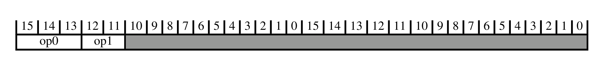

下表给出解码字段取值与所关联的子分组：

| op0 | op1 | 子分组 |
| --- | --- | --- |
| != 111 | - | 16 位 T32 指令编码 |
| 111 | != 00 | 32 位 T32 指令编码 |

下表给出解码字段取值与所关联的指令：

| op0 | op1 | 指令 |
| --- | --- | --- |
| 111 | 00 | B T2 |

## 2. 16 位 T32 指令编码

本节描述 16 位 T32 指令编码的编码方式。本节由**顶层 T32 指令集编码**解码。

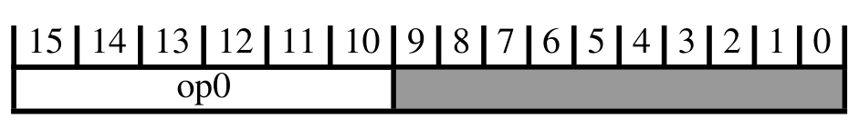

下表给出解码字段取值与所关联的子分组：

| op0 | 子分组 |
| --- | --- |
| 00xxxx | （立即数）移位、加、减、移动与比较 |
| 010000 | 数据处理（两个低寄存器） |
| 010001 | 特殊数据指令以及分支与交换 |
| 0101xx | 加载/存储（寄存器偏移） |
| 011xxx | 加载/存储字/字节（立即数偏移） |
| 1000xx | 加载/存储半字（立即数偏移） |
| 1001xx | 加载/存储（SP 相对） |
| 1010xx | 加 PC/SP（立即数） |
| 1011xx | 杂项 16 位指令 |
| 1100xx | 加载/存储多寄存器 |
| 1101xx | 条件分支与超级用户调用 |

下表给出解码字段取值与所关联的指令：

| op0 | 指令 |
| --- | --- |
| 01001x | LDR (literal) T1 |

### 2.1. （立即数）移位、加、减、移动与比较
本节描述**（立即数）移位、加、减、移动与比较**的编码方式。本节由 **16 位 T32 指令编码**解码。

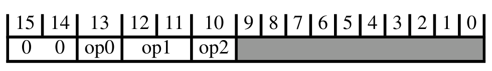

下表给出解码字段取值与所关联的子分组：

| op0 | op1 | op2 | 子分组 |
| --- | --- | --- | --- |
| 0 | 11 | 0 | 加、减（三个低寄存器） |
| 0 | 11 | 1 | 加、减（两个低寄存器与立即数） |
| 1 | - | - | 加、减、比较、移动（一个低寄存器与立即数） |

下表给出解码字段取值与所关联的指令：

| op0 | op1 | op2 | 指令 | 别名 |
| --- | --- | --- | --- | --- |
| Alias |  |  | ASRS (immediate) T2 | ASR (immediate) T2 |
|  |  |  | LSLS (immediate) T2 | LSL (immediate) T2 |
|  |  |  | LSRS (immediate) T2 | LSR (immediate) T2 |
| 0 | != 11 | - | MOV (register) T2 |  |

#### 2.1.1. 加、减（三个低寄存器）
本节描述**加、减（三个低寄存器）**的编码方式。本节由**（立即数）移位、加、减、移动与比较**解码。

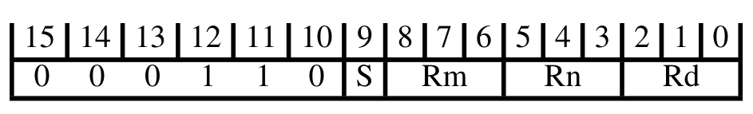

下表给出解码字段取值与所关联的指令：

| S | 指令 |
| --- | --- |
| 0 | ADD (register) T1 |
| 1 | SUB (register) T1 |

#### 2.1.2. 加、减（两个低寄存器与立即数）
本节描述**加、减（两个低寄存器与立即数）**的编码方式。本节由**（立即数）移位、加、减、移动与比较**解码。

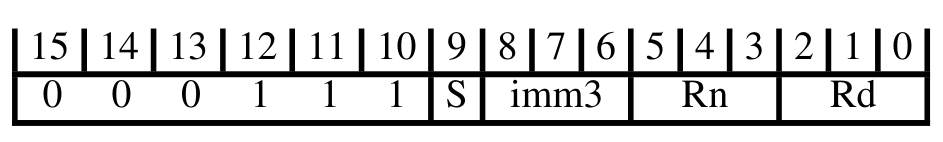

下表给出解码字段取值与所关联的指令：

| S | 指令 |
| --- | --- |
| 0 | ADD (immediate) T1 |
| 1 | SUB (immediate) T1 |

#### 2.1.3. 加、减、比较、移动（一个低寄存器与立即数）
本节描述**加、减、比较、移动（一个低寄存器与立即数）**的编码方式。本节由**（立即数）移位、加、减、移动与比较**解码。

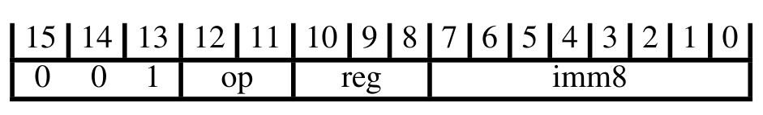

下表给出解码字段取值与所关联的指令：

| op | 指令 |
| --- | --- |
| 00 | MOV (immediate) T1 |
| 01 | CMP (immediate) T1 |
| 10 | ADD (immediate) T2 |
| 11 | SUB (immediate) T2 |

### 2.2. 数据处理（两个低寄存器）
本节描述**数据处理（两个低寄存器）**的编码方式。本节由 **16 位 T32 指令编码**解码。

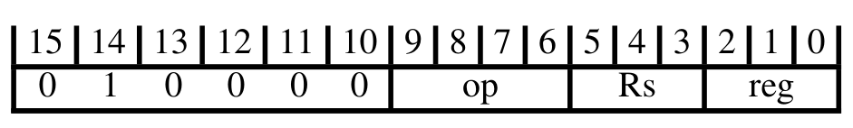

下表给出解码字段取值与所关联的指令：

| op | 指令 |
| --- | --- |
| 0000 | AND (register) T1 |
| 0001 | EOR (register) T1 |
| Alias | LSL (register) T1 |
| Alias | LSLS (register) T1 |
| Alias | LSR (register) T1 |
| Alias | LSRS (register) T1 |
| Alias | ASR (register) T1 |
| Alias | ASRS (register) T1 |
| 0101 | ADC (register) T1 |
| 0110 | SBC (register) T1 |
| Alias | ROR (register) T1 |
| Alias | RORS (register) T1 |
| 1000 | TST (register) T1 |
| 1001 | RSB (immediate) T1 |
| 1010 | CMP (register) T1 |
| 1011 | CMN (register) T1 |
| 1100 | ORR (register) T1 |
| 1101 | MUL T1 |
| 1110 | BIC (register) T1 |
| 1111 | MVN (register) T1 |
| 0010 |  |
| 0011 |  |
| 0100 |  |
| 0111 |  |

### 2.3. 特殊数据指令以及分支与交换
本节描述**特殊数据指令以及分支与交换**的编码方式。本节由 **16 位 T32 指令编码**解码。

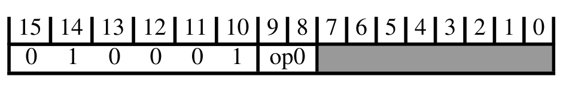

下表给出解码字段取值与所关联的子分组：

| op0 | 子分组 |
| --- | --- |
| 11 | 分支与交换 |
| != 11 | 加、减、比较、移动（两个高寄存器） |

#### 2.3.1. 分支与交换
本节描述**分支与交换**的编码方式。本节由**特殊数据指令以及分支与交换**解码。

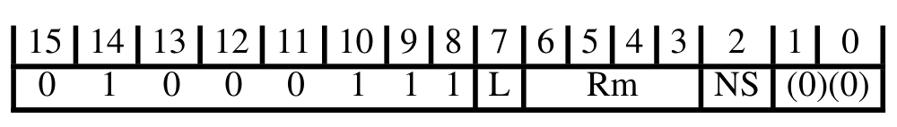

下表给出解码字段取值与所关联的指令：

| L | 指令 |
| --- | --- |
| 0 | BX, BXNS T1 |
| 1 | BLX, BLXNS T1 |

#### 2.3.2. 加、减、比较、移动（两个高寄存器）
本节描述**加、减、比较、移动（两个高寄存器）**的编码方式。本节由**特殊数据指令以及分支与交换**解码。

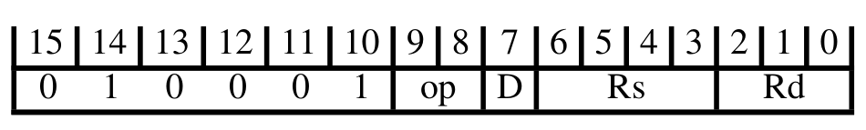

下表给出解码字段取值与所关联的指令：

| D:Rd | Rs | op | 指令 |
| --- | --- | --- | --- |
| != 1101 | != 1101 | 00 | ADD (register) T2 |
| - | 1101 | 00 | ADD (SP plus register) T1 |
| 1101 | != 1101 | 00 | ADD (SP plus register) T2 |
| - | - | 01 | CMP (register) T2 |
| - | - | 10 | MOV (register) T1 |

### 2.4. 加载/存储（寄存器偏移）
本节描述**加载/存储（寄存器偏移）**的编码方式。本节由 **16 位 T32 指令编码**解码。

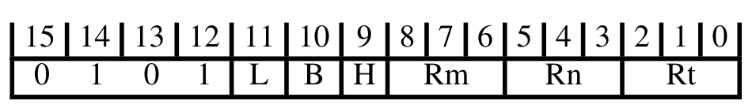

下表给出解码字段取值与所关联的指令：

| B | H | L | 指令 |
| --- | --- | --- | --- |
| 0 | 0 | 0 | STR (register) T1 |
| 0 | 1 | 0 | STRH (register) T1 |
| 1 | 0 | 0 | STRB (register) T1 |
| 1 | 1 | 0 | LDRSB (register) T1 |
| 0 | 0 | 1 | LDR (register) T1 |
| 0 | 1 | 1 | LDRH (register) T1 |
| 1 | 0 | 1 | LDRB (register) T1 |
| 1 | 1 | 1 | LDRSH (register) T1 |

### 2.5. 加载/存储字/字节（立即数偏移）
本节描述**加载/存储字/字节（立即数偏移）**的编码方式。本节由 **16 位 T32 指令编码**解码。

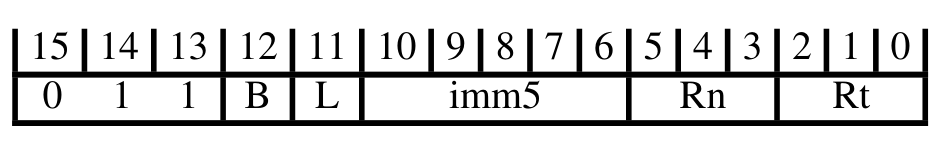

下表给出解码字段取值与所关联的指令：

| B | L | 指令 |
| --- | --- | --- |
| 0 | 0 | STR (immediate) T1 |
| 0 | 1 | LDR (immediate) T1 |
| 1 | 0 | STRB (immediate) T1 |
| 1 | 1 | LDRB (immediate) T1 |

### 2.6. 加载/存储半字（立即数偏移）
本节描述**加载/存储半字（立即数偏移）**的编码方式。本节由 **16 位 T32 指令编码**解码。

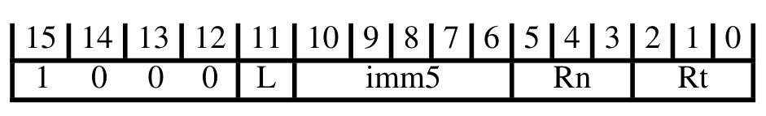

下表给出解码字段取值与所关联的指令：

| L | 指令 |
| --- | --- |
| 0 | STRH (immediate) T1 |
| 1 | LDRH (immediate) T1 |

### 2.7. 加载/存储（SP 相对）
本节描述**加载/存储（SP 相对）**的编码方式。本节由 **16 位 T32 指令编码**解码。

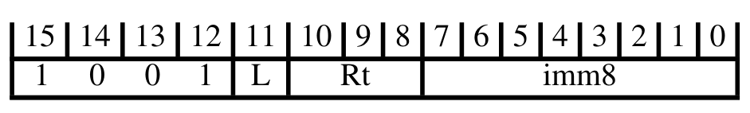

下表给出解码字段取值与所关联的指令：

| L | 指令 |
| --- | --- |
| 0 | STR (immediate) T2 |
| 1 | LDR (immediate) T2 |

### 2.8. 加 PC/SP（立即数）
本节描述**加 PC/SP（立即数）**的编码方式。本节由 **16 位 T32 指令编码**解码。

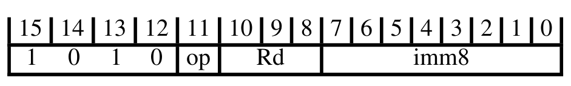

下表给出解码字段取值与所关联的指令：

| op | 指令 |
| --- | --- |
| Alias | ADD (immediate, to PC) T1 |
| 0 | ADR T1 |
| 1 | ADD (SP plus immediate) T1 |

### 2.9. 杂项 16 位指令
本节描述**杂项 16 位指令**的编码方式。本节由 **16 位 T32 指令编码**解码。

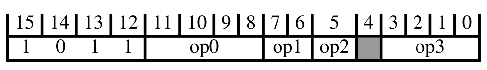

下表给出解码字段取值与所关联的子分组：

| op0 | op1 | op2 | op3 | 子分组 |
| --- | --- | --- | --- | --- |
| 0000 | - | - | - | 调整 SP（立即数） |
| 0010 | - | - | - | 扩展 |
| 1010 | != 10 | - | - | 反转字节 |
| 1111 | - | - | 0000 | 提示 |
| x10x | - | - | - | 压栈与出栈 |

下表给出解码字段取值与所关联的指令：

| op0 | op1 | op2 | op3 | 指令 |
| --- | --- | --- | --- | --- |
| 0110 | 01 | 1 | - | CPS T1 |
| 1110 | - | - | - | BKPT T1 |
| 1111 | - | - | != 0000 | IT T1 |
| x0x1 | - | - | - | CBNZ, CBZ T1 |

#### 2.9.1. 调整 SP（立即数）
本节描述**调整 SP（立即数）**的编码方式。本节由**杂项 16 位指令**解码。

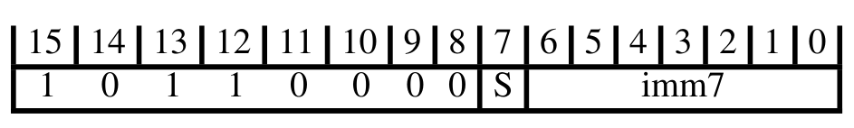

下表给出解码字段取值与所关联的指令：

| S | 指令 |
| --- | --- |
| 0 | ADD (SP plus immediate) T2 |
| 1 | SUB (SP minus immediate) T1 |

#### 2.9.2. 扩展
本节描述**扩展**的编码方式。本节由**杂项 16 位指令**解码。

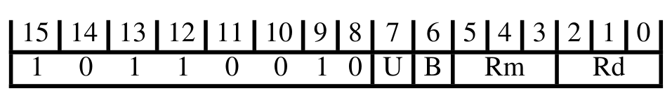

下表给出解码字段取值与所关联的指令：

| B | U | 指令 |
| --- | --- | --- |
| 0 | 0 | SXTH T1 |
| 1 | 0 | SXTB T1 |
| 0 | 1 | UXTH T1 |
| 1 | 1 | UXTB T1 |

#### 2.9.3. 反转字节
本节描述**反转字节**的编码方式。本节由**杂项 16 位指令**解码。

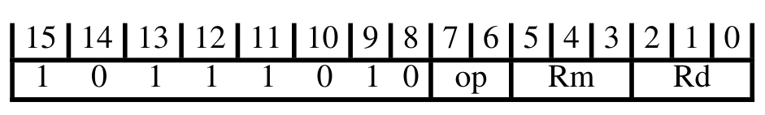

下表给出解码字段取值与所关联的指令：

| op | 指令 |
| --- | --- |
| 00 | REV T1 |
| 01 | REV16 T1 |
| 11 | REVSH T1 |

#### 2.9.4. 提示
本节描述**提示**的编码方式。本节由**杂项 16 位指令**解码。

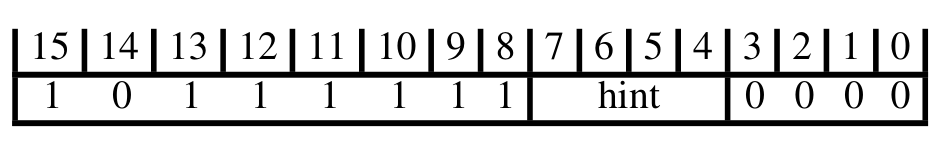

下表给出解码字段取值与所关联的指令：

| hint | 指令 |
| --- | --- |
| 0000 | NOP T1 |
| 0001 | YIELD T1 |
| 0010 | WFE T1 |
| 0011 | WFI T1 |
| 0100 | SEV T1 |
| 0101 | 保留提示，表现为 NOP |
| 011x | 保留提示，表现为 NOP |
| 1xxx | 保留提示，表现为 NOP |

#### 2.9.5. 压栈与出栈
本节描述**压栈与出栈**的编码方式。本节由**杂项 16 位指令**解码。

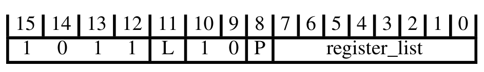

下表给出解码字段取值与所关联的指令：

| L | 指令 |
| --- | --- |
| 1 | LDM, LDMIA, LDMFD T3 |
| Alias | POP (multiple registers) T3 |
| Alias | PUSH (multiple registers) T2 |
| 0 | STMDB, STMFD T2 |

### 2.10. 加载/存储多寄存器
本节描述**加载/存储多寄存器**的编码方式。本节由 **16 位 T32 指令编码**解码。


下表给出解码字段取值与所关联的指令：

| L | 指令 |
| --- | --- |
| 1 | LDM, LDMIA, LDMFD T1 |
| 0 | STM, STMIA, STMEA T1 |

### 2.11. 条件分支与超级用户调用
本节描述**条件分支与超级用户调用**的编码方式。本节由 **16 位 T32 指令编码**解码。

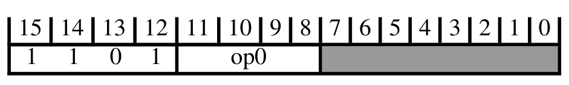

下表给出解码字段取值与所关联的子分组：

| op0 | 子分组 |
| --- | --- |
| 111x | 异常生成 |

下表给出解码字段取值与所关联的指令：

| op0 | 指令 |
| --- | --- |
| != 111x | B T1 |

#### 2.11.1. 异常生成
本节描述**异常生成**的编码方式。本节由**条件分支与超级用户调用**解码。


下表给出解码字段取值与所关联的指令：

| S | imm8 | 指令 |
| --- | --- | --- |
| 0 | - | UDF T1 |
| 1 | - | SVC T1 |

## 3. 32 位 T32 指令编码

本节描述 **32 位 T32 指令编码**的编码方式。本节由**顶层 T32 指令集编码**解码。

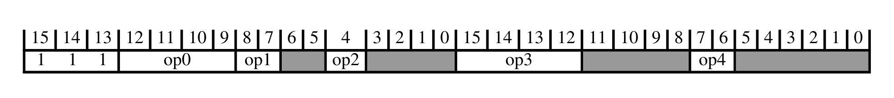

下表给出解码字段取值与所关联的子分组：

| op0 | op1 | op1:op2 | op2 | op3 | op4 | 子分组 |
| --- | --- | --- | --- | --- | --- | --- |
| x11x | - | - | - | - | - | 协处理器、浮点与向量指令 |
| 0100 | - | - | - | - | - | 加载/存储（多寄存器、双字、独占、获取-释放） |
| 0101 | - | - | - | - | - | 数据处理（移位寄存器） |
| 10xx | - | - | - | 1xxx | - | 分支与杂项控制 |
| 10x0 | - | - | - | 0xxx | - | 数据处理（修改立即数） |
| 10x1 | - | - | 0 | 0xxx | - | 数据处理（纯二进制立即数） |
| 1100 | - | != 1x0 | - | - | - | 加载/存储单个 |
| 1101 | 0x | - | - | 1111 | - | 数据处理（寄存器） |
| 1101 | 10 | - | - | - | 00 | 乘法、乘加与绝对差 |
| 1101 | 11 | - | - | - | - | 长乘法与除法 |

### 3.1. 协处理器、浮点与向量指令

本节描述**协处理器、浮点与向量指令**的编码方式。本节由 **32 位 T32 指令编码**解码。

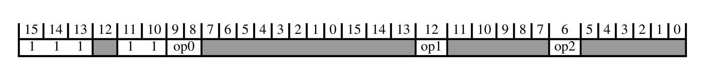

下表给出解码字段取值与所关联的子分组：

| op0 | op1 | op2 | 子分组 |
| --- | --- | --- | --- |
| 10 | - | - | 浮点与向量杂项指令 |
| 0x | - | - | 浮点与向量加载/存储、移动与协处理器指令 |
| 11 | 0 | 1 | 杂项向量算术指令 |

#### 3.1.1. 浮点与向量杂项指令

本节描述**浮点与向量杂项指令**的编码方式。本节由**协处理器、浮点与向量指令**解码。

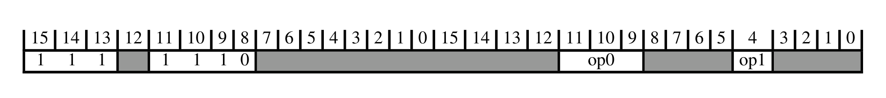

下表给出解码字段取值与所关联的子分组：

| op0 | op1 | 子分组 |
| --- | --- | --- |
| 0xx | - | 协处理器数据处理指令 |
| 100 | 1 | 向量移动指令 |
| 10x | 0 | 浮点数据处理、minNum/maxNum 与转换 |
| 101 | 1 | 浮点与向量移动（寄存器） |
| 110 | - | 架构定义的协处理器数据处理指令 |
| 111 | 0 | 向量立即数与寄存器，以及协处理器数据处理指令 |

##### 3.1.1.1. 协处理器数据处理指令

本节描述**协处理器数据处理指令**的编码方式。本节由**浮点与向量杂项指令**解码。

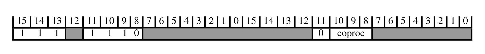

下表给出解码字段取值与所关联的子分组：

| CoprocType(UInt(coproc)) | 子分组 |
| --- | --- |
| CP_GCP | 架构定义的协处理器数据处理指令 |
| CP_CDEv1 | 自定义通用寄存器指令 |

###### 架构定义的协处理器数据处理指令

本节描述**架构定义的协处理器数据处理指令**的编码方式。本节由**协处理器数据处理指令**解码。

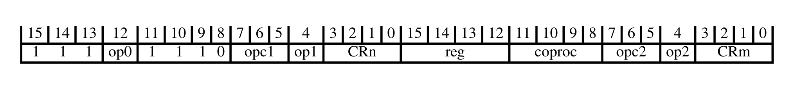

下表给出解码字段取值与所关联的指令：

| op0 | op1 | op2 | 指令 |
| --- | --- | --- | --- |
| 0 | - | 0 | CDP, CDP2 T1 |
| 1 | - | 0 | CDP, CDP2 T2 |
| 0 | 0 | 1 | MCR, MCR2 T1 |
| 1 | 0 | 1 | MCR, MCR2 T2 |
| 0 | 1 | 1 | MRC, MRC2 T1 |
| 1 | 1 | 1 | MRC, MRC2 T2 |

###### 自定义通用寄存器指令

本节描述**自定义通用寄存器指令**的编码方式。本节由**协处理器数据处理指令**解码。

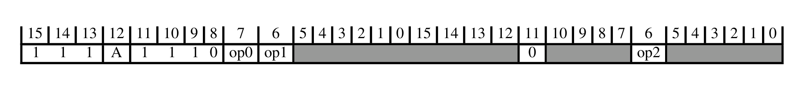

下表给出解码字段取值与所关联的指令：

| op0 | op1 | op2 | 指令 |
| --- | --- | --- | --- |
| 0 | 0 | 0 | CX1 T1 |
| 0 | 0 | 1 | CX1D T1 |
| 0 | 1 | 0 | CX2 T1 |
| 0 | 1 | 1 | CX2D T1 |
| 1 | - | 0 | CX3 T1 |
| 1 | - | 1 | CX3D T1 |

##### 3.1.1.2. 向量移动指令

本节描述**向量移动指令**的编码方式。本节由**浮点与向量杂项指令**解码。

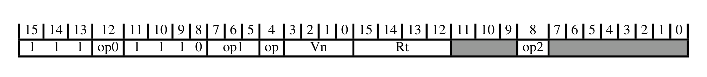

下表给出解码字段取值与所关联的指令：

| op0 | op1 | op2 | 指令 |
| --- | --- | --- | --- |
| 0 | 000 | 1 | VMOV (between general-purpose register and half-precision register) T1 |

##### 3.1.1.3. 浮点数据处理、minNum/maxNum 与转换

本节描述**浮点数据处理、minNum/maxNum 与转换**的编码方式。本节由**浮点与向量杂项指令**解码。

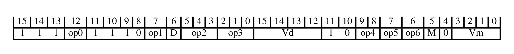

下表给出解码字段取值与所关联的指令：

| op0 | op1 | op2 | op3 | op4 | op5 | op6 | 指令 |
| --- | --- | --- | --- | --- | --- | --- | --- |
| 1 | 1 | 00x | - | - | - | 1 | VMINNM T2 |
| 1 | 1 | 111 | 110 | - | - | 1 | VCVTP T1 |
| 0 | 1 | 00x | - | - | - | 0 | VDIV T1 |
| 0 | 0 | 11x | - | - | - | 0 | VADD T2 |
| 0 | 0 | 01x | - | - | - | 0 | VNMLS T1 |
| 1 | 1 | 111 | 010 | - | 0 | 1 | VRINTP T1 |
| 0 | 1 | 110 | 000 | 1x | 0 | 1 | VMOV (register) T2 |
| 0 | 1 | 111 | 000 | - | - | 1 | VCVT (integer to floating-point) T1 |
| 0 | 1 | 10x | - | - | - | 1 | VFMS T2 |
| 0 | 1 | 01x | - | - | - | 0 | VFNMS T1 |
| 0 | 1 | 110 | 100 | - | 1 | 1 | VCMPE T1 |
| 0 | 1 | 110 | 101 | - | 1 | 1 | VCMPE T2 |
| 0 | 1 | 110 | 01x | 1x | 1 | 1 | VCVTT T1 |
| 1 | 1 | 111 | 011 | - | 0 | 1 | VRINTM T1 |
| 1 | 1 | 111 | 000 | - | 0 | 1 | VRINTA T1 |
| 0 | 1 | 110 | 001 | - | 0 | 1 | VNEG T2 |
| 0 | 1 | 110 | 111 | - | 0 | 1 | VRINTX T1 |
| 1 | 1 | 111 | 111 | - | - | 1 | VCVTM T1 |
| 0 | 1 | 110 | 01x | 1x | 0 | 1 | VCVTB T1 |
| 1 | 1 | 00x | - | - | - | 0 | VMAXNM T2 |
| 0 | 0 | 00x | - | - | - | 0 | VMLA T2 |
| 0 | 0 | 00x | - | - | - | 1 | VMLS T2 |
| 0 | 1 | 111 | 10x | - | 1 | 1 | VCVT (floating-point to integer) T1 |
| 0 | 1 | 01x | - | - | - | 1 | VFNMA T1 |
| 0 | 1 | 10x | - | - | - | 0 | VFMA T2 |
| 0 | 1 | 110 | 000 | - | 1 | 1 | VABS T2 |
| 0 | 1 | 110 | 110 | - | 0 | 1 | VRINTR T1 |
| 0 | 1 | 11x | - | - | - | 0 | VMOV (immediate) T2 |
| 0 | 1 | 110 | 100 | - | 0 | 1 | VCMP T1 |
| 1 | 1 | 110 | 000 | 10 | 0 | 1 | VMOVX T1 |
| 0 | 1 | 110 | 101 | - | 0 | 1 | VCMP T2 |
| 0 | 1 | 110 | 111 | 1x | 1 | 1 | VCVT (between double-precision and single-precision) T1 |
| 0 | 1 | 111 | x1x | - | - | 1 | VCVT (between floating-point and fixed-point) T1 |
| 1 | 1 | 110 | 000 | 10 | 1 | 1 | VINS T1 |
| 1 | 1 | 111 | 001 | - | 0 | 1 | VRINTN T1 |
| 1 | 0 | - | - | - | - | 0 | VSEL T1 |
| 0 | 0 | 01x | - | - | - | 1 | VNMLA T1 |
| 0 | 1 | 110 | 110 | - | 1 | 1 | VRINTZ T1 |
| 1 | 1 | 111 | 101 | - | - | 1 | VCVTN T1 |
| 0 | 0 | 10x | - | - | - | 0 | VMUL T2 |
| 1 | 1 | 111 | 100 | - | - | 1 | VCVTA T1 |
| 0 | 1 | 110 | 001 | - | 1 | 1 | VSQRT T1 |
| 0 | 1 | 111 | 10x | - | 0 | 1 | VCVTR T1 |
| 0 | 0 | 10x | - | - | - | 1 | VNMUL T2 |
| 0 | 0 | 11x | - | - | - | 1 | VSUB T2 |

##### 3.1.1.4. 浮点与向量移动（寄存器）

本节描述**浮点与向量移动（寄存器）**的编码方式。本节由**浮点与向量杂项指令**解码。

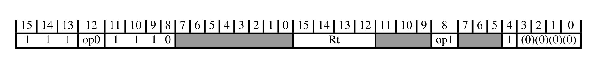

下表给出解码字段取值与所关联的子分组：

| op0 | op1 | 子分组 |
| --- | --- | --- |
| 0 | 1 M | 浮点寄存器与向量寄存器之间的移动 |
| 0 | 0 M | 通用寄存器与浮点特殊寄存器之间的移动 |

###### 浮点寄存器与向量寄存器之间的移动

本节描述**浮点寄存器与向量寄存器之间的移动**的编码方式。本节由**浮点与向量移动（寄存器）**解码。

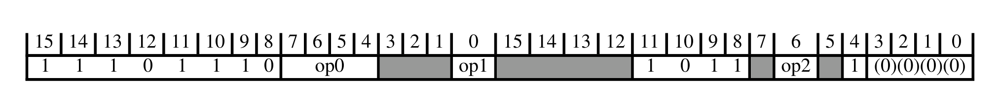

下表给出解码字段取值与所关联的指令：

| op0 | op1 | op2 | 指令 |
| --- | --- | --- | --- |
| 1x10 | 0 | 0 | VDUP T1 |
| 0xx0 | - | - | VMOV (general-purpose register to vector lane) T1 |
| xxx1 | - | - | VMOV (vector lane to general-purpose register) T1 |
| Alias |  |  | VMOV (single general-purpose register to half of doubleword register) T1 |
| Alias |  |  | VMOV (half of doubleword register to single general-purpose register) T1 |

###### 通用寄存器与浮点特殊寄存器之间的移动

本节描述**通用寄存器与浮点特殊寄存器之间的移动**的编码方式。本节由**浮点与向量移动（寄存器）**解码。

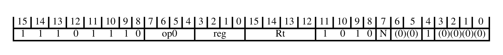

下表给出解码字段取值与所关联的指令：

| op0 | 指令 |
| --- | --- |
| 000x | VMOV (between general-purpose register and single-precision register) T1 |
| 1111 | VMRS T1 |
| 1110 | VMSR T1 |

##### 3.1.1.5. 架构定义的协处理器数据处理指令

本节描述**架构定义的协处理器数据处理指令**的编码方式。本节由**浮点与向量杂项指令**解码。


下表给出解码字段取值与所关联的指令：

| op0 | op1 | op2 | 指令 |
| --- | --- | --- | --- |
| 0 | - | 0 | CDP, CDP2 T1 |
| 1 | - | 0 | CDP, CDP2 T2 |
| 0 | 0 | 1 | MCR, MCR2 T1 |
| 1 | 0 | 1 | MCR, MCR2 T2 |
| 0 | 1 | 1 | MRC, MRC2 T1 |
| 1 | 1 | 1 | MRC, MRC2 T2 |

##### 3.1.1.6. 向量立即数与寄存器，以及协处理器数据处理指令

本节描述**向量立即数与寄存器，以及协处理器数据处理指令**的编码方式。本节由**浮点与向量杂项指令**解码。

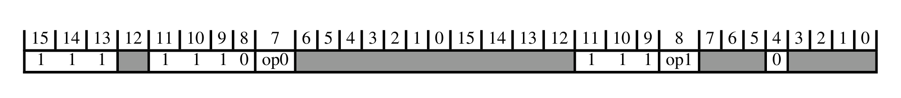

下表给出解码字段取值与所关联的子分组：

| op0 | op1 | 子分组 |
| --- | --- | --- |
| 0 | 0 | 杂项向量寄存器指令 |
| 1 | 0 | 杂项向量寄存器与立即数指令 |
| 0 | 1 | 向量寄存器、立即数与谓词化指令 |
| 1 | 1 | 向量算术、最小值、最大值与移位指令 |

###### 杂项向量寄存器指令

本节描述**杂项向量寄存器指令**的编码方式。本节由**向量立即数与寄存器，以及协处理器数据处理指令**解码。

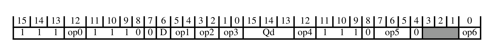

下表给出解码字段取值与所关联的指令：

| op0 | op1 | op2 | op3 | op4 | op5 | op6 | 指令 |
| --- | --- | --- | --- | --- | --- | --- | --- |
| 0 | 11 | != 11 | 01 | - | 10x | 1 | VQMOVUN T1 |
| - | != 11 | - | x1 | 1 | x10 | - | VMLAS (vector by vector plus scalar) T1 |
| - | 11 | != 11 | 11 | 1 | 10x | 1 | VMIN, VMINA T2 |
| 1 | != 11 | - | x0 | - | x0x | 0 | VQDMLSDH, VQRDMLSDH T1 |
| - | 11 | != 11 | 01 | 1 | 111 | - | VQSHL, VQSHLU T1 |
| - | 11 | 11 | 11 | 1 | 10x | 1 | VMINNM, VMINNMA (floating-point) T2 |
| - | 11 | != 11 | 11 | 0 | 10x | 1 | VMAX, VMAXA T2 |
| - | 11 | - | x1 | - | x0x | 0 | VMULL (polynomial) T1 |
| 1 | 11 | != 11 | 01 | - | 10x | 1 | VMOVN T1 |
| - | != 11 | - | x1 | 0 | x0x | 1 | VMULH, VRMULH T1 |
| - | != 11 | - | x1 | 1 | x0x | 1 | VMULH, VRMULH T2 |
| 0 | != 11 | - | x1 | 1 | x11 | - | VMUL (vector) T2 |
| - | != 11 | - | x0 | 0 | x11 | - | VQDMLAH, VQRDMLAH (vector by scalar plus vector) T1 |
| - | != 11 | - | x0 | 0 | x10 | - | VQDMLAH, VQRDMLAH (vector by scalar plus vector) T2 |
| - | 11 | - | x1 | 0 | x10 | - | VFMA (vector by scalar plus vector, floating-point) T1 |
| 0 | != 11 | - | x0 | - | x0x | 1 | VQDMLADH, VQRDMLADH T2 |
| - | 11 | - | x1 | 0 | x11 | - | VMUL (floating-point) T2 |
| - | 11 | - | x1 | 1 | x10 | - | VFMAS (vector by vector plus scalar, floating-point) T1 |
| 0 | != 11 | - | x1 | 0 | x11 | - | VQDMULH, VQRDMULH T3 |
| - | 11 | - | x0 | - | x0x | - | VCMUL (floating-point) T1 |
| 0 | != 11 | - | x0 | - | x0x | 0 | VQDMLADH, VQRDMLADH T1 |
| 1 | != 11 | - | x1 | 0 | x11 | - | VQDMULH, VQRDMULH T4 |
| 1 | != 11 | - | x0 | - | x0x | 1 | VQDMLSDH, VQRDMLSDH T2 |
| - | != 11 | - | x0 | 1 | x11 | - | VQDMLASH, VQRDMLASH (vector by vector plus scalar) T1 |
| - | != 11 | - | x0 | 1 | x10 | - | VQDMLASH, VQRDMLASH (vector by vector plus scalar) T2 |
| - | 11 | != 11 | 01 | - | 00x | 1 | VSHLL T2 |
| - | 11 | != 11 | 11 | 1 | 011 | - | VRSHL T2 |
| - | 11 | != 11 | 01 | 1 | 011 | - | VSHL T2 |
| - | 11 | 11 | 11 | - | 00x | 1 | VCVT (between single and half-precision floating-point) T1 |
| - | 11 | != 11 | 11 | - | 00x | 1 | VQMOVN T1 |
| - | != 11 | - | x1 | - | x0x | 0 | VMULL (integer) T1 |
| 1 | != 11 | - | x1 | 1 | x11 | - | VBRSR T1 |
| - | 11 | 11 | 11 | 0 | 10x | 1 | VMAXNM, VMAXNMA (floating-point) T2 |
| - | 11 | != 11 | 11 | 1 | 111 | - | VQRSHL T2 |
| - | != 11 | - | x1 | 0 | x10 | - | VMLA (vector by scalar plus vector) T1 |

###### 杂项向量寄存器与立即数指令

本节描述**杂项向量寄存器与立即数指令**的编码方式。本节由**向量立即数与寄存器，以及协处理器数据处理指令**解码。

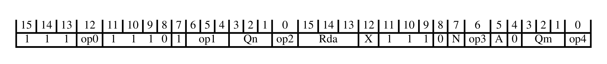

下表给出解码字段取值与所关联的指令：

| op0 | op1 | op2 | op3 | op4 | 指令 |
| --- | --- | --- | --- | --- | --- |
| - | 111 | - | 0 | 0 | VMLADAV T1 |
| Alias |  |  |  |  | VMLAV T1 |
| Alias |  |  |  |  | VMLALV T1 |
| - | != 111 | - | 0 | 0 | VMLALDAV T1 |
| 0 | != 111 | - | 0 | 1 | VMLSLDAV T1 |
| 0 | 111 | - | 0 | 1 | VMLSDAV T1 |
| 1 | 111 | 0 | 0 | 1 | VMLSDAV T2 |
| 1 | != 111 | 0 | 0 | 1 | VRMLSLDAVH T1 |

###### 向量寄存器、立即数与谓词化指令

本节描述**向量寄存器、立即数与谓词化指令**的编码方式。本节由**向量立即数与寄存器，以及协处理器数据处理指令**解码。

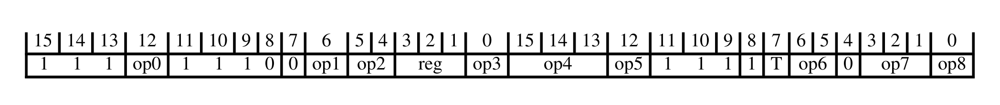

下表给出解码字段取值与所关联的指令：

| op0 | op1:op4 | op2 | op3:op4:op5 | op5:op8 | op6 | op7 | op7:op8 | op8 | 指令 |
| --- | --- | --- | --- | --- | --- | --- | --- | --- | --- |
| 0 | - | != 11 | 1xxx0 | - | 11 | 111 | - | - | VIDUP, VIWDUP T2 |
| 0 | - | != 11 | 1xxx0 | - | 11 | != 111 | - | - | VIDUP, VIWDUP T1 |
| - | - | 11 | 0xxxx | - | 0x | - | - | 1 | VQDMULL T1 |
| - | - | != 11 | 0xxx0 | - | 11 | - | - | - | VQADD T2 |
| - | - | 11 | 0xxx0 | - | 10 | - | - | - | VADD (floating-point) T2 |
| 0 | - | != 11 | 1xxx1 | - | 10 | - | - | - | VSUB (vector) T2 |
| 0 | - | != 11 | 1xxx0 | - | 10 | - | - | - | VADD (vector) T2 |
| 0 | - | != 11 | 0xxxx | - | 0x | - | - | 0 | VHCADD T1 |
| 0 | - | != 11 | 1xxx1 | - | 11 | 111 | - | - | VDDUP, VDWDUP T2 |
| 0 | - | != 11 | 1xxx1 | - | 11 | != 111 | - | - | VDDUP, VDWDUP T1 |
| 1 | - | != 11 | 0xxxx | - | 0x | - | - | 0 | VCADD T1 |
| - | - | != 11 | 0xxx0 | - | 10 | - | - | - | VHADD T2 |
| - | - | 11 | 0xxx1 | - | 10 | - | - | - | VSUB (floating-point) T2 |
| - | - | != 11 | 0xxx1 | - | 10 | - | - | - | VHSUB T2 |
| 1 | - | 11 | 1xxx0 | 01 | 0x | - | - | - | VPSEL T1 |
| 1 | 0000 | 11 | 1xxxx | - | 1x | - | 1101 | - | VPNOT T1 |
| 1 | 0000 | != 11 | 10000 | - | 0x | - | - | 0 | VCMP (vector) T1 |
| 1 | 0000 | != 11 | 10000 | - | 0x | - | - | 1 | VCMP (vector) T2 |
| 1 | 0000 | != 11 | 10001 | - | 0x | - | - | - | VCMP (vector) T3 |
| 1 | 0000 | != 11 | 10000 | - | 10 | - | - | - | VCMP (vector) T4 |
| 1 | 0000 | != 11 | 10000 | - | 11 | - | - | - | VCMP (vector) T5 |
| 1 | 0000 | != 11 | 10001 | - | 1x | - | - | - | VCMP (vector) T6 |
| - | 0000 | 11 | 1000x | - | 1x | - | != 1101 | - | VCMP (floating-point) T2 |
| - | 0000 | 11 | 1000x | != 01 | 0x | - | - | - | VCMP (floating-point) T1 |
| 1 | != 0000 | 11 | 1xxxx | - | 1x | - | 1101 | - | VPST T1 |
| 1 | != 0000 | != 11 | 1xxx0 | - | 0x | - | - | 0 | VPT T1 |
| 1 | != 0000 | != 11 | 1xxx0 | - | 0x | - | - | 1 | VPT T2 |
| 1 | != 0000 | != 11 | 1xxx1 | - | 0x | - | - | - | VPT T3 |
| 1 | != 0000 | != 11 | 1xxx0 | - | 10 | - | - | - | VPT T4 |
| 1 | != 0000 | != 11 | 1xxx0 | - | 11 | - | - | - | VPT T5 |
| 1 | != 0000 | != 11 | 1xxx1 | - | 1x | - | - | - | VPT T6 |
| - | != 0000 | 11 | 1xxxx | - | 1x | - | != 1101 | - | VPT (floating-point) T2 |
| - | != 0000 | 11 | 1xxxx | != 01 | 0x | - | - | - | VPT (floating-point) T1 |
| 0 | - | 11 | 0xxxx | - | 0x | - | - | 0 | VADC T1 |
| - | - | != 11 | 0xxx1 | - | 11 | - | - | - | VQSUB T2 |
| - | - | 11 | 0xxxx | - | 11 | - | - | - | VQDMULL T2 |
| 1 | - | 11 | 0xxxx | - | 0x | - | - | 0 | VSBC T1 |

###### 向量算术、最小值、最大值与移位指令

本节描述**向量算术、最小值、最大值与移位指令**的编码方式。本节由**向量立即数与寄存器，以及协处理器数据处理指令**解码。

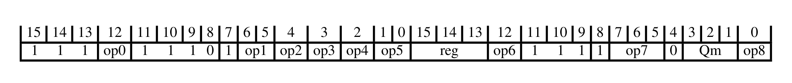

下表给出解码字段取值与所关联的指令：

| op0 | op1:op2 | op2:op3:op4:op5 | op3:op4 | op5 | op6 | op7 | op8 | 指令 |
| --- | --- | --- | --- | --- | --- | --- | --- | --- |
| - | 110 | - | != 11 | 00 | - | 10x | 0 | VMINV, VMINAV T2 |
| 0 | x0x | - | - | - | - | 11x | 1 | VSHRN T1 |
| - | 110 | - | != 11 | 10 | - | 10x | 0 | VMINV, VMINAV T1 |
| 1 | x0x | - | - | - | - | 11x | 0 | VQRSHRUN T1 |
| - | 110 | - | 11 | 10 | - | 10x | 0 | VMINNMV, VMINNMAV (floating-point) T1 |
| - | 111 | - | - | x0 | - | x0x | 0 | VMLADAV T2 |
| - | != 111 | - | - | 01 | - | 00x | 0 | VADDLV T1 |
| - | 111 | - | != 11 | 01 | - | 00x | 0 | VADDV T1 |
| - | 110 | - | 11 | 00 | - | 10x | 0 | VMINNMV, VMINNMAV (floating-point) T2 |
| 0 | x1x | - | - | - | 0 | 110 | - | VSHLC T1 |
| 0 | x0x | - | - | - | - | 11x | 0 | VQSHRUN T1 |
| - | x0x | - | - | - | - | 01x | 0 | VQSHRN T1 |
| 1 | x0x | - | - | - | - | 11x | 1 | VRSHRN T1 |
| - | 110 | - | 11 | 10 | - | 00x | 0 | VMAXNMV, VMAXNMAV (floating-point) T1 |
| - | 110 | - | != 11 | 00 | - | 00x | 0 | VMAXV, VMAXAV T2 |
| - | 110 | - | != 11 | 10 | - | 00x | 0 | VMAXV, VMAXAV T1 |
| - | 110 | - | 11 | 00 | - | 00x | 0 | VMAXNMV, VMAXNMAV (floating-point) T2 |
| - | != 11x | - | - | x0 | - | x0x | 0 | VRMLALDAVH T1 |
| Alias |  |  |  |  |  |  |  | VRMLALVH T1 |
| - | x0x | - | - | - | - | 01x | 1 | VQRSHRN T1 |
| - | 00x 010 | - | - | x0 | - | x0x | 1 | VABAV T1 |
| - | x1x | 00000 11000 xx001 xx01x xx1xx | - | - | - | 01x | 0 | VSHLL T1 |
| - | x1x | 01000 10000 | - | - | - | 01x | 0 | VMOVL T1 |

#### 3.1.2. 浮点与向量加载/存储、移动与协处理器指令

本节描述**浮点与向量加载/存储、移动与协处理器指令**的编码方式。本节由**协处理器、浮点与向量指令**解码。

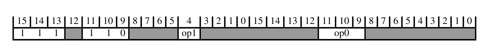

下表给出解码字段取值与所关联的子分组：

| op0 | op1 | 子分组 |
| --- | --- | --- |
| 0xx | - | 协处理器加载、存储与移动指令 |
| 100 | - | 浮点与向量加载/存储及复数算术指令 |
| 101 | - | 协处理器与浮点加载/存储、移动与安全 |
| 110 | - | 架构定义的协处理器加载、存储与移动指令 |
| 111 | 1 | 向量加载指令 |
| 111 | 0 | 向量存储指令 |

##### 3.1.2.1. 协处理器加载、存储与移动指令

本节描述**协处理器加载、存储与移动指令**的编码方式。本节由**浮点与向量加载/存储、移动与协处理器指令**解码。

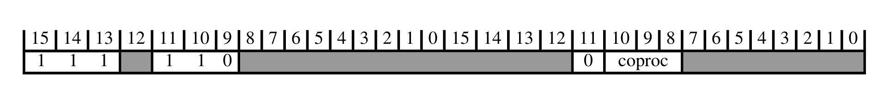

下表给出解码字段取值与所关联的子分组：

| CoprocType(UInt(coproc)) | 子分组 |
| --- | --- |
| CP_GCP | 架构定义的协处理器加载、存储与移动指令 |
| CP_CDEv1 | 自定义浮点与向量指令 |

###### 架构定义的协处理器加载、存储与移动指令

本节描述**架构定义的协处理器加载、存储与移动指令**的编码方式。本节由**协处理器加载、存储与移动指令**解码。


下表给出解码字段取值与所关联的指令：

| op0 | op1 | op2 | op3 | 指令 |
| --- | --- | --- | --- | --- |
| 0 | != 0010 | 1 | != 1111 | LDC, LDC2 (immediate) T1 |
| 1 | != 0010 | 1 | != 1111 | LDC, LDC2 (immediate) T2 |
| 0 | != 0010 | 1 | 1111 | LDC, LDC2 (literal) T1 |
| 1 | != 0010 | 1 | 1111 | LDC, LDC2 (literal) T2 |
| 0 | != 0010 | 0 | - | STC, STC2 T1 |
| 1 | != 0010 | 0 | - | STC, STC2 T2 |
| 0 | 0010 | 1 | - | MRRC, MRRC2 T1 |
| 1 | 0010 | 1 | - | MRRC, MRRC2 T2 |
| 0 | 0010 | 0 | - | MCRR, MCRR2 T1 |
| 1 | 0010 | 0 | - | MCRR, MCRR2 T2 |

###### 自定义浮点与向量指令

本节描述**自定义浮点与向量指令**的编码方式。本节由**协处理器加载、存储与移动指令**解码。

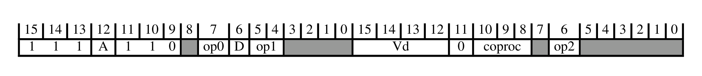

下表给出解码字段取值与所关联的指令：

| op0 | op1 | op2 | 指令 |
| --- | --- | --- | --- |
| 0 | 10 | 1 | VCX1 (vector) T1 |
| 0 | 10 | 0 | VCX1 T1 |
| 0 | 11 | 1 | VCX2 (vector) T1 |
| 0 | 11 | 0 | VCX2 T1 |
| 1 | - | 1 | VCX3 (vector) T1 |
| 1 | - | 0 | VCX3 T1 |

##### 3.1.2.2. 浮点与向量加载/存储及复数算术指令

本节描述**浮点与向量加载/存储及复数算术指令**的编码方式。本节由**浮点与向量加载/存储、移动与协处理器指令**解码。

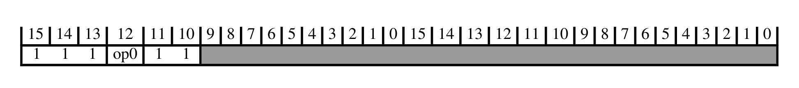

下表给出解码字段取值与所关联的子分组：

| op0 | 子分组 |
| --- | --- |
| 1 | 浮点与向量复数算术指令 |
| 0 | 浮点与向量加载/存储指令 |

###### 浮点与向量复数算术指令

本节描述**浮点与向量复数算术指令**的编码方式。本节由**浮点与向量加载/存储及复数算术指令**解码。

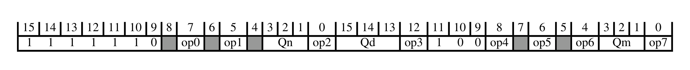

下表给出解码字段取值与所关联的指令：

| op0 | op1 | op2 | op3 | op4 | op5 | op6 | op7 | 指令 |
| --- | --- | --- | --- | --- | --- | --- | --- | --- |
| 1 | 0 | 0 | 0 | 0 | 1 | 0 | 0 | VCADD (floating-point) T1 |
| - | 1 | 0 | 0 | 0 | 1 | 0 | 0 | VCMLA (floating-point) T1 |

###### 浮点与向量加载/存储指令

本节描述**浮点与向量加载/存储指令**的编码方式。本节由**浮点与向量加载/存储及复数算术指令**解码。

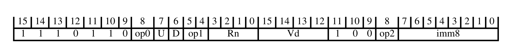

下表给出解码字段取值与所关联的指令：

| op0 | op1 | op2 | 指令 |
| --- | --- | --- | --- |
| 1 | 01 | 1 | VLDR T3 |
| 1 | 00 | 1 | VSTR T3 |

##### 3.1.2.3. 协处理器与浮点加载/存储、移动与安全

本节描述**协处理器与浮点加载/存储、移动与安全**的编码方式。本节由**浮点与向量加载/存储、移动与协处理器指令**解码。

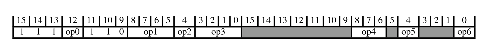

下表给出解码字段取值与所关联的指令：

| op0 | op1 | op1:op3 | op2 | op3 | op4 | op5 | op6 | 指令 |
| --- | --- | --- | --- | --- | --- | --- | --- | --- |
| 0 | 00x1 01xx 1xx1 | != 01x01111 | 1 | - | 1xx | - | 1 | FLDMDBX, FLDMIAX T1 |
| 0 | 00x1 01xx 1xx1 | != 01x01111 | 1 | - | 1xx | - | 0 | VLDM T1 |
| 0 | 01xx 1xx1 | != 01x01111 | 1 | - | 0xx | - | - | VLDM T2 |
| 0 | 1xx0 | - | 1 | - | 1xx | - | - | VLDR T1 |
| 0 | 1xx0 | - | 1 | - | 0xx | - | - | VLDR T2 |
| 0 | 00x1 | - | 1 | - | 00x | - | - | VLLDM T1 |
| 0 | 00x1 | - | 1 | - | 01x | - | - | VLLDM T2 |
| Alias |  |  |  |  |  |  |  | VPOP T1 |
| Alias |  |  |  |  |  |  |  | VPOP T2 |
| 0 | 00x1 01xx 1xx1 | - | 0 | - | 1xx | - | 1 | FSTMDBX, FSTMIAX T1 |
| 0 | 00x1 01xx 1xx1 | - | 0 | - | 1xx | - | 0 | VSTM T1 |
| 0 | 01xx 1xx1 | - | 0 | - | 0xx | - | - | VSTM T2 |
| 0 | 1xx0 | - | 0 | - | 1xx | - | - | VSTR T1 |
| 0 | 1xx0 | - | 0 | - | 0xx | - | - | VSTR T2 |
| 0 | 00x1 | - | 0 | - | 00x | - | - | VLSTM T1 |
| 0 | 00x1 | - | 0 | - | 01x | - | - | VLSTM T2 |
| Alias |  |  |  |  |  |  |  | VPUSH T1 |
| Alias |  |  |  |  |  |  |  | VPUSH T2 |
| 0 | 0010 | - | - | - | 100 | 1 | - | VMOV (two GP registers and a doubleword register) T1 |
| 0 | 0010 | - | - | - | 000 | 1 | - | VMOV (two GP registers and two SP registers) T1 |
| 0 | 01x0 | - | 1 | 1111 | 1xx | - | 0 | VSCCLRM T1 |
| 0 | 01x0 | - | 1 | 1111 | 0xx | - | - | VSCCLRM T2 |

##### 3.1.2.4. 架构定义的协处理器加载、存储与移动指令

本节描述**架构定义的协处理器加载、存储与移动指令**的编码方式。本节由**浮点与向量加载/存储、移动与协处理器指令**解码。

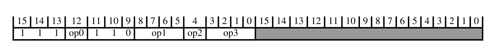

下表给出解码字段取值与所关联的指令：

| op0 | op1 | op2 | op3 | 指令 |
| --- | --- | --- | --- | --- |
| 0 | != 0010 | 1 | != 1111 | LDC, LDC2 (immediate) T1 |
| 1 | != 0010 | 1 | != 1111 | LDC, LDC2 (immediate) T2 |
| 0 | != 0010 | 1 | 1111 | LDC, LDC2 (literal) T1 |
| 1 | != 0010 | 1 | 1111 | LDC, LDC2 (literal) T2 |
| 0 | != 0010 | 0 | - | STC, STC2 T1 |
| 1 | != 0010 | 0 | - | STC, STC2 T2 |
| 0 | 0010 | 1 | - | MRRC, MRRC2 T1 |
| 1 | 0010 | 1 | - | MRRC, MRRC2 T2 |
| 0 | 0010 | 0 | - | MCRR, MCRR2 T1 |
| 1 | 0010 | 0 | - | MCRR, MCRR2 T2 |

##### 3.1.2.5. 向量加载指令

本节描述**向量加载指令**的编码方式。本节由**浮点与向量加载/存储、移动与协处理器指令**解码。

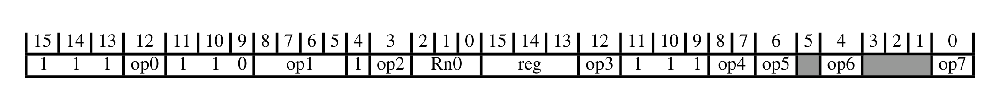

下表给出解码字段取值与所关联的指令：

| op0 | op1 | op2 | op3 | op4 | op5 | op6 | op7 | 指令 |
| --- | --- | --- | --- | --- | --- | --- | --- | --- |
| 1 | 01xx | - | 1 | != 11 | - | - | 0 | VLD2 T1 |
| 1 | 01xx | - | 1 | != 11 | - | - | 1 | VLD4 T1 |
| 0 | 1xxx 0xx1 | - | 1 | 00 | - | - | - | VLDRB, VLDRH, VLDRW T5 |
| 0 | 1xxx 0xx1 | - | 1 | 01 | - | - | - | VLDRB, VLDRH, VLDRW T6 |
| 0 | 1xxx 0xx1 | - | 1 | 10 | - | - | - | VLDRB, VLDRH, VLDRW T7 |
| 1 | 1xxx | - | 1 | 0x | - | - | - | VLDRB, VLDRH, VLDRW, VLDRD (vector) T5 |
| 1 | 1xxx | - | 1 | 1x | - | - | - | VLDRB, VLDRH, VLDRW, VLDRD (vector) T6 |
| - | 1x0x 0x01 | 0 | 0 | != 11 | - | - | - | VLDRB, VLDRH, VLDRW T1 |
| - | 1x0x 0x01 | 1 | 0 | != 11 | - | - | - | VLDRB, VLDRH, VLDRW T2 |
| - | 1xxx 0xx1 | - | 0 | 11 | - | - | - | VLDR (System Register) T1 |
| - | 01x0 | - | 0 | - | 0 | 0 | - | VLDRB, VLDRH, VLDRW, VLDRD (vector) T1 |
| - | 01x0 | - | 0 | - | 0 | 1 | - | VLDRB, VLDRH, VLDRW, VLDRD (vector) T2 |
| - | 01x0 | - | 0 | - | 1 | 0 | - | VLDRB, VLDRH, VLDRW, VLDRD (vector) T3 |
| - | 01x0 | - | 0 | - | 1 | 1 | - | VLDRB, VLDRH, VLDRW, VLDRD (vector) T4 |
| 0 | 00x0 | - | 0 | 1x | - | - | - | VMOV (two general-purpose registers to two 32-bit vector lanes) T1 |

##### 3.1.2.6. 向量存储指令

本节描述**向量存储指令**的编码方式。本节由**浮点与向量加载/存储、移动与协处理器指令**解码。

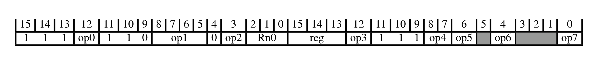

下表给出解码字段取值与所关联的指令：

| op0 | op1 | op2 | op3 | op4 | op5 | op6 | op7 | 指令 |
| --- | --- | --- | --- | --- | --- | --- | --- | --- |
| 1 | 01xx | - | 1 | != 11 | - | - | 0 | VST2 T1 |
| 1 | 01xx | - | 1 | != 11 | - | - | 1 | VST4 T1 |
| 0 | 1xxx 0xx1 | - | 1 | 00 | - | - | - | VSTRB, VSTRH, VSTRW T5 |
| 0 | 1xxx 0xx1 | - | 1 | 01 | - | - | - | VSTRB, VSTRH, VSTRW T6 |
| 0 | 1xxx 0xx1 | - | 1 | 10 | - | - | - | VSTRB, VSTRH, VSTRW T7 |
| 1 | 1xxx | - | 1 | 0x | - | - | - | VSTRB, VSTRH, VSTRW, VSTRD (vector) T5 |
| 1 | 1xxx | - | 1 | 1x | - | - | - | VSTRB, VSTRH, VSTRW, VSTRD (vector) T6 |
| - | 1x0x 0x01 | 0 | 0 | != 11 | - | - | - | VSTRB, VSTRH, VSTRW T1 |
| - | 1x0x 0x01 | 1 | 0 | != 11 | - | - | - | VSTRB, VSTRH, VSTRW T2 |
| - | 1xxx 0xx1 | - | 0 | 11 | - | - | - | VSTR (System Register) T1 |
| - | 01x0 | - | 0 | - | 0 | 0 | - | VSTRB, VSTRH, VSTRW, VSTRD (vector) T1 |
| - | 01x0 | - | 0 | - | 0 | 1 | - | VSTRB, VSTRH, VSTRW, VSTRD (vector) T2 |
| - | 01x0 | - | 0 | - | 1 | 0 | - | VSTRB, VSTRH, VSTRW, VSTRD (vector) T3 |
| - | 01x0 | - | 0 | - | 1 | 1 | - | VSTRB, VSTRH, VSTRW, VSTRD (vector) T4 |
| 0 | 00x0 | - | 0 | 1x | - | - | - | VMOV (two 32-bit vector lanes to two general-purpose registers) T1 |

#### 3.1.3. 杂项向量算术指令

本节描述**杂项向量算术指令**的编码方式。本节由**协处理器、浮点与向量指令**解码。

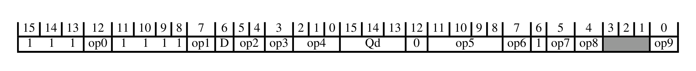

下表给出解码字段取值与所关联的指令：

| op0 | op1 | op2 | op2:op3 | op4 | op5 | op6 | op7:op5 | op7:op8 | op9 | 指令 |
| --- | --- | --- | --- | --- | --- | --- | --- | --- | --- | --- |
| 1 | 1 | 11 | - | x00 | 0100 | 0 | - | x0 | 0 | VCLS T1 |
| 0 | 0 | 00 | - | xx0 | 0001 | - | - | x1 | 0 | VAND T1 |
| - | 1 | - | 000 | - | - | 0 | 1111x 0xxx0 011x1 | x1 | - | VMOV (immediate) (vector) T1 |
| - | 0 | - | - | xx0 | 0000 | - | - | x1 | 0 | VQADD T1 |
| Alias |  |  |  |  |  |  |  |  |  | VORN (immediate) T1 |
| - | 0 | != 11 | - | xx0 | 0100 | - | - | x0 | 0 | VSHL T3 |
| - | 1 | - | 000 | - | 0xx1 10x1 | 0 | - | 11 | - | VBIC (immediate) T1 |
| - | 0 | != 11 | - | xx0 | 0110 | - | - | x1 | 0 | VMIN, VMINA T1 |
| 0 | 0 | 0x | - | xx0 | 1101 | - | - | x0 | 0 | VADD (floating-point) T1 |
| 1 | 0 | 1x | - | xx0 | 1111 | - | - | x1 | 0 | VMINNM, VMINNMA (floating-point) T1 |
| - | 1 | - | != 000 | - | 0111 | 0 | - | x1 | 0 | VQSHL, VQSHLU T2 |
| - | 0 | != 11 | - | xx0 | 0110 | - | - | x0 | 0 | VMAX, VMAXA T1 |
| 0 | 0 | - | - | xx0 | 1000 | - | - | x0 | 0 | VADD (vector) T1 |
| - | 1 | - | != 000 | - | 0010 | 0 | - | x1 | 0 | VRSHR T1 |
| - | 0 | - | - | xx0 | 0111 | - | - | x0 | 0 | VABD T1 |
| - | 1 | - | != 000 | - | 0000 | 0 | - | x1 | 0 | VSHR T1 |
| - | 1 | - | 000 | - | 0xx1 10x1 | 0 | - | 01 | - | VORR (immediate) T1 |
| Alias |  |  |  |  |  |  |  |  |  | VMOV (register) (vector) T1 |
| 1 | 0 | - | - | xx0 | 1000 | - | - | x0 | 0 | VSUB (vector) T1 |
| 0 | 0 | 1x | - | xx0 | 1100 | - | - | x1 | 0 | VFMA, VFMS (floating-point) T2 |
| 0 | 0 | 0x | - | xx0 | 1100 | - | - | x1 | 0 | VFMA, VFMS (floating-point) T1 |
| - | 1 | - | != 000 | - | 11xx | 0 | - | x1 | 0 | VCVT (between floating-point and fixed-point) (vector) T1 |
| 1 | 1 | 11 | - | x00 | 0000 | 0 | - | x0 | 0 | VREV64 T1 |
| 0 | 0 | - | - | xx0 | 1001 | - | - | x1 | 0 | VMUL (vector) T1 |
| 0 | 0 | 1x | - | xx0 | 1101 | - | - | x0 | 0 | VSUB (floating-point) T1 |
| - | 0 | - | - | xx0 | 0000 | - | - | x0 | 0 | VHADD T1 |
| 1 | 0 | 0x | - | xx0 | 1101 | - | - | x1 | 0 | VMUL (floating-point) T1 |
| 1 | 1 | 11 | - | x01 | 0111 | 0 | - | x0 | 0 | VABS (floating-point) T1 |
| 1 | 1 | 11 | - | x00 | 0111 | 1 | - | x0 | 0 | VQNEG T1 |
| - | 0 | - | - | xx0 | 0010 | - | - | x0 | 0 | VHSUB T1 |
| 1 | 1 | - | 110 | 000 | 0101 | 1 | - | x0 | 0 | VMVN (register) T1 |
| - | 0 | != 11 | - | xx0 | 0101 | - | - | x0 | 0 | VRSHL T1 |
| 1 | 0 | - | - | xx0 | 1011 | - | - | x0 | 0 | VQDMULH, VQRDMULH T2 |
| Alias |  |  |  |  |  |  |  |  |  | VAND (immediate) T1 |
| 1 | 1 | 11 | - | x00 | 0111 | 0 | - | x0 | 0 | VQABS T1 |
| 1 | 1 | 11 | - | x01 | 0011 | 0 | - | x0 | 0 | VABS (vector) T1 |
| 1 | 1 | 11 | - | x10 | 01xx | - | - | x0 | 0 | VRINT (floating-point) T1 |
| 1 | 0 | 1x | - | xx0 | 1101 | - | - | x0 | 0 | VABD (floating-point) T1 |
| 1 | 1 | 11 | - | x11 | 011x | - | - | x0 | 0 | VCVT (between floating-point and integer) T1 |
| 0 | 1 | - | != 000 | - | 0101 | 0 | - | x1 | 0 | VSHL T1 |
| - | 0 | - | - | xx0 | 0001 | - | - | x0 | 0 | VRHADD T1 |
| 0 | 0 | 11 | - | xx0 | 0001 | - | - | x1 | 0 | VORN T1 |
| 1 | 1 | - | != 000 | - | 0101 | 0 | - | x1 | 0 | VSLI T1 |
| 1 | 1 | - | != 000 | - | 0100 | 0 | - | x1 | 0 | VSRI T1 |
| 0 | 0 | 10 | - | xx0 | 0001 | - | - | x1 | 0 | VORR T1 |
| 1 | 0 | 00 | - | xx0 | 0001 | - | - | x1 | 0 | VEOR T1 |
| 0 | 0 | - | - | xx0 | 1011 | - | - | x0 | 0 | VQDMULH, VQRDMULH T1 |
| 1 | 1 | 11 | - | x11 | 00xx | - | - | x0 | 0 | VCVT (from floating-point to integer) T1 |
| 1 | 1 | 11 | - | x01 | 0011 | 1 | - | x0 | 0 | VNEG (vector) T1 |
| - | 1 | - | 000 | - | 0xx0 10x0 110x | 0 | - | 11 | - | VMVN (immediate) T1 |
| - | 0 | != 11 | - | xx0 | 0100 | - | - | x1 | 0 | VQSHL, VQSHLU T4 |
| 1 | 1 | 11 | - | x01 | 0111 | 1 | - | x0 | 0 | VNEG (floating-point) T1 |
| 1 | 1 | 11 | - | x00 | 0001 | 0 | - | x0 | 0 | VREV16 T1 |
| 1 | 0 | 0x | - | xx0 | 1111 | - | - | x1 | 0 | VMAXNM, VMAXNMA (floating-point) T1 |
| 0 | 0 | 01 | - | xx0 | 0001 | - | - | x1 | 0 | VBIC (register) T1 |
| 1 | 1 | - | != 000 | - | 0110 | 0 | - | x1 | 0 | VQSHL, VQSHLU T3 |
| 1 | 1 | 11 | - | x00 | 0000 | 1 | - | x0 | 0 | VREV32 T1 |
| - | 0 | - | - | xx0 | 0010 | - | - | x1 | 0 | VQSUB T1 |
| 1 | 1 | 11 | - | x00 | 0100 | 1 | - | x0 | 0 | VCLZ T1 |
| - | 0 | != 11 | - | xx0 | 0101 | - | - | x1 | 0 | VQRSHL T1 |

### 3.2. 加载/存储（多寄存器、双字、独占、获取-释放）

本节描述**加载/存储（多寄存器、双字、独占、获取-释放）**的编码方式。本节由 **32 位 T32 指令编码**解码。

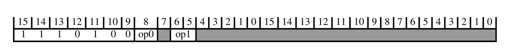

下表给出解码字段取值与所关联的子分组：

| op0 | op1 | 子分组 |
| --- | --- | --- |
| - | 0x | 加载/存储多寄存器 |
| 0 | 10 | 加载/存储独占、加载-获取/存储-释放 |
| 0 | 11 | 加载/存储双字（后索引） |
| 1 | 10 | 加载/存储双字（字面值与立即数） |
| 1 | 11 | 加载/存储双字（前索引）、安全网关 |

#### 3.2.1. 加载/存储多寄存器

本节描述**加载/存储多寄存器**的编码方式。本节由**加载/存储（多寄存器、双字、独占、获取-释放）**解码。


下表给出解码字段取值与所关联的指令：

| L | Rn | opc | 指令 |
| --- | --- | --- | --- |
| 0 | - | 01 | STM, STMIA, STMEA T2 |
| 1 | != 1111 | 01 | LDM, LDMIA, LDMFD T2 |
| 1 | 1111 | 01 | CLRM T1 |
| 0 | - | 10 | STMDB, STMFD T1 |
| 1 | - | 10 | LDMDB, LDMEA T1 |
| Alias |  |  | PUSH (multiple registers) T1 |
| Alias |  |  | POP (multiple registers) T2 |

#### 3.2.2. 加载/存储独占、加载-获取/存储-释放

本节描述**加载/存储独占、加载-获取/存储-释放**的编码方式。本节由**加载/存储（多寄存器、双字、独占、获取-释放）**解码。


下表给出解码字段取值与所关联的子分组：

| op0 | op1 | op2 | 子分组 |
| --- | --- | --- | --- |
| 0 | != 0xxxx1111 | - | 加载/存储独占 |
| 1 | - | 01x | 加载/存储独占字节/半字/双字 |
| 1 | - | 1xx | 加载-获取 / 存储-释放 |

下表给出解码字段取值与所关联的指令：

| op0 | op1 | op2 | 指令 |
| --- | --- | --- | --- |
| 0 | 0xxxx1111 | - | TT, TTT, TTA, TTAT T1 |
| 1 | 1xxxxxxxx | 000 | TBB, TBH T1 |

##### 3.2.2.1. 加载/存储独占

本节描述**加载/存储独占**的编码方式。本节由**加载/存储独占、加载-获取/存储-释放**解码。


下表给出解码字段取值与所关联的指令：

| L | 指令 |
| --- | --- |
| 0 | STREX T1 |
| 1 | LDREX T1 |

##### 3.2.2.2. 加载/存储独占字节/半字/双字

本节描述**加载/存储独占字节/半字/双字**的编码方式。本节由**加载/存储独占、加载-获取/存储-释放**解码。


下表给出解码字段取值与所关联的指令：

| L | sz | 指令 |
| --- | --- | --- |
| 0 | 00 | STREXB T1 |
| 0 | 01 | STREXH T1 |
| 1 | 00 | LDREXB T1 |
| 1 | 01 | LDREXH T1 |

##### 3.2.2.3. 加载-获取 / 存储-释放

本节描述**加载-获取 / 存储-释放**的编码方式。本节由**加载/存储独占、加载-获取/存储-释放**解码。


下表给出解码字段取值与所关联的指令：

| L | op | sz | 指令 |
| --- | --- | --- | --- |
| 0 | 0 | 00 | STLB T1 |
| 0 | 0 | 01 | STLH T1 |
| 0 | 0 | 10 | STL T1 |
| 0 | 1 | 00 | STLEXB T1 |
| 0 | 1 | 01 | STLEXH T1 |
| 0 | 1 | 10 | STLEX T1 |
| 1 | 0 | 00 | LDAB T1 |
| 1 | 0 | 01 | LDAH T1 |
| 1 | 0 | 10 | LDA T1 |
| 1 | 1 | 00 | LDAEXB T1 |
| 1 | 1 | 01 | LDAEXH T1 |
| 1 | 1 | 10 | LDAEX T1 |

#### 3.2.3. 加载/存储双字（后索引）

本节描述**加载/存储双字（后索引）**的编码方式。本节由**加载/存储（多寄存器、双字、独占、获取-释放）**解码。


下表给出解码字段取值与所关联的指令：

| L | Rn | 指令 |
| --- | --- | --- |
| 0 | != 1111 | STRD (immediate) T1 |
| 1 | != 1111 | LDRD (immediate) T1 |
| - | 1111 | UNPREDICTABLE |

#### 3.2.4. 加载/存储双字（字面值与立即数）

本节描述**加载/存储双字（字面值与立即数）**的编码方式。本节由**加载/存储（多寄存器、双字、独占、获取-释放）**解码。


下表给出解码字段取值与所关联的指令：

| L | Rn | 指令 |
| --- | --- | --- |
| 1 | 1111 | LDRD (literal) T1 |
| 0 | != 1111 | STRD (immediate) T1 |
| 1 | != 1111 | LDRD (immediate) T1 |

#### 3.2.5. 加载/存储双字（前索引）、安全网关

本节描述**加载/存储双字（前索引）、安全网关**的编码方式。本节由**加载/存储（多寄存器、双字、独占、获取-释放）**解码。


下表给出解码字段取值与所关联的指令：

| op0 | op1 | op2 | op3 | 指令 |
| --- | --- | --- | --- | --- |
| 0 | 0 | 1111 | - | UNPREDICTABLE |
| 0 | 1 | 1111 | != 1110100101111111 | UNPREDICTABLE |
| 0 | 1 | 1111 | 1110100101111111 | SG T1 |
| - | 0 | != 1111 | - | STRD (immediate) T1 |
| 1 | - | 1111 | - | UNPREDICTABLE |
| - | 1 | != 1111 | - | LDRD (immediate) T1 |

### 3.3. 数据处理（移位寄存器）

本节描述**数据处理（移位寄存器）**的编码方式。本节由 **32 位 T32 指令编码**解码。


下表给出解码字段取值与所关联的子分组：

| op0 | 子分组 |
| --- | --- |
| 0010 | 宽移位、移位与条件指令 |
| != 0010 | 移位寄存器指令 |

#### 3.3.1. 宽移位、移位与条件指令

本节描述**宽移位、移位与条件指令**的编码方式。本节由**数据处理（移位寄存器）**解码。


下表给出解码字段取值与所关联的指令：

| Rn | S | op0 | op1 | op2 | op3 | op4 | 指令 |
| --- | --- | --- | --- | --- | --- | --- | --- |
| xxx0 | 1 | 0 | - | != 111 | 10 | 1111 | ASRL (immediate) T1 |
| xxx0 | 1 | 0 | - | != 111 | 00 | 1111 | LSLL (immediate) T1 |
| xxx0 | 1 | 0 | - | != 111 | 01 | 1111 | LSRL (immediate) T1 |
| - | 1 | 0 | - | != 111 | 11 | 1111 | SQSHLL (immediate) T1 |
| xxx1 | 1 | 0 | - | != 111 | 10 | 1111 | SRSHRL (immediate) T1 |
| xxx1 | 1 | 0 | - | != 111 | 00 | 1111 | UQSHLL (immediate) T1 |
| xxx1 | 1 | 0 | - | != 111 | 01 | 1111 | URSHRL (immediate) T1 |
| - | 1 | 0 | - | 111 | 11 | 1111 | SQSHL (immediate) T1 |
| - | 1 | 0 | - | 111 | 10 | 1111 | SRSHR (immediate) T1 |
| - | 1 | 0 | - | 111 | 00 | 1111 | UQSHL (immediate) T1 |
| - | 1 | 0 | - | 111 | 01 | 1111 | URSHR (immediate) T1 |
| xxx0 | 1 | - | - | != 111 | 10 | 1101 | ASRL (register) T1 |
| xxx0 | 1 | - | - | != 111 | 00 | 1101 | LSLL (register) T1 |
| - | 1 | - | - | 111 | 10 | 1101 | SQRSHR (register) T1 |
| xxx1 | 1 | - | - | != 111 | 10 | 1101 | SQRSHRL (register) T1 |
| - | 1 | - | - | 111 | 00 | 1101 | UQRSHL (register) T1 |
| xxx1 | 1 | - | - | != 111 | 00 | 1101 | UQRSHLL (register) T1 |
| != 1111 | 0 | 0 | - | - | - | - | ORR (register) T2 |
| != 1111 | 1 | 0 | - | - | - | != 11x1 | ORRS (register) T2 |
| 1111 | 0 | 0 | - | - | - | - | MOV (register) T3 |
| 1111 | 1 | 0 | - | - | - | != 11x1 | MOVS (register) T3 |
| Alias |  |  |  |  |  |  | ASR (immediate) T3 |
| Alias |  |  |  |  |  |  | ASRS (immediate) T3 |
| Alias |  |  |  |  |  |  | LSL (immediate) T3 |
| Alias |  |  |  |  |  |  | LSLS (immediate) T3 |
| Alias |  |  |  |  |  |  | LSR (immediate) T3 |
| Alias |  |  |  |  |  |  | LSRS (immediate) T3 |
| Alias |  |  |  |  |  |  | ROR (immediate) T3 |
| Alias |  |  |  |  |  |  | RORS (immediate) T3 |
| Alias |  |  |  |  |  |  | RRX T3 |
| Alias |  |  |  |  |  |  | RRXS T3 |
| - | 1 | 1 | 00 | - | - | != 1101 | CSEL T1 |
| - | 1 | 1 | 01 | - | - | != 1101 | CSINC T1 |
| - | 1 | 1 | 10 | - | - | != 1101 | CSINV T1 |
| - | 1 | 1 | 11 | - | - | != 1101 | CSNEG T1 |
| Alias |  |  |  |  |  |  | CINC T1 |
| Alias |  |  |  |  |  |  | CINV T1 |
| Alias |  |  |  |  |  |  | CNEG T1 |
| Alias |  |  |  |  |  |  | CSET T1 |
| Alias |  |  |  |  |  |  | CSETM T1 |

#### 3.3.2. 移位寄存器指令

本节描述**移位寄存器指令**的编码方式。本节由**数据处理（移位寄存器）**解码。


下表给出解码字段取值与所关联的指令：

| Rd | Rn | S | imm3:imm2:sr_type | op0 | 指令 |
| --- | --- | --- | --- | --- | --- |
| - | - | 0 | != 0000011 | 0000 | AND (register) T2 |
| - | - | 0 | 0000011 | 0000 | AND extend (register) T2 |
| != 1111 | - | 1 | != 0000011 | 0000 | ANDS (register) T2 |
| != 1111 | - | 1 | 0000011 | 0000 | ANDS extend (register) T2 |
| 1111 | - | 1 | != 0000011 | 0000 | TST (register) T2 |
| 1111 | - | 1 | 0000011 | 0000 | TST extend (register) T2 |
| - | - | - | - | 0001 | BIC (register) T2 |
| - | != 1111 | 0 | - | 0011 | ORN (register) T1 |
| - | != 1111 | 1 | - | 0011 | ORNS (register) T1 |
| - | 1111 | 0 | - | 0011 | MVN (register) T2 |
| - | 1111 | 1 | - | 0011 | MVNS (register) T2 |
| - | - | 0 | != 0000011 | 0100 | EOR (register) T2 |
| - | - | 0 | 0000011 | 0100 | EOR extend (register) T2 |
| != 1111 | - | 1 | != 0000011 | 0100 | EORS (register) T2 |
| != 1111 | - | 1 | 0000011 | 0100 | EORS extend (register) T2 |
| 1111 | - | 1 | != 0000011 | 0100 | TEQ (register) T1 |
| 1111 | - | 1 | 0000011 | 0100 | TEQ extend (register) T1 |
| - | - | 0 | xxxxxx0 | 0110 | PKHBT, PKHTB T1 |
| - | != 1101 | 0 | - | 1000 | ADD (register) T3 |
| != 1111 | != 1101 | 1 | - | 1000 | ADDS (register) T3 |
| - | 1101 | 0 | - | 1000 | ADD (SP plus register) T3 |
| != 1111 | 1101 | 1 | - | 1000 | ADDS (SP plus register) T3 |
| 1111 | - | 1 | - | 1000 | CMN (register) T2 |
| - | - | - | - | 1010 | ADC (register) T2 |
| - | - | - | - | 1011 | SBC (register) T2 |
| - | != 1101 | 0 | - | 1101 | SUB (register) T2 |
| != 1111 | != 1101 | 1 | - | 1101 | SUBS (register) T2 |
| - | 1101 | 0 | - | 1101 | SUB (SP minus register) T1 |
| != 1111 | 1101 | 1 | - | 1101 | SUBS (SP minus register) T1 |
| 1111 | - | 1 | - | 1101 | CMP (register) T3 |
| - | - | - | - | 1110 | RSB (register) T1 |

### 3.4. 分支与杂项控制

本节描述**分支与杂项控制**的编码方式。本节由 **32 位 T32 指令编码**解码。


下表给出解码字段取值与所关联的子分组：

| op0 | op1 | op2 | op3 | op4 | op5 | op6 | 子分组 |
| --- | --- | --- | --- | --- | --- | --- | --- |
| 0 | 1110 | 10 | 0 | 0 | 000 | - | 提示 |
| 0 | 1110 | 11 | 0 | 0 | - | - | 杂项系统 |
| 1 | 1111 | 1x | 0 | 0 | - | - | 异常生成 |
| - | - | - | 1 | 0 | - | 1 | 循环与分支指令 |

下表给出解码字段取值与所关联的指令：

| op0 | op1 | op2 | op3 | op4 | op5 | op6 | 指令 |
| --- | --- | --- | --- | --- | --- | --- | --- |
| 0 | 1110 | 0x | 0 | 0 | - | - | MSR (register) T1 |
| 0 | 1111 | 1x | 0 | 0 | - | - | MRS T1 |
| - | != 111x | - | 0 | 0 | - | - | B T3 |
| - | - | - | 0 | 1 | - | - | B T4 |
| - | - | - | 1 | 1 | - | - | BL T1 |

#### 3.4.1. 提示

本节描述**提示**的编码方式。本节由**分支与杂项控制**解码。


下表给出解码字段取值与所关联的指令：

| hint | option | 指令 |
| --- | --- | --- |
| 0000 | 0000 | NOP T2 |
| 0000 | 0001 | YIELD T2 |
| 0000 | 0010 | WFE T2 |
| 0000 | 0011 | WFI T2 |
| 0000 | 0100 | SEV T2 |
| 0000 | 0101 | 保留提示（若实现了 Main 扩展则表现为 NOP，否则为 UNDEFINED） |
| 0000 | 011x | 保留提示（若实现了 Main 扩展则表现为 NOP，否则为 UNDEFINED） |
| 0000 | 10xx | 保留提示（若实现了 Main 扩展则表现为 NOP，否则为 UNDEFINED） |
| 0000 | 11x0 | 保留提示（若实现了 Main 扩展则表现为 NOP，否则为 UNDEFINED） |
| 0000 | 1101 | PACBTI T1 |
| 0000 | 1111 | BTI T1 |
| 0001 | 0000 | ESB T1 |
| 0001 | 001x | 保留提示（若实现了 Main 扩展则表现为 NOP，否则为 UNDEFINED） |
| 0001 | 0100 | CSDB T1 |
| 0001 | 0x01 | 保留提示（若实现了 Main 扩展则表现为 NOP，否则为 UNDEFINED） |
| 0001 | 011x | 保留提示（若实现了 Main 扩展则表现为 NOP，否则为 UNDEFINED） |
| 0001 | 10xx | 保留提示（若实现了 Main 扩展则表现为 NOP，否则为 UNDEFINED） |
| 0001 | 11x0 | 保留提示（若实现了 Main 扩展则表现为 NOP，否则为 UNDEFINED） |
| 0001 | 1101 | PAC T1 |
| 0001 | 1111 | 保留提示（若实现了 Main 扩展则表现为 NOP，否则为 UNDEFINED） |
| 0010 | 0xxx | 保留提示（若实现了 Main 扩展则表现为 NOP，否则为 UNDEFINED） |
| 0010 | 10xx | 保留提示（若实现了 Main 扩展则表现为 NOP，否则为 UNDEFINED） |
| 0010 | 11x0 | 保留提示（若实现了 Main 扩展则表现为 NOP，否则为 UNDEFINED） |
| 0010 | 1101 | AUT T1 |
| 0010 | 1111 | 保留提示（若实现了 Main 扩展则表现为 NOP，否则为 UNDEFINED） |
| 0011 | - | 保留提示（若实现了 Main 扩展则表现为 NOP，否则为 UNDEFINED） |
| 01xx | - | 保留提示（若实现了 Main 扩展则表现为 NOP，否则为 UNDEFINED） |
| 10xx | - | 保留提示（若实现了 Main 扩展则表现为 NOP，否则为 UNDEFINED） |
| 110x | - | 保留提示（若实现了 Main 扩展则表现为 NOP，否则为 UNDEFINED） |
| 1110 | - | 保留提示（若实现了 Main 扩展则表现为 NOP，否则为 UNDEFINED） |
| 1111 | - | DBG T1 |

#### 3.4.2. 杂项系统

本节描述**杂项系统**的编码方式。本节由**分支与杂项控制**解码。


下表给出解码字段取值与所关联的指令：

| opc | option | 指令 |
| --- | --- | --- |
| 0010 | - | CLREX T1 |
| 0100 | != 0x00 | DSB T1 |
| 0100 | 0000 | SSBB T1 |
| 0100 | 0100 | PSSBB T1 |
| 0101 | - | DMB T1 |
| 0110 | - | ISB T1 |

#### 3.4.3. 异常生成

本节描述**异常生成**的编码方式。本节由**分支与杂项控制**解码。


下表给出解码字段取值与所关联的指令：

| o1 | o2 | 指令 |
| --- | --- | --- |
| 1 | 1 | UDF T2 |

#### 3.4.4. 循环与分支指令

本节描述**循环与分支指令**的编码方式。本节由**分支与杂项控制**解码。


下表给出解码字段取值与所关联的子分组：

| op0 | 子分组 |
| --- | --- |
| != 0000 | 分支未来指令 |
| 0000 | 循环指令 |

##### 3.4.4.1. 分支未来指令

本节描述**分支未来指令**的编码方式。本节由**循环与分支指令**解码。


下表给出解码字段取值与所关联的指令：

| op0 | op1 | 指令 |
| --- | --- | --- |
| - | 0 | BF, BFX, BFL, BFLX, BFCSEL T4 |
| 0xx | 1 | BF, BFX, BFL, BFLX, BFCSEL T2 |
| 10x | 1 | BF, BFX, BFL, BFLX, BFCSEL T1 |
| 110 | 1 | BF, BFX, BFL, BFLX, BFCSEL T3 |
| 111 | 1 | BF, BFX, BFL, BFLX, BFCSEL T5 |

##### 3.4.4.2. 循环指令

本节描述**循环指令**的编码方式。本节由**循环与分支指令**解码。


下表给出解码字段取值与所关联的指令：

| imml | op0 | op1 | op2 | 指令 |
| --- | --- | --- | --- | --- |
| - | 0xx | 1111 | 1 | LCTP T1 |
| - | 000 | 1111 | 0 | LE, LETP T1 |
| - | 01x | 1111 | 0 | LE, LETP T2 |
| - | 001 | 1111 | 0 | LE, LETP T3 |
| - | 1xx | - | 0 | WLS, DLS, WLSTP, DLSTP T1 |
| - | 1xx | - | 1 | WLS, DLS, WLSTP, DLSTP T2 |
| - | 0xx | != 1111 | 0 | WLS, DLS, WLSTP, DLSTP T3 |
| 0 | 0xx | != 1111 | 1 | WLS, DLS, WLSTP, DLSTP T4 |
| 1 | 0xx | != 1111 | 1 | VCTP T1 |

### 3.5. 数据处理（修改立即数）

本节描述**数据处理（修改立即数）**的编码方式。本节由 **32 位 T32 指令编码**解码。


下表给出解码字段取值与所关联的指令：

| Rd | Rn | S | op1 | 指令 |
| --- | --- | --- | --- | --- |
| - | - | 0 | 0000 | AND (immediate) T1 |
| != 1111 | - | 1 | 0000 | ANDS (immediate) T1 |
| 1111 | - | 1 | 0000 | TST (immediate) T1 |
| - | - | - | 0001 | BIC (immediate) T1 |
| - | != 1111 | - | 0010 | ORR (immediate) T1 |
| - | 1111 | - | 0010 | MOV (immediate) T2 |
| - | != 1111 | - | 0011 | ORN (immediate) T1 |
| - | 1111 | - | 0011 | MVN (immediate) T1 |
| - | - | 0 | 0100 | EOR (immediate) T1 |
| != 1111 | - | 1 | 0100 | EORS (immediate) T1 |
| 1111 | - | 1 | 0100 | TEQ (immediate) T1 |
| - | != 1101 | 0 | 1000 | ADD (immediate) T3 |
| != 1111 | != 1101 | 1 | 1000 | ADDS (immediate) T3 |
| - | 1101 | 0 | 1000 | ADD (SP plus immediate) T3 |
| != 1111 | 1101 | 1 | 1000 | ADDS (SP plus immediate) T3 |
| 1111 | - | 1 | 1000 | CMN (immediate) T1 |
| - | - | - | 1010 | ADC (immediate) T1 |
| - | - | - | 1011 | SBC (immediate) T1 |
| - | != 1101 | 0 | 1101 | SUB (immediate) T3 |
| != 1111 | != 1101 | 1 | 1101 | SUBS (immediate) T3 |
| - | 1101 | 0 | 1101 | SUB (SP minus immediate) T2 |
| != 1111 | 1101 | 1 | 1101 | SUBS (SP minus immediate) T2 |
| 1111 | - | 1 | 1101 | CMP (immediate) T2 |
| - | - | - | 1110 | RSB (immediate) T2 |

### 3.6. 数据处理（纯二进制立即数）

本节描述**数据处理（纯二进制立即数）**的编码方式。本节由 **32 位 T32 指令编码**解码。


下表给出解码字段取值与所关联的子分组：

| op0 | op1 | 子分组 |
| --- | --- | --- |
| 0 | 0x | 数据处理（简单立即数） |
| 0 | 10 | 宽移动（16 位立即数） |
| 1 | - | 饱和、位域 |

#### 3.6.1. 数据处理（简单立即数）

本节描述**数据处理（简单立即数）**的编码方式。本节由**数据处理（纯二进制立即数）**解码。


下表给出解码字段取值与所关联的指令：

| Rn | o1 | o2 | 指令 |
| --- | --- | --- | --- |
| Alias |  |  | ADD (immediate, to PC) T3 |
| != 11x1 | 0 | 0 | ADD (immediate) T4 |
| 1101 | 0 | 0 | ADD (SP plus immediate) T4 |
| 1111 | 0 | 0 | ADR T3 |
| != 11x1 | 1 | 1 | SUB (immediate) T4 |
| 1101 | 1 | 1 | SUB (SP minus immediate) T3 |
| 1111 | 1 | 1 | ADR T2 |
| Alias |  |  | SUB (immediate, from PC) T2 |

#### 3.6.2. 宽移动（16 位立即数）

本节描述**宽移动（16 位立即数）**的编码方式。本节由**数据处理（纯二进制立即数）**解码。


下表给出解码字段取值与所关联的指令：

| o1 | 指令 |
| --- | --- |
| 0 | MOV (immediate) T3 |
| 1 | MOVT T1 |

#### 3.6.3. 饱和、位域

本节描述**饱和、位域**的编码方式。本节由**数据处理（纯二进制立即数）**解码。


下表给出解码字段取值与所关联的指令：

| Rn | imm3:imm2 | op1 | 指令 |
| --- | --- | --- | --- |
| - | - | 000 | SSAT LSL T1 |
| - | != 00000 | 001 | SSAT ASR T1 |
| - | 00000 | 001 | SSAT16 T1 |
| - | - | 010 | SBFX T1 |
| != 1111 | - | 011 | BFI T1 |
| 1111 | - | 011 | BFC T1 |
| - | - | 100 | USAT LSL T1 |
| - | != 00000 | 101 | USAT ASR T1 |
| - | 00000 | 101 | USAT16 T1 |
| - | - | 110 | UBFX T1 |

### 3.7. 加载/存储单个

本节描述**加载/存储单个**的编码方式。本节由 **32 位 T32 指令编码**解码。


下表给出解码字段取值与所关联的子分组：

| op0 | op1 | op2 | op3 | 子分组 |
| --- | --- | --- | --- | --- |
| 00 | - | != 1111 | 000000 | 加载/存储，无符号（寄存器偏移） |
| 00 | - | != 1111 | 10xxxx | 加载/存储，无符号（立即数，后索引） |
| 00 | - | != 1111 | 1100xx | 加载/存储，无符号（负立即数） |
| 00 | - | != 1111 | 1110xx | 加载/存储，无符号（非特权） |
| 00 | - | != 1111 | 11x1xx | 加载/存储，无符号（立即数，前索引） |
| 01 | - | != 1111 | - | 加载/存储，无符号（正立即数） |
| 0x | - | 1111 | - | 加载，无符号（字面值） |
| 10 | 1 | != 1111 | 000000 | 加载/存储，有符号（寄存器偏移） |
| 10 | 1 | != 1111 | 10xxxx | 加载/存储，有符号（立即数，后索引） |
| 10 | 1 | != 1111 | 1100xx | 加载/存储，有符号（负立即数） |
| 10 | 1 | != 1111 | 1110xx | 加载/存储，有符号（非特权） |
| 10 | 1 | != 1111 | 11x1xx | 加载/存储，有符号（立即数，前索引） |
| 11 | 1 | != 1111 | - | 加载/存储，有符号（正立即数） |
| 1x | 1 | 1111 | - | 加载，有符号（字面值） |

#### 3.7.1. 加载/存储，无符号（寄存器偏移）

本节描述**加载/存储，无符号（寄存器偏移）**的编码方式。本节由**加载/存储单个**解码。


下表给出解码字段取值与所关联的指令：

| L | Rt | size | 指令 |
| --- | --- | --- | --- |
| 0 | - | 00 | STRB (register) T2 |
| 1 | != 1111 | 00 | LDRB (register) T2 |
| 1 | 1111 | 0x | PLD, PLDW (register) T1 |
| 0 | - | 01 | STRH (register) T2 |
| 1 | != 1111 | 01 | LDRH (register) T2 |
| 0 | - | 10 | STR (register) T2 |
| 1 | - | 10 | LDR (register) T2 |

#### 3.7.2. 加载/存储，无符号（立即数，后索引）

本节描述**加载/存储，无符号（立即数，后索引）**的编码方式。本节由**加载/存储单个**解码。


下表给出解码字段取值与所关联的指令：

| L | size | 指令 |
| --- | --- | --- |
| 0 | 00 | STRB (immediate) T3 |
| 1 | 00 | LDRB (immediate) T3 |
| 0 | 01 | STRH (immediate) T3 |
| 1 | 01 | LDRH (immediate) T3 |
| 0 | 10 | STR (immediate) T4 |
| Alias |  | PUSH (single register) T4 |
| 1 | 10 | LDR (immediate) T4 |
| Alias |  | POP (single register) T4 |

#### 3.7.3. 加载/存储，无符号（负立即数）

本节描述**加载/存储，无符号（负立即数）**的编码方式。本节由**加载/存储单个**解码。


下表给出解码字段取值与所关联的指令：

| L | Rt | size | 指令 |
| --- | --- | --- | --- |
| 0 | - | 00 | STRB (immediate) T3 |
| 1 | != 1111 | 00 | LDRB (immediate) T3 |
| 1 | 1111 | 0x | PLD, PLDW (immediate) T2 |
| 0 | - | 01 | STRH (immediate) T3 |
| 1 | != 1111 | 01 | LDRH (immediate) T3 |
| 0 | - | 10 | STR (immediate) T4 |
| Alias |  |  | PUSH (single register) T4 |
| 1 | - | 10 | LDR (immediate) T4 |
| Alias |  |  | POP (single register) T4 |

#### 3.7.4. 加载/存储，无符号（非特权）

本节描述**加载/存储，无符号（非特权）**的编码方式。本节由**加载/存储单个**解码。


下表给出解码字段取值与所关联的指令：

| L | size | 指令 |
| --- | --- | --- |
| 0 | 00 | STRBT T1 |
| 1 | 00 | LDRBT T1 |
| 0 | 01 | STRHT T1 |
| 1 | 01 | LDRHT T1 |
| 0 | 10 | STRT T1 |
| 1 | 10 | LDRT T1 |

#### 3.7.5. 加载/存储，无符号（立即数，前索引）

本节描述**加载/存储，无符号（立即数，前索引）**的编码方式。本节由**加载/存储单个**解码。


下表给出解码字段取值与所关联的指令：

| L | size | 指令 |
| --- | --- | --- |
| 0 | 00 | STRB (immediate) T3 |
| 1 | 00 | LDRB (immediate) T3 |
| 0 | 01 | STRH (immediate) T3 |
| 1 | 01 | LDRH (immediate) T3 |
| 0 | 10 | STR (immediate) T4 |
| Alias |  | PUSH (single register) T4 |
| 1 | 10 | LDR (immediate) T4 |
| Alias |  | POP (single register) T4 |

#### 3.7.6. 加载/存储，无符号（正立即数）

本节描述**加载/存储，无符号（正立即数）**的编码方式。本节由**加载/存储单个**解码。


下表给出解码字段取值与所关联的指令：

| L | Rt | size | 指令 |
| --- | --- | --- | --- |
| 0 | - | 00 | STRB (immediate) T2 |
| 1 | != 1111 | 00 | LDRB (immediate) T2 |
| 1 | 1111 | 0x | PLD, PLDW (immediate) T1 |
| 0 | - | 01 | STRH (immediate) T2 |
| 1 | != 1111 | 01 | LDRH (immediate) T2 |
| 0 | - | 10 | STR (immediate) T3 |
| 1 | - | 10 | LDR (immediate) T3 |

#### 3.7.7. 加载，无符号（字面值）

本节描述**加载，无符号（字面值）**的编码方式。本节由**加载/存储单个**解码。


下表给出解码字段取值与所关联的指令：

| L | Rt | size | 指令 |
| --- | --- | --- | --- |
| 1 | != 1111 | 00 | LDRB (literal) T1 |
| 1 | 1111 | 0x | PLD (literal) T1 |
| 1 | != 1111 | 01 | LDRH (literal) T1 |
| 1 | - | 10 | LDR (literal) T2 |

#### 3.7.8. 加载/存储，有符号（寄存器偏移）

本节描述**加载/存储，有符号（寄存器偏移）**的编码方式。本节由**加载/存储单个**解码。


下表给出解码字段取值与所关联的指令：

| Rt | size | 指令 |
| --- | --- | --- |
| != 1111 | 00 | LDRSB (register) T2 |
| 1111 | 00 | PLI (register) T1 |
| != 1111 | 01 | LDRSH (register) T2 |
| 1111 | 01 | 保留提示（若实现了 Main 扩展则表现为 NOP，否则为 UNDEFINED） |

#### 3.7.9. 加载/存储，有符号（立即数，后索引）

本节描述**加载/存储，有符号（立即数，后索引）**的编码方式。本节由**加载/存储单个**解码。


下表给出解码字段取值与所关联的指令：

| size | 指令 |
| --- | --- |
| 00 | LDRSB (immediate) T2 |
| 01 | LDRSH (immediate) T2 |

#### 3.7.10. 加载/存储，有符号（负立即数）

本节描述**加载/存储，有符号（负立即数）**的编码方式。本节由**加载/存储单个**解码。


下表给出解码字段取值与所关联的指令：

| Rt | size | 指令 |
| --- | --- | --- |
| != 1111 | 00 | LDRSB (immediate) T2 |
| 1111 | 00 | PLI (immediate, literal) T2 |
| != 1111 | 01 | LDRSH (immediate) T2 |
| 1111 | 01 | 保留提示（若实现了 Main 扩展则表现为 NOP，否则为 UNDEFINED） |

#### 3.7.11. 加载/存储，有符号（非特权）

本节描述**加载/存储，有符号（非特权）**的编码方式。本节由**加载/存储单个**解码。


下表给出解码字段取值与所关联的指令：

| size | 指令 |
| --- | --- |
| 00 | LDRSBT T1 |
| 01 | LDRSHT T1 |

#### 3.7.12. 加载/存储，有符号（立即数，前索引）

本节描述**加载/存储，有符号（立即数，前索引）**的编码方式。本节由**加载/存储单个**解码。


下表给出解码字段取值与所关联的指令：

| size | 指令 |
| --- | --- |
| 00 | LDRSB (immediate) T2 |
| 01 | LDRSH (immediate) T2 |

#### 3.7.13. 加载/存储，有符号（正立即数）

本节描述**加载/存储，有符号（正立即数）**的编码方式。本节由**加载/存储单个**解码。


下表给出解码字段取值与所关联的指令：

| Rt | size | 指令 |
| --- | --- | --- |
| != 1111 | 00 | LDRSB (immediate) T1 |
| 1111 | 00 | PLI (immediate, literal) T1 |
| != 1111 | 01 | LDRSH (immediate) T1 |
| 1111 | 01 | 保留提示（若实现了 Main 扩展则表现为 NOP，否则为 UNDEFINED） |

#### 3.7.14. 加载，有符号（字面值）

本节描述**加载，有符号（字面值）**的编码方式。本节由**加载/存储单个**解码。


下表给出解码字段取值与所关联的指令：

| Rt | size | 指令 |
| --- | --- | --- |
| != 1111 | 00 | LDRSB (literal) T1 |
| 1111 | 00 | PLI (immediate, literal) T3 |
| != 1111 | 01 | LDRSH (literal) T1 |
| 1111 | 01 | 保留提示（若实现了 Main 扩展则表现为 NOP，否则为 UNDEFINED） |

### 3.8. 数据处理（寄存器）

本节描述**数据处理（寄存器）**的编码方式。本节由 **32 位 T32 指令编码**解码。


下表给出解码字段取值与所关联的子分组：

| op0 | op1 | 子分组 |
| --- | --- | --- |
| 0 | 1xxx | 寄存器扩展 |
| 1 | 0xxx | 并行加/减 |
| 1 | 10xx | 数据处理（两个源寄存器） |

下表给出解码字段取值与所关联的指令：

| op0 | op1 | 指令 |
| --- | --- | --- |
| Alias |  | ASRS (register) T2 |
| Alias |  | ASR (register) T2 |
| Alias |  | LSLS (register) T2 |
| Alias |  | LSL (register) T2 |
| Alias |  | LSRS (register) T2 |
| Alias |  | LSR (register) T2 |
| 0 | 0000 | MOV, MOVS (register-shifted register) T2 |
| Alias |  | RORS (register) T2 |
| Alias |  | ROR (register) T2 |

#### 3.8.1. 寄存器扩展

本节描述**寄存器扩展**的编码方式。本节由**数据处理（寄存器）**解码。


下表给出解码字段取值与所关联的指令：

| Rn | U | op1 | 指令 |
| --- | --- | --- | --- |
| != 1111 | 0 | 00 | SXTAH T1 |
| 1111 | 0 | 00 | SXTH T2 |
| != 1111 | 1 | 00 | UXTAH T1 |
| 1111 | 1 | 00 | UXTH T2 |
| != 1111 | 0 | 01 | SXTAB16 T1 |
| 1111 | 0 | 01 | SXTB16 T1 |
| != 1111 | 1 | 01 | UXTAB16 T1 |
| 1111 | 1 | 01 | UXTB16 T1 |
| != 1111 | 0 | 10 | SXTAB T1 |
| 1111 | 0 | 10 | SXTB T2 |
| != 1111 | 1 | 10 | UXTAB T1 |
| 1111 | 1 | 10 | UXTB T2 |

#### 3.8.2. 并行加/减

本节描述**并行加/减**的编码方式。本节由**数据处理（寄存器）**解码。


下表给出解码字段取值与所关联的指令：

| H | S | U | op1 | 指令 |
| --- | --- | --- | --- | --- |
| 0 | 0 | 0 | 000 | SADD8 T1 |
| 0 | 1 | 0 | 000 | QADD8 T1 |
| 1 | 0 | 0 | 000 | SHADD8 T1 |
| 0 | 0 | 1 | 000 | UADD8 T1 |
| 0 | 1 | 1 | 000 | UQADD8 T1 |
| 1 | 0 | 1 | 000 | UHADD8 T1 |
| 0 | 0 | 0 | 001 | SADD16 T1 |
| 0 | 1 | 0 | 001 | QADD16 T1 |
| 1 | 0 | 0 | 001 | SHADD16 T1 |
| 0 | 0 | 1 | 001 | UADD16 T1 |
| 0 | 1 | 1 | 001 | UQADD16 T1 |
| 1 | 0 | 1 | 001 | UHADD16 T1 |
| 0 | 0 | 0 | 010 | SASX T1 |
| 0 | 1 | 0 | 010 | QASX T1 |
| 1 | 0 | 0 | 010 | SHASX T1 |
| 0 | 0 | 1 | 010 | UASX T1 |
| 0 | 1 | 1 | 010 | UQASX T1 |
| 1 | 0 | 1 | 010 | UHASX T1 |
| 0 | 0 | 0 | 100 | SSUB8 T1 |
| 0 | 1 | 0 | 100 | QSUB8 T1 |
| 1 | 0 | 0 | 100 | SHSUB8 T1 |
| 0 | 0 | 1 | 100 | USUB8 T1 |
| 0 | 1 | 1 | 100 | UQSUB8 T1 |
| 1 | 0 | 1 | 100 | UHSUB8 T1 |
| 0 | 0 | 0 | 101 | SSUB16 T1 |
| 0 | 1 | 0 | 101 | QSUB16 T1 |
| 1 | 0 | 0 | 101 | SHSUB16 T1 |
| 0 | 0 | 1 | 101 | USUB16 T1 |
| 0 | 1 | 1 | 101 | UQSUB16 T1 |
| 1 | 0 | 1 | 101 | UHSUB16 T1 |
| 0 | 0 | 0 | 110 | SSAX T1 |
| 0 | 1 | 0 | 110 | QSAX T1 |
| 1 | 0 | 0 | 110 | SHSAX T1 |
| 0 | 0 | 1 | 110 | USAX T1 |
| 0 | 1 | 1 | 110 | UQSAX T1 |
| 1 | 0 | 1 | 110 | UHSAX T1 |

#### 3.8.3. 数据处理（两个源寄存器）

本节描述**数据处理（两个源寄存器）**的编码方式。本节由**数据处理（寄存器）**解码。


下表给出解码字段取值与所关联的指令：

| op0 | op1 | 指令 |
| --- | --- | --- |
| 000 | 00 | QADD T1 |
| 000 | 01 | QDADD T1 |
| 000 | 10 | QSUB T1 |
| 000 | 11 | QDSUB T1 |
| 001 | 00 | REV T2 |
| 001 | 01 | REV16 T2 |
| 001 | 10 | RBIT T1 |
| 001 | 11 | REVSH T2 |
| 010 | 00 | SEL T1 |
| 011 | 00 | CLZ T1 |

### 3.9. 乘法、乘加与绝对差

本节描述**乘法、乘加与绝对差**的编码方式。本节由 **32 位 T32 指令编码**解码。


下表给出解码字段取值与所关联的指令：

| Ra | Rd | op1 | op2 | 指令 |
| --- | --- | --- | --- | --- |
| != 1111 | - | 000 | 00 | MLA T1 |
| - | - | 000 | 01 | MLS T1 |
| 1111 | - | 000 | 00 | MUL T2 |
| != 1111 | - | 001 | - | SMLABB, SMLABT, SMLATB, SMLATT T1 |
| 1111 | - | 001 | - | SMULBB, SMULBT, SMULTB, SMULTT T1 |
| != 1111 | - | 010 | 0x | SMLAD, SMLADX T1 |
| 1111 | - | 010 | 0x | SMUAD, SMUADX T1 |
| != 1111 | - | 011 | 0x | SMLAWB, SMLAWT T1 |
| 1111 | - | 011 | 0x | SMULWB, SMULWT T1 |
| != 1111 | - | 100 | 0x | SMLSD, SMLSDX T1 |
| 1111 | - | 100 | 0x | SMUSD, SMUSDX T1 |
| != 1111 | != 1111 | 101 | 0x | SMMLA, SMMLAR T1 |
| != 1111 | 1111 | 101 | 00 | AUTG T1 |
| != 1111 | 1111 | 101 | 01 | BXAUT T1 |
| 1111 | - | 101 | 0x | SMMUL, SMMULR T1 |
| != 1111 | - | 110 | 0x | SMMLS, SMMLSR T1 |
| 1111 | - | 110 | 00 | PACG T1 |
| != 1111 | - | 111 | 00 | USADA8 T1 |
| 1111 | - | 111 | 00 | USAD8 T1 |

### 3.10. 长乘法与除法

本节描述**长乘法与除法**的编码方式。本节由 **32 位 T32 指令编码**解码。


下表给出解码字段取值与所关联的指令：

| op1 | op2 | 指令 |
| --- | --- | --- |
| 000 | 0000 | SMULL T1 |
| 001 | 1111 | SDIV T1 |
| 010 | 0000 | UMULL T1 |
| 011 | 1111 | UDIV T1 |
| 100 | 0000 | SMLAL T1 |
| 100 | 10xx | SMLALBB, SMLALBT, SMLALTB, SMLALTT T1 |
| 100 | 110x | SMLALD, SMLALDX T1 |
| 101 | 110x | SMLSLD, SMLSLDX T1 |
| 110 | 0000 | UMLAL T1 |
| 110 | 0110 | UMAAL T1 |

## 4. 按字母顺序的指令列表

本节按指令助记符的字母顺序逐条列出各指令。手册原文共 493 条（C2.4.1–C2.4.493，印刷 528–1440）；当前已译 A–C 段（C2.4.1–C2.4.56），其余字母段随后续批次补充。

### 4.1. ADC (immediate)：立即数带进位加

带进位加（立即数）。ADC (immediate) 把一个立即数和进位标志值加到一个寄存器值上，并把结果写入目标寄存器；它可以选择根据结果更新条件标志。

#### 4.1.1. 编码 T1

适用于 Armv8-M Main 扩展。


**ADC 变体**（当 `S == 0` 时适用）

```arm
ADC{<c>}{<q>} {<Rd>,} <Rn>, #<const>
```

**ADCS 变体**（当 `S == 1` 时适用）

```arm
ADCS{<c>}{<q>} {<Rd>,} <Rn>, #<const>
```

**解码**

```arm
if !HaveMainExt() then UNDEFINED;
d = UInt(Rd);  n = UInt(Rn);  setflags = (S == '1');  imm32 = T32ExpandImm(i:imm3:imm8);
if d IN {13,15} || n IN {13,15} then UNPREDICTABLE;
```

#### 4.1.2. 汇编符号（所有编码）

- **`<c>`**：见 C1.2.5 标准汇编语法字段。
- **`<q>`**：见 C1.2.5 标准汇编语法字段。
- **`<Rd>`**：通用目标寄存器，编码在 `Rd` 字段中。若省略，则该寄存器与 `<Rn>` 相同。
- **`<Rn>`**：通用源寄存器，编码在 `Rn` 字段中。
- **`<const>`**：由编码在 `i:imm3:imm8` 字段中的 12 位立即数导出的立即数。取值范围见 C1.5 修改立即数常量。

#### 4.1.3. 操作（所有编码）

```arm
if ConditionPassed() then
  EncodingSpecificOperations();
  (result, carry, overflow) = AddWithCarry(R[n], imm32, APSR.C);
  R[d] = result;
  if setflags then
    APSR.N = result[31];
    APSR.Z = IsZeroBit(result);
    APSR.C = carry;
    APSR.V = overflow;
```

#### 4.1.4. 受限行为

无额外限制。

#### 4.1.5. 数据独立时序行为

若 `AIRCR.DIT` 为 1：

- 本指令的执行时间与以下各项无关：
  - 其任一寄存器中提供的数据值。
  - N、Z、C、V 标志的值。
- 异步异常的接受时刻不因以下各项而变化：
  - 本指令所使用的任一寄存器中提供的数据值。
  - N、Z、C、V 标志的值。

### 4.2. ADC (register)：寄存器带进位加

带进位加（寄存器）。ADC (register) 把一个寄存器值、进位标志值以及一个可选移位的寄存器值相加，并把结果写入目标寄存器；它可以选择根据结果更新条件标志。

#### 4.2.1. 编码 T1

适用于 Armv8-M。


**T1 变体**

```arm
ADC<c>{<q>} {<Rdn>,} <Rdn>, <Rm>
  // IT 块内
ADCS{<q>} {<Rdn>,} <Rdn>, <Rm>
  // IT 块外
```

**解码**

```arm
d = UInt(Rdn);  n = UInt(Rdn);  m = UInt(Rm);  setflags = !InITBlock();
(shift_t, shift_n) = (SRType_LSL, 0);
```

#### 4.2.2. 编码 T2

适用于 Armv8-M Main 扩展。


**ADC，带扩展的循环右移变体**（当 `S == 0 && imm3 == 000 && imm2 == 00 && sr_type == 11` 时适用）

```arm
ADC{<c>}{<q>} {<Rd>,} <Rn>, <Rm>, RRX
```

**ADC，按值移位或循环移位变体**（当 `S == 0 && !(imm3 == 000 && imm2 == 00 && sr_type == 11)` 时适用）

```arm
ADC<c>.W {<Rd>,} <Rn>, <Rm>
  // IT 块内，且 <Rd>、<Rn>、<Rm> 可用 T1 表示
ADC{<c>}{<q>} {<Rd>,} <Rn>, <Rm> {, <shift> #<amount>}
```

**ADCS，带扩展的循环右移变体**（当 `S == 1 && imm3 == 000 && imm2 == 00 && sr_type == 11` 时适用）

```arm
ADCS{<c>}{<q>} {<Rd>,} <Rn>, <Rm>, RRX
```

**ADCS，按值移位或循环移位变体**（当 `S == 1 && !(imm3 == 000 && imm2 == 00 && sr_type == 11)` 时适用）

```arm
ADCS.W {<Rd>,} <Rn>, <Rm>
  // IT 块外，且 <Rd>、<Rn>、<Rm> 可用 T1 表示
ADCS{<c>}{<q>} {<Rd>,} <Rn>, <Rm> {, <shift> #<amount>}
```

**解码**

```arm
if !HaveMainExt() then UNDEFINED;
d = UInt(Rd);  n = UInt(Rn);  m = UInt(Rm);  setflags = (S == '1');
(shift_t, shift_n) = DecodeImmShift(sr_type, imm3:imm2);
if d IN {13,15} || n IN {13,15} || m IN {13,15} then UNPREDICTABLE;
```

#### 4.2.3. 汇编符号（所有编码）

- **`<c>`**：见 C1.2.5 标准汇编语法字段。
- **`<q>`**：见 C1.2.5 标准汇编语法字段。
- **`<Rdn>`**：第一个通用源寄存器兼目标寄存器，编码在 `Rdn` 字段中。
- **`<Rd>`**：通用目标寄存器，编码在 `Rd` 字段中。若省略，则该寄存器与 `<Rn>` 相同。
- **`<Rn>`**：第一个通用源寄存器，编码在 `Rn` 字段中。
- **`<Rm>`**：第二个通用源寄存器，编码在 `Rm` 字段中。
- **`<shift>`**：施加于第二个源寄存器的移位类型，编码在 `sr_type` 字段中，可取以下值：
  - `LSL`：当 `sr_type = 00` 时。
  - `LSR`：当 `sr_type = 01` 时。
  - `ASR`：当 `sr_type = 10` 时。
  - `ROR`：当 `sr_type = 11` 时。
- **`<amount>`**：移位量，取值 1–31（`<shift>` 为 `LSL` 或 `ROR` 时）或 1–32（`<shift>` 为 `LSR` 或 `ASR` 时），以 `<amount>` 对 32 取模后编码在 `imm3:imm2` 字段中。

#### 4.2.4. 操作（所有编码）

```arm
if ConditionPassed() then
  EncodingSpecificOperations();
  shifted = Shift(R[m], shift_t, shift_n, APSR.C);
  (result, carry, overflow) = AddWithCarry(R[n], shifted, APSR.C);
  R[d] = result;
  if setflags then
    APSR.N = result[31];
    APSR.Z = IsZeroBit(result);
    APSR.C = carry;
    APSR.V = overflow;
```

#### 4.2.5. 受限行为

无额外限制。

#### 4.2.6. 数据独立时序行为

若 `AIRCR.DIT` 为 1：

- 本指令的执行时间与以下各项无关：
  - 其任一寄存器中提供的数据值。
  - N、Z、C、V 标志的值。
- 异步异常的接受时刻不因以下各项而变化：
  - 本指令所使用的任一寄存器中提供的数据值。
  - N、Z、C、V 标志的值。

### 4.3. ADD (SP plus immediate)：SP 加（立即数）

SP 加（立即数）。ADD (SP plus immediate) 把一个立即数加到 SP 值上，并把结果写入目标寄存器。

本指令受栈限检查（stack limit checking）约束。

#### 4.3.1. 编码 T1

适用于 Armv8-M。


**T1 变体**

```arm
ADD{<c>}{<q>} <Rd>, SP, #<imm8>
```

**解码**

```arm
d = UInt(Rd);  setflags = FALSE;  imm32 = ZeroExtend(imm8:'00', 32);
```

#### 4.3.2. 编码 T2

适用于 Armv8-M。


**T2 变体**

```arm
ADD{<c>}{<q>} {SP,} SP, #<imm7>
```

**解码**

```arm
d = 13;  setflags = FALSE;  imm32 = ZeroExtend(imm7:'00', 32);
```

#### 4.3.3. 编码 T3

适用于 Armv8-M Main 扩展。


**ADD 变体**（当 `S == 0` 时适用）

```arm
ADD{<c>}.W {<Rd>,} SP, #<const>
  // <Rd>、<const> 可用 T1 或 T2 表示
ADD{<c>}{<q>} {<Rd>,} SP, #<const>
```

**ADDS 变体**（当 `S == 1 && Rd != 1111` 时适用）

```arm
ADDS{<c>}{<q>} {<Rd>,} SP, #<const>
```

**解码**

```arm
if Rd == '1111' && S == '1' then SEE "CMN (immediate)";
if !HaveMainExt() then UNDEFINED;
d = UInt(Rd);  setflags = (S == '1');  imm32 = T32ExpandImm(i:imm3:imm8);
if d == 15 && S == '0' then UNPREDICTABLE;
```

#### 4.3.4. 编码 T4

适用于 Armv8-M Main 扩展。


**T4 变体**

```arm
ADD{<c>}{<q>} {<Rd>,} SP, #<imm12>
  // <imm12> 无法用 T1、T2、T3 表示
ADDW{<c>}{<q>} {<Rd>,} SP, #<imm12>
  // <imm12> 可用 T1、T2、T3 表示
```

**解码**

```arm
if !HaveMainExt() then UNDEFINED;
d = UInt(Rd);  setflags = FALSE;  imm32 = ZeroExtend(i:imm3:imm8, 32);
if d == 15 then UNPREDICTABLE;
```

#### 4.3.5. 汇编符号（所有编码）

- **`<c>`**：见 C1.2.5 标准汇编语法字段。
- **`<q>`**：见 C1.2.5 标准汇编语法字段。
- **`<imm7>`**：无符号立即数，为 4 的倍数，取值 0–508，以 `<imm7>/4` 编码在 `imm7` 字段中。
- **`<Rd>`**：目标寄存器。编码 T1 中为通用目标寄存器，编码在 `Rd` 字段中；编码 T3、T4 中为通用目标寄存器，编码在 `Rd` 字段中。若省略，则该寄存器为 SP。
- **`<imm8>`**：无符号立即数，为 4 的倍数，取值 0–1020，以 `<imm8>/4` 编码在 `imm8` 字段中。
- **`<imm12>`**：12 位无符号立即数，取值 0–4095，编码在 `i:imm3:imm8` 字段中。
- **`<const>`**：由编码在 `i:imm3:imm8` 字段中的 12 位立即数导出的立即数。取值范围见 C1.5 修改立即数常量。

#### 4.3.6. 操作（所有编码）

```arm
if ConditionPassed() then
  EncodingSpecificOperations();
  (result, carry, overflow) = AddWithCarry(SP, imm32, '0');
  RSPCheck[d] = result;
  if setflags then
    APSR.N = result[31];
    APSR.Z = IsZeroBit(result);
    APSR.C = carry;
    APSR.V = overflow;
```

### 4.4. ADD (SP plus register)：SP 加（寄存器）

SP 加（寄存器）。ADD (SP plus register) 把一个可选移位的寄存器值加到 SP 值上，并把结果写入目标寄存器。

本指令受栈限检查约束。

#### 4.4.1. 编码 T1

适用于 Armv8-M。


**T1 变体**

```arm
ADD{<c>}{<q>} {<Rdm>,} SP, <Rdm>
```

**解码**

```arm
d = UInt(DM:Rdm);  m = UInt(DM:Rdm);  setflags = FALSE;
if d == 15 && InITBlock() && !LastInITBlock() then UNPREDICTABLE;
(shift_t, shift_n) = (SRType_LSL, 0);
```

#### 4.4.2. 编码 T2

适用于 Armv8-M。


**T2 变体**

```arm
ADD{<c>}{<q>} {SP,} SP, <Rm>
```

**解码**

```arm
if Rm == '1101' then SEE "encoding T1";
m = UInt(Rm);  d = 13;  setflags = FALSE;
(shift_t, shift_n) = (SRType_LSL, 0);
```

#### 4.4.3. 编码 T3

适用于 Armv8-M Main 扩展。


**ADD，带扩展的循环右移变体**（当 `S == 0 && imm3 == 000 && imm2 == 00 && sr_type == 11` 时适用）

```arm
ADD{<c>}{<q>} {<Rd>,} SP, <Rm>, RRX
```

**ADD，按值移位或循环移位变体**（当 `S == 0 && !(imm3 == 000 && imm2 == 00 && sr_type == 11)` 时适用）

```arm
ADD{<c>}.W {<Rd>,} SP, <Rm>
  // <Rd>、<Rm> 可用 T1 或 T2 表示
ADD{<c>}{<q>} {<Rd>,} SP, <Rm> {, <shift> #<amount>}
```

**ADDS，带扩展的循环右移变体**（当 `S == 1 && imm3 == 000 && Rd != 1111 && imm2 == 00 && sr_type == 11` 时适用）

```arm
ADDS{<c>}{<q>} {<Rd>,} SP, <Rm>, RRX
```

**ADDS，按值移位或循环移位变体**（当 `S == 1 && !(imm3 == 000 && imm2 == 00 && sr_type == 11) && Rd != 1111` 时适用）

```arm
ADDS{<c>}{<q>} {<Rd>,} SP, <Rm> {, <shift> #<amount>}
```

**解码**

```arm
if Rd == '1111' && S == '1' then SEE "CMN (register)";
if !HaveMainExt() then UNDEFINED;
d = UInt(Rd);  m = UInt(Rm);  setflags = (S == '1');
(shift_t, shift_n) = DecodeImmShift(sr_type, imm3:imm2);
if d == 13 && (shift_t != SRType_LSL || shift_n > 3) then UNPREDICTABLE;
if (d == 15 && S == '0') || m IN {13,15} then UNPREDICTABLE;
```

#### 4.4.4. 汇编符号（所有编码）

- **`<c>`**：见 C1.2.5 标准汇编语法字段。
- **`<q>`**：见 C1.2.5 标准汇编语法字段。
- **`<Rdm>`**：通用目标寄存器兼第二个源寄存器，编码在 `Rdm` 字段中。若省略，则该寄存器为 SP。Arm 不建议把 PC 用作目标寄存器，但若使用 PC，本指令就是对运算所得地址的简单分支。
- **`<Rd>`**：通用目标寄存器，编码在 `Rd` 字段中。若省略，则该寄存器为 SP。
- **`<Rm>`**：第二个通用源寄存器。编码 T2 中编码在 `Rm` 字段中，可使用 PC 但不建议；编码 T3 中编码在 `Rm` 字段中。
- **`<shift>`**：施加于第二个源寄存器的移位类型，编码在 `sr_type` 字段中，可取以下值：
  - `LSL`：当 `sr_type = 00` 时。
  - `LSR`：当 `sr_type = 01` 时。
  - `ASR`：当 `sr_type = 10` 时。
  - `ROR`：当 `sr_type = 11` 时。
- **`<amount>`**：移位量，取值 1–31（`<shift>` 为 `LSL` 或 `ROR` 时）或 1–32（`<shift>` 为 `LSR` 或 `ASR` 时），以 `<amount>` 对 32 取模后编码在 `imm3:imm2` 字段中。

#### 4.4.5. 操作（所有编码）

```arm
if ConditionPassed() then
  EncodingSpecificOperations();
  shifted = Shift(R[m], shift_t, shift_n, APSR.C);
  (result, carry, overflow) = AddWithCarry(SP, shifted, '0');
  if d == 15 then
    BranchTo(result);  // 此处 setflags 恒为 FALSE
  else
    RSPCheck[d] = result;
    if setflags then
      APSR.N = result[31];
      APSR.Z = IsZeroBit(result);
      APSR.C = carry;
      APSR.V = overflow;
```

### 4.5. ADD (immediate)：加（立即数）

加（立即数）。ADD (immediate) 把一个立即数加到一个寄存器值上，并把结果写入目标寄存器；它可以选择根据结果更新条件标志。

#### 4.5.1. 编码 T1

适用于 Armv8-M。


**T1 变体**

```arm
ADD<c>{<q>} <Rd>, <Rn>, #<imm3>
  // IT 块内
ADDS{<q>} <Rd>, <Rn>, #<imm3>
  // IT 块外
```

**解码**

```arm
d = UInt(Rd);  n = UInt(Rn);  setflags = !InITBlock();  imm32 = ZeroExtend(imm3, 32);
```

#### 4.5.2. 编码 T2

适用于 Armv8-M。


**T2 变体**

```arm
ADD<c>{<q>} <Rdn>, #<imm8>
  // IT 块内，且 <Rdn>、<imm8> 可用 T1 表示
ADD<c>{<q>} {<Rdn>,} <Rdn>, #<imm8>
  // IT 块内，且 <Rdn>、<imm8> 无法用 T1 表示
ADDS{<q>} <Rdn>, #<imm8>
  // IT 块外，且 <Rdn>、<imm8> 可用 T1 表示
ADDS{<q>} {<Rdn>,} <Rdn>, #<imm8>
  // IT 块外，且 <Rdn>、<imm8> 无法用 T1 表示
```

**解码**

```arm
d = UInt(Rdn);  n = UInt(Rdn);  setflags = !InITBlock();  imm32 = ZeroExtend(imm8, 32);
```

#### 4.5.3. 编码 T3

适用于 Armv8-M Main 扩展。


**ADD 变体**（当 `S == 0` 时适用）

```arm
ADD<c>.W {<Rd>,} <Rn>, #<const>
  // IT 块内，且 <Rd>、<Rn>、<const> 可用 T1 或 T2 表示
ADD{<c>}{<q>} {<Rd>,} <Rn>, #<const>
```

**ADDS 变体**（当 `S == 1 && Rd != 1111` 时适用）

```arm
ADDS.W {<Rd>,} <Rn>, #<const>
  // IT 块外，且 <Rd>、<Rn>、<const> 可用 T1 或 T2 表示
ADDS{<c>}{<q>} {<Rd>,} <Rn>, #<const>
```

**解码**

```arm
if Rd == '1111' && S == '1' then SEE "CMN (immediate)";
if Rn == '1101' then SEE "ADD (SP plus immediate)";
if !HaveMainExt() then UNDEFINED;
d = UInt(Rd);  n = UInt(Rn);  setflags = (S == '1');  imm32 = T32ExpandImm(i:imm3:imm8);
if d == 13 || (d == 15 && S == '0') || n == 15 then UNPREDICTABLE;
```

#### 4.5.4. 编码 T4

适用于 Armv8-M Main 扩展。


**T4 变体**

```arm
ADD{<c>}{<q>} {<Rd>,} <Rn>, #<imm12>
  // <imm12> 无法用 T1、T2、T3 表示
ADDW{<c>}{<q>} {<Rd>,} <Rn>, #<imm12>
  // <imm12> 可用 T1、T2、T3 表示
```

**解码**

```arm
if Rn == '1111' then SEE ADR;
if Rn == '1101' then SEE "ADD (SP plus immediate)";
if !HaveMainExt() then UNDEFINED;
d = UInt(Rd);  n = UInt(Rn);  setflags = FALSE;  imm32 = ZeroExtend(i:imm3:imm8, 32);
if d IN {13,15} then UNPREDICTABLE;
```

#### 4.5.5. 汇编符号（所有编码）

- **`<c>`**：见 C1.2.5 标准汇编语法字段。
- **`<q>`**：见 C1.2.5 标准汇编语法字段。
- **`<Rdn>`**：通用源寄存器兼目标寄存器，编码在 `Rdn` 字段中。
- **`<imm8>`**：8 位无符号立即数，取值 0–255，编码在 `imm8` 字段中。
- **`<Rd>`**：通用目标寄存器，编码在 `Rd` 字段中。若省略，则该寄存器与 `<Rn>` 相同。
- **`<Rn>`**：通用源寄存器，编码在 `Rn` 字段中。编码 T3 中若使用 SP，参见 C2.4.3 ADD (SP plus immediate)；编码 T4 中若使用 SP，参见 C2.4.3 ADD (SP plus immediate)，若使用 PC，参见 C2.4.8 ADR。
- **`<imm3>`**：3 位无符号立即数，取值 0–7，编码在 `imm3` 字段中。
- **`<imm12>`**：12 位无符号立即数，取值 0–4095，编码在 `i:imm3:imm8` 字段中。
- **`<const>`**：由编码在 `i:imm3:imm8` 字段中的 12 位立即数导出的立即数。取值范围见 C1.5 修改立即数常量。

#### 4.5.6. 操作（所有编码）

```arm
if ConditionPassed() then
  EncodingSpecificOperations();
  (result, carry, overflow) = AddWithCarry(R[n], imm32, '0');
  R[d] = result;
  if setflags then
    APSR.N = result[31];
    APSR.Z = IsZeroBit(result);
    APSR.C = carry;
    APSR.V = overflow;
```

#### 4.5.7. 受限行为

无额外限制。

#### 4.5.8. 数据独立时序行为

若 `AIRCR.DIT` 为 1：

- 本指令的执行时间与以下各项无关：
  - 其任一寄存器中提供的数据值。
  - N、Z、C、V 标志的值。
- 异步异常的接受时刻不因以下各项而变化：
  - 本指令所使用的任一寄存器中提供的数据值。
  - N、Z、C、V 标志的值。

### 4.6. ADD (immediate, to PC)：PC 加（立即数）

PC 加。Add to PC 把一个立即数加到 Align(PC, 4) 值上，形成 PC 相对地址，并把结果写入目标寄存器。Arm 建议软件尽可能避免使用该别名。

本指令是 ADR 指令的伪指令，这意味着：

- 本说明中的编码按 ADR 的编码命名。
- 汇编语法只用于汇编，不用于反汇编。
- ADR 的说明给出了本指令的操作伪代码。

#### 4.6.1. 编码 T1

适用于 Armv8-M。


**T1 变体**

```arm
ADD{<c>}{<q>} <Rd>, PC, #<imm8>
```

**等价于**

```arm
ADR{<c>}{<q>} <Rd>, <label>
```

**且从不是首选的反汇编形式。**

#### 4.6.2. 编码 T3

适用于 Armv8-M Main 扩展。


**T3 变体**

```arm
ADDW{<c>}{<q>} <Rd>, PC, #<imm12>
  // <Rd>、<imm12> 可用 T1 表示
```

**等价于**

```arm
ADR{<c>}{<q>} <Rd>, <label>
```

**且从不是首选的反汇编形式。**

**T3 变体**

```arm
ADD{<c>}{<q>} <Rd>, PC, #<imm12>
```

**等价于**

```arm
ADR{<c>}{<q>} <Rd>, <label>
```

**且从不是首选的反汇编形式。**

#### 4.6.3. 汇编符号（所有编码）

- **`<c>`**：见 C1.2.5 标准汇编语法字段。
- **`<q>`**：见 C1.2.5 标准汇编语法字段。
- **`<Rd>`**：通用目标寄存器，编码在 `Rd` 字段中。
- **`<label>`**：要装入 `<Rd>` 的指令或字面量数据项的标号。汇编器根据 ADR 指令的 Align(PC, 4) 值计算到该标号所需的偏移值；偏移大小允许取 0–1020 范围内 4 的倍数（编码 T1），或 0–4095（编码 T2、T3）。编码 T2、T3 中，若偏移为零或正数则使用编码 T3，`imm32` 等于该偏移；若偏移为负数则使用编码 T2，`imm32` 等于偏移的大小，即使用编码 T2 表示所需偏移为 `imm32` 的负值。
- **`<imm8>`**：无符号立即数，为 4 的倍数，取值 0–1020，以 `<imm8>/4` 编码在 `imm8` 字段中。
- **`<imm12>`**：12 位无符号立即数，取值 0–4095，编码在 `i:imm3:imm8` 字段中。

#### 4.6.4. 操作（所有编码）

ADR 的说明给出了本指令的操作伪代码。

### 4.7. ADD (register)：寄存器加

寄存器加。ADD (register) 把一个寄存器值与一个可选移位的寄存器值相加，并把结果写入目标寄存器；它可以选择根据结果更新条件标志。

#### 4.7.1. 编码 T1

适用于 Armv8-M。


**T1 变体**

```arm
ADD<c>{<q>} <Rd>, <Rn>, <Rm>
  // IT 块内
ADDS{<q>} {<Rd>,} <Rn>, <Rm>
  // IT 块外
```

**解码**

```arm
d = UInt(Rd);  n = UInt(Rn);  m = UInt(Rm);  setflags = !InITBlock();
(shift_t, shift_n) = (SRType_LSL, 0);
```

#### 4.7.2. 编码 T2

适用于 Armv8-M。


**T2 变体**

```arm
ADD<c>{<q>} <Rdn>, <Rm>
  // 首选语法，IT 块内
ADD{<c>}{<q>} {<Rdn>,} <Rdn>, <Rm>
```

**解码**

```arm
if (DN:Rdn) == '1101' || Rm == '1101' then SEE "ADD (SP plus register)";
d = UInt(DN:Rdn);  n = UInt(DN:Rdn);  m = UInt(Rm);  setflags = FALSE;
(shift_t, shift_n) = (SRType_LSL, 0);
if d == 15 && InITBlock() && !LastInITBlock() then UNPREDICTABLE;
if d == 15 && m == 15 then UNPREDICTABLE;
```

#### 4.7.3. 编码 T3

适用于 Armv8-M Main 扩展。


**ADD，带扩展的循环右移变体**（当 `S == 0 && imm3 == 000 && imm2 == 00 && sr_type == 11` 时适用）

```arm
ADD{<c>}{<q>} {<Rd>,} <Rn>, <Rm>, RRX
```

**ADD，按值移位或循环移位变体**（当 `S == 0 && !(imm3 == 000 && imm2 == 00 && sr_type == 11)` 时适用）

```arm
ADD<c>.W {<Rd>,} <Rn>, <Rm>
  // IT 块内，且 <Rd>、<Rn>、<Rm> 可用 T1 或 T2 表示
ADD{<c>}{<q>} {<Rd>,} <Rn>, <Rm> {, <shift> #<amount>}
```

**ADDS，带扩展的循环右移变体**（当 `S == 1 && imm3 == 000 && Rd != 1111 && imm2 == 00 && sr_type == 11` 时适用）

```arm
ADDS{<c>}{<q>} {<Rd>,} <Rn>, <Rm>, RRX
```

**ADDS，按值移位或循环移位变体**（当 `S == 1 && !(imm3 == 000 && imm2 == 00 && sr_type == 11) && Rd != 1111` 时适用）

```arm
ADDS.W {<Rd>,} <Rn>, <Rm>
  // IT 块外，且 <Rd>、<Rn>、<Rm> 可用 T1 或 T2 表示
ADDS{<c>}{<q>} {<Rd>,} <Rn>, <Rm> {, <shift> #<amount>}
```

**解码**

```arm
if Rd == '1111' && S == '1' then SEE "CMN (register)";
if Rn == '1101' then SEE "ADD (SP plus register)";
if !HaveMainExt() then UNDEFINED;
d = UInt(Rd);  n = UInt(Rn);  m = UInt(Rm);  setflags = (S == '1');
(shift_t, shift_n) = DecodeImmShift(sr_type, imm3:imm2);
if d == 13 || (d == 15 && S == '0') || n == 15 || m IN {13,15} then UNPREDICTABLE;
```

#### 4.7.4. 汇编符号（所有编码）

- **`<c>`**：见 C1.2.5 标准汇编语法字段。
- **`<q>`**：见 C1.2.5 标准汇编语法字段。
- **`<Rdn>`**：通用源寄存器兼目标寄存器，编码在 `DN:Rdn` 字段中。若使用 PC，则本指令是对运算所得地址的分支，即简单分支。汇编语言允许 `<Rdn>` 在汇编语法中出现一次或两次：在 IT 块内且 `<Rdn>`、`<Rm>` 位于 R0–R7 时，`<Rdn>` 必须只出现一次，以便优先选用编码 T2 而非编码 T1；其他情况下，`<Rdn>` 出现一次或两次的行为没有差别。
- **`<Rd>`**：通用目标寄存器。编码 T1 中编码在 `Rd` 字段中：在 IT 块内使用时必须指定 `<Rd>`；在 IT 块外使用时 `<Rd>` 可选，省略时该寄存器与 `<Rn>` 相同，指定时优先选用编码 T1 而非编码 T2。编码 T3 中编码在 `Rd` 字段中，若省略，则该寄存器与 `<Rn>` 相同。
- **`<Rn>`**：第一个通用源寄存器，编码在 `Rn` 字段中。编码 T3 中若使用 SP，参见 C2.4.4 ADD (SP plus register)。
- **`<Rm>`**：第二个通用源寄存器，编码在 `Rm` 字段中。编码 T1 与 T3 中编码在 `Rm` 字段中；编码 T2 中编码在 `Rm` 字段中，可使用 PC。
- **`<shift>`**：施加于第二个源寄存器的移位类型，编码在 `sr_type` 字段中，可取以下值：
  - `LSL`：当 `sr_type = 00` 时。
  - `LSR`：当 `sr_type = 01` 时。
  - `ASR`：当 `sr_type = 10` 时。
  - `ROR`：当 `sr_type = 11` 时。
- **`<amount>`**：移位量，取值 1–31（`<shift>` 为 `LSL` 或 `ROR` 时）或 1–32（`<shift>` 为 `LSR` 或 `ASR` 时），以 `<amount>` 对 32 取模后编码在 `imm3:imm2` 字段中。

#### 4.7.5. 操作（所有编码）

```arm
if ConditionPassed() then
  EncodingSpecificOperations();
  shifted = Shift(R[m], shift_t, shift_n, APSR.C);
  (result, carry, overflow) = AddWithCarry(R[n], shifted, '0');
  if d == 15 then
    BranchTo(result);  // 此处 setflags 恒为 FALSE
  else
    R[d] = result;
    if setflags then
      APSR.N = result[31];
      APSR.Z = IsZeroBit(result);
      APSR.C = carry;
      APSR.V = overflow;
```

#### 4.7.6. 受限行为

无额外限制。

#### 4.7.7. 数据独立时序行为

若 `AIRCR.DIT` 为 1：

- 本指令的执行时间与以下各项无关：
  - 其任一寄存器中提供的数据值。
  - N、Z、C、V 标志的值。
- 异步异常的接受时刻不因以下各项而变化：
  - 本指令所使用的任一寄存器中提供的数据值。
  - N、Z、C、V 标志的值。

### 4.8. ADR：形成 PC 相对地址

形成 PC 相对地址。Address to Register 把一个立即数加到 PC 值上，并把结果写入目标寄存器。

本指令被伪指令 ADD (immediate, to PC) 与 SUB (immediate, from PC) 使用。

#### 4.8.1. 编码 T1

适用于 Armv8-M。


**T1 变体**

```arm
ADR{<c>}{<q>} <Rd>, <label>
```

**解码**

```arm
d = UInt(Rd);  imm32 = ZeroExtend(imm8:'00', 32);  add = TRUE;
```

#### 4.8.2. 编码 T2

适用于 Armv8-M Main 扩展。


**T2 变体**

```arm
ADR{<c>}{<q>} <Rd>, <label>
```

**解码**

```arm
if !HaveMainExt() then UNDEFINED;
d = UInt(Rd);  imm32 = ZeroExtend(i:imm3:imm8, 32);  add = FALSE;
if d IN {13,15} then UNPREDICTABLE;
```

#### 4.8.3. 编码 T3

适用于 Armv8-M Main 扩展。


**T3 变体**

```arm
ADR{<c>}.W <Rd>, <label>
  // <Rd>、<label> 可用 T1 表示
ADR{<c>}{<q>} <Rd>, <label>
```

**解码**

```arm
if !HaveMainExt() then UNDEFINED;
d = UInt(Rd);  imm32 = ZeroExtend(i:imm3:imm8, 32);  add = TRUE;
if d IN {13,15} then UNPREDICTABLE;
```

#### 4.8.4. 别名条件

| 别名或伪指令 | 优先使用条件 |
| --- | --- |
| ADD (immediate, to PC) | 从不 |
| SUB (immediate, from PC) | `i:imm3:imm8 == '000000000000'` |

#### 4.8.5. 汇编符号（所有编码）

- **`<c>`**：见 C1.2.5 标准汇编语法字段。
- **`<q>`**：见 C1.2.5 标准汇编语法字段。
- **`<Rd>`**：通用目标寄存器，编码在 `Rd` 字段中。
- **`<label>`**：要装入 `<Rd>` 的指令或字面量数据项的标号。汇编器根据 ADR 指令的 Align(PC, 4) 值计算到该标号所需的偏移值；偏移大小允许取 0–1020 范围内 4 的倍数（编码 T1），或 0–4095（编码 T2、T3）。编码 T2、T3 中，若偏移为零或正数则使用编码 T3，`imm32` 等于该偏移；若偏移为负数则使用编码 T2，`imm32` 等于偏移的大小，即使用编码 T2 表示所需偏移为 `imm32` 的负值。

#### 4.8.6. 操作（所有编码）

```arm
if ConditionPassed() then
  EncodingSpecificOperations();
  result = if add then (Align(PC,4) + imm32) else (Align(PC,4) - imm32);
  R[d] = result;
```

### 4.9. AND (immediate)：立即数按位与

按位与（立即数）。AND (immediate) 对一个寄存器值与一个立即数执行按位与运算，并把结果写入目标寄存器。

#### 4.9.1. 编码 T1

适用于 Armv8-M Main 扩展。


**AND 变体**（当 `S == 0` 时适用）

```arm
AND{<c>}{<q>} {<Rd>,} <Rn>, #<const>
```

**ANDS 变体**（当 `S == 1 && Rd != 1111` 时适用）

```arm
ANDS{<c>}{<q>} {<Rd>,} <Rn>, #<const>
```

**解码**

```arm
if Rd == '1111' && S == '1' then SEE "TST (immediate)";
if !HaveMainExt() then UNDEFINED;
d = UInt(Rd);  n = UInt(Rn);  setflags = (S == '1');
(imm32, carry) = T32ExpandImm_C(i:imm3:imm8, APSR.C);
if d == 13 || (d == 15 && S == '0') || n IN {13,15} then UNPREDICTABLE;
```

#### 4.9.2. 汇编符号（所有编码）

- **`<c>`**：见 C1.2.5 标准汇编语法字段。
- **`<q>`**：见 C1.2.5 标准汇编语法字段。
- **`<Rd>`**：通用目标寄存器，编码在 `Rd` 字段中。若省略，则该寄存器与 `<Rn>` 相同。
- **`<Rn>`**：通用源寄存器，编码在 `Rn` 字段中。
- **`<const>`**：由编码在 `i:imm3:imm8` 字段中的 12 位立即数导出的立即数。取值范围见 C1.5 修改立即数常量。

#### 4.9.3. 操作（所有编码）

```arm
if ConditionPassed() then
  EncodingSpecificOperations();
  result = R[n] AND imm32;
  R[d] = result;
  if setflags then
    APSR.N = result[31];
    APSR.Z = IsZeroBit(result);
    APSR.C = carry;
    // APSR.V 不变
```

#### 4.9.4. 受限行为

无额外限制。

#### 4.9.5. 数据独立时序行为

若 `AIRCR.DIT` 为 1：

- 本指令的执行时间与以下各项无关：
  - 其任一寄存器中提供的数据值。
  - N、Z、C、V 标志的值。
- 异步异常的接受时刻不因以下各项而变化：
  - 本指令所使用的任一寄存器中提供的数据值。
  - N、Z、C、V 标志的值。

### 4.10. AND (register)：寄存器按位与

按位与（寄存器）。AND (register) 对一个寄存器值与一个可选移位的寄存器值执行按位与运算，并把结果写入目标寄存器；它可以选择根据结果更新条件标志。

#### 4.10.1. 编码 T1

适用于 Armv8-M。


**T1 变体**

```arm
AND<c>{<q>} {<Rdn>,} <Rdn>, <Rm>
  // IT 块内
ANDS{<q>} {<Rdn>,} <Rdn>, <Rm>
  // IT 块外
```

**解码**

```arm
d = UInt(Rdn);  n = UInt(Rdn);  m = UInt(Rm);  setflags = !InITBlock();
(shift_t, shift_n) = (SRType_LSL, 0);
```

#### 4.10.2. 编码 T2

适用于 Armv8-M Main 扩展。


**AND，带扩展的循环右移变体**（当 `S == 0 && imm3 == 000 && imm2 == 00 && sr_type == 11` 时适用）

```arm
AND{<c>}{<q>} {<Rd>,} <Rn>, <Rm>, RRX
```

**AND，按值移位或循环移位变体**（当 `S == 0 && !(imm3 == 000 && imm2 == 00 && sr_type == 11)` 时适用）

```arm
AND<c>.W {<Rd>,} <Rn>, <Rm>
  // IT 块内，且 <Rd>、<Rn>、<Rm> 可用 T1 表示
AND{<c>}{<q>} {<Rd>,} <Rn>, <Rm> {, <shift> #<amount>}
```

**ANDS，带扩展的循环右移变体**（当 `S == 1 && imm3 == 000 && Rd != 1111 && imm2 == 00 && sr_type == 11` 时适用）

```arm
ANDS{<c>}{<q>} {<Rd>,} <Rn>, <Rm>, RRX
```

**ANDS，按值移位或循环移位变体**（当 `S == 1 && !(imm3 == 000 && imm2 == 00 && sr_type == 11) && Rd != 1111` 时适用）

```arm
ANDS.W {<Rd>,} <Rn>, <Rm>
  // IT 块外，且 <Rd>、<Rn>、<Rm> 可用 T1 表示
ANDS{<c>}{<q>} {<Rd>,} <Rn>, <Rm> {, <shift> #<amount>}
```

**解码**

```arm
if Rd == '1111' && S == '1' then SEE "TST (register)";
if !HaveMainExt() then UNDEFINED;
d = UInt(Rd);  n = UInt(Rn);  m = UInt(Rm);  setflags = (S == '1');
(shift_t, shift_n) = DecodeImmShift(sr_type, imm3:imm2);
if d == 13 || (d == 15 && S == '0') || n IN {13,15} || m IN {13,15} then UNPREDICTABLE;
```

#### 4.10.3. 汇编符号（所有编码）

- **`<c>`**：见 C1.2.5 标准汇编语法字段。
- **`<q>`**：见 C1.2.5 标准汇编语法字段。
- **`<Rdn>`**：第一个通用源寄存器兼目标寄存器，编码在 `Rdn` 字段中。
- **`<Rd>`**：通用目标寄存器，编码在 `Rd` 字段中。若省略，则该寄存器与 `<Rn>` 相同。
- **`<Rn>`**：第一个通用源寄存器，编码在 `Rn` 字段中。
- **`<Rm>`**：第二个通用源寄存器，编码在 `Rm` 字段中。
- **`<shift>`**：施加于第二个源寄存器的移位类型，编码在 `sr_type` 字段中，可取以下值：
  - `LSL`：当 `sr_type = 00` 时。
  - `LSR`：当 `sr_type = 01` 时。
  - `ASR`：当 `sr_type = 10` 时。
  - `ROR`：当 `sr_type = 11` 时。
- **`<amount>`**：移位量，取值 1–31（`<shift>` 为 `LSL` 或 `ROR` 时）或 1–32（`<shift>` 为 `LSR` 或 `ASR` 时），以 `<amount>` 对 32 取模后编码在 `imm3:imm2` 字段中。

#### 4.10.4. 操作（所有编码）

```arm
if ConditionPassed() then
  EncodingSpecificOperations();
  (shifted, carry) = Shift_C(R[m], shift_t, shift_n, APSR.C);
  result = R[n] AND shifted;
  R[d] = result;
  if setflags then
    APSR.N = result[31];
    APSR.Z = IsZeroBit(result);
    APSR.C = carry;
    // APSR.V 不变
```

#### 4.10.5. 受限行为

无额外限制。

#### 4.10.6. 数据独立时序行为

若 `AIRCR.DIT` 为 1：

- 本指令的执行时间与以下各项无关：
  - 其任一寄存器中提供的数据值。
  - N、Z、C、V 标志的值。
- 异步异常的接受时刻不因以下各项而变化：
  - 本指令所使用的任一寄存器中提供的数据值。
  - N、Z、C、V 标志的值。

### 4.11. ASR (immediate)：立即数算术右移

算术右移（立即数）。ASR (immediate) 把一个寄存器值右移一个立即数位数，空出的高位用其符号位的副本填充，并把结果写入目标寄存器。

本指令是 MOV (register) 指令的别名，这意味着：

- 本说明中的编码按 MOV (register) 的编码命名。
- MOV (register) 的说明给出了本指令的操作伪代码。

#### 4.11.1. 编码 T2

适用于 Armv8-M Main 扩展。


**T2 变体**

```arm
ASR<c>{<q>} {<Rd>,} <Rm>, #<imm>
  // IT 块内
```

**等价于**

```arm
MOV<c>{<q>} <Rd>, <Rm>, ASR #<imm>
```

**当 `InITBlock()` 时为首选的反汇编形式。**

#### 4.11.2. 编码 T3

适用于 Armv8-M Main 扩展。

- 在 Armv8.0-M 中，bit[15]（编码的低 16 位）[0] 表示 (0)。
- 在 Armv8.1-M 中，bit[15]（编码的低 16 位）[0] 表示 0。


**MOV，按值移位或循环移位变体**

```arm
ASR<c>.W {<Rd>,} <Rm>, #<imm>
  // IT 块内，且 <Rd>、<Rm>、<imm> 可用 T2 表示
```

**等价于**

```arm
MOV{<c>}{<q>} <Rd>, <Rm>, ASR #<imm>
```

**且始终是首选的反汇编形式。**

**MOV，按值移位或循环移位变体**

```arm
ASR{<c>}{<q>} {<Rd>,} <Rm>, #<imm>
```

**等价于**

```arm
MOV{<c>}{<q>} <Rd>, <Rm>, ASR #<imm>
```

**且始终是首选的反汇编形式。**

#### 4.11.3. 汇编符号（所有编码）

- **`<c>`**：见 C1.2.5 标准汇编语法字段。
- **`<q>`**：见 C1.2.5 标准汇编语法字段。
- **`<Rd>`**：通用目标寄存器，编码在 `Rd` 字段中。
- **`<Rm>`**：通用源寄存器，编码在 `Rm` 字段中。
- **`<imm>`**：移位量，取值 1–32。编码 T2 中以 `<imm>` 对 32 取模后编码在 `imm5` 字段中；编码 T3 中以 `<imm>` 对 32 取模后编码在 `imm3:imm2` 字段中。

#### 4.11.4. 操作（所有编码）

MOV (register) 的说明给出了本指令的操作伪代码。

#### 4.11.5. 受限行为

无额外限制。

#### 4.11.6. 数据独立时序行为

若 `AIRCR.DIT` 为 1：

- 本指令的执行时间与以下各项无关：
  - 其任一寄存器中提供的数据值。
  - N、Z、C、V 标志的值。
- 异步异常的接受时刻不因以下各项而变化：
  - 本指令所使用的任一寄存器中提供的数据值。
  - N、Z、C、V 标志的值。

### 4.12. ASR (register)：寄存器算术右移

算术右移（寄存器）。ASR (register) 把一个寄存器值右移一个可变位数，空出的高位用其符号位的副本填充，并把结果写入目标寄存器；该位数取自另一个寄存器的最低字节。

本指令是 MOV, MOVS (register-shifted register) 指令的别名，这意味着：

- 本说明中的编码按 MOV, MOVS (register-shifted register) 的编码命名。
- MOV, MOVS (register-shifted register) 的说明给出了本指令的操作伪代码。

#### 4.12.1. 编码 T1

适用于 Armv8-M Main 扩展。


**算术右移变体**

```arm
ASR<c>{<q>} {<Rdm>,} <Rdm>, <Rs>
  // IT 块内
```

**等价于**

```arm
MOV<c>{<q>} <Rdm>, <Rdm>, ASR <Rs>
```

**当 `InITBlock()` 时为首选的反汇编形式。**

#### 4.12.2. 编码 T2

适用于 Armv8-M Main 扩展。


**非标志设置变体**

```arm
ASR<c>.W {<Rd>,} <Rm>, <Rs>
  // IT 块内，且 <Rd>、<Rm>、<sr_type>、<Rs> 可用 T1 表示
```

**等价于**

```arm
MOV{<c>}{<q>} <Rd>, <Rm>, ASR <Rs>
```

**且始终是首选的反汇编形式。**

**非标志设置变体**

```arm
ASR{<c>}{<q>} {<Rd>,} <Rm>, <Rs>
```

**等价于**

```arm
MOV{<c>}{<q>} <Rd>, <Rm>, ASR <Rs>
```

**且始终是首选的反汇编形式。**

#### 4.12.3. 汇编符号（所有编码）

- **`<c>`**：见 C1.2.5 标准汇编语法字段。
- **`<q>`**：见 C1.2.5 标准汇编语法字段。
- **`<Rdm>`**：第一个通用源寄存器兼目标寄存器，编码在 `Rdm` 字段中。
- **`<Rd>`**：通用目标寄存器，编码在 `Rd` 字段中。
- **`<Rm>`**：第一个通用源寄存器，编码在 `Rm` 字段中。
- **`<Rs>`**：第二个通用源寄存器，其最低 8 位存放移位量，编码在 `Rs` 字段中。

#### 4.12.4. 操作（所有编码）

MOV, MOVS (register-shifted register) 的说明给出了本指令的操作伪代码。

#### 4.12.5. 受限行为

无额外限制。

#### 4.12.6. 数据独立时序行为

若 `AIRCR.DIT` 为 1：

- 本指令的执行时间与以下各项无关：
  - 其任一寄存器中提供的数据值。
  - N、Z、C、V 标志的值。
- 异步异常的接受时刻不因以下各项而变化：
  - 本指令所使用的任一寄存器中提供的数据值。
  - N、Z、C、V 标志的值。

### 4.13. ASRL (immediate)：立即数长算术右移

长算术右移。把存放在两个通用寄存器中的 64 位值算术右移 1–32 位。

#### 4.13.1. 编码 T1

适用于 Armv8.1-M MVE。


**T1：ASRL 变体**

```arm
ASRL<c><q> RdaLo, RdaHi, #<imm>
```

**解码**

```arm
if RdaHi == '111'  then SEE "SRSHR (immediate)";
if !HaveMainExt()  then UNDEFINED;
if !HasArchVersion(Armv8p1) then SEE "Related encodings";
if !HaveMve()  then UNDEFINED;
dah = UInt(RdaHi:'1');
dal = UInt(RdaLo:'0');
(-, amount) = DecodeImmShift('10', immh:imml);
if RdaHi == '110' then CONSTRAINED_UNPREDICTABLE;
```

#### 4.13.2. 汇编符号（所有编码）

- **`<c, q>`**：见 C1.2.5 标准汇编语法字段。
- **`<RdaLo>`**：64 位源兼目标值低半部分所用的通用寄存器，其中存放待移位的值。该寄存器必须是偶数编号寄存器。
- **`<RdaHi>`**：64 位源兼目标值高半部分所用的通用寄存器，其中存放待移位的值。该寄存器必须是奇数编号寄存器。
- **`<imm>`**：移位位数，取值 1–32。

#### 4.13.3. 操作（所有编码）

```arm
if ConditionPassed() then
  EncodingSpecificOperations();
  op1  = SInt(R[dah]:R[dal]);
  result = (op1 >> amount)[63:0];
  R[dah] = result[63:32];
  R[dal] = result[31:0];
```

#### 4.13.4. 受限行为

无额外限制。

#### 4.13.5. 数据独立时序行为

若 `AIRCR.DIT` 为 1：

- 本指令的执行时间与本指令所处理数据的取值无关。
- 异步异常的接受时刻不因本指令所使用的取值而变化。

### 4.14. ASRL (register)：寄存器长算术右移

长算术右移。把存放在两个通用寄存器中的 64 位值算术右移 0–64 位，移位量取自 `Rm` 的最低字节；若移位量为负，则移位方向相反。

#### 4.14.1. 编码 T1

适用于 Armv8.1-M MVE。


**T1：ASRL 变体**

```arm
ASRL<c><q> RdaLo, RdaHi, Rm
```

**解码**

```arm
if RdaHi == '111'  then SEE "SQRSHR (register)";
if !HaveMainExt()  then UNDEFINED;
if !HasArchVersion(Armv8p1) then SEE "Related encodings";
if !HaveMve()  then UNDEFINED;
dah = UInt(RdaHi:'1');
dal = UInt(RdaLo:'0');
m = UInt(Rm);
if RdaHi == '110' || Rm == '11x1' || Rm == RdaHi:'1' then CONSTRAINED_UNPREDICTABLE;
if Rm  == RdaLo:'0' then CONSTRAINED_UNPREDICTABLE;
```

#### 4.14.2. 汇编符号（所有编码）

- **`<c, q>`**：见 C1.2.5 标准汇编语法字段。
- **`<RdaLo>`**：64 位源兼目标值低半部分所用的通用寄存器，其中存放待移位的值。该寄存器必须是偶数编号寄存器。
- **`<RdaHi>`**：64 位源兼目标值高半部分所用的通用寄存器，其中存放待移位的值。该寄存器必须是奇数编号寄存器。
- **`<Rm>`**：通用源寄存器，其最低 8 位存放移位量。

#### 4.14.3. 操作（所有编码）

```arm
if ConditionPassed() then
  EncodingSpecificOperations();
  amount = SInt(R[m][7:0]);
  op1  = SInt(R[dah]:R[dal]);
  result = (op1 >> amount)[63:0];
  R[dah] = result[63:32];
  R[dal] = result[31:0];
```

#### 4.14.4. 受限行为

无额外限制。

#### 4.14.5. 数据独立时序行为

若 `AIRCR.DIT` 为 1：

- 本指令的执行时间与本指令所处理数据的取值无关。
- 异步异常的接受时刻不因本指令所使用的取值而变化。

### 4.15. ASRS (immediate)：立即数算术右移并设置标志

算术右移并设置标志（立即数）。ASRS (immediate) 把一个寄存器值右移一个立即数位数，空出的高位用其符号位的副本填充，把结果写入目标寄存器，并根据结果更新条件标志。

本指令是 MOV (register) 指令的别名，这意味着：

- 本说明中的编码按 MOV (register) 的编码命名。
- MOV (register) 的说明给出了本指令的操作伪代码。

#### 4.15.1. 编码 T2

适用于 Armv8-M。


**T2 变体**

```arm
ASRS{<q>} {<Rd>,} <Rm>, #<imm>
  // IT 块外
```

**等价于**

```arm
MOVS{<q>} <Rd>, <Rm>, ASR #<imm>
```

**当 `!InITBlock()` 时为首选的反汇编形式。**

#### 4.15.2. 编码 T3

适用于 Armv8-M Main 扩展。

- 在 Armv8.0-M 中，bit[15]（编码的低 16 位）[0] 表示 (0)。
- 在 Armv8.1-M 中，bit[15]（编码的低 16 位）[0] 表示 0。


**MOVS，按值移位或循环移位变体**

```arm
ASRS.W {<Rd>,} <Rm>, #<imm>
  // IT 块外，且 <Rd>、<Rm>、<imm> 可用 T2 表示
```

**等价于**

```arm
MOVS{<c>}{<q>} <Rd>, <Rm>, ASR #<imm>
```

**且始终是首选的反汇编形式。**

**MOVS，按值移位或循环移位变体**

```arm
ASRS{<c>}{<q>} {<Rd>,} <Rm>, #<imm>
```

**等价于**

```arm
MOVS{<c>}{<q>} <Rd>, <Rm>, ASR #<imm>
```

**且始终是首选的反汇编形式。**

#### 4.15.3. 汇编符号（所有编码）

- **`<c>`**：见 C1.2.5 标准汇编语法字段。
- **`<q>`**：见 C1.2.5 标准汇编语法字段。
- **`<Rd>`**：通用目标寄存器，编码在 `Rd` 字段中。
- **`<Rm>`**：通用源寄存器，编码在 `Rm` 字段中。
- **`<imm>`**：移位量，取值 1–32。编码 T2 中以 `<imm>` 对 32 取模后编码在 `imm5` 字段中；编码 T3 中以 `<imm>` 对 32 取模后编码在 `imm3:imm2` 字段中。

#### 4.15.4. 操作（所有编码）

MOV (register) 的说明给出了本指令的操作伪代码。

#### 4.15.5. 受限行为

无额外限制。

#### 4.15.6. 数据独立时序行为

若 `AIRCR.DIT` 为 1：

- 本指令的执行时间与以下各项无关：
  - 其任一寄存器中提供的数据值。
  - N、Z、C、V 标志的值。
- 异步异常的接受时刻不因以下各项而变化：
  - 本指令所使用的任一寄存器中提供的数据值。
  - N、Z、C、V 标志的值。

### 4.16. ASRS (register)：寄存器算术右移并设置标志

算术右移并设置标志（寄存器）。ASRS (register) 把一个寄存器值右移一个可变位数，空出的高位用其符号位的副本填充，把结果写入目标寄存器，并根据结果更新条件标志；该位数取自另一个寄存器的最低字节。

本指令是 MOV, MOVS (register-shifted register) 指令的别名，这意味着：

- 本说明中的编码按 MOV, MOVS (register-shifted register) 的编码命名。
- MOV, MOVS (register-shifted register) 的说明给出了本指令的操作伪代码。

#### 4.16.1. 编码 T1

适用于 Armv8-M。


**算术右移变体**

```arm
ASRS{<q>} {<Rdm>,} <Rdm>, <Rs>
  // IT 块外
```

**等价于**

```arm
MOVS{<q>} <Rdm>, <Rdm>, ASR <Rs>
```

**当 `!InITBlock()` 时为首选的反汇编形式。**

#### 4.16.2. 编码 T2

适用于 Armv8-M Main 扩展。


**标志设置变体**

```arm
ASRS.W {<Rd>,} <Rm>, <Rs>
  // IT 块外，且 <Rd>、<Rm>、<sr_type>、<Rs> 可用 T1 表示
```

**等价于**

```arm
MOVS{<c>}{<q>} <Rd>, <Rm>, ASR <Rs>
```

**且始终是首选的反汇编形式。**

**标志设置变体**

```arm
ASRS{<c>}{<q>} {<Rd>,} <Rm>, <Rs>
```

**等价于**

```arm
MOVS{<c>}{<q>} <Rd>, <Rm>, ASR <Rs>
```

**且始终是首选的反汇编形式。**

#### 4.16.3. 汇编符号（所有编码）

- **`<c>`**：见 C1.2.5 标准汇编语法字段。
- **`<q>`**：见 C1.2.5 标准汇编语法字段。
- **`<Rdm>`**：第一个通用源寄存器兼目标寄存器，编码在 `Rdm` 字段中。
- **`<Rd>`**：通用目标寄存器，编码在 `Rd` 字段中。
- **`<Rm>`**：第一个通用源寄存器，编码在 `Rm` 字段中。
- **`<Rs>`**：第二个通用源寄存器，其最低 8 位存放移位量，编码在 `Rs` 字段中。

#### 4.16.4. 操作（所有编码）

MOV, MOVS (register-shifted register) 的说明给出了本指令的操作伪代码。

#### 4.16.5. 受限行为

无额外限制。

#### 4.16.6. 数据独立时序行为

若 `AIRCR.DIT` 为 1：

- 本指令的执行时间与本指令所处理数据的取值无关。
- 异步异常的接受时刻不因本指令所使用的取值而变化。

### 4.17. AUT：使用密钥验证链接寄存器

使用密钥验证链接寄存器。本指令以 LR 作为地址、SP 作为修饰符并配合密钥计算指针认证码，把计算出的 PAC 与 R12 中的 PAC 比较；若两者不相等，则产生 INVSTATE UsageFault。

本指令不允许出现在 IT 块中。

本指令是兼容 NOP 的提示（NOP-compatible hint）。

#### 4.17.1. 编码 T1

适用于 Armv8.1-M PACBTI。


**T1 变体**

```arm
AUT R12, LR, SP
```

**解码**

```arm
if !HaveMainExt() then UNDEFINED;
if InITBlock()  then CONSTRAINED_UNPREDICTABLE;
```

#### 4.17.2. 受限不可预测（CONSTRAINED UNPREDICTABLE）行为

若 `InITBlock()` 为真，则必须出现下列行为之一：

- 该指令为 UNDEFINED。
- 该指令按 NOP 执行。
- 该指令无条件执行。
- 该指令条件执行。

#### 4.17.3. 汇编符号（所有编码）

- **`LR`**：`LR` 寄存器，本指令必须使用该寄存器；该寄存器存放地址。
- **`SP`**：`SP` 寄存器，本指令必须使用该寄存器；该寄存器存放生成 PAC 码期间施加的修饰符。
- **`R12`**：`R12` 寄存器，本指令必须使用该寄存器；该寄存器存放用于比较的 PAC。

#### 4.17.4. 操作（所有编码）

```arm
EncodingSpecificOperations();
if PACEnabled() then
  if !ValidatePAC(LR, SP, R[12]) then
    UFSR.INVSTATE = '1';
    excInfo = CreateException(UsageFault);
    HandleException(excInfo);
```

#### 4.17.5. 受限行为

**数据独立时序行为与 PACBTI 扩展**

无论 `AIRCR.DIT` 取何值，本指令在访问以下各项时的时序都对所加载或所存储数据的取值不敏感：

- `PAC_KEY_P_n`。
- `PAC_KEY_U_n`。
- 指针值。
- 修饰符值。
- PAC 值。

异步异常的接受时刻不因以下各项而变化：

- `PAC_KEY_P_n`。
- `PAC_KEY_U_n`。
- 指针值。
- 修饰符值。
- PAC 值。

### 4.18. AUTG：使用密钥验证通用值

使用密钥验证通用值。本指令使用两个输入寄存器和一把密钥计算指针认证码，把计算出的 PAC 与指定寄存器中的 PAC 比较；若两者不相等，则产生 INVSTATE UsageFault。

#### 4.18.1. 编码 T1

适用于 Armv8.1-M PACBTI。


**T1 变体**

```arm
AUTG{<c>} <Ra>, <Rn>, <Rm>
```

**解码**

```arm
if !HavePACBTIExt() then
  if HaveDSPExt() then UNPREDICTABLE; else UNDEFINED;
if Ra == '1111' then SEE SMMUL;
a = UInt(Ra); n = UInt(Rn); m = UInt(Rm);
if n == 15 || m == 15 || a == 13 then UNPREDICTABLE;
```

#### 4.18.2. 汇编符号（所有编码）

- **`<c>`**：见 C1.2.5 标准汇编语法字段。
- **`<Rn>`**：存放待加密值的通用源寄存器，编码在 `Rn` 字段中。
- **`<Rm>`**：存放加密操作所用修饰符的通用源寄存器，编码在 `Rm` 字段中。
- **`<Ra>`**：存放已加密值的通用寄存器，编码在 `Ra` 字段中。该寄存器中的值将与加密操作产生的值比较。

#### 4.18.3. 操作（所有编码）

```arm
if ConditionPassed() then
  EncodingSpecificOperations();
  if PACEnabled() then
    if !ValidatePAC(R[n], R[m], R[a]) then
      UFSR.INVSTATE = '1';
      excInfo = CreateException(UsageFault);
      HandleException(excInfo);
```

#### 4.18.4. 受限行为

**数据独立时序行为与 PACBTI 扩展**

无论 `AIRCR.DIT` 取何值，本指令在访问以下各项时的时序都对所加载或所存储数据的取值不敏感：

- `PAC_KEY_P_n`。
- `PAC_KEY_U_n`。
- 指针值。
- 修饰符值。
- PAC 值。

异步异常的接受时刻不因以下各项而变化：

- `PAC_KEY_P_n`。
- `PAC_KEY_U_n`。
- 指针值。
- 修饰符值。
- PAC 值。

### 4.19. B：分支

分支。Branch 使程序分支到目标地址。

#### 4.19.1. 编码 T1

适用于 Armv8-M。


**T1 变体**

```arm
B<c>{<q>} <label>
  // 不允许出现在 IT 块中
```

**解码**

```arm
if cond == '1110' then SEE UDF;
if cond == '1111' then SEE SVC;
imm32 = SignExtend(imm8:'0', 32);
if InITBlock() then UNPREDICTABLE;
```

#### 4.19.2. 编码 T2

适用于 Armv8-M。


**T2 变体**

```arm
B{<c>}{<q>} <label>
  // IT 块外，或 IT 块中的最后一条
```

**解码**

```arm
imm32 = SignExtend(imm11:'0', 32);
cond = CurrentCond();
if InITBlock() && !LastInITBlock() then UNPREDICTABLE;
```

#### 4.19.3. 编码 T3

适用于 Armv8-M Main 扩展。


**T3 变体**

```arm
B<c>.W <label>
  // 不允许出现在 IT 块中，且 <label> 可用 T1 表示
B<c>{<q>} <label>
  // 不允许出现在 IT 块中
```

**解码**

```arm
if cond[3:1] == '111' then SEE "Related encodings";
if !HaveMainExt() then UNDEFINED;
imm32 = SignExtend(S:J2:J1:imm6:imm11:'0', 32);
if InITBlock() then UNPREDICTABLE;
```

#### 4.19.4. 编码 T4

适用于 Armv8-M。


**T4 变体**

```arm
B{<c>}.W <label>
  // <label> 可用 T2 表示
B{<c>}{<q>} <label>
```

**解码**

```arm
I1 = NOT(J1 EOR S);  I2 = NOT(J2 EOR S);  imm32 = SignExtend(S:I1:I2:imm10:imm11:'0', 32);
cond = CurrentCond();
if InITBlock() && !LastInITBlock() then UNPREDICTABLE;
```

#### 4.19.5. 汇编符号（所有编码）

- **`<c>`**：见 C1.2.5 标准汇编语法字段。编码 T1、T3 中不得为 `AL`，也不得省略。
- **`<q>`**：见 C1.2.5 标准汇编语法字段。
- **`<label>`**：要分支到的指令的标号。汇编器根据 B 指令的 PC 值计算到该标号所需的偏移值，然后选择一种把 `imm32` 置为该偏移的编码。允许的偏移为偶数：编码 T1 为 −256 至 254，编码 T2 为 −2048 至 2046，编码 T3 为 −1048576 至 1048574，编码 T4 为 −16777216 至 16777214。

#### 4.19.6. 操作（所有编码）

```arm
if ConditionPassed(cond) then
  EncodingSpecificOperations();
  BranchTo(PC + imm32);
```

### 4.20. BF, BFX, BFL, BFLX, BFCSEL：分支未来

分支未来、分支未来并交换、带链接的分支未来、带链接并交换的分支未来、分支未来条件选择。这些指令把即将发生的到 `<label>` 的分支通知给 PE，使该分支被执行，而不是取指并执行 `<b_label>` 处的指令。这样 PE 可以减少或消除因未被告知的分支可能带来的性能损失。该指令是否被当作 NOP 处理由实现定义；为保证此类情况下程序流的正确行为，应在 `<b_label>` 指定的位置放置回退代码。

对带链接的分支未来变体，分支执行时会更新链接寄存器。写入值相对分支点偏移 4 字节，对应回退代码中通常紧跟分支点的 BL (immediate) 指令长度。

对带链接并交换的分支未来变体，分支执行时会更新链接寄存器。写入值相对分支点偏移 2 字节，对应回退代码中通常紧跟分支点的 BLX (register) 指令长度。若实现了 PACBTI 扩展，本指令会把 `LO_BRANCH_INFO.BTI` 置 1（若 BFX 中以 LR 寄存器作为参数，则该位不置位）。分支被执行且启用 BTI 时，`EPSR.B` 置 1。

分支未来条件选择变体在条件码通过时创建到 `<label>` 的未来分支。若显式条件码不通过，该变体不作为 NOP 处理，而是在循环与分支缓存中没有其他有效 BF 条目时，创建到 `<ba_label>` 所指定指令的未来分支。

#### 4.20.1. 编码 T1

适用于 Armv8.1-M 低开销分支扩展。


**T1：BF 变体**

```arm
BF<c><q> <b_label>, <label>
```

**解码**

```arm
if boff == '0000' then SEE "Related encodings";
if !HaveLOBExt()  then UNDEFINED;
endOffset = ZeroExtend(boff:'0', 32);
offset  = SignExtend(immA:immB:immC:'1', 32);
bOffset  = bits(32) UNKNOWN;
n  = integer UNKNOWN;
regAddr  = FALSE;
link  = FALSE;
setBti  = FALSE;
bcond  = CondAL;
```

#### 4.20.2. 编码 T2

适用于 Armv8.1-M 低开销分支扩展。


**T2：BFCSEL 变体**

```arm
BFCSEL <b_label>, <label>, <ba_label>, <bcond>
```

**解码**

```arm
if boff == '0000' then SEE "Related encodings";
if !HaveLOBExt()  then UNDEFINED;
endOffset = ZeroExtend(boff:'0', 32);
offset  = SignExtend(immA:immB:immC:'1', 32);
bOffset  = (if T == '1' then 5 else 3)[31:0];
n  = integer UNKNOWN;
regAddr  = FALSE;
link  = FALSE;
setBti  = FALSE;
if InITBlock()  then CONSTRAINED_UNPREDICTABLE;
if bcond == '111x' then CONSTRAINED_UNPREDICTABLE;
```

#### 4.20.3. 编码 T3

适用于 Armv8.1-M 低开销分支扩展。


**T3：BFX 变体**

```arm
BFX<c><q> <b_label>, Rn
```

**解码**

```arm
if boff == '0000' then SEE "Related encodings";
if !HaveLOBExt()  then UNDEFINED;
endOffset = ZeroExtend(boff:'0', 32);
offset  = Zeros(32);
bOffset  = bits(32) UNKNOWN;
n  = UInt(Rn);
regAddr  = TRUE;
link  = FALSE;
setBti  = if n != 14 then TRUE else FALSE;
bcond  = CondAL;
if Rn == '11x1' then CONSTRAINED_UNPREDICTABLE;
```

#### 4.20.4. 编码 T4

适用于 Armv8.1-M 低开销分支扩展。


**T4：BFL 变体**

```arm
BFL<c><q> <b_label>, <label>
```

**解码**

```arm
if boff == '0000' then SEE "Related encodings";
if !HaveLOBExt()  then UNDEFINED;
endOffset = ZeroExtend(boff:'0', 32);
offset  = SignExtend(immA:immB:immC:'1', 32);
bOffset  = bits(32) UNKNOWN;
n  = integer UNKNOWN;
regAddr  = FALSE;
link  = TRUE;
setBti  = FALSE;
bcond  = CondAL;
```

#### 4.20.5. 编码 T5

适用于 Armv8.1-M 低开销分支扩展。


**T5：BFLX 变体**

```arm
BFLX<c><q> <b_label>, Rn
```

**解码**

```arm
if boff == '0000' then SEE "Related encodings";
if !HaveLOBExt()  then UNDEFINED;
endOffset = ZeroExtend(boff:'0', 32);
offset  = Zeros(32);
bOffset  = bits(32) UNKNOWN;
n  = UInt(Rn);
regAddr  = TRUE;
link  = TRUE;
setBti  = TRUE;
bcond  = CondAL;
if Rn == '11x1' then CONSTRAINED_UNPREDICTABLE;
```

#### 4.20.6. 汇编符号（所有编码）

- **`<c, q>`**：见 C1.2.5 标准汇编语法字段。
- **`<b_label>`**：回退代码中第一条指令的 PC 相对偏移；若未来分支被执行，该指令不会被执行。
- **`<Rn>`**：要分支到的地址。
- **`<ba_label>`**：当关联的 BFCSEL 条件码检查失败且没有其他挂起的分支未来时，要分支到的地址的 PC 相对偏移。该地址范围允许跳过位于 `<b_label>` 的 2 字节或 4 字节指令。
- **`<T>`**：选择 `<b_label>` 处被绕过的指令是 2 字节（`T = 0`）还是 4 字节（`T = 1`），由 `<ba_label>` 规定。
- **`<bcond>`**：使用的比较条件。该比较在指令执行时求值，而不是在分支执行时求值。取值如下：
  - `EQ`：编码为 `bcond = 0000`。
  - `NE`：编码为 `bcond = 0001`。
  - `CS`：编码为 `bcond = 0010`。
  - `CC`：编码为 `bcond = 0011`。
  - `MI`：编码为 `bcond = 0100`。
  - `PL`：编码为 `bcond = 0101`。
  - `VS`：编码为 `bcond = 0110`。
  - `VC`：编码为 `bcond = 0111`。
  - `HI`：编码为 `bcond = 1000`。
  - `LS`：编码为 `bcond = 1001`。
  - `GE`：编码为 `bcond = 1010`。
  - `LT`：编码为 `bcond = 1011`。
  - `GT`：编码为 `bcond = 1100`。
  - `LE`：编码为 `bcond = 1101`。
- **`<label>`**：要分支到的地址的 PC 相对偏移。

#### 4.20.7. 操作（所有编码）

```arm
if ConditionPassed() then
  EncodingSpecificOperations();
  // BF 可以实现为 NOP
  allow_bf = boolean IMPLEMENTATION_DEFINED "BF allowed";
  if ConditionPassed(bcond) then
    jump_addr = if regAddr then R[n] else PC + offset;
  else
    jump_addr = PC + endOffset + bOffset;
    // 条件失败时，仅在不覆盖已有 BF 条目时才捕获 BF 条目
    if LO_BRANCH_INFO.VALID == '1' && LO_BRANCH_INFO.BF == '1' then
      allow_bf = FALSE;
  // 导致切换到不同指令集的分支会使 BF 指令被当作 NOP
  allow_bf = allow_bf && (jump_addr[0] == '1');
  // 会导致 FNC_RETURN 或 EXC_RETURN 的分支不受支持，
  // 同样使 BF 被当作 NOP
  allow_bf = allow_bf && (!regAddr || IsReturn(jump_addr) == AddrType_NORMAL);
  // 检查是否启用了分支缓存信息
  allow_bf = allow_bf && CCR.LOB == '1';
  // 若允许，则建立分支信息缓存
  if allow_bf then
    LO_BRANCH_INFO.VALID  = '1';
    LO_BRANCH_INFO.BF  = '1';
    LO_BRANCH_INFO.LF  = if link  then '1' else '0';
    LO_BRANCH_INFO.T16IND  = if regAddr then '1' else '0';
    LO_BRANCH_INFO.BTI  = if setBti  then '1' else '0';
    LO_BRANCH_INFO.END_ADDR  = (PC + endOffset)[31:1];
    LO_BRANCH_INFO.JUMP_ADDR = jump_addr[31:1];
```

### 4.21. BFC：位域清零

位域清零。Bit Field Clear 清除寄存器中任意位置的任意数量相邻位，不影响寄存器中的其他位。

#### 4.21.1. 编码 T1

适用于 Armv8-M Main 扩展。


**T1 变体**

```arm
BFC{<c>}{<q>} <Rd>, #<lsb>, #<width>
```

**解码**

```arm
if !HaveMainExt() then UNDEFINED;
d = UInt(Rd);  msbit = UInt(msb);  lsbit = UInt(imm3:imm2);
if msbit < lsbit then UNPREDICTABLE;
if d IN {13,15} then UNPREDICTABLE;
```

#### 4.21.2. 受限不可预测（CONSTRAINED UNPREDICTABLE）行为

若 `msbit < lsbit`，则必须出现下列行为之一：

- 该指令为 UNDEFINED。
- 该指令按 NOP 执行。
- 目标寄存器中的值为 UNKNOWN。

#### 4.21.3. 汇编符号（所有编码）

- **`<c>`**：见 C1.2.5 标准汇编语法字段。
- **`<q>`**：见 C1.2.5 标准汇编语法字段。
- **`<Rd>`**：通用目标寄存器，编码在 `Rd` 字段中。
- **`<lsb>`**：要清除的最低有效位，取值 0–31，编码在 `imm3:imm2` 字段中。
- **`<width>`**：要清除的位数，取值 1 至 32−`<lsb>`，以 `<lsb>+<width>-1` 编码在 `msb` 字段中。

#### 4.21.4. 操作（所有编码）

```arm
if ConditionPassed() then
  EncodingSpecificOperations();
  if msbit >= lsbit then
    R[d][msbit:lsbit] = Replicate('0', msbit-lsbit+1);
    // R[d] 的其他位不变
  else
    R[d] = bits(32) UNKNOWN;
```

#### 4.21.5. 受限行为

无额外限制。

#### 4.21.6. 数据独立时序行为

若 `AIRCR.DIT` 为 1：

- 本指令的执行时间与以下各项无关：
  - 其任一寄存器中提供的数据值。
  - N、Z、C、V 标志的值。
- 异步异常的接受时刻不因以下各项而变化：
  - 本指令所使用的任一寄存器中提供的数据值。
  - N、Z、C、V 标志的值。

### 4.22. BFI：位域插入

位域插入。Bit Field Insert 把寄存器中任意数量的低位复制到目标寄存器任意位置起同样数量的相邻位上。

#### 4.22.1. 编码 T1

适用于 Armv8-M Main 扩展。


**T1 变体**

```arm
BFI{<c>}{<q>} <Rd>, <Rn>, #<lsb>, #<width>
```

**解码**

```arm
if Rn == '1111' then SEE BFC;
if !HaveMainExt() then UNDEFINED;
d = UInt(Rd);  n = UInt(Rn);  msbit = UInt(msb);  lsbit = UInt(imm3:imm2);
if msbit < lsbit then UNPREDICTABLE;
if d IN {13,15} || n == 13 then UNPREDICTABLE;
```

#### 4.22.2. 受限不可预测（CONSTRAINED UNPREDICTABLE）行为

若 `msbit < lsbit`，则必须出现下列行为之一：

- 该指令为 UNDEFINED。
- 该指令按 NOP 执行。
- 目标寄存器中的值为 UNKNOWN。

#### 4.22.3. 汇编符号（所有编码）

- **`<c>`**：见 C1.2.5 标准汇编语法字段。
- **`<q>`**：见 C1.2.5 标准汇编语法字段。
- **`<Rd>`**：通用目标寄存器，编码在 `Rd` 字段中。
- **`<Rn>`**：通用源寄存器，编码在 `Rn` 字段中。
- **`<lsb>`**：最低有效目标位，取值 0–31，编码在 `imm3:imm2` 字段中。
- **`<width>`**：要复制的位数，取值 1 至 32−`<lsb>`，以 `<lsb>+<width>-1` 编码在 `msb` 字段中。

#### 4.22.4. 操作（所有编码）

```arm
if ConditionPassed() then
  EncodingSpecificOperations();
  if msbit >= lsbit then
    R[d][msbit:lsbit] = R[n][(msbit-lsbit):0];
    // R[d] 的其他位不变
  else
    R[d] = bits(32) UNKNOWN;
```

#### 4.22.5. 受限行为

无额外限制。

#### 4.22.6. 数据独立时序行为

若 `AIRCR.DIT` 为 1：

- 本指令的执行时间与以下各项无关：
  - 其任一寄存器中提供的数据值。
  - N、Z、C、V 标志的值。
- 异步异常的接受时刻不因以下各项而变化：
  - 本指令所使用的任一寄存器中提供的数据值。
  - N、Z、C、V 标志的值。

### 4.23. BIC (immediate)：立即数位清除

位清除（立即数）。BIC (immediate) 对一个寄存器值与一个立即数的反码执行按位与运算，并把结果写入目标寄存器；它可以选择根据结果更新条件标志。

#### 4.23.1. 编码 T1

适用于 Armv8-M Main 扩展。


**BIC 变体**（当 `S == 0` 时适用）

```arm
BIC{<c>}{<q>} {<Rd>,} <Rn>, #<const>
```

**BICS 变体**（当 `S == 1` 时适用）

```arm
BICS{<c>}{<q>} {<Rd>,} <Rn>, #<const>
```

**解码**

```arm
if !HaveMainExt() then UNDEFINED;
d = UInt(Rd);  n = UInt(Rn);  setflags = (S == '1');
(imm32, carry) = T32ExpandImm_C(i:imm3:imm8, APSR.C);
if d IN {13,15} || n IN {13,15} then UNPREDICTABLE;
```

#### 4.23.2. 汇编符号（所有编码）

- **`<c>`**：见 C1.2.5 标准汇编语法字段。
- **`<q>`**：见 C1.2.5 标准汇编语法字段。
- **`<Rd>`**：通用目标寄存器，编码在 `Rd` 字段中。若省略，则该寄存器与 `<Rn>` 相同。
- **`<Rn>`**：通用源寄存器，编码在 `Rn` 字段中。
- **`<const>`**：由编码在 `i:imm3:imm8` 字段中的 12 位立即数导出的立即数。取值范围见 C1.5 修改立即数常量。

#### 4.23.3. 操作（所有编码）

```arm
if ConditionPassed() then
  EncodingSpecificOperations();
  result = R[n] AND NOT(imm32);
  R[d] = result;
  if setflags then
    APSR.N = result[31];
    APSR.Z = IsZeroBit(result);
    APSR.C = carry;
    // APSR.V 不变
```

#### 4.23.4. 受限行为

无额外限制。

#### 4.23.5. 数据独立时序行为

若 `AIRCR.DIT` 为 1：

- 本指令的执行时间与以下各项无关：
  - 其任一寄存器中提供的数据值。
  - N、Z、C、V 标志的值。
- 异步异常的接受时刻不因以下各项而变化：
  - 本指令所使用的任一寄存器中提供的数据值。
  - N、Z、C、V 标志的值。

### 4.24. BIC (register)：寄存器位清除

位清除（寄存器）。BIC (register) 对一个寄存器值与一个可选移位的寄存器值的反码执行按位与运算，并把结果写入目标寄存器；它可以选择根据结果更新条件标志。

#### 4.24.1. 编码 T1

适用于 Armv8-M。


**T1 变体**

```arm
BIC<c>{<q>} {<Rdn>,} <Rdn>, <Rm>
  // IT 块内
BICS{<q>} {<Rdn>,} <Rdn>, <Rm>
  // IT 块外
```

**解码**

```arm
d = UInt(Rdn);  n = UInt(Rdn);  m = UInt(Rm);  setflags = !InITBlock();
(shift_t, shift_n) = (SRType_LSL, 0);
```

#### 4.24.2. 编码 T2

适用于 Armv8-M Main 扩展。


**BIC，带扩展的循环右移变体**（当 `S == 0 && imm3 == 000 && imm2 == 00 && sr_type == 11` 时适用）

```arm
BIC{<c>}{<q>} {<Rd>,} <Rn>, <Rm>, RRX
```

**BIC，按值移位或循环移位变体**（当 `S == 0 && !(imm3 == 000 && imm2 == 00 && sr_type == 11)` 时适用）

```arm
BIC<c>.W {<Rd>,} <Rn>, <Rm>
  // IT 块内，且 <Rd>、<Rn>、<Rm> 可用 T1 表示
BIC{<c>}{<q>} {<Rd>,} <Rn>, <Rm> {, <shift> #<amount>}
```

**BICS，带扩展的循环右移变体**（当 `S == 1 && imm3 == 000 && imm2 == 00 && sr_type == 11` 时适用）

```arm
BICS{<c>}{<q>} {<Rd>,} <Rn>, <Rm>, RRX
```

**BICS，按值移位或循环移位变体**（当 `S == 1 && !(imm3 == 000 && imm2 == 00 && sr_type == 11)` 时适用）

```arm
BICS.W {<Rd>,} <Rn>, <Rm>
  // IT 块外，且 <Rd>、<Rn>、<Rm> 可用 T1 表示
BICS{<c>}{<q>} {<Rd>,} <Rn>, <Rm> {, <shift> #<amount>}
```

**解码**

```arm
if !HaveMainExt() then UNDEFINED;
d = UInt(Rd);  n = UInt(Rn);  m = UInt(Rm);  setflags = (S == '1');
(shift_t, shift_n) = DecodeImmShift(sr_type, imm3:imm2);
if d IN {13,15} || n IN {13,15} || m IN {13,15} then UNPREDICTABLE;
```

#### 4.24.3. 汇编符号（所有编码）

- **`<c>`**：见 C1.2.5 标准汇编语法字段。
- **`<q>`**：见 C1.2.5 标准汇编语法字段。
- **`<Rdn>`**：第一个通用源寄存器兼目标寄存器，编码在 `Rdn` 字段中。
- **`<Rd>`**：通用目标寄存器，编码在 `Rd` 字段中。若省略，则该寄存器与 `<Rn>` 相同。
- **`<Rn>`**：第一个通用源寄存器，编码在 `Rn` 字段中。
- **`<Rm>`**：第二个通用源寄存器，编码在 `Rm` 字段中。
- **`<shift>`**：施加于第二个源寄存器的移位类型，编码在 `sr_type` 字段中，可取以下值：
  - `LSL`：当 `sr_type = 00` 时。
  - `LSR`：当 `sr_type = 01` 时。
  - `ASR`：当 `sr_type = 10` 时。
  - `ROR`：当 `sr_type = 11` 时。
- **`<amount>`**：移位量，取值 1–31（`<shift>` 为 `LSL` 或 `ROR` 时）或 1–32（`<shift>` 为 `LSR` 或 `ASR` 时），以 `<amount>` 对 32 取模后编码在 `imm3:imm2` 字段中。

#### 4.24.4. 操作（所有编码）

```arm
if ConditionPassed() then
  EncodingSpecificOperations();
  (shifted, carry) = Shift_C(R[m], shift_t, shift_n, APSR.C);
  result = R[n] AND NOT(shifted);
  R[d] = result;
  if setflags then
    APSR.N = result[31];
    APSR.Z = IsZeroBit(result);
    APSR.C = carry;
    // APSR.V 不变
```

#### 4.24.5. 受限行为

无额外限制。

#### 4.24.6. 数据独立时序行为

若 `AIRCR.DIT` 为 1：

- 本指令的执行时间与以下各项无关：
  - 其任一寄存器中提供的数据值。
  - N、Z、C、V 标志的值。
- 异步异常的接受时刻不因以下各项而变化：
  - 本指令所使用的任一寄存器中提供的数据值。
  - N、Z、C、V 标志的值。

### 4.25. BKPT：断点

断点。Breakpoint 依据调试支持的配置产生 DebugMonitor 异常或调试暂停。

BKPT 是无条件指令，在 IT 指令块内外都按无条件方式执行。

#### 4.25.1. 编码 T1

适用于 Armv8-M。


**T1 变体**

```arm
BKPT{<q>} {#}<imm>
```

**解码**

```arm
imm32 = ZeroExtend(imm8, 32);
// imm32 仅用于汇编/反汇编，硬件忽略该值。
```

#### 4.25.2. 汇编符号（所有编码）

- **`<q>`**：见 C1.2.5 标准汇编语法字段。BKPT 指令必须是无条件指令。
- **`<imm>`**：8 位无符号立即数，取值 0–255，编码在 `imm8` 字段中。PE 忽略该值，但调试器可以用它保存关于断点的附加信息。

#### 4.25.3. 操作（所有编码）

```arm
EncodingSpecificOperations();
GenerateDebugEventResponse(DebugEventCause_BKPT);
```

### 4.26. BL：带链接的分支

带链接的分支。Branch with Link (immediate) 调用 PC 相对地址处的子程序。

#### 4.26.1. 编码 T1

适用于 Armv8-M。


**T1 变体**

```arm
BL{<c>}{<q>} <label>
```

**解码**

```arm
I1 = NOT(J1 EOR S);  I2 = NOT(J2 EOR S);  imm32 = SignExtend(S:I1:I2:imm10:imm11:'0', 32);
if InITBlock() && !LastInITBlock() then UNPREDICTABLE;
```

#### 4.26.2. 汇编符号（所有编码）

- **`<c>`**：见 C1.2.5 标准汇编语法字段。
- **`<q>`**：见 C1.2.5 标准汇编语法字段。
- **`<label>`**：要分支到的指令的标号。汇编器根据 BL 指令的 PC 值计算到该标号所需的偏移值，然后选择一种把 `imm32` 置为该偏移的编码。允许的偏移为 −16777216 至 16777214 范围内的偶数。

#### 4.26.3. 操作（所有编码）

```arm
if ConditionPassed() then
  EncodingSpecificOperations();
  LR = (ThisInstrAddr()[31:1] : '1') + ThisInstrLength();
  BranchTo(PC + imm32);
```

### 4.27. BLX, BLXNS：带链接与交换的分支

带链接与交换的分支（非安全）。Branch with Link and Exchange 调用一个地址处的子程序，该地址与指令集由寄存器指定。bit[0] 遵循 Arm 架构在 A32 与 T32 指令集之间切换的互工作规则；但 Armv8-M 只支持 T32 指令集，因此 bit[0] 必须为 1。若 bit[0] 为 0，PE 会在目标地址处的指令上产生 INVSTATE UsageFault 异常。

Branch with Link and Exchange Non-secure 调用一个由寄存器指定的地址处的子程序；若目标地址的 bit[0] 为 0，则该指令引起从安全状态到非安全状态的转换。只有在已采取使此类转换安全的附加步骤时，才可使用本指令的这一变体。

在非安全状态下执行时，或未实现安全扩展时，BLXNS 为 UNDEFINED。

若实现了 PACBTI 扩展，且目标安全状态与特权模式启用了 BTI，则本指令是 BTI 设置指令；执行本指令会把 `EPSR.B` 置 1。

本指令受栈限检查约束。

#### 4.27.1. 编码 T1

适用于 Armv8-M。


**BLX 变体**（当 `NS == 0` 时适用）

```arm
BLX{<c>}{<q>} <Rm>
```

**BLXNS 变体**（当 `NS == 1` 时适用）

```arm
BLXNS{<c>}{<q>} <Rm>
```

**解码**

```arm
m = UInt(Rm); allowNonSecure = NS == '1';
if !IsSecure() && allowNonSecure then UNDEFINED;
if m IN {13,15} then UNPREDICTABLE;
if InITBlock() && !LastInITBlock() then UNPREDICTABLE;
```

#### 4.27.2. 汇编符号（所有编码）

- **`<c>`**：见 C1.2.5 标准汇编语法字段。
- **`<q>`**：见 C1.2.5 标准汇编语法字段。
- **`<Rm>`**：存放要分支到的地址的通用寄存器，编码在 `Rm` 字段中。

#### 4.27.3. 操作（所有编码）

```arm
if ConditionPassed() then
  EncodingSpecificOperations();
  target  = R[m];
  nextInstrAddr = (ThisInstrAddr()[31:1] : '1') + ThisInstrLength();
  if allowNonSecure && (target[0] == '0') then
    targetIsSecure = FALSE;
    if !IsAligned(SP, 8) then UNPREDICTABLE;
    address = SP - 8;
    RETPSR_Type savedPSR = Zeros();
    // EPSR.B 不在栈上保存
    savedPSR.Exception  = IPSR.Exception;
    savedPSR.SFPA  = CONTROL_S.SFPA;
    // 只有栈位置是架构定义的，存储顺序不是
    spName = LookUpSP();
    mode  = CurrentMode();
    exc  = Stack(address, 0, spName, mode, nextInstrAddr);
    if exc.fault == NoFault then exc = Stack(address, 4, spName, mode, savedPSR);
    HandleException(exc);
    // 栈指针更新若违反限值将产生故障
    SP = address;
    LR = 0xFEFFFFFF[31:0];
    // 若处于处理模式，IPSR 必须非零。为避免泄露是哪个安全处理程序
    // 在调用非安全代码，IPSR 被置为一个非法但非零的值（即复位异常号）
    if mode == PEMode_Handler then
      IPSR = 0x1[31:0];
  else
    targetIsSecure = IsSecure();
    LR  = nextInstrAddr;
  setBti = BTIEnabled(targetIsSecure);
  BranchCall(target, allowNonSecure, setBti);
```

#### 4.27.4. 受限不可预测（CONSTRAINED UNPREDICTABLE）行为

若 `!IsAligned(SP, 8)`，则必须出现下列行为之一：

- 该指令使用栈指针的当前值。
- 该指令的行为如同栈指针的 bits[2:0] 为 `0b000`。

### 4.28. BTI：分支目标识别

分支目标识别。启用 PACBTI 扩展时，本指令被当作跳转与调用的有效着陆垫（landing pad），并把 `EPSR.B` 复位为 0。

本指令不允许出现在 IT 块中。

本指令是兼容 NOP 的提示。

#### 4.28.1. 编码 T1

适用于 Armv8.1-M PACBTI。


**T1 变体**

```arm
BTI
```

**解码**

```arm
if !HaveMainExt() then UNDEFINED;
if InITBlock()  then CONSTRAINED_UNPREDICTABLE;
```

#### 4.28.2. 受限不可预测（CONSTRAINED UNPREDICTABLE）行为

若 `InITBlock()` 为真，则必须出现下列行为之一：

- 该指令为 UNDEFINED。
- 该指令按 NOP 执行。
- 该指令无条件执行。
- 该指令条件执行。

#### 4.28.3. 汇编符号（所有编码）

无。

#### 4.28.4. 操作（所有编码）

```arm
EncodingSpecificOperations();
// 本指令是显式的 BTI 着陆垫指令
// EPSR.B 位被复位为 0
EPSR.B = '0';
```

### 4.29. BX, BXNS：分支与交换

分支与交换（非安全）。Branch and Exchange 分支到一个地址，该地址与指令集由寄存器指定。bit[0] 遵循 Arm 架构在 A32 与 T32 指令集之间切换的互工作规则；但 Armv8-M 只支持 T32 指令集，因此 bit[0] 必须为 1。若 bit[0] 为 0，PE 会在目标地址处的指令上产生 INVSTATE UsageFault 异常。

Branch and Exchange Non-secure 分支到一个由寄存器指定的地址。若目标地址的 bit[0] 为 0，且目标地址不是 FNC_RETURN 或 EXC_RETURN，则该指令引起从安全状态到非安全状态的转换。只有在已采取使此类转换安全的附加步骤时，才可使用本指令的这一变体。

BX 也可用于异常返回。

在非安全状态下执行时，或未实现安全扩展时，BXNS 为 UNDEFINED。

若实现了 PACBTI 扩展、目标安全与特权状态启用了 BTI、该操作不是 FNC_RETURN 或 EXC_RETURN 且 `<Rm>` 不是 LR，则本指令是 BTI 设置指令，执行时会把 `EPSR.B` 置 1。

#### 4.29.1. 编码 T1

适用于 Armv8-M。


**BX 变体**（当 `NS == 0` 时适用）

```arm
BX{<c>}{<q>} <Rm>
```

**BXNS 变体**（当 `NS == 1` 时适用）

```arm
BXNS{<c>}{<q>} <Rm>
```

**解码**

```arm
m = UInt(Rm); allowNonSecure = NS == '1';
if !IsSecure() && allowNonSecure then UNDEFINED;
if m IN {13,15} then UNPREDICTABLE;
if InITBlock() && !LastInITBlock() then UNPREDICTABLE;
```

#### 4.29.2. 汇编符号（所有编码）

- **`<c>`**：见 C1.2.5 标准汇编语法字段。
- **`<q>`**：见 C1.2.5 标准汇编语法字段。
- **`<Rm>`**：存放要分支到的地址的通用寄存器，编码在 `Rm` 字段中。

#### 4.29.3. 操作（所有编码）

```arm
if ConditionPassed() then
  EncodingSpecificOperations();
  // 若启用了 BTI，该分支会置位 EPSR.B，以确保目标指令是 BTI 清零的。
  // 若使用寄存器 LR，则分支目标处不需要 BTI 清零指令。
  target  = R[m];
  targetIsSecure = IsSecure() && !(allowNonSecure && target[0] == '0');
  setBti  = BTIEnabled(targetIsSecure) && m != 14;
  exc  = BranchReturn(target, allowNonSecure, setBti);
  HandleException(exc);
```

### 4.30. BXAUT：验证地址后使用密钥的分支交换

验证地址后使用密钥的分支交换。本指令使用地址、一个修饰符和一把密钥计算指针认证码，把计算出的 PAC 与指定寄存器中的 PAC 比较；若两者不相等，则产生 INVSTATE UsageFault。地址通过认证后，PE 分支到该地址。

bit[0] 遵循 Arm 架构在 A32 与 T32 指令集之间切换的互工作规则；但 Armv8-M 只支持 T32 指令集，因此 bit[0] 必须为 1。若 bit[0] 为 0，PE 会在目标地址处的指令上产生 INVSTATE UsageFault 异常。

BXAUT 可用于异常返回。

本指令必须位于任何 IT 块之外，或作为 IT 块中的最后一条指令。

#### 4.30.1. 编码 T1

适用于 Armv8.1-M PACBTI。


**T1 变体**

```arm
BXAUT{<c>} <Ra>, <Rn>, <Rm>
```

**解码**

```arm
if !HavePACBTIExt() then
  if HaveDSPExt() then UNPREDICTABLE; else UNDEFINED;
if Ra == '1111' then SEE SMMUL;
a = UInt(Ra); n = UInt(Rn); m = UInt(Rm);
if n IN {13,15} || m == 15 || a == 13  then UNPREDICTABLE;
if InITBlock() && !LastInITBlock()  then CONSTRAINED_UNPREDICTABLE;
```

#### 4.30.2. 受限不可预测（CONSTRAINED UNPREDICTABLE）行为

若 `InITBlock() && !LastInITBlock()`，则必须出现下列行为之一：

- 该指令为 UNDEFINED。
- 该指令按 NOP 执行。
- 该指令无条件执行。
- 该指令条件执行。

#### 4.30.3. 汇编符号（所有编码）

- **`<c>`**：见 C1.2.5 标准汇编语法字段。
- **`<Rn>`**：存放待加密地址的通用源寄存器，编码在 `Rn` 字段中。
- **`<Rm>`**：存放加密操作所用修饰符的通用源寄存器，编码在 `Rm` 字段中。
- **`<Ra>`**：存放已加密值的通用寄存器，编码在 `Ra` 字段中。该寄存器中的值将与加密操作产生的值比较。

#### 4.30.4. 操作（所有编码）

```arm
if ConditionPassed() then
  EncodingSpecificOperations();
  if PACEnabled() then
    if !ValidatePAC(R[n], R[m], R[a]) then
      UFSR.INVSTATE = '1';
      excInfo = CreateException(UsageFault);
      HandleException(excInfo);
  exc = BranchReturn(R[n], FALSE);
  HandleException(exc);
```

#### 4.30.5. 受限行为

**数据独立时序行为与 PACBTI 扩展**

无论 `AIRCR.DIT` 取何值，本指令在访问以下各项时的时序都对所加载或所存储数据的取值不敏感：

- `PAC_KEY_P_n`。
- `PAC_KEY_U_n`。
- 指针值。
- 修饰符值。
- PAC 值。

异步异常的接受时刻不因以下各项而变化：

- `PAC_KEY_P_n`。
- `PAC_KEY_U_n`。
- 指针值。
- 修饰符值。
- PAC 值。

### 4.31. CBNZ, CBZ：非零/零比较并分支

非零比较并分支、零比较并分支。CBNZ 与 CBZ 把一个寄存器中的值与零比较，并据此向前条件分支一个常量距离；它们不影响条件标志。

#### 4.31.1. 编码 T1

适用于 Armv8-M。


**CBNZ 变体**（当 `op == 1` 时适用）

```arm
CBNZ{<q>} <Rn>, <label>
```

**CBZ 变体**（当 `op == 0` 时适用）

```arm
CBZ{<q>} <Rn>, <label>
```

**解码**

```arm
n = UInt(Rn);  imm32 = ZeroExtend(i:imm5:'0', 32);  nonzero = (op == '1');
if InITBlock() then UNPREDICTABLE;
```

#### 4.31.2. 汇编符号（所有编码）

- **`<q>`**：见 C1.2.5 标准汇编语法字段。
- **`<Rn>`**：待测试的通用寄存器，编码在 `Rn` 字段中。
- **`<label>`**：条件分支到的程序标号。其相对 PC 的偏移为 0–126 范围内 2 的倍数，以 `i:imm5` 乘以 4 的形式编码。

#### 4.31.3. 操作（所有编码）

```arm
EncodingSpecificOperations();
if nonzero != IsZero(R[n]) then
  BranchTo(PC + imm32);
```

### 4.32. CDP, CDP2：协处理器数据处理

协处理器数据处理。Coprocessor Data Processing 指示协处理器执行某个操作。

若没有协处理器能执行该指令，则产生 UsageFault 异常。

Arm 保留协处理器 CP8–CP15；本手册定义了 `coproc` 处于该范围时的有效指令。

#### 4.32.1. 编码 T1

适用于 Armv8-M Main 扩展。


**T1 变体**

```arm
CDP{<c>}{<q>} <coproc>, {#}<opc1>, <CRd>, <CRn>, <CRm> {, {#}<opc2>}
```

**解码**

```arm
if coproc IN {'100x', '101x', '111x'}  then SEE "Floating-point and MVE";
if CoprocType(UInt(coproc)) == CP_CDEv1 then SEE "CDE instructions";
cp = UInt(coproc);
CheckCPDecodeFaults(cp);
if !HaveMainExt()  then UNDEFINED;
```

#### 4.32.2. 编码 T2

适用于 Armv8-M Main 扩展。


**T2 变体**

```arm
CDP2{<c>}{<q>} <coproc>, {#}<opc1>, <CRd>, <CRn>, <CRm> {, {#}<opc2>}
```

**解码**

```arm
if coproc IN {'100x', '101x', '111x'}  then SEE "Floating-point and MVE";
if CoprocType(UInt(coproc)) == CP_CDEv1 then SEE "CDE instructions";
cp = UInt(coproc);
CheckCPDecodeFaults(cp);
if !HaveMainExt()  then UNDEFINED;
```

#### 4.32.3. 汇编符号（所有编码）

- **`<c>`**：见 C1.2.5 标准汇编语法字段。
- **`<q>`**：见 C1.2.5 标准汇编语法字段。
- **`<coproc>`**：协处理器名称，编码在 `coproc` 字段中。通用协处理器名称为 `p0` 至 `p15`。
- **`<opc1>`**：协处理器专用操作码，取值 0–15，编码在 `opc1` 字段中。
- **`<CRd>`**：目标协处理器寄存器，编码在 `CRd` 字段中。
- **`<CRn>`**：存放第一个操作数的协处理器寄存器，编码在 `CRn` 字段中。
- **`<CRm>`**：存放第二个操作数的协处理器寄存器，编码在 `CRm` 字段中。
- **`<opc2>`**：协处理器专用操作码，取值 0–7，默认为 0，编码在 `opc2` 字段中。

#### 4.32.4. 操作（所有编码）

```arm
if ConditionPassed() then
  EncodingSpecificOperations();
  if !Coproc_Accepted(cp, ThisInstr()) then
    GenerateCoprocessorException();
  else
    Coproc_InternalOperation(cp, ThisInstr());
```

### 4.33. CINC：条件自增

条件自增。若条件为 TRUE，则在目标寄存器中返回源寄存器值加 1；否则返回源寄存器的值。

本指令是 CSINC 的别名，满足以下条件：`Rn == Rm && Rn != 15`。

该别名是首选的反汇编形式。

#### 4.33.1. 编码 T1


**CINC 变体**

```arm
CINC<q> Rd, Rn, <fcond>
```

**等价于**

```arm
CSINC<q> Rd, Rn, Rn, invert (<cond>)
```

**当 `Rn == Rm && Rn != 15` 时为首选的反汇编形式。**

#### 4.33.2. 受限行为

**数据独立时序行为**

若 `AIRCR.DIT` 为 1：

- 本指令的执行时间与以下各项无关：
  - 其任一寄存器中提供的数据值。
  - N、Z、C、V 标志的值。
- 异步异常的接受时刻不因以下各项而变化：
  - 本指令所使用的任一寄存器中提供的数据值。
  - N、Z、C、V 标志的值。

### 4.34. CINV：条件取反

条件取反。若条件为 TRUE，则在目标寄存器中返回源寄存器值的按位取反；否则返回源寄存器的值。

本指令是 CSINV 的别名，满足以下条件：`Rn == Rm && Rn != 15`。

该别名是首选的反汇编形式。

#### 4.34.1. 编码 T1


**T1：CINV 变体**

```arm
CINV<q> Rd, Rn, <fcond>
```

**等价于**

```arm
CSINV<q> Rd, Rn, Rn, invert (<cond>)
```

**当 `Rn == Rm && Rn != 15` 时为首选的反汇编形式。**

#### 4.34.2. 受限行为

**数据独立时序行为**

若 `AIRCR.DIT` 为 1：

- 本指令的执行时间与以下各项无关：
  - 其任一寄存器中提供的数据值。
  - N、Z、C、V 标志的值。
- 异步异常的接受时刻不因以下各项而变化：
  - 本指令所使用的任一寄存器中提供的数据值。
  - N、Z、C、V 标志的值。

### 4.35. CLREX：清除独占

清除独占。Clear Exclusive 清除执行 PE 关于某地址存在独占访问请求的本地记录。

#### 4.35.1. 编码 T1

适用于 Armv8-M。


**T1 变体**

```arm
CLREX{<c>}{<q>}
```

**解码**

```arm
// 无需附加解码
```

#### 4.35.2. 汇编符号（所有编码）

- **`<c>`**：见 C1.2.5 标准汇编语法字段。
- **`<q>`**：见 C1.2.5 标准汇编语法字段。

#### 4.35.3. 操作（所有编码）

```arm
if ConditionPassed() then
  EncodingSpecificOperations();
  ClearExclusiveLocal(ProcessorID());
```

### 4.36. CLRM：清除多寄存器

清除多寄存器。把指定的通用寄存器清零。本指令是否可被中断续行由实现定义，见 `EPSR.ICI`。若异常返回到本指令时 `EPSR.ICI` 位非零，且 PE 不支持可中断续行的行为，则本指令从头重新开始执行。

#### 4.36.1. 编码 T1

适用于 Armv8.1-M Main 扩展。


**T1：CLRM 变体**

```arm
CLRM<c><q> <registers>
```

**解码**

```arm
if !HaveMainExt()  then UNDEFINED;
if !HasArchVersion(Armv8p1) then CONSTRAINED_UNPREDICTABLE;
registers = A:M:'0':register_list;
if BitCount(registers) < 1 then CONSTRAINED_UNPREDICTABLE;
```

#### 4.36.2. 汇编符号（所有编码）

- **`<c, q>`**：见 C1.2.5 标准汇编语法字段。
- **`<registers>`**：要清除的寄存器列表，以逗号分隔并用 `{` 与 `}` 括起。有效寄存器为 APSR、LR/R14 以及 R12–R0，以位掩码形式编码在 `A`、`M` 和 `register_list` 字段中。

#### 4.36.3. 操作（所有编码）

```arm
if ConditionPassed() then
  EncodingSpecificOperations();
  for i = 0 to 14
    if registers[i] == '1' then
      R[i] = Zeros(32);
  if registers[15] == '1' then
    APSR = Zeros(32);
```

### 4.37. CLZ：前导零计数

前导零计数。Count Leading Zeros 返回一个值中第一个二进制 1 之前的二进制 0 的个数。

#### 4.37.1. 编码 T1

适用于 Armv8-M Main 扩展。


**T1 变体**

```arm
CLZ{<c>}{<q>} <Rd>, <Rm>
```

**解码**

```arm
if !HaveMainExt() then UNDEFINED;
if Rm != Rm2 then UNPREDICTABLE;
d = UInt(Rd);  m = UInt(Rm); m2 = UInt(Rm2);
if d IN {13,15} || m IN {13,15} || m2 IN {13,15} then UNPREDICTABLE;
```

#### 4.37.2. 受限不可预测（CONSTRAINED UNPREDICTABLE）行为

若 `Rm != Rm2`，则必须出现下列行为之一：

- 该指令为 UNDEFINED。
- 该指令按 NOP 执行。
- 该指令按所述方式执行，行为不变且无附加副作用。
- 目标寄存器中的值为 UNKNOWN。

#### 4.37.3. 汇编符号（所有编码）

- **`<c>`**：见 C1.2.5 标准汇编语法字段。
- **`<q>`**：见 C1.2.5 标准汇编语法字段。
- **`<Rd>`**：通用目标寄存器，编码在 `Rd` 字段中。
- **`<Rm>`**：通用源寄存器，编码在 `Rm` 字段中。其编号必须编码两次。

#### 4.37.4. 操作（所有编码）

```arm
if ConditionPassed() then
  EncodingSpecificOperations();
  result = CountLeadingZeroBits(R[m]);
  R[d] = result[31:0];
```

#### 4.37.5. 受限行为

无额外限制。

#### 4.37.6. 数据独立时序行为

若 `AIRCR.DIT` 为 1：

- 本指令的执行时间与以下各项无关：
  - 其任一寄存器中提供的数据值。
  - N、Z、C、V 标志的值。
- 异步异常的接受时刻不因以下各项而变化：
  - 本指令所使用的任一寄存器中提供的数据值。
  - N、Z、C、V 标志的值。

### 4.38. CMN (immediate)：立即数比较负数

比较负数（立即数）。CMN (immediate) 把一个寄存器值与一个立即数相加，根据结果更新条件标志，并丢弃结果。

#### 4.38.1. 编码 T1

适用于 Armv8-M Main 扩展。


**T1 变体**

```arm
CMN{<c>}{<q>} <Rn>, #<const>
```

**解码**

```arm
if !HaveMainExt() then UNDEFINED;
n = UInt(Rn);  imm32 = T32ExpandImm(i:imm3:imm8);
if n == 15 then UNPREDICTABLE;
```

#### 4.38.2. 汇编符号（所有编码）

- **`<c>`**：见 C1.2.5 标准汇编语法字段。
- **`<q>`**：见 C1.2.5 标准汇编语法字段。
- **`<Rn>`**：通用源寄存器，编码在 `Rn` 字段中。
- **`<const>`**：由编码在 `i:imm3:imm8` 字段中的 12 位立即数导出的立即数。取值范围见 C1.5 修改立即数常量。

#### 4.38.3. 操作（所有编码）

```arm
if ConditionPassed() then
  EncodingSpecificOperations();
  (result, carry, overflow) = AddWithCarry(R[n], imm32, '0');
  APSR.N = result[31];
  APSR.Z = IsZeroBit(result);
  APSR.C = carry;
  APSR.V = overflow;
```

#### 4.38.4. 受限行为

无额外限制。

#### 4.38.5. 数据独立时序行为

若 `AIRCR.DIT` 为 1：

- 本指令的执行时间与以下各项无关：
  - 其任一寄存器中提供的数据值。
  - N、Z、C、V 标志的值。
- 异步异常的接受时刻不因以下各项而变化：
  - 本指令所使用的任一寄存器中提供的数据值。
  - N、Z、C、V 标志的值。

### 4.39. CMN (register)：寄存器比较负数

比较负数（寄存器）。CMN (register) 把一个寄存器值与一个可选移位的寄存器值相加，根据结果更新条件标志，并丢弃结果。

#### 4.39.1. 编码 T1

适用于 Armv8-M。


**T1 变体**

```arm
CMN{<c>}{<q>} <Rn>, <Rm>
```

**解码**

```arm
n = UInt(Rn);  m = UInt(Rm);
(shift_t, shift_n) = (SRType_LSL, 0);
```

#### 4.39.2. 编码 T2

适用于 Armv8-M Main 扩展。


**带扩展的循环右移变体**（当 `imm3 == 000 && imm2 == 00 && sr_type == 11` 时适用）

```arm
CMN{<c>}{<q>} <Rn>, <Rm>, RRX
```

**按值移位或循环移位变体**（当 `!(imm3 == 000 && imm2 == 00 && sr_type == 11)` 时适用）

```arm
CMN{<c>}.W <Rn>, <Rm>
  // <Rn>、<Rm> 可用 T1 表示
CMN{<c>}{<q>} <Rn>, <Rm> {, <shift> #<amount>}
```

**解码**

```arm
if !HaveMainExt() then UNDEFINED;
n = UInt(Rn);  m = UInt(Rm);
(shift_t, shift_n) = DecodeImmShift(sr_type, imm3:imm2);
if n == 15 || m IN {13,15} then UNPREDICTABLE;
```

#### 4.39.3. 汇编符号（所有编码）

- **`<c>`**：见 C1.2.5 标准汇编语法字段。
- **`<q>`**：见 C1.2.5 标准汇编语法字段。
- **`<Rn>`**：第一个通用源寄存器，编码在 `Rn` 字段中。
- **`<Rm>`**：第二个通用源寄存器，编码在 `Rm` 字段中。
- **`<shift>`**：施加于第二个源寄存器的移位类型，编码在 `sr_type` 字段中，可取以下值：
  - `LSL`：当 `sr_type = 00` 时。
  - `LSR`：当 `sr_type = 01` 时。
  - `ASR`：当 `sr_type = 10` 时。
  - `ROR`：当 `sr_type = 11` 时。
- **`<amount>`**：移位量，取值 1–31（`<shift>` 为 `LSL` 或 `ROR` 时）或 1–32（`<shift>` 为 `LSR` 或 `ASR` 时），以 `<amount>` 对 32 取模后编码在 `imm3:imm2` 字段中。

#### 4.39.4. 操作（所有编码）

```arm
if ConditionPassed() then
  EncodingSpecificOperations();
  shifted = Shift(R[m], shift_t, shift_n, APSR.C);
  (result, carry, overflow) = AddWithCarry(R[n], shifted, '0');
  APSR.N = result[31];
  APSR.Z = IsZeroBit(result);
  APSR.C = carry;
  APSR.V = overflow;
```

#### 4.39.5. 受限行为

无额外限制。

#### 4.39.6. 数据独立时序行为

若 `AIRCR.DIT` 为 1：

- 本指令的执行时间与以下各项无关：
  - 其任一寄存器中提供的数据值。
  - N、Z、C、V 标志的值。
- 异步异常的接受时刻不因以下各项而变化：
  - 本指令所使用的任一寄存器中提供的数据值。
  - N、Z、C、V 标志的值。

### 4.40. CMP (immediate)：立即数比较

比较（立即数）。CMP (immediate) 从一个寄存器值中减去一个立即数，根据结果更新条件标志，并丢弃结果。

#### 4.40.1. 编码 T1

适用于 Armv8-M。


**T1 变体**

```arm
CMP{<c>}{<q>} <Rn>, #<imm8>
```

**解码**

```arm
n = UInt(Rn);  imm32 = ZeroExtend(imm8, 32);
```

#### 4.40.2. 编码 T2

适用于 Armv8-M Main 扩展。


**T2 变体**

```arm
CMP{<c>}.W <Rn>, #<const>
  // <Rn>、<const> 可用 T1 表示
CMP{<c>}{<q>} <Rn>, #<const>
```

**解码**

```arm
if !HaveMainExt() then UNDEFINED;
n = UInt(Rn);  imm32 = T32ExpandImm(i:imm3:imm8);
if n == 15 then UNPREDICTABLE;
```

#### 4.40.3. 汇编符号（所有编码）

- **`<c>`**：见 C1.2.5 标准汇编语法字段。
- **`<q>`**：见 C1.2.5 标准汇编语法字段。
- **`<Rn>`**：通用源寄存器，编码在 `Rn` 字段中（编码 T1、T2 相同）。
- **`<imm8>`**：8 位无符号立即数，取值 0–255，编码在 `imm8` 字段中。
- **`<const>`**：由编码在 `i:imm3:imm8` 字段中的 12 位立即数导出的立即数。取值范围见 C1.5 修改立即数常量。

#### 4.40.4. 操作（所有编码）

```arm
if ConditionPassed() then
  EncodingSpecificOperations();
  (result, carry, overflow) = AddWithCarry(R[n], NOT(imm32), '1');
  APSR.N = result[31];
  APSR.Z = IsZeroBit(result);
  APSR.C = carry;
  APSR.V = overflow;
```

#### 4.40.5. 受限行为

无额外限制。

#### 4.40.6. 数据独立时序行为

若 `AIRCR.DIT` 为 1：

- 本指令的执行时间与以下各项无关：
  - 其任一寄存器中提供的数据值。
  - N、Z、C、V 标志的值。
- 异步异常的接受时刻不因以下各项而变化：
  - 本指令所使用的任一寄存器中提供的数据值。
  - N、Z、C、V 标志的值。

### 4.41. CMP (register)：寄存器比较

比较（寄存器）。CMP (register) 从一个寄存器值中减去一个可选移位的寄存器值，根据结果更新条件标志，并丢弃结果。

#### 4.41.1. 编码 T1

适用于 Armv8-M。


**T1 变体**

```arm
CMP{<c>}{<q>} <Rn>, <Rm>
  // <Rn> 与 <Rm> 均位于 R0–R7
```

**解码**

```arm
n = UInt(Rn);  m = UInt(Rm);
(shift_t, shift_n) = (SRType_LSL, 0);
```

#### 4.41.2. 编码 T2

适用于 Armv8-M。


**T2 变体**

```arm
CMP{<c>}{<q>} <Rn>, <Rm>
  // <Rn> 与 <Rm> 不都位于 R0–R7
```

**解码**

```arm
n = UInt(N:Rn);  m = UInt(Rm);
(shift_t, shift_n) = (SRType_LSL, 0);
if n < 8 && m < 8 then UNPREDICTABLE;
if n == 15 || m == 15 then UNPREDICTABLE;
```

#### 4.41.3. 受限不可预测（CONSTRAINED UNPREDICTABLE）行为

若 `n < 8 && m < 8`，则必须出现下列行为之一：

- 该指令为 UNDEFINED。
- 该指令按 NOP 执行。
- 该指令按所述方式执行，行为不变且无附加副作用。
- 条件标志变为 UNKNOWN。

#### 4.41.4. 编码 T3

适用于 Armv8-M Main 扩展。


**带扩展的循环右移变体**（当 `imm3 == 000 && imm2 == 00 && sr_type == 11` 时适用）

```arm
CMP{<c>}{<q>} <Rn>, <Rm>, RRX
```

**按值移位或循环移位变体**（当 `!(imm3 == 000 && imm2 == 00 && sr_type == 11)` 时适用）

```arm
CMP{<c>}.W <Rn>, <Rm>
  // <Rn>、<Rm> 可用 T1 或 T2 表示
CMP{<c>}{<q>} <Rn>, <Rm>, <shift> #<amount>
```

**解码**

```arm
if !HaveMainExt() then UNDEFINED;
n = UInt(Rn);  m = UInt(Rm);
(shift_t, shift_n) = DecodeImmShift(sr_type, imm3:imm2);
if n == 15 || m IN {13,15} then UNPREDICTABLE;
```

#### 4.41.5. 汇编符号（所有编码）

- **`<c>`**：见 C1.2.5 标准汇编语法字段。
- **`<q>`**：见 C1.2.5 标准汇编语法字段。
- **`<Rn>`**：第一个通用源寄存器。编码 T1、T3 中编码在 `Rn` 字段中；编码 T2 中编码在 `N:Rn` 字段中。
- **`<Rm>`**：第二个通用源寄存器，编码在 `Rm` 字段中。
- **`<shift>`**：施加于第二个源寄存器的移位类型，编码在 `sr_type` 字段中，可取以下值：
  - `LSL`：当 `sr_type = 00` 时。
  - `LSR`：当 `sr_type = 01` 时。
  - `ASR`：当 `sr_type = 10` 时。
  - `ROR`：当 `sr_type = 11` 时。
- **`<amount>`**：移位量，取值 1–31（`<shift>` 为 `LSL` 或 `ROR` 时）或 1–32（`<shift>` 为 `LSR` 或 `ASR` 时），以 `<amount>` 对 32 取模后编码在 `imm3:imm2` 字段中。

#### 4.41.6. 操作（所有编码）

```arm
if ConditionPassed() then
  EncodingSpecificOperations();
  shifted = Shift(R[m], shift_t, shift_n, APSR.C);
  (result, carry, overflow) = AddWithCarry(R[n], NOT(shifted), '1');
  APSR.N = result[31];
  APSR.Z = IsZeroBit(result);
  APSR.C = carry;
  APSR.V = overflow;
```

#### 4.41.7. 受限行为

无额外限制。

#### 4.41.8. 数据独立时序行为

若 `AIRCR.DIT` 为 1：

- 本指令的执行时间与以下各项无关：
  - 其任一寄存器中提供的数据值。
  - N、Z、C、V 标志的值。
- 异步异常的接受时刻不因以下各项而变化：
  - 本指令所使用的任一寄存器中提供的数据值。
  - N、Z、C、V 标志的值。

### 4.42. CNEG：条件取负

条件取负。若条件为 TRUE，则在目标寄存器中返回源寄存器值的相反数；否则返回源寄存器的值。

本指令是 CSNEG 的别名，满足以下条件：`Rn == Rm`。

该别名是首选的反汇编形式。

#### 4.42.1. 编码 T1


**CNEG 变体**

```arm
CNEG<q> Rd, Rn, <fcond>
```

**等价于**

```arm
CSNEG<q> Rd, Rn, Rn, invert (<cond>)
```

**当 `Rn == Rm` 时为首选的反汇编形式。**

#### 4.42.2. 受限行为

**数据独立时序行为**

若 `AIRCR.DIT` 为 1：

- 本指令的执行时间与以下各项无关：
  - 其任一寄存器中提供的数据值。
  - N、Z、C、V 标志的值。
- 异步异常的接受时刻不因以下各项而变化：
  - 本指令所使用的任一寄存器中提供的数据值。
  - N、Z、C、V 标志的值。

### 4.43. CPS：更改 PE 状态

更改 PE 状态。本指令修改 PRIMASK 与 FAULTMASK 专用寄存器的值。

#### 4.43.1. 编码 T1

适用于 Armv8-M。


**CPSID 变体**（当 `im == 1` 时适用）

```arm
CPSID{<q>} <iflags>
```

**CPSIE 变体**（当 `im == 0` 时适用）

```arm
CPSIE{<q>} <iflags>
```

**解码**

```arm
enable = (im == '0');  disable = (im == '1');
if InITBlock() then UNPREDICTABLE;
if (I == '0' && F =='0') then UNPREDICTABLE;
affectPRI = (I == '1');  affectFAULT = (F == '1');
if !HaveMainExt() then
  if (I == '0') then UNPREDICTABLE;
  if (F == '1') then UNPREDICTABLE;
```

#### 4.43.2. 受限不可预测（CONSTRAINED UNPREDICTABLE）行为

若 `I == '0' && F == '0'`，则必须出现下列行为之一：

- 该指令为 UNDEFINED。
- 该指令按 NOP 执行。

若 `!HaveMainExt() && (I == '0' || F == '1')`，则必须出现下列行为之一：

- 该指令为 UNDEFINED。
- 该指令按 NOP 执行。

#### 4.43.3. 汇编符号（所有编码）

- **`<q>`**：见 C1.2.5 标准汇编语法字段。
- **`<iflags>`**：一个或多个下列取值的序列，用于指定受影响的中断屏蔽位：
  - `f`：FAULTMASK。置 1 时把执行优先级提升到 −1，与 HardFault 的优先级相同。这是一个 1 位寄存器，只能由特权软件更新；从除 NMI 以外的任何异常返回时该寄存器清零。
  - `i`：PRIMASK。置 1 时把执行优先级提升到 0。这是一个 1 位寄存器，只能由特权软件更新。

#### 4.43.4. 操作（所有编码）

```arm
EncodingSpecificOperations();
if CurrentModeIsPrivileged() then
  if enable then
    if affectPRI then
      PRIMASK.PM = '0';
    if affectFAULT then
      FAULTMASK.FM = '0';
  if disable then
    if affectPRI then
      PRIMASK.PM = '1';
    if affectFAULT && ExecutionPriority() > -1 then
      FAULTMASK.FM = '1';
```

### 4.44. CSDB：推测数据消耗屏障

推测数据消耗屏障。Consumption of Speculative Data Barrier 是控制推测执行与数据值预测的内存屏障。

按程序顺序出现在 CSDB 之后的指令中，除分支指令和写入 PC 的指令外，任何指令都不得使用以下任一结果进行推测执行：

- 任何指令的数据值预测。
- 按程序顺序出现在 CSDB 之前、尚未在架构上解决的、除条件分支指令和写入 PC 的条件指令以外的任何指令的 APSR.N、Z、C、V 预测。

APSR.N、Z、C、V 不视为数据值。本指令允许：

- CSDB 前后的控制流推测。
- CSDB 之后条件数据处理指令的推测执行，除非它们使用了按程序顺序出现在 CSDB 之前、尚未在架构上解决的指令的数据值或 APSR.N、Z、C、V 预测结果。

本指令是兼容 NOP 的提示。

#### 4.44.1. 编码 T1

适用于 Armv8-M Main 扩展。


**T1 变体**

```arm
CSDB{<c>}.W
```

**解码**

```arm
if !HaveMainExt() then UNDEFINED;
if InITBlock() then UNPREDICTABLE;
```

#### 4.44.2. 受限不可预测（CONSTRAINED UNPREDICTABLE）行为

若 `InITBlock()` 为真，则必须出现下列行为之一：

- 该指令为 UNDEFINED。
- 该指令按 NOP 执行。
- 该指令无条件执行。
- 该指令条件执行。

#### 4.44.3. 汇编符号（所有编码）

- **`<c>`**：见 C1.2.5 标准汇编语法字段。

#### 4.44.4. 操作（所有编码）

```arm
EncodingSpecificOperations();
ConsumptionOfSpeculativeDataBarrier();
```

### 4.45. CSEL：条件选择

条件选择。若条件为 TRUE，则在目标寄存器中返回第一个源寄存器的值；否则返回第二个源寄存器的值。

本指令不允许出现在 IT 块中。

#### 4.45.1. 编码 T1

适用于 Armv8.1-M Main 扩展。


**T1：CSEL 变体**

```arm
CSEL<q> Rd, Rn, Rm, <fcond>
```

**解码**

```arm
if Rm == '1101'  then SEE "Related encodings";
if !HaveMainExt()  then UNDEFINED;
if !HasArchVersion(Armv8p1) then CONSTRAINED_UNPREDICTABLE;
d = UInt(Rd);
m = UInt(Rm);
n = UInt(Rn);
if InITBlock()  then CONSTRAINED_UNPREDICTABLE;
if Rd  == '11x1' || Rn == '1101' then CONSTRAINED_UNPREDICTABLE;
if fcond == '111x'  then CONSTRAINED_UNPREDICTABLE;
```

#### 4.45.2. 汇编符号（所有编码）

- **`<q>`**：见 C1.2.5 标准汇编语法字段。
- **`<Rd>`**：目标通用寄存器。
- **`<Rn>`**：第一个源通用寄存器（允许 ZR，不允许 PC）。
- **`<Rm>`**：第二个源通用寄存器（允许 ZR，不允许 PC）。
- **`<fcond>`**：使用的比较条件，采用标准 Arm 条件码格式。取值如下：
  - `EQ`：编码为 `fcond = 0000`。
  - `NE`：编码为 `fcond = 0001`。
  - `CS`：编码为 `fcond = 0010`。
  - `CC`：编码为 `fcond = 0011`。
  - `MI`：编码为 `fcond = 0100`。
  - `PL`：编码为 `fcond = 0101`。
  - `VS`：编码为 `fcond = 0110`。
  - `VC`：编码为 `fcond = 0111`。
  - `HI`：编码为 `fcond = 1000`。
  - `LS`：编码为 `fcond = 1001`。
  - `GE`：编码为 `fcond = 1010`。
  - `LT`：编码为 `fcond = 1011`。
  - `GT`：编码为 `fcond = 1100`。
  - `LE`：编码为 `fcond = 1101`。

#### 4.45.3. 操作（所有编码）

```arm
EncodingSpecificOperations();
bits(32) result;
if ConditionHolds(fcond) then
  result = RZ[n];
else
  result = RZ[m];
R[d] = result;
```

#### 4.45.4. 受限行为

无额外限制。

#### 4.45.5. 数据独立时序行为

若 `AIRCR.DIT` 为 1：

- 本指令的执行时间与以下各项无关：
  - 其任一寄存器中提供的数据值。
  - N、Z、C、V 标志的值。
- 异步异常的接受时刻不因以下各项而变化：
  - 本指令所使用的任一寄存器中提供的数据值。
  - N、Z、C、V 标志的值。

### 4.46. CSET：条件置位

条件置位。若条件为 TRUE，则把目标寄存器置为 1；否则置为 0。

本指令是 CSINC 的别名，满足以下条件：`Rn==15 && Rm==15`。

该别名是首选的反汇编形式。

#### 4.46.1. 编码 T1


**CSET 变体**

```arm
CSET<q> Rd, <fcond>
```

**等价于**

```arm
CSINC<q> Rd, Zr, Zr, invert (<cond>)
```

**当 `Rn == 15 && Rm == 15` 时为首选的反汇编形式。**

#### 4.46.2. 受限行为

**数据独立时序行为**

若 `AIRCR.DIT` 为 1：

- 本指令的执行时间与以下各项无关：
  - 其任一寄存器中提供的数据值。
  - N、Z、C、V 标志的值。
- 异步异常的接受时刻不因以下各项而变化：
  - 本指令所使用的任一寄存器中提供的数据值。
  - N、Z、C、V 标志的值。

### 4.47. CSETM：条件置屏蔽

条件置屏蔽。若条件为 TRUE，则把目标寄存器的所有位置为 1；否则全部置为 0。

本指令是 CSINV 的别名，满足以下条件：`Rn==15 && Rm==15`。

该别名是首选的反汇编形式。

#### 4.47.1. 编码 T1


**T1：CSETM 变体**

```arm
CSETM<q> Rd, <fcond>
```

**等价于**

```arm
CSINV<q> Rd, Zr, Zr, invert (<cond>)
```

**当 `Rn == 15 && Rm == 15` 时为首选的反汇编形式。**

#### 4.47.2. 受限行为

**数据独立时序行为**

若 `AIRCR.DIT` 为 1：

- 本指令的执行时间与以下各项无关：
  - 其任一寄存器中提供的数据值。
  - N、Z、C、V 标志的值。
- 异步异常的接受时刻不因以下各项而变化：
  - 本指令所使用的任一寄存器中提供的数据值。
  - N、Z、C、V 标志的值。

### 4.48. CSINC：条件选择自增

条件选择自增。若条件为 TRUE，则在目标寄存器中返回第一个源寄存器的值；否则返回第二个源寄存器的值加 1。

本指令不允许出现在 IT 块中。

#### 4.48.1. 编码 T1

适用于 Armv8.1-M Main 扩展。


**T1：CSINC 变体**

```arm
CSINC<q> Rd, Rn, Rm, <fcond>
```

**解码**

```arm
if Rm == '1101'  then SEE "Related encodings";
if !HaveMainExt()  then UNDEFINED;
if !HasArchVersion(Armv8p1) then CONSTRAINED_UNPREDICTABLE;
d = UInt(Rd);
m = UInt(Rm);
n = UInt(Rn);
if InITBlock()  then CONSTRAINED_UNPREDICTABLE;
if Rd  == '11x1' || Rn == '1101' then CONSTRAINED_UNPREDICTABLE;
if fcond == '111x'  then CONSTRAINED_UNPREDICTABLE;
```

#### 4.48.2. 汇编符号（所有编码）

- **`<q>`**：见 C1.2.5 标准汇编语法字段。
- **`<Rd>`**：目标通用寄存器。
- **`<Rn>`**：第一个源通用寄存器（允许 ZR，不允许 PC）。
- **`<Rm>`**：第二个源通用寄存器（允许 ZR，不允许 PC）。
- **`<fcond>`**：使用的比较条件，采用标准 Arm 条件码格式。取值如下：
  - `EQ`：编码为 `fcond = 0000`。
  - `NE`：编码为 `fcond = 0001`。
  - `CS`：编码为 `fcond = 0010`。
  - `CC`：编码为 `fcond = 0011`。
  - `MI`：编码为 `fcond = 0100`。
  - `PL`：编码为 `fcond = 0101`。
  - `VS`：编码为 `fcond = 0110`。
  - `VC`：编码为 `fcond = 0111`。
  - `HI`：编码为 `fcond = 1000`。
  - `LS`：编码为 `fcond = 1001`。
  - `GE`：编码为 `fcond = 1010`。
  - `LT`：编码为 `fcond = 1011`。
  - `GT`：编码为 `fcond = 1100`。
  - `LE`：编码为 `fcond = 1101`。

#### 4.48.3. 操作（所有编码）

```arm
EncodingSpecificOperations();
bits(32) result;
if ConditionHolds(fcond) then
  result = RZ[n];
else
  result = RZ[m] + 1;
R[d] = result;
```

#### 4.48.4. 受限行为

无额外限制。

#### 4.48.5. 数据独立时序行为

若 `AIRCR.DIT` 为 1：

- 本指令的执行时间与以下各项无关：
  - 其任一寄存器中提供的数据值。
  - N、Z、C、V 标志的值。
- 异步异常的接受时刻不因以下各项而变化：
  - 本指令所使用的任一寄存器中提供的数据值。
  - N、Z、C、V 标志的值。

### 4.49. CSINV：条件选择取反

条件选择取反。若条件为 TRUE，则在目标寄存器中返回第一个源寄存器的值；否则返回第二个源寄存器的按位取反值。

本指令不允许出现在 IT 块中。

#### 4.49.1. 编码 T1

适用于 Armv8.1-M Main 扩展。


**T1：CSINV 变体**

```arm
CSINV<q> Rd, Rn, Rm, <fcond>
```

**解码**

```arm
if Rm == '1101'  then SEE "Related encodings";
if !HaveMainExt()  then UNDEFINED;
if !HasArchVersion(Armv8p1) then CONSTRAINED_UNPREDICTABLE;
d = UInt(Rd);
m = UInt(Rm);
n = UInt(Rn);
if InITBlock()  then CONSTRAINED_UNPREDICTABLE;
if Rd  == '11x1' || Rn == '1101' then CONSTRAINED_UNPREDICTABLE;
if fcond == '111x'  then CONSTRAINED_UNPREDICTABLE;
```

#### 4.49.2. 汇编符号（所有编码）

- **`<q>`**：见 C1.2.5 标准汇编语法字段。
- **`<Rd>`**：目标通用寄存器。
- **`<Rn>`**：第一个源通用寄存器（允许 ZR，不允许 PC）。
- **`<Rm>`**：第二个源通用寄存器（允许 ZR，不允许 PC）。
- **`<fcond>`**：使用的比较条件，采用标准 Arm 条件码格式。取值如下：
  - `EQ`：编码为 `fcond = 0000`。
  - `NE`：编码为 `fcond = 0001`。
  - `CS`：编码为 `fcond = 0010`。
  - `CC`：编码为 `fcond = 0011`。
  - `MI`：编码为 `fcond = 0100`。
  - `PL`：编码为 `fcond = 0101`。
  - `VS`：编码为 `fcond = 0110`。
  - `VC`：编码为 `fcond = 0111`。
  - `HI`：编码为 `fcond = 1000`。
  - `LS`：编码为 `fcond = 1001`。
  - `GE`：编码为 `fcond = 1010`。
  - `LT`：编码为 `fcond = 1011`。
  - `GT`：编码为 `fcond = 1100`。
  - `LE`：编码为 `fcond = 1101`。

#### 4.49.3. 操作（所有编码）

```arm
EncodingSpecificOperations();
bits(32) result;
if ConditionHolds(fcond) then
  result = RZ[n];
else
  result = NOT(RZ[m]);
R[d] = result;
```

#### 4.49.4. 受限行为

无额外限制。

#### 4.49.5. 数据独立时序行为

若 `AIRCR.DIT` 为 1：

- 本指令的执行时间与以下各项无关：
  - 其任一寄存器中提供的数据值。
  - N、Z、C、V 标志的值。
- 异步异常的接受时刻不因以下各项而变化：
  - 本指令所使用的任一寄存器中提供的数据值。
  - N、Z、C、V 标志的值。

### 4.50. CSNEG：条件选择取负

条件选择取负。若条件为 TRUE，则在目标寄存器中返回第一个源寄存器的值；否则返回第二个源寄存器的相反数。

本指令不允许出现在 IT 块中。

#### 4.50.1. 编码 T1

适用于 Armv8.1-M Main 扩展。


**T1：CSNEG 变体**

```arm
CSNEG<q> Rd, Rn, Rm, <fcond>
```

**解码**

```arm
if Rm == '1101'  then SEE "Related encodings";
if !HaveMainExt()  then UNDEFINED;
if !HasArchVersion(Armv8p1) then CONSTRAINED_UNPREDICTABLE;
d = UInt(Rd);
m = UInt(Rm);
n = UInt(Rn);
if InITBlock()  then CONSTRAINED_UNPREDICTABLE;
if Rd  == '11x1' || Rn == '1101' then CONSTRAINED_UNPREDICTABLE;
if fcond == '111x'  then CONSTRAINED_UNPREDICTABLE;
```

#### 4.50.2. 汇编符号（所有编码）

- **`<q>`**：见 C1.2.5 标准汇编语法字段。
- **`<Rd>`**：目标通用寄存器。
- **`<Rn>`**：第一个源通用寄存器（允许 ZR，不允许 PC）。
- **`<Rm>`**：第二个源通用寄存器（允许 ZR，不允许 PC）。
- **`<fcond>`**：使用的比较条件，采用标准 Arm 条件码格式。取值如下：
  - `EQ`：编码为 `fcond = 0000`。
  - `NE`：编码为 `fcond = 0001`。
  - `CS`：编码为 `fcond = 0010`。
  - `CC`：编码为 `fcond = 0011`。
  - `MI`：编码为 `fcond = 0100`。
  - `PL`：编码为 `fcond = 0101`。
  - `VS`：编码为 `fcond = 0110`。
  - `VC`：编码为 `fcond = 0111`。
  - `HI`：编码为 `fcond = 1000`。
  - `LS`：编码为 `fcond = 1001`。
  - `GE`：编码为 `fcond = 1010`。
  - `LT`：编码为 `fcond = 1011`。
  - `GT`：编码为 `fcond = 1100`。
  - `LE`：编码为 `fcond = 1101`。

#### 4.50.3. 操作（所有编码）

```arm
EncodingSpecificOperations();
bits(32) result;
if ConditionHolds(fcond) then
  result = RZ[n];
else
  result = NOT(RZ[m]);
  result = result + 1;
R[d] = result;
```

#### 4.50.4. 受限行为

无额外限制。

#### 4.50.5. 数据独立时序行为

若 `AIRCR.DIT` 为 1：

- 本指令的执行时间与以下各项无关：
  - 其任一寄存器中提供的数据值。
  - N、Z、C、V 标志的值。
- 异步异常的接受时刻不因以下各项而变化：
  - 本指令所使用的任一寄存器中提供的数据值。
  - N、Z、C、V 标志的值。

### 4.51. CX1：自定义指令类 1

自定义指令类 1。自定义指令类 1 根据一个立即数以及（可选地）目标值计算出一个值，并把结果写入目标寄存器。

源寄存器与目标寄存器可以是一般通用寄存器，也可以是条件标志（用 `APSR_nzcv` 指定）。

#### 4.51.1. 编码 T1

适用于 Armv8-M 自定义数据通路扩展。


**累加器变体**（当 `A == 1` 时适用）

```arm
CX1A<c>, <coproc>, <Rd>, #<imm>
```

**非累加器变体**（当 `A == 0` 时适用）

```arm
CX1 <coproc>, <Rd>, #<imm>
```

**解码**

```arm
if CoprocType(UInt(coproc)) != CP_CDEv1 then SEE "Coprocessor instructions";
if !HaveMainExt()  then UNDEFINED;
cp  = UInt(coproc);
d  = UInt(Rd);
imm = op1:op2:op3;
acc = (A == '1');
CheckCPDecodeFaults(cp);
if d == 13  then UNPREDICTABLE;
if !acc && InITBlock()  then UNPREDICTABLE;
```

#### 4.51.2. 受限不可预测（CONSTRAINED UNPREDICTABLE）行为

若 `d == 13`，则必须出现下列行为之一：

- 该指令为 UNDEFINED。
- 该指令在 SP 中返回 UNKNOWN 值，且是否执行栈限检查为 UNKNOWN。
- 该指令按 NOP 执行。

若 `!acc && InITBlock()`，则必须出现下列行为之一：

- 该指令为 UNDEFINED。
- 该指令如同通过了条件码检查一样执行。
- 该指令按 NOP 执行。

#### 4.51.3. 汇编符号（所有编码）

- **`<A>`**：与现有寄存器内容累加。取值如下：
  - `-`：编码为 `A = 0`。
  - `A`：编码为 `A = 1`。
- **`<c>`**：见 C1.2.5 标准汇编语法字段。
- **`<coproc>`**：协处理器名称，编码在 `coproc` 字段中。有效名称为 `p0` 至 `p7`。
- **`<Rd>`**：通用寄存器 R0–R14 或 `APSR_nzcv` 目标寄存器，编码在 `Rd` 字段中。对累加器变体，`<Rd>` 同时指定源寄存器；`APSR_nzcv` 以 `Rd` 字段值 `0b1111` 编码。
- **`<imm>`**：编码在 `op1:op2:op3` 中的立即数。

#### 4.51.4. 操作（所有编码）

```arm
if ConditionPassed() then
  EncodingSpecificOperations();
  if (!Coproc_Accepted(cp, ThisInstr())) then
    GenerateCoprocessorException();
  elsif acc then
    RF[d] = CX_op1(ThisInstr(), RF[d], 32);
  else
    RF[d] = CX_op0(ThisInstr(), 32);
```

### 4.52. CX1D：自定义指令类 1（双寄存器）

自定义指令类 1（双寄存器）。自定义指令类 1 双寄存器根据一个立即数以及（可选地）目标寄存器对的值计算出一个值，并把结果写入目标寄存器对。

目标寄存器是一对连续的通用寄存器。

每一对中两个字的重要性与当前数据端序一致。

#### 4.52.1. 编码 T1

适用于 Armv8-M 自定义数据通路扩展。


**累加器变体**（当 `A == 1` 时适用）

```arm
CX1DA<c>, <coproc>, <Rd>, <Rd+1>, #<imm>
```

**非累加器变体**（当 `A == 0` 时适用）

```arm
CX1D <coproc>, <Rd>, <Rd+1>, #<imm>
```

**解码**

```arm
if CoprocType(UInt(coproc)) != CP_CDEv1 then SEE "Coprocessor instructions";
if !HaveMainExt()  then UNDEFINED;
cp  = UInt(coproc);
d  = UInt(Rd);
d2  = d + 1;
imm = op1:op2:op3;
acc = (A == '1');
CheckCPDecodeFaults(cp);
// 寄存器对中包含 SP 或 PC 时为 UNPREDICTABLE
if d > 10  then UNPREDICTABLE;
if Rd[0] == '1'  then UNPREDICTABLE;
if !acc && InITBlock()  then UNPREDICTABLE;
```

#### 4.52.2. 受限不可预测（CONSTRAINED UNPREDICTABLE）行为

若 `d` 为奇数，则必须出现下列行为之一：

- 该指令为 UNDEFINED。
- 该指令在 `Rd`、`Rd + 1` 与 `Rd - 1` 中返回 UNKNOWN 值。
- 该指令按 NOP 执行。

若 `d == 12`，则必须出现下列行为之一：

- 该指令为 UNDEFINED。
- 该指令在 R12 与 SP 中返回 UNKNOWN 值。
- 该指令按 NOP 执行。

若 `d == 12 || d == 13`，则必须出现下列行为之一：

- 是否执行栈限检查为 UNKNOWN。

若 `d == 14`，则必须出现下列行为之一：

- 该指令为 UNDEFINED。
- 该指令按 NOP 执行。

若 `!acc && InITBlock()`，则必须出现下列行为之一：

- 该指令为 UNDEFINED。
- 该指令如同通过了条件码检查一样执行。
- 该指令按 NOP 执行。

#### 4.52.3. 汇编符号（所有编码）

- **`<A>`**：与现有寄存器内容累加。取值如下：
  - `-`：编码为 `A = 0`。
  - `A`：编码为 `A = 1`。
- **`<c>`**：见 C1.2.5 标准汇编语法字段。
- **`<coproc>`**：协处理器名称，编码在 `coproc` 字段中。有效名称为 `p0` 至 `p7`。
- **`<Rd>`**：指定目标寄存器对中第一个寄存器的通用寄存器 R0–R10，编码在 `Rd` 字段中。对累加器变体，`<Rd>` 同时指定源寄存器。
- **`<imm>`**：编码在 `op1:op2:op3` 中的立即数。

#### 4.52.4. 操作（所有编码）

```arm
if ConditionPassed() then
  EncodingSpecificOperations();
  if (!Coproc_Accepted(cp, ThisInstr())) then
    GenerateCoprocessorException();
  elsif acc then
    RFD[d] = CX_op1(ThisInstr(), RFD[d], 64);
  else
    RFD[d] = CX_op0(ThisInstr(), 64);
```

### 4.53. CX2：自定义指令类 2

自定义指令类 2。自定义指令类 2 根据一个源寄存器、一个立即数以及（可选地）目标值计算出一个值，并把结果写入目标寄存器。源寄存器与目标寄存器可以是一般通用寄存器，也可以是条件标志（用 `APSR_nzcv` 指定）。

#### 4.53.1. 编码 T1

适用于 Armv8-M 自定义数据通路扩展。


**累加器变体**（当 `A == 1` 时适用）

```arm
CX2A<c>, <coproc>, <Rd>, <Rn>, #<imm>
```

**非累加器变体**（当 `A == 0` 时适用）

```arm
CX2 <coproc>, <Rd>, <Rn>, #<imm>
```

**解码**

```arm
if CoprocType(UInt(coproc)) != CP_CDEv1 then SEE "Coprocessor instructions";
if !HaveMainExt()  then UNDEFINED;
cp  = UInt(coproc);
d  = UInt(Rd);
n  = UInt(Rn);
imm = op1:op2:op3;
acc = (A == '1');
CheckCPDecodeFaults(cp);
if d == 13 || n == 13  then UNPREDICTABLE;
if !acc && InITBlock()  then UNPREDICTABLE;
```

#### 4.53.2. 受限不可预测（CONSTRAINED UNPREDICTABLE）行为

若 `d == 13`，则必须出现下列行为之一：

- 该指令为 UNDEFINED。
- 该指令在 SP 中返回 UNKNOWN 值，且是否执行栈限检查为 UNKNOWN。
- 该指令按 NOP 执行。

若 `n == 13`，则必须出现下列行为之一：

- 该指令按 NOP 执行。
- 该指令返回 UNKNOWN 值。
- 该指令为 UNDEFINED。

若 `!acc && InITBlock()`，则必须出现下列行为之一：

- 该指令为 UNDEFINED。
- 该指令如同通过了条件码检查一样执行。
- 该指令按 NOP 执行。

#### 4.53.3. 汇编符号（所有编码）

- **`<A>`**：与现有寄存器内容累加。取值如下：
  - `-`：编码为 `A = 0`。
  - `A`：编码为 `A = 1`。
- **`<c>`**：见 C1.2.5 标准汇编语法字段。
- **`<coproc>`**：协处理器名称，编码在 `coproc` 字段中。有效名称为 `p0` 至 `p7`。
- **`<Rd>`**：通用寄存器 R0–R14 或 `APSR_nzcv` 目标寄存器，编码在 `Rd` 字段中。对累加器变体，`<Rd>` 同时指定源寄存器；`APSR_nzcv` 以 `Rd` 字段值 `0b1111` 编码。
- **`<Rn>`**：通用寄存器 R0–R14 或 `APSR_nzcv` 源寄存器，编码在 `Rn` 字段中；`APSR_nzcv` 以 `Rn` 字段值 `0b1111` 编码。
- **`<imm>`**：编码在 `op1:op2:op3` 中的立即数。

#### 4.53.4. 操作（所有编码）

```arm
if ConditionPassed() then
  EncodingSpecificOperations();
  if (!Coproc_Accepted(cp, ThisInstr())) then
    GenerateCoprocessorException();
  elsif acc then
    RF[d] = CX_op2(ThisInstr(), RF[d], RF[n], 32);
  else
    RF[d] = CX_op1(ThisInstr(), RF[n], 32);
```

### 4.54. CX2D：自定义指令类 2（双寄存器）

自定义指令类 2（双寄存器）。自定义指令类 2 双寄存器根据一个源寄存器、一个立即数以及（可选地）目标寄存器对的值计算出一个值，并把结果写入目标寄存器对。

目标寄存器是一对连续的通用寄存器。

源寄存器可以是一般通用寄存器，也可以是条件标志（用 `APSR_nzcv` 指定）。

每一对中两个字的重要性与当前数据端序一致。

#### 4.54.1. 编码 T1

适用于 Armv8-M 自定义数据通路扩展。


**累加器变体**（当 `A == 1` 时适用）

```arm
CX2DA<c>, <coproc>, <Rd>, <Rd+1>, <Rn>, #<imm>
```

**非累加器变体**（当 `A == 0` 时适用）

```arm
CX2D <coproc>, <Rd>, <Rd+1>, <Rn>, #<imm>
```

**解码**

```arm
if CoprocType(UInt(coproc)) != CP_CDEv1 then SEE "Coprocessor instructions";
if !HaveMainExt()  then UNDEFINED;
cp  = UInt(coproc);
d  = UInt(Rd);
n  = UInt(Rn);
imm = op1:op2:op3;
acc = (A == '1');
CheckCPDecodeFaults(cp);
// 寄存器对中包含 SP 或 PC 时为 UNPREDICTABLE
if d > 10  then UNPREDICTABLE;
if n == 13  then UNPREDICTABLE;
if Rd[0] == '1'  then UNPREDICTABLE;
if !acc && InITBlock()  then UNPREDICTABLE;
```

#### 4.54.2. 受限不可预测（CONSTRAINED UNPREDICTABLE）行为

若 `d` 为奇数，则必须出现下列行为之一：

- 该指令为 UNDEFINED。
- 该指令在 `Rd`、`Rd + 1` 与 `Rd - 1` 中返回 UNKNOWN 值。
- 该指令按 NOP 执行。

若 `d == 12`，则必须出现下列行为之一：

- 该指令为 UNDEFINED。
- 该指令在 R12 与 SP 中返回 UNKNOWN 值。
- 该指令按 NOP 执行。

若 `d == 12 || d == 13`，则必须出现下列行为之一：

- 是否执行栈限检查为 UNKNOWN。

若 `d == 14`，则必须出现下列行为之一：

- 该指令为 UNDEFINED。
- 该指令按 NOP 执行。

若 `n == 13`，则必须出现下列行为之一：

- 该指令为 UNDEFINED。
- 目标寄存器中的值为 UNKNOWN。
- 该指令按 NOP 执行。

若 `!acc && InITBlock()`，则必须出现下列行为之一：

- 该指令为 UNDEFINED。
- 该指令如同通过了条件码检查一样执行。
- 该指令按 NOP 执行。

#### 4.54.3. 汇编符号（所有编码）

- **`<A>`**：与现有寄存器内容累加。取值如下：
  - `-`：编码为 `A = 0`。
  - `A`：编码为 `A = 1`。
- **`<c>`**：见 C1.2.5 标准汇编语法字段。
- **`<coproc>`**：协处理器名称，编码在 `coproc` 字段中。有效名称为 `p0` 至 `p7`。
- **`<Rd>`**：指定目标寄存器对中第一个寄存器的通用寄存器 R0–R10，编码在 `Rd` 字段中。对累加器变体，`<Rd>` 同时指定源寄存器。
- **`<Rn>`**：通用寄存器 R0–R14 或 `APSR_nzcv` 源寄存器，编码在 `Rn` 字段中；`APSR_nzcv` 以 `Rn` 字段值 `0b1111` 编码。
- **`<imm>`**：编码在 `op1:op2:op3` 中的立即数。

#### 4.54.4. 操作（所有编码）

```arm
if ConditionPassed() then
  EncodingSpecificOperations();
  if (!Coproc_Accepted(cp, ThisInstr())) then
    GenerateCoprocessorException();
  elsif acc then
    RFD[d] = CX_op2(ThisInstr(), RFD[d], RF[n], 64);
  else
    RFD[d] = CX_op1(ThisInstr(), RF[n], 64);
```

### 4.55. CX3：自定义指令类 3

自定义指令类 3。自定义指令类 3 根据两个源寄存器、一个立即数以及（可选地）目标值计算出一个值，并把结果写入目标寄存器。

源寄存器与目标寄存器可以是一般通用寄存器，也可以是条件标志（用 `APSR_nzcv` 指定）。

#### 4.55.1. 编码 T1

适用于 Armv8-M 自定义数据通路扩展。


**累加器变体**（当 `A == 1` 时适用）

```arm
CX3A<c>, <coproc>, <Rd>, <Rn>, <Rm>, #<imm>
```

**非累加器变体**（当 `A == 0` 时适用）

```arm
CX3 <coproc>, <Rd>, <Rn>, <Rm>, #<imm>
```

**解码**

```arm
if CoprocType(UInt(coproc)) != CP_CDEv1 then SEE "Coprocessor instructions";
if !HaveMainExt()  then UNDEFINED;
cp  = UInt(coproc);
d  = UInt(Rd);
n  = UInt(Rn);
m  = UInt(Rm);
imm = op1:op2:op3;
acc = (A == '1');
CheckCPDecodeFaults(cp);
if d == 13 || n == 13 || m == 13  then UNPREDICTABLE;
if !acc && InITBlock()  then UNPREDICTABLE;
```

#### 4.55.2. 受限不可预测（CONSTRAINED UNPREDICTABLE）行为

若 `d == 13`，则必须出现下列行为之一：

- 该指令为 UNDEFINED。
- 该指令在 SP 中返回 UNKNOWN 值，且是否执行栈限检查为 UNKNOWN。
- 该指令按 NOP 执行。

若 `n == 13 or m == 13`，则必须出现下列行为之一：

- 该指令为 UNDEFINED。
- 该指令在 SP 中返回 UNKNOWN 值。
- 该指令按 NOP 执行。

若 `!acc && InITBlock()`，则必须出现下列行为之一：

- 该指令为 UNDEFINED。
- 该指令如同通过了条件码检查一样执行。
- 该指令按 NOP 执行。

#### 4.55.3. 汇编符号（所有编码）

- **`<A>`**：与现有寄存器内容累加。取值如下：
  - `-`：编码为 `A = 0`。
  - `A`：编码为 `A = 1`。
- **`<c>`**：见 C1.2.5 标准汇编语法字段。
- **`<coproc>`**：协处理器名称，编码在 `coproc` 字段中。有效名称为 `p0` 至 `p7`。
- **`<Rd>`**：通用寄存器 R0–R14 或 `APSR_nzcv` 目标寄存器，编码在 `Rd` 字段中。对累加器变体，`<Rd>` 同时指定源寄存器；`APSR_nzcv` 以 `Rd` 字段值 `0b1111` 编码。
- **`<Rn>`**：通用寄存器 R0–R14 或 `APSR_nzcv` 寄存器，编码在 `Rn` 字段中；`APSR_nzcv` 以 `Rn` 字段值 `0b1111` 编码。
- **`<Rm>`**：通用寄存器 R0–R14 或 `APSR_nzcv` 寄存器，编码在 `Rm` 字段中；`APSR_nzcv` 以 `Rm` 字段值 `0b1111` 编码。
- **`<imm>`**：编码在 `op1:op2:op3` 中的立即数。

#### 4.55.4. 操作（所有编码）

```arm
if ConditionPassed() then
  EncodingSpecificOperations();
  if (!Coproc_Accepted(cp, ThisInstr())) then
    GenerateCoprocessorException();
  elsif acc then
    RF[d] = CX_op3(ThisInstr(), RF[d], RF[n], RF[m], 32);
  else
    RF[d] = CX_op2(ThisInstr(), RF[n], RF[m], 32);
```

### 4.56. CX3D：自定义指令类 3（双寄存器）

自定义指令类 3（双寄存器）。自定义指令类 3 双寄存器根据两个源寄存器、一个立即数以及（可选地）目标寄存器对的值计算出一个值，并把结果写入目标寄存器对。

源寄存器可以是一般通用寄存器，也可以是条件标志（用 `APSR_nzcv` 指定）。

目标寄存器是一对连续的通用寄存器。

每一对中两个字的重要性与当前数据端序一致。

#### 4.56.1. 编码 T1

适用于 Armv8-M 自定义数据通路扩展。


**累加器变体**（当 `A == 1` 时适用）

```arm
CX3DA<c>, <coproc>, <Rd>, <Rd+1>, <Rn>, <Rm>, #<imm>
```

**非累加器变体**（当 `A == 0` 时适用）

```arm
CX3D <coproc>, <Rd>, <Rd+1>, <Rn>, <Rm>, #<imm>
```

**解码**

```arm
if CoprocType(UInt(coproc)) != CP_CDEv1 then SEE "Coprocessor instructions";
if !HaveMainExt()  then UNDEFINED;
cp  = UInt(coproc);
d  = UInt(Rd);
n  = UInt(Rn);
m  = UInt(Rm);
imm = op1:op2:op3;
acc = (A == '1');
CheckCPDecodeFaults(cp);
// 寄存器对中包含 SP 或 PC 时为 UNPREDICTABLE
if d > 10  then UNPREDICTABLE;
if n == 13 || m == 13  then UNPREDICTABLE;
if Rd[0] == '1'  then UNPREDICTABLE;
if !acc && InITBlock()  then UNPREDICTABLE;
```

#### 4.56.2. 受限不可预测（CONSTRAINED UNPREDICTABLE）行为

若 `d` 为奇数，则必须出现下列行为之一：

- 该指令为 UNDEFINED。
- 该指令在 `Rd`、`Rd + 1` 与 `Rd - 1` 中返回 UNKNOWN 值。
- 该指令按 NOP 执行。

若 `d == 12`，则必须出现下列行为之一：

- 该指令为 UNDEFINED。
- 该指令在 SP 中返回 UNKNOWN 值。
- 该指令按 NOP 执行。

若 `d == 12 || d == 13`，则必须出现下列行为之一：

- 是否执行栈限检查为 UNKNOWN。

若 `d == 14`，则必须出现下列行为之一：

- 该指令为 UNDEFINED。
- 该指令按 NOP 执行。

若 `n == 13 || m == 13`，则必须出现下列行为之一：

- 该指令为 UNDEFINED。
- 目标寄存器中的值为 UNKNOWN。
- 该指令按 NOP 执行。

若 `!acc && InITBlock()`，则必须出现下列行为之一：

- 该指令为 UNDEFINED。
- 该指令如同通过了条件码检查一样执行。
- 该指令按 NOP 执行。

#### 4.56.3. 汇编符号（所有编码）

- **`<A>`**：与现有寄存器内容累加。取值如下：
  - `-`：编码为 `A = 0`。
  - `A`：编码为 `A = 1`。
- **`<c>`**：见 C1.2.5 标准汇编语法字段。
- **`<coproc>`**：协处理器名称，编码在 `coproc` 字段中。有效名称为 `p0` 至 `p7`。
- **`<Rd>`**：指定目标寄存器对中第一个寄存器的通用寄存器 R0–R10，编码在 `Rd` 字段中。对累加器变体，`<Rd>` 同时指定源寄存器。
- **`<Rn>`**：通用寄存器 R0–R14 或 `APSR_nzcv` 源寄存器，编码在 `Rn` 字段中；`APSR_nzcv` 以 `Rn` 字段值 `0b1111` 编码。
- **`<Rm>`**：通用寄存器 R0–R14 或 `APSR_nzcv` 源寄存器，编码在 `Rm` 字段中；`APSR_nzcv` 以 `Rm` 字段值 `0b1111` 编码。
- **`<imm>`**：编码在 `op1:op2:op3` 中的立即数。

#### 4.56.4. 操作（所有编码）

```arm
if ConditionPassed() then
  EncodingSpecificOperations();
  if (!Coproc_Accepted(cp, ThisInstr())) then
    GenerateCoprocessorException();
  elsif acc then
    RFD[d] = CX_op3(ThisInstr(), RFD[d], RF[n], RF[m], 64);
  else
    RFD[d] = CX_op2(ThisInstr(), RF[n], RF[m], 64);
```
