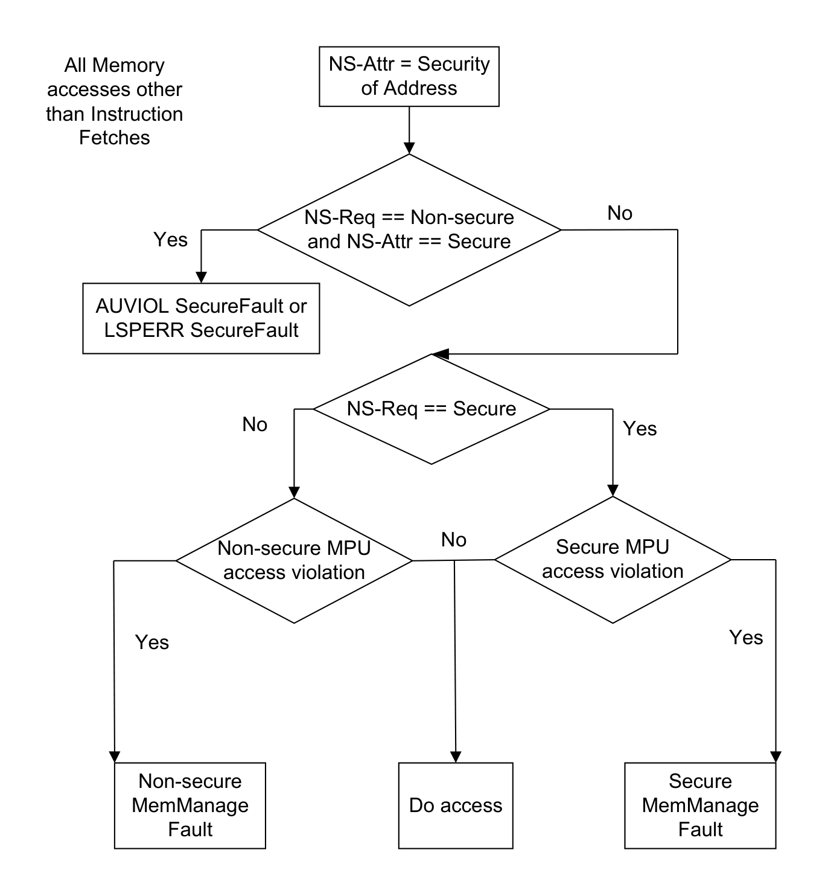
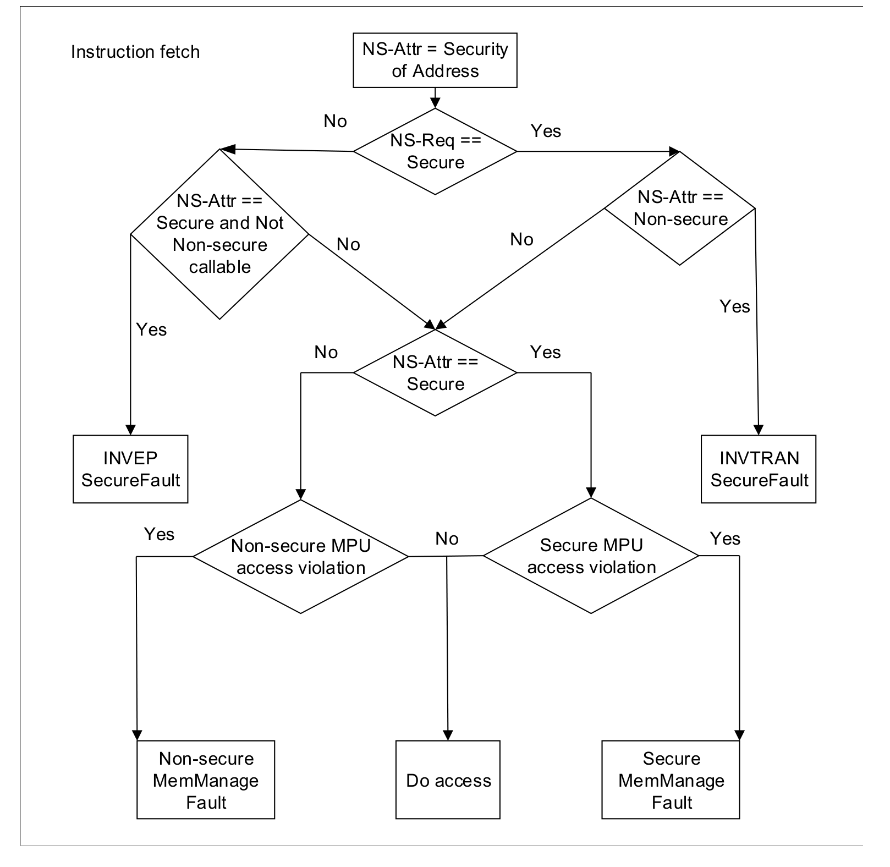

本章规定 **Armv8-M** 受保护内存系统架构（PMSAv8-M）规则，特别是可选的**内存保护单元**（MPU）与可选的**安全归属单元**（SAU）的规则。

## 1. 内存保护单元

在包含**受保护内存系统架构**（Protected Memory System Architecture，PMSA）的实现中，系统地址空间由**内存保护单元**（Memory Protection Unit，MPU）保护。

适用于 **Armv8.0-M** 及以后架构版本的实现。扩展要求为 - MPU。

**PMSAv8-M** 只支持统一内存模型。所有已使能的区域都支持取指与数据访问。

适用于 **Armv8.0-M** 及以后架构版本的实现。扩展要求为 - MPU。

内存属性由系统地址映射确定，或通过使用 **MPU** 确定。

适用于 **Armv8.0-M** 及以后架构版本的实现。扩展要求为 - MPU。

**Armv8-M** 中的 **MPU** 支持是可选的。若实现了 **MPU**，则必须至少提供一个 **MPU** 区域。

适用于 **Armv8.0-M** 及以后架构版本的实现。扩展要求为 - MPU。

系统地址映射可以被配置为对特权访问提供背景区域。

适用于 **Armv8.0-M** 及以后架构版本的实现。

当 **MPU** 被禁用或不存在时，访问使用来自系统地址映射的内存属性。

适用于 **Armv8.0-M** 及以后架构版本的实现。

若 **MPU** 已使能，则命中单个区域的访问的内存属性由所命中的区域提供。

适用于 **Armv8.0-M** 及以后架构版本的实现。扩展要求为 - MPU。

**MPU** 将内存划分为区域。

适用于 **Armv8.0-M** 及以后架构版本的实现。扩展要求为 - MPU。

单个 **MPU** 区域由下式定义：

`Address >= MPU_RBAR.BASE:'00000' && Address <= MPU_RLAR.LIMIT:'11111'`

适用于 **Armv8.0-M** 及以后架构版本的实现。扩展要求为 - MPU。

所支持的 **MPU** 区域数量是 **IMPLEMENTATION DEFINED** 的。

适用于 **Armv8.0-M** 及以后架构版本的实现。扩展要求为 - MPU。

由于 `MPU_TYPE` 寄存器是分存储体的，实现可以为每个**安全状态**提供不同数量的 **MPU** 区域，包括没有 **MPU** 区域。

适用于 **Armv8.0-M** 及以后架构版本的实现。扩展要求为 - S && MPU。

所有 **MPU** 区域都按 32 字节的倍数对齐。

适用于 **Armv8.0-M** 及以后架构版本的实现。扩展要求为 - MPU。

**PE** 可以按 `MPU_RBAR.XN` 的取值从每个 **MPU** 区域取指并执行指令。

适用于 **Armv8.0-M** 及以后架构版本的实现。扩展要求为 - MPU。

除非另有说明，所有加载、存储与取指事务都要经过 **MPU** 检查。

适用于 **Armv8.0-M** 及以后架构版本的实现。扩展要求为 - MPU。

若 `MPU_CTRL.ENABLE` 为零，则 **MPU** 检查针对系统地址映射进行，而不针对任何已定义的 **MPU** 区域。

适用于 **Armv8.0-M** 及以后架构版本的实现。扩展要求为 - MPU。

**MPU** 检查是对任何加载、存储或取指事务执行的若干检查之一，这些检查还包括对齐检查、安全归属检查以及对任何 **BusFault** 的检查。

适用于 **Armv8.0-M** 及以后架构版本的实现。扩展要求为 - MPU。

从**向量地址表**（Vector Address Table）进行的异常向量读取始终使用系统地址映射。

适用于 **Armv8.0-M** 及以后架构版本的实现。

就 **MPU** 检查而言，由 `MSR` 或 `CPS` 引起的当前执行优先级的任何变化，都需要**上下文同步事件**来保证可见性。

适用于 **Armv8.0-M** 及以后架构版本的实现。扩展要求为 - MPU。

对 **PPB**（0xE0000000-0xE00FFFFF 范围）的任何加载、存储或取指事务，都针对系统地址映射检查。对该区域的取指会产生 `IACCVIOL` **MemManage** 故障。

适用于 **Armv8.0-M** 及以后架构版本的实现。

为加载、存储或取指事务执行的任何 **MPU** 检查，在以下任一为真时都会产生精确的 **MemManage** 故障：

- 该加载、存储或取指事务所访问的地址匹配多于一个 **MPU** 区域。
- 该加载、存储或取指事务不满足所访问 **MPU** 区域的全部访问条件。
- 该加载、存储或取指事务只匹配系统地址映射，而系统地址映射未被使能。

适用于 **Armv8.0-M** 及以后架构版本的实现。扩展要求为 - MPU。

**MPU** 在改变 `VENDOR_SYS` 空间（即 0xE0100000-0xFFFFFFFF 区域）中地址的内存属性方面受到限制。除非另有说明，系统空间始终为 **XN**（Execute Never），且始终为 **Device-nGnRE**。若 **MPU** 将其映射为 **Device-nGnRE** 以外的类型，则该区域是被当作 **Device-nGnRE** 还是被当作 **Device-nGnRnE** 是 **UNKNOWN** 的。

适用于 **Armv8.0-M** 及以后架构版本的实现。扩展要求为 - MPU。

除非对数据访问另有说明，**MPU** 的内存归属与特权检查使用与 **PE** 当前安全状态对应的配置寄存器。

适用于 **Armv8.0-M** 及以后架构版本的实现。扩展要求为 - MPU && S。

对于取指，**MPU** 的内存归属与特权检查使用与该指令地址的安全性相关联的配置寄存器。

适用于 **Armv8.0-M** 及以后架构版本的实现。扩展要求为 - MPU。

若请求的执行优先级为负，则 `MPU_CTRL.HFNIMENA` 位控制访问是针对 **MPU** 区域检查还是针对系统地址映射检查。在以下任一为真时，请求的执行优先级为负：

- **HardFault** 异常对与该 **MPU** 关联的安全状态处于活动状态。
- **NMI** 异常对与该 **MPU** 关联的安全状态处于活动状态。
- `FAULTMASK.FM` 对与该 **MPU** 关联的安全状态置 1。

适用于 **Armv8.0-M** 及以后架构版本的实现。扩展要求为 - MPU。

若 **PE** 在特权模式下执行，则当其试图从 `MPU_RLAR.PXN` 置 1 的 **MPU** 区域执行指令时，会产生 **MemManage** 故障。

适用于 **Armv8.1-M** 及以后架构版本的实现。扩展要求为 - MPU。

把 `MPU_RNR.REGION` 字段设置为不对应已实现内存区域的取值，是 **CONSTRAINED UNPREDICTABLE** 的，具体如下：

- 对 `MPU_RNR.REGION` 的任何后续读取返回 **UNKNOWN** 值。
- 对未实现区域中寄存器的任何读取返回 **UNKNOWN** 值。
- 对由 `MPU_RNR.REGION` 间接寻址的寄存器的任何写入，导致由该寄存器间接寻址的所有状态变为 **UNKNOWN**。

适用于 **Armv8.0-M** 及以后架构版本的实现。扩展要求为 - MPU。

参见：

- 第 B8.1 节《系统地址映射》（System address map）。
- 第 B7.8 节《访问权限》（Access rights）。
- 第 B7.12 节《Device 内存属性》（Device memory attributes）。
- 第 B7.13 节《可共享性属性》（Shareability attributes）。
- 第 B7.15 节《内存访问限制》（Memory access restrictions）。
- 第 B7.16 节《不匹配的内存属性》（Mismatched memory attributes）。
- 第 B7.17 节《对 Normal 内存的 Load-Exclusive 与 Store-Exclusive 访问》（Load-Exclusive and Store-Exclusive accesses to Normal memory）。
- 第 B7.18 节《对内存的 Load-Acquire 与 Store-Release 访问》（Load-Acquire and Store-Release accesses to memory）。
- 《MPU 控制寄存器》（MPU_CTRL, MPU Control Register）。
- 《测试目标响应载荷》（TT_RESP, Test Target Response Payload）。

## 2. 安全归属

**安全归属单元**与**实现定义归属单元**统称为**归属单元**（Attribution Unit，AU）。

适用于 **Armv8.0-M** 及以后架构版本的实现。扩展要求为 - S。

**Security Extension** 定义了三个级别的内存安全归属。按安全性升序，它们是：

1. **Non-secure** 属性。
2. **Secure** 属性，且为 **Non-secure callable**。
3. **Secure** 属性，且为非 **Non-secure callable**。

适用于 **Armv8.0-M** 及以后架构版本的实现。扩展要求为 - S。

以下单元可以提供安全归属信息：

- **PE** 内部的**安全归属单元**（Security attribution unit，SAU）。
- **PE** 外部的 **IMPLEMENTATION DEFINED** 归属单元（IDAU）。此类单元是否存在是 **IMPLEMENTATION DEFINED** 的。

适用于 **Armv8.0-M** 及以后架构版本的实现。扩展要求为 - S。

使用来自 **SAU** 的归属信息，除非 **IDAU** 指定了安全性更高的属性，此时 **IDAU** 属性覆盖 **SAU** 属性。本规则不适用于架构上定义为免受内存归属的地址范围。

适用于 **Armv8.0-M** 及以后架构版本的实现。扩展要求为 - S。

**归属单元**（AU）违规定义为由 **SAU** 或 **IDAU** 之一引发的违规。

适用于 **Armv8.0-M** 及以后架构版本的实现。扩展要求为 - S。

具有不同安全属性的地址范围之间的所有边界，都按 32 字节边界对齐。

适用于 **Armv8.0-M** 及以后架构版本的实现。扩展要求为 - S。

以下地址范围的行为是固定的，因此它们免受 **SAU** 与 **IDAU** 双方的内存归属：

**免受安全违规检查的地址范围**

以下地址范围按 **NS-Req** 所指示的安全状态标记，即 **PE** 对非调试访问的当前状态。该标记把 **NS-Attr** 置为 **NS-Req**：

- 0xE0000000 - 0xE0003FFF：ITM、DWT、FPB、PMU。
- 0xE0005000 - 0xE0005FFF：RAS 错误记录寄存器。
- 0xE000E000 - 0xE000EFFF：SCS 的 **Secure** 与 **Non-secure** 范围。
- 0xE002E000 - 0xE002EFFF：SCS 的 **Non-secure** 别名范围。
- 0xE0040000 - 0xE0041FFF：TPIU、ETM。
- 0xE00FF000 - 0xE00FFFFF：ROM 表。
- 0xE0000000 - 0xEFFFFFFF：仅用于取指。
- 由 **IDAU** 指定的附加地址范围。

适用于 **Armv8.0-M** 及以后架构版本的实现。扩展要求为 - S。注意，某些地址范围要求 DB、RAS 或 PMU。

以下地址范围的行为是固定的：

0xF0000000 - 0xFFFFFFFF

若 **PE** 实现了 **Security Extension**，则该内存范围在取指时始终标记为 **Secure** 且为**非 Non-secure callable**。

若未实现 **Security Extension**，则该范围标记为 **Non-secure**。

适用于 **Armv8.0-M** 及以后架构版本的实现。扩展要求为 - S。

若以下任一为真，则允许对**安全归属豁免**地址进行推测性取指：

- **Secure MPU** 区域检查报告该地址不是 **execute-never**。
- **Non-secure MPU** 区域检查报告该地址不是 **execute-never**。

适用于 **Armv8.0-M** 及以后架构版本的实现。扩展要求为 - S && MPU。

对于所有非取指的数据访问以及取指访问，安全归属与 **MPU** 检查序列如下图所示：

适用于 **Armv8.0-M** 及以后架构版本的实现。扩展要求为 - S。

若内存访问由执行 `SG` 指令引起，则即使该 `SG` 指令是从 **Non-secure** 状态执行的，从栈上的加载也以 **NS-Req** 置为 **Secure** 的方式进行。

适用于 **Armv8.1-M** 及以后架构版本的实现。扩展要求为 - S。

参见：

- 第 B10.3 节《安全归属单元（SAU）》（Security attribution unit (SAU)）。
- 第 B10.4 节《IMPLEMENTATION DEFINED 归属单元（IDAU）》（IMPLEMENTATION DEFINED Attribution Unit (IDAU)）。

## 3. 安全归属单元（SAU）

**SAU** 配置定义了 **IMPLEMENTATION DEFINED** 数量的内存区域。区域数量由 `SAU_TYPE.SREGION` 指示。

适用于 **Armv8.0-M** 及以后架构版本的实现。扩展要求为 - S。

由 **SAU** 配置定义的内存区域称为 `SAU_REGIONn`，其中 n 为 0 - (`SAU_TYPE.SREGION`-1) 的数字。

适用于 **Armv8.0-M** 及以后架构版本的实现。扩展要求为 - S。

**SAU** 区域配置字段只能使用窗口寄存器（如下表所示的 `SAU_RNR`）间接访问：

| SAU 区域配置字段 | 关联的窗口寄存器字段 |
| --- | --- |
| `SAU_REGIONn.ENABLE` | `SAU_RLAR.ENABLE` |
| `SAU_REGIONn.NSC` | `SAU_RLAR.NSC` |
| `SAU_REGIONn.BADDR` | `SAU_RBAR.BADDR` |
| `SAU_REGIONn.LADDR` | `SAU_RLAR.LADDR` |

适用于 **Armv8.0-M** 及以后架构版本的实现。扩展要求为 - S。

当 **SAU** 被使能时，若下式成立，则地址被定义为与 **SAU** 中的某个区域匹配：

`Address >= SAU_REGIONn.BADDR: '00000' && Address <= SAU_REGIONn.LADDR: '11111'`

适用于 **Armv8.0-M** 及以后架构版本的实现。扩展要求为 - S。

内存默认标记为 **Secure**。然而，若地址匹配的区域的 `SAU_REGIONn.ENABLE` 置 1 且 `SAU_REGIONn.NSC` 置 0，则内存标记为 **Non-secure**。

适用于 **Armv8.0-M** 及以后架构版本的实现。扩展要求为 - S。

匹配多个 **SAU** 区域的地址标记为 **Secure** 且为**非 Not-secure callable**，与匹配该地址的各区域所指定的属性无关。

适用于 **Armv8.0-M** 及以后架构版本的实现。扩展要求为 - S。

当 **SAU** 未被使能时：

- 不针对 **SAU** 区域检查地址。
- 地址空间的归属由 `SAU_CTRL.ALLNS` 字段确定。

适用于 **Armv8.0-M** 及以后架构版本的实现。扩展要求为 - S。

为允许锁定 **SAU** 配置，`SAU_RLAR`、`SAU_RBAR`、`SAU_CTRL` 与 `SAU_RNR` 是否可写是 **IMPLEMENTATION DEFINED** 的。

适用于 **Armv8.0-M** 及以后架构版本的实现。扩展要求为 - S。

把 `SAU_RNR.REGION` 字段设置为不对应已实现内存区域的取值，是 **CONSTRAINED UNPREDICTABLE** 的，具体如下：

- 对 `SAU_RNR.REGION` 的任何后续读取返回 **UNKNOWN** 值。
- 对由 `SAU_RNR.REGION` 间接寻址的寄存器的任何读取返回 **UNKNOWN** 值。
- 对由 `SAU_RNR.REGION` 间接寻址的寄存器的任何写入，导致由该寄存器间接寻址的所有状态变为 **UNKNOWN**。

适用于 **Armv8.0-M** 及以后架构版本的实现。扩展要求为 - S。

## 4. IMPLEMENTATION DEFINED 归属单元（IDAU）

**IDAU** 可以为地址提供以下安全归属信息：

- **安全归属豁免**。指明该地址免受安全归属。该信息与架构上要求豁免归属的地址范围合并。
- **Non-secure**。指明该地址是 **Secure** 还是 **Non-secure**。
- **Non-secure callable**。指明该地址处的代码能否从 **Non-secure** 状态调用。该属性仅在该地址标记为 **Secure** 时有效。
- **区域号**。与地址匹配的区域号，仅由 `TT` 指令使用。
- **区域号有效**。指明区域号有效。该字段不影响地址的归属，仅由 `TT` 指令使用。

适用于 **Armv8.0-M** 及以后架构版本的实现。扩展要求为 - S。

**IDAU** 必须确保对每个区域以下各项都成立：

- 每个区域必须具有唯一的标识号。
- 该区域内的所有地址必须具有相同的属性，包括 **Non-secure Callable** 属性。
- 该区域必须是连续的地址范围。

适用于 **Armv8.0-M** 及以后架构版本的实现。扩展要求为 - S。

参见：

- 《TT、TTT、TTA、TTAT》（TT, TTT, TTA, TTAT）。
- 第 B10.2 节《安全归属》（Security attribution）。
