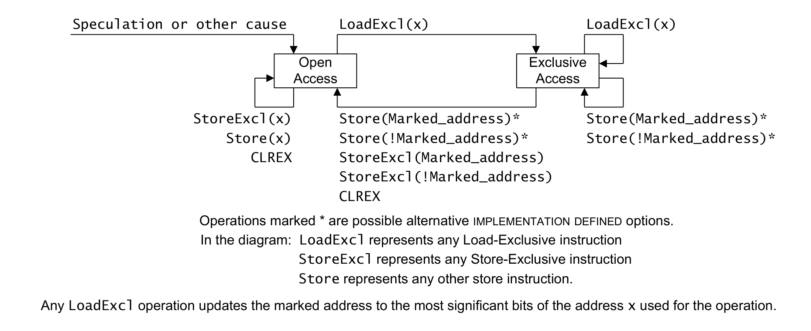
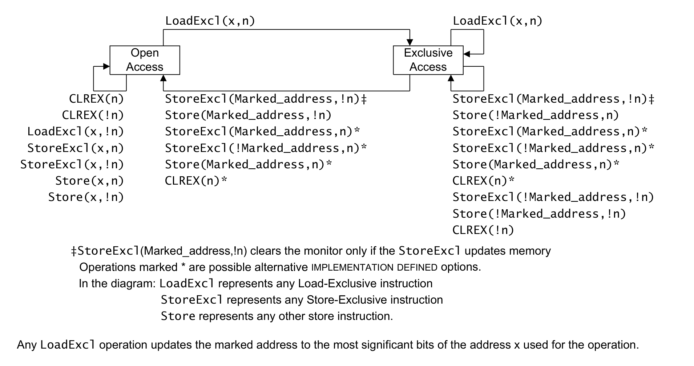

本章规定 **Armv8-M** 架构中独占访问指令与非阻塞同步的规则。

## 1. 独占访问指令

**Armv8** 通过对 **Normal** 内存与 **Device** 内存的访问提供同步原语，实现共享内存的非阻塞同步。

适用于 **Armv8.0-M** 及以后架构版本的实现。

同步原语及相关指令如下：

| 功能 | T32 指令 |
| --- | --- |
| Load-Exclusive（字节） | `LDREXB`、`LDAEXB` |
| Load-Exclusive（半字） | `LDREXH`、`LDAEXH` |
| Load-Exclusive（字） | `LDREX`、`LDAEX` |
| Store-Exclusive（字节） | `STREXB`、`STLEXB` |
| Store-Exclusive（半字） | `STREXH`、`STLEXH` |
| Store-Exclusive（字） | `STREX`、`STLEX` |
| Clear-Exclusive | `CLREX` |

适用于 **Armv8.0-M** 及以后架构版本的实现。

**Load-Exclusive** 指令执行一次从内存的加载，并且：

- 执行该指令的 **PE** 将该内存地址标记为独占访问。
- 执行该指令的 **PE** 的**本地监视器**转换到**独占访问状态**（Exclusive Access state）。

适用于 **Armv8.0-M** 及以后架构版本的实现。

被标记内存块的大小称为**独占保留粒度**（Exclusives reservation granule，ERG），它是 **IMPLEMENTATION DEFINED** 的取值，尺寸为 2 的幂，范围为 4 - 512 个字。

适用于 **Armv8.0-M** 及以后架构版本的实现。

大小为 ERG 的已标记块通过忽略内存地址的最低有效位产生。已标记地址是该已标记块内的任意地址。

适用于 **Armv8.0-M** 及以后架构版本的实现。

在某些实现中，`CTR` 标识**独占保留粒度**。若非如此，则**独占保留粒度**按最大 512 个字处理。

适用于 **Armv8.0-M** 及以后架构版本的实现。

参见：

- 第 B9.2 节《本地监视器》（The local monitors）。
- 第 B9.3 节《全局监视器》（The global monitor）。
- 第 B9.4 节《独占访问指令与监视器》（Exclusive access instructions and the monitors）。
- 第 B9.5 节《Load-Exclusive 与 Store-Exclusive 指令约束》（Load-Exclusive and Store-Exclusive instruction constraints）。

## 2. 本地监视器

同一 **PE** 使用 **Store-Exclusive** 指令修改任意地址的任何未中止尝试，都保证会清除标记。

适用于 **Armv8.0-M** 及以后架构版本的实现。

当 **PE** 使用 **Store-Exclusive** 指令以外的任何指令写入时：

- 若该写入针对的物理地址未由其**本地监视器**标记为独占访问，且该**本地监视器**处于**独占访问状态**，则该写入是否影响**本地监视器**的状态是 **IMPLEMENTATION DEFINED** 的。
- 若该写入针对的物理地址已由其**本地监视器**标记为独占访问，则该写入是否影响**本地监视器**的状态是 **IMPLEMENTATION DEFINED** 的。

适用于 **Armv8.0-M** 及以后架构版本的实现。

若对已标记物理地址的存储由标记该物理地址的**观察者**之外的**观察者**执行，则该存储是否导致**本地监视器**中的标记被清除，是 **IMPLEMENTATION DEFINED** 的。

适用于 **Armv8.0-M** 及以后架构版本的实现。

**本地监视器**的状态机如下图所示：

**本地监视器**只有在对图中所示操作之一进行架构执行时，才转换到**独占访问状态**。

任何非由此处所示操作的架构执行所引起的、**本地监视器**向**开放访问状态**（Open Access state）的转换，都不会无限期推迟执行的前进。

适用于 **Armv8.0-M** 及以后架构版本的实现。

**本地监视器**不保存任何物理地址，而是把任何访问都视为与上一条 **Load-Exclusive** 指令的地址匹配。

适用于 **Armv8.0-M** 及以后架构版本的实现。

**本地监视器**的实现可以不知道来自其他 **PE** 的 **Load-Exclusive** 与 **Store-Exclusive** 指令。

适用于 **Armv8.0-M** 及以后架构版本的实现。

架构不要求来自另一个 **PE** 的、非 **Load-Exclusive** 指令的加载对**本地监视器**产生任何影响。

适用于 **Armv8.0-M** 及以后架构版本的实现。

当存储或 **StoreExcl** 来自另一个**观察者**时，从**独占访问状态**到**开放访问状态**的转换是否发生，是 **IMPLEMENTATION DEFINED** 的。

适用于 **Armv8.0-M** 及以后架构版本的实现。

架构允许**本地监视器**因推测或其他原因而转换到**开放访问状态**。

适用于 **Armv8.0-M** 及以后架构版本的实现。

异常返回会清除**本地监视器**。

适用于 **Armv8.0-M** 及以后架构版本的实现。

参见：

- 第 B9.4 节《独占访问指令与监视器》（Exclusive access instructions and the monitors）。

## 3. 全局监视器

对于系统中的每个 **PE**，**全局监视器**：

- 可以保存至少一个已标记块。
- 为其可保存的每个已标记块维护一个状态机。

适用于 **Armv8.0-M** 及以后架构版本的实现。

对每个 **PE**，架构只要求**全局监视器**支持单个已标记地址。任何可能受益于在单个 **PE** 上使用多个已标记地址的情形都是 **CONSTRAINED UNPREDICTABLE** 的。

适用于 **Armv8.0-M** 及以后架构版本的实现。

**全局监视器**既可以位于 **PE** 执行所在硬件的某个部件中，也可以作为内存接口处的次级监视器存在。

适用于 **Armv8.0-M** 及以后架构版本的实现。

监视器的 **IMPLEMENTATION DEFINED** 方面意味着，只要该单元执行本手册中定义的**全局监视器**功能与**本地监视器**功能，二者就可以合并为单个单元。

适用于 **Armv8.0-M** 及以后架构版本的实现。

对于可共享内存位置，在某些实现中、对某些内存类型，**全局监视器**的特性要求 **PE** 之外的功能。某些系统实现可能并不对所有内存位置实现该功能。特别是，这可能适用于：

- 系统实现中不支持硬件高速缓存一致性的任何类型的内存。
- 在确实支持硬件高速缓存一致性的实现中，**Non-cacheable** 内存，或被视为 **Non-cacheable** 的内存。

在此类系统中，由系统定义：

- 是否实现**全局监视器**。
- 若实现了**全局监视器**，它监视哪些地址范围或内存类型。

适用于 **Armv8.0-M** 及以后架构版本的实现。

架构上保证实现**全局监视器**的内存类型只有：

- **Inner Shareable**、**Inner Write-Back**、**Outer Write-Back** 的 **Normal** 内存，带有 Read allocation 提示与 Write allocation 提示，且非 transient。
- **Outer Shareable**、**Inner Write-Back**、**Outer Write-Back** 的 **Normal** 内存，带有 Read allocation 提示与 Write allocation 提示，且非 transient。

适用于 **Armv8.0-M** 及以后架构版本的实现。

支持原子指令的内存类型集合，包含所有实现了**全局监视器**的内存类型。

适用于 **Armv8.0-M** 及以后架构版本的实现。

若某个地址范围或内存类型未实现**全局监视器**，则在没有任何其他故障的情况下，对此类位置执行 **Load-Exclusive/Store-Exclusive** 指令会产生以下一种或多种效果：

- 该指令产生 **BusFault**。
- 该指令产生 **DACCVIOL MemManage** 故障。
- 该指令被当作 `NOP` 处理。
- **Load-Exclusive** 指令被当作访问 **Non-shareable** 位置处理，但**本地监视器**的状态变为 **UNKNOWN**。
- **Store-Exclusive** 指令被当作访问 **Non-shareable** 位置处理，但**本地监视器**的状态变为 **UNKNOWN**。
- **Store-Exclusive** 指令的结果寄存器中保存的值变为 **UNKNOWN**。

适用于 **Armv8.0-M** 及以后架构版本的实现。注意，**MemManage** 故障要求 `M && MPU`，**BusFault** 要求 `M`。

对于未实现独占访问或其他原子访问机制的非 **PE** **观察者**所产生的写事务，这些写入对 **Arm PE** 所使用的**全局监视器**与**本地监视器**的影响是 **IMPLEMENTATION DEFINED** 的。这些写入可能不会清除其他 **PE** 的**全局监视器**，涉及：

- 某些地址范围。
- 某些内存类型。

适用于 **Armv8.0-M** 及以后架构版本的实现。

### 3.1 Load-Exclusive 与 Store-Exclusive

**全局监视器**对每个 **PE** 只支持一个针对可共享内存的未完成独占访问。

适用于 **Armv8.0-M** 及以后架构版本的实现。

架构不要求来自另一个 **PE** 的、非 **Load-Exclusive** 指令的加载对**全局监视器**产生任何影响。

适用于 **Armv8.0-M** 及以后架构版本的实现。

一个 **PE** 执行的 **Load-Exclusive** 指令不影响任何其他 **PE** 的**全局监视器**状态。

适用于 **Armv8.0-M** 及以后架构版本的实现。

**Store-Exclusive** 指令执行一次对内存的条件存储：

- 只有当所访问的物理地址被标记为请求 **PE** 的独占访问，且请求 **PE** 的**本地监视器**与**全局监视器**状态机都处于**独占访问状态**时，该存储才保证成功。在此情况下：
  - 向一个寄存器返回状态值 0，以确认存储成功。
  - 请求 **PE** 的**全局监视器**状态机的最终状态是 **IMPLEMENTATION DEFINED** 的。
  - 若所访问的地址在任何其他 **PE** 的**全局监视器**状态机中被标记为独占访问，则该状态机转换到**开放访问状态**。
- 若没有为请求 **PE** 标记任何地址为独占访问，则该存储不成功：
  - 向一个寄存器返回状态值 1，表示存储失败。
  - **全局监视器**不受影响，对请求 **PE** 保持**开放访问状态**。
- 若为请求 **PE** 标记的是另一个不同的物理地址，则该存储是否成功是 **IMPLEMENTATION DEFINED** 的：
  - 若存储成功则向寄存器返回值 0，否则返回值 1。
  - 若该 **PE** 的**全局监视器**状态机在执行 **Store-Exclusive** 指令之前处于**独占访问状态**，则该状态机是否转换到**开放访问状态**是 **IMPLEMENTATION DEFINED** 的。

适用于 **Armv8.0-M** 及以后架构版本的实现。

在共享内存系统中，**全局监视器**为系统中的每个 **PE** 实现一个独立的状态机。PE(n) 对可共享内存的访问所用状态机，可以响应其可见的所有可共享内存访问。

适用于 **Armv8.0-M** 及以后架构版本的实现。

在共享内存系统中，**全局监视器**为系统中每个可产生 **Load-Exclusive** 或 **Store-Exclusive** 指令的**观察者**实现一个独立的状态机。

适用于 **Armv8.0-M** 及以后架构版本的实现。

每当某个 **PE** 的**全局监视器**状态从**独占访问**变为**开放访问**时，都会产生一个事件并将其保持在该 **PE** 的**事件寄存器**中。该寄存器供 **Wait for Event** 机制使用。

适用于 **Armv8.0-M** 及以后架构版本的实现。

### 3.2 可共享内存中的 Load-Exclusive 与 Store-Exclusive

来自可共享内存的 **Load-Exclusive** 指令执行一次从内存的加载，并使该访问的物理地址被标记为请求 **PE** 的独占访问。该访问还可能使请求 **PE** 先前标记的任何其他物理地址的独占访问标记被移除。

适用于 **Armv8.0-M** 及以后架构版本的实现。

全局监视器中 PE(n) 的状态机如下图所示：

适用于 **Armv8.0-M** 及以后架构版本的实现。

**Store-Exclusive** 指令能否成功更新内存，取决于所访问的地址是否与发起该 **Store-Exclusive** 指令的 **PE** 的已标记可共享内存地址匹配，以及**本地监视器**与**全局监视器**是否处于独占状态。

适用于 **Armv8.0-M** 及以后架构版本的实现。

当**全局监视器**处于**独占访问状态**时，`CLREX` 指令是否导致**全局监视器**从**独占访问状态**转换到**开放访问状态**，是 **IMPLEMENTATION DEFINED** 的。

适用于 **Armv8.0-M** 及以后架构版本的实现。

**Load-Exclusive** 指令只能更新发起该 **Load-Exclusive** 指令的 **PE** 的已标记可共享内存地址。

适用于 **Armv8.0-M** 及以后架构版本的实现。

以下各项是 **IMPLEMENTATION DEFINED** 的：

- 对 **Non-shareable** 内存位置的修改是否会导致**全局监视器**从**独占访问状态**转换到**开放访问状态**。
- 对 **Non-shareable** 内存位置的 **Load-Exclusive** 指令是否会导致**全局监视器**从**开放访问状态**转换到**独占访问状态**。

适用于 **Armv8.0-M** 及以后架构版本的实现。

参见：

- 第 B9.4 节《独占访问指令与监视器》（Exclusive access instructions and the monitors）。

## 4. 独占访问指令与监视器

**Store-Exclusive** 指令定义监视器的状态值返回到哪个寄存器。

适用于 **Armv8.0-M** 及以后架构版本的实现。

**Store-Exclusive** 指令执行一次对内存的条件存储，该存储取决于**本地监视器**的状态：

- 若**本地监视器**处于**独占访问状态**：
  - 若 **Store-Exclusive** 指令的地址与先前 **Load-Exclusive** 指令在监视器中标记的地址相同，则执行存储。否则，是否执行存储是 **IMPLEMENTATION DEFINED** 的。
  - 向一个寄存器返回状态值：
    - 若执行了存储，状态值为 0。
    - 否则，状态值为 1。
  - 执行该指令的 **PE** 的**本地监视器**转换到**开放访问状态**。
- 若**本地监视器**处于**开放访问状态**：
  - 不执行存储。
  - 向一个寄存器返回状态值 1。
  - **本地监视器**保持**开放访问状态**。

适用于 **Armv8.0-M** 及以后架构版本的实现。

**Store-Exclusive** 指令执行一次对**可共享内存**的存储，该存储取决于**本地监视器**与**全局监视器**二者的状态：

- 若**本地监视器**与**全局监视器**都处于**独占访问状态**：
  - 若 **Store-Exclusive** 指令的地址与先前 **Load-Exclusive** 指令在监视器中标记的地址相同，则执行存储。否则，是否执行存储是 **IMPLEMENTATION DEFINED** 的。
  - 向一个寄存器返回状态值：
    - 若执行了存储，状态值为 0。
    - 否则，状态值为 1。
  - 执行该指令的 **PE** 的**本地监视器**转换到**开放访问状态**。
- 若**本地监视器**或**全局监视器**之一处于**开放访问状态**：
  - 不执行存储。
  - 向一个寄存器返回状态值 1。
  - 执行该指令的 **PE** 的**本地监视器**转换到**开放访问状态**。
  - 与该 **PE** 关联的**全局监视器**转换到**开放访问状态**。

适用于 **Armv8.0-M** 及以后架构版本的实现。

参见：

- 第 B9.2 节《本地监视器》（The local monitors）。
- 第 B9.3 节《全局监视器》（The global monitor）。

## 5. Load-Exclusive 与 Store-Exclusive 指令约束

**Load-Exclusive** 与 **Store-Exclusive** 指令设计为成对工作，例如 `LDREX`/`STREX` 对或 `LDREXB`/`STREXB` 对。

适用于 **Armv8.0-M** 及以后架构版本的实现。

架构不要求把地址或尺寸检查作为 `IsExclusiveLocal()` 函数的一部分。

适用于 **Armv8.0-M** 及以后架构版本的实现。

若执行两条 **StoreExcl** 指令之间没有 **LoadExcl** 指令，则第二条 **StoreExcl** 指令返回状态值 1。

适用于 **Armv8.0-M** 及以后架构版本的实现。

架构不要求每条 **LoadExcl** 指令都有后续的 **StoreExcl** 指令。

适用于 **Armv8.0-M** 及以后架构版本的实现。

若 **StoreExcl** 指令的事务尺寸与同一执行线程中先前 **LoadExcl** 指令不同，则行为是 **CONSTRAINED UNPREDICTABLE** 的，为以下之一：

- **StoreExcl** 通过或失败，且 **StoreExcl** 返回的状态值是 **UNKNOWN** 的。
- 在 **LoadExcl/StoreExcl** 对所访问的地址处，尺寸取该对所用事务尺寸中较大者的数据块是 **UNKNOWN** 的。

适用于 **Armv8.0-M** 及以后架构版本的实现。

硬件只保证在 **LoadExcl** 与 **StoreExcl** 具有相同事务尺寸时，**LoadExcl/StoreExcl** 对才成功。

适用于 **Armv8.0-M** 及以后架构版本的实现。

只有在以下条件对单个执行线程中的任何 **LoadExcl/StoreExcl** 循环都成立时，才能通过 **LoadExcl/StoreExcl** 循环取得前进：

- 在 **Load-Exclusive** 与 **Store-Exclusive** 之间没有显式内存访问、预加载、直接或间接的寄存器写入、高速缓存维护指令、`SVC` 指令、`ISB` 屏障或异常返回。
- 在 **Store-Exclusive** 返回失败结果之后到重试 **Load-Exclusive** 之间，满足以下条件：
  - 对 **Store-Exclusive** 所访问的同一**独占保留粒度**内的任何位置没有存储。
  - 除数据处理或比较指令引起的 `APSR` 或 `FPSCR` 标志字段变化外，没有直接或间接的寄存器写入。
  - 没有直接或间接的高速缓存维护指令、`SVC` 指令或异常返回。

**独占监视器**可以在任何时候、在没有与应用相关的原因的情况下被清除，但前提是这种清除不是系统性地反复发生，以致在有限时间内阻止至少一个访问该**独占监视器**的线程取得前进。

适用于 **Armv8.0-M** 及以后架构版本的实现。

把 **LoadExcl** 与 **StoreExcl** 操作保持在单个执行线程中彼此靠近，可最小化**独占监视器**状态在 **LoadExcl** 指令与 **StoreExcl** 指令之间被清除的机会。因此，为获得最佳性能，**Arm** 强烈建议在单个执行线程中 **LoadExcl** 与 **StoreExcl** 指令之间的间隔不超过 128 字节。

适用于 **Armv8.0-M** 及以后架构版本的实现。

架构对可标记为独占访问的**独占保留粒度**设定了 2048 字节的上限。

适用于 **Armv8.0-M** 及以后架构版本的实现。

出于性能原因，**Arm** 建议由独占访问所访问的对象按独占保留粒度的尺寸分隔。

适用于 **Armv8.0-M** 及以后架构版本的实现。

在发生 **BusFault** 或 **MemManage** 故障之后，独占监视器的状态是 **UNKNOWN** 的。

适用于 **Armv8.0-M** 及以后架构版本的实现。扩展要求为 - M。

对于 **LoadExcl/StoreExcl** 对所访问的内存位置，若同一执行线程中 **StoreExcl** 指令的内存属性与先前 **LoadExcl** 指令的内存属性不同，则行为是 **CONSTRAINED UNPREDICTABLE** 的。

适用于 **Armv8.0-M** 及以后架构版本的实现。

数据或统一高速缓存无效化、清理、清理并无效化指令对处于**独占访问状态**的**本地独占监视器**或**全局独占监视器**的影响是 **CONSTRAINED UNPREDICTABLE** 的，该指令可能清除监视器，也可能使其保持**独占访问状态**。对于基于地址的维护指令，这也适用于与执行该高速缓存维护指令的 **PE** 处于同一**可共享域**的其他 **PE** 的监视器，其范围由被维护地址的**可共享域**确定。

适用于 **Armv8.0-M** 及以后架构版本的实现。

**Arm** 强烈建议实现确保 **Non-secure** 状态下的 **PE** 使用此类维护指令不会导致 **Secure** 状态下的 **PE** 发生拒绝服务。

适用于 **Armv8.0-M** 及以后架构版本的实现。

在多个 **PE** 反复争用的 **LoadExcl/StoreExcl** 指令序列情形下，实现确保至少一个 **PE** 取得前进。

适用于 **Armv8.0-M** 及以后架构版本的实现。
