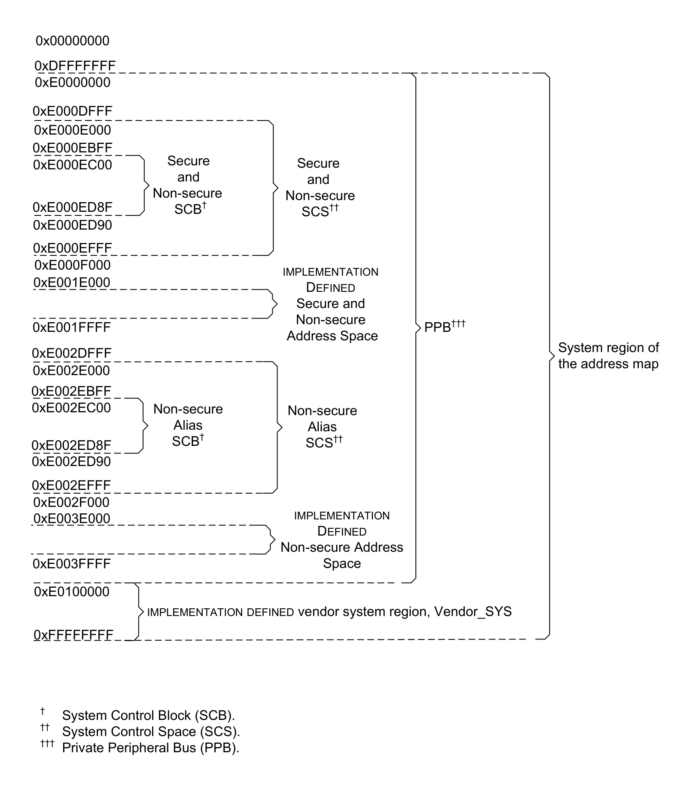

本章规定 **Armv8-M** 系统地址映射规则。

## 1. 系统地址映射

地址空间被划分为以下区域：

| 地址 | 区域 | 内存类型 | XN? | 高速缓存 | 可共享性 | 示例用途 |
| --- | --- | --- | --- | --- | --- | --- |
| 0x00000000 - 0x1FFFFFFF | Code | Normal | - | WT RA | Non-shareable | 通常为 ROM 或 flash 存储器。 |
| 0x20000000 - 0x3FFFFFFF | SRAM | Normal | - | WBWA RA | Non-shareable | 通常用于片上 RAM 的 SRAM 区域。 |
| 0x40000000 - 0x5FFFFFFF | Peripheral | Device, nGnRE | XN | - | - | 片上外设地址空间。 |
| 0x60000000 - 0x7FFFFFFF | RAM | Normal | - | WBWA RA | Non-shareable | 具有 write-back、write allocate 高速缓存属性、用于支持 L2 与 L3 高速缓存的内存。 |
| 0x80000000 - 0x9FFFFFFF | RAM | Normal | - | WT RA | Non-shareable | 具有 Write-Through 高速缓存属性的内存。 |
| 0xA0000000 - 0xBFFFFFFF | Device | Device, nGnRE | XN | - | - | 所有 **Requester** 均可访问的外设。 |
| 0xC0000000 - 0xDFFFFFFF | Device | Device, nGnRE | XN | - | - | 仅 **PE** 可访问的外设。 |
| 0xE0000000 - 0xE00FFFFF | System PPB | Device, nGnRnE | XN | - | - | 保留为 **PPB** 的 1 MB 区域。该区域支持关键资源，包括**系统控制空间**与调试特性。 |
| 0xE0100000 - 0xFFFFFFFF | System Vendor_SYS | Device, nGnRE | XN | - | - | 厂商 **System 区域**。 |

- **WT** - Write-Through。
- **RA** - Read-allocate。
- **WBWA** - Write-back, write-allocate。
- **XN** - 具有 **execute-never** 内存属性的内存。

适用于 **Armv8.0-M** 及以后架构版本的实现。

术语**边界**（boundary）用于表示系统地址映射中所声明的各内存区域之间的分界。

适用于 **Armv8.0-M** 及以后架构版本的实现。

跨越**边界**的访问是 **UNPREDICTABLE** 的。该规则同样适用于 0xFFFFFFFF - 0x00000000 边界。

适用于 **Armv8.0-M** 及以后架构版本的实现。

跨越 0.5GB 内存区域**边界**的非对齐或多字访问是 **UNPREDICTABLE** 的。

适用于 **Armv8.0-M** 及以后架构版本的实现。

参见：

- 第 B8.2 节《系统地址映射的 System 区域》（The System region of the system address map）。
- 第 B7.4 节《地址空间》（Address space）。
- 第 B7.3 节《内存访问》（Memory accesses）。
- 第 B7.19 节《高速缓存》（Caches）。

## 2. 系统地址映射的 System 区域

系统地址映射中的 **System 区域**如下：

适用于 **Armv8.0-M** 及以后架构版本的实现。

在不带 **Security Extension** 的 **PE** 中，**Non-secure SCS** 为 RAZ/WI，且任何对 **Non-secure SCS** 的非特权访问都会导致 **BusFault**。

适用于 **Armv8.0-M** 及以后架构版本的实现。扩展要求为 - M && !S。注意，若 !M 则产生 **HardFault**。

**Arm** 建议将 `Vendor_SYS` 划分如下：

- 0xE0100000–0xEFFFFFFF 为保留区域。
- 厂商资源从 0xF0000000 开始。

适用于 **Armv8.0-M** 及以后架构版本的实现。

**Arm** 强烈建议，**IMPLEMENTATION DEFINED** 的 **Secure** 与 **Non-secure** 地址空间（0xE001E000–0xE001FFFF）与 **IMPLEMENTATION DEFINED** 的 **Non-secure** 别名地址空间（0xE003E000–0xE003FFFF）采用对称实现。

适用于 **Armv8.1-M** 及以后架构版本的实现。扩展要求为 - S。

任何导致 **BusFault** 的对 **PPB** 的访问都将被同步报告。

适用于 **Armv8.0-M** 及以后架构版本的实现。

对未实现寄存器的特权访问为 RES0。

适用于 **Armv8.0-M** 及以后架构版本的实现。

除非另有说明，对未实现寄存器的非特权访问将产生同步 **BusFault**。

适用于 **Armv8.0-M** 及以后架构版本的实现。

可以通过编程**配置与控制寄存器**（Configuration and Control Register，`CCR`）中的 `CCR.USERSETMPEND` 控制位，使能对**系统控制空间**中**软件触发中断寄存器**（Software Trigger Interrupt Register，`STIR`）的非特权访问。

适用于 **Armv8.0-M** 及以后架构版本的实现。

若对 **PPB** 寄存器的写入触发 **BusFault**，则该写入所针对的 **PPB** 寄存器不得被更新。无论该 **BusFault** 随后是否因 `CCR.BFHFNMIGN` 而被忽略，本规则都适用。

适用于 **Armv8.0-M** 及以后架构版本的实现。

若异常进入的上下文压栈、异常返回的上下文出栈、惰性浮点状态保存，或 `FNC_RETURN` 栈帧的压栈或出栈，导致访问 **PPB** 空间内的地址，则该访问的行为是 **CONSTRAINED UNPREDICTABLE** 的，并出现以下情况之一：

- 产生 **BusFault**。
- 执行对 **PPB** 空间的指定访问。

这不适用于 `VLSTM` 指令。

适用于 **Armv8.0-M** 及以后架构版本的实现。

参见：

- 第 B8.1 节《系统地址映射》（System address map）。
- 第 B8.3 节《系统控制空间（SCS）》（The System Control Space (SCS)）。
- 《软件触发中断寄存器》（STIR, Software Triggered Interrupt Register）。
- 《配置与控制寄存器》（CCR, Configuration and Control Register）。
- 第 B13.1.2 节《调试资源》（Debug resources）。

## 3. 系统控制空间（SCS）

**系统控制空间**（System Control Space，SCS）提供用于控制、配置与状态报告的寄存器。

适用于 **Armv8.0-M** 及以后架构版本的实现。

除非另有说明，**NS 别名**的 **Secure** 视图与正常地址的 **Non-secure** 视图相同。

适用于 **Armv8.0-M** 及以后架构版本的实现。扩展要求为 - S。

任何对 **SCS** 的、执行改变上下文操作的访问，其副作用在该访问完成时生效。可以使用 `DSB` 指令保证先前 **SCS** 访问的完成。

适用于 **Armv8.0-M** 及以后架构版本的实现。

**上下文同步事件**保证先前 **SCS** 访问的副作用对**程序顺序**上位于该**上下文同步事件**之后的所有指令可见。

适用于 **Armv8.0-M** 及以后架构版本的实现。

参见：

- 第 B8.2 节《系统地址映射的 System 区域》（The System region of the system address map）。
- 《系统控制块》（System Control Block）。
- 《系统控制块（NS 别名）》（System Control Block (NS alias)）。
- 《调试控制块》（Debug Control Block）。
- 《调试控制块（NS 别名）》（Debug Control Block (NS alias)）。
- 《软件触发中断寄存器》（STIR, Software Triggered Interrupt Register）。
- 《SysTick 控制与状态寄存器》（SYST_CSR, SysTick Control and Status Register）。
- 第 B12 章《嵌套向量中断控制器》（Nested Vectored Interrupt Controller）。
- 第 B10 章《Armv8-M 受保护内存系统架构》（The Armv8-M Protected Memory System Architecture）。
