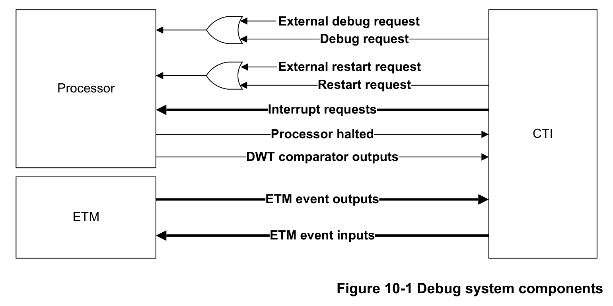

本章介绍 Cortex-M7 交叉触发接口（CTI）。

## 1. 关于 CTI

如果实现了 **CTI**，它可以使调试逻辑与 **ETM** 相互交互，并与其他 CoreSight 组件交互。这称为交叉触发（**cross triggering**）。例如，可以配置 CTI 在 ETM 触发事件发生时产生中断。

## 2. Cortex-M7 CTI 功能描述

Cortex-M7 CTI 连接到若干触发输入和触发输出。下图显示了调试系统组件以及可用的触发输入和触发输出。

下表给出了 CTI 触发输入与 Cortex-M7 处理器的连接方式。

| 信号 | 描述 | 连接 | 应答/握手 |
| --- | --- | --- | --- |
| CTITRIGIN[7] | ETM 事件输出 3 | ETM 到 CTI | 脉冲 |
| CTITRIGIN[6] | ETM 事件输出 2 | ETM 到 CTI | 脉冲 |
| CTITRIGIN[5] | ETM 事件输出 1 | ETM 到 CTI | 脉冲 |
| CTITRIGIN[4] | ETM 事件输出 0 | ETM 到 CTI | 脉冲 |
| CTITRIGIN[3] | DWT 比较器输出 2 | 处理器到 CTI | 脉冲 |
| CTITRIGIN[2] | DWT 比较器输出 1 | 处理器到 CTI | 脉冲 |
| CTITRIGIN[1] | DWT 比较器输出 0 | 处理器到 CTI | 脉冲 |
| CTITRIGIN[0] | 处理器暂停 | 处理器到 CTI | 应答、握手 |

下表给出了 CTI 触发输出与处理器及 ETM 的连接方式。

| 信号 | 描述 | 连接 | 应答/握手 |
| --- | --- | --- | --- |
| CTITRIGOUT[7] | 处理器重新启动 | CTI 到处理器 | 处理器已重新启动 |
| CTITRIGOUT[6] | ETM 事件输入 3 | CTI 到 ETM | 脉冲 |
| CTITRIGOUT[5] | ETM 事件输入 2 | CTI 到 ETM | 脉冲 |
| CTITRIGOUT[4] | ETM 事件输入 1 | CTI 到 ETM | 脉冲 |
| CTITRIGOUT[3] | ETM 事件输入 0 | CTI 到 ETM | 脉冲 |
| CTITRIGOUT[2] | 中断请求 1 | CTI 到系统 | 在 ISR 中写 CTIINTACK 寄存器应答 |
| CTITRIGOUT[1] | 中断请求 0 | CTI 到系统 | 在 ISR 中写 CTIINTACK 寄存器应答 |
| CTITRIGOUT[0] | 处理器调试请求 | CTI 到处理器 | 由调试器写 CTIINTACK 寄存器应答 |

**注意：**

* 使用 CTI 触发输出 0 使处理器暂停后，处理器调试请求（**Processor Debug Request**）信号保持断言。调试器在重新启动处理器之前，必须写 **CTIINTACK** 清除暂停请求。
* 使用 CTI 触发输出 1 或 2 断言中断后，中断服务程序（**ISR**）必须通过写 CTI 中断应答寄存器 **CTIINTACK** 来清除中断请求。

## 3. CTI 编程模型

下表给出了 CTI 的可编程寄存器。寄存器描述请参见 Arm® CoreSight™ SoC-400 技术参考手册。

| 地址偏移 | 寄存器名 | 类型 | 复位值 | 描述 |
| --- | --- | --- | --- | --- |
| 0x000 | CTICONTROL | RW | 0x00000000 | CTI 控制寄存器 |
| 0x010 | CTIINTACK | WO | 0x00000000 | CTI 中断应答寄存器 |
| 0x014 | CTIAPPSET | RW | 0x00000000 | CTI 应用触发置位寄存器 |
| 0x018 | CTIAPPCLEAR | RW | 0x00000000 | CTI 应用触发清除寄存器 |
| 0x01C | CTIAPPPULSE | WO | 0x00000000 | CTI 应用脉冲寄存器 |
| 0x020-0x03C | CTIINEN[7:0] | RW | 0x00000000 | CTI 触发到通道使能寄存器 |
| 0x0A0-0x0BC | CTIOUTEN[7:0] | RW | 0x00000000 | CTI 通道到触发使能寄存器 |
| 0x130 | CTITRIGINSTATUS | RO | 0x00000000 | CTI 触发输入状态寄存器 |
| 0x134 | CTITRIGOUTSTATUS | RO | 0x00000000 | CTI 触发输出状态寄存器 |
| 0x138 | CTICHINSTATUS | RO | 0x00000000 | CTI 通道输入状态寄存器 |
| 0x140 | CTIGATE | RW | 0x00000000 | CTI 通道门控使能寄存器 |
| 0x144 | ASICCTL | RW | 0x00000000 | 外部多路复用器控制寄存器 |
| 0xEDC | ITCHINACK | WO | 0x00000000 | 集成测试通道输入应答寄存器 |
| 0xEE0 | ITTRIGINACK | WO | 0x00000000 | 集成测试触发输入应答寄存器 |
| 0xEE4 | ITCHOUT | WO | 0x00000000 | 集成测试通道输出寄存器 |
| 0xEE8 | ITTRIGOUT | WO | 0x00000000 | 集成测试触发输出寄存器 |
| 0xEEC | ITCHOUTACK | WO | 0x00000000 | 集成测试通道输出应答寄存器 |
| 0xEF0 | ITTRIGOUTACK | RO | 0x00000000 | 集成测试触发输出应答寄存器 |
| 0xEF4 | ITCHIN | RO | 0x00000000 | 集成测试通道输入寄存器 |
| 0xEF8 | ITTRIGIN | RO | 0x00000000 | 集成测试触发输入寄存器 |
| 0xF00 | ITCTRL | RW | 0x00000000 | 集成模式控制寄存器 |
| 0xFA0 | CLAIMSET | RW | 0x0000000F | 声明标签置位寄存器 |
| 0xFA4 | CLAIMCLR | RW | 0x00000000 | 声明标签清除寄存器 |
| 0xFB0 | LAR | WO | 0x00000000 | 锁定访问寄存器 |
| 0xFB4 | LSR | RO | 0x00000003 | 锁定状态寄存器 |
| 0xFB8 | AUTHSTATUS | RO | 0x00000005 | 认证状态寄存器 |
| 0xFC8 | DEVID | RO | 0x00040800 | 设备配置寄存器 |
| 0xFCC | DEVTYPE | RO | 0x00000014 | 设备类型标识寄存器 |
| 0xFD0 | PIDR4 | RO | 0x00000004 | 外设 ID4 寄存器 |
| 0xFD4 | - | - | - | 保留 |
| 0xFD8 | - | - | - | 保留 |
| 0xFDC | - | - | - | 保留 |
| 0xFE0 | PIDR0 | RO | 0x00000006 | 外设 ID0 寄存器 |
| 0xFE4 | PIDR1 | RO | 0x000000B9 | 外设 ID1 寄存器 |
| 0xFE8 | PIDR2 | RO | 0x0000004B | 外设 ID2 寄存器 |
| 0xFEC | PIDR3 | RO | 0x00000000 | 外设 ID3 寄存器 |
| 0xFF0 | CIDR0 | RO | 0x0000000D | 组件 ID0 寄存器 |
| 0xFF4 | CIDR1 | RO | 0x00000090 | 组件 ID1 寄存器 |
| 0xFF8 | CIDR2 | RO | 0x00000005 | 组件 ID2 寄存器 |
| 0xFFC | CIDR3 | RO | 0x000000B1 | 组件 ID3 寄存器 |
