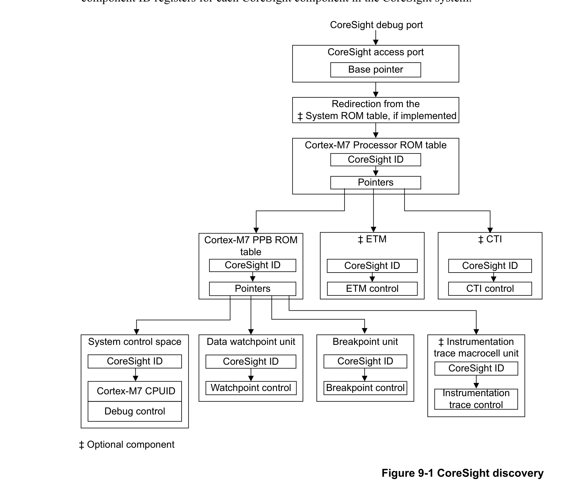

本章介绍如何调试和测试在处理器上运行的软件。

## 1. 关于调试

Cortex-M7 的调试功能包括处理器暂停、单步执行、处理器核寄存器访问、向量捕获（**Vector Catch**）、无限软件断点以及完整的系统内存访问。更多信息请参见 Arm®v7-M 架构参考手册。处理器还支持在实现时配置的硬件断点和观察点：

* 支持四到八个指令比较器的断点单元。
* 支持两个或四个观察点的观察点单元。

对于实现了调试的处理器，Arm 建议调试器使用 CoreSight 调试基础设施来识别并连接调试组件。

下图显示了调试器可用于发现 CoreSight 调试基础设施中各组件的推荐流程。在该流程中，调试器读取 CoreSight 系统中每个 CoreSight 组件的外设 ID 寄存器和组件 ID 寄存器。

为在 CoreSight 系统中识别 Cortex-M7 处理器，Arm 建议调试器执行以下操作：

1. 使用 CoreSight 标识定位并识别 Cortex-M7 处理器 ROM 表。
2. 沿 Cortex-M7 处理器 ROM 表中的指针找到 Cortex-M7 PPB ROM 表。从 PPB ROM 表指针可以识别以下组件：

   a. 系统控制空间（**System Control Space**，SCS）。
   b. 断点单元（**Breakpoint unit**，FPB）。
   c. 数据观察点与跟踪单元（**Data Watchpoint and Trace unit**，DWT）。
   d. 插桩跟踪宏单元（**Instrumentation Trace Macrocell unit**，ITM）。

调试器根据 CoreSight 标识识别出 SCS 后，可以从 SCS 地址 0xE000ED00 处的 **CPUID** 寄存器识别处理器及其版本号。

调试器不能假定 Cortex-M7 处理器 ROM 表是遇到的第一个 ROM 表。如果系统中存在其他 CoreSight 组件，则访问端口与处理器 ROM 表之间需要一个或多个系统 ROM 表。如果存在系统 ROM 表，其中可以包含该实现的唯一标识符。

### 1.1. Cortex-M7 处理器 ROM 表的标识与表项

下表给出了用于调试器检测的处理器 ROM 表标识寄存器及其值。调试器借此识别处理器。

外设 ID 寄存器的这些值表明该 ROM 表为 Cortex-M7 处理器 ROM 表。组件 ID 寄存器表明它是一个 CoreSight ROM 表。

**注意：** Cortex-M7 处理器 ROM 表仅支持字大小的访问。

| 地址 | 寄存器 | 值 | 描述 |
| --- | --- | --- | --- |
| 0xE00FEFD0 | Peripheral ID4 | 0x00000004 | 组件与外设 ID 寄存器格式见 Arm®v7-M 架构参考手册 |
| 0xE00FEFD4 | Peripheral ID5 | 0x00000000 |  |
| 0xE00FEFD8 | Peripheral ID6 | 0x00000000 |  |
| 0xE00FEFDC | Peripheral ID7 | 0x00000000 |  |
| 0xE00FEFE0 | Peripheral ID0 | 0x000000C8 |  |
| 0xE00FEFE4 | Peripheral ID1 | 0x000000B4 |  |
| 0xE00FEFE8 | Peripheral ID2 | 0x0000000B |  |
| 0xE00FEFEC | Peripheral ID3 | 0x00000000 |  |
| 0xE00FEFF0 | Component ID0 | 0x0000000D |  |
| 0xE00FEFF4 | Component ID1 | 0x00000010 |  |
| 0xE00FEFF8 | Component ID2 | 0x00000005 |  |
| 0xE00FEFFC | Component ID3 | 0x000000B1 |  |

下表给出了 Cortex-M7 处理器 ROM 表指向的 CoreSight 组件。

Cortex-M7 处理器 ROM 表的表项指向处理器的调试组件。每个表项的偏移是该组件相对于 ROM 表基地址 0xE00FE000 的偏移。

有关 ROM 表 ID、组件寄存器以及访问类型的更多信息，请参见 Arm® CoreSight™ 架构规范（v2.0）。

| 地址 | 组件 | 值 | 描述 |
| --- | --- | --- | --- |
| 0xE00FE000 | Cortex-M7 PPB ROM 表 | 0x00001003 | 请参见 1.2 节 |
| 0xE00FE004 | ETM | 0xFFF43003ᵃ | 请参见 Arm® CoreSight™ ETM-M7 技术参考手册 |
| 0xE00FE008 | CTI | 0xFFF44003ᵇ | 请参见交叉触发接口一章 |
| 0xE00FE00C | 保留 | 0x1FF02002 | 请参见 Arm® CoreSight™ 架构规范（v2.0） |
| 0xE00FE010 | 结束标记 | 0x00000000 |  |
| 0xE00FEFCC | SYSTEM ACCESS | 0x00000001 |  |

a. 未实现 ETM 时读为 0xFFF43002。
b. 未实现 CTI 时读为 0xFFF44002。

### 1.2. Cortex-M7 PPB ROM 表的标识与表项

下表给出了用于调试器检测的 Cortex-M7 PPB ROM 表标识寄存器及其值。调试器借此识别处理器 PPB 上的 CoreSight 组件及其调试能力。

| 地址 | 寄存器 | 值 | 描述 |
| --- | --- | --- | --- |
| 0xE00FFFD0 | Peripheral ID4 | 0x00000004 | 组件与外设 ID 寄存器格式见 Arm®v7-M 架构参考手册 |
| 0xE00FFFD4 | Peripheral ID5 | 0x00000000 |  |
| 0xE00FFFD8 | Peripheral ID6 | 0x00000000 |  |
| 0xE00FFFDC | Peripheral ID7 | 0x00000000 |  |
| 0xE00FFFE0 | Peripheral ID0 | 0x000000C7 |  |
| 0xE00FFFE4 | Peripheral ID1 | 0x000000B4 |  |
| 0xE00FFFE8 | Peripheral ID2 | 0x0000000B |  |
| 0xE00FFFEC | Peripheral ID3 | 0x00000000 |  |
| 0xE00FFFF0 | Component ID0 | 0x0000000D |  |
| 0xE00FFFF4 | Component ID1 | 0x00000010 |  |
| 0xE00FFFF8 | Component ID2 | 0x00000005 |  |
| 0xE00FFFFC | Component ID3 | 0x000000B1 |  |

外设 ID 寄存器的这些值表明该 ROM 表为 Cortex-M7 PPB ROM 表。组件 ID 寄存器表明它是一个 CoreSight ROM 表。

**注意：** Cortex-M7 PPB ROM 表仅支持字大小的访问。

下表给出了 Cortex-M7 PPB ROM 表指向的 CoreSight 组件。其值取决于所实现的调试配置。

Cortex-M7 PPB ROM 表的表项指向处理器的调试组件。每个表项的偏移是该组件相对于 ROM 表基地址 0xE00FF000 的偏移。

有关 ROM 表 ID、组件寄存器及其地址与访问类型的更多信息，请参见 Arm®v7-M 架构参考手册和 Arm® CoreSight™ 架构规范（v2.0）。

| 地址 | 组件 | 值 | 描述 |
| --- | --- | --- | --- |
| 0xE00FF000 | SCS | 0xFFF0F003 | 请参见 1.3 节 |
| 0xE00FF004 | DWT | 0xFFF02003 | 请参见数据观察点与跟踪单元一章 |
| 0xE00FF008 | FPB | 0xFFF03003 | 请参见 3.2 节 |
| 0xE00FF00C | ITM | 0xFFF01003ᵃ | 请参见插桩跟踪宏单元一章 |
| 0xE00FF010 | 保留（TPIU） | 0xFFF41002 | 不存在，Cortex-M7 内部未实现 TPIU |
| 0xE00FF014 | 保留（ETM） | 0xFFF42002 | 不存在，ETM 由 Cortex-M7 处理器 ROM 表引用，请参见 1.1 节 |
| 0xE00FF018 | 结束标记 | 0x00000000 | 请参见 Arm®v7-M 架构参考手册中的 DAP 可访问 ROM 表 |
| 0xE00FFFCC | SYSTEM ACCESS | 0x00000001 |  |

a. 未实现 ITM 时读为 0xFFF01002。

### 1.3. 系统控制空间

处理器通过 SCS 中的寄存器提供调试功能。请参见 1.4 节和系统地址映射一章。

**SCS CoreSight 标识**

下表给出了用于调试器检测的 SCS CoreSight 标识寄存器及其值。调试器对 Cortex-M7 处理器的最终识别通过 SCS 中的 **CPUID** 寄存器完成。请参见 CPUID 基址寄存器一节。

有关 ROM 表 ID、组件寄存器及其地址与访问类型的更多信息，请参见 Arm®v7-M 架构参考手册和 Arm® CoreSight™ 架构规范（v2.0）。

| 地址 | 寄存器 | 值 | 描述 |
| --- | --- | --- | --- |
| 0xE000EFD0 | Peripheral ID4 | 0x00000004 | 组件与外设 ID 寄存器格式见 Arm®v7-M 架构参考手册 |
| 0xE000EFD4 | Peripheral ID5 | 0x00000000 |  |
| 0xE000EFD8 | Peripheral ID6 | 0x00000000 |  |
| 0xE000EFDC | Peripheral ID7 | 0x00000000 |  |
| 0xE000EFE0 | Peripheral ID0 | 0x0000000Cᵃ |  |
| 0xE000EFE4 | Peripheral ID1 | 0x000000B0 |  |
| 0xE000EFE8 | Peripheral ID2 | 0x0000000B |  |
| 0xE000EFEC | Peripheral ID3 | 0x00000000 |  |
| 0xE000EFF0 | Component ID0 | 0x0000000D |  |
| 0xE000EFF4 | Component ID1 | 0x000000E0 |  |
| 0xE000EFF8 | Component ID2 | 0x00000005 |  |
| 0xE000EFFC | Component ID3 | 0x000000B1 |  |

a. 0x0000000C 为未实现 FPU 的实现的 SCS 标识值。

### 1.4. 调试寄存器摘要

下表给出了调试寄存器。这些寄存器均为 32 位宽，并在 Arm®v7-M 架构参考手册中描述。

| 地址 | 名称 | 类型 | 复位值 | 描述 |
| --- | --- | --- | --- | --- |
| 0xE000ED30 | DFSR | RW | 0x00000000ᵃ | 调试故障状态寄存器 |
| 0xE000EDF0 | DHCSR | RW | 0x00000000 | 调试暂停控制与状态寄存器 |
| 0xE000EDF4 | DCRSR | WO | - | 调试核寄存器选择寄存器 |
| 0xE000EDF8 | DCRDR | RW | - | 调试核寄存器数据寄存器 |
| 0xE000EDFC | DEMCR | RW | 0x00000000 | 调试异常与监控控制寄存器 |

a. 仅上电复位。

## 2. 关于 AHBD 接口

32 位 AHB 调试（**AHBD**）接口实现 AMBA 3 AHB-Lite 协议。它可以与 CoreSight AHB-AP 一起使用，为调试器提供对以下内容的访问：

* 所有处理器控制和调试资源。
* 与处理器上执行的加载/存储指令所观察到的内存一致的视图。

AHBD 接口访问仅采用小端格式。处理器确保向系统呈现正确的字节序格式。这对调试器是透明的。

**注意：**

* 调试器无法访问指令缓存。因此，调试器对可缓存、可执行内存区域的访问可能与处理器指令侧可见的指令不一致。
* 必须通过将 **CCR.DC** 置为 1 来使能数据缓存，才能对缓存进行读写。如果 **CCR.DC** 为 0，则对 TCM 和外设地址空间之外内存区域的所有调试请求，即使该调试请求在 AHBD 接口上标记为可缓存，也只能访问 AXIM 上的外部内存。

## 3. 关于 FPB

**FPB** 实现硬件断点。

FPB 可以在实现时配置为提供四个或八个指令比较器。每个比较器都可以单独配置为在匹配时向处理器返回 **BKPT** 指令，以提供硬件断点能力。

FPB 不支持 Flash 补丁（Flash patching）。**FP_REMAP** 寄存器未实现，为 RAZ/WI。

### 3.1. FPB 功能描述

FPB 包含一个全局使能，以及每个已实现比较器的单独使能。如果某个表项的匹配比较成立，并且该功能已使能，则该地址被重映射为 **BKPT** 指令。

如果 FPB 仅支持四个断点，则只使用比较器 0-3，比较器 4-7 实现为 RAZ/WI。

### 3.2. FPB 编程模型

下表给出了 FPB 寄存器。根据处理器的具体实现，其中某些寄存器可能不存在。配置为不存在的寄存器读为零。

| 地址 | 名称 | 类型 | 复位值 | 描述 |
| --- | --- | --- | --- | --- |
| 0xE0002000 | FP_CTRL | RW | 0x10000040ᵃ / 0x10000080ᵇ | FlashPatch 控制寄存器 |
| 0xE0002004 | FP_REMAP | RAZ/WI | - | 未实现 |
| 0xE0002008 | FP_COMP0 | RW | 0b00000000ᶜ | FlashPatch 比较器寄存器 0 |
| 0xE000200C | FP_COMP1 | RW | 0b00000000ᶜ | FlashPatch 比较器寄存器 1 |
| 0xE0002010 | FP_COMP2 | RW | 0b00000000ᶜ | FlashPatch 比较器寄存器 2 |
| 0xE0002014 | FP_COMP3 | RW | 0b00000000ᶜ | FlashPatch 比较器寄存器 3 |
| 0xE0002018 | FP_COMP4 | RW | 0b00000000ᶜ | FlashPatch 比较器寄存器 4 |
| 0xE000201C | FP_COMP5 | RW | 0b00000000ᶜ | FlashPatch 比较器寄存器 5 |
| 0xE0002020 | FP_COMP6 | RW | 0b00000000ᶜ | FlashPatch 比较器寄存器 6 |
| 0xE0002024 | FP_COMP7 | RW | 0b00000000ᶜ | FlashPatch 比较器寄存器 7 |
| 0xE0002FB0 | FP_LAR | WO | - | FlashPatch 锁定访问寄存器 |
| 0xE0002FB4 | FP_LSR | RO | 未知 | FlashPatch 锁定状态寄存器 |
| 0xE0002FD0 | PID4 | RO | 0x00000004 | 外设标识寄存器 |
| 0xE0002FD4 | PID5 | RO | 0x00000000 |  |
| 0xE0002FD8 | PID6 | RO | 0x00000000 |  |
| 0xE0002FDC | PID7 | RO | 0x00000000 |  |
| 0xE0002FE0 | PID0 | RO | 0x0000000E |  |
| 0xE0002FE4 | PID1 | RO | 0x000000B0 |  |
| 0xE0002FE8 | PID2 | RO | 0x0000000B |  |
| 0xE0002FEC | PID3 | RO | 0x00000000 |  |
| 0xE0002FF0 | CID0 | RO | 0x0000000D | 组件标识寄存器 |
| 0xE0002FF4 | CID1 | RO | 0x000000E0 |  |
| 0xE0002FF8 | CID2 | RO | 0x00000005 |  |
| 0xE0002FFC | CID3 | RO | 0x000000B1 |  |

a. 实现四个指令比较器时。
b. 实现八个指令比较器时。
c. 对于 FP_COMP0 到 FP_COMP7，位 0 复位为 0，这些寄存器的其他位不复位。

所有 FPB 寄存器均在 Arm®v7-M 架构参考手册中描述。
