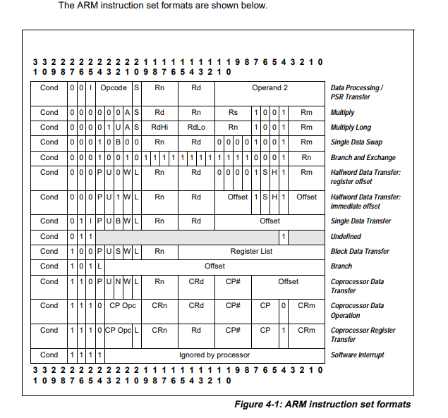

## 1. 指令集总结

处理器实现了一个版本的 **Thumb** 指令集。下表列出了支持的指令。

| 助记符 | 操作数 | 简要说明 | 标志位 |
| --- | --- | --- | --- |
| ADC, ADCS | {Rd,} Rn, Op2 | 带进位加法 | N,Z,C,V |
| ADD, ADDS | {Rd,} Rn, Op2 | 加法 | N,Z,C,V |
| ADD, ADDW | {Rd,} Rn, #imm12 | 加法 | - |
| ADR | Rd, label | 将地址加载到寄存器 | - |
| AND, ANDS | {Rd,} Rn, Op2 | 按位与 | N,Z,C |
| ASR, ASRS | Rd, Rm, <Rs\|#n> | 算术右移 | N,Z,C |
| B | label | 分支 | - |
| BFC | Rd, #lsb, #width | 位段清零 | - |
| BFI | Rd, Rn, #lsb, #width | 位段插入 | - |
| BIC, BICS | {Rd,} Rn, Op2 | 位清零 | N,Z,C |
| BKPT | #imm8 | 断点 | - |
| BL | label | 带链接的分支 | - |
| BLX | Rm | 带链接与交换的间接分支 | - |
| BX | Rm | 间接分支与交换 | - |
| CBNZ | Rn, label | 比较结果非零则分支 | - |
| CBZ | Rn, label | 比较结果为零则分支 | - |
| CLREX | - | 清除独占 | - |
| CLZ | Rd, Rm | 统计前导零个数 | - |
| CMN | Rn, Op2 | 比较取负 | N,Z,C,V |
| CMP | Rn, Op2 | 比较 | N,Z,C,V |
| CPS | <effect> <iflags> | 更改处理器状态 | - |
| CPY | Rd, Rn | 复制 | - |
| DMB | {opt} | 数据内存屏障 | - |
| DSB | {opt} | 数据同步屏障 | - |
| EOR, EORS | {Rd,} Rn, Op2 | 按位异或 | N,Z,C |
| ISB | {opt} | 指令同步屏障 | - |
| IT | - | If-Then 条件块 | - |
| LDM | Rn{!}, reglist | 加载多个寄存器 | - |
| LDMDB, LDMEA | Rn{!}, reglist | 加载多个寄存器，先减 | - |
| LDMIA, LDMFD | Rn{!}, reglist | 加载多个寄存器，后增 | - |
| LDR, LDRT | Rt, [Rn, #offset] | 以字加载寄存器（立即数偏移，非特权） | - |
| LDRH, LDRHT | Rt, [Rn, #offset] | 以半字加载寄存器（立即数偏移，非特权） | - |
| LDRSH, LDRSHT | Rt, [Rn, #offset] | 以有符号半字加载寄存器（立即数偏移，非特权） | - |
| LDRB, LDRBT | Rt, [Rn, #offset] | 以字节加载寄存器（立即数偏移，非特权） | - |
| LDRSB, LDRSBT | Rt, [Rn, #offset] | 以有符号字节加载寄存器（立即数偏移，非特权） | - |
| LDR | Rt, [Rn, Rm {, LSL #shift}] | 以字加载寄存器（寄存器偏移） | - |
| LDRH | Rt, [Rn, Rm {, LSL #shift}] | 以半字加载寄存器（寄存器偏移） | - |
| LDRSH | Rt, [Rn, Rm {, LSL #shift}] | 以有符号半字加载寄存器（寄存器偏移） | - |
| LDRB | Rt, [Rn, Rm {, LSL #shift}] | 以字节加载寄存器（寄存器偏移） | - |
| LDRSB | Rt, [Rn, Rm {, LSL #shift}] | 以有符号字节加载寄存器（寄存器偏移） | - |
| LDR | Rt, label | 以字加载寄存器（字面量） | - |
| LDRH | Rt, label | 以半字加载寄存器（字面量） | - |
| LDRB | Rt, label | 以字节加载寄存器（字面量） | - |
| LDRD | Rt, Rt2, [Rn, #offset] | 以双字加载寄存器（立即数偏移） | - |
| LDRD | Rt, Rt2, label | 以双字加载寄存器（PC 相对） | - |
| LDREX | Rt, [Rn, #offset] | 独占加载寄存器 | - |
| LDREXB | Rt, [Rn] | 以字节独占加载寄存器 | - |
| LDREXH | Rt, [Rn] | 以半字独占加载寄存器 | - |
| LDRSB | Rt, label | 以有符号字节加载寄存器（PC 相对） | - |
| LDRSH | Rt, label | 以有符号半字加载寄存器（PC 相对） | - |
| LSL, LSLS | Rd, Rm, <Rs\| #n> | 逻辑左移 | N,Z,C |
| LSR, LSRS | Rd, Rm, <Rs\| #n> | 逻辑右移 | N,Z,C |
| MLA | Rd, Rn, Rm, Ra | 带累加的乘法，32 位结果 | - |
| MLS | Rd, Rn, Rm, Ra | 乘减，32 位结果 | - |
| MOV, MOVS | Rd, Op2 | 移动 | N,Z,C |
| MOV, MOVS | Rd, Rm | 移动（寄存器） | N,Z |
| MOVT | Rd, #imm16 | 移动高半字 | - |
| MOVW | Rd, #imm16 | 移动 16 位常量 | - |
| MRS | Rd, spec_reg | 从特殊寄存器移动到通用寄存器 | - |
| MSR | spec_reg, Rn | 从通用寄存器移动到特殊寄存器 | - |
| MUL, MULS | {Rd,} Rn, Rm | 乘法，32 位结果 | N,Z |
| MVN, MVNS | Rd, Op2 | 按位取反 | N,Z,C |
| NEG | {Rd,} Rm | 取负 | N,Z,C,V |
| NOP | - | 空操作 | - |
| ORN, ORNS | {Rd,} Rn, Op2 | 按位或非 | N,Z,C |
| ORR, ORRS | {Rd,} Rn, Op2 | 按位或 | N,Z,C |
| PKHTB, PKHBT | {Rd,} Rn, Rm, {, Op2} | 打包半字 | - |
| PLD | [Rn {, #offset}] | 预加载数据 | - |
| POP | reglist | 从栈弹出寄存器 | - |
| PUSH | reglist | 将寄存器压入栈 | - |
| QADD | {Rd,} Rn, Rm | 饱和加法 | Q |
| QADD16 | {Rd,} Rn, Rm | 饱和 16 位加法 | - |
| QADD8 | {Rd,} Rn, Rm | 饱和 8 位加法 | - |
| QASX | {Rd,} Rn, Rm | 带交换的饱和加减 | - |
| QDADD | {Rd,} Rn, Rm | 饱和加倍加法 | Q |
| QDSUB | {Rd,} Rn, Rm | 饱和加倍减法 | Q |
| QSAX | {Rd,} Rn, Rm | 带交换的饱和减加 | - |
| QSUB | {Rd,} Rn, Rm | 饱和减法 | Q |
| QSUB16 | {Rd,} Rn, Rm | 饱和 16 位减法 | - |
| QSUB8 | {Rd,} Rn, Rm | 饱和 8 位减法 | - |
| RBIT | Rd, Rn | 位反转 | - |
| REV | Rd, Rn | 字内字节序反转 | - |
| REV16 | Rd, Rn | 各半字内字节序反转 | - |
| REVSH | Rd, Rn | 低半字字节序反转并符号扩展 | - |
| ROR, RORS | Rd, Rm, <Rs\|#n> | 循环右移 | N,Z,C |
| RRX, RRXS | Rd, Rm | 带扩展的循环右移 | N,Z,C |
| RSB, RSBS | {Rd,} Rn, Op2 | 逆向减法 | N,Z,C,V |
| SADD16 | {Rd,} Rn, Rm | 有符号 16 位加法 | GE |
| SADD8 | {Rd,} Rn, Rm | 有符号 8 位加法 | GE |
| SASX | {Rd,} Rn, Rm | 带交换的有符号加减 | GE |
| SBC, SBCS | {Rd,} Rn, Op2 | 带借位减法 | N,Z,C,V |
| SBFX | Rd, Rn, #lsb, #width | 有符号位段提取 | - |
| SDIV | {Rd,} Rn, Rm | 有符号除法 | - |
| SEL | {Rd,} Rn, Rm | 选择字节 | GE |
| SEV | - | 发送事件 | - |
| SHADD16 | {Rd,} Rn, Rm | 有符号减半 16 位加法 | - |
| SHADD8 | {Rd,} Rn, Rm | 有符号减半 8 位加法 | - |
| SHASX | {Rd,} Rn, Rm | 带交换的有符号减半加减 | - |
| SHSAX | {Rd,} Rn, Rm | 带交换的有符号减半减加 | - |
| SHSUB16 | {Rd,} Rn, Rm | 有符号减半 16 位减法 | - |
| SHSUB8 | {Rd,} Rn, Rm | 有符号减半 8 位减法 | - |
| SMLABB, SMLABT, SMLATB, SMLATT | Rd, Rn, Rm, Ra | 半字有符号乘累加 | Q |
| SMLAD, SMLADX | Rd, Rn, Rm, Ra | 双路有符号乘累加 | Q |
| SMLAL | RdLo, RdHi, Rn, Rm | 有符号长乘累加（32 × 32 + 64），64 位结果 | - |
| SMLALBB, SMLALBT, SMLALTB, SMLALTT | RdLo, RdHi, Rn, Rm | 半字有符号长乘累加 | - |
| SMLALD, SMLALDX | RdLo, RdHi, Rn, Rm | 双路有符号长乘累加 | - |
| SMLAWB, SMLAWT | Rd, Rn, Rm, Ra | 半字有符号乘累加（字 × 半字） | Q |
| SMLSD, SMLSDX | Rd, Rn, Rm, Ra | 双路有符号乘减 | Q |
| SMLSLD, SMLSLDX | RdLo, RdHi, Rn, Rm | 双路有符号长乘减 | - |
| SMMLA, SMMLAR | Rd, Rn, Rm, Ra | 有符号最高字乘累加 | - |
| SMMLS, SMMLSR | Rd, Rn, Rm, Ra | 有符号最高字乘减 | - |
| SMMUL, SMMULR | {Rd,} Rn, Rm | 有符号最高字乘法 | - |
| SMUAD, SMUADX | {Rd,} Rn, Rm | 双路有符号乘加 | Q |
| SMULL | RdLo, RdHi, Rn, Rm | 有符号长乘法，64 位结果 | - |
| SMULBB, SMULBT, SMULTB, SMULTT | {Rd,} Rn, Rm | 半字有符号乘法 | - |
| SMULWB, SMULWT | {Rd,} Rn, Rm | 字 × 半字有符号乘法 | - |
| SMUSD, SMUSDX | {Rd,} Rn, Rm | 双路有符号乘减 | - |
| SSAT | Rd, #imm, Rn {, shift} | 有符号饱和 | C,Q |
| SSAT16 | Rd, #imm, Rn | 16 位有符号饱和 | Q |
| SSUB16 | {Rd,} Rn, Rm | 有符号 16 位减法 | GE |
| SSUB8 | {Rd,} Rn, Rm | 有符号 8 位减法 | GE |
| STM, STMIA, STMEA | Rn{!}, reglist | 存储多个寄存器 | - |
| STMDB, STMFD | Rn{!}, reglist | 存储多个寄存器，先减 | - |
| STR, STRT | Rt, [Rn, #offset] | 以字存储寄存器（立即数偏移，非特权） | - |
| STRB, STRBT | Rt, [Rn, #offset] | 以字节存储寄存器（立即数偏移，非特权） | - |
| STRD | Rt, Rt2, [Rn, #offset] | 以双字存储寄存器（立即数偏移） | - |
| STRH | Rt, [Rn, #offset] | 以半字存储寄存器（立即数偏移） | - |
| SUB, SUBS | {Rd,} Rn, Op2 | 减法 | N,Z,C,V |
| SUB, SUBW | {Rd,} Rn, #imm12 | 减法 | - |
| SVC | #imm24 | 主管调用 | - |
| SXTB | Rd, Rm {, rotation} | 有符号字节扩展 | - |
| SXTB16 | Rd, Rm {, rotation} | 有符号字节 16 扩展 | - |
| SXTAB | {Rd,} Rn, Rm {, rotation} | 有符号字节扩展并相加 | - |
| SXTAB16 | {Rd,} Rn, Rm {, rotation} | 有符号字节 16 扩展并相加 | - |
| SXTAH | {Rd,} Rn, Rm {, rotation} | 有符号半字扩展并相加 | - |
| SXTH | Rd, Rm {, rotation} | 有符号半字扩展 | - |
| TBB | [Rn, Rm] | 表分支（字节） | - |
| TBH | [Rn, Rm, LSL #1] | 表分支（半字） | - |
| TEQ | Rn, Op2 | 测试等价 | N,Z,C |
| TST | Rn, Op2 | 测试 | N,Z,C |
| UADD16 | {Rd,} Rn, Rm | 无符号 16 位加法 | GE |
| UADD8 | {Rd,} Rn, Rm | 无符号 8 位加法 | GE |
| UASX | {Rd,} Rn, Rm | 带交换的无符号加减 | GE |
| UBFX | Rd, Rn, #lsb, #width | 无符号位段提取 | - |
| UDF | #imm16 | 永久未定义 | - |
| UDIV | {Rd,} Rn, Rm | 无符号除法 | - |
| UHADD16 | {Rd,} Rn, Rm | 无符号减半 16 位加法 | - |
| UHADD8 | {Rd,} Rn, Rm | 无符号减半 8 位加法 | - |
| UHASX | {Rd,} Rn, Rm | 带交换的无符号减半加减 | - |
| UHSAX | {Rd,} Rn, Rm | 带交换的无符号减半减加 | - |
| UHSUB16 | {Rd,} Rn, Rm | 无符号减半 16 位减法 | - |
| UHSUB8 | {Rd,} Rn, Rm | 无符号减半 8 位减法 | - |
| UMAAL | RdLo, RdHi, Rn, Rm | 无符号长乘双累加 | - |
| UMLAL | RdLo, RdHi, Rn, Rm | 无符号长乘累加（32 × 32 + 64），64 位结果 | - |
| UMULL | RdLo, RdHi, Rn, Rm | 无符号长乘法，64 位结果 | - |
| UQADD16 | {Rd,} Rn, Rm | 无符号饱和 16 位加法 | - |
| UQADD8 | {Rd,} Rn, Rm | 无符号饱和 8 位加法 | - |
| UQASX | {Rd,} Rn, Rm | 带交换的无符号饱和加减 | - |
| UQSAX | {Rd,} Rn, Rm | 带交换的无符号饱和减加 | - |
| UQSUB16 | {Rd,} Rn, Rm | 无符号饱和 16 位减法 | - |
| UQSUB8 | {Rd,} Rn, Rm | 无符号饱和 8 位减法 | - |
| USAD8 | Rd, Rn, Rm | 无符号绝对差之和 | - |
| USADA8 | Rd, Rn, Rm, Ra | 无符号绝对差之和并累加 | - |
| USAT | Rd, #imm, Rn {, shift} | 无符号饱和 | C,Q |
| USAT16 | Rd, #imm, Rn | 16 位无符号饱和 | Q |
| USUB16 | {Rd,} Rn, Rm | 无符号 16 位减法 | GE |
| USUB8 | {Rd,} Rn, Rm | 无符号 8 位减法 | GE |
| UXTAB | {Rd,} Rn, Rm {, rotation} | 无符号字节扩展并相加 | - |
| UXTAB16 | {Rd,} Rn, Rm {, rotation} | 无符号字节 16 扩展并相加 | - |
| UXTAH | {Rd,} Rn, Rm {, rotation} | 无符号半字扩展并相加 | - |
| UXTB | Rd, Rm {, rotation} | 无符号字节扩展 | - |
| UXTB16 | Rd, Rm {, rotation} | 无符号字节 16 扩展 | - |
| UXTH | Rd, Rm {, rotation} | 无符号半字扩展 | - |
| VABS | Sd, Sm | 浮点绝对值 | - |
| VADD | Sd, Sn, Sm | 浮点加法 | - |
| VCMP, VCMPE | Sd, Sm | 浮点比较 | N,Z,C,V |
| VCVT, VCVTR | Sd, Sm | 浮点与整数转换 | - |
| VDIV | Sd, Sn, Sm | 浮点除法 | - |
| VFMA, VFMS | Sd, Sn, Sm | 浮点融合乘累加 | - |
| VLDM | Rn{!}, reglist | 浮点加载多个寄存器 | - |
| VLDR | Sd, [Rn, #offset] | 浮点加载寄存器 | - |
| VMLA, VMLS | Sd, Sn, Sm | 浮点乘累加 | - |
| VMOV | Sd, Sm | 浮点寄存器之间复制 | - |
| VMRS | Rt, FPSCR | 从浮点特殊寄存器移至内核寄存器 | N,Z,C,V |
| VMSR | FPSCR, Rt | 从内核寄存器移至浮点特殊寄存器 | - |
| VMUL | Sd, Sn, Sm | 浮点乘法 | - |
| VNEG | Sd, Sm | 浮点取负 | - |
| VNMLA, VNMLS, VNMUL | Sd, Sn, Sm | 浮点乘法并取负 | - |
| VPOP | reglist | 浮点出栈 | - |
| VPUSH | reglist | 浮点入栈 | - |
| VSQRT | Sd, Sm | 浮点平方根 | - |
| VSTM | Rn{!}, reglist | 浮点存储多个寄存器 | - |
| VSTR | Sd, [Rn, #offset] | 浮点存储寄存器 | - |
| VSUB | Sd, Sn, Sm | 浮点减法 | - |
| WFE | - | 等待事件 | - |
| WFI | - | 等待中断 | - |
| YIELD | - | 让出执行 | - |

## 2. Armv7-M 指令集

本章描述 **Armv7-M** 的 **Thumb** 指令集，包括浮点扩展（**Floating-point Extension**）增加的额外指令。本章包含以下小节：

* 关于指令集。
* 统一汇编语言（**UAL**）。
* 分支指令。
* 数据处理指令。
* 状态寄存器访问指令。
* 加载和存储指令。
* 加载多个和存储多个指令。
* 杂项指令。
* 产生异常的指令。
* 协处理器指令。
* 浮点加载和存储指令。
* 浮点寄存器传送指令。
* 浮点数据处理指令。

### 2.1. 关于指令集

**Armv7-M** 支持大量由 **Thumb-2** 技术引入 **Thumb** 指令集的 32 位指令。其中许多可用功能，与在 **Armv6T2** 及其他 **Armv7** 配置中与 **Thumb** 指令集并列支持的 **Arm** 指令集功能完全相同。本章描述 **Armv7-M** **Thumb** 指令集中可用的功能，以及可以汇编为 **Thumb** 或 **Arm** 指令集的统一汇编语言（**Unified Assembler Language**，**UAL**）。

**Thumb** 指令要么是 16 位，要么是 32 位，并按两字节边界对齐。16 位和 32 位指令可以自由混用。许多常见操作使用 16 位指令执行效率最高。但是：

* 大多数 16 位指令只能访问通用寄存器 **R0**-**R7** 中的八个。这些寄存器称为低寄存器（**low registers**）。少量 16 位指令可以访问高寄存器 **R8**-**R15**。
* 许多本来需要两条或更多 16 位指令的操作，用一条 32 位指令可以更高效地执行。

**Arm** 和 **Thumb** 指令集设计为可自由互工作（**interwork**）。由于 **Armv7-M** 只支持 **Thumb** 指令，**Armv7-M** 中的互工作指令必须只引用 **Thumb** 状态的执行，更多细节请参见 Armv7-M 与互工作支持。

此外，请参见：

* 第 A5 章 **Thumb** 指令集编码，了解 **Thumb** 指令集的编码细节。
* 第 A7 章指令详细信息，了解各指令的详细描述。

#### 2.1.1. Armv7-M 与互工作支持

**Thumb** 互工作状态被保存为互工作地址的位 [0]。互工作地址用于以下指令：

* **BX** 或 **BLX**。
* 加载 PC 的 **LDR** 或 **LDM**。

**Armv7-M** 只支持 **Thumb** 指令执行状态，并且在 **EPSR.T == 0** 时尝试执行指令会导致 **INVSTATE** 用法故障异常，因此在互工作指令中地址位 [0] 的值必须为 1，否则会发生故障。所有指令在更新 PC 时都忽略位 [0] 并写入位 [31:1] 为 '0'。

更新 PC 的 16 位指令行为如下：

* **ADD**（寄存器）和 **MOV**（寄存器）分支时不进行互工作。

**注意：** **Arm** 不推荐在 16 位 **ADD**（**SP** 加寄存器）指令中使用 **Rd** 作为 PC。

* **B** 分支时不进行互工作。
* **CBZ** 和 **CBNZ** 分支时不进行互工作。
* **BLX** 和 **BX** 按 **Rm** 中的值进行互工作。
* **POP** 按加载到 PC 的值进行互工作。
* **BKPT** 和 **SVC** 产生异常，不被视为互工作指令。

更新 PC 的 32 位指令行为如下：

* **B** 分支时不进行互工作。
* **BL** 分支时不进行互工作。
* **LDM** 和 **LDR** 使用写入 PC 的值支持互工作。
* **TBB** 和 **TBH** 分支时不进行互工作。

更多细节请参见第 A2-30 页的 **Arm** 内核寄存器操作的伪代码细节中 BXWritePC() 函数的描述。

#### 2.1.2. 条件执行

条件执行（**Conditionally executed**）意味着：只有当 **APSR** 中的 **N**、**Z**、**C** 和 **V** 标志满足指令中指定的条件时，该指令才会对程序员模型的操作、内存和协处理器产生其正常效果。如果这些标志不满足该条件，则该指令相当于一条 **NOP**，即执行正常前进到下一条指令（包括是否要发生异常的相关检查），但没有其他任何效果。

大多数 **Thumb** 指令是无条件的。**Thumb** 代码中的条件执行可以通过以下任一指令实现：

* 16 位条件分支指令，分支范围为 –256 到 +254 字节。详情请参见第 A7-205 页的 **B**。在 **Armv6T2** 增加额外指令支持之前，这是在 **Thumb** 代码中实现条件执行的唯一机制。
* 32 位条件分支指令，分支范围约为 ±1MB。详情请参见第 A7-205 页的 **B**。
* 16 位的 **Compare and Branch on Zero** 和 **Compare and Branch on Nonzero** 指令，分支范围为 +4 到 +130 字节。详情请参见第 A7-216 页的 **CBNZ**、**CBZ**。
* 16 位的 **If-Then** 指令，可使后续最多四条指令成为条件指令。详情请参见第 A7-236 页的 **IT**。由 **IT** 指令变为条件执行的指令称为该指令的 **IT** 块（**IT block**）。**IT** 块中的指令必须全部具有相同的条件，或者其中一些具有一种条件，另一些具有相反的条件。

关于条件执行的更多信息，请参见第 A7-178 页的条件执行。

### 2.2. 统一汇编语言

本文档使用 **Arm** 统一汇编语言（**UAL**）。这种汇编语言语法为所有 **Arm** 和 **Thumb** 指令提供了一种规范形式。

**UAL** 描述了每条指令的助记符和操作数的语法。此外，它假定指令和数据项可以被赋予标签。它并不规定标签所使用的语法，也不规定可用的汇编器伪指令和选项。这些细节请参见汇编器文档。

较早的 **Arm** 汇编语言助记符仍作为同义词受支持，如各指令详情中所述。

**注意：** 大多数较早的 **Thumb** 汇编语言助记符不受支持。详情请参见附录 D2 传统指令助记符。

**UAL** 包含指令选择规则，用于规定当多种编码都能提供所需功能时选择哪一种编码。例如：**ADD R0,R1,R2** 指令同时存在 16 位和 32 位编码。最常见的指令选择规则是：当 16 位编码和 32 位编码都可用时，选择 16 位编码，以优化代码密度。

存在一些语法选项可以覆盖正常的指令选择规则，以确保选中特定的编码。这些选项在反汇编代码时很有用，可确保后续汇编生成原始代码，在其他一些情况下也很有用。

#### 2.2.1. 条件指令

为使 **UAL** 汇编语言在 **Arm** 和 **Thumb** 指令集之间具有最大的可移植性，**Arm** 建议：

* 按 **Thumb** 指令集的正确方式，将 **IT** 指令写在条件指令之前。
* 在汇编到 **Arm** 指令集时，汇编器检查任何 **IT** 指令是否正确，但不为其生成任何代码。

虽然其他 **Thumb** 指令是无条件的，但所有由 **IT** 指令变为条件执行的指令都必须带条件书写。这些条件必须与 **IT** 指令所施加的条件相匹配。例如：**ITTEE EQ** 指令对后续前两条指令施加 **EQ** 条件，对再后两条指令施加 **NE** 条件。这四条指令必须分别以 **EQ**、**EQ**、**NE** 和 **NE** 条件书写。

某些指令不能由 **IT** 指令变为条件执行。某些指令如果是 **IT** 块中的最后一条指令则可以是条件指令，否则不可以。

包含条件字段的分支指令编码不能由 **IT** 指令变为条件执行。如果汇编器语法表示的是与前一条 **IT** 指令正确匹配的条件分支，则使用不包含条件字段的分支指令编码进行汇编。

#### 2.2.2. 在 UAL 指令语法中使用标签

某些指令的 **UAL** 语法包含一条指令或一个字面量数据项的标签，而该数据项位于与被指定指令之间固定的偏移处。汇编器必须：

1. 计算该指令的 PC 或 Align(PC,4) 值。一条指令的 PC 值是其地址加上 4（对 **Thumb** 指令而言）。一条指令的 Align(PC,4) 值是其 PC 值按位与 0xFFFFFFFC，以强制字对齐。
2. 计算从该指令的 PC 或 Align(PC,4) 值到被标记的指令或字面量数据项地址的偏移。
3. 汇编该指令的 PC 相对编码，即读取其 PC 或 Align(PC,4) 值并加上所计算的偏移以形成所需地址。

**注意：** 对于编码减法操作的指令，如果该指令无法编码所计算的偏移，但能编码所计算偏移的负值，则该指令编码指定减去所计算偏移的负值。

以下指令的语法包含标签：

* **B** 和 **BL**。这些指令的汇编语法总是指定它们所分支到的指令的标签。它们的编码指定一个符号扩展的立即数偏移，该偏移加到该指令的 PC 值上以形成分支的目标地址。
* **CBNZ** 和 **CBZ**。这些指令的汇编语法总是指定它们所分支到的指令的标签。它们的编码指定一个零扩展的立即数偏移，该偏移加到该指令的 PC 值上以形成分支的目标地址。它们不支持向后分支。
* **LDC**、**LDC2**、**LDR**、**LDRB**、**LDRD**、**LDRH**、**LDRSB**、**LDRSH**、**PLD**、**PLI**、**VLDR** 和 **VSTR**。这些加载指令的正常汇编语法可以指定要加载的字面量数据项的标签。这些指令的编码指定一个零扩展的立即数偏移，该偏移加到该指令的 Align(PC,4) 值上或从中减去，以形成该数据项的地址。少数这类编码执行固定加法或固定减法，只能在该操作确有必要时使用，但大多数编码包含一位，用来指定该偏移是相加还是相减。

当汇编器为这些指令的正常语法计算出偏移 0 时，它必须汇编向该指令的 Align(PC,4) 值加 0 的编码。从 Align(PC,4) 值减去 0 的编码不能由正常语法指定。

这些指令还有一种替代语法，显式指定加法或减法以及立即数偏移。在此语法中，标签由 [PC, #+/-<imm>] 替代，其中：

* **+/-** 为 + 或省略时表示该立即数偏移与 Align(PC,4) 值相加，为 - 时表示相减。
* **<imm>** 为立即数偏移。

这种替代语法使得可以汇编从 Align(PC,4) 值减去 0 的编码，并将其反汇编为可正确重新汇编的语法。

* **ADR**。该指令的正常汇编语法可以指定一条指令或字面量数据项的标签，并要求计算其地址。其编码指定一个零扩展的立即数偏移，该偏移加到该指令的 Align(PC,4) 值上或从中减去，以形成该数据项的地址，另有一些操作码位决定是加法还是减法。

当汇编器为该指令的正常语法计算出偏移 0 时，它必须汇编向该指令的 Align(PC,4) 值加 0 的编码。从 Align(PC,4) 值减去 0 的编码不能由正常语法指定。

该指令还有一种替代语法，通过将其写成加法 **ADD <Rd>,PC,#<imm>** 或减法 **SUB <Rd>,PC,#<imm>**，显式指定加法或减法和立即数值。这种替代语法使得可以汇编从 Align(PC,4) 值减去 0 的编码，并将其反汇编为可正确重新汇编的语法。

**注意：** **Arm** 建议尽可能避免使用：

* **ADR**、**LDC**、**LDC2**、**LDR**、**LDRB**、**LDRD**、**LDRH**、**LDRSB**、**LDRSH**、**PLD**、**PLI**、**VLDR** 和 **VSTR** 指令的替代语法。
* 这些指令中从 Align(PC,4) 值减去 0 的编码。

### 2.3. 分支指令

表 A4-1 总结了 **Thumb** 指令集中的分支指令。除了提供执行流的改变之外，某些分支指令还可以改变指令集。

**LDR**、**LDM** 和 **POP** 指令也可以引起分支。详情请参见第 A4-115 页的加载和存储指令以及第 A4-117 页的加载多个和存储多个指令。

| 指令 | 用途 | 范围 |
| --- | --- | --- |
| B（第 A7-205 页） | 分支到目标地址 | +/-1 MB |
| CBNZ、CBZ（第 A7-216 页） | 非零则比较并分支、为零则比较并分支 | 0-126 B |
| BL（第 A7-213 页） | 调用子程序 | +/-16 MB |
| BLX（寄存器）（第 A7-214 页） | 调用子程序，可选地改变指令集 | 任意 |
| BX（第 A7-215 页） | 分支到目标地址，改变指令集 | 任意 |
| TBB、TBH（第 A7-416 页） | TBB：表分支，字节偏移；TBH：表分支，半字偏移 | 0-510 B；0-131070 B |

### 2.4. 数据处理指令

数据处理指令属于以下各组之一：

* 标准数据处理指令。该组执行基本的数据处理操作，并共享一种带有若干变体的通用格式。
* 移位指令。
* 乘法指令。
* 饱和指令。
* 打包和解包指令。
* 除法指令。
* 并行加减指令，**DSP** 扩展。
* 杂项数据处理指令。

另请参见浮点数据处理指令。

#### 2.4.1. 标准数据处理指令

这些指令通常具有一个目标寄存器 **Rd**、一个第一操作数寄存器 **Rn** 和一个第二操作数。第二操作数可以是另一个寄存器 **Rm**，也可以是一个修改的立即数常量。

如果第二操作数是修改的立即数常量，则它被编码在指令的 12 位中。详情请参见第 A5-139 页的 **Thumb** 指令中的修改立即数常量。

如果第二操作数是另一个寄存器，则它可以按以下任一方式可选地移位：

* **LSL**：逻辑左移 1-31 位。
* **LSR**：逻辑右移 1-32 位。
* **ASR**：算术右移 1-32 位。
* **ROR**：循环右移 1-31 位。
* **RRX**：带扩展的循环右移。详情请参见第 A2-26 页的移位和循环移位操作。

在 **Thumb** 代码中，第二操作数的移位量始终是编码在指令中的常量。**Thumb** 指令集以显式指令提供基于寄存器的移位，请参见移位指令。

除了将结果放入目标寄存器之外，这些指令还可以可选地根据操作结果设置条件标志。如果某条指令不设置某个标志，则该标志的现有值（来自前一条指令）保持不变。

表 A4-2 总结了 **Thumb** 指令集中的主要数据处理指令。通常，这些指令在第 A7 章指令详细信息中分别在两节中描述，每节对应以下之一：

* **INSTRUCTION**（立即数），其中第二操作数是修改的立即数常量。
* **INSTRUCTION**（寄存器），其中第二操作数是寄存器，或按常量移位的寄存器。

| 助记符 | 指令 | 说明 |
| --- | --- | --- |
| ADC | 带进位加法（**Add with Carry**） | - |
| ADD | 加法（**Add**） | **Thumb** 允许使用修改的立即数常量或零扩展的 12 位立即数常量。 |
| ADR | 形成 PC 相对地址（**Form PC-relative Address**） | 第一操作数是 PC。第二操作数是立即数常量。**Thumb** 支持零扩展的 12 位立即数常量。操作为加法或减法。 |
| AND | 按位与（**Bitwise AND**） | - |
| BIC | 按位位清零（**Bitwise Bit Clear**） | - |
| CMN | 比较取负（**Compare Negative**） | 设置标志。类似 **ADD**，但没有目标寄存器。 |
| CMP | 比较（**Compare**） | 设置标志。类似 **SUB**，但没有目标寄存器。 |
| EOR | 按位异或（**Bitwise Exclusive OR**） | - |
| MOV | 将操作数复制到目标（**Copies operand to destination**） | 只有一个操作数，其选项与这些指令中大多数指令的第二操作数相同。如果该操作数是移位的寄存器，则该指令是 **LSL**、**LSR**、**ASR** 或 **ROR** 指令。详情请参见移位指令。**Thumb** 允许使用修改的立即数常量或零扩展的 16 位立即数常量。 |
| MVN | 按位取反（**Bitwise NOT**） | 只有一个操作数，其选项与这些指令中大多数指令的第二操作数相同。 |
| ORN | 按位或非（**Bitwise OR NOT**） | - |
| ORR | 按位或（**Bitwise OR**） | - |
| RSB | 逆向减法（**Reverse Subtract**） | 从第二操作数中减去第一操作数。这允许从常量和移位的寄存器中减去。 |
| SBC | 带借位减法（**Subtract with Carry**） | - |
| SUB | 减法（**Subtract**） | **Thumb** 允许使用修改的立即数常量或零扩展的 12 位立即数常量。 |
| TEQ | 测试等价（**Test Equivalence**） | 设置标志。类似 **EOR**，但没有目标寄存器。 |
| TST | 测试（**Test**） | 设置标志。类似 **AND**，但没有目标寄存器。 |

#### 2.4.2. 移位指令

表 A4-3 列出了 **Thumb** 指令集中的移位指令。

| 指令 | 参见 |
| --- | --- |
| 算术右移（**Arithmetic Shift Right**） | ASR（立即数）（第 A7-203 页） |
| 算术右移 | ASR（寄存器）（第 A7-204 页） |
| 逻辑左移（**Logical Shift Left**） | LSL（立即数）（第 A7-282 页） |
| 逻辑左移 | LSL（寄存器）（第 A7-283 页） |
| 逻辑右移（**Logical Shift Right**） | LSR（立即数）（第 A7-284 页） |
| 逻辑右移 | LSR（寄存器）（第 A7-285 页） |
| 循环右移（**Rotate Right**） | ROR（立即数）（第 A7-338 页） |
| 循环右移 | ROR（寄存器）（第 A7-339 页） |
| 带扩展的循环右移（**Rotate Right with Extend**） | RRX（第 A7-340 页） |

#### 2.4.3. 乘法指令

这些指令可对有符号或无符号数进行操作。在某些类型的操作中，无论操作数是有符号还是无符号，结果都相同。

* 表 A4-4 列出了有符号和无符号数之间没有区别的乘法指令。使用的是结果的最低有效 32 位。更高的有效位被丢弃。
* 表 A4-5 列出了 **Armv7-M** 基本架构中的有符号乘法指令。
* 表 A4-6 列出了 **DSP** 扩展增加到 **Armv7-M** 指令集的有符号乘法指令。
* 表 A4-7 列出了 **Armv7-M** 基本架构中的无符号乘法指令。
* 表 A4-8 列出了 **DSP** 扩展增加到 **Armv7-M** 指令集的无符号乘法指令。

表 A4-4 通用乘法指令：

| 指令 | 参见 | 操作（位数） |
| --- | --- | --- |
| 乘累加（**Multiply Accumulate**） | MLA（第 A7-289 页） | 32 = 32 + 32 × 32 |
| 乘减（**Multiply and Subtract**） | MLS（第 A7-290 页） | 32 = 32 – 32 × 32 |
| 乘法（**Multiply**） | MUL（第 A7-302 页） | 32 = 32 × 32 |

表 A4-5 **Armv7-M** 基本架构的有符号乘法指令：

| 指令 | 参见 | 操作（位数） |
| --- | --- | --- |
| 有符号长乘累加（**Signed Multiply Accumulate Long**） | SMLAL（第 A7-361 页） | 64 = 64 + 32 × 32 |
| 有符号长乘法（**Signed Multiply Long**） | SMULL（第 A7-372 页） | 64 = 32 × 32 |

表 A4-6 **Armv7-M** **DSP** 扩展的有符号乘法指令：

| 指令 | 参见 | 操作（位数） |
| --- | --- | --- |
| 半字有符号乘累加（**Signed Multiply Accumulate, halfwords**） | SMLABB、SMLABT、SMLATB、SMLATT（第 A7-359 页） | 32 = 32 + 16 × 16 |
| 双路有符号乘累加（**Signed Multiply Accumulate Dual**） | SMLAD、SMLADX（第 A7-360 页） | 32 = 32 + 16 × 16 + 16 × 16 |
| 半字有符号长乘累加（**Signed Multiply Accumulate Long, halfwords**） | SMLALBB、SMLALBT、SMLALTB、SMLALTT（第 A7-362 页） | 64 = 64 + 16 × 16 |
| 双路有符号长乘累加（**Signed Multiply Accumulate Long Dual**） | SMLALD、SMLALDX（第 A7-363 页） | 64 = 64 + 16 × 16 + 16 × 16 |
| 字 × 半字有符号乘累加（**Signed Multiply Accumulate, word by halfword**） | SMLAWB、SMLAWT（第 A7-364 页） | 32 = 32 + 32 × 16ᵃ |
| 双路有符号乘减（**Signed Multiply Subtract Dual**） | SMLSD、SMLSDX（第 A7-365 页） | 32 = 32 + 16 × 16 – 16 × 16 |
| 双路有符号长乘减（**Signed Multiply Subtract Long Dual**） | SMLSLD、SMLSLDX（第 A7-366 页） | 64 = 64 + 16 × 16 – 16 × 16 |
| 有符号最高字乘累加（**Signed most significant Word Multiply Accumulate**） | SMMLA、SMMLAR（第 A7-367 页） | 32 = 32 + 32 × 32ᵇ |
| 有符号最高字乘减（**Signed most significant Word Multiply Subtract**） | SMMLS、SMMLSR（第 A7-368 页） | 32 = 32 – 32 × 32ᵇ |
| 有符号最高字乘法（**Signed most significant Word Multiply**） | SMMUL、SMMULR（第 A7-369 页） | 32 = 32 × 32ᵇ |
| 双路有符号乘加（**Signed Dual Multiply Add**） | SMUAD、SMUADX（第 A7-370 页） | 32 = 16 × 16 + 16 × 16 |
| 半字有符号乘法（**Signed Multiply, halfwords**） | SMULBB、SMULBT、SMULTB、SMULTT（第 A7-371 页） | 32 = 16 × 16 |
| 字 × 半字有符号乘法（**Signed Multiply, word by halfword**） | SMULWB、SMULWT（第 A7-373 页） | 32 = 32 × 16ᵃ |
| 双路有符号乘减（**Signed Dual Multiply Subtract**） | SMUSD、SMUSDX（第 A7-374 页） | 32 = 16 × 16 – 16 × 16 |

a. 使用 48 位乘积的最高有效 32 位，丢弃较低有效位。

b. 使用 64 位乘积的最高有效 32 位，丢弃较低有效位。

表 A4-7 **Armv7-M** 基本架构的无符号乘法指令：

| 指令 | 参见 | 操作（位数） |
| --- | --- | --- |
| 无符号长乘累加（**Unsigned Multiply Accumulate Long**） | UMLAL（第 A7-434 页） | 64 = 64 + 32 × 32 |
| 无符号长乘法（**Unsigned Multiply Long**） | UMULL（第 A7-435 页） | 64 = 32 × 32 |

表 A4-8 **Armv7-M** **DSP** 扩展的无符号乘法指令：

| 指令 | 参见 | 操作（位数） |
| --- | --- | --- |
| 无符号长乘双累加（**Unsigned Multiply Accumulate Accumulate Long**） | UMAAL（第 A7-433 页） | 64 = 32 + 32 + 32 × 32 |

#### 2.4.4. 饱和指令

表 A4-9 列出了 **Armv7-M** 基本架构中的饱和指令。更多信息请参见第 A2-29 页的饱和操作的伪代码细节。

**额外的饱和指令（DSP 扩展）**

**DSP** 扩展增加了：

* 两条对并行半字进行操作的饱和指令，如表 A4-10 所示。
* 饱和加减指令，如表 A4-11 所示。

表 A4-9 **Armv7-M** 基本架构的饱和指令：

| 指令 | 参见 | 操作 |
| --- | --- | --- |
| 有符号饱和（**Signed Saturate**） | SSAT（第 A7-375 页） | 将可选移位的 32 位值饱和到选定的范围 |
| 无符号饱和（**Unsigned Saturate**） | USAT（第 A7-444 页） | 将可选移位的 32 位值饱和到选定的范围 |

表 A4-10 **Armv7-M** **DSP** 扩展的半字饱和指令：

| 指令 | 参见 | 操作 |
| --- | --- | --- |
| 16 位有符号饱和（**Signed Saturate 16**） | SSAT16（第 A7-376 页） | 将两个 16 位值饱和到选定的范围 |
| 16 位无符号饱和（**Unsigned Saturate 16**） | USAT16（第 A7-445 页） | 将两个 16 位值饱和到选定的范围 |

另请参见并行加减指令，**DSP** 扩展。

表 A4-11 **Armv7-M** **DSP** 扩展的饱和加减指令：

| 指令 | 参见 | 操作 |
| --- | --- | --- |
| 饱和加法（**Saturating Add**） | QADD（第 A7-324 页） | 相加，并将结果饱和到 32 位有符号整数范围 |
| 饱和减法（**Saturating Subtract**） | QSUB（第 A7-331 页） | 相减，并将结果饱和到 32 位有符号整数范围 |
| 饱和加倍并相加（**Saturating Double and Add**） | QDADD（第 A7-328 页） | 将一个值加倍并与第二个值相加，将加倍和加法都饱和到 32 位有符号整数范围 |
| 饱和加倍并相减（**Saturating Double and Subtract**） | QDSUB（第 A7-329 页） | 将一个值加倍并从第二个值中减去该结果，将加倍和减法都饱和到 32 位有符号整数范围 |

#### 2.4.5. 打包和解包指令

表 A4-12 列出了 **Armv7-M** 基本架构中的打包和解包指令。

表 A4-13 列出了 **DSP** 扩展增加到 **Armv7-M** 指令集的打包和解包指令。

表 A4-12 **Armv7-M** 基本架构的打包和解包指令：

| 指令 | 参见 | 操作 |
| --- | --- | --- |
| 有符号字节扩展（**Signed Extend Byte**） | SXTB（第 A7-413 页） | 将 8 位扩展到 32 位 |
| 有符号半字扩展（**Signed Extend Halfword**） | SXTH（第 A7-415 页） | 将 16 位扩展到 32 位 |
| 无符号字节扩展（**Unsigned Extend Byte**） | UXTB（第 A7-452 页） | 将 8 位扩展到 32 位 |
| 无符号半字扩展（**Unsigned Extend Halfword**） | UXTH（第 A7-454 页） | 将 16 位扩展到 32 位 |

表 A4-13 **Armv7-M** **DSP** 扩展的打包和解包指令：

| 指令 | 参见 | 操作 |
| --- | --- | --- |
| 半字打包（**Pack Halfword**） | PKHBT、PKHTB（第 A7-312 页） | 合并半字 |
| 有符号字节扩展并相加（**Signed Extend and Add Byte**） | SXTAB（第 A7-410 页） | 将 8 位扩展到 32 位并相加 |
| 有符号字节 16 扩展并相加（**Signed Extend and Add Byte 16**） | SXTAB16（第 A7-411 页） | 双路将 8 位扩展到 16 位并相加 |
| 有符号半字扩展并相加（**Signed Extend and Add Halfword**） | SXTAH（第 A7-412 页） | 将 16 位扩展到 32 位并相加 |
| 有符号字节 16 扩展（**Signed Extend Byte 16**） | SXTB16（第 A7-414 页） | 双路将 8 位扩展到 16 位 |
| 无符号字节扩展并相加（**Unsigned Extend and Add Byte**） | UXTAB（第 A7-449 页） | 将 8 位扩展到 32 位并相加 |
| 无符号字节 16 扩展并相加（**Unsigned Extend and Add Byte 16**） | UXTAB16（第 A7-450 页） | 双路将 8 位扩展到 16 位并相加 |
| 无符号半字扩展并相加（**Unsigned Extend and Add Halfword**） | UXTAH（第 A7-451 页） | 将 16 位扩展到 32 位并相加 |
| 无符号字节 16 扩展（**Unsigned Extend Byte 16**） | UXTB16（第 A7-453 页） | 双路将 8 位扩展到 16 位 |

#### 2.4.6. 除法指令

在 **Armv7-M** 配置中，**Thumb** 指令集包含由硬件实现的有符号和无符号整数除法指令。指令详情请参见：

* **SDIV**，第 A7-350 页。
* **UDIV**，第 A7-426 页。

在 **Armv7-M** 配置中，**CCR.DIV_0_TRP** 位使能除零故障检测：

* **DIV_0_TRP == 0**：除零返回零结果。
* **DIV_0_TRP == 1**：**SDIV** 和 **UDIV** 在除零时产生除零用法故障异常。

复位会将 **CCR.DIV_0_TRP** 位清为 0。

#### 2.4.7. 并行加减指令（DSP 扩展）

**DSP** 扩展增加了对两个寄存器的值执行加减、并将结果写入目标寄存器的指令，它把寄存器值视为两个半字或四个字节的集合。

这些指令由一个前缀后跟一个主指令助记符组成。前缀如下：

* **S**：有符号模 28 或 216 算术。
* **Q**：有符号饱和算术。
* **SH**：有符号算术，结果减半。
* **U**：无符号模 28 或 216 算术。
* **UQ**：无符号饱和算术。
* **UH**：无符号算术，结果减半。

主指令助记符如下：

* **ADD16**：将两个操作数的顶部半字相加形成结果的顶部半字，并将同两个操作数的底部半字相加形成结果的底部半字。
* **ASX**：交换第二操作数的半字，然后顶部半字相加、底部半字相减。
* **SAX**：交换第二操作数的半字，然后顶部半字相减、底部半字相加。
* **SUB16**：从第一操作数的对应半字中减去第二操作数的每个半字，形成结果的对应半字。
* **ADD8**：将第二操作数的每个字节加到第一操作数的对应字节，形成结果的对应字节。
* **SUB8**：从第一操作数的对应字节中减去第二操作数的每个字节，形成结果的对应字节。

指令集允许前缀与主指令操作数的全部 36 种组合，如表 A4-14 所示。

表 A4-14 并行加减指令：

| 主指令 | 有符号 | 饱和 | 有符号减半 | 无符号 | 无符号饱和 | 无符号减半 |
| --- | --- | --- | --- | --- | --- | --- |
| ADD16，加，两个半字 | SADD16 | QADD16 | SHADD16 | UADD16 | UQADD16 | UHADD16 |
| ASX，带交换的加减 | SASX | QASX | SHASX | UASX | UQASX | UHASX |
| SAX，带交换的减加 | SSAX | QSAX | SHSAX | USAX | UQSAX | UHSAX |
| SUB16，减，两个半字 | SSUB16 | QSUB16 | SHSUB16 | USUB16 | UQSUB16 | UHSUB16 |
| ADD8，加，四个字节 | SADD8 | QADD8 | SHADD8 | UADD8 | UQADD8 | UHADD8 |
| SUB8，减，四个字节 | SSUB8 | QSUB8 | SHSUB8 | USUB8 | UQSUB8 | UHSUB8 |

#### 2.4.8. 杂项数据处理指令

表 A4-15 列出了 **Armv7-M** 基本架构中 **Thumb** 指令集的杂项数据处理指令。这些指令中的立即数值是简单的二进制数。

表 A4-16 列出了 **DSP** 扩展增加到 **Armv7-M** **Thumb** 指令集的杂项数据处理指令。

表 A4-15 **Armv7-M** 基本架构的杂项数据处理指令：

| 指令 | 参见 | 说明 |
| --- | --- | --- |
| 位段清零（**Bit Field Clear**） | BFC（第 A7-207 页） | - |
| 位段插入（**Bit Field Insert**） | BFI（第 A7-208 页） | - |
| 统计前导零（**Count Leading Zeros**） | CLZ（第 A7-220 页） | - |
| 移动到顶部（**Move Top**） | MOVT（第 A7-296 页） | 将 16 位立即数值移动到顶部半字。底部半字不变。 |
| 位反转（**Reverse Bits**） | RBIT（第 A7-334 页） | - |
| 字节序反转字（**Byte-Reverse Word**） | REV（第 A7-335 页） | - |
| 字节序反转压缩半字（**Byte-Reverse Packed Halfword**） | REV16（第 A7-336 页） | - |
| 字节序反转有符号半字（**Byte-Reverse Signed Halfword**） | REVSH（第 A7-337 页） | - |
| 有符号位段提取（**Signed Bit Field Extract**） | SBFX（第 A7-349 页） | - |
| 无符号位段提取（**Unsigned Bit Field Extract**） | UBFX（第 A7-424 页） | - |

表 A4-16 **Armv7-M** **DSP** 扩展的杂项数据处理指令：

| 指令 | 参见 |
| --- | --- |
| 使用 **GE** 标志选择字节（**Select Bytes using GE flags**） | SEL（第 A7-351 页） |
| 无符号绝对差之和（**Unsigned Sum of Absolute Differences**） | USAD8（第 A7-442 页） |
| 无符号绝对差之和并累加（**Unsigned Sum of Absolute Differences and Accumulate**） | USADA8（第 A7-443 页） |

### 2.5. 状态寄存器访问指令

**MRS** 和 **MSR** 指令在应用程序状态寄存器（**APSR**）与通用寄存器之间传送 **APSR** 的内容。

**APSR** 在第 A2-31 页的应用程序状态寄存器（**APSR**）中描述。

**APSR** 中的条件标志通常通过执行数据处理指令来设置，并通常用于控制条件指令的执行。但是，可以使用 **MSR** 指令显式设置这些标志，也可以使用 **MRS** 指令显式读取这些标志的当前状态。

关于状态寄存器访问指令 **CPS**、**MRS** 和 **MSR** 在系统层的使用细节，请参见第 B5 章系统指令详细信息。

### 2.6. 加载和存储指令

表 A4-17 总结了 **Thumb** 指令集中的通用寄存器加载和存储指令。另请参见：

* 加载多个和存储多个指令。
* 浮点加载和存储指令。

加载和存储指令有多种访问内存的选项。更多信息请参见寻址模式。

#### 2.6.1. 加载到 PC

**LDR** 指令可用于将值加载到 PC。所加载的值被当作互工作地址，如第 A2-30 页的 **Arm** 内核寄存器操作的伪代码细节中 LoadWritePC() 伪代码函数所述。

#### 2.6.2. 半字和字节加载与存储

半字和字节存储将寄存器中的最低有效半字或字节分别存储到 16 位或 8 位内存。有符号和无符号存储之间没有区别。

半字和字节加载从内存加载 16 位或 8 位到寄存器的最低有效半字或字节。无符号加载将所加载的值零扩展到 32 位，有符号加载将该值符号扩展到 32 位。

#### 2.6.3. 非特权加载和存储

在非特权模式下，非特权加载和存储的操作方式与对应的普通操作完全相同。在特权模式下，非特权加载和存储按如同在非特权模式下执行的方式处理。更多信息请参见第 A3-87 页的数据访问特权级访问控制。

#### 2.6.4. 独占加载和存储

独占加载和存储提供共享内存同步。更多信息请参见第 A3-70 页的同步和信号量。

表 A4-17 加载和存储指令：

| 数据类型 | 加载 | 存储 | 非特权加载 | 非特权存储 | 独占加载 | 独占存储 |
| --- | --- | --- | --- | --- | --- | --- |
| 32 位字 | LDR | STR | LDRT | STRT | LDREX | STREX |
| 16 位半字 | - | STRH | - | STRHT | - | STREXH |
| 16 位无符号半字 | LDRH | - | LDRHT | - | LDREXH | - |
| 16 位有符号半字 | LDRSH | - | LDRSHT | - | - | - |
| 8 位字节 | - | STRB | - | STRBT | - | STREXB |
| 8 位无符号字节 | LDRB | - | LDRBT | - | LDREXB | - |
| 8 位有符号字节 | LDRSB | - | LDRSBT | - | - | - |
| 两个 32 位字 | LDRD | STRD | - | - | - | - |

#### 2.6.5. 寻址模式

加载或存储的地址由两部分形成：

* 来自基址寄存器的一个值。
* 一个偏移。

基址寄存器可以是任意一个通用寄存器。

对于加载，基址寄存器可以是 PC。这允许对位置无关代码使用 PC 相对寻址。在第 A7 章指令详细信息中标题标记为（字面量）的指令都是 PC 相对加载。

偏移采用以下三种格式之一：

* **立即数（Immediate）**：偏移是一个无符号数，可以与基址寄存器的值相加或相减。立即数偏移寻址适用于访问距数据对象起始位置固定距离的数据元素，例如结构体字段、栈偏移和输入/输出寄存器。
* **寄存器（Register）**：偏移是来自一个通用寄存器的值。该寄存器不能是 PC。该值可以与基址寄存器的值相加或相减。寄存器偏移适用于访问数组或数据块。
* **带比例因子的寄存器（Scaled register）**：偏移是一个除 PC 之外的通用寄存器经立即数值移位后的值，然后与基址寄存器相加或相减。这意味着数组索引可以按每个数组元素的大小进行比例缩放。

偏移和基址寄存器可以按三种不同方式用于形成内存地址。寻址模式描述如下：

* **偏移（Offset）**：偏移与基址寄存器相加或相减以形成内存地址。
* **前索引（Pre-indexed）**：偏移与基址寄存器相加或相减以形成内存地址。然后基址寄存器用这个新地址更新，以允许通过数组或内存块进行自动索引。
* **后索引（Post-indexed）**：仅使用基址寄存器的值作为内存地址。然后偏移与基址寄存器相加或相减，并将该值存回基址寄存器，以允许通过数组或内存块进行自动索引。

**注意：** 并非每种变体都可用于每条指令，允许的立即数值范围以及带比例因子寄存器的选项因指令而异。每条指令的完整细节请参见第 A7 章指令详细信息。

### 2.7. 加载多个和存储多个指令

加载多个指令从内存加载通用寄存器的一个子集，或者可能是全部。存储多个指令将通用寄存器的一个子集，或者可能是全部，存储到内存。

这些内存位置是连续的、字对齐的字。所用的地址从一个基址寄存器获得，可以位于基址寄存器中值的上方或下方。基址寄存器可以可选地按所传送数据的总大小更新。

表 A4-18 总结了 **Thumb** 加载多个和存储多个指令。

#### 2.7.1. 加载到 PC

**LDM**、**LDMDB** 和 **POP** 指令可用于将值加载到 PC。所加载的值被当作互工作地址，如第 A2-30 页的 **Arm** 内核寄存器操作的伪代码细节中 LoadWritePC() 伪代码函数所述。

表 A4-18 加载多个和存储多个指令：

| 指令 | 描述 |
| --- | --- |
| 加载多个，后增或满递减（**Load Multiple, Increment After or Full Descending**） | LDM、LDMIA、LDMFD（第 A7-242 页） |
| 加载多个，先减或空递增（**Load Multiple, Decrement Before or Empty Ascending**） | LDMDB、LDMEA（第 A7-244 页） |
| 从栈弹出多个寄存器ᵃ | POP（第 A7-319 页） |
| 将多个寄存器压入栈ᵇ | PUSH（第 A7-322 页） |
| 存储多个，后增或空递增（**Store Multiple, Increment After or Empty Ascending**） | STM、STMIA、STMEA（第 A7-383 页） |
| 存储多个，先减或满递减（**Store Multiple, Decrement Before or Full Descending**） | STMDB、STMFD（第 A7-385 页） |

a. 该指令等效于以 **SP** 为基址寄存器并更新基址寄存器的 **LDM** 指令。

b. 该指令等效于以 **SP** 为基址寄存器并更新基址寄存器的 **STMDB** 指令。

### 2.8. 杂项指令

表 A4-19 总结了 **Thumb** 指令集中的杂项指令。

表 A4-19 杂项指令：

| 指令 | 参见 |
| --- | --- |
| 清除独占（**Clear Exclusive**） | CLREX（第 A7-219 页） |
| 调试提示（**Debug hint**） | DBG（第 A7-229 页） |
| 数据内存屏障（**Data Memory Barrier**） | DMB（第 A7-230 页） |
| 数据同步屏障（**Data Synchronization Barrier**） | DSB（第 A7-231 页） |
| 指令同步屏障（**Instruction Synchronization Barrier**） | ISB（第 A7-235 页） |
| If Then | IT（第 A7-236 页） |
| 空操作（**No Operation**） | NOP（第 A7-306 页） |
| 预加载数据（**Preload Data**） | PLD（立即数）（第 A7-313 页）、PLD（字面量）（第 A7-314 页）、PLD（寄存器）（第 A7-315 页） |
| 预加载指令（**Preload Instruction**） | PLI（立即数、字面量）（第 A7-316 页）、PLI（寄存器）（第 A7-318 页） |
| 发送事件（**Send Event**） | SEV（第 A7-352 页） |
| 主管调用（**Supervisor Call**） | SVC（第 A7-409 页） |
| 等待事件（**Wait for Event**） | WFE（第 A7-504 页） |
| 等待中断（**Wait for Interrupt**） | WFI（第 A7-505 页） |
| 让出（**Yield**） | YIELD（第 A7-506 页） |

### 2.9. 产生异常的指令

以下指令专门用于引起处理器异常发生：

* 主管调用指令 **SVC** 引起 **SVCall** 异常发生。这是非特权代码调用特权操作系统代码的主要机制。详情请参见第 B1-523 页的 **Armv7-M** 异常模型。

**注意：** 较早的 **Arm** 文档常将非特权代码描述为用户（**User**）代码。这种描述不适用于 **M** 配置架构。

* 断点指令 **BKPT** 提供软件断点。根据调试配置，它可以产生 **DebugMonitor** 异常，或使运行中的系统停止。更多细节请参见第 C1-694 页的调试事件行为。

### 2.10. 协处理器指令

有三类用于与协处理器通信的指令。它们允许处理器：

* 启动协处理器数据处理操作，请参见 CDP、CDP2（第 A7-217 页）。
* 在通用寄存器与协处理器寄存器之间传送，请参见：
  * MCR、MCR2（第 A7-286 页）。
  * MCRR、MCRR2（第 A7-288 页）。
  * MRC、MRC2（第 A7-297 页）。
  * MRRC、MRRC2（第 A7-299 页）。
* 为协处理器加载/存储指令生成地址，请参见：
  * LDC、LDC2（立即数）（第 A7-238 页）。
  * LDC、LDC2（字面量）（第 A7-240 页）。
  * STC、STC2（第 A7-381 页）。

指令集在每条协处理器指令中用 4 位字段区分最多 16 个协处理器，因此每个协处理器被分配一个特定编号。

**注意：** 如果某个协处理器需要很大的协处理器指令集，它可以使用 16 个编号中的多个编号。

如果 **Armv7-M** 实现包含可选的 **FP** 扩展，则它共同使用协处理器 10 和 11 来提供浮点（**FP**）功能。该扩展提供用于访问这些协处理器的不同指令。这些指令与其他协处理器的指令类型相似。这意味着它们可以：

* 启动协处理器数据处理操作，请参见第 A6-165 页的浮点数据处理指令。
* 在通用寄存器与协处理器寄存器之间传送，请参见第 A6-168 页的 **Arm** 内核与扩展寄存器之间的 32 位传送，以及第 A6-169 页的 **Arm** 内核与扩展寄存器之间的 64 位传送。
* 加载或存储协处理器寄存器的值，请参见第 A6-167 页的扩展寄存器加载或存储指令。

协处理器执行与处理器相同的指令流，忽略非协处理器指令以及其他协处理器的协处理器指令。无法由任何协处理器硬件执行的协处理器指令会导致用法故障异常，并按如下方式指示原因：

* 如果协处理器访问寄存器拒绝访问某个协处理器，则处理器将 **UFSR.NOCP** 标志置 1，以指示该协处理器不存在。
* 如果允许协处理器访问，但该指令为 **UNKNOWN**，则处理器将 **UFSR.UNDEFINSTR** 标志置 1，以指示该指令为 **UNDEFINED**。

### 2.11. 浮点加载和存储指令

表 A4-20 总结了浮点指令集中的扩展寄存器加载/存储指令。

表 A4-20 **FP** 扩展寄存器加载和存储指令：

| 指令 | 参见 | 操作 |
| --- | --- | --- |
| 浮点加载多个（**FP Load Multiple**） | VLDM（第 A7-471 页） | 加载 1-16 个连续的 32 位或 64 位寄存器。 |
| 浮点加载寄存器（**FP Load Register**） | VLDR（第 A7-473 页） | 加载一个 32 位或 64 位寄存器。 |
| 浮点出栈（**FP Pop**） | VPOP（第 A7-491 页） | 从栈弹出 1-16 个连续的 32 位或 64 位寄存器。 |
| 浮点入栈（**FP Push**） | VPUSH（第 A7-492 页） | 将 1-16 个连续的 32 位或 64 位寄存器压入栈。 |
| 浮点存储多个（**FP Store Multiple**） | VSTM（第 A7-499 页） | 存储 1-16 个连续的 32 位或 64 位寄存器。 |
| 浮点存储寄存器（**FP Store Register**） | VSTR（第 A7-501 页） | 存储一个 32 位或 64 位寄存器。 |

### 2.12. 浮点寄存器传送指令

表 A4-21 总结了浮点指令集中的浮点寄存器传送指令。这些指令在 **Arm** 内核寄存器与 **FP** 扩展寄存器之间传送数据，或在 **FP** 扩展寄存器与 **Arm** 内核寄存器之间传送数据。

单精度和双精度 **FP** 扩展寄存器是同一 **FP** 寄存器集合的不同视图，请参见第 A2-35 页的 **FP** 扩展寄存器。

表 A4-21 **FP** 扩展寄存器传送指令：

| 指令 | 参见 |
| --- | --- |
| 将字从 **Arm** 内核寄存器复制到扩展寄存器 | VMOV（**Arm** 内核寄存器到标量）（第 A7-480 页） |
| 将字从扩展寄存器复制到 **Arm** 内核寄存器 | VMOV（标量到 **Arm** 内核寄存器）（第 A7-481 页） |
| 从单精度扩展寄存器复制到 **Arm** 内核寄存器，或从 **Arm** 内核寄存器复制到单精度扩展寄存器 | VMOV（**Arm** 内核寄存器与单精度寄存器之间）（第 A7-482 页） |
| 将两个字从 **Arm** 内核寄存器复制到连续的单精度扩展寄存器，或从连续的单精度扩展寄存器复制到 **Arm** 内核寄存器 | VMOV（两个 **Arm** 内核寄存器与两个单精度寄存器之间）（第 A7-483 页） |
| 将两个字从 **Arm** 内核寄存器复制到双字扩展寄存器，或从双字扩展寄存器复制到 **Arm** 内核寄存器 | VMOV（两个 **Arm** 内核寄存器与一个双字寄存器之间）（第 A7-484 页） |
| 从 **FP** 扩展系统寄存器复制到 **Arm** 内核寄存器 | VMRS（第 A7-485 页） |
| 从 **Arm** 内核寄存器复制到 **FP** 扩展系统寄存器 | VMSR（第 A7-486 页） |

### 2.13. 浮点数据处理指令

表 A4-22 总结了浮点指令集中的数据处理指令。

关于 **FP** 指令所用浮点算术的细节，请参见第 A2-38 页的浮点数据类型和算术。

表 A4-22 浮点数据处理指令：

| 指令 | 参见 |
| --- | --- |
| 绝对值（**Absolute value**） | VABS（第 A7-455 页） |
| 加法（**Add**） | VADD（第 A7-456 页） |
| 比较（可选地使能异常）（**Compare (optionally with exceptions enabled)**） | VCMP、VCMPE（第 A7-457 页） |
| 浮点与整数之间的转换（**Convert between floating-point and integer**） | VCVT、VCVTR（浮点与整数之间）（第 A7-461 页） |
| 双精度与单精度之间的转换（**Convert between double-precision and single-precision**） | VCVT（双精度与单精度之间）（第 A7-465 页） |
| 带定向舍入的浮点整数转换（**Floating-point integer conversions with directed rounding**） | VCVTA、VCVTN、VCVTP 和 VCVTM（第 A7-459 页） |
| 浮点与定点之间的转换（**Convert between floating-point and fixed-point**） | VCVT（浮点与定点之间）（第 A7-463 页） |
| 半精度与单精度或双精度之间的转换（**Convert between half-precision and single-precision or double-precision**） | VCVTB、VCVTT（第 A7-466 页） |
| 除法（**Divide**） | VDIV（第 A7-468 页） |
| 融合乘累加、融合乘减（**Fused Multiply Accumulate, Fused Multiply Subtract**） | VFMA、VFMS（第 A7-469 页） |
| 融合取负乘累加、融合取负乘减（**Fused Negate Multiply Accumulate, Fused Negate Multiply Subtract**） | VFNMA、VFNMS（第 A7-470 页） |
| 浮点最大值或最小值数（**Floating-point Maximum or Minimum Number**） | VMAXNM、VMINNM（第 A7-475 页） |
| 乘累加、乘减（**Multiply Accumulate, Multiply Subtract**） | VMLA、VMLS（第 A7-476 页） |
| 将立即数值移动到扩展寄存器（**Move immediate value to extension register**） | VMOV（立即数）（第 A7-478 页） |
| 从一个扩展寄存器复制到另一个（**Copy from one extension register to another**） | VMOV（寄存器）（第 A7-479 页） |
| 乘法（**Multiply**） | VMUL（第 A7-487 页） |
| 取负（反转符号位）（**Negate (invert the sign bit)**） | VNEG（第 A7-488 页） |
| 乘累加并取负、乘减并取负、乘法并取负（**Multiply Accumulate and Negate, Multiply Subtract and Negate, Multiply and Negate**） | VNMLA、VNMLS、VNMUL（第 A7-489 页） |
| 使用定向舍入将浮点舍入为浮点格式的整数（**Floating-point round to an integer in floating-point format using directed rounding**） | VRINTA、VRINTN、VRINTP 和 VRINTM（第 A7-493 页） |
| 将浮点舍入为整数浮点（**Floating-point round to integral floating-point**） | VRINTZ、VRINTR（第 A7-496 页） |
| 浮点选择（**Floating-point Selection**） | VSEL（第 A7-497 页） |
| 平方根（**Square Root**） | VSQRT（第 A7-498 页） |
| 减法（**Subtract**） | VSUB（第 A7-503 页） |
