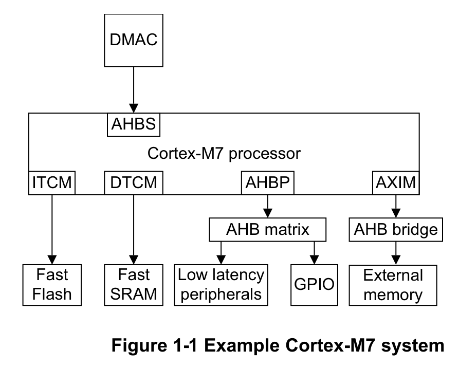
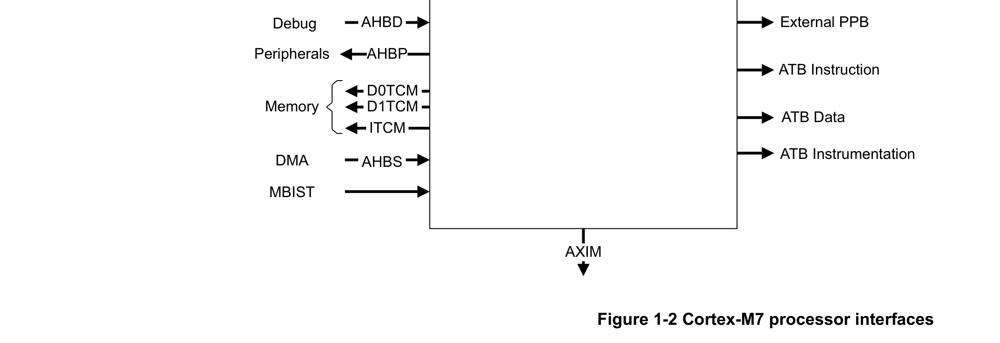
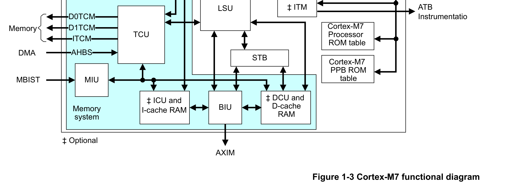

本章介绍处理器。

## 1. 关于 Cortex-M7 处理器

Cortex-M7 处理器是一款高效的高性能嵌入式处理器，具有低中断延迟、低成本调试的特点，并与现有 Cortex-M 系列处理器向后兼容。该处理器采用有序超标量流水线，由于具有多个内存接口，许多指令可以双发射，包括加载/加载和加载/存储指令对。

处理器支持的内存接口包括：

* 紧密耦合内存（**Tightly-Coupled Memory**，TCM）接口。
* 哈佛结构的指令缓存和数据缓存。
* AXI 主机（**AXIM**）接口。
* 专用的低延迟 AHB-Lite 外设（**AHBP**）接口。
* 提供对 TCM 的 DMA 访问的 AHB-Lite 从（**AHBS**）接口。

处理器具有可选的内存保护单元（**MPU**），可配置为保护内存区域。实现数据和指令缓存时，缓存中包含用于错误检测与纠正的错误纠正码（**ECC**）功能。TCM 接口支持实现外部 ECC，以提供更高的可靠性并满足安全相关应用的需求。

Cortex-M7 处理器包含可选的浮点运算功能，支持单精度和双精度运算。请参见浮点单元一章。

该处理器面向需要快速中断响应特性的高性能深度嵌入式应用。

下图显示了典型系统中的处理器。

### 1.1. 特性

Cortex-M7 处理器的主要特性包括：

* 带动态分支预测的有序发射超标量流水线。
* DSP 扩展。
* Arm®v7-M 架构参考手册中定义的 ARMv7-M Thumb® 指令集。
* 分组堆栈指针（**SP**）。
* 硬件整数除法指令 **SDIV** 和 **UDIV**。
* Handler 模式和 Thread 模式。
* Thumb 状态和 Debug 状态。
* 为低延迟中断服务程序（**ISR**）进入和退出自动保存与恢复处理器状态。
* 支持 ARMv7-M 的大端（大小端不变）或小端访问。
* 支持 ARMv7-M 的非对齐访问。
* 通过以下方式实现低延迟中断处理：

  * 与处理器紧密集成的嵌套向量中断控制器（**NVIC**）。
  * 支持异常可续执行指令，例如 **LDM**、**LDMDB**、**STM**、**STMDB**、**PUSH**、**POP**，以及处理器带有浮点单元（**FPU**）时的 **VLDM**、**VSTM**、**VPUSH**、**VPOP**。

* 低成本调试方案，可选支持：

  * 实现断点。
  * 实现观察点、跟踪和系统性能分析。
  * 通过插桩跟踪宏单元（**ITM**）支持 printf() 风格的调试。
  * 可选的跟踪端口接口单元（**TPIU**）。
  * 可选的调试访问端口（**DAP**）。

* 支持可选的嵌入式跟踪宏单元（**ETM**）。更多信息请参见 Arm® CoreSight™ ETM-M7 技术参考手册。
* 内存系统，包含可选的 MPU 以及带 ECC 的哈佛数据缓存和指令缓存。
* 可选的浮点单元（FPU）。
* 低功耗特性，包括架构时钟门控、睡眠模式和唤醒中断控制器（**WIC**）。
* 可选的 AXI 到 AHB 桥，用于支持传统内存系统。

### 1.2. 接口

Cortex-M7 处理器具有多个外部接口。

下图显示了 Cortex-M7 处理器的外部接口。

### 1.3. 配置选项

Cortex-M7 处理器具有可配置选项，可以在实现和集成阶段进行配置，以满足功能需求。

下表给出了处理器构建时可配置的选项。

| 特性 | 选项 | 配置阶段 |
| --- | --- | --- |
| 浮点 | 无浮点。 | 实现 |
| 浮点 | 仅单精度浮点。 | 实现 |
| 浮点 | 单精度和双精度浮点。 | 实现 |
| 指令 TCM | 无指令 TCM。 | 集成 |
| 指令 TCM | 4KB-16MB（2 的幂）。 | 集成 |
| 数据 TCM | 无数据 TCM。 | 集成 |
| 数据 TCM | 4KB-16MB（2 的幂）。数据 TCM 被等分为两个 TCM：D0TCM 和 D1TCM。 | 集成 |
| 指令缓存 | 无指令缓存单元（**ICU**）ᵃ。 | 实现 |
| 指令缓存 | 包含指令缓存单元。 | 实现 |
| 数据缓存 | 面积优化的 AXIM 接口，无数据缓存单元（**DCU**）ᵇ。 | 实现 |
| 数据缓存 | 性能优化的 AXIM 接口，包含数据缓存单元。 | 实现 |
| 指令缓存大小 | 4KB、8KB、16KB、32KB、64KB。 | 集成 |
| 数据缓存大小 | 4KB、8KB、16KB、32KB、64KB。 | 集成 |
| AHB 外设大小 | 64MB、128MB、256MB、512MB。 | 集成 |
| 缓存 ECC 支持 | 指令缓存和数据缓存均无 ECC。 | 实现 |
| 缓存 ECC 支持 | 所有已实现的缓存均带 ECC。 | 实现 |
| 保护内存区域 | 0 个区域、8 个区域、16 个区域。 | 实现 |
| 中断 | 1-240 个中断。 | 实现 |
| 中断优先级位数 | 3 到 8 位中断优先级，即 8 到 256 级优先级。 | 实现 |
| 调试观察点与断点 | 精简集。两个数据观察点比较器和四个断点比较器。 | 实现 |
| 调试观察点与断点 | 完整集。四个数据观察点比较器和八个断点比较器。 | 实现 |
| ITM 与数据观察点与跟踪（DWT）跟踪功能 | 无 ITM 或 DWT 跟踪。 | 实现 |
| ITM 与数据观察点与跟踪（DWT）跟踪功能 | 完整的 ITM 和 DWT 跟踪。 | 实现 |
| ETM | 不支持 ETM。 | 实现 |
| ETM | 仅 ETM 指令跟踪。 | 实现 |
| ETM | ETM 指令和数据跟踪。 | 实现 |
| 双冗余处理器 | 无双冗余处理器。 | 实现 |
| 双冗余处理器 | 包含双冗余处理器。 | 实现 |
| 复位所有寄存器 | RTL 中仅复位必须初始化的必需寄存器。 | 实现 |
| 复位所有寄存器 | RTL 中复位所有寄存器，ETM 中的寄存器除外（若包含 ETM）。 | 实现 |
| 复位所有寄存器 | RTL 中复位所有寄存器，包括 ETM 中的寄存器（若包含 ETM）。 | 实现 |
| 交叉触发接口（CTI） | 无交叉触发接口。 | 实现 |
| 交叉触发接口（CTI） | 包含交叉触发接口。 | 实现 |
| 唤醒中断控制器（WIC） | 无唤醒中断控制器。 | 实现 |
| 唤醒中断控制器（WIC） | 包含唤醒中断控制器。 | 实现 |

a. ICU 包含指令缓存控制器。
b. DCU 包含数据缓存控制器。

## 2. 组件块

Cortex-M7 处理器包含固定组件块和可选组件块。可选组件包括：

* 唤醒中断控制器（**WIC**）。
* ITM。
* FPU。
* MPU。
* 指令缓存单元。
* 数据缓存单元。
* 交叉触发接口（**CTI**）。
* ETM。

其他所有组件均为固定组件。

配置选项请参见 1.3 节。

下图显示了 Cortex-M7 处理器的可选组件和固定组件。

Cortex-M7 处理器包含以下组件块：

* 数据处理单元。
* 预取单元。
* 加载存储单元。
* 浮点单元。
* 嵌套向量中断控制器。
* 唤醒中断控制器。
* 内存系统。
* 内存保护单元。
* Cortex-M7 处理器 ROM 表和 PPB ROM 表。
* 交叉触发接口单元。
* ETM。
* 调试与跟踪组件。

### 2.1. 数据处理单元（Data Processing Unit）

数据处理单元（**DPU**）提供：

* 并行化的整数寄存器堆，具有六个读端口和四个写端口，用于大规模双发射。
* 大量前递（forwarding）逻辑，以尽量减少互锁（interlock）。
* 两个 ALU，其中一个能够执行 SIMD 操作。
* 单 MAC 流水线，能够执行 32×32 位 + 64 位 → 64 位，结果延迟两个周期，每周期吞吐一个 MAC。
* 单个除法器单元，支持依赖操作数的提前终止。

### 2.2. 预取单元（Prefetch Unit）

预取单元（**PFU**）提供：

* 64 位指令取指带宽。
* 4×64 位预取队列，使指令预取与 DPU 流水线操作解耦。
* 分支目标地址缓存（**BTAC**），实现分支预测器状态和目标地址的单周期周转。
* 未指定 BTAC 时使用静态分支预测器。
* 标志前递，用于在处理器流水线的译码阶段和第一执行阶段尽早解析直接分支。

### 2.3. 加载存储单元（Load Store Unit）

加载存储单元（**LSU**）提供：

* 到 TCM、数据缓存和 AXI 主机（AXIM）接口的双 32 位加载通道，提供 64 位加载带宽和双 32 位加载能力。
* 到 AHB 接口的单 32 位加载通道。
* 单 64 位存储通道。
* 存储缓冲，以提高存储吞吐并尽量减少与数据和指令读的 RAM 竞争。
* 针对 TCM、AHBP 和 AXIM 的独立存储缓冲，以实现服务质量（**QoS**）和特定接口的优化。

### 2.4. 浮点单元（Floating Point Unit）

可选的浮点单元（**FPU**）提供：

* 惰性浮点上下文保存。浮点状态的自动堆栈操作延迟到 ISR 尝试执行浮点指令时。这降低了进入 ISR 的延迟，并使不使用浮点的 ISR 无需保存浮点上下文。
* 单精度（C 语言 float 类型）数据处理操作指令。
* 双精度（C 语言 double 类型）数据处理操作的可选指令。
* 用于提高精度的乘加组合指令（**Fused MAC**）。
* 转换、加、减、可选累加的乘、除法以及平方根的硬件支持。
* 次正规数和所有 IEEE Std 754-2008 舍入模式的硬件支持。
* 32 个 32 位单精度寄存器，或 16 个 64 位双精度寄存器。

更多信息请参见浮点单元一章。

### 2.5. 嵌套向量中断控制器（Nested Vectored Interrupt Controller）

NVIC 与内核紧密集成，以实现低延迟中断处理。其特性包括：

* 外部中断，可在实现时配置为 1 到 240 个。
* 可在实现时配置 8 到 256 级中断优先级。
* 中断的动态重新优先级化。
* 优先级分组。可选择抢占式中断级别和非抢占式中断级别。
* 支持尾链（tail-chaining）和中断迟到（late arrival）。这实现了背靠背中断处理，而无需在中断之间进行状态保存和恢复的开销。

更多信息请参见嵌套向量中断控制器一章。

### 2.6. 唤醒中断控制器（Wake-up Interrupt Controller）

可选的 WIC 提供超低功耗睡眠模式支持。

更多信息请参见 NVIC 一章中的低功耗模式一节。

### 2.7. 内存系统（Memory System）

可选的内存系统包括：

* 总线接口单元（**BIU**），带有可配置的 AMBA 4 AXI 接口，可支持高性能 L2 内存系统。
* 扩展的 AHB-Lite 接口，用于支持低延迟系统外设。
* TCM 控制单元（**TCU**），带有可支持外部 ECC 逻辑的 TCM 接口，以及用于系统访问 TCM 的 AHB 从（AHBS）接口。
* 指令缓存单元和数据缓存单元，可选错误纠正码（**ECC**）。
* 由 MBIST 接口单元（**MIU**）提供的内存内建自测试（**MBIST**）接口。内存系统支持在线 MBIST，即处理器运行时 RAM 阵列可被 MBIST 接口访问。生产测试期间也支持 MBIST。

更多信息请参见内存系统一章。

### 2.8. 存储缓冲（Store Buffer）

存储缓冲（**STB**）保存已离开加载/存储流水线并由 DPU 提交的存储操作。从 STB 出发，存储操作可以请求访问 DCU 中的缓存 RAM、请求 BIU 发起行填充（linefill），或请求 BIU 在 AXIM 接口上写出数据。

如果多个存储事务指向同一 64 位对齐地址，STB 可以将它们合并为单个事务。

### 2.9. 内存保护单元（Memory Protection Unit）

可选的 MPU 具有可配置的内存保护属性。它包含最多 16 个内存区域和子区域禁用（**SRD**），从而高效使用内存区域。它还能够使能实现默认内存映射属性的背景区域。更多信息请参见内存保护单元一章。

### 2.10. Cortex-M7 处理器 ROM 表和 PPB ROM 表

这两个 ROM 表使调试器能够识别并连接 CoreSight 调试组件。更多信息请参见调试一章。

### 2.11. 交叉触发接口单元（Cross Trigger Interface Unit）

可选的 CTI 使调试逻辑与 ETM 能够相互交互，并与其他 CoreSight 组件交互。请参见交叉触发接口一章。

### 2.12. ETM

可选的 ETM 在配置后提供仅指令跟踪或指令和数据跟踪能力。Cortex-M7 处理器未实现跟踪暂停（trace stalling）特性。更多信息请参见 Arm® CoreSight™ ETM-M7 技术参考手册。

### 2.13. 调试与跟踪组件（Debug and trace components）

* 可配置的断点单元（**FPB**），用于实现断点。
* 可配置的数据观察点与跟踪（**DWT**）单元，用于实现观察点、数据跟踪和系统性能分析。
* 可选的 ITM，用于通过插桩跟踪支持 printf() 风格的调试。
* 适用于以下用途的接口：

  * 将片上数据传递到跟踪端口分析器（**TPA**），包括单线输出（**SWO**）模式。
  * 调试器访问系统中的所有内存和寄存器，包括访问内存映射设备、核暂停时访问内部核寄存器，以及复位断言期间访问调试控制寄存器。

## 3. 接口

处理器包含以下外部接口：

* AHBP 接口。
* AHBS 接口。
* AHBD 接口。
* 外部私有外设总线。
* ATB 接口。
* TCM 接口。
* 交叉触发接口。
* MBIST 接口。
* AXIM 接口。

### 3.1. AHBP 接口

AHB-Lite 外设（**AHBP**）接口提供适用于低延迟系统外设的访问。它支持非对齐内存访问、用于缓冲写数据的写缓冲，以及多处理器系统的独占访问传输。更多信息请参见内存系统一章中的 AHB 外设接口一节。

### 3.2. AHBS 接口

AHB-Lite 从（**AHBS**）接口使系统能够访问 TCM。更多信息请参见内存系统一章中的 AHB 从接口一节。

### 3.3. AHBD 接口

AHB-Lite 调试（**AHBD**）接口提供对 Cortex-M7 处理器和完整内存映射的调试访问。更多信息请参见调试一章。

### 3.4. 外部私有外设总线

APB 外部 PPB（**EPPB**）使连接到处理器的系统中的 CoreSight 兼容调试和跟踪组件可被访问。

### 3.5. ATB 接口

ATB 接口输出用于调试的跟踪信息。ATB 接口与 CoreSight 架构兼容。更多信息请参见 Arm® CoreSight™ 架构规范（v2.0）。

### 3.6. TCM 接口

处理器最多可以有两个 TCM 内存实例：指令 TCM（**ITCM**）和数据 TCM（**DTCM**），每个均为双字数据宽度。对 ITCM 的访问通过 ITCM 64 位宽接口进行。对 DTCM 的访问通过 D1TCM 32 位宽接口和 D0TCM 32 位宽接口进行。DTCM 访问被拆分，低字总是访问 D0TCM，高字总是访问 D1TCM。两个 TCM 实例的大小均可配置，为 4KB-16MB（2 的幂）。更多信息请参见内存系统一章中的 TCM 接口一节。

### 3.7. 交叉触发接口

处理器包含可选的交叉触发接口单元，其中包含适用于通过交叉触发矩阵连接外部 CoreSight 组件的接口。更多信息请参见交叉触发接口一章。

### 3.8. MBIST 接口

MBIST 接口用于在生产测试期间测试 RAM。Cortex-M7 处理器还允许在正常执行期间使用 MBIST 接口测试 RAM，这称为在线 MBIST。

有关 MBIST 接口和在线 MBIST 的更多信息，请联系您的实现团队。

### 3.9. AXIM 接口

AXI 主机（**AXIM**）接口提供对内存系统的高性能访问。AXIM 接口支持使用 Arm CoreLink L2C-310 二级缓存控制器。不支持 L2C-310 独占缓存配置。更多信息请参见内存系统一章中的 AXIM 接口一节。

## 4. 支持的标准

处理器符合或实现以下规范：

* Arm 架构。
* 总线架构。
* 调试。
* 嵌入式跟踪宏单元。
* 浮点单元。

本书补充架构参考手册、架构规范、协议规范和相关外部标准，不重复这些来源中的信息。

### 4.1. Arm 架构

Cortex-M7 处理器实现 ARMv7E-M 架构配置。请参见 Arm®v7-M 架构参考手册。

Cortex-M7 处理器的 FPB 实现 Flash 补丁断点（**Flash Patch Breakpoint**）第 2 版架构修订。

### 4.2. 总线架构

处理器提供：

* 作为 AMBA 3 AHB-Lite 协议变体的外部接口。
* 符合 AMBA 4 AXI 的外部接口。

处理器还使用 AMBA 3 APB 协议和 AMBA 3 ATB 协议实现 CoreSight 及其他调试组件的接口。

更多信息请参见：

* Arm® AMBA® AXI 与 ACE 协议规范。
* Arm® AMBA® 3 AHB-Lite 协议（v1.0）。
* Arm® AMBA® 3 APB 协议规范。
* Arm® AMBA® 3 ATB 协议规范。

### 4.3. 调试

处理器的调试特性实现 Arm 调试接口架构。请参见 Arm® 调试接口 v5 架构规范。

### 4.4. 嵌入式跟踪宏单元

实现时，处理器的跟踪特性实现 Arm 嵌入式跟踪宏单元（**ETM**）v4 架构。请参见 Arm® 嵌入式跟踪宏单元架构规范 ETMv4。

### 4.5. 浮点单元

根据实现方式，带有 FPU 的 Cortex-M7 处理器可以具有仅单精度，或由 FPv5 架构定义的单精度和双精度浮点数据处理能力，FPv5 是 ARMv7E-M 架构的一部分。它提供的浮点计算功能符合 ANSI/IEEE Std 754-2008《IEEE 二进制浮点运算标准》。

## 5. 设计流程

Cortex-M7 处理器以可综合的 RTL 形式交付，在将其用于产品之前必须经过实现、集成和编程流程。

以下定义描述设计流程中的各个顶层过程：

**实现（Implementation）**

实现者配置并综合 RTL。

**集成（Integration）**

集成者将已实现的设计连接到 SoC。这包括将其连接到内存系统和外设。

**编程（Programming）**

系统程序员开发配置和初始化处理器所需的软件，并测试所需的应用软件。

流程中的每个阶段都可以由不同的参与方完成。实现和集成选择会影响处理器的行为和特性。

对于 MCU，通常由单个设计团队在综合完整设计之前完成处理器集成。或者，团队也可以单独或部分集成地综合处理器，生成宏单元，然后（可能由另一团队）进行集成。

最终器件的运行取决于：

**构建配置（Build configuration）**

实现者选择影响 RTL 源文件预处理方式的选项。这些选项通常包含或排除影响宏单元面积、最高频率和一个或多个特性的逻辑。

**配置输入（Configuration inputs）**

集成者通过将输入固定为特定值来配置处理器的某些特性。这些配置影响软件配置之前的启动行为。它们也可能限制软件可用的选项。

**软件配置（Software configuration）**

程序员通过向寄存器编程特定值来配置处理器。这影响处理器的行为。

**注意：** 本手册中提到的实现定义特性适用于构建配置选项。“包含某特性”指选择了相应的构建和引脚配置选项；“使能某特性”指该特性还经过了软件配置。

## 6. 文档

Cortex-M7 处理器文档可帮助您完成正确使用产品所需的实现、集成和编程顶层流程。

Cortex-M7 处理器文档包括技术参考手册、集成与实现手册以及用户指南参考资料。

**技术参考手册（Technical Reference Manual）**

技术参考手册（**TRM**）描述功能以及功能选项对 Cortex-M7 处理器行为的影响。它在设计流程的所有阶段都需要。由于 Cortex-M7 处理器的实现和集成方式，TRM 中描述的部分行为可能并不适用。如果您要编程 Cortex-M7 处理器，请联系实现者以确定：

* 实现的构建配置。
* 在实现处理器之前执行了哪些集成（如有）。

**集成与实现手册（Integration and Implementation Manual）**

集成与实现手册（**IIM**）描述：

* 可用的构建配置选项以及选择这些选项的相关问题。
* 如何使用构建配置选项配置寄存器传输级（**RTL**）。
* 如何将处理器集成到 SoC。包括集成套件说明，以及集成者必须固定哪些引脚才能将宏单元配置为所需的集成方式。
* 如何将处理器实现到您的设计中。包括布局规划（floorplanning）指南、内存内建自测试（**MBIST**）与可测性设计（**DFT**）信息，以及如何对处理器执行网表动态验证。
* 设计集成与实现的签核流程。

Arm 产品交付物包括参考脚本以及关于如何使用这些脚本实现设计的信息。

来自 EDA 工具供应商的参考方法学文档可作为 IIM 的补充。

IIM 是机密文档，仅向被许可方提供。

**用户指南参考资料（User Guide Reference Material）**

本文档提供 Arm 合作伙伴可配置并纳入 Arm Cortex-M7 处理器用户指南的参考资料。通常：

* 本参考资料中的每一章可能对应用户指南中的一节。
* 本参考资料中的每个顶层节可能对应用户指南中的一章。

但您可以在许可协议条款允许的范围内以任意方式组织这些材料。

## 7. 产品版本

本节描述各产品版本之间的功能差异：

r0p0 首次发布。

r0p1 本版本进行了以下更改：

* 更新 CPUID 复位值为 0x410FC271。
* 修复若干工程勘误。

r0p2 本版本进行了以下更改：

* 更新 CPUID 复位值为 0x410FC272。
* 修复若干工程勘误。

r1p0 本版本进行了以下更改：

* 更新 CPUID 复位值为 0x411FC270。
* 增加 **CTLPPBLOCK[3:0]**，以允许锁定寄存器 **ITCMCR**、**DTCMCR**、**AHBPCR**、**VTOR**，防止不需要的更新。
* 增加 **ACTLR** 位功能，允许低能力 AXI 系统禁止对 DEV/SO 内存的 AXI 读，并禁止在 AXI 上所有未完成的读/存储完成之前发起的对共享内存的独占读/写。
* 在 MBIST 接口中增加 **MBISTIMPERR[2]** 输出，在试图访问未实现的内存时提供错误指示。
* 改进对同一 TCM 上 AHBS 与软件同时活动的处理。

r1p2 本版本进行了以下更改：

* 更新 CPUID 复位值为 0x411FC272。
* 增加描述推测访问（speculative accesses）的小节，处理器使用该机制提高性能。
* 更新描述为强序或设备内存生成 AXI 事务的小节。
