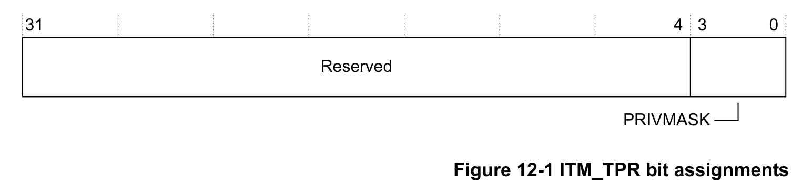

本章介绍插桩跟踪宏单元（ITM）。

## 1. 关于 ITM

**ITM** 是一个可选的应用驱动跟踪源，支持 printf() 风格的调试，用于跟踪操作系统和应用事件，并生成诊断系统信息。

## 2. ITM 功能描述

ITM 以数据包的形式生成跟踪信息。有四种来源可以生成数据包。如果多个来源同时生成数据包，ITM 会仲裁数据包的输出顺序。四种来源按优先级从高到低为：

**软件跟踪**

软件可以直接写 ITM 激励（stimulus）寄存器来生成数据包。

**硬件跟踪**

DWT 生成这些数据包，ITM 将其输出。

**时间戳**

时间戳相对于数据包生成。ITM 包含一个 21 位计数器用于生成时间戳。处理器时钟输出为该计数器提供时钟。

**全局系统时间戳**

可以选择使用系统级的 64 位计数值生成时间戳。在 ETM 跟踪流中插入时间戳时使用相同的计数值，从而实现粗粒度关联。

## 3. ITM 编程模型

下表给出了实现特定于本处理器的 ITM 寄存器。其他寄存器在 Arm®v7-M 架构参考手册中描述。

根据处理器的具体实现，ITM 寄存器可能不存在。配置为不存在的寄存器读为零。

**注意：**

* 在编程或使用 ITM 之前，必须使能调试异常与监控控制寄存器中的 **TRCENA**。
* 如果 ITM 流需要同步数据包，则必须在 DWT 中配置同步数据包速率。

| 地址 | 名称 | 类型 | 复位值 | 描述 |
| --- | --- | --- | --- | --- |
| 0xE0000000-0xE000007C | ITM_STIM0-ITM_STIM31 | RW | - | 激励端口寄存器 0-31 |
| 0xE0000E00 | ITM_TER | RW | 0x00000000 | 跟踪使能寄存器 |
| 0xE0000E40 | ITM_TPR | RW | 0x00000000 | ITM 跟踪特权寄存器 |
| 0xE0000E80 | ITM_TCR | RW | 0x00000000 | 跟踪控制寄存器 |
| 0xE0000EF0 | ITM_ITATRDY | RO | 未知 | 集成模式：读 ATB 就绪 |
| 0xE0000EF8 | ITM_ITATVAL | WO | - | 集成模式：写 ATB 有效 |
| 0xE0000F00 | ITM_TCTRL | RW | 0x00000000 | 集成模式控制寄存器 |
| 0xE0000FB0 | ITM_LAR | WO | - | 锁定访问寄存器 |
| 0xE0000FB4 | ITM_LSR | RO | 未知 | 锁定状态寄存器 |
| 0xE0000FD0 | PID4 | RO | 0x00000004 | 外设标识寄存器 |
| 0xE0000FD4 | PID5 | RO | 0x00000000 |  |
| 0xE0000FD8 | PID6 | RO | 0x00000000 |  |
| 0xE0000FDC | PID7 | RO | 0x00000000 |  |
| 0xE0000FE0 | PID0 | RO | 0x00000001 |  |
| 0xE0000FE4 | PID1 | RO | 0x000000B0 |  |
| 0xE0000FE8 | PID2 | RO | 0x0000000B |  |
| 0xE0000FEC | PID3 | RO | 0x00000000 |  |
| 0xE0000FF0 | CID0 | RO | 0x0000000D | 组件标识寄存器 |
| 0xE0000FF4 | CID1 | RO | 0x000000E0 |  |
| 0xE0000FF8 | CID2 | RO | 0x00000005 |  |
| 0xE0000FFC | CID3 | RO | 0x000000B1 |  |

**注意：** ITM 寄存器在特权模式下完全可访问。在用户模式下，所有寄存器都可读，但只有激励寄存器和跟踪使能寄存器可以写，并且仅在设置了相应的跟踪特权寄存器位时才可写。对 ITM 寄存器的无效用户模式写入会被丢弃。

### 3.1. ITM 跟踪特权寄存器（ITM Trace Privilege Register）

**ITM_TPR** 的特性如下：

**用途**

使操作系统能够控制用户代码可访问的激励端口。

**使用限制**

只能在特权模式下写该寄存器。

**配置**

如果实现中配置了 ITM，则该寄存器可用。

**属性**

请参见寄存器摘要。

下图显示了 **ITM_TPR** 的位分配。

下表显示了 **ITM_TPR** 的位分配。

| 位 | 名称 | 功能 |
| --- | --- | --- |
| [31:4] | - | 保留。 |
| [3:0] | PRIVMASK | 用于使能 ITM 激励端口跟踪的位掩码：位[0] 激励端口[7:0]；位[1] 激励端口[15:8]；位[2] 激励端口[23:16]；位[3] 激励端口[31:24]。 |
