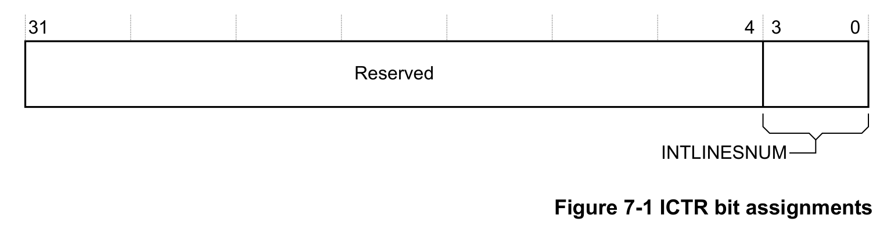

## 1. 关于 NVIC

嵌套向量中断控制器 NVIC（**Nested Vectored Interrupt Controller**）为处理器提供可配置的中断处理能力。功能包括：

* 它有利于低延迟异常和中断处理。
* 它控制电源管理。

## 2. NVIC 功能说明

**NVIC** 支持多达 **240** 个中断，每个中断具有多达 **256** 个优先级。您可以动态更改中断的优先级。**NVIC** 和处理器内核接口紧密耦合，以实现低延迟中断处理和迟来中断的高效处理。**NVIC** 维护堆栈或嵌套中断的知识，以启用中断的尾链。

您只能从特权模式完全访问 **NVIC**。但如果您启用配置和控制寄存器（**Configuration and Control Register**），您可以在用户模式下导致中断进入挂起状态。任何其他用户模式访问都会导致总线故障。

您可以仅使用字访问来访问所有 **NVIC** 寄存器。有关 **NVIC** 寄存器可访问性及其使用限制的更多信息，请参阅 ARM®v7-M 架构参考手册。

处理器异常处理在第2-9页的异常中进行了描述。

### 2.1. 低功耗模式

实现中可包含唤醒中断控制器 **WIC**（**Wake-up Interrupt Controller**）。这使得处理器和 **NVIC** 可进入极低功耗睡眠模式，由 WIC 负责识别和优先排序中断。使用 WIC 时，必须在系统控制寄存器中使能 **SLEEPDEEP**。

处理器完整实现了 **WFI**（**Wait For Interrupt**）、**WFE**（**Wait For Event**）和 **SEV**（**Send Event**）指令。此外，处理器还支持 **SLEEPONEXIT**，它使处理器核在从异常处理程序返回线程模式时进入睡眠模式。更多信息请参见 Arm®v7-M 架构参考手册。

### 2.2. 电平中断与脉冲中断

处理器同时支持电平中断和脉冲中断。电平中断保持断言状态，直到 ISR 访问设备将其清除。脉冲中断是边沿模型的一种变体。必须确保脉冲在处理器时钟 **FCLK** 的上升沿被采样，而不是异步采样。

对于电平中断，如果在从中断例程返回之前信号未去断言，则中断会再次进入挂起状态并重新激活。这对于 FIFO 和基于缓冲区的设备特别有用，因为它确保这些设备要么由单次 ISR 排空，要么通过重复调用排空，而无需额外处理。这意味着设备会保持信号断言，直到设备为空。

脉冲中断可以在 ISR 期间重新断言，从而使中断同时处于挂起状态和活动状态。如果在该中断仍处于挂起状态时又到达一个脉冲，则中断保持挂起状态，ISR 只运行一次。

脉冲中断主要用于外部信号，以及速率或重复信号。

## 3. NVIC 编程模型

本节介绍实现特定于本处理器的 **NVIC** 寄存器。其他寄存器在 Arm®v7-M 架构参考手册中描述。下表给出了 **NVIC** 寄存器。

| 地址 | 名称 | 类型 | 复位值 | 描述 |
| --- | --- | --- | --- | --- |
| 0xE000E004 | **ICTR** | RO | - | 中断控制器类型寄存器（Interrupt Controller Type Register） |
| 0xE000E100-0xE000E11C | NVIC_ISER0-NVIC_ISER7 | RW | 0x00000000 | 中断置位使能寄存器（Interrupt Set-Enable Registers） |
| 0xE000E180-0xE000E19C | NVIC_ICER0-NVIC_ICER7 | RW | 0x00000000 | 中断清除使能寄存器（Interrupt Clear-Enable Registers） |
| 0xE000E200-0xE000E21C | NVIC_ISPR0-NVIC_ISPR7 | RW | 0x00000000 | 中断置位挂起寄存器（Interrupt Set-Pending Registers） |
| 0xE000E280-0xE000E29C | NVIC_ICPR0-NVIC_ICPR7 | RW | 0x00000000 | 中断清除挂起寄存器（Interrupt Clear-Pending Registers） |
| 0xE000E300-0xE000E31C | NVIC_IABR0-NVIC_IABR7 | RO | 0x00000000 | 中断活动位寄存器（Interrupt Active Bit Register） |
| 0xE000E400-0xE000E4EC | NVIC_IPR0-NVIC_IPR59 | RW | 0x00000000 | 中断优先级寄存器（Interrupt Priority Register） |

### 3.1. 中断控制器类型寄存器 ICTR

**ICTR** 显示 **NVIC** 支持的中断线数量。

**使用限制**

无使用限制。

**配置**

在所有配置中均可用。

**属性**

请参见上表中的寄存器摘要。

下图显示了 **ICTR** 的位分配。

下表显示了 **ICTR** 的位分配。

| 位 | 名称 | 功能 |
| --- | --- | --- |
| [31:4] | - | 保留。 |
| [3:0] | INTLINESNUM | 以 32 为组的中断线总数： |
| [3:0] | INTLINESNUM | 0b0000 0-32。 |
| [3:0] | INTLINESNUM | 0b0001 33-64。 |
| [3:0] | INTLINESNUM | 0b0010 65-96。 |
| [3:0] | INTLINESNUM | 0b0011 97-128。 |
| [3:0] | INTLINESNUM | 0b0100 129-160。 |
| [3:0] | INTLINESNUM | 0b0101 161-192。 |
| [3:0] | INTLINESNUM | 0b0110 193-224。 |
| [3:0] | INTLINESNUM | 0b0111 225-256ᵃ。 |

**注意：** 处理器最多支持 240 个外部中断。

