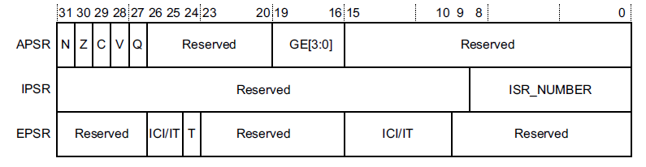
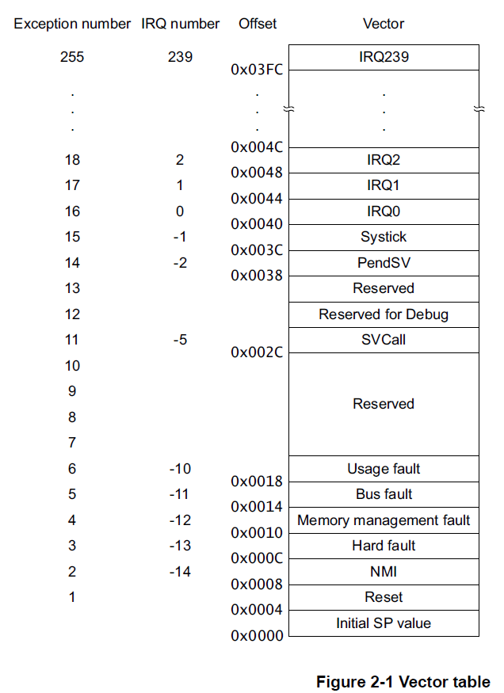
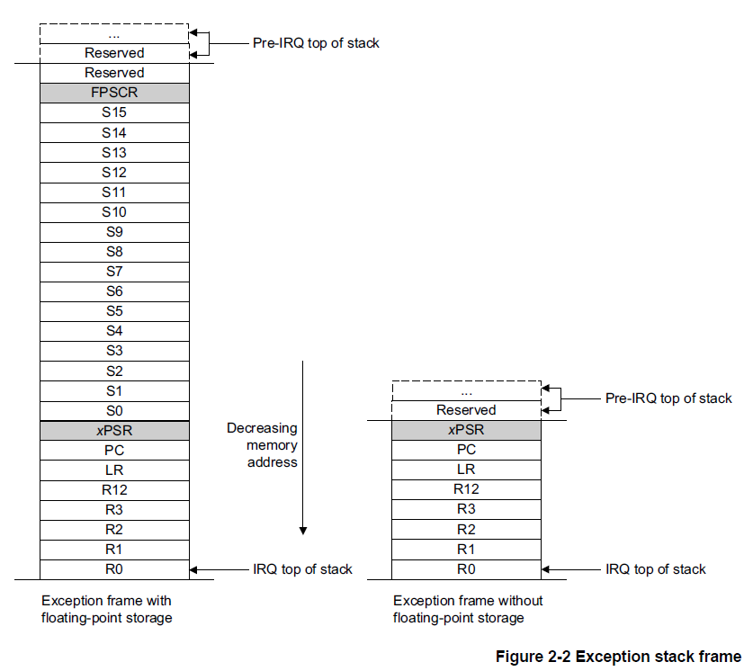
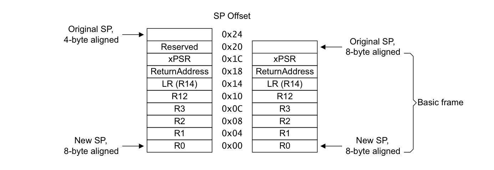
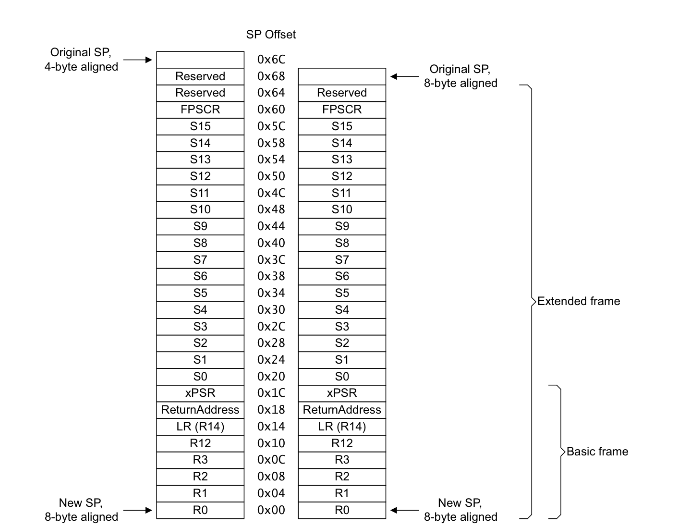

## 1. 关于程序员模型

本章概述 Cortex-M7 处理器的程序员模型，其中介绍了实现定义的（**implementation-defined**）选项。此外：

* 第 3 章概述程序员模型的系统控制（**System Control**）特性。
* 第 6 章概述程序员模型的内存保护单元（**MPU**）特性。
* 第 7 章概述程序员模型的嵌套向量中断控制器（**NVIC**）特性。
* 第 8 章概述程序员模型的浮点单元（**FPU**）特性。
* 第 9 章概述程序员模型的调试（**Debug**）特性。
* 第 10 章概述程序员模型的交叉触发接口（**CTI**）特性。
* 第 11 章概述程序员模型的数据观察点与跟踪单元（**DWT**）特性。
* 第 12 章概述程序员模型的插桩跟踪宏单元（**ITM**）特性。

## 2. 操作模式与执行状态

本节简要描述 Cortex-M7 处理器的操作模式与执行状态。更多信息请参见 Arm®v7-M 架构参考手册。

### 2.1. 操作模式

处理器支持两种操作模式：线程模式（**Thread mode**）与处理程序模式（**Handler mode**）：

* 处理器在上电复位时或作为异常返回的结果进入线程模式。特权（**Privileged**）与非特权（**Unprivileged**）代码都可以在线程模式下运行。
* 处理器由于异常而进入处理程序模式。在处理程序模式下，所有代码都是特权的。

### 2.2. 操作状态

处理器可以工作在两种操作状态之一：

* Thumb 状态（**Thumb state**）。这是正常运行状态，执行 16 位和 32 位半字对齐的 Thumb 指令。
* 调试状态（**Debug state**）。这是处理器为调试而暂停（**halted**）时的状态。

### 2.3. 特权访问与非特权用户访问

代码可以以特权方式或非特权方式执行。非特权执行限制或禁止对某些资源的访问。特权执行可以访问所有资源。处理程序模式始终是特权的。线程模式既可以是特权的，也可以是非特权的。

## 3. 独占监视器

处理器实现了本地独占监视器（**local exclusive monitor**）。有关信号量和本地独占监视器的更多信息，请参见 Arm®v7-M 架构参考手册。

处理器内部的本地监视器在构造上不保存任何物理地址。相反，它把任何访问都视为与上一条 **LDREX** 指令的地址匹配。这意味着所实现的独占保留粒度（**Exclusives Reservation Granule, ERG**）是整个内存地址范围。

## 4. 程序状态寄存器

程序状态寄存器**PSR**（**Program Status Register**）包含了：

* 应用程序状态寄存器（**Application Program Status Register, APSR**）。
* 中断程序状态寄存器（**Interrupt Program Status Register, IPSR**）。
* 执行程序状态寄存器（**Execution Program Status Register, EPSR**）。

这些寄存器是 **32** 位 **PSR** 中互斥的位域。位分配是：



通过使用寄存器名称作为 **MSR** 或 **MRS** 指令的参数，可以单独访问这些寄存器，也可以访问任意两个或所有三个寄存器的组合。

例如：

* 通过 **PSR** 参数使用 **MRS** 指令可读取所有寄存器。
* 通过 **APSR_nzcvq** 参数使用 **MSR** 指令写入 **APSR**寄存器的 **N**、**Z**、**C**、**V** 和 **Q** 位。

**PSR** 组合和属性是：

| 寄存器 | 类型 | 位域组合 |
| --- | --- | --- |
| PSR | RWᵃ,ᵇ | APSR、EPSR 与 IPSR |
| IEPSR | ROᵇ | EPSR 与 IPSR |
| IAPSR | RWᵃ | APSR 与 IPSR |
| EAPSR | RWᵇ | APSR 与 EPSR |

a. 处理器忽略对 **IPSR** 位的写入。
b. 对 **EPSR** 位的读取返回零，处理器忽略对这些位的写入。

有关如何访问程序状态寄存器的更多信息，请参阅第 3-178 页的 **MRS** 和第 3-179 页的 **MSR** 指令说明。

### 4.1. 应用程序状态寄存器 APSR

应用程序状态寄存器 **APSR** 包含来自先前指令执行的条件标志的当前状态。

有关其属性，请参见第 2-3 页表 2-2 中的寄存器摘要。位分配是：

| 位 | 名称 | 功能 |
| --- | --- | --- |
| [31] | N | 负标志 |
| [30] | Z | 零标志 |
| [29] | C | 进位或借位标志 |
| [28] | V | 溢出标志 |
| [27] | Q | **DSP** 溢出与饱和标志 |
| [26:20] | - | 保留 |
| [19:16] | GE[3:0] | 大于或等于标志，参见第 3-77 页的 **SEL** |
| [15:0] | - | 保留 |

### 4.2. 中断程序状态寄存器 IPSR

中断程序状态寄存器 **IPSR** 包含当前中断服务程序 (ISR) 的异常类型编号。

有关其属性，请参见第 2-3 页表 2-2 中的寄存器摘要。位分配是：

| 位 | 名称 | 功能 |
| --- | --- | --- |
| [31:9] | - | 保留 |
| [8:0] | ISR_NUMBER | 当前异常的编号：<br>0——线程模式；1——保留；2——**NMI**；3——**HardFault**；4——**MemManage**；5——**BusFault**；6——**UsageFault**；7-10——保留；11——**SVCall**；12——调试保留；13——保留；14——**PendSV**；15——**SysTick**；16——**IRQ0**；……；255——**IRQ239**ᵃ |

a. 这是异常编号的最大值。实际可用的异常最大数量由实现定义。

### 4.3. 执行程序状态寄存器 **EPSR**

**EPSR** 包含 **Thumb** 状态位和执行状态位：

* If-Then (IT) 指令。
* **Interruptible-Continuable Instruction** (ICI) 字段用于中断加载多个或存储多个指令。

有关 **EPSR** 属性，请参见第 2-3 页表 2-2 中的寄存器摘要。位分配是：

| 位 | 名称 | 功能 |
| --- | --- | --- |
| [31:27] | - | 保留 |
| [26:25]、[15:10] | ICI | 可中断-可继续指令位，参见第 2-7 页的可中断-可继续指令 |
| [26:25]、[15:10] | IT | 指示 **IT** 指令的执行状态位，参见第 3-131 页的 **IT** |
| [24] | T | **Thumb** 状态位，参见 **Thumb** 状态 |
| [23:16] | - | 保留 |
| [9:0] | - | 保留 |

尝试使用 **MSR** 指令通过应用软件直接读取 **EPSR** 总是返回零。在应用软件中使用 **MSR** 指令写入 **EPSR** 的尝试将被忽略。

#### 4.3.1. 可中断-可继续指令 Interruptible-continuable instructions

当在执行 **LDM**、**STM**、**PUSH** 或 **POP** 指令期间发生中断时，以及当 **FPU** 执行 **VLDM**、**VSTM**、**VPUSH** 或 **VPOP** 指令时，处理器：

* 暂时停止加载多个或存储多个指令操作。
* 将乘法运算中的下一个寄存器操作数存储到 **EPSR** 位[15:12]。

处理中断后，处理器：

* 返回位[15:12] 指向的寄存器。
* 恢复执行多重加载或存储指令。

当 **EPSR** 保持 **ICI** 执行状态时，位 [26:25,11:10] 为零。

#### 4.3.2. If-Then 块

**If-Then** 块在 **IT** 指令之后最多包含四个指令。块中的每条指令都是有条件的。指令的条件要么全部相同，要么某些条件与其他条件相反。有关详细信息，请参阅第 3-131 页的 **IT**。

#### 4.3.3. Thumb 状态

**Cortex-M7** 处理器只支持在 **Thumb** 状态下执行指令。以下操作可以将 **T** 位清零：

* 指令 **BLX**、**BX**、**LDR pc**、[] 和 **POP{PC}**。
* 在异常返回时从堆叠的 **xPSR** 值中恢复。
* 异常进入或复位时矢量值的位[0]。

**注意：** **EPSR.T** 位支持 Arm 架构的交互工作（interworking）模型，但由于 Armv7-M 只支持执行 **Thumb** 指令，该位必须始终保持为 1。这意味着所有异常向量的位[0] 都必须置 1。如果在异常进入时将相关向量表项的位[0] 置为 0，则第一条指令的执行会引发 **INVSTATE** **UsageFault**。如果这种情况发生在复位时，由于复位时 **UsageFault** 被禁用，会升级为 **HardFault**。

## 5. 处理器核心寄存器

处理器具有以下 32 位寄存器：

* 13 个通用寄存器，R0-R12。
* 堆栈指针（**Stack Pointer**，SP），R13，为分组寄存器 SP_process 和 SP_main 的别名。
* 链接寄存器（**Link Register**，LR），R14。
* 程序计数器（**Program Counter**，PC），R15。
* 特殊用途程序状态寄存器（**Program Status Registers**，xPSR）。

有关处理器寄存器组的更多信息，请参见 Arm®v7-M 架构参考手册。

## 6. 异常状态（Exception states）

每个异常都处于以下状态之一：

* **Inactive**：异常未激活且未挂起。
* **Pending**：异常正在等待处理器处理。来自外设或软件的中断请求可以将相应中断的状态更改为挂起（**Pending**）。
* **Active**：处理器正在处理但尚未完成的异常。
* **Active and pending**：异常正在由处理器处理，并且存在来自同一源的挂起的异常。

**注意：**

异常处理程序可以中断另一个异常处理程序的执行。在这种情况下，两个异常都处于活动状态。

## 7. 异常类型（Exception types）

异常类型包括：

### 7.1. 复位（Reset）

复位（**Reset**）会在上电或热复位时被调用。异常模型将复位视为一种特殊形式的异常。它永久启用并具有固定优先级 **-3**。当复位生效时，处理器的操作可能会在指令中的任何一点停止。当复位无效时，执行将从向量表中复位条目提供的地址重新开始。代码在线程模式下以特权方式重新开始执行。

Armv7-M 支持两级复位。复位级别决定在复位撤销时哪些寄存器位字段被强制为复位值：

* 上电复位（**power-on reset**）会复位处理器、系统控制空间和调试逻辑。
* 局部复位（**Local reset**）会复位处理器和系统控制空间，但某些故障和调试相关资源除外。更多信息请参见调试与复位（第 C1-693 页）。

### 7.2. NMI

不可屏蔽中断由外设发出信号或由软件触发。这是除重置之外优先级最高的异常。它永久启用并具有固定优先级 **-2**。**NMI**不能：

* 被任何其他异常屏蔽或阻止激活。
* 被 **Reset** 以外的任何异常抢占。

### 7.3. HardFault

**HardFault** 是由于异常处理过程中发生的错误，或者因为异常无法由任何其他异常机制管理而发生的异常。**HardFault**的固定优先级为 **-1**，这意味着它们的优先级高于任何具有可配置优先级的异常。

### 7.4. MemManage

**MemManage** 故障是由于内存保护相关故障而发生的异常。对于指令和数据内存事务，固定内存保护约束或者 **MPU**（如果已实现）确定了此故障。此故障始终用于中止对永不执行 (XN) 内存区域的指令访问。

软件可以禁用此故障。如果禁用，**MemManage** 故障会升级为 **HardFault**。**MemManage** 具有可配置优先级。

### 7.5. BusFault

**BusFault** 是由于指令或数据内存事务的内存相关故障而发生的异常。这可能是由于在内存系统中的总线上检测到的错误。软件可以禁用此故障。如果禁用，**BusFault** 会升级为 **HardFault**。**BusFault** 具有可配置优先级。

### 7.6. UsageFault

**UsageFault** 是由于与指令执行相关的故障而发生的异常。它包括了：

* 未定义的指令。
* 非法未对齐访问。
* 指令执行状态无效。
* 异常返回错误。
* 试图访问已禁用或不可用的协处理器。

当处理器配置为报告以下内容时，可能也会导致**UsageFault**：

* 字和半字内存访问中的未对齐地址。
* 被零除。

软件可以禁用此故障。如果禁用，**UsageFault** 会升级为 **HardFault**。**UsageFault** 具有可配置优先级。

### 7.7. DebugMonitor

一般而言，**DebugMonitor** 异常是同步异常，归类为故障（**fault**）。**DebugMonitor** 异常在停驻调试（**Halting debug**）被禁用且 **DebugMonitor** 异常被使能时发生。**DebugMonitor** 异常具有可配置优先级，参见优先级升级和调试事件行为（第 C1-694 页）。

**注意：** 调试观察点（**watchpoint**）是异步的，其行为类似于中断。

### 7.8. SVCall 

主管调用**SVC**（**supervisor call**）是由 **SVC** 指令触发的异常。在操作系统环境中，应用程序可以使用 **SVC** 指令访问操作系统内核功能和设备驱动程序。**SVCall** 永久使能，并具有可配置优先级。

### 7.9. PendSV 

**PendSV** 是一个中断驱动的系统级服务请求。在 **OS** 环境中，当没有其他异常处于活动状态时，使用 **PendSV** 进行上下文切换。**PendSV** 永久使能，并由 **ICSR.PENDSVSET** 和 **ICSR.PENDSVCLR** 位控制。

**注意：** 对于与程序执行同步执行的 **Supervisor Call**，软件必须使用 **SVC** 指令，这会生成 **SVCall** 异常。

### 7.10. SysTick 

**SysTick** 异常是系统定时器在达到零时产生的异常。软件也可以生成 **SysTick** 异常。在 **OS** 环境中，处理器可以将此异常用作系统节拍。**SysTick** 永久使能，并由 **ICSR.PENDSTSET** 和 **ICSR.PENDSTCLR** 位控制。

**注意：** 软件可以抑制 **SysTick** 事件的硬件生成，但 **ICSR.PENDSTSET** 和 **ICSR.PENDSTCLR** 始终可供软件使用。

### 7.11. 中断（Interrupt, IRQ）

中断或 **IRQ** 是由外设发出信号或由软件请求生成的异常。所有中断都与指令是异步执行的。在系统中，外围设备使用中断与处理器进行通信。Armv7-M 支持两个系统级中断，以及最多 496 个外部中断。每个中断具有可配置优先级。

| 异常编号ᵃ | IRQ 编号ᵃ | 异常类型 | 优先级 | 向量地址或偏移ᵇ | 激活方式 |
| --- | --- | --- | --- | --- | --- |
| 1 | - | Reset | -3，最高 | 0x00000004 | 异步 |
| 2 | -14 | NMI | -2 | 0x00000008 | 异步 |
| 3 | -13 | HardFault | -1 | 0x0000000C | - |
| 4 | -12 | MemManage | 可配置ᶜ | 0x00000010 | 同步 |
| 5 | -11 | BusFault | 可配置ᶜ | 0x00000014 | 精确时同步，非精确时异步 |
| 6 | -10 | UsageFault | 可配置ᶜ | 0x00000018 | 同步 |
| 7-10 | - | 保留 | - | - | - |
| 11 | -5 | SVCall | 可配置ᶜ | 0x0000002C | 同步 |
| 12-13 | - | 保留 | - | - | - |
| 14 | -2 | PendSV | 可配置ᶜ | 0x00000038 | 异步 |
| 15 | -1 | SysTick | 可配置ᶜ | 0x0000003C | 异步 |
| 16 及以上ᵈ | 0 及以上ᵉ | Interrupt (IRQ) | 可配置ᶠ | 0x00000040 及以上ᵍ | 异步 |

a. 为简化软件层，**CMSIS** 只使用 **IRQ** 编号，因此对中断以外的异常使用负值。**IPSR** 返回异常编号，参见第 2-6 页的中断程序状态寄存器。
b. 参见向量表。
c. 参见第 4-22 页的系统处理程序优先级寄存器。
d. 异常编号范围由实现定义。
e. **IRQ** 编号范围由实现定义。
f. 参见第 4-7 页的中断优先级寄存器。
g. 以 4 递增。向量地址或偏移范围由实现定义。

软件可以禁用所有外部中断，并可以设置或清除任何中断的挂起状态。除 **PendSV** 外，其他中断可以由硬件设置为挂起状态。

对于异步执行的异常，除了复位之外，处理器可以在触发异常和处理器进入异常处理程序之间执行另一条指令。

特权软件可以禁用第 **2-20** 页的 **Table 2-14** 显示为具有可配置优先级的异常，请参阅：

* 系统处理程序控制和状态寄存器（第 4-24 页）。
* 第 4-5 页的中断清除启用寄存器。

有关 **HardFaults**、**MemManage** 故障、**BusFaults** 和 **UsageFaults** 的更多信息，请参阅第 **2-27** 页的故障处理。

## 8. 异常处理程序

处理器使用以下方法处理异常：

### 8.1. 中断服务例程（ISR）

中断 **IRQ0** 到 **IRQ239** 是 **ISR** 可以处理的最大异常范围。可用异常的实际数量是由具体实现定义的。

### 8.2. 故障处理程序（Fault handler）

**HardFault**、**MemManage** 故障、**UsageFault**、**BusFault** 是由 **fault handler** 处理的故障异常。

### 8.3. 系统处理程序（System handler）

**NMI**、**PendSV**、**SVCall**、**SysTick**、**fault exceptions** 都是系统异常，通过 **system handler** 处理。

## 9. 异常编号定义

每个异常都有一个关联的异常编号，如表 B1-4 所示。异常编号也决定向量表中表项的顺序，参见向量表。

| 异常编号 | 异常 |
| --- | --- |
| 1 | Reset |
| 2 | NMI |
| 3 | HardFault |
| 4 | MemManage |
| 5 | BusFault |
| 6 | UsageFault |
| 7-10 | 保留 |
| 11 | SVCall |
| 12 | DebugMonitor |
| 13 | 保留 |
| 14 | PendSV |
| 15 | SysTick |
| 16 | 外部中断 0 |
| …… | …… |
| 16+N | 外部中断 N |

## 10. 向量表

向量表包含堆栈指针的复位值，以及所有异常处理程序的起始地址，所以也称为异常向量。第 **2-22** 页的图 **2-1** 显示了异常向量在向量表中的顺序。每个向量的最低有效位必须为 **1**，表示异常处理程序是 **Thumb** 代码，请参阅第 **2-7** 页的 **Thumb** 状态。



图 **2-1** 显示了异常编号、**IRQ** 编号、偏移量和向量的最大取值范围。可用值的实际范围是实现定义的。

系统复位时，向量表位于实现时配置的地址，通常为 **0x00000000**。特权软件可以写入 **VTOR** 以将向量表起始地址重新定位到不同的内存位置，范围为 0x00000000-0xFFFFFF80。 芯片供应商必须配置上限值，这取决于实施的中断数量。 最小对齐为 32 个字，足够最多 16 个中断。 对于更多中断，通过四舍五入到下一个二的幂来调整对齐。 例如，如果您需要 21 个中断，则对齐必须在 64 字边界上，因为所需的表大小为 37 个字，下一个 2 的幂为 64，请参阅第 4-17 页的向量表偏移寄存器。

ARM 建议您将向量表放在系统内存映射的代码、SRAM、外部 RAM 或外部设备区域中，请参阅第 2-12 页的内存模型。 使用外设、专用外设总线或供应商特定的内存区域可能会导致某些系统出现不可预测的行为。 这是因为处理器在这些内存区域中对加载/存储指令和向量提取使用不同的接口。 如果向量表位于可缓存的内存区域，则必须将对向量的任何加载或存储视为自修改代码，并使用缓存维护指令来同步对数据和指令缓存的更新，请参阅缓存维护设计 第 4-65 页的提示和技巧。

向量表中的字偏移及对应描述如表 B1-5 所示。

| 表中的字偏移 | 描述（适用于所有指针地址值） |
| --- | --- |
| 0 | SP_main。这是主堆栈指针（**Main stack pointer**）的复位值。 |
| 异常编号 | 使用该异常编号的异常。 |

向量表必须自然对齐到 2 的幂，其对齐值大于或等于（支持的异常数量 × 4），最小对齐为 128 字节。上电或复位时，处理器使用偏移 0 处的表项作为 **SP_main** 的初始值。所有其他表项必须将位 [0] 置 1，因为该位在异常进入时定义 **EPSR.T** 位，参见复位行为和异常入口行为。

在异常进入时，如果相关向量表项的位 [0] 被置 0，则第一条指令的执行会引发 **INVSTATE** **UsageFault**，参见特殊用途程序状态寄存器 xPSR 和故障行为。如果这种情况发生在复位时，由于复位时 **UsageFault** 被禁用，会升级为 **HardFault**，参见优先级升级。

**注意：** 复位可以是上电复位（**power-on reset**）或局部复位（**Local reset**），参见支持的异常概述和复位管理。

## 11. 异常优先级与抢占

如第 2-20 页的表 2-14 所示，所有异常都有一个关联的优先级，其中：

* 较低的优先级值表示较高的优先级。
* 除Reset、HardFault 和NMI 之外的所有异常的可配置优先级。

如果软件未配置任何优先级，则所有具有可配置优先级的异常的优先级均为 0。有关配置异常优先级的信息，请参阅：

* 系统处理程序优先级寄存器（第 4-22 页）。
* 第 4-7 页的中断优先级寄存器。

**注意：**

可配置优先级值的最大范围是 0-255。 可用优先级值的实际范围是实现定义的。 这意味着具有固定负优先级值的 Reset、HardFault 和 NMI 异常的优先级始终高于任何其他异常。

复位会将这些软件配置的优先级设置清除为 0，即可配置的最高优先级。

例如，为 IRQ[0] 分配较高的优先级值，为 IRQ[1] 分配较低的优先级值意味着 IRQ[1] 的优先级高于 IRQ[0]。 如果 IRQ[1] 和 IRQ[0] 都有效，则 IRQ[1] 在 IRQ[0] 之前处理。

如果多个未决异常具有相同的优先级，则异常编号最小的未决异常优先。 例如，如果 IRQ[0] 和 IRQ[1] 都处于挂起状态并且具有相同的优先级，则 IRQ[0] 在 IRQ[1] 之前被处理。

当处理器正在执行异常处理程序时，如果发生更高优先级的异常，它会抢占异常处理程序。 如果发生与正在处理的异常具有相同优先级的异常，则处理程序不会被抢占，无论异常编号如何。 但是，新中断的状态变为挂起。

如果软件更改了处于挂起或活动状态的异常的优先级，则必须将该更改同步到指令流，参见系统控制空间更新的同步要求（第 A3-96 页）。

### 11.1. 最大支持的优先级值

支持的优先级值数量是实现定义的 2 的幂，范围为 8 到 256，并且最小支持的优先级值始终为 0。所有优先级值字段均为 8 位，如果实现支持的优先级级别少于 256 个，则这些字段的低位为 RAZ。

| 优先级位数 | 优先级级别数 | 最大优先级值ᵃ |
| --- | --- | --- |
| 3 | 8 | 0b11100000 = 224 |
| 4 | 16 | 0b11110000 = 240 |
| 5 | 32 | 0b11111000 = 248 |
| 6 | 64 | 0b11111100 = 252 |
| 7 | 128 | 0b11111110 = 254 |
| 8 | 256 | 0b11111111 = 255 |

a. 该值始终对应最低可能的异常优先级。

## 12. 中断优先级分组

为了在具有中断的系统中增加优先级控制，NVIC 支持优先级分组。

这将每个中断优先级寄存器条目分为两个字段：

* 定义组优先级的上部字段。
* 定义组内子优先级的较低字段。

只有组优先级决定中断异常的抢占。 当处理器正在执行中断异常处理程序时，另一个与正在处理的中断具有相同组优先级的中断不会抢占处理程序，

如果多个未决中断具有相同的组优先级，则子优先级字段决定它们的处理顺序。 如果多个挂起的中断具有相同的组优先级和子优先级，则首先处理具有最低 IRQ 号的中断。

有关将中断优先级字段拆分为组优先级和子优先级的信息，请参阅第 4-17 页的应用程序中断和复位控制寄存器。

**AIRCR.PRIGROUP** 字段定义优先级字段中二进制小数点的位置。组优先级字段定义用于抢占的优先级。如果多个未决异常具有相同的组优先级，异常处理逻辑使用子优先级字段在组内解析优先级。

**Reset**、**NMI** 和 **HardFault** 的组优先级分别为 -3、-2 和 -1，与 **PRIGROUP** 的值无关。

**AIRCR.PRIGROUP** 指示 8 位异常优先级字段中有多少位用于指定子优先级，如表 B1-7 所示。

| PRIGROUP 值 | 组优先级字段 | 子优先级字段 |
| --- | --- | --- |
| 0 | [7:1] | [0] |
| 1 | [7:2] | [1:0] |
| 2 | [7:3] | [2:0] |
| 3 | [7:4] | [3:0] |
| 4 | [7:5] | [4:0] |
| 5 | [7:6] | [5:0] |
| 6 | [7] | [6:0] |
| 7 | - | [7:0] |

## 13. 执行优先级与优先级提升

### 13.1. 执行优先级

当没有异常处于活动状态时，在线程模式或处理程序模式下执行的软件实际上以（最大支持的异常优先级值 + 1）的优先级值执行，这对应于最低可能的优先级级别。

执行优先级基准级别（**base level of execution priority**）指线程模式下以此优先级级别执行的软件。

执行优先级定义为以下各项中的最高优先级：

* 执行优先级基准级别。
* 所有活动异常的最高优先级，包括当前异常抢占的任何异常。
* **PRIMASK**、**FAULTMASK** 和 **BASEPRI** 值的影响，参见优先级提升。

执行优先级的这一定义意味着异常处理程序可能以高于其对应异常优先级的优先级执行。特别地，如果处理程序降低其对应异常的优先级，执行优先级只会降至最高优先级的被抢占异常的优先级。因此，降低当前异常的优先级永远不会：

* 允许被抢占的异常抢占当前异常处理程序。
* 导致被抢占异常的优先级倒置。

**示例 B1-1：动态优先级管理的效果限制**

本示例考虑三个具有可配置优先级的异常：

* A 具有最高优先级，记为优先级 A。
* B 具有中等优先级，记为优先级 B。
* C 具有最低优先级，记为优先级 C。

考虑以下事件序列：

1. 异常 B 发生。处理器接受该异常并开始执行其处理程序。执行优先级为优先级 B。
2. 异常 A 发生。由于其优先级高于执行优先级，它抢占了异常 B，处理器开始执行异常 A 的处理程序。执行优先级现在为优先级 A。
3. 异常 C 发生。其优先级低于执行优先级，因此其状态为挂起。
4. 异常 A 的处理程序降低异常 A 的优先级，使其低于优先级 C。执行优先级降至所有活动异常的最高优先级，即优先级 B。异常 C 仍保持挂起，因为其优先级低于当前执行优先级。

只有优先级高于优先级 B 的挂起异常才能抢占当前异常处理程序。因此，优先级低于异常 B 的新异常无法优先于被抢占的异常 B。

### 13.2. 优先级提升

软件可以使用以下机制提升优先级：

* **PRIMASK**：将此掩码位置 1 可将执行优先级提升到 0。这阻止任何具有可配置优先级的异常变为活动状态，但优先级升级中描述的故障升级机制除外。这对 **WFI** 还有特殊影响。
* **FAULTMASK**：将此掩码位置 1 可将执行优先级提升到 -1。软件只能在执行优先级不是 **NMI** 或 **HardFault** 时（即优先级值大于或等于零时）将 **FAULTMASK** 置 1。设置 **FAULTMASK** 会将异常处理程序的优先级提升到 **HardFault** 的级别。除从 **NMI** 返回之外的任何异常返回都会自动将 **FAULTMASK** 清除为 0。
* **BASEPRI**：软件可以向此寄存器写入从 N（最低可配置优先级）到 1 的值。当此寄存器被清除为 0 时，它对执行优先级没有影响。非零值（由 **AIRCR.PRIGROUP** 字段值限定）充当优先级掩码。当 **BASEPRI** 定义的优先级高于当前执行优先级时，它会影响执行优先级。

**注意：** 如本节所述，最低可配置优先级 N 对应于优先级字段支持的最高值。

优先级提升机制只影响组优先级，对子优先级没有影响。子优先级仅用于排序挂起异常的优先级，不影响活动异常。

### 13.3. 执行优先级伪代码

**ExecutionPriority()** 伪代码函数定义执行优先级。

```arm
// ExecutionPriority()
// ===================
// 确定当前执行优先级
integer ExecutionPriority()
    highestpri = 256;  // 无活动异常时线程模式的优先级
                       // 该值为 PriorityMax + 1 = 256
                       // （可配置优先级的最大位域为 8 位）
    boostedpri = 256;  // BASEPRI、PRIMASK 和 FAULTMASK 的优先级影响
    subgroupshift = UInt(AIRCR.PRIGROUP);
    groupvalue    = UInt(LSL('000000010', subgroupshift));   // 供优先级分组使用
    for i = 2 to 511   // 异常处理程序的 IPSR 值
        if ExceptionActive[i] == '1' then
            if ExceptionPriority[i] < highestpri then
                highestpri = ExceptionPriority[i];
                // 包含 PRIGROUP 的影响
                subgroupvalue = highestpri MOD groupvalue;
                highestpri    = highestpri - subgroupvalue;
    if UInt(BASEPRI<7:0>) != 0 then
        boostedpri = UInt(BASEPRI<7:0>);
        // 包含 PRIGROUP 的影响
        subgroupvalue = boostedpri MOD groupvalue;
        boostedpri    = boostedpri - subgroupvalue;
    if PRIMASK<0> == '1' then
        boostedpri = 0;
    if FAULTMASK<0> == '1' then
        boostedpri = -1;
    if boostedpri < highestpri then
        priority = boostedpri;
    else
        priority = highestpri;
    return priority;
```

### 13.4. 优先级升级

当当前执行优先级低于 **HardFault** 时，处理器在以下情况下将异常优先级升级为 **HardFault**：

* 当挂起的同步故障或 **Supervisor Call** 的组优先级低于或等于当前执行优先级，从而阻止正常抢占时。这适用于所有同步异常，包括故障和 **SVCall**。这包括执行 **BKPT** 指令引起的 **DebugMonitor** 异常，但不包括所有其他 **DebugMonitor** 异常。
* 如果发生禁用的可配置优先级故障。

将异常优先级升级为 **HardFault** 会使处理器接受 **HardFault** 异常。

**注意：** 在实现包含浮点异常的情况下，在保存 FP 状态期间，将异常升级为 **HardFault** 的条件与本文所述不同。更多信息请参见保存 FP 状态期间的异常。

对于当前执行优先级为 **HardFault** 或更高时的这些情况，参见不可恢复的异常情况。

升级为 **HardFault** 的故障保留原始故障的 **ReturnAddress()** 行为，参见异常入口行为中 **ReturnAddress()** 的伪代码定义。

可能导致优先级升级的挂起异常示例：

* 可配置优先级故障的异常处理程序引起它正在处理的同类异常。例如，处理器试图在 **UsageFault** 处理程序中执行未定义指令。
* 可配置优先级故障的异常处理程序产生不同的故障，而该故障的处理程序具有相同或更低的优先级。
* 发生一个未使能的可配置优先级故障。
* 当 **PRIMASK** 置 1 时发生 **SVC** 指令。

**注意：**

* 已使能的中断不会被升级，它们被设置为挂起状态。
* 已禁用的中断被忽略。
* 异步故障被设置为挂起状态，并且如果已使能，则按正常优先级规则进入。当被禁用时，它们被作为 **HardFault** 异常处理。这适用于非精确 **BusFault**。

### 13.5. 使用 SVCall 和 PendSV 避免临界代码区域

上下文切换通常需要处理器在中断禁用的情况下执行临界区代码，以避免切换期间关键数据结构的上下文破坏。这可能是系统设计和确定性性能的严重约束。Armv7-M 可以支持无临界区的上下文切换，这意味着处理器不必禁用中断。

避免临界区的 Armv7-M 使用模型是：

* 将 **SVCall** 和 **PendSV** 都配置为相同的、最低的异常优先级。
* 使用 **SVCall** 处理来自线程的 **Supervisor Call**。
* 使用 **PendSV** 处理从异常处理程序卸载的上下文关键工作，包括原本可能由 **SVCall** 处理程序处理的工作。

由于 **SVCall** 和 **PendSV** 具有相同的执行优先级，它们不能互相抢占，因此一个必须在另一个开始之前处理完成。**SVCall** 和 **PendSV** 异常始终使能，这意味着当处理器处理完所有其他异常时，每个异常都会在某个时刻执行。此外，使用此模型时，相关异常处理程序不必在退出时检查是否返回到进程，因为返回进程时会发生 **PendSV** 异常。

此使用模型始终将 **PendSV** 设置为挂起以发出上下文切换请求。然而，系统可以同时使用 **SVCall** 和 **PendSV** 异常进行上下文切换，因为它们不会互相干扰。

**注意：** 这不是避免使用临界代码区域的唯一使用模型。支持避免临界代码区域是 Armv7-M 的关键特性，特别包含在 **SVCall** 和 **PendSV** 异常的规范中。

## 14. 复位行为

置位复位会使处理器放弃当前执行状态而不保存它。在复位撤销时，所有具有已定义复位值的寄存器都包含该值，处理器执行 **TakeReset()** 伪代码所描述的操作。

```arm
// TakeReset()
// ============
TakeReset()
    CurrentMode = Mode_Thread;
    PRIMASK<0> = '0';               /* 复位时清除优先级掩码 */
    FAULTMASK<0> = '0';             /* 复位时清除故障掩码 */
    BASEPRI<7:0> = Zeros(8);        /* 复位时禁用基准优先级 */
    if HaveFPExt() then             /* 初始化浮点扩展 */
        CONTROL<2:0> = '000';       /* FP 未激活，堆栈为主堆栈，线程为特权 */
        CPACR.cp10 = '00';
        CPACR.cp11 = '00';
        FPDSCR.AHP = '0';
        FPDSCR.DN = '0';
        FPDSCR.FZ = '0';
        FPDSCR.RMode = '00';
        FPCCR.ASPEN = '1';
        FPCCR.LSPEN = '1';
        FPCCR.LSPACT = '0';
        FPCAR = bits(32) UNKNOWN;
        FPFSR = bits(32) UNKNOWN;
        for i = 0 to 31
            S[i] = bits(32) UNKNOWN;
    else
        CONTROL<1:0> = '00';        /* 当前堆栈为主堆栈，线程为特权 */
    for i = 0 to 511                /* 所有异常均为未激活 */
        ExceptionActive[i] = '0';
    ResetSCSRegs();                 /* 系统控制空间复位的统配函数 */
    ClearExclusiveLocal(ProcessorID()); /* 同步（LDREX* / STREX*）监视器支持 */
    ClearEventRegister();           /* 更多细节参见 WFE 指令 */
    for i = 0 to 12
        R[i] = bits(32) UNKNOWN;
    bits(32) vectortable = VTOR<31:7>:'0000000';
    SP_main = MemA_with_priv[vectortable, 4, AccType_VECTABLE] AND 0xFFFFFFFC<31:0>;
    SP_process = ((bits(30) UNKNOWN):'00');
    LR = 0xFFFFFFFF<31:0>;          /* 预置为非法异常返回值 */
    tmp = MemA_with_priv[vectortable+4, 4, AccType_VECTABLE];
    tbit = tmp<0>;
    APSR = bits(32) UNKNOWN;        /* 复位后标志位不可预测 */
    IPSR<8:0> = Zeros(9);           /* 异常编号已清除 */
    EPSR.T = tbit;                  /* T 位由向量设置 */
    EPSR.IT<7:0> = Zeros(8);        /* IT/ICI 位已清除 */
    BranchTo(tmp AND 0xFFFFFFFE<31:0>);  /* 复位服务例程地址 */
```

**ExceptionActive[*]** 是用于所有异常的活动标志位的概念数组，这意味着它具有用于固定优先级系统异常、可配置优先级系统异常以及外部中断的活动标志。固定优先级异常的活动标志只是概念上的，不要求存在于系统寄存器中。

## 15. 异常进入和返回

### 15.1. 异常处理描述术语

#### 15.1.1. 抢占（Preemption）

当处理器正在执行异常处理程序时，如果异常的优先级高于正在处理的异常的优先级，则异常可以抢占异常处理程序。 有关中断抢占的更多信息，请参阅中断优先级分组。

当一个异常抢占另一个异常时，这些异常称为嵌套异常。 有关更多信息，请参阅异常条目。

#### 15.1.2. 返回（Return）

这发生在异常处理程序完成时，并且：

* 没有具有足够优先级的未决异常需要被处理。
* 已完成的异常处理程序未处理迟到的异常。

处理器弹出堆栈并将处理器状态恢复到中断发生之前的状态。 有关详细信息，请参阅第 2-26 页的异常返回。

#### 15.1.3. 尾链（Tail-chaining）

这种机制加速了异常服务。在异常处理程序完成时，如果有满足异常进入要求的未决异常，则跳过堆栈弹出并将控制转移到新的异常处理程序。

#### 15.1.4. 迟到（Late-arriving）

这种机制加速了抢占。 如果在为先前异常保存状态期间发生更高优先级的异常，则处理器切换到处理更高优先级的异常并启动该异常的向量提取。 迟到不影响状态保存，因为保存的状态对于两种异常都是相同的。 因此状态保存继续不间断。 处理器可以接受迟到的异常，直到原始异常的异常处理程序的第一条指令进入处理器的执行阶段。 从迟到异常的异常处理程序返回时，将应用正常的尾链规则。

### 15.2. 异常入口

当存在具有足够优先级的未决异常并且：

* 处理器处于线程模式。
* 新的异常比正在处理的异常具有更高的优先级，在这种情况下新的异常会抢占原来的异常。
  
当一个异常抢占另一个异常时，异常是嵌套的。

足够的优先级意味着异常的优先级高于掩码寄存器设置的任何限制，请参阅第 2-7 页的异常掩码寄存器。 优先级低于此的异常处于挂起状态，但未由处理器处理。

当处理器发生异常时，除非异常是尾链异常或迟到异常，否则处理器会将信息压入当前堆栈。 此操作称为堆栈，八个数据字的结构称为堆栈帧。

使用浮点例程时，Cortex-M7 处理器会在异常进入时自动堆栈架构浮点状态。 第 2-25 页的图 2-2 显示了浮点状态因中断或异常而保留在堆栈中时的 Cortex-M7 处理器堆栈帧布局。

**注意：**

在未分配浮点状态堆栈空间的情况下，堆栈帧与没有 FPU 的 ARMv7-M 实现相同。 第 2-25 页的图 2-2 也显示了这个堆栈帧。



堆栈之后，堆栈指针立即指示堆栈帧中的最低地址。 使用配置控制寄存器 (CCR) 的 STKALIGN 位控制堆栈帧的对齐。

**注意：**

在 Cortex-M7 处理器中，CCR.STKALIGN 是只读的，值为 1。这意味着异常堆栈帧起始地址始终是 8 字节对齐的。

堆栈帧包括返回地址。 这是被中断程序中下一条指令的地址。 该值在异常返回时被恢复到 PC，以便中断的程序继续执行。

与堆栈操作并行，处理器执行向量提取，从向量表中读取异常处理程序起始地址。 堆栈完成后，处理器开始执行异常处理程序。 同时，处理器将 EXC_RETURN 值写入 LR。 这表明哪个堆栈指针对应于堆栈帧以及处理器在条目发生之前处于什么操作模式。

如果在异常进入期间没有发生更高优先级的异常，处理器开始执行异常处理程序并自动将相应挂起中断的状态更改为活动状态。

如果在异常进入期间发生另一个更高优先级的异常，处理器开始执行该异常的异常处理程序，并且不改变先前异常的挂起状态。 这是迟到的情况。

在被抢占的指令流上，硬件将上下文状态保存到由某个 **SP** 寄存器指向的堆栈中，所用堆栈取决于异常发生时处理器的模式。

堆叠的上下文支持 Arm 架构过程调用标准（**AAPCS**）。这意味着异常处理程序可以是符合 **AAPCS** 的过程。

Armv7-M 架构使用满递减堆栈（**full-descending stack**），其中：

* 压入上下文时，硬件先将堆栈指针递减到新堆栈帧末尾，再将数据存储到堆栈。
* 弹出上下文时，硬件先从堆栈帧读取数据，然后递增堆栈指针。

将上下文压入堆栈时，硬件保存八个 32 位字，包括 **xPSR**、**ReturnAddress**、**LR**（R14）、R12、R3、R2、R1 和 R0。

如果处理器实现了浮点扩展，则除了这八个字的堆栈帧之外，它还可以将 FP 状态压入堆栈，或者为这些状态在堆栈上保留空间，参见异常进入时的堆栈对齐。

**ExceptionEntry()** 伪代码函数描述异常入口行为：

```arm
// 异常编号枚举
// ============================
constant integer Reset        = 1;
constant integer NMI          = 2;
constant integer HardFault    = 3;
constant integer MemManage    = 4;
constant integer BusFault     = 5;
constant integer UsageFault   = 6;
constant integer SVCall       = 11;
constant integer DebugMonitor = 12;
constant integer PendSV       = 14;
constant integer SysTick      = 15;
// ExceptionEntry()
// ================
ExceptionEntry(integer ExceptionType)
// 注意：如果在堆叠序列期间发生故障，PushStack() 可能放弃内存访问。
//       异常入口会根据派生异常的行为进行修改，
//       参见 DerivedLateArrival() 及相关正文。
    PushStack(ExceptionType);
    ExceptionTaken(ExceptionType);
```

**PushStack()** 和 **ExceptionTaken()** 伪代码函数的定义是：

```arm
// PushStack()
// ===========
PushStack(integer ExceptionType)
    if HaveFPExt() && CONTROL.FPCA == '1' then
        framesize = 0x68;
        forcealign = '1';
    else
        framesize = 0x20;
        forcealign = CCR.STKALIGN;
    spmask = NOT(ZeroExtend(forcealign:'00',32));
    if CONTROL.SPSEL == '1' && CurrentMode == Mode_Thread then
        frameptralign = SP_process<2> AND forcealign;
        SP_process = (SP_process - framesize) AND spmask;
        frameptr = SP_process;
    else
        frameptralign = SP_main<2> AND forcealign;
        SP_main = (SP_main - framesize) AND spmask;
        frameptr = SP_main;
       /* 只有堆栈位置是架构定义的，存储顺序不是 */
    MemA[frameptr,4]      = R[0];
    MemA[frameptr+0x4,4]  = R[1];
    MemA[frameptr+0x8,4]  = R[2];
    MemA[frameptr+0xC,4]  = R[3];
    MemA[frameptr+0x10,4] = R[12];
    MemA[frameptr+0x14,4] = LR;
    MemA[frameptr+0x18,4] = ReturnAddress(ExceptionType);
    MemA[frameptr+0x1C,4] = (XPSR<31:10>:frameptralign:XPSR<8:0>);
                            // 关于 XPSR.IT 位的信息参见 ReturnAddress() 中的行内说明
    if HaveFPExt() && CONTROL.FPCA == '1' then
        if FPCCR.LSPEN == '0' then
            CheckVFPEnabled();
            for i = 0 to 15
                MemA[frameptr+0x20+(4*i),4] = S[i];
            MemA[frameptr+0x60,4] = FPSCR;
            for i = 0 to 15
                S[i] = bits(32) UNKNOWN;
            FPSCR = bits(32) UNKNOWN;
        else
            UpdateFPCCR(frameptr);
    if HaveFPExt() then
        if CurrentMode==Mode_Handler then
            LR = Ones(27):NOT(CONTROL.FPCA):'0001';
        else
            LR = Ones(27):NOT(CONTROL.FPCA):'1':CONTROL.SPSEL:'01';
    else
        if CurrentMode==Mode_Handler then
            LR = Ones(28):'0001';
        else
            LR = Ones(29):CONTROL.SPSEL:'01';
    return;
// ExceptionTaken()
// ================
ExceptionTaken(integer ExceptionNumber)
    bit tbit;
    bits(32) tmp;
    for i = 0 to 3
        R[i] = bits(32) UNKNOWN;
    R[12] = bits(32) UNKNOWN;
    bits(32) VectorTable = VTOR<31:7>:'0000000';
    tmp = MemA[VectorTable+4*ExceptionNumber,4];
    BranchTo(tmp AND 0xFFFFFFFE<31:0>);
    tbit = tmp<0>;
    CurrentMode = Mode_Handler;
    APSR = bits(32) UNKNOWN;              // 由于其他激活，标志位不可预测
    IPSR<8:0> = ExceptionNumber<8:0>;     // 在 IPSR 中设置 ExceptionNumber
    EPSR.T = tbit;                        // T 位由向量设置
    EPSR.IT<7:0> = Zeros(8);              // IT/ICI 位已清除
    //* 异常入口时 PRIMASK、FAULTMASK、BASEPRI 不变 *//
    CONTROL.FPCA = '0';                   // 标记浮点未激活
    CONTROL.SPSEL = '0';                  // 当前堆栈为主堆栈，CONTROL.nPRIV 不变
    //* CONTROL.nPRIV 不变 *//
    ExceptionActive[ExceptionNumber]= '1';
    SCS_UpdateStatusRegs();               // 按需更新 SCS 寄存器
    ClearExclusiveLocal(ProcessorID());
    SetEventRegister();                   // 更多细节参见 WFE 指令
    InstructionSynchronizationBarrier('1111');
```

更多关于取值为 UNKNOWN 的寄存器的信息，请参见异常入口时的异常。关于系统状态寄存器的更新，请参见系统控制空间（SCS）。

**ReturnAddress()** 的值是处理器处理完异常后返回执行的地址：

```arm
// ReturnAddress()
// ===============
bits(32) ReturnAddress(integer ExceptionType)
// 根据异常原因返回以下值
//     注意：ReturnAddress() 始终是半字对齐的，即 bit<0> 始终为零
//           保存到堆栈的 xPSR.IT 位与 ReturnAddress() 一致
    if    ExceptionType == NMI          then result = NextInstrAddr();
    elsif ExceptionType == HardFault    then
        result = if IsExceptionSynchronous() then ThisInstrAddr() else NextInstrAddr();
    elsif ExceptionType == MemManage    then result = ThisInstrAddr();
    elsif ExceptionType == BusFault     then
        result = if IsExceptionSynchronous() then ThisInstrAddr() else NextInstrAddr();
    elsif ExceptionType == UsageFault   then result = ThisInstrAddr();
    elsif ExceptionType == SVCall       then result = NextInstrAddr();
    elsif ExceptionType == DebugMonitor then
        result = if IsExceptionSynchronous() then ThisInstrAddr() else NextInstrAddr();
    elsif ExceptionType == PendSV       then result = NextInstrAddr();
    elsif ExceptionType == SysTick      then result = NextInstrAddr();
    elsif ExceptionType >= 16 then // 外部中断
        result = NextInstrAddr();
    else
        assert(FALSE); // 未知异常编号
    return result;
```

**注意：**

* 升级为 **HardFault** 优先级的故障保留原始故障的 **ReturnAddress()** 值，参见优先级升级。
* 所述 **IRQ** 行为也适用于 **SysTick** 和 **PendSV** 中断。

如果处理器实现了浮点扩展，则当处理器将 FP 状态压入堆栈时，**UpdateFPCCR()** 函数更新 **FPCCR**：

```arm
// UpdateFPCCR()
// =============
UpdateFPCCR(bits(32) frameptr)
// 如果 CONTROL.FPCA 和 FPCCR.LSPEN 未同时置 1，
// 则 FPCAR 和 FPCCR 保持不变
    if (CONTROL.FPCA == '1' && FPCCR.LSPEN == '1') then
        FPCAR.ADDRESS = (frameptr + 0x20)<31:3>;
        FPCCR.LSPACT = '1';
        if CurrentModeIsPrivileged() then
            FPCCR.USER = '0';
        else
            FPCCR.USER = '1';
        if CurrentMode == Mode_Thread then
            FPCCR.THREAD = '1';
        else
            FPCCR.THREAD = '0';
        if ExecutionPriority() > -1 then
            FPCCR.HFRDY = '1';
        else
            FPCCR.HFRDY = '0';
        if SHCSR.BUSFAULTENA == '1' && ExecutionPriority() > UInt(SHPR1.PRI_5) then
            FPCCR.BFRDY = '1';
        else
            FPCCR.BFRDY = '0';
        if SHCSR.MEMFAULTENA == '1' && ExecutionPriority() > UInt(SHPR1.PRI_4) then
            FPCCR.MMRDY = '1';
        else
            FPCCR.MMRDY = '0';
        if DEMCR.MON_EN == '1' && ExecutionPriority() > UInt(SHPR3.PRI_12) then
            FPCCR.MONRDY = '1';
        else
            FPCCR.MONRDY = '0';
    return;
```

关于 **FPCCR** 中保存的信息，请参见浮点上下文控制寄存器 **FPCCR**。

### 15.3. 异常进入时的堆栈对齐

Armv7-M 架构保证堆栈指针值至少是 4 字节对齐的。然而，某些软件标准要求堆栈指针是 8 字节对齐的，架构可以强制实施这种对齐。**CCR.STKALIGN** 位指示处理器在异常进入时是将 **SP** 对齐到 4 字节还是 8 字节。该位是以下哪种属性是实现定义的：

* 读写（RW），此时其复位值是实现定义的。
* 只读（RO），此时其为 RAO，表示 **SP** 为 8 字节对齐。

更多信息请参见配置和控制寄存器 **CCR**。Arm 不推荐实现或使用 4 字节 **SP** 对齐。

**注意：** 在包含 FP 扩展的实现中，如果软件使能了异常进入时的自动 FP 状态保存，则该状态保存会强制 8 字节堆栈对齐，忽略 **CCR.STKALIGN** 位值。更多信息请参见使用 FP 扩展时异常进入的上下文状态堆叠。

由于异常可以发生在任何指令边界上，因此处理器接受异常时当前堆栈指针可能不是 8 字节对齐的。Arm 建议将异常处理程序编写为符合 **AAPCS** 的函数，而 **AAPCS** 要求在进入符合规范的函数时堆栈指针是 8 字节对齐的。这意味着系统必须确保为所有传递的参数提供 8 字节堆栈对齐。

**注意：** 符合 **AAPCS** 的函数必须保持大小为 1、2、4 或 8 字节的原始数据的自然对齐。符合规范的代码可以依赖这种对齐。通常，为支持无条件的依赖，进入符合规范的函数时堆栈指针必须 8 字节对齐。如果函数直接从底层执行环境进入，则该环境必须接受堆栈对齐要求，以无条件保证符合规范的代码在所有情况下正确执行。

在 **CCR.STKALIGN** 位为读写的实现中：

* 软件必须确保处理器在 **CCR.STKALIGN** 置 0 时可能接受的任何异常的处理程序不要求 8 字节对齐。一个例子是从复位进入的 **NMI** 异常，此时实现复位到 4 字节对齐。
* 如果软件在进入异常处理程序与从该异常返回之间将 **CCR.STKALIGN** 位清除为 0，并且进入异常时堆栈不是 8 字节对齐的，则异常返回可能导致系统损坏。

当 **CCR.STKALIGN** 置 1 时，异常进入序列通过必要时调整对齐来确保异常进入前使用的堆栈指针具有 8 字节对齐。当处理器将 **PSR** 值压入堆栈时，它使用堆叠的 **PSR** 值的位 [9] 来指示是否重新对齐了堆栈。

**注意：** 在正常操作中，**PSR[9]** 是保留的。

图 B1-3 显示了异常进入时压入堆栈的信息帧，以及处理器在必要时如何在堆栈上保留一个额外的字以获得 8 字节堆栈对齐。



当处理器实现 FP 扩展时，它在异常进入时可以将 26 个字的帧压入堆栈，以包含 FP 状态信息，参见使用 FP 扩展时异常进入的上下文状态堆叠。因此：

* 在不包含 FP 扩展的处理器上，异常进入时压入堆栈的 8 个字上下文状态帧称为**基本帧**（**Basic frame**）。
* 在包含 FP 扩展的处理器上，异常进入时可以压入堆栈的 26 个字上下文状态帧称为**扩展帧**（**Extended frame**）。

当 **CCR.STKALIGN** 置 1 时，在异常返回时，处理器使用从堆栈弹出的 **PSR** 值的位 [9] 来确定是否必须调整堆栈指针对齐。这会撤销异常进入时执行的任何强制堆栈对齐。

异常入口行为和异常返回行为中的伪代码描述了 **CCR.STKALIGN** 位值对异常入口和异常返回的影响。

**注意：**

* 在异常返回时，处理器通过将帧大小加到 **SP** 并与（4 × xPSR[9]）进行或运算来调整 **SP**，其中 xPSR[9] 是堆叠的 **xPSR** 值中的位值。这会恢复原始的 **SP** 对齐。如果异常退出序列开始时堆栈指针是 4 字节对齐的，则此调整没有影响。
* 如果异常退出引起派生异常，则处理器进入派生异常时使用它在开始异常退出序列之前所用的堆栈对齐。更多信息请参见异常返回时的派生异常。
* 当 **CCR.STKALIGN** 置 1 时，异常进入时使用的堆栈量取决于处理器进入异常时堆栈的对齐情况。如果此时 **SP** 是 4 字节对齐的，则处理器将 **SP** 重新对齐为 8 字节对齐，使用额外的四个字节堆栈。这意味着平均和最坏情况下的堆栈使用量都会增加。最坏情况下，每次异常进入增加 4 字节。
* 在 **PSR** 中使用保留位来指示处理器是否在异常进入时重新对齐了堆栈，使该特性对上下文切换代码透明，但要求所有软件尊重 **PSR** 中未使用位的保留状态。

任何必须从堆栈中获取在异常接受之前压入的参数的异常处理代码，都必须使用堆叠的 **xPSR[9]** 值来确定先前的栈顶位于偏移 0x20 还是 0x24。

如果实现包含 FP 扩展，则此类代码必须使用堆叠的 **xPSR[9]** 值与 **EXC_RETURN** 位 [4] 的值一起确定先前的栈顶位于偏移 0x20、0x24、0x68 还是 0x6C，参见使用 FP 扩展时异常进入的上下文状态堆叠。

在不同进程之间切换时，软件必须在切换到新进程之前保存旧进程的所有上下文（包括其关联的 **EXC_RETURN** 值），并在返回旧进程之前恢复该上下文。

**注意：** **CCR.STKALIGN** 置 1 时使用的 8 字节堆栈对齐机制不影响 **EXC_RETURN** 值。

当 Armv7-M 处理器实现 FP 扩展时，它在接受异常时堆叠 FP 上下文信息有三种可能的模式：

* 不堆叠任何 FP 上下文。处理器仅堆叠基本帧，参见 8 字节堆栈对齐的操作。
* 堆叠扩展帧，其中包含基本帧和 FP 状态信息，如图 B1-4 所示。这会保留 **AAPCS** 要求的浮点状态。
* 在堆栈上为扩展帧保留空间，但只写入基本帧信息。这与图 B1-4 所示的操作类似，不同之处在于不会将数据压入为 S0-S15 和 **FPSCR** 值保留的堆栈位置。这就是 FP 惰性上下文保存（**lazy context save**），参见 FP 状态的惰性上下文保存。

**FPCCR.ASPEN** 和 **FPCCR.LSPEN** 位决定采取哪种操作，参见浮点上下文控制寄存器 **FPCCR**。



更多信息请参见保存 FP 状态和保存 FP 状态期间的异常。

在 FP 状态保存之后立即出现以下情况：

* 以下各项的值是 UNKNOWN：
  * **FPSCR**，参见浮点状态和控制寄存器 **FPSCR**。
  * **FPCAR**，参见浮点上下文地址寄存器 **FPCAR**。
  * FP 扩展寄存器 S0-S15，参见 FP 扩展寄存器。
* FP 扩展寄存器 S16-S31 的值保持不变。
* **CONTROL.FPCA** 位被置 0。

软件将 **FPCCR.LSPEN** 位置 1 以使能异常进入时的惰性 FP 上下文保存，参见浮点上下文控制寄存器 **FPCCR**。完成此设置后，处理器在堆栈上为 FP 状态保留空间，但不将该状态信息保存到堆栈。它执行的堆叠如图 B1-4 所示，不同之处在于不会将任何数据传输到为 S0-S15 和 **FPSCR** 保留的堆栈位置。处理器还会：

* 将 **FPCAR** 设置为指向堆栈上的保留区域，参见浮点上下文地址寄存器 **FPCAR**。**FPCAR** 指向保留的 S0 堆栈位置。
* 将 **FPCCR.LSPACT** 位置 1，以指示惰性状态保存处于活动状态，参见浮点上下文控制寄存器 **FPCCR**。

惰性状态保存降低了异常延迟。

在惰性上下文保存处于活动状态时，处理器不得更改 FP 上下文。这意味着，如果软件在惰性上下文保存活动时试图执行浮点指令，则处理器首先：

* 将所需的 FP 状态（S0-S15 和 **FPSCR**）保存到由 **FPCAR** 标识的堆栈保留区域。
* 将 **FPCCR.LSPACT** 位清除为 0，以指示惰性状态保存不再活动。

然后它处理该指令。

### 15.4. 异常返回

当处理器处于处理程序模式，且以下指令之一将 0xFXXXXXXX 值加载到 PC 时，发生异常返回：

* 包含加载 PC 的 **POP**/**LDM** 指令。
* 以 PC 为目的寄存器的 **LDR** 指令。
* 使用任何寄存器的 **BX** 指令。

以这种方式使用时，处理器会拦截写入 PC 的值。该值是 **EXC_RETURN** 值。在该值中：

* 位 [31:28]：0xF。该值标识 PC 加载中的值为 **EXC_RETURN** 值。
* 位 [27:5]：保留，SBOP。将任何位写入非 1 值的效果是 UNPREDICTABLE。
* 位 [4]（如果处理器未实现 FP 扩展）：保留，SBOP。将任何位写入非 1 值的效果是 UNPREDICTABLE。
* 位 [4]（如果处理器实现 FP 扩展）：定义此异常的堆栈帧是否为 FP 状态信息分配了空间。如果分配了堆栈空间，则位 [4] 为 0。异常进入时，位 [4] 的值以异常产生时 **CONTROL.FPCA** 位值的反码形式保存在 **EXC_RETURN** 值中。异常返回时，处理器将 **CONTROL.FPCA** 设置为 **EXC_RETURN[4]** 值的反码。
* 位 [3:0]：定义所需的异常返回行为，如表 B1-8（未实现 FP 扩展的实现）和表 B1-9（实现 FP 扩展的实现）所示。

在两个表中：

* 未列出的 **EXC_RETURN** 值对该实现是保留的。
* 「返回堆栈」列中的条目保存处理器在异常返回序列中必须恢复的信息。这也是处理器在从异常返回后使用的堆栈。

| EXC_RETURN | 返回到 | 返回堆栈 |
| --- | --- | --- |
| 0xFFFFFFF1 | Handler 模式 | Main |
| 0xFFFFFFF9 | Thread 模式 | Main |
| 0xFFFFFFFD | Thread 模式 | Process |

| EXC_RETURN | 返回到 | 返回堆栈 | 帧类型 |
| --- | --- | --- | --- |
| 0xFFFFFFE1 | Handler 模式 | Main | Extended |
| 0xFFFFFFE9 | Thread 模式 | Main | Extended |
| 0xFFFFFFED | Thread 模式 | Process | Extended |
| 0xFFFFFFF1 | Handler 模式 | Main | Basic |
| 0xFFFFFFF9 | Thread 模式 | Main | Basic |
| 0xFFFFFFFD | Thread 模式 | Process | Basic |

使用保留的 **EXC_RETURN** 值会引起链式 **UsageFault** 异常。

如果在处理器处于线程模式时，或者从向量表，或者由任何其他指令将 **EXC_RETURN** 值加载到 PC，则该值被当作地址而不是特殊值。包含所有可能 **EXC_RETURN** 值的 0xFXXXXXXX 地址范围具有永不执行（**XN**）权限，加载此值会引起 **MemManage** 异常、**INVSTATE** **UsageFault** 异常，或者异常升级为 **HardFault**。

**注意：** 当 **EXC_RETURN** 值被当作分支地址处理且该值的位 [0] 为 0 时，发生 **MemManage** 还是 **INVSTATE** **UsageFault** 异常是实现定义的。

在支持睡眠退出（**sleep-on-exit**）功能的处理器中，如果软件已使能该功能，则当处理器从唯一的活动异常返回时，异常返回可以使处理器处于节能模式。更多信息请参见电源管理。

#### 15.4.1. 异常返回的完整性检查

Armv7-M 架构为异常返回提供了一些完整性检查。这些检查为系统软件中的错误提供防护。错误的异常返回信息可能与处理器在硬件中保持的执行状态不一致，或者与异常机制存储的其他状态不一致。

硬件相关的完整性检查确保 NVIC 和 SCB 硬件中对活动异常的跟踪与异常返回一致。

完整性检查在异常返回时检查以下内容：

* 返回起始时 **IPSR** 中保持的被返回的异常编号，在 SCB 中被列为活动状态。
* 通常，如果除返回异常之外至少还有一个异常处于活动状态，则返回必须返回到处理程序模式。这检查异常返回次数是否不匹配。软件可以使用 **CCR.NONBASETHRDENA** 禁用此检查，参见配置和控制寄存器 **CCR**。
* 返回到线程模式时，恢复到 **IPSR** 异常编号字段的值必须为 0。
* 返回到处理程序模式时，恢复到 **IPSR** 异常编号字段的值必须不为 0。
* **EXC_RETURN[3:0]** 不得为保留值，参见表 B1-8。

任何检查失败都会引起 **INVPC** **UsageFault**，且 **LR** 中保存 **EXC_RETURN** 值。

当 **HardFault** 处于活动状态且 **NMI** 不活动时，异常返回总是使 **HardFault** 变为未激活并清除 **FAULTMASK**。

#### 15.4.2. 异常返回操作

**ExceptionReturn()** 伪代码函数描述异常返回操作：

```arm
// ExceptionReturn()
// =================
ExceptionReturn(bits(28) EXC_RETURN)
    assert CurrentMode == Mode_Handler;
    if HaveFPExt() then
        if !IsOnes(EXC_RETURN<27:5>) then UNPREDICTABLE;
    else
        if !IsOnes(EXC_RETURN<27:4>) then UNPREDICTABLE;
    integer ReturningExceptionNumber = UInt(IPSR<8:0>);
    integer NestedActivation;           // 当值等于 1 时用于 Handler => Thread 检查
    NestedActivation = ExceptionActiveBitCount();      // 活动异常的数量
    if ExceptionActive[ReturningExceptionNumber] == '0' then
        DeActivate(ReturningExceptionNumber);
        UFSR.INVPC = '1';
        LR = '1111':EXC_RETURN;
        ExceptionTaken(UsageFault);                    // 从未激活处理程序返回
        return;
    else
        case  EXC_RETURN<3:0> of
            when '0001'                                // 返回到 Handler
                frameptr = SP_main;
                CurrentMode = Mode_Handler;
                CONTROL.SPSEL = '0';
            when '1001'                                // 使用主堆栈返回到 Thread
                if NestedActivation != 1 && CCR.NONBASETHRDENA == '0' then
                    DeActivate(ReturningExceptionNumber);
                    UFSR.INVPC = '1';
                    LR = '1111':EXC_RETURN;
                    ExceptionTaken(UsageFault);        // 返回到 Thread 的异常不匹配
                    return;
                else
                    frameptr = SP_main;
                    CurrentMode = Mode_Thread;
                    CONTROL.SPSEL = '0';
            when '1101'                                // 使用进程堆栈返回到 Thread
                if NestedActivation != 1 && CCR.NONBASETHRDENA == '0' then
                    DeActivate(ReturningExceptionNumber);
                    UFSR.INVPC = '1';
                    LR = '1111':EXC_RETURN;
                    ExceptionTaken(UsageFault);        // 返回到 Thread 的异常不匹配
                    return;
                else
                    frameptr = SP_process;
                    CurrentMode = Mode_Thread;
                    CONTROL.SPSEL = '1';
            otherwise
                DeActivate(ReturningExceptionNumber);
                UFSR.INVPC = '1';
                LR = '1111':EXC_RETURN;
                ExceptionTaken(UsageFault);            // 非法 EXC_RETURN
                return;
        DeActivate(ReturningExceptionNumber);
        PopStack(frameptr, EXC_RETURN);
        if CurrentMode==Mode_Handler && IPSR<8:0> == '000000000' then
            UFSR.INVPC = '1';
            PushStack(UsageFault);                    // 用于抵消 PopStack()
            LR = '1111':EXC_RETURN;
            ExceptionTaken(UsageFault);               // 返回的 IPSR 不一致
            return;
        if CurrentMode==Mode_Thread && IPSR<8:0> != '000000000' then
            UFSR.INVPC = '1';
            PushStack(UsageFault);                    // 用于抵消 PopStack()
            LR = '1111':EXC_RETURN;
            ExceptionTaken(UsageFault);               // 返回的 IPSR 不一致
            return;
        ClearExclusiveLocal(ProcessorID());
        SetEventRegister();                           // 更多细节参见 WFE 指令
        InstructionSynchronizationBarrier('1111');
        if CurrentMode==Mode_Thread && NestedActivation == 0 && SCR.SLEEPONEXIT == '1' then
            SleepOnExit();                            // 实现定义
```

**ExceptionActiveBitCount()** 是返回 **ExceptionActive[*]** 数组中置 1 的位数量的伪代码函数：

```arm
integer ExceptionActiveBitCount()
```

**SleepOnExit()** 是实现定义的伪代码函数，如果处理器正在返回的异常是唯一的活动异常，且睡眠退出功能已受支持并使能，则该函数在从异常返回时将处理器置于节能状态。更多信息请参见电源管理。

**DeActivate()** 和 **PopStack()** 伪代码函数的定义是：

```arm
// DeActivate()
// ============
DeActivate(integer ReturningExceptionNumber)
    ExceptionActive[ReturningExceptionNumber] = '0';
    /* PRIMASK 和 BASEPRI 在异常退出时不变 */
    if IPSR<8:0> != '000000010' then
        FAULTMASK<0> = '0';                  // 除 NMI 之外的任何返回都会清除 FAULTMASK
    return;
// PopStack()
// ==========
PopStack(bits(32) frameptr, bits(28) EXC_RETURN)   /* 只有堆栈位置是架构定义的，加载顺序不是 */
    if HaveFPExt() && EXC_RETURN<4> == '0' then
        framesize = 0x68;
        forcealign = '1';
    else
        framesize = 0x20;
        forcealign = CCR.STKALIGN;
    R[0]  = MemA[frameptr,4];
    R[1]  = MemA[frameptr+0x4,4];
    R[2]  = MemA[frameptr+0x8,4];
    R[3]  = MemA[frameptr+0xC,4];
    R[12] = MemA[frameptr+0x10,4];
    LR    = MemA[frameptr+0x14,4];
    BranchTo(MemA[frameptr+0x18,4]);    // 如果新 PC 不是半字对齐则 UNPREDICTABLE
    psr   = MemA[frameptr+0x1C,4];
    if HaveFPExt() then
        if EXC_RETURN<4> == '0' then
            if FPCCR.LSPACT == '1' then
                FPCCR.LSPACT = '0'; // FP 中的状态仍然有效
            else
                CheckVFPEnabled();
                for i = 0 to 15
                    S[i] = MemA[frameptr+0x20+(4*i),4];
                FPSCR = MemA[frameptr+0x60,4];
        CONTROL.FPCA = NOT(EXC_RETURN<4>);
    spmask = Zeros(29):(psr<9> AND forcealign):'00';
    case  EXC_RETURN<3:0> of
        when '0001'                            // 返回到 Handler
            SP_main = (SP_main + framesize) OR spmask;
        when '1001'                            // 使用主堆栈返回到 Thread
            SP_main = (SP_main + framesize) OR spmask;
        when '1101'                            // 使用进程堆栈返回到 Thread
            SP_process = (SP_process + framesize) OR spmask;
    APSR<31:27> = psr<31:27>;                  // 有效的 APSR 位从内存加载
    if HaveDSPExt() then
        APSR<19:16> = psr<19:16>;
    IPSR<8:0> = psr<8:0>;                      // 有效的 IPSR 位从内存加载
    EPSR<26:24,15:10> = psr<26:24,15:10>;      // 有效的 EPSR 位从内存加载
    return;
```

## 16. 单字加载操作中的异常

为了支持指令重放，单字加载指令在执行过程中发生故障时不得更新目的寄存器。例如，这意味着以下指令可以被重放：

```arm
LDR R0, [R2, R0];
```

## 17. 加载多个与存储多个操作中的异常

为了提高中断响应并提升处理吞吐量，处理器可以在执行加载多个或存储多个指令期间接受中断，并在从中断返回后继续执行该指令。在中断处理期间，**EPSR.ICI** 位保存加载多个或存储多个指令的继续状态，参见程序状态寄存器。中断被识别的时机是实现定义的，因此 **ICI** 位的使用也是实现定义的。能够以这种方式被中断并重新启动的指令称为异常可继续指令（**exception-continuable instructions**）。

在基础 Armv7-M 架构中，异常可继续指令是 **LDM**、**LDMDB**、**STM**、**STMDB**、**POP** 和 **PUSH**。如果处理器实现 FP 扩展，则异常可继续的浮点指令是 **VLDM**、**VSTM**、**VPOP** 和 **VPUSH**。

或者，处理器可以在接受异常时放弃加载多个或存储多个指令的执行，并在从异常返回时从指令开头重新启动指令处理。这种情况不需要 **ICI** 位支持，但意味着软件不得对易失性存储器（**volatile memory**）使用加载多个或存储多个指令。

为了支持指令重放，如果指令被放弃，则 **LDM**、**STM**、**PUSH** 和 **POP** 指令必须恢复基址寄存器。

**注意：** 在支持可中断的加载多个和存储多个指令的实现中，只有不在 **IT** 块中的加载多个和存储多个指令才符合 Device 和 Strongly Ordered 存储器的单副本原子性规则，参见内存访问限制（第 A3-83 页）。

对于属于基础 Armv7-M 架构的指令，**ICI** 位保存寄存器列表中必须在返回指令时加载或存储的第一个寄存器的编号。

对于浮点指令，**ICI** 位编码在接受异常之前未完全加载或存储的最低编号双字浮点扩展寄存器的编号。这意味着某些寄存器可能被多次读取或写入。

**注意：** 这意味着向量加载多个和存储多个指令永远不符合 Device 和 Strongly Ordered 存储器的单副本原子性规则，参见内存访问限制（第 A3-83 页）。

当处理器返回执行加载多个或存储多个指令时，它加载或存储指令寄存器列表中所有编号等于或大于 **ICI** 字段中保存值的寄存器。**ICI** 位的编码参见程序状态寄存器。

如果 **ICI** 位全部为零，则 **EPSR** 不保存继续状态。该零值表示正常操作，既没有 **IT** 也没有中断继续处于活动状态。在这种情况下，被放弃的加载多个或存储多个指令从头开始重新启动。

如果 **ICI** 位中保存的寄存器编号非零且满足以下任一条件，则结果是 UNPREDICTABLE：

* 不是加载多个或存储多个指令寄存器列表中的寄存器。
* 是加载多个或存储多个指令寄存器列表中的第一个寄存器。

如果 **ICI** 位字段非零，且异常返回时执行的指令不是加载多个或存储多个指令，或位于 **IT** 块中，则处理器产生 **INVSTATE** **UsageFault**，参见故障行为。

如果任何加载多个或存储多个指令上发生 **BusFault** 或 **MemManage** 故障，则处理器放弃该指令，并在从异常返回时从头重新启动该指令。如果该指令不在 **IT** 块中，则该故障将 **ICI** 位清除为零。

**注意：** 如果软件在 **IT** 构造中使用异常可继续指令，则 **IT** 特性优先于 **ICI** 特性。在这种情况下，处理器将加载多个和存储多个指令视为可重新启动的，这意味着该指令不得用于 Device 或 Strongly Ordered 存储器。

以下小节描述在加载多个或存储多个指令期间接受异常时适用的限制。

### 17.1. LDM 和加载列表中的 PC

对于一般 Arm 架构，寄存器列表包含 PC 的 **LDM** 情况定义为无序（**unordered**），这意味着寄存器可以按照与寄存器列表所暗示的不同顺序加载。通常的用法是先加载 PC，称为提前加载 PC（**loading the PC early**）。

然而对于 Armv7-M，寄存器列表包含 PC 的 **LDM** 操作可以在执行期间被中断，继续状态保存在 **ICI** 位中。在从异常返回执行 **LDM** 指令时，**ICI** 位指示下一个要加载的寄存器，以便正确继续。这可能导致寄存器列表包含 PC 的 **LDM** 两次访问同一存储位置。

如果处理器提前加载 PC，则在接受异常之前必须恢复 PC，以便从异常返回的地址是 **LDM** 指令地址。然后，当处理器继续执行 **LDM** 指令时，它会再次加载新的 PC 值。

### 17.2. 加载多个和存储多个的基址寄存器更新与 ICI 位

加载或存储多个操作可能在以下情况下更改基址寄存器。

**基址寄存器写回**

更多信息请参见以下指令中更新基址寄存器的说明：

* **LDM**、**LDMIA**、**LDMFD**（第 A7-242 页）。
* **LDMDB**、**LDMEA**（第 A7-244 页）。
* **STM**、**STMIA**、**STMEA**（第 A7-383 页）。
* **STMDB**、**STMFD**（第 A7-385 页）。

**注意：** **POP** 是 **LDM** 指令的特殊情况，**PUSH** 是 **STM** 指令的特殊情况，参见 **POP**（第 A7-319 页）和 **PUSH**（第 A7-322 页）。因此，**POP** 和 **PUSH** 都可以执行基址寄存器写回。

**基址寄存器加载**

当基址寄存器位于 **LDM** 的寄存器列表中时，会发生基址寄存器加载。

如果在加载多个或存储多个指令执行期间发生异常，则基址寄存器中保留的值如下：

**故障条件**

故障条件可以是 **BusFault** 或 **MemManage** 故障。此情况适用于所有形式的 **LDM** 和 **STM**，包括 **PUSH** 和 **POP**：

* 基址寄存器恢复为原始值。
* 如果指令不在 **IT** 块中，则 **ICI** 位清除为零。
* 如果指令在 **IT** 块中，则不使用 **ICI** 位保存继续状态，因为 **IT** 位指示 **IT** 块中的位置。
* 在所有情况下，从故障处理程序返回都会从头重新启动该指令。

**基址寄存器写回**

行为取决于中断的上下文：

**IT 块中 LDM 或 STM 的中断**

* 无论 **LDM**/**STM** 指令是 IA 还是 DB，基址寄存器都包含初始值。
* 不使用 **ICI** 位保存继续状态，因为 **IT** 位指示 **IT** 块中的位置。

**不在 IT 块中且使用 SP 作为基址寄存器的 LDM 或 STM 的中断**

* 呈现给异常进入序列的 **SP** 低于 **STM** 已压入的任何元素，或 **LDM** 尚未弹出的任何元素。
  对于递减先（**DB**）指令，**SP** 设置为最终值，这是列表中的最低值。
  对于递增后（**IA**）指令，**SP** 设置为初始值，这是列表中的最低值。
* 在所有情况下，**ICI** 位保存继续状态。

**不在 IT 块中且不使用 SP 作为基址寄存器的 LDM 或 STM 的中断**

* 无论 **LDM** 或 **STM** 指令是 DB 还是 IA，基址寄存器都包含最终值。
* **ICI** 位保存继续状态。

**基址寄存器加载**

在所有情况下，当处理器放弃该指令时，它恢复原始基地址。行为的其他方面取决于中断的上下文：

**IT 块中 LDM 的中断**

如果指令在 **IT** 块中，则 **ICI** 位不能用于保存继续状态，因为 **IT** 位指示指令在 **IT** 块中的位置。指令是执行到完成还是重新启动是实现定义的。

**不在 IT 块中 LDM 的中断**

* 如果处理器在加载基址寄存器之前接受中断，则实现可以使用 **ICI** 位保存继续状态。
* 如果处理器在加载基址寄存器之后接受中断，则实现必须将基址寄存器恢复为原始值。**ICI** 位可以设置为实现定义的值，以便在返回时至少再次加载基址寄存器及其后的位置。

如果 **LDM** 满足以下任一条件，则软件不得使用 **LDM** 访问易失性位置：

* 它在 **IT** 块内执行。
* 它加载基址寄存器。
* 它加载 PC。

作为基址寄存器加载示例，如果指令 **LDM R2, {R0-R4}** 被中断，且该指令不在 **IT** 块中：

* 如果支持继续，且中断在加载 R0 或 R1 之后发生，则继续位指示从以下位置重新启动：
  * 如果 R0 已加载，则从 R1。
  * 如果 R1 已加载，则从 R2。
* 如果支持继续，且中断在加载 R2 之后的任何时刻发生，则处理器放弃执行，并在处理该异常后以 **ICI** 位清除为零重新启动执行。这意味着在这种情况下，处理器将该指令视为不支持继续。
* 如果不支持继续，且指令在加载 R4 之前被放弃，则处理器处理中断后以 **ICI** 位清除为零重新启动该指令执行。

## 18. 异常入口时的异常

在异常入口期间可能发生其他异常，原因可以是异常入口中涉及的操作发生故障，也可以是更高优先级的异步异常（中断）到达当前异常入口序列。

对于包含 FP 扩展的实现，另请参见保存 FP 状态期间的异常（第 B1-566 页）。

### 18.1. 迟到异常

Armv7-M 架构未规定处理器在异常入口期间的哪一点识别异步异常的到达。然而，为了支持极低的中断延迟，架构允许在异常入口期间到达的高优先级中断在该异常入口序列中变为活动状态，而不导致入口序列重复。

当处理器在异常入口序列期间接受异步中断时，引起异常入口序列的异常称为原始异常（**original exception**），由中断引起的异常称为迟到异常（**late-arriving exception**）。

在这种情况下，由原始异常启动的异常入口序列可以由迟到异常使用。处理器在从迟到异常返回后接受原始异常。这称为迟到抢占（**late-arrival preemption**）。

对于迟到抢占，处理器进入迟到异常的处理程序，该处理程序变为活动状态。原始异常保持挂起状态。

迟到异常可以是中断、故障或 **Supervisor Call**。

哪些条件（如果有）导致迟到抢占是实现定义的。仅当迟到异常的优先级高于原始异常时，才会发生迟到抢占。如果实现支持迟到异常，则 **LateArrival()** 伪代码函数显示其操作。该函数更改 **ExceptionTaken()** 函数中使用的 **ExceptionType** 参数。

```arm
// LateArrival()
// =============
LateArrival()
    // xEpriority：值越小，优先级越高
    integer OEpriority;  // 原始异常的组优先级
    integer LAEpriority; // 迟到异常的组优先级
    integer OEnumber;    // OE 的 ExceptionNumber
    integer LAEnumber;   // LAE 的 ExceptionNumber
    if (LAEpriority < OEpriority) then
        ExceptionTaken(LAEnumber);       // 接受迟到异常
    else
        ExceptionTaken(OEnumber);        // 接受原始异常
```

**ExceptionTaken()** 的定义参见异常入口行为。

### 18.2. 异常入口时的派生异常

如果异常入口序列本身引起故障，则引起异常入口序列的异常称为原始异常。由异常入口序列引起的故障称为派生异常（**derived exception**）。在原始异常发生时运行的代码称为被抢占代码（**preempted code**），该代码的执行优先级称为被抢占优先级（**preempted priority**）。

异常入口期间可能发生以下派生异常：

* 作为异常入口的一部分对堆栈存储器执行写操作时发生 **MemManage** 故障。这称为 **MSTKERR** 类 **MemManage** 故障。
* 作为异常入口的一部分对堆栈存储器执行写操作时发生 **BusFault**。这称为 **STKERR** 类 **BusFault**。
* 停驻调试未使能时发生观察点。这会在异常入口时引起 **DebugMonitor** 异常。
* 读取原始异常向量时发生 **BusFault**。这始终视为 **HardFault**。

如果被抢占优先级高于或等于派生异常的优先级，则：

* 如果派生异常是 **DebugMonitor** 异常，则处理器忽略该派生异常。
* 否则，处理器将派生异常升级为 **HardFault**。

**注意：** 当被抢占优先级高于或等于派生异常的优先级时，原始异常的优先级不影响处理器忽略 **DebugMonitor** 异常还是升级派生异常。

派生异常的处理方式与迟到异常类似，实现可以使用迟到抢占来处理派生异常。仅当派生异常（在适当升级之后）的优先级高于原始异常时，才能发生迟到抢占，但具体哪些条件（如果有）导致迟到抢占是实现定义的。

如果处理器不使用迟到抢占机制处理派生异常，则派生异常变为挂起，处理器按照未决异常的优先级规则接受该异常。

如果处理器使用迟到抢占处理派生异常，则它进入派生异常的处理程序，该处理程序变为活动状态。原始异常保持挂起状态。

**DerivedLateArrival()** 伪代码函数显示此操作。该函数更改 **ExceptionTaken()** 函数中使用的 **ExceptionType** 参数。

```arm
// DerivedLateArrival()
// ====================
DerivedLateArrival()
    // xEpriority：值越小，优先级越高
    // PE：被抢占的异常——异常入口之前
    // OE：原始异常——异常入口
    // DE：派生异常——异常入口时的故障
    integer PEpriority;  // 被抢占异常的组优先级
    integer OEpriority;  // 原始异常的组优先级
    integer DEpriority;  // 派生异常的组优先级
    integer PEnumber;    // PE 的 ExceptionNumber
    integer OEnumber;    // OE 的 ExceptionNumber
    integer DEnumber;    // DE 的 ExceptionNumber
    boolean DEisDbgMonFault;          // DE 是 DebugMonitor 异常
    if DEpriority >= PEpriority && DEisDbgMonFault then
        ExceptionTaken(OEnumber);     // 忽略 DebugMonitor 异常
    if DEpriority >= PEpriority && !DEisDbgMonFault then
        DEpriority = -1;              // 将 DE 升级为 HardFault
                                      // （包括 DebugMonitor 禁用时的 BKPT）
        SetPending(OEnumber);         // OE 进入挂起状态
        ExceptionTaken(HardFault);
    else
        if DEpriority < OEpriority then
            SetPending(OEnumber);     // OE 进入挂起状态
            ExceptionTaken(DEnumber); // 开始执行 DE
                                      // 尾链是实现定义的
        else
            SetPending(DEnumber);     // DE 进入挂起状态
            ExceptionTaken(OEnumber); // 开始执行 OE
```

**ExceptionTaken()** 和 **PushStack()** 的定义参见异常入口行为。

**ICSR** 和 **SHCSR** 维护挂起状态信息，参见中断控制和状态寄存器 **ICSR**（第 B3-599 页）和系统处理程序控制和状态寄存器 **SHCSR**（第 B3-607 页）。

**注意：** 是否支持迟到异常以及迟到异常是否可能影响派生异常是实现定义的。如果实现支持迟到异常，则在迟到异常中描述的迟到伪代码中：

* **DE** 映射到 **OE**。
* 迟到异常映射到 **SE**。

## 19. 异常返回时的异常与尾链

在异常返回期间，其他异常可能影响行为，原因可以是异常返回期间执行的操作发生故障，也可以是优先级高于异常返回所要返回到的优先级级别的异步异常。该异步异常可能已经挂起，也可能在异常返回期间到达。

异常返回链接描述异常返回的目标。目标优先级（**target priority**）是以下两者中的较高者：

* 最高优先级的活动异常的优先级，不包括正在从其返回的异常。
* 由特殊用途掩码寄存器设置的提升后优先级。

### 19.1. 异常返回时的派生异常

如果异常返回序列引起故障异常，则由异常返回序列引起的异常称为派生异常。

异常返回期间可能发生以下派生异常：

* 作为异常返回的一部分对堆栈存储器执行读操作时发生 **MemManage** 故障。这称为 **MUNSTKERR** 类 **MemManage** 故障。
* 作为异常返回的一部分对堆栈存储器执行读操作时发生 **BusFault**。这称为 **UNSTKERR** 类 **BusFault**。
* 异常返回时的观察点引起 **DebugMonitor** 异常。

**注意：** **ExceptionReturn()** 伪代码函数处理引起 **UsageFault** 异常的完整性检查，因此派生异常列表不包括这种情况。实现可以使用类似于尾链的方法优化这些异常的处理。

如果目标优先级高于或等于派生异常的优先级，则：

* 如果派生异常是 **DebugMonitor** 异常，则处理器忽略该派生异常。
* 否则，处理器将派生异常升级为 **HardFault**。

如果异常返回时发生派生异常，则处理器使用尾链进入派生异常的处理程序。

### 19.2. 尾链

尾链（**tail-chaining**）是通过消除关键上下文状态的加载和存储来优化异常返回和异常入口序列的技术。

实现可以在以下情况下使用尾链：

* 处理派生异常。
* 作为优化，当存在优先级高于目标优先级的未决异常时改善中断响应。在这种情况下，处理器在异常返回时立即接受该挂起异常，尾链优化异常返回和入口序列。

在尾链优化中，处理器将异常返回和异常入口序列组合成 **TailChain()** 伪代码函数所描述的序列，其中 **ReturningExceptionNumber** 是正在从其返回的异常的编号，**ExceptionNumber** 是通过尾链进入的异常的编号。**EXC_RETURN** 是启动原始异常返回的 **EXC_RETURN** 值。

```arm
// TailChain()
// ===========
TailChain(integer ExceptionNumber, bits(28) EXC_RETURN)
    assert CurrentMode == Mode_Handler;
    if !IsOnes(EXC_RETURN<27:4>) then UNPREDICTABLE;
    integer ReturningExceptionNumber = UInt(IPSR<8:0>);
    LR = '1111':EXC_RETURN;
    DeActivate(ReturningExceptionNumber);
    ExceptionTaken(ExceptionNumber);
```

**ExceptionTaken()** 的定义参见异常入口行为。

**DeActivate()** 的定义参见异常返回行为。

### 19.3. 将尾链用作未决异常的优化

在异常返回时，使用尾链优化处理具有足够优先级、可在异常返回后立即接受的未决异常，可能会改变异常行为。特别地，在异常返回后跟异常入口期间可能发生的许多派生异常，在尾链期间可能不会发生。如果发生这种情况，只要导致这些派生异常的条件仍然适用，它们可能在从尾链异常返回时发生。

### 19.4. 异常返回期间的迟到抢占与尾链

Armv7-M 架构未规定处理器识别在异常期间到达的任何异步异常的时点。如果处理器在尾链另一个异常时识别到新异常，并且新异常的优先级高于正在被尾链的异常，则处理器可以改为使用迟到抢占接受新异常。哪些条件（如果有）导致迟到抢占是实现定义的。

在异常返回中对派生异常进行尾链优化期间，可能发生迟到抢占。当处理器由于新异常对派生异常的迟到抢占而接受新异常时，它将该派生异常标记为挂起。

## 20. 异常状态与控制

系统控制空间中的系统控制块包含用于管理异常模型的寄存器，参见关于系统控制块（第 B3-595 页）。这些寄存器分组如下：

* 通用配置、状态和控制：
  * **VTOR**，参见向量表（第 B1-525 页）和向量表偏移寄存器 **VTOR**（第 B3-601 页）。
  * **ICSR**，参见中断控制和状态寄存器 **ICSR**（第 B3-599 页）。
  * **AIRCR**，参见应用程序中断和复位控制寄存器 **AIRCR**（第 B3-601 页）。
  * **SCR**，参见电源管理（第 B1-559 页）和系统控制寄存器 **SCR**（第 B3-603 页）。
  * **CCR**，参见配置和控制寄存器 **CCR**（第 B3-604 页）。
  * **SHPRs**，参见系统处理程序优先级寄存器 1 **SHPR1**（第 B3-606 页）、系统处理程序优先级寄存器 2 **SHPR2**（第 B3-606 页）和系统处理程序优先级寄存器 3 **SHPR3**（第 B3-607 页）。
  * **SHCSR**，参见系统处理程序控制和状态寄存器 **SHCSR**（第 B3-607 页）。
  * 故障处理状态和控制，参见故障行为和故障状态和地址信息。
  * **STIR**，参见软件触发中断寄存器 **STIR**（第 B3-619 页）。
* **SysTick** 支持，参见系统定时器 **SysTick**（第 B3-620 页）。
* **NVIC** 支持，参见嵌套向量中断控制器 **NVIC**（第 B3-624 页）。

使用 **ICSR**（参见中断控制和状态寄存器 **ICSR**，第 B3-599 页），软件可以：

* 将 **NMI**、**SysTick** 和 **PendSV** 异常设置为挂起状态。
* 清除 **SysTick** 和 **PendSV** 异常的挂起状态。
* 查找任何未决或活动异常的状态信息。

使用 **AIRCR**（参见应用程序中断和复位控制寄存器 **AIRCR**，第 B3-601 页），软件可以：

* 控制异常优先级分组，参见中断优先级分组。
* 读取数据访问使用的端序，参见 Armv7-M 中的端序控制（第 A3-68 页）。
* 控制复位行为，参见复位管理。

**AIRCR** 包含一个向量密钥字段。对于未向该字段写入密钥值 0x05FA 的任何寄存器写入，处理器都会忽略。

使用 **CCR**（参见配置和控制寄存器 **CCR**，第 B3-604 页），软件可以使能或禁用：

* 除零故障、对齐故障以及处理器操作的一些特性。
* 优先级为 -1 及更高的 **BusFault**。

使用 **SHPRs**，软件可以控制 **BusFault**、**MemManage**、**UsageFault**、**DebugMonitor**、**SVCall**、**SysTick** 和 **PendSV** 异常的优先级，参见：

* 系统处理程序优先级寄存器 1 **SHPR1**（第 B3-606 页）。
* 系统处理程序优先级寄存器 2 **SHPR2**（第 B3-606 页）。
* 系统处理程序优先级寄存器 3 **SHPR3**（第 B3-607 页）。

使用 **SHCSR**（参见系统处理程序控制和状态寄存器 **SHCSR**，第 B3-607 页），软件可以：

* 访问故障和 **Supervisor Calls** 的挂起和活动状态。
* 访问 **SysTick** 和 **PendSV** 中断的活动状态。
* 使能或禁用 **UsageFault**、**BusFault** 和 **MemManage** 异常处理程序。当故障处理程序被禁用时，处理器升级相应故障，参见优先级升级。

**注意：**

* 复位、**NMI** 或 **HardFault** 这些固定优先级异常没有显式的活动状态位。
* **DebugMonitor** 在调试控制寄存器中使能，参见调试异常和监视控制寄存器 **DEMCR**（第 C1-706 页）。
* **SysTick** 在 **SysTick** 控制寄存器中使能，参见 **SysTick** 控制和状态寄存器 **SYST_CSR**（第 B3-621 页）。
* 活动状态位和挂起状态位支持上下文切换时的信息保存和恢复。特别是对于软件对 **SHCSR** 的显式写入：
  * 将活动位置 1 不会引起异常入口。
  * 将活动位清 0 不会引起异常返回。
  * 对优先级大于或等于执行优先级的异常将挂起位置 1 的效果是 UNPREDICTABLE。

写 **STIR**（参见软件触发中断寄存器 **STIR**，第 B3-619 页），软件可以使用异常编号将相应的挂起寄存器位置 1。只有外部中断可以使用此方法变为挂起。处理器忽略以下写入异常编号的尝试：

* 位于 0-15 范围内的编号。
* 对应于处理器不支持的异常的编号。

使用 **NVIC** 寄存器（参见 SCS 中的 NVIC 寄存器支持，第 B3-626 页），软件可以对**外部中断**执行以下操作：

* 使能或禁用。
* 设置或清除挂起状态。
* 读取活动状态。
* 编程优先级。

**注意：** 中断在禁用时可以变为挂起。使能中断意味着挂起中断可以变为活动状态。

## 21. 故障行为

在 Armv7-M 异常优先级方案下，处理器以以下方式之一处理精确故障：

* 执行相应的异常处理程序。
* 接受 **HardFault** 异常。
* 如果在优先级 -1 或更高时执行发生故障，则按不可恢复的异常情况中所述处理。

在所有故障处理情况下，处理器将相应的故障状态寄存器位置 1，故障处理程序按照 **ReturnAddress()** 伪代码函数定义的规则返回。

**ExceptionTaken()** 和 **ReturnAddress()** 的定义参见异常入口行为。

### 21.1. Armv7-M 故障列表

Armv7-M 实现识别以下故障。如下所示，每个故障都有一个关联的状态位和一个关联的向量捕获位（**vector catch bit**），供调试实现捕获该故障。当处理器为所列异常设置活动位、且关联的向量捕获位与状态位均置 1 时，会产生向量捕获。当向量捕获位、状态位和 **DHCSR.C_DEBUGEN** 均置 1 时，在进入相关处理程序时会产生调试事件。

| 故障 | 状态位 | 向量捕获位 | 描述 |
| --- | --- | --- | --- |
| 向量读取错误引起的 **HardFault** | HFSR.VECTTBL | DEMCR.VC_INTERR | 读取向量表项时返回总线错误。 |
| 故障升级引起的 **HardFault** | HFSR.FORCED | DEMCR.VC_HARDERR | 发生故障或 **Supervisor Call**，且处理程序优先级低于或等于执行优先级。异常升级为 **HardFault**。处理器相应更新故障地址和状态寄存器。 |
| 断点（**BKPT**）升级引起的 **HardFault** | HFSR.DEBUGEVT | DEMCR.VC_HARDERR | 在停驻调试被禁用且 **DebugMonitor** 被禁用或其优先级低于或等于执行优先级时执行 **BKPT** 指令。异常升级为 **HardFault**。 |
| 异常入口堆栈存储器操作上的 **BusFault** | BFSR.STKERR | DEMCR.VC_INTERR | 硬件保存上下文失败。故障返回总线错误，但处理器不更新总线故障地址寄存器。 |
| 异常入口堆栈存储器操作上的 **MemManage** 故障 | MMFSR.MSTKERR | DEMCR.VC_INTERR | 由于 MPU 访问违例导致硬件保存上下文失败。处理器不更新 **MemManage** 地址寄存器。 |
| 异常返回堆栈存储器操作上的 **BusFault** | BFSR.UNSTKERR | DEMCR.VC_INTERR | 硬件恢复上下文失败。故障返回总线错误，但处理器不更新总线故障地址寄存器。 |
| 异常返回堆栈存储器操作上的 **MemManage** 故障 | MMFSR.MUNSTKERR | DEMCR.VC_INTERR | 由于 MPU 访问违例导致硬件恢复上下文失败。处理器不更新 **MemManage** 地址寄存器。 |
| 数据访问上的 **MemManage** 故障 | MMFSR.DACCVIOL | DEMCR.VC_MMERR | MPU 违例或显式内存访问引起的故障。处理器将加载或存储的数据地址写入 **MemManage** 地址寄存器。 |
| 指令访问上的 **MemManage** 故障 | MMFSR.IACCVIOL | DEMCR.VC_MMERR | 指令取指引起的 MPU 违例或故障，或在没有 MPU 时从 XN 存储器取指。仅当处理器试图执行该指令时发生故障。处理器不更新 **MemManage** 地址寄存器。 |
| 指令取指上的 **BusFault**，精确 | BFSR.IBUSERR | DEMCR.VC_BUSERR | 指令取指上的总线错误。仅当处理器试图执行该指令时发生故障。处理器不更新总线故障地址寄存器。 |
| 数据访问上的 **BusFault**，精确 | BFSR.PRECISERR | DEMCR.VC_BUSERR | 显式内存访问引起的精确总线错误。处理器将加载或存储的数据地址写入总线故障地址寄存器。 |
| **BusFault**，数据总线上的总线错误，非精确 | BFSR.IMPRECISERR | DEMCR.VC_BUSERR | 显式内存访问引起的非精确总线错误。处理器不更新总线故障地址寄存器。 |
| **UsageFault**，无协处理器 | UFSR.NOCP | DEMCR.VC_NOCPERR | 试图访问不存在或访问被拒绝的协处理器时发生，参见协处理器访问控制寄存器 **CPACR**（第 B3-614 页）。 |
| **UsageFault**，未定义指令 | UFSR.UNDEFINSTR | DEMCR.VC_STATERR | 处理器试图执行未知指令时发生，包括与已使能协处理器关联的任何未知指令。 |
| **UsageFault**，当 EPSR.T==0 时试图执行指令 | UFSR.INVSTATE | DEMCR.VC_STATERR | 处理器试图在无效 **EPSR** 状态下执行时发生，例如 **BX** 指令分支到不支持的状态之后。此故障包括异常入口或返回之后的任何状态变化，以及交互工作指令引起的状态变化。 |
| **UsageFault**，异常返回完整性检查失败 | UFSR.INVPC | DEMCR.VC_STATERR | 表示异常返回的完整性检查失败。 |
| **UsageFault**，非法未对齐加载或存储 | UFSR.UNALIGNED | DEMCR.VC_CHKERR | 多位加载或存储指令试图访问非字对齐位置时发生。如果 **CCR.UNALIGN_TRP** 位为 1，则对任何非自然对齐的加载或存储也会发生。 |
| **UsageFault**，除以 0 | UFSR.DIVBYZERO | DEMCR.VC_CHKERR | 如果 **CCR.DIV_0_TRP** 位为 1，则处理器试图执行除数为 0 的 **SDIV** 或 **UDIV** 时发生。 |
| **MemManage** 故障，延迟的浮点保留 | MMFSR.MLSPERR | DEMCR.VC_INTERR | 无法保留浮点上下文时发生。 |
| **BusFault**，延迟的浮点保留 | BFSR.LSPERR | DEMCR.VC_INTERR | 无法保留浮点上下文时发生。 |

关于以下内容的更多信息：

* 故障状态位，参见可配置故障状态寄存器 **CFSR**（第 B3-609 页）和 **HardFault** 状态寄存器 **HFSR**（第 B3-612 页）。
* 向量捕获位，参见调试异常和监视控制寄存器 **DEMCR**（第 C1-706 页）和向量捕获（第 C1-697 页）。
* **CCR** 陷阱位，参见配置和控制寄存器 **CCR**（第 B3-604 页）。
* 与调试相关的故障，参见 Armv7-M 调试（第 C1 章）。

### 21.2. 故障状态和地址信息

系统控制空间包括以下故障状态和故障地址寄存器：

* 用于 **UsageFault**、**BusFault** 和 **MemManage** 故障的可配置故障状态寄存器，参见可配置故障状态寄存器 **CFSR**（第 B3-609 页）。
* **HardFault** 状态寄存器，参见 **HardFault** 状态寄存器 **HFSR**（第 B3-612 页）。
* 调试故障状态寄存器，参见调试故障状态寄存器 **DFSR**（第 C1-699 页）。
* **BusFault** 和 **MemManage** 故障地址寄存器，参见总线故障地址寄存器 **BFAR**（第 B3-614 页）和 **MemManage** 故障地址寄存器 **MMFAR**（第 B3-613 页）。这些故障地址寄存器是唯一寄存器，还是可从系统控制空间中两个位置访问的共享资源，是实现定义的。

**HFSR** 提供三个故障处理状态标志，指示接受 **HardFault** 异常的原因。这些位是写 1 清零的。

32 位 **CFSR**（参见可配置故障状态寄存器 **CFSR**，第 B3-609 页）连接了 **UsageFault**、**BusFault** 和 **MemManage** 故障的故障状态寄存器。它们被称为可配置故障，因为它们支持软件动态设置优先级。故障状态寄存器位是累加的，意味着每个新故障都会将相应位置 1。这些位是写 1 清零的。

**BusFault** 和 **MemManage** 寄存器各包括一个有效位（**VALID**），当关联的故障地址寄存器被更新为故障地址时该位置 1：

* **MemManage** 地址寄存器仅对数据访问违例更新。
* **BusFault** 地址寄存器仅对精确数据错误更新。

软件可以从堆叠的 **ReturnAddress()** 值确定 **UsageFault**、**MemManage** 和精确 **BusFault** 的故障指令地址，参见异常入口行为。

**注意：**

* 将 **BusFault** 或 **MemManage** 异常升级为 **HardFault** 可能导致关联的故障地址寄存器被派生异常覆盖，参见异常入口时的异常和异常返回时的异常与尾链。因此，Arm 强烈建议管理这些类型故障的处理程序在执行异常返回之前，将故障地址对应的 **VALID** 位清零。
* 存在故障地址寄存器无效的情况。处理程序必须通过确保关联的 **VALID** 位为 1 来检查地址有效性。无效地址可能由于故障被抢占而发生。

**CCR**（参见配置和控制寄存器 **CCR**，第 B3-604 页）包括与故障相关特性的控制位：

* **BFHFNMIGN** 位在处理器以优先级 -1 或 -2 执行时防止数据访问总线故障。该位的一个使用示例是桥接器或其他设备的自动配置，此时探测已禁用或不存在的元件可能引起总线故障。在使用该位之前，软件开发人员必须确保以优先级 -1 或 -2 执行的处理程序的代码和数据空间对正确操作是有效的。
* 陷阱使能位：
  * **DIV_0_TRP** 位使能除 0 陷阱。
  * **UNALIGN_TRP** 位使能未对齐字和半字访问陷阱。

## 22. 不可恢复的异常情况

Armv7-M 架构通常假定，当处理器以优先级 -1 或更高运行时，发生的任何故障或 **Supervisor Call** 都是完全意外且致命的。

当故障或 **Supervisor Call** 在优先级 -1 或更高处发生时，标准异常入口机制不适用。Armv7-M 要求处理器使用锁定（**lockup**）机制处理大多数此类情况。其他情况变为挂起或被忽略。锁定意味着处理器暂停正常指令执行并进入锁定状态（**Lockup state**）。处于锁定状态时：

* 处理器反复从固定地址（锁定地址，由故障的性质决定）取指同一条指令，如以小于 0 的优先级执行时可能的故障中所述。
* 每次取指后，如果指令有效，则处理器执行该指令。如果锁定是由具有基址写回的加载或存储上的精确存储器错误引起的，则该故障恢复基址寄存器。
* 如果锁定发生时 **IT** 位非零，则 **IT** 位不会推进。
* 处理器将调试停驻控制和状态寄存器中的 **S_LOCKUP** 位置 1。
* 处理器将与引起锁定的故障一致的故障状态寄存器位置 1。

Arm 强烈建议实现在处理器处于锁定状态时提供外部信号，以便外部机制可以做出反应。

处理器可以通过以下方式退出锁定状态：

* 如果锁定发生在 **HardFault** 处理程序中并且发生 **NMI** 异常，则 **NMI** 变为活动状态。**NMI** 返回链接是用于锁定状态指令取指的地址。
* 发生系统复位。这会导致退出锁定状态，并正常复位系统。
* 处理器从停驻模式调试代理接收暂停命令。处理器进入调试状态，PC 设置为与返回上下文相同的值，如以小于 0 的优先级执行时可能的故障中所述。
* 如果锁定是由存储器错误引起的，且该错误被解决，可以是通过系统的特定操作，或随时间推移。例如，存储器错误可能由需要时间配置的资源引起，因此在该配置完成后清除。

在大多数情况下，当处理器进入锁定状态时，它会保持该状态直到复位（例如来自看门狗）。然而，以下机制可用于检查和纠正锁定状态的原因，从而可能避免复位要求：

* 调试器通过发出暂停（**Halt**）使处理器停止，导致进入调试状态。然后它修复 **xPSR**、指令、**FAULTMASK** 和 PC 中的一个或多个，并退出调试状态。
* 如果处理器由于读取时的 **BusFault** 引起的取指错误而锁定，则外部请求者可以纠正该问题，或者暂时性问题可以自行纠正。
* 如果处理器由于未定义指令而锁定，则外部请求者可以修改处理器正在取指的存储器位置。
* 如果 **NMI** 在 **HardFault** 异常中抢占锁定状态，则 **NMI** 处理程序可以在返回之前修复该问题。例如，它可以执行以下一项或多项：更改返回 PC 值、更改 **FAULTMASK** 寄存器中的值、修复保存的 **xPSR** 中的状态位。

在这些情况下，处理器退出锁定状态并从锁定或修改后的 PC 地址继续执行，如本节所述。

**注意：** 尽管架构允许这些从锁定恢复的方法，但 Arm 不建议将这些方法用于应用程序。Arm 将锁定视为终止执行，需要复位。

### 22.1. 以小于 0 的优先级执行时可能的故障

本节描述处理器以优先级 -1 或更高执行时可能发生的所有故障或 **Supervisor Call** 的行为。这意味着可能在 **HardFault**、**NMI** 或 **Reset** 处理程序执行期间，或 **FAULTMASK** 置 1 时发生的故障。可能发生的故障如下：

| 故障 | 行为 | 锁定地址 | 备注 |
| --- | --- | --- | --- |
| 复位时读取初始 PC 或 SP 值的向量读取错误 | 在优先级 -1 处锁定。 | 0xFFFFFFFE。 | - |
| NMI 入口时的向量读取错误，处理器无法读取 NMI 向量 | 在优先级 -2 处锁定。 | 0xFFFFFFFE。 | 无论处理器接受 **NMI** 异常时正在执行的代码优先级如何，锁定都在优先级 -2 处发生。 |
| HardFault 入口时的向量读取错误，处理器无法读取 **HardFault** 向量 | 在优先级 -1 处锁定。 | 0xFFFFFFFE。 | 无论处理器接受 **HardFault** 异常时正在执行的代码优先级如何，锁定都在优先级 -1 处发生。 |
| 指令取指上的 **BusFault** | 在当前执行优先级处锁定。例如，执行 **HardFault** 处理程序时在优先级 -1 处锁定。 | 指令取指访问的地址。 | 如果总线故障是暂时性的，此故障可以自动纠正。 |
| 非精确数据访问上的 **BusFault** | 处理器将 **BusFault** 异常的状态设置为挂起。 | - | 此故障不会导致锁定。 |
| 精确数据访问上的 **BusFault** | 可配置，取决于 **CCR.BFHFNMIGN** 值。要么在当前执行优先级处锁定（例如执行 **HardFault** 处理程序时在优先级 -1 处锁定），要么被忽略。 | 执行访问的指令地址。 | **BFHFNMIGN** == 0 时，在当前执行优先级处锁定，例如执行 **HardFault** 处理程序时在优先级 -1 处锁定；如果总线故障是暂时性的，此故障可以自动纠正。**BFHFNMIGN** == 1 时，处理器设置 **BFSR** 位，但除此之外忽略该总线故障。 |
| 异常入口堆叠状态时存储器操作上的 **BusFault** | 锁定。是在优先级 -1 还是 -2 处是实现定义的。 | 0xFFFFFFFE。 | 仅当处理器试图接受在执行优先级为 -1 时发生的 **NMI** 异常时，此情况才会发生。 |
| 异常返回退栈状态时存储器操作上的 **BusFault**，返回到以优先级 -1 执行的软件 | 在优先级 -1 处锁定。 | 0xFFFFFFFE。 | 仅当从 **NMI** 异常处理程序返回到执行优先级 -1 时才会发生。 |
| 指令取指上的 **MemManage** 故障 | 可配置，取决于 **MPU_CTRL.HFNMIENA** 值和访问的地址。要么在当前执行优先级处锁定（例如执行 **HardFault** 处理程序时在优先级 -1 处锁定），要么被忽略。如果访问地址是 XN，则无论 **MPU_CTRL.HFNMIENA** 值如何都会发生锁定。 | 指令取指访问的地址。 | **HFNMIENA** == 0 时，仅当试图执行默认内存映射的 XN 区域时发生锁定。**HFNMIENA** == 1 时，当取指引起 MPU 访问违例、XN 区域违例或缺失区域故障时发生锁定。 |
| 数据访问上的 **MemManage** 故障 | 可配置，取决于 **MPU_CTRL.HFNMIENA** 值。要么在当前执行优先级处锁定（例如执行 **HardFault** 处理程序时在优先级 -1 处锁定），要么被忽略。 | 执行访问的指令地址。 | **HFNMIENA** == 0 时不能发生锁定。**HFNMIENA** == 1 时可能因 MPU 访问或特权违例发生锁定。 |
| 异常入口堆叠状态时存储器操作上的 **MemManage** 故障 | 锁定。是在优先级 -1 还是 -2 处是实现定义的。 | 0xFFFFFFFE。 | 仅当处理器试图接受在执行优先级为 -1 时发生的 **NMI** 异常时，此情况才会发生。此外，**MPU_CTRL.HFNMIENA** 位控制此故障是否可能发生。 |
| 异常返回退栈状态时存储器操作上的 **MemManage** 故障 | 在优先级 -1 处锁定。 | 0xFFFFFFFE。 | 仅当从 **NMI** 异常处理程序返回到执行优先级 -1 时才会发生。此外，**MPU_CTRL.HFNMIENA** 位控制此故障是否可能发生。 |
| 执行 SVC 指令 | 在当前执行优先级处锁定。例如，执行 **HardFault** 处理程序时在优先级 -1 处锁定。 | **SVC** 指令的地址。 | 处理器将 **SVC** 指令视为 UNDEFINED。 |
| 异常返回时的 INVPC **UsageFault** | 在优先级 -2 处锁定。 | 0xFFFFFFFE。 | 仅当从 **NMI** 处理程序返回到执行优先级 -1 时才会发生此故障。 |
| INVPC 之外的 **UsageFault** | 在当前执行优先级处锁定。例如，执行 **HardFault** 处理程序时在优先级 -1 处锁定。 | 故障指令的地址。 | - |
| 触发断点 | 在当前执行优先级处锁定。例如，执行 **HardFault** 处理程序时在优先级 -1 处锁定。 | 受断点影响的指令地址。 | 此故障可以由 **BKPT** 指令或 FPB 中定义的断点引起。 |

**注意：**

* 显示为 0xFFFFFFFE 的锁定地址有时被描述为在地址 0xFFFFFFFF 处锁定。这是因为任何指令取指都是半字对齐的，因此地址 0xFFFFFFFE 和 0xFFFFFFFF 是等价的。
* 锁定不影响 **EPSR.T** 位的值，为正确操作该位必须置 1 以指示处理器执行 Thumb 指令。特别地，如果锁定是由于 T 位被置 0 而发生的，则 T 位保持为 0。无论 T 位值如何，可见的锁定地址始终是 0xFFFFFFFE。

如果 **HardFault** 或 **NMI** 处理程序执行期间的故障或 **Supervisor Call** 导致系统在优先级 -1 处锁定，则以下两项中的一项或两项是否成立是实现定义的：

* **IPSR** 指示 **HardFault**。
* **FAULTMASK** 位置 1。

## 23. 复位管理

**AIRCR** 为系统复位提供以下机制：

* 控制位 **SYSRESETREQ** 请求由外部系统资源执行复位。该请求所复位的系统组件是实现定义的。**SYSRESETREQ** 必须引起局部复位（**Local reset**）。
* 控制位 **VECTRESET** 引起局部复位。该控制位是否导致系统其他部分被复位是实现定义的。这是一个调试特性，参见复位与调试。

**注意：** 一次对 **AIRCR** 的写入如果同时将 **SYSRESETREQ** 和 **VECTRESET** 置 1，可能导致 UNPREDICTABLE 行为。

更多信息请参见应用程序中断和复位控制寄存器 **AIRCR**（第 B3-601 页）。

对于 **SYSRESETREQ**，架构不保证复位立即发生。在写入 **SYSRESETREQ** 控制位之后同步复位的典型代码序列是：

```arm
      DSB;
Loop  B    Loop;
```

**AIRCR** 还提供一种复位所有异常活动状态的机制。向 **VECTCLRACTIVE** 位写入 1 会清除所有异常的活动状态，并将 **IPSR** 中的异常编号清除为 0，参见 **IPSR**（第 B1-517 页）。当对 **VECTCLRACTIVE** 的写入效果完成时，**IPSR** 和所有异常的活动状态读为零。

**注意：** 这仅适用于活动状态，向 **VECTCLRACTIVE** 位写入 1 不影响任何异常的挂起状态。

### 23.1. 复位与调试

上电复位会完全复位调试逻辑。局部复位只会部分复位调试逻辑。更多信息请参见调试与复位（第 C1-693 页）。调试器在使用 **VECTRESET** 之前必须暂停处理器，否则效果是 UNPREDICTABLE。

## 24. 电源管理

Armv7-M 支持将等待中断（**Wait for Interrupt, WFI**）和等待事件（**Wait for Event, WFE**）指令作为系统电源管理的一部分使用。

**Wait for Interrupt** 提供一种硬件支持机制，用于进入一个或多个睡眠状态。硬件可以暂停执行，直到唤醒事件发生。节能级别以及执行暂停时的相关唤醒延迟是实现定义的。

**Wait for Event** 提供一种软件机制，用于将程序执行暂停到唤醒条件发生，同时对唤醒延迟的影响最小或没有影响。**Wait for Event** 为硬件实施节能措施提供了一定的自由度。**WFI** 和 **WFE** 都是提示指令，可能对程序执行没有影响。通常，它们在软件空闲循环中使用，只有在发生感兴趣的中断或事件后才恢复程序执行。

**注意：**

* 使用 **WFE** 和 **WFI** 的代码必须处理由调试暂停或其他实现定义原因引起的任何虚假唤醒事件。
* 应用必须意识到架构允许将 **WFE**、**WFI** 和 **SEV** 指令实现为 **NOP**。

更多信息请参见：

* Wait For Event 与 Send Event。
* Wait For Interrupt。

在执行因 **WFI** 或 **WFE** 暂停之后，处理器被称为处于睡眠状态（**sleep state**）。

如果处理器实现了电源管理特性，则 **SCR** 提供这些特性的控制和配置，参见系统控制寄存器 **SCR**（第 B3-603 页）。以下 **SCR** 位控制电源管理功能：

| SCR 位 | 描述 |
| --- | --- |
| **SEVONPEND** | 将中断从非活动状态到挂起状态的转换配置为唤醒事件。此配置意味着系统可以将被屏蔽的中断用作 **WFE** 节能的唤醒事件。 |
| **SLEEPONEXIT** | 如果已实现，则使能睡眠退出操作。此配置意味着在异常返回时，如果没有除正在返回的异常之外的其他活动异常，处理器将在不返回异常的情况下暂停执行。随后，当另一个异常变为活动状态时，处理器尾链该异常，参见尾链。处理器是否支持睡眠退出功能，以及本手册未规定的睡眠退出行为的所有方面，是实现定义的。当处理器因睡眠退出功能而进入睡眠模式时，唤醒事件与 **WFI** 的唤醒事件相同。处理器可能虚假地退出暂停状态。Arm 建议使用睡眠退出特性的任何软件都处理虚假唤醒事件以及此类事件引起的异常返回，例如在原本将返回的代码中设置 **WFI** 循环。 |
| **SLEEPDEEP** | 在不同睡眠级别之间选择。当此位置 1 时，表示从睡眠状态唤醒的时间可能比置 0 时更长。通常，系统可以使用该值来确定是否可以暂停 PLL 或其他时钟发生器。确切行为是实现定义的，但可能包括在 **SLEEPDEEP** 置位时执行 **WFE** 或 **WFI**，从而产生一组系统特定的、实现定义的状态，可从当前特权级别假定其复位值进行修改。 |

## 25. Wait For Event 与 Send Event

Armv7-M 可以使用 **SEV** 和 **WFE** 提示指令支持基于软件的系统事件同步。软件可以：

* 使用 **WFE** 指令指示能够将进程或线程的执行暂停到事件发生，从而允许硬件进入低功耗状态。
* 依赖一种对软件透明并提供低延迟唤醒的机制。

**Wait For Event** 系统依赖硬件和软件协同工作以实现节能。例如，让处理器的执行停顿，直到某个设备或另一个处理器设置了标志：

* 硬件提供进入 **Wait For Event** 低功耗状态的机制。
* 软件进入轮询循环以确定标志何时被设置：
  * 如果标志已清除，则轮询处理器作为轮询循环的一部分发出 **Wait For Event** 指令。
  * 当标志被设置时，产生一个事件（硬件中断或来自另一个处理器的 **Send Event** 指令）。

该机制取决于以下各项的交互：

* **WFE** 唤醒事件，参见 **WFE** 唤醒事件。
* 事件寄存器，参见事件寄存器。
* **Send Event** 指令，参见 **Send Event** 指令。
* **Wait For Event** 指令，参见 **Wait For Event** 指令。

### 25.1. WFE 唤醒事件

以下事件是 **WFE** 唤醒事件：

* 在多处理器系统中任何处理器上执行 **SEV** 指令。
* 如果系统控制寄存器中的 **SEVONPEND** 置位，则任何进入挂起状态的异常。
* 优先级可抢占任何当前活动异常的异步异常。
* 调试使能时的调试事件。

### 25.2. 事件寄存器

事件寄存器是多处理器系统中每个处理器的一位寄存器。置位时，事件寄存器指示自该寄存器上次清除以来已发生一个事件，该事件可能使处理器在发出 **WFE** 指令时不需要暂停操作。以下条件适用于事件寄存器：

* 复位会清除事件寄存器。
* 任何 **WFE** 唤醒事件或异常返回指令的执行会置位事件寄存器。异常返回指令的定义参见异常返回行为。
* **WFE** 指令会清除事件寄存器。
* 软件不能直接读取或写入事件寄存器的值。

### 25.3. Send Event 指令

**Send Event** 指令（参见 **SEV**，第 A7-352 页）会向多处理器系统中的所有处理器发出唤醒事件信号。用于向处理器发送事件信号的机制是实现定义的。

### 25.4. Wait For Event 指令

**Wait For Event** 指令（参见 **WFE**，第 A7-504 页）的动作取决于事件寄存器的状态：

* 如果事件寄存器已置位，则该指令清除寄存器并立即返回。
* 如果事件寄存器已清除，则处理器可以暂停执行并进入低功耗状态。它可以保持该状态，直到处理器检测到 **WFE** 唤醒事件或复位。当处理器检测到 **WFE** 唤醒事件时，或如果实现在更早时选择完成，则 **WFE** 指令完成。

**WFE** 唤醒事件可以在 **WFE** 指令发出之前发生。使用 **Wait For Event** 机制的软件必须容忍虚假唤醒事件，包括多次唤醒。

### 25.5. Wait For Event 锁定机制的伪代码细节

**SetEventRegister()** 伪代码过程置位处理器事件寄存器。

**ClearEventRegister()** 伪代码过程清除处理器事件寄存器。

如果处理器事件寄存器置 1，则 **EventRegistered()** 伪代码函数返回 TRUE；如果置 0，则返回 FALSE：

```arm
boolean EventRegistered()
```

**WaitForEvent()** 伪代码过程可选地暂停执行，直到 **WFE** 唤醒事件或复位发生，或如果实现选择，则直到某个更早的时间。在暂停期间结束后重新开始执行是否导致 **ClearEventRegister()** 发生，是实现定义的。

**SendEvent()** 伪代码过程置位多处理器系统中每个处理器的事件寄存器。

## 26. 等待中断（Wait For Interrupt）

在 Armv7-M 中，等待中断通过提示指令 **WFI** 支持。更多信息请参见 **WFI**（第 A7-505 页）。

当处理器发出 **WFI** 指令时，它可以暂停执行并进入低功耗状态。它可以保持该状态，直到处理器检测到以下 **WFI** 唤醒事件之一：

* 复位。
* 如果 **PRIMASK** 被置 0，则优先级足以抢占任何当前活动异常的异步异常。

**注意：** 处理器在确定异步异常是否为 **WFI** 唤醒事件时忽略 **PRIMASK** 的值。

* 如果调试已使能，则调试事件。
* 实现定义的 **WFI** 唤醒事件。

当硬件检测到 **WFI** 唤醒事件时，或如果实现在更早时选择完成，则 **WFI** 指令完成。然后处理器要么：

* 在考虑 **PRIMASK** 值的情况下，如果存在具有足够优先级可抢占执行的未决异常，则接受该未决异常。
* 从紧接 **WFI** 指令之后的指令恢复执行。

异常优先级规则意味着，如果处理器在 **NMI** 优先级执行 **WFI** 指令，则强制该指令完成的唯一保证方式是复位或进入调试状态。

**注意：**

* Arm 建议软件始终在循环中使用 **WFI** 指令，并且不要假定处理器在任何特定执行 **WFI** 指令之后会进入低功耗状态或保持低功耗状态。这是因为：
  * 架构将 **WFI** 定义为 NOP 兼容的提示，处理器可以忽略它。
  * 处理器可以虚假地退出低功耗状态，或由于调试，或由于某些实现定义的原因退出。
* **Wait For Interrupt** 的某些实现会在暂停执行之前排空任何未决的存储器活动。这会增加节能效果，因为可以停止时钟的区域增大了。Arm 架构不要求此操作，软件不得依赖 **Wait For Interrupt** 以这种方式运行。

### 26.1. 使用 WFI 在总线接口上指示空闲状态

一种常见的实现做法是以 **WFI** 指令结束进入掉电例程的任何过程。通常，**WFI** 指令：

1. 强制暂停执行以及所有相关的总线活动。
2. 停止从处理器执行指令。

执行此操作所需的控制逻辑通常跟踪处理器总线接口的活动。这意味着它可以向外部电源控制器发出信号，表示没有正在进行的总线活动。

该接口的确切性质是实现定义的，但将 **Wait For Interrupt** 作为唯一完全暂停执行的架构定义机制，使其非常适合作为首选的掉电进入机制。

### 26.2. Wait For Interrupt 的伪代码细节

**WaitForInterrupt()** 伪代码过程可选地暂停执行，直到 **WFI** 唤醒事件或复位发生，或如果实现选择，则直到某个更早的时间。

## 27. 参考文献

1. [ARM Cortex-M7 Devices Generic User Guide - DUI0646B_cortex_m7_dgug.pdf](https://developer.arm.com/documentation/dui0646/b/DUI0646B_cortex_m7_dgug.pdf)
