本章介绍用于编程处理器的寄存器。

## 1. 关于系统控制

本章介绍用于控制处理器操作的寄存器。这包括位于以下空间的寄存器：

* 系统控制空间（**System Control Space**）。
* 访问控制空间（**Access Control Space**）。
* 标识空间（**Identification Space**）。
* 缓存维护空间（**Cache Maintenance Space**）。

## 2. 寄存器摘要

下表给出了系统控制寄存器。本章未描述的寄存器在 Arm®v7-M 架构参考手册中描述。

| 地址 | 名称 | 类型 | 复位值 | 描述 |
| --- | --- | --- | --- | --- |
| 0xE000E008 | ACTLR | RW | 0x00000000 | 辅助控制寄存器（Auxiliary Control Register） |
| 0xE000E00C | - | - | - | 保留 |
| 0xE000E010 | SYST_CSR | RW | 0x00000000 | SysTick 控制与状态寄存器 |
| 0xE000E014 | SYST_RVR | RW | 未知 | SysTick 重装载值寄存器 |
| 0xE000E018 | SYST_CVR | RW | 未知 | SysTick 当前值寄存器 |
| 0xE000E01C | SYST_CALIB | RO | -ᵃ | SysTick 校准值寄存器 |
| 0xE000ED00 | CPUID | RO | 0x411FC272 | CPUID 基址寄存器 |
| 0xE000ED04 | ICSR | RW 或 RO | 0x00000000 | 中断控制与状态寄存器 |
| 0xE000ED08 | VTOR | RW | -ᵇ | 向量表偏移寄存器 |
| 0xE000ED0C | AIRCR | RW | 0xFA050000ᶜ | 应用中断与复位控制寄存器 |
| 0xE000ED10 | SCR | RW | 0x00000000 | 系统控制寄存器 |
| 0xE000ED14 | CCR | RWᵈ | 0x00040200 | 配置与控制寄存器 |
| 0xE000ED18 | SHPR1 | RW | 0x00000000 | 系统处理程序优先级寄存器 1 |
| 0xE000ED1C | SHPR2 | RW | 0x00000000 | 系统处理程序优先级寄存器 2 |
| 0xE000ED20 | SHPR3 | RW | 0x00000000 | 系统处理程序优先级寄存器 3 |
| 0xE000ED24 | SHCSR | RW | 0x00000000 | 系统处理程序控制与状态寄存器 |
| 0xE000ED28 | CFSR | RW | 0x00000000 | 可配置故障状态寄存器ᵉ |
| 0xE000ED2C | HFSR | RW | 0x00000000 | HardFault 状态寄存器 |
| 0xE000ED30 | DFSR | RW | 0x00000000 | 调试故障状态寄存器 |
| 0xE000ED34 | MMFAR | RW | 未知 | MemManage 故障地址寄存器ᶠ |
| 0xE000ED38 | BFAR | RW | 未知 | BusFault 故障地址寄存器ᶠ |
| 0xE000ED40 | ID_PFR0 | RO | 0x00000030 | 处理器特性寄存器 0 |
| 0xE000ED44 | ID_PFR1 | RO | 0x00000200 | 处理器特性寄存器 1 |
| 0xE000ED48 | ID_DFR0 | RO | 0x00100000 | 调试特性寄存器 0ᵍ |
| 0xE000ED4C | ID_AFR0 | RO | 0x00000000 | 辅助特性寄存器 0 |
| 0xE000ED50 | ID_MMFR0 | RO | 0x00100030ʰ | 内存模型特性寄存器 0 |
| 0xE000ED54 | ID_MMFR1 | RO | 0x00000000 | 内存模型特性寄存器 1 |
| 0xE000ED58 | ID_MMFR2 | RO | 0x01000000 | 内存模型特性寄存器 2 |
| 0xE000ED5C | ID_MMFR3 | RO | 0x00000000 | 内存模型特性寄存器 3 |
| 0xE000ED60 | ID_ISAR0 | RO | 0x01101110 | 指令集属性寄存器 0 |
| 0xE000ED64 | ID_ISAR1 | RO | 0x02112000 | 指令集属性寄存器 1 |
| 0xE000ED68 | ID_ISAR2 | RO | 0x20232231 | 指令集属性寄存器 2 |
| 0xE000ED6C | ID_ISAR3 | RO | 0x01111131 | 指令集属性寄存器 3 |
| 0xE000ED70 | ID_ISAR4 | RO | 0x01310132 | 指令集属性寄存器 4 |
| 0xE000ED78 | CLIDR | RO | -ⁱ | 缓存级别 ID 寄存器 |
| 0xE000ED7C | CTR | RO | 0x8303C003 | 缓存类型寄存器 |
| 0xE000ED80 | CCSIDR | RO | -ʲ | 缓存大小 ID 寄存器 |
| 0xE000ED84 | CSELR | RW | UNPREDICTABLE | 缓存大小选择寄存器 |
| 0xE000ED88 | CPACR | RW | - | 协处理器访问控制寄存器 |
| 0xE000EF00 | STIR | WO | 0x00000000 | 软件触发中断寄存器 |
| 0xE000EF50 | ICIALLU | WO | 未知 | 指令缓存无效化全部至统一化点（PoU） |
| 0xE000EF54 | - | - | - | 保留 |
| 0xE000EF58 | ICIMVAU | WO | 未知 | 按地址无效化指令缓存至 PoU |
| 0xE000EF5C | DCIMVAC | WO | 未知 | 按地址无效化数据缓存至一致性点（PoC） |
| 0xE000EF60 | DCISW | WO | 未知 | 按组/路无效化数据缓存 |
| 0xE000EF64 | DCCMVAU | WO | 未知 | 按地址清理数据缓存至 PoU |
| 0xE000EF68 | DCCMVAC | WO | 未知 | 按地址清理数据缓存至 PoC |
| 0xE000EF6C | DCCSW | WO | 未知 | 按组/路清理数据缓存 |
| 0xE000EF70 | DCCIMVAC | WO | 未知 | 按地址清理并无效化数据缓存至 PoC |
| 0xE000EF74 | DCCISW | WO | 未知 | 按组/路清理并无效化数据缓存 |
| 0xE000EF78 | BPIALL | RAZ/WI | 未知 | 未实现 |
| 0xE000EF7C | - | - | - | 保留 |
| 0xE000EF80 | - | - | - | 保留 |
| 0xE000EF90 | CM7_ITCMCR | RW | 未知 | 指令与数据紧密耦合内存控制寄存器 |
| 0xE000EF94 | CM7_DTCMCR | RW | 未知 | 指令与数据紧密耦合内存控制寄存器 |
| 0xE000EF98 | CM7_AHBPCR | RW | 未知 | AHBP 控制寄存器 |
| 0xE000EF9C | CM7_CACR | RW | 未知 | L1 缓存控制寄存器 |
| 0xE000EFA0 | CM7_AHBSCR | RW | 未知 | AHB 从控制寄存器 |
| 0xE000EFA4 | - | - | - | 保留 |
| 0xE000EFA8 | CM7_ABFSR | RW | 未知 | 辅助总线故障状态寄存器 |
| 0xE000EFB0 | IEBR0ᵏ | RW | - | 指令错误 bank 寄存器 0-1 |
| 0xE000EFB4 | IEBR1ᵏ | RW | - | 指令错误 bank 寄存器 0-1 |
| 0xE000EFB8 | DEBR0ᵏ | RW | - | 数据错误 bank 寄存器 0-1 |
| 0xE000EFBC | DEBR1ᵏ | RW | - | 数据错误 bank 寄存器 0-1 |
| 0xE000EFD0 | PID4 | - | 0x00000004 | 请参见 Arm®v7-M 架构参考手册中的组件与外围 ID 寄存器格式。 |
| 0xE000EFD4 | PID5 | - | 0x00000000 | 请参见 Arm®v7-M 架构参考手册中的组件与外围 ID 寄存器格式。 |
| 0xE000EFD8 | PID6 | - | 0x00000000 | 请参见 Arm®v7-M 架构参考手册中的组件与外围 ID 寄存器格式。 |
| 0xE000EFDC | PID7 | - | 0x00000000 | 请参见 Arm®v7-M 架构参考手册中的组件与外围 ID 寄存器格式。 |
| 0xE000EFE0 | PID0 | - | -ˡ | 请参见 Arm®v7-M 架构参考手册中的组件与外围 ID 寄存器格式。 |
| 0xE000EFE4 | PID1 | - | 0x000000B0 | 请参见 Arm®v7-M 架构参考手册中的组件与外围 ID 寄存器格式。 |
| 0xE000EFE8 | PID2 | - | 0x000000B | 请参见 Arm®v7-M 架构参考手册中的组件与外围 ID 寄存器格式。 |
| 0xE000EFEC | PID3 | - | 0x00000000 | 请参见 Arm®v7-M 架构参考手册中的组件与外围 ID 寄存器格式。 |
| 0xE000EFF0 | CID0 | - | 0x000000BD | 请参见 Arm®v7-M 架构参考手册中的组件与外围 ID 寄存器格式。 |
| 0xE000EFF4 | CID1 | - | 0x000000E0 | 请参见 Arm®v7-M 架构参考手册中的组件与外围 ID 寄存器格式。 |
| 0xE000EFF8 | CID2 | - | 0x00000005 | 请参见 Arm®v7-M 架构参考手册中的组件与外围 ID 寄存器格式。 |
| 0xE000EFFC | CID3 | - | 0x000000B1 | 请参见 Arm®v7-M 架构参考手册中的组件与外围 ID 寄存器格式。 |

a. **SYST_CALIB** 指示信号 CFGSTCALIB[25:0] 的值。
b. **VTOR**[31:7] 指示信号 INITVTOR[31:7] 的值，**VTOR**[6:0] 为 RAZ。
c. **AIRCR**[15] 指示信号 CFBIGEND 的值。
d. 处理器将 **CCR** 的位[9]（**STKALIGN**）实现为 RO，其值为 1。
e. 32 位 **CFSR** 由具有可配置优先级的故障状态寄存器组成。软件可以访问组合的 **CFSR**，也可以使用字节或半字访问访问各个寄存器：MemManage 状态寄存器（**MMFSR**）、BusFault 状态寄存器（**BFSR**）和 UsageFault 状态寄存器（**UFSR**）。更多信息请参见 Arm®v7-M 架构参考手册。
f. **BFAR** 和 **MMFAR** 是同一个物理寄存器。因此，**BFARVALID** 和 **MMFARVALID** 位互斥。
g. 如果未实现调试支持，**ID_DFR0** 读为 0。
h. 复位值取决于信号 CFGITCMSZ 和 CFGDTCMSZ 的值。
i. 复位值取决于是否实现了 L1 缓存。
j. 复位值取决于实现了哪些缓存及其大小。
k. 仅当存在 ECC 时存在，否则为 RAZ/WI。
l. 对于未实现 FPU 的实现，该值为 0x00000000；对于实现了 FPU 的实现，该值为 0x0000000C。

下表给出了信号 CFGSTCALIB[25:0] 在寄存器 **SYST_CALIB** 中的对应关系。

| 位 | 名称 | 输入 |
| --- | --- | --- |
| [31] | NOREF | CFGSTCALIB[25]。 |
| [30] | SKEW | CFGSTCALIB[24]。 |
| [29:24] | - | 无。RAZ。 |
| [23:0] | TENMS | CFGSTCALIB[23:0]。 |

## 3. 寄存器描述

本节介绍以下实现特定于本处理器的系统控制寄存器：

* 辅助控制寄存器。
* CPUID 基址寄存器。
* 缓存级别 ID 寄存器。
* 缓存大小 ID 寄存器。
* 缓存大小选择寄存器。
* 指令与数据紧密耦合内存控制寄存器。
* AHBP 控制寄存器。
* L1 缓存控制寄存器。
* 辅助总线故障状态寄存器。
* 指令错误 bank 寄存器 0-1。
* 数据错误 bank 寄存器 0-1。
* AHB 从控制寄存器。

### 3.1. 辅助控制寄存器（Auxiliary Control Register）

**ACTLR** 提供处理器实现定义的配置和控制选项。

**使用限制**

无使用限制。

**配置**

在所有配置中均可用。

**属性**

请参见寄存器摘要。

下图显示了 **ACTLR** 的位分配。

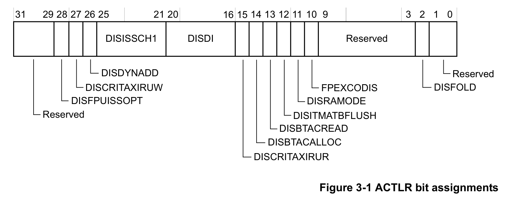

下表显示了 **ACTLR** 的位分配。

| 位 | 名称 | 值 | 功能 |
| --- | --- | --- | --- |
| [31:29] | - | - | 保留。 |
| [28] | DISFPUISSOPT | 0 | 正常操作。 |
| [27] | DISCRITAXIRUW | 0 | 正常操作。与 r0 向后兼容。对 DEV/SO 内存的 AXI 读不会发起；对共享内存的独占读在所有未完成的 AXI 存储完成之前不会在 AXIM AR 通道上发起。 |
| [27] | DISCRITAXIRUW | 1 | 禁用关键 AXI read-under-write。 |
| [26] | DISDYNADD | 0 | 正常操作。部分 ADD 和 SUB 指令在 EX1 中解析。 |
| [26] | DISDYNADD | 1 | 禁用 ADD 和 SUB 指令的动态分配。所有 ADD 和 SUB 指令在 EX2 中解析。 |
| [25:21] | DISISSCH1 | 0 | 正常操作。 |
| [25:21] | DISISSCH1 | 1 | 指定类型的指令不得在通道 1 中发出：位[25] VFP；位[24] 整数 MAC 和 MUL；位[23] 到 PC 的加载；位[22] 间接分支（到 PC 的加载除外）；位[21] 直接分支。 |
| [20:16] | DISDI | 0 | 正常操作。 |
| [20:16] | DISDI | 1 | 当指定类型的指令位于通道 0 时，不得进行任何双发射：位[20] VFP；位[19] 整数 MAC 和 MUL；位[18] 到 PC 的加载；位[17] 间接分支（到 PC 的加载除外）；位[16] 直接分支。 |
| [15] | DISCRITAXIRUR | 0 | 正常操作。 |
| [15] | DISCRITAXIRUR | 1 | 禁用关键 AXI read-under-read。如果 AXI 上存在任何未完成的读，则对强序（Strongly-ordered）或设备（Device）内存的 AXI 读，或对共享内存的 LDREX 不会放到 AXI 上。AXI 上的事务不能被打断。该位可能缩短这些事务的进行时间，并可能改善最坏情况下的中断延迟。置位该位时性能会降低。 |
| [14] | DISBTACALLOC | 0 | 正常操作。 |
| [14] | DISBTACALLOC | 1 | 不在分支目标地址缓存（**BTAC**）中分配新表项，但可以更新已有表项。 |
| [13] | DISBTACREAD | 0 | 正常操作。 |
| [13] | DISBTACREAD | 1 | 不使用 BTAC，只能进行静态分支预测。 |
| [12] | DISITMATBFLUSH | 1 | 禁用 ITM 和 DWT ATB 刷新。**AFVALID** 被忽略，**AFREADY** 保持为高。该位始终为 1，因此为 RAO/WI。 |
| [11] | DISRAMODE | 0 | 正常操作。 |
| [11] | DISRAMODE | 1 | 禁用动态读分配模式。 |
| [10] | FPEXCODIS | 0 | 正常操作。 |
| [10] | FPEXCODIS | 1 | 禁用 FPU 异常输出。 |
| [9:3] | - | - | 保留。 |
| [2] | DISFOLD | 0 | 正常操作。 |
| [1:0] | - | - | 保留。 |

### 3.2. CPUID 基址寄存器（CPUID Base Register）

**CPUID** 用于指定：

* 处理器核的 ID 号。
* 处理器核的版本号。
* 处理器核的实现细节。

**使用限制**

无使用限制。

**配置**

在所有配置中均可用。

**属性**

请参见寄存器摘要。

下图显示了 **CPUID** 的位分配。

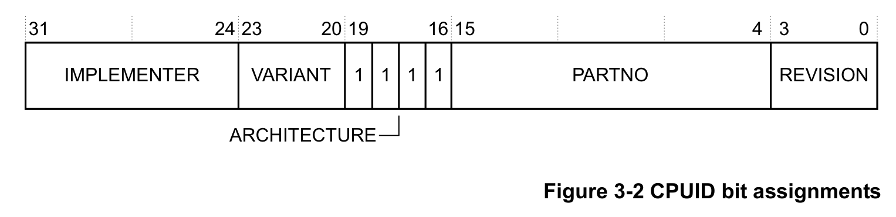

下表显示了 **CPUID** 的位分配。

| 位 | 名称 | 值 | 功能 |
| --- | --- | --- | --- |
| [31:24] | IMPLEMENTER | 0x41 | 指示实现者：Arm。 |
| [23:20] | VARIANT | 0x0 | 版本 0。 |
| [23:20] | VARIANT | 0x1 | 版本 1。 |
| [19:16] | ARCHITECTURE | 读为 0xF。 | 读为 0xF。 |
| [15:4] | PARTNO | 0xC27 | 指示部件号：Cortex-M7。 |
| [3:0] | REVISION | 0x0 | 补丁版本 0。 |
| [3:0] | REVISION | 0x1 | 补丁版本 1。 |
| [3:0] | REVISION | 0x2 | 补丁版本 2。 |

**注意：** 有关 Cortex-M7 处理器的不同版本以及 **VARIANT** 和 **REVISION** 位域使用的组合，请参见第 1-16 页的“产品版本”。

### 3.3. 缓存级别 ID 寄存器（Cache Level ID Register）

**CLIDR** 用于：

* 指示已实现的缓存级别。在架构上，指令侧和数据侧可以有不同数量的缓存级别。
* 记录一致性点（point-of-coherency）。
* 记录统一化点（point-of-unification）。

**使用限制**

**CLIDR** 是：

* 只读寄存器。
* 仅在特权模式下可访问。

**配置**

在所有处理器配置中均可用。

**属性**

请参见寄存器摘要。

下图显示了 **CLIDR** 的位分配。

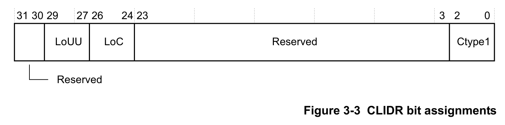

下表显示了 **CLIDR** 的位分配。

| 位 | 名称 | 值 | 功能 |
| --- | --- | --- | --- |
| [31:30] | - | - | 保留。 |
| [29:27] | LoUU | 0b001 | 统一化单处理器级别 2（如果实现了任一缓存）。 |
| [29:27] | LoUU | 0b000 | 统一化单处理器级别 1（如果未实现指令缓存和数据缓存）。 |
| [26:24] | LoC | 0b001 | 一致性级别 2（如果实现了任一缓存）。 |
| [26:24] | LoC | 0b000 | 一致性级别 1（如果未实现指令缓存和数据缓存）。 |
| [23:3] | - | - | 保留。 |
| [2:0] | Ctype1 | 0b000 | 未实现指令缓存或数据缓存。 |
| [2:0] | Ctype1 | 0b001 | 实现了指令缓存。 |
| [2:0] | Ctype1 | 0b010 | 实现了数据缓存。 |
| [2:0] | Ctype1 | 0b011 | 实现了指令缓存和数据缓存。 |

### 3.4. 缓存大小 ID 寄存器（Cache Size ID Register）

**CCSIDR** 提供由 **CSELR** 选择的指令缓存或数据缓存的大小和行为信息。在架构上最多可以有八级缓存，包含指令缓存、数据缓存或统一缓存。本处理器仅包含 L1 指令缓存和数据缓存。

**使用限制**

**CCSIDR** 是：

* 只读寄存器。
* 仅在特权模式下可访问。

**配置**

在所有处理器配置中均可用。如果未配置指令缓存或数据缓存，相应的 **CCSIDR** 为 RAZ。

**属性**

请参见寄存器摘要。

下图显示了 **CCSIDR** 的位分配。

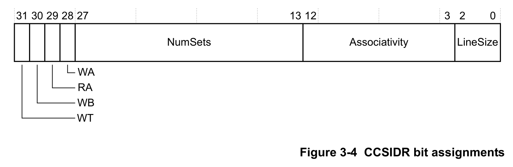

下表显示了 **CCSIDR** 的位分配。

| 位 | 名称 | 值 | 功能 |
| --- | --- | --- | --- |
| [31] | WT | 1 | 支持写通（Write-Through）。 |
| [30] | WB | 1 | 支持写回（Write-Back）。 |
| [29] | RA | 1 | 支持读分配。 |
| [28] | WA | 1 | 支持写分配。 |
| [27:13] | NumSets | - | 以（组数 - 1）表示组数。取决于缓存大小。 |
| [12:3] | Associativity | 0x1 | 表示两路。 |
| [12:3] | Associativity | 0x3 | 表示四路。 |
| [2:0] | LineSize | 0x1 | 表示 32 字节。 |

**注意：** **LineSize** 字段编码为缓存行中字数的 log₂ 值减 2。例如，值 0x0 表示一个缓存行中有四个字，即缓存的最小容量；值 0x1 表示一个缓存行中有八个字。

下表给出了 **CCSIDR** 的各个位域及完整寄存器编码。可使用该表确定由缓存大小选择寄存器（**CSELR**）选择的 L1 数据缓存或指令缓存的容量。

| CSELR | 缓存 | 容量 | 完整寄存器编码 | WT | WB | RA | WA | NumSets | Associativity | LineSize |
| --- | --- | --- | --- | --- | --- | --- | --- | --- | --- | --- |
| 0x0 | 数据缓存 | 4KB | 0xF003E019 | 1 | 1 | 1 | 1 | 0x001F | 0x3 | 0x1 |
| 0x0 | 数据缓存 | 8KB | 0xF007E019 | 1 | 1 | 1 | 1 | 0x003F | 0x3 | 0x1 |
| 0x0 | 数据缓存 | 16KB | 0xF00FE019 | 1 | 1 | 1 | 1 | 0x007F | 0x3 | 0x1 |
| 0x0 | 数据缓存 | 32KB | 0xF01FE019 | 1 | 1 | 1 | 1 | 0x00FF | 0x3 | 0x1 |
| 0x0 | 数据缓存 | 64KB | 0xF03FE019 | 1 | 1 | 1 | 1 | 0x01FF | 0x3 | 0x1 |
| 0x1 | 指令缓存 | 4KB | 0xF007E009 | 1 | 1 | 1 | 1 | 0x003F | 0x1 | 0x1 |
| 0x1 | 指令缓存 | 8KB | 0xF00FE009 | 1 | 1 | 1 | 1 | 0x007F | 0x1 | 0x1 |
| 0x1 | 指令缓存 | 16KB | 0xF01FE009 | 1 | 1 | 1 | 1 | 0x00FF | 0x1 | 0x1 |
| 0x1 | 指令缓存 | 32KB | 0xF03FE009 | 1 | 1 | 1 | 1 | 0x01FF | 0x1 | 0x1 |
| 0x1 | 指令缓存 | 64KB | 0xF07FE009 | 1 | 1 | 1 | 1 | 0x03FF | 0x1 | 0x1 |

### 3.5. 缓存大小选择寄存器（Cache Size Selection Register）

**CSELR** 保存处理器用于选择 **CCSIDR** 的值。

**使用限制**

**CSELR** 是：

* 读写寄存器。
* 仅在特权模式下可访问。

**配置**

在所有处理器配置中均可用。

**属性**

请参见寄存器摘要。

下图显示了 **CSELR** 的位分配。

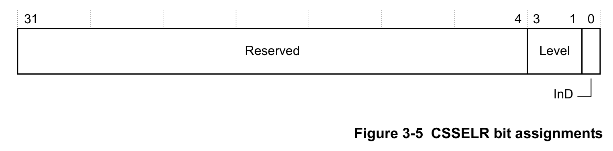

下表显示了 **CSELR** 的位分配。

| 位 | 名称 | 值 | 功能 |
| --- | --- | --- | --- |
| [31:4] | - | - | 保留。 |
| [3:1] | Level | 0b000 | 选择 L1 缓存。该字段为 RAZ/WI。 |
| [0] | InD | 0 | 选择数据缓存。 |
| [0] | InD | 1 | 选择指令缓存。 |

### 3.6. 指令与数据紧密耦合内存控制寄存器（Instruction and Data Tightly-Coupled Memory Control Registers）

**CM7_ITCMCR** 和 **CM7_DTCMCR** 用于控制访问是映射到 TCM 还是 AXIM 接口。

**使用限制**

仅在特权模式下可访问。

**配置**

在所有配置中均可用。

**属性**

请参见寄存器摘要。

下图显示了 **CM7_ITCMCR** 和 **CM7_DTCMCR** 的位分配。

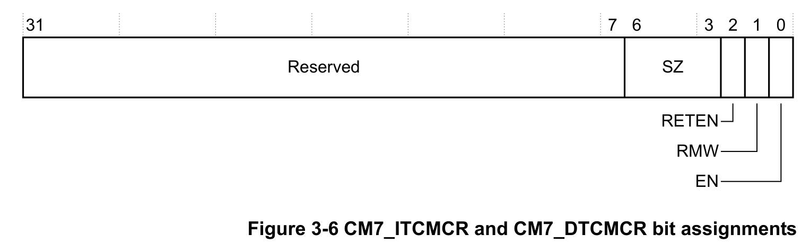

下表显示了 **CM7_ITCMCR** 和 **CM7_DTCMCR** 的位分配。

| 位 | 名称 | 类型 | 功能 |
| --- | --- | --- | --- |
| [31:7] | - | - | 保留。 |
| [6:3] | SZ | RO | TCM 大小。指示相应 TCM 的容量：0b0000 未实现 TCM；0b0011 4KB；0b0100 8KB；0b0101 16KB；0b0110 32KB；0b0111 64KB；0b1000 128KB；0b1001 256KB；0b1010 512KB；0b1011 1MB；0b1100 2MB；0b1101 4MB；0b1110 8MB；0b1111 16MB。所有其他编码保留。复位值由 CFGITCMSZ 和 CFGDTCMSZ 引脚决定。 |
| [2] | RETEN | RW | 重试阶段使能。使能后，处理器保证遵守相应 TCM 接口上的 retry 输出，重新执行执行 TCM 访问的指令。0 重试阶段禁用；1 重试阶段使能。复位值由 INITRETRYEN 引脚决定。重试功能可与外部逻辑一起用于支持 TCM 中的错误检测与纠正。 |
| [1] | RMW | RW | 读-改-写（**RMW**）使能。指示对 TCM 的所有非全宽写使用 RMW 序列：0 RMW 禁用；1 RMW 使能。复位值由 INITRMWEN 引脚决定。RMW 功能可与外部逻辑一起用于支持 TCM 中的错误检测与纠正。 |
| [0] | EN | RW | TCM 使能。TCM 禁用时，所有访问都发往 AXIM 接口。0 TCM 禁用；1 TCM 使能。复位值由 INITTCMEN 引脚决定。 |

### 3.7. AHBP 控制寄存器（AHBP Control Register）

**CM7_AHBPCR** 用于控制对 AHBP 或 AXIM 接口的访问。

**使用限制**

仅在特权模式下可访问。

**配置**

在所有配置中均可用。

**属性**

请参见寄存器摘要。

下图显示了 **CM7_AHBPCR** 的位分配。

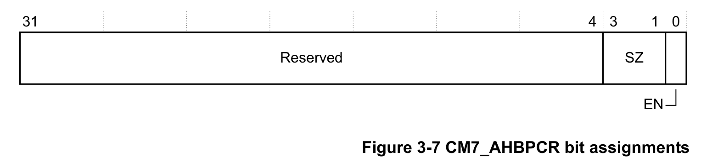

下表显示了 **CM7_AHBPCR** 的位分配。

| 位 | 名称 | 类型 | 功能 |
| --- | --- | --- | --- |
| [31:4] | - | - | 保留。 |
| [3:1] | SZ | RO | AHBP 大小：0b000 0MB，AHBP 禁用；0b001 64MB；0b010 128MB；0b011 256MB；0b100 512MB。其他编码保留。复位值来自 CFGAHBPSZ 引脚。 |
| [0] | EN | RW | AHBP 使能：0 AHBP 禁用，禁用时所有访问都发往 AXIM 接口；1 AHBP 使能。复位值由 INITAHBPEN 引脚决定。 |

### 3.8. L1 缓存控制寄存器（L1 Cache Control Register）

**CM7_CACR** 用于控制 L1 ECC 和 L1 缓存一致性使用模型。

**使用限制**

仅在特权模式下可访问。

**配置**

在所有配置中均可用。

**属性**

请参见寄存器摘要。

下图显示了 **CM7_CACR** 的位分配。

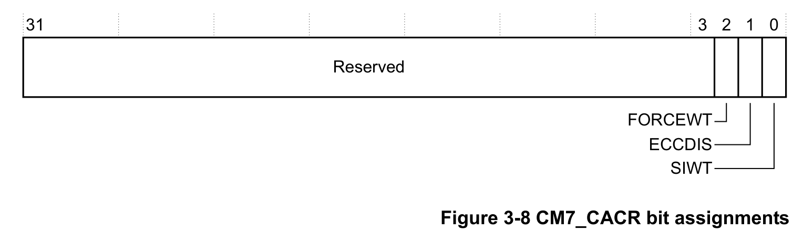

下表显示了 **CM7_CACR** 的位分配。

| 位 | 名称 | 类型 | 功能 |
| --- | --- | --- | --- |
| [31:3] | - | - | 保留，RAZ/WI。 |
| [2] | FORCEWT | RW | 在数据缓存中使能强制写通：0 禁用强制写通；1 使能强制写通，所有可缓存内存区域都按写通处理。如果排除了数据缓存，该位为 RAZ/WI；如果包含数据缓存，**FORCEWT** 的复位值为 0。 |
| [1] | ECCDIS | RW | 在指令缓存和数据缓存中使能 ECC：0 在指令缓存和数据缓存中使能 ECC，如果同时排除数据缓存和指令缓存或排除了 ECC，则为 RAO/WI；1 在指令缓存和数据缓存中禁用 ECC。 |
| [0] | SIWT | RW | 数据缓存的共享可缓存即写通（Shared cacheable-is-WT），用于使能有限的一致性使用：0 正常。可缓存共享位置按不可缓存处理，编程的内部可缓存性属性被忽略，这是共享内存的默认工作模式；对于这些位置，数据缓存对软件透明，因此无需软件维护来保持一致性。1 正常。可缓存共享位置按写通处理，编程的内部可缓存性属性被忽略，所有写全局可见；其他内存代理的更新在没有适当缓存维护的情况下对 Cortex-M7 处理器软件不可见。适用于异构多处理器系统，例如 Cortex-M7 处理器集成在具备多处理器能力的处理器上的加速器一致性端口（**ACP**）接口上。未配置数据缓存时，该位为 RAZ/WI。 |

### 3.9. 辅助总线故障状态寄存器（Auxiliary Bus Fault Status Register）

**CM7_ABFSR** 存储异步总线故障的来源信息。在总线故障处理程序中，软件读取 **BFSR**，如果观察到异步故障，则读取 **CM7_ABFSR** 以确定受影响的接口。**CM7_ABFSR** 必须通过向其写入任意值来清零。有关 **BFSR** 的更多信息，请参见 Armv7-M 架构参考手册。

**使用限制**

仅在特权模式下可用。它由 nSYSRESET 复位，并在写入任意值时清零为 0x0。仅当 **BFSR.IMPRECISERR** 为 0x1 时，该寄存器的值才有定义。

**配置**

在所有配置中均可用。

**属性**

请参见寄存器摘要。

下图显示了 **CM7_ABFSR** 的位分配。

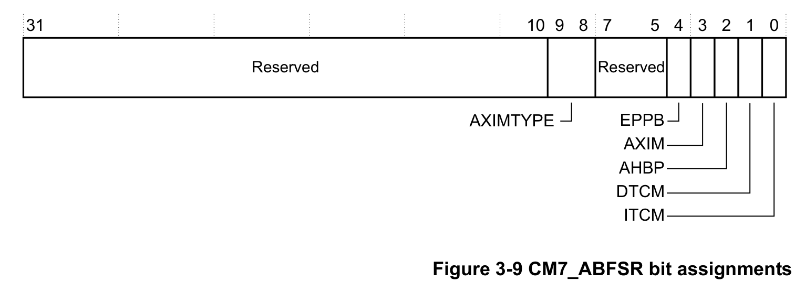

下表显示了 **CM7_ABFSR** 的位分配。

| 位 | 名称 | 功能 |
| --- | --- | --- |
| [31:10] | - | 保留。 |
| [9:8] | AXIMTYPE | 指示 AXIM 接口上的故障类型：0b00 OKAY；0b01 EXOKAY；0b10 SLVERR；0b11 DECERR。仅当 **AXIM** 为 1 时有效。 |
| [7:5] | - | 保留。 |
| [4] | EPPB | EPPB 接口上的异步故障。 |
| [3] | AXIM | AXIM 接口上的异步故障。 |
| [2] | AHBP | AHBP 接口上的异步故障。 |
| [1] | DTCM | DTCM 接口上的异步故障。 |
| [0] | ITCM | ITCM 接口上的异步故障。 |

### 3.10. 指令错误 bank 寄存器 0-1（Instruction Error bank Register 0-1）

**IEBR0-1** 存储缓存查找期间在指令缓存中检测到的错误信息。

**使用限制**

仅在特权模式下可访问。

**配置**

在实现了 ECC 可配置选项时可用。

**属性**

请参见寄存器摘要。

下图显示了 **IEBR0-1** 的位分配。

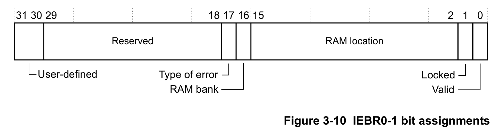

下表显示了 **IEBR0-1** 的位分配。

| 位 | 名称 | 类型 | 描述 |
| --- | --- | --- | --- |
| [31:30] | - | RW | 用户定义。错误检测逻辑在重新分配时和上电复位时将该字段置为 0b00。 |
| [29:18] | - | RW | 保留。 |
| [17] | Type of error | RW | 指示错误类型：0 可纠正错误；1 不可纠正错误。 |
| [16] | RAM bank | RW | 指示要使用的 RAM bank：0 标记（Tag）RAM；1 数据 RAM。 |
| [15:2] | RAM location | RW | 指示指令缓存 RAM 中的位置：[14] 路；[13:4] 索引；[3:2] 缓存行双字偏移。 |
| [1] | Locked | RW | 指示该位置是否被锁定：0 位置未锁定，可供硬件分配；1 位置被软件锁定，硬件不得分配到该表项。上电复位时复位为 0。 |
| [0] | Valid | RW | 指示表项是否有效：0 表项无效；1 表项有效。上电复位时复位为 0。 |

**注意：** 当从 RAM 读取的数据中检测到多个位错误时，记录不可纠正错误。这些错误会导致数据丢失或数据损坏，因此不可恢复。

### 3.11. 数据错误 bank 寄存器 0-1（Data Error bank Register 0-1）

**DEBR0-1** 存储缓存查找期间在数据缓存中检测到的错误信息。

**使用限制**

仅在特权模式下可访问。

**配置**

在实现了 ECC 可配置选项时可用。

**属性**

请参见寄存器摘要。

下图显示了 **DEBR0-1** 的位分配。

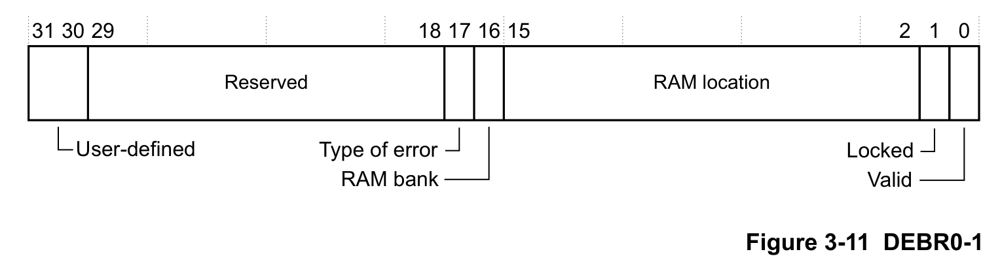

下表显示了 **DEBR0-1** 的位分配。

| 位 | 名称 | 类型 | 描述 |
| --- | --- | --- | --- |
| [31:30] | - | RW | 用户定义。错误检测逻辑在重新分配时和上电复位时将该字段置为 0b00。 |
| [29:18] | - | RW | 保留。 |
| [17] | Type of error | RW | 指示错误类型：0 可纠正错误；1 不可纠正错误。 |
| [16] | RAM bank | RW | 指示要使用的 RAM bank：0 标记（Tag）RAM；1 数据 RAM。 |
| [15:2] | RAM location | RW | 指示数据缓存 RAM 中的位置：[15:14] 路；[13:5] 索引；[4:2] 缓存行字偏移。 |
| [1] | Locked | RW | 指示该位置是否被锁定：0 位置未锁定，可供硬件分配；1 位置被软件锁定，硬件不得分配到该表项。上电复位时复位为 0。 |
| [0] | Valid | RW | 指示表项是否有效：0 表项无效；1 表项有效。上电复位时复位为 0。 |

**注意：** 当从 RAM 读取的数据中检测到多个位错误时，记录不可纠正错误。这些错误会导致数据丢失或数据损坏，因此不可恢复。

### 3.12. AHB 从控制寄存器（AHB Slave Control Register）

**CM7_AHBSCR** 用于控制软件访问与 AHB 从访问对 TCM 的优先级。请参见第 5-34 页的“AHBS 接口仲裁”。

**使用限制**

仅在特权模式下可访问。

**配置**

在所有配置中均可用。

**属性**

请参见寄存器摘要。

下图显示了 **CM7_AHBSCR** 的位分配。

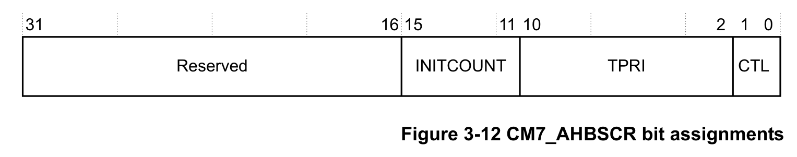

下表显示了 **CM7_AHBSCR** 的位分配。

| 位 | 名称 | 类型 | 功能 |
| --- | --- | --- | --- |
| [31:16] | - | - | 保留。 |
| [15:11] | INITCOUNT | RW | 公平计数器初始值。用于降低由 **CM7_AHBSCR.CTL** 字段选择的请求者的访问优先级。复位值为 0b01。**注意：** 轮转（round-robin）模式请将 **INITCOUNT** 设为 0b01，**CM7_AHBSCR.CTL** 设为 0b00 或 0b01；不得将 **INITCOUNT** 设为 0b00，因为被降级的请求者在发生竞争时总是获得优先级，可能导致活锁；当 **CM7_AHBSCR.CTL** 为 0b11 时不使用 **INITCOUNT**。 |
| [10:2] | TPRI | RW | AHBS 流量降级的执行优先级阈值：0b0xxxxxx 优先级为 TPRI[7:0]，与 NVIC 寄存器编码相同；0b11111110 优先级 -1，即 HardFault 异常的优先级；0b11111111 优先级 -2，即 NMI 异常的优先级。 |
| [1:0] | CTL | RW | AHBS 优先级控制：0b00 AHBS 访问优先级降级（复位值）；0b01 软件访问优先级降级；0b10 当软件执行优先级高于或等于 **CM7_AHBSCR.TPRI** 中编程的阈值时，通过将公平计数器初始化为 **CM7_AHBSCR.INITCOUNT** 的值来降级 AHBS 访问优先级；当软件执行优先级低于该值时，公平计数器初始化为 1（轮转）。**注意：** 阈值编码与 NVIC 编码一致，使用算术上更大的数字表示更低的优先级；处理器的当前执行优先级在架构上定义，并包含 **PRIMASK**、**BASEPRI** 和 **FAULTMASK** 特殊用途寄存器的影响。 |
| [1:0] | CTL | RW | AHBSPRI 信号控制访问优先级。 |
