本章介绍特定于 Cortex-M7 处理器的 Cortex-M7 跟踪端口接口单元（**TPIU**）。

## 1. 关于 Cortex-M7 TPIU

Cortex-M7 TPIU 是一个可选组件，它在来自嵌入式跟踪宏单元（**ETM**）和插桩跟踪宏单元（**ITM**）的片上跟踪数据（两者具有独立的 ID）与数据流之间进行桥接。Cortex-M7 TPIU 在需要时封装 ID，数据流随后由外部跟踪端口分析器（**TPA**）捕获。

Cortex-M7 TPIU 是 CoreSight SoC-400 TPIU 的一个变体，专为低成本调试而设计。如果实现需要 CoreSight SoC-400 TPIU 的附加特性，可以用其他 CoreSight 组件替换 Cortex-M7 TPIU。

**注意：** CM7TPIU 仅支持 ETM 指令跟踪接口，配置参数 ETM 设置为 1。

本章中，术语 TPIU 指 Cortex-M7 TPIU。有关 CoreSight SoC-400 TPIU 的信息，请参见 Arm® CoreSight™ SoC-400 技术参考手册。

## 2. TPIU 功能描述

TPIU 有两种配置：

- 支持 ITM 调试跟踪的配置。
- 同时支持 ITM 和 ETM 调试跟踪的配置。

如果实现不需要跟踪支持，则 TPIU 可能不存在。

**注意：** 如果系统设计使用可选的 ETM 组件，则 TPIU 配置同时支持 ITM 和 ETM 调试跟踪。请参见 Arm® CoreSight™ ETM-M7 技术参考手册。

### 2.1. TPIU 框图

图 13-1 显示两种配置下 TPIU 的组件布局。

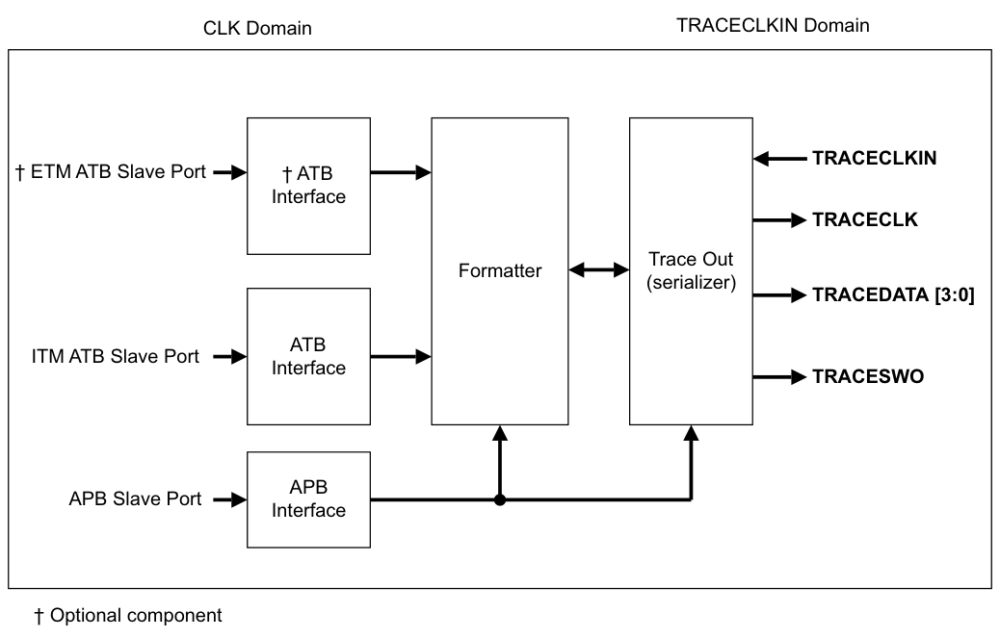

### 2.2. TPIU 格式化器

格式化器将源 ID 信号插入数据包流中，以便跟踪数据可以重新与其跟踪源关联。当跟踪端口模式（Trace Port Mode）激活时，格式化器始终处于活动状态。

格式化协议在 Arm® CoreSight™ 架构规范（v2.0）中描述。必须在 DWT 中使能同步数据包，以为格式化器提供同步。

当格式化器使能时，如果在一帧开始后没有数据要输出，则可以插入半同步（half-sync）数据包。由 DWT 的分发同步（distributed synchronization）引起的同步确保任何部分帧被完成，并至少生成一个完整的同步数据包。

### 2.3. 串行线输出格式

TPIU 可以以串行线输出（**SWO**）格式输出跟踪数据：

- TPIU_DEVID 指定支持的格式。请参见设备配置寄存器。
- TPIU_SPPR 指定正在使用的 SWO 格式。请参见 Arm®v7-M 架构参考手册。

当选择两种 SWO 模式之一时，可以使能 TPIU 绕过格式化器进行跟踪输出。如果绕过格式化器，则只有 ITM 和 DWT 跟踪源通过。TPIU 接受并丢弃来自 ETM 的数据。可以使用此功能将包含 ETM 的设备连接到仅能捕获 SWO 数据的跟踪捕获设备。

## 3. TPIU 编程模型

表 13-1 显示 TPIU 寄存器。根据处理器的具体实现，TPIU 寄存器可能不存在，或者可能存在 CoreSight TPIU。任何配置为不存在的寄存器读为零。

| 地址 | 名称 | 类型 | 复位值 | 描述 |
| --- | --- | --- | --- | --- |
| 0xE0040000 | TPIU_SSPSR | RO | -ᵃ | 支持的并行端口大小寄存器 |
| 0xE0040004 | TPIU_CSPSR | RW | 0x01 | 当前并行端口大小寄存器 |
| 0xE0040010 | TPIU_ACPR | RW | 0x0000 | 异步时钟预分频寄存器 |
| 0xE00400F0 | TPIU_SPPR | RW | 0x01 | 选定的引脚协议寄存器 |
| 0xE0040300 | TPIU_FFSR | RO | 0x08 | 格式化器与刷写状态寄存器 |
| 0xE0040304 | TPIU_FFCR | RW | 0x102 | 格式化器与刷写控制寄存器 |
| 0xE0040308 | TPIU_FSCR | RO | 0x00 | 格式化器同步计数器寄存器 |
| 0xE0040EE8 | TRIGGER | RO | 0x0 | TRIGGER 寄存器 |
| 0xE0040EEC | FIFO data 0 | RO | 0x0 | 集成 ETM 数据寄存器 |
| 0xE0040EF0 | ITATBCTR2 | RO | 0x0 | 集成测试 ATB 控制寄存器 2 |
| 0xE0040EFC | FIFO data 1 | RO | 0x0 | 集成 ITM 数据寄存器 |
| 0xE0040EF8 | ITATBCTR0 | RO | 0x0 | 集成测试 ATB 控制 0 寄存器 |
| 0xE0040F00 | ITCTRL | RW | 0x0 | 集成模式控制 |
| 0xE0040FA0 | CLAIMSET | RW | 0xF | 声明标签置位 |
| 0xE0040FA4 | CLAIMCLR | RW | 0x0 | 声明标签清除 |
| 0xE0040FC8 | DEVID | RO | 0xCA0/0xCA1 | 设备配置寄存器 |
| 0xE0040FCC | DEVTYPE | RO | 0x11 | 设备类型标识寄存器 |
| 0xE0040FD0 | PID4 | RO | 0x04 | 外设标识寄存器 |
| 0xE0040FD4 | PID5 | RO | 0x00 |  |
| 0xE0040FD8 | PID6 | RO | 0x00 |  |
| 0xE0040FDC | PID7 | RO | 0x00 |  |
| 0xE0040FE0 | PID0 | RO | 0xA9 |  |
| 0xE0040FE4 | PID1 | RO | 0xB9 |  |
| 0xE0040FE8 | PID2 | RO | 0x0B |  |
| 0xE0040FEC | PID3 | RO | 0x00 |  |
| 0xE0040FF0 | CID0 | RO | 0x0D | 组件标识寄存器 |
| 0xE0040FF4 | CID1 | RO | 0x90 |  |
| 0xE0040FF8 | CID2 | RO | 0x05 |  |
| 0xE0040FFC | CID3 | RO | 0xB1 |  |

a. IMPLEMENTATION DEFINED（实现定义）。

以下小节描述实现特定于本处理器的 TPIU 寄存器。格式化器、集成模式控制和声明标签（Claim Tag）寄存器在 Arm® CoreSight™ 组件技术参考手册中描述。其他寄存器在 Arm®v7-M 架构参考手册中描述。

### 3.1. 异步时钟预分频寄存器（Asynchronous Clock Prescaler Register）

**TPIU_ACPR** 的特性如下：

**用途**

缩放异步输出的波特率。

**使用限制**

没有使用限制。

**配置**

在所有配置中均可用。

**属性**

请参见表 13-1。

图 13-2 显示 **TPIU_ACPR** 的位分配。

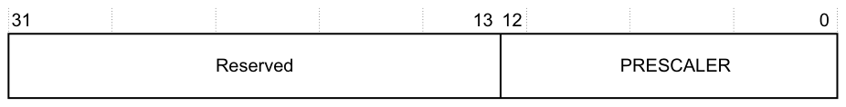

表 13-2 显示 **TPIU_ACPR** 的位分配。

| 位 | 名称 | 功能 |
| --- | --- | --- |
| [31:13] | - | 保留。RAZ/SBZP。 |
| [12:0] | PRESCALER | TRACECLKIN 的分频数为 Prescaler + 1。 |

### 3.2. 格式化器与刷写状态寄存器（Formatter and Flush Status Register）

**TPIU_FFSR** 的特性如下：

**用途**

指示 TPIU 格式化器的状态。

**使用限制**

没有使用限制。

**配置**

在所有配置中均可用。

**属性**

请参见表 13-1。

图 13-3 显示 **TPIU_FFSR** 的位分配。

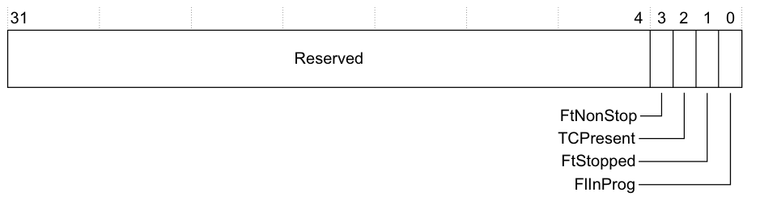

表 13-3 显示 **TPIU_FFSR** 的位分配。

| 位 | 名称 | 功能 |
| --- | --- | --- |
| [31:4] | - | 保留 |
| [3] | FtNonStop | 格式化器无法停止 |
| [2] | TCPresent | 该位始终读为零 |
| [1] | FtStopped | 该位始终读为零 |
| [0] | FlInProg | 该位始终读为零 |

### 3.3. 格式化器与刷写控制寄存器（Formatter and Flush Control Register）

**TPIU_FFCR** 的特性如下：

**用途**

控制 TPIU 格式化器。

**使用限制**

没有使用限制。

**配置**

在所有配置中均可用。

**属性**

请参见表 13-1。

图 13-4 显示 **TPIU_FFCR** 的位分配。

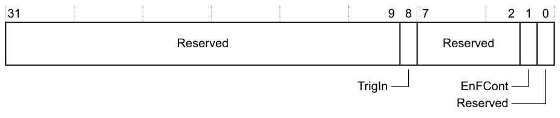

表 13-4 显示 **TPIU_FFCR** 的位分配。

| 位 | 名称 | 功能 |
| --- | --- | --- |
| [31:9] | - | 保留。 |
| [8] | TrigIn | 该位为读为一（RAO），表示当触发引脚被置位时插入触发。 |
| [7:2] | - | 保留。 |
| [1] | EnFCont | 使能连续格式化。取值可以是：0 连续格式化禁用。1 连续格式化使能。 |
| [0] | - | 保留。 |

TPIU 可以以串行线输出（SWO）格式输出跟踪数据。请参见串行线输出格式。

当选择两种 SWO 模式之一时，**TPIU_FFCR** 的位[1] 使能绕过格式化器。如果绕过格式化器，则只有 ITM 和 DWT 跟踪源通过。TPIU 接受并丢弃来自 ETM 的数据。可以使用此功能将包含 ETM 的设备连接到仅能捕获 SWO 数据的跟踪捕获设备。使能或禁用格式化器会导致短暂的数据损坏。

**注意：** 如果 **TPIU_SPPR** 设置为选择跟踪端口模式，则格式化器会自动使能。如果随后选择两种 SWO 模式之一，**TPIU_FFCR** 会恢复为先前编程的值。

### 3.4. TRIGGER 寄存器

**TRIGGER** 的特性如下：

**用途**

控制集成测试 TRIGGER 输入。

**使用限制**

没有使用限制。

**配置**

在所有配置中均可用。

**属性**

请参见表 13-1。

图 13-5 显示 **TRIGGER** 的位分配。

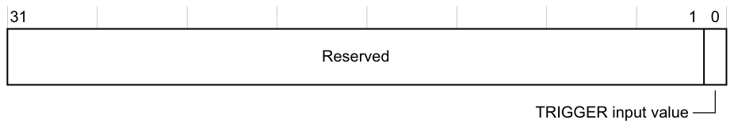

表 13-5 显示 **TRIGGER** 的位分配。

| 位 | 名称 | 功能 |
| --- | --- | --- |
| [31:1] | - | 保留 |
| [0] | TRIGGER input value | 读取时，该位返回 TRIGGER 输入。 |

### 3.5. 集成 ETM 数据寄存器（Integration ETM Data Register）

**Integration ETM Data** 的特性如下：

**用途**

控制跟踪数据的集成测试。

**使用限制**

必须设置 **TPIU_ITCTRL** 的位[1] 才能使用该寄存器。请参见集成模式控制。

**配置**

在所有配置中均可用。

**属性**

请参见表 13-1。

图 13-6 显示 **Integration ETM Data** 的位分配。

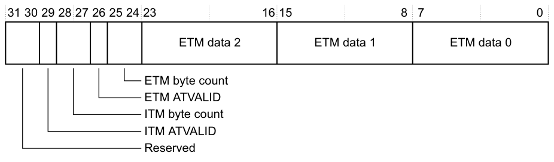

表 13-6 显示 **Integration ETM Data** 的位分配。

| 位 | 名称 | 功能 |
| --- | --- | --- |
| [31:30] | - | 保留。 |
| [29] | ITM ATVALID input | 返回 ITM ATVALID 信号的值。 |
| [28:27] | ITM byte count | 自上次读取集成 ITM 数据寄存器以来 ITM 跟踪数据的字节数。 |
| [26] | ETM ATVALID input | 返回 ETM ATVALID 信号的值。 |
| [25:24] | ETM byte count | 自上次读取集成 ETM 数据寄存器以来 ETM 跟踪数据的字节数。 |
| [23:16] | ETM data 2 | ETM 跟踪数据。读取该寄存器时 TPIU 丢弃该数据。 |
| [15:8] | ETM data 1 | ETM 跟踪数据。读取该寄存器时 TPIU 丢弃该数据。 |
| [7:0] | ETM data 0 | ETM 跟踪数据。读取该寄存器时 TPIU 丢弃该数据。 |

### 3.6. 集成测试 ATB 控制寄存器 2（Integration Test ATB Control Register 2）

**ITATBCTR2** 的特性如下：

**用途**

控制集成测试。

**使用限制**

必须设置 **TPIU_ITCTRL** 的位[0] 才能使用该寄存器。请参见集成模式控制。

**配置**

在所有配置中均可用。

**属性**

请参见表 13-1。

图 13-7 显示 **ITATBCTR2** 的位分配。

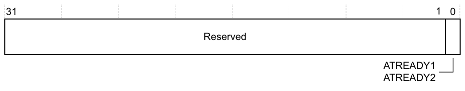

表 13-7 显示 **ITATBCTR2** 的位分配。

| 位 | 名称 | 功能 |
| --- | --- | --- |
| [31:1] | - | 保留 |
| [0] | ATREADY1, ATREADY2 | 如果 TPIU 处于集成测试模式，该位设置 ETM 和 ITM 两个 ATREADY 输出的值。 |

### 3.7. 集成 ITM 数据寄存器（Integration ITM Data Register）

**Integration ITM Data** 的特性如下：

**用途**

控制跟踪数据的集成测试。

**使用限制**

必须设置 **TPIU_ITCTRL** 的位[1] 才能使用该寄存器。请参见集成模式控制。

**配置**

在所有配置中均可用。

**属性**

请参见表 13-1。

图 13-8 显示 **Integration ITM Data** 的位分配。

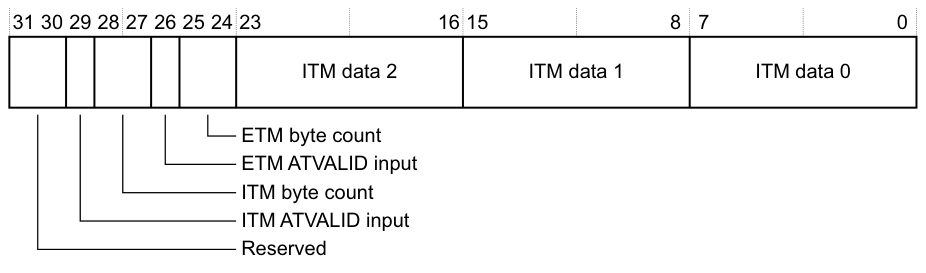

表 13-8 显示 **Integration ITM Data** 的位分配。

| 位 | 名称 | 功能 |
| --- | --- | --- |
| [31:30] | - | 保留。 |
| [29] | ITM ATVALID input | 返回 ITM ATVALID 信号的值。 |
| [28:27] | ITM byte count | 自上次读取集成 ITM 数据寄存器以来 ITM 跟踪数据的字节数。 |
| [26] | ETM ATVALID input | 返回 ETM ATVALID 信号的值。 |
| [25:24] | ETM byte count | 自上次读取集成 ETM 数据寄存器以来 ETM 跟踪数据的字节数。 |
| [23:16] | ITM data 2 | ITM 跟踪数据。读取该寄存器时 TPIU 丢弃该数据。 |
| [15:8] | ITM data 1 | ITM 跟踪数据。读取该寄存器时 TPIU 丢弃该数据。 |
| [7:0] | ITM data 0 | ITM 跟踪数据。读取该寄存器时 TPIU 丢弃该数据。 |

### 3.8. 集成测试 ATB 控制 0 寄存器（Integration Test ATB Control 0 Register）

**ITATBCTR0** 的特性如下：

**用途**

集成测试。

**使用限制**

没有使用限制。

**配置**

在所有配置中均可用。

**属性**

请参见表 13-1。

图 13-9 显示 **ITATBCTR0** 的位分配。

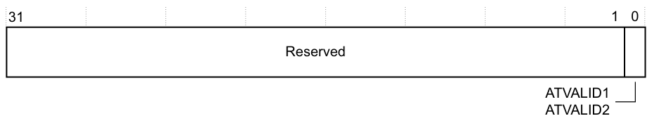

表 13-9 显示 **ITATBCTR0** 的位分配。

| 位 | 名称 | 功能 |
| --- | --- | --- |
| [31:1] | - | 保留 |
| [0] | ATVALID1, ATVALID2 | 读取该位返回 ATVALIDS1 与 ATVALIDS2 进行 OR 后的值。 |

### 3.9. 集成模式控制（Integration Mode Control）

**TPIU_ITCTRL** 的特性如下：

**用途**

指定 TPIU 的正常模式或集成模式。

**使用限制**

没有使用限制。

**配置**

在所有配置中均可用。

**属性**

请参见表 13-1。

图 13-10 显示 **TPIU_ITCTRL** 的位分配。

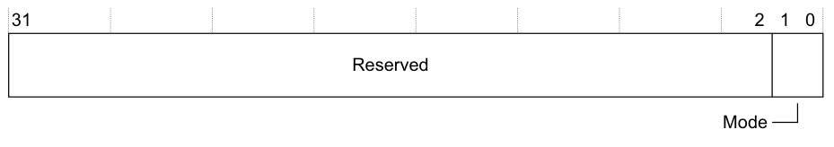

表 13-10 显示 **TPIU_ITCTRL** 的位分配。

| 位 | 名称 | 功能 |
| --- | --- | --- |
| [31:2] | - | 保留。 |
| [1:0] | Mode | 指定 TPIU 的当前模式：0b00 正常模式。0b01 集成测试模式。0b10 集成数据测试模式。0b11 保留。 |

在集成数据测试模式下，跟踪输出被禁用，可以使用集成数据寄存器直接从每个输入端口读取数据。

### 3.10. 设备配置寄存器（Device Configuration Register）

**TPIU_DEVID** 的特性如下：

**用途**

指示 TPIU 提供的功能，用于拓扑检测。

**使用限制**

没有使用限制。

**配置**

在所有配置中均可用。

**属性**

请参见表 13-1。

图 13-11 显示 **TPIU_DEVID** 的位分配。

表 13-11 显示 **TPIU_DEVID** 的位分配。

| 位 | 名称 | 功能 |
| --- | --- | --- |
| [31:12] | - | 保留。 |
| [11] | NRZVALID | 指示是否支持使用 UART/NRZ 编码的 SWO。始终为 RAO。支持该输出。 |
| [10] | MANCVALID | 指示是否支持使用曼彻斯特编码的 SWO。始终为 RAO。支持该输出。 |
| [9] | PTINVALID | 指示是否支持并行跟踪端口操作。始终为 RAZ。支持跟踪数据和时钟模式。 |
| [8:6] | FIFOSZ | 指示 TPIU 输出 FIFO 的最小实现大小，用于跟踪数据：0b010 四字节。 |
| [5:0] | Number of trace inputs | 指定跟踪输入的数量：0b000000 一个输入。0b000001 两个输入。如果实现中包含 ETM，则该字段的值为 0b000001。 |

### 3.11. 设备类型标识寄存器（Device Type Identifier Register）

**TPIU_DEVTYPE** 的特性如下：

**用途**

当器件编号（Part Number）字段无法识别时，向调试器提供有关该组件的信息。调试器随后可以报告该信息。

**使用限制**

没有使用限制。

**配置**

在所有配置中均可用。

**属性**

请参见表 13-1。

图 13-12 显示 **TPIU_DEVTYPE** 的位分配。

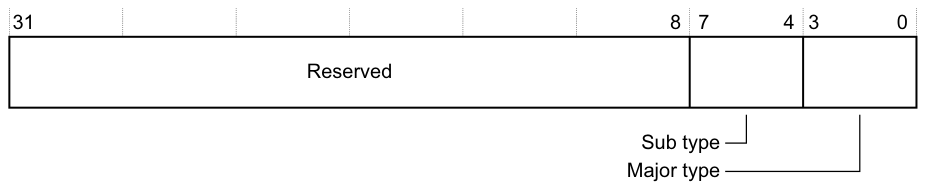

表 13-12 显示 **TPIU_DEVTYPE** 的位分配。

| 位 | 名称 | 功能 |
| --- | --- | --- |
| [31:8] | - | 保留。 |
| [7:4] | Sub type | 标识调试组件的分类：0x11 指示该设备是跟踪汇（trace sink），具体为 TPIU。 |
| [3:0] | Major type |  |
