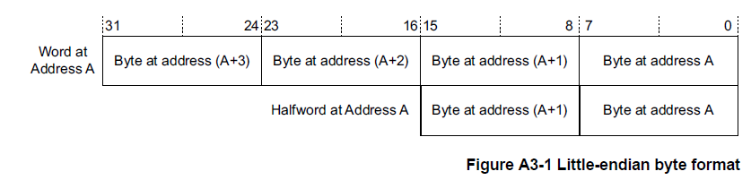
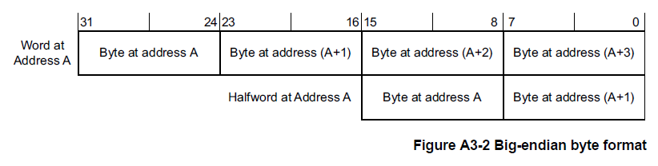
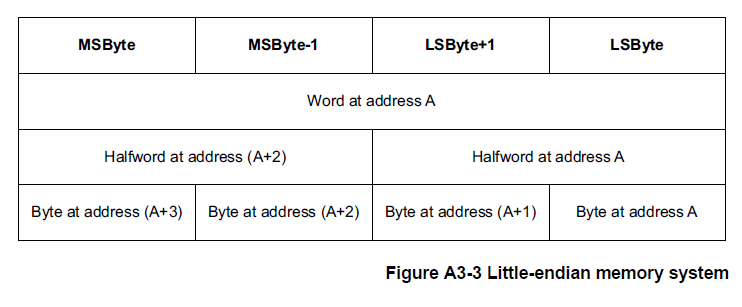
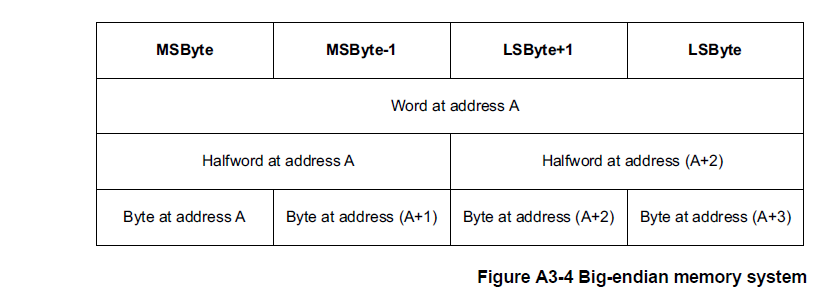
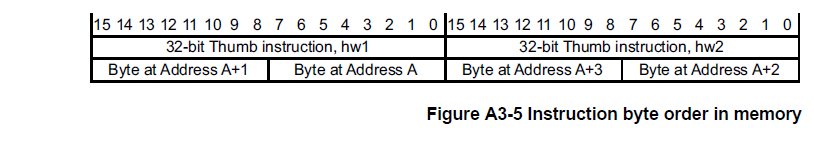

## 1. Arm架构内存模式介绍

### 1.1. 地址空间

**Armv7-M** 是一种内存映射架构。**B3**章节的系统地址映射描述了 **Armv7-M** 地址映射。

**Armv7-M** 架构使用 2<sup>32</sup> 个**8**位字节的单一平坦地址空间。字节地址被视为无符号数，范围从0到2<sup>32</sup> - 1。

该地址空间被视为由 2<sup>30</sup>个32位字组成，每个字的地址都是字对齐的，这意味着地址可以被4整除。字对齐地址为A的字，由四个带地址的字节组成：**A**、**A+1**、**A+2**和**A+3**。地址空间也可以认为是由2<sup>31</sup>个16位半字组成，每个半字的地址都是半字对齐的，也就是说地址可以被2整除。半字对齐地址为A的半字，由两个带地址的字节组成：**A**和**A+1**。

虽然取指总是半字对齐，但一些加载和存储指令支持非对齐地址。这会影响访问地址**A**，所以在字访问情况下的 A[1:0] 和在半字访问情况下的 A[0] 可以具有非零值。

地址计算通常使用普通整数指令来执行。这意味着如果它们溢出或下溢地址空间，它们通常会回绕。描述这一点的另一种方式是任何地址计算都以2<sup>32</sup>为模减少。

指令的正常顺序执行有效地计算：
(address_of_current_instruction) + (2 or 4) /*16 位和 32 位指令混合*/

在每条指令之后确定接下来要执行的指令。如果这个计算溢出地址空间的顶部，结果是不可预测的。在 **Armv7-M** 中，这种情况不会发生，因为内存顶部被定义为始终具有与其关联的 Execute Never (XN) 内存属性。有关详细信息，请参阅第 B3-592 页的系统地址映射。如果发生这种情况，将报告访问冲突。

以上仅适用于执行的指令，包括那些未通过条件代码检查的指令。大多数 Arm 实现在当前执行的指令之前预取指令。

LDC、LDM、LDRD、POP、PUSH、STC、STRD、STM、VLDM、VPOP、VPUSH、VSTM、VLDR.64 和 VSTR.64 指令访问内存地址递增的字序列，有效地将内存地址增加4对于每个寄存器加载或存储。如果此计算溢出地址空间的顶部，则结果是不可预测的。

任何未对齐的加载或存储，其计算地址使得它可以访问 **0xFFFFFFFF** 处的字节和地址 **0x00000000** 处的字节作为指令的一部分是不可预测的。

**Armv7-M** 中使用的所有内存地址都是物理地址PA(**physical addresses**)。为了与其他 Arm 架构参考手册保持一致，尽管 Armv7-M 没有虚拟地址VA(**virtual addresses**)的概念，但本手册始终使用术语修改虚拟地址MVA(**Modified Virtual Address**)。对于 Armv7-M 架构配置文件，在所有情况下，MVA、VA 和 PA 具有相同的值。

### 1.2. 对齐支持

系统架构为 **Armv7-M** 中的对齐检查提供了两种策略：

* 支持非对齐访问。
* 发生未对齐访问时生成故障。

该策略因访问类型而异。可以将实现配置为对所有未对齐的访问强制对齐错误。

根据第 A5-126 页使用 0b1111 作为寄存器说明符中概述的规则限制对 PC 的写入。

### 1.3. 字节序支持

按[地址空间](#11-地址空间)规则要求地址**A**：

* 地址**A**处的字(**word**)由地址**A**、**A+1**、**A+2**和**A+3**的字节组成。
* 地址**A**的半字(**halfword**)由地址**A**和**A+1**的字节组成。
* 地址**A+2**的半字(**halfword**)由地址**A+2**和**A+3**的字节组成。
* 地址**A**处的字(**word**)可可以理解成由地址**A**和**A+2**处的半字(**halfword**)组成。

但是，这并没有完全指定字、半字和字节之间的映射。存储系统使用以下映射方案之一。这种选择被称为内存系统的字节序(**the endianness of the memory system**)。

在小端存储器系统中，来自存储器的字节与 Arm 寄存器中的解释值之间的映射如图 A3-1 所示。

* 地址**A**处的字节或半字是该地址处字内的最低有效字节或半字。
* 半字地址**A**的字节是该地址半字内的最低有效字节。



在大端存储器系统中，来自存储器的字节与 Arm 寄存器中的解释值之间的映射如图 A3-2 所示。

* 地址**A**处的字节或半字是该地址处字内的最高有效字节或半字。
* 半字地址**A**的字节是该地址半字内的最高有效字节。



对于字地址 A，第 A3-68 页的图 A3-3 和图 A3-4 显示了地址 A 处的字、地址 A 和 A+2 处的半字以及地址 A、A+1、A 处的字节 +2 和 A+3 为每个字节序映射到彼此。





大端(**big-endian**)和小端(**little-endian**)映射方案确定解释字或半字的字节的顺序。

例如：从地址 0x1000 加载一个字(4 个字节)将导致访问包含在内存位置 0x1000、0x1001、0x1002 和 0x1003 中的字节，而不管使用的映射方案如何。映射方案决定了这些字节的重要性。

#### 1.3.1. Armv7-M 中的字节序控制

**Armv7-M** 支持可选字节序模型(**selectable endian mode**)。在该模型中，在复位时，控制输入确定字节序是大端字节序 (BE) 还是小端字节序 (LE)。这种字节序映射有以下限制：

* 字节序设置仅适用于数据访问。取指令总是小端。
* 所有对 **SCS** 的访问都是小端的，请参阅[系统控制空间 (SCS)](../system_address_map/index.md#2-系统控制空间-scs)。

**AIRCR.ENDIANNESS** 位指示字节顺序，请参见应用程序中断和复位控制寄存器**AIRCR**。

如果实现需要支持大端指令提取，它可以在总线结构中实现。有关详细信息，请参阅第D5-799页的 Endian 支持。

**指令对齐和字节排序**

**Thumb**指令执行对所有指令强制执行16位对齐。这意味着32位指令被视为两个半字，**hw1**和**hw2**，其中**hw1**位于较低地址。

在指令编码图中，**hw1**显示在**hw2**的左侧。这导致编码图读起来更自然。32位Thumb指令的字节顺序如图 **A3-5** 所示。



**字节序的伪代码细节**

BigEndian() 伪代码函数测试数据访问是大端还是小端：

```C++
// BigEndian()
// ===========
boolean BigEndian()
    return (AIRCR.ENDIANNESS == ‘1’);
```


#### 1.3.2. 元素大小和字节序

字节序映射对数据的影响适用于在加载和存储指令中传输的元素的大小。表 A3-1 显示了每个加载和存储指令的元素大小：

| 指令类别 | 指令 | 元素大小 |
| --- | --- | --- |
| 加载或存储字节 | LDR{S}B{T}、STRB{T}、TBB、LDREXB、STREXB | 字节 |
| 加载或存储半字 | LDR{S}H{T}、STRH{T}、TBH、LDREXH、STREXH | 半字 |
| 加载或存储字 | LDR{T}、STR{T}、LDREX、STREX、VLDR.F32、VSTR.F32 | 字 |
| 加载或存储两个字 | LDRD、STRD、VLDR.F64、VSTR.F64 | 字 |
| 加载或存储多个字 | LDM{IA,DB}、STM{IA,DB}、PUSH、POP、LDC、STC、VLDM、VSTM、VPUSH、VPOP | 字 |

#### 1.3.3. 在通用寄存器中反转字节的指令

当应用程序或设备驱动程序必须与与内部数据结构的字节序或操作系统的字节序不同的内存映射外围寄存器或共享内存结构进行接口时，需要一种能够显式转换数据字节顺序的有效方法。

**Armv7-M** 支持以下字节转换指令：

* **REV**: 反转字(四字节)寄存器，用于转换32位表示。
* **REVSH**：反向半字和符号扩展，用于转换有符号的16位表示。
* **REV16**：反转寄存器中的压缩半字，用于转换无符号16位表示。

有关详细信息，请参阅第 A7 章指令详细信息中的指令定义。

### 1.4. 同步和信号量

独占访问指令支持非阻塞共享内存同步原语，允许在读取和写入阶段之间的信号量上执行计算，并为多处理器系统设计进行扩展。

在 **Armv7-M** 中，提供的同步原语是：

* 加载独占(**Load Exclusive**)：
  - LDREX，参见第 A7-261 页的 LDREX。
  - LDREXB，参见第 A7-262 页的 LDREXB。
  - LDREXH，参见第 A7-263 页的 LDREXH。
* 存储独占(**Store Exclusive**):
  - STREX，参见第 A7-394 页的 STREX。
  - STREXB，参见第 A7-395 页的 STREXB。
  - STREXH，参见第 A7-396 页的 STREXH。
* 清楚独占(**Clear-Exclusive**)
  - CLREX，参见 A7-219 页上的 CLREX。

**注意：**
此章节使用 **LDREX** 和 **STREX** 指令来作为示范，描述了一对同步原语的 Load-Exclusive/Store-Exclusive 的操作。相同的描述适用于任何其他同步原语对：

* **LDREXB** 与 **STREXB** 一起使用。
* **LDREXH** 与 **STREXH** 一起使用。

每个加载独占(**Load Exclusive**)指令只能与相应的存储独占(**Store Exclusive**)指令一起使用。

**Armv7-M** 不支持 **STREXD** 和 **LDREXD**。

使用加载独占(**Load Exclusive**)/ 存储独占(**Store Exclusive**)指令对访问内存地址 x 的模型是：

* 加载独占(**Load Exclusive**)指令总是成功地从内存地址x读取一个值。
* 仅当没有其他处理器或进程对地址x执行更新的存储时，相应的存储独占(**Store Exclusive**)指令才能成功写回内存地址x。存储独占(**Store Exclusive**)操作返回一个状态位，指示内存写入是否成功。

加载独占指令标记一小块内存以进行独占访问。标记块的大小由实现定义(**IMPLEMENTATION DEFINED**)，请参阅第 A3-75 页的标记和标记内存块的大小。对同一地址的存储独占指令清除标签。

### 1.5. 内存类型和属性以及内存顺序模型

Armv7 定义了一组内存属性，这些属性具有支持系统内存映射中的内存和设备所需的特性。

内存区域的访问顺序(称为内存顺序模型)由内存属性定义。 此模型在以下部分中进行描述：

* 内存类型(**Memory types**)。
* Armv7 内存属性摘要。
* Arm 架构中的原子性(**Atomicity in the Arm architecture**)。
* 普通内存(**Normal memory**)。
* 设备内存(**Device memory**)。
* 强秩序内存(**Strongly-ordered memory**)。
* 内存访问限制(**Memory access restrictions**)。

#### 1.5.1. 内存类型 

对于每个内存区域，最重要的内存属性指定内存类型。 共有三种互斥内存类型：

* 普通内存(**Normal memory**)。
* 设备内存(**Device memory**)。
* 强秩序内存(**Strongly-ordered memory**)。

普通内存和设备内存的区域有额外的属性。

通常，用于程序代码(**program code**)和数据存储(**data storage**)的内存属于普通内存。一般使用普通内存技术的例子包括：

* 可编程闪存只读存储器(**Programmed Flash ROM**)。
* 只读存储器(**ROM**)。
* SRAM。
* **DRAM** 和 **DDR** 内存。

**注意：**

在编程过程中，Flash存储器可以比普通内存按更严格地方式进行排序。

系统周边设备 (I/O) 通常符合采用和普通内存不同的访问规则。例如：对应**I/O** 访问可包含如下情况：

* 连续地址访问的先进先出(**FIFO**)方式：
  * 在写入访问时，添加队列数值(**queued values**)。
  * 在读取访问时，删除队列数值(**queued values**)。
* 中断控制器寄存器，其中访问可用作中断确认，用于改变控制器本身的状态。
* 内存控制器配置寄存器，用于设置普通内存(**Normal memory**)区域的时序和正确性。
* 内存映射外设，访问此内存地址会导致系统的一些副作用。

在 **Armv7** 中，这些访问的内存映射区域被定义为设备或强秩序内存(**Device or Strongly-ordered memory**)。为确保系统正确性，设备内存和强秩序内存的访问规则比普通内存的访问规则更严格：

* 读和写访问都可能有副作用。
* 不得重复访问，例如：从异常返回时。
* 访问的数量、顺序和大小必须被维护。

另外，对于强秩序内存，所有的内存访问都严格按照内存访问指令的程序顺序进行排序。

#### 1.5.2. Armv7内存属性总结

表 A3-4 总结了内存属性。有关这些属性的更多信息，请参见：

* [普通内存](#154-普通内存normal-memory)和[设备内存](#155-设备内存device-memory)的内存区域的可共享属性，用于可共享性属性(**Shareability attribute**)。
* [普通内存](#154-普通内存normal-memory)的直写可缓存(**Write-Through cacheable**)、回写可缓存(**Write-back cacheable**)和不可缓存(**Non-cacheable**)普通内存，用于可缓存的属性(**Cacheability attribute**)。

| 内存类型属性 | 可共享性 | 其他属性 | 描述 |
| --- | --- | --- | --- |
| Strongly-ordered | Shareable | - | 对强序内存的所有内存访问都按程序顺序发生。所有强序区域都是可共享的。 |
| Device | Shareable | - | 用于处理由多个处理器共享的内存映射外设。 |
| Device | Non-shareable | - | 用于处理仅由单个处理器使用的内存映射外设。 |
| Normal | Shareable | 可缓存性，以下之一：ᵃ非缓存、直写可缓存、回写写分配可缓存、回写无写分配可缓存 | 用于处理多个处理器之间共享的普通内存。 |
| Normal | Non-shareable | - | 用于处理仅由单个处理器使用的普通内存。 |

a. 可缓存性属性是分别为内部和外部缓存区域定义的。

#### 1.5.3. Arm架构中的原子性

原子性是内存访问的一个特征，被描述为原子访问。**Arm** 架构描述指的是以下两种类型的原子性，包括了：

* 单副本原子性(**Single-copy atomicity**)。
* 多副本原子性(**Multi-copy atomicity**)。

**单副本(Single-copy)原子性**

如果以下条件都为真，则读取或写入操作都是单副本原子的：

1. 在对操作数(**operand**)进行任意次数的写操作之后，但操作数的值是由其中一次写操作写入的值。也就是说：操作数的数值的一部分不能来自一个写操作，而数值的其他部分来自不同的写操作。
2. 当对同一个操作数进行一次读操作和一次写操作时，但读操作获得的值必须是以下情况中的一种：
  * 写操作前操作数的值。
  * 写操作后操作数的值。
  
也就是说：永远不会出现读操作的值，部分是写操作之前操作数的值，而部分是写操作之后操作数的值的情况。

在 **Armv7-M** 中，单副本原子处理器访问包括：

1. 所有字节访问。
2. 对半字对齐位置的所有半字访问。
3. 对字对齐位置的所有字访问。

**LDM**、**LDC**、**LDC2**、**LDRD**、**STM**、**STC**、**STC2**、**STRD**、**PUSH**、**POP**、**VLDR**、**VSTR**、**VLDM**、**VSTM**、**VPUSH** 和 **VPOP** 指令作为字对齐字访问序列执行。每个**32**位字访问都保证是单副本原子。但对于两个字或者多个字的序列访问的子序列，可能是无法表现出单副本原子性。当访问不是单副本原子时，它将作为一系列的较小访问来执行。但这些访问至少在字节级别，都是单副本原子。

如果一条指令按照这些规则作为访问序列执行，则序列中可能会出现一些异常并导致该指令的执行被放弃。因为在异常返回时，生成访问序列的指令被重新执行，所以在发生异常之前已经执行的任何访问都可能被重复。另请参阅第 B1-543 页的加载多个和存储多个操作中的异常。

**注意：**

这些多访问指令的异常行为意味着它们不适合用于出于软件同步目的而写入内存。

对于隐式访问：

* 缓存行填充(**linefills**)和逐出(**evictions**)对显式事务或指令提取的单副本原子性没有影响。
* 指令提取是16 位粒度的单拷贝原子。

**多副本(Multi-copy)原子性**

在一个多处理(**multiprocessing**)系统中，如果以下条件都为真，则对内存位置的写入是多副本原子的：

* 对同一位置的所有写入都是序列化的，这意味着所有观察者以相同的顺序观察它们，尽管有些观察者可能不会观察到所有写入。
* 在所有观察者都观察到该写入之前，对某个位置的读取不会返回写入的值。

对于普通内存的写入不是多副本原子的。

所有对设备和强秩序内存的单副本原子写入也是多副本原子的。

对同一位置的所有写访问都被序列化。可以对普通内存重复的写访问，直到观察到对同一地址的另一次写入。

对于普通内存，写入的序列化不会禁止写入的合并。

#### 1.5.4. 普通内存(Normal memory)

普通内存是幂等的，这也意味着它表现出以下属性：

* 可以重复读取访问而没有副作用。
* 重复读取访问会返回写入到正在读取的资源的最后一个值。
* 读取访问可以预取额外的内存位置7而没有副作用。
* 可以重复写访问而没有副作用，前提是位置的内容在重复写入之间保持不变。
* 可以支持未对齐的访问。
* 在访问目标内存系统之前可以合并访问。

普通内存可以是可读可写的类型(**read/write**)，或者是只读的类型(**read-only**)。同时普通内存区域也可被定义为可共享型(**shareable**)，或者不可共享型(**Non-shareable**)。

普通内存类型属性适用于系统中使用的大部分内存。

对普通内存的访问具有弱一致的内存秩序模型。有关弱一致性内存模型的描述，请参阅描述内存秩序问题的标准文本，例如共享内存多处理器的内存一致性模型的第2章，Kourosh Gharachorloo，斯坦福大学技术报告 CSL-TR-95-685。一般来说，对于普通内存，在必须控制其他观察者观察到的内存访问顺序的情况下，需要屏障操作(**barrier operations**)。无论普通内存区域的可缓存性(**Cacheability**)和可共享性(**Shareability**)属性如何，此需求都适用。

[内存访问的顺序](#172-内存访问的顺序要求)要求中描述的访问顺序需求适用于所有显式访问。

[Arm 架构中的原子性](#153-arm架构中的原子性)中所述，生成访问序列的指令可能会因为在访问序列期间发生异常而被放弃。因为从异常返回时，指令会重新启动，所以可能会多次访问一个或多个内存位置。这可能导致对在写访问之间已更改的位置，进行了重复写访问。

**注意：**

对于 **Armv7-M** 来说，**LDM**、**STM**、**PUSH**、**POP**、**VLDM**、**VSTM**、**VPUSH** 和 **VPOP** 指令可以在异常返回时重新启动或继续，请参阅第 B1-543 页的加载多个和存储多个操作中的异常。

**不可共享的普通内存**

对于普通内存区域，不可共享属性标识可能只会被单个处理器访问的普通内存。

标记为不可共享正常的内存区域，不需要使缓存的效果对数据或指令访问透明。如果其他观察者共享内存系统，如果缓存的存在可能导致观察者之间通信时出现一致性问题，则软件必须使用缓存维护操作。此缓存维护需求是对确保内存顺序所需的屏障操作的补充。

对于不可共享的普通内存，加载独占(**Load Exclusive**)和存储独占(**Store Exclusive**)同步原语不考虑多个观察者访问的可能性。

**可共享的普通内存**

对于普通内存，可共享内存属性描述了预期由多个处理器或其他系统请求者访问的普通内存。

具有可共享属性的普通内存区域是在内存系统上插入一个或多个缓存的效果对于同一可共享域中的数据访问完全透明。需要显性的软件管理来确保指令缓存的一致性。
 
实现可以使用多种机制来支持此管理需求，从简单地不在可共享区域中缓存访问到用于这些区域的缓存一致性的更复杂的硬件方案。

对于可共享的普通内存，加载独占(**Load Exclusive**)和存储独占**Store Exclusive**)同步原语考虑了同一共享域中多个观察者访问的可能性。

**注意：**

可共享概念使系统设计人员能够指定普通内存中必须具有一致性要求的位置。然而，为了促进软件的移植，软件开发人员不得假设将内存区域指定为不可共享允许软件对共享内存系统中不同处理器之间的内存位置的不一致性做出假设。这样的假设在使用可共享概念的不同多处理实现之间是不可移植的。任何多处理实现都可能实现缓存，这些缓存本质上是在不同处理元素之间共享的。

**直写可缓存、回写可缓存和不可缓存普通内存**

除了可共享或不可共享之外，普通内存的每个区域都可以标记为以下之一：
* 直写可缓存(**Write-Through cacheable**)。
* 可回写缓存(**Write-Back cacheable**)，带有一个附加限定符，将其标记为以下之一：
  * 回写、写分配(**Write-Back, Write-Allocate**)。
  * 回写，没有写分配(**Write-Back, no Write-Allocate**)。
* 不可缓存(**Non-cacheable**)。
  
区域的可缓存性属性独立于该区域的可共享性属性。如果数据区域用于处理共享数据以外的目的，Cacheability属性指示所需的数据区域处理。这种独立性意味着，例如：在可共享区域不缓存其数据的实现中，标记为可缓存和可共享的内存区域可能不会保存在缓存中。

#### 1.5.5. 设备内存(Device memory)

设备内存类型属性定义了以下含义的内存位置：

1. 对该位置的访问可能会导致副作用
2. 或者为加载返回的值可能会因执行的加载次数而异。
   
内存映射外设(**memory-mapped peripherals**)和 I/O 位置(**I/O locations**)是通常标记为设备的内存区域的示例。

对于从处理器到标记为设备的内存的显式访问：

* 所有访问都以其程序大小发生。
* 访问次数是程序指定的次数。

如果程序只允许访问该位置一次的权限，则代码实现不得重复访问设备内存位置。换句话说，对设备内存的位置访问是不可重新启动的。

体系架构不允许对标记为设备的内存进行推测性访问。

标记为设备的地址位置是不可缓存的。虽然可以缓冲对设备内存的写入，但只能在合并保持的地方合并写入：

* 访问次数。
* 访问的顺序。
* 每个访问的大小。

对同一地址的多次访问不得改变对该地址的访问次数。对设备内存的访问不允许合并访问。

当设备内存操作具有适用于普通内存区域的副作用时，软件必须使用内存屏障来确保正确执行。一个示例是针对其控制的存储器访问对存储器控制器的配置寄存器进行编程。

所有对设备内存的显式访问都必须符合第 A3-91 页的内存访问的顺序xuq中描述的访问顺序需求。

如 A3-79 页的 Arm 体系结构中的原子性中所述，生成访问序列的指令可能会因为在访问序列期间发生异常而被放弃。从异常返回时，指令会重新启动，因此可能会多次访问一个或多个内存位置。这可能导致对在写访问之间已更改的位置进行重复写访问。

**注意：**

如果指令可能在异常后重新启动并重复任何写访问，请不要使用生成访问序列的指令来访问设备内存，有关详细信息，请参阅第 B1-543 页的加载多个和存储多个操作中的异常。

任何未受对齐限制故障并访问设备内存的未对齐访问都具有不可预测的行为。

**设备内存区域的可共享属性**

设备内存区域可以被赋予可共享属性。这意味着设备内存的区域可以描述为：

* 可共享的设备内存。
* 不可共享的设备内存。

不可共享的设备内存被定义为只能由单个处理器访问。一个支持可共享和不可共享设备内存的系统的实例就是是同时支持两者的实现：

* 用于其私有外围设备的本地总线。
* 在主共享系统总线上实现的系统外设。

这样的系统可能对本地外围设备(例如看门狗定时器或中断控制器)具有更可预测的访问时间。特别是，不可共享设备内存区域中的特定地址可能会访问每个处理器的不同物理外围设备。

#### 1.5.6. 强秩序内存(Strongly-ordered memory)

强秩序内存类型属性以下含义的内存位置：
1. 对该位置的访问可能会导致副作用
2. 或者为加载返回的值可能会因执行的加载次数而异。

通常标记为强序的内存区域的示例是内存映射外设和 I/O 位置。

对于从处理器到标记为强序的内存的显式访问：

* 所有访问都以其程序大小发生。
* 访问次数是程序指定的次数。

实现对强秩序内存位置的访问不得超过程序的简单顺序执行所指定的访问次数，除非是异常的结果。本节描述了例外的这种允许效果。

该体系结构不允许对标记为强序的内存进行推测性数据访问。

强秩序内存中的地址位置不保存在缓存中，并且始终被视为可共享的内存位置。

对强秩序内存的所有显式访问都必须符合第 A3-91 页内存访问的秩序要求中描述的访问秩序要求。

如 A3-79 页的 Arm 架构中的原子性中所述，生成访问序列的指令可能会因为在访问序列期间发生异常而被放弃。从异常返回时，指令会重新启动，因此可能会访问一个或多个内存位置
多次。这可能导致对在写访问之间已更改的位置进行重复写访问。

#### 1.5.7. 内存访问限制

内存访问有以下限制：

对于任何访问**X**，**X**访问的字节必须全部具有相同的内存类型属性，否则访问行为将无法预测。也就是说，跨越不同内存类型边界的未对齐访问将无法预测。

对于由相同指令生成的任何两个内存访问**X**和**Y**，**X**和**Y**访问的字节必须全部具有相同的内存类型属性，否则结果将无法预测。例如：跨越普通内存和设备内存边界的 **LDC**、**LDM**、**LDRD**、**STC**、**STM**、**STRD**、**VSTM**、**VLDM**、**VPUSH**、**VPOP**、**VLDR** 或 **VSTR** 将无法预测。

生成对设备内存（**Device**）或强排序内存（**Strongly-ordered memory**）的未对齐内存访问的指令将无法预测。

对于生成对设备内存（**Device**）或强排序内存（**Strongly-ordered memory**）的访问的指令，实现不得更改指令伪代码指定的访问顺序。这包括不更改：

* 有多少次访问。
* 任何特定内存映射外设的访问时间顺序。
* 每次访问的数据大小和其他属性。
  
此外，处理器实现期望任何附加的内存系统能够识别访问的内存类型，并遵守有关访问的数量、时间顺序、数据大小和其他属性的类似限制。

此规则的例外情况如下：

* 处理器实现可以违反此规则，前提是它提供给内存系统的信息能够重建访问的原始数量、时间顺序和其他详细信息。此外，当访问设备或强序内存时，实现必须要求连接的内存系统进行此重建。例如，具有 64 位总线的实现可能会将 LDM 生成的字加载配对为 64 位访问。这是因为指令语义确保 64 位访问始终是从较低地址加载字，然后从较高地址加载字。但是，当访问设备或强序内存时，实现必须允许内存系统解压两个字加载。
* 任何产生与上述结果无法观察到不同的结果的实现技术都是合法的。

与 **IT** 指令一起使用的 **LDM**、**STM**、**PUSH**、**POP**、**VLDM** 和 **VSTM** 指令如果在执行期间中断，则可以重新启动。重新启动加载或存储指令与设备和强排序内存访问规则不兼容。有关异常模型中与这些指令相关的架构约束的详细信息，请参阅第 B1-543 页的加载多个和存储多个操作中的异常。

加载或存储 **PC** 的任何多访问指令都必须仅访问普通内存。如果指令访问设备或强排序内存，则结果不可预测。

任何指令提取都必须仅访问普通内存。如果它访问设备或强排序内存，则结果不可预测。例如：不得对包含读取敏感设备的内存区域执行指令提取，因为指令提取和显式访问之间没有排序要求。

为了确保正确性，读敏感位置必须标记为不可执行（请参阅第 A3-87 页的指令访问的特权级别访问控制）。

**不匹配的内存属性（Mismatched memory attributes）**

如果对物理内存位置的所有访问，未能使用以下一致定义（**common definition**）属性时，则该位置的访问属性将会不匹配（**mismatched attributes**）:

* 内存类型：强序（**Strongly-ordered**）、设备（**Device**）或者 正常（**Normal**）。
* 可共享性。
* 可缓存性：适用于缓存的内部和外部级别（**inner and outer levels of cache**），但不包括任何缓存分配提示（**cache allocation hints**）。

当使用不匹配的属性访问物理内存位置时，以下的规则会被应用：

当使用不匹配的属性访问内存位置时，软件唯一可见的影响是以下一个或多个：

* 对该内存位置的读写的单处理器语义可能会丢失。这意味着：
  * 执行线程对内存位置的读取可能不会返回该执行线程最近写入该内存位置的值。
  * 执行线程对内存位置的多次写入（使用不同的内存属性）可能未按程序顺序排序。
* 当多个执行线程尝试访问内存位置时，可能会失去一致性。
* 可能会丢失从内存类型派生的属性，请参阅规则 2。
* 如果多个执行线程尝试使用 Load-Exclusive 或 Store-Exclusive 指令访问具有不同内存属性的位置，则独占监视器状态将变为**UNKNOWN**。

与内存类型属性不匹配相关的属性丢失仅指强序或设备内存的以下属性，这些属性是普通内存属性之外额外具备的：

* 禁止推测访问。
* 保持访问的大小。
* 保持访问的顺序。
* 写确认来自访问的端点的保证。

如果唯一的内存类型不匹配发生在强序内存与设备内存之间，那么可能丢失的属性只有：

* 写确认来自访问的端点的保证。

### 1.6. 访问权限

Armv7-M 通过内存属性以及可选的内存保护单元（**MPU**）控制内存访问权限。 当实现的 **MPU** 被 **SCTLR.M** 使能时，无论访问的当前特权级如何，都会检查区域访问权限。 如果同时实现了 **MPU** 和 **Security Extension**（仅 Armv8-M 起支持，Armv7-M 不支持），还会进一步结合安全属性检查。

对于数据访问，当前特权级为特权时，处理器使用特权访问权限；当前特权级为非特权（**Thread** 模式且 **CONTROL.nPRIV** 为 1）时，处理器使用非特权访问权限。 当 MPU 禁用时，不执行权限检查（调试器强制访问除外）。

#### 1.6.1. 数据访问的特权级访问控制

MPU 通过区域中定义的访问权限分别对特权与非特权访问进行控制。 这使得内核代码可以运行在特权级，而应用程序代码运行在非特权级，并由 MPU 阻止应用程序访问内核数据或外设。

对于数据访问：

* 若处理器处于特权级，则使用 MPU_RASR 中定义的特权权限。
* 若处理器处于非特权级，则使用 MPU_RASR 中定义的非特权权限。

若访问权限未授予相应访问类型，则会引发 **MemManage** 故障，该故障在 **MPU_CTRL.ENABLE** 为 1 时使能。

#### 1.6.2. 指令访问的特权级访问控制

对于指令访问，MPU 忽略 MPU_RASR 中的特权/非特权访问权限设置，改为依据区域的 **XN** 位执行控制：

* 若 **XN** 为 0，则允许从该区域取指并执行指令。
* 若 **XN** 为 1，则禁止从该区域取指并执行指令，尝试执行会引发 **MemManage** 故障，无论处理器当前处于特权级还是非特权级。

因此，指令访问不受当前特权级影响；只有数据访问才区分特权与非特权权限。

### 1.7. 内存访问顺序

#### 1.7.1. 读取和写入

内存访问分为读取与写入两类。 对于普通内存，读写访问可以是推测性的；对于设备内存与强序内存，访问不得推测执行，且其顺序与大小受到约束。

Armv7-M 的内存模型区分以下概念：

* 显式访问：由加载或存储指令生成的访问。
* 隐式访问：由处理器内部行为（如取指、页表遍历）生成的访问。
* 全局观察：某次访问被系统中所有观察者观察到。

对任何类型内存的隐式访问没有顺序要求。

#### 1.7.2. 内存访问的顺序要求

内存访问的顺序由程序顺序与内存类型共同决定。 程序顺序是控制流中指令出现的顺序。

显式内存访问可被标记为：

* **Strictly Ordered**（严格有序）：必须严格按顺序发生。
* **Ordered**（有序）：可以按顺序或同时发生。

多条加载与存储指令（**LDC**、**LDMDB**、**LDMIA**、**LDRD**、**POP**、**PUSH**、**STC**、**STMDB**、**STMIA**、**STRD**、**VLDR.F64**、**VSTR.F64**、**VLDM**、**VPUSH**、**VSTM**、**VPOP**）会生成多个字访问，在确定顺序时每一次字访问都作为独立访问处理。

对于由两条不同指令生成的两个访问 A1 与 A2：若生成 A1 的指令在程序顺序上先于生成 A2 的指令，则 A1 先于 A2。 对于由同一条指令生成的两个访问，若为 **LDC**、**LDMDB**、**LDMIA** 或 **POP** 生成的两个字加载（寄存器列表包含 **PC** 的情况除外），或 **PUSH**、**STC**、**STMDB**、**STMIA** 生成的两个字存储，则地址较小者先于地址较大者。

若 **LDMDB**、**LDMIA** 或 **POP** 的寄存器列表包含 **PC**，或指令为 **LDRD**/**STRD**，则这些字访问之间的程序顺序未定义。

地址依赖与控制依赖会影响观察顺序：存在地址依赖时，两次访存按程序顺序被观察到；仅存在控制依赖时不适用该限制；若两者同时存在，则适用地址依赖的顺序要求。

#### 1.7.3. 内存壁垒

内存壁垒（**Memory barrier**）是用于强制处理器在退出加载与存储指令时同步的指令或指令序列，用于保证：

* 前面的加载与存储指令对程序员模型的完成。
* 内存壁垒事件之前任何已预取的指令被清空。

Armv7-M 要求六个显式内存壁垒来支持本章描述的内存顺序模型：

* 推测数据消费壁垒（**Consumption of Speculative Data Barrier**，**CSDB**）。
* 数据内存壁垒（**Data Memory Barrier**，**DMB**）。
* 数据同步壁垒（**Data Synchronization Barrier**，**DSB**）。
* 指令同步壁垒（**Instruction Synchronization Barrier**，**ISB**）。
* 物理推测存储旁路壁垒（**Physical Speculative Store Bypass Barrier**，**PSSBB**）。
* 推测存储旁路壁垒（**Speculative Store Bypass Barrier**，**SSBB**）。

**DMB** 与 **DSB** 影响由加载与存储指令生成的对内存系统的读写；取指不是显式访问，不受其影响。

**注意：** 在 Armv7-M 中，内存壁垒操作可能需要与数据或统一缓存以及分支预测器的维护操作配合使用。

### 1.8. 缓存和内存层次结构

Armv7-M 在架构层面以及通过内存属性定义了对缓存的支持。 内存属性可以通过 **AMBA**（**AHB** 或 **AXI** 协议）等支持的总线协议输出，以支持系统级缓存。 在可能出现一致性破坏的情况下，软件必须使用内存映射且实现定义的缓存维护操作来管理缓存。

#### 1.8.1. 缓存介绍

缓存是一块高速存储器，同时包含地址信息（通常称为 **TAG**）与关联数据，目的是提高内存访问的平均速度。 缓存基于两条局部性原理工作：

* 空间局部性：对一个位置的访问很可能紧随其后访问相邻位置，例如顺序执行指令或使用数据结构。
* 时间局部性：对某块内存的访问很可能在短时间窗口内重复，例如执行代码循环。

为尽量减少存储的控制信息，空间局部性被用于把多个位置归入同一个 **TAG** 之下，这一逻辑块通常称为缓存行（**cache line**）。 数据被装入缓存后，后续加载与存储的访问时间降低，从而带来整体性能收益。 访问已在缓存中的信息称为缓存命中（**cache hit**），其他访问称为缓存未命中（**cache miss**）。

通常情况下缓存自行管理，更新自动进行。 处理器访问可缓存位置时会检查缓存：命中则立即完成访问，否则分配一个位置并从内存装入缓存行。 不同的缓存拓扑与访问策略都是可能的，但必须符合底层架构的内存一致性模型。

缓存会带来一些潜在问题，主要由于：

* 内存访问发生的时刻可能不是程序员通常预期的时刻。
* 同一数据项可能存在于多个物理位置。

#### 1.8.2. 内存层次结构

靠近处理器的内存延迟极低，但容量受限且实现成本高；离处理器越远，越容易实现更大的内存块，但延迟随之增加。 为优化整体性能，Armv7 内存系统可以在层次化内存系统中包含多级缓存。

**注意：** 在本手册中，层次化内存系统里的 **Level 1** 指最靠近处理器的一级。

#### 1.8.3. 缓存对应用程序程序员的影响

缓存对应用程序员基本不可见，但一致性破坏会使其变得可见。 这类破坏可能发生在：

* 内存位置被系统中的其他代理更新。
* 应用程序代码所做的内存更新需要被系统中的其他代理看到。

例如：在使用 **DMA** 读取处理器数据缓存中内存位置的系统中，若处理器已把新数据写入数据缓存而 **DMA** 仍读取内存中的旧数据，就会发生一致性破坏。 在哈佛结构的缓存中，若新指令数据被写入数据缓存和内存（之一或两者），而指令缓存仍持有旧指令数据，也会发生一致性破坏。

软件可以通过以下方式保证缓存的数据一致性：

* 在可能出现一致性问题的场景下不使用缓存：使用不可缓存，或在某些情况下使用直写可缓存内存；不使能系统中的缓存。
* 使用缓存维护操作在软件中管理一致性问题，其中许多操作仅对系统软件可用。
* 使用硬件一致性机制，保证不同**可共享域**内观察者对可缓存位置的数据访问一致性。

硬件一致性机制的性能高度依赖具体实现：某些实现会抑制对可共享位置进行缓存的能力，另一些实现则可以在管理可共享域内观察者之间一致性时把数据保存在缓存中。

关于指令一致性：处理器提前取指的数量是实现定义的，预取可以是固定或动态变化的指令数量，并可沿任一或全部可能的后续执行路径进行。 对任何类型的内存：

* 处理器可能自上次上下文同步事件以来任意时刻已从内存取指。
* 以这种方式取得的指令可能被多次执行而无需从内存重新取指。

此外，Arm 架构不要求硬件保证指令缓存与内存之间的一致性，即使对具有可共享属性的内存区域也是如此。 这意味着对可缓存内存区域，指令缓存可能持有在上次上下文同步事件之前从内存取得的指令。 若软件要求指令执行与内存之间的一致性，必须使用 **ISB** 与 **DSB** 内存壁垒以及缓存维护操作来管理，其中许多操作仅对系统软件可用。

#### 1.8.4. 预加载缓存

Arm 架构提供内存系统提示 **PLD**（**Preload Data**）与 **PLI**（**Preload Instruction**），允许软件向硬件传达对内存位置的预期使用。 内存系统可以据此采取措施，在访问真正发生时加快内存访问。 这些提示的效果是实现定义的：典型实现会利用该信息把数据或指令位置装入访问速度比普通内存更快的缓存。

预加载指令只是提示，实现可以将其视为 **NOP** 而不影响设备的功能行为。 这些指令不会产生异常，但内存系统操作可能因内存访问而产生非精确故障（异步异常）。

## 2. 参考文献

1. [STM32H7的CACHE和MPU](https://www.freesion.com/article/6133190980/)