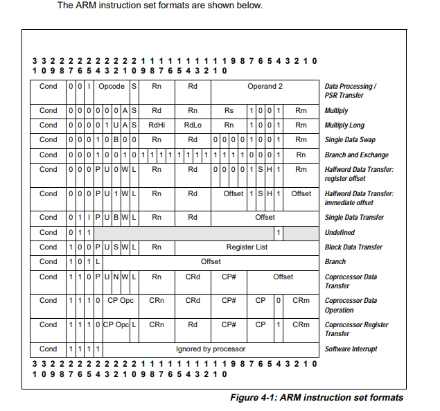

## 1. 指令集总结

处理器实现了一个版本的 **Thumb** 指令集。 表 **3-1** 列出了支持的指令。

| 助记符 | 操作数 | 简要说明 | 标志位 | 页码 |
| --- | --- | --- | --- | --- |
| ADC, ADCS | {Rd,} Rn, Op2 | 带进位加法 | N,Z,C,V | page 3-44 |
| ADD, ADDS | {Rd,} Rn, Op2 | 加法 | N,Z,C,V | page 3-44 |
| ADD, ADDW | {Rd,} Rn, #imm12 | 加法 | - | page 3-44 |
| ADR | Rd, label | 将地址加载到寄存器 | - | page 3-25 |
| AND, ANDS | {Rd,} Rn, Op2 | 按位与 | N,Z,C | page 3-47 |
| ASR, ASRS | Rd, Rm, <Rs\|#n> | 算术右移 | N,Z,C | page 3-49 |
| B | label | 分支 | - | page 3-128 |
| BFC | Rd, #lsb, #width | 位段清零 | - | page 3-124 |
| BFI | Rd, Rn, #lsb, #width | 位段插入 | - | page 3-124 |
| BIC, BICS | {Rd,} Rn, Op2 | 位清零 | N,Z,C | page 3-47 |
| BKPT | #imm8 | 断点 | - | page 3-173 |
| BL | label | 带链接的分支 | - | page 3-128 |
| BLX | Rm | 带链接与交换的间接分支 | - | page 3-128 |
| BX | Rm | 间接分支与交换 | - | page 3-128 |
| CBNZ | Rn, label | 比较结果非零则分支 | - | page 3-130 |
| CBZ | Rn, label | 比较结果为零则分支 | - | page 3-130 |
| CLREX | - | 清除独占 | - | page 3-41 |
| CLZ | Rd, Rm | 统计前导零个数 | - | page 3-51 |
| CMN | Rn, Op2 | 比较取负 | N,Z,C,V | page 3-52 |
| CMP | Rn, Op2 | 比较 | N,Z,C,V | page 3-52 |
| CPS | Rd, Rn | 更改处理器状态 | - | page 3-174 |
| CPY | Rd, Rn | 复制 | - | page 3-17 |
| DMB | {opt} | 数据内存屏障 | - | page 3-175 |
| DSB | {opt} | 数据同步屏障 | - | page 3-176 |
| EOR, EORS | {Rd,} Rn, Op2 | 按位异或 | N,Z,C | page 3-47 |
| ISB | {opt} | 指令同步屏障 | - | page 3-177 |
| IT | - | If-Then 条件块 | - | page 3-131 |
| LDM | Rn{!}, reglist | 加载多个寄存器 | - | page 3-34 |
| LDMDB, LDMEA | Rn{!}, reglist | 加载多个寄存器，先减 | - | page 3-34 |
| LDMIA, LDMFD | Rn{!}, reglist | 加载多个寄存器，后增 | - | page 3-34 |
| LDR, LDRT | Rt, [Rn, #offset] | 以字加载寄存器（立即数偏移，非特权） | - | page 3-26, page 3-31 |
| LDRH, LDRHT | Rt, [Rn, #offset] | 以半字加载寄存器（立即数偏移，非特权） | - | page 3-26, page 3-31 |
| LDRSH, LDRSHT | Rt, [Rn, #offset] | 以有符号半字加载寄存器（立即数偏移，非特权） | - | page 3-26, page 3-31 |
| LDRB, LDRBT | Rt, [Rn, #offset] | 以字节加载寄存器（立即数偏移，非特权） | - | page 3-26, page 3-31 |
| LDRSB, LDRSBT | Rt, [Rn, #offset] | 以有符号字节加载寄存器（立即数偏移，非特权） | - | page 3-26, page 3-31 |
| LDR | Rt, [Rn, Rm {, LSL #shift}] | 以字加载寄存器（寄存器偏移） | - | page 3-29 |
| LDRH | Rt, [Rn, Rm {, LSL #shift}] | 以半字加载寄存器（寄存器偏移） | - | page 3-29 |
| LDRSH | Rt, [Rn, Rm {, LSL #shift}] | 以有符号半字加载寄存器（寄存器偏移） | - | page 3-29 |
| LDRB | Rt, [Rn, Rm {, LSL #shift}] | 以字节加载寄存器（寄存器偏移） | - | page 3-29 |
| LDRSB | Rt, [Rn, Rm {, LSL #shift}] | 以有符号字节加载寄存器（寄存器偏移） | - | page 3-29 |
| LDR | Rt, label | 以字加载寄存器（字面量） | - | page 3-32 |
| LDRH | Rt, label | 以半字加载寄存器（字面量） | - | page 3-32 |
| LDRB | Rt, label | 以字节加载寄存器（字面量） | - | page 3-32 |
| LDRD | Rt, Rt2, [Rn, #offset] | 以双字加载寄存器（立即数偏移） | - | page 3-26 |
| LDRD | Rt, Rt2, label | 以双字加载寄存器（PC 相对） | - | page 3-32 |
| LDREX | Rt, [Rn, #offset] | 独占加载寄存器 | - | page 3-39 |
| LDREXB | Rt, [Rn] | 以字节独占加载寄存器 | - | page 3-39 |
| LDREXH | Rt, [Rn] | 以半字独占加载寄存器 | - | page 3-39 |
| LDRSB | Rt, label | 以有符号字节加载寄存器（PC 相对） | - | page 3-32 |
| LDRSH | Rt, label | 以有符号半字加载寄存器（PC 相对） | - | page 3-32 |
| LSL, LSLS | Rd, Rm, <Rs\| #n> | 逻辑左移 | N,Z,C | page 3-49 |
| LSR, LSRS | Rd, Rm, <Rs\| #n> | 逻辑右移 | N,Z,C | page 3-49 |
| MLA | Rd, Rn, Rm, Ra | 带累加的乘法，32 位结果 | N,Z | page 3-83 |
| MLS | Rd, Rn, Rm, Ra | 乘减，32 位结果 | - | page 3-83 |
| MOV, MOVS | Rd, Op2 | 移动 | N,Z,C | page 3-53 |
| MOV, MOVS | Rd, Rm | 移动（寄存器） | N,Z | page 3-53 |
| MOVT | Rd, #imm16 | 移动高半字 | - | page 3-55 |
| MOVW | Rd, #imm16 | 移动 16 位常量 | N,Z,C | page 3-53 |
| MRS | Rd, spec_reg | 从特殊寄存器移动到通用寄存器 | - | page 3-178 |
| MSR | spec_reg, Rn | 从通用寄存器移动到特殊寄存器 | - | page 3-179 |
| MUL, MULS | {Rd,} Rn, Rm | 乘法，32 位结果 | N,Z | page 3-83 |
| MVN, MVNS | Rd, Op2 | 按位取反 | N,Z,C | page 3-53 |
| NEG | {Rd,} Rm | 取负 | - | page 3-180 |
| NOP | - | 空操作 | - | page 3-181 |
| ORN, ORNS | {Rd,} Rn, Op2 | 按位或非 | N,Z,C | page 3-47 |
| ORR, ORRS | {Rd,} Rn, Op2 | 按位或 | N,Z,C | page 3-47 |
| PKHTB, PKHBT | {Rd,} Rn, Rm, {, Op2} | 打包半字 | - | page 3-117 |
| PLD | [Rn {, #offset}] | 预加载数据 | - | page 3-36 |
| POP | reglist | 从栈弹出寄存器 | - | page 3-37 |
| PUSH | reglist | 将寄存器压入栈 | - | page 3-37 |
| QADD | {Rd,} Rn, Rm | 饱和加法 | Q | page 3-107 |
| QADD16 | {Rd,} Rn, Rm | 饱和 16 位加法 | - | page 3-107 |
| QADD8 | {Rd,} Rn, Rm | 饱和 8 位加法 | - | page 3-107 |
| QASX | {Rd,} Rn, Rm | 带交换的饱和加减 | - | page 3-109 |
| QDADD | {Rd,} Rn, Rm | 饱和加倍加法 | Q | page 3-111 |
| QDSUB | {Rd,} Rn, Rm | 饱和加倍减法 | Q | page 3-111 |
| QSAX | {Rd,} Rn, Rm | 带交换的饱和减加 | - | page 3-109 |
| QSUB | {Rd,} Rn, Rm | 饱和减法 | Q | page 3-107 |
| QSUB16 | {Rd,} Rn, Rm | 饱和 16 位减法 | - | page 3-107 |
| QSUB8 | {Rd,} Rn, Rm | 饱和 8 位减法 | - | page 3-107 |
| RBIT | Rd, Rn | 位反转 | - | page 3-56 |
| REV | Rd, Rn | 字内字节序反转 | - | page 3-56 |
| REV16 | Rd, Rn | 各半字内字节序反转 | - | page 3-56 |
| REVSH | Rd, Rn | 低半字字节序反转并符号扩展 | - | page 3-56 |
| ROR, RORS | Rd, Rm, <Rs\|#n> | 循环右移 | N,Z,C | page 3-49 |
| RRX, RRXS | Rd, Rm | 带扩展的循环右移 | N,Z,C | page 3-49 |
| RSB, RSBS | {Rd,} Rn, Op2 | 逆向减法 | N,Z,C,V | page 3-44 |
| SADD16 | {Rd,} Rn, Rm | 有符号 16 位加法 | GE | page 3-57 |
| SADD8 | {Rd,} Rn, Rm | 有符号 8 位加法 | GE | page 3-57 |
| SASX | {Rd,} Rn, Rm | 带交换的有符号加减 | GE | page 3-65 |
| SBC, SBCS | {Rd,} Rn, Op2 | 带借位减法 | N,Z,C,V | page 3-44 |
| SBFX | Rd, Rn, #lsb, #width | 有符号位段提取 | - | page 3-125 |
| SDIV | {Rd,} Rn, Rm | 有符号除法 | - | page 3-103 |
| SEL | {Rd,} Rn, Rm | 选择字节 | GE | page 3-77 |
| SEV | - | 发送事件 | - | page 3-182 |
| SHADD16 | {Rd,} Rn, Rm | 有符号减半 16 位加法 | - | page 3-59 |
| SHADD8 | {Rd,} Rn, Rm | 有符号减半 8 位加法 | - | page 3-59 |
| SHASX | {Rd,} Rn, Rm | 带交换的有符号减半加减 | - | page 3-60 |
| SHSAX | {Rd,} Rn, Rm | 带交换的有符号减半减加 | - | page 3-60 |
| SHSUB16 | {Rd,} Rn, Rm | 有符号减半 16 位减法 | - | page 3-62 |
| SHSUB8 | {Rd,} Rn, Rm | 有符号减半 8 位减法 | - | page 3-62 |
| SMLABB, SMLABT, SMLATB, SMLATT | Rd, Rn, Rm, Ra | 半字有符号乘累加 | Q | page 3-87 |
| SMLAD, SMLADX | Rd, Rn, Rm, Ra | 双路有符号乘累加 | Q | page 3-89 |
| SMLAL | RdLo, RdHi, Rn, Rm | 有符号长乘累加（32 × 32 + 64），64 位结果 | - | page 3-102 |
| SMLALBB, SMLALBT, SMLALTB, SMLALTT | RdLo, RdHi, Rn, Rm | 半字有符号长乘累加 | - | page 3-91 |

