## 1. 系统地址映射

**Armv7-M** 支持预定义的**32**位地址空间，细分代码、数据和外设，以及片载（on-chip）和片外（**off-chip**）资源的区域，其中片载是指与处理器紧密耦合的资源。地址空间支持8个主分区，每个**0.5**GB：

* 代码（**Code**）。
* SRAM。
* 外围设备（**Peripheral**）。
* 两个RAM区域。
* 两个设备区域。
* 系统。

该体系结构分配物理地址以用作事件入口点（向量）、系统控制（**system control**）和配置。事件入口点（**event entry points**）都是相对于表基地址定义的，在复位时配置为实现定义（**IMPLEMENTATION DEFINED**）的值，然后维护在为系统配置和控制保留的地址空间中。为了满足这个和其他系统需求，地址空间**0xE0000000**到**0xFFFFFFFF**被保留供系统级使用。

表 **B3-1** 显示了 **Armv7-M** 默认地址映射，以及该映射中内存区域的属性。以下说明适用于[此表](#11-表b3-1-armv7-m-地址映射)以及[表B3-2](#12-表b3-2-armv7-m-地址映射的system区域细分)。

* **XN** 表示执行从不（**Execute Never**）。任何从 **XN** 区域执行代码的尝试都会出错，从而生成 **MemManage** 异常。
* 缓存列（**Cache column**）表示普通内存区域的缓存策略，用于内部和外部缓存，以支持系统缓存。声明的缓存类型可以降级但不能提升，如下所示：
  * WT   : 直写（**Write-Through**）。可以被视为非缓存（**non-cached**）。
  * WBWA : 回写（**Write-Back**）写分配（**write allocate**），可被视为直写（**Write-Through**）或者非缓存（**non-cached**）。
* 在设备栏（**Device column**）中：
  * Shareable: 表示该区域支持多个代理在一致的内存域中共享使用。这些代理可以是处理器和 DMA 代理的任意组合。
  * SO       ：表示强秩序内存（**Strongly-ordered**）。强秩序内存始终是可共享的。
* 指定地址空间的哪些部分由实现定义（**IMPLEMENTATION DEFINED**）：
  * 可读可写（**Read/Write**）。
  * 只读（**Read-only**）。例如：闪存空间。
  * 不可访问（**No-access**）。通常是地址映射中未填充的部分。
* 跨越0.5GB地址边界的未对齐或多字访问是不可预测的。

### 1.1. 表B3-1 Armv7-M 地址映射

| 地址 | 名称 | 设备类型 | XN？ | 缓存 | 说明 |
| --- | --- | --- | --- | --- | --- |
| 0x00000000 - 0x1FFFFFFF | Code | Normal | - | WT | 通常为 ROM 或闪存。 |
| 0x20000000 - 0x3FFFFFFF | SRAM | Normal | - | WBWA | SRAM 区域，通常用于片上 RAM。 |
| 0x40000000 - 0x5FFFFFFF | Peripheral | Device | XN | - | 片上外设地址空间。 |
| 0x60000000 - 0x7FFFFFFF | RAM | Normal | - | WBWA | 具有回写、写分配缓存属性，用于支持 L2/L3 缓存的内存。 |
| 0x80000000 - 0x9FFFFFFF | RAM | Normal | - | WT | 具有直写缓存属性的内存。 |
| 0xA0000000 - 0xBFFFFFFF | Device | Device, shareable | XN | - | 共享设备空间。 |
| 0xC0000000 - 0xDFFFFFFF | Device | Device, Non-shareable | XN | - | 非共享设备空间。 |
| 0xE0000000 - 0xFFFFFFFF | System | 见说明 | XN | - | 用于 PPB 和供应商系统外设的系统段，参见表 B3-2。 |

内存映射的系统区域，从 0xE0000000 开始，细分如下：

* 偏移+0x00000000 处的1MB 区域被保留为专用外设总线PPB（**Private Peripheral Bus**）。
* 从偏移+0x00100000 开始的区域是供应商系统区域（**Vendor_SYS**）。

[表B3-2](#12-表b3-2-armv7-m-地址映射的system区域细分)显示了该区域的细分。
  
在 **Vendor_SYS** 区域，Arm建议：

* 供应商资源从0xF0000000开始。
* 区域**0xE0100000-0xEFFFFFFF**被保留。

### 1.2. 表B3-2 Armv7-M 地址映射的System区域细分

| 地址 | 名称 | 内存类型 | XN？ | 说明 |
| --- | --- | --- | --- | --- |
| 0xE0000000 - 0xE00FFFFF | PPB | Strongly-ordered | XN | 保留为 PPB 的 1MB 区域。它支持关键资源，包括系统控制空间和调试功能。 |
| 0xE0100000 - 0xFFFFFFFF | Vendor_SYS | Device | XN | 供应商系统区域，参见本节中的 Arm 建议。 |

支持识别非特权和特权访问的软件模型需要内存保护方案来控制访问权限。受保护的内存系统架构 (**PMSAv7**) 是提供此类方案的可选系统级功能，请参阅受保护的内存系统架构**PMSAv7**，**PMSAv7**的实现提供了内存保护单元 (**MPU**)。

**注：**

* **PMSAv7** 是 **Armv7-R** 实施的必需功能。有关 **Armv7-M** 和 **Armv7-R** 实施有何不同的信息，请参阅第 B3-633 页上的 **Armv7-M** 特定支持。
* 一些 **Arm** 文档将非特权访问描述为用户访问，将特权访问描述为主管访问。这些描述基于 **Armv7-A** 和 **Armv7-R** 架构配置文件的功能。

地址映射见[表B3-1](#11-表b3-1-armv7-m-地址映射):
* 是未实施 **PMSAv7** 的系统上唯一支持的地址映射。
* 是禁用**MPU**时内存系统的默认映射。
* 当启用**MPU**时，可用作特权访问的背景区域，请参见**MPU**控制寄存器中**PRIVDEFENA**的定义，第B3-637页的**MPU_CTRL**。

**注：**

启用的**MPU**无法更改系统内存区域的**XN**属性。

### 1.3. PPB 寄存器访问的一般规则

**PPB**的一般规则，地址范围从**0xE0000000**到**0xE0100000**：

* 该区域被定义为强秩序内存，请参阅[强秩序内存](../arm_architecture_memory_mode/index.md#156-强秩序内存strongly-ordered-memory)和[内存访问限制](../arm_architecture_memory_mode/index.md#157-内存访问限制)。
* 无论处理器的字节序状态如何，寄存器访问总是小端字节序（**little endian**）。
* 一般来说，除非另有说明，寄存器仅支持字访问，字节和半字访问不可预测。优先级和故障状态寄存器是影响不同资源的字节对齐位字段的串联。这样的寄存器可以作为字节或半字寄存器访问，具有适当的相对于 32 位寄存器基地址的地址偏移量。

**注意：**

只有当本手册中的寄存器描述明确声明它支持这些访问时，一个寄存器才支持字节和半字访问。

* 当一个位被定义为读取时清零为 0（**being cleared to 0 on a read**）时，如果读取该位与将该位设置为 1 的事件同时发生，架构保证以下原子行为：
  * 如果该位读取为1，则读操作将该位清除为0。
  * 如果该位读取为0，则事件将该位设置为1。随后对该位的读取将返回1并将该位清除为 0。
* 保留的寄存器或位域必须被视为**UNK/SBZP**。

除非另有说明，否则对**PPB**的非特权访问会导致**BusFault**错误。值得注意的例外是：

* 通过对配置控制寄存器中的控制位进行编程，可以启用对系统控制空间中的软件触发中断寄存器的非特权访问。
* 有关调试相关资源，请参阅第 C1-686 页上的适用于调试寄存器访问的一般规则以了解异常详细信息。

## 2. 系统控制空间 (SCS)

系统控制空间SCS（**System Control Space**）是一个内存映射的 **4KB** 地址空间，为配置、状态报告和控制提供32位寄存器。**SCS** 寄存器分为以下几组：

* 系统控制和识别。
* CPUID 处理器标识空间。
* 系统配置和状态。
* 故障报告。
* 系统定时器SysTick。
* 嵌套向量中断控制器(NVIC)。
* 受保护的内存系统架构 (PMSA)。
* 系统调试。

表 **B3-3** 定义了 **SCS** 寄存器组的内存映射。系统控制空间（**System Control Space**）的地址范围为 **0xE000E000** 至 **0xE000EFFF**。

| 组 | 地址范围 | 说明 |
| --- | --- | --- |
| 系统控制与 ID 寄存器 | 0xE000E000-0xE000E00F | 包含中断控制器类型寄存器与辅助控制寄存器 |
| 系统控制与 ID 寄存器 | 0xE000ED00-0xE000ED8F | 系统控制块 |
| 系统控制与 ID 寄存器 | 0xE000EDF0-0xE000EEFF | **SCS** 中的调试寄存器 |
| 系统控制与 ID 寄存器 | 0xE000EF00-0xE000EF4F | 包含软件触发中断寄存器，参见第 B3-619 页的 **STIR** |
| 系统控制与 ID 寄存器 | 0xE000EF50-0xE000EF8F | 缓存与分支预测器维护，参见第 B2-577 页的缓存与分支预测器维护操作 |
| 系统控制与 ID 寄存器 | 0xE000EF90-0xE000EFCF | 实现定义 |
| 系统控制与 ID 寄存器 | 0xE000EFD0-0xE000EFFF | 微控制器特定的 ID 空间 |
| SysTick | 0xE000E010-0xE000E0FF | 系统定时器，参见第 B3-620 页的系统定时器 **SysTick** |
| NVIC | 0xE000E100-0xE000ECFF | 外部中断控制器，参见第 B3-624 页的嵌套向量中断控制器 **NVIC** |
| MPU | 0xE000ED90-0xE000EDEF | 内存保护单元，参见第 B3-632 页的受保护内存系统架构 **PMSAv7** |

以下小节总结了系统控制和 ID 寄存器：

* 关于系统控制块，参见 2.1。
* 系统控制与 ID 寄存器，参见 2.2 至 2.26。
* 调试系统寄存器，参见第 C1-699 页。

以下小节总结了其他寄存器组：

* 系统定时器 **SysTick**，参见第 3 节。
* 嵌套向量中断控制器 **NVIC**，参见第 4 节。
* 在 **SCS** 中注册对 **PMSAv7** 的支持，参见[受保护的内存系统架构 PMSAv7](../mpu/index.md)。

### 2.1. 关于系统控制块

在 **Armv7-M** 处理器中，**SCS** 中的系统控制块 (**SCB**) 为处理器提供关键状态信息和控制功能。**SCB** 支持：

* 不同级别的软件复位控制。
* 异常模型的基地址管理，通过控制表指针。
* 系统异常管理，包括：
    - 例外启用。
    - 显示每个异常状态的状态，非活动、未决或活动。
    - 将异常状态设置为待处理，或从异常中移除待处理状态。
    - 设置可配置系统异常的优先级。
    - 提供各种控制功能和状态信息。<br/>
  这不包括外部中断处理。 NVIC 处理所有外部中断。
* 优先分组控制，请参见第 B1-527 页的优先分组。
* 当前执行代码的异常编号，以及最高优先级的未决异常。
* 其他控制和状态功能，包括协处理器访问支持。
* 电源管理，通过睡眠支持。
* 故障状态信息，请参阅第 B1-551 页的故障行为。
* 调试状态信息。调试特定寄存器区域中的控制和状态对此进行了补充，请参阅第 C1 章 **Armv7-M** 调试。

### 2.2. 系统控制与 ID 寄存器

系统控制空间各子区域中的寄存器提供系统控制和标识功能，如下所示：

* 表 B3-4 列出系统控制块（**SCB**）中的寄存器。
* 表 B3-5 列出处理器实现 **FP** 扩展时额外的 **SCB** 寄存器。
* 表 B3-6 列出不在 **SCB** 中的寄存器。

除非寄存器描述中另有说明，所有寄存器都为 **32** 位宽。

表 B3-4 **SCB** 寄存器汇总

| 地址 | 名称 | 类型 | 复位值 | 说明 |
| --- | --- | --- | --- | --- |
| 0xE000ED00 | CPUID | RO | 实现定义（**IMPLEMENTATION DEFINED**） | CPUID 基址寄存器，参见第 B3-598 页 |
| 0xE000ED04 | ICSR | RW | 0x00000000 | 中断控制与状态寄存器，**ICSR**，参见第 B3-599 页 |
| 0xE000ED08 | VTOR | RW | 0x00000000ᵃ | 向量表偏移寄存器，**VTOR**，参见第 B3-601 页 |
| 0xE000ED0C | AIRCR | RW | -ᵇ | 应用程序中断与复位控制寄存器，**AIRCR**，参见第 B3-601 页 |
| 0xE000ED10 | SCR | RW | 0x00000000 | 系统控制寄存器，**SCR**，参见第 B3-603 页 |
| 0xE000ED14 | CCR | RW | 实现定义（**IMPLEMENTATION DEFINED**） | 配置与控制寄存器，**CCR**，参见第 B3-604 页 |
| 0xE000ED18 | SHPR1 | RW | 0x00000000 | 系统处理程序优先级寄存器 1，**SHPR1**，参见第 B3-606 页 |
| 0xE000ED1C | SHPR2 | RW | 0x00000000 | 系统处理程序优先级寄存器 2，**SHPR2**，参见第 B3-606 页 |
| 0xE000ED20 | SHPR3 | RW | 0x00000000 | 系统处理程序优先级寄存器 3，**SHPR3**，参见第 B3-607 页 |
| 0xE000ED24 | SHCSR | RW | 0x00000000 | 系统处理程序控制与状态寄存器，**SHCSR**，参见第 B3-607 页 |
| 0xE000ED28 | CFSR | RW | 0x00000000 | 可配置故障状态寄存器，**CFSR**，参见第 B3-609 页 |
| 0xE000ED2C | HFSR | RW | 0x00000000 | **HardFault** 状态寄存器，**HFSR**，参见第 B3-612 页 |
| 0xE000ED30 | DFSR | RW | 0x00000000ᶜ | 调试故障状态寄存器，**DFSR**，参见第 C1-699 页 |
| 0xE000ED34 | MMFAR | RW | UNKNOWN | **MemManage** 故障地址寄存器，**MMFAR**，参见第 B3-613 页 |
| 0xE000ED38 | BFAR | RW | UNKNOWN | **BusFault** 地址寄存器，**BFAR**，参见第 B3-614 页 |
| 0xE000ED3C | AFSR | RW | UNKNOWN | 辅助故障状态寄存器，**AFSR**，参见第 B3-614 页，实现定义 |
| 0xE000ED40 - 0xE000ED84 | - | - | - | 保留供 CPUID 寄存器使用，参见第 B4 章 **The CPUID Scheme** |
| 0xE000ED88 | CPACR | RW | UNKNOWN | 协处理器访问控制寄存器，**CPACR**，参见第 B3-614 页 |
| 0xE000ED8C | - | - | - | 保留 |

a. 更多信息参见寄存器描述。<br/>
b. bits[10:8] 复位为 **0b000**，更多信息参见寄存器描述。<br/>
c. 仅上电复位。

**CFSR** 的子寄存器描述如下：

* **MemManage** 状态寄存器，**MMFSR**，参见第 B3-609 页。
* **BusFault** 状态寄存器，**BFSR**，参见第 B3-610 页。
* **UsageFault** 状态寄存器，**UFSR**，参见第 B3-611 页。

表 B3-5 **FP** 扩展的额外 **SCB** 寄存器汇总

| 地址 | 名称 | 类型 | 复位值 | 说明 |
| --- | --- | --- | --- | --- |
| 0xE000EF34 | FPCCR | RW | -ᵃ | 浮点上下文控制寄存器，**FPCCR**，参见第 B3-615 页 |
| 0xE000EF38 | FPCAR | RW | UNKNOWN | 浮点上下文地址寄存器，**FPCAR**，参见第 B3-617 页 |
| 0xE000EF3C | FPDSCR | RW | 0x00000000 | 浮点默认状态控制寄存器，**FPDSCR**，参见第 B3-617 页 |
| 0xE000EF40 | MVFR0 | RO | 0x10110021 或 0x10110221ᵇ | 媒体与 FP 特性寄存器 0，**MVFR0**，参见第 B4-662 页 |
| 0xE000EF44 | MVFR1 | RO | 0x11000011 或 0x12000011ᶜ | 媒体与 FP 特性寄存器 1，**MVFR1**，参见第 B4-663 页 |
| 0xE000EF48 | MVFR2 | RO | 0x00000040 或 0x00000000ᵈ | 媒体与 FP 特性寄存器 2，**MVFR2**，参见第 B4-664 页 |

a. 参见第 B3-615 页的浮点上下文控制寄存器 **FPCCR**。<br/>
b. 如果实现双精度，则为 **0x10110221**，否则为 **0x10110021**。<br/>
c. 如果实现双精度，则为 **0x12000011**，否则为 **0x11000011**。<br/>
d. 如果实现 **FPv5**，则为 **0x00000040**，否则为 **0x00000000**。

表 B3-6 不在 **SCB** 中的系统控制与 ID 寄存器汇总

| 地址 | 名称 | 类型 | 复位值 | 说明 |
| --- | --- | --- | --- | --- |
| 0xE000E000 | - | RW | 0x00000000 | 主控制寄存器，保留 |
| 0xE000E004 | ICTR | RO | 实现定义（**IMPLEMENTATION DEFINED**） | 中断控制器类型寄存器，**ICTR**，参见第 B3-618 页 |
| 0xE000E008 | ACTLR | RW | 实现定义（**IMPLEMENTATION DEFINED**） | 辅助控制寄存器，**ACTLR**，参见第 B3-618 页 |
| 0xE000E00C | - | - | - | 保留 |
| 0xE000EDF0 - 0xE000EEFC | - | - | - | 参见第 C1-699 页的调试系统寄存器 |
| 0xE000EF00 | STIR | WO | - | 软件触发中断寄存器，**STIR**，参见第 B3-619 页 |
| 0xE000EF04 - 0xE000EF30 | - | - | - | 保留 |
| 0xE000EF34 - 0xE000EF48 | - | - | - | 保留供 **FP** 扩展的 **SCB** 寄存器使用，参见第 B3-597 页的表 B3-5 |
| 0xE000EF4C | - | - | - | 保留 |
| 0xE000EF50 - 0xE000EF80 | - | - | - | 缓存与分支预测器维护，参见第 B2-577 页的缓存与分支预测器维护操作 |
| 0xE000EF84 - 0xE000EF8C | - | - | - | 保留 |
| 0xE000EF90 - 0xE000EFCC | … | … | … | 实现定义（**IMPLEMENTATION DEFINED**） |
| 0xE000EFD0 | PID4 | RO | - | 外设标识寄存器，参见第 B4 章 **The CPUID Scheme** |
| 0xE000EFD4 | PID5 | RO | - | 同上 |
| 0xE000EFD8 | PID6 | RO | - | 同上 |
| 0xE000EFDC | PID7 | RO | - | 同上 |
| 0xE000EFE0 | PID0 | RO | - | 同上 |
| 0xE000EFE4 | PID1 | RO | - | 同上 |
| 0xE000EFE8 | PID2 | RO | - | 同上 |
| 0xE000EFEC | PID3 | RO | - | 同上 |
| 0xE000EFF0 | CID0 | RO | - | 组件标识寄存器，参见第 B4 章 **The CPUID Scheme** |
| 0xE000EFF4 | CID1 | RO | - | 同上 |
| 0xE000EFF8 | CID2 | RO | - | 同上 |
| 0xE000EFFC | CID3 | RO | - | 同上 |

本节其余小节描述 **SCB** 寄存器，以及 **ICTR**、**ACTLR** 和 **STIR**。

### 2.3. CPUID 基址寄存器

**CPUID** 基址寄存器的特性如下：

**目的**

提供处理器的标识信息。

**使用限制**

该寄存器仅支持字访问。软件可以使用 **CPUID** 寄存器获取处理器的更多信息，参见第 B4 章 **The CPUID Scheme**。

**配置**

始终实现。

**属性**

参见第 B3-596 页的表 B3-4。

**CPUID** 基址寄存器的位分配如下：

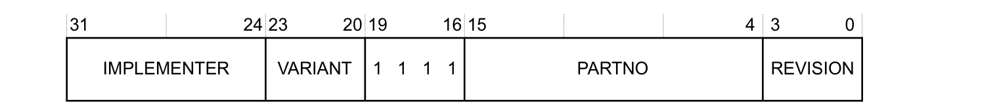

**IMPLEMENTER，bits[31:24]**

由 **Arm** 分配的实现者代码。由 **Arm** 实现的处理器读为 **0x41**。

**VARIANT，bits[23:20]**

实现定义（**IMPLEMENTATION DEFINED**）的变体号。

**ARCHITECTURE，bits[19:16]**

读为 **0xF**，参见第 B4-644 页的关于 **CPUID** 方案。

**PARTNO，bits[15:4]**

实现定义（**IMPLEMENTATION DEFINED**）的部件号。

**REVISION，bits[3:0]**

实现定义（**IMPLEMENTATION DEFINED**）的修订号。

### 2.4. 中断控制与状态寄存器，ICSR

**ICSR** 的特性如下：

**目的**

为 **NMI**、**PendSV** 和 **SysTick** 异常提供软件控制，并提供中断状态信息。

**使用限制**

没有使用限制。

**配置**

始终实现。

**属性**

参见第 B3-596 页的表 B3-4。

**ICSR** 的位分配如下：

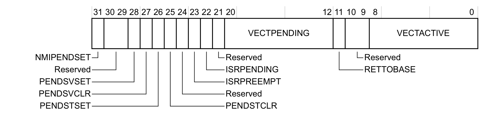

**NMIPENDSET，bit[31]**

在写入时将该 **NMI** 异常置为活动。在读取时指示该异常的状态：

* **0**：写入时无效果。读取时 **NMI** 为非活动。
* **1**：写入时将 **NMI** 异常置为活动。读取时 **NMI** 为活动。

由于 **NMI** 的优先级高于其他异常，如果处理器当前未在执行 **NMI** 处理程序，那么一旦处理器识别到对该位的写入，就会进入 **NMI** 异常处理程序。

**Bits[30:29]**

保留。

**PENDSVSET，bit[28]**

在写入时将 **PendSV** 异常置为未决。在读取时指示该异常的当前状态：

* **0**：写入时无效果。读取时 **PendSV** 未决。
* **1**：写入时将 **PendSV** 异常置为未决。读取时 **PendSV** 未决。

通常软件向该位写 **1** 以请求上下文切换。

**PENDSVCLR，bit[27]**

清除 **PendSV** 异常的未决状态：

* **0**：无效果。
* **1**：清除未决状态。

该位只写。

**PENDSTSET，bit[26]**

在写入时将 **SysTick** 异常置为未决。在读取时指示该异常的当前状态：

* **0**：写入时无效果。读取时 **SysTick** 未决。
* **1**：写入时将 **SysTick** 异常置为未决。读取时 **SysTick** 未决。

**PENDSTCLR，bit[25]**

清除 **SysTick** 异常的未决状态：

* **0**：无效果。
* **1**：清除未决状态。

该位只写。

**Bit[24]**

保留。

**ISRPREEMPT，bit[23]**

指示从调试暂停状态退出时是否会处理未决异常：

* **0**：不处理。
* **1**：将处理未决异常。

该位只读。

**ISRPENDING，bit[22]**

指示由 **NVIC** 产生的外部中断是否处于未决状态：

* **0**：没有未决的外部中断。
* **1**：有未决的外部中断。

**注意：** **DHCSR.C_MASKINTS** 的值被忽略。

该位只读。

**Bit[21]**

保留。

**VECTPENDING，bits[20:12]**

最高优先级的未决且使能中断的异常编号。值为 **0** 表示没有未决异常。

**注意：** 如果 **DHCSR.C_MASKINTS** 置位，则 **PendSV**、**SysTick** 和可配置外部中断被屏蔽，不会在 **VECTPENDING** 中显示为未决。

这些位只读。

**RETTOBASE，bit[11]**

在 **Handler** 模式下指示除 **IPSR** 当前值所指示的异常之外，是否存在活动异常：

* **0**：存在 **IPSR** 所示异常之外的活动异常。
* **1**：不存在 **IPSR** 所示异常之外的活动异常。

在 **Thread** 模式下该位的值为 **UNKNOWN**。

更多信息参见第 B1-516 页的特殊用途程序状态寄存器 **xPSR**。

该位只读。

**Bits[10:9]**

保留。

**VECTACTIVE，bits[8:0]**

当前执行的异常编号。值为 **0** 表示处理器处于 **Thread** 模式。

这些位只读。

如果对 **ICSR** 的写入出现以下情况，则效果不可预测：

* 同时将 **PENDSVSET** 和 **PENDSVCLR** 置为 **1**。
* 同时将 **PENDSTSET** 和 **PENDSTCLR** 置为 **1**。

**VECTACTIVE** 字段的值与 **IPSR[8:0]** 相同，参见第 B1-516 页的特殊用途程序状态寄存器 **xPSR**。

### 2.5. 向量表偏移寄存器，VTOR

**VTOR** 的特性如下：

**目的**

保存向量表地址。

**使用限制**

**TBLOFF** 字段中的一个或两个高位可以实现为 **RAZ/WI**，从而缩小支持的地址范围。例如，如果两个位实现为 **RAZ/WI**，则 **TBLOFF[29:7]** 定义地址的 bits[29:7]。

**配置**

始终实现。

**属性**

参见第 B3-596 页的表 B3-4。

实现可以包含确定 **TBLOFF** 字段复位值的配置输入信号，否则该字段复位为零。

**VTOR** 的位分配如下：


**TBLOFF，bits[31:7]**

向量表地址的 bits[31:7]。

较早的文档将该字段描述为向量表地址偏移。本手册中的描述澄清了该寄存器的用途。

**Bits[6:0]**

保留。

**注意：** **VTOR** 未定义的向量表地址的所有位均为零。

软件可以向 **TBLOFF** 字段写入全 **1**，然后读取该寄存器以找出支持的最大偏移值。

### 2.6. 应用程序中断与复位控制寄存器，AIRCR

**AIRCR** 的特性如下：

**目的**

设置或返回中断控制数据。

**使用限制**

没有使用限制。

**配置**

始终实现。

**属性**

参见第 B3-596 页的表 B3-4 以及寄存器描述。

**AIRCR** 的位分配如下：

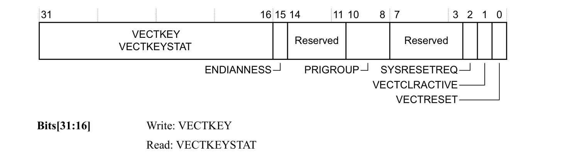

**Bits[31:16]**

写入：**VECTKEY**；读取：**VECTKEYSTAT**。

向量键（**Vector Key**）。

对寄存器的写入必须向该字段写入 **0x05FA**，否则该写入被忽略。

读取时返回 **0xFA05**。

**ENDIANNESS，bit[15]**

指示内存系统的字节序：

* **0**：小端（**Little endian**）。
* **1**：大端（**Big endian**）。

该位是静态的，或者在复位时由硬件输入配置。

该位只读。

**Bits[14:11]**

保留。

**PRIGROUP，bits[10:8]**

优先级分组，指示二进制点的位置。

有关该字段的用途，参见第 B1-527 页的优先级分组。

该字段复位为 **0b000**。

**Bits[7:3]**

保留。

**SYSRESETREQ，bit[2]**

系统复位请求（**System Reset Request**）：

* **0**：不请求复位。
* **1**：请求复位。

向该位写 **1** 会置位一个信号，向外部系统请求本地复位（**Local reset**）。

本地复位或上电复位将该位清除为 **0**。

**VECTCLRACTIVE，bit[1]**

向该位写 **1** 会清除固定异常和可配置异常的所有活动状态信息。这包括将 **IPSR** 清除为零，参见第 B1-517 页的 **IPSR**。

如果处理器未在调试状态下暂停，向该位写 **1** 的效果不可预测（**UNPREDICTABLE**）。

该位只写。

**VECTRESET，bit[0]**

向该位写 **1** 将导致本地系统复位，更多信息参见第 B1-559 页的复位管理。该位自清除。

如果处理器未在调试状态下暂停，向该位写 **1** 的效果不可预测（**UNPREDICTABLE**）。

当处理器在调试状态下暂停时，如果对寄存器的写入同时将 **VECTRESET** 和 **SYSRESETREQ** 置为 **1**，则行为不可预测（**UNPREDICTABLE**）。

该位只写。

### 2.7. 系统控制寄存器，SCR

**SCR** 的特性如下：

**目的**

设置或返回系统控制数据。

**使用限制**

没有使用限制。

**配置**

始终实现。

**属性**

参见第 B3-596 页的表 B3-4。

**SCR** 的位分配如下：


**Bits[31:5]**

保留。

**SEVONPEND，bit[4]**

确定中断从非活动状态到未决状态的转换是否为唤醒事件：

* **0**：从非活动到未决的转换不是唤醒事件。
* **1**：从非活动到未决的转换是唤醒事件。

更多信息参见第 B1-561 页的 **WFE** 唤醒事件。

**Bit[3]**

保留。

**SLEEPDEEP，bit[2]**

提供一个限定提示，指示从睡眠唤醒可能需要更长时间。实现可以使用该位在两个备选睡眠状态之间进行选择：

* **0**：所选的睡眠状态不是深度睡眠（**deep sleep**）。
* **1**：所选的睡眠状态是深度睡眠（**deep sleep**）。

所实现的睡眠状态（如果有）的细节以及该位用途的细节为实现定义（**IMPLEMENTATION DEFINED**）。

如果处理器未实现深度睡眠状态，则该位可以为 **RAZ/WI**。

**SLEEPONEXIT，bit[1]**

确定当从 **ISR** 退出并返回到执行优先级的基准级时，处理器是否进入睡眠状态：

* **0**：不进入睡眠状态。
* **1**：进入睡眠状态。

更多信息参见第 B1-559 页的电源管理。

**Bit[0]**

保留。

调试器可以读取 **S_SLEEP**（参见第 C1-700 页的调试暂停控制与状态寄存器 **DHCSR**）以检测是否处于睡眠状态。

### 2.8. 配置与控制寄存器，CCR

**CCR** 的特性如下：

**目的**

设置或返回配置与控制数据，并提供对缓存和分支预测的控制。

**使用限制**

没有使用限制。

**配置**

始终实现。

**属性**

参见第 B3-596 页的表 B3-4 以及寄存器字段描述。

**CCR** 的位分配如下：

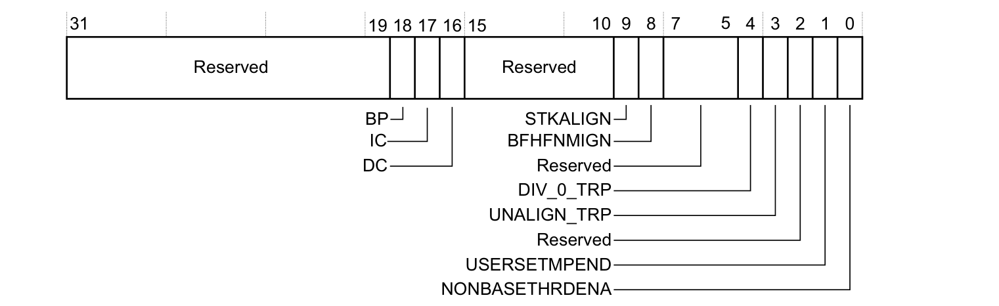

**Bits[31:19]**

保留。

**BP，bit[18]**

分支预测使能位。该位可能的取值如下：

* **0**：程序流预测（**program flow prediction**）禁用。
* **1**：程序流预测使能。

将该位置为 **1** 使能分支预测，也称为程序流预测。

如果程序流预测无法禁用，则该位为 **RAO/WI**。

如果实现不支持程序流预测，则该位为 **RAZ/WI**。

**IC，bit[17]**

指令缓存使能位。这是指令缓存的全局使能位。该位可能的取值如下：

* **0**：指令缓存禁用。
* **1**：指令缓存使能。

如果系统在内存层次结构的任何级别都未实现处理器可访问的指令缓存，则该位为 **RAZ/WI**。

如果系统实现了处理器可访问的指令缓存，则必须能够通过将该位置为 **0** 来禁用它们。

**DC，bit[16]**

缓存使能位。这是数据缓存和统一缓存的全局使能位。该位可能的取值如下：

* **0**：数据缓存和统一缓存禁用。
* **1**：数据缓存和统一缓存使能。

如果系统在内存层次结构的任何级别都未实现处理器可访问的数据缓存或统一缓存，则该位为 **RAZ/WI**。

如果系统实现了处理器可访问的数据缓存或统一缓存，则必须能够通过将该位置为 **0** 来禁用它们。

**Bits[15:10]**

保留。

**STKALIGN，bit[9]**

确定异常进入序列是否保证 **8** 字节栈帧对齐，并在保存状态之前必要时调整 **SP**：

* **0**：保证的 **SP** 对齐为 **4** 字节，不执行 **SP** 调整。
* **1**：保证 **8** 字节对齐，必要时调整 **SP**。

该位是 **RO** 还是 **RW** 为实现定义（**IMPLEMENTATION DEFINED**）。

该位的复位值为实现定义（**IMPLEMENTATION DEFINED**）。**Arm** 建议该位复位为 **1**。

更多信息参见第 B1-535 页的异常进入时的栈对齐。

**BFHFNMIGN，bit[8]**

确定精确数据访问故障对在优先级 **-1** 或优先级 **-2** 上运行的处理程序的影响：

* **0**：精确数据访问故障导致锁定（**lockup**），参见第 B1-555 页的不可恢复的异常情况。
* **1**：处理程序忽略该故障。

**Bits[7:5]**

保留。

**DIV_0_TRP，bit[4]**

控制除零时的陷阱：

* **0**：陷阱禁用。
* **1**：陷阱使能。

**UNALIGN_TRP，bit[3]**

控制非对齐字或半字访问的陷阱：

* **0**：陷阱禁用。
* **1**：陷阱使能。

非对齐的加载-存储多寄存器访问以及字或半字的独占访问始终产生故障。

**Bit[2]**

保留。

**USERSETMPEND，bit[1]**

控制非特权软件是否可以访问 **STIR**：

* **0**：非特权软件不能访问 **STIR**。
* **1**：非特权软件可以访问 **STIR**。

更多信息参见第 B3-619 页的软件触发中断寄存器 **STIR**。

**NONBASETHRDENA，bit[0]**

控制处理器能否在存在活动异常的情况下进入 **Thread** 模式：

* **0**：如果活动异常数量非零且不依赖执行优先级提升（包括 **BASEPRI**、**FAULTMASK** 和 **PRIMASK**），则任何返回 **Thread** 模式的尝试都会导致异常。
* **1**：处理器可以因受控的返回值而在存在活动异常的情况下进入 **Thread** 模式。更多信息参见第 B1-539 页的异常返回行为。

### 2.9. 关于系统处理程序优先级寄存器

系统处理程序优先级寄存器控制具有可配置优先级的系统故障处理程序的优先级。异常处理程序编号与对应的异常编号一致，参见第 B1-525 页的异常编号定义。因此异常处理程序 **6** 是异常 **6**（**UsageFault** 异常）的处理程序。

异常 **1**、**2** 和 **3**（**Reset**、**NMI** 和 **HardFault**）具有固定优先级，因此没有关联的系统处理程序优先级寄存器字段。所以，第一个已定义的系统处理程序优先级字段是 **PRI_4**，它控制异常 **4**（**MemManage** 异常）的处理程序的优先级。

**注意：** 按照 **Arm** 寄存器命名约定，第一个系统处理程序优先级寄存器应为 **SHPR0**。在这些寄存器的模型中，它将保存处理程序 **0-3** 的优先级。但异常 **0** 未定义，而异常 **1-3** 具有固定优先级。因此，所实现的 **SHPR** 从 **SHPR1** 开始。

### 2.10. 系统处理程序优先级寄存器 1，SHPR1

**SHPR1** 寄存器的特性如下：

**目的**

设置或返回系统处理程序 **4-7** 的优先级。

**使用限制**

该寄存器支持字节、对齐半字和字访问。

**配置**

始终实现。

**属性**

参见第 B3-596 页的表 B3-4。

**SHPR1** 的位分配如下：


**PRI_7，bits[31:24]**

保留供系统处理程序 **7** 的优先级使用。

**PRI_6，bits[23:16]**

系统处理程序 **6**（**UsageFault**）的优先级。

**PRI_5，bits[15:8]**

系统处理程序 **5**（**BusFault**）的优先级。

**PRI_4，bits[7:0]**

系统处理程序 **4**（**MemManage**）的优先级。

### 2.11. 系统处理程序优先级寄存器 2，SHPR2

**SHPR2** 寄存器的特性如下：

**目的**

设置或返回系统处理程序 **8-11** 的优先级。

**使用限制**

该寄存器支持字节、对齐半字和字访问。

**配置**

始终实现。

**属性**

参见第 B3-596 页的表 B3-4。

**SHPR2** 的位分配如下：


**PRI_11，bits[31:24]**

系统处理程序 **11**（**SVCall**）的优先级。

**PRI_10，bits[23:16]**

保留供系统处理程序 **10** 的优先级使用。

**PRI_9，bits[15:8]**

保留供系统处理程序 **9** 的优先级使用。

**PRI_8，bits[7:0]**

保留供系统处理程序 **8** 的优先级使用。

### 2.12. 系统处理程序优先级寄存器 3，SHPR3

**SHPR3** 寄存器的特性如下：

**目的**

设置或返回系统处理程序 **12-15** 的优先级。

**使用限制**

该寄存器支持字节、对齐半字和字访问。

**配置**

始终实现。

**属性**

参见第 B3-596 页的表 B3-4。

**SHPR3** 的位分配如下：


**PRI_15，bits[31:24]**

系统处理程序 **15**（**SysTick**）的优先级。

**PRI_14，bits[23:16]**

系统处理程序 **14**（**PendSV**）的优先级。

**PRI_13，bits[15:8]**

保留供系统处理程序 **13** 的优先级使用。

**PRI_12，bits[7:0]**

系统处理程序 **12**（**DebugMonitor**）的优先级。

### 2.13. 系统处理程序控制与状态寄存器，SHCSR

**SHCSR** 的特性如下：

**目的**

控制系统异常的活动和未决状态，并提供这些状态。

**使用限制**

异常处理会自动更新 **SHCSR** 字段。但是，软件可以写入该寄存器以增加或移除异常未决或活动状态。更新 **SHCSR** 时，**Arm** 建议使用读-改-写序列，以避免对异常处理程序状态产生意外影响。

移除异常的活动状态会改变当前执行优先级，并影响异常返回的一致性检查。如果软件移除活动状态而导致当前执行优先级变化，则可能破坏防止异常抢占其自身处理程序的体系结构行为。

**配置**

始终实现。

**属性**

参见第 B3-596 页的表 B3-4。

**SHCSR** 的位分配如下：

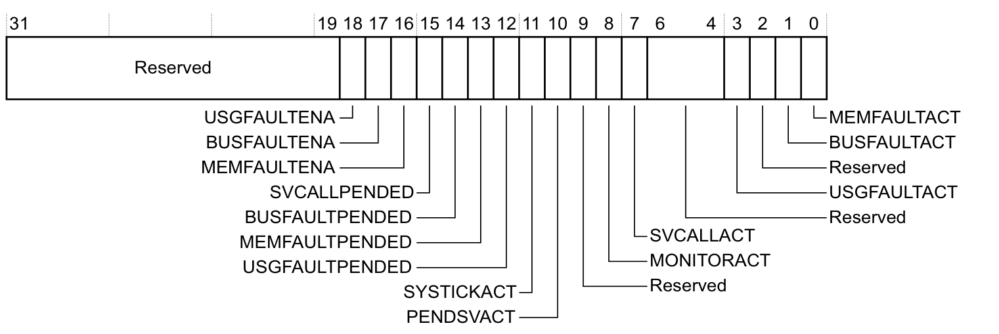

**Bits[31:19]**

保留。

**USGFAULTENA，bit[18]**

* **0**：禁用 **UsageFault**。
* **1**：使能 **UsageFault**。

**BUSFAULTENA，bit[17]**

* **0**：禁用 **BusFault**。
* **1**：使能 **BusFault**。

**MEMFAULTENA，bit[16]**

* **0**：禁用 **MemManage** 故障。
* **1**：使能 **MemManage** 故障。

**SVCALLPENDED，bit[15]**

* **0**：**SVCall** 未处于未决状态。
* **1**：**SVCall** 处于未决状态。

**BUSFAULTPENDED，bit[14]**

* **0**：**BusFault** 未处于未决状态。
* **1**：**BusFault** 处于未决状态。

**MEMFAULTPENDED，bit[13]**

* **0**：**MemManage** 未处于未决状态。
* **1**：**MemManage** 处于未决状态。

**USGFAULTPENDED，bit[12]**

* **0**：**UsageFault** 未处于未决状态。
* **1**：**UsageFault** 处于未决状态。

**SYSTICKACT，bit[11]**

* **0**：**SysTick** 未活动。
* **1**：**SysTick** 活动。

**PENDSVACT，bit[10]**

* **0**：**PendSV** 未活动。
* **1**：**PendSV** 活动。

**Bit[9]**

保留。

**MONITORACT，bit[8]**

* **0**：**Monitor** 未活动。
* **1**：**Monitor** 活动。

**SVCALLACT，bit[7]**

* **0**：**SVCall** 未活动。
* **1**：**SVCall** 活动。

**Bits[6:4]**

保留。

**USGFAULTACT，bit[3]**

* **0**：**UsageFault** 未活动。
* **1**：**UsageFault** 活动。

**Bit[2]**

保留。

**BUSFAULTACT，bit[1]**

* **0**：**BusFault** 未活动。
* **1**：**BusFault** 活动。

**MEMFAULTACT，bit[0]**

* **0**：**MemManage** 未活动。
* **1**：**MemManage** 活动。

**注意：** 当异常发生时，未决状态位 bits[15:12] 置为 **1**；当异常变为活动时，这些位清除为 **0**。

如果关联的异常是当前异常，或者是因为抢占而嵌套的异常，则活动状态位 bits[11:10, 8:7, 3, 1:0] 置为 **1**。

### 2.14. 可配置优先级故障的状态寄存器

**32** 位的 **CFSR** 由具有可配置优先级的故障的状态寄存器组成。软件可以访问组合的 **CFSR**，也可以使用字节或半字访问来访问各个可配置故障状态寄存器。

更多信息参见：

* 可配置故障状态寄存器 **CFSR**。
* **MemManage** 状态寄存器 **MMFSR**。
* 第 B3-610 页的 **BusFault** 状态寄存器 **BFSR**。
* 第 B3-611 页的 **UsageFault** 状态寄存器 **UFSR**。

### 2.15. 可配置故障状态寄存器，CFSR

**CFSR** 的特性如下：

**目的**

包含三个可配置故障状态寄存器。

**使用限制**

* 支持字节、对齐半字和字访问。
* 向寄存器位写 **1** 可清除对应的故障。
* 寄存器位是累加的，即如果发生多个故障，则所有关联位都置为 **1**。

**配置**

始终实现。

**属性**

参见第 B3-596 页的表 B3-4。

**CFSR** 的位分配如下：


**UsageFault，bits[31:16]**

提供 **UsageFault** 异常的信息。

**BusFault，bits[15:8]**

提供 **BusFault** 异常的信息。

**MemManage，bits[7:0]**

提供 **MemManage** 异常的信息。

#### 2.15.1. MemManage 状态寄存器，MMFSR

**MMFSR** 的特性如下：

**目的**

显示 **MPU** 故障的状态。

**使用限制**

* 支持字节访问。
* 向寄存器位写 **1** 可清除对应的故障。
* 寄存器位是累加的，即如果发生多个故障，则所有关联位都置为 **1**。
* **MMFSR** 是 **CFSR** 的 bits[7:0]。

**配置**

始终实现。

**属性**

参见第 B3-596 页的表 B3-4 中的 **CFSR** 条目。

**MMFSR** 的位分配如下：

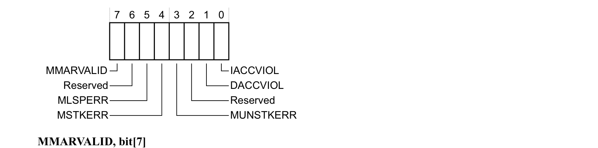

**MMARVALID，bit[7]**

* **0**：**MMFAR** 的内容无效。
* **1**：**MMFAR** 的内容有效。

**Bit[6]**

保留。

**MLSPERR，bit[5]**

* **0**：**FP** 惰性状态保存期间未发生 **MemManage** 故障。
* **1**：**FP** 惰性状态保存期间发生了 **MemManage** 故障。

**MSTKERR，bit[4]**

* **0**：未发生派生 **MemManage** 故障。
* **1**：异常进入时发生了派生 **MemManage** 故障。

**MUNSTKERR，bit[3]**

* **0**：未发生派生 **MemManage** 故障。
* **1**：异常返回时发生了派生 **MemManage** 故障。

**Bit[2]**

保留。

**DACCVIOL，bit[1]**

* **0**：未发生数据访问违规。
* **1**：数据访问违规。**MMFAR** 显示加载或存储试图访问的数据地址。

**IACCVIOL，bit[0]**

* **0**：未发生 **MPU** 或执行从不（**XN**）默认内存映射访问违规。
* **1**：取指时发生了 **MPU** 或执行从不（**XN**）默认内存映射访问违规。只有在指令被发出（issued）时才报告该故障。

#### 2.15.2. BusFault 状态寄存器，BFSR

**BFSR** 的特性如下：

**目的**

显示由指令预取和数据访问引起的总线错误状态。

**使用限制**

* 支持字节访问。
* 向寄存器位写 **1** 可清除对应的故障。
* 寄存器位是累加的，即如果发生多个故障，则所有关联位都置为 **1**。
* **BFSR** 是 **CFSR** 的 bits[15:8]。

外部总线故障能否精确报告由实现定义（**IMPLEMENTATION DEFINED**），实现可以将所有与数据访问关联的总线故障都报告为 **IMPRECISERR**。

**配置**

始终实现。

**属性**

参见第 B3-596 页的表 B3-4 中的 **CFSR** 条目。

**BFSR** 的位分配如下：

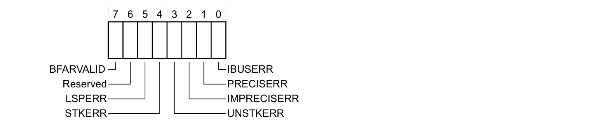

**BFARVALID，bit[7]**

* **0**：**BFAR** 的内容无效。
* **1**：**BFAR** 的内容有效。

**Bit[6]**

保留。

**LSPERR，bit[5]**

* **0**：**FP** 惰性状态保存期间未发生总线故障。
* **1**：**FP** 惰性状态保存期间发生了总线故障。

**STKERR，bit[4]**

* **0**：未发生派生总线故障。
* **1**：异常进入时发生了派生总线故障。

**UNSTKERR，bit[3]**

* **0**：未发生派生总线故障。
* **1**：异常返回时发生了派生总线故障。

**IMPRECISERR，bit[2]**

* **0**：未发生不精确数据访问错误。
* **1**：发生了不精确数据访问错误。

**PRECISERR，bit[1]**

* **0**：未发生精确数据访问错误。
* **1**：发生了精确数据访问错误，并且处理器已将故障地址写入 **BFAR**。

**IBUSERR，bit[0]**

* **0**：指令预取上未发生总线故障。
* **1**：指令预取上发生了总线故障。只有在指令被发出时才报告该故障。

#### 2.15.3. UsageFault 状态寄存器，UFSR

**UFSR** 的特性如下：

**目的**

包含某些指令执行故障以及数据访问故障的状态。

**使用限制**

* 支持字节和对齐半字访问。
* 向寄存器位写 **1** 可清除对应的故障。
* 故障位是累加的，即如果发生多个故障，则所有关联位都置为 **1**。
* **UFSR** 是 **CFSR** 的 bits[31:16]。

**配置**

始终实现。

**属性**

参见第 B3-596 页的表 B3-4 中的 **CFSR** 条目。

**UFSR** 的位分配如下：


**Bits[15:10]**

保留。

**DIVBYZERO，bit[9]**

* **0**：未发生除零错误。
* **1**：发生了除零错误。

当 **SDIV** 或 **UDIV** 指令使用的除数为 **0** 时，如果 **CCR** 中使能了 **DIV_0_TRP**，则发生该故障，参见第 B3-604 页的配置与控制寄存器 **CCR**。

**UNALIGNED，bit[8]**

* **0**：未发生非对齐访问错误。
* **1**：发生了非对齐访问错误。

多字访问如果不是字对齐则始终产生故障。软件可以通过在 **CCR** 中使能 **UNALIGN_TRP** 来配置非对齐字和半字访问产生故障，参见第 B3-604 页的配置与控制寄存器 **CCR**。

**Bits[7:4]**

保留。

**NOCP，bit[3]**

* **0**：未发生协处理器访问错误。
* **1**：发生了协处理器访问错误。这表明协处理器被禁用或不存在。

**INVPC，bit[2]**

* **0**：未发生完整性检查错误。
* **1**：**EXC_RETURN** 上发生了完整性检查错误。

**INVSTATE，bit[1]**

* **0**：**EPSR.T** 位和 **EPSR.IT** 位对指令执行有效。
* **1**：使用无效的 **EPSR.T** 或 **EPSR.IT** 字段执行了指令。

**UNDEFINSTR，bit[0]**

* **0**：未发生未定义指令 **Usage** 故障。
* **1**：处理器试图执行未定义指令。这可能是与已使能协处理器关联的未定义指令，参见第 A5-158 页的协处理器指令。

### 2.16. HardFault 状态寄存器，HFSR

**HFSR** 的特性如下：

**目的**

显示任何 **HardFault** 的原因。

**使用限制**

向寄存器位写 **1** 可清除对应的故障。

**配置**

始终实现。

**属性**

参见第 B3-596 页的表 B3-4。

**HFSR** 的位分配如下：

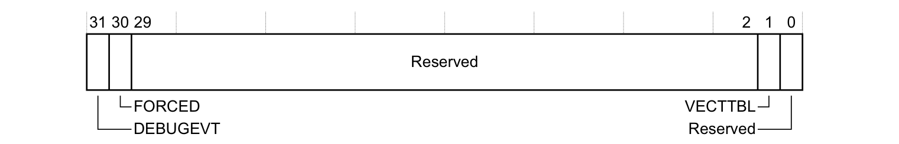

**DEBUGEVT，bit[31]**

指示何时发生了调试事件：

* **0**：未发生调试事件。
* **1**：发生了调试事件。调试故障状态寄存器已更新。

只有当暂停调试（**Halting debug**）被禁用且发生调试事件时，处理器才将该位置为 **1**，更多信息参见第 C1-694 页的调试事件行为。

**FORCED，bit[30]**

指示具有可配置优先级的故障因优先级原因或因其被禁用而无法变为活动，从而升级为 **HardFault** 异常：

* **0**：未发生优先级提升。
* **1**：处理器已将可配置优先级异常升级为 **HardFault**。

更多信息参见第 B1-529 页的优先级提升。

**Bits[29:2]**

保留。

**VECTTBL，bit[1]**

指示何时因异常处理期间的向量表读取错误而发生故障：

* **0**：未发生向量表读取故障。
* **1**：发生了向量表读取故障。

**Bit[0]**

保留。

### 2.17. MemManage 故障地址寄存器，MMFAR

**MMFAR** 的特性如下：

**目的**

显示导致 **MPU** 故障的内存位置的地址。

**使用限制**

仅当 **MMFSR.MMARVALID** 置位时有效，否则读为 **UNKNOWN**。

**配置**

始终实现。

**属性**

参见第 B3-596 页的表 B3-4。

**MMFAR** 的位分配如下：


**ADDRESS，bits[31:0]**

**MPU** 故障的数据地址。这是产生故障的加载或存储访问所寻址的位置。**MemManage** 状态寄存器显示故障原因以及 **MMFAR.ADDRESS** 是否有效。当非对齐访问产生故障时，该地址是实际产生故障的地址。由于访问可能被拆分为多个对齐的部分，该地址可以是所请求大小范围内的任意偏移。

在不具有独立 **BFAR** 和 **MFAR** 寄存器的实现中，如果 **BFSR.BFARVALID** 置位，则该寄存器的值为 **UNKNOWN**。

### 2.18. BusFault 地址寄存器，BFAR

**BFAR** 的特性如下：

**目的**

显示与精确数据访问故障关联的地址。

**使用限制**

仅当 **BFSR.BFARVALID** 置位时有效，否则读为 **UNKNOWN**。

**配置**

始终实现。

**属性**

参见第 B3-596 页的表 B3-4。

**BFAR** 的位分配如下：


**ADDRESS，bits[31:0]**

精确总线故障的数据地址。这是产生故障的数据访问所寻址的位置。**BFSR** 显示故障原因以及 **BFAR.ADDRESS** 是否有效，参见第 B3-610 页的 **BusFault** 状态寄存器 **BFSR**。

对于非对齐访问故障，返回的值是指令所请求的地址。这可能不是产生故障的地址。

在不具有独立 **BFAR** 和 **MFAR** 寄存器的实现中，如果 **MFSR.MMFARVALID** 置位，则该寄存器的值为 **UNKNOWN**。

### 2.19. 辅助故障状态寄存器，AFSR

**AFSR** 的特性如下：

**目的**

提供实现特定的故障状态信息和控制。

**使用限制**

该寄存器的内容为实现定义（**IMPLEMENTATION DEFINED**）。

**配置**

该寄存器的所有属性（包括是否实现）均为实现定义（**IMPLEMENTATION DEFINED**）。如果未实现，则该寄存器位置可以为 **RAZ/WI** 或 **UNK/SBZP**。

**属性**

参见第 B3-596 页的表 B3-4。

### 2.20. 协处理器访问控制寄存器，CPACR

**CPACR** 的特性如下：

**目的**

指定协处理器的访问权限。

**使用限制**

如果未实现某个协处理器，则向对应的 **CPACR** 字段写 **0b01** 或 **0b11** 再读回为 **0b00**。

**配置**

始终实现。

**属性**

参见第 B3-596 页的表 B3-4。

**CPACR** 的位分配如下：


**Bits[31:24, 19:16]**

保留，**UNK/SBZP**。

**CPn，bits[2n+1:2n]，n 取值 0-7、10 和 11**

协处理器 **n** 的访问权限，参见寄存器图。每个字段可能的取值如下：

* **0b00**：拒绝访问。任何尝试访问都会产生 **NOCP** **UsageFault**。
* **0b01**：仅特权访问。非特权访问会产生 **NOCP** **UsageFault**。
* **0b10**：保留。
* **0b11**：完全访问。

字段 **CP10** 和 **CP11** 共同控制对（如果实现了）浮点协处理器的访问。更多信息参见使能对浮点协处理器的访问。

协处理器 **CP8** 到 **CP15** 保留供 **Arm** 使用。在 **Armv7-M** 体系结构配置中，其中只有 **CP10** 和 **CP11** 被实现，参见使能对浮点协处理器的访问。

要测试某个协处理器是否实现，软件可以向 **CPn** 字段写 **0b01**，然后读取 **CPACR**。如果 **CPn** 字段读为零，则该协处理器未实现。

#### 2.20.1. 使能对浮点协处理器的访问

在实现浮点协处理器的处理器中，软件必须通过向 **CPACR.CP10** 和 **CPACR.CP11** 同时写入所需访问级别的值（如第 B3-614 页的协处理器访问控制寄存器 **CPACR** 中所定义）来使能对该协处理器的访问。向 **CPACR.CP10** 和 **CPACR.CP11** 写入不同值的效果不可预测（**UNPREDICTABLE**）。

**注意：** 在以下情况下，任何执行浮点指令的尝试都会产生 **NOCP** **UsageFault**：

* **CPACR.CP10** 为零。
* **CPACR.CP10** 为 **0b01**，且当前执行模式不是特权模式。

### 2.21. 浮点上下文控制寄存器，FPCCR

**FPCCR** 的特性如下：

**目的**

保存浮点单元的控制数据。

**使用限制**

只能由特权软件访问。如果未实现 **FP** 扩展，则 **FPCCR** 寄存器位置为保留。

在以下任一情况下，软件不得改变 **ASPEN** 位或 **LSPEN** 位的值：

* **CPACR** 允许访问 **CP10** 和 **CP11**，即允许访问 **FP** 扩展，参见第 B3-614 页的协处理器访问控制寄存器 **CPACR**。
* **CONTROL.FPCA** 位置为 **1**，参见第 B1-519 页的特殊用途 **CONTROL** 寄存器。

**配置**

仅当实现包含 **FP** 扩展时才实现。

**属性**

参见第 B3-597 页的表 B3-5 以及寄存器位描述。

**FPCCR** 的位分配如下：

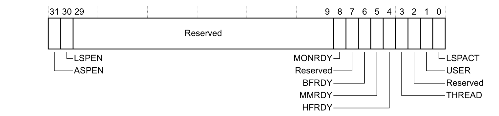

**ASPEN，bit[31]**

当该位置为 **1** 时，执行浮点指令会将 **CONTROL.FPCA** 位置为 **1**，参见第 B1-519 页的特殊用途 **CONTROL** 寄存器：

* **0**：执行 **FP** 指令对 **CONTROL.FPCA** 没有影响。
* **1**：执行 **FP** 指令将 **CONTROL.FPCA** 置为 **1**。

将该位置为 **1** 意味着硬件在异常进入时自动保存 **FP** 上下文，并在异常返回时恢复它。更多信息参见第 B1-537 页的带 **FP** 扩展的异常进入时的上下文状态压栈。

复位值为 **1**。

**LSPEN，bit[30]**

使能 **FP** 状态的惰性上下文保存：

* **0**：禁用自动惰性上下文保存。
* **1**：使能自动惰性上下文保存。

更多信息参见第 B1-538 页的 **FP** 状态的惰性上下文保存。

复位值为 **1**。

**Bits[29:9]**

保留。

**MONRDY，bit[8]**

指示处理器分配 **FP** 栈帧时正在执行的软件是否能够将 **DebugMonitor** 异常置为未决：

* **0**：无法将 **DebugMonitor** 异常置为未决。
* **1**：能够将 **DebugMonitor** 异常置为未决。

复位值为 **UNKNOWN**。

**Bit[7]**

保留。

**BFRDY，bit[6]**

指示处理器分配 **FP** 栈帧时正在执行的软件是否能够将 **BusFault** 异常置为未决：

* **0**：无法将 **BusFault** 异常置为未决。
* **1**：能够将 **BusFault** 异常置为未决。

复位值为 **UNKNOWN**。

**MMRDY，bit[5]**

指示处理器分配 **FP** 栈帧时正在执行的软件是否能够将 **MemManage** 异常置为未决：

* **0**：无法将 **MemManage** 异常置为未决。
* **1**：能够将 **MemManage** 异常置为未决。

复位值为 **UNKNOWN**。

**HFRDY，bit[4]**

指示处理器分配 **FP** 栈帧时正在执行的软件是否能够将 **HardFault** 异常置为未决：

* **0**：无法将 **HardFault** 异常置为未决。
* **1**：能够将 **HardFault** 异常置为未决。

复位值为 **UNKNOWN**。

**THREAD，bit[3]**

指示处理器分配 **FP** 栈帧时的处理器模式：

* **0**：**Handler** 模式。
* **1**：**Thread** 模式。

该位仅供故障处理程序使用信息，不与异常模型交互。

复位值为 **UNKNOWN**。

**Bit[2]**

保留。

**USER，bit[1]**

指示处理器分配 **FP** 栈帧时正在执行的软件的特权级别。

* **0**：特权。
* **1**：非特权。

复位值为 **UNKNOWN**。

**LSPACT，bit[0]**

指示 **FP** 状态的惰性保存是否处于活动状态：

* **0**：惰性状态保存未活动。
* **1**：惰性状态保存活动。

更多信息参见第 B1-538 页的 **FP** 状态的惰性上下文保存。

复位值为 **0**。

对于 **MONRDY**、**BFRDY**、**MMRDY** 和 **HFRDY**，"能够"表示该异常已使能，且软件正以足够的优先级执行，从而可以将该异常的状态置为未决。这些位的值不指示是否曾尝试将对应异常置为未决。

### 2.22. 浮点上下文地址寄存器，FPCAR

**FPCAR** 的特性如下：

**目的**

保存在异常栈帧上分配的未填充浮点寄存器空间的位置。**FPCAR** 指向为 **S0** 保留的栈位置。

**使用限制**

只能由特权软件访问。如果未实现 **FP** 扩展，则 **FPCAR** 寄存器位置为保留。

**配置**

仅当实现包含 **FP** 扩展时才实现。

**属性**

参见第 B3-597 页的表 B3-5 以及寄存器位描述。

**FPCAR** 的位分配如下：


**ADDRESS，bits[31:3]**

在异常栈帧上分配的未填充浮点寄存器空间的位置。

**Bits[2:0]**

保留。**RAZ/WI**。

有关 **FPCAR** 用途的更多信息，参见第 B1-538 页的 **FP** 状态的惰性上下文保存。

### 2.23. 浮点默认状态控制寄存器，FPDSCR

**FPDSCR** 的特性如下：

**目的**

保存处理器在创建新的浮点上下文时赋给 **FPSCR** 的浮点状态控制数据的默认值。

**使用限制**

只能由特权软件访问。如果未实现 **FP** 扩展，则 **FPDSCR** 寄存器位置为保留。

为 **FPSCR** 提供初始值，参见第 A2-37 页的浮点状态与控制寄存器 **FPSCR**。

**配置**

仅当实现包含 **FP** 扩展时才实现。

**属性**

参见第 B3-597 页的表 B3-5。

**FPDSCR** 的位分配如下：

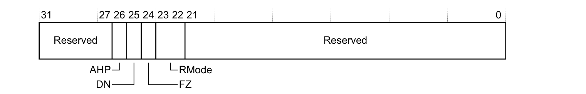

**Bits[31:27]**

保留。

**AHP，bit[26]**

**FPSCR.AHP** 的默认值。

**DN，bit[25]**

**FPSCR.DN** 的默认值。

**FZ，bit[24]**

**FPSCR.FZ** 的默认值。

**RMode，bits[23:22]**

**FPSCR.RMode** 的默认值。

**Bits[21:0]**

保留。

### 2.24. 中断控制器类型寄存器，ICTR

**ICTR** 的特性如下：

**目的**

提供中断控制器的信息。

**使用限制**

没有使用限制。

**配置**

始终实现。

**属性**

参见第 B3-597 页的表 B3-6。

**ICTR** 的位分配如下：


**Bits[31:4]**

保留。

**INTLINESNUM，bits[3:0]**

实现支持的中断线总数，以 **32** 为一组定义。也就是说，中断线总数最多为 (32*(**INTLINESNUM**+1))。不过，中断的绝对最大数量为 **496**，对应 **INTLINESNUM** 值为 **0b1111**。

**INTLINESNUM** 指示 **NVIC** 寄存器映射中实现了哪些寄存器，参见第 B3-626 页的已实现的 **NVIC** 寄存器。

### 2.25. 辅助控制寄存器，ACTLR

**ACTLR** 的特性如下：

**目的**

提供实现定义（**IMPLEMENTATION DEFINED**）的配置与控制选项。

**使用限制**

该寄存器可能具有实现定义（**IMPLEMENTATION DEFINED**）的使用限制。

**配置**

始终实现。该寄存器的内容为实现定义（**IMPLEMENTATION DEFINED**）。

**属性**

参见第 B3-597 页的表 B3-6。

### 2.26. 软件触发中断寄存器，STIR

**STIR** 的特性如下：

**目的**

为软件提供产生中断的机制。

**使用限制**

该寄存器仅适用于已实现的外部中断。

**配置**

始终实现。

**属性**

参见第 B3-597 页的表 B3-6。

**STIR** 的位分配如下：


**Bits[31:9]**

保留。

**INTID，bits[8:0]**

指示要触发的中断。写入的值为 (**ExceptionNumber** - 16)，参见第 B1-525 页的异常编号定义。

向该寄存器写入与将 **NVIC ISPR** 中对应中断的位，置为 **1** 的效果相同，参见第 B3-629 页的中断置未决寄存器 **NVIC_ISPR0-NVIC_ISPR15**。

## 3. 系统定时器，SysTick

**Armv7-M** 实现必须包含系统定时器 **SysTick**，它提供一个简单的、**24** 位、写清零、递减、计到零回绕的计数器，并具有灵活的控制机制。系统可以以多种不同方式使用该计数器，包括：

* 作为 **RTOS** 节拍定时器，以可编程频率（例如 **100Hz**）触发，并在每次触发时调用 **SysTick** 例程。
* 使用主处理器时钟作为高速闹钟定时器。
* 作为可变速率闹钟或信号定时器。可用的时长范围取决于所使用的参考时钟和计数器的动态范围。
* 作为简单计数器。软件可以使用它来测量完成所需时间和已用时间。
* 作为基于时长未满足或已满足的内部时钟源控制。软件可以使用控制与状态寄存器中的 **COUNTFLAG** 字段来确定某个动作是否在特定时长内完成，作为动态时钟管理控制环路的一部分。

### 3.1. SysTick 操作

该定时器由四个寄存器组成：

* 一个控制与状态寄存器。它配置 **SysTick** 时钟、使能计数器、使能 **SysTick** 中断，并指示计数器状态。
* 一个计数器重载值寄存器。它为计数器提供回绕值。
* 一个计数器当前值寄存器。
* 一个校准值寄存器。它指示 **10ms**（**100Hz**）系统时钟所需的重载值。

使能后，定时器从 **SYST_CVR** 中的值开始递减，参见第 B3-622 页的 **SysTick** 当前值寄存器 **SYST_CVR**。当计数器到达零时，它在下一个时钟边沿重载 **SYST_RVR** 中的值，参见第 B3-622 页的 **SysTick** 重载值寄存器 **SYST_RVR**。随后它在后续时钟上递减。计数器到达零时发生的这种重载称为回绕（**wrapping**）。

当计数器转换为零时，它将 **COUNTFLAG** 状态位置为 **1**。读取 **COUNTFLAG** 状态位会将其清除为 **0**。

写入 **SYST_CVR** 会将寄存器和 **COUNTFLAG** 状态位都清为零。这会使 **SysTick** 逻辑在下一个定时器时钟从 **SYST_RVR** 重载 **SYST_CVR**。对 **SYST_CVR** 的写入不会触发 **SysTick** 异常逻辑。

读取 **SYST_CVR** 返回访问该寄存器时的计数器值。

向 **SYST_RVR** 写零值会在下一次回绕时禁用计数器。回绕后，**SysTick** 计数器逻辑保持该计数器值为零。

**注意：**

* 将 **SYST_RVR** 设为零会独立于计数器使能位地禁用 **SysTick** 计数器。
* **SYST_CVR** 的值在复位时为 **UNKNOWN**。在使能 **SysTick** 计数器之前，软件必须将所需的计数值写入 **SYST_RVR**，然后写入 **SYST_CVR**。这样会将 **SYST_CVR** 清为零。使能后，计数器从 **SYST_RVR** 重载值并从该值开始递减，而不是从任意值开始。

软件可以使用校准值 **TENMS** 在计数器的动态范围内将计数器调整为其他所需的时钟频率。

当处理器在调试状态下暂停时，计数器不递减。

该定时器由参考时钟驱动。参考时钟是处理器时钟还是外部时钟源由实现定义。如果实现使用外部时钟，则必须记录处理器时钟与外部参考时钟之间的关系。这是系统定时校准所必需的，需考虑亚稳态、时钟偏斜（**clock skew**）和抖动（**jitter**）。

### 3.2. SCS 中的系统定时器寄存器支持

表 B3-7 汇总了 **SCS** 地址映射中提供的寄存器支持。所列所有寄存器都是 **32** 位宽。有关完整 **SCS** 地址映射的更多信息，参见第 B3-595 页的系统控制空间 **SCS**。

表 B3-7 **SysTick** 寄存器汇总

| 地址 | 名称 | 类型 | 复位值 | 说明 |
| --- | --- | --- | --- | --- |
| 0xE000E010 | SYST_CSR | RW | 0x0000000aᵃ | **SysTick** 控制与状态寄存器，**SYST_CSR** |
| 0xE000E014 | SYST_RVR | RW | UNKNOWN | **SysTick** 重载值寄存器，**SYST_RVR**，参见第 B3-622 页 |
| 0xE000E018 | SYST_CVR | RW | UNKNOWN | **SysTick** 当前值寄存器，**SYST_CVR**，参见第 B3-622 页 |
| 0xE000E01C | SYST_CALIB | RO | IMP DEF | **SysTick** 校准值寄存器，**SYST_CALIB**，参见第 B3-623 页 |
| 0xE000E020 - 0xE000E0FC | - | - | - | 保留 |

a. 有关 **SYST_CSR** 位 [2] 复位值的信息，参见寄存器描述。所有其他位复位为 **0**。

### 3.3. SysTick 控制与状态寄存器，SYST_CSR

**SYST_CSR** 的特性如下：

**目的**

控制系统定时器并提供状态数据。

**使用限制**

没有使用限制。

**配置**

始终实现。

**属性**

参见表 B3-7 以及 **CLKSOURCE** 位的描述。

**SYST_CSR** 的位分配如下：

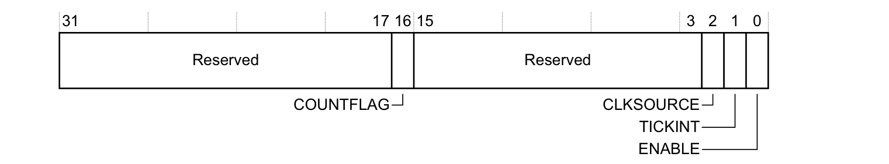

**Bits[31:17]**

保留。

**COUNTFLAG，bit[16]**

指示自上次读取该寄存器以来计数器是否已计到 **0**：

* **0**：定时器尚未计到 **0**。
* **1**：定时器已计到 **0**。

**COUNTFLAG** 由 **1** 到 **0** 的计数转换置为 **1**。

**COUNTFLAG** 由软件读取该寄存器以及任何对当前值寄存器的写入清除为 **0**。调试器读取不会清除 **COUNTFLAG**。

该位只读。

**Bits[15:3]**

保留。

**CLKSOURCE，bit[2]**

指示 **SysTick** 时钟源：

* **0**：**SysTick** 使用实现定义（**IMPLEMENTATION DEFINED**）的外部参考时钟。
* **1**：**SysTick** 使用处理器时钟。

如果未提供外部时钟，则该位读为 **1** 并忽略写入。

**TICKINT，bit[1]**

指示计数到 **0** 是否使 **SysTick** 异常的状态变为未决：

* **0**：计到 **0** 不影响 **SysTick** 异常状态。
* **1**：计到 **0** 将 **SysTick** 异常状态变为未决。

通过向 **SysTick** 当前值寄存器写零来将计数器值变为 **0**，绝不会改变 **SysTick** 异常的状态。

**ENABLE，bit[0]**

指示 **SysTick** 计数器的使能状态：

* **0**：计数器禁用。
* **1**：计数器正在运行。

### 3.4. SysTick 重载值寄存器，SYST_RVR

**SYST_RVR** 的特性如下：

**目的**

保存 **SYST_CVR** 的重载值。

**使用限制**

没有使用限制。

**配置**

始终实现。

**属性**

参见第 B3-621 页的表 B3-7。

**SYST_RVR** 的位分配如下：


**Bits[31:24]**

保留，**RAZ/WI**。

**RELOAD，bits[23:0]**

计数器到达 **0** 时要加载到 **SYST_CVR** 的值。

### 3.5. SysTick 当前值寄存器，SYST_CVR

**SYST_CVR** 的特性如下：

**目的**

读取或清除当前计数器值。

**使用限制**

* 对该寄存器的任何写入都会将寄存器清为零。
* 计数器不提供读-改-写保护。
* 不支持的位读为零，参见 **SysTick** 重载值寄存器 **SYST_RVR**。

**配置**

始终实现。

**属性**

参见第 B3-621 页的表 B3-7。

**SYST_CVR** 的位分配如下：


**CURRENT，bits[31:0]**

当前计数器值。

这是采样时刻的计数器值。

### 3.6. SysTick 校准值寄存器，SYST_CALIB

**SYST_CALIB** 寄存器的特性如下：

**目的**

读取 **SysTick** 的校准值和参数。

**使用限制**

没有使用限制。

**配置**

始终实现。

**属性**

参见第 B3-621 页的表 B3-7。

**SYST_CALIB** 的位分配如下：

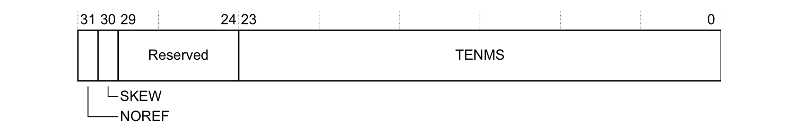

**NOREF，bit[31]**

指示是否实现了实现定义（**IMPLEMENTATION DEFINED**）的参考时钟：

* **0**：实现了参考时钟。
* **1**：未实现参考时钟。

当该位为 **1** 时，**SYST_CSR** 寄存器的 **CLKSOURCE** 位强制为 **1**，且不能清除为 **0**。

**SKEW，bit[30]**

指示 **10ms** 校准值是否精确：

* **0**：**10ms** 校准值精确。
* **1**：**10ms** 校准值因时钟频率而不精确。

**Bits[29:24]**

保留。

**TENMS，bits[23:0]**

可选地保存用于 **10ms**（**100Hz**）计时的重载值，但受系统时钟偏斜误差影响。如果该字段为零，则校准值未知。

## 4. 嵌套向量中断控制器，NVIC

**Armv7-M** 将中断控制器作为 **Armv7-M** 异常模型的组成部分提供。该中断控制器的操作与 **Arm** 通用中断控制器（**GIC**）规范一致，该规范是为与其他 **Armv7** 配置和其他体系结构配合使用而定义的。

**Armv7-M NVIC** 体系结构最多支持 **496** 个中断。支持的外部中断线数量可以从只读的中断控制器类型寄存器（**ICTR**）确定，该寄存器位于系统控制空间中地址 **0xE000E004**。有关寄存器细节，参见第 B3-618 页的中断控制器类型寄存器 **ICTR**。与 **NVIC** 关联的通用寄存器都可以从系统控制空间中的一块内存访问，如第 B3-626 页的表 B3-8 所述。

### 4.1. NVIC 操作

**Armv7-M** 支持电平敏感和脉冲敏感的中断行为。这意味着电平敏感中断和脉冲敏感中断都可以被处理。脉冲中断源必须保持足够长的时间，以便处理器时钟能够可靠地采样到它，从而确保其被锁存并变为未决。后续的脉冲可以将未决状态添加到活动中断上，使该中断的状态为活动和未决。不过，在活动期间发生的多个脉冲只会登记为中断调度的一个事件。

概括如下：

* 保持一个时钟周期的脉冲的作用类似于边沿敏感中断。这些脉冲可以在中断活动期间再次变为未决。

**注意：** 在 **AIRCR.VECTCLRACTIVE** 的置位或相关异常返回之前，必须先清除脉冲，否则中断信号将表现为电平敏感输入，未决位会再次被置位。

* 基于电平的中断变为未决，然后使该中断变为活动。中断服务例程（**ISR**）随后访问外设，使其中断取消断言。如果从 **ISR** 返回时中断仍处于断言状态，则它再次变为未决。

作为 **Armv7-M** 异常模型及其优先级策略的一部分，所有 **NVIC** 中断都有一个可编程优先级值和一个关联的异常编号。

**NVIC** 支持以下特性：

* 可以通过写入对应的中断置使能寄存器或中断清使能寄存器的位字段来使能和禁用 **NVIC** 中断。这些寄存器使用写 **1** 使能和写 **1** 清除的策略，两个寄存器都会回读对应（**32** 个）中断的当前使能状态。

当某个中断被禁用时，中断断言会使该中断变为未决，但该中断无法变为活动。如果某个中断在被禁用时处于活动状态，则它保持活动状态，直到通过复位或异常返回将其清除。清除使能位会阻止该中断的任何新的激活。

如果关联的中断线不存在，实现可以将中断使能位硬连线为零；如果关联的中断线无法禁用，则实现可以将这些位硬连线为一。

* 软件可以使用一对互补寄存器（置未决寄存器和清未决寄存器）来设置或移除 **NVIC** 中断的未决状态。这些寄存器使用写一使能和写一清除的策略，读取任一寄存器都会返回对应 **32** 个中断的当前未决状态。向清未决寄存器的某位写 **1** 对活动中断的执行状态没有影响。

对于每条支持的中断线，是否支持软件控制下的置未决和清未决（或两者），由实现定义（**IMPLEMENTATION DEFINED**）。

* 提供活动位状态，使软件能够确定中断是未活动、活动、未决，还是活动和未决。
* **NVIC** 中断通过更新 **32** 位寄存器中的 **8** 位字段（每个寄存器支持四个中断）来进行优先级排序。优先级按照 **Armv7-M** 优先级方案进行维护，参见第 B1-526 页的异常优先级与抢占。

除了外部硬件事件或软件将置未决寄存器中适当的位——置为 **1** 之外，软件还可以通过将其中断编号写入 **STIR** 来将外部中断置为未决状态，参见第 B3-619 页的软件触发中断寄存器 **STIR**。

**注意：** 外部中断的中断编号为它的 (**ExceptionNumber** - 16)。

#### 4.1.1. 外部中断输入行为

以下伪代码描述了外部中断输入与 **NVIC** 行为之间的关系：

```arm
// 定义
// ===========
NVIC[] 是一组高电平有效的外部中断输入信号数组；
    // 信号类型（电平或脉冲）及其断言电平/沿为 IMPLEMENTATION DEFINED
    // 且所有输入可能不同
boolean Edge(integer INTNUM);    // 如果在时钟沿 NVIC[INTNUM] 从 '0' 变为 '1'，则返回 true
boolean NVIC_Pending[INTNUM];    // 外部中断的未决状态位数组
integer INTNUM;                  // 外部中断编号
    // WriteToRegField 辅助函数在向 RegName 寄存器的 FieldNumber
    // 字段写入 '1' 事件时返回 TRUE。
boolean WriteToRegField(register RegName, integer FieldNumber)
boolean ExceptionIN(integer INTNUM);   // 如果正在进入异常以激活 INTNUM，则返回 TRUE
boolean ExceptionOUT(integer INTNUM);  // 如果正在从活动的 INTNUM 返回异常，则返回 TRUE
// 中断接口
// ===================
sampleInterruptHi = WriteToRegField(AIRCR, VECTCLRACTIVE) || ExceptionOUT(INTNUM);
sampleInterruptLo = WriteToRegField(ICPR, INTNUM);
InterruptAssertion   =  Edge(INTNUM) || (NVIC[INTNUM] && sampleInterruptHi);
InterruptDeassertion =  !NVIC[INTNUM] && sampleInterruptLo;
// NVIC 行为
// =============
clearPend = ExceptionIN(INTNUM) || InterruptDeassertion;
setPend   = InterruptAssertion || WriteToRegField(ISPR, INTNUM);
if clearPend && setPend then
    IMPLEMENTATION DEFINED whether NVIC_Pending[INTNUM] is TRUE or FALSE;
else
    NVIC_Pending[INTNUM] = setPend || (NVIC_Pending[INTNUM] && !clearPend);
```

### 4.2. 已实现的中断

哪些 **NVIC** 中断被实现由实现定义（**IMPLEMENTATION DEFINED**）。如果某个特定的 **NVIC** 中断线未实现，则其关联的寄存器为保留。

这意味着当某条中断线未实现时，其对应的置使能、清使能以及置未决、清未决位在被软件访问时表现为 **RAZ/WI**。

### 4.3. SCS 中的 NVIC 寄存器支持

与中断控制器配合使用的以下寄存器位于 **SCS** 的系统控制区域：

**ICTR**

一个只读寄存器，提供实现所支持的外部中断数量的信息，参见第 B3-618 页的中断控制器类型寄存器 **ICTR**。

**STIR**

一个只写寄存器，软件可以使用它将外部中断的状态变为未决，参见第 B3-619 页的软件触发中断寄存器 **STIR**。

系统控制区域还包括作为通用异常模型一部分应用于 **NVIC** 的状态和配置寄存器。有关系统控制区域的更多信息，参见第 B3-595 页的系统控制空间 **SCS**。

外部中断的其余寄存器位于 **SCS** 的 **NVIC** 区域，如表 B3-8 所示。所有这些寄存器都是 **32** 位宽。

表 B3-8 **NVIC** 寄存器汇总

| 地址 | 名称 | 类型 | 复位值 | 说明 |
| --- | --- | --- | --- | --- |
| 0xE000E100 - 0xE000E13C | NVIC_ISER0 - NVIC_ISER15 | RW | 0x00000000 | 中断置使能寄存器，**NVIC_ISER0-NVIC_ISER15**，参见第 B3-628 页 |
| 0xE000E180 - 0xE000E1BC | NVIC_ICER0 - NVIC_ICER15 | RW | 0x00000000 | 中断清使能寄存器，**NVIC_ICER0-NVIC_ICER15**，参见第 B3-628 页 |
| 0xE000E200 - 0xE000E23C | NVIC_ISPR0 - NVIC_ISPR15 | RW | 0x00000000 | 中断置未决寄存器，**NVIC_ISPR0-NVIC_ISPR15**，参见第 B3-629 页 |
| 0xE000E280 - 0xE000E2BC | NVIC_ICPR0 - NVIC_ICPR15 | RW | 0x00000000 | 中断清未决寄存器，**NVIC_ICPR0-NVIC_ICPR15**，参见第 B3-629 页 |
| 0xE000E300 - 0xE000E33C | NVIC_IABR0 - NVIC_IABR15 | RO | 0x00000000 | 中断活动位寄存器，**NVIC_IABR0-NVIC_IABR15**，参见第 B3-630 页 |
| 0xE000E340 - 0xE000E3FC | - | - | - | 保留 |
| 0xE000E400 - 0xE000E5EC | NVIC_IPR0 - NVIC_IPR123 | RW | 0x00000000 | 中断优先级寄存器，**NVIC_IPR0-NVIC_IPR123**，参见第 B3-630 页 |
| 0xE000E5F0 - 0xE000ECFC | - | - | - | 保留 |

#### 4.3.1. 已实现的 NVIC 寄存器

**ICTR.INTLINESNUM** 指示已实现外部中断的最大数量，参见第 B3-618 页的中断控制器类型寄存器 **ICTR**。该最大数量的粒度为 **32** 个中断，并决定每种 **NVIC** 寄存器类型中已实现的寄存器数量：

* 对于 **NVIC_ISER**、**NVIC_ICER**、**NVIC_ISPR**、**NVIC_ICPR** 和 **NVIC_IABR**，每个寄存器都有一位对应 **32** 个中断中的每一个。以 **NVIC_ISER** 为例，第 B3-627 页的表 B3-9 显示了 **ICTR.INTLINESNUM** 如何决定已实现的寄存器数量。

如果处理器实现最大 **496** 个中断，则实现寄存器 **15**，其中 bits[31:16] 为保留，bits[15:0] 对应中断 **480-495**。

* 对于 **NVIC_IPR**，每个寄存器有四个 **8** 位字段，每个字段对应一个中断，第 B3-627 页的表 B3-10 显示了 **ICTR.INTLINESNUM** 如何决定已实现的寄存器数量。
* 未实现的 **NVIC** 寄存器为保留。

表 B3-9 已实现的 **NVIC** 寄存器（**NVIC_IPR** 除外）

| ICTR.INTLINESNUM | 最大中断数 | 最后实现的 NVIC_ISER | 对应中断 |
| --- | --- | --- | --- |
| 0b0000 | 32 | NVIC_ISER0 | 0-31 |
| 0b0001 | 64 | NVIC_ISER1 | 32-63 |
| 0b0010 | 96 | NVIC_ISER2 | 64-95 |
| 0b0011 | 128 | NVIC_ISER3 | 96-127 |
| 0b0100 | 160 | NVIC_ISER4 | 128-159 |
| 0b0101 | 192 | NVIC_ISER5 | 160-191 |
| 0b0110 | 224 | NVIC_ISER6 | 192-223 |
| 0b0111 | 256 | NVIC_ISER7 | 224-255 |
| 0b1000 | 288 | NVIC_ISER8 | 256-287 |
| 0b1001 | 320 | NVIC_ISER9 | 288-319 |
| 0b1010 | 352 | NVIC_ISER10 | 320-351 |
| 0b1011 | 384 | NVIC_ISER11 | 352-383 |
| 0b1100 | 416 | NVIC_ISER12 | 384-415 |
| 0b1101 | 448 | NVIC_ISER13 | 416-447 |
| 0b1110 | 480 | NVIC_ISER14 | 448-479 |
| 0b1111 | 496 | NVIC_ISER15 | 480-495 |

表 B3-10 已实现的 **NVIC_IPR**

| ICTR.INTLINESNUM | 最大中断数 | 最后实现的 NVIC_IPR | 对应中断 |
| --- | --- | --- | --- |
| 0b0000 | 32 | NVIC_IPR7 | 28-31 |
| 0b0001 | 64 | NVIC_IPR15 | 60-63 |
| 0b0010 | 96 | NVIC_IPR23 | 92-95 |
| 0b0011 | 128 | NVIC_IPR31 | 124-127 |
| 0b0100 | 160 | NVIC_IPR39 | 156-159 |
| 0b0101 | 192 | NVIC_IPR47 | 188-191 |
| 0b0110 | 224 | NVIC_IPR55 | 220-223 |
| 0b0111 | 256 | NVIC_IPR63 | 252-255 |
| 0b1000 | 288 | NVIC_IPR71 | 284-287 |
| 0b1001 | 320 | NVIC_IPR79 | 316-319 |
| 0b1010 | 352 | NVIC_IPR87 | 348-351 |
| 0b1011 | 384 | NVIC_IPR95 | 380-383 |
| 0b1100 | 416 | NVIC_IPR103 | 412-415 |
| 0b1101 | 448 | NVIC_IPR111 | 444-447 |
| 0b1110 | 480 | NVIC_IPR119 | 476-479 |
| 0b1111 | 496 | NVIC_IPR123 | 492-495 |

### 4.4. 中断置使能寄存器，NVIC_ISER0-NVIC_ISER15

**NVIC_ISERn** 的特性如下：

**目的**

使能一组中断，或读取一组中断的使能状态。

**使用限制**

**NVIC_ISERn[31:0]** 是中断 (31+(32*n)) - (32*n) 的置使能位。

当 n=15 时，bits[31:16] 为保留。

**配置**

至少始终实现一个寄存器，参见第 B3-626 页的已实现的 **NVIC** 寄存器。

**属性**

参见第 B3-626 页的表 B3-8。

**NVIC_ISERn** 的位分配如下：


**SETENA，bits[m]**

对于寄存器 **NVIC_ISERn**，使能中断 (m+(32*n)) 或显示其当前使能状态：

* **0**：读取时，中断禁用。写入时，无效果。
* **1**：读取时，中断使能。写入时，使能中断。

m 取值从 **31** 到 **0**，但对于 **NVIC_ISER15**：

* m 取值从 **15** 到 **0**。
* 寄存器 bits[31:16] 为保留，**RAZ/WI**。

软件可以在一次对 **NVIC_ISERn** 的写入中使能多个中断。

### 4.5. 中断清使能寄存器，NVIC_ICER0-NVIC_ICER15

**NVIC_ICERn** 的特性如下：

**目的**

禁用一组中断，或读取一组中断的使能状态。

**使用限制**

**NVIC_ICERn[31:0]** 是中断 (31+(32*n)) - (32*n) 的清使能位。

当 n=15 时，bits[31:16] 为保留。

**配置**

至少始终实现一个寄存器，参见第 B3-626 页的已实现的 **NVIC** 寄存器。

**属性**

参见第 B3-626 页的表 B3-8。

**NVIC_ICERn** 的位分配如下：


**CLRENA，bits[m]**

对于寄存器 **NVIC_ICERn**，禁用中断 (m+(32*n)) 或显示其当前使能状态：

* **0**：读取时，中断禁用。写入时，无效果。
* **1**：读取时，中断使能。写入时，禁用中断。

m 取值从 **31** 到 **0**，但对于 **NVIC_ICER15**：

* m 取值从 **15** 到 **0**。
* 寄存器 bits[31:16] 为保留，**RAZ/WI**。

软件可以在一次对 **NVIC_ICERn** 的写入中禁用多个中断。

### 4.6. 中断置未决寄存器，NVIC_ISPR0-NVIC_ISPR15

**NVIC_ISPRn** 的特性如下：

**目的**

对于一组中断，将中断状态变为未决，或显示当前未决状态。

**使用限制**

**NVIC_ISPRn[31:0]** 是中断 (31+(32*n)) - (32*n) 的置未决位。

当 n=15 时，bits[31:16] 为保留。

**配置**

至少始终实现一个寄存器，参见第 B3-626 页的已实现的 **NVIC** 寄存器。

**属性**

参见第 B3-626 页的表 B3-8。

**NVIC_ISPRn** 的位分配如下：


**SETPEND，bits[m]**

对于寄存器 **NVIC_ISPRn**，将中断 (m+(32*n)) 的状态变为未决，或显示该中断的状态是否为未决：

* **0**：读取时，中断未处于未决状态。写入时，无效果。
* **1**：读取时，中断处于未决状态。写入时，将中断状态变为未决。

m 取值从 **31** 到 **0**，但对于 **NVIC_ISPR15**：

* m 取值从 **15** 到 **0**。
* 寄存器 bits[31:16] 为保留，**RAZ/WI**。

软件可以在一次对 **NVIC_ISPRn** 的写入中将多个中断置为未决状态。

### 4.7. 中断清未决寄存器，NVIC_ICPR0-NVIC_ICPR15

**NVIC_ICPRn** 的特性如下：

**目的**

对于一组中断，清除中断未决状态，或显示当前未决状态。

**使用限制**

**NVIC_ICPRn[31:0]** 是中断 (31+(32*n)) - (32*n) 的清未决位。

当 n=15 时，bits[31:16] 为保留。

**配置**

至少始终实现一个寄存器，参见第 B3-626 页的已实现的 **NVIC** 寄存器。

**属性**

参见第 B3-626 页的表 B3-8。

**NVIC_ICPRn** 的位分配如下：


**CLRPEND，bits[m]**

对于寄存器 **NVIC_ICPRn**，清除中断 (m+(32*n)) 的未决状态，或显示该中断的状态是否为未决：

* **0**：读取时，中断未处于未决状态。写入时，无效果。
* **1**：读取时，中断处于未决状态。写入时，清除该中断的未决状态。

m 取值从 **31** 到 **0**，但对于 **NVIC_ICPR15**：

* m 取值从 **15** 到 **0**。
* 寄存器 bits[31:16] 为保留，**RAZ/WI**。

软件可以在一次对 **NVIC_ICPRn** 的写入中清除多个中断的未决状态。

### 4.8. 中断活动位寄存器，NVIC_IABR0-NVIC_IABR15

**NVIC_IABRn** 的特性如下：

**目的**

对于一组 **32** 个中断，显示每个中断是否活动。

**使用限制**

**NVIC_IABRn[31:0]** 是中断 (31+(32*n)) - (32*n) 的活动位。

当 n=15 时，bits[31:16] 为保留。

**配置**

至少始终实现一个寄存器，参见第 B3-626 页的已实现的 **NVIC** 寄存器。

**属性**

参见第 B3-626 页的表 B3-8。

**NVIC_IABRn** 的位分配如下：


**ACTIVE，bits[m]**

对于寄存器 **NVIC_IABRn**，显示中断 (m+(32*n)) 是否活动：

* **0**：中断未活动。
* **1**：中断活动。

m 取值从 **31** 到 **0**，但对于 **NVIC_IABR15**：

* m 取值从 **15** 到 **0**。
* 寄存器 bits[31:16] 为保留，**RAZ/WI**。

### 4.9. 中断优先级寄存器，NVIC_IPR0-NVIC_IPR123

**NVIC_IPRn** 寄存器的特性如下：

**目的**

设置或读取中断优先级。

**使用限制**

这些寄存器支持字节、对齐半字和字访问。

**配置**

已实现的 **NVIC_IPR** 数量是 **8** 的倍数，且至少实现 **8** 个寄存器，参见第 B3-626 页的已实现的 **NVIC** 寄存器。

**属性**

参见第 B3-626 页的表 B3-8。

**NVIC_IPRn** 的位分配如下：


**PRI_N3，bits[31:24]**

对于寄存器 **NVIC_IPRn**，中断号 4n+3 的优先级。

**PRI_N2，bits[23:16]**

对于寄存器 **NVIC_IPRn**，中断号 4n+2 的优先级。

**PRI_N1，bits[15:8]**

对于寄存器 **NVIC_IPRn**，中断号 4n+1 的优先级。

**PRI_N0，bits[7:0]**

对于寄存器 **NVIC_IPRn**，中断号 4n 的优先级。


