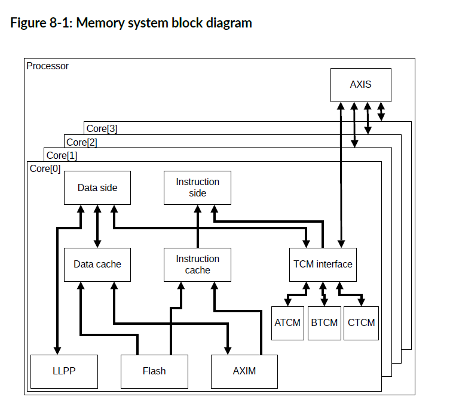
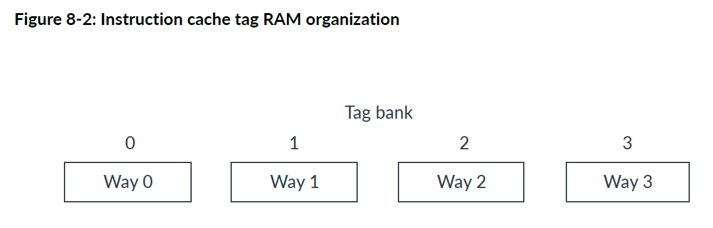
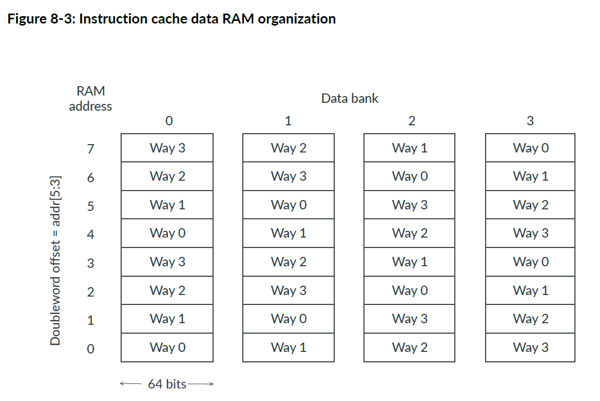
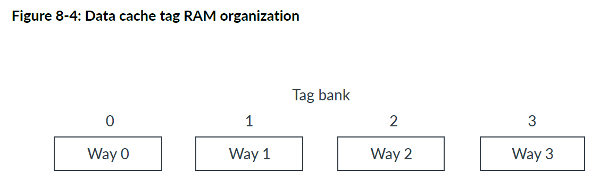
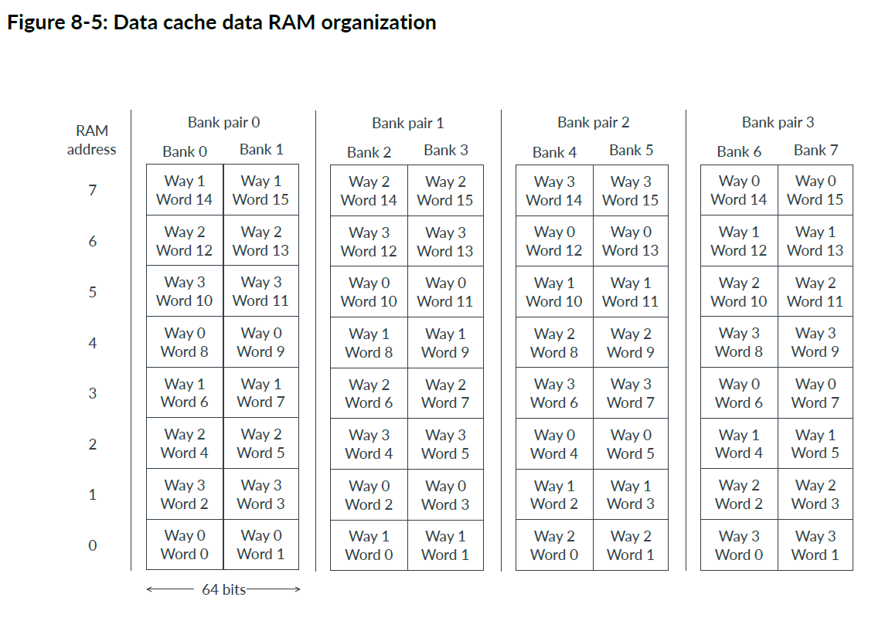
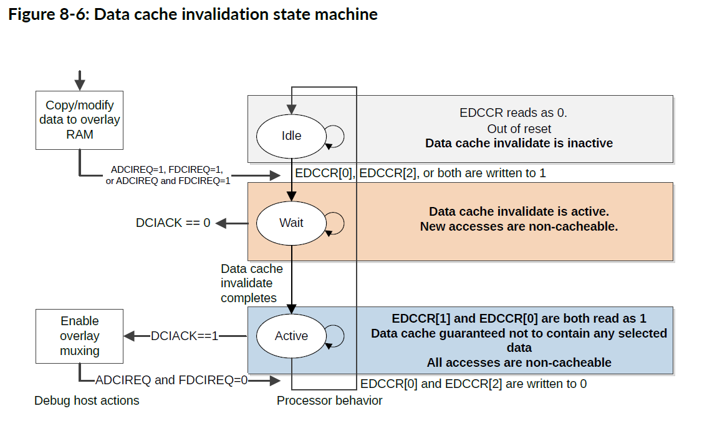
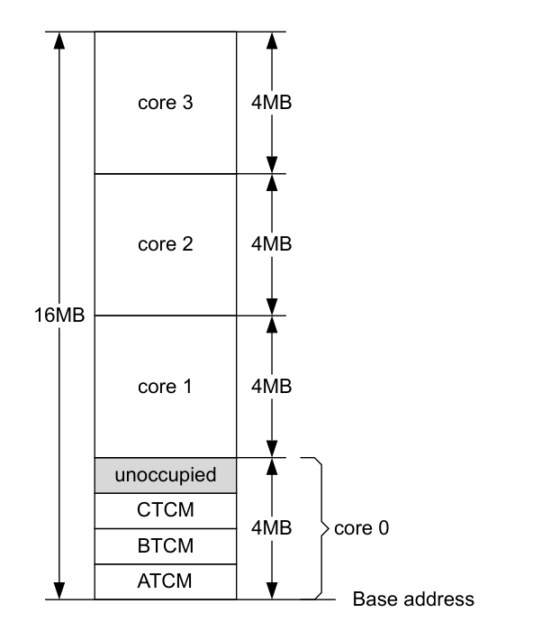
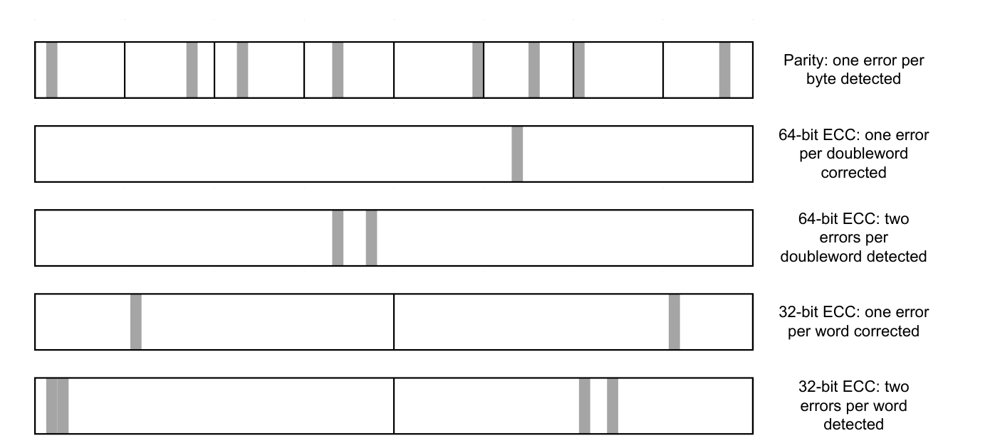

本章介绍内存系统。

## 1. 关于内存系统

内存系统控制对内部（**internal RAM**）、缓存（**caches**）、外部内存（**external memory**）和外设端口（**peripheral port**）的访问。

内存系统包括：

* 每个内核专用的内存：
  * 可选的 L1 指令缓存。
  * 可选的 L1 数据缓存。
  * 可选的 TCM。
* 每个内核专用的接口：
  * 符合 AXI4（32 位数据总线）的可选LLPP主接口（**LLPP master interface**）。
  * 符合 AXI4 的可选 Flash 接口，但仅支持事务子集并具有一些附加功能（这些功能不必使用）。
  * 符合 AXI4（128 位数据总线）的 AXIM 接口（**AXIM interface**）。
* 符合 AXI4 但仅支持事务子集的 AXIS 接口，提供对所有内核中的 TCM 的外部访问（128 位数据总线）。

下图显示了内存系统和外部接口。

内核采用哈佛内存架构，这意味着内核具有访问指令和数据的独立路径。指令端获取指令。数据端读取和写入数据。内核可以从指令端和数据端进行并发访问。

**TCM** 提供快速访问内存。 **TCM** 是统一的，这意味着它可以同时保存指令和数据。 **TCM接口** 控制对 **TCM** 的访问。 **TCM接口**包括一个完整的交叉开关，允许从三个主控（指令端、数据端和 AXIS）并发访问 **TCM**（A、B 和 C）。如果一个或多个主控尝试访问同一个 **TCM**，则 **TCM** 接口将根据具有服务质量 (QoS) 机制的固定优先级方案在请求之间进行仲裁。 **TCM** 为内存访问提供最确定的时序(**most deterministic timing**)。

当访问时序确定性不太重要但仍需要快速访问时，可以使用指令缓存和数据缓存。数据端生成的所有针对 **AXIM接口** 的存储，都通过 **AXIM接口** 写入外部存储器，并在数据缓存(**data cache**)中更新或分配。**TCM 和 LLPP 事务** 永远不会分配到数据缓存(**data cache**)中。在缓存未命中时，将向**Flash接口**或者**AXIM接口**发出行填充请求。数据缓存始终具有直写(**Write-Through**)行为。

**AXIM接口**是外部存储器或设备系统的主要接口。**Flash接口**提供对外部只读存储器控制器（如：闪存）的访问。**LLPP接口**提供对外部外围设备或小型专用存储器系统的访问。**AXIS接口** 提供对 TCM 的外部访问。通过 **AXIS接口** 的访问争夺 TCM 访问周期，因此它们可能会降低 TCM 存储器的确定性。

存储器系统包括一个用于独占访问的本地监视器。可以使用独占加载和存储指令（例如：**LDREX**、**STREX**）来提供进程间同步(**inter-process synchronization**)和信号量(**semaphores**)。它们可以使用适当的外部存储器监控逻辑提供进程间同步和信号量。有关 **Armv8-R AArch32** 体系结构配置文件，请参阅补充Armv8的Arm® 体系结构参考手册(**Arm® Architecture Reference Manual Supplement Armv8**)。

所有指令端和数据端访问都在**MPU**定义的内存映射中查找。它在指令端或数据端访问外部存储器之前返回访问权限。如果允许访问，**MPU**将为事务提供内存属性。

**注意：**

除了 TCM 与 Flash 重叠的情况（如果存在并启用），执行访问 ATCM、BTCM 和 CTCM 区域中超过一个区域的访问是非法的。此外，如果存在，执行访问 LLPP、Flash 和内部外设区域中超过一个区域的访问也是非法的。

## 2. **TCM 内存**

**TCM** 是统一的，提供快速访问，并具有最确定的内存访问时序(**most deterministic memory access timing**)。

**TCM** 是内核私有的。每个 **TCM** 的大小都独立实现为 **0KB**、**8KB**、**16KB**、**32KB**、64KB、128KB、256KB、512KB 或 1MB。0KB 大小表示未实现 TCM。

每个 **TCM** 都可以实现等待状态，这意味着对该 **TCM** 的所有访问，都会产生额外的延迟周期。如果部分（但不是全部）**TCM** 实现了等待周期，则 **TCM** 的性能可能会各不相同。

如果在复位时，对主输入 **CFGTCMBOOTx** 进行置位，则启用 **ATCM**，基址为 **0x00000000**。其他 **TCM** 则被禁用，其基址为 **未知**。

每个 **TCM** 的基地址以及是否启用，可以通过写入相应的 **TCM** 区域寄存器 (**IMP_ATCMREGIONR**、**IMP_BTCMREGIONR**、**IMP_CTCMREGIONR**) 进行编程。为在 **EL2** 上运行的软件和在 **EL1** 或 **EL0** 上运行的软件，提供独立的启用（**Separate enables**）。**TCM** 基地址必须是大小对齐的。每个 **TCM** 的大小在相应的 **TCM** 区域寄存器中指示。如果当前异常级别禁用了**TCM**，则根据 **Flash接口**的配置，可以通过**AXIM接口**、**Flash接口**或**LLPP接口**访问其地址区域。

通过设置寄存器位 **HCR.TIDCP=1**，可以从 **EL1** 向TCM区域寄存器写入，并将其捕获到在EL2上运行的虚拟机管理程序中。

可以通过**AXIS接口**访问 **TCM**。

**TCM 属性和权限**

启用的 **TCM** 始终表现为：不可缓存、不可共享的普通内存。这与 **MPU** 中，为包含 **TCM** 中保存的地址的内存区域定义的内存类型属性无关。**TCM**访问的访问权限与**MPU**分配给同一地址的权限属性相同。

## 3. 一级缓存(Level-1 caches)

在内核中，可选的指令和数据缓存独立实现。

**指令缓存**

指令缓存的功能包括：

* 指令缓存（如果存在）可实现为 **4KB**、**8KB**、**16KB** 或 **32KB**，并以 **64字节**行四路组相联的方式组织。
* 根据缓存能力属性、缓存隔离策略以及控制缓存的设置的编程方式，来自 **Flash接口**或者**AXIM接口**的指令可缓存在指令缓存中。
* 当指令流是连续的时，缓存可以自动从内存中预取下一行。**PFU**使用其分支预测结构提前请求非连续行。
* 预取行为由 **CPUACTLR.L1IPFCTL** 控制。

**数据缓存**

数据缓存的功能包括：

* 数据缓存（如果存在）可实现为 **4KB**、**8KB**、**16KB** 或 **32KB**，并以四路组（**four-way set**）相联的方式组织，每路**64字节**。
* 根据 **MPU** 中设置的属性、缓存隔离策略以及控制缓存的设置编程方式，可将来自 **Flash接口**或者**AXIM接口**的数据读取缓存在数据缓存中。
* 当管道中的两个或三个访问在数据缓存中未命中时，内存系统可以为它们全部启动行填充。这种所谓的未命中下未命中行为（**miss-under-miss behavior**）允许缓存同时有最多三个未完成的行填充。
* **AXIM接口**有4个数据预取器，它们在 4KB 区域内的可缓存访问和预取中查找模式。**Flash接口**没有数据预取器。

**Cortex®-R52+** 处理器不具有一致性，内部可共享域由单个 **Cortex®-R52+** 内核组成。**Cortex®-R52+** 处理器不会缓存标记为可共享的数据，并且所有缓存维护指令都在本地执行。这意味着指令缓存维护操作不会广播到任何其他内核。外部可共享域位于 **Cortex®-R52+** 处理器外部，所以依赖于系统。

在 **Cortex®-R52+** 处理器中，指令端和数据端访问具有访问主内存的独立路径。所以一致性点存在于处理器外部，依赖于系统。

内部可缓存域由单个 **Cortex®-R52+** 内核组成。外部可缓存域位于 **Cortex®-R52+** 处理器外部。

数据缓存的写入行为始终为直写缓存（**Write-Through caching**）。标记为可回写缓存（**Write-Back Cacheable**）的位置被视为直写（**Write-Through**）。回写（**Write-Back**）和直写（**Write-Through**）区域的缓存取决于所设置的任何读取分配（**Read-Allocate**）或写入分配（**Write-Allocate**）提示。标记为内部或外部可共享（**Inner or Outer Shareable**）的位置，无论其可缓存性属性如何，都将被视为不可缓存。数据缓存不使用瞬态分配提示（**Transient allocation hint**）。任何标记为瞬态的区域都将被视为非瞬态（**Non-transient**）。

### 3.1. 缓存RAM组织

本节介绍指令和数据缓存的 RAM 组织。

**在 Cortex®-R52+** 处理器中，指令和数据缓存均组织为4路组（**4-way set**）相联结构，引脚可配置逻辑大小为 **4KB**、**8KB**、**16KB** 或 **32KB**。

**Cortex®-R52+** 地址宽度为**32**位。每个缓存行（**cache line**）包含64个字节的数据，每条逻辑通道（**logical way**）都是一个双字宽（8字节）。位 [5:3] 用于选择缓存行内的双字地址。位 [2:0] 允许选择双字内的字节。

根据缓存的大小，缓存的标签和索引来自 32 位地址，如下表所示。

| 缓存大小 | 标记地址位 | 索引地址位 | 双字偏移 | 字节偏移 |
| --- | --- | --- | --- | --- |
| 4KB | [31:10] | [9:6] | [5:3] | [2:0] |
| 8KB | [31:11] | [10:6] | [5:3] | [2:0] |
| 16KB | [31:12] | [11:6] | [5:3] | [2:0] |
| 32KB | [31:13] | [10:6] | [5:3] | [2:0] |

该信息有助于通过缓存调试操作来调试缓存，如8.4直接访问L1缓存中所述。

#### 3.1.1. 指令缓存（Instruction cache）

本节介绍指令缓存标记和数据RAM的组织。

**标记RAM（Tag RAM）**

指令缓存标记RAM分为四条逻辑通道（**logical way**），每条路包含 **64** 到 **512** 个条目（**entries**），具体取决于缓存的大小。每个条目包含一个有效位（**valid bit**）、一个标记（**tag**），以及可选的六个纠错码 (**ECC**) 位。

四条逻辑通道中的每一条都可以实现为一个物理存储体（**physical bank**），如下图所示。

下表显示了根据指令缓存的大小每个标记 RAM 条目的位字段。

| 缓存大小 | ECC | 有效位 | 标记 |
| --- | --- | --- | --- |
| 4KB | [28:23] | 22 | [21:0] |
| 8KB | [27:22] | 21 | [20:0] |
| 16KB | [26:21] | 20 | [19:0] |
| 32KB | [25:20] | 19 | [18:0] |

指令缓存标记 RAM 的有效位与指令缓存数据 RAM 中的整个缓存行（八个双字条目）相关联。

**数据RAM（Data RAM）**

指令缓存数据RAM分为四条逻辑通道，每条路径包含 **64** 到 **1024** 个条目。每个条目包含 64位（双字）数据和可选的七个纠错码 (**ECC**) 位。

四条逻辑通道中的每一条都映射到所有四个物理存储体，如下图所示。

给定双字的物理存储体（**physical bank**）取决于双字在缓存行内的偏移量（由地址位 [5:3] 给出）和逻辑通道，具体公式如下：

双字的指令缓存数据 RAM 存储体 = (缓存路径 XOR 数据双字偏移量) AND 0x3

下表显示了每个指令缓存数据 RAM 条目的位字段，与缓存大小无关。

| ECC | 数据 |
| --- | --- |
| [71:64] | [63:0] |

数据缓存标记 RAM 分为四个逻辑通道，每个通道包含 64 到 512 个条目，具体取决于缓存的大小。每个条目包含一个有效位、一个标记以及可选的六个纠错码 (ECC) 位。

#### 3.1.2. 数据缓存（Data cache）

本节介绍数据缓存标记和数据RAM的组织。

**标记RAM（Tag RAM）**

**数据缓存标记RAM**分为四个逻辑通道，每个通道包含 **64** 到 **512** 个条目，具体取决于缓存的大小。每个条目包含一个有效位、一个标记以及可选的六个纠错码 (ECC) 位。

四个逻辑通道中的每一条都可以实现为一个物理存储体，如下图所示。

下表显示了根据数据缓存的大小每个**标签 RAM**条目的位字段。

| 缓存大小 | ECC | 有效位 | 标记 |
| --- | --- | --- | --- |
| 4KB | [28:23] | 22 | [21:0] |
| 8KB | [27:22] | 21 | [20:0] |
| 16KB | [26:21] | 20 | [19:0] |
| 32KB | [25:20] | 19 | [18:0] |

数据缓存标记 RAM 的有效位与数据缓存数据 RAM 中的整条缓存行（八个双字条目）相关联。

**数据RAM（Data RAM）**

**数据缓存数据RAM**分为四条逻辑通道，每条通道包含 **64** 到 **1024** 个双字数据条目。但是，从物理上讲，**数据缓存数据RAM**实现为八个存储体，每个条目包含 32位（一个字）数据和可选的六个ECC位。

四个逻辑通道映射到所有八个物理存储体上，如下图所示。一个双字始终存储在两个相邻的物理存储体中。

给定字的物理存储体取决于字在缓存行内的偏移量（由地址位 [5:2] 给出）和逻辑路径，具体公式如下：

双字的数据缓存数据 RAM 组对 = (缓存路径 + 数据双字偏移量) AND 0x3

字的数据缓存数据 RAM 组 = { ((缓存路径 + 数据双字偏移量) AND 0x3), 地址位 [2] }

下表显示了数据缓存数据 RAM 组的每个条目的位字段，与缓存大小无关。

| ECC | 数据 |
| --- | --- |
| [37:32] | [31:0] |

### 3.2. 缓存隔离

L1指令和数据缓存将来自**Flash接口**或者**AXIM接口**的分配隔离到单独的缓存路中。**IMP_CSCTLR.IFLW** 和 **IMP_CSCTLR.DFLW** 分别控制分配给每个接口的指令缓存和数据缓存的通道数。

**注意：**

只有在系统重置后启用缓存之前才允许更新缓存隔离控制，否则更新将被忽略。

### 3.3. 数据缓存失效（Data cache invalidation）

**EDCCR** 允许将 **Flash内存** 和 **AXIM内存**，与 **RAM** 叠加，并修改 **RAM** 内容。

下图显示了数据缓存失效的状态机。

**空闲（Idle）**

复位后，状态机处于**空闲**状态。从 **EDCCR** 读取的数据为 **0**，表示**数据缓存失效**处于非活动（inactive）状态。

**等待（Wait）**

当 **EDCCR[0]**、**EDCCR[2]** 或者两者均写入 **1** 时：

* 通过内存系统发送请求，使包含**Flash数据**（**EDCCR[0]** 写入 **1**），**AXIM数据**（**EDCCR[2]** 写入 **1**），或者两者（**EDCCR[0]** 和 **EDCCR[2]** 均写入 **1**）的所有数据缓存行失效。这表示为 **ADCIREQ=1**、**FDCIREQ=1** 或者 **ADCIREQ=1** 和 **FDCIREQ=1**。
* **DCIACK=0**。
* 新的**Flash访问**，**AXI访问**，或者 **Flash访问** 和 **AXI访问** 都不可缓存（**non-cacheable**）。
* 状态机处于等待（**Wait**）状态，其中从 EDCCR 读取返回 1，表示缓存未分配新的缓存行，并且旧缓存行的无效化正在进行中。

**活动（Ative）**

当内存系统完成数据缓存失效请求时：

* **DCIACK=1**，表示缓存失效已完成。
* 状态机处于活动（**Active**）状态。
* **EDCCR[0]** 和 **EDCCR[1]** 均读取为 **1**。
* 数据缓存不包含失效的数据类型。
* 所有*Flash访问**，**AXI访问**，或者 **Flash访问** 和 **AXI访问** 均不可缓存。

注意：

* 当 EDCCR[0] 和 EDCCR[2] 写入 0 时，状态机返回空闲状态，并且Flash 或 AXIM 地址可缓存。
* 当状态机不处于空闲（**Idle**）状态时，向 **EDCCR** 写入 **1** 将被忽略。
* 当状态机不处于活动（**Active**）状态时，向 **EDCCR** 写入 **0** 将被忽略。

有关 **EDCCR** 的更多信息，请参阅**外部调试校准控制寄存器**

### 3.4. 写入流模式（Write streaming mode）

根据 **MPU** 编程中配置的分配提示，将缓存行分配给 **L1缓存**。

但是，有些情况下不需要在写入时进行分配。例如，执行 C 标准库 **memset()** 函数将大块内存清除为已知值时。大块数据的写入可能会用不必要的数据把缓存给污染。同时这样也会浪费电量和性能，如果必须执行行填充只是为了丢弃行填充数据，为了整个行随后由 **memset()**写入。

为了解决这个问题，内核包含逻辑，用于在行填充完成之前检测内核何时写入了完整的缓存行。如果在可配置数量的连续行填充中检测到这种情况，则它会切换到写入流模式（**write streaming mode**）。这有时称为读取分配模式（**read allocate mode**）。

在写入流模式下，加载行为正常，仍然会导致行填充，写入仍会查找缓存，但如果它们未命中，则它们会写入总线而不是启动行填充。

**CPUACTLR.WSTRNOL1ACTL** 配置写入流模式阈值。有关 **CPUACTLR** 的更多信息，请参阅**CPU辅助控制寄存器**。

**注意：**

在内核检测到已写入指定数量的完整缓存行并切换到写入流模式之前，主接口上可能会观察到超过指定数量的行填充。内核继续处于写入流模式，直到检测到不是完整缓存行的可缓存写入突发，或者当前正在写入总线的同一行中有负载。

## 4. 直接访问 L1 缓存

**Cortex®-R52+** 处理器提供了一种机制，通过实现定义（**IMPLEMENTATION DEFINED**）的系统寄存器读取 L1 缓存所使用的内部存储器。当调查缓存中的数据与系统内存中的数据之间一致性（**coherency**）被破坏的问题时，此功能非常有用。

在处理器执行期间，使用多个只写 CP15 寄存器选择适当的内存块和位置，并从只读 CP15 寄存器读取数据，如下表所示。这些操作仅在 **EL2** 中可用。在所有其他模式下，执行 CP15 指令会导致未定义指令异常。

| 功能 | 访问 | CP15 操作 | Rd |
| --- | --- | --- | --- |
| 缓存调试数据寄存器 0 | RO | MRC p15, 3, <Rd>, c15, c0, 0 | 数据 |
| 缓存调试数据寄存器 1 | RO | MRC p15, 3, <Rd>, c15, c0, 1 | 数据 |
| 缓存调试数据寄存器 2 | RO | MRC p15, 3, <Rd>, c15, c0, 2 | 数据 |
| 数据缓存标记读取操作寄存器 | WO | MCR p15, 3, <Rd>, c15, c2, 0 | 组/通道 |
| 指令缓存标记读取操作寄存器 | WO | MCR p15, 3, <Rd>, c15, c2, 1 | 组/通道 |
| 数据缓存数据读取操作寄存器 | WO | MCR p15, 3, <Rd>, c15, c4, 0 | 组/通道/偏移 |
| 指令缓存数据读取操作寄存器 | WO | MCR p15, 3, <Rd>, c15, c4, 1 | 组/通道/偏移 |

### 4.1. 数据缓存标记和数据编码

**Cortex®-R52+** 处理器的数据缓存由 4 路组相联结构组成。

每一路中的组数取决于配置的缓存大小。以下表所示的编码（在相应 MCR 指令的 Rd 中设置）用于定位标记和数据存储器所需的缓存数据条目。标记 RAM 和数据 RAM 访问的编码非常相似。数据 RAM 访问包含一个附加字段，用于定位缓存行中相应的双字。

| Rd 位域 | 描述 |
| --- | --- |
| [31:30] | 缓存通道 |
| [29:13] | 未使用 |
| [12:6]、[11:6]、[10:6] 或 [9:6] | 组索引 |
| [5:3] | 数据偏移（仅数据寄存器） |
| [2:0] | 未使用 |

| 缓存大小 | 索引 |
| --- | --- |
| 32KB | [12:6] |
| 16KB | [11:6] |
| 8KB | [10:6] |
| 4KB | [9:6] |

数据缓存数据读取返回 64 位数据，其中位 [31:0] 放入缓存调试数据寄存器 0，位 [63:32] 放入缓存调试数据寄存器 1。数据缓存标记读取返回最多 23 位数据，放入缓存调试数据寄存器 0。

| 寄存器 | 位域 | 描述 |
| --- | --- | --- |
| 缓存调试数据寄存器 0 | [22] | 有效位 |
| 缓存调试数据寄存器 0 | [21:0] | 标记位（4KB 缓存）；[21:1] 为标记位（8KB 缓存）；[21:2] 为标记位（16KB 缓存）；[21:3] 为标记位（32KB 缓存） |

### 4.2. 指令缓存标记和数据编码

**Cortex®-R52+** 处理器由 4 路组相联结构组成。每一路中的组数取决于配置的缓存大小。以下表所示的编码（在相应 MCR 指令的 Rd 中设置）用于定位标记和数据存储器所需的缓存数据条目。数据 RAM 和标记 RAM 访问的编码相似。数据 RAM 访问包含一个附加字段，用于定位缓存行中相应的双字。

| Rd 位域 | 描述 |
| --- | --- |
| [31:30] | 缓存通道 |
| [29:13] | 未使用 |
| [12:6]、[11:6]、[10:6] 或 [9:6] | 组索引 |
| [5:3] | 数据偏移（仅数据寄存器） |
| [2:0] | 未使用 |

| 缓存大小 | 索引 |
| --- | --- |
| 32KB | [12:6] |
| 16KB | [11:6] |
| 8KB | [10:6] |
| 4KB | [9:6] |

指令缓存数据读取返回 64 位数据，其中位 [31:0] 放入缓存调试数据寄存器 0，位 [63:32] 放入缓存调试数据寄存器 1。在 T32 状态下，这两个字段可以表示 16 位指令以及部分或完整 32 位指令的任意组合。指令缓存标记读取返回最多 23 位数据，放入缓存调试数据寄存器 0。

| 寄存器 | 位域 | 描述 |
| --- | --- | --- |
| 缓存调试数据寄存器 0 | [22] | 有效位 |
| 缓存调试数据寄存器 0 | [21:0] | 标记位（4KB 缓存）；[21:1] 为标记位（8KB 缓存）；[21:2] 为标记位（16KB 缓存）；[21:3] 为标记位（32KB 缓存） |

## 5. AXIM接口

**AXIM接口**是外部存储器和外设的主要接口。每个内核都有自己的 **AXIM接口**，仅用于从该内核进行访问。

**AXIM接口**实现 **AXI4协议**，具有 **128** 位数据宽度。

**AXIM接口**接收来自**指令端**(**instruction side**)和**数据端**(**data side**)的请求。您可以通过设置 **CPUACTLR.AXIMARBCTL** 来配置在争用(**contention**)情况下，数据或指令访问是否具有最高优先级。**AXIM接口**可以具有总线保护(**bus protection**)。

### 5.1. AXIM接口属性

本节介绍**AXIM接口**属性。

下表显示了一个内核的**AXI4主接口**(**AXI4 master interface**)属性。

| 属性         | 值  | 注释                                                                                                                       |
| ------------ | --- | -------------------------------------------------------------------------------------------------------------------------- |
| 写入发布能力 | 3   | 每个内核最多可以发布三个写入请求。                                                                                         |
| 读取发布能力 | 11  | 每个内核可以发布八个未完成的数据端和三个未完成的指令端 AXIM 读取请求。                                                     |
| 独占线程能力 | 1   | 每个内核可以有一个正在进行的独占访问序列。                                                                                 |
| 写入 ID 能力 | 3   | 主接口可以为所有活动写入事务同时生成的不同 AXIDMx 值的最大数量。                                                           |
| 写入 ID 能力 | 3 | 设备内存可以有多个具有相同 AXI ID 的未完成事务。                                                                           |
| 写入 ID 能力 | 3 | 对于普通内存，仅当有多个存储具有相同地址时，存储才会使用相同的 ID。这可以保持存储之间的顺序，否则会产生写后写 (WAW) 风险。 |
| 写入 ID 宽度 | 3   | -                                                                                                                          |
| 读取 ID 功能 | 11  | 主接口可同时为所有活动读取事务生成的不同 ARIDMx 值的最大数量。                                                             |
| 读取 ID 功能 | 11 | ID 将内存事务的来源编码为 **Exclusive**、数据端设备、指令端正常或数据端正常。                                                |
| 读取 ID 功能 | 11 | 可以有一个数据端设备请求。普通内存的事务对每个未完成的事务使用唯一的 AXI ID。                                              |
| 读取 ID 功能 | 11 | Cortex®-R52+ 处理器将内存的所有设备区域视为永不执行 (XN)，无论 XN 的编程值如何。                                           |
| 读取 ID 宽度 | 4   | -                                                                                                                          |

**相关信息:**
**AXIM交易ID**(**AXIM transaction IDs**)

### 5.2. AXIM接口传输（**AXIM interface transfers**）

**AXIM** 符合 **AXI4规范**，但它不会生成该规范允许的所有**AXI事务**类型。本节介绍 **AXIM** 生成的 AXI事务类型。如果您正在设计一个仅与 Cortex®-R52+ AXIM 配合使用的 AXIS，您可以利用这些限制和接口属性来简化从属设备。

所有WRAP突发都从关键字开始提取完整的缓存行。突发不会跨越缓存行边界。

缓存行填充提取长度始终为 64 字节。

对于**回写式**(**Write Back**)或**直写式**(**Write-Through**)，内部可缓存的传输，支持的传输为以下方式：

* WRAP 4 128 位用于读取传输。
* INCR 1 8 位、16 位、32 位和 64 位用于写入传输。
* INCR N (N:1-4) 128 位用于写入传输。
* INCR 1 8 位、16 位、32 位和 64 位用于独占写入传输。

**注意：**

即使 **MPU** 被编程为回写式(**Write-Back**)或直写式(**Write-Through**)，处理器也可能将某个内存位置视为不可缓存。当缓存被禁用时，可能会发生这种情况。在这种情况下，请参阅下面支持的不可缓存事务传输类型。

**对于不可缓存事务（Non-cacheable transactions）：**

* 数据端读取传输：INCR N (N:1-4) 128 位。
* 写入传输：INCR N (N:1-4) 128 位。
* 写入传输：INCR 1 8 位、16 位、32 位和 64 位。
* 数据端读取传输：INCR 1 8 位、16 位、32 位和 64 位。
* 指令端读取传输：INCR N (N:1-4) 128 位。
* 独占写入传输：INCR 1 8 位、16 位、32 位和 64 位。
* 独占读取传输：INCR 1 8 位、16 位、32 位和 64 位。

**对于设备事务（Device transactions）：**

* 数据端读取传输：INCR 1 8 位、16 位、32 位和 64 位。
* 写入传输：INCR N (N:1-4) 128 位。
* 写入传输：INCR 1 8 位、16 位、32 位和 64 位。
* 独占读取传输：INCR 1 8 位、16 位、32 位和 64 位。
* 独占写入传输：INCR 1 8 位、16 位、32 位和 64 位。

### 5.3. AXIM 数据预取器

**Cortex®-R52+** 处理器包含四个独立的数据预取器（**data prefetcher**），它们会在行填充（**linefill**）地址中查找模式。

**CPUACTLR** 寄存器包含 **DPFSTRCTL** 字段，用于控制启用的独立数据预取流的数量（1 到 4 个）。

数据预取器利用行填充地址中的模式来预测将来可能需要的行填充，并进行推测性预取（**speculative fetch**）。正确的推测性预取可以显著提高性能，尤其是在内存系统具有较高延迟时。**CPUACTLR** 寄存器包含 **STRIDECTL** 字段，用于控制某个特定模式必须连续出现多少次行填充（2 或 3 次）才能启动数据预取器。

限制数据预取器发起的行填充总数可能是有利的，这样可以将部分行填充资源留给非预取请求。**CPUACTLR** 寄存器包含 **L1DPFCTL** 字段，允许将所有数据预取器发起的行填充数量限制在 0 到 8 之间，其中 0 表示禁用数据预取器。

### 5.4. AXIM 事务 ID

下表显示了 AXIM 读地址和读响应通道的标识符编码。

| ARIDMx 编码 | 事务类型 | 描述 |
| --- | --- | --- |
| 0b0000 | 独占访问 | 独占（**LDREX**）。可以有一个未完成的独占序列。 |
| 0b0010 | 设备访问（数据端） | 设备类型数据读取。可以有一个使用相同 ID 的数据端设备请求。 |
| 0b01xx | 普通请求（指令端） | 取指。可以有三个指令端普通请求，每个请求使用唯一 ID。 |
| 0b1xxx | 普通请求（数据端） | 普通类型数据读取。可以有八个数据端普通请求，每个请求使用唯一 ID。 |

下表显示了 AXIM 写地址和写响应通道的标识符编码。

| AWIDMx 编码 | 事务类型 | 描述 |
| --- | --- | --- |
| 0b000 | 独占访问 | 独占（**STREX**）。可以有一个未完成的独占访问。 |
| 0b011 | 不可重排序设备访问 | 设备类型写入。可以有三个未完成的设备请求，使用相同 ID。 |
| 0b1xx | 普通请求 | 普通类型。可以有三个未完成的普通请求，每个请求使用唯一 ID。 |

下表显示了 **ARCACHEMx** 和 **AWCACHEMx** 字段的编码。分配属性（**Assigned attributes**）列表示 **MPU** 给出的内存类型。如果事务不属于其他任何类别，则使用默认（**Default**）行。例如，如果某个访问是独占访问且不具有设备属性，则使用默认行；否则使用适当的设备属性行。

| ARCACHEMx | 内存类型 | 分配属性 |
| --- | --- | --- |
| 0b0000 | 设备不可缓冲（Device Non-Bufferable） | 设备 nGnRnE |
| 0b0001 | 设备可缓冲（Device Bufferable） | 设备 nGnRE、nGRE 或 GRE |
| 0b0011 | 普通不可缓存可缓冲（Normal Non-cacheable Bufferable） | 默认 |
| 0b1110 | 直写读分配（Write-Through Read-Allocate） | 普通外部直写（Normal outer Write-Through） |
| 0b1111 | 回写读分配（Write-Back Read-Allocate） | 普通外部回写（Normal outer Write-Back） |

| AWCACHEMx | 内存类型 | 分配属性 |
| --- | --- | --- |
| 0b0000 | 设备不可缓冲（Device Non-Bufferable） | 设备 nGnRnE |
| 0b0001 | 设备可缓冲（Device Bufferable） | 设备 nGnRE、nGRE 或 GRE |
| 0b0011 | 普通不可缓存可缓冲（Normal Non-cacheable Bufferable） | 默认 |
| 0b1110 | 直写写分配（Write-Through Write-Allocate） | 普通外部直写（Normal outer Write-Through） |
| 0b1111 | 回写写分配（Write-Back Write-Allocate） | 普通外部回写（Normal outer Write-Back） |

### 5.5. AXI 特权信息

**AXIM** 接口通过 **ARPROTMx[2:0]** 和 **AWPROTMx[2:0]** 信号提供有关访问特权级别的信息。

访问可能被缓存或合并在一起，并且生成的事务可能同时包含特权数据和用户数据。

下表显示了处理器特权级别以及相关的 **ARPROTMx[2:0]** 和 **AWPROTMx[2:0]** 值。可缓存读请求始终标记为特权访问。不可缓存读请求采用请求该读取的指令的特权级别。对普通内存和 GRE 设备内存的存储始终标记为特权访问，但对 nGRE 设备内存和独占存储的存储会指示请求该存储的指令的特权级别。

| 处理器模式 | 访问类型 | ARPROTMx 或 AWPROTMx 的值 |
| --- | --- | --- |
| EL0、EL1、EL2 | 可缓存、不可共享读访问 | 特权访问 |
| EL0 | 设备或普通不可缓存读访问 | 非特权访问 |
| EL1、EL2 | 设备或普通不可缓存读访问 | 特权访问 |
| EL0、EL1、EL2 | 可缓存、不可共享写访问 | 特权访问 |
| EL0 | 设备写 | 非特权访问 |
| EL1、EL2 | 设备写 | 特权访问 |
| EL0 | 普通不可缓存写（对可共享内存的 STREX、STREXB、STREXH 和 STREXD 除外） | 特权访问 |
| EL0 | 对可共享内存的 STREX、STREXB、STREXH 和 STREXD 的普通不可缓存写 | 非特权访问 |
| EL1、EL2 | 普通不可缓存写 | 特权访问 |

### 5.6. AXIM QoS 和用户信号

本节介绍 AXIM QoS 和用户信号。

**服务质量（Quality of Service）**

**AXIM** 输出编程在 **IMP_QOSR.AWQOS**（用于写入）和 **IMP_QOSR.ARQOS**（用于读取）中的 QoS 标识符。**ARQOSMx** 和 **AWQOSMx** 是读取和写入服务质量标识符的 AXIM QoS 信号。

**用户信号（User signals）**

只有设备内存访问才能保证 **VMID** 有效。普通内存访问无法获得有效的 **VMID** 值。**ARVMIDMx** 和 **AWVMIDMx** 是读取和写入 **VMID** 的 AXIM 用户信号。

### 5.7. AXIM 接口超时

**AXIM** 包含一种超时机制，用于检测未在可编程时间限制内完成的事务。

如果地址或写数据节拍（**write data beat**）未被接受，或者未收到响应，则事务无法完成。

如果启用了超时检测，则对超时发生的响应为：

* 对于每次超时发生，发起该访问的内核置位输出信号 **ERREVENTx[13]**。
* 如果启用了事务中止，则未完成的事务被中止，并且内存系统将 **AXIM** 视为已损坏（**broken**）。所有后续以 **AXIM** 为目标的事务都会被中止。

超时时长通过设置 **IMP_BUSTIMEOUTR.MAXCYCLESBY16AXIM** 字段确定。要启用超时检测，请设置 **IMP_BUSTIMEOUTR.ENABLEAXIM**。要启用事务中止，请设置 **IMP_BUSTIMEOUTR.ABORTAXIM**。

## 6. 低延迟外设端口（Low-latency peripheral port）

**LLPP** 被设计为访问私有外设的专用路径，但并不仅限于此。

**LLPP** 实现 **AXI4** 协议，数据宽度为 32 位。

每个内核都有一个 **LLPP** 接口。通过 **LLPP** 进行的访问针对低延迟进行了优化，并且不会被缓存。**LLPP** 不适合普通内存访问。访问始终被视为不可聚合（non-Gathering）、不可重排序（non-Reordering）且不进行提前写确认（no Early Write Acknowledgement）。

由于 **LLPP** 使用 **AXI4** 协议，因此可以将处理器中的所有外设端口连接到同一个共享内存系统。但是，这种配置可能会带来延迟损失。**LLPP** 也可以连接到内存而不是外设。这种配置并非最优，因为该接口始终应用 Device-nGnRnE 的聚合、排序和写确认规则。标记为普通内存的 **LLPP** 区域允许非对齐和推测性内存访问。否则，它遵循 Device-nGnRnE 的聚合、排序和写确认规则。

将少量共享内存连接到 **LLPP** 的一个示例可能是存储共享信号量（**shared semaphores**）（使用适当的独占监视器）。

**LLPP** 地址范围和大小在 **IMP_PERIPHPREGIONR** 中指示。它由配置信号 **CFGLLPPBASEADDR** 和 **CFGLLPPSIZE** 设置，并且对于集群中的所有内核都相同。**LLPP** 区域大小介于 4KB 和 4MB 之间，为 2 的幂。**CFGLLPPIMP** 指示是否实现了 **LLPP** 接口。如果系统不使用 **LLPP**，此信号必须拉低，否则必须拉高。

**LLPP** 在复位时被禁用。**IMP_PERIPHPREGIONR.ENABLEEL2** 控制 **LLPP** 是否在 **EL2** 访问时启用，**IMP_PERIPHPREGIONR.ENABLEEL10** 控制 **LLPP** 是否在 **EL0** 和 **EL1** 访问时启用。

如果实现了 **LLPP** 并启用，则对 **LLPP** 区域中地址的数据访问将通过 **LLPP** 执行。如果实现了 **LLPP** 但未启用，则对 **LLPP** 区域的数据访问会生成同步外部中止（**synchronous external abort**）。如果未实现 **LLPP**，则对 **LLPP** 区域的数据访问将通过内存系统的其他部分执行。

如果实现了 **LLPP**，则对 **LLPP** 区域中地址的指令访问会导致同步外部中止。如果未实现 **LLPP**，则指令访问将通过内存系统的其他部分执行。

**LLPP** 支持独占访问，为所有小于或等于 32 位的访问大小生成适当的独占事务。通过 **LLPP** 执行的加载或存储独占双字操作会生成同步外部中止。

不存在一个内核访问另一个内核外设端口上所连接外设的内部机制。

**AXIS** 接口无法访问 **LLPP**。**LLPP** 接口支持总线保护。

下表显示了 **LLPP** 属性。

| 属性 | 值 | 注释 |
| --- | --- | --- |
| 写发布能力（Write issuing capability） | 8 | 每个内核最多可以发布八个写请求。 |
| 读发布能力（Read issuing capability） | 2 | 每个内核可以发布两个 **LLPP** 读请求。 |
| 独占线程能力（Exclusive thread capability） | 1 | 每个内核可以有一个正在进行的独占访问序列。 |
| 写 ID 能力（Write ID capability） | 1 | 所有写入使用相同 ID。 |
| 写 ID 宽度（Write ID width） | 1 | - |
| 读 ID 能力（Read ID capability） | 1 | 所有读取使用相同 ID。 |
| 读 ID 宽度（Read ID width） | 1 | - |

**LLPP** 传输从不跨越 4 字节边界，从不聚合访问，也从不进行推测性访问，除非该区域被标记为普通内存。

### 6.1. LLPP 内存属性

**LLPP** 将其生成的传输的 **ARCACHEPx** 和 **AWCACHEPx** 编码为 0b0000，无论区域被标记为设备内存还是普通内存。

下表显示了 **ARCACHEPx** 和 **AWCACHEPx** 的编码。

| 编码 | 含义 |
| --- | --- |
| 0b0000 | 设备不可缓冲（Device Non-bufferable） |

### 6.2. LLPP AXI 传输限制

**LLPP** 符合 **AXI4** 规范，但它不会生成规范允许的所有 AXI 事务类型。

本节描述了 **LLPP** 生成的 AXI 事务类型。如果您要设计一个仅与 **Cortex®-R52+** **LLPP** 配合工作的 **AXIS**，则可以利用这些限制和接口属性来简化从设备。

本节还包含一些表格，展示了内核生成的 AXI 突发类型的一些示例。但是，未在此处显示某种特定类型的事务，并不意味着内核不会生成此类事务。

连接到 **LLPP** 的 AXI4 从设备必须能够处理 AXI4 规范允许的每种事务，除非本章明确声明不生成此类事务。您不得从所给出的示例表推断出任何其他限制。

**对 AXI 外设传输的限制**

**LLPP** 对其生成的 AXI 事务应用以下限制：

* 突发传输的数据量从不超过四个字节。
* 突发长度从不超过一次传输。
* 任何事务都不会跨越内存中的 4 字节边界。
* 所有事务都是递增（**INCR**）突发。
* 所有事务都是非安全数据访问。
* 对设备内存的事务始终访问与传输大小对齐的地址。
* 独占访问始终访问与传输大小对齐的地址。

**LLPP 设备事务**

对设备内存的加载或存储指令始终生成与指令所隐含大小相同的 AXI 事务。

下表显示了从设备内存字节 0-3 执行 **LDRB** 时 **ARADDRPx**、**ARBURSTPx**、**ARSIZEPx** 和 **ARLENPx** 的值。

| 地址[1:0] | ARADDRPx[7:0] | ARBURSTPx | ARSIZEPx | ARLENPx |
| --- | --- | --- | --- | --- |
| 0x0（字节 0） | 0x00 | INCR | 8 位 | 1 次数据传输 |
| 0x1（字节 1） | 0x01 | INCR | 8 位 | 1 次数据传输 |
| 0x2（字节 2） | 0x02 | INCR | 8 位 | 1 次数据传输 |
| 0x3（字节 3） | 0x03 | INCR | 8 位 | 1 次数据传输 |

下表显示了从设备内存半字 0-1 执行 **LDRH** 时 **ARADDRPx**、**ARBURSTPx**、**ARSIZEPx** 和 **ARLENPx** 的值。

| 地址[1:0] | ARADDRPx | ARBURSTPx | ARSIZEPx | ARLENPx |
| --- | --- | --- | --- | --- |
| 0x0（半字 0） | 0x00 | INCR | 16 位 | 1 次数据传输 |
| 0x2（半字 1） | 0x02 | INCR | 16 位 | 1 次数据传输 |

下表显示了从设备内存执行 **LDR** 或 **LDM**（传输一个寄存器，LDM1）时 **ARADDRPx**、**ARBURSTPx**、**ARSIZEPx** 和 **ARLENPx** 的值。

| 地址[1:0] | ARADDRPx | ARBURSTPx | ARSIZEPx | ARLENPx |
| --- | --- | --- | --- | --- |
| 0x0（字 0） | 0x00 | INCR | 32 位 | 1 次数据传输 |

下表显示了从设备内存执行 **LDM**（传输五个寄存器，LDM5）时 **ARADDRPx**、**ARBURSTPx**、**ARSIZEPx** 和 **ARLENPx** 的值。

| 地址[2:0] | ARADDRPx | ARBURSTPx | ARSIZEPx | ARLENPx |
| --- | --- | --- | --- | --- |
| 0x0（字 0） | 0x00 | INCR | 32 位 | 1 次数据传输 |
| 0x0（字 0） | 0x04 | INCR | 32 位 | 1 次数据传输 |
| 0x0（字 0） | 0x08 | INCR | 32 位 | 1 次数据传输 |
| 0x0（字 0） | 0x0C | INCR | 32 位 | 1 次数据传输 |
| 0x0（字 0） | 0x10 | INCR | 32 位 | 1 次数据传输 |
| 0x4（字 1） | 0x04 | INCR | 32 位 | 1 次数据传输 |
| 0x4（字 1） | 0x08 | INCR | 32 位 | 1 次数据传输 |
| 0x4（字 1） | 0x0C | INCR | 32 位 | 1 次数据传输 |
| 0x4（字 1） | 0x10 | INCR | 32 位 | 1 次数据传输 |
| 0x4（字 1） | 0x14 | INCR | 32 位 | 1 次数据传输 |

下表显示了从设备内存字节 0-3 执行 **STRB** 时 **AWADDRPx**、**AWBURSTPx**、**AWSIZEPx**、**AWLENPx** 和 **WSTRBPx** 的值。

| 地址[1:0] | AWADDRPx | AWBURSTPx | AWSIZEPx | AWLENPx | WSTRBPx |
| --- | --- | --- | --- | --- | --- |
| 0x0（字节 0） | 0x00 | INCR | 8 位 | 1 次数据传输 | 0b0001 |
| 0x1（字节 1） | 0x01 | INCR | 8 位 | 1 次数据传输 | 0b0010 |
| 0x2（字节 2） | 0x02 | INCR | 8 位 | 1 次数据传输 | 0b0100 |
| 0x3（字节 3） | 0x03 | INCR | 8 位 | 1 次数据传输 | 0b1000 |

下表显示了从设备内存半字 0-1 执行 **STRH** 时 **AWADDRPx**、**AWBURSTPx**、**AWSIZEPx**、**AWLENPx** 和 **WSTRBPx** 的值。

| 地址[1:0] | AWADDRPx | AWBURSTPx | AWSIZEPx | AWLENPx | WSTRBPx |
| --- | --- | --- | --- | --- | --- |
| 0x0（半字 0） | 0x00 | INCR | 16 位 | 1 次数据传输 | 0b0011 |
| 0x2（半字 1） | 0x02 | INCR | 16 位 | 1 次数据传输 | 0b1100 |

下表显示了从设备内存执行 **STR** 或 **STM**（传输一个寄存器，STM1）时 **AWADDRPx**、**AWBURSTPx**、**AWSIZEPx**、**AWLENPx** 和 **WSTRBPx** 的值。

| 地址[1:0] | AWADDRPx | AWBURSTPx | AWSIZEPx | AWLENPx | WSTRBPx |
| --- | --- | --- | --- | --- | --- |
| 0x0（字 0） | 0x00 | INCR | 32 位 | 1 次数据传输 | 0b1111 |

下表显示了从设备内存执行 **STM**（传输五个寄存器，STM5）时 **AWADDRPx**、**AWBURSTPx**、**AWSIZEPx**、**AWLENPx** 和 **WSTRBPx** 的值。

| 地址[2:0] | AWADDRPx | AWBURSTPx | AWSIZEPx | AWLENPx | WSTRBPx |
| --- | --- | --- | --- | --- | --- |
| 0x0（字 0） | 0x00 | INCR | 32 位 | 1 次数据传输 | 0b1111 |
| 0x0（字 0） | 0x04 | INCR | 32 位 | 1 次数据传输 | 0b1111 |
| 0x0（字 0） | 0x08 | INCR | 32 位 | 1 次数据传输 | 0b1111 |
| 0x0（字 0） | 0x0C | INCR | 32 位 | 1 次数据传输 | 0b1111 |
| 0x0（字 0） | 0x10 | INCR | 32 位 | 1 次数据传输 | 0b1111 |
| 0x4（字 1） | 0x04 | INCR | 32 位 | 1 次数据传输 | 0b1111 |
| 0x4（字 1） | 0x08 | INCR | 32 位 | 1 次数据传输 | 0b1111 |
| 0x4（字 1） | 0x0C | INCR | 32 位 | 1 次数据传输 | 0b1111 |
| 0x4（字 1） | 0x10 | INCR | 32 位 | 1 次数据传输 | 0b1111 |
| 0x4（字 1） | 0x14 | INCR | 32 位 | 1 次数据传输 | 0b1111 |

对设备内存的非对齐加载或存储会生成对齐错误（**alignment fault**）。对于非对齐传输，不使用非对齐的 AXI 传输。

**LLPP 普通内存读取**

对普通内存的加载或存储指令可以生成比指令隐含大小更大的 AXI 事务，因为访问会被聚合。例如，**LDRH** 可以从半字对齐的地址读取数据，但事务大小可以是 32 位。

下表显示了从普通内存执行 **LDRH** 时生成的 AXI 事务。

| 地址[2:0] | ARADDRP | ARBURSTP | ARSIZEP | ARLENP |
| --- | --- | --- | --- | --- |
| 0x0（半字 0） | 0x00 | INCR | 16 位 | 1 次数据传输 |
| 0x1 | 0x00 | INCR | 32 位 | 1 次数据传输 |
| 0x2（半字 1） | 0x02 | INCR | 16 位 | 1 次数据传输 |
| 0x3 | 0x00 | INCR | 32 位 | 1 次数据传输 |
| 0x3 | 0x04 | INCR | 32 位 | 1 次数据传输 |
| 0x4（半字 2） | 0x04 | INCR | 16 位 | 1 次数据传输 |
| 0x5 | 0x04 | INCR | 32 位 | 1 次数据传输 |
| 0x6（半字 3） | 0x06 | INCR | 16 位 | 1 次数据传输 |
| 0x7 | 0x04 | INCR | 32 位 | 1 次数据传输 |
| 0x7 | 0x08 | INCR | 32 位 | 1 次数据传输 |

下表显示了从普通内存执行 **LDR** 时生成的 AXI 事务。

| 地址[2:0] | ARADDRP | ARBURSTP | ARSIZEP | ARLENP |
| --- | --- | --- | --- | --- |
| 0x0（字 0） | 0x00 | INCR | 32 位 | 1 次数据传输 |
| 0x1 | 0x00 | INCR | 32 位 | 1 次数据传输 |
| 0x1 | 0x04 | INCR | 32 位 | 1 次数据传输 |
| 0x2 | 0x00 | INCR | 32 位 | 1 次数据传输 |
| 0x2 | 0x04 | INCR | 32 位 | 1 次数据传输 |
| 0x3 | 0x00 | INCR | 32 位 | 1 次数据传输 |
| 0x3 | 0x04 | INCR | 32 位 | 1 次数据传输 |
| 0x4（字 1） | 0x04 | INCR | 32 位 | 1 次数据传输 |
| 0x5 | 0x04 | INCR | 32 位 | 1 次数据传输 |
| 0x5 | 0x08 | INCR | 32 位 | 1 次数据传输 |
| 0x6 | 0x04 | INCR | 32 位 | 1 次数据传输 |
| 0x6 | 0x08 | INCR | 32 位 | 1 次数据传输 |
| 0x7 | 0x04 | INCR | 32 位 | 1 次数据传输 |
| 0x7 | 0x08 | INCR | 32 位 | 1 次数据传输 |

下表显示了从普通内存执行 **LDM**（传输五个寄存器，LDM5）时生成的 AXI 事务。

| 地址[2:0] | ARADDRP | ARBURSTP | ARSIZEP | ARLENP |
| --- | --- | --- | --- | --- |
| 0x0（字 0） | 0x00 | INCR | 32 位 | 1 次数据传输 |
| 0x0（字 0） | 0x04 | INCR | 32 位 | 1 次数据传输 |
| 0x0（字 0） | 0x08 | INCR | 32 位 | 1 次数据传输 |
| 0x0（字 0） | 0x0C | INCR | 32 位 | 1 次数据传输 |
| 0x0（字 0） | 0x10 | INCR | 32 位 | 1 次数据传输 |
| 0x4（字 1） | 0x04 | INCR | 32 位 | 1 次数据传输 |
| 0x4（字 1） | 0x08 | INCR | 32 位 | 1 次数据传输 |
| 0x4（字 1） | 0x0C | INCR | 32 位 | 1 次数据传输 |
| 0x4（字 1） | 0x10 | INCR | 32 位 | 1 次数据传输 |
| 0x4（字 1） | 0x14 | INCR | 32 位 | 1 次数据传输 |

**LLPP 普通内存写入**

下表显示了从普通内存执行 **STRH** 时生成的 AXI 事务。

| 地址[2:0] | AWADDRP | AWBURSTP | AWSIZEP | AWLENP | WSTRBP |
| --- | --- | --- | --- | --- | --- |
| 0x0（半字 0） | 0x00 | INCR | 32 位 | 1 次数据传输 | 0b0011 |
| 0x1 | 0x00 | INCR | 32 位 | 1 次数据传输 | 0b0110 |
| 0x2（半字 1） | 0x00 | INCR | 32 位 | 1 次数据传输 | 0b1100 |
| 0x3 | 0x00 | INCR | 32 位 | 1 次数据传输 | 0b1000 |
| 0x3 | 0x04 | INCR | 32 位 | 1 次数据传输 | 0b0001 |
| 0x4（半字 2） | 0x04 | INCR | 32 位 | 1 次数据传输 | 0b0011 |
| 0x5 | 0x04 | INCR | 32 位 | 1 次数据传输 | 0b0110 |
| 0x6（半字 3） | 0x04 | INCR | 32 位 | 1 次数据传输 | 0b1100 |
| 0x7 | 0x04 | INCR | 32 位 | 1 次数据传输 | 0b1000 |
| 0x7 | 0x08 | INCR | 32 位 | 1 次数据传输 | 0b0001 |

下表显示了从普通内存执行 **STR** 时生成的 AXI 事务。

| 地址[2:0] | AWADDRP | AWBURSTP | AWSIZEP | AWLENP | WSTRBP |
| --- | --- | --- | --- | --- | --- |
| 0x0（字 0） | 0x00 | INCR | 32 位 | 1 次数据传输 | 0b1111 |
| 0x1 | 0x00 | INCR | 32 位 | 1 次数据传输 | 0b1110 |
| 0x1 | 0x04 | INCR | 32 位 | 1 次数据传输 | 0b0001 |
| 0x2 | 0x00 | INCR | 32 位 | 1 次数据传输 | 0b1100 |
| 0x2 | 0x04 | INCR | 32 位 | 1 次数据传输 | 0b0011 |
| 0x3 | 0x00 | INCR | 32 位 | 1 次数据传输 | 0b1000 |
| 0x3 | 0x04 | INCR | 32 位 | 1 次数据传输 | 0b0111 |
| 0x4（字 1） | 0x04 | INCR | 32 位 | 1 次数据传输 | 0b1111 |
| 0x5 | 0x04 | INCR | 32 位 | 1 次数据传输 | 0b1110 |
| 0x5 | 0x08 | INCR | 32 位 | 1 次数据传输 | 0b0001 |
| 0x6 | 0x04 | INCR | 32 位 | 1 次数据传输 | 0b1100 |
| 0x6 | 0x08 | INCR | 32 位 | 1 次数据传输 | 0b0011 |
| 0x7 | 0x04 | INCR | 32 位 | 1 次数据传输 | 0b1000 |
| 0x7 | 0x08 | INCR | 32 位 | 1 次数据传输 | 0b0111 |

### 6.3. LLPP 超时

**LLPP** 包含一种超时机制，用于检测未在可编程时间限制内完成的事务（即地址或写数据节拍未被接受，或者未收到响应）。

如果启用了超时检测，则对超时发生的响应为：

* 对于每次超时发生，发起该访问的内核置位输出信号 **ERREVENTx[15]**。
* 如果启用了超时中止，则未完成的事务被中止，并且内存系统将 **LLPP** 视为已损坏（**broken**）。所有后续以 **LLPP** 为目标的事务都会被中止。

超时时长通过设置 **IMP_BUSTIMEOUTR.MAXCYCLESBY16LLPP** 字段确定，并通过设置 **IMP_BUSTIMEOUTR.ENABLELLPP** 启用。通过设置 **IMP_BUSTIMEOUTR.ABORTLLPP** 启用超时中止。

## 7. Flash 接口

**Flash** 接口提供对外部只读存储器的低延迟访问。

**Flash** 接口符合 **AXI4** 规范，是一个 128 位只读主接口。它接收来自指令端和数据端的请求。您可以通过设置 **CPUACTLR.FLASHARBCTL** 来配置在争用情况下数据访问还是指令访问具有最高优先级。

从 **Flash** 接口读取的数据和指令可以缓存在 L1 缓存中。**Flash** 数据分配可以在外部调试器的控制下无效。最多可以有四个未完成的 **Flash** 行填充请求正在进行。跨 **Flash** 和 **AXIM** 端口，**Cortex®-R52+** 处理器最多可以跟踪八个行填充。

**CFGFLASHIMP** 指示是否实现了 **Flash** 接口。如果实现了 **Flash** 接口但未启用，则落在 **Flash** 区域内的访问会生成同步外部中止。如果未实现 **Flash** 接口，则落在 **Flash** 区域内的访问将通过内存系统的其他部分执行。基地址由 **CFGFLASHBASEADDR[31:27]** 配置信号设置。**Flash** 接口基地址在 **IMP_FLASHIFREGIONR** 中指示。每个内核都有单独的 **IMP_FLASHIFREGIONR**，其中还保存 **Flash** 接口使能位。**Flash** 接口在复位时是否启用是每个内核单独实现的，并由 **CFGFLASHENx** 配置信号设置。

**Flash** 区域大小为 128MB。

**AXI4** 不允许以下特性，系统控制是否使用它们。

* 接口可以在读地址有效的同一周期内接受接收数据。每个内核可以发布四个 **Flash** 读请求。
* **Flash** 接口包含一个晚期错误输入信号 **LATEERRFx**。晚期错误信号允许 **Flash** 控制器发出可纠正错误信号，并使内核丢弃数据并在必要时重复该事务。

下表显示了不同类型的 **Flash** 读请求。

| 访问类型 | 可缓存性 | 突发类型 | 事务大小 |
| --- | --- | --- | --- |
| 读取 | 不可缓存 | 单次 | 128 位 |
| 读取 | 不可缓存 | 突发递增（**INCR**） | 128 位 |
| 读取 | 可缓存 | 突发回绕（**WRAP**） | 128 位 |

下表显示了 **Flash** 接口属性。

| 属性 | 值 | 注释 |
| --- | --- | --- |
| 读发布能力（Read issuing capability） | 4 | 每个内核可以发布四个未完成的 **Flash** 读请求。 |
| 读 ID 能力（Read ID capability） | 2 | ID 编码内存事务的来源为指令端访问还是数据端访问。 |
| 读 ID 宽度（Read ID width） | 1 | - |

下表描述了 **Flash** 接口的 ID 列表。

| ID | 描述 |
| --- | --- |
| 0 | 用于数据端访问 |
| 1 | 用于指令端访问 |

**注意：**

处理器的 **AXIS** 接口不得出现在 **Flash** 接口的内存映射中。

### 7.1. Flash 接口超时

如果地址未被接受或未收到响应，则事务无法完成。

如果启用了超时检测，则对超时发生的响应为：

* 对于每次超时发生，发起该访问的内核置位输出信号 **ERREVENTx[14]**。
* 如果启用了事务中止，则未完成的事务被中止，并且内存系统将 **Flash** 接口视为已损坏（**broken**）。所有后续以 **Flash** 接口为目标的事务都会被中止。

超时时长通过设置 **IMP_BUSTIMEOUTR.MAXCYCLESBY16FLASH** 字段确定，并通过设置 **IMP_BUSTIMEOUTR.ENABLEFLASH** 启用。通过设置 **IMP_BUSTIMEOUTR.ABORTFLASH** 启用事务中止。

## 8. AXIS 接口

**AXIS** 接口在处理器中的所有内核之间共享。它提供对 TCM 存储器的访问。**AXIS** 可以具有总线保护。

**AXIS** 地址空间中的一个 16MB 区域位于由配置输入信号 **CFGAXISTCMBASEADDR[31:24]** 设置的基地址处，该区域映射到处理器内的所有 TCM 存储器。该 16MB 区域分为四个 4MB 块，每个内核一个。每个 4MB 块再细分为四个 1MB 区域。内核内的 TCM（A、B 和 C）映射到前三个 1MB 区域。

无论配置的内核数量以及存在的 TCM 大小和数量如何，内存映射都是相同的。与不存在的内核相关联的区域会生成 **DECERR** 响应。如果在配置范围之外访问 TCM，或者访问未占用的 1MB 区域，则会生成 **DECERR** 响应。

对于每个内核，可以通过编程 **IMP_SLAVEPCTLR.TCMACCLVL** 为 **AXIS** 事务启用访问控制检查。访问控制允许所有事务或仅特权事务访问 TCM。如果不允许某个事务，则 **AXIS** 会生成 **SLVERR** 响应。

当外部代理或内核尝试通过 **AXIS** 接口写入 TCM，并且该内核本地对同一 TCM 行存在挂起的写入时，**AXIS** 接口会返回 **SLVERR**。这是为了指示软件错误，因为多个代理正在写入同一 TCM 行（即使字节不重叠），因为无法保证内存更新的顺序。

下图显示了每个 TCM 如何映射到 **AXIS** 地址空间。

### 8.1. 使用 ECC 访问 TCM

当 TCM 实现 ECC 时，ECC 码在内核内写入 TCM 之前生成。

如果内核在读取或写入时检测到错误，则行为如下。

**写入**

* 如果对 TCM 的写入需要读-修改-写（**read-modify-write**），并且在读取 TCM 时检测到可纠正错误，则会重新计算 ECC。
* 如果对 TCM 的写入需要读-修改-写，并且在读取 TCM 时检测到不可纠正错误，则返回 **SLVERR** 响应。

**读取**

* 对于可纠正错误，内核会纠正数据并返回带有 **OKAY** 响应的已纠正数据。
* 对于不可纠正错误，返回 **SLVERR** 响应。

### 8.2. AXIS 特性

本节描述 **AXIS** 接口的能力和属性。

**AXIS** 实现了 AXI 事务的一个子集，即 **AMBA® AXI™ 和 ACE™ 协议规范**（AXI3™、AXI4™ 和 AXI4-Lite™、ACE 和 ACE-Lite™）中描述的加速器一致性端口接口（**Accelerator Coherency Port Interface**）限制。

**AWLENS[7:0]** 和 **ARLENS[7:0]** 信号指定每个突发中发生的数据传输数量。在以下信号名称中，m 代表 R 或 W。**AXIS** 接口支持两种突发长度：

* 16 字节，AmLENS[7:0] = 0x00，AmADDRS[3:0] = 0b0000
* 64 字节，AmLENS[7:0] = 0x03，AmADDRS[5:0] = 0b000000

对于 AmLENS 和 AmADDRS 的所有其他组合，**AXIS** 会生成错误 **SLVERR**。

对于 **AXIS** 写突发：

* 16 字节写突发允许具有任意有效字节组合。
* 64 字节写突发必须所有字节有效。

**AXIS** 接口不支持：

* 独占事务，因此不使用 AmLOCK。
* 内存类型和可缓存性，因此不使用 AmCACHE。
* 安全扩展，所有访问都是安全的，因此不使用 AmPROT[1]。
* 数据和指令事务信令，因此不使用 AmPROT[2]。
* 不支持 QoS，因此不使用 AmQOS。
* 不支持多地址区域信令，因此不使用 AmREGION。

事务 ID 宽度是可配置的，最小值为 1 位。

下表显示了 **AXIS** 接口属性。

| 属性 | 值 | 注释 |
| --- | --- | --- |
| 写交织深度（Write interleave depth） | 1 | 所有写数据必须按顺序呈现给 **AXIS** 接口。 |
| 读数据重排序深度（Read data reorder depth） | 1 | 即使突发具有不同的 ID，**AXIS** 接口也按顺序返回所有读数据。 |
| 写接受能力（Write acceptance capability） | 13 | 从设备可以接受的最大未完成写事务数量。 |
| 读接受能力（Read acceptance capability） | 13 | 从设备可以接受的最大未完成读事务数量。 |

## 9. 错误检测和处理

本节描述了内存系统中存在的各种错误检测和处理特性。

**Cortex®-R52+** 处理器的存储器可以存储 ECC，以检测从 RAM 读取的数据中的错误。

总线可以选择性地具有冗余信号，用于检测发送或接收信号中的错误，或检测互连功能中的错误。

**错误类型**

ECC 码针对一组数据位进行计算和检查，这组数据位称为块（**chunk**）。一个 RAM 位置或总线信号可以包括一个或多个块。例如，**Flash** 读数据总线宽 128 位，但如果配置为 64 位 ECC 块，则对高 64 位数据和低 64 位数据分别使用不同的 ECC 码。

单比特错误（**single-bit error**）是指包括相应 ECC 码在内的数据块中只有一个位的值不正确。双比特错误（**double-bit error**）是指包括相应 ECC 码在内的数据块中有两个位的值不正确。

下图显示了错误检测和纠正方案。

当 RAM 位置包含错误但该位置可以以正常方式被覆盖写入时，RAM 中的错误称为软错误（**soft error**）。当 RAM 存在故障且该位置无法被覆盖写入时（即写入其中的数据无法被读回），RAM 中的错误称为硬错误（**hard error**）。在本文档中，除非另有说明，RAM 错误均为软错误。

**读-修改-写**

处理器可以写入的最小数据单位是一个字节。但是，ECC 方案可以针对更大的数据块进行计算。要向受 ECC 保护的 RAM 写入任何数据，都需要重新计算并重写该数据的错误码。如果未写入整个数据块，例如，向具有 32 位 ECC 块的 RAM 的地址 0x4 写入一个半字（16 位），则错误码必须部分根据正在写入的数据计算，部分根据 RAM 中已存储的数据计算。在此示例中，RAM 中的半字位于地址 0x6。为了计算这种写入的错误码，处理器必须先读取 RAM 中的数据，然后将要写入的数据与之合并以计算错误码，最后将数据连同新的错误码一起写入 RAM。此过程称为读-修改-写（**read-modify-write**）。

本节包含以下小节：

* 9.1 TCM 错误检测和纠正。
* 9.2 缓存存储器 ECC。
* 9.3 ECC 错误报告。
* 9.4 总线保护。
* 9.5 Flash 数据 ECC。

### 9.1. TCM 错误检测和纠正

TCM 具有 ECC 逻辑，可以检测和纠正从 RAM 读取的数据中的单比特错误，并检测双比特错误。为 TCM 实现的 RAM 必须足够宽以存储 ECC 码，才能使用 ECC，否则不得启用 ECC。

**ATCM** 使用 64 位 ECC 块，而 **BTCM** 和 **CTCM** 使用 32 位 ECC 块。内核始终根据 ECC 方案自动执行适当的读-修改-写操作。

在复位时，**CFGRAMPROTEN** 启用所有 RAM（TCM 和缓存）ECC 保护。软件可以通过写入寄存器位 **IMP_MEMPROTCTLR.RAMPROTEN** 来启用和禁用 ECC 保护。

当在读取时检测到可纠正错误时，纠正结果会被写回 RAM，相关指令被冲刷（**flushed**）并重新执行。单比特硬错误由 TCM ECC 逻辑处理，以防止重复纠正该错误。

当在 TCM 中检测到双比特错误时，会发生以下错误响应。

| 访问类型 | 响应 |
| --- | --- |
| 内核读取 - 数据 | 同步数据中止（Synchronous Data Abort） |
| 内核读取 - 指令 | 预取中止（Prefetch Abort） |
| 内核写入 | 异步数据中止（Asynchronous Data Abort） |
| AXIS 读取 | 总线上的 **SLVERR** 响应 |

由于双比特错误无法纠正，TCM 不会更新包含该双比特错误的 RAM 位置。因此，对同一 RAM 位置的后续访问可能会观察到相同的错误。

### 9.2. 缓存存储器 ECC

缓存具有 ECC 逻辑，可以检测和纠正从 RAM 读取的数据或标记中的单比特和双比特错误。为缓存实现的 RAM 必须足够宽以存储 ECC 码，才能使用 ECC，否则不得启用 ECC。

指令缓存对数据使用 64 位 ECC 块，而数据缓存使用 32 位 ECC 块。

两个缓存中的标记都使用与标记大小相同的 ECC 块。内核始终根据数据缓存的需要自动执行读-修改-写操作。

在复位时，**CFGRAMPROTEN** 启用所有 RAM（缓存和 TCM）ECC 保护。软件可以通过写入寄存器位 **IMP_MEMPROTCTLR.RAMPROTEN** 来启用和禁用 ECC 保护。

在指令缓存和数据缓存中检测到的错误始终可以通过使缓存无效、冲刷内核流水线、重新取指并执行失败指令来纠正。这是可行的，因为缓存实现直写缓存，永远不会保存脏数据。此行为允许从主存或 **Flash** 存储器读取失败的缓存行。

单比特和双比特硬错误由缓存逻辑处理，以防止重复纠正同一错误。

### 9.3. ECC 错误报告

每个内核包括两个记录寄存器，分别用于指令缓存、数据缓存、TCM 和 **Flash** 接口。

当检测到可纠正 ECC 错误时，错误的位置记录在一个空的记录寄存器中，然后该寄存器被标记为有效。当检测到不可纠正 ECC 错误时，错误的位置记录在一个空的记录寄存器中，或者记录在一个包含可纠正错误的记录寄存器中。

记录寄存器只能通过软件写入该寄存器而变为空。

检测到的错误事件通过全局 **ERREVENT** 总线或每个内核的 **ERREVENTx** 总线向系统发出信号。如果两个记录寄存器都已满，则可纠正错误信息的丢失由 **ERREVENTx[16]** 信号指示，不可纠正错误信息的丢失由 **ERREVENTx[17]** 信号指示。

**相关参考**

第 3 章 系统寄存器中的指令缓存错误记录寄存器 0 和 1、数据缓存错误记录寄存器 0 和 1、TCM 错误记录寄存器 0 和 1、Flash 错误记录寄存器 0 和 1。

### 9.4. 总线保护

**AXIM** 接口、**LLPP**、**Flash** 接口和 **AXIS** 接口可以选择性地实现 ECC 保护以保证信号完整性。

实现 ECC 时，它保护：

**有效载荷数据（Payload data）**

内核检查和纠正读数据，并为写数据生成 ECC 码。数据的 ECC 块大小取决于接口：

* **AXIM** ECC 块大小为 64 位。
* **LLPP** ECC 块大小为 32 位。
* **Flash** 接口可配置为 64 位或 128 位 ECC 块。
* **AXIS** ECC 块大小为 64 位。

**有效载荷地址、控制和响应信号**

内核检查从总线接收的响应信号，并为发送到总线的地址和控制信号生成 ECC 码。地址的 ECC 块大小为 32 位，控制和响应有效载荷信号的 ECC 块大小不超过 32 位。

**握手信号的奇偶校验保护**

**AXIM** 接口、**LLPP**、**Flash** 接口和 **AXIS** 总线可以选择性地实现握手信号的奇偶校验保护，以保证信号完整性。内核检查从总线接收的握手信号，并为发送到总线的握手信号生成奇偶校验位。

**互连保护（Interconnect protection）**

**AXIM** 接口、**LLPP**、**Flash** 接口和 **AXIS** 总线可以选择性地实现互连保护。内核检查接收到的读数据和写响应节拍，并为发送到总线的地址、控制和写数据节拍生成附加信息。

从 **AXIM** 接口、**LLPP**、**Flash** 接口和 **AXIS** 总线接口读取的数据中的所有单比特错误都是可纠正的，即软件的功能不会因这些错误而改变，尽管操作的时序可能会受到影响。

从每个接口读取的数据中的所有双比特错误都是不可纠正的。**LLPP** 上接收的响应信号中的单比特和双比特错误都是不可纠正的。不可纠正错误要么生成外部中止，要么被 **LLPP** 丢弃。所有错误都会生成事件，如第 12 章的事件（Events）中所述。

### 9.5. Flash 数据 ECC

无论是否实现信号完整性保护，从 **Flash** 接口读取的数据都具有 ECC 保护。如果实现了信号完整性保护，**Flash** 数据 ECC 构成总线保护方案的一部分。错误记录在 **Flash** 错误记录寄存器中。由于 **Flash** 接口是只读的，因此不需要读-修改-写。

**Flash** 数据保护在复位时由 **CFGFLASHPROTEN** 启用。软件可以通过写入 **IMP_MEMPROTCTLR.FLASHPROTEN** 位来启用和禁用 **Flash** 数据保护。如果实现了信号完整性保护，则无论 **FLASHPROTEN** 的状态如何，始终对数据执行 ECC 保护。

**Flash** 接口还可以接收外部控制器发出的可纠正错误信号。这些错误称为晚期错误（**late errors**），会使内核重新取指并执行指令。晚期错误从不会生成中止。晚期错误记录在 **Flash** 错误记录寄存器中。

## 10. 独占访问

每个内核都有一个支持加载独占(**Load-Exclusive**)指令和存储独占(**Store-Exclusive**)指令的本地独占监视器(**local exclusive monitor**)。

本地监视器使 TCM 或不可共享内存(**Non-shareable memory**)可用于在同一内核上运行的进程之间的信号量(**semaphores**)。本地监视器不适用于通过 AXIS 访问 TCM 的其他内核或外部主控。本地监视器独占粒度大小为**512位 (即:64字节)**。

加载独占指令(**Load-Exclusive instruction**)将**512位**内存区域标记为独占。如果存储独占访问相同的**512**位内存区域，则它会通过本地独占监视器检查，同时独占监视器返回到开放访问状态（**open access state**）。如果存储独占访问标记的**512位**区域之外的地址，则存储独占指令将无法通过独占监视器检查，同时监视器将返回到开放访问状态。

如果在本地独占监视器已经处于独占访问状态时，尝试非独占的存储，则无论访问哪个地址，本地独占监视器状态都不会受到影响。

如果在本地独占监视器已经处于独占访问状态时，执行了加载独占(**Load-Exclusive**)指令，则监视器将保持独占访问状态，但标记的**512位**地址的区域会更新。

本地监视器还充当可共享独占访问(**Shareable exclusive accesses**)的过滤器(**filter**)，然后将其发送到全局独占监视器。可共享内存的加载独占(**Load-Exclusive**)在干净退出时，会设置本地监视器。随后的可共享内存的存储独占(**Store-Exclusive**)在向外部传播之前，会检查本地监视器。如果失败，则不会向外部传播存储，并且存储独占(**Store-Exclusive**)立即退出，并报告独占失败。因为失败的本地独占监视器检查意味着全局独占监视器检查也会失败，所以这种过滤行为是可能的。

因为**Flash接口**(**Flash interface**)是只读的，所以并不支持独占访问。因为**LLPP接口**为32位宽，所以也不支持双字独占(**doubleword exclusives**)。

**AXIM**或者**LLPP**上的外部可共享内存的独占(**Outer Shareable memory**)，作为总线上的独占事务执行，并且需要外部全局独占监视器来支持独占。设备(**Device**)和普通不可缓存内存(**Normal Non-cacheable memory**)被视为外部可共享(**Outer Shareable**)，所以还需要 **AXIM接口** 和 **LLPP接口**上的全局独占监视器(**global exclusive monitor**)来支持独占。

**AXIS接口**不支持独占访问。

## 11. 总线超时

内存系统有三种不同的总线超时。有关更多信息，请参阅：

* 6.3 LLPP 超时。
* 7.1 Flash 接口超时。
* 5.7 AXIM 接口超时。

