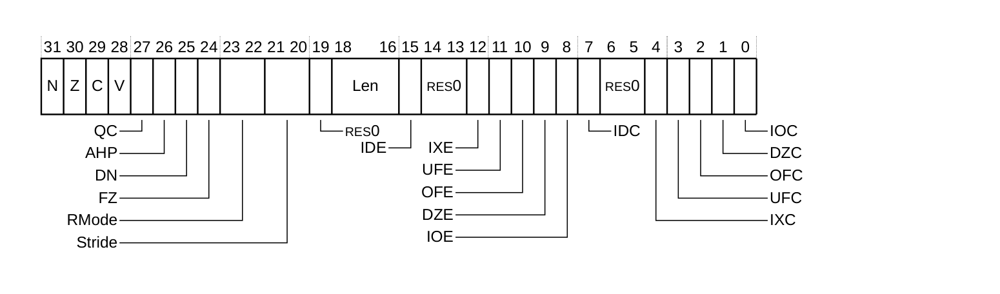
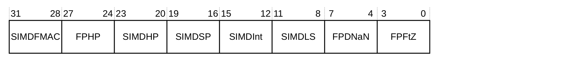
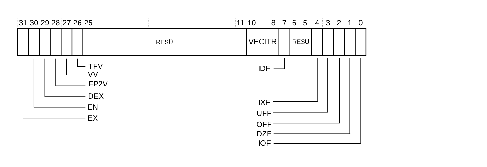

本章介绍处理器所使用的 **Advanced SIMD** 与浮点特性及寄存器。

## 1. 关于 Advanced SIMD 与浮点支持

Cortex®-R52+ 处理器支持单精度浮点指令，并可选择支持双精度浮点和 **Advanced SIMD** 指令。

## 2. 浮点支持

Cortex®-R52+ 的浮点实现：

* 不支持浮点异常的陷阱（**trapping**）。
* 不支持已弃用的浮点短向量特性。
* 以硬件实现所有操作，并支持以下各种组合：
  * 舍入模式。
  * 清零模式（**Flush-to-zero**），可启用或不启用。
  * 默认非数（**Default Not a Number, NaN**）模式，可启用或不启用。

## 3. AArch32 单精度浮点指令

仅单精度配置比完整实现拥有更少的寄存器和指令。

更多信息请参见《Arm® Architecture Reference Manual Supplement Armv8, for the Armv8-R AArch32 architecture profile》。

## 4. 访问特性标识寄存器

软件可以使用特性标识寄存器来识别 **Advanced SIMD** 与浮点特性。

可以使用 **VMRS** 指令访问特性标识寄存器，例如：

```arm
VMRS <Rt>, FPSID   ; Read FPSID into Rt
VMRS <Rt>, MVFR0   ; Read MVFR0 into Rt
VMRS <Rt>, MVFR1   ; Read MFFR1 into Rt
VMRS <Rt>, MVFR2   ; Read MVFR2 into Rt
```

## 5. 寄存器汇总

下表给出 Cortex®-R52+ 处理器的 **Advanced SIMD** 与浮点系统寄存器汇总。

| 名称 | 类型 | 复位 | 描述 |
| --- | --- | --- | --- |
| FPSID | RO | 0x41034021 | 参见第 566 页的 16.6.1 Floating-point System ID Register。 |
| FPSCR | RW | 0x00000000 | 参见第 567 页的 16.6.2 Floating-point Status and Control Register。 |
| MVFR0 | RO | 0x10110222（完整 **Advanced SIMD** 配置）<br>0x10110021（仅单精度配置） | 参见第 569 页的 16.6.3 Media and Floating-point Feature Register 0。 |
| MVFR1 | RO | 0x12111111（完整 **Advanced SIMD** 配置）<br>0x11000011（仅单精度配置） | 参见第 571 页的 16.6.4 Media and Floating-point Feature Register 1。 |
| MVFR2 | RW | 0x00000043（完整 **Advanced SIMD** 配置）<br>0x00000040（仅单精度配置） | 参见第 573 页的 16.6.5 Media and Floating-point Feature Register 2。 |
| FPEXC | RW | 0x00000700 | 参见第 574 页的 16.6.6 Floating-Point Exception Control Register。 |

**注意：** 未实现浮点指令寄存器 **FPINST** 和 **FPINST2**，任何访问它们的尝试都是 **UNDEFINED**。

有关 **Advanced SIMD** 与浮点系统寄存器允许的访问方式的信息，请参见《Arm® Architecture Reference Manual Supplement Armv8, for the Armv8-R AArch32 architecture profile》。

## 6. 寄存器描述

本节介绍 Cortex®-R52+ 处理器中的 **Advanced SIMD** 与浮点系统寄存器。

### 6.1. 浮点系统 ID 寄存器

**FPSID** 提供有关浮点实现的顶层信息。

**使用限制**

各异常级别对 **FPSID** 的可访问性为：

| EL0 | EL1 | EL2 |
| --- | --- | --- |
| - | Config | Config |

该寄存器在很大程度上复制了 **MIDR** 中保存的信息。Arm 已弃用对该寄存器的使用。

**陷阱与使能**

如果 **CPACR.cp10** 为 0b00，则从 **EL1** 访问该寄存器为 **UNDEFINED**。

如果 **HCPTR.TCP10** 置为 1，则从 **EL1** 访问该寄存器会陷入 **Hyp 模式**，从 **EL2** 访问该寄存器为 **UNDEFINED**。

如果 **HCR.TID0** 置为 1，则从 **EL1** 对该寄存器的读取访问会陷入 **Hyp 模式**。

**配置**

所有配置下均可用。

**属性**

**FPSID** 是一个 32 位寄存器。

下图给出 **FPSID** 的位分配。


下表给出 **FPSID** 的位分配。

| 位 | 名称 | 功能 |
| --- | --- | --- |
| [31:24] | Implementer | 表示实现者：<br>0x41：Arm Limited。 |
| [23] | SW | 软件位。该位表示系统是否仅提供浮点指令的软件仿真：<br>0：系统包含对浮点操作的硬件支持。 |
| [22:16] | Subarchitecture | 子架构版本号：<br>0x03：VFPv3 架构或更高版本，且无子架构。整个浮点实现都在硬件中，不需要软件支持代码。**MVFR0**、**MVFR1** 和 **MVFR2** 寄存器指示 VFP 架构版本。 |
| [15:8] | Part Number | 表示浮点实现的部件号：<br>0x40：Cortex®-R52+ 处理器。 |
| [7:4] | Variant | 表示变体号：<br>0x2：Cortex®-R52+ 处理器。 |
| [3:0] | Revision | 表示浮点实现的修订号：<br>0x1：r0p1。 |

要访问 **FPSID** 寄存器：

```arm
VMRS <Rt>, FPSID   ; Read FPSID into Rt
```

### 6.2. 浮点状态与控制寄存器

**FPSCR** 提供浮点系统状态信息与控制。

**使用限制**

各异常级别对 **FPSCR** 的可访问性为：

| EL0 | EL1 | EL2 |
| --- | --- | --- |
| Config | Config | Config |

**陷阱与使能**

如果 **CPACR.cp10** 为 0b00，则从 **EL0** 和 **EL1** 访问该寄存器为 **UNDEFINED**。

如果 **CPACR.cp10** 为 0b01，则从 **EL0** 访问该寄存器为 **UNDEFINED**。

如果 **HCPTR.TCP10** 置为 1，则从 **EL0** 和 **EL1** 访问该寄存器会陷入 **Hyp 模式**，从 **EL2** 访问该寄存器为 **UNDEFINED**。

**配置**

所有配置下均可用。

**属性**

**FPSCR** 是一个 32 位寄存器。

下图给出 **FPSCR** 的位分配。



下表给出 **FPSCR** 的位分配。

| 位 | 字段 | 功能 |
| --- | --- | --- |
| [31] | N | 浮点负条件码标志。若浮点比较操作产生小于结果，则置为 1。 |
| [30] | Z | 浮点零条件码标志。若浮点比较操作产生相等结果，则置为 1。 |
| [29] | C | 浮点进位条件码标志。若浮点比较操作产生相等、大于或无序结果，则置为 1。 |
| [28] | V | 浮点溢出条件码标志。若浮点比较操作产生无序结果，则置为 1。 |
| [27] | QC | 累计饱和位。该位置为 1 表示自上次向该位写 0 以来，某个 **Advanced SIMD** 整数操作发生了饱和。 |
| [26] | AHP | 备选半精度控制位：<br>0：选择 IEEE 半精度格式。<br>1：选择备选半精度格式。 |
| [25] | DN | 默认 **NaN** 模式控制位：<br>0：**NaN** 操作数传播到浮点操作的输出。<br>1：任何涉及一个或多个 **NaN** 的操作都返回默认 **NaN**。<br>该位的值仅控制浮点算术。无论 **DN** 位的值如何，**Advanced SIMD** 算术始终使用默认 **NaN** 设置。 |
| [24] | FZ | 清零模式控制位：<br>0：清零模式禁用。浮点系统的行为完全符合 IEEE 754 标准。<br>1：清零模式启用。<br>该位的值仅控制浮点算术。无论 **FZ** 位的值如何，**Advanced SIMD** 算术始终使用清零设置。 |
| [23:22] | RMode | 舍入模式控制字段：<br>0b00：就近舍入（**Round to Nearest, RN**）模式。<br>0b01：向正无穷舍入（**Round towards Plus Infinity, RP**）模式。<br>0b10：向负无穷舍入（**Round towards Minus Infinity, RM**）模式。<br>0b11：向零舍入（**Round towards Zero, RZ**）模式。<br>几乎所有标量浮点指令都使用所指定的舍入模式。无论 **RMode** 位的值如何，**Advanced SIMD** 算术始终使用就近舍入设置。 |
| [21:20] | Stride | 该字段为 **RES0**。 |
| [19] | - | 保留，**RES0**。 |
| [18:16] | Len | 该字段为 **RAZ**。 |
| [15] | IDE | 该字段为 **RES0**。 |
| [14:13] | - | 保留，**RES0**。 |
| [12] | IXE | 该字段为 **RES0**。 |
| [11] | UFE | 该字段为 **RES0**。 |
| [10] | OFE | 该字段为 **RES0**。 |
| [9] | DZE | 该字段为 **RES0**。 |
| [8] | IOE | 该字段为 **RES0**。 |
| [7] | IDC | 输入非规格化累计异常位。该位置为 1 表示自上次向该位写 0 以来发生了输入非规格化异常。 |
| [6:5] | - | 保留，**RES0**。 |
| [4] | IXC | 不精确累计异常位。该位置为 1 表示自上次向该位写 0 以来发生了不精确异常。 |
| [3] | UFC | 下溢累计异常位。该位置为 1 表示自上次向该位写 0 以来发生了下溢异常。 |
| [2] | OFC | 溢出累计异常位。该位置为 1 表示自上次向该位写 0 以来发生了溢出异常。 |
| [1] | DZC | 除零累计异常位。该位置为 1 表示自上次向该位写 0 以来发生了除零异常。 |
| [0] | IOC | 无效操作累计异常位。该位置为 1 表示自上次向该位写 0 以来发生了无效操作异常。 |

要访问 **FPSCR**：

```arm
VMRS <Rt>, FPSCR   ; Read FPSCR into Rt
VMSR FPSCR, <Rt>   ; Write Rt to FPSCR
```

### 6.3. 媒体与浮点特性寄存器 0

必须结合 **MVFR1** 和 **MVFR2** 来解释 **MVFR0**，以描述 **Advanced SIMD** 与浮点支持所提供的特性。

**使用限制**

各异常级别对 **MVFR0** 的可访问性为：

| EL0 | EL1 | EL2 |
| --- | --- | --- |
| - | Config | Config |

**陷阱与使能**

如果 **CPACR.cp10** 为 0b00，则从 **EL1** 对该寄存器的读取访问为 **UNDEFINED**。

如果 **HCPTR.TCP10** 置为 1，则从 **EL1** 对该寄存器的读取访问会陷入 **Hyp 模式**，从 **EL2** 对该寄存器的读取访问为 **UNDEFINED**。

如果 **HCR.TID3** 置为 1，则从 **EL1** 对该寄存器的读取访问会陷入 **Hyp 模式**。

**配置**

所有配置下均可用。

**属性**

**MVFR0** 是一个 32 位寄存器。

下图给出 **MVFR0** 的位分配。


下表给出 **MVFR0** 的位分配。

| 位 | 名称 | 功能 |
| --- | --- | --- |
| [31:28] | FPRound | 表示浮点硬件支持的舍入模式：<br>0x1：支持所有舍入模式。 |
| [27:24] | FPShVec | 表示对浮点短向量的硬件支持：<br>0x0：不支持。 |
| [23:20] | FPSqrt | 表示对浮点平方根操作的硬件支持：<br>0x1：支持。 |
| [19:16] | FPDivide | 表示对浮点除法操作的硬件支持：<br>0x1：支持。 |
| [15:12] | FPTrap | 表示浮点硬件实现是否支持异常陷阱：<br>0x0：不支持。 |
| [11:8] | FPDP | 表示对浮点双精度操作的硬件支持：<br>0x0：当处理器配置为不支持可选的双精度浮点和 **NEON** 技术时，硬件不支持。<br>0x2：当处理器配置为支持可选的双精度浮点和 **NEON** 技术时，支持 VFPv3 或更高版本。<br>更多信息请参见《Arm® Architecture Reference Manual Supplement Armv8, for the Armv8-R AArch32 architecture profile》。 |
| [7:4] | FPSP | 表示对浮点单精度操作的硬件支持：<br>0x2：支持 VFPv3 或更高版本。<br>更多信息请参见《Arm® Architecture Reference Manual Supplement Armv8, for the Armv8-R AArch32 architecture profile》。 |
| [3:0] | SIMDReg | 表示对 **Advanced SIMD** 寄存器组的支持：<br>0x1：当处理器配置为不支持可选的双精度浮点和 **NEON** 技术时，支持 16 个 64 位寄存器。<br>0x2：当处理器配置为支持可选的双精度浮点和 **NEON** 技术时，支持 32 个 64 位寄存器。<br>更多信息请参见《Arm® Architecture Reference Manual Supplement Armv8, for the Armv8-R AArch32 architecture profile》。 |

要访问 **MVFR0**：

```arm
VMRS <Rt>, MVFR0   ; Read MVFR0 into Rt
```

### 6.4. 媒体与浮点特性寄存器 1

必须结合 **MVFR0** 和 **MVFR2** 来解释 **MVFR1**，以描述 **Advanced SIMD** 与浮点支持所提供的特性。

**使用限制**

各异常级别对 **MVFR1** 的可访问性为：

| EL0 | EL1 | EL2 |
| --- | --- | --- |
| - | Config | Config |

**陷阱与使能**

如果 **CPACR.cp10** 为 0b00，则从 **EL1** 对该寄存器的读取访问为 **UNDEFINED**。

如果 **HCPTR.TCP10** 置为 1，则从 **EL1** 对该寄存器的读取访问会陷入 **Hyp 模式**，从 **EL2** 对该寄存器的读取访问为 **UNDEFINED**。

如果 **HCR.TID3** 置为 1，则从 **EL1** 对该寄存器的读取访问会陷入 **Hyp 模式**。

**配置**

所有配置下均可用。

**属性**

**MVFR1** 是一个 32 位寄存器。

下图给出 **MVFR1** 的位分配。



下表给出 **MVFR1** 的位分配。

| 位 | 名称 | 功能 |
| --- | --- | --- |
| [31:28] | SIMDFMAC | 表示 **Advanced SIMD** 与浮点是否支持融合乘累加操作：<br>0x1：已实现。 |
| [27:24] | FPHP | 表示 **Advanced SIMD** 与浮点是否支持半精度浮点转换指令：<br>0x1：当处理器配置为不支持可选的双精度浮点和 **NEON** 技术时，半精度与单精度之间的转换指令以硬件实现。<br>0x2：当处理器配置为支持可选的双精度浮点和 **NEON** 技术时，支持半精度与单精度或双精度之间的转换指令。 |
| [23:20] | SIMDHP | 表示 **Advanced SIMD** 与浮点是否支持半精度浮点转换操作：<br>0x0：未实现。<br>0x1：已实现。仅当 **SIMDSP** 字段为 0x1 时才允许该值。 |
| [19:16] | SIMDSP | 表示 **Advanced SIMD** 与浮点是否支持单精度浮点操作：<br>0x0：未实现。<br>0x1：已实现。仅当 **SIMDInt** 字段为 0x1 时才允许该值。 |
| [15:12] | SIMDInt | 表示 **Advanced SIMD** 与浮点是否支持整数操作：<br>0x0：未实现。<br>0x1：已实现。 |
| [11:8] | SIMDLS | 表示 **Advanced SIMD** 与浮点是否支持加载/存储指令：<br>0x0：已实现。<br>0x1：未实现。 |
| [7:4] | FPDNaN | 表示浮点硬件实现是否仅支持默认 **NaN** 模式：<br>0x1：硬件支持 **NaN** 值的传播。 |
| [3:0] | FPFtZ | 表示浮点硬件实现是否仅支持清零操作模式：<br>0x1：硬件支持完整的非规格化数算术。 |

要访问 **MVFR1**：

```arm
VMRS <Rt>, MVFR1   ; Read MVFR1 into Rt
```

### 6.5. 媒体与浮点特性寄存器 2

必须结合 **MVFR0** 和 **MVFR1** 来解释 **MVFR2**，以描述 **Advanced SIMD** 与浮点支持所提供的特性。

**使用限制**

各异常级别对 **MVFR2** 的可访问性为：

| EL0 | EL1 | EL2 |
| --- | --- | --- |
| - | Config | Config |

**陷阱与使能**

如果 **CPACR.cp10** 为 0b00，则从 **EL1** 对该寄存器的读取访问为 **UNDEFINED**。

如果 **HCPTR.TCP10** 置为 1，则从 **EL1** 对该寄存器的读取访问会陷入 **Hyp 模式**，从 **EL2** 对该寄存器的读取访问为 **UNDEFINED**。

如果 **HCR.TID3** 置为 1，则从 **EL1** 对该寄存器的读取访问会陷入 **Hyp 模式**。

**配置**

所有配置下均可用。

**属性**

**MVFR2** 是一个 32 位寄存器。

下图给出 **MVFR2** 的位分配。


下表给出 **MVFR2** 的位分配。

| 位 | 名称 | 功能 |
| --- | --- | --- |
| [31:8] | - | 保留，**RES0**。 |
| [7:4] | FPMisc | 表示对杂项浮点特性的支持。<br>0x4：支持：<br>· 浮点选择（**Floating-point selection**）。<br>· 使用定向舍入模式（**Directed Rounding**）的浮点到整数转换。<br>· 浮点舍入为整数值（**Round to Integral floating-point**）。<br>· 浮点 **MaxNum** 和 **MinNum**。 |
| [3:0] | SIMDMisc | 表示对杂项 **Advanced SIMD** 特性的支持。<br>0x0：未实现。<br>0x3：已实现。 |

要访问 **MVFR2**：

```arm
VMRS <Rt>, MVFR2   ; Read MVFR2 into Rt
```

### 6.6. 浮点异常控制寄存器

**FPEXC** 为 **Advanced SIMD** 与浮点支持提供全局使能，并指示该支持的状态如何记录。

**使用限制**

各异常级别对 **FPEXC** 的可访问性为：

| EL0 | EL1 | EL2 |
| --- | --- | --- |
| - | Config | Config |

**陷阱与使能**

如果 **CPACR.cp10** 为 0b00，则从 **EL1** 访问该寄存器为 **UNDEFINED**。

如果 **HCPTR.TCP10** 置为 1，则从 **EL1** 访问该寄存器会陷入 **Hyp 模式**，从 **EL2** 访问该寄存器为 **UNDEFINED**。

**配置**

所有配置下均可用。

**属性**

**FPEXC** 是一个 32 位寄存器。

下图给出 **FPEXC** 的位分配。



下表给出 **FPEXC** 的位分配。

| 位 | 名称 | 功能 |
| --- | --- | --- |
| [31] | EX | 该字段为 **RES0**。 |
| [30] | EN | 使能位。**Advanced SIMD** 与浮点支持的全局使能：<br>0：**Advanced SIMD** 与浮点支持被禁用。<br>1：**Advanced SIMD** 与浮点支持被使能并正常工作。<br>**EN** 位在复位时被清零。 |
| [29] | DEX | 该字段为 **RES0**。 |
| [28] | FP2V | 该字段为 **RES0**。 |
| [27] | VV | 该字段为 **RES0**。 |
| [26] | TFV | 该字段为 **RAZ/WI**。 |
| [25:11] | - | 保留，**RES0**。 |
| [10:8] | VECITR | 该字段为 **RES1**。 |
| [7] | IDF | 该字段为 **RAZ/WI**。 |
| [6:5] | - | 保留，**RES0**。 |
| [4] | IXF | 该字段为 **RAZ/WI**。 |
| [3] | UFF | 该字段为 **RAZ/WI**。 |
| [2] | OFF | 该字段为 **RAZ/WI**。 |
| [1] | DZF | 该字段为 **RAZ/WI**。 |
| [0] | IOF | 该字段为 **RAZ/WI**。 |

要访问 **FPEXC** 寄存器：

```arm
VMRS <Rt>, FPEXC   ; Read FPEXC into Rt
VMSR FPEXC, <Rt>   ; Write Rt to FPEXC
```
