本章介绍 Cortex®-R52+ 处理器的交叉触发逻辑。

## 1. 关于交叉触发

在 Cortex®-R52+ 处理器中，每个核以及每个 ETM 内的调试逻辑都具有交叉触发输入与输出，可用于发出触发事件信号。每个核都有一个与之关联的 CoreSight 交叉触发接口（**CTI**，Cross-Trigger Interface），用于连接这些信号。各 **CTI** 模块又由一个交叉触发矩阵（**CTM**，Cross-Trigger Matrix）连接到处理器唯一的外部交叉触发通道接口。

**CTI** 使调试逻辑、ETM 跟踪单元与 PMU 之间能够相互作用，也能够与其他 CoreSight 组件相互作用。这称为**交叉触发（cross-triggering）**。例如，可以配置 **CTI**，使其在 ETM 跟踪单元触发事件发生时产生中断。

下图给出了调试系统的各个组件以及可用的触发输入与触发输出。

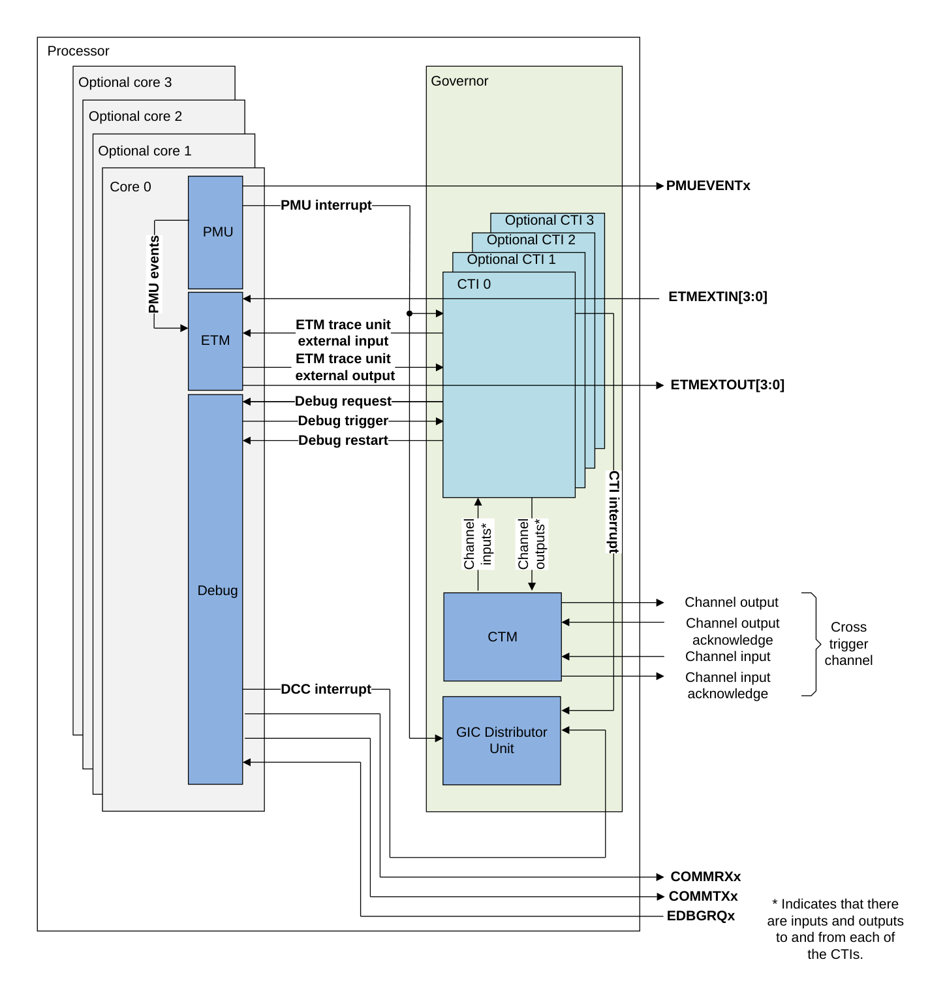

## 2. 触发输入与触发输出

本节介绍 **CTI** 可用的触发输入与触发输出。

下表给出了 **CTI** 的输入。

| CTI 输入 | 描述 |
| --- | --- |
| 0 | Cross Halt 触发事件。 |
| 1 | PMU 中断 |
| 2 | - |
| 3 | - |
| 4 | ETM 跟踪单元外部输出 0 |
| 5 | ETM 跟踪单元外部输出 1 |
| 6 | ETM 跟踪单元外部输出 2 |
| 7 | ETM 跟踪单元外部输出 3 |

下表给出了 **CTI** 的输出。

| CTI 输出 | 描述 |
| --- | --- |
| 0 | 请求处理器进入调试状态 |
| 1 | 请求处理器退出调试状态 |
| 2 | CTI 中断 |
| 3 | - |
| 4 | ETM 跟踪单元外部输入 0 |
| 5 | ETM 跟踪单元外部输入 1 |
| 6 | ETM 跟踪单元外部输入 2 |
| 7 | ETM 跟踪单元外部输入 3 |

## 3. Cortex®-R52+ CTM

来自所有核的 CoreSight **CTI** 通道信号通过一个 **CTM** 模块合并，从而使 Cortex®-R52+ 处理器呈现单一的交叉触发通道接口。

下图给出了 Cortex®-R52+ 处理器的 **CTM**。在 **CTM** 中，外部通道输出由所有内部通道输出的**或（OR）**输出驱动。每个内部通道输入由所有其他 **CTI** 的内部通道输出与外部通道输入的**或**输出驱动。图中只给出了通道的其中一位，但每一位都与该图类似。该图未示出与通道相关的握手与同步逻辑。

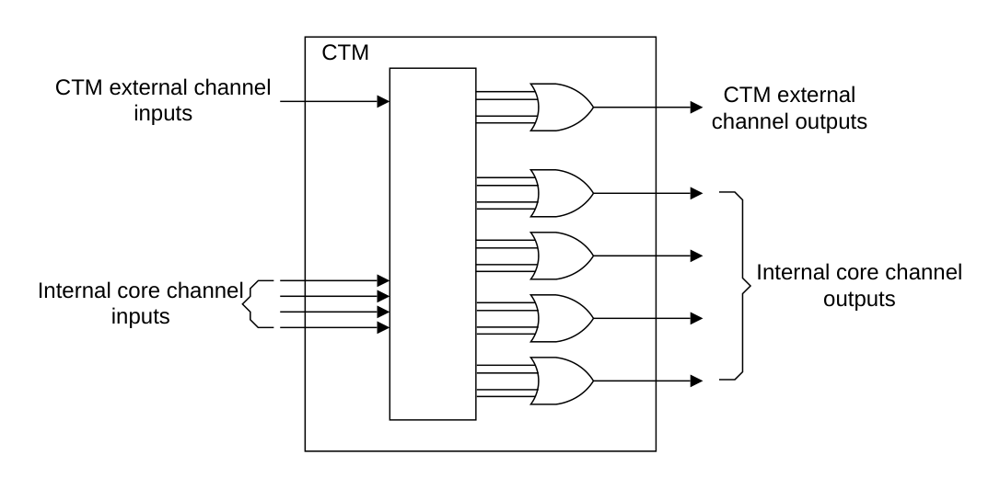

## 4. 交叉触发寄存器汇总

本节汇总 Cortex®-R52+ 处理器中每个 **CTI** 的寄存器。这些寄存器通过内存映射接口或外部调试接口访问。

有关 Cortex®-R52+ 处理器中每个 **CTI** 基地址的更多信息，请参见第 420 页的 12.7.1 Debug memory map。

下表给出了 Cortex®-R52+ 交叉触发寄存器的汇总。除若干包含 ID 信息的只读寄存器外，**CTI** 寄存器在《Arm® Architecture Reference Manual for A-profile architecture》中有完整说明。这意味着不存在 Cortex®-R52+ 特有的细节。

**注意：** **PADDRDBG31** 的取值与 CoreSight 软件锁会限制通过内存映射外部调试接口对 **CTI** 寄存器的写访问。当 **PADDRDBG31** 驱动为低电平时，必须使用 CoreSight 软件锁来解锁交叉触发寄存器的写权限。当 **PADDRDBG31** 驱动为高电平时，软件锁不限制交叉触发寄存器的写访问权限。软件锁由 Lock Access 寄存器（**CTILAR**）控制。

| 偏移 | 名称 | 类型 | 描述 |
| --- | --- | --- | --- |
| 0x000 | CTICONTROL | RW | CTI Control Register |
| 0x010 | CTIINTACK | WO | CTI Output Trigger Acknowledge Register |
| 0x014 | CTIAPPSET | RW | CTI Application Trigger Set Register |
| 0x018 | CTIAPPCLEAR | WO | CTI Application Trigger Clear Register |
| 0x01C | CTIAPPPULSE | WO | CTI Application Pulse Register |
| 0x020 | CTIINEN0 | RW | CTI Input Trigger to Output Channel Enable Registers |
| 0x024 | CTIINEN1 | RW | CTI Input Trigger to Output Channel Enable Registers |
| 0x028 | CTIINEN2 | RW | CTI Input Trigger to Output Channel Enable Registers |
| 0x02C | CTIINEN3 | RW | CTI Input Trigger to Output Channel Enable Registers |
| 0x030 | CTIINEN4 | RW | CTI Input Trigger to Output Channel Enable Registers |
| 0x034 | CTIINEN5 | RW | CTI Input Trigger to Output Channel Enable Registers |
| 0x038 | CTIINEN6 | RW | CTI Input Trigger to Output Channel Enable Registers |
| 0x03C | CTIINEN7 | RW | CTI Input Trigger to Output Channel Enable Registers |
| 0x0A0 | CTIOUTEN0 | RW | CTI Input Channel to Output Trigger Enable Registers |
| 0x0A4 | CTIOUTEN1 | RW | CTI Input Channel to Output Trigger Enable Registers |
| 0x0A8 | CTIOUTEN2 | RW | CTI Input Channel to Output Trigger Enable Registers |
| 0x0AC | CTIOUTEN3 | RW | CTI Input Channel to Output Trigger Enable Registers |
| 0x0B0 | CTIOUTEN4 | RW | CTI Input Channel to Output Trigger Enable Registers |
| 0x0B4 | CTIOUTEN5 | RW | CTI Input Channel to Output Trigger Enable Registers |
| 0x0B8 | CTIOUTEN6 | RW | CTI Input Channel to Output Trigger Enable Registers |
| 0x0BC | CTIOUTEN7 | RW | CTI Input Channel to Output Trigger Enable Registers |
| 0x130 | CTITRIGINSTATUS | RO | CTI Trigger In Status Register |
| 0x134 | CTITRIGOUTSTATUS | RO | CTI Trigger Out Status Register |
| 0x138 | CTICHINSTATUS | RO | CTI Channel In Status Register |
| 0x13C | CTICHOUTSTATUS | RO | CTI Channel Out Status Register |
| 0x140 | CTIGATE | RW | CTI Channel Gate Enable Register |
| 0x144 | ASICCTL | RW | CTI External Multiplexer Control Register |
| 0xF00 | CTIITCTRL | RW | 第 469 页的 14.5.2 CTI Integration Mode Control Register |
| 0xFA0 | CTICLAIMSET | RW | CTI Claim Tag Set Register |
| 0xFA4 | CTICLAIMCLR | RW | CTI Claim Tag Clear Register |
| 0xFA8 | CTIDEVAFF0 | RO | CTI Device Affinity Register 0 |
| 0xFAC | CTIDEVAFF1 | RO | CTI Device Affinity Register 1 |
| 0xFB0 | CTILAR | WO | CTI Lock Access Register |
| 0xFB4 | CTILSR | RO | CTI Lock Status Register |
| 0xFB8 | CTIAUTHSTATUS | RO | CTI Authentication Status Register |
| 0xFBC | CTIDEVARCH | RO | CTI Device Architecture Register |
| 0xFC0 | CTIDEVID2 | RO | CTI Device ID Register 2 |
| 0xFC4 | CTIDEVID1 | RO | CTI Device ID Register 1 |
| 0xFC8 | CTIDEVID | RO | 第 468 页的 14.5.1 CTI Device Identification Register |
| 0xFCC | CTIDEVTYPE | RO | CTI Device Type Register |
| 0xFD0 | CTIPIDR4 | RO | 第 475 页的 14.5.3.5 Peripheral Identification Register 4 |
| 0xFD4 | CTIPIDR5 | RO | 第 476 页的 14.5.3.6 Peripheral Identification Register 5-7 |
| 0xFD8 | CTIPIDR6 | RO | 第 476 页的 14.5.3.6 Peripheral Identification Register 5-7 |
| 0xFDC | CTIPIDR7 | RO | 第 476 页的 14.5.3.6 Peripheral Identification Register 5-7 |
| 0xFE0 | CTIPIDR0 | RO | 第 471 页的 14.5.3.1 Peripheral Identification Register 0 |
| 0xFE4 | CTIPIDR1 | RO | 第 472 页的 14.5.3.2 Peripheral Identification Register 1 |
| 0xFE8 | CTIPIDR2 | RO | 第 473 页的 14.5.3.3 Peripheral Identification Register 2 |
| 0xFEC | CTIPIDR3 | RO | 第 474 页的 14.5.3.4 Peripheral Identification Register 3 |
| 0xFF0 | CTICIDR0 | RO | 第 476 页的 14.5.4.1 Component Identification Register 0 |
| 0xFF4 | CTICIDR1 | RO | 第 477 页的 14.5.4.2 Component Identification Register 1 |
| 0xFF8 | CTICIDR2 | RO | 第 478 页的 14.5.4.3 Component Identification Register 2 |
| 0xFFC | CTICIDR3 | RO | 第 479 页的 14.5.4.4 Component Identification Register 3 |

### 4.1. 外部寄存器访问权限

是否允许访问某个 **CTI** 寄存器取决于：

* **CTI** 软件锁的状态。
* 处理器调试认证输入的状态。

## 5. 交叉触发寄存器描述

本节介绍 Cortex®-R52+ 的 **CTI** 寄存器。

### 5.1. CTI 设备标识寄存器（CTIDEVID）

**CTIDEVID** 向调试器描述 CTI 组件。

**使用限制**

本寄存器为只读。有关影响本寄存器访问权限的条件汇总，请参见第 391 页的 12.2.4 External register access permissions。详细说明请参见《Arm® Architecture Reference Manual Supplement Armv8, for the Armv8-R AArch32 architecture profile》。

**陷阱与使能**

不存在影响本寄存器的陷阱与使能。

**配置**

在所有处理器构建配置中均可用。

**属性**

**CTIDEVID** 是一个 32 位寄存器。

下图给出了 **CTIDEVID** 的位分配。

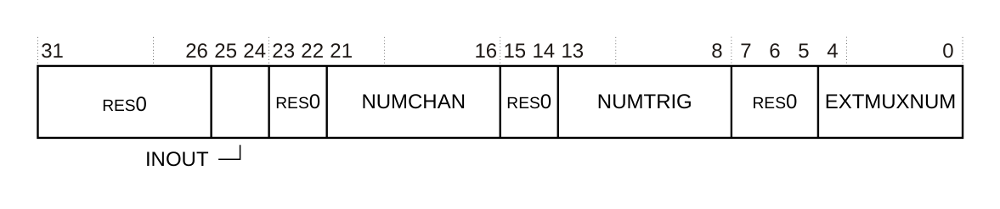

下表给出了 **CTIDEVID** 的位分配。

| 位 | 名称 | 功能 |
| --- | --- | --- |
| [31:26] | - | 保留，RES0。 |
| [25:24] | INOUT | 输入与输出选项。表示是否存在输入门控。取值为： 0b01：**CTIGATE** 屏蔽来自外部通道的输入事件的传播。 |
| [23:22] | - | 保留，RES0。 |
| [21:16] | NUMCHAN | 实现的通道数。取值为： 0b000100：实现四个通道。 |
| [15:14] | - | 保留，RES0。 |
| [13:8] | NUMTRIG | 实现的触发器数。取值为： 0b001000：实现八个触发器。 |
| [7:5] | - | 保留，RES0。 |
| [4:0] | EXTMUXNUM | 表示触发输入与触发输出上可用的多路复用器数量。取值为： 0b00000：未实现外部触发器。 |

**CTIDEVID** 可通过外部调试接口访问：

| 组件 | 偏移 |
| --- | --- |
| CTI | 0xFC8 |

### 5.2. CTI 集成模式控制寄存器（CTIITCTRL）

**CTIITCTRL** 寄存器表明 Cortex®-R52+ 处理器未实现集成模式。

**使用限制**

本寄存器为只读。有关影响本寄存器访问权限的条件汇总，请参见第 391 页的 12.2.4 External register access permissions。详细说明请参见《Arm® Architecture Reference Manual Supplement Armv8, for the Armv8-R AArch32 architecture profile》。

**陷阱与使能**

不存在影响本寄存器的陷阱与使能。

**配置**

在所有处理器构建配置中均可用。

**属性**

**CTIITCTRL** 是一个 32 位寄存器。

下图给出了 **CTIITCTRL** 的位分配。

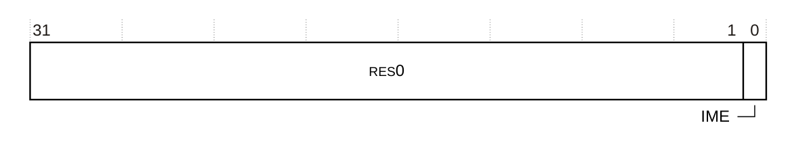

下表给出了 **CTIITCTRL** 的位分配。

| 位 | 名称 | 功能 |
| --- | --- | --- |
| [31:1] | - | 保留，RES0。 |
| [0] | IME | 集成模式使能。取值为： 0：正常运行。 **注意：** 对该位的写入被忽略。 |

**CTIITCTRL** 可通过外部调试接口访问：

| 组件 | 偏移 |
| --- | --- |
| CTI | 0xF00 |

### 5.3. CTI 外设标识寄存器

外设标识寄存器提供所有符合 Arm CoreSight 架构的组件所需的标准信息。它们是一组八个寄存器，如下表所列。

| 寄存器 | 取值 | 偏移 |
| --- | --- | --- |
| CTIPIDR0 | 0xBB | 0xFE0 |
| CTIPIDR1 | 0xB9 | 0xFE4 |
| CTIPIDR2 | 0x1B | 0xFE8 |
| CTIPIDR3 | 0x00 | 0xFEC |
| CTIPIDR4 | 0x04 | 0xFD0 |
| CTIPIDR5 | 0x00 | 0xFD4 |
| CTIPIDR6 | 0x00 | 0xFD8 |
| CTIPIDR7 | 0x00 | 0xFDC |

每个外设标识寄存器只使用位 [7:0]，位 [31:8] 保留。八个外设标识寄存器共同定义一个 64 位外设 ID。

外设 ID 寄存器包括：

* 第 471 页的 14.5.3.1 Peripheral Identification Register 0。
* 第 472 页的 14.5.3.2 Peripheral Identification Register 1。
* 第 473 页的 14.5.3.3 Peripheral Identification Register 2。
* 第 474 页的 14.5.3.4 Peripheral Identification Register 3。
* 第 475 页的 14.5.3.5 Peripheral Identification Register 4。
* 第 476 页的 14.5.3.6 Peripheral Identification Register 5-7。

#### 5.3.1. 外设标识寄存器 0（CTIPIDR0）

**CTIPIDR0** 提供用于标识 CTI 组件的信息。

**使用限制**

本寄存器为只读。有关影响本寄存器访问权限的条件汇总，请参见第 391 页的 12.2.4 External register access permissions。详细说明请参见《Arm® Architecture Reference Manual Supplement Armv8, for the Armv8-R AArch32 architecture profile》。

**陷阱与使能**

不存在影响本寄存器的陷阱与使能。

**配置**

在所有处理器构建配置中均可用。

**属性**

**CTIPIDR0** 是一个 32 位寄存器。

下图给出了 **CTIPIDR0** 的位分配。

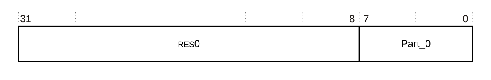

下表给出了 **CTIPIDR0** 的位分配。

| 位 | 名称 | 功能 |
| --- | --- | --- |
| [31:8] | - | 保留，RES0。 |
| [7:0] | Part_0 | 0xBB 交叉触发部件号的最低有效字节。 |

**CTIPIDR0** 可通过外部调试接口访问：

| 组件 | 偏移 |
| --- | --- |
| CTI | 0xFE0 |

#### 5.3.2. 外设标识寄存器 1（CTIPIDR1）

**CTIPIDR1** 提供用于标识 CTI 组件的信息。

**使用限制**

本寄存器为只读。有关影响本寄存器访问权限的条件汇总，请参见第 391 页的 12.2.4 External register access permissions。详细说明请参见《Arm® Architecture Reference Manual Supplement Armv8, for the Armv8-R AArch32 architecture profile》。

**陷阱与使能**

不存在影响本寄存器的陷阱与使能。

**配置**

在所有处理器构建配置中均可用。

**属性**

**CTIPIDR1** 是一个 32 位寄存器。

下图给出了 **CTIPIDR1** 的位分配。

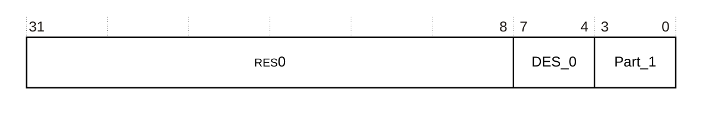

下表给出了 **CTIPIDR1** 的位分配。

| 位 | 名称 | 功能 |
| --- | --- | --- |
| [31:8] | - | 保留，RES0。 |
| [7:4] | DES_0 | 0xB Arm Limited。这是 JEP106 ID 码的最低有效半字节。 |
| [3:0] | Part_1 | 0x9 CTI 部件号的最高有效半字节。 |

**CTIPIDR1** 可通过外部调试接口访问：

| 组件 | 偏移 |
| --- | --- |
| CTI | 0xFE4 |

#### 5.3.3. 外设标识寄存器 2（CTIPIDR2）

**CTIPIDR2** 提供用于标识 CTI 组件的信息。

**使用限制**

本寄存器为只读。有关影响本寄存器访问权限的条件汇总，请参见第 391 页的 12.2.4 External register access permissions。详细说明请参见《Arm® Architecture Reference Manual Supplement Armv8, for the Armv8-R AArch32 architecture profile》。

**陷阱与使能**

不存在影响本寄存器的陷阱与使能。

**配置**

在所有处理器构建配置中均可用。

**属性**

**CTIPIDR2** 是一个 32 位寄存器。

下图给出了 **CTIPIDR2** 的位分配。

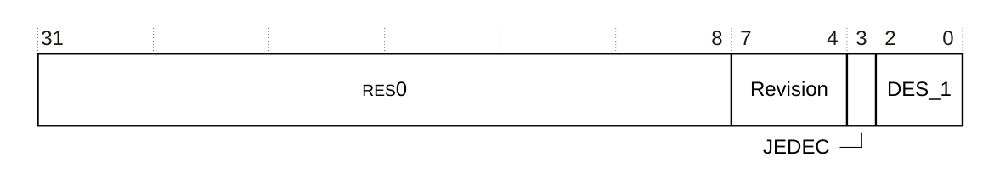

下表给出了 **CTIPIDR2** 的位分配。

| 位 | 名称 | 功能 |
| --- | --- | --- |
| [31:8] | - | 保留，RES0。 |
| [7:4] | Revision | 0x1 r0p1。 |
| [3] | JEDEC | 1 表示使用 JEP106 标识码。 |
| [2:0] | DES_1 | 0b011 Arm Limited。这是 JEP106 ID 码的最高有效半字节。 |

**CTIPIDR2** 可通过外部调试接口访问：

| 组件 | 偏移 |
| --- | --- |
| CTI | 0xFE8 |

#### 5.3.4. 外设标识寄存器 3（CTIPIDR3）

**CTIPIDR3** 提供用于标识 CTI 组件的信息。

**使用限制**

本寄存器为只读。有关影响本寄存器访问权限的条件汇总，请参见第 391 页的 12.2.4 External register access permissions。详细说明请参见《Arm® Architecture Reference Manual Supplement Armv8, for the Armv8-R AArch32 architecture profile》。

**陷阱与使能**

不存在影响本寄存器的陷阱与使能。

**配置**

在所有处理器构建配置中均可用。

**属性**

**CTIPIDR3** 是一个 32 位寄存器。

下图给出了 **CTIPIDR3** 的位分配。

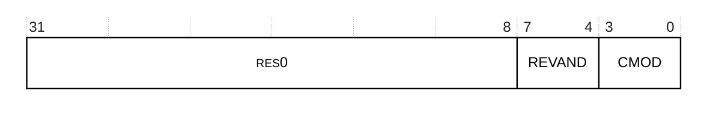

下表给出了 **CTIPIDR3** 的位分配。

| 位 | 名称 | 功能 |
| --- | --- | --- |
| [31:8] | - | 保留，RES0。 |
| [7:4] | REVAND | 0x0 部件次要修订号。 |
| [3:0] | CMOD | 0x0 客户修改。 |

**CTIPIDR3** 可通过外部调试接口访问：

| 组件 | 偏移 |
| --- | --- |
| CTI | 0xFEC |

#### 5.3.5. 外设标识寄存器 4（CTIPIDR4）

**CTIPIDR4** 提供用于标识 CTI 组件的信息。

**使用限制**

本寄存器为只读。有关影响本寄存器访问权限的条件汇总，请参见第 391 页的 12.2.4 External register access permissions。详细说明请参见《Arm® Architecture Reference Manual Supplement Armv8, for the Armv8-R AArch32 architecture profile》。

**陷阱与使能**

不存在影响本寄存器的陷阱与使能。

**配置**

在所有处理器构建配置中均可用。

**属性**

**CTIPIDR4** 是一个 32 位寄存器。

下图给出了 **CTIPIDR4** 的位分配。

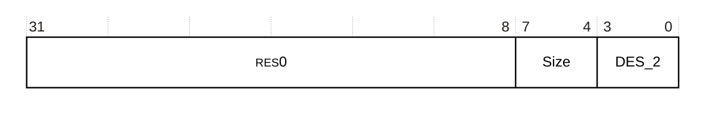

下表给出了 **CTIPIDR4** 的位分配。

| 位 | 名称 | 功能 |
| --- | --- | --- |
| [31:8] | - | 保留，RES0。 |
| [7:4] | Size | 0x0 1KB。组件的大小。 |
| [3:0] | DES_2 | 0x4 Arm Limited。这是 JEP106 延续码的最低有效半字节。 |

**CTIPIDR4** 可通过外部调试接口访问：

| 组件 | 偏移 |
| --- | --- |
| CTI | 0xFD0 |

#### 5.3.6. 外设标识寄存器 5-7（CTIPIDR5-CTIPIDR7）

外设 ID5、外设 ID6 与外设 ID7 寄存器中不保存任何信息。它们为 RES0。

### 5.4. 组件标识寄存器

共有四个只读组件标识寄存器，即组件 ID0 至组件 ID3。下表给出了这些寄存器。

| 寄存器 | 取值 | 偏移 |
| --- | --- | --- |
| CTICIDR0 | 0x0D | 0xFF0 |
| CTICIDR1 | 0x90 | 0xFF4 |
| CTICIDR2 | 0x05 | 0xFF8 |
| CTICIDR3 | 0xB1 | 0xFFC |

组件 ID 寄存器包括：

* 第 476 页的 14.5.4.1 Component Identification Register 0。
* 第 477 页的 14.5.4.2 Component Identification Register 1。
* 第 478 页的 14.5.4.3 Component Identification Register 2。
* 第 479 页的 14.5.4.4 Component Identification Register 3。

#### 5.4.1. 组件标识寄存器 0（CTICIDR0）

**CTICIDR0** 提供用于标识 CTI 组件的信息。

**使用限制**

本寄存器为只读。有关影响本寄存器访问权限的条件汇总，请参见第 391 页的 12.2.4 External register access permissions。详细说明请参见《Arm® Architecture Reference Manual Supplement Armv8, for the Armv8-R AArch32 architecture profile》。

**陷阱与使能**

不存在影响本寄存器的陷阱与使能。

**配置**

在所有处理器构建配置中均可用。

**属性**

**CTICIDR0** 是一个 32 位寄存器。

下图给出了 **CTICIDR0** 的位分配。

下表给出了 **CTICIDR0** 的位分配。

| 位 | 名称 | 功能 |
| --- | --- | --- |
| [31:8] | - | 保留，RES0。 |
| [7:0] | PRMBL_0 | 0x0D 前导字节 0。 |

**CTICIDR0** 可通过外部调试接口访问：

| 组件 | 偏移 |
| --- | --- |
| CTI | 0xFF0 |

#### 5.4.2. 组件标识寄存器 1（CTICIDR1）

**CTICIDR1** 提供用于标识 CTI 组件的信息。

**使用限制**

本寄存器为只读。有关影响本寄存器访问权限的条件汇总，请参见第 391 页的 12.2.4 External register access permissions。详细说明请参见《Arm® Architecture Reference Manual Supplement Armv8, for the Armv8-R AArch32 architecture profile》。

**陷阱与使能**

不存在影响本寄存器的陷阱与使能。

**配置**

在所有处理器构建配置中均可用。

**属性**

**CTICIDR1** 是一个 32 位寄存器。

下图给出了 **CTICIDR1** 的位分配。

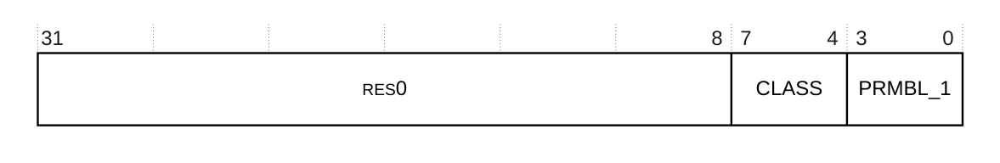

下表给出了 **CTICIDR1** 的位分配。

| 位 | 名称 | 功能 |
| --- | --- | --- |
| [31:8] | - | 保留，RES0。 |
| [7:4] | CLASS | 0x9 调试组件。 |
| [3:0] | PRMBL_1 | 0x0 前导字节 1。 |

**CTICIDR1** 可通过外部调试接口访问：

| 组件 | 偏移 |
| --- | --- |
| CTI | 0xFF4 |

#### 5.4.3. 组件标识寄存器 2（CTICIDR2）

**CTICIDR2** 提供用于标识 CTI 组件的信息。

**使用限制**

本寄存器为只读。有关影响本寄存器访问权限的条件汇总，请参见第 391 页的 12.2.4 External register access permissions。详细说明请参见《Arm® Architecture Reference Manual Supplement Armv8, for the Armv8-R AArch32 architecture profile》。

**陷阱与使能**

不存在影响本寄存器的陷阱与使能。

**配置**

在所有处理器构建配置中均可用。

**属性**

**CTICIDR2** 是一个 32 位寄存器。

下图给出了 **CTICIDR2** 的位分配。

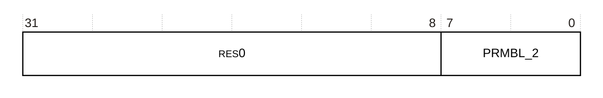

下表给出了 **CTICIDR2** 的位分配。

| 位 | 名称 | 功能 |
| --- | --- | --- |
| [31:8] | - | 保留，RES0。 |
| [7:0] | PRMBL_2 | 0x05 前导字节 2。 |

**CTICIDR2** 可通过外部调试接口访问：

| 组件 | 偏移 |
| --- | --- |
| CTI | 0xFF8 |

#### 5.4.4. 组件标识寄存器 3（CTICIDR3）

**CTICIDR3** 提供用于标识 CTI 组件的信息。

**使用限制**

本寄存器为只读。有关影响本寄存器访问权限的条件汇总，请参见第 391 页的 12.2.4 External register access permissions。详细说明请参见《Arm® Architecture Reference Manual Supplement Armv8, for the Armv8-R AArch32 architecture profile》。

**陷阱与使能**

不存在影响本寄存器的陷阱与使能。

**配置**

在所有处理器构建配置中均可用。

**属性**

**CTICIDR3** 是一个 32 位寄存器。

下图给出了 **CTICIDR3** 的位分配。

下表给出了 **CTICIDR3** 的位分配。

| 位 | 名称 | 功能 |
| --- | --- | --- |
| [31:8] | - | 保留，RES0。 |
| [7:0] | PRMBL_3 | 0xB1 前导字节 3。 |

**CTICIDR3** 可通过外部调试接口访问：

| 组件 | 偏移 |
| --- | --- |
| CTI | 0xFFC |
