本章介绍 Cortex®-R52+ 处理器的调试寄存器，并给出使用这些寄存器的示例。

## 1. 关于调试

Cortex®-R52+ 处理器支持两种侵入式调试方法：**外部调试（external debug）**与**自托管调试（self-hosted debug）**。本节简要介绍这两种方法，并概述构成常规侵入式调试系统的主要组件。

### 1.1 外部调试

外部调试是一种常规的调试设置，其中调试器位于被调试核之外。调试器既可以运行在 Cortex®-R52+ 处理器内的另一个核上，也可以运行在 Cortex®-R52+ 之外。例如，调试器可能运行在通过 **JTAG** 连接到包含 Cortex®-R52+ 处理器的开发系统的工作站上。

外部调试适用于基于 Cortex®-R52+ 处理器的系统的硬件调试，即在系统首次上电且软件功能尚不完整时的开发期间进行调试。

下图给出了一个典型的外部调试系统。

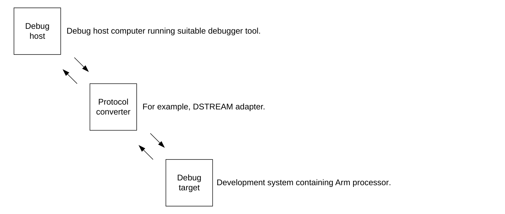

除上图中所示的组件外，还有一个调试单元协助调试处理器上的软件。

#### 1.1.1 调试主机

调试主机是一台计算机（例如个人计算机），运行诸如 **DS-5 Debugger** 之类的软件调试器。调试主机使你能够发出高层命令，例如在某个位置设置断点，或查看某个内存地址的内容。

#### 1.1.2 协议转换器

调试主机使用以太网等接口向调试目标发送消息。然而，调试目标通常实现 **JTAG** 或 **SWD** 之类的不同接口协议。需要使用 **DSTREAM** 之类的设备在两种协议之间进行转换。

#### 1.1.3 调试目标

调试目标是系统中最低的一层。调试目标的一个例子是带有测试芯片或带有 Cortex®-R52+ 处理器的硅片的开发系统。

调试目标实现系统支持，使协议转换器能够使用 **AMBA APB** 从接口访问 Cortex®-R52+ 调试单元。

#### 1.1.4 Cortex®-R52+ 调试单元

处理器调试单元协助调试处理器上运行的软件。

调试单元使你能够：

* 停止程序执行。
* 检查并修改进程与系统控制状态。
* 检查并修改存储器与输入/输出外设状态。
* 重启处理器。

Cortex®-R52+ 处理器提供一个调试 **APB** 从端口，每个核的调试寄存器均可通过该端口访问。调试寄存器列表请参见 4. 系统寄存器描述。

**ETM**、**CTI**、**PMU** 以及用于描述这些寄存器的 ROM 表也位于该端口上。该端口的高层内存映射请参见 7. 外部调试接口。

**相关内容**

* 第 436 页的 13. Performance Monitor Unit
* 第 463 页的 14. Cross Trigger
* 第 480 页的 15. Embedded Trace Macrocell

### 1.2 自托管调试

在自托管调试中，Cortex®-R52+ 处理器内被调试的核自身承载调试监控软件。硬件观察点与断点在调试事件发生时产生调试异常。

有关更多信息，请参见 1.3 调试模型与 1.3.1 观察点调试事件。这些异常由调试监控程序处理，该监控程序通常与操作系统内核或虚拟机管理程序共存。

当 Cortex®-R52+ 处理器已部署在成型的系统中、无法直接访问 Cortex®-R52+ 调试硬件时，自托管调试很有用。自托管调试支持：

* 任务调试。
* 操作系统与内核调试。
* 虚拟机管理程序调试。

**注意：** 对虚拟机管理程序代码的自托管调试支持仅限于软件断点指令。

自托管调试的详细信息，请参见《Arm® Architecture Reference Manual Supplement Armv8, for the Armv8-R AArch32 architecture profile》。

### 1.3 调试模型

处理器的调试逻辑负责产生调试事件。调试事件包括诸如断点单元将指令地址与其寄存器中存储的地址进行匹配等事件。

Cortex®-R52+ 处理器以下列方式之一响应调试事件：

* 进入特殊的**调试状态（Debug state）**。
* 接受调试异常。
* 挂起调试事件，稍后处理。
* 忽略调试事件。

调试异常是自托管调试的基础。调试状态是外部调试的基础。

调试事件转换为异常或进入调试状态，取决于调试逻辑的配置以及调试事件的类型。例如，对于断点指令（**BKPT**），处理器必须假定该指令替换了实际的程序指令，并且总是接受异常。

调试事件可以是：

* 软件调试事件。
* 外部暂停调试事件。

当 Cortex®-R52+ 处理器被编程为外部调试（也称为**暂停调试（halting debug）**）时，软件调试事件会导致进入特殊的调试状态。外部暂停调试事件总是导致进入 Cortex®-R52+ 调试状态，无论 Cortex®-R52+ 处理器如何编程。在调试状态下：

* 处理器不从存储器取指令，而是从特殊的指令传送寄存器取指令。
* 数据传送寄存器用于在调试主机与调试目标之间传送寄存器与存储器内容。

导致进入调试状态的调试事件称为**暂停调试事件（halting debug event）**。

有关调试模型的更多信息，请参见《Arm® Architecture Reference Manual Supplement Armv8, for the Armv8-R AArch32 architecture profile》。

#### 1.3.1 观察点调试事件

在 Cortex®-R52+ 处理器中，观察点调试事件总是同步的。即使独占监视器的控制检查失败，存储独占指令也会产生观察点调试事件。

在正常工作条件下，下列指令不会产生观察点异常：

* 指令缓存维护指令。
* 地址转换指令。
* 预加载指令。
* 除 **DCIMVAC** 之外的所有数据缓存维护指令。

对于观察点调试事件，**DFAR** 中报告的值保证不低于被观察位置地址向下舍入到 16 字节倍数的结果。

#### 1.3.2 调试 OS 锁

**Debug OS Lock** 由上电复位 **nCPUPORESETx** 置位。

为使调试事件与调试寄存器访问正常工作，必须清除 **Debug OS Lock**。有关更多信息，请参见《Arm® Architecture Reference Manual Supplement Armv8, for the Armv8-R AArch32 architecture profile》。

## 2. 调试寄存器接口

本节介绍处理器的调试体系结构与调试事件。

处理器实现《Arm® Architecture Reference Manual Supplement Armv8, for the Armv8-R AArch32 architecture profile》中描述的 Armv8-R AArch32 调试体系结构与调试事件。

调试体系结构定义了一组调试寄存器。调试寄存器接口提供从以下位置访问这些寄存器的能力：

* 处理器上运行的软件。
* 外部调试器。

### 2.1 处理器接口

系统寄存器访问允许处理器直接访问某些调试寄存器。外部调试接口允许外部与自托管调试代理访问调试寄存器。

对调试寄存器的访问划分如下：

**调试寄存器**

该接口基于系统寄存器，并且是内存映射的。你可以使用 **APB** 从端口访问调试寄存器映射。

**性能监控器**

该接口基于系统寄存器，并且是内存映射的。你可以使用 **APB** 从端口访问性能监控器寄存器。

**跟踪寄存器**

该接口是内存映射的。你可以使用 **APB** 从端口访问跟踪寄存器。

**相关内容**

* 第 391 页的 12.3 System register summary
* 第 397 页的 12.5 Memory-mapped register summary
* 第 436 页的 13. Performance Monitor Unit
* 第 480 页的 15. Embedded Trace Macrocell

### 2.2 断点与观察点

处理器中的每个核支持八对硬件断点寄存器、八对硬件观察点寄存器以及一个标准的**调试通信通道（DCC，Debug Communication Channel）**。

其中两对断点寄存器可配置为与上下文 ID 和 VMID 之一（或两者）进行匹配。每个观察点可以链接到这两个断点之一，以便在给定的进程上下文中捕获存储器请求。

### 2.3 复位对调试寄存器的影响

每个核具有下列影响调试寄存器的复位信号：

**nCPUPORESETx**

这些主**冷复位**信号初始化核逻辑，包括调试、性能监控逻辑与 **ETM**。

**nCORERESETx**

这些主**热复位**信号初始化核逻辑，包括部分调试与性能监控逻辑。

**nPRESETDBG**

这是外部调试复位信号，用于初始化共享的调试 **APB**、**CTI** 与**交叉触发矩阵（CTM，Cross Trigger Matrix）**逻辑。该信号对处理器其余部分的功能没有影响。

### 2.4 外部寄存器访问权限

是否允许访问某个寄存器取决于：

* 处理器是否已上电。
* **OS Lock**、**OS Double Lock** 与 **Software Lock** 的状态。
* 处理器调试认证输入的状态。

本文档不描述每个寄存器特有的行为以及寄存器访问类型。有关这些特性及其对寄存器影响的详细说明，请参见《Arm® Architecture Reference Manual Supplement Armv8, for the Armv8-R AArch32 architecture profile》。

本节提供的寄存器描述说明每个寄存器是读写还是只读。

## 3. 系统寄存器汇总

下表汇总了可从内部 (coproc==0b1110) 接口访问的调试控制寄存器。

这些寄存器通过 **MCR**、**MRC** 指令访问。请参见《Arm® Architecture Reference Manual Supplement Armv8, for the Armv8-R AArch32 architecture profile》。

下表还给出了同样可从内存映射接口与外部调试接口访问的寄存器的偏移地址。可从内存映射接口与外部调试接口访问的完整寄存器列表请参见 5. 内存映射寄存器汇总。除某些只读寄存器中的 ID 与配置值之外，所有这些寄存器均在《Arm® Architecture Reference Manual Supplement Armv8, for the Armv8-R AArch32 architecture profile》中有完整说明。这意味着不存在 Cortex®-R52+ 特有的细节。

| 偏移 | CRn | op1 | CRm | op2 | 名称 | 类型 | 位宽 | 描述 |
| --- | --- | --- | --- | --- | --- | --- | --- | --- |
| - | c0 | 0 | c0 | 0 | DBGDIDR | RO | 32-bit | 4.1 调试 ID 寄存器 |
| - | c0 | 0 | c0 | 2 | DBGDTRRXext | RW | 32-bit | 调试数据传送寄存器，接收，外部视图 |
| 0x400 | c0 | 0 | c0 | 4 | DBGBVR0 | RW | 32-bit | 调试断点值寄存器 0 |
| 0x408 | c0 | 0 | c0 | 5 | DBGBCR0 | RW | 32-bit | 调试断点控制寄存器 0 |
| 0x800 | c0 | 0 | c0 | 6 | DBGWVR0 | RW | 32-bit | 调试观察点值寄存器 0 |
| 0x808 | c0 | 0 | c0 | 7 | DBGWCR0 | RW | 32-bit | 调试观察点控制寄存器 0 |
| - | c0 | 7 | c0 | 0 | JIDR | RO | 32-bit | 旧版 Jazelle ID 寄存器 |
| - | c0 | 0 | c1 | 0 | DBGDSCRint | RO | 32-bit | 调试状态与控制寄存器，内部视图 |
| 0x410 | c0 | 0 | c1 | 4 | DBGBVR1 | RW | 32-bit | 调试断点值寄存器 1 |
| 0x418 | c0 | 0 | c1 | 5 | DBGBCR1 | RW | 32-bit | 调试断点控制寄存器 1 |
| 0x810 | c0 | 0 | c1 | 6 | DBGWVR1 | RW | 32-bit | 调试观察点值寄存器 1 |
| 0x818 | c0 | 0 | c1 | 7 | DBGWCR1 | RW | 32-bit | 调试观察点控制寄存器 1 |
| - | c0 | 0 | c2 | 0 | DBGDCCINT | RW | 32-bit | 调试通信通道中断使能寄存器 |
| - | c0 | 0 | c2 | 2 | DBGDSCRext | RW | 32-bit | 调试状态与控制寄存器，外部视图 |
| 0x420 | c0 | 0 | c2 | 4 | DBGBVR2 | RW | 32-bit | 调试断点值寄存器 2 |
| 0x428 | c0 | 0 | c2 | 5 | DBGBCR2 | RW | 32-bit | 调试断点控制寄存器 2 |
| 0x820 | c0 | 0 | c2 | 6 | DBGWVR2 | RW | 32-bit | 调试观察点值寄存器 2 |
| 0x828 | c0 | 0 | c2 | 7 | DBGWCR2 | RW | 32-bit | 调试观察点控制寄存器 2 |
| - | c0 | 0 | c3 | 2 | DBGDTRTXext | RW | 32-bit | 调试数据传送寄存器，发送，外部视图 |
| 0x430 | c0 | 0 | c3 | 4 | DBGBVR3 | RW | 32-bit | 调试断点值寄存器 3 |
| 0x438 | c0 | 0 | c3 | 5 | DBGBCR3 | RW | 32-bit | 调试断点控制寄存器 3 |
| 0x830 | c0 | 0 | c3 | 6 | DBGWVR3 | RW | 32-bit | 调试观察点值寄存器 3 |
| 0x838 | c0 | 0 | c3 | 7 | DBGWCR3 | RW | 32-bit | 调试观察点控制寄存器 3 |
| 0x440 | c0 | 0 | c4 | 4 | DBGBVR4 | RW | 32-bit | 调试断点值寄存器 4 |
| 0x448 | c0 | 0 | c4 | 5 | DBGBCR4 | RW | 32-bit | 调试断点控制寄存器 4 |
| 0x840 | c0 | 0 | c4 | 6 | DBGWVR4 | RW | 32-bit | 调试观察点值寄存器 4 |
| 0x848 | c0 | 0 | c4 | 7 | DBGWCR4 | RW | 32-bit | 调试观察点控制寄存器 4 |
| 0x08C | c0 | 0 | c5 | 0 | DBGDTRTXint | WO | 32-bit | 调试数据传送寄存器，发送，内部视图 |
| 0x080 | c0 | 0 | c5 | 0 | DBGDTRRXint | RO | 32-bit | 调试数据传送寄存器，接收，内部视图 |
| 0x450 | c0 | 0 | c5 | 4 | DBGBVR5 | RW | 32-bit | 调试断点值寄存器 5 |
| 0x458 | c0 | 0 | c5 | 5 | DBGBCR5 | RW | 32-bit | 调试断点控制寄存器 5 |
| 0x850 | c0 | 0 | c5 | 6 | DBGWVR5 | RW | 32-bit | 调试观察点值寄存器 5 |
| 0x858 | c0 | 0 | c5 | 7 | DBGWCR5 | RW | 32-bit | 调试观察点控制寄存器 5 |
| - | c0 | 0 | c6 | 0 | DBGWFAR | RW | 32-bit | 调试观察点故障地址寄存器。该寄存器已废弃，为 RES0 |
| 0x098 | c0 | 0 | c6 | 2 | DBGOSECCR | RW | 32-bit | 调试 OS 锁异常捕获控制寄存器 |
| 0x460 | c0 | 0 | c6 | 4 | DBGBVR6 | RW | 32-bit | 调试断点值寄存器 6 |
| 0x468 | c0 | 0 | c6 | 5 | DBGBCR6 | RW | 32-bit | 调试断点控制寄存器 6 |
| 0x860 | c0 | 0 | c6 | 6 | DBGWVR6 | RW | 32-bit | 调试观察点值寄存器 6 |
| 0x868 | c0 | 0 | c6 | 7 | DBGWCR6 | RW | 32-bit | 调试观察点控制寄存器 6 |
| - | c0 | 0 | c7 | 0 | DBGVCR | RW | 32-bit | 调试向量捕获寄存器 |
| 0x470 | c0 | 0 | c7 | 4 | DBGBVR7 | RW | 32-bit | 调试断点值寄存器 7 |
| 0x478 | c0 | 0 | c7 | 5 | DBGBCR7 | RW | 32-bit | 调试断点控制寄存器 7 |
| 0x870 | c0 | 0 | c7 | 6 | DBGWVR7 | RW | 32-bit | 调试观察点值寄存器 7 |
| 0x878 | c0 | 0 | c7 | 7 | DBGWCR7 | RW | 32-bit | 调试观察点控制寄存器 7 |
| - | c1 | 0 | c0 | 0 | DBGDRAR | RO | 32-bit | 调试 ROM 地址寄存器 |
| 0x300 | c1 | 0 | c0 | 4 | DBGOSLAR | WO | 32-bit | 调试 OS 锁访问寄存器 |
| - | c1 | 7 | c0 | 0 | JOSCR | RW | 32bit | 旧版 Jazelle OS 控制寄存器 |
| - | c1 | 0 | c1 | 4 | DBGOSLSR | RO | 32-bit | 调试 OS 锁状态寄存器 |
| - | c1 | 0 | c3 | 4 | DBGOSDLR | RW | 32-bit | 调试 OS 双锁寄存器 |
| 0x310 | c1 | 0 | c4 | 4 | DBGPRCR | RW | 32-bit | 调试电源/复位控制寄存器 |
| 0x444 | c1 | 0 | c6 | 1 | DBGBXVR6 | RW | 32-bit | 调试断点扩展值寄存器 6 |
| 0x444 | c1 | 0 | c7 | 1 | DBGBXVR7 | RW | 32-bit | 调试断点扩展值寄存器 7 |
| - | c2 | 0 | c0 | 0 | DBGDSAR | RO | 32-bit | 调试自地址寄存器 |
| - | c2 | 0 | c0 | 0 | JMCR | RW | 32-bit | 旧版 Jazelle 主配置寄存器 |
| - | c7 | 0 | c0 | 7 | DBGDEVID2 | RO | 32-bit | 调试设备 ID 寄存器 2 |
| - | c7 | 0 | c1 | 7 | DBGDEVID1 | RO | 32-bit | 4.3 调试设备 ID 寄存器 1 |
| - | c7 | 0 | c2 | 7 | DBGDEVID | RO | 32-bit | 4.2 调试设备 ID 寄存器 |
| 0xFA0 | c7 | 0 | c8 | 6 | DBGCLAIMSET | RW | 32-bit | 调试声明标记设置寄存器 |
| 0xFA4 | c7 | 0 | c9 | 6 | DBGCLAIMCLR | RW | 32-bit | 调试声明标记清除寄存器 |
| 0xFB8 | c7 | 0 | c14 | 6 | DBGAUTHSTATUS | RO | 32-bit | 调试认证状态寄存器 |

## 4. 系统寄存器描述

本节描述通过内部 (coproc==0b1110) 接口访问的部分调试寄存器，这些寄存器具有 Cortex®-R52+ 特有的值。

通过内部接口访问的全部寄存器列表请参见 3. 系统寄存器汇总。

### 4.1 调试 ID 寄存器

**DBGDIDR** 指出所实现的调试体系结构版本以及调试实现的某些特性。

**使用限制**

本寄存器为只读。有关影响本寄存器访问是否允许的条件的汇总，请参见第 391 页的 12.2.4 External register access permissions。

详细说明请参见《Arm® Architecture Reference Manual Supplement Armv8, for the Armv8-R AArch32 architecture profile》。

**陷阱与使能**

如果 **DBGDSCRext.UDCCdis** 置 1，则从 EL0 对本寄存器的读访问陷入未定义模式。

如果 **HDCR.TDA** 置 1，则从 EL0 与 EL1 对本寄存器的读访问陷入 Hyp 模式。

**配置**

本寄存器在所有处理器构建配置中均可用。

**属性**

**DBGDIDR** 是一个 32 位寄存器。

下图给出了 **DBGDIDR** 的位分配。

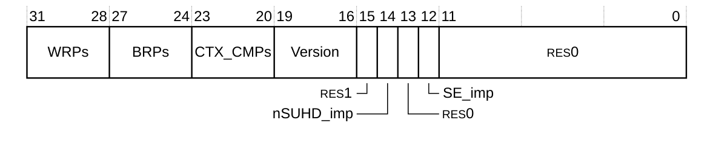

下表给出了 **DBGDIDR** 的位分配。

| 位 | 名称 | 功能 |
| --- | --- | --- |
| [31:28] | WRPs | 实现的观察点寄存器对（**WRP**）数量。实现的 **WRP** 数量比该字段的值多一。取值为：<br>0x7：处理器实现 8 个 **WRP**。 |
| [27:24] | BRPs | 实现的断点寄存器对（**BRP**）数量。实现的 **BRP** 数量比该字段的值多一。取值为：<br>0x7：处理器实现 8 个 **BRP**。 |
| [23:20] | CTX_CMPs | 可用于上下文匹配的 **BRP** 数量。该数量比该字段的值多一。取值为：<br>0x1：处理器实现两个上下文匹配断点，即断点 6 与断点 7。 |
| [19:16] | Version | 调试体系结构版本。<br>0x6：处理器实现 Armv8 调试体系结构。 |
| [15] | - | 保留，RES1。 |
| [14] | nSUHD_imp | 安全用户暂停调试未实现位。取值为：<br>0：处理器不实现安全用户暂停调试。 |
| [13] | - | 保留，RES0。 |
| [12] | SE_imp | 安全扩展实现位。取值为：<br>0：处理器不实现安全扩展。 |
| [11:0] | - | 保留，RES0。 |

访问 **DBGDIDR**：

```arm
MRC p14, 0, <Rt>, c0, c0, 0   ; 将 DBGDIDR 读入 Rt
```

### 4.2 调试设备 ID 寄存器

**DBGDEVID** 指出所实现的调试体系结构版本以及调试实现的某些特性。

**使用限制**

本寄存器为只读。有关影响本寄存器访问是否允许的条件的汇总，请参见第 391 页的 12.2.4 External register access permissions。

详细说明请参见《Arm® Architecture Reference Manual Supplement Armv8, for the Armv8-R AArch32 architecture profile》。

**陷阱与使能**

如果 **HDCR.TDA** 置 1，则从 EL1 对本寄存器的读访问陷入 Hyp 模式。

**配置**

本寄存器在所有处理器构建配置中均可用。

**属性**

**DBGDEVID** 是一个 32 位寄存器。

下图给出了 **DBGDEVID** 的位分配。

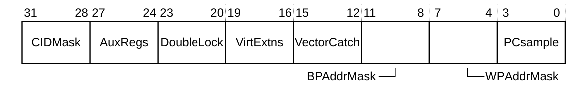

下表给出了 **DBGDEVID** 的位分配。

| 位 | 名称 | 功能 |
| --- | --- | --- |
| [31:28] | CIDMask | 指出对上下文 ID 匹配断点屏蔽能力的支持程度。取值为：<br>0x0：不实现上下文 ID 屏蔽。 |
| [27:24] | AuxRegs | 指出对调试外部辅助控制寄存器的支持。取值为：<br>0x0：处理器不支持调试外部辅助控制寄存器。 |
| [23:20] | DoubleLock | 指出对调试 OS 双锁寄存器的支持。取值为：<br>0x1：处理器支持调试 OS 双锁寄存器。 |
| [19:16] | VirExtns | 指出是否实现 EL2。取值为：<br>0x1：处理器实现 EL2。 |
| [15:12] | VectorCatch | 定义所实现的向量捕获事件的形式。取值为：<br>0x0：处理器实现地址匹配形式的向量捕获。 |
| [11:8] | BPAddrMask | 指出对指令地址匹配断点屏蔽能力的支持程度。取值为：<br>0xF：未实现断点地址屏蔽。**DBGBCRn[28:24]** 为 RES0。 |
| [7:4] | WPAddrMask | 指出对数据地址匹配观察点屏蔽能力的支持程度。取值为：<br>0x1：实现观察点地址屏蔽。 |
| [3:0] | PCsample | 指出使用调试寄存器 40 与 43 进行程序计数器采样的支持程度。取值为：<br>0x3：**EDPCSR**、**EDCIDSR** 与 **EDVIDSR** 分别实现为调试寄存器 40、41 与 42。 |

访问 **DBGDEVID**：

```arm
MRC p14, 0, <Rt>, c7, c2, 7   ; 将 DBGDEVID 读入 Rt
```

### 4.3 调试设备 ID 寄存器 1

**DBGDEVID1** 通过描述调试实现的其他特性，对 **DBGDIDR** 给出的信息进行补充。

**使用限制**

本寄存器为只读。有关影响本寄存器访问是否允许的条件的汇总，请参见第 391 页的 12.2.4 External register access permissions。

详细说明请参见《Arm® Architecture Reference Manual Supplement Armv8, for the Armv8-R AArch32 architecture profile》。

**陷阱与使能**

如果 **HDCR.TDA** 置 1，则从 EL1 对本寄存器的读访问陷入 Hyp 模式。

**配置**

本寄存器在所有处理器构建配置中均可用。

**属性**

**DBGDEVID1** 是一个 32 位寄存器。

下图给出了 **DBGDEVID1** 的位分配。

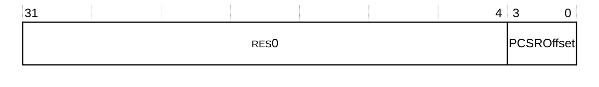

下表给出了 **DBGDEVID1** 的位分配。

| 位 | 名称 | 功能 |
| --- | --- | --- |
| [31:4] | - | 保留，RES0。 |
| [3:0] | PCSROffset | 指出读 **EDPCSR** 返回的 PC 采样所施加的偏移。取值为：<br>0x2：**EDPCSR** 采样不施加偏移，且不采样指令集状态。 |

访问 **DBGDEVID1**：

```arm
MRC p14, 0, <Rt>, c7, c1, 7   ; 将 DBGDEVID1 读入 Rt
```

## 5. 内存映射寄存器汇总

Cortex®-R52+ 处理器支持对**外部调试接口**的内存映射访问。这种访问能力称为**内存映射外部调试接口（memory-mapped external debug interface）**。

**PADDRDBG31** 的值与 CoreSight 软件锁限制通过内存映射外部调试接口对调试寄存器的写访问。当 **PADDRDBG31** 驱动为低电平时，必须使用 CoreSight 软件锁来解锁调试寄存器的写权限。当 **PADDRDBG31** 驱动为高电平时，软件锁不限制调试寄存器的写访问权限。软件锁通过**锁访问寄存器（Lock Access register）**控制。

下表给出了可从内存映射外部调试接口访问的寄存器的偏移地址。它还给出了同样可从内部 (coproc==0b1110) 接口访问的寄存器的 CRn、op1、CRm 与 op2。

| 偏移 | CRn | op1 | CRm | op2 | 名称 | 类型 | 位宽 | 描述 |
| --- | --- | --- | --- | --- | --- | --- | --- | --- |
| 0x020 | - | - | - | - | EDESR | RW | 32-bit | 外部调试事件状态寄存器 |
| 0x024 | - | - | - | - | EDECR | RW | 32-bit | 外部调试执行控制寄存器 |
| 0x030 | - | - | - | - | EDWARlo | RO | 32-bit | 外部调试观察点地址寄存器，低字 |
| 0x034 | - | - | - | - | EDWARhi | RO | 32-bit | 外部调试观察点地址寄存器，高字 |
| 0x080 | - | - | - | - | DBGDTRRX_EL0 | RW | 32bit | 调试数据传送寄存器，接收 |
| 0x084 | - | - | - | - | EDITR | WO | 32-bit | 外部调试指令传送寄存器 |
| 0x088 | - | - | - | - | EDSCR | RW | 32-bit | 外部调试状态与控制寄存器 |
| 0x08C | - | - | - | - | DBGDTRTX_EL0 | RO | 32-bit | 调试数据传送寄存器，发送 |
| 0x090 | - | - | - | - | EDRCR | WO | 32-bit | 外部调试保留控制寄存器 |
| 0x098 | - | - | - | - | EDECCR | RW | 32-bit | 外部调试异常捕获控制寄存器 |
| 0x0A0 | - | - | - | - | EDPCSRlo | RO | 32-bit | 外部调试程序计数器采样寄存器，低字 |
| 0x0A4 | - | - | - | - | EDCIDSR | RO | 32-bit | 外部调试上下文 ID 采样寄存器 |
| 0x0A8 | - | - | - | - | EDVIDSR | RO | 32-bit | 外部调试虚拟上下文采样寄存器 |
| 0x0AC | - | - | - | - | EDPCSRhi | RO | 32-bit | 外部调试程序计数器采样寄存器，高字 |
| 0x300 | c1 | 0 | c0 | 4 | DBGOSLAR | WO | 32-bit | 调试 OS 锁访问寄存器 |
| 0x310 | - | - | - | - | EDPRCR | RW | 32-bit | 外部调试电源/复位控制寄存器 |
| 0x314 | - | - | - | - | EDPRSR | RO | 32-bit | 外部调试处理器状态寄存器 |
| 0x400 | c0 | 0 | c0 | 4 | DBGBVR0 | RW | 32-bit | 调试断点值寄存器 0 |
| 0x408 | c0 | 0 | c0 | 5 | DBGBCR0 | RW | 32-bit | 调试断点控制寄存器 0 |
| 0x410 | c0 | 0 | c1 | 4 | DBGBVR1 | RW | 32-bit | 调试断点值寄存器 1 |
| 0x418 | c0 | 0 | c1 | 5 | DBGBCR1 | RW | 32-bit | 调试断点控制寄存器 1 |
| 0x420 | c0 | 0 | c2 | 4 | DBGBVR2 | RW | 32-bit | 调试断点值寄存器 2 |
| 0x428 | c0 | 0 | c2 | 5 | DBGBCR2 | RW | 32-bit | 调试断点控制寄存器 2 |
| 0x430 | c0 | 0 | c3 | 4 | DBGBVR3 | RW | 32-bit | 调试断点值寄存器 3 |
| 0x438 | c0 | 0 | c3 | 5 | DBGBCR3 | RW | 32-bit | 调试断点控制寄存器 3 |
| 0x440 | c0 | 0 | c4 | 4 | DBGBVR4 | RW | 32-bit | 调试断点值寄存器 4 |
| 0x448 | c0 | 0 | c4 | 5 | DBGBCR4 | RW | 32-bit | 调试断点控制寄存器 4 |
| 0x450 | c0 | 0 | c5 | 4 | DBGBVR5 | RW | 32-bit | 调试断点值寄存器 5 |
| 0x458 | c0 | 0 | c5 | 5 | DBGBCR5 | RW | 32-bit | 调试断点控制寄存器 5 |
| 0x460 | c0 | 0 | c6 | 4 | DBGBVR6 | RW | 32-bit | 调试断点值寄存器 6 |
| 0x464 | c0 | 0 | c6 | 1 | DBGBXVR6 | RW | 32-bit | 调试断点扩展值寄存器 6 |
| 0x468 | c0 | 0 | c6 | 5 | DBGBCR6 | RW | 32-bit | 调试断点控制寄存器 6 |
| 0x470 | c0 | 0 | c7 | 4 | DBGBVR7 | RW | 32-bit | 调试断点值寄存器 7 |
| 0x474 | c0 | 0 | c7 | 1 | DBGBXVR7 | RW | 32-bit | 调试断点扩展值寄存器 7 |
| 0x478 | c0 | 0 | c7 | 5 | DBGBCR7 | RW | 32-bit | 调试断点控制寄存器 7 |
| 0x800 | c0 | 0 | c0 | 6 | DBGWVR0 | RW | 32-bit | 调试观察点值寄存器 0 |
| 0x808 | c0 | 0 | c0 | 7 | DBGWCR0 | RW | 32-bit | 调试观察点控制寄存器 0 |
| 0x810 | c0 | 0 | c1 | 6 | DBGWVR1 | RW | 32-bit | 调试观察点值寄存器 1 |
| 0x818 | c0 | 0 | c1 | 7 | DBGWCR1 | RW | 32-bit | 调试观察点控制寄存器 1 |
| 0x820 | c0 | 0 | c2 | 6 | DBGWVR2 | RW | 32-bit | 调试观察点值寄存器 2 |
| 0x828 | c0 | 0 | c2 | 7 | DBGWCR2 | RW | 32-bit | 调试观察点控制寄存器 2 |
| 0x830 | c0 | 0 | c3 | 6 | DBGWVR3 | RW | 32-bit | 调试观察点值寄存器 3 |
| 0x838 | c0 | 0 | c3 | 7 | DBGWCR3 | RW | 32-bit | 调试观察点控制寄存器 3 |
| 0x840 | c0 | 0 | c4 | 6 | DBGWVR4 | RW | 32-bit | 调试观察点值寄存器 4 |
| 0x848 | c0 | 0 | c4 | 7 | DBGWCR4 | RW | 32-bit | 调试观察点控制寄存器 4 |
| 0x850 | c0 | 0 | c5 | 6 | DBGWVR5 | RW | 32-bit | 调试观察点值寄存器 5 |
| 0x858 | c0 | 0 | c5 | 7 | DBGWCR5 | RW | 32-bit | 调试观察点控制寄存器 5 |
| 0x860 | c0 | 0 | c6 | 6 | DBGWVR6 | RW | 32-bit | 调试观察点值寄存器 6 |
| 0x868 | c0 | 0 | c6 | 7 | DBGWCR6 | RW | 32-bit | 调试观察点控制寄存器 6 |
| 0x870 | c0 | 0 | c7 | 6 | DBGWVR7 | RW | 32-bit | 调试观察点值寄存器 7 |
| 0x878 | c0 | 0 | c7 | 7 | DBGWCR7 | RW | 32-bit | 调试观察点控制寄存器 7 |
| 0xC00 | - | - | - | - | EDCCR | RW | 32-bit | 6.1 外部调试校准控制寄存器 |
| 0xD00 | - | - | - | - | MIDR | RO | 32-bit | 第 172 页的 4.3.69 Main ID Register |
| 0xD20 | - | - | - | - | EDPFR[63:32] | RO | 32-bit | 6.8 外部调试处理器特性寄存器 |
| 0xD24 | - | - | - | - | EDPFR[31:0] | RO | 32-bit | 6.8 外部调试处理器特性寄存器 |
| 0xD28 | - | - | - | - | EDDFR[63:32] | RO | 32-bit | 6.9 外部调试特性寄存器 |
| 0xD2C | - | - | - | - | EDDFR[31:0] | RO | 32-bit | 6.9 外部调试特性寄存器 |
| 0xD60 | - | - | - | - | EDAA32PFR[63:32] | RO | 32-bit | 6.7 外部调试 AArch32 处理器特性寄存器 |
| 0xD64 | - | - | - | - | EDAA32PFR[31:0] | RO | 32-bit | 6.7 外部调试 AArch32 处理器特性寄存器 |
| 0xFA0 | c7 | 0 | c8 | 6 | DBGCLAIMSET | RW | 32-bit | 调试声明标记设置寄存器 |
| 0xFA4 | c7 | 0 | c9 | 6 | DBGCLAIMCLR | RW | 32-bit | 调试声明标记清除寄存器 |
| 0xFB8 | c7 | 0 | c14 | 6 | DBGAUTHSTATUS | RO | 32-bit | 调试认证状态寄存器 |
| 0xFA8 | - | - | - | - | EDDEVAFF0 | RO | 32-bit | 第 185 页的 4.3.78 Multiprocessor Affinity Register |
| 0xFAC | - | - | - | - | EDDEVAFF1 | RO | 32-bit | 外部调试设备亲和寄存器 1。该寄存器为 RES0 |
| 0xFB0 | - | - | - | - | EDLAR | WO | 32-bit | 外部调试锁访问寄存器 |
| 0xFB4 | - | - | - | - | EDLSR | RO | 32-bit | 外部调试锁状态寄存器 |
| 0xFBC | - | - | - | - | EDDEVARCH | RO | 32-bit | 外部调试设备体系结构寄存器 |
| 0xFC0 | - | - | - | - | EDDEVID2 | RO | 32-bit | 外部调试设备 ID 寄存器 2 |
| 0xFC4 | - | - | - | - | EDDEVID1 | RO | 32-bit | 6.4 外部调试设备 ID 寄存器 1 |
| 0xFC8 | - | - | - | - | EDDEVID | RO | 32-bit | 6.3 外部调试设备 ID 寄存器 0 |
| 0xFCC | - | - | - | - | EDDEVTYPE | RO | 32-bit | 外部调试设备类型寄存器 |
| 0xFD0 | - | - | - | - | EDPIDR4 | RO | 32-bit | 6.5.5 外部调试外设标识寄存器 4 |
| 0xFE0 | - | - | - | - | EDPIDR0 | RO | 32-bit | 6.5.1 外部调试外设标识寄存器 0 |
| 0xFE4 | - | - | - | - | EDPIDR1 | RO | 32-bit | 6.5.2 外部调试外设标识寄存器 1 |
| 0xFE8 | - | - | - | - | EDPIDR2 | RO | 32-bit | 6.5.3 外部调试外设标识寄存器 2 |
| 0xFEC | - | - | - | - | EDPIDR3 | RO | 32-bit | 6.5.4 外部调试外设标识寄存器 3 |
| 0xFF0 | - | - | - | - | EDCIDR0 | RO | 32-bit | 6.6.1 外部调试组件标识寄存器 0 |
| 0xFF4 | - | - | - | - | EDCIDR1 | RO | 32-bit | 6.6.2 外部调试组件标识寄存器 1 |
| 0xFF8 | - | - | - | - | EDCIDR2 | RO | 32-bit | 6.6.3 外部调试组件标识寄存器 2 |
| 0xFFC | - | - | - | - | EDCIDR3 | RO | 32-bit | 6.6.4 外部调试组件标识寄存器 3 |

## 6. 内存映射寄存器描述

本节描述部分 Cortex®-R52+ 处理器内存映射调试寄存器，这些寄存器为 Cortex®-R52+ 特有或具有 Cortex®-R52+ 特有的值。

对于本章未描述的寄存器，请参见《Arm® Architecture Reference Manual Supplement Armv8, for the Armv8-R AArch32 architecture profile》。

可通过外部调试接口访问的全部寄存器列表请参见 5. 内存映射寄存器汇总。

### 6.1 外部调试校准控制寄存器

**EDCCR** 寄存器用于使 Cortex®-R52+ 数据缓存中缓存的、从 Flash 或 **AXIM** 接口读取的数据失效。

**使用限制**

本寄存器可通过外部调试接口访问，为读写。有关影响本寄存器访问是否允许的校准条件的汇总，请参见第 391 页的 12.2.4 External register access permissions。

**陷阱与使能**

没有影响本寄存器的陷阱与使能。

**配置**

本寄存器在所有处理器构建配置中均可用。

**属性**

**EDCCR** 是一个 32 位寄存器。

下图给出了 **EDCCR** 的位分配。

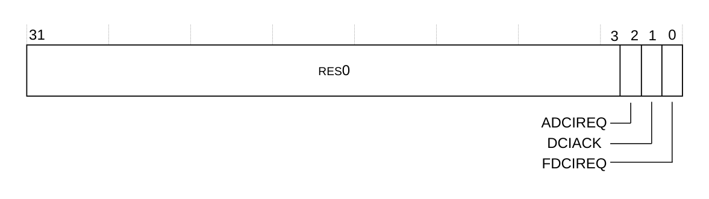

下表给出了 **EDCCR** 的位分配。

| 位 | 名称 | 功能 |
| --- | --- | --- |
| [31:3] | - | 保留，RES0。 |
| [2] | ADCIREQ | 对该寄存器的写操作：<br>0：使能 **AXIM** 缓存分配。<br>1：使 **AXIM** 接口的缓存数据失效。<br>对该寄存器的读操作返回 RES0。 |
| [1] | DCIACK | 指示缓存失效何时完成。该位为只读。<br>1：缓存失效已完成。<br>0：缓存尚未失效。<br>写操作被忽略。 |
| [0] | FDCIREQ | 对该寄存器的写操作：<br>0：使能 Flash 缓存分配。<br>1：使 **Flash** 接口的缓存数据失效。<br>对该寄存器的读操作指示相应状态：<br>0：**AXIM** 与 **Flash** 的缓存分配已使能。<br>1：已请求对 **AXIM**、**Flash** 或两者的数据缓存失效。对所请求类型的新访问不会被分配。 |

**EDCCR** 可以通过外部调试接口访问，偏移为 0xC00。

有关数据缓存失效的更多信息，请参见第 245 页的 8.3.3 Data cache invalidation。

### 6.2 外部调试保留控制寄存器

**EDRCR** 用于取消总线请求并清除 **EDSCR** 中的粘滞位。

**使用限制**

本寄存器可通过外部调试接口访问，为只写。有关影响本寄存器访问是否允许的条件的汇总，请参见第 391 页的 12.2.4 External register access permissions。详细说明请参见《Arm® Architecture Reference Manual Supplement Armv8, for the Armv8-R AArch32 architecture profile》。

**陷阱与使能**

没有影响本寄存器的陷阱与使能。

**配置**

本寄存器在所有处理器构建配置中均可用。

**属性**

**EDRCR** 是一个 32 位寄存器。

下图给出了 **EDRCR** 的位分配。

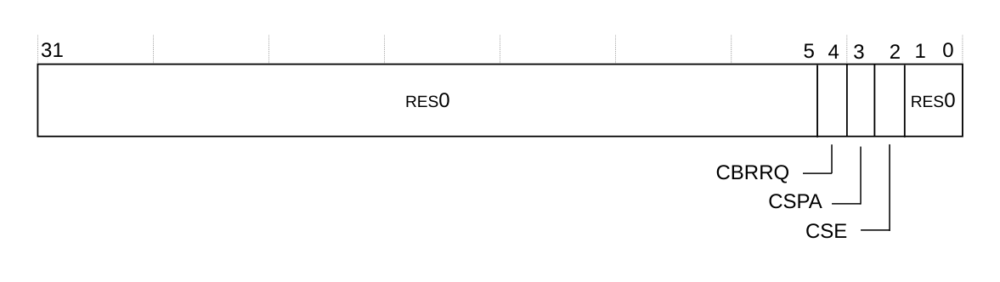

下表给出了 **EDRCR** 的位分配。

| 位 | 名称 | 功能 |
| --- | --- | --- |
| [31:5] | - | 保留，RES0。 |
| [4] | CBRRQ | 允许非精确进入调试状态。写该位的动作为：<br>0：无动作。<br>1：允许非精确进入调试状态，例如通过取消挂起的总线访问。<br>将该位置 1 允许调试器请求非精确进入调试状态。调试器将该位置 1 之前，必须有一个外部调试请求调试事件处于挂起状态。 |
| [3] | CSPA | 清除粘滞流水线推进（Clear Sticky Pipeline Advance）。该位用于将 **EDSCR.PipeAdv** 位清 0。可能的取值为：<br>0：无动作。<br>1：将 **EDSCR.PipeAdv** 位清 0。 |
| [2] | CSE | 清除粘滞错误（Clear Sticky Error）。用于将 **EDSCR** 的累计错误位清 0。可能的取值为：<br>0：无动作。<br>1：将 **EDSCR.{TXU, RXO, ERR}** 位清 0；如果处理器处于调试状态，还将 **EDSCR.ITO** 位清 0。 |
| [1:0] | - | 保留，RES0。 |

**EDRCR** 可以通过外部调试接口访问，偏移为 0x090。

### 6.3 外部调试设备 ID 寄存器 0

**EDDEVID** 为外部调试器提供有关调试实现特性的附加信息。

**使用限制**

本寄存器可通过外部调试接口访问，为只读。有关影响本寄存器访问是否允许的条件的汇总，请参见第 391 页的 12.2.4 External register access permissions。详细说明请参见《Arm® Architecture Reference Manual Supplement Armv8, for the Armv8-R AArch32 architecture profile》。

**陷阱与使能**

没有影响本寄存器的陷阱与使能。

**配置**

本寄存器在所有处理器构建配置中均可用。

**属性**

**EDDEVID** 是一个 32 位寄存器。

下图给出了 **EDDEVID** 的位分配。

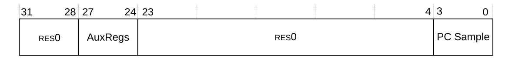

下表给出了 **EDDEVID** 的位分配。

| 位 | 名称 | 功能 |
| --- | --- | --- |
| [31:28] | - | 保留，RES0。 |
| [27:24] | AuxRegs | 指示对辅助寄存器的支持。可能的取值为：<br>0x0：未实现外部调试辅助控制寄存器 **EDACR**。 |
| [23:4] | - | 保留，RES0。 |
| [3:0] | PC Sample | 指示使用外部调试寄存器 40 至 43 进行基于采样的性能分析的支持程度。取值为：<br>0x3：实现 **EDPCSR**、**EDCIDSR** 与 **EDVIDSR**。 |

**EDDEVID** 可以通过外部调试接口访问，偏移为 0xFC8。

### 6.4 外部调试设备 ID 寄存器 1

**EDDEVID1** 为外部调试器提供有关调试实现特性的附加信息。

**使用限制**

本寄存器可通过外部调试接口访问，为只读。有关影响本寄存器访问是否允许的条件的汇总，请参见第 391 页的 12.2.4 External register access permissions。详细说明请参见《Arm® Architecture Reference Manual Supplement Armv8, for the Armv8-R AArch32 architecture profile》。

**陷阱与使能**

没有影响本寄存器的陷阱与使能。

**配置**

**EDDEVID1** 位于调试电源域中，在所有处理器构建配置中均可用。

**属性**

**EDDEVID1** 是一个 32 位寄存器。

下图给出了 **EDDEVID1** 的位分配。

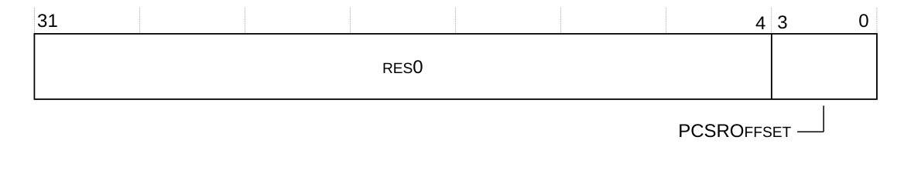

下表给出了 **EDDEVID1** 的位分配。

| 位 | 名称 | 功能 |
| --- | --- | --- |
| [31:4] | - | 保留，RES0。 |
| [3:0] | PCSROffset | 指出读 **EDPCSR** 返回的 PC 采样所施加的偏移。取值为：<br>0x2：**EDPCSR** 采样不施加偏移，且不采样指令集状态。 |

**EDDEVID1** 可以通过外部调试接口访问，偏移为 0xFC4。

### 6.5 外部调试外设标识寄存器

外部调试外设标识寄存器提供用于识别外部调试组件的信息。

外部调试外设标识寄存器提供所有符合《Arm® Debug Interface Architecture Specification, ADIv5.0 至 ADIv5.2》的组件所需的标准信息。对于 Cortex®-R52+ 处理器，共有五个此类寄存器，列于下表中。

| 寄存器 | 值 | 偏移 |
| --- | --- | --- |
| EDPIDR0 | 0x16 | 0xFE0 |
| EDPIDR1 | 0xBD | 0xFE4 |
| EDPIDR2 | 0x1B | 0xFE8 |
| EDPIDR3 | 0x00 | 0xFEC |
| EDPIDR4 | 0x04 | 0xFD0 |

每个外部调试外设 ID 寄存器仅使用位 [7:0]，位 [31:8] 为 RAZ。

外部调试外设 ID 寄存器包括：

* 6.5.1 外部调试外设标识寄存器 0。
* 6.5.2 外部调试外设标识寄存器 1。
* 6.5.3 外部调试外设标识寄存器 2。
* 6.5.4 外部调试外设标识寄存器 3。
* 6.5.5 外部调试外设标识寄存器 4。

#### 6.5.1 外部调试外设标识寄存器 0

**EDPIDR0** 提供用于识别外部调试组件的信息。

**使用限制**

本寄存器可通过外部调试接口访问，为只读。有关影响本寄存器访问是否允许的条件的汇总，请参见第 391 页的 12.2.4 External register access permissions。详细说明请参见《Arm® Architecture Reference Manual Supplement Armv8, for the Armv8-R AArch32 architecture profile》。

**陷阱与使能**

没有影响本寄存器的陷阱与使能。

**配置**

本寄存器在所有处理器构建配置中均可用。

**属性**

**EDPIDR0** 是一个 32 位寄存器。

下图给出了 **EDPIDR0** 的位分配。

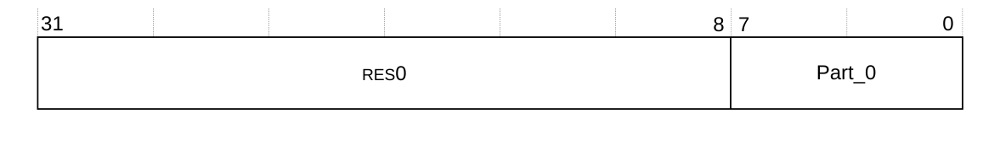

下表给出了 **EDPIDR0** 的位分配。

| 位 | 名称 | 功能 |
| --- | --- | --- |
| [31:8] | - | 保留，RES0。 |
| [7:0] | Part_0 | 0x16：调试部件号的最低有效字节。 |

**EDPIDR0** 可以通过外部调试接口访问，偏移为 0xFE0。

#### 6.5.2 外部调试外设标识寄存器 1

**EDPIDR1** 提供用于识别外部调试组件的信息。

**使用限制**

本寄存器可通过外部调试接口访问，为只读。有关影响本寄存器访问是否允许的条件的汇总，请参见第 391 页的 12.2.4 External register access permissions。详细说明请参见《Arm® Architecture Reference Manual Supplement Armv8, for the Armv8-R AArch32 architecture profile》。

**陷阱与使能**

没有影响本寄存器的陷阱与使能。

**配置**

本寄存器在所有处理器构建配置中均可用。

**属性**

**EDPIDR1** 是一个 32 位寄存器。

下图给出了 **EDPIDR1** 的位分配。

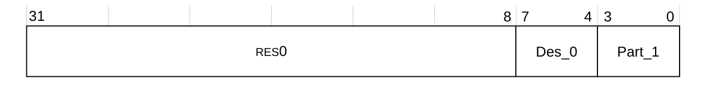

下表给出了 **EDPIDR1** 的位分配。

| 位 | 名称 | 功能 |
| --- | --- | --- |
| [31:8] | - | 保留，RES0。 |
| [7:4] | DES_0 | 0xB：Arm Limited。这是 JEP106 ID 代码的最低有效半字节。 |
| [3:0] | Part_1 | 0xD：调试部件号的最高有效半字节。 |

**EDPIDR1** 可以通过外部调试接口访问，偏移为 0xFE4。

#### 6.5.3 外部调试外设标识寄存器 2

**EDPIDR2** 提供用于识别外部调试组件的信息。

**使用限制**

本寄存器可通过外部调试接口访问，为只读。有关影响本寄存器访问是否允许的条件的汇总，请参见第 391 页的 12.2.4 External register access permissions。详细说明请参见《Arm® Architecture Reference Manual Supplement Armv8, for the Armv8-R AArch32 architecture profile》。

**陷阱与使能**

没有影响本寄存器的陷阱与使能。

**配置**

本寄存器在所有处理器构建配置中均可用。

**属性**

**EDPIDR2** 是一个 32 位寄存器。

下图给出了 **EDPIDR2** 的位分配。

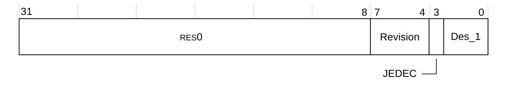

下表给出了 **EDPIDR2** 的位分配。

| 位 | 名称 | 功能 |
| --- | --- | --- |
| [31:8] | - | 保留，RES0。 |
| [7:4] | Revision | 0x1：r0p1。 |
| [3] | JEDEC | 1：RAO。表示使用 JEP106 标识代码。 |
| [2:0] | DES_1 | 0b011：Arm Limited。这是 JEP106 ID 代码的最高有效半字节。 |

**EDPIDR2** 可以通过外部调试接口访问，偏移为 0xFE8。

#### 6.5.4 外部调试外设标识寄存器 3

**EDPIDR3** 提供用于识别外部调试组件的信息。

**使用限制**

本寄存器可通过外部调试接口访问，为只读。有关影响本寄存器访问是否允许的条件的汇总，请参见第 391 页的 12.2.4 External register access permissions。详细说明请参见《Arm® Architecture Reference Manual Supplement Armv8, for the Armv8-R AArch32 architecture profile》。

**陷阱与使能**

没有影响本寄存器的陷阱与使能。

**配置**

本寄存器在所有处理器构建配置中均可用。

**属性**

**EDPIDR3** 是一个 32 位寄存器。

下图给出了 **EDPIDR3** 的位分配。

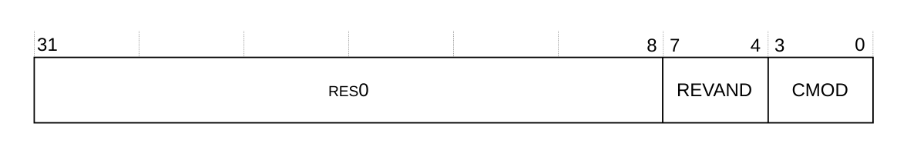

下表给出了 **EDPIDR3** 的位分配。

| 位 | 名称 | 功能 |
| --- | --- | --- |
| [31:8] | - | 保留，RES0。 |
| [7:4] | REVAND | 0x0：部件次修订版本。 |
| [3:0] | CMOD | 0x0：客户修改。 |

**EDPIDR3** 可以通过外部调试接口访问，偏移为 0xFEC。

#### 6.5.5 外部调试外设标识寄存器 4

**EDPIDR4** 提供用于识别外部调试组件的信息。

**使用限制**

本寄存器可通过外部调试接口访问，为只读。有关影响本寄存器访问是否允许的条件的汇总，请参见第 391 页的 12.2.4 External register access permissions。详细说明请参见《Arm® Architecture Reference Manual Supplement Armv8, for the Armv8-R AArch32 architecture profile》。

**陷阱与使能**

没有影响本寄存器的陷阱与使能。

**配置**

本寄存器在所有处理器构建配置中均可用。

**属性**

**EDPIDR4** 是一个 32 位寄存器。

下图给出了 **EDPIDR4** 的位分配。

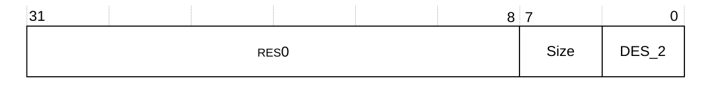

下表给出了 **EDPIDR4** 的位分配。

| 位 | 名称 | 功能 |
| --- | --- | --- |
| [31:8] | - | 保留，RES0。 |
| [7:4] | Size | 0x0：4KB。组件的大小。 |
| [3:0] | DES_2 | 0x4：Arm Limited。这是 JEP106 延续代码的最低有效半字节。 |

**EDPIDR4** 可以通过外部调试接口访问，偏移为 0xFD0。

### 6.6 外部调试组件标识寄存器

共有四个只读的外部调试组件标识寄存器，即调试组件 ID0 至调试组件 ID3。下表给出了这些寄存器。

| 寄存器 | 值 | 偏移 |
| --- | --- | --- |
| Component ID0 | 0x0D | 0xFF0 |
| Component ID1 | 0x90 | 0xFF4 |
| Component ID2 | 0x05 | 0xFF8 |
| Component ID3 | 0xB1 | 0xFFC |

外部调试组件标识寄存器将调试组件标识为 Arm Debug Interface v5 组件。外部调试组件 ID 寄存器包括：

* 6.6.1 外部调试组件标识寄存器 0。
* 6.6.2 外部调试组件标识寄存器 1。
* 6.6.3 外部调试组件标识寄存器 2。
* 6.6.4 外部调试组件标识寄存器 3。

#### 6.6.1 外部调试组件标识寄存器 0

**EDCIDR0** 提供用于识别外部调试组件的信息。

**使用限制**

本寄存器可通过外部调试接口访问，为只读。有关影响本寄存器访问是否允许的条件的汇总，请参见第 391 页的 12.2.4 External register access permissions。详细说明请参见《Arm® Architecture Reference Manual Supplement Armv8, for the Armv8-R AArch32 architecture profile》。

**陷阱与使能**

没有影响本寄存器的陷阱与使能。

**配置**

本寄存器在所有处理器构建配置中均可用。

**属性**

**EDCIDR0** 是一个 32 位寄存器。

下图给出了 **EDCIDR0** 的位分配。


下表给出了 **EDCIDR0** 的位分配。

| 位 | 名称 | 功能 |
| --- | --- | --- |
| [31:8] | - | 保留，RES0。 |
| [7:0] | PRMBL_0 | 0x0D：前导字节 0。 |

**EDCIDR0** 可以通过外部调试接口访问，偏移为 0xFF0。

#### 6.6.2 外部调试组件标识寄存器 1

**EDCIDR1** 提供用于识别外部调试组件的信息。

**使用限制**

本寄存器可通过外部调试接口访问，为只读。有关影响本寄存器访问是否允许的条件的汇总，请参见第 391 页的 12.2.4 External register access permissions。详细说明请参见《Arm® Architecture Reference Manual Supplement Armv8, for the Armv8-R AArch32 architecture profile》。

**陷阱与使能**

没有影响本寄存器的陷阱与使能。

**配置**

本寄存器在所有处理器构建配置中均可用。

**属性**

**EDCIDR1** 是一个 32 位寄存器。

下图给出了 **EDCIDR1** 的位分配。

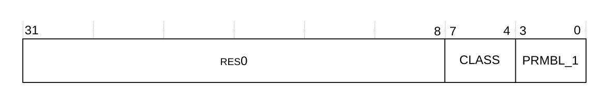

下表给出了 **EDCIDR1** 的位分配。

| 位 | 名称 | 功能 |
| --- | --- | --- |
| [31:8] | - | 保留，RES0。 |
| [7:4] | CLASS | 0x9：调试组件。 |
| [3:0] | PRMBL_1 | 0x0：前导。 |

**EDCIDR1** 可以通过外部调试接口访问，偏移为 0xFF4。

#### 6.6.3 外部调试组件标识寄存器 2

**EDCIDR2** 提供用于识别外部调试组件的信息。

**使用限制**

本寄存器可通过外部调试接口访问，为只读。有关影响本寄存器访问是否允许的条件的汇总，请参见第 391 页的 12.2.4 External register access permissions。详细说明请参见《Arm® Architecture Reference Manual Supplement Armv8, for the Armv8-R AArch32 architecture profile》。

**陷阱与使能**

没有影响本寄存器的陷阱与使能。

**配置**

本寄存器在所有处理器构建配置中均可用。

**属性**

**EDCIDR2** 是一个 32 位寄存器。

下图给出了 **EDCIDR2** 的位分配。

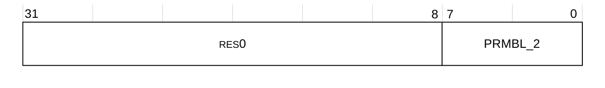

下表给出了 **EDCIDR2** 的位分配。

| 位 | 名称 | 功能 |
| --- | --- | --- |
| [31:8] | - | 保留，RES0。 |
| [7:0] | PRMBL_2 | 0x05：前导字节 2。 |

**EDCIDR2** 可以通过外部调试接口访问，偏移为 0xFF8。

#### 6.6.4 外部调试组件标识寄存器 3

**EDCIDR3** 提供用于识别外部调试组件的信息。

**使用限制**

本寄存器可通过外部调试接口访问，为只读。有关影响本寄存器访问是否允许的条件的汇总，请参见第 391 页的 12.2.4 External register access permissions。详细说明请参见《Arm® Architecture Reference Manual Supplement Armv8, for the Armv8-R AArch32 architecture profile》。

**陷阱与使能**

没有影响本寄存器的陷阱与使能。

**配置**

本寄存器在所有处理器构建配置中均可用。

**属性**

**EDCIDR3** 是一个 32 位寄存器。

下图给出了 **EDCIDR3** 的位分配。


下表给出了 **EDCIDR3** 的位分配。

| 位 | 名称 | 功能 |
| --- | --- | --- |
| [31:8] | - | 保留，RES0。 |
| [7:0] | PRMBL_3 | 0xB1：前导字节 3。 |

**EDCIDR3** 可以通过外部调试接口访问，偏移为 0xFFC。

### 6.7 外部调试 AArch32 处理器特性寄存器

**EDAA32PFR** 提供有关 AArch32 中已实现处理器特性的附加信息。

**使用限制**

本寄存器可通过外部调试接口访问，为只读。

**陷阱与使能**

没有影响本寄存器的陷阱与使能。

**配置**

本寄存器在所有构建配置中均可用。

**属性**

**EDAA32PFR** 是一个 64 位寄存器。

下图给出了 **EDAA32PFR** 的位分配。

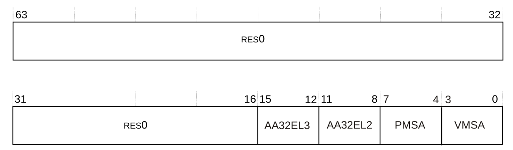

下表给出了 **EDAA32PFR** 的位分配。

| 位 | 名称 | 功能 |
| --- | --- | --- |
| [63:16] | - | 保留，RES0。 |
| [15:12] | AA32EL3 | AArch32 EL3 异常级处理。取值为：<br>0b0000：未实现 EL3。 |
| [11:8] | AA32EL2 | AArch32 EL2 异常级处理。取值为：<br>0b0001：EL2 只能以 AArch32 状态执行。 |
| [7:4] | PMSA | 指示对 **PMSA** 的支持。取值为：<br>0b0100：支持 PMSAv8-32。 |
| [3:0] | VMSA | 指示对 R 类 **VMSA** 的支持。取值为：<br>0b0000：不支持 **VMSA**。 |

**EDAA32PFR[31:0]** 可以通过外部调试接口访问，偏移为 0xD64。

**EDAA32PFR[63:32]** 可以通过外部调试接口访问，偏移为 0xD60。

### 6.8 外部调试处理器特性寄存器

**EDPFR** 提供有关已实现处理器特性的附加信息。该寄存器由 AArch64 体系结构定义，但也包含在 AArch32 体系结构中。

**使用限制**

本寄存器可通过外部调试接口访问，为只读。

**陷阱与使能**

没有影响本寄存器的陷阱与使能。

**配置**

本寄存器在所有构建配置中均可用。

**属性**

**EDPFR** 是一个 64 位寄存器。

下图给出了 **EDPFR** 的位分配。

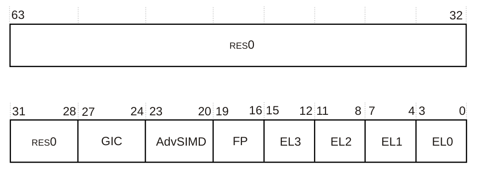

下表给出了 **EDPFR** 的位分配。

| 位 | 名称 | 功能 |
| --- | --- | --- |
| [63:28] | - | 保留，RES0。 |
| [27:24] | GIC | **GIC** 系统寄存器接口。取值为：<br>0b0001：支持 GICv3 的系统寄存器接口。 |
| [23:20] | AdvSIMD | 高级 SIMD。取值取决于高级 SIMD 与浮点配置：<br>0b0000：实现高级 SIMD。<br>0b1111：未实现高级 SIMD。 |
| [19:16] | FP | 浮点。取值为：<br>0b0000：实现浮点。 |
| [15:12] | EL3 | AArch64 ELn 处理。取值为：<br>0b0000：未实现 ELn 或 ELn 不能使用 AArch64。 |
| [11:8] | EL2 | AArch64 ELn 处理。取值为：<br>0b0000：未实现 ELn 或 ELn 不能使用 AArch64。 |
| [7:4] | EL1 | AArch64 ELn 处理。取值为：<br>0b0000：ELn 只能使用 AArch32。 |
| [3:0] | EL0 | AArch64 ELn 处理。取值为：<br>0b0000：ELn 只能使用 AArch32。 |

**EDPFR[31:0]** 可以通过外部调试接口访问，偏移为 0xD20。

**EDPFR[63:32]** 可以通过外部调试接口访问，偏移为 0xD24。

### 6.9 外部调试特性寄存器

**EDDFR** 提供关于调试系统的顶层信息。

**使用限制**

本寄存器可通过外部调试接口访问，为只读。

**陷阱与使能**

没有影响本寄存器的陷阱与使能。

**配置**

本寄存器在所有构建配置中均可用。

**属性**

**EDDFR** 是一个 64 位寄存器。

下图给出了 **EDDFR** 的位分配。

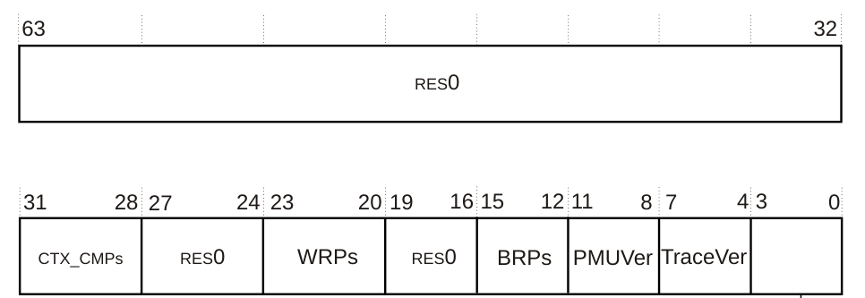

下表给出了 **EDDFR** 的位分配。

| 位 | 名称 | 功能 |
| --- | --- | --- |
| [63:32] | - | 保留，RES0。 |
| [31:28] | CTX_CMPs | 0x1：两个断点是上下文感知的。它们是编号最高的断点。 |
| [27:24] | - | 保留，RES0。 |
| [23:20] | WRPs | 0x7：实现八个观察点。 |
| [19:16] | - | 保留，RES0。 |
| [15:12] | BRPs | 0x7：实现八个断点。 |
| [11:8] | PMUVer | 性能监控扩展版本。指示是否实现性能监控扩展的系统寄存器接口。取值为：<br>0b0001：实现性能监控扩展系统寄存器，即 PMUv3。 |
| [7:4] | TraceVer | 跟踪支持。指示是否实现跟踪宏单元的系统寄存器接口。取值为：<br>0b0000：未实现跟踪宏单元系统寄存器。 |
| [3:0] | - | 保留，UNKNOWN。 |

**EDDFR[31:0]** 可以通过外部调试接口访问，偏移为 0xD2C。

**EDDFR[63:32]** 可以通过外部调试接口访问，偏移为 0xD28。

## 7. 外部调试接口

系统可以通过 **APB** 接口访问内存映射调试寄存器。

**APB** 接口符合 **AMBA 3 APB** 协议。

下图给出了 Cortex®-R52+ 处理器中实现的调试接口。有关这些信号的更多信息，请参见《Arm® CoreSight™ Architecture Specification v2.0》。

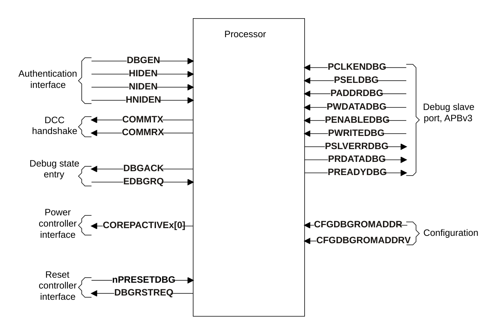

### 7.1 调试内存映射

**APB** 内存映射最多支持一个集群中的四个核。下表给出了调试与跟踪组件的地址映射。

| 地址范围 | 组件 |
| --- | --- |
| 0x000000 - 0x00FFFF | ROM 表 |
| 0x010000 - 0x01FFFF | 核 0 调试 |
| 0x020000 - 0x02FFFF | 核 0 CTI |
| 0x030000 - 0x03FFFF | 核 0 PMU |
| 0x040000 - 0x04FFFF | 核 0 跟踪 |
| 0x050000 - 0x10FFFF | 保留 |
| 0x110000 - 0x11FFFF | 核 1 调试 |
| 0x120000 - 0x12FFFF | 核 1 CTI |
| 0x130000 - 0x13FFFF | 核 1 PMU |
| 0x140000 - 0x14FFFF | 核 1 跟踪 |
| 0x150000 - 0x20FFFF | 保留 |
| 0x210000 - 0x21FFFF | 核 2 调试 |
| 0x220000 - 0x22FFFF | 核 2 CTI |
| 0x230000 - 0x23FFFF | 核 2 PMU |
| 0x240000 - 0x24FFFF | 核 2 跟踪 |
| 0x250000 - 0x30FFFF | 保留 |
| 0x310000 - 0x31FFFF | 核 3 调试 |
| 0x320000 - 0x32FFFF | 核 3 CTI |
| 0x330000 - 0x33FFFF | 核 3 PMU |
| 0x340000 - 0x34FFFF | 核 3 跟踪 |
| 0x350000 - 0x3FFFFF | 保留 |

**注意：** 组件列指示存在时映射的组件，否则为保留。

### 7.2 调试电源接口

**EDPRSR.PU** 位反映核的电源状态。**COREACTIVEx[0]** 输出向电源控制器指示何时需要仿真掉电。

**相关内容**

* 第 227 页的 6.4 Cortex®-R52+ LPI

### 7.3 热复位期间的调试

当置为高电平时，**CFGL1CACHEINVDISx** 输入信号在使用 **nCORERESETx** 或 **nCPUPORESETx** 复位核之后，禁止对 L1 数据与指令缓存进行自动硬件控制的失效。

**CFGL1CACHEINVDISx** 只能用于协助调试由外部看门狗触发的复位，即在复位后使复位前的 L1 缓存内容可被观察。如果在正在执行 L1 缓存取指时断言复位，则这些缓存条目的准确性无法保证。

在正常的处理器上电序列中，不得使用 **CFGL1CACHEINVDISx** 信号禁用 L1 缓存的自动硬件控制失效。

每个 **CFGL1CACHEINVDISx** 信号对应集群中的一个核，即核 x。每个核在其对应的 **nCORERESETx** 或 **nCPUPORESETx** 被断言时采样该信号。

如果不需要 **CFGL1CACHEINVDISx** 输入信号提供的功能，则必须将该输入接为低电平。

**相关内容**

* 第 231 页的 7. Initialization

### 7.4 更改认证信号

**NIDENx**、**DBGENx**、**HIDENx** 与 **HNIDENx** 输入信号必须固定连接到某个固定值，或由某个外部设备控制。

如果处理器上运行的软件能够控制驱动认证信号的外部设备，则它必须按安全序列进行更改：

1. 执行特定于实现的指令序列以更改信号值。例如，这可能是向某一系统外设中的控制寄存器写入某个值的单条 **STR** 指令。
2. 如果上一步涉及任何存储器操作，则发出 **DSB** 指令。
3. 轮询 **DBGAUTHSTATUS** 寄存器，检查处理器是否已检测到这些信号的更改值。该轮询循环必须包含 **ISB** 操作。之所以需要该循环，是因为系统可能在 **DSB** 指令完成后若干周期才会将信号更改发给处理器。

在该过程完成之前，软件不能执行依赖于认证信号新值的调试或分析操作。当调试器在调试状态下通过指令传送寄存器 **EDITR** 控制处理器时，同样适用这些规则。**DBGENx**、**NIDENx**、**HIDENx** 与 **HNIDENx** 值的相关组合可通过轮询 **DBGAUTHSTATUS** 确定。

## 8. ROM 表

本节提供处理器 ROM 表的详细信息。

Cortex®-R52+ 处理器包含一个符合《Arm® CoreSight™ Architecture Specification v2.0》的 ROM 表。该表包含组件列表，例如核调试单元、**交叉触发接口（CTI）**、核**性能监控单元（PMU）**与**嵌入式跟踪宏单元（ETM）**。调试器可以使用该 ROM 表确定处理器内部实现了哪些组件。

如果处理器配置中不包含某个组件，则对应的调试 **APB** ROM 表条目仍然存在，但该组件被标记为不存在。

ROM 表条目的 ROM 表寄存器接口是 **APB** 从端口。

### 8.1 ROM 表寄存器汇总

下表给出了各条目相对于 ROM 表物理基地址的地址偏移。为了支持旧版代码，可以在集成处理器时通过固定连接 **CFGDBGROMADDR** 与 **CFGDBGROMADDRV** 引脚来配置该基地址，并反映在 **DBGDRAR** 中。这些信号在体系结构上已废弃，因此对于不需要该旧版兼容性的系统可以接为低电平。

| 偏移 | 名称 | 类型 | 描述 |
| --- | --- | --- | --- |
| 0x000 | ROMENTRY0 | RO | 核 0 调试，请参见 8.2.1 ROM 入口寄存器 |
| 0x004 | ROMENTRY1 | RO | 核 0 CTI，请参见 8.2.1 ROM 入口寄存器 |
| 0x008 | ROMENTRY2 | RO | 核 0 PMU，请参见 8.2.1 ROM 入口寄存器 |
| 0x00C | ROMENTRY3 | RO | 核 0 ETM，请参见 8.2.1 ROM 入口寄存器 |
| 0x010 | ROMENTRY4 | RO | 核 1 调试，请参见 8.2.1 ROM 入口寄存器 |
| 0x014 | ROMENTRY5 | RO | 核 1 CTI，请参见 8.2.1 ROM 入口寄存器 |
| 0x018 | ROMENTRY6 | RO | 核 1 PMU，请参见 8.2.1 ROM 入口寄存器 |
| 0x01C | ROMENTRY7 | RO | 核 1 ETM，请参见 8.2.1 ROM 入口寄存器 |
| 0x020 | ROMENTRY8 | RO | 核 2 调试，请参见 8.2.1 ROM 入口寄存器 |
| 0x024 | ROMENTRY9 | RO | 核 2 CTI，请参见 8.2.1 ROM 入口寄存器 |
| 0x028 | ROMENTRY10 | RO | 核 2 PMU，请参见 8.2.1 ROM 入口寄存器 |
| 0x02C | ROMENTRY11 | RO | 核 2 ETM，请参见 8.2.1 ROM 入口寄存器 |
| 0x030 | ROMENTRY12 | RO | 核 3 调试，请参见 8.2.1 ROM 入口寄存器 |
| 0x034 | ROMENTRY13 | RO | 核 3 CTI，请参见 8.2.1 ROM 入口寄存器 |
| 0x038 | ROMENTRY14 | RO | 核 3 PMU，请参见 8.2.1 ROM 入口寄存器 |
| 0x03C | ROMENTRY15 | RO | 核 3 ETM，请参见 8.2.1 ROM 入口寄存器 |
| 0x040-0xFCC | - | RO | 保留，RES0 |
| 0xFD0 | ROMPIDR4 | RO | 8.3.5 ROM 表调试外设标识寄存器 4 |
| 0xFD4 | ROMPIDR5 | RO | 8.3.6 ROM 表调试外设标识寄存器 5-7 |
| 0xFD8 | ROMPIDR6 | RO | 8.3.6 ROM 表调试外设标识寄存器 5-7 |
| 0xFDC | ROMPIDR7 | RO | 8.3.6 ROM 表调试外设标识寄存器 5-7 |
| 0xFE0 | ROMPIDR0 | RO | 8.3.1 ROM 表调试外设标识寄存器 0 |
| 0xFE4 | ROMPIDR1 | RO | 8.3.2 ROM 表调试外设标识寄存器 1 |
| 0xFE8 | ROMPIDR2 | RO | 8.3.3 ROM 表调试外设标识寄存器 2 |
| 0xFEC | ROMPIDR3 | RO | 8.3.4 ROM 表调试外设标识寄存器 3 |
| 0xFF0 | ROMCIDR0 | RO | 8.4.1 ROM 表调试组件标识寄存器 0 |
| 0xFF4 | ROMCIDR1 | RO | 8.4.2 ROM 表调试组件标识寄存器 1 |
| 0xFF8 | ROMCIDR2 | RO | 8.4.3 ROM 表调试组件标识寄存器 2 |
| 0xFFC | ROMCIDR3 | RO | 8.4.4 ROM 表调试组件标识寄存器 3 |

### 8.2 ROM 表寄存器描述

本节描述 ROM 表寄存器。

#### 8.2.1 ROM 入口寄存器

**ROMENTRY0-15** 向调试器指示调试组件是否存在于处理器的调试逻辑中。Cortex®-R52+ 处理器中有 16 个 **ROMENTRY** 寄存器。

**使用限制**

**ROMENTRY** 寄存器均为只读。

**陷阱与使能**

没有影响这些寄存器的陷阱与使能。

**配置**

本寄存器在所有处理器构建配置中均可用。

**属性**

**ROMENTRY0-15** 是 32 位寄存器。

下图给出了 **ROMENTRY** 的位分配。

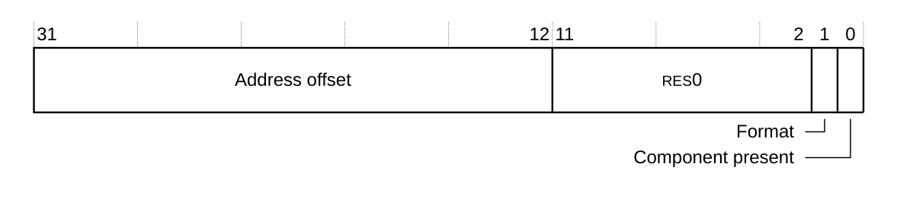

下表给出了 **ROMENTRY** 的位分配。

| 位 | 名称 | 功能 |
| --- | --- | --- |
| [31:12] | Address offset | 调试组件的地址偏移。 |
| [11:2] | - | 保留，RES0。 |
| [1] | Format | ROM 表条目的格式。所有 **ROMENTRY** 寄存器的取值为 1，表示 32 位格式。 |
| [0] | Component present | 指示组件是否存在：<br>0：组件不存在。<br>1：组件存在。 |

**注意：** 核 0 始终存在。核 1、2 与 3 的组件条目取决于你的配置。

调试组件的地址由地址偏移左移 12 位，再将结果与处理器 ROM 表的基地址相加得到。

下表给出了所有 **ROMENTRY** 值的地址偏移以及由此得到的 **ROMENTRY** 值。如果未实现某个核，则其调试、**CTI**、**PMU** 与 **ETM** 组件的 **ROMENTRY** 寄存器为 0x00000000。

| 名称 | 调试组件 | 地址偏移 [31:12] | ROMENTRY 值 |
| --- | --- | --- | --- |
| ROMENTRY0 | 核 0 调试 | 0x00010 | 0x00010003 |
| ROMENTRY1 | 核 0 CTI | 0x00020 | 0x00020003 |
| ROMENTRY2 | 核 0 PMU | 0x00030 | 0x00030003 |
| ROMENTRY3 | 核 0 ETM | 0x00040 | 0x00040003 |
| ROMENTRY4 | 核 1 调试 | 0x00110 | 0x00110003 |
| ROMENTRY5 | 核 1 CTI | 0x00120 | 0x00120003 |
| ROMENTRY6 | 核 1 PMU | 0x00130 | 0x00130003 |
| ROMENTRY7 | 核 1 ETM | 0x00140 | 0x00140003 |
| ROMENTRY8 | 核 2 调试 | 0x00210 | 0x00210003 |
| ROMENTRY9 | 核 2 CTI | 0x00220 | 0x00220003 |
| ROMENTRY10 | 核 2 PMU | 0x00230 | 0x00230003 |
| ROMENTRY11 | 核 2 ETM | 0x00240 | 0x00240003 |
| ROMENTRY12 | 核 3 调试 | 0x00310 | 0x00310003 |
| ROMENTRY13 | 核 3 CTI | 0x00320 | 0x00320003 |
| ROMENTRY14 | 核 3 PMU | 0x00330 | 0x00330003 |
| ROMENTRY15 | 核 3 ETM | 0x00340 | 0x00340003 |

**注意：** 核 1、2、3 的 **ROMENTRY** 值仅在对应组件存在时有效。

### 8.3 ROM 表调试外设标识寄存器

ROM 表调试外设标识寄存器提供用于识别 ROM 表的信息。

ROM 表调试外设标识寄存器提供所有符合《Arm® Debug Interface Architecture Specification, ADIv5.0 至 ADIv5.2》的组件所需的标准信息。共有八个寄存器，按寄存器编号顺序列于下表中。

| 寄存器 | 偏移 | 值 |
| --- | --- | --- |
| ROMPIDR0 | 0xFE0 | 0xBD |
| ROMPIDR1 | 0xFE4 | 0xB4 |
| ROMPIDR2 | 0xFE8 | 0x1B |
| ROMPIDR3 | 0xFEC | 0x00 |
| ROMPIDR4 | 0xFD0 | 0x04 |
| ROMPIDR5 | 0xFD4 | 0x00 |
| ROMPIDR6 | 0xFD8 | 0x00 |
| ROMPIDR7 | 0xFDC | 0x00 |

每个 ROM 表调试外设 ID 寄存器仅使用位 [7:0]，位 [31:8] 为 RES0。八个 ROM 表调试外设 ID 寄存器共同定义一个 64 位外设 ID。

ROM 表调试外设 ID 寄存器包括：

* 8.3.1 ROM 表调试外设标识寄存器 0。
* 8.3.2 ROM 表调试外设标识寄存器 1。
* 8.3.3 ROM 表调试外设标识寄存器 2。
* 8.3.4 ROM 表调试外设标识寄存器 3。
* 8.3.5 ROM 表调试外设标识寄存器 4。
* 8.3.6 ROM 表调试外设标识寄存器 5-7。

#### 8.3.1 ROM 表调试外设标识寄存器 0

**ROMPIDR0** 提供用于识别 Cortex®-R52+ ROM 表的信息。

**使用限制**

本寄存器可通过内存映射接口与外部调试接口访问，为只读。

**陷阱与使能**

没有影响本寄存器的陷阱与使能。

**配置**

本寄存器在所有处理器构建配置中均可用。

**属性**

**ROMPIDR0** 是一个 32 位寄存器。

下图给出了 **ROMPIDR0** 的位分配。


下表给出了 **ROMPIDR0** 的位分配。

| 位 | 名称 | 功能 |
| --- | --- | --- |
| [31:8] | - | 保留，RES0。 |
| [7:0] | Part_0 | 0xBD：ROM 表部件号的最低有效字节。 |

**ROMPIDR0** 可以通过内存映射接口与外部调试接口访问，偏移为 0xFE0。

#### 8.3.2 ROM 表调试外设标识寄存器 1

**ROMPIDR1** 提供用于识别 Cortex®-R52+ ROM 表的信息。

**使用限制**

本寄存器可通过内存映射接口与外部调试接口访问，为只读。有关影响本寄存器访问是否允许的条件的汇总，请参见第 391 页的 12.2.4 External register access permissions。

**陷阱与使能**

没有影响本寄存器的陷阱与使能。

**配置**

本寄存器在所有处理器构建配置中均可用。

**属性**

**ROMPIDR1** 是一个 32 位寄存器。

下图给出了 **ROMPIDR1** 的位分配。

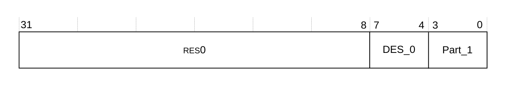

下表给出了 **ROMPIDR1** 的位分配。

| 位 | 名称 | 功能 |
| --- | --- | --- |
| [31:8] | - | 保留，RES0。 |
| [7:4] | DES_0 | 0xB：JEP106 ID 代码的最低有效半字节，为 Arm Limited。 |
| [3:0] | Part_1 | 0x4：ROM 表部件号的最高有效半字节。 |

**ROMPIDR1** 可以通过内存映射接口与外部调试接口访问，偏移为 0xFE4。

#### 8.3.3 ROM 表调试外设标识寄存器 2

**ROMPIDR2** 提供用于识别 Cortex®-R52+ ROM 表的信息。

**使用限制**

本寄存器可通过内存映射接口与外部调试接口访问，为只读。

**陷阱与使能**

没有影响本寄存器的陷阱与使能。

**配置**

本寄存器在所有处理器构建配置中均可用。

**属性**

**ROMPIDR2** 是一个 32 位寄存器。

下图给出了 **ROMPIDR2** 的位分配。

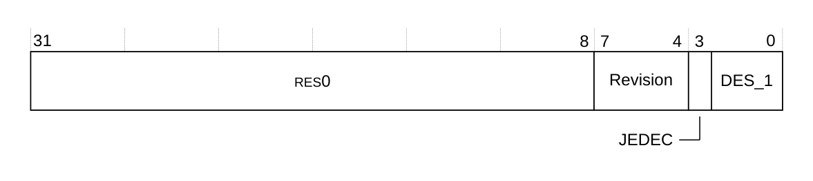

下表给出了 **ROMPIDR2** 的位分配。

| 位 | 名称 | 功能 |
| --- | --- | --- |
| [31:8] | - | 保留，RES0。 |
| [7:4] | Revision | 0x1：r0p1。 |
| [3] | JEDEC | 1：表示使用 JEP106 标识代码。 |
| [2:0] | DES_1 | 0b011：设计者，JEP106 ID 代码的最高有效位，为 Arm Limited。 |

**ROMPIDR2** 可以通过内存映射接口与外部调试接口访问，偏移为 0xFE8。

#### 8.3.4 ROM 表调试外设标识寄存器 3

**ROMPIDR3** 提供用于识别 Cortex®-R52+ ROM 表的信息。

**使用限制**

本寄存器可通过内存映射接口与外部调试接口访问，为只读。

**陷阱与使能**

没有影响本寄存器的陷阱与使能。

**配置**

本寄存器在所有处理器构建配置中均可用。

**属性**

**ROMPIDR3** 是一个 32 位寄存器。

下图给出了 **ROMPIDR3** 的位分配。

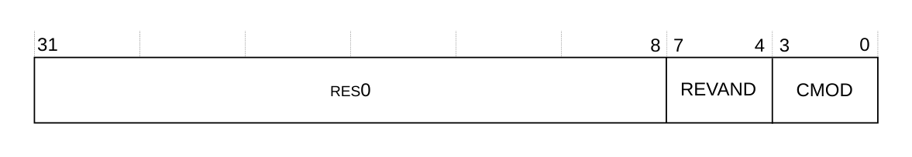

下表给出了 **ROMPIDR3** 的位分配。

| 位 | 名称 | 功能 |
| --- | --- | --- |
| [31:8] | - | 保留，RES0。 |
| [7:4] | REVAND | 0x0：部件次修订版本。 |
| [3:0] | CMOD | 0x0：客户修改。 |

**ROMPIDR3** 可以通过内存映射接口与外部调试接口访问，偏移为 0xFEC。

#### 8.3.5 ROM 表调试外设标识寄存器 4

**ROMPIDR4** 提供用于识别 Cortex®-R52+ ROM 表的信息。

**使用限制**

本寄存器可通过内存映射接口与外部调试接口访问，为只读。

**陷阱与使能**

没有影响本寄存器的陷阱与使能。

**配置**

本寄存器在所有处理器构建配置中均可用。

**属性**

**ROMPIDR4** 是一个 32 位寄存器。

下图给出了 **ROMPIDR4** 的位分配。

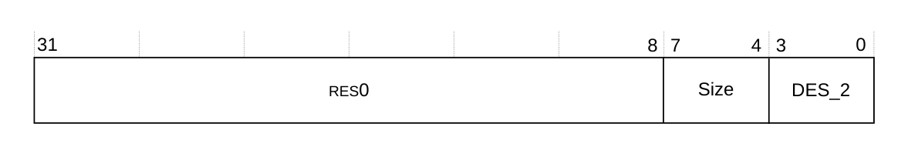

下表给出了 **ROMPIDR4** 的位分配。

| 位 | 名称 | 功能 |
| --- | --- | --- |
| [31:8] | - | 保留，RES0。 |
| [7:4] | Size | 0x0：4KB。组件的大小。 |
| [3:0] | DES_2 | 0x4：设计者，JEP106 延续代码的最低有效半字节，为 Arm Limited。 |

**ROMPIDR4** 可以通过内存映射接口与外部调试接口访问，偏移为 0xFD0。

#### 8.3.6 ROM 表调试外设标识寄存器 5-7

外设 ID5、外设 ID6 与外设 ID7 寄存器中不保存任何信息。它们为 RES0。

### 8.4 ROM 表调试组件标识寄存器

共有四个只读的组件标识寄存器，即组件 ID0 至组件 ID3。下表给出了这些寄存器。

| 寄存器 | 偏移 | 值 |
| --- | --- | --- |
| ROMCIDR0 | 0xFF0 | 0x0D |
| ROMCIDR1 | 0xFF4 | 0x10 |
| ROMCIDR2 | 0xFF8 | 0x05 |
| ROMCIDR3 | 0xFFC | 0xB1 |

ROM 表调试组件标识寄存器将 ROM 表标识为 Arm CoreSight 调试组件。ROM 表组件 ID 寄存器包括：

* 8.4.1 ROM 表调试组件标识寄存器 0。
* 8.4.2 ROM 表调试组件标识寄存器 1。
* 8.4.3 ROM 表调试组件标识寄存器 2。
* 8.4.4 ROM 表调试组件标识寄存器 3。

#### 8.4.1 ROM 表调试组件标识寄存器 0

**ROMCIDR0** 提供用于识别外部调试组件的信息。

**使用限制**

本寄存器可通过内存映射接口与外部调试接口访问，为只读。

**陷阱与使能**

没有影响本寄存器的陷阱与使能。

**配置**

本寄存器在所有处理器构建配置中均可用。

**属性**

**ROMCIDR0** 是一个 32 位寄存器。

下图给出了 **ROMCIDR0** 的位分配。

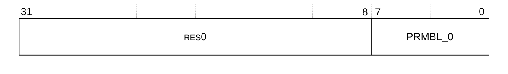

下表给出了 **ROMCIDR0** 的位分配。

| 位 | 名称 | 功能 |
| --- | --- | --- |
| [31:8] | - | 保留，RES0。 |
| [7:0] | PRMBL_0 | 0x0D：前导字节 0。 |

**ROMCIDR0** 可以通过内存映射接口与外部调试接口访问，偏移为 0xFF0。

#### 8.4.2 ROM 表调试组件标识寄存器 1

**ROMCIDR1** 提供用于识别外部调试组件的信息。

**使用限制**

本寄存器可通过内存映射接口与外部调试接口访问，为只读。

**陷阱与使能**

没有影响本寄存器的陷阱与使能。

**配置**

本寄存器在所有处理器构建配置中均可用。

**属性**

**ROMCIDR1** 是一个 32 位寄存器。

下图给出了 **ROMCIDR1** 的位分配。

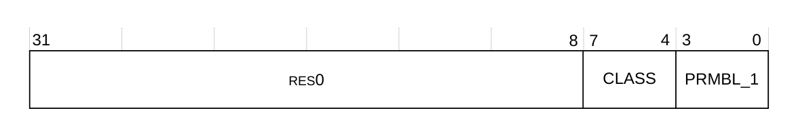

下表给出了 **ROMCIDR1** 的位分配。

| 位 | 名称 | 功能 |
| --- | --- | --- |
| [31:8] | - | 保留，RES0。 |
| [7:4] | CLASS | 0x1：组件类别。表示 ROM 表。 |
| [3:0] | PRMBL_1 | 0x0：前导。 |

**ROMCIDR1** 可以通过内存映射接口与外部调试接口访问，偏移为 0xFF4。

#### 8.4.3 ROM 表调试组件标识寄存器 2

**ROMCIDR2** 提供用于识别外部调试组件的信息。

**使用限制**

本寄存器可通过内存映射接口与外部调试接口访问，为只读。

**陷阱与使能**

没有影响本寄存器的陷阱与使能。

**配置**

**ROMCIDR2** 位于调试电源域中，在所有处理器构建配置中均可用。

**属性**

**ROMCIDR2** 是一个 32 位寄存器。

下图给出了 **ROMCIDR2** 的位分配。

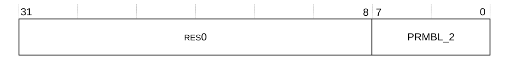

下表给出了 **ROMCIDR2** 的位分配。

| 位 | 名称 | 功能 |
| --- | --- | --- |
| [31:8] | - | 保留，RES0。 |
| [7:0] | PRMBL_2 | 0x05：前导字节 2。 |

**ROMCIDR2** 可以通过内存映射接口与外部调试接口访问，偏移为 0xFF8。

#### 8.4.4 ROM 表调试组件标识寄存器 3

**ROMCIDR3** 提供用于识别外部调试组件的信息。

**使用限制**

本寄存器可通过内存映射接口与外部调试接口访问，为只读。

**陷阱与使能**

没有影响本寄存器的陷阱与使能。

**配置**

本寄存器在所有处理器构建配置中均可用。

**属性**

**ROMCIDR3** 是一个 32 位寄存器。

下图给出了 **ROMCIDR3** 的位分配。

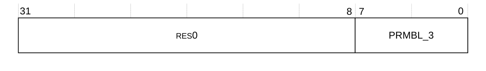

下表给出了 **ROMCIDR3** 的位分配。

| 位 | 名称 | 功能 |
| --- | --- | --- |
| [31:8] | - | 保留，RES0。 |
| [7:0] | PRMBL_3 | 0xB1：前导字节 3。 |

**ROMCIDR3** 可以通过内存映射接口与外部调试接口访问，偏移为 0xFFC。
