本章介绍 Cortex®-R52+ 处理器的**嵌入式跟踪宏单元（ETM，Embedded Trace Macrocell）**。

## 1. 关于 ETM

Cortex®-R52+ **ETM** 基于 **ETMv4.2** 架构执行实时的**指令流跟踪**与**数据流跟踪**。Cortex®-R52+ 每个核支持一个 **ETM**。

**ETM** 是一个 CoreSight™ 组件，是 Arm 实时调试解决方案 DS-5 Development Studio 的组成部分。

下图给出了 **ETM** 的主要功能模块。

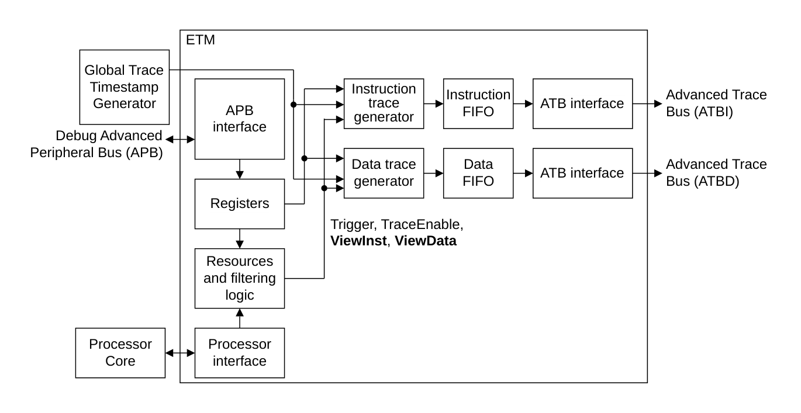

### 1.1 处理器接口

本模块连接到 Cortex®-R52+ 核。它跟踪来自核的执行信息，对控制信号进行译码，并将信息传给内部接口。

### 1.2 指令跟踪生成器

本模块生成**跟踪包**，这些包是 Cortex®-R52+ 核所提供的指令执行信息的压缩形式。跟踪包随后被送到指令 **FIFO**。

### 1.3 数据跟踪生成器

本模块生成跟踪包，这些包是 Cortex®-R52+ 核所提供的数据传送（数据地址与数据值）的压缩形式。跟踪包随后被送到数据 **FIFO**。

### 1.4 FIFO

本模块缓冲成串的跟踪包。指令跟踪流与数据跟踪流分别使用独立的 **FIFO**。

### 1.5 资源与过滤逻辑

这些模块包含由跟踪软件编程的资源，用于触发与过滤跟踪信息。它们根据已设置的条件启动与停止跟踪生成。

### 1.6 ATB 接口

共有两个 **ATB** 接口：

**指令 ATB 接口**

从指令 **FIFO** 中读取最多四个字节的包信息，并通过指令 **ATB** 接口发送。

**数据 ATB 接口**

从数据 **FIFO** 中读取最多八个字节的包信息，并通过数据 **ATB** 接口发送。

### 1.7 APB 接口

本模块实现到 **APB** 的接口，该总线提供对可编程寄存器的访问。

### 1.8 全局时间戳

全局时间戳源可通过 **TSVALUEB** 连接到各 **ETM**。

这提供 64 位时间戳，调试器可用于粗粒度性能分析以及跟踪源之间的关联。Arm 建议时间戳计数器的频率不低于处理器时钟频率的 10%。

数据跟踪的解压缩依赖于全局时间戳计数的存在。

## 2. ETM 跟踪单元生成选项与资源

下表给出了 **ETM** 已实现的资源。

| 特性 | 实例 |
| --- | --- |
| 地址比较器 | 4 对 |
| 数据值比较器 | 2 |
| 数据地址比较器 | 2 |
| 上下文 ID 比较器 | 1 |
| 单次（Single-Shot）比较器资源 | 2 |
| 计数器 | 2 |
| 周期计数宽度 | 12 位 |
| 序列器状态数 | 4 |
| 处理器比较器输入 | 0 |
| 外部输入 | 53 |
| 外部输出 | 4 |
| 外部输入选择器 | 4 |
| 资源选择器对 | 8 |
| 指令跟踪端口宽度 | 32 位 |
| 数据跟踪端口宽度 | 64 位 |
| 指令 FIFO⁸³ | 128 字节，32 位输出 |
| 数据 FIFO | 256 字节，64 位输出 |
| 声明标记（Claim tag）位 | 4 |

⁸³ 指令跟踪可配置为优先于数据跟踪。参见 **TRCSTALLCTLR** 的位 [10]。

下表给出了 **ETM** 所实现的 **ETM** 架构可选特性。

| 特性 | 是否实现 |
| --- | --- |
| 跟踪启动/停止模块 | 是 |
| 跟踪所有分支选项 | 是 |
| 条件指令跟踪 | 是 |
| 指令跟踪中的周期计数 | 是 |
| 支持数据跟踪 | 是 |
| 数据地址比较 | 是 |
| OS Lock 机制 | 是 |
| 非侵入式调试 | 是 |
| 上下文 ID 跟踪 | 是 |
| 跟踪输出 | 是 |
| 时间戳宽度 | 64 位 |
| 对 ETM 寄存器的内存映射访问 | 是 |
| 外部调试器对 ETM 寄存器的访问 | 是 |
| 对 ETM 寄存器的系统指令访问 | 否 |
| VMID 比较器支持 | 是 |
| ATB 触发支持 | 是 |

## 3. ETM 事件连接

本节介绍 Cortex®-R52+ **ETM** 的输入与输出如何连接到 **CTI** 与 **PMU**。

下表给出了来自 **CTI** 与 **PMU** 的 **ETM** 外部输入的连接关系。

| 位 | 描述 |
| --- | --- |
| ETM 外部输入 0 | CTI 触发输出 4 |
| ETM 外部输入 1 | CTI 触发输出 5 |
| ETM 外部输入 2 | CTI 触发输出 6 |
| ETM 外部输入 3 | CTI 触发输出 7 |
| ETM 外部输入 [48:4] | Performance Monitor PMUEVENTx[44:0] |
| ETM 外部输入 49 | ETMEXTIN[0] |
| ETM 外部输入 50 | ETMEXTIN[1] |
| ETM 外部输入 51 | ETMEXTIN[2] |
| ETM 外部输入 52 | ETMEXTIN[3] |

**ETM** 外部输出资源连接到 **CTI**，如下表所示。

| ETM 输出 | CTI 输入 |
| --- | --- |
| ETM 外部输出 0 | CTI 触发输入 4 与 ETMEXTOUT[0] |
| ETM 外部输出 1 | CTI 触发输入 5 与 ETMEXTOUT[1] |
| ETM 外部输出 2 | CTI 触发输入 6 与 ETMEXTOUT[2] |
| ETM 外部输出 3 | CTI 触发输入 7 与 ETMEXTOUT[3] |

## 4. 操作

本节介绍 ETM-R52+ 的 **IMPLEMENTATION DEFINED** 特性。这些特性是 **IMPLEMENTATION DEFINED** 的。

有关操作的信息，请参见《Arm® Embedded Trace Macrocell Architecture Specification ETMv4》。

### 4.1 实现定义的寄存器

ETM-R52+ 寄存器分为两组：

* 完全由《Arm® Embedded Trace Macrocell Architecture Specification ETMv4》定义的寄存器。
* 部分为 **IMPLEMENTATION DEFINED** 的寄存器。

### 4.2 精确的 TraceEnable 事件

在某些条件下 **ViewInst** 与 **ViewData** 是不精确的，只有部分实现定义的例外。确保 **ViewInst** 与 **ViewData** 精确的唯一条件是使能事件条件为 TRUE。

更多信息请参见《Arm® Embedded Trace Macrocell Architecture Specification ETMv4》。

### 4.3 并行指令执行

Cortex®-R52+ 处理器支持并行指令执行。这意味着宏单元每周期可跟踪两条指令以及 64 位数据传送。

如果某个周期内 **ViewInst** 有效，**ETM**：

* 始终跟踪任何成对指令中的第一条。
* 如果该指令的 **ViewInst** 有效，则始终跟踪第二条指令。
* 可以跟踪所跟踪的任一指令的数据。

### 4.4 比较器特性

**ETM** 实现数据地址比较。共有八个地址比较器，可配置为指令地址比较或数据地址比较。

数据地址比较的说明请参见《Arm® Embedded Trace Macrocell Architecture Specification ETMv4》。

### 4.5 跟踪特性

**ETM** 实现 **ETMv4** 的全部跟踪特性。

这意味着它支持：

* 数据值与数据地址跟踪。
* 数据抑制。
* 周期精确跟踪。
* 时间戳。

这些特性的说明请参见《Arm® Embedded Trace Macrocell Architecture Specification ETMv4》。

### 4.6 包格式

本节介绍 **ETM** 指令跟踪接口所支持的包类型。

**ETM** 指令跟踪接口不支持以下包格式：

* 推测解析：
  * Mispredict 包。
  * Cancel 格式 2 与格式 3 包。
* 条件跟踪：
  * 全部指令格式包。
  * Result 格式 1 包。
* Q 包。

除以下数据跟踪包类型外，**ETM** 数据跟踪接口支持全部数据跟踪包类型。

* P1 格式 6 与格式 7 包。
* P2 格式 2 与格式 3 包。

跟踪包格式的说明请参见《Arm® Embedded Trace Macrocell Architecture Specification ETMv4》。

### 4.7 资源选择

**ETM** 使用事件选择器控制资源。

**ETM** 控制以下资源：

* 跟踪事件（跟踪流中的触发与标记）。
* 时间戳事件。
* **ViewInst** 事件。
* **ViewData** 事件。
* 计数器控制。
* 序列器状态跳转。

每个事件选择器都被配置为对某个资源选择器对敏感，且一个资源选择器对可以控制多个事件选择器。

**ETM** 提供一个固定的资源选择器对（静态值为 0 与 1）以及七个可配置的选择器对。资源选择器对为两个不同组中的资源提供按位或选择，每个组与可配置的布尔组合一并提供。

下表给出了可为指令跟踪与数据跟踪选择的资源。

| 组 | 选择 | 资源 |
| --- | --- | --- |
| 0b0000 | 0-3 | 外部输入选择器 0-3 |
| 0b0001 | 0-1 | 计数为零的计数器 0-1 |
| 0b0010 | 4-7 | 序列器状态 0-3 |
| 0b0011 | 1 | 单次比较器 0-1 |
| 0b0100 | 0-7 | 单地址比较器 0-7 |
| 0b0101 | 0-3 | 地址范围比较器 0-3 |
| 0b0110 | 0 | 上下文 ID 比较器 0 |
| 0b0111 | 0 | VMID 比较器 0 |

例如，下图给出了使用单个地址比较器产生触发事件与 **ATB** 触发所需的步骤。该示例使用第一个可由用户配置的单资源选择器。

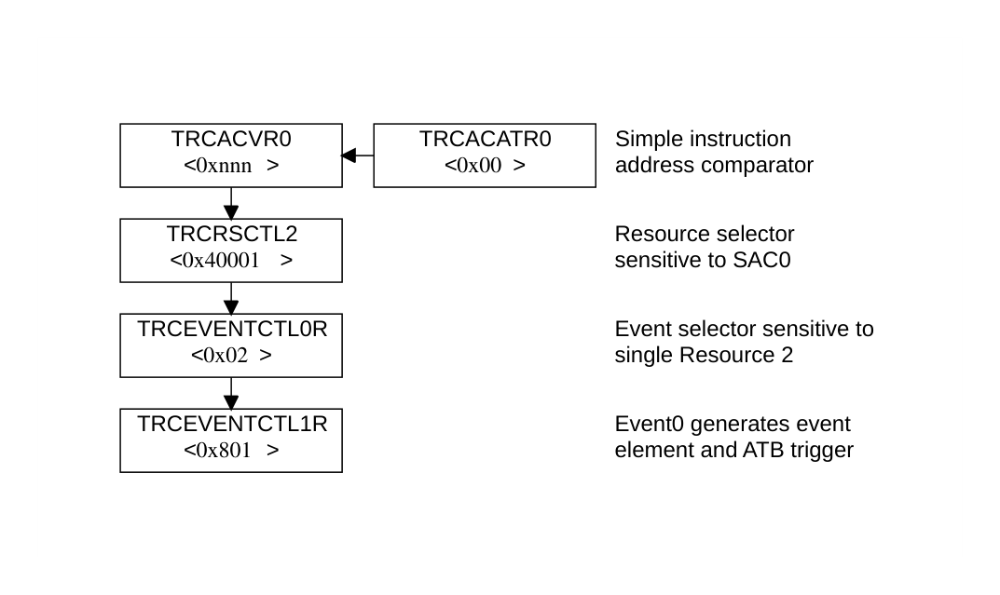

### 4.8 跟踪冲刷行为

通过 **ATB** 冲刷协议，可以确认 **ETM** 观察到的已到达跟踪总线输出的事件。必须冲刷两个 **ATB** 端口，才能确定跟踪基础设施何时完成对 **ETM** 所生成全部包的捕获。

无论看到哪个冲刷请求，**ETM** 都会在内部同时冲刷指令跟踪与数据跟踪，但不保证跟踪数据已从 **ETM** 中排空。当处理器进入低功耗状态时，这也会使全部跟踪从 **ETM** 输出。

### 4.9 低功耗状态行为

当处理器进入低功耗状态时，**ETM** 中的资源变为非活动之前存在一段延迟。

这允许最后执行的指令触发比较器、更新计数器或序列器，并将产生的事件包插入指定的跟踪流。该事件包在 **ETM** 本身进入低功耗状态之前在跟踪总线上呈现。

如果事件包因其他原因产生，则不保证在 **ETM** 进入低功耗状态之前输出；若在此之前 **ETM** 逻辑未被复位，则在处理器退出低功耗状态时被跟踪。

**TRCEVENTCTL1R.LPOVERRIDE** 位控制跟踪单元在低功耗状态下的行为。如果置 1，则跟踪单元的低功耗状态行为被覆盖，即进入低功耗状态不影响跟踪单元的资源或跟踪生成。此时 **ETM** 资源保持活动。

**相关内容**

* 第 499 页的 Event Control 1 Register

### 4.10 周期计数器

Cortex®-R52+ **ETM** 使用 12 位周期计数器。

当非侵入式调试被禁用或处理器处于低功耗状态时，它不计数。

### 4.11 非架构异常

**ETM** 指示非架构行为的异常。

**ETM** 针对以下使用如下 **TYPE** 编码的非架构行为指示异常：

| TYPE 编码 | 描述 |
| --- | --- |
| 0b10001 | ECC 逻辑要求重放指令跟踪。不应依赖该行为来提供 ECC 行为的跟踪。 |

### 4.12 跟踪同步

**ETM** 接收并合并所有跟踪同步请求源，以确定何时需要同步。当需要同步时，必要的信息被插入两个跟踪流（取决于数据跟踪是否活动）。

要解压缩跟踪流，数据跟踪流中的同步信息确定了与指令流中同步信息的对齐关系。如果 **ETM** 被配置为仅跟踪数据流中的事件，则必须配置指令跟踪流包含足够的元素，以允许所需的数据跟踪流同步。

## 5. 操作与执行模式

本节介绍如何控制 **ETM** 编程以及如何读取与编程 **ETM** 寄存器。

### 5.1 ETM 主使能位的使用

编程 **ETM** 寄存器时，必须使所有更改同时生效。

例如，如果重新编程计数器，它可能在触发条件被正确设置之前就基于错误的事件开始计数。

要在编程期间禁用所有跟踪操作，使用：

* **TRCPRGCTLR** 中的 **ETM** 主使能位，参见第 493 页的 15.7.1 Programming Control Register。
* **TRCSTATR** 以指示 **ETM** 状态，参见第 494 页的 15.7.2 Status Register。

下图给出了应使用的流程。

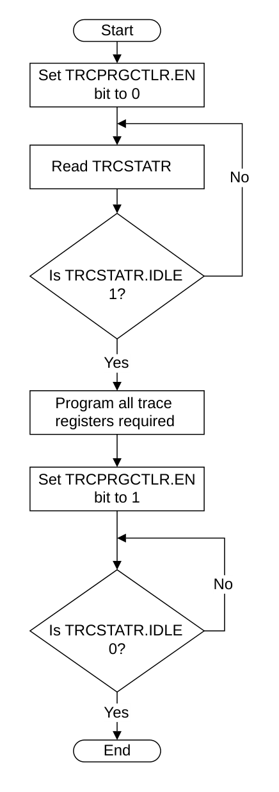

编程 **ETM** 寄存器时，Cortex®-R52+ 处理器不必处于调试状态。

### 5.2 编程与读取 ETM 寄存器

要访问 **ETM** 寄存器，使用外部 **APB** 接口。这提供了编程 **ETM** 的直接方法。

### 5.3 外部寄存器访问权限

是否允许访问某个寄存器取决于：

* 处理器是否已上电。
* **OS Lock** 与 **Software Lock** 的状态。
* 处理器调试认证输入的状态。

各寄存器特有的行为以及寄存器的访问类型不在本文档中描述。有关这些特性及其对寄存器影响的详细说明，请参见《Arm® Architecture Reference Manual Supplement Armv8, for the Armv8-R AArch32 architecture profile》。

本节提供的寄存器描述说明了各寄存器是读写还是只读。

## 6. 寄存器汇总

本节汇总 **ETM** 寄存器。

有关 **ETM** 寄存器的完整描述，请参见：

* 第 493 页的 15.7 Register descriptions，针对实现定义的寄存器。

第 491 页的 Table 15-6: ETM register summary 按数字顺序列出 **ETM** 寄存器并描述各寄存器。

寄存器表包含各寄存器的附加信息：

* 寄存器访问类型，即只读、只写或读写。
* 寄存器的基偏移地址。寄存器的基偏移始终是其寄存器编号的四倍。
* 适用时，关于寄存器实现的附加信息。
* 此处未列出的寄存器未实现。读取未实现的寄存器地址返回 0，写入未实现的寄存器地址无影响。
* 下表中：
  * **Reset value** 列给出 **ETM** 复位后立即的寄存器值。对于只读寄存器，每次读取该寄存器都返回该值。
  * 访问类型说明如下：
    * **RW**：读写。
    * **RO**：只读。
    * **WO**：只写。
* **PADDRDBG31** 的取值与 CoreSight Software lock 限制通过内存映射外部调试接口对 **ETM** 寄存器的写访问。当 **PADDRDBG31** 驱动为低电平时，必须使用 CoreSight software lock 解锁 **ETM** 寄存器的写权限。当 **PADDRDBG31** 驱动为高电平时，software lock 不限制 **ETM** 寄存器的写访问权限。software lock 由 Lock Access 寄存器控制。

所有 **ETM** 寄存器均为 32 位宽。

| 寄存器编号 | 基偏移 | 名称 | 类型 | 复位 | 描述 |
| --- | --- | --- | --- | --- | --- |
| 1 | 0x004 | TRCPRGCTLR | RW | 0x00000000 | 第 493 页的 15.7.1 Programming Control Register |
| 3 | 0x00C | TRCSTATR | RO | UNK | 第 494 页的 15.7.2 Status Register |
| 4 | 0x010 | TRCCONFIGR | RW | UNK | 第 495 页的 15.7.3 Trace Configuration Register |
| 8 | 0x020 | TRCEVENTCTL0R | RW | UNK | 第 497 页的 15.7.4 Event Control 0 Register |
| 9 | 0x024 | TRCEVENTCTL1R | RW | UNK | 第 499 页的 15.7.5 Event Control 1 Register |
| 11 | 0x02C | TRCSTALLCTLR | RW | UNK | 第 500 页的 15.7.6 Stall Control Register |
| 12 | 0x030 | TRCTSCTLR | RW | UNK | 第 502 页的 15.7.7 Global Timestamp Control Register |
| 13 | 0x034 | TRCSYNCPR | RW | UNK | 第 503 页的 15.7.8 Synchronization Period Register |
| 14 | 0x038 | TRCCCCTLR | RW | UNK | 第 504 页的 15.7.9 Cycle Count Control Register |
| 15 | 0x03C | TRCBBCTLR | RW | UNK | 第 505 页的 15.7.10 Branch Broadcast Control Register |
| 16 | 0x040 | TRCTRACEIDR | RW | UNK | 第 506 页的 15.7.11 Trace ID Register |
| 32 | 0x080 | TRCVICTLR | RW | UNK | 第 507 页的 15.7.12 ViewInst Main Control Register |
| 33 | 0x084 | TRCVIIECTLR | RW | UNK | 第 509 页的 15.7.13 ViewInst Include/Exclude Control Register |
| 34 | 0x088 | TRCVISSCTLR | RW | UNK | 第 510 页的 15.7.14 ViewInst Start/Stop Control Register |
| 40 | 0x0A0 | TRCVDCTLR | RW | UNK | 第 511 页的 15.7.15 ViewData Main Control Register |
| 41 | 0x0A4 | TRCVDSACCTLR | RW | UNK | 第 512 页的 15.7.16 ViewData Include/Exclude Single Address Comparator Register |
| 42 | 0x0A8 | TRCVDARCCTLR | RW | UNK | 第 513 页的 15.7.17 ViewData Include/Exclude Address Range Comparator Register |
| 64-66 | 0x100-0x108 | TRCSEQEVR0-2 | RW | UNK | 第 514 页的 15.7.18 Sequencer State Transition Control Registers, n=0-2 |
| 70 | 0x118 | TRCSEQRSTEVR | RW | UNK | 第 515 页的 15.7.19 Sequencer Reset Control Register |
| 71 | 0x11C | TRCSEQSTR | RW | UNK | 第 516 页的 15.7.20 Sequencer State Register |
| 72 | 0x120 | TRCEXTINSELR | RW | UNK | 第 517 页的 15.7.21 External Input Select Register |
| 80-81 | 0x140-0x144 | TRCCNTRLDVR0-1 | RW | UNK | 第 518 页的 15.7.22 Counter Reload Value Registers, n=0-1 |
| 84-85 | 0x150-0x154 | TRCCNTCTLR0-1 | RW | UNK | 第 519 页的 15.7.23 Counter Control Registers, n=0-1 |
| 88-89 | 0x160-0x164 | TRCCNTVR0-1 | RW | UNK | 第 521 页的 15.7.24 Counter Value Registers, n=0-1 |
| 96 | 0x180 | TRCIDR8 | RO | 0x00000001 | 第 522 页的 15.7.25 ID Registers, n=8-13 |
| 97 | 0x184 | TRCIDR9 | RO | 0x00000020 | 第 522 页的 15.7.25 ID Registers, n=8-13 |
| 98 | 0x188 | TRCIDR10 | RO | 0x00000002 | 第 522 页的 15.7.25 ID Registers, n=8-13 |
| 99 | 0x18C | TRCIDR11 | RO | 0x00000000 | 第 522 页的 15.7.25 ID Registers, n=8-13 |
| 100 | 0x190 | TRCIDR12 | RO | 0x00000001 | 第 522 页的 15.7.25 ID Registers, n=8-13 |
| 101 | 0x194 | TRCIDR13 | RO | 0x00000000 | 第 522 页的 15.7.25 ID Registers, n=8-13 |
| 112 | 0x1C0 | TRCIMSPEC0 | RW | 0x00000000 | 第 525 页的 15.7.26 Implementation Specific Register 0 |
| 120 | 0x1E0 | TRCIDR0 | RO | 0x08000EFF | 第 526 页的 15.7.27 ID Register 0 |
| 121 | 0x1E4 | TRCIDR1 | RO | 0x41001421 | 第 527 页的 15.7.28 ID Register 1 |
| 122 | 0x1E8 | TRCIDR2 | RO | 0x00420484 | 第 529 页的 15.7.29 ID Register 2 |
| 123 | 0x1EC | TRCIDR3 | RO | 0x0D700004 | 第 530 页的 15.7.30 ID Register 3 |
| 124 | 0x1F0 | TRCIDR4 | RO | 0x11270124 | 第 531 页的 15.7.31 ID Register 4 |
| 125 | 0x1F4 | TRCIDR5 | RO | 0x28C7081A | 第 533 页的 15.7.32 ID Register 5 |
| 130-143 | 0x208-0x23C | TRCRSCTLR2-15 | RW | UNK | 第 534 页的 15.7.33 Resource Selection Registers, n=2-15 |
| 160-161 | 0x280-0x284 | TRCSSCCR0-1 | RW | UNK | 第 535 页的 15.7.34 Single-shot Comparator Control Registers, n=0-1 |
| 168-169 | 0x2A0-0x2A4 | TRCSSCSR0-1 | RW | UNK | 第 536 页的 15.7.35 Single-shot Comparator Status Registers, n=0-1 |
| 192 | 0x300 | TRCOSLAR | WO | UNK | 第 538 页的 15.7.36 OS Lock Access Register |
| 193 | 0x304 | TRCOSLSR | RO | 0x0000000A | 第 539 页的 15.7.37 OS Lock Status Register |
| 196 | 0x310 | TRCPDCR | RW | 0x00000000 | 第 540 页的 15.7.38 Power Down Control Register |
| 197 | 0x314 | TRCPDSR | RO | UNK | 第 541 页的 15.7.39 Power Down Status Register |
| 256-270 | 0x400-0x438 | TRCACVR0-7 | RW | UNK | 第 542 页的 15.7.40 Address Comparator Value Registers, n=0-7 |
| 288-302 | 0x480-0x4B8 | TRCACATR0-7 | RW | UNK | 第 543 页的 15.7.41 Address Comparator Access Type Registers, n=0-7 |
| 320-324 | 0x500-0x510 | TRCDVCVR0-1 | RW | UNK | 第 547 页的 15.7.42 Data Value Comparator Value Registers, n=0-1 |
| 352-356 | 0x580-0x590 | TRCDVCMR0-1 | RW | UNK | 第 548 页的 15.7.43 Data Value Comparator Mask Registers, n=0-1 |
| 384 | 0x600 | TRCCIDCVR0 | RW | UNK | 第 549 页的 15.7.44 Context ID Comparator Value Registers 0 |
| 400 | 0x640 | TRCVMIDCVR0 | RW | UNK | 第 549 页的 15.7.45 Virtual Context Identifier Comparator Value Register |
| 416 | 0x680 | TRCCIDCCTLR0 | RW | UNK | 第 550 页的 15.7.46 Context ID Comparator Control Register 0 |
| 960 | 0xF00 | TRCITCTRL | RW | 0x00000000 | 第 551 页的 15.7.47 Integration Mode Control Register |
| 1000 | 0xFA0 | TRCCLAIMSET | RW | 0x0000000F | 第 552 页的 15.7.48 Claim Tag Set Register |
| 1001 | 0xFA4 | TRCCLAIMCLR | RW | 0x00000000 | 第 553 页的 15.7.49 Claim Tag Clear Register |
| 1002 | 0xFA8 | TRCDEVAFF0 | RO | -⁸⁴ | 第 554 页的 15.7.50 TRCDEVAFF0, Device Affinity Register 0 |
| 1003 | 0xFAC | TRCDEVAFF1 | RO | 0x00000000 | 第 555 页的 15.7.51 TRCDEVAFF1, Device Affinity Register 1 |
| 1004 | 0xFB0 | TRCLAR | WO | UNK | 第 555 页的 15.7.52 Software Lock Access Register |
| 1005 | 0xFB4 | TRCLSR | RO | 0x00000003 | 第 556 页的 15.7.53 Software Lock Status Register |
| 1006 | 0xFB8 | TRCAUTHSTATUS | RO | UNK | 第 557 页的 15.7.54 Authentication Status Register |
| 1007 | 0xFBC | TRCDEVARCH | RO | 0x47724A13 | 第 558 页的 15.7.55 Device Architecture Register |
| 1010 | 0xFC8 | TRCDEVID | RO | 0x00000000 | 第 559 页的 15.7.56 Device ID Register |
| 1011 | 0xFCC | TRCDEVTYPE | RO | 0x00000013 | 第 559 页的 15.7.57 Device Type Register |
| 1012-1019 | 0xFD0-0xFEC | TRCPIDR4-7、TRCPIDR0-3 | RO | -⁸⁵ | 第 560 页的 15.7.58 Peripheral Identification Registers |
| 1020-1023 | 0xFF0-0xFFC | TRCCIDR0-3 | RO | -⁸⁶ | 第 562 页的 15.7.59 Component Identification Registers |

⁸⁴ 复位值取决于集群与处理器 ID。参见第 185 页的 4.3.78 Multiprocessor Affinity Register。

⁸⁵ 参见第 560 页的 15.7.58 Peripheral Identification Registers。

⁸⁶ 参见第 562 页的 15.7.59 Component Identification Registers。

## 7. 寄存器描述

本节描述 ETM-Cortex®-R52+ 寄存器。

### 7.1 编程控制寄存器

**TRCPRGCTLR** 使能 **ETM**。

**使用限制**

本寄存器为读写。当跟踪单元已使能或未空闲时，写操作可能被忽略。

**陷阱与使能**

没有影响本寄存器的陷阱与使能。

**配置**

在所有配置中均可用。

**属性**

**TRCPRGCTLR** 是一个 32 位寄存器。

下图给出了 **TRCPRGCTLR** 的位分配。

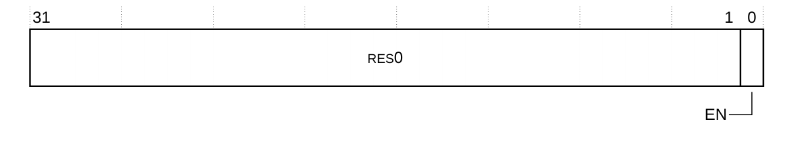

下表给出了 **TRCPRGCTLR** 的位分配。

| 位 | 名称 | 功能 |
| --- | --- | --- |
| [31:1] | - | 保留，RES0。 |
| [0] | EN | 跟踪程序使能： 0：在处理 **APB** 访问或排空已生成的跟踪时按需使能。不生成跟踪且所有资源为非活动。这是复位后的值。 1：除处理器处于低功耗状态或非侵入式调试被禁用且全部跟踪已排空之外，时钟使能。跟踪单元被使能。 |

**TRCPRGCTLR** 可通过内存映射接口访问：

| 组件 | 偏移 | 复位 |
| --- | --- | --- |
| ETM | 0x004 | 0x00000000 |

### 7.2 状态寄存器

**TRCSTATR** 指示 **ETM** 状态。

**使用限制**

本寄存器为只读。

**陷阱与使能**

没有影响本寄存器的陷阱与使能。

**配置**

在所有配置中均可用。

**属性**

**TRCSTATR** 是一个 32 位寄存器。

下图给出了 **TRCSTATR** 的位分配。

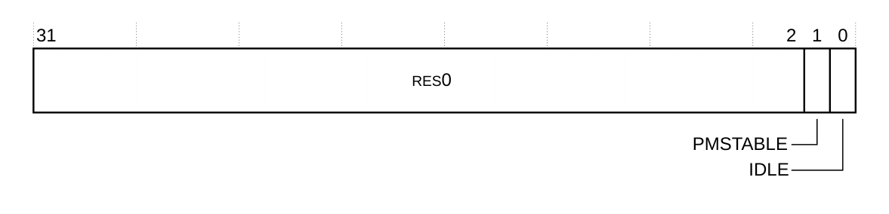

下表给出了 **TRCSTATR** 的位分配。

| 位 | 名称 | 功能 |
| --- | --- | --- |
| [31:2] | - | 保留，RES0。 |
| [1] | PMSTABLE | 指示 **ETM** 寄存器是否稳定且可读： 0：程序员模型不稳定。 1：程序员模型稳定。 |
| [0] | IDLE | 指示跟踪单元非活动： 0：**ETM** 未空闲。 1：**ETM** 空闲。 |

**TRCSTATR** 可通过内存映射接口访问：

| 组件 | 偏移 | 复位 |
| --- | --- | --- |
| ETM | 0x00C | UNK |

### 7.3 跟踪配置寄存器

**TRCCONFIGR** 设置跟踪单元的基本跟踪选项。

**使用限制**

本寄存器为读写，必须始终作为跟踪单元初始化的一部分进行编程。

仅在跟踪单元被禁用时接受写操作。

**陷阱与使能**

没有影响本寄存器的陷阱与使能。

**配置**

在所有配置中均可用。

**属性**

**TRCCONFIGR** 是一个 32 位寄存器。

下图给出了 **TRCCONFIGR** 的位分配。

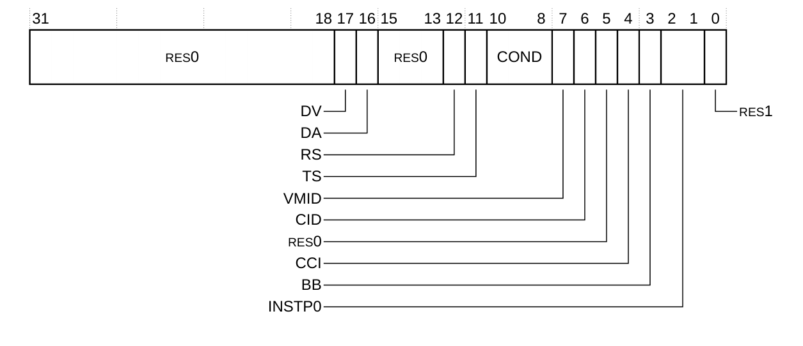

下表给出了 **TRCCONFIGR** 的位分配。

| 位 | 名称 | 功能 |
| --- | --- | --- |
| [31:18] | - | 保留，RES0。 |
| [17] | DV | 数据值跟踪： 0：数据值跟踪被禁用。 1：数据值跟踪被使能。 |
| [16] | DA | 数据地址跟踪： 0：数据地址跟踪被禁用。 1：数据地址跟踪被使能。 |
| [15:13] | - | 保留，RES0。 |
| [12] | RS | 返回栈使能： 0：返回栈被禁用。 1：返回栈被使能。 |
| [11] | TS | 全局时间戳跟踪： 0：全局时间戳跟踪被禁用。 1：全局时间戳跟踪被使能。 更多全局时间戳选项，参见第 502 页的 15.7.7 Global Timestamp Control Register。 |
| [10:8] | COND | 条件指令跟踪。支持的取值： 0b000：条件指令跟踪被禁用。 0b001：跟踪条件加载指令。 0b010：跟踪条件存储指令。 0b011：跟踪条件加载与存储指令。 0b111：跟踪所有条件指令。 所有其他取值为保留。 |
| [7] | VMID | 虚拟机 ID 跟踪： 0：VMID 跟踪被禁用。 1：VMID 跟踪被使能。 |
| [6] | CID | 上下文 ID 跟踪： 0：上下文 ID 跟踪被禁用。 1：上下文 ID 跟踪被使能。 |
| [5] | - | 保留，RES0。 |
| [4] | CCI | 指令跟踪中的周期计数： 0：指令跟踪中的周期计数被禁用。 1：指令跟踪中的周期计数被使能。 更多周期计数选项，参见第 504 页的 15.7.9 Cycle Count Control Register。 |
| [3] | BB | 分支广播模式： 0：分支广播模式被禁用。 1：分支广播模式被使能。 更多分支广播模式选项，参见第 505 页的 15.7.10 Branch Broadcast Control Register。 |
| [2:1] | INSTP0 | 确定产生 P0 元素的指令： 0b00：仅分支为 P0 元素。 0b01：加载指令与分支为 P0 元素。 0b10：存储指令与分支为 P0 元素。 0b11：加载与存储指令以及分支为 P0 元素。 |
| [0] | - | 保留，RES1。 |

**TRCCONFIGR** 可通过内存映射接口访问：

| 组件 | 偏移 | 复位 |
| --- | --- | --- |
| ETM | 0x010 | UNK |

### 7.4 事件控制 0 寄存器

**TRCEVENTCTL0R** 控制跟踪流中事件的跟踪。这些事件还驱动 **ETM** 的外部输出。

**使用限制**

本寄存器为读写，必须始终作为跟踪单元初始化的一部分进行编程。

仅在跟踪单元被禁用时接受写操作。

**陷阱与使能**

没有影响本寄存器的陷阱与使能。

**配置**

在所有配置中均可用。

**属性**

**TRCEVENTCTL0R** 是一个 32 位寄存器。

下图给出了 **TRCEVENTCTL0R** 的位分配。

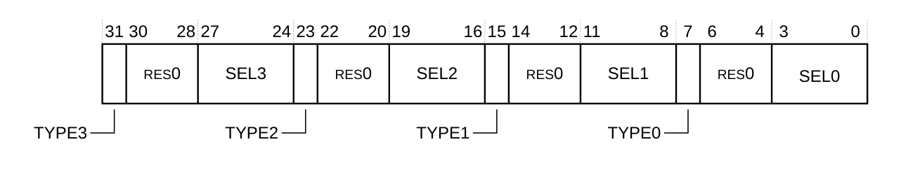

下表给出了 **TRCEVENTCTL0R** 的位分配。

| 位 | 名称 | 功能 |
| --- | --- | --- |
| [31] | TYPE3 | 选择事件 3 的资源类型： 0：单个选定资源。 1：布尔组合资源对。 |
| [30:28] | - | 保留，RES0。 |
| [27:24] | SEL3 | 根据 **TYPE3** 的值选择资源编号： 当 **TYPE3** 为 0 时，选择由 SEL3[3:0] 定义的 0-15 中的单个选定资源。 当 **TYPE3** 为 1 时，选择由 SEL3[2:0] 定义的 0-7 中的布尔组合资源对。 |
| [23] | TYPE2 | 选择事件 2 的资源类型： 0：单个选定资源。 1：布尔组合资源对。 |
| [22:20] | - | 保留，RES0。 |
| [19:16] | SEL2 | 根据 **TYPE2** 的值选择资源编号： 当 **TYPE2** 为 0 时，选择由 SEL2[3:0] 定义的 0-15 中的单个选定资源。 当 **TYPE2** 为 1 时，选择由 SEL2[2:0] 定义的 0-7 中的布尔组合资源对。 |
| [15] | TYPE1 | 选择事件 1 的资源类型： 0：单个选定资源。 1：布尔组合资源对。 |
| [14:12] | - | 保留，RES0。 |
| [11:8] | SEL1 | 根据 **TYPE1** 的值选择资源编号： 当 **TYPE1** 为 0 时，选择由 SEL1[3:0] 定义的 0-15 中的单个选定资源。 当 **TYPE1** 为 1 时，选择由 SEL1[2:0] 定义的 0-7 中的布尔组合资源对。 |
| [7] | TYPE0 | 选择事件 0 的资源类型： 0：单个选定资源。 1：布尔组合资源对。 |
| [6:4] | - | 保留，RES0。 |
| [3:0] | SEL0 | 根据 **TYPE0** 的值选择资源编号： 当 **TYPE0** 为 0 时，选择由 SEL0[3:0] 定义的 0-15 中的单个选定资源。 当 **TYPE0** 为 1 时，选择由 SEL0[2:0] 定义的 0-7 中的布尔组合资源对。 |

**TRCEVENTCTL0R** 可通过内存映射接口访问：

| 组件 | 偏移 | 复位 |
| --- | --- | --- |
| ETM | 0x020 | UNK |

### 7.5 事件控制 1 寄存器

**TRCEVENTCTL1R** 控制由 **TRCEVENTCTL0R** 所选择事件的行为。

**使用限制**

本寄存器为读写，必须始终作为跟踪单元初始化的一部分进行编程。

仅在跟踪单元被禁用时接受写操作。

**陷阱与使能**

没有影响本寄存器的陷阱与使能。

**配置**

在所有配置中均可用。

**属性**

**TRCEVENTCTL1R** 是一个 32 位寄存器。

下图给出了 **TRCEVENTCTL1R** 的位分配。

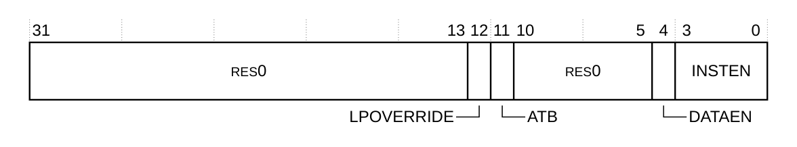

下表给出了 **TRCEVENTCTL1R** 的位分配。

| 位 | 名称 | 功能 |
| --- | --- | --- |
| [31:13] | - | 保留，RES0。 |
| [12] | LPOVERRIDE | 低功耗状态行为覆盖： 0：低功耗状态行为不受影响。 1：低功耗状态行为被覆盖。资源与事件跟踪生成不受进入低功耗状态影响。 |
| [11] | ATB | ATB 触发使能： 0：ATB 触发被禁用。 1：ATB 触发被使能。 |
| [10:5] | - | 保留，RES0。 |
| [4] | DATAEN | 使能在所选事件发生时于数据跟踪流中生成事件元素： 0：事件不产生事件元素。 1：事件产生事件元素。 |
| [3:0] | INSTEN | 每个事件一位，使能在所选事件发生时于指令跟踪流中生成事件元素： 0：事件不产生事件元素。 1：事件产生事件元素。 |

**TRCEVENTCTL1R** 可通过内存映射接口访问：

| 组件 | 偏移 | 复位 |
| --- | --- | --- |
| ETM | 0x024 | UNK |

### 7.6 停顿控制寄存器

**TRCSTALLCTLR** 使 **ETM** 能够在 **ETM FIFO** 超过已编程级别时停顿 Cortex®-R52+ 处理器，以将溢出风险降至最低。

**使用限制**

仅在跟踪单元被禁用时接受写操作。

本寄存器为读写，必须始终作为跟踪单元初始化的一部分进行编程。

**陷阱与使能**

没有影响本寄存器的陷阱与使能。

**配置**

在所有配置中均可用。

**属性**

**TRCSTALLCTLR** 是一个 32 位寄存器。

下图给出了 **TRCSTALLCTLR** 的位分配。

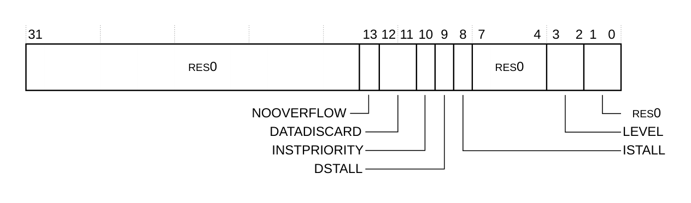

下表给出了 **TRCSTALLCTLR** 的位分配。

| 位 | 名称 | 功能 |
| --- | --- | --- |
| [31:14] | - | 保留，RES0。 |
| [13] | NOOVERFLOW | 跟踪溢出防止位。该字段为 RES0。 |
| [12:11] | DATADISCARD | 设置数据跟踪组件的优先级，使 **ETM** 在数据跟踪缓冲空间小于 **LEVEL** 时可丢弃部分数据： 0b00：跟踪单元不得丢弃任何数据跟踪元素。 0b01：跟踪单元可丢弃与数据加载相关的 P1 与 P2 元素。 0b10：跟踪单元可丢弃与数据存储相关的 P1 与 P2 元素。 0b11：跟踪单元可丢弃与数据加载和存储相关的 P1 与 P2 元素。 |
| [10] | INSTPRIORITY | 当指令跟踪缓冲空间小于 **LEVEL** 时优先处理指令跟踪： 0：跟踪单元不得优先处理指令跟踪。 1：跟踪单元可优先处理指令跟踪。 |
| [9] | DSTALL | 基于数据跟踪缓冲空间停顿处理器： 0：跟踪单元不得停顿处理器。 1：跟踪单元可停顿处理器。 |
| [8] | ISTALL | 基于指令跟踪缓冲空间停顿处理器： 0：跟踪单元不得停顿处理器。 1：跟踪单元可停顿处理器。 |
| [7:4] | - | 保留，RES0。 |
| [3:2] | LEVEL | 停顿生效的阈值。提供四个级别。可调整该级别以优化停顿造成的侵入程度，并在 **FIFO** 溢出风险之间取得平衡： 0b00：零侵入。该设置 **FIFO** 溢出风险更大。 0b11：侵入最大，但 **FIFO** 溢出风险更小。 |
| [1:0] | - | 保留，RES0。 |

**TRCSTALLCTLR** 可通过内存映射接口访问：

| 组件 | 偏移 | 复位 |
| --- | --- | --- |
| ETM | 0x02C | UNK |

### 7.7 全局时间戳控制寄存器

**TRCTSCTLR** 控制向跟踪流中插入全局时间戳。时间戳始终插入指令跟踪流；如果使能了任何数据跟踪，也插入数据跟踪流。

**使用限制**

仅在跟踪单元被禁用时接受写操作。

本寄存器为读写，必须始终作为跟踪单元初始化的一部分进行编程。

**陷阱与使能**

没有影响本寄存器的陷阱与使能。

**配置**

在所有配置中均可用。

**属性**

**TRCTSCTLR** 是一个 32 位寄存器。

下图给出了 **TRCTSCTLR** 的位分配。

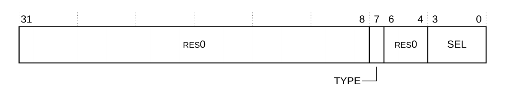

下表给出了 **TRCTSCTLR** 的位分配。

| 位 | 名称 | 功能 |
| --- | --- | --- |
| [31:8] | - | 保留，RES0。 |
| [7] | TYPE | 选择资源类型： 0：单个选定资源。 1：布尔组合资源对。 |
| [6:4] | - | 保留，RES0。 |
| [3:0] | SEL | 根据 **TYPE** 的值选择资源编号： 当 **TYPE** 为 0 时，选择由位 [3:0] 定义的 0-15 中的单个选定资源。 当 **TYPE** 为 1 时，选择由位 [2:0] 定义的 0-7 中的布尔组合资源对。 |

**TRCTSCTLR** 可通过内存映射接口访问：

| 组件 | 偏移 | 复位 |
| --- | --- | --- |
| ETM | 0x030 | UNK |

### 7.8 同步周期寄存器

**TRCSYNCPR** 指定跟踪流的跟踪同步周期。**TRCSYNCPR** 定义两次跟踪同步请求之间的跟踪字节数。该值始终为 2 的幂。

**使用限制**

仅在跟踪单元被禁用时接受写操作。

本寄存器为读写，必须始终作为跟踪单元初始化的一部分进行编程。

**陷阱与使能**

没有影响本寄存器的陷阱与使能。

**配置**

在所有配置中均可用。

**属性**

**TRCSYNCPR** 是一个 32 位寄存器。

下图给出了 **TRCSYNCPR** 的位分配。

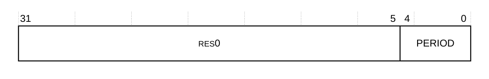

下表给出了 **TRCSYNCPR** 的位分配。

| 位 | 名称 | 功能 |
| --- | --- | --- |
| [31:5] | - | 保留，RES0。 |
| [4:0] | PERIOD | 定义两次跟踪同步请求之间的跟踪字节数，为指令流与数据流所生成字节数的总和。字节数为 2^N，其中 N 为该字段的值： • 值为零时禁用这些周期性跟踪同步请求，但不禁用其他跟踪同步请求。 • 除零外可编程的最小值为 8，提供 256 字节的最小跟踪同步周期。 • 最大值为 20，提供 2²⁰ 字节的最大跟踪同步周期。 |

**TRCSYNCPR** 可通过内存映射接口访问：

| 组件 | 偏移 | 复位 |
| --- | --- | --- |
| ETM | 0x034 | UNK |

### 7.9 周期计数控制寄存器

**TRCCCCTLR** 设置指令跟踪周期计数的阈值。该阈值表示周期计数跟踪包之间的最小间隔。

**使用限制**

仅在跟踪单元被禁用时接受写操作。

本寄存器为读写，必须始终作为跟踪单元初始化的一部分进行编程。

**陷阱与使能**

没有影响本寄存器的陷阱与使能。

**配置**

在所有配置中均可用。

**属性**

**TRCCCCTLR** 是一个 32 位寄存器。

下图给出了 **TRCCCCTLR** 的位分配。

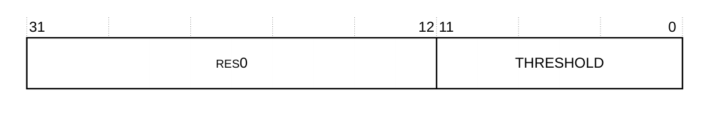

下表给出了 **TRCCCCTLR** 的位分配。

| 位 | 名称 | 功能 |
| --- | --- | --- |
| [31:12] | - | 保留，RES0。 |
| [11:0] | THRESHOLD | 指令跟踪周期计数阈值。 |

**TRCCCCTLR** 可通过内存映射接口访问：

| 组件 | 偏移 | 复位 |
| --- | --- | --- |
| ETM | 0x038 | UNK |

### 7.10 分支广播控制寄存器

**TRCBBCTLR** 控制分支广播的行为，并使分支广播能够针对特定内存区域使能。

**使用限制**

本寄存器为读写。仅在跟踪单元被禁用时接受写操作。

**陷阱与使能**

没有影响本寄存器的陷阱与使能。

**配置**

在所有配置中均可用。

**属性**

**TRCBBCTLR** 是一个 32 位寄存器。

下图给出了 **TRCBBCTLR** 的位分配。

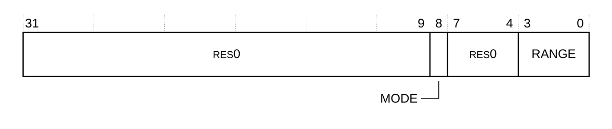

下表给出了 **TRCBBCTLR** 的位分配。

| 位 | 名称 | 功能 |
| --- | --- | --- |
| [31:9] | - | 保留，RES0。 |
| [8] | MODE | 选择模式： 0：排除模式。由 **RANGE** 字段定义的地址范围比较器指示不使能分支广播的地址范围。不选择任何范围时，分支广播在整个内存映射中使能。 1：包含模式。由 **RANGE** 字段定义的地址范围比较器指示使能分支广播的地址范围。在包含模式下将 **RANGE** 置为全零是 UNPREDICTABLE 的。 |
| [7:4] | - | 保留，RES0。 |
| [3:0] | RANGE | 选择地址范围比较器以控制使能分支广播的位置。每个已实现的地址范围比较器对应一位。 |

**TRCBBCTLR** 可通过内存映射接口访问：

| 组件 | 偏移 | 复位 |
| --- | --- | --- |
| ETM | 0x03C | UNK |

### 7.11 跟踪 ID 寄存器

**TRCTRACEIDR** 设置跟踪总线上的跟踪 ID。控制两个跟踪 ID，一个用于指令跟踪，一个用于数据跟踪。

**使用限制**

在 CoreSight 系统中，写入保留的跟踪 ID 值 0x00 与 0x70-0x7F 是 UNPREDICTABLE 的。本寄存器为读写，必须始终作为跟踪单元初始化的一部分进行编程。

仅在跟踪单元被禁用时接受写操作。

**陷阱与使能**

没有影响本寄存器的陷阱与使能。

**配置**

在所有配置中均可用。

**属性**

**TRCTRACEIDR** 是一个 32 位寄存器。

下图给出了 **TRCTRACEIDR** 的位分配。

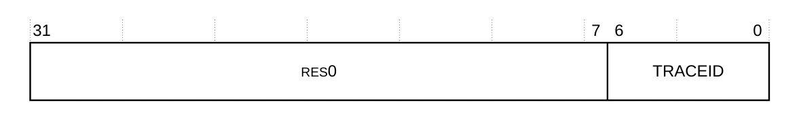

下表给出了 **TRCTRACEIDR** 的位分配。

| 位 | 名称 | 功能 |
| --- | --- | --- |
| [31:7] | - | 保留，RES0。 |
| [6:0] | TRACEID | 跟踪 ID 值。当仅使能指令跟踪时，该字段提供跟踪 ID。 当使能数据跟踪时，必须以位 [0] 置 0 的方式写入该字段。指令与数据跟踪流使用相邻的跟踪 ID 值： • 指令跟踪流使用跟踪 ID TRACEID[6:0]。 • 数据值跟踪流使用跟踪 ID TRACEID{[6:1],1}。 |

**TRCTRACEIDR** 可通过内存映射接口访问：

| 组件 | 偏移 | 复位 |
| --- | --- | --- |
| ETM | 0x040 | UNK |

### 7.12 ViewInst 主控制寄存器

**TRCVICTLR** 控制指令跟踪过滤。

**使用限制**

本寄存器为读写。仅在跟踪单元被禁用时接受写操作。

仅在 **TRCSTATR.PMSTABLE** 为 1 时返回稳定数据。

必须编程该寄存器以设置 **SSSTATUS** 位的值，该位设置启动-停止逻辑的状态。

**陷阱与使能**

没有影响本寄存器的陷阱与使能。

**配置**

在所有配置中均可用。

**属性**

**TRCVICTLR** 是一个 32 位寄存器。

下图给出了 **TRCVICTLR** 的位分配。

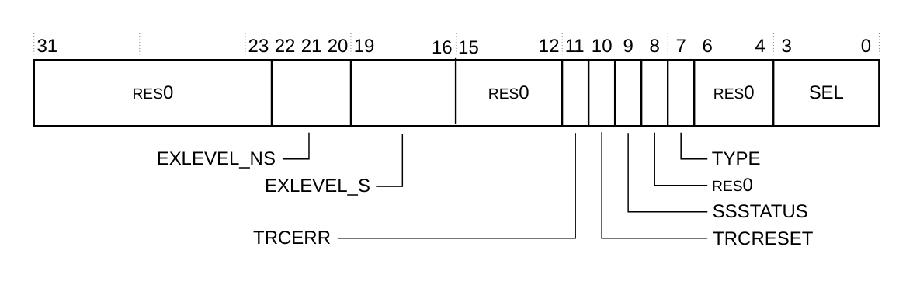

下表给出了 **TRCVICTLR** 的位分配。

| 位 | 名称 | 功能 |
| --- | --- | --- |
| [31:23] | - | 保留，RES0。 |
| [22] | EXLEVEL_NS | 禁用 EL2 中指定异常级别的跟踪。 |
| [21] | EXLEVEL_NS | 禁用 EL1 中指定异常级别的跟踪。 |
| [20] | EXLEVEL_NS | 禁用 EL0 中指定异常级别的跟踪。 |
| [19:16] | EXLEVEL_S | 该字段为 RES0。 |
| [15:12] | - | 保留，RES0。 |
| [11] | TRCERR | 选择系统错误异常是否必须始终被跟踪： 0：仅当系统错误异常之前的指令或异常被跟踪时，才跟踪该异常。 1：无论 **ViewInst** 的值如何，系统错误异常始终被跟踪。 |
| [10] | TRCRESET | 选择复位异常是否必须始终被跟踪： 0：仅当复位异常之前的指令或异常被跟踪时，才跟踪该异常。 1：无论 **ViewInst** 的值如何，复位异常始终被跟踪。 |
| [9] | SSSTATUS | 指示启动/停止逻辑的当前状态： 0：启动/停止逻辑处于停止状态。 1：启动/停止逻辑处于启动状态。 |
| [8] | - | 保留，RES0。 |
| [7] | TYPE | 选择资源类型： 0：单个选定资源。 1：布尔组合资源对。 |
| [6:4] | - | 保留，RES0。 |
| [3:0] | SEL | 根据 **TYPE** 的值选择资源编号： 当 **TYPE** 为 0 时，选择由位 [3:0] 定义的 0-15 中的单个选定资源。 当 **TYPE** 为 1 时，选择由位 [2:0] 定义的 0-7 中的布尔组合资源对。 |

**TRCVICTLR** 可通过内存映射接口访问：

| 组件 | 偏移 | 复位 |
| --- | --- | --- |
| ETM | 0x080 | UNK |

### 7.13 ViewInst 包含/排除控制寄存器

**TRCVIIECTLR** 定义控制 **ViewInst** 包含/排除控制的地址范围比较器。

**使用限制**

本寄存器为读写。仅在跟踪单元被禁用时接受写操作。

**陷阱与使能**

没有影响本寄存器的陷阱与使能。

**配置**

在所有配置中均可用。

**属性**

**TRCVIIECTLR** 是一个 32 位寄存器。

下图给出了 **TRCVIIECTLR** 的位分配。

下表给出了 **TRCVIIECTLR** 的位分配。

| 位 | 名称 | 功能 |
| --- | --- | --- |
| [31:20] | - | 保留，RES0。 |
| [19:16] | EXCLUDE | 定义用于 **ViewInst** 排除控制的地址范围比较器。每个地址范围比较器对应一位。 |
| [15:4] | - | 保留，RES0。 |
| [3:0] | INCLUDE | 定义用于 **ViewInst** 包含控制的地址范围比较器。 不选择任何包含比较器表示必须包含所有指令。排除控制指示必须排除哪些范围。 每个地址范围比较器对应一位。 |

**TRCVIIECTLR** 可通过内存映射接口访问：

| 组件 | 偏移 | 复位 |
| --- | --- | --- |
| ETM | 0x084 | UNK |

### 7.14 ViewInst 启动/停止控制寄存器

**TRCVISSCTLR** 定义控制 **ViewInst** 启动/停止逻辑的单地址比较器。

**使用限制**

仅在跟踪单元被禁用时接受写操作。

本寄存器为读写，必须始终作为跟踪单元初始化的一部分进行编程。

**陷阱与使能**

没有影响本寄存器的陷阱与使能。

**配置**

在所有配置中均可用。

**属性**

**TRCVISSCTLR** 是一个 32 位寄存器。

下图给出了 **TRCVISSCTLR** 的位分配。

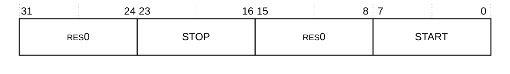

下表给出了 **TRCVISSCTLR** 的位分配。

| 位 | 名称 | 功能 |
| --- | --- | --- |
| [31:24] | - | 保留，RES0。 |
| [23:16] | STOP | 定义用于通过 **ViewInst** 启动/停止控制来停止跟踪的单地址比较器。每个单地址比较器对应一位。 |
| [15:8] | - | 保留，RES0。 |
| [7:0] | START | 定义用于通过 **ViewInst** 启动/停止控制来启动跟踪的单地址比较器。每个单地址比较器对应一位。 |

**TRCVISSCTLR** 可通过内存映射接口访问：

| 组件 | 偏移 | 复位 |
| --- | --- | --- |
| ETM | 0x088 | UNK |

### 7.15 ViewData 主控制寄存器

**TRCVDCTLR** 控制数据跟踪过滤。

**使用限制**

仅在跟踪单元被禁用时接受写操作。

本寄存器为读写，在使能数据跟踪时必须编程。

**陷阱与使能**

没有影响本寄存器的陷阱与使能。

**配置**

在所有配置中均可用。

**属性**

**TRCVDCTLR** 是一个 32 位寄存器。

下图给出了 **TRCVDCTLR** 的位分配。

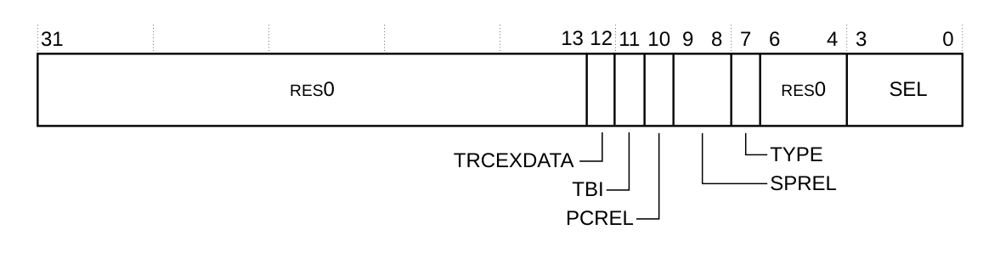

下表给出了 **TRCVDCTLR** 的位分配。

| 位 | 名称 | 功能 |
| --- | --- | --- |
| [31:13] | - | 保留，RES0。 |
| [12] | TRCEXDATA | 该字段为 RES0。 |
| [11] | TBI | 该字段为 RES0。 |
| [10] | PCREL | 控制相对 PC 的传输的数据跟踪： 0：PC 相对传输的跟踪不受影响。 1：不跟踪 PC 相对传输的地址部分与值部分。 |
| [9:8] | SPREL | 控制相对栈指针（SP）的传输的数据跟踪： 0b00：SP 相对传输的跟踪不受影响。 0b01：保留。 0b10：不跟踪 SP 相对传输的地址部分。如果使能了数据值跟踪，则生成一个 P1 数据地址元素。 0b11：不跟踪 SP 相对传输的地址部分与值部分。 |
| [7] | TYPE | 选择资源类型： 0：单个选定资源。 1：布尔组合资源对。 |
| [6:4] | - | 保留，RES0。 |
| [3:0] | SEL | 根据 **TYPE** 的值选择资源编号： 当 **TYPE** 为 0 时，选择由位 [3:0] 定义的 0-15 中的单个选定资源。 当 **TYPE** 为 1 时，选择由位 [2:0] 定义的 0-7 中的布尔组合资源对。 |

**TRCVDCTLR** 可通过内存映射接口访问：

| 组件 | 偏移 | 复位 |
| --- | --- | --- |
| ETM | 0x0A0 | UNK |

### 7.16 ViewData 包含/排除单地址比较器寄存器

**TRCVDSACCTLR** 定义控制 **ViewData** 包含/排除控制的单地址比较器。

**使用限制**

仅在跟踪单元被禁用时接受写操作。本寄存器为读写，在使能数据跟踪且实现了一个或多个地址比较器时必须编程。

**陷阱与使能**

没有影响本寄存器的陷阱与使能。

**配置**

在所有配置中均可用。

**属性**

**TRCVDSACCTLR** 是一个 32 位寄存器。

下图给出了 **TRCVDSACCTLR** 的位分配。

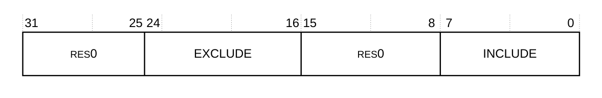

下表给出了 **TRCVDSACCTLR** 的位分配。

| 位 | 名称 | 功能 |
| --- | --- | --- |
| [31:25] | - | 保留，RES0。 |
| [24:16] | EXCLUDE | 定义用于 **ViewData** 排除控制的单地址比较器。每个地址比较器对应一位。 |
| [15:8] | - | 保留，RES0。 |
| [7:0] | INCLUDE | 定义用于 **ViewData** 包含控制的单地址比较器。每个地址比较器对应一位。 |

**TRCVDSACCTLR** 可通过内存映射接口访问：

| 组件 | 偏移 | 复位 |
| --- | --- | --- |
| ETM | 0x0A4 | UNK |

### 7.17 ViewData 包含/排除地址范围比较器寄存器

**TRCVDARCCTLR** 定义控制 **ViewData** 包含/排除控制的地址范围比较器。

**使用限制**

仅在跟踪单元被禁用时接受写操作。本寄存器为读写，在使能数据跟踪且实现了一个或多个地址比较器时必须编程。

**陷阱与使能**

没有影响本寄存器的陷阱与使能。

**配置**

在所有配置中均可用。

**属性**

**TRCVDARCCTLR** 是一个 32 位寄存器。

下图给出了 **TRCVDARCCTLR** 的位分配。

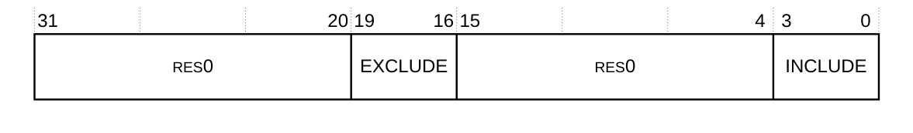

下表给出了 **TRCVDARCCTLR** 的位分配。

| 位 | 名称 | 功能 |
| --- | --- | --- |
| [31:20] | - | 保留，RES0 |
| [19:16] | EXCLUDE | 定义用于 **ViewData** 排除控制的地址范围比较器。每个地址范围比较器对应一位。 |
| [15:4] | - | 保留，RES0。 |
| [3:0] | INCLUDE | 定义用于 **ViewData** 包含控制的地址范围比较器。每个地址范围比较器对应一位。 |

**TRCVDARCCTLR** 可通过内存映射接口访问：

| 组件 | 偏移 | 复位 |
| --- | --- | --- |
| ETM | 0x0A8 | UNK |

### 7.18 序列器状态跳转控制寄存器，n=0-2

**TRCSEQEVRn** 寄存器定义推进到下一状态或回退到上一状态的序列器跳转。ETM 实现一个具有四个状态的序列器状态机。

**使用限制**

这些寄存器为读写。仅在跟踪单元被禁用时接受写操作。

**陷阱与使能**

没有影响这些寄存器的陷阱与使能。

**配置**

在所有配置中均可用。

**属性**

**TRCSEQEVRn** 是 32 位寄存器。

下图给出了 **TRCSEQEVRn** 的位分配。

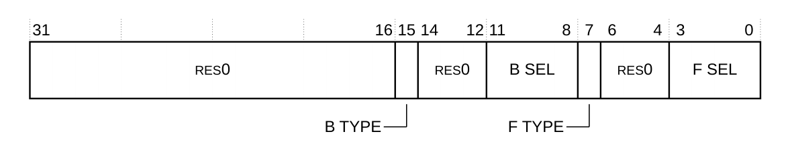

下表给出了 **TRCSEQEVRn** 的位分配。

| 位 | 名称 | 功能 |
| --- | --- | --- |
| [31:16] | - | 保留，RES0。 |
| [15] | B TYPE | 选择从下一状态回退到本状态所用的资源类型： 0：单个选定资源。 1：布尔组合资源对。 |
| [14:12] | - | 保留，RES0。 |
| [11:8] | B SEL | 根据 **B TYPE** 的值选择资源编号： 当 **B TYPE** 为 0 时，选择由位 [3:0] 定义的 0-15 中的单个选定资源。 当 **B TYPE** 为 1 时，选择由位 [2:0] 定义的 0-7 中的布尔组合资源对。 |
| [7] | F TYPE | 选择从本状态推进到下一状态所用的资源类型： 0：单个选定资源。 1：布尔组合资源对。 |
| [6:4] | - | 保留，RES0。 |
| [3:0] | F SEL | 根据 **F TYPE** 的值选择资源编号： 当 **F TYPE** 为 0 时，选择由位 [3:0] 定义的 0-15 中的单个选定资源。 当 **F TYPE** 为 1 时，选择由位 [2:0] 定义的 0-7 中的布尔组合资源对。 |

**TRCSEQEVRn** 可通过内存映射接口访问：

| 组件 | 偏移 | 复位 |
| --- | --- | --- |
| ETM | 0x100-0x108 | UNK |

### 7.19 序列器复位控制寄存器

**TRCSEQRSTEVR** 将序列器复位到状态 0。

**使用限制**

本寄存器为读写。仅在跟踪单元被禁用时接受写操作。

**陷阱与使能**

没有影响本寄存器的陷阱与使能。

**配置**

在所有配置中均可用。

**属性**

**TRCSEQRSTEVR** 是一个 32 位寄存器。

下图给出了 **TRCSEQRSTEVR** 的位分配。

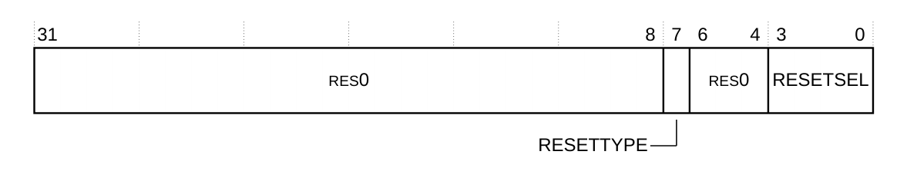

下表给出了 **TRCSEQRSTEVR** 的位分配。

| 位 | 名称 | 功能 |
| --- | --- | --- |
| [31:8] | - | 保留，RES0。 |
| [7] | RESETTYPE | 选择回退到状态 0 所用的资源类型： 0：单个选定资源。 1：布尔组合资源对。 |
| [6:4] | - | 保留，RES0。 |
| [3:0] | RESETSEL | 根据 **RESETTYPE** 的值选择资源编号： 当 **RESETTYPE** 为 0 时，选择由位 [3:0] 定义的 0-15 中的单个选定资源。 当 **RESETTYPE** 为 1 时，选择由位 [2:0] 定义的 0-7 中的布尔组合资源对。 |

**TRCSEQRSTEVR** 可通过内存映射接口访问：

| 组件 | 偏移 | 复位 |
| --- | --- | --- |
| ETM | 0x118 | UNK |

### 7.20 序列器状态寄存器

**TRCSEQSTR** 保存序列器当前状态的值。

**使用限制**

本寄存器为读写。仅在跟踪单元被禁用时接受写操作。

在编程序列器时，必须为该寄存器编程一个初始值。

**陷阱与使能**

没有影响本寄存器的陷阱与使能。

**配置**

在所有配置中均可用。

**属性**

**TRCSEQSTR** 是一个 32 位寄存器。

下图给出了 **TRCSEQSTR** 的位分配。

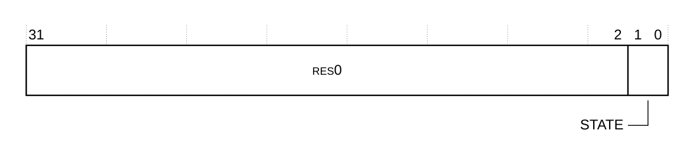

下表给出了 **TRCSEQSTR** 的位分配。

| 位 | 名称 | 功能 |
| --- | --- | --- |
| [31:2] | - | 保留，RES0。 |
| [1:0] | STATE | 当前序列器状态： 0b00：状态 0。 0b01：状态 1。 0b10：状态 2。 0b11：状态 3。 |

**TRCSEQSTR** 可通过内存映射接口访问：

| 组件 | 偏移 | 复位 |
| --- | --- | --- |
| ETM | 0x11C | UNK |

### 7.21 外部输入选择寄存器

使用 **TRCEXTINSELR** 寄存器设置或读取哪些外部输入作为跟踪单元的资源。

**使用限制**

本寄存器为读写。当跟踪单元被使能或未空闲时忽略写操作。

**陷阱与使能**

没有影响本寄存器的陷阱与使能。

**配置**

在所有配置中均可用。

**属性**

一个 32 位读写寄存器。该寄存器在跟踪单元复位时被设置为 UNKNOWN 值。

下图给出了 **TRCEXTINSELR** 的位分配。

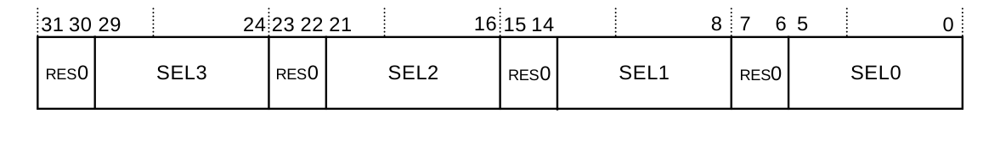

下表给出了 **TRCEXTINSELR** 的位分配。

| 位 | 名称 | 功能 |
| --- | --- | --- |
| [31:30] | - | 保留，RES0。 |
| [29:24] | SEL3 | 选择哪个外部输入作为跟踪单元的资源。 |
| [23:22] | - | 保留，RES0。 |
| [21:16] | SEL2 | 选择哪个外部输入作为跟踪单元的资源。 |
| [15:14] | - | 保留，RES0。 |
| [13:8] | SEL1 | 选择哪个外部输入作为跟踪单元的资源。 |
| [7:6] | - | 保留，RES0。 |
| [5:0] | SEL0 | 选择哪个外部输入作为跟踪单元的资源。 |

**TRCEXTINSELR** 可通过内存映射接口访问：

| 组件 | 偏移 | 复位 |
| --- | --- | --- |
| ETM | 0x120 | UNK |

### 7.22 计数器重载值寄存器，n=0-1

每个 **TRCCNTRLDVRn** 寄存器定义计数器 \<n> 的重载值。

**使用限制**

本寄存器为读写。仅在跟踪单元被禁用时接受写操作。

**陷阱与使能**

没有影响这些寄存器的陷阱与使能。

**配置**

在所有配置中均可用。

**属性**

**TRCCNTRLDVRn** 是 32 位寄存器。

下图给出了 **TRCCNTRLDVRn** 的位分配。

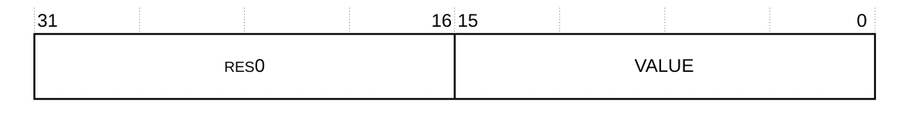

下表给出了 **TRCCNTRLDVRn** 的位分配。

| 位 | 名称 | 功能 |
| --- | --- | --- |
| [31:16] | - | 保留，RES0。 |
| [15:0] | VALUE | 定义计数器的重载值。每次发生重载事件时，该值被加载到计数器中。 |

**TRCCNTRLDVRn** 可通过内存映射接口访问：

| 组件 | 偏移 | 复位 |
| --- | --- | --- |
| ETM | 0x140-0x144 | UNK |

### 7.23 计数器控制寄存器 0-1

每个 **TRCCNTCTLRn** 寄存器控制计数器 \<n>。

**使用限制**

这些寄存器为读写。仅在跟踪单元被禁用时接受写操作。

**陷阱与使能**

没有影响这些寄存器的陷阱与使能。

**配置**

在所有配置中均可用。

**属性**

**TRCCNTCTLRn** 是 32 位寄存器。

下图给出了 **TRCCNTCTLRn** 的位分配。

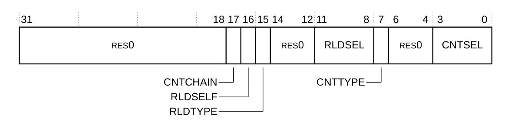

下表给出了 **TRCCNTCTLRn** 的位分配。

| 位 | 名称 | 功能 |
| --- | --- | --- |
| [31:18] | - | 保留，RES0。 |
| [17] | CNTCHAIN⁸⁷ | 定义计数器在计数器重载时是否递减。这使两个计数器可以组合使用以提供更大的计数器： 0：该计数器独立工作。计数器仅根据 **CNTTYPE** 与 **CNTSEL** 递减。 1：计数器在计数器重载时递减。当 **CNTTYPE** 与 **CNTSEL** 选定的资源有效时，计数器也递减。 |
| [16] | RLDSELF | 定义计数器在到达零时是否重载： 0：计数器在到达零时不重载。计数器仅根据 **RLDTYPE** 与 **RLDSEL** 重载。 1：当计数器到达零且 **CNTTYPE** 与 **CNTSEL** 选定的资源也有效时，计数器重载。计数器还根据 **RLDTYPE** 与 **RLDSEL** 重载。 |
| [15] | RLDTYPE | 选择重载所用的资源类型： 0：单个选定资源。 1：布尔组合资源对。 |
| [14:12] | - | 保留，RES0。 |
| [11:8] | RLDSEL | 根据 **RLDTYPE** 的值选择资源编号： 当 **RLDTYPE** 为 0 时，选择由 RLDSEL[3:0] 定义的 0-15 中的单个选定资源。 当 **RLDTYPE** 为 1 时，选择由 RLDSEL[2:0] 定义的 0-7 中的布尔组合资源对。 |
| [7] | CNTTYPE | 选择计数器所用的资源类型： 0：单个选定资源。 1：布尔组合资源对。 |
| [6:4] | - | 保留，RES0。 |
| [3:0] | CNTSEL | 根据 **CNTTYPE** 的值选择资源编号： 当 **CNTTYPE** 为 0 时，选择由位 [3:0] 定义的 0-15 中的单个选定资源。 当 **CNTTYPE** 为 1 时，选择由位 [2:0] 定义的 0-7 中的布尔组合资源对。 |

**TRCCNTCTLRn** 可通过内存映射接口访问：

| 组件 | 偏移 | 复位 |
| --- | --- | --- |
| ETM | 0x150-0x154 | UNK |

### 7.24 计数器值寄存器，n=0-1

**TRCCNTVRn** 寄存器设置或返回计数器 \<n> 的值。

**使用限制**

这些寄存器为读写。仅在跟踪单元被禁用时接受写操作。仅当 **TRCSTATR.PMSTABLE** 为 1 时计数值才稳定。

如果软件使用计数器 \<n>，则必须写入这些寄存器以设置初始计数值。

**陷阱与使能**

没有影响这些寄存器的陷阱与使能。

**配置**

在所有配置中均可用。

**属性**

**TRCCNTVRn** 是 32 位寄存器。

下图给出了 **TRCCNTVRn** 的位分配。

下表给出了 **TRCCNTVRn** 的位分配。

| 位 | 名称 | 功能 |
| --- | --- | --- |
| [31:16] | - | 保留，RES0。 |
| [15:0] | VALUE | 包含当前计数值。 |

**TRCCNTVRn** 可通过内存映射接口访问：

| 组件 | 偏移 | 复位 |
| --- | --- | --- |
| ETM | 0x160-0x164 | UNK |

### 7.25 ID 寄存器，n=8-13

**TRCIDRn** 寄存器提供关于已实现的跟踪流的信息，这些信息是分析跟踪所必需的。

**使用限制**

这些寄存器为只读。

**陷阱与使能**

没有影响这些寄存器的陷阱与使能。

**配置**

这些寄存器在所有配置中均可用。

**属性**

**TRCIDRn** 是 32 位寄存器。

下图给出了 **TRCIDR8** 的位分配。

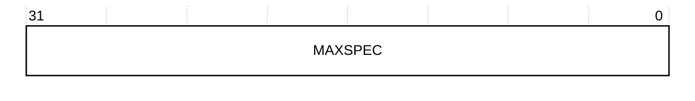

下表给出了 **TRCIDR8** 的位分配。

| 位 | 名称 | 功能 |
| --- | --- | --- |
| [31:0] | MAXSPEC | 指示指令跟踪流的最大推测深度。这是跟踪流中在任意时刻尚未提交的 P0 元素的最大数量。 0x00000001：最大跟踪推测深度为一。 |

**TRCIDR8** 可通过内存映射接口访问：

| 组件 | 偏移 | 复位 |
| --- | --- | --- |
| ETM | 0x180 | 0x00000001 |

下图给出了 **TRCIDR9** 的位分配。

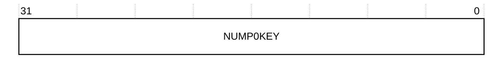

下表给出了 **TRCIDR9** 的位分配。

| 位 | 名称 | 功能 |
| --- | --- | --- |
| [31:0] | NUMP0KEY | 指示所使用的 P0 右手键的数量： 0x00000020：ETM 支持 32 个 P0 键。 |

**TRCIDR9** 可通过内存映射接口访问：

| 组件 | 偏移 | 复位 |
| --- | --- | --- |
| ETM | 0x184 | 0x00000020 |

下图给出了 **TRCIDR10** 的位分配。

下表给出了 **TRCIDR10** 的位分配。

| 位 | 名称 | 功能 |
| --- | --- | --- |
| [31:0] | NUMP1KEY | 指示 P1 右手键的总数，包括普通键与特殊键： 0x00000002：ETM 支持 2 个 P1 右手键。 |

**TRCIDR10** 可通过内存映射接口访问：

| 组件 | 偏移 | 复位 |
| --- | --- | --- |
| ETM | 0x188 | 0x00000002 |

下图给出了 **TRCIDR11** 的位分配。

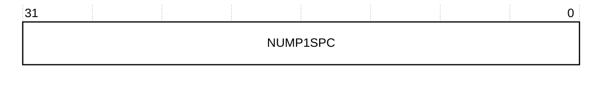

下表给出了 **TRCIDR11** 的位分配。

| 位 | 名称 | 功能 |
| --- | --- | --- |
| [31:0] | NUMP1SPC | 指示特殊 P1 右手键的数量。 0x00000000：不使用特殊 P1 右手键。 |

**TRCIDR11** 可通过内存映射接口访问：

| 组件 | 偏移 | 复位 |
| --- | --- | --- |
| ETM | 0x18C | 0x00000000 |

下图给出了 **TRCIDR12** 的位分配。

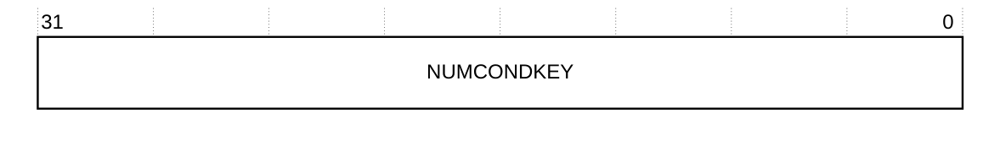

下表给出了 **TRCIDR12** 的位分配。

| 位 | 名称 | 功能 |
| --- | --- | --- |
| [31:0] | NUMCONDKEY | 指示条件指令右手键的总数，包括普通键与特殊键： 0x00000001：实现一个条件指令右手键。 |

**TRCIDR12** 可通过内存映射接口访问：

| 组件 | 偏移 | 复位 |
| --- | --- | --- |
| ETM | 0x190 | 0x00000001 |

下图给出了 **TRCIDR13** 的位分配。

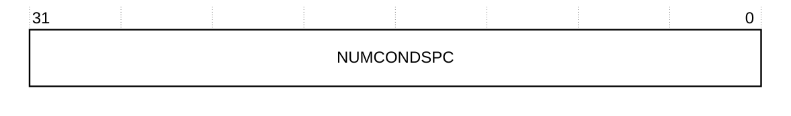

下表给出了 **TRCIDR13** 的位分配。

| 位 | 名称 | 功能 |
| --- | --- | --- |
| [31:0] | NUMCONDSPC | 指示特殊条件指令右手键的数量。 0x00000000：未实现特殊条件指令右手键。 |

**TRCIDR13** 可通过内存映射接口访问：

| 组件 | 偏移 | 复位 |
| --- | --- | --- |
| ETM | 0x194 | 0x00000000 |

### 7.26 实现特定寄存器 0

**TRCIMSPEC0** 指示是否存在任何 IMPLEMENTATION-SPECIFIC 特性，并使能所提供的任何特性。

**使用限制**

本寄存器为读写。

**陷阱与使能**

没有影响本寄存器的陷阱与使能。

**配置**

在所有配置中均可用。

**属性**

**TRCIMSPEC0** 是一个 32 位寄存器。

下图给出了 **TRCIMSPEC0** 的位分配。

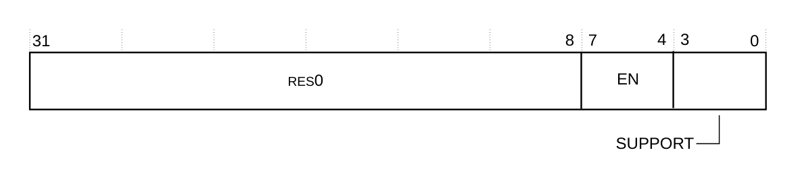

下表给出了 **TRCIMSPEC0** 的位分配。

| 位 | 名称 | 功能 |
| --- | --- | --- |
| [31:8] | - | 保留，RES0。 |
| [7:4] | EN | **SUPPORT** 置 0 时，该字段为 RES0。 |
| [3:0] | SUPPORT | 置 0。不支持任何 IMPLEMENTATION-SPECIFIC 扩展。 |

**TRCIMSPEC0** 可通过内存映射接口访问：

| 组件 | 偏移 | 复位 |
| --- | --- | --- |
| ETM | 0x1C0 | 0x00000000 |

### 7.27 ID 寄存器 0

**TRCIDR0** 指示 ETM 的跟踪能力。

**使用限制**

本寄存器为只读。

**陷阱与使能**

没有影响本寄存器的陷阱与使能。

**配置**

在所有配置中均可用。

**属性**

**TRCIDR0** 是一个 32 位寄存器。

下图给出了 **TRCIDR0** 的位分配。

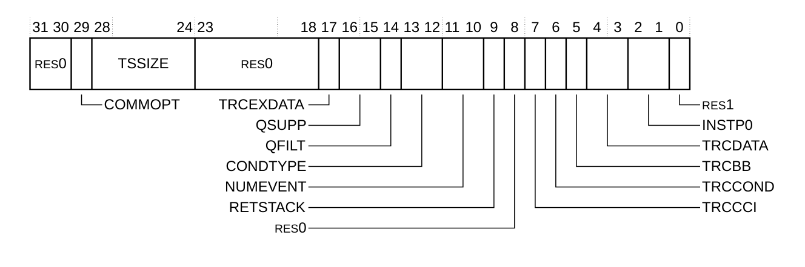

下表给出了 **TRCIDR0** 的位分配。

| 位 | 名称 | 功能 |
| --- | --- | --- |
| [31:30] | - | 保留，RES0。 |
| [29] | COMMOPT | 指示某些包中 commit 字段的含义： 0：提交模式 0。 |
| [28:24] | TSSIZE | 全局时间戳大小： 0b01000：实现最大 64 位全局时间戳。 |
| [23:18] | - | 保留，RES0。 |
| [17] | TRCEXDATA | 指示是否支持对异常与异常返回的数据传输进行跟踪： 0：**TRCVDCTLR.TRCEXDATA** 未实现。 |
| [16:15] | QSUPP | 指示 Q 元素支持： 0b00：不支持 Q 元素。 |
| [14] | QFILT | 该字段为 RES0。 |
| [13:12] | CONDTYPE | 指示条件结果如何被跟踪： 0b00：跟踪单元仅指示条件指令是否通过其条件码检查。 |
| [11:10] | NUMEVENT | 跟踪中所支持的事件数量： 0b11：支持四个事件。 |
| [9] | RETSTACK | 返回栈支持： 1：实现了返回栈。 |
| [8] | - | 保留，RES0。 |
| [7] | TRCCCI | 对指令跟踪中周期计数的支持： 1：实现了指令跟踪中的周期计数。 |
| [6] | TRCCOND | 对条件指令跟踪的支持： 1：实现了条件指令跟踪。 |
| [5] | TRCBB | 对分支广播跟踪的支持： 1：实现了分支广播跟踪。 |
| [4:3] | TRCDATA | 对数据跟踪的支持： 0b11：支持数据地址与数据值跟踪。 |
| [2:1] | INSTP0 | 对将加载与存储指令作为 P0 元素跟踪的支持： 0b11：支持将加载与存储指令作为 P0 元素跟踪。 |
| [0] | - | 保留，RES1。 |

**TRCIDR0** 可通过内存映射接口访问：

| 组件 | 偏移 | 复位 |
| --- | --- | --- |
| ETM | 0x1E0 | 0x0C000EFF |

### 7.28 ID 寄存器 1

**TRCIDR1** 指示 ETM 的基本架构。

**使用限制**

本寄存器为只读。

**陷阱与使能**

没有影响本寄存器的陷阱与使能。

**配置**

在所有配置中均可用。

**属性**

**TRCIDR1** 是一个 32 位寄存器。

下图给出了 **TRCIDR1** 的位分配。

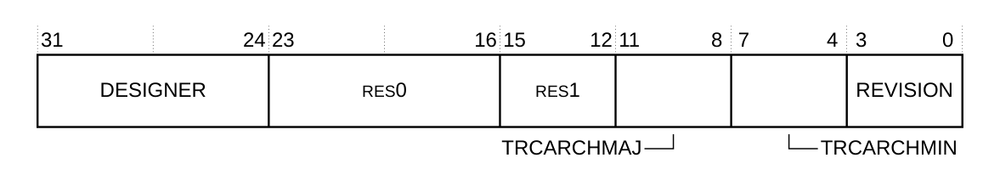

下表给出了 **TRCIDR1** 的位分配。

| 位 | 名称 | 功能 |
| --- | --- | --- |
| [31:24] | DESIGNER | 指示跟踪单元的设计者： 0x41：Arm。 |
| [23:16] | - | 保留，RES0。 |
| [15:12] | - | 保留，RES1。 |
| [11:8] | TRCARCHMAJ | 主跟踪单元架构版本号： 0b0100：ETMv4。 |
| [7:4] | TRCARCHMIN | 次跟踪单元架构版本号： 0b0010：次修订版 2。 |
| [3:0] | REVISION | 实现修订号： 0x1：实现修订版 1。 |

**TRCIDR1** 可通过内存映射接口访问：

| 组件 | 偏移 | 复位 |
| --- | --- | --- |
| ETM | 0x1E4 | 0x41001421 |

### 7.29 ID 寄存器 2

**TRCIDR2** 指示跟踪中各项的某些方面的最大尺寸。

**使用限制**

本寄存器为只读。

**陷阱与使能**

没有影响本寄存器的陷阱与使能。

**配置**

在所有配置中均可用。

**属性**

**TRCIDR2** 是一个 32 位寄存器。

下图给出了 **TRCIDR2** 的位分配。

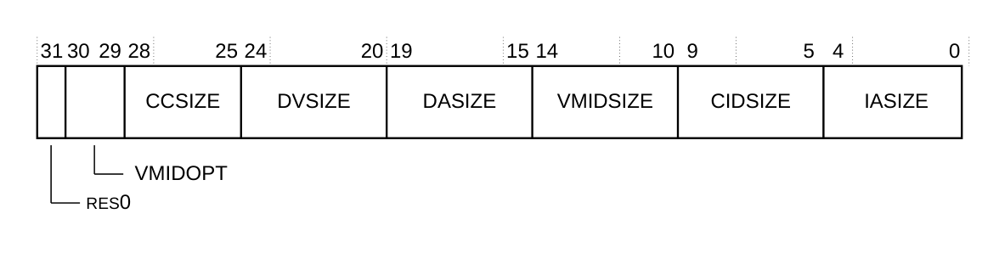

下表给出了 **TRCIDR2** 的位分配。

| 位 | 名称 | 功能 |
| --- | --- | --- |
| [31] | - | 保留，RES0。 |
| [30:29] | VMIDOPT | 指示观察处理器中虚拟上下文标识符的选项： 0b00：未实现 **TRCCONFIGR.VMIDOPT**，该字段为 RES0。 |
| [28:25] | CCSIZE | 指示周期计数器的位数减去 12 后的值： 0b0000：周期计数为 12 位。 |
| [24:20] | DVSIZE | 数据值大小，以字节为单位： 0b00100：支持最大 32 位数据值大小。 |
| [19:15] | DASIZE | 数据地址大小，以字节为单位： 0b00100：支持最大 32 位地址大小。 |
| [14:10] | VMIDSIZE | 虚拟机 ID 大小： 0b00001：虚拟机 ID 大小为 1 字节。 |
| [9:5] | CIDSIZE | 上下文 ID 跟踪： 0b00100：上下文 ID 大小为 4 字节。 |
| [4:0] | IASIZE | 指令地址大小： 0b00100：最大 32 位地址大小。 |

**TRCIDR2** 可通过内存映射接口访问：

| 组件 | 偏移 | 复位 |
| --- | --- | --- |
| ETM | 0x1E8 | 0x00420484 |

### 7.30 ID 寄存器 3

**TRCIDR3** 指示 ETM 配置的某些方面。

**使用限制**

本寄存器为只读。

**陷阱与使能**

没有影响本寄存器的陷阱与使能。

**配置**

在所有配置中均可用。

**属性**

**TRCIDR3** 是一个 32 位寄存器。

下图给出了 **TRCIDR3** 的位分配。

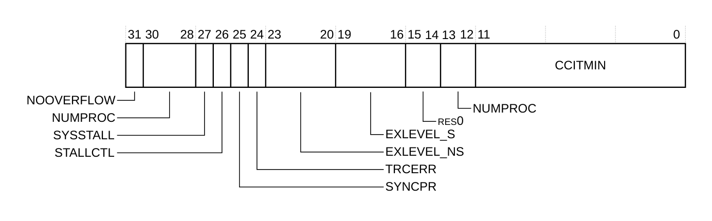

下表给出了 **TRCIDR3** 的位分配。

| 位 | 名称 | 功能 |
| --- | --- | --- |
| [31] | NOOVERFLOW | 指示是否实现了 **TRCSTALLCTLR.NOOVERFLOW**： 0：未实现 **NOOVERFLOW**。 |
| [30:28] | NUMPROC | 指示可用于跟踪的处理器数量： 0b000：跟踪单元可跟踪一个处理器。 |
| [27] | SYSSTALL | 系统对处理器停顿控制的支持： 1：系统支持对处理器的停顿控制。 |
| [26] | STALLCTL | 停顿控制支持： 1：实现了 **TRCSTALLCTLR**。 |
| [25] | SYNCPR | 指示跟踪同步周期支持： 0：**TRCSYNCPR** 为读写。软件可更改同步周期。 |
| [24] | TRCERR | 指示是否实现了 **TRCVICTLR.TRCERR**： 1：实现了 **TRCERR**。 |
| [23:20] | EXLEVEL_NS | 已实现的异常级别： 0b0111：实现了 EL0、EL1 与 EL2。 |
| [19:16] | EXLEVEL_S | 与是否支持对应异常级别的指令跟踪相关。该字段为 0。 |
| [15:14] | - | 保留，RES0。 |
| [13:12] | NUMPROC | 指示可用于跟踪的 PE 数量。该字段为 0b00000。 |
| [11:0] | CCITMIN | 指令跟踪周期计数的最小阈值： 0x4：最小阈值为 4 个指令跟踪周期。 |

**TRCIDR3** 可通过内存映射接口访问：

| 组件 | 偏移 | 复位 |
| --- | --- | --- |
| ETM | 0x1EC | 0x0D700004 |

### 7.31 ID 寄存器 4

**TRCIDR4** 指示 ETM 中可用的资源。

**使用限制**

本寄存器为只读。

**陷阱与使能**

没有影响本寄存器的陷阱与使能。

**配置**

在所有配置中均可用。

**属性**

**TRCIDR4** 是一个 32 位寄存器。

下图给出了 **TRCIDR4** 的位分配。

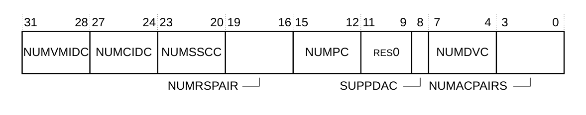

下表给出了 **TRCIDR4** 的位分配。

| 位 | 名称 | 功能 |
| --- | --- | --- |
| [31:28] | NUMVMIDC | 已实现的 VMID 比较器数量： 0b0001：实现一个 VMID 比较器。 |
| [27:24] | NUMCIDC | 已实现的上下文 ID 比较器数量： 0b0001：实现一个上下文 ID 比较器。 |
| [23:20] | NUMSSCC | 已实现的单次比较器控制数量： 0b0010：实现两个单次比较器控制。 |
| [19:16] | NUMRSPAIR | 已实现的资源选择对数量： 0b0111：实现八个资源选择对。 |
| [15:12] | NUMPC | 已实现的处理器比较器输入数量： 0b0000：没有处理器比较器输入。 |
| [11:9] | - | 保留，RES0。 |
| [8] | SUPPDAC | 已实现的数据地址比较： 1：支持数据地址比较。 |
| [7:4] | NUMDVC | 已实现的数据值比较器数量： 0b0010：实现两个数据值比较器。 |
| [3:0] | NUMACPAIRS | 已实现的地址比较器对数量： 0b0100：实现四个地址比较器对。 |

**TRCIDR4** 可通过内存映射接口访问：

| 组件 | 偏移 | 复位 |
| --- | --- | --- |
| ETM | 0x1F0 | 0x11270124 |

### 7.32 ID 寄存器 5

**TRCIDR5** 指示 ETM 中可用的资源。

**使用限制**

本寄存器为只读。

**陷阱与使能**

没有影响本寄存器的陷阱与使能。

**配置**

在所有配置中均可用。

**属性**

**TRCIDR5** 是一个 32 位寄存器。

下图给出了 **TRCIDR5** 的位分配。

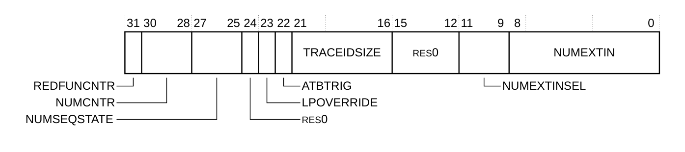

下表给出了 **TRCIDR5** 的位分配。

| 位 | 名称 | 功能 |
| --- | --- | --- |
| [31] | REDFUNCNTR | 已实现的精简功能计数器： 0：未实现精简功能计数器。 |
| [30:28] | NUMCNTR | 已实现的计数器数量： 0b010：实现两个计数器。 |
| [27:25] | NUMSEQSTATE | 已实现的序列器状态数量： 0b100：实现四个序列器状态。 |
| [24] | - | 保留，RES0。 |
| [23] | LPOVERRIDE | 低功耗状态覆盖支持： 1：实现了低功耗状态覆盖支持。 |
| [22] | ATBTRIG | ATB 触发支持： 1：实现了 ATB 触发支持。 |
| [21:16] | TRACEIDSIZE | 跟踪 ID 的位数： 0x07：实现七位跟踪 ID。 |
| [15:12] | - | 保留，RES0。 |
| [11:9] | NUMEXTINSEL | 已实现的外部输入选择器数量： 0b100：实现四个外部输入选择器。 |
| [8:0] | NUMEXTIN | 已实现的外部输入数量： 0x35：在指令与数据跟踪配置中实现 35 个外部输入。 |

**TRCIDR5** 可通过内存映射接口访问：

| 组件 | 偏移 | 复位 |
| --- | --- | --- |
| ETM | 0x1F4 | 0x28C70835 |

### 7.33 资源选择寄存器，n=2-15

**TRCRSCTLRn** 寄存器控制跟踪资源。

**使用限制**

这些寄存器为读写。

**陷阱与使能**

没有影响这些寄存器的陷阱与使能。

**配置**

在所有配置中均可用。

**属性**

**TRCRSCTLRn** 是 32 位寄存器。

下图给出了 **TRCRSCTLRn** 的位分配。

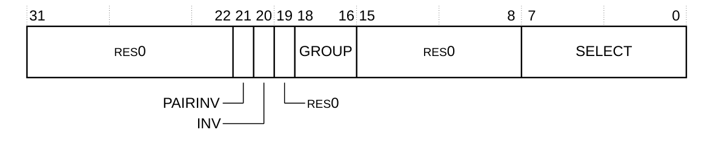

下表给出了 **TRCRSCTLRn** 的位分配。

| 位 | 名称 | 功能 |
| --- | --- | --- |
| [31:22] | - | 保留，RES0。 |
| [21] | PAIRINV | 反转组合资源对的结果。 该位仅在一对资源选择器的低位寄存器上实现。对于高位寄存器，该位为 RES0。 |
| [20] | INV | 反转所选资源： 0：资源不反转。 1：资源反转。 |
| [19] | - | 保留，RES0。 |
| [18:16] | GROUP | 选择一组资源。 |
| [15:8] | - | 保留，RES0。 |
| [7:0] | SELECT | 从所需组中选择一个或多个资源。组中每个资源对应一位。 |

**TRCRSCTLRn** 可通过内存映射接口访问：

| 组件 | 偏移 | 复位 |
| --- | --- | --- |
| ETM | 0x208-0x23C | UNK |

### 7.34 单次比较器控制寄存器，n=0-1

**TRCSSCCRn** 寄存器控制单次比较器 \<n>。

**使用限制**

这些寄存器为读写。

**陷阱与使能**

没有影响这些寄存器的陷阱与使能。

**配置**

在所有配置中均可用。

**属性**

**TRCSSCCRn** 寄存器为 32 位。

下图给出了 **TRCSSCCRn** 的位分配。

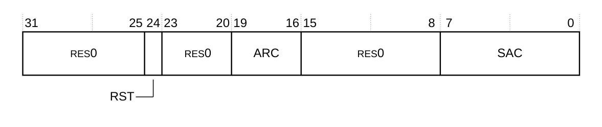

下表给出了 **TRCSSCCRn** 的位分配。

| 位 | 名称 | 功能 |
| --- | --- | --- |
| [31:25] | - | 保留，RES0。 |
| [24] | RST | 使能单次比较器资源在发生时被复位，以便能够检测另一次比较器匹配： 1：使能复位。可发生多次匹配。 |
| [23:20] | - | 保留，RES0。 |
| [19:16] | ARC | 选择一个或多个用于单次控制的地址范围比较器。每个地址范围比较器对应一位。 |
| [15:8] | - | 保留，RES0。 |
| [7:0] | SAC | 选择一个或多个用于单次控制的单地址比较器。每个单地址比较器对应一位。 |

**TRCSSCCRn** 可通过内存映射接口访问：

| 组件 | 偏移 | 复位 |
| --- | --- | --- |
| ETM | 0x280-0x284 | UNK |

### 7.35 单次比较器状态寄存器 n=0-1

**TRCSSCSRn** 寄存器指示单次比较器 \<n> 的状态。它对指令地址敏感。

**使用限制**

这些寄存器为读写。

**陷阱与使能**

没有影响这些寄存器的陷阱与使能。

**配置**

在所有配置中均可用。

**属性**

**TRCSSCSRn** 寄存器为 32 位。

下图给出了 **TRCSSCSRn** 的位分配。

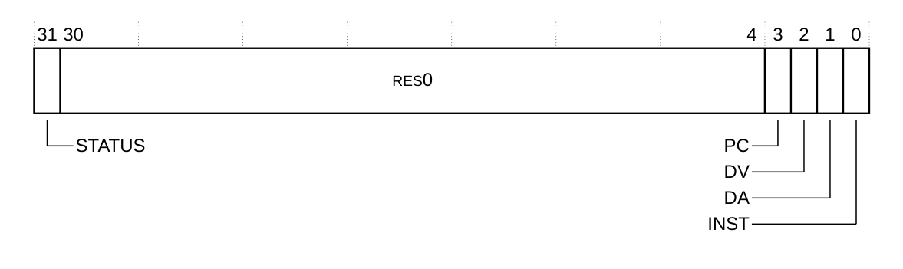

下表给出了 **TRCSSCSRn** 的位分配。

| 位 | 名称 | 功能 |
| --- | --- | --- |
| [31] | STATUS | 单次状态。指示所选比较器中是否有任一发生匹配： 0：未发生匹配。 1：已至少发生一次匹配。 编程 ETM 时，如果 **TRCSSCCRn.RST** 为 0，则必须将 **STATUS** 位显式写为 0，以使能该单次比较器控制。 |
| [30:4] | - | 保留，RES0。 |
| [3] | PC | 指示单次比较器对处理器比较器输入敏感。 0：不支持单次比较器输入。 |
| [2] | DV | 数据值比较器支持。 对于 **TRCSSCSR0**，该值为： 0：不支持单次数据值比较。 对于 **TRCSSCSR1**，该值为： 1：支持单次数据值比较。 |
| [1] | DA | 数据地址比较器支持。 对于 **TRCSSCSR0**，该值为： 0：不支持单次数据地址比较。 对于 **TRCSSCSR1**，该值为： 1：支持单次数据地址比较。 |
| [0] | INST | 指令地址比较器支持： 对于 **TRCSSCSR0**，该值为： 1：支持单次指令地址比较。 对于 **TRCSSCSR1**，该值为： 0：不支持单次指令地址比较。 |

**TRCSSCSRn** 可通过内存映射接口访问：

| 组件 | 偏移 | 复位 |
| --- | --- | --- |
| ETM | 0x2A0-0x2A4 | UNK |

### 7.36 OS Lock 访问寄存器

**TRCOSLAR** 控制 OS Lock 是否被锁定。

**使用限制**

本寄存器为只写。

**陷阱与使能**

没有影响本寄存器的陷阱与使能。

**配置**

由于 OS Lock 始终实现，该寄存器始终实现。

**属性**

**TRCOSLAR** 是一个 32 位寄存器。

下图给出了 **TRCOSLAR** 的位分配。

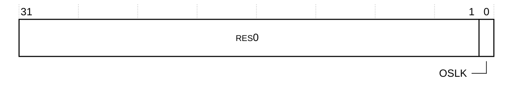

下表给出了 **TRCOSLAR** 的位分配。

| 位 | 名称 | 功能 |
| --- | --- | --- |
| [31:1] | - | 保留，RES0。 |
| [0] | OSLK | OS Lock 控制位： 0：解锁 OS Lock。 1：锁定 OS Lock。该设置禁用跟踪单元。 |

**TRCOSLAR** 可通过内存映射接口访问：

| 组件 | 偏移 | 复位 |
| --- | --- | --- |
| ETM | 0x300 | UNK |

### 7.37 OS Lock 状态寄存器

**TRCOSLSR** 返回 OS Lock 的状态。

**使用限制**

本寄存器为只读。

**陷阱与使能**

没有影响本寄存器的陷阱与使能。

**配置**

在所有实现中均可用。

**属性**

**TRCOSLSR** 是一个 32 位寄存器。

下图给出了 **TRCOSLSR** 的位分配。

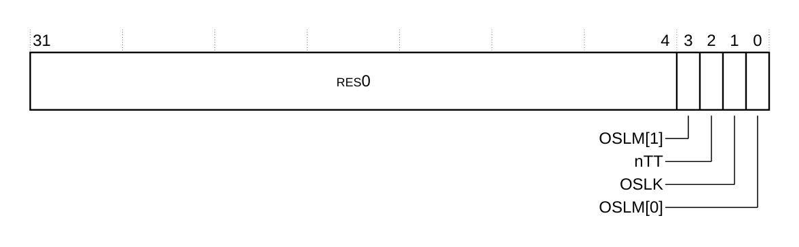

下表给出了 **TRCOSLSR** 的位分配。

| 位 | 名称 | 功能 |
| --- | --- | --- |
| [31:4] | - | 保留，RES0。 |
| [3, 0] | OSLM[1] | 指示是否实现了 OS Lock 模型。 0b10：实现了 OS Lock。 |
| [2] | nTT | 该位为 RAZ，指示软件必须执行 32 位写操作才能更新 **TRCOSLAR**。 |
| [1] | OSLK | OS Lock 状态位： 0：OS Lock 已解锁。 1：OS Lock 已锁定。 复位值为 1。 |
| [0] | OSLM[0] | 指示是否实现了 OS Lock 模型。 0b10：实现了 OS Lock。 |

**TRCOSLSR** 可通过内存映射接口访问：

| 组件 | 偏移 | 复位 |
| --- | --- | --- |
| ETM | 0x304 | 0x0000000A |

### 7.38 掉电控制寄存器

**TRCPDCR** 向系统电源控制器请求保持 ETM 上电。

**使用限制**

本寄存器为读写。仅可从内存映射接口或从调试器等外部代理访问。

**陷阱与使能**

没有影响本寄存器的陷阱与使能。

**配置**

在所有配置中均可用。

**属性**

**TRCPDCR** 是一个 32 位寄存器。

下图给出了 **TRCPDCR** 的位分配。

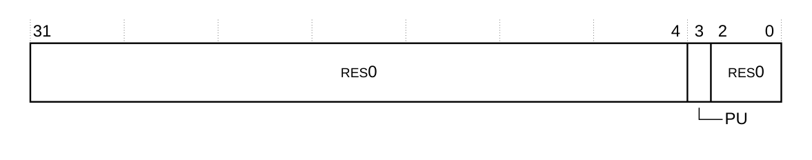

下表给出了 **TRCPDCR** 的位分配。

| 位 | 名称 | 功能 |
| --- | --- | --- |
| [31:4] | - | 保留，RES0。 |
| [3] | PU | 上电请求，用于请求保持对 ETM 的供电以及对跟踪寄存器的访问： 0：未请求供电。 1：已请求供电。 该位在跟踪单元复位时复位为 0。 |
| [2:0] | - | 保留，RES0。 |

**TRCPDCR** 可通过内存映射接口访问：

| 组件 | 偏移 | 复位 |
| --- | --- | --- |
| ETM | 0x310 | 0x00000000 |

### 7.39 掉电状态寄存器

**TRCPDSR** 指示 ETM 的掉电状态。

**使用限制**

本寄存器为只读。仅可从内存映射接口或从调试器等外部代理访问。

**陷阱与使能**

没有影响本寄存器的陷阱与使能。

**配置**

在所有配置中均可用。

**属性**

**TRCPDSR** 是一个 32 位寄存器。

下图给出了 **TRCPDSR** 的位分配。

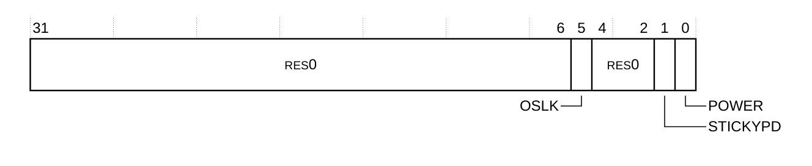

下表给出了 **TRCPDSR** 的位分配。

| 位 | 名称 | 功能 |
| --- | --- | --- |
| [31:6] | - | 保留，RES0。 |
| [5] | OSLK | OS Lock 状态位： 0：OS Lock 已解锁。 1：OS Lock 已锁定。 该字段在跟踪单元复位时复位为 1。 |
| [4:2] | - | 保留，RES0。 |
| [1] | STICKYPD | 粘性掉电状态。 0：自上次读取 **TRCPDSR** 以来跟踪寄存器电源未被移除。 1：自上次读取 **TRCPDSR** 以来跟踪寄存器电源已被移除。 当 ETM 寄存器电源被移除时，该位被置 1，以指示编程状态已丢失。该位在读取 **TRCPDSR** 后被清除。 |
| [0] | POWER | 指示 ETM 已上电： 1：ETM 已上电。所有寄存器均可访问。 0：跟踪单元核心电源域未上电。跟踪寄存器不可访问，且它们全部返回错误响应。 |

**TRCPDSR** 可通过内存映射接口访问：

| 组件 | 偏移 | 复位 |
| --- | --- | --- |
| ETM | 0x314 | UNK |

### 7.40 地址比较器值寄存器，n=0-7

每个 **TRCACVRn** 寄存器指示数据地址比较器 \<n> 的地址。

**使用限制**

这些寄存器为读写。仅在跟踪单元被禁用时接受写操作。

**陷阱与使能**

没有影响本寄存器的陷阱与使能。

**配置**

在所有配置中均可用。

**属性**

**TRCACVRn** 是 32 位寄存器。

下图给出了 **TRCACVRn** 的位分配。

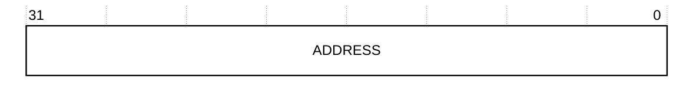

下表给出了 **TRCACVRn** 的位分配。

| 位 | 名称 | 功能 |
| --- | --- | --- |
| [31:0] | ADDRESS | 用于比较的地址值。 |

**TRCACVRn** 可通过内存映射接口访问：

| 组件 | 偏移 | 复位 |
| --- | --- | --- |
| ETM | 0x400-0x438 | UNK |

### 7.41 地址比较器访问类型寄存器，n=0-7

每个 **TRCACATRn** 寄存器控制数据地址比较器 \<n> 的访问。

**使用限制**

这些寄存器为读写。仅在跟踪单元被禁用时接受写操作。

**陷阱与使能**

没有影响本寄存器的陷阱与使能。

**配置**

在所有构建配置中均可用。

**属性**

**TRCACATRn** 是 32 位寄存器。

下图给出了 **TRCACATR0** 的位分配。

下表给出了 **TRCACATR0** 的位分配。

| 位 | 名称 | 功能 |
| --- | --- | --- |
| [31:22] | - | 保留，RES0。 |
| [21] | DTBM | 该字段为 RES0。 |
| [20] | DATARANGE | 数据值比较范围控制，用于选择数据值比较是针对单地址比较器还是地址范围比较器进行： 0：仅单地址比较器匹配。 1：仅地址范围比较器匹配。 |
| [19:18] | DATASIZE | 数据值比较大小控制： 0b00：字节大小。 0b01：半字大小。 0b10：字大小。 0b11：双字大小。 |
| [17:16] | DATAMATCH | 数据值比较控制： 0b01：仅当数据值比较匹配时比较器才匹配。 0b11：仅当数据值比较不匹配时比较器才匹配。 |
| [15] | - | 保留，RES0。 |
| [14] | EXLEVEL_NS | 指示比较器是否在 EL2 中匹配： 0：比较器可在该异常级别中匹配。 1：比较器不得在该异常级别中匹配。 |
| [13] | EXLEVEL_NS | 指示比较器是否在 EL1 中匹配。 |
| [12] | EXLEVEL_NS | 指示比较器是否在 EL0 中匹配。 |
| [11:8] | EXLEVEL_S | 该字段为 RES0。 |
| [7] | - | 保留，RES0。 |
| [6:4] | CONTEXT | 上下文 ID 比较器或虚拟上下文标识符比较器： 0b00：比较器 0。 |
| [3:2] | CONTEXTTYPE | 比较的类型： 0b00：跟踪单元不执行上下文 ID 比较。 0b01：跟踪单元执行上下文 ID 比较，并在上下文 ID 比较器与地址比较器均匹配时发出匹配信号。 0b10：跟踪单元执行虚拟上下文标识符比较，并在虚拟上下文标识符比较器与地址比较器均匹配时发出匹配信号。 0b11：跟踪单元执行上下文 ID 比较与虚拟上下文标识符比较，并在上下文 ID 比较器、虚拟上下文标识符比较器与地址比较器均匹配时发出匹配信号。 |
| [1:0] | TYPE | 比较的类型： 0b00：指令地址。 0b01：数据加载地址。 0b10：数据存储地址。 0b11：数据加载或存储地址。 |

**TRCACATR2**、**4** 与 **6** 在功能上与 **TRCACATR0** 完全相同。

下图给出了 **TRCACATR1** 的位分配。

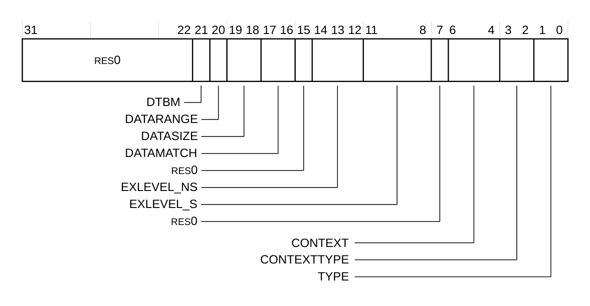

下表给出了 **TRCACATR1** 的位分配。

| 位 | 名称 | 功能 |
| --- | --- | --- |
| [31:22] | - | 保留，RES0。 |
| [21] | DTBM | 该字段为 RES0。 |
| [20] | DATARANGE | 该字段为 RES0。 |
| [19:18] | DATASIZE | 该字段为 RES0。 |
| [17:16] | DATAMATCH | 该字段为 RES0。 |
| [15] | - | 保留，RES0。 |
| [14] | EXLEVEL_NS | 指示比较器是否在 EL2 中匹配： 0：比较器可在该异常级别中匹配。 1：比较器不得在该异常级别中匹配。 |
| [13] | EXLEVEL_NS | 指示比较器是否在 EL1 中匹配。 |
| [12] | EXLEVEL_NS | 指示比较器是否在 EL0 中匹配。 |
| [11:8] | EXLEVEL_S | 该字段为 RES0。 |
| [7] | - | 保留，RES0。 |
| [6:4] | CONTEXT | 上下文 ID 比较器或虚拟上下文标识符比较器： 0b00：比较器 0。 |
| [3:2] | CONTEXTTYPE | 比较的类型： 0b00：跟踪单元不执行上下文 ID 比较。 0b01：跟踪单元执行上下文 ID 比较，并在上下文 ID 比较器与地址比较器均匹配时发出匹配信号。 0b10：跟踪单元执行虚拟上下文标识符比较，并在虚拟上下文标识符比较器与地址比较器均匹配时发出匹配信号。 0b11：跟踪单元执行上下文 ID 比较与虚拟上下文标识符比较，并在上下文 ID 比较器、虚拟上下文标识符比较器与地址比较器均匹配时发出匹配信号。 |
| [1:0] | TYPE | 比较的类型： 0b00：指令地址。 0b01：数据加载地址。 0b10：数据存储地址。 0b11：数据加载或存储地址。 |

**TRCACATR3**、**5** 与 **7** 在功能上与 **TRCACATR1** 完全相同。

**TRCACATRn** 可通过内存映射接口访问：

| 组件 | 偏移 | 复位 |
| --- | --- | --- |
| ETM | 0x480-0x4B8 | UNK |

### 7.42 数据值比较器值寄存器，n=0-1

每个 **TRCDVCVRn** 寄存器指示数据值比较器 \<n> 的值。

**使用限制**

本寄存器为读写。仅在跟踪单元被禁用时接受写操作。

**陷阱与使能**

没有影响本寄存器的陷阱与使能。

**配置**

本寄存器在所有构建配置中均可用。

**属性**

**TRCDVCVRn** 寄存器为 32 位。

下图给出了 **TRCDVCVRn** 的位分配。

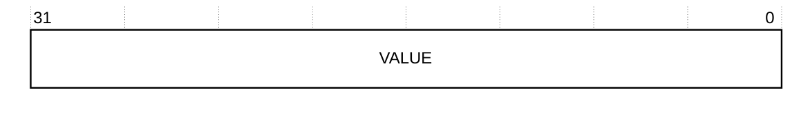

下表给出了 **TRCDVCVRn** 的位分配。

| 位 | 名称 | 功能 |
| --- | --- | --- |
| [31:0] | VALUE | 用于比较的数据值。 |

**TRCDVCVRn** 可通过内存映射接口访问：

| 组件 | 偏移 | 复位 |
| --- | --- | --- |
| ETM | 0x500-0x510 | UNK |

### 7.43 数据值比较器掩码寄存器，n=0-1

每个 **TRCDVCMRn** 寄存器控制数据值比较器 \<n> 的掩码值。

**使用限制**

这些寄存器为读写。

**陷阱与使能**

没有影响本寄存器的陷阱与使能。

**配置**

在所有构建配置中均可用。

**属性**

**TRCDVCMRn** 是 32 位寄存器。

下图给出了 **TRCDVCMRn** 的位分配。

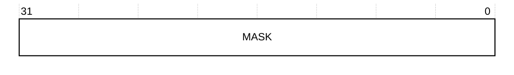

下表给出了 **TRCDVCMRn** 的位分配。

| 位 | 名称 | 功能 |
| --- | --- | --- |
| [31:0] | MASK | 应用于数据值比较的掩码值。 |

**TRCDVCMRn** 可通过内存映射接口访问：

| 组件 | 偏移 | 复位 |
| --- | --- | --- |
| ETM | 0x580-0x590 | UNK |

### 7.44 上下文 ID 比较器值寄存器 0

**TRCCIDCVR0** 寄存器包含一个上下文 ID 值。

**使用限制**

本寄存器为读写，当跟踪单元被使能或未空闲时忽略写操作。

**陷阱与使能**

没有影响本寄存器的陷阱与使能。

**配置**

本寄存器在所有构建配置中均可用。

**属性**

**TRCCIDCVR0** 是一个 32 位寄存器。

下图给出了 **TRCCIDCVR0** 的位分配。

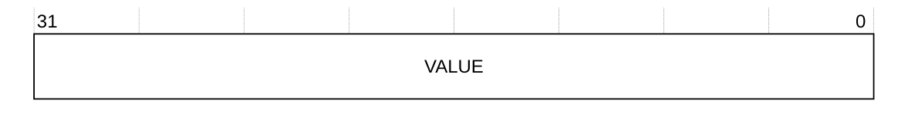

下表给出了 **TRCCIDCVR0** 的位分配。

| 位 | 名称 | 功能 |
| --- | --- | --- |
| [31:0] | VALUE | 上下文 ID 值。 |

**TRCCIDCVR0** 可通过内存映射接口访问：

| 组件 | 偏移 | 复位 |
| --- | --- | --- |
| ETM | 0x600 | UNK |

### 7.45 虚拟上下文标识符比较器值寄存器

**TRCVMIDCVR0** 寄存器包含一个虚拟上下文标识符值。

**使用限制**

本寄存器为读写，当跟踪单元被使能或未空闲时忽略写操作。

**陷阱与使能**

没有影响本寄存器的陷阱与使能。

**配置**

本寄存器在所有构建配置中均可用。

**属性**

**TRCVMIDCVR0** 是一个 32 位寄存器。

下图给出了 **TRCVMIDCVR0** 的位分配。

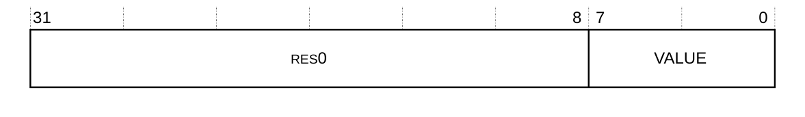

下表给出了 **TRCVMIDCVR0** 的位分配。

| 位 | 名称 | 功能 |
| --- | --- | --- |
| [31:8] | - | 保留，RES0。 |
| [7:0] | VALUE | VMID 值。 |

**TRCVMIDCVR0** 可通过内存映射接口访问：

| 组件 | 偏移 | 复位 |
| --- | --- | --- |
| ETM | 0x640 | UNK |

### 7.46 上下文 ID 比较器控制寄存器 0

**TRCCIDCCTLR0** 包含 **TRCCIDCVRn** 寄存器的上下文 ID 掩码值，其中 n=0-3。

**使用限制**

本寄存器为读写，当跟踪单元被使能或未空闲时忽略写操作。

**陷阱与使能**

没有影响本寄存器的陷阱与使能。

**配置**

本寄存器在所有构建配置中均可用。

**属性**

**TRCCIDCCTLR0** 是一个 32 位寄存器。

下图给出了 **TRCCIDCCTLR0** 的位分配。

下表给出了 **TRCCIDCCTLR0** 的位分配。

| 位 | 名称 | 功能 |
| --- | --- | --- |
| [31:24] | COMP3 | 控制跟踪单元应用于 **TRCCIDCVRn** 的掩码值。该字段为 RES0。 |
| [23:16] | COMP2 | 控制跟踪单元应用于 **TRCCIDCVRn** 的掩码值。该字段为 RES0。 |
| [15:8] | COMP1 | 控制跟踪单元应用于 **TRCCIDCVRn** 的掩码值。该字段为 RES0。 |
| [7:4] | - | 保留，RES0。 |
| [3:0] | COMP0 | 控制跟踪单元应用于 **TRCCIDCVR0** 的掩码值： 0：跟踪单元在执行上下文 ID 比较时包含 **TRCCIDCVR0** 中的相关字节。 1：跟踪单元在执行上下文 ID 比较时忽略 **TRCCIDCVR0** 中的相关字节。 |

**TRCCIDCCTLR0** 可通过内存映射接口访问：

| 组件 | 偏移 | 复位 |
| --- | --- | --- |
| ETM | 0x680 | UNK |

### 7.47 集成模式控制寄存器

**TRCITCTRL** 寄存器通过将 ETM 置于集成模式，使能拓扑检测或集成测试。

**使用限制**

本寄存器为读写。仅可从内存映射接口或从调试器等外部代理访问。Arm 建议在使用集成模式后执行调试复位。

**陷阱与使能**

没有影响本寄存器的陷阱与使能。

**配置**

在所有配置中均可用。

**属性**

**TRCITCTRL** 是一个 32 位寄存器。

下图给出了 **TRCITCTRL** 的位分配。

下表给出了 **TRCITCTRL** 的位分配。

| 位 | 名称 | 功能 |
| --- | --- | --- |
| [31:1] | - | 保留，RES0。 |
| [0] | IME | 集成模式使能： 0：ETM 未处于集成模式。 |

**TRCITCTRL** 可通过内存映射接口访问：

| 组件 | 偏移 | 复位 |
| --- | --- | --- |
| ETM | 0xF00 | 0x00000000 |

Cortex®-R52+ 处理器不包含 ATB 集成寄存器。

### 7.48 Claim Tag 置位寄存器

**TRCCLAIMSET** 寄存器置位 claim tag 中的位，并确定所实现的 claim tag 位数。

**使用限制**

本寄存器为读写。

**陷阱与使能**

没有影响本寄存器的陷阱与使能。

**配置**

在所有配置中均可用。

**属性**

**TRCCLAIMSET** 是一个 32 位寄存器。

下图给出了 **TRCCLAIMSET** 的位分配。

下表给出了 **TRCCLAIMSET** 的位分配。

| 位 | 名称 | 功能 |
| --- | --- | --- |
| [31:4] | - | RAZ/SBZ。 |
| [3:0] | SET | 读取时，对每一位： 0：未实现该 claim tag 位。 1：已实现该 claim tag 位。 写入时，对每一位： 0：无影响。 1：置位 claim tag 的相关位。 |

**TRCCLAIMSET** 可通过内存映射接口访问：

| 组件 | 偏移 | 复位 |
| --- | --- | --- |
| ETM | 0xFA0 | 0x0000000F |

### 7.49 Claim Tag 清除寄存器

**TRCCLAIMCLR** 清除 claim tag 中的位，并确定 claim tag 的当前值。

**使用限制**

本寄存器为读写。

**陷阱与使能**

没有影响本寄存器的陷阱与使能。

**配置**

在所有配置中均可用。

**属性**

**TRCCLAIMCLR** 是一个 32 位寄存器。

下图给出了 **TRCCLAIMCLR** 的位分配。

下表给出了 **TRCCLAIMCLR** 的位分配。

| 位 | 名称 | 功能 |
| --- | --- | --- |
| [31:8] | - | RAZ/SBZ。 |
| [7:4] | - | RAZ/WI。 |
| [3:0] | CLR | 读取时，对每一位： 0：未置位该 claim tag 位。 1：已置位该 claim tag 位。 写入时，对每一位： 0：无影响。 1：清除 claim tag 的相关位。 |

**TRCCLAIMCLR** 可通过内存映射接口访问：

| 组件 | 偏移 | 复位 |
| --- | --- | --- |
| ETM | 0xFA4 | 0x00000000 |

### 7.50 TRCDEVAFF0，设备亲和性寄存器 0

**TRCDEVAFF0** 寄存器提供可从内存映射接口与外部调试接口访问的 MPIDR 只读副本。

有关 MPIDR 的更多信息，参见第 185 页的 4.3.78 Multiprocessor Affinity Register。

### 7.51 TRCDEVAFF1，设备亲和性寄存器 1

**TRCDEVAFF1** 寄存器的值为 0x00000000。

**TRCDEVAFF1** 是一个只读 32 位寄存器，可通过内存映射接口或外部调试接口访问。

### 7.52 Software Lock 访问寄存器

当 PADDRDBG31 为 LOW 时，**TRCLAR** 控制对寄存器的访问。当 software lock 被置位时，PADDRDBG31 为 LOW 时对所有 ETM 寄存器的写访问被忽略，但对 **TRCLAR** 的写访问除外。当 software lock 被置位时，PADDRDBG31 为 LOW 时对 **TRCPDSR** 的读访问不改变 **TRCPDSR.STICKYPD** 位。对其他所有寄存器的读访问不受影响。PADDRDBG31 为 HIGH 的访问不受 software lock 影响。

**使用限制**

本寄存器为只写，仅在 PADDRDBG31 为 LOW 的访问中存在，对于 PADDRDBG31 为 HIGH 的访问为 RES0。

**陷阱与使能**

没有影响本寄存器的陷阱与使能。

**配置**

在所有配置中均可用。

**属性**

**TRCLAR** 是一个 32 位寄存器。

下图给出了 **TRCLAR** 的位分配。

下表给出了 **TRCLAR** 的位分配。

| 位 | 名称 | 功能 |
| --- | --- | --- |
| [31:0] | KEY | Software lock 密钥值： 0xC5ACCE55：清除 software lock。 其他所有写入值均置位 software lock。 |

**TRCLAR** 可通过内存映射接口访问：

| 组件 | 偏移 | 复位 |
| --- | --- | --- |
| ETM | 0xFB0 | UNK |

### 7.53 Software Lock 状态寄存器

**TRCLSR** 指示是否实现了 software lock，并指示 software lock 的当前状态。

**使用限制**

本寄存器为只读。

**配置**

在所有配置中均可用。

**属性**

**TRCLSR** 是一个 32 位寄存器。

下图给出了 **TRCLSR** 的位分配。

下表给出了 **TRCLSR** 的位分配。

| 位 | 名称 | 功能 |
| --- | --- | --- |
| [31:3] | - | 保留，RES0。 |
| [2] | nTT | 指示 **TRCLAR** 的大小： 0：**TRCLAR** 始终为 32 位。 |
| [1] | SLK | Software lock 状态： 0：Software lock 已清除。对于 PADDRDBG31 为 HIGH 的所有访问均返回该值。 1：Software lock 已置位。 |
| [0] | SLI | 指示该接口上是否实现了 software lock： 0：未实现 software lock。对于 PADDRDBG31 为 HIGH 的所有访问均返回该值。 1：已实现 software lock。对于 PADDRDBG31 为 LOW 的所有访问均返回该值。 |

**TRCLSR** 可通过内存映射接口与外部调试接口访问：

| 组件 | 偏移 | 复位 |
| --- | --- | --- |
| ETM | 0xFB4 | 0x00000003 |

### 7.54 认证状态寄存器

**TRCAUTHSTATUS** 寄存器指示系统当前允许的跟踪级别。

**使用限制**

本寄存器为只读。

**陷阱与使能**

没有影响本寄存器的陷阱与使能。

**配置**

在所有配置中均可用。

**属性**

**TRCAUTHSTATUS** 是一个 32 位寄存器。

下图给出了 **TRCAUTHSTATUS** 的位分配。

下表给出了 **TRCAUTHSTATUS** 的位分配。

| 位 | 名称 | 功能 |
| --- | --- | --- |
| [31:12] | - | 保留，RES0。 |
| [11:10] | HNID | EL2 的非侵入调试： 0b10：已实现但被禁用。 0b11：已实现且被使能。 |
| [9:8] | HID | EL2 的侵入调试： 0b00：未实现。 |
| [7:6] | SNID | 安全非侵入调试： 0b00：未实现。 |
| [5:4] | SID | 安全侵入调试： 0b00：未实现。 |
| [3:2] | NSNID | 非安全非侵入调试： 0b10：已实现但被禁用。 0b11：已实现且被使能。 |
| [1:0] | NSID | 非安全侵入调试 0b00：未实现。 |

**TRCAUTHSTATUS** 可通过内存映射接口访问：

| 组件 | 偏移 | 复位 |
| --- | --- | --- |
| ETM | 0xFB8 | UNK |

### 7.55 设备架构寄存器

**TRCDEVARCH** 寄存器将 ETM 标识为 ETMv4.2 组件。

**使用限制**

本寄存器为只读。

**陷阱与使能**

没有影响本寄存器的陷阱与使能。

**配置**

本寄存器在所有构建配置中均可用。

**属性**

**TRCDEVARCH** 是一个 32 位寄存器。

下图给出了 **TRCDEVARCH** 的位分配。

下表给出了 **TRCDEVARCH** 的位分配。

| 位 | 名称 | 功能 |
| --- | --- | --- |
| [31:21] | ARCHITECT | 定义组件的架构师： 0x23B：Arm |
| [20] | PRESENT | 指示该寄存器是否存在： 1：寄存器存在。 |
| [19:16] | REVISION | 架构修订版： 0b0010：架构修订版 2。 |
| [15:0] | ARCHID | 架构 ID： 0x4A13：ETMv4 组件。 |

**TRCDEVARCH** 可通过内存映射接口访问：

| 组件 | 偏移 | 复位 |
| --- | --- | --- |
| ETM | 0xFBC | 0x47724A13 |

### 7.56 设备 ID 寄存器

**TRCDEVID** 寄存器为 RES0。

### 7.57 设备类型寄存器

**TRCDEVTYPE** 指示组件的类型。

**使用限制**

本寄存器为只读。

**陷阱与使能**

没有影响本寄存器的陷阱与使能。

**配置**

在所有配置中均可用。

**属性**

**TRCDEVTYPE** 是一个 32 位寄存器。

下图给出了 **TRCDEVTYPE** 的位分配。

下表给出了 **TRCDEVTYPE** 的位分配。

| 位 | 名称 | 功能 |
| --- | --- | --- |
| [31:8] | - | 保留，RES0。 |
| [7:4] | SUB | 组件的子类型： 0b0001：处理器跟踪。 |
| [3:0] | MAJOR | 组件的主类型： 0b0011：跟踪源。 |

**TRCDEVTYPE** 可通过内存映射接口与外部调试接口访问：

| 组件 | 偏移 | 复位 |
| --- | --- | --- |
| ETM | 0xFCC | 0x00000013 |

### 7.58 外设标识寄存器

**TRCPIDR0-7** 寄存器提供所有 CoreSight 组件所需的标准外设 ID。

更多信息参见 Arm® CoreSight™ Architecture Specification v2.0。

**使用限制**

这些寄存器为只读。仅使用每个寄存器的位 [7:0]。这意味着 **TRCPIDR0-7** 定义一个单一的 64 位外设 ID，如下图所示。

**陷阱与使能**

没有影响这些寄存器的陷阱与使能。

**配置**

在所有配置中均可用。

**属性**

**TRCPIDR0-7** 寄存器为 32 位。

下图给出了 **TRCPIDR0-7** 与单一 64 位外设 ID 值之间的映射。

下图给出了单一概念外设 ID 寄存器中的外设 ID 位分配。

‡ 有关 **Revision** 字段的值，参见正文。

下表给出了读取这组寄存器时各字段的值。Arm® Embedded Trace Macrocell Architecture Specification ETMv4 给出了关于其中许多字段的更多信息。

下表按寄存器名称顺序列出寄存器，从最高有效位（**TRCPIDR7**）到最低有效位（**TRCPIDR0**）。这与寄存器偏移的顺序不一致。

| 寄存器编号 | 寄存器 | 寄存器偏移 | 位 | 值 | 功能 |
| --- | --- | --- | --- | --- | --- |
| 1015 | TRCPIDR7 | 0xFDC | [31:8] | - | 保留，RES0。 |
| 1015 | TRCPIDR7 | 0xFDC | [7:0] | 0x00 | 保留，RES0。 |
| 1014 | TRCPIDR6 | 0xFD8 | [31:8] | - | 保留，RES0。 |
| 1014 | TRCPIDR6 | 0xFD8 | [7:0] | 0x00 | 保留，RES0。 |
| 1013 | TRCPIDR5 | 0xFD4 | [31:8] | - | 保留，RES0。 |
| 1013 | TRCPIDR5 | 0xFD4 | [7:0] | 0x00 | 保留，RES0。 |
| 1012 | TRCPIDR4 | 0xFD0 | [31:8] | - | 保留，RES0。 |
| 1012 | TRCPIDR4 | 0xFD0 | [7:4] | 0x0 | 4KB |
| 1012 | TRCPIDR4 | 0xFD0 | [3:0] | 0x4 | JEP 106 延续码。 |
| 1019 | TRCPIDR3 | 0xFEC | [31:8] | - | 保留，RES0。 |
| 1019 | TRCPIDR3 | 0xFEC | [7:4] | 0x0 | RevAnd。部件次修订版。 |
| 1019 | TRCPIDR3 | 0xFEC | [3:0] | 0x0 | Customer Modified。0x0 表示来自 Arm。 |
| 1018 | TRCPIDR2 | 0xFE8 | [31:8] | - | 保留，RES0。 |
| 1018 | TRCPIDR2 | 0xFE8 | [7:4] | 0x1 | ETM 的修订号，r0p1。 |
| 1018 | TRCPIDR2 | 0xFE8 | [3] | 1 | 始终为 1。指示使用 JEDEC 分配值。 |
| 1018 | TRCPIDR2 | 0xFE8 | [2:0] | 0x3 | JEP 106 标识码 [6:4]。 |
| 1017 | TRCPIDR1 | 0xFE4 | [31:8] | - | 保留，RES0。 |
| 1017 | TRCPIDR1 | 0xFE4 | [7:4] | 0xB | JEP 106 标识码 [3:0]。 |
| 1017 | TRCPIDR1 | 0xFE4 | [3:0] | 0x9 | 部件编号 [11:8]。 |
| 1016 | TRCPIDR0 | 0xFE0 | [31:8] | - | 保留，RES0。 |
| 1016 | TRCPIDR0 | 0xFE0 | [7:0] | 0xBB | 部件编号 [7:0]。 |

### 7.59 组件标识寄存器

**TRCCIDR0-3** 寄存器将 ETM 标识为 CoreSight 组件。

更多信息参见 Arm® CoreSight™ Architecture Specification v2.0。

**使用限制**

仅使用每个寄存器的位 [7:0]。这意味着 **TRCCIDR0-3** 定义一个单一的 32 位组件 ID。

**陷阱与使能**

没有影响这些寄存器的陷阱与使能。

**配置**

在所有配置中均可用。

**属性**

**TRCCIDR0-3** 寄存器为 32 位。

下图给出了 **TRCCIDR0-3** 与单一 32 位组件 ID 值之间的映射。

下表给出了单一概念组件 ID 寄存器中的组件 ID 位分配。

下表按名称顺序列出寄存器，从最高有效位（**TRCCIDR3**）到最低有效位（**TRCCIDR0**）。这与寄存器偏移的顺序不一致。

| 寄存器 | 寄存器编号 | 寄存器偏移 | 位 | 值 | 功能 |
| --- | --- | --- | --- | --- | --- |
| TRCCIDR3 | 0x3FF | 0xFFC | [31:8] | - | 保留，RES0。 |
| TRCCIDR3 | 0x3FF | 0xFFC | [7:0] | 0xB1 | 组件标识符，位 [31:24]。 |
| TRCCIDR2 | 0x3FE | 0xFF8 | [31:8] | - | 保留，RES0。 |
| TRCCIDR2 | 0x3FE | 0xFF8 | [7:0] | 0x05 | 组件标识符，位 [23:16]。 |
| TRCCIDR1 | 0x3FD | 0xFF4 | [31:8] | - | 保留，RES0。 |
| TRCCIDR1 | 0x3FD | 0xFF4 | [7:4] | 0x9 | 具有 CoreSight 兼容寄存器的调试组件（组件标识符，位 [15:12]）。 |
| TRCCIDR1 | 0x3FD | 0xFF4 | [3:0] | 0x0 | 组件标识符，位 [11:8]。 |
| TRCCIDR0 | 0x3FC | 0xFF0 | [31:8] | - | 保留，RES0。 |
| TRCCIDR0 | 0x3FC | 0xFF0 | [7:0] | 0x0D | 组件标识符，位 [7:0]。 |
