本章介绍 Cortex®-R52+ 处理器对**通用中断控制器（GIC，Generic Interrupt Controller）**的实现。

## 1. 关于 GIC

**GIC** 是集群系统中用于支持和管理中断的资源。它支持中断优先级排序、将中断路由到某个核或导出端口、中断抢占以及中断虚拟化。

Cortex®-R52+ 处理器为处理器实现一个内部 **GIC Distributor**，并为每个核实现一个 **GIC CPU 接口**。**GIC Distributor** 为每个核包含一个 **GIC Redistributor**。**GIC Distributor** 与 **GIC CPU 接口**在《Arm® Generic Interrupt Controller Architecture Specification GIC architecture version 3.0 and version 4.0》中描述。

本章仅介绍 Cortex®-R52+ 处理器实现所特有的特性。

## 2. GIC 功能描述

**GIC Distributor** 接收来自外设的**有线中断**（**SPI**）以及来自各核的中断（**PPI**）。**GIC Distributor** 对路由到每个核的中断进行仲裁，以确定**最高优先级挂起中断（HPPI，Highest Priority Pending Interrupt）**，随后将其传送到 **GIC CPU 接口**。来自核的激活、去激活与**软件生成中断**经过 **GIC CPU 接口**更新 **GIC Distributor** 的状态。**GIC Distributor** 包含内存映射的配置与状态寄存器。**GIC Distributor** 为每个中断目标包含一个 **Redistributor**。**Redistributor** 主要负责存放 **PPI** 与 **SGI** 的寄存器。

**GIC CPU 接口**由处理物理中断的部分与处理虚拟中断的部分组成。**GIC CPU 接口**包含配置与状态寄存器，这些寄存器可作为**系统寄存器**访问。中断被配置为 **Group 0** 中断或 **Group 1** 中断。**Group 0** 中断通过 **FIQ** 发出信号，**Group 1** 中断通过 **IRQ** 发出信号。

**GIC CPU 接口**中处理物理中断的部分从 **GIC Distributor** 接收 **HPPI**。它执行抢占计算并向核发出 **FIQ** 或 **IRQ**。来自核的激活、去激活与软件生成中断经 **CPU 接口**回传给 **Distributor**。

**GIC CPU 接口**中处理虚拟中断的部分最多可包含四个虚拟中断，其中优先级最高者用于向核产生**虚拟 FIQ** 或**虚拟 IRQ**。

**注意：** 当 **Distributor** 收到多个优先级相同的中断（**SPI**、**PPI** 或 **SGI**）时，ID 最小的中断优先被选中。

### 2.1 GIC Distributor 内存映射

**GIC Distributor** 寄存器采用内存映射方式，其物理基地址由 **CFGPERIPHBASE[31:21]** 指定。

复位期间，**CFGPERIPHBASE** 的值被采样到设备中每个核的 **CBAR** 中。**GIC Distributor** 寄存器按 64KB 页分组。**GIC Distributor**（**GICD_\***）寄存器占一页，**GICR** 寄存器每核占两页。所有 **GIC Redistributor**（**GICR_\***）寄存器对所有 Cortex®-R52+ 核均可访问。

必须确保用于 **GIC Distributor** 的内存区域配置为 **Device nGnRnE**。

下表给出了 Cortex®-R52+ 处理器的 **GIC Distributor** 内存映射。表中列出各 64KB 页相对于 **CFGPERIPHBASE** 基地址的地址偏移。如果实现了中断导出接口，则它是内存映射中位于各核目标之后的最后一个目标。

| 相对于 CFGPERIPHBASE[31:21] 的偏移范围 | 区域 |
| --- | --- |
| 0x000000-0x00FFFF | Distributor 寄存器（GICD_\*）。 |
| 0x010000-0x0FFFFF | 参见第 274 页的 8.12 Peripherals memory map。 |
| 0x100000-0x10FFFF | 控制目标 0 的 Redistributor 寄存器（GICR_\*）。 |
| 0x110000-0x11FFFF | SGI 与 PPI 目标 0 的 Redistributor 寄存器（GICR_\*）。 |
| 0x120000-0x12FFFF | 控制目标 1 的 Redistributor 寄存器（GICR_\*）。 |
| 0x130000-0x13FFFF | SGI 与 PPI 目标 1 的 Redistributor 寄存器（GICR_\*）。 |
| 0x140000-0x14FFFF | 控制目标 2 的 Redistributor 寄存器（GICR_\*）。 |
| 0x150000-0x15FFFF | SGI 与 PPI 目标 2 的 Redistributor 寄存器（GICR_\*）。 |
| 0x160000-0x16FFFF | 控制目标 3 的 Redistributor 寄存器（GICR_\*）。 |
| 0x170000-0x17FFFF | SGI 与 PPI 目标 3 的 Redistributor 寄存器（GICR_\*）。 |
| 0x180000-0x18FFFF | 控制目标 4 的 Redistributor 寄存器（GICR_\*）。 |
| 0x190000-0x19FFFF | SGI 目标 4 的 Redistributor 寄存器（GICR_\*）。 |

下表给出了目标 ID 与各核及导出端口的映射关系，具体取决于 Cortex®-R52+ 处理器配置。

下表中，x 表示核的数量。

导出端口是可选的。如果配置中不包含导出端口，则下表中的条目相同，但不含导出端口相关字段。

| 目标 ID | x=1 | x=2 | x=3 | x=4 |
| --- | --- | --- | --- | --- |
| 0 | 核 0 | 核 0 | 核 0 | 核 0 |
| 1 | 导出端口 | 核 1 | 核 1 | 核 1 |
| 2 | - | 导出端口 | 核 2 | 核 2 |
| 3 | - | - | 导出端口 | 核 3 |
| 4 | - | - | - | 导出端口 |

**相关内容**

* 第 97 页的 Configuration Base Address Register

### 2.2 中断源

**GIC Distributor** 接收以下类型的中断：

**私有外设中断（PPI，Private Peripheral Interrupt）**

由特定于单个核的外设生成的有线中断。每个核有 16 个 **PPI**，即 **INTID16**-INTID31。导出接口不支持 **PPI**。核不需要的未分配 **PPI** 作为额外的中断输入在 Cortex®-R52+ 处理器顶层提供。未分配的 **PPI** 可配置为**上升沿触发**或**低电平有效**。来自核外设的已分配 **PPI** 固定为**电平敏感**配置。

下表给出了 **PPI** 分配。

**PPI** INTID16-21、28、29 与 31 未分配，作为 Cortex®-R52+ 的顶层端口提供。

| INTID | PPI |
| --- | --- |
| 30 | 非安全物理定时器中断 |
| 27 | 虚拟定时器中断 |
| 26 | 管理程序定时器中断 |
| 25 | 虚拟 CPU 接口维护中断 |
| 24 | 交叉触发接口中断 |
| 23 | 性能监控计数器溢出中断 |
| 22 | 调试通信通道中断 |

**共享外设中断（SPI，Shared Peripheral Interrupt）**

由外设生成、并路由到某个特定核的有线中断。路由方式由软件对该 **SPI** 的路由信息进行编程来配置。最多可配置 960 个 **SPI**。**SPI** 标识为 **INTID32**-INTID991。**SPI** 作为 Cortex®-R52+ 处理器顶层输入提供。每个 **SPI** 可配置为**上升沿触发**或**高电平有效**。**SPI[0]** 对应 **INTID32**，直至 **SPI[959]** 对应 **INTID991**。

处理器中的每个核有 32 个独有的 **SPI** 通过低延迟硬件路由到该核。相同的 **SPI** 通过普通延迟硬件路由到所有其他核。对于核 x，**INTID(32x+32)** 至 **INTID(32x+63)** 为低延迟，其中 x=0、1、2 或 3。例如，对于核 1，**INTID64**-INTID95 为低延迟。

**软件生成中断（SGI，Software Generated Interrupt）**

**SGI** 通过写 **GIC CPU 接口**中的 **SGI 生成系统寄存器**产生。每个核可生成 16 个 **SGI**，即 **INTID0**-INTID15。**SGI** 具有边沿触发特性。软件的触发操作等价于外设输入上中断信号的边沿跳变。

### 2.3 可选导出接口

**GIC Distributor** 提供可选的**导出接口**，使外部设备可以像核一样成为中断可路由的目标。下图给出了从 **GIC Distributor** 到导出接口的 **HPPI**，以及从导出接口发出的中断 **ACTIVATION**、**DEACTIVATION** 与 **SGI**。导出接口的操作与 **GIC CPU 接口**相同，区别在于 **WAKE_INFO** 仅与 CPU 核相关。

导出接口的目标编号由核的数量与 **GIC** 外部设备的数量推导得到。要将某个 **SPI** 路由到导出接口，必须将该 **SPI** 对应的 **GICD_IROUTERn** 寄存器配置为导出接口的目标编号。这些 **SPI** 必须按照标准 **SPI** 配置方式，使用 **GICD** 寄存器配置其优先级、组以及边沿或电平触发类型。

当这些 **SPI** 使能、相应中断组使能且导出接口的 **ProcessorSleep** 位为 0 时，**GIC Distributor** 通过导出接口将 **HPPI** 呈现给外部设备。外部设备通常以先激活、再去激活 **SPI** 的方式响应。对于边沿触发的 **SPI**，可以同时激活与去激活一个中断。对于电平敏感的 **SPI**，激活之后需要外部设备执行某些动作以使相应的中断信号无效，随后外部设备执行去激活。外部设备还可以向 **GIC Distributor** 传递消息，从而向核传递 **SGI**。连接到导出接口的外部设备不支持 **PPI**。

**GIC Distributor** 不为导出接口提供内存映射总线接口，即由其中一个核负责代表外部设备配置 **GIC Distributor**。

下图为 **GIC** 的框图。

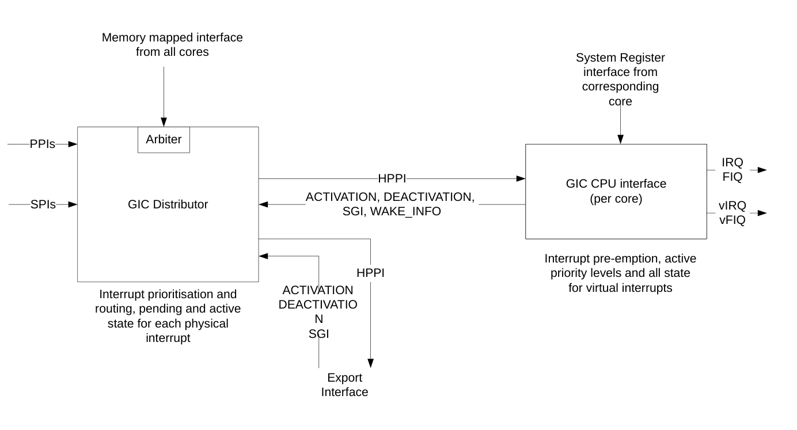

## 3. GIC 程序员模型

本节中，**Distributor 寄存器（GICD）**与 **Redistributor 寄存器（GICR）**描述 **GIC Distributor** 的内存映射寄存器。**GICR** 是 Cortex®-R52+ **GIC Distributor** 的一部分。**Redistributor** 寄存器为每个核私有。

本节中，**管理程序控制寄存器（ICH）**、**CPU 接口寄存器（ICC）**与**虚拟 CPU 接口寄存器（ICV）**描述 **GIC CPU 接口**的系统寄存器。

### 3.1 Distributor 寄存器（GICD）

本节描述 Cortex®-R52+ 处理器中已实现的 **GICD** 寄存器。下表汇总了 **GICD** 寄存器。

| 偏移 | 名称 | 类型 | 复位 | 描述 |
| --- | --- | --- | --- | --- |
| 0x0000 | GICD_CTLR | RW | 0x00000050 | Distributor 控制寄存器。 |
| 0x0004 | GICD_TYPER | RO | 0x0248001E | 中断控制器类型寄存器。 |
| 0x0008 | GICD_IIDR | RO | 0x0500143B | Distributor 实现者标识寄存器。 |
| 0x0084-0x00F8 | GICD_IGROUPR1-30 | RW | 0x00000000⁶⁵ | 3.1.4 中断组寄存器 1-30。 |
| 0x0104-0x0178 | GICD_ISENABLER1-30 | RW | 0x00000000⁶⁵ | 3.1.5 中断置位使能寄存器 1-30。 |
| 0x0184-0x01F8 | GICD_ICENABLER1-30 | RW | 0x00000000⁶⁵ | 3.1.6 中断清除使能寄存器 1-30。 |
| 0x0204-0x0278 | GICD_ISPENDR1-30 | RW | 0x00000000⁶⁵ | 3.1.7 中断置位挂起寄存器 1-30。 |
| 0x0284-0x02F8 | GICD_ICPENDR1-30 | RW | 0x00000000⁶⁵ | 3.1.8 中断清除挂起寄存器 1-30。 |
| 0x0304-0x0378 | GICD_ISACTIVER1-30 | RW | 0x00000000⁶⁵ | 3.1.9 中断置位活动寄存器 1-30。 |
| 0x0384-0x03F8 | GICD_ICACTIVER1-30 | RW | 0x00000000⁶⁵ | 3.1.10 中断清除活动寄存器 1-30。 |
| 0x0420-0x07DF | GICD_IPRIORITYR8-247 | RW | 0x00000000⁶⁵ | 3.1.11 中断优先级寄存器 8-247。 |
| 0x0C08-0x0CF4 | GICD_ICFGR2-61 | RW | 0x00000000⁶⁵ | 3.1.12 中断配置寄存器 2-61。 |
| 0x6100-0x7EF8 | GICD_IROUTER32-991 | RW | -⁶⁴ | 3.1.13 中断路由寄存器 32-991。 |
| 0xFFE0 | GICD_PIDR0 | RO | 0x00000092 | 3.1.14 标识寄存器 0-7。 |
| 0xFFE4 | GICD_PIDR1 | RO | 0x000000B4 | 3.1.14 标识寄存器 0-7。 |
| 0xFFE8 | GICD_PIDR2 | RO | 0x0000003B | 3.1.14 标识寄存器 0-7。 |
| 0xFFEC | GICD_PIDR3 | RO | 0x00000000 | 3.1.14 标识寄存器 0-7。 |
| 0xFFD0 | GICD_PIDR4 | RO | 0x00000044 | 3.1.14 标识寄存器 0-7。 |
| 0xFFD4 | GICD_PIDR5 | RO | 0x00000000 | 3.1.14 标识寄存器 0-7。 |
| 0xFFD8 | GICD_PIDR6 | RO | 0x00000000 | 3.1.14 标识寄存器 0-7。 |
| 0xFFDC | GICD_PIDR7 | RO | 0x00000000 | 3.1.14 标识寄存器 0-7。 |
| 0xFFF0 | GICD_CIDR0 | RO | 0x0000000D | 3.1.15 组件标识寄存器 0-3。 |
| 0xFFF4 | GICD_CIDR1 | RO | 0x000000F0 | 3.1.15 组件标识寄存器 0-3。 |
| 0xFFF8 | GICD_CIDR2 | RO | 0x00000005 | 3.1.15 组件标识寄存器 0-3。 |
| 0xFFFC | GICD_CIDR3 | RO | 0x000000B1 | 3.1.15 组件标识寄存器 0-3。 |

⁶⁴ 复位值取决于 Cortex®-R52+ 顶层亲和性配置。该值在该组寄存器中的每个寄存器上重复。

⁶⁵ 该复位值在该组寄存器中的每个寄存器上重复。

以下对应关系适用：

* **GICD_IGROUPR1[0]** 对应 **INTID32**，直至 **GICD_IGROUPR30[31]** 对应 **INTID991**。
* **GICD_ISENABLER1[0]** 对应 **INTID32**，直至 **GICD_ISENABLER30[31]** 对应 **INTID991**。
* **GICD_ICENABLER1[0]** 对应 **INTID32**，直至 **GICD_ICENABLER30[31]** 对应 **INTID991**。
* **GICD_ISPENDR1[0]** 对应 **INTID32**，直至 **GICD_ISPENDR30[31]** 对应 **INTID991**。
* **GICD_ICPENDR1[0]** 对应 **INTID32**，直至 **GICD_ICPENDR30[31]** 对应 **INTID991**。
* **GICD_ISACTIVE1[0]** 对应 **INTID32**，直至 **GICD_ISACTIVE30[31]** 对应 **INTID991**。
* **GICD_ICACTIVE1[0]** 对应 **INTID32**，直至 **GICD_ICACTIVE30[31]** 对应 **INTID991**。
* **GICD_IPRIORITYR8[7:0]** 对应 **INTID32**，直至 **GICD_IPRIORITYR247[31:24]** 对应 **INTID991**。
* **GICD_ICFGR2[1:0]** 对应 **INTID32**，直至 **GICD_ICFGR61[31:30]** 对应 **INTID991**。
* **GICD_IROUTER32** 对应 **INTID32**，直至 **GICD_IROUTER991** 对应 **INTID991**。

#### 3.1.1 Distributor 控制寄存器

**GICD_CTLR** 寄存器分别使能从 **GIC Distributor** 到 **GIC CPU 接口**的 **Group 0** 与 **Group 1** 中断。

**使用限制**

本寄存器为读写。

**陷阱与使能**

没有影响本寄存器的陷阱与使能。

**配置**

本寄存器在所有配置中均可用。

**属性**

**GICD_CTLR** 是一个 32 位寄存器。

下图给出了 **GICD_CTLR** 的位分配。

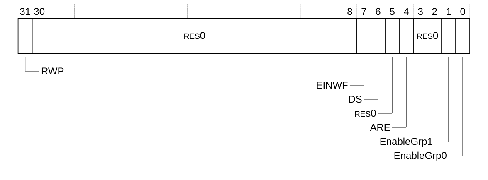

下表给出了 **GICD_CTLR** 的位分配。

| 位 | 名称 | 功能 |
| --- | --- | --- |
| [31] | RWP | 寄存器写挂起。该只读位指示寄存器写是否正在进行：<br>0：对以下寄存器之前所有写操作的效果对 GIC CPU 接口可见。<br>1：对以下寄存器之前所有写操作的效果不保证对 GIC CPU 接口可见，因为更改仍在传播中。<br>寄存器：<br>• GICD_CTLR[1:0] —— 组使能的清除。<br>• GICD_ICENABLERn。SPI 使能状态的清除。<br>该字段不跟踪对寄存器字段的其他更新。 |
| [30:8] | - | 保留，RES0。 |
| [7] | EINWF | 使能 1/N 唤醒功能：<br>RAZ/WI<br>1/N 中断分发。不支持。 |
| [6] | DS | 禁用安全：<br>RAO/WI<br>不支持安全。 |
| [5] | - | 保留，RES0。 |
| [4] | ARE | 亲和性路由使能：<br>RAO/WI<br>仅支持以 GICv3 方式访问 GIC Distributor。 |
| [3:2] | - | 保留，RES0。 |
| [1] | EnableGrp1 | 使能从 GIC Distributor 到 GIC CPU 接口的 Group 1 中断：<br>0：Group 1 中断被禁用。这是复位值。<br>1：Group 1 中断被使能。 |
| [0] | EnableGrp0 | 使能从 Distributor 到 GIC CPU 接口的 Group 0 中断：<br>0：Group 0 中断被禁用。这是复位值。<br>1：Group 0 中断被使能。 |

**GICD_CTLR** 可通过其内存映射接口访问。

| 组件 | 偏移 | 复位 |
| --- | --- | --- |
| GIC Distributor | 0x0000 | 0x00000050 |

#### 3.1.2 中断控制器类型寄存器

**GICD_TYPER** 提供 **GIC Distributor** 配置的相关信息。

**使用限制**

本寄存器为只读。

**陷阱与使能**

没有影响本寄存器的陷阱与使能。

**配置**

本寄存器在所有配置中均可用。

**属性**

**GICD_TYPER** 是一个 32 位寄存器。

下图给出了 **GICD_TYPER** 的位分配。

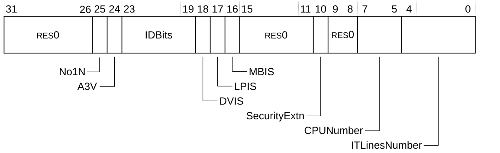

下表给出了 **GICD_TYPER** 的位分配。

| 位 | 名称 | 功能 |
| --- | --- | --- |
| [31:26] | - | 保留，RES0。 |
| [25] | No1N | 指示 GIC Distributor 是否支持 1/N 个 SPI：<br>1：不支持 1/N SPI 中断。 |
| [24] | A3V | 指示 GIC Distributor 是否支持非零的亲和性级别 3 值：<br>0：Distributor 仅支持亲和性级别 3 的零值。 |
| [23:19] | IDBits | 指示 GIC Distributor 支持的 INTID 位数减一：<br>0b01001：INTID 为 10 位。 |
| [18] | DVIS | 指示 GIC Distributor 是否支持直接虚拟 LPI 注入：<br>0：不支持直接虚拟 LPI 注入。 |
| [17] | LPIS | 指示 GIC Distributor 是否支持局部性特定外设中断（LPI）：<br>0：不支持 LPI。 |
| [16] | MBIS | 指示 GIC Distributor 是否支持基于消息的中断（Message-Based Interrupts）：<br>0：不支持基于消息的中断。 |
| [15:11] | - | 保留，RES0。 |
| [10] | SecurityExtn | 指示 GIC Distributor 是否支持两种安全状态：<br>0：支持单一安全状态。 |
| [9:8] | - | 保留，RES0。 |
| [7:5] | CPUNumber | 当 GICD_CTLR.ARE 为 0 时，指示可用作中断目标的核数量：<br>0b000：不支持。 |
| [4:0] | ITLinesNumber | 指示 GIC Distributor 支持的 SPI INTID 数量。该字段的有效值范围为 1 到 30，取决于为 Cortex®-R52+ 配置的 SPI 数量：<br>有效的中断 INTID 范围为 0 到 32\*(ITLinesNumber + 1) - 1。 |

**GICD_TYPER** 可通过其内存映射接口访问。

| 组件 | 偏移 | 复位 |
| --- | --- | --- |
| GIC Distributor | 0x0004 | 0x0248001E |

#### 3.1.3 Distributor 实现者标识寄存器

**GICD_IIDR** 提供 **Distributor** 的实现者与版本信息。版本与变体字段必须与 **MIDR** 一起读取。

**使用限制**

本寄存器为只读。

**陷阱与使能**

没有影响本寄存器的陷阱与使能。

**配置**

本寄存器在所有配置中均可用。

**属性**

**GICD_IIDR** 是一个 32 位寄存器。

下图给出了 **GICD_IIDR** 的位分配。


下表给出了 **GICD_IIDR** 的位分配。

| 位 | 名称 | 功能 |
| --- | --- | --- |
| [31:24] | ProductID | 0x05，Cortex®-R52+ GIC。 |
| [23:20] | - | 保留，RES0 |
| [19:16] | Variant | 0x0 |
| [15:12] | Revision | 0x1：r0p1。 |
| [11:0] | Implementer | 0x43B，Arm Limited。 |

**GICD_IIDR** 可通过其内存映射接口访问。

| 组件 | 偏移 | 复位 |
| --- | --- | --- |
| GIC Distributor | 0x0008 | 0x0500143B |

**相关内容**

* 第 172 页的 Main ID Register

#### 3.1.4 中断组寄存器 1-30

**GICD_IGROUPR1-30** 寄存器控制相应的 **SPI** 属于 **Group 0** 还是 **Group 1**。每个寄存器包含 32 个 **SPI** 的组位。

**使用限制**

这些寄存器为读写。

**陷阱与使能**

没有影响这些寄存器的陷阱与使能。

**配置**

这些寄存器在所有配置中均可用。

已实现的 **GICD_IGROUP** 寄存器数量由 **GICD_TYPER.ITLinesNumber** 决定。

未实现的 **GICD_IGROUPR** 寄存器为 RAZ/WI。

**属性**

**GICD_IGROUPR1-30** 是 32 位寄存器。

下图给出了 **GICD_IGROUPR1-30** 的位分配。


下表给出了 **GICD_IGROUPR1-30** 的位分配。

| 位 | 名称 | 功能 |
| --- | --- | --- |
| [31:0] | Group bits | 控制相应的 SPI 属于 Group 0 还是 Group 1：<br>0：相应的 SPI 属于 Group 0。这是复位值。<br>1：相应的 SPI 属于 Group 1。 |

**GICD_IGROUPR1-30** 可通过其内存映射接口访问。

| 组件 | 偏移 | 复位 |
| --- | --- | --- |
| GIC Distributor | 0x0084-0x00F8 | 0x00000000 |

#### 3.1.5 中断置位使能寄存器 1-30

**GICD_ISENABLER1-30** 寄存器使能相应的 **SPI** 从 **Distributor** 转发到各 **CPU 接口**。每个寄存器包含 32 个 **SPI** 的置位使能位。

**使用限制**

这些寄存器为读写。

**陷阱与使能**

没有影响这些寄存器的陷阱与使能。

**配置**

这些寄存器在所有配置中均可用。

已实现的 **GICD_ISENABLER** 寄存器数量由 **GICD_TYPER.ITLinesNumber** 决定。

未实现的 **GICD_ISENABLER** 寄存器为 RAZ/WI。

**属性**

**GICD_ISENABLER1-30** 是 32 位寄存器。

下图给出了 **GICD_ISENABLER1-30** 的位分配。


下表给出了 **GICD_ISENABLER1-30** 的位分配。

| 位 | 名称 | 功能 |
| --- | --- | --- |
| [31:0] | Set-enable bits | 对每一位：<br>读<br>0：指示 SPI 的转发被禁用。这是复位值。<br>1：指示 SPI 的转发被使能。<br>写<br>0：无影响。<br>1：使能 SPI 的转发。 |

**GICD_ISENABLER1-30** 可通过其内存映射接口访问。

| 组件 | 偏移 | 复位 |
| --- | --- | --- |
| GIC Distributor | 0x0104-0x0178 | 0x00000000 |

#### 3.1.6 中断清除使能寄存器 1-30

**GICD_ICENABLER1-30** 寄存器禁用相应 **SPI** 到各 **CPU 接口**的转发。每个寄存器包含 32 个 **SPI** 的清除使能位。

**使用限制**

这些寄存器为读写。

**陷阱与使能**

没有影响这些寄存器的陷阱与使能。

**配置**

这些寄存器在 **GIC Distributor** 的所有配置中均可用。

已实现的 **GICD_ICENABLER** 寄存器数量由 **GICD_TYPER.ITLinesNumber** 决定。

未实现的 **GICD_ICENABLER** 寄存器为 RAZ/WI。

**属性**

**GICD_ICENABLER1-30** 是 32 位寄存器。

下图给出了 **GICD_ICENABLER1-30** 的位分配。


下表给出了 **GICD_ICENABLER1-30** 的位分配。

| 位 | 名称 | 功能 |
| --- | --- | --- |
| [31:0] | Clear-enable bits | 对每一位：<br>读<br>0：指示 SPI 的转发被禁用。这是复位值。<br>1：指示 SPI 的转发被使能。<br>写<br>0：无影响。<br>1：禁用 SPI 的转发。 |

**GICD_ICENABLER1-30** 可通过其内存映射接口访问。

| 组件 | 偏移 | 复位 |
| --- | --- | --- |
| GIC Distributor | 0x0184-0x01F8 | 0x00000000 |

#### 3.1.7 中断置位挂起寄存器 1-30

**GICD_ISPENDR1-30** 寄存器置位相应 **SPI** 的挂起位。每个寄存器包含 32 个 **SPI** 的置位挂起位。

**使用限制**

这些寄存器为读写。

**陷阱与使能**

没有影响这些寄存器的陷阱与使能。

**配置**

这些寄存器在 **GIC Distributor** 的所有配置中均可用。

已实现的 **GICD_ISPENDR** 寄存器数量由 **GICD_TYPER.ITLinesNumber** 决定。

未实现的 **GICD_ISPENDR** 寄存器为 RAZ/WI。

**属性**

**GICD_ISPENDR1-30** 是 32 位寄存器。

下图给出了 **GICD_ISPENDR1-30** 的位分配。


下表给出了 **GICD_ISPENDR1-30** 的位分配。

| 位 | 名称 | 功能 |
| --- | --- | --- |
| [31:0] | Set-pending bits | 对每一位：<br>读<br>0：指示 SPI 未挂起。<br>1：指示 SPI 挂起。<br>写<br>0：无影响。<br>1：置位挂起位。<br>复位值为 0。 |

**GICD_ISPENDR1-30** 可通过其内存映射接口访问。

| 组件 | 偏移 | 复位 |
| --- | --- | --- |
| GIC Distributor | 0x0204-0x0278 | 0x00000000 |

#### 3.1.8 中断清除挂起寄存器 1-30

**GICD_ICPENDR1-30** 寄存器清除相应 **SPI** 的挂起位。每个寄存器包含 32 个 **SPI** 的清除挂起位。

**使用限制**

这些寄存器为读写。

**陷阱与使能**

没有影响这些寄存器的陷阱与使能。

**配置**

这些寄存器在 **GIC Distributor** 的所有配置中均可用。

已实现的 **GICD_ICPENDR** 寄存器数量由 **GICD_TYPER.ITLinesNumber** 决定。

未实现的 **GICD_ICPENDR** 寄存器为 RES0。

**属性**

**GICD_ICPENDR1-30** 是 32 位寄存器。

下图给出了 **GICD_ICPENDR1-30** 的位分配。


下表给出了 **GICD_ICPENDR1-30** 的位分配。

| 位 | 名称 | 功能 |
| --- | --- | --- |
| [31:0] | Clear-pending bits | 对每一位：<br>读<br>0：SPI 未挂起。<br>1：SPI 挂起。<br>写<br>0：无影响。<br>1：清除挂起位。 |

**GICD_ICPENDR1-30** 可通过其内存映射接口访问。

| 组件 | 偏移 | 复位 |
| --- | --- | --- |
| GIC Distributor | 0x0284-0x02F8 | 0x00000000 |

#### 3.1.9 中断置位活动寄存器 1-30

**GICD_ISACTIVER1-30** 寄存器置位相应 **SPI** 的活动位。每个寄存器包含 32 个 **SPI** 的置位活动位。

**使用限制**

这些寄存器为读写。

**陷阱与使能**

没有影响这些寄存器的陷阱与使能。

**配置**

这些寄存器在所有配置中均可用。

已实现的 **GICD_ISACTIVER** 寄存器数量由 **GICD_TYPER.ITLinesNumber** 决定。

未实现的 **GICD_ISACTIVER** 寄存器为 RAZ/WI。

**属性**

**GICD_ISACTIVER1-30** 是 32 位寄存器。

下图给出了 **GICD_ISACTIVER1-30** 的位分配。


下表给出了 **GICD_ISACTIVER1-30** 的位分配。

| 位 | 名称 | 功能 |
| --- | --- | --- |
| [31:0] | Set-active bits | 对每一位：<br>读<br>0：SPI 未活动。<br>1：SPI 活动。<br>写<br>0：无影响。<br>1：置位活动位。<br>复位值为 0。 |

**GICD_ISACTIVER1-30** 可通过其内存映射接口访问。

| 组件 | 偏移 | 复位 |
| --- | --- | --- |
| GIC Distributor | 0x0304-0x0378 | 0x00000000 |

#### 3.1.10 中断清除活动寄存器 1-30

**GICD_ICACTIVER1-30** 寄存器清除相应 **SPI** 的活动位。每个寄存器包含 32 个 **SPI** 的清除活动位。

**使用限制**

这些寄存器为读写。

**陷阱与使能**

没有影响这些寄存器的陷阱与使能。

**配置**

这些寄存器在所有配置中均可用。

已实现的 **GICD_ICACTIVER** 寄存器数量由 **GICD_TYPER.ITLinesNumber** 决定。

未实现的 **GICD_ICACTIVER** 寄存器为 RAZ/WI。

**属性**

**GICD_ICACTIVER1-30** 是 32 位寄存器。

下图给出了 **GICD_ICACTIVER1-30** 的位分配。


下表给出了 **GICD_ICACTIVER1-30** 的位分配。

| 位 | 名称 | 功能 |
| --- | --- | --- |
| [31:0] | Clear-active bits | 对每一位：<br>读<br>0：SPI 未活动。<br>1：SPI 活动。<br>写<br>0：无影响。<br>1：清除活动位。 |

**GICD_ICACTIVER1-30** 可通过其内存映射接口访问。

| 组件 | 偏移 | 复位 |
| --- | --- | --- |
| GIC Distributor | 0x0384-0x03F8 | 0x00000000 |

#### 3.1.11 中断优先级寄存器 8-247

**GICD_IPRIORITYR8-247** 寄存器为 **GIC** 支持的每个 **SPI** 提供一个 5 位优先级字段。该字段存储相应 **SPI** 的优先级。

**使用限制**

这些寄存器为读写。

这些寄存器可按字节访问。

**陷阱与使能**

没有影响这些寄存器的陷阱与使能。

**配置**

这些寄存器在 **GIC** 的所有配置中均可用。

已实现的 **GICD_IPRIORITYR8-247** 寄存器数量为 (8×(GICD_TYPER.ITLinesNumber))。

未实现的 **GICD_IPRIORITYR8-247** 寄存器为 RAZ/WI。

**属性**

**GICD_IPRIORITYR8-247** 是 32 位寄存器。

每个寄存器保存四个优先级字段，如下图所示，其中 **PRI_Nn** 是 ID 为 **INTIDn** 的 **SPI** 所对应的优先级。

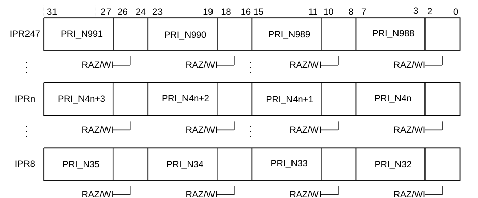

下表给出了 **GICD_IPRIORITYR8-247** 的位分配。

| 位 | 名称⁶⁶ | 功能 |
| --- | --- | --- |
| [31:27] | Priority, byte offset 3 | 每个优先级字段保存 0-31 的优先级值。值越小，相应中断的优先级越高。 |
| [26:24] | - | 保留，RAZ/WI。 |
| [23:19] | Priority, byte offset 2 | 每个优先级字段保存 0-31 的优先级值。值越小，相应中断的优先级越高。 |
| [18:16] | - | 保留，RAZ/WI。 |
| [15:11] | Priority, byte offset 1 | 每个优先级字段保存 0-31 的优先级值。值越小，相应中断的优先级越高。 |
| [10:8] | - | 保留，RAZ/WI。 |
| [7:3] | Priority, byte offset 0 | 每个优先级字段保存 0-31 的优先级值。值越小，相应中断的优先级越高。 |
| [2:0] | - | 保留，RAZ/WI。 |

对于 **INTIDm**，当 **DIV** 与 **MOD** 分别为整数除法与取模运算时：

* 相应的 **GICD_IPRIORITYRn** 编号 n 由 n = m DIV 4 给出，其中 m=32 到 991。
* 所需 **GICD_IPRIORITYRn** 的地址偏移为 (0x400 + (4×n))。
* 本寄存器中所需优先级字段的字节偏移为 m MOD 4，其中：
  * 字节偏移 0 指寄存器位 [7:3]。
  * 字节偏移 1 指寄存器位 [15:11]。
  * 字节偏移 2 指寄存器位 [23:19]。
  * 字节偏移 3 指寄存器位 [31:27]。

**GICD_IPRIORITYR8-247** 可通过其内存映射接口访问。

| 组件 | 偏移 | 复位 |
| --- | --- | --- |
| GIC Distributor | 0x0420-0x07DF | 0x00000000 |

⁶⁶ 每个字段保存单个中断的优先级值。本节说明 **INTID** 值如何确定 **GICD_IPRIORITYRn** 寄存器编号以及该寄存器中优先级字段的字节偏移。

#### 3.1.12 中断配置寄存器 2-61

**GICD_ICFGR2-61** 寄存器为 **GIC** 支持的每个中断提供一个 2 位 **Int_config** 字段。该字段确定相应中断是**上升沿触发**还是**高电平有效**。

**使用限制**

这些寄存器为读写。

**陷阱与使能**

没有影响这些寄存器的陷阱与使能。

**配置**

这些寄存器在所有配置中均可用。

已实现的 **GICD_ICFGR2-61** 寄存器数量为 **GICD_TYPER.ITLinesNumber** x 2。

未实现的 **GICD_ICFGR2-61** 寄存器为 RAZ/WI。

**属性**

**GICD_ICFGR2-61** 是 32 位寄存器。

下图给出了 **GICD_ICFGR2-61** 的位分配。

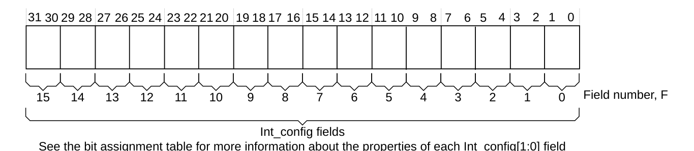

下表给出了 **GICD_ICFGR2-61** 的位分配。

| 位 | 名称 | 功能 |
| --- | --- | --- |
| [2F+1:2F] | Int_config, field F | 对于 **Int_config[1]**（最高位，位 [2F+1]），编码为：<br>0：相应中断为高电平有效。这是复位值。<br>1：相应中断为上升沿触发。<br>**Int_config[0]**（最低位，位 [2F]）为 RES0。 |

对于 **INTIDm**，当 **DIV** 与 **MOD** 分别为整数除法与取模运算时：

* 相应的 **GICD_ICFGRn** 编号 n 由 n = m DIV 16 给出，其中 m=32 到 991。
* 所需 **GICD_ICFGRn** 的偏移为 (0xC00 + (4×n))。
* 本寄存器中所需的 **Int_config** 字段 F 由 F = m MOD 16 给出，其中字段 0 指寄存器位 [1:0]，字段 1 指位 [3:2]，直至字段 15 指位 [31:30]。

**GICD_ICFGR2-61** 可通过其内存映射接口访问。

| 组件 | 偏移 | 复位 |
| --- | --- | --- |
| GIC Distributor | 0x0C08-0x0CF4 | 0x00000000 |

#### 3.1.13 中断路由寄存器 32-991

**GICD_IROUTER32-991** 寄存器为 **GICD_IROUTERn** 对应 **INTIDn** 的 **SPI** 提供路由信息。

**使用限制**

这些寄存器为读写。

**陷阱与使能**

没有影响这些寄存器的陷阱与使能。

**配置**

这些寄存器在 **GIC** 的所有配置中均可用。

已实现的 **GICD_IROUTER32-991** 寄存器数量为 **GICD_TYPER.ITLinesNumber** x 32。每个 **SPI** 一个 64 位寄存器。

未实现的 **GICD_IROUTER32-991** 寄存器为 RAZ/WI。

**属性**

**GICD_IROUTER32-991** 是 64 位寄存器。

下图给出了 **GICD_IROUTER32-991** 的位分配。

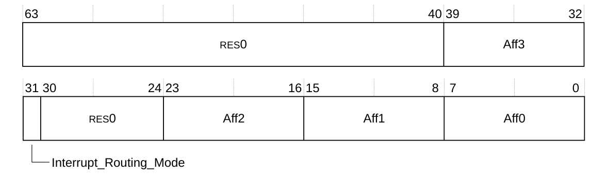

下表给出了 **GICD_IROUTER32-991** 的位分配。

| 位 | 名称 | 功能 |
| --- | --- | --- |
| [63:40] | - | 保留，RES0。 |
| [39:32] | Aff3 | 亲和性级别 3。该字段未使用：<br>0：这是复位值。 |
| [31] | Interrupt_Routing_Mode | 定义 **SPI** 在亲和性层次中的路由方式：<br>RAZ/WI<br>不支持 **SPI** 的 1/N 分发。 |
| [30:24] | - | 保留，RES0。 |
| [23:16] | Aff2 | 亲和性级别 2。该字段为只读，读取返回 Cortex®-R52+ 顶层配置值 **CFGMPIDRAFF2[7:0]**。 |
| [15:8] | Aff1 | 亲和性级别 1。该字段为只读，读取返回 Cortex®-R52+ 顶层配置值 **CFGMPIDRAFF1[7:0]**。 |
| [7:0] | Aff0 | 亲和性级别 0。<br>• 已实现的最低有效位数定义为 **Aff0[CEILING(LOG2(NUM_TARGET))-1:0]**，其余位为 0。<br>• 当 **NUM_TARGET** 为 1 时，所有位均为 0。**NUM_TARGET** 是包含核与导出端口在内的目标总数。<br>• **Aff0** 支持的取值由 **GICR_TYPER** 定义。<br>• 所有 **Redistributor** 的 **Aff0** 字段从 0 到 **NUM_TARGET**-1 连续编号。 |

**GICD_IROUTER32-991** 可通过其内存映射接口访问。

| 组件 | 偏移 | 复位 |
| --- | --- | --- |
| GIC Distributor | 0x6100-0x7EF8 | 0x0000000000000000 |

#### 3.1.14 标识寄存器 0-7

**GICD_PIDR0-7** 寄存器提供外设标识信息。

**使用限制**

这些寄存器为只读。

**陷阱与使能**

没有影响这些寄存器的陷阱与使能。

**配置**

这些寄存器在所有配置中均可用。

**属性**

**GICD_PIDR0-7** 是 32 位寄存器。

下图给出了 **GICD_PIDR0-7** 的位分配。


下表给出了 **GICD_PIDR0-7** 的位分配。

| 位 | 名称 | 功能 |
| --- | --- | --- |
| [31:8] | - | 保留，RES0。 |
| [7:0] | - | 组件 IDn |

**GICD_PIDR0-7** 可通过其内存映射接口访问。

| 组件 | 寄存器 | 偏移 | 复位值 |
| --- | --- | --- | --- |
| GIC Distributor | GICD_PIDR0 | 0xFFE0 | 0x00000092 |
| GIC Distributor | GICD_PIDR1 | 0xFFE4 | 0x000000B4 |
| GIC Distributor | GICD_PIDR2 | 0xFFE8 | 0x0000003B |
| GIC Distributor | GICD_PIDR3 | 0xFFEC | 0x00000000 |
| GIC Distributor | GICD_PIDR4 | 0xFFD0 | 0x00000044 |
| GIC Distributor | GICD_PIDR5 | 0xFFD4 | 0x00000000 |
| GIC Distributor | GICD_PIDR6 | 0xFFD8 | 0x00000000 |
| GIC Distributor | GICD_PIDR7 | 0xFFDC | 0x00000000 |

#### 3.1.15 组件标识寄存器 0-3

**GICD_CIDR0-3** 寄存器提供组件标识信息。

**使用限制**

这些寄存器为只读。

**陷阱与使能**

没有影响这些寄存器的陷阱与使能。

**配置**

这些寄存器在所有配置中均可用。

**属性**

**GICD_CIDR0-3** 是 32 位寄存器。

下图给出了 **GICD_CIDR0-3** 的位分配。


下表给出了 **GICD_CIDR0-3** 的位分配。

| 位 | 名称 | 功能 |
| --- | --- | --- |
| [31:8] | - | 保留，RES0 |
| [7:0] | - | 组件 IDn |

**GICD_CIDR0-3** 可通过其内存映射接口访问。

| 组件 | 寄存器 | 偏移 | 复位值 |
| --- | --- | --- | --- |
| GIC Distributor | GICD_CIDR0 | 0xFFF0 | 0x0000000D |
| GIC Distributor | GICD_CIDR1 | 0xFFF4 | 0x000000F0 |
| GIC Distributor | GICD_CIDR2 | 0xFFF8 | 0x00000005 |
| GIC Distributor | GICD_CIDR3 | 0xFFFC | 0x000000B1 |

### 3.2 Redistributor 寄存器（GICR）

**Redistributor** 是提供从 **Distributor** 到某个核的接口、并转发物理域中所有中断的组件。以下两张表分别汇总控制页与 SGI/PPI 页中的 **Redistributor** 寄存器。

| 偏移 | 名称 | 类型 | 复位 | 描述 |
| --- | --- | --- | --- | --- |
| 0x0000 | GICR_CTLR | RO | 0x00000000 | 3.2.1 Redistributor 控制寄存器。 |
| 0x0004 | GICR_IIDR | RO | 0x0500143B | 3.2.2 Redistributor 实现者标识寄存器。 |
| 0x0008-0x000C | GICR_TYPER | RO | 0x0000000000000000<br>双核系统中的核 0。<br>0x0000000100000110<br>双核系统中的核 1。 | 3.2.3 Redistributor 类型寄存器。 |
| 0x0014 | GICR_WAKER | RW | 0x00000006 | 3.2.4 Redistributor 唤醒寄存器。 |
| 0xFFE0 | GICR_PIDR0 | RO | 0x00000093 | 3.2.5 Redistributor 标识寄存器 0-7。 |
| 0xFFE4 | GICR_PIDR1 | RO | 0x000000B4 | 3.2.5 Redistributor 标识寄存器 0-7。 |
| 0xFFE8 | GICR_PIDR2 | RO | 0x0000003B | 3.2.5 Redistributor 标识寄存器 0-7。 |
| 0xFFEC | GICR_PIDR3 | RO | 0x00000000 | 3.2.5 Redistributor 标识寄存器 0-7。 |
| 0xFFD0 | GICR_PIDR4 | RO | 0x00000044 | 3.2.5 Redistributor 标识寄存器 0-7。 |
| 0xFFD4 | GICR_PIDR5 | RO | 0x00000000 | 3.2.5 Redistributor 标识寄存器 0-7。 |
| 0xFFD8 | GICR_PIDR6 | RO | 0x00000000 | 3.2.5 Redistributor 标识寄存器 0-7。 |
| 0xFFDC | GICR_PIDR7 | RO | 0x00000000 | 3.2.5 Redistributor 标识寄存器 0-7。 |
| 0xFFF0 | GICR_CIDR0 | RO | 0x0000000D | 3.2.6 Redistributor 组件标识寄存器 0-3。 |
| 0xFFF4 | GICR_CIDR1 | RO | 0x000000F0 | 3.2.6 Redistributor 组件标识寄存器 0-3。 |
| 0xFFF8 | GICR_CIDR2 | RO | 0x00000005 | 3.2.6 Redistributor 组件标识寄存器 0-3。 |
| 0xFFFC | GICR_CIDR3 | RO | 0x000000B1 | 3.2.6 Redistributor 组件标识寄存器 0-3。 |

| 偏移 | 名称 | 类型 | 复位 | 描述 |
| --- | --- | --- | --- | --- |
| 0x0080 | GICR_IGROUPR0 | RW | 0x00000000 | 3.2.7 中断组寄存器 0。 |
| 0x0100 | GICR_ISENABLER0 | RW | 0x00000000 | 3.2.8 中断置位使能寄存器 0。 |
| 0x0180 | GICR_ICENABLER0 | RW | 0x00000000 | 3.2.9 中断清除使能寄存器 0。 |
| 0x0200 | GICR_ISPENDR0 | RW | 0x00000000 | 3.2.10 中断置位挂起寄存器 0。 |
| 0x0280 | GICR_ICPENDR0 | RW | 0x00000000 | 3.2.11 中断清除挂起寄存器 0。 |
| 0x0300 | GICR_ISACTIVER0 | RW | 0x00000000 | 3.2.12 中断置位活动寄存器 0。 |
| 0x0380 | GICR_ICACTIVER0 | RW | 0x00000000 | 3.2.13 中断清除活动寄存器 0。 |
| 0x0400-0x041C | GICR_IPRIORITYR0-7 | RW | 0x00000000 | 3.2.14 中断优先级寄存器 0-7。 |
| 0x0C00 | GICR_ICFGR0 | RO | 0xAAAAAAAA | 3.2.15 中断配置寄存器 0。 |
| 0x0C04 | GICR_ICFGR1 | RW | 0x00000000 | 3.2.16 中断配置寄存器 1。 |

以下对应关系适用：

* **GICR_IGROUPR0[0]** 对应 **INTID0**，直至 **GICR_IGROUPR0[31]** 对应 **INTID31**。
* **GICR_ISENABLER0[0]** 对应 **INTID0**，直至 **GICR_ISENABLER0[31]** 对应 **INTID31**。
* **GICR_ICENABLER0[0]** 对应 **INTID0**，直至 **GICR_ICENABLER0[31]** 对应 **INTID31**。
* **GICR_ISPENDR0[0]** 对应 **INTID0**，直至 **GICR_ISPENDR0[31]** 对应 **INTID31**。
* **GICR_ICPENDR0[0]** 对应 **INTID0**，直至 **GICR_ICPENDR0[31]** 对应 **INTID31**。
* **GICR_ISACTIVER0[0]** 对应 **INTID0**，直至 **GICR_ISACTIVER0[31]** 对应 **INTID31**。
* **GICR_ICACTIVER0[0]** 对应 **INTID0**，直至 **GICR_ICACTIVER0[31]** 对应 **INTID31**。
* **GICR_IPRIORITYR0[7:0]** 对应 **INTID0**，直至 **GICR_IPRIORITYR7[31:24]** 对应 **INTID31**。
* **GICR_ICFGR0[1:0]** 对应 **INTID0**，直至 **GICR_ICFGR0[31:30]** 对应 **INTID31**。
* **GICR_ICFGR1[1:0]** 对应 **INTID0**，直至 **GICR_ICFGR1[31:30]** 对应 **INTID31**。

**PPI** 对应 **INTID16** 至 **INTID31**。**SGI** 对应 **INTID0** 至 **INTID15**。

#### 3.2.1 Redistributor 控制寄存器

**GICR_CTLR** 寄存器控制 **Redistributor** 的操作。

**使用限制**

本寄存器为只读。

**陷阱与使能**

没有影响本寄存器的陷阱与使能。

**配置**

每个 **Redistributor** 都提供本寄存器的一个副本。

**属性**

**GICR_CTLR** 是一个 32 位寄存器。

下图给出了 **GICR_CTLR** 的位分配。

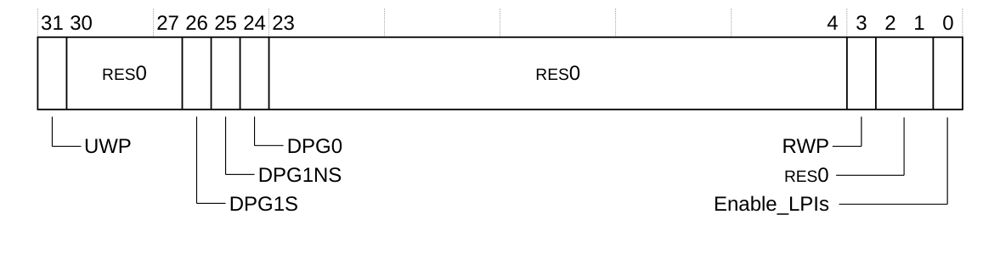

下表给出了 **GICR_CTLR** 的位分配。

| 位 | 名称 | 功能 |
| --- | --- | --- |
| [31] | UWP | 只读。指示是否有上行写挂起：<br>0：没有上行写挂起。 |
| [30:27] | - | 保留，RES0。 |
| [26] | DPG1S | 与 1/N 分发有关，不支持，RAZ/WI。 |
| [25] | DPG1NS | 与 1/N 分发有关，不支持，RAZ/WI。 |
| [24] | DPG0 | 与 1/N 分发有关，不支持，RAZ/WI。 |
| [23:4] | - | 保留，RES0。 |
| [3] | RWP | 寄存器写挂起。该只读位指示 **GICR_ICENABLERn** 的写是否正在进行：<br>0：对 **GICR_ICENABLERn** 之前所有写操作的效果对 GIC CPU 接口可见。<br>1：对 **GICR_ICENABLERn** 之前所有写操作的效果不保证对 GIC CPU 接口可见，因为更改仍在传播中：<br>• **GICR_ICENABLERn**。PPI 与 SGI 使能状态的清除。 |
| [2:1] | - | 保留，RES0。 |
| [0] | Enable_LPIs | 该位控制物理 LPI 是否使能：<br>RES0<br>不支持 LPI。 |

**GICR_CTLR** 可通过其内存映射接口访问。

| 组件 | 偏移 | 复位 |
| --- | --- | --- |
| GIC Redistributor | 0x0000 | 0x00000000 |

#### 3.2.2 Redistributor 实现者标识寄存器

**GICR_IIDR** 提供 **Redistributor** 的实现者与版本信息。

**使用限制**

本寄存器为只读。

**陷阱与使能**

没有影响本寄存器的陷阱与使能。

**配置**

每个 **Redistributor** 都提供本寄存器的一个副本。

**属性**

**GICR_IIDR** 是一个 32 位寄存器。

下图给出了 **GICR_IIDR** 的位分配。


下表给出了 **GICR_IIDR** 的位分配。

| 位 | 名称 | 功能 |
| --- | --- | --- |
| [31:24] | ProductID | 0x05，Cortex®-R52+ GIC |
| [23:20] | - | 保留，RES0 |
| [19:16] | Variant | 0x0 |
| [15:12] | Revision | 0x1：r0p1 |
| [11:0] | Implementer | 0x43B：Arm Limited |

**GICR_IIDR** 可通过其内存映射接口访问。

| 组件 | 偏移 | 复位 |
| --- | --- | --- |
| GIC Redistributor | 0x0004 | 0x0500143B |

#### 3.2.3 Redistributor 类型寄存器

**GICR_TYPER** 寄存器提供 **Redistributor** 配置的相关信息。

**使用限制**

本寄存器为只读。

**陷阱与使能**

没有影响本寄存器的陷阱与使能。

**配置**

每个 **Redistributor** 都提供本寄存器的一个副本。

**属性**

**GICR_TYPER** 是一个 64 位寄存器。

下图给出了 **GICR_TYPER** 的位分配。

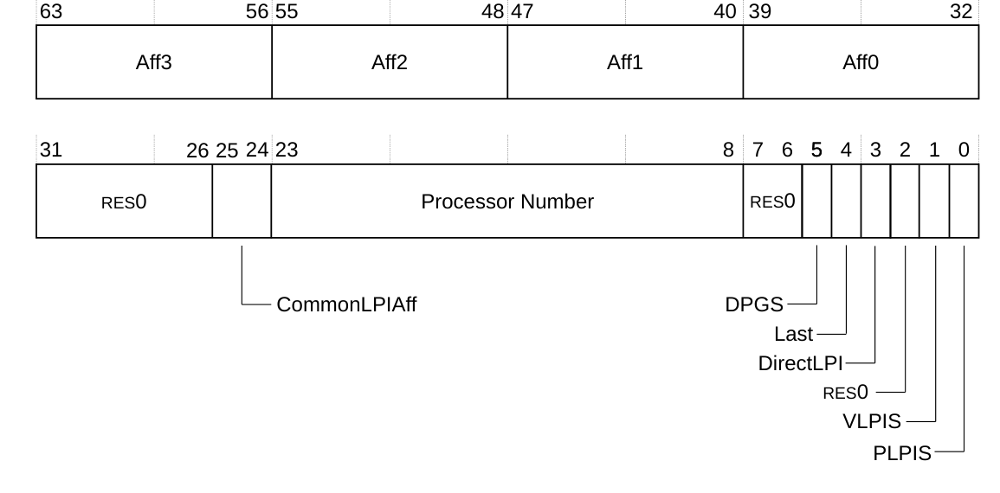

下表给出了 **GICR_TYPER** 的位分配。

| 位 | 名称 | 功能 |
| --- | --- | --- |
| [63:56] | Aff3 | 亲和性级别 3，未使用。0x00 |
| [55:48] | Aff2 | 亲和性级别 2，未使用。0x00 |
| [47:40] | Aff1 | 亲和性级别 1，未使用。0x00 |
| [39:32] | Aff0 | 亲和性级别 0。**Redistributor** 的目标 ID。各目标从 0 到 **NUM_TARGET**-1 连续编号。**NUM_TARGET** 是核与导出端口的总数。对于带导出端口的双核系统，即 core0=0、core1=1、export=2。 |
| [31:26] | - | 保留，RES0。 |
| [25:24] | CommonLPIAff | 与 LPI 有关，不支持 LPI。0x00 |
| [23:8] | Processor Number | 核的唯一标识符。与 **Aff0** 相同，未使用的高位补零。 |
| [7:6] | - | 保留，RES0。 |
| [5] | DPGS | 设置对 **GICR_CTLR.DPG\*** 位的支持：<br>0：不支持 **GICR_CTLR.DPG\*** 位。 |
| [4] | Last | 指示本 **Redistributor** 是否为一系列连续 **Redistributor** 页中编号最大的 **Redistributor**：<br>0：本 **Redistributor** 不是一系列连续 **Redistributor** 中的最后一个。<br>1：本 **Redistributor** 是一系列连续 **Redistributor** 中的最后一个。<br>在配置了中断导出端口的处理器中，该位对与导出端口关联的 **Redistributor** 置位。否则，在具有 n 个核的系统中，该位对与核 n-1 关联的 **Redistributor** 置位。 |
| [3] | DirectLPI | 指示本 **Redistributor** 是否支持 LPI 的直接注入：<br>0：本 **Redistributor** 不支持 LPI 的直接注入。 |
| [2] | - | 保留，RES0。 |
| [1] | VLPIS | 0：不支持虚拟 LPI。 |
| [0] | PLPIS | 指示 GIC 实现是否支持物理 LPI：<br>0：不支持物理 LPI。 |

**GICR_TYPER** 可通过其内存映射接口访问。

| 组件 | 偏移 | 复位 |
| --- | --- | --- |
| GIC Redistributor | 0x0008-0x000C | 0x0000000000000000<br>双核系统中的核 0。<br>0x0000000100000110<br>双核系统中的核 1。 |

#### 3.2.4 Redistributor 唤醒寄存器

**GICR_WAKER** 寄存器允许软件在目标进入**处理器睡眠状态**之前静默 **GIC Distributor** 与 **GIC CPU 接口**之间的接口。退出**处理器睡眠状态**由该目标的挂起中断引起。

**使用限制**

本寄存器为读写。

**陷阱与使能**

没有影响本寄存器的陷阱与使能。

**配置**

每个 **Redistributor** 都提供本寄存器的一个副本。

**属性**

**GICR_WAKER** 是一个 32 位寄存器。

下图给出了 **GICR_WAKER** 的位分配。

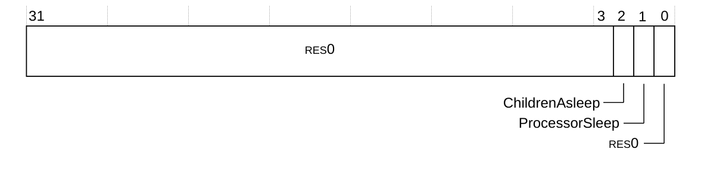

下表给出了 **GICR_WAKER** 的位分配。

| 位 | 名称 | 功能 |
| --- | --- | --- |
| [31:3] | - | 保留，RES0。 |
| [2] | ChildrenAsleep | 指示所连接的目标是否已静默：<br>0：与所连接目标的所有接口尚未静默。<br>1：与所连接目标的所有接口已静默。这是复位值。 |
| [1] | ProcessorSleep | 指示 **Redistributor** 目标正在进入**处理器睡眠状态**。写 1 时，**Redistributor** 静默到 **GIC CPU 接口**的接口。当该目标有挂起中断且处于**处理器睡眠状态**时，会发出上电该目标的请求：<br>0：写 0 表示目标未处于**处理器睡眠状态**。这在初始化期间完成。<br>1：写 1 表示目标正在进入**处理器睡眠状态**。这是复位值。 |
| [0] | - | 保留，RES0。 |

**GICR_WAKER** 可通过其内存映射接口访问。

| 组件 | 偏移 | 复位 |
| --- | --- | --- |
| GIC Redistributor | 0x0014 | 0x00000006 |

#### 3.2.5 Redistributor 标识寄存器 0-7

**GICR_PIDR0-7** 寄存器提供外设标识信息。

**使用限制**

这些寄存器为只读。

**陷阱与使能**

没有影响这些寄存器的陷阱与使能。

**配置**

每个 **Redistributor** 都提供本寄存器的一个副本。

**属性**

**GICR_PIDR0-7** 是 32 位寄存器。

下图给出了 **GICR_PIDR0-7** 的位分配。


下表给出了 **GICR_PIDR0-7** 的位分配。

| 位 | 名称 | 功能 |
| --- | --- | --- |
| [31:8] | - | 保留，RES0。 |
| [7:0] | - | 组件 ID。 |

**GICR_PIDR0-7** 可通过其内存映射接口访问。

| 组件 | 寄存器 | 偏移 | 复位值 |
| --- | --- | --- | --- |
| GIC Redistributor | GICR_PIDR0 | 0xFFE0 | 0x00000093 |
| GIC Redistributor | GICR_PIDR1 | 0xFFE4 | 0x000000B4 |
| GIC Redistributor | GICR_PIDR2 | 0xFFE8 | 0x0000003B |
| GIC Redistributor | GICR_PIDR3 | 0xFFEC | 0x00000000 |
| GIC Redistributor | GICR_PIDR4 | 0xFFD0 | 0x00000044 |
| GIC Redistributor | GICR_PIDR5 | 0xFFD4 | 0x00000000 |
| GIC Redistributor | GICR_PIDR6 | 0xFFD8 | 0x00000000 |
| GIC Redistributor | GICR_PIDR7 | 0xFFDC | 0x00000000 |

#### 3.2.6 Redistributor 组件标识寄存器 0-3

**GICR_CIDR0-3** 寄存器提供组件标识信息。

**使用限制**

这些寄存器为只读。

**陷阱与使能**

没有影响这些寄存器的陷阱与使能。

**配置**

每个 **Redistributor** 都提供本寄存器的一个副本。

**属性**

**GICR_CIDR0-3** 是 32 位寄存器。

下图给出了 **GICR_CIDR0-3** 的位分配。


下表给出了 **GICR_CIDR0-3** 的位分配。

| 位 | 名称 | 功能 |
| --- | --- | --- |
| [31:8] | - | 保留，RES0 |
| [7:0] | - | 组件 IDn |

**GICR_CIDR0-3** 可通过其内存映射接口访问。

| 组件 | 寄存器 | 偏移 | 复位值 |
| --- | --- | --- | --- |
| GIC Redistributor | GICR_CIDR0 | 0xFFF0 | 0x0000000D |
| GIC Redistributor | GICR_CIDR1 | 0xFFF4 | 0x000000F0 |
| GIC Redistributor | GICR_CIDR2 | 0xFFF8 | 0x00000005 |
| GIC Redistributor | GICR_CIDR3 | 0xFFFC | 0x000000B1 |

#### 3.2.7 中断组寄存器 0

**GICR_IGROUPR0** 寄存器控制相应的 **SGI** 或 **PPI** 属于 **Group 0** 还是 **Group 1**。

**使用限制**

本寄存器为读写。

**陷阱与使能**

没有影响本寄存器的陷阱与使能。

**配置**

每个 **Redistributor** 都提供本寄存器的一个副本。

**属性**

**GICR_IGROUPR0** 是一个 32 位寄存器。

下图给出了 **GICR_IGROUPR0** 的位分配。


下表给出了 **GICR_IGROUPR0** 的位分配。

| 位 | 名称 | 功能 |
| --- | --- | --- |
| [31:16] | PPIs | 控制相应 PPI 的组：<br>0：该 PPI 属于 Group 0。这是复位值。<br>1：该 PPI 属于 Group 1。 |
| [15:0] | SGIs | 控制相应 SGI 的组：<br>0：该 SGI 属于 Group 0。这是复位值。<br>1：该 SGI 属于 Group 1。 |

**GICR_IGROUPR0** 可通过其内存映射接口访问。

| 组件 | 偏移 | 复位 |
| --- | --- | --- |
| GIC Redistributor | 0x0080 | 0x00000000 |

#### 3.2.8 中断置位使能寄存器 0

**GICR_ISENABLER0** 寄存器使能相应的 **SGI** 或 **PPI** 从 **Distributor** 转发到各 **CPU 接口**。

**使用限制**

本寄存器为读写。

**陷阱与使能**

没有影响本寄存器的陷阱与使能。

**配置**

每个 **Redistributor** 都提供本寄存器的一个副本。

**属性**

**GICR_ISENABLER0** 是一个 32 位寄存器。

下图给出了 **GICR_ISENABLER0** 的位分配。


下表给出了 **GICR_ISENABLER0** 的位分配。

| 位 | 名称 | 功能 |
| --- | --- | --- |
| [31:16] | PPIs | 使能相应 PPI 的转发：<br>读<br>0：指示 PPI 的转发被禁用。这是复位值。<br>1：指示 PPI 的转发被使能。<br>写<br>0：无影响。<br>1：使能 PPI 的转发。 |
| [15:0] | SGIs | 使能相应 SGI 的转发：<br>读<br>0：指示 SGI 的转发被禁用。这是复位值。<br>1：指示 SGI 的转发被使能。<br>写<br>0：无影响。<br>1：使能 SGI 的转发。 |

**GICR_ISENABLER0** 可通过其内存映射接口访问。

| 组件 | 偏移 | 复位 |
| --- | --- | --- |
| GIC Redistributor | 0x0100 | 0x00000000 |

#### 3.2.9 中断清除使能寄存器 0

**GICR_ICENABLER0** 寄存器禁用相应 **SGI** 或 **PPI** 到各 **CPU 接口**的转发。

**使用限制**

本寄存器为读写。

**陷阱与使能**

没有影响本寄存器的陷阱与使能。

**配置**

每个 **Redistributor** 都提供本寄存器的一个副本。

**属性**

**GICR_ICENABLER0** 是一个 32 位寄存器。

下图给出了 **GICR_ICENABLER0** 的位分配。


下表给出了 **GICR_ICENABLER0** 的位分配。

| 位 | 名称 | 功能 |
| --- | --- | --- |
| [31:16] | PPIs | 禁用相应 PPI 的转发：<br>读<br>0：指示 PPI 的转发被禁用。这是复位值。<br>1：指示 PPI 的转发被使能。<br>写<br>0：无影响。<br>1：禁用 PPI 的转发。 |
| [15:0] | SGIs | 禁用相应 SGI 的转发：<br>读<br>0：指示 SGI 的转发被禁用。这是复位值。<br>1：指示 SGI 的转发被使能。<br>写<br>0：无影响。<br>1：禁用 SGI 的转发。 |

**GICR_ICENABLER0** 可通过其内存映射接口访问。

| 组件 | 偏移 | 复位 |
| --- | --- | --- |
| GIC Redistributor | 0x0180 | 0x00000000 |

#### 3.2.10 中断置位挂起寄存器 0

**GICR_ISPENDR0** 寄存器置位 **SGI** 与 **PPI** 的挂起位。

**使用限制**

本寄存器为读写。

**陷阱与使能**

没有影响本寄存器的陷阱与使能。

**配置**

每个 **Redistributor** 都提供本寄存器的一个副本。

**属性**

**GICR_ISPENDR0** 是一个 32 位寄存器。

下图给出了 **GICR_ISPENDR0** 的位分配。


下表给出了 **GICR_ISPENDR0** 的位分配。

| 位 | 名称 | 功能 |
| --- | --- | --- |
| [31:16] | PPIs | 置位 PPI 挂起位：<br>读<br>0：指示该 PPI 未挂起。这是复位值。<br>1：指示该 PPI 挂起。<br>写<br>0：无影响。<br>1：置位 PPI 挂起位。 |
| [15:0] | SGIs | 置位 SGI 挂起位：<br>读<br>0：指示该 SGI 未挂起。这是复位值。<br>1：指示该 SGI 挂起。<br>写<br>0：无影响。<br>1：置位 SGI 挂起位。 |

**GICR_ISPENDR0** 可通过其内存映射接口访问。

| 组件 | 偏移 | 复位 |
| --- | --- | --- |
| GIC Redistributor | 0x0200 | 0x00000000 |

#### 3.2.11 中断清除挂起寄存器 0

**GICR_ICPENDR0** 寄存器清除 **SGI** 或 **PPI** 的挂起位。

**使用限制**

本寄存器为读写。

**陷阱与使能**

没有影响本寄存器的陷阱与使能。

**配置**

每个 **Redistributor** 都提供本寄存器的一个副本。

**属性**

**GICR_ICPENDR0** 是一个 32 位寄存器。

下图给出了 **GICR_ICPENDR0** 的位分配。


下表给出了 **GICR_ICPENDR0** 的位分配。

| 位 | 名称 | 功能 |
| --- | --- | --- |
| [31:16] | PPIs | 清除相应 PPI 的挂起位：<br>读<br>0：指示该 PPI 挂起。这是复位值。<br>1：指示该 PPI 未挂起。<br>写<br>0：无影响。<br>1：置位 PPI 挂起位。 |
| [15:0] | SGIs | 清除相应 SGI 的挂起位：<br>读<br>0：指示该 SGI 挂起。这是复位值。<br>1：指示该 SGI 未挂起。<br>写<br>0：无影响。<br>1：置位 SGI 挂起位。 |

**GICR_ICPENDR0** 可通过其内存映射接口访问。

| 组件 | 偏移 | 复位 |
| --- | --- | --- |
| GIC Redistributor | 0x0280 | 0x00000000 |

#### 3.2.12 中断置位活动寄存器 0

**GICR_ISACTIVER0** 寄存器置位 **SGI** 与 **PPI** 的活动位。

**使用限制**

本寄存器为读写。

**陷阱与使能**

没有影响本寄存器的陷阱与使能。

**配置**

每个 **Redistributor** 都提供本寄存器的一个副本。

**属性**

**GICR_ISACTIVER0** 是一个 32 位寄存器。

下图给出了 **GICR_ISACTIVER0** 的位分配。


下表给出了 **GICR_ISACTIVER0** 的位分配。

| 位 | 名称 | 功能 |
| --- | --- | --- |
| [31:16] | PPIs | 置位相应 PPI 的活动位：<br>读<br>0：指示该 PPI 未活动。这是复位值。<br>1：指示该 PPI 活动。<br>写<br>0：无影响。<br>1：置位 PPI 活动位。 |
| [15:0] | SGIs | 置位相应 SGI 的活动位：<br>读<br>0：指示该 SGI 未活动。这是复位值。<br>1：指示该 SGI 活动。<br>写<br>0：无影响。<br>1：置位 SGI 活动位。 |

**GICR_ISACTIVER0** 可通过其内存映射接口访问。

| 组件 | 偏移 | 复位 |
| --- | --- | --- |
| GIC Redistributor | 0x0300 | 0x00000000 |

#### 3.2.13 中断清除活动寄存器 0

**GICR_ICACTIVER0** 寄存器清除相应 **SGI** 或 **PPI** 的活动位。

**使用限制**

本寄存器为读写。

**陷阱与使能**

没有影响本寄存器的陷阱与使能。

**配置**

每个 **Redistributor** 都提供本寄存器的一个副本。

**属性**

**GICR_ICACTIVER0** 是一个 32 位寄存器。

下图给出了 **GICR_ICACTIVER0** 的位分配。


下表给出了 **GICR_ICACTIVER0** 的位分配。

| 位 | 名称 | 功能 |
| --- | --- | --- |
| [31:16] | PPIs | 清除相应 PPI 的活动位：<br>读<br>0：指示该 PPI 未活动。这是复位值。<br>1：指示该 PPI 活动。<br>写<br>0：无影响。<br>1：清除 PPI 活动位。 |
| [15:0] | SGIs | 清除相应 SGI 的活动位：<br>读<br>0：指示该 SGI 未活动。这是复位值。<br>1：指示该 SGI 活动。<br>写<br>0：无影响。<br>1：清除 SGI 活动位。 |

**GICR_ICACTIVER0** 可通过其内存映射接口访问。

| 组件 | 偏移 | 复位 |
| --- | --- | --- |
| GIC Redistributor | 0x0380 | 0x00000000 |

#### 3.2.14 中断优先级寄存器 0-7

**GICR_IPRIORITYR0-7** 寄存器为每个 **SGI** 与 **PPI** 提供一个 5 位优先级字段。该字段存储相应中断的优先级。

**使用限制**

这些寄存器为读写。

这些寄存器可按字节访问。

**陷阱与使能**

没有影响这些寄存器的陷阱与使能。

**配置**

每个 **Redistributor** 都提供这些寄存器的一个副本。

**属性**

**GICR_IPRIORITYR0-7** 是 32 位寄存器。

每个寄存器保存四个优先级字段，如下图所示。

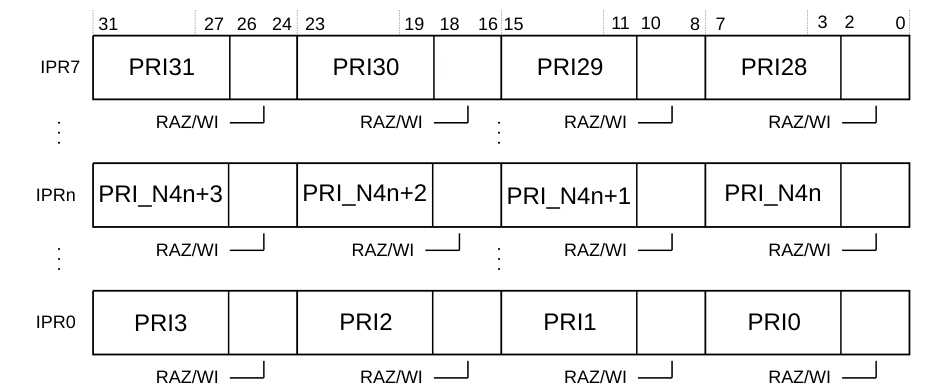

**PRIn** 对应 **INTIDn**。

下表给出了 **GICR_IPRIORITYR0-7** 的位分配。

| 位 | 名称⁶⁷ | 功能 |
| --- | --- | --- |
| [31:27] | Priority, byte offset 3 | 每个优先级字段保存 0-31 的优先级值。值越小，相应中断的优先级越高。 |
| [26:24] | - | 保留，RES0。 |
| [23:19] | Priority, byte offset 2 | 每个优先级字段保存 0-31 的优先级值。值越小，相应中断的优先级越高。 |
| [18:16] | - | 保留，RES0。 |
| [15:11] | Priority, byte offset 1 | 每个优先级字段保存 0-31 的优先级值。值越小，相应中断的优先级越高。 |
| [10:8] | - | 保留，RES0。 |
| [7:3] | Priority, byte offset 0 | 每个优先级字段保存 0-31 的优先级值。值越小，相应中断的优先级越高。 |
| [2:0] | - | 保留，RES0。 |

对于 **INTIDm**，当 **DIV** 与 **MOD** 分别为整数除法与取模运算时：

* 相应的 **GICR_IPRIORITYRn** 编号 n 由 n = m DIV 4 给出，其中 m=0 到 31。
* 所需 **GICR_IPRIORITYRn** 的偏移为 (0x400 + (4×n))。
* 本寄存器中所需优先级字段的字节偏移为 m MOD 4，其中：
  * 字节偏移 0 指寄存器位 [7:3]。
  * 字节偏移 1 指寄存器位 [15:11]。
  * 字节偏移 2 指寄存器位 [23:19]。
  * 字节偏移 3 指寄存器位 [31:27]。

**GICR_IPRIORITYR0-7** 可通过其内存映射接口访问。

| 组件 | 偏移 | 复位 |
| --- | --- | --- |
| GIC Redistributor | 0x0400-0x041C | 0x00000000 |

⁶⁷ 每个字段保存单个中断的优先级值。本节说明 **INTID** 值如何确定 **GICR_IPRIORITYR0-7** 寄存器编号以及该寄存器中优先级字段的字节偏移。

#### 3.2.15 中断配置寄存器 0

**GICR_ICFGR0** 寄存器为 **GIC Distributor** 支持的每个 **SGI** 提供一个 2 位 **Int_config** 字段。所有 **SGI** 均表现为边沿触发中断，因此本寄存器为只读。字段 0-15 对应 **SGI 0**-15。

**使用限制**

本寄存器为只读。

**陷阱与使能**

没有影响本寄存器的陷阱与使能。

**配置**

每个 **Redistributor** 都提供本寄存器的一个副本。

**属性**

**GICR_ICFGR0** 是一个 32 位寄存器。

下图给出了 **GICR_ICFGR0** 的位分配。


有关每个 **Int_config[1:0]** 字段属性的更多信息，请参见位分配表。

下表给出了 **GICR_ICFGR0** 的位分配。

| 位 | 名称 | 功能 |
| --- | --- | --- |
| [31:0] | Int_config | 只读位。<br>复位：0xAAAAAAAA |

**GICR_ICFGR0** 可通过其内存映射接口访问。

| 组件 | 偏移 | 复位 |
| --- | --- | --- |
| GIC Redistributor | 0x0C00 | 0xAAAAAAAA |

#### 3.2.16 中断配置寄存器 1

**GICR_ICFGR1** 寄存器为 **GIC Distributor** 支持的每个 **PPI** 提供一个 2 位 **Int_config** 字段。部分 **PPI** 为电平敏感，其相应字段为只读，读回值为 0b00。

字段 0-15 对应 **PPI 16**-31。字段 0-5、12、13 与 15 可编程，6-11 与 14 为只读，因为它们被分配给具有固定电平敏感配置的核外设。更多信息请参见第 286 页的 10.2.2 Interrupt sources。

**使用限制**

本寄存器为只读。

**陷阱与使能**

没有影响本寄存器的陷阱与使能。

**配置**

每个 **Redistributor** 都提供本寄存器的一个副本。

**属性**

**GICR_ICFGR1** 是一个 32 位寄存器。

下图给出了 **GICR_ICFGR1** 的位分配。


下表给出了 **GICR_ICFGR1** 的位分配。

| 位 | 名称 | 功能 |
| --- | --- | --- |
| [2F+1:2F] | Int_config, field F | 对于 **Int_config[1]**（最高位，位 [2F+1]），编码为：<br>0：相应中断为低电平有效。这是复位值。<br>1：相应中断为上升沿触发。<br>**Int_config[0]**（最低位，位 [2F]）为 RES0。<br>复位值为 0b00。 |

**GICR_ICFGR1** 可通过其内存映射接口访问。

| 组件 | 偏移 | 复位 |
| --- | --- | --- |
| GIC Redistributor | 0x0C04 | 0x00000000 |

### 3.3 管理程序控制寄存器（ICH）

本节描述每个核中已实现的**管理程序控制（Hypervisor Control）系统寄存器**，这些寄存器分配在 (coproc==0b1111) 空间中。下表汇总了**管理程序控制系统寄存器**。

| 名称 | CRn | Op1 | CRm | Op2 | 类型 | 复位 | 描述 |
| --- | --- | --- | --- | --- | --- | --- | --- |
| ICH_HCR | c12 | 4 | c11 | 0 | RW | 0x00000000 | 中断控制器 Hyp 控制寄存器 |
| ICH_VTR | c12 | 4 | c11 | 1 | RO | 0x90180003 | 中断控制器 Hyp VGIC 类型寄存器 |
| ICH_VMCR | c12 | 4 | c11 | 7 | RW | 0x004C0008 | 3.3.6 中断控制器虚拟机控制寄存器 |
| ICH_MISR | c12 | 4 | c11 | 2 | RO | 0x00000000 | 3.3.3 中断控制器 Hyp 维护中断状态寄存器 EL2 |
| ICH_EISR | c12 | 4 | c11 | 3 | RO | 0x00000000 | 3.3.4 中断控制器中断结束状态寄存器 |
| ICH_ELRSR | c12 | 4 | c11 | 5 | RO | 0x0000000F | 3.3.5 中断控制器空 List 寄存器状态寄存器 |
| ICH_AP0R0 | c12 | 4 | c8 | 0 | RW | 0x00000000 | 3.3.9 中断控制器 Hyp 活动优先级组 0 寄存器 0 |
| ICH_AP1R0 | c12 | 4 | c9 | 0 | RW | 0x00000000 | 3.3.10 中断控制器 Hyp 活动优先级组 1 寄存器 0 |
| ICH_LR0 | c12 | 4 | c12 | 0 | RW | 0x00000000 | 3.3.7 中断控制器 List 寄存器 0-3，ICH_LR0-3 |
| ICH_LR1 | c12 | 4 | c12 | 1 | RW | 0x00000000 | 3.3.7 中断控制器 List 寄存器 0-3，ICH_LR0-3 |
| ICH_LR2 | c12 | 4 | c12 | 2 | RW | 0x00000000 | 3.3.7 中断控制器 List 寄存器 0-3，ICH_LR0-3 |
| ICH_LR3 | c12 | 4 | c12 | 3 | RW | 0x00000000 | 3.3.7 中断控制器 List 寄存器 0-3，ICH_LR0-3 |
| ICH_LRC0 | c12 | 4 | c14 | 0 | RW | 0x00000000 | 3.3.8 中断控制器 List 寄存器 0-3，ICH_LRC0-3 |
| ICH_LRC1 | c12 | 4 | c14 | 1 | RW | 0x00000000 | 3.3.8 中断控制器 List 寄存器 0-3，ICH_LRC0-3 |
| ICH_LRC2 | c12 | 4 | c14 | 2 | RW | 0x00000000 | 3.3.8 中断控制器 List 寄存器 0-3，ICH_LRC0-3 |
| ICH_LRC3 | c12 | 4 | c14 | 3 | RW | 0x00000000 | 3.3.8 中断控制器 List 寄存器 0-3，ICH_LRC0-3 |

**注意：** 以不同于最后一次读取值（或者在不存在 Group 0 活动优先级时不同于 0x00000000）的值写入 **ICH_AP0R0** 与 **ICH_AP0R1**，可能导致中断优先级系统出现 UNPREDICTABLE 行为。

#### 3.3.1 中断控制器 Hyp 控制寄存器

**ICH_HCR** 寄存器控制客户机操作系统的运行环境。

**使用限制**

本寄存器为读写，且仅在 EL2 可访问。

**陷阱与使能**

如果 **HSTR.T12** 置 1，则从 EL1 对本寄存器的访问陷入 Hyp 模式。

**配置**

本寄存器在所有构建配置中均可用。

**属性**

**ICH_HCR** 是一个 32 位寄存器。

下图给出了 **ICH_HCR** 的位分配。

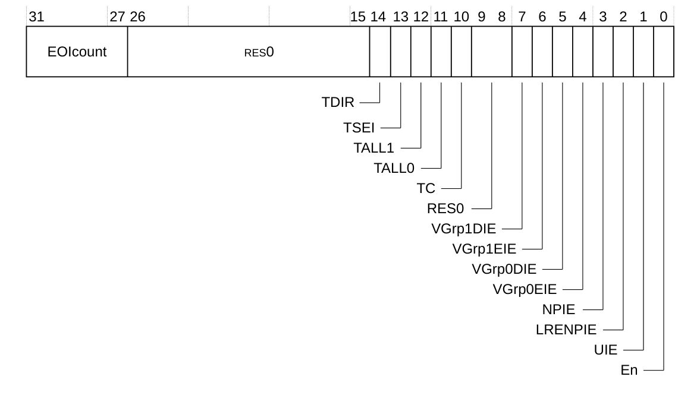

下表给出了 **ICH_HCR** 的位分配。

| 位 | 名称 | 功能 |
| --- | --- | --- |
| [31:27] | EOIcount | 当对虚拟 **EOIR** 或 **DIR** 寄存器的成功写导致虚拟中断去激活时，该字段递增。<br>尽管在正确操作下不会发生，但如果在字段值为 31 时发生**中断结束（EOI，End of Interrupt）**，该字段将回绕到 0。<br>只要该字段非零且 **LRENPIE** 位为 1，维护中断 **INTID25** 即被置位。 |
| [26:15] | - | 保留，RES0。 |
| [14] | TDIR | 陷入虚拟 EL1 对 ICC_DIR 的写：<br>0：虚拟 EL1 对 ICC_DIR 的写不陷入 EL2，除非被其他机制陷入。<br>1：虚拟 EL1 对 ICC_DIR 的写陷入 EL2。 |
| [13] | TSEI | 该字段为 RES0。 |
| [12] | TALL1 | 将虚拟 EL1 对 Group 1 中断的 ICC_\* 系统寄存器的所有访问陷入 EL2：<br>0：虚拟 EL1 对 Group 1 中断的 ICC_\* 寄存器的访问正常进行。这是复位值。<br>1：任何虚拟 EL1 对 Group 1 中断的 ICC_\* 寄存器的访问都陷入 EL2。<br>这影响对 ICC_IAR1、ICC_EOIR1、ICC_HPPIR1、ICC_BPR1、ICC_AP1R0 与 ICC_IGRPEN1 的访问。 |
| [11] | TALL0 | 将虚拟 EL1 对 Group 0 中断的 ICC_\* 系统寄存器的所有访问陷入 EL2：<br>0：虚拟 EL1 对 Group 0 中断的 ICC_\* 寄存器的访问正常进行。这是复位值。<br>1：任何虚拟 EL1 对 Group 0 中断的 ICC_\* 寄存器的访问都陷入 EL2。<br>这影响对 ICC_IAR0、ICC_EOIR0、ICC_HPPIR0、ICC_BPR0、ICC_AP0R0 与 ICC_IGRPEN0 的访问。 |
| [10] | TC | 将虚拟 EL1 对 Group 0 与 Group 1 共用的系统寄存器的所有访问陷入 EL2：<br>0：虚拟 EL1 对公共寄存器的访问正常进行。这是复位值。<br>1：任何虚拟 EL1 对公共寄存器的访问都陷入 EL2。<br>这影响对 ICC_SGI0R、ICC_SGI1R、ICC_ASGI1R、ICC_CTLR、ICC_DIR、ICC_PMR 与 ICC_RPR 的访问。 |
| [9:8] | - | 保留，RES0。 |
| [7] | VGrp1DIE | 虚拟 Group 1 禁用中断使能：<br>0：维护中断被禁用。这是复位值。<br>1：当虚拟 ICC_IGRPEN1.Enable 为 0 时维护中断被使能。 |
| [6] | VGrp1EIE | 虚拟 Group 1 使能中断使能：<br>0：维护中断被禁用。这是复位值。<br>1：当虚拟 ICC_IGRPEN1.Enable 为 1 时维护中断被使能。 |
| [5] | VGrp0DIE | 虚拟 Group 0 禁用中断使能：<br>0：维护中断被禁用。这是复位值。<br>1：当虚拟 ICC_IGRPEN0.Enable 为 0 时维护中断被使能。 |
| [4] | VGrp0EIE | 虚拟 Group 0 使能中断使能：<br>0：维护中断被禁用。这是复位值。<br>1：当虚拟 ICC_IGRPEN0.Enable 为 1 时维护中断被使能。 |
| [3] | NPIE | 无挂起中断使能。使能在 List 寄存器中不存在挂起中断时的维护中断信号：<br>0：维护中断被禁用。这是复位值。<br>1：当 List 寄存器中不包含任何处于挂起状态的中断时维护中断被使能。 |
| [2] | LRENPIE | List 寄存器条目不存在中断使能。使能在虚拟 CPU 接口没有与 EOI 请求对应的有效 List 寄存器条目时的维护中断信号：<br>0：维护中断被禁用。这是复位值。<br>1：当 **EOIcount** 字段非 0 时维护中断被使能。 |
| [1] | UIE | 下溢中断使能。使能在 List 寄存器为空或仅保存一个有效条目时的维护中断信号：<br>0：维护中断被禁用。这是复位值。<br>1：如果 List 寄存器条目中没有或仅有一个被标记为有效中断，则维护中断被使能。 |
| [0] | En | 使能。虚拟 CPU 接口的全局使能位：<br>0：虚拟 CPU 接口操作被禁用。这是复位值。<br>1：虚拟 CPU 接口操作被使能。<br>当该字段置 0 时：<br>• 虚拟 CPU 接口不发出任何维护中断信号。<br>• 虚拟 CPU 接口不发出任何虚拟中断信号。<br>• 对中断确认寄存器的虚拟访问返回伪中断 ID。 |

访问 **ICH_HCR**：

```arm
MRC p15, 4, <Rt>, c12, c11, 0   ; 将 ICH_HCR 读入 Rt
MCR p15, 4, <Rt>, c12, c11, 0   ; 将 Rt 写入 ICH_HCR
```

#### 3.3.2 中断控制器 Hyp 控制 VGIC 类型寄存器

**ICH_VTR** 寄存器描述所实现的虚拟优先级位数与 List 寄存器数量。

**使用限制**

本寄存器为只读，且仅可从 EL2 访问。

**陷阱与使能**

如果 **HSTR.T12** 置 1，则从 EL1 对本寄存器的访问陷入 Hyp 模式。

**配置**

本寄存器在所有构建配置中均可用。

**属性**

**ICH_VTR** 是一个 32 位寄存器。

下图给出了 **ICH_VTR** 的位分配。

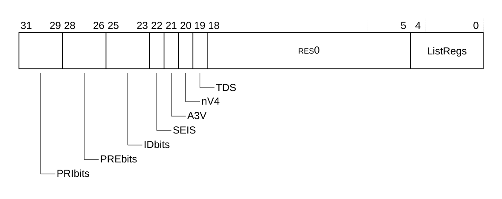

下表给出了 **ICH_VTR** 的位分配。

| 位 | 名称 | 功能 |
| --- | --- | --- |
| [31:29] | PRIbits | 实现的虚拟优先级位数减一。<br>0x4：5 个优先级位。 |
| [28:26] | PREbits | 实现的虚拟抢占位数减一。<br>所有位均可构成优先级组字段并用于抢占。<br>0x4：5 个抢占位。 |
| [25:23] | IDbits | 支持的虚拟中断标识符位数：<br>0b000：16 位。 |
| [22] | SEIS | SEI 支持。指示虚拟 CPU 接口是否支持产生 SEI：<br>0：虚拟 CPU 接口逻辑不支持产生 SEI。 |
| [21] | A3V | 亲和性 3 有效：<br>0：虚拟 CPU 接口逻辑在 SGI 生成系统寄存器中仅支持亲和性 3 的零值。 |
| [20] | nV4 | GICv4 虚拟中断直接注入：<br>1：CPU 接口逻辑不支持虚拟中断的直接注入。 |
| [19] | TDS | 支持单独陷入 EL1 对 ICC_DIR 的写：<br>1：支持 ICH_HCR.TDIR。 |
| [18:5] | - | 保留，RES0。 |
| [4:0] | ListRegs | 实现的 List 寄存器数量减一：<br>0x03：四个 List 寄存器。 |

访问 **ICH_VTR**：

```arm
MRC p15, 4, <Rt>, c12, c11, 1   ; 将 ICH_VTR 读入 Rt
MCR p15, 4, <Rt>, c12, c11, 1   ; 将 Rt 写入 ICH_VTR
```

#### 3.3.3 中断控制器 Hyp 维护中断状态寄存器 EL2

**ICH_MISR** 寄存器指示哪些维护中断被置位。

**使用限制**

本寄存器为只读，且仅在 EL2 可用。

**陷阱与使能**

如果 **HSTR.T12** 置 1，则从 EL1 对本寄存器的访问陷入 Hyp 模式。

**配置**

本寄存器在所有构建配置中均可用。

**属性**

**ICH_MISR** 是一个 32 位寄存器。

下图给出了 **ICH_MISR** 的位分配。

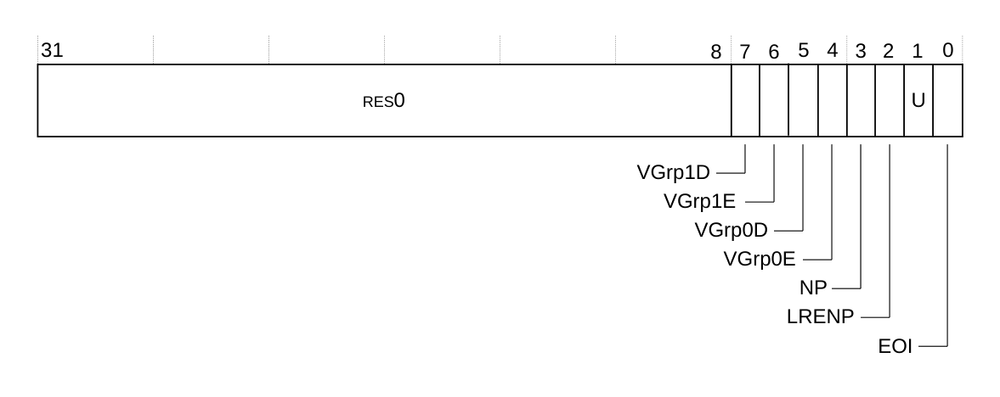

下表给出了 **ICH_MISR** 的位分配。

| 位 | 名称 | 功能 |
| --- | --- | --- |
| [31:8] | - | 保留，RES0。 |
| [7] | VGrp1D | vPE Group 1 禁用：<br>0：vPE Group 1 禁用维护中断未置位。<br>1：vPE Group 1 禁用维护中断已置位。<br>当 **ICH_HCR.VENG1** 为 1 且 **ICH_VMCR.VMGrp1En** 为 0 时，该维护中断被置位。<br>该位复位为 0。 |
| [6] | VGrp1E | vPE Group 1 使能：<br>0：vPE Group 1 使能维护中断未置位。<br>1：vPE Group 1 使能维护中断已置位。<br>当 **ICH_HCR.VENG1** 为 1 且 **ICH_VMCR.VMGrp1En** 为 1 时，该维护中断被置位。<br>该位复位为 0。 |
| [5] | VGrp0D | vPE Group 0 禁用：<br>0：vPE Group 0 禁用维护中断未置位。<br>1：vPE Group 0 禁用维护中断已置位。<br>当 **ICH_HCR.VENG0** 为 1 且 **ICH_VMCR.VMGrp0En** 为 0 时，该维护中断被置位。<br>该位复位为 0。 |
| [4] | VGrp0E | vPE Group 0 使能：<br>0：vPE Group 0 使能维护中断未置位。<br>1：vPE Group 0 使能维护中断已置位。<br>当 **ICH_HCR.VENG0** 为 1 且 **ICH_VMCR.VMGrp0En** 为 1 时，该维护中断被置位。<br>该位复位为 0。 |
| [3] | NP | 无挂起：<br>0：无挂起维护中断未置位。<br>1：无挂起中断已置位。<br>当 **ICH_HCR.NPIE** 为 1 且没有 List 寄存器处于挂起状态时，该维护中断被置位。<br>该位复位为 0。 |
| [2] | LRENP | List 寄存器条目不存在：<br>0：List 寄存器条目不存在维护中断未置位。<br>1：List 寄存器条目不存在维护中断已置位。<br>当 **ICH_HCR.LRENPIE** 为 1 且 **ICH_HCR.EOIcount** 非零时，该维护中断被置位。<br>该位复位为 0。 |
| [1] | U | 下溢：<br>0：下溢维护中断未置位。<br>1：下溢维护中断已置位。<br>当 **ICH_HCR.UIE** 为 1 且 List 寄存器条目中有零个或一个被标记为有效中断（即相应 **ICH_LR\<n\>.State** 位不等于 0x0）时，该维护中断被置位。<br>该位复位为 0。 |
| [0] | EOI | 中断结束。<br>0：中断结束维护中断未置位。<br>1：中断结束维护中断已置位。<br>当 **ICH_EISR** 中至少有一位为 1 时，该维护中断被置位。<br>该位复位为 0。 |

访问 **ICH_MISR**：

```arm
MRC p15, 4, <Rt>, c12, c11, 2   ; 将 ICH_MISR 读入 Rt
MCR p15, 4, <Rt>, c12, c11, 2   ; 将 Rt 写入 ICH_MISR
```

#### 3.3.4 中断控制器中断结束状态寄存器

**ICH_EISR** 寄存器指示哪些 List 寄存器存在未处理的 **EOI** 维护中断。

**使用限制**

本寄存器为只读，且仅在 EL2 可用。

**陷阱与使能**

如果 **HSTR.T12** 置 1，则从 EL1 对本寄存器的访问陷入 Hyp 模式。

**配置**

本寄存器在所有构建配置中均可用。

**属性**

**ICH_EISR** 是一个 32 位寄存器。

下图给出了 **ICH_EISR** 的位分配。


下表给出了 **ICH_EISR** 的位分配。

| 位 | 名称 | 功能 |
| --- | --- | --- |
| [31:4] | - | 保留，RES0。 |
| [3:0] | Status\<n\> | **Status\<n\>**，位 [n]，其中 n = 0 到 3。<br>List 寄存器 \<n\> 的 **EOI** 维护中断状态位：<br>0：List 寄存器 \<n\>（**ICH_LR\<n\>**）没有 **EOI** 维护中断。<br>1：List 寄存器 \<n\>（**ICH_LR\<n\>**）存在尚未处理的 **EOI** 维护中断。<br>对于任何 **ICH_LR\<n\>**，当以下条件全部成立时，相应状态位被置 1：<br>• **ICH_LRC\<n\>.State** 为 0b00。<br>• **ICH_LRC\<n\>.HW** 为 0。<br>• **ICH_LRC\<n\>.EOI**（位 [9]）为 1，表示当该 List 寄存器对应的中断被去激活时，维护中断被置位。<br>这些位复位为 0。 |

访问 **ICH_EISR**：

```arm
MRC p15, 4, <Rt>, c12, c11, 3   ; 将 ICH_EISR 读入 Rt
MCR p15, 4, <Rt>, c12, c11, 3   ; 将 Rt 写入 ICH_EISR
```

#### 3.3.5 中断控制器空 List 寄存器状态寄存器

**ICH_ELRSR** 寄存器指示哪些 List 寄存器包含有效中断。

**使用限制**

本寄存器为只读，且仅在 EL2 可用。

**陷阱与使能**

如果 **HSTR.T12** 置 1，则从 EL1 对本寄存器的访问陷入 Hyp 模式。

**配置**

本寄存器在所有构建配置中均可用。

**属性**

**ICH_ELRSR** 是一个 32 位寄存器。

下图给出了 **ICH_ELRSR** 的位分配。

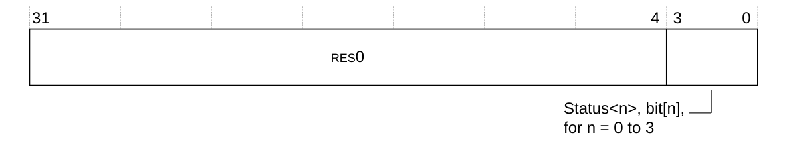

下表给出了 **ICH_ELRSR** 的位分配。

| 位 | 名称 | 功能 |
| --- | --- | --- |
| [31:4] | - | 保留，RES0。 |
| [3:0] | Status\<n\> | **Status\<n\>**，位 [n]，其中 n = 0 到 3。<br>List 寄存器 \<n\>（**ICH_LR\<n\>**）的状态位：<br>0：List 寄存器 **ICH_LR\<n\>** 包含有效中断。<br>1：List 寄存器 **ICH_LR\<n\>** 不包含有效中断。该 List 寄存器为空，可以在不覆盖有效中断或丢失 **EOI** 维护中断的情况下使用。<br>对于任何 List 寄存器 \<n\>，如果 **ICH_LRC\<n\>.State** 为 0b00，且 **ICH_LRC\<n\>.HW** 为 1 或 **ICH_LRC\<n\>.EOI**（位 [9]）为 0，则相应状态位被置 1。 |

访问 **ICH_ELRSR**：

```arm
MRC p15, 4, <Rt>, c12, c11, 5   ; 将 ICH_ELRSR 读入 Rt
MCR p15, 4, <Rt>, c12, c11, 5   ; 将 Rt 写入 ICH_ELRSR
```

#### 3.3.6 中断控制器虚拟机控制寄存器

**ICH_VMCR** 寄存器使管理程序能够保存与恢复虚拟机的 **GIC** 状态视图。

**使用限制**

本寄存器为读写，且仅在 EL2 可用。

**陷阱与使能**

如果 **HSTR.T12** 置 1，则从 EL1 对本寄存器的访问陷入 Hyp 模式。

**配置**

本寄存器在所有构建配置中均可用。

**属性**

**ICH_VMCR** 是一个 32 位寄存器。

下图给出了 **ICH_VMCR** 的位分配。

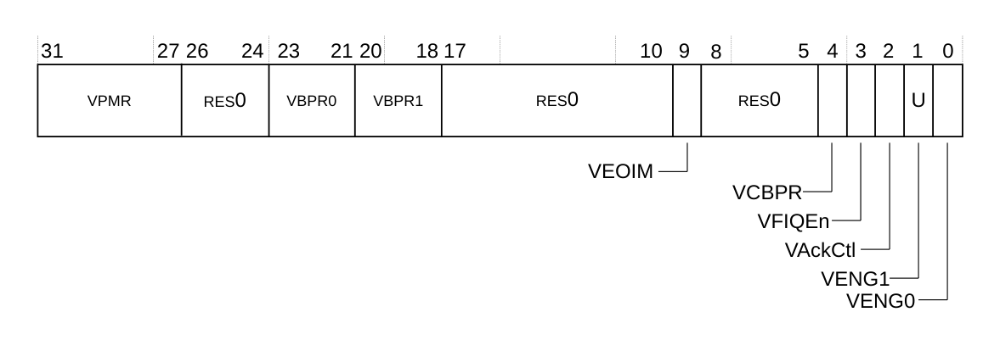

下表给出了 **ICH_VMCR** 的位分配。

| 位 | 名称 | 功能 |
| --- | --- | --- |
| [31:27] | VPMR | 虚拟优先级掩码。<br>该字段是 **ICV_PMR.Priority** 的别名。 |
| [26:24] | - | 保留，RES0。 |
| [23:21] | VBPR0 | 虚拟二进制点寄存器，Group 0。<br>该字段是 **ICV_BPR0.BinaryPoint** 的别名。 |
| [20:18] | VBPR1 | 虚拟二进制点寄存器，Group 1。<br>该字段是 **ICV_BPR1.BinaryPoint** 的别名。 |
| [17:10] | - | 保留，RES0。 |
| [9] | VEOIM | 虚拟 EOI 模式。<br>该位是 **ICV_CTLR.EOImode** 的别名。 |
| [8:5] | - | 保留，RES0。 |
| [4] | VCBPR | 虚拟公共二进制点寄存器。<br>该位是 **ICV_CTLR.CBPR** 的别名。 |
| [3] | VFIQEn | 该字段为 RES1。 |
| [2] | VAckCtl | 该字段为 RES0。 |
| [1] | VENG1 | 虚拟 Group 1 中断使能。<br>该位是 **ICV_IGRPEN1.Enable** 的别名。 |
| [0] | VENG0 | 虚拟 Group 0 中断使能。<br>该位是 **ICV_IGRPEN0.Enable** 的别名。 |

访问 **ICH_VMCR**：

```arm
MRC p15, 4, <Rt>, c12, c11, 7   ; 将 ICH_VMCR 读入 Rt
MCR p15, 4, <Rt>, c12, c11, 7   ; 将 Rt 写入 ICH_VMCR
```

#### 3.3.7 中断控制器 List 寄存器 0-3，ICH_LR0-3

**ICH_LR0-3** 寄存器为虚拟 CPU 接口提供中断上下文信息。

**使用限制**

本寄存器为读写，且仅在 EL2 可用。

**陷阱与使能**

如果 **HSTR.T12** 置 1，则从 EL1 对本寄存器的访问陷入 Hyp 模式。

**配置**

本寄存器在所有构建配置中均可用。

**属性**

**ICH_LR0-3** 是 32 位寄存器。

下图给出了 **ICH_LR0-3** 的位分配。


下表给出了 **ICH_LR0-3** 的位分配。

| 位 | 名称 | 功能 |
| --- | --- | --- |
| [31:16] | - | 保留，RES0 |
| [15:0] | vINTID | 该中断的虚拟 INTID。 |

访问 **ICH_LR0**：

```arm
MRC p15, 4, <Rt>, c12, c12, 0   ; 将 ICH_LR0 读入 Rt
MCR p15, 4, <Rt>, c12, c12, 0   ; 将 Rt 写入 ICH_LR0
```

访问 **ICH_LR1**：

```arm
MRC p15, 4, <Rt>, c12, c12, 1   ; 将 ICH_LR1 读入 Rt
MCR p15, 4, <Rt>, c12, c12, 1   ; 将 Rt 写入 ICH_LR1
```

访问 **ICH_LR2**：

```arm
MRC p15, 4, <Rt>, c12, c12, 2   ; 将 ICH_LR2 读入 Rt
MCR p15, 4, <Rt>, c12, c12, 2   ; 将 Rt 写入 ICH_LR2
```

访问 **ICH_LR3**：

```arm
MRC p15, 4, <Rt>, c12, c12, 3   ; 将 ICH_LR3 读入 Rt
MCR p15, 4, <Rt>, c12, c12, 3   ; 将 Rt 写入 ICH_LR3
```

#### 3.3.8 中断控制器 List 寄存器 0-3，ICH_LRC0-3

**ICH_LRC0-3** 寄存器为虚拟 CPU 接口提供中断上下文信息。

**使用限制**

本寄存器为读写，且仅在 EL2 可用。

**陷阱与使能**

如果 **HSTR.T12** 置 1，则从 EL1 对本寄存器的访问陷入 Hyp 模式。

**配置**

本寄存器在所有构建配置中均可用。

**属性**

**ICH_LRC0-3** 是 32 位寄存器。

当 **HW** 为 0 时，下图给出了 **ICH_LRC0-3** 的位分配。

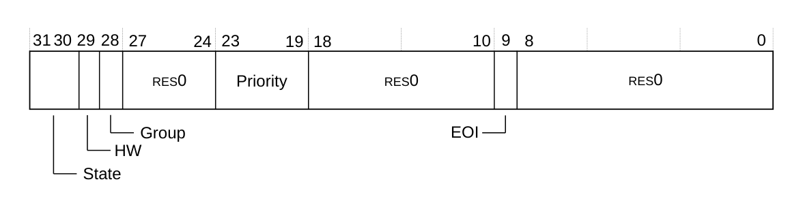

当 **HW** 为 1 时，下图给出了 **ICH_LRC0-3** 的位分配。

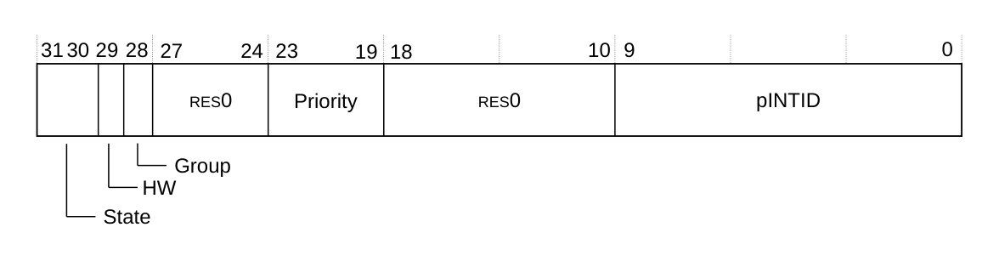

下表给出了 **ICH_LRC0-3** 的位分配。

| 位 | 名称 | 功能 |
| --- | --- | --- |
| [31:30] | State | 该中断的状态：<br>0b00：非活动<br>0b01：挂起<br>0b10：活动<br>0b11：挂起且活动。 |
| [29] | HW | 指示该虚拟中断是否直接映射到硬件中断，即它对应于某个物理中断。虚拟中断的去激活也会导致 **pINTID** 字段所指示 INTID 的物理中断被去激活。<br>0：该中断完全由软件触发。<br>1：该中断直接映射到硬件中断。 |
| [28] | Group | 指示该虚拟中断所属的组。<br>0：这是 Group 0 虚拟中断。<br>1：这是 Group 1 虚拟中断。 |
| [27:24] | - | 保留，RES0。 |
| [23:19] | Priority | 该中断的优先级。 |
| [18:10] | - | 保留，RES0。 |
| [9] | EOI（HW 为 0 时） | **中断结束**。如果该位为 1，则当 **vINTID** 标识的中断被去激活时，**EOI** 维护中断被置位。 |
| [8:0] | -（HW 为 0 时） | 保留，RES0。 |
| [9:0] | pINTID（HW 为 1 时） | 硬件中断的物理 INTID。 |

访问 **ICH_LRC0**：

```arm
MRC p15, 4, <Rt>, c12, c14, 0   ; 将 ICH_LRC0 读入 Rt
MCR p15, 4, <Rt>, c12, c14, 0   ; 将 Rt 写入 ICH_LRC0
```

访问 **ICH_LRC1**：

```arm
MRC p15, 4, <Rt>, c12, c14, 1   ; 将 ICH_LRC1 读入 Rt
MCR p15, 4, <Rt>, c12, c14, 1   ; 将 Rt 写入 ICH_LRC1
```

访问 **ICH_LRC2**：

```arm
MRC p15, 4, <Rt>, c12, c14, 2   ; 将 ICH_LRC2 读入 Rt
MCR p15, 4, <Rt>, c12, c14, 2   ; 将 Rt 写入 ICH_LRC2
```

访问 **ICH_LRC3**：

```arm
MRC p15, 4, <Rt>, c12, c14, 3   ; 将 ICH_LRC3 读入 Rt
MCR p15, 4, <Rt>, c12, c14, 3   ; 将 Rt 写入 ICH_LRC3
```

#### 3.3.9 中断控制器 Hyp 活动优先级组 0 寄存器 0

**ICH_AP0R0** 寄存器为 EL2 提供 Group 0 活动优先级的相关信息。本寄存器是 **ICV_AP0R0** 的别名。

**使用限制**

本寄存器为读写，且仅在 EL2 可用。

**陷阱与使能**

如果 **HSTR.T12** 置 1，则从 EL1 对本寄存器的访问陷入 Hyp 模式。

**配置**

本寄存器在所有构建配置中均可用。

**属性**

**ICH_AP0R0** 是一个 32 位寄存器。

下图给出了 **ICH_AP0R0** 的位分配。


下表给出了 **ICH_AP0R0** 的位分配。

| 位 | 名称 | 功能 |
| --- | --- | --- |
| [n] | P\<n\> | **P\<n\>**，位 [n]，其中 n = 0 到 31。<br>提供对 Group 0 中断虚拟活动优先级的访问。每一位的取值可为：<br>0：在优先级 n 上没有活动的 Group 0 中断。<br>1：在优先级 n 上有活动的 Group 0 中断。 |

访问 **ICH_AP0R0**：

```arm
MRC p15, 4, <Rt>, c12, c8, 0   ; 将 ICH_AP0R0 读入 Rt
MCR p15, 4, <Rt>, c12, c8, 0   ; 将 Rt 写入 ICH_AP0R0
```

#### 3.3.10 中断控制器 Hyp 活动优先级组 1 寄存器 0

**ICH_AP1R0** 寄存器为 EL2 提供 Group 1 活动优先级的相关信息。本寄存器是 **ICV_AP1R0** 的别名。

**使用限制**

本寄存器为读写，且仅在 EL2 可用。

**陷阱与使能**

如果 **HSTR.T12** 置 1，则从 EL1 对本寄存器的访问陷入 Hyp 模式。

**配置**

本寄存器在所有构建配置中均可用。

**属性**

**ICH_AP1R0** 是一个 32 位寄存器。

下图给出了 **ICH_AP1R0** 的位分配。


下表给出了 **ICH_AP1R0** 的位分配。

| 位 | 名称 | 功能 |
| --- | --- | --- |
| [n] | P\<n\> | **P\<n\>**，位 [n]，其中 n = 0 到 31。<br>Group 1 中断活动优先级。每一位的取值可为：<br>0：在优先级 n 上没有活动的 Group 1 中断。<br>1：在优先级 n 上有活动的 Group 1 中断。 |

访问 **ICH_AP1R0**：

```arm
MRC p15, 4, <Rt>, c12, c9, 0   ; 将 ICH_AP1R0 读入 Rt
MCR p15, 4, <Rt>, c12, c9, 0   ; 将 Rt 写入 ICH_AP1R0
```

### 3.4 CPU 接口寄存器（ICC）

下表汇总了每个核中分配在 (coproc==0b1111) 空间的**CPU 接口寄存器**。

| 名称 | CRn | Op1 | CRm | Op2 | 类型 | 复位 | 描述 |
| --- | --- | --- | --- | --- | --- | --- | --- |
| ICC_IAR0 | c12 | 0 | c8 | 0 | RO | 0x000003FF | 中断控制器中断确认寄存器 0 |
| ICC_IAR1 | c12 | 0 | c12 | 0 | RO | 0x000003FF | 中断控制器中断确认寄存器 1 |
| ICC_EOIR0 | c12 | 0 | c8 | 1 | WO | UNK | 中断控制器中断结束寄存器 0 |
| ICC_EOIR1 | c12 | 0 | c12 | 1 | WO | UNK | 中断控制器中断结束寄存器 1 |
| ICC_HPPIR0 | c12 | 0 | c8 | 2 | RO | 0x000003FF | 中断控制器最高优先级挂起中断寄存器 0 |
| ICC_HPPIR1 | c12 | 0 | c12 | 2 | RO | 0x000003FF | 中断控制器最高优先级挂起中断寄存器 1 |
| ICC_BPR0 | c12 | 0 | c8 | 3 | RW | 0x00000002 | 中断控制器二进制点寄存器 0 |
| ICC_BPR1 | c12 | 0 | c12 | 3 | RW | 0x00000003 | 中断控制器二进制点寄存器 1 |
| ICC_DIR | c12 | 0 | c11 | 1 | WO | UNK | 中断控制器去激活中断寄存器 |
| ICC_PMR | c4 | 0 | c6 | 0 | RW | 0x00000000 | 中断控制器中断优先级掩码寄存器 |
| ICC_RPR | c12 | 0 | c11 | 3 | RO | 0x000000FF | 中断控制器运行优先级寄存器 |
| ICC_CTLR | c12 | 0 | c12 | 4 | RW | 0x00000400 | 中断控制器控制寄存器（EL1） |
| ICC_SRE | c12 | 0 | c12 | 5 | RW | 0x00000007 | 中断控制器系统寄存器使能寄存器（EL1） |
| ICC_HSRE | c12 | 4 | c9 | 5 | RO | 0x0000000F | 中断控制器系统寄存器使能寄存器（EL2） |
| ICC_IGRPEN0 | c12 | 0 | c12 | 6 | RW | 0x00000000 | 中断控制器中断组 0 使能寄存器 |
| ICC_IGRPEN1 | c12 | 0 | c12 | 7 | RW | 0x00000000 | 中断控制器中断组 1 使能寄存器 |
| ICC_SGI0R | - | 2 | c12 | - | WO | UNK | 中断控制器软件生成中断组 0 寄存器 |
| ICC_SGI1R | - | 0 | c12 | - | WO | UNK | 中断控制器软件生成中断组 1 寄存器 |
| ICC_ASGI1R | - | 1 | c12 | - | WO | UNK | 中断控制器别名软件生成中断组 1 寄存器 |
| ICC_AP0R0 | c12 | 0 | c8 | 4 | RW | 0x00000000 | 中断控制器活动优先级组 0 寄存器 |
| ICC_AP1R0 | c12 | 0 | c9 | 0 | RW | 0x00000000 | 中断控制器活动优先级组 1 寄存器 |

**注意：** 以不同于寄存器最后一次读取值（或者在不存在 Group 0 活动优先级时不同于 0x00000000）的值写入 **ICC_AP0R0** 与 **ICC_AP0R1**，可能导致中断优先级系统出现 UNPREDICTABLE 行为。

#### 3.4.1 中断控制器中断确认寄存器 0

**ICC_IAR0** 寄存器包含已发出信号的 **Group 0** 中断的 **INTID**。核读取该 **INTID** 时，即作为对该中断的确认。在正常操作中，group 0 中相应的活动优先级位被置位，中断被激活。读取本寄存器可确认通过写**中断置位挂起寄存器**所产生的中断，以及通过 **SPI** 与 **PPI** 信号线以及**软件生成中断组 0 寄存器**产生的中断。

**使用限制**

本寄存器为只读。

**陷阱与使能**

如果 **HSTR.T12** 置 1，则从 EL1 对本寄存器的读访问陷入 Hyp 模式。

**配置**

本寄存器在所有构建配置中均可用。

**属性**

**ICC_IAR0** 是一个 32 位寄存器。

下图给出了 **ICC_IAR0** 的位分配。


下表给出了 **ICC_IAR0** 的位分配。

| 位 | 名称 | 功能 |
| --- | --- | --- |
| [31:10] | - | 保留，RES0。 |
| [9:0] | INTID | 已发出信号中断的 INTID。 |

访问 **ICC_IAR0**：

```arm
MRC p15, 0, <Rt>, c12, c8, 0   ; 将 ICC_IAR0 读入 Rt
MCR p15, 0, <Rt>, c12, c8, 0   ; 将 Rt 写入 ICC_IAR0
```

#### 3.4.2 中断控制器中断确认寄存器 1

**ICC_IAR1** 寄存器包含已发出信号的 **Group 1** 中断的 **INTID**。核读取该 **INTID** 时，即作为对该中断的确认。在正常操作中，group 1 中相应的活动优先级位被置位，中断被激活。读取本寄存器可确认通过写**中断置位挂起寄存器**所产生的中断，以及通过 **SPI** 与 **PPI** 信号线以及**软件生成中断组 1 寄存器**产生的中断。

**使用限制**

本寄存器为只读。

**陷阱与使能**

如果 **HSTR.T12** 置 1，则从 EL1 对本寄存器的读访问陷入 Hyp 模式。

如果 **ICH_HCR.TALL1** 置 1，则从 EL1 对本寄存器的读访问陷入 EL2。

**配置**

本寄存器在所有构建配置中均可用。

**属性**

**ICC_IAR1** 是一个 32 位寄存器。

下图给出了 **ICC_IAR1** 的位分配。


下表给出了 **ICC_IAR1** 的位分配。

| 位 | 名称 | 功能 |
| --- | --- | --- |
| [31:10] | - | 保留，RES0。 |
| [9:0] | INTID | 已发出信号中断的 INTID。 |

访问 **ICC_IAR1**：

```arm
MRC p15, 0, <Rt>, c12, c12, 0   ; 将 ICC_IAR1 读入 Rt
MCR p15, 0, <Rt>, c12, c12, 0   ; 将 Rt 写入 ICC_IAR1
```

#### 3.4.3 中断控制器中断结束寄存器 0

核可以写 **ICC_EOIR0** 寄存器，通知 **CPU 接口**它已完成对指定 **Group 0** 中断的处理。在正常操作中，group 0 中优先级最高的已置位活动优先级位被清除；此外，如果 **ICC_CTLR.EOImode == 0**，该中断被去激活。

**使用限制**

本寄存器为只写。

**陷阱与使能**

如果 **HSTR.T12** 置 1，则从 EL1 对本寄存器的写访问陷入 Hyp 模式。

如果 **ICH_HCR.TALL0** 置 1，则从 EL1 对本寄存器的写访问陷入 EL2。

**配置**

本寄存器在所有构建配置中均可用。

**属性**

**ICC_EOIR0** 是一个 32 位寄存器。

下图给出了 **ICC_EOIR0** 的位分配。


下表给出了 **ICC_EOIR0** 的位分配。

| 位 | 名称 | 功能 |
| --- | --- | --- |
| [31:10] | - | 保留，RES0。 |
| [9:0] | INTID | 相应 **ICC_IAR0** 访问得到的 INTID。 |

访问 **ICC_EOIR0**：

```arm
MRC p15, 0, <Rt>, c12, c8, 1   ; 将 ICC_EOIR0 读入 Rt
MCR p15, 0, <Rt>, c12, c8, 1   ; 将 Rt 写入 ICC_EOIR0
```

#### 3.4.4 中断控制器中断结束寄存器 1

核可以写 **ICC_EOIR1** 寄存器，通知 **CPU 接口**它已完成对指定 **Group 1** 中断的处理。在正常操作中，group 1 中优先级最高的已置位活动优先级位被清除；此外，如果 **ICC_CTLR.EOIMode = 0**，该中断被去激活。

**使用限制**

本寄存器为只写。

**陷阱与使能**

如果 **HSTR.T12** 置 1，则从 EL1 对本寄存器的写访问陷入 Hyp 模式。

如果 **ICH_HCR.TALL1** 置 1，则从 EL1 对本寄存器的写访问陷入 EL2。

**配置**

本寄存器在所有构建配置中均可用。

**属性**

**ICC_EOIR1** 是一个 32 位寄存器。

下图给出了 **ICC_EOIR1** 的位分配。


下表给出了 **ICC_EOIR1** 的位分配。

| 位 | 名称 | 功能 |
| --- | --- | --- |
| [31:10] | - | 保留，RES0。 |
| [9:0] | INTID | 相应 **ICC_IAR1** 访问得到的 INTID。 |

访问 **ICC_EOIR1**：

```arm
MRC p15, 0, <Rt>, c12, c12, 1   ; 将 ICC_EOIR1 读入 Rt
MCR p15, 0, <Rt>, c12, c12, 1   ; 将 Rt 写入 ICC_EOIR1
```

#### 3.4.5 中断控制器最高优先级挂起中断寄存器 0

**ICC_HPPIR0** 寄存器指示 **CPU 接口**上优先级最高的挂起 **Group 0** 中断，且不改变 **GIC** 的状态。

**使用限制**

本寄存器为只读，且不改变 **GIC** 的状态。

**陷阱与使能**

如果 **HSTR.T12** 置 1，则从 EL1 对本寄存器的读访问陷入 Hyp 模式。

如果 **ICH_HCR.TALL0** 置 1，则从 EL1 对本寄存器的读访问陷入 EL2。

**配置**

本寄存器在所有构建配置中均可用。

**属性**

**ICC_HPPIR0** 是一个 32 位寄存器。

下图给出了 **ICC_HPPIR0** 的位分配。


下表给出了 **ICC_HPPIR0** 的位分配。

| 位 | 名称 | 功能 |
| --- | --- | --- |
| [31:10] | - | 保留，RES0。 |
| [9:0] | INTID | CPU 接口上优先级最高的挂起 Group 0 中断的 INTID。 |

访问 **ICC_HPPIR0**：

```arm
MRC p15, 0, <Rt>, c12, c8, 2   ; 将 ICC_HPPIR0 读入 Rt
MCR p15, 0, <Rt>, c12, c8, 2   ; 将 Rt 写入 ICC_HPPIR0
```

#### 3.4.6 中断控制器最高优先级挂起中断寄存器 1

**ICC_HPPIR1** 寄存器指示 **CPU 接口**上优先级最高的挂起 **Group 1** 中断，且不改变 **GIC** 的状态。

**使用限制**

本寄存器为只读。

**陷阱与使能**

如果 **HSTR.T12** 置 1，则从 EL1 对本寄存器的读访问陷入 Hyp 模式。

如果 **ICH_HCR.TALL1** 置 1，则从 EL1 对本寄存器的读访问陷入 EL2。

**配置**

本寄存器在所有构建配置中均可用。

**属性**

**ICC_HPPIR1** 是一个 32 位寄存器。

下图给出了 **ICC_HPPIR1** 的位分配。


下表给出了 **ICC_HPPIR1** 的位分配。

| 位 | 名称 | 功能 |
| --- | --- | --- |
| [31:10] | - | 保留，RES0。 |
| [9:0] | INTID | CPU 接口上优先级最高的挂起 Group 1 中断的 INTID。 |

访问 **ICC_HPPIR1**：

```arm
MRC p15, 0, <Rt>, c12, c12, 2   ; 将 ICC_HPPIR1 读入 Rt
MCR p15, 0, <Rt>, c12, c12, 2   ; 将 Rt 写入 ICC_HPPIR1
```

#### 3.4.7 中断控制器二进制点寄存器 0

**ICC_BPR0** 寄存器定义优先级值字段拆分为两部分的点：**组优先级字段**与**子优先级字段**。组优先级字段决定 **Group 0** 中断的抢占。

**使用限制**

本寄存器为读写。

**陷阱与使能**

如果 **HSTR.T12** 置 1，则从 EL1 对本寄存器的访问陷入 Hyp 模式。

如果 **ICH_HCR.TALL0** 置 1，则从 EL1 对本寄存器的访问陷入 EL2。

**配置**

本寄存器在所有构建配置中均可用。

**属性**

**ICC_BPR0** 是一个 32 位寄存器。

下图给出了 **ICC_BPR0** 的位分配。


下表给出了 **ICC_BPR0** 的位分配。

| 位 | 名称 | 功能 |
| --- | --- | --- |
| [31:3] | - | 保留，RES0。 |
| [2:0] | BinaryPoint | 该值控制 5 位中断优先级字段如何拆分为决定中断抢占的组优先级字段与子优先级字段。参见下表。复位值为 0x2。 |

下表给出了二进制点值与组优先级、子优先级字段之间的关系。

| BinaryPoint 值 | 组优先级字段 | 子优先级字段 | 带二进制点的字段 |
| --- | --- | --- | --- |
| 2 | [7:3] | - | ggggg. |
| 3 | [7:4] | [3] | gggg.s |
| 4 | [7:5] | [4:3] | ggg.ss |
| 5 | [7:6] | [5:3] | gg.sss |
| 6 | [7] | [6:3] | g.ssss |
| 7 | 无抢占 | [7:3] | .sssss |

访问 **ICC_BPR0**：

```arm
MRC p15, 0, <Rt>, c12, c8, 3   ; 将 ICC_BPR0 读入 Rt
MCR p15, 0, <Rt>, c12, c8, 3   ; 将 Rt 写入 ICC_BPR0
```

#### 3.4.8 中断控制器二进制点寄存器 1

**ICC_BPR1** 寄存器定义优先级值字段拆分为两部分的点：**组优先级字段**与**子优先级字段**。组优先级字段决定 **Group 1** 中断的抢占。

**使用限制**

本寄存器为读写。

**陷阱与使能**

如果 **HSTR.T12** 置 1，则从 EL1 对本寄存器的访问陷入 Hyp 模式。

如果 **ICH_HCR.TALL1** 置 1，则从 EL1 对本寄存器的访问陷入 EL2。

**配置**

本寄存器在所有构建配置中均可用。

**属性**

**ICC_BPR1** 是一个 32 位寄存器。

下图给出了 **ICC_BPR1** 的位分配。


下表给出了 **ICC_BPR1** 的位分配。

| 位 | 名称 | 功能 |
| --- | --- | --- |
| [31:3] | - | 保留，RES0。 |
| [2:0] | BinaryPoint | 该值控制 5 位中断优先级字段如何拆分为决定中断抢占的组优先级字段与子优先级字段。参见下表。复位值为 0x3。 |

下表给出了二进制点值与组优先级、子优先级字段之间的关系。

| BinaryPoint 值 | 组优先级字段 | 子优先级字段 | 带二进制点的字段 |
| --- | --- | --- | --- |
| 3 | [7:3] | - | ggggg. |
| 4 | [7:4] | [3] | gggg.s |
| 5 | [7:5] | [4:3] | ggg.ss |
| 6 | [7:6] | [5:3] | gg.sss |
| 7 | [7] | [6:3] | g.ssss |

访问 **ICC_BPR1**：

```arm
MRC p15, 0, <Rt>, c12, c12, 3   ; 将 ICC_BPR1 读入 Rt
MCR p15, 0, <Rt>, c12, c12, 3   ; 将 Rt 写入 ICC_BPR1
```

#### 3.4.9 中断控制器去激活中断寄存器

当**中断优先级下降**与**中断去激活**分离时（**ICC_CTLR.EOIMode=1**），对 **ICC_DIR** 寄存器的写将去激活指定的中断。

**使用限制**

本寄存器为只写。

**陷阱与使能**

如果 **HSTR.T12** 置 1，则从 EL1 对本寄存器的写访问陷入 Hyp 模式。

如果 **ICH_HCR.TC** 置 1，则从 EL1 对本寄存器的写访问陷入 EL2。

如果 **ICH_HCR.TDIR** 置 1，则从 EL1 对本寄存器的写访问陷入 EL2。

**配置**

本寄存器在所有构建配置中均可用。

**属性**

**ICC_DIR** 是一个 32 位寄存器。

下图给出了 **ICC_DIR** 的位分配。


下表给出了 **ICC_DIR** 的位分配。

| 位 | 名称 | 功能 |
| --- | --- | --- |
| [31:10] | - | 保留，RES0。 |
| [9:0] | INTID | 要立即去激活的中断的 INTID。 |

访问 **ICC_DIR**：

```arm
MRC p15, 0, <Rt>, c12, c11, 1   ; 将 ICC_DIR 读入 Rt
MCR p15, 0, <Rt>, c12, c11, 1   ; 将 Rt 写入 ICC_DIR
```

#### 3.4.10 中断控制器中断优先级掩码寄存器

**ICC_PMR** 寄存器提供中断优先级过滤器。只有优先级高于本寄存器中数值的中断才会向核发出信号。

**使用限制**

本寄存器为读写。

**陷阱与使能**

如果 **ICH_HCR.TC** 置 1，则从 EL1 对本寄存器的访问陷入 EL2。

**配置**

本寄存器在所有构建配置中均可用。

**属性**

**ICC_PMR** 是一个 32 位寄存器。

下图给出了 **ICC_PMR** 的位分配。


下表给出了 **ICC_PMR** 的位分配。

| 位 | 名称 | 功能 |
| --- | --- | --- |
| [31:8] | - | 保留，RES0。 |
| [7:3] | Priority | CPU 接口的优先级掩码级别。如果中断的优先级高于本字段指示的值，接口即向核发出该中断的信号。数值越小，优先级越高。 |
| [2:0] | - | RAZ/WI。 |

访问 **ICC_PMR**：

```arm
MRC p15, 0, <Rt>, c4, c6, 0   ; 将 ICC_PMR 读入 Rt
MCR p15, 0, <Rt>, c4, c6, 0   ; 将 Rt 写入 ICC_PMR
```

#### 3.4.11 中断控制器运行优先级寄存器

**ICC_RPR** 寄存器指示 CPU 接口的**运行优先级**，即 Group 0 与 Group 1 中最高的活动优先级。

**使用限制**

本寄存器为只读。

**陷阱与使能**

如果 **HSTR.T12** 置 1，则从 EL1 对本寄存器的读访问陷入 Hyp 模式。

如果 **ICH_HCR.TC** 置 1，则从 EL1 对本寄存器的读访问陷入 EL2。

**配置**

本寄存器在所有构建配置中均可用。

**属性**

**ICC_RPR** 是一个 32 位寄存器。

下图给出了 **ICC_RPR** 的位分配。


下表给出了 **ICC_RPR** 的位分配。

| 位 | 名称 | 功能 |
| --- | --- | --- |
| [31:8] | - | 保留，RES0。 |
| [7:0] | Priority | 当前运行优先级。当 **ICC_AP0R0** 与 **ICC_AP1R0** 均为 0x0 时返回 0xFF。否则返回 **ICC_AP0R0** 与 **ICC_AP1R0** 中最低置位对应的索引（位于位 [7:3]）。 |

访问 **ICC_RPR**：

```arm
MRC p15, 0, <Rt>, c12, c11, 3   ; 将 ICC_RPR 读入 Rt
MCR p15, 0, <Rt>, c12, c11, 3   ; 将 Rt 写入 ICC_RPR
```

#### 3.4.12 中断控制器控制寄存器（EL1）

**ICC_CTLR** 寄存器控制 **GIC CPU 接口**行为的某些方面，并提供所实现特性的相关信息。

**使用限制**

本寄存器为读写。

**陷阱与使能**

如果 **HSTR.T12** 置 1，则从 EL1 对本寄存器的访问陷入 Hyp 模式。

如果 **ICH_HCR.TC** 置 1，则从 EL1 对本寄存器的访问陷入 EL2。

**配置**

本寄存器在所有构建配置中均可用。

**属性**

**ICC_CTLR** 是一个 32 位寄存器。

下图给出了 **ICC_CTLR** 的位分配。

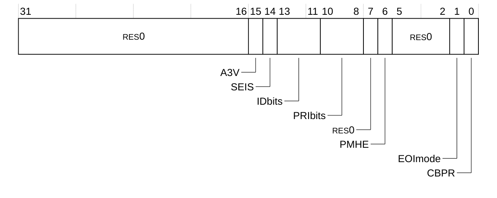

下表给出了 **ICC_CTLR** 的位分配。

| 位 | 名称 | 功能 |
| --- | --- | --- |
| [31:16] | - | 保留，RES0。 |
| [15] | A3V | 亲和性 3 有效。只读，写入被忽略：<br>0：CPU 接口逻辑在 SGI 生成系统寄存器中仅支持亲和性 3 的零值。 |
| [14] | SEIS | SEI 支持。只读，写入被忽略。指示 CPU 接口是否支持本地产生 SEI：<br>0：CPU 接口逻辑不支持本地产生 SEI。 |
| [13:11] | IDbits | 指示所支持的物理中断标识符位数：<br>0b000：支持 16 个中断标识符位。 |
| [10:8] | PRIbits | 指示所实现的优先级位数减一：<br>0b100：支持 5 个优先级位。 |
| [7] | - | 保留，RES0。 |
| [6] | PMHE | 该字段为 RES0。 |
| [5:2] | - | 保留，RES0。 |
| [1] | EOImode | 控制对 **ICC_EOIR0** 与 **ICC_EOIR1** 的写是否同时去激活中断。 |
| [0] | CBPR | 控制 **ICC_BPR0** 是否用于 Group 0 与 Group 1 中断的中断抢占。 |

访问 **ICC_CTLR**：

```arm
MRC p15, 0, <Rt>, c12, c12, 4   ; 将 ICC_CTLR 读入 Rt
MCR p15, 0, <Rt>, c12, c12, 4   ; 将 Rt 写入 ICC_CTLR
```

#### 3.4.13 中断控制器系统寄存器使能寄存器（EL1）

**ICC_SRE** 寄存器指示使用系统寄存器访问 **GIC CPU 接口**，且不支持中断旁路。

**使用限制**

本寄存器为读写。

**陷阱与使能**

如果 **HSTR.T12** 置 1，则从 EL1 对本寄存器的访问陷入 Hyp 模式。

**配置**

本寄存器在所有构建配置中均可用。

**属性**

**ICC_SRE** 是一个 32 位寄存器。

下图给出了 **ICC_SRE** 的位分配。

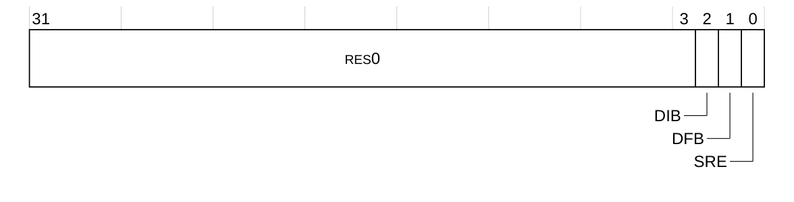

下表给出了 **ICC_SRE** 的位分配。

| 位 | 名称 | 功能 |
| --- | --- | --- |
| [31:3] | - | 保留，RES0。 |
| [2] | DIB | 禁用 IRQ 旁路：<br>RAO/WI<br>不支持 IRQ 旁路。 |
| [1] | DFB | 禁用 FIQ 旁路：<br>RAO/WI<br>不支持 FIQ 旁路。 |
| [0] | SRE | 系统寄存器使能：<br>RAO/WI<br>使用系统寄存器访问 GIC CPU 接口。 |

访问 **ICC_SRE**：

```arm
MRC p15, 0, <Rt>, c12, c12, 5   ; 将 ICC_SRE 读入 Rt
MCR p15, 0, <Rt>, c12, c12, 5   ; 将 Rt 写入 ICC_SRE
```

#### 3.4.14 中断控制器系统寄存器使能寄存器（EL2）

**ICC_HSRE** 寄存器控制 EL2 使用系统寄存器接口还是内存映射接口访问 **GIC CPU 接口**。

**使用限制**

本寄存器为只读。

**陷阱与使能**

如果 **HSTR.T12** 置 1，则从 EL1 对本寄存器的访问陷入 Hyp 模式。

**配置**

本寄存器在所有构建配置中均可用。

**属性**

**ICC_HSRE** 是一个 32 位寄存器。

下图给出了 **ICC_HSRE** 的位分配。

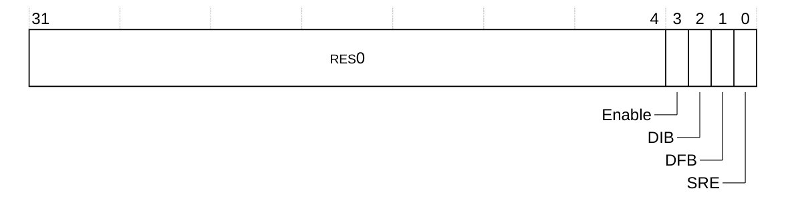

下表给出了 **ICC_HSRE** 的位分配。

| 位 | 名称 | 功能 |
| --- | --- | --- |
| [31:4] | - | 保留，RES0。 |
| [3] | Enable | 使能较低异常级别对 **ICC_HSRE** 的访问：<br>RAO/WI<br>较低异常级别可以读取 ICC_SRE。 |
| [2] | DIB | 禁用 IRQ 旁路：<br>RAO/WI<br>不支持 IRQ 旁路。 |
| [1] | DFB | 禁用 FIQ 旁路：<br>RAO/WI<br>不支持 FIQ 旁路。 |
| [0] | SRE | 系统寄存器使能：<br>RAO/WI<br>使用系统寄存器访问 GIC CPU 接口。 |

访问 **ICC_HSRE**：

```arm
MRC p15, 4, <Rt>, c12, c9, 5   ; 将 ICC_HSRE 读入 Rt
MCR p15, 4, <Rt>, c12, c9, 5   ; 将 Rt 写入 ICC_HSRE
```

#### 3.4.15 中断控制器中断组 0 使能寄存器

**ICC_IGRPEN0** 寄存器控制是否使能 **Group 0** 中断。

**使用限制**

本寄存器为读写。

**陷阱与使能**

如果 **HSTR.T12** 置 1，则从 EL1 对本寄存器的访问陷入 Hyp 模式。

如果 **ICH_HCR.TALL0** 置 1，则从 EL1 对本寄存器的访问陷入 EL2。

**配置**

本寄存器在所有构建配置中均可用。

**属性**

**ICC_IGRPEN0** 是一个 32 位寄存器。

下图给出了 **ICC_IGRPEN0** 的位分配。

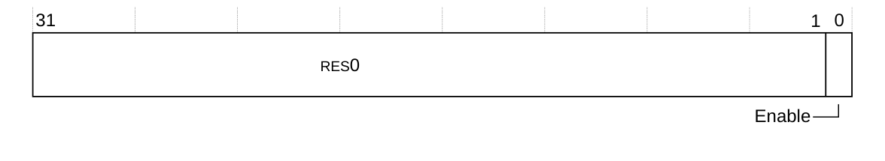

下表给出了 **ICC_IGRPEN0** 的位分配。

| 位 | 名称 | 功能 |
| --- | --- | --- |
| [31:1] | - | 保留，RES0。 |
| [0] | Enable | 使能 Group 0 中断：<br>0：Group 0 中断被禁用。这是复位值。<br>1：Group 0 中断被使能。 |

访问 **ICC_IGRPEN0**：

```arm
MRC p15, 0, <Rt>, c12, c12, 6   ; 将 ICC_IGRPEN0 读入 Rt
MCR p15, 0, <Rt>, c12, c12, 6   ; 将 Rt 写入 ICC_IGRPEN0
```

#### 3.4.16 中断控制器中断组 1 使能寄存器

**ICC_IGRPEN1** 寄存器控制是否使能 **Group 1** 中断。

**使用限制**

本寄存器为读写。

**陷阱与使能**

如果 **HSTR.T12** 置 1，则从 EL1 对本寄存器的访问陷入 Hyp 模式。

如果 **ICH_HCR.TALL1** 置 1，则从 EL1 对本寄存器的访问陷入 EL2。

**配置**

本寄存器在所有构建配置中均可用。

**属性**

**ICC_IGRPEN1** 是一个 32 位寄存器。

下图给出了 **ICC_IGRPEN1** 的位分配。


下表给出了 **ICC_IGRPEN1** 的位分配。

| 位 | 名称 | 功能 |
| --- | --- | --- |
| [31:1] | - | 保留，RES0。 |
| [0] | Enable | 使能 Group 1 中断：<br>0：Group 1 中断被禁用。这是复位值。<br>1：Group 1 中断被使能。 |

访问 **ICC_IGRPEN1**：

```arm
MRC p15, 0, <Rt>, c12, c12, 7   ; 将 ICC_IGRPEN1 读入 Rt
MCR p15, 0, <Rt>, c12, c12, 7   ; 将 Rt 写入 ICC_IGRPEN1
```

#### 3.4.17 中断控制器软件生成中断组 0 寄存器

**ICC_SGI0R** 寄存器用于按照 **GICR_IGROUPR** 配置请求 **Group 0 SGI**。

**使用限制**

本寄存器为只写。

当 IRM=0 时，未使用的亲和性位必须写为 0，否则**生成 SGI 请求**不会被发送。

**陷阱与使能**

如果 **HCR.FMO** 置 1，则从 EL1 对本寄存器的写访问陷入 EL2。

如果 **HCR.IMO** 置 1，则从 EL1 对本寄存器的写访问陷入 EL2。

如果 **HSTR.T12** 置 1，则从 EL1 对本寄存器的写访问陷入 Hyp 模式。

如果 **ICH_HCR.TC** 置 1，则从 EL1 对本寄存器的写访问陷入 EL2。

**配置**

本寄存器在所有构建配置中均可用。

**属性**

**ICC_SGI0R** 是一个 64 位寄存器。

下图给出了 **ICC_SGI0R** 的位分配。

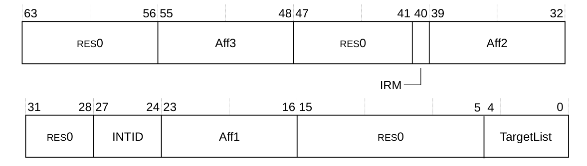

下表给出了 **ICC_SGI0R** 的位分配。

| 位 | 名称 | 功能 |
| --- | --- | --- |
| [63:56] | - | 保留，RES0。 |
| [55:48] | Aff3 | 为其生成 SGI 中断的集群亲和性路径中的亲和性级别 3 值。<br>如果 IRM 位为 1，该字段为 RES0。 |
| [47:41] | - | 保留，RES0。 |
| [40] | IRM | 中断路由模式。决定所生成中断如何分发到各核：<br>0：中断路由到 Aff3.Aff2.Aff1.\<target list\> 指定的核。<br>1：中断路由到系统中除“自身”之外的所有核。 |
| [39:32] | Aff2 | 为其生成 SGI 中断的集群亲和性路径中的亲和性 2 值。<br>如果 IRM 位为 1，该字段为 RES0。 |
| [31:28] | - | 保留，RES0。 |
| [27:24] | INTID | 该 SGI 的中断 ID。 |
| [23:16] | Aff1 | 为其生成 SGI 中断的集群亲和性路径中的亲和性 1 值。<br>如果 IRM 位为 1，该字段为 RES0。 |
| [15:5] | - | 保留，RES0。 |
| [4:0] | TargetList | 目标列表。为其生成 SGI 中断的核集合。每一位对应集群中亲和性 0 值等于位号的核。<br>如果 IRM 位为 1，该字段为 RES0。 |

访问 **ICC_SGI0R**：

```arm
MCRR p15, 2, <Rt>, <Rt2>, c12   ; 将 Rt 写入 ICC_SGI0R[31:0]，将 Rt2 写入 ICC_SGI0R[63:32]
```

#### 3.4.18 中断控制器软件生成中断组 1 寄存器

**ICC_SGI1R** 寄存器用于按照 **GICR_IGROUPR** 的配置请求 **Group 0** 与 **Group 1 SGI**。

无论目标端的 **GICR_IGROUPR0[INTID]** 如何，均可使用本寄存器生成 **SGI**。

**使用限制**

本寄存器为只写。当 IRM=0 时，未使用的亲和性位必须写为 0，否则**生成 SGI 请求**不会被发送。

**陷阱与使能**

如果 **HCR.FMO** 置 1，则从 EL1 对本寄存器的写访问陷入 EL2。

如果 **HCR.IMO** 置 1，则从 EL1 对本寄存器的写访问陷入 EL2。

如果 **HSTR.T12** 置 1，则从 EL1 对本寄存器的写访问陷入 Hyp 模式。

如果 **ICH_HCR.TC** 置 1，则从 EL1 对本寄存器的写访问陷入 EL2。

**配置**

本寄存器在所有构建配置中均可用。

**属性**

**ICC_SGI1R** 是一个 64 位寄存器。

下图给出了 **ICC_SGI1R** 的位分配。


下表给出了 **ICC_SGI1R** 的位分配。

| 位 | 名称 | 功能 |
| --- | --- | --- |
| [63:56] | - | 保留，RES0。 |
| [55:48] | Aff3 | 为其生成 SGI 中断的集群亲和性路径中的亲和性 3 值。<br>如果 IRM 位为 1，该字段为 RES0。 |
| [47:41] | - | 保留，RES0。 |
| [40] | IRM | 中断路由模式。决定所生成中断如何分发到各核：<br>0：中断路由到 Aff3.Aff2.Aff1.\<target list\> 指定的核。<br>1：中断路由到系统中除“自身”之外的所有核。 |
| [39:32] | Aff2 | 为其生成 SGI 中断的集群亲和性路径中的亲和性 2 值。<br>如果 IRM 位为 1，该字段为 RES0。 |
| [31:28] | - | 保留，RES0。 |
| [27:24] | INTID | 该 SGI 的中断 ID。 |
| [23:16] | Aff1 | 为其生成 SGI 中断的集群亲和性路径中的亲和性 1 值。<br>如果 IRM 位为 1，该字段为 RES0。 |
| [15:5] | - | 保留，RES0。 |
| [4:0] | TargetList | 目标列表。为其生成 SGI 中断的核集合。每一位对应集群中亲和性 0 值等于位号的核。<br>如果 IRM 位为 1，该字段为 RES0。 |

访问 **ICC_SGI1R**：

```arm
MCRR p15, 0, <Rt>, <Rt2>, c12   ; 将 Rt 写入 ICC_SGI1R[31:0]，将 Rt2 写入 ICC_SGI1R[63:32]
```

#### 3.4.19 中断控制器别名软件生成中断组 1 寄存器

如果目标端的 **GICR_IGROUPR0[INTID]** 配置为 0，则 **ICC_ASGI1R** 生成 **Group 0 SGI**。本寄存器的行为与 **ICC_SGI0R** 相同。

**使用限制**

本寄存器为只写。

当 IRM=0 时，未使用的亲和性位必须写为 0，否则**生成 SGI 请求**不会被发送。

**陷阱与使能**

如果 **HCR.FMO** 置 1，则从 EL1 对本寄存器的写访问陷入 EL2。

如果 **HCR.IMO** 置 1，则从 EL1 对本寄存器的写访问陷入 EL2。

如果 **HSTR.T12** 置 1，则从 EL1 对本寄存器的写访问陷入 Hyp 模式。

如果 **ICH_HCR.TC** 置 1，则从 EL1 对本寄存器的写访问陷入 EL2。

**配置**

本寄存器在所有构建配置中均可用。

**属性**

**ICC_ASGI1R** 是一个 64 位寄存器。

下图给出了 **ICC_ASGI1R** 的位分配。

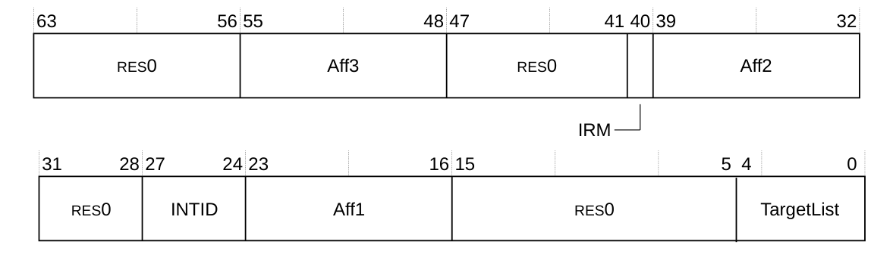

下表给出了 **ICC_ASGI1R** 的位分配。

| 位 | 名称 | 功能 |
| --- | --- | --- |
| [63:56] | - | 保留，RES0。 |
| [55:48] | Aff3 | 为其生成 SGI 中断的集群亲和性路径中的亲和性 3 值。<br>如果 IRM 位为 1，该字段为 RES0。 |
| [47:41] | - | 保留，RES0。 |
| [40] | IRM | 中断路由模式。决定所生成中断如何分发到各核：<br>0：中断路由到 Aff3.Aff2.Aff1.\<target list\> 指定的核。<br>1：中断路由到系统中除“自身”之外的所有核。 |
| [39:32] | Aff2 | 为其生成 SGI 中断的集群亲和性路径中的亲和性 2 值。<br>如果 IRM 位为 1，该字段为 RES0。 |
| [31:28] | - | 保留，RES0。 |
| [27:24] | INTID | 该 SGI 的中断 ID。 |
| [23:16] | Aff1 | 为其生成 SGI 中断的集群亲和性路径中的亲和性 1 值。<br>如果 IRM 位为 1，该字段为 RES0。 |
| [15:5] | - | 保留，RES0。 |
| [4:0] | TargetList | 目标列表。为其生成 SGI 中断的核集合。每一位对应集群中亲和性 0 值等于位号的核。<br>如果 IRM 位为 1，该字段为 RES0。 |

访问 **ICC_ASGI1R**：

```arm
MCRR p15, 1, <Rt>, <Rt2>, c12   ; 将 Rt 写入 ICC_ASGI1R[31:0]，将 Rt2 写入 ICC_ASGI1R[63:32]
```

#### 3.4.20 中断控制器活动优先级组 0 寄存器

**ICC_AP0R0** 寄存器提供 **Group 0** 活动优先级的相关信息。

**使用限制**

本寄存器为读写。

**陷阱与使能**

如果 **HSTR.T12** 置 1，则从 EL1 对本寄存器的访问陷入 Hyp 模式。

如果 **ICH_HCR.TALL0** 置 1，则从 EL1 对本寄存器的访问陷入 EL2。

**配置**

本寄存器在所有构建配置中均可用。

**属性**

**ICC_AP0R0** 是一个 32 位寄存器。

下图给出了 **ICC_AP0R0** 的位分配。


下表给出了 **ICC_AP0R0** 的位分配。

| 位 | 名称 | 功能 |
| --- | --- | --- |
| [n] | P\<n\> | **P\<n\>**，位 [n]，其中 n = 0 到 31。<br>提供对 Group 0 中断虚拟活动优先级的访问。每一位的取值可为：<br>0：在该位对应的优先级上没有活动的 Group 0 中断。<br>1：在该位对应的优先级上有活动的 Group 0 中断。 |

访问 **ICC_AP0R0**：

```arm
MRC p15, 0, <Rt>, c12, c8, 4   ; 将 ICC_AP0R0 读入 Rt
MCR p15, 0, <Rt>, c12, c8, 4   ; 将 Rt 写入 ICC_AP0R0
```

#### 3.4.21 中断控制器活动优先级组 1 寄存器

**ICC_AP1R0** 寄存器提供 **Group 1** 活动优先级的相关信息。

**使用限制**

本寄存器为读写。

**陷阱与使能**

如果 **HSTR.T12** 置 1，则从 EL1 对本寄存器的访问陷入 Hyp 模式。

如果 **ICH_HCR.TALL1** 置 1，则从 EL1 对本寄存器的访问陷入 EL2。

**配置**

本寄存器在所有构建配置中均可用。

**属性**

**ICC_AP1R0** 是一个 32 位寄存器。

下图给出了 **ICC_AP1R0** 的位分配。


下表给出了 **ICC_AP1R0** 的位分配。

| 位 | 名称 | 功能 |
| --- | --- | --- |
| [31:16] | - | 保留，RES0。 |
| [n] | P\<n\> | **P\<n\>**，位 [n]，其中 n = 0 到 31。<br>Group 1 中断活动优先级。每一位的取值可为：<br>0：在该位对应的优先级上没有活动的 Group 1 中断。<br>1：在该位对应的优先级上有活动的 Group 1 中断。 |

访问 **ICC_AP1R0**：

```arm
MRC p15, 0, <Rt>, c12, c9, 0   ; 将 ICC_AP1R0 读入 Rt
MCR p15, 0, <Rt>, c12, c9, 0   ; 将 Rt 写入 ICC_AP1R0
```

### 3.5 虚拟 CPU 接口寄存器（ICV）

下表汇总了虚拟 CPU 接口系统寄存器。

EL1 对 Group 0 寄存器的访问在 **HCR.FMO == 1** 时为虚拟访问。

对以下 Group 0 **ICC_\*** 寄存器的虚拟访问访问对应的 **ICV_\*** 寄存器：

* 对 **ICC_AP0R0** 的访问访问 **ICV_AP0R0**。
* 对 **ICC_BPR0** 的访问访问 **ICV_BPR0**。
* 对 **ICC_EOIR0** 的访问访问 **ICV_EOIR0**。
* 对 **ICC_HPPIR0** 的访问访问 **ICV_HPPIR0**。
* 对 **ICC_IAR0** 的访问访问 **ICV_IAR0**。
* 对 **ICC_IGRPEN0** 的访问访问 **ICV_IGRPEN0**。

EL1 对 Group 1 寄存器的访问在 **HCR.IMO == 1** 时为虚拟访问。

对以下 Group 1 **ICC_\*** 寄存器的虚拟访问访问对应的 **ICV_\*** 寄存器：

* 对 **ICC_AP1R0** 的访问访问 **ICV_AP1R0**。
* 对 **ICC_BPR1** 的访问访问 **ICV_BPR1**。
* 对 **ICC_EOIR1** 的访问访问 **ICV_EOIR1**。
* 对 **ICC_HPPIR1** 的访问访问 **ICV_HPPIR1**。
* 对 **ICC_IAR1** 的访问访问 **ICV_IAR1**。
* 对 **ICC_IGRPEN1** 的访问访问 **ICV_IGRPEN1**。

EL1 对公共寄存器的访问在 **HCR.IMO == 1** 或 **HCR.FMO == 1**（或两者均成立）时为虚拟访问。

对以下公共 **ICC_\*** 寄存器的虚拟访问访问对应的 **ICV_\*** 寄存器：

* 对 **ICC_RPR** 的访问访问 **ICV_RPR**。
* 对 **ICC_CTLR** 的访问访问 **ICV_CTLR**。
* 对 **ICC_DIR** 的访问访问 **ICV_DIR**。
* 对 **ICC_PMR** 的访问访问 **ICV_PMR**。

对 **ICC_SGI0R**、**ICC_SGI1R** 或 **ICC_ASGI1R** 的虚拟写陷入 EL2。

在 EL2 执行的软件可通过 **ICH_VMCR** 与 **ICH_VTR** 访问部分 **ICV_\*** 寄存器状态，具体如下：

* **ICV_PMR.Priority** 别名为 **ICH_VMCR.VPMR**。
* **ICV_BPR0.BinaryPoint** 别名为 **ICH_VMCR.VBPR0**。
* **ICV_BPR1.BinaryPoint** 别名为 **ICH_VMCR.VBPR1**。
* **ICV_CTLR.EOImode** 别名为 **ICH_VMCR.VEOIM**。
* **ICV_CTLR.CBPR** 别名为 **ICH_VMCR.VCBPR**。
* **ICV_IGRPEN0** 别名为 **ICH_VMCR.VENG0**。
* **ICV_IGRPEN1** 别名为 **ICH_VMCR.VENG1**。
* **ICV_CTLR.PRIbits** 别名为 **ICH_VTR.PRIbits**。

| 名称 | CRn | Op1 | CRm | Op2 | 类型 | 复位 | 描述 |
| --- | --- | --- | --- | --- | --- | --- | --- |
| ICV_IAR0 | c12 | 0 | c8 | 0 | RO | 0x000003ff | 3.5.1 中断控制器虚拟中断确认寄存器 0 |
| ICV_IAR1 | c12 | 0 | c12 | 0 | RO | 0x000003ff | 3.5.2 中断控制器虚拟中断确认寄存器 1 |
| ICV_EOIR0 | c12 | 0 | c8 | 1 | WO | UNK | 3.5.3 中断控制器虚拟中断结束寄存器 0 |
| ICV_EOIR1 | c12 | 0 | c12 | 1 | WO | UNK | 3.5.4 中断控制器虚拟中断结束寄存器 1 |
| ICV_HPPIR0 | c12 | 0 | c8 | 2 | RO | 0x000003ff | 3.5.5 中断控制器虚拟最高优先级挂起中断寄存器 0 |
| ICV_HPPIR1 | c12 | 0 | c12 | 2 | RO | 0x000003ff | 3.5.6 中断控制器虚拟最高优先级挂起中断寄存器 1 |
| ICV_BPR0 | c12 | 0 | c8 | 3 | RW | 0x00000002 | 3.5.7 中断控制器虚拟二进制点寄存器 0 |
| ICV_BPR1 | c12 | 0 | c12 | 3 | RW | 0x00000003 | 3.5.8 中断控制器虚拟二进制点寄存器 1 |
| ICV_DIR | c12 | 0 | c11 | 1 | WO | UNK | 3.5.9 中断控制器去激活虚拟中断寄存器 |
| ICV_PMR | c4 | 0 | c6 | 0 | RW | 0x00000000 | 3.5.10 中断控制器虚拟中断优先级掩码寄存器 |
| ICV_RPR | c12 | 0 | c11 | 3 | RO | 0x000000ff | 3.5.11 中断控制器虚拟运行优先级寄存器 |
| ICV_CTLR | c12 | 0 | c12 | 4 | RW | 0x00000400 | 3.5.12 中断控制器虚拟控制寄存器 |
| ICV_IGRPEN0 | c12 | 0 | c12 | 6 | RW | 0x00000000 | 3.5.13 中断控制器虚拟中断组 0 使能寄存器 |
| ICV_IGRPEN1 | c12 | 0 | c12 | 7 | RW | 0x00000000 | 3.5.14 中断控制器虚拟中断组 1 使能寄存器 |
| ICV_AP0R0 | c12 | 0 | c8 | 4 | RW | 0x00000000 | 3.5.15 中断控制器虚拟活动优先级组 0 寄存器 |
| ICV_AP1R0 | c12 | 0 | c9 | 0 | RW | 0x00000000 | 3.5.16 中断控制器虚拟活动优先级组 1 寄存器 |

#### 3.5.1 中断控制器虚拟中断确认寄存器 0

软件读取 **ICV_IAR0** 寄存器以获取已发出信号的虚拟 **Group 0** 中断的 **INTID**。该读取作为对该中断的确认。

**使用限制**

本寄存器为只读，且仅在 EL1 可用。

**陷阱与使能**

如果 **HSTR.T12** 置 1，则从 EL1 对本寄存器的读访问陷入 Hyp 模式。

如果 **ICH_HCR.TALL0** 置 1，则从 EL1 对本寄存器的读访问陷入 EL2。

**配置**

本寄存器在所有构建配置中均可用。

**属性**

**ICV_IAR0** 是一个 32 位寄存器。

下图给出了 **ICV_IAR0** 的位分配。


下表给出了 **ICV_IAR0** 的位分配。

| 位 | 名称 | 功能 |
| --- | --- | --- |
| [31:16] | - | 保留，RES0。 |
| [15:0] | INTID | 已发出信号的中断的 INTID。 |

访问 **ICV_IAR0**：

```arm
MRC p15, 0, <Rt>, c12, c8, 0   ; 将 ICV_IAR0 读入 Rt
MCR p15, 0, <Rt>, c12, c8, 0   ; 将 Rt 写入 ICV_IAR0
```

#### 3.5.2 中断控制器虚拟中断确认寄存器 1

软件读取 **ICV_IAR1** 寄存器以获取已发出信号的虚拟 **Group 1** 中断的 **INTID**。该读取作为对该中断的确认。

**使用限制**

本寄存器为只读，且仅在 EL1 可用。

**陷阱与使能**

如果 **HSTR.T12** 置 1，则从 EL1 对本寄存器的读访问陷入 Hyp 模式。

如果 **ICH_HCR.TALL1** 置 1，则从 EL1 对本寄存器的读访问陷入 EL2。

**配置**

本寄存器在所有构建配置中均可用。

**属性**

**ICV_IAR1** 是一个 32 位寄存器。

下图给出了 **ICV_IAR1** 的位分配。


下表给出了 **ICV_IAR1** 的位分配。

| 位 | 名称 | 功能 |
| --- | --- | --- |
| [31:16] | - | 保留，RES0。 |
| [15:0] | INTID | 已发出信号的中断的 INTID。 |

访问 **ICV_IAR1**：

```arm
MRC p15, 0, <Rt>, c12, c12, 0   ; 将 ICV_IAR1 读入 Rt
MCR p15, 0, <Rt>, c12, c12, 0   ; 将 Rt 写入 ICV_IAR1
```

#### 3.5.3 中断控制器虚拟中断结束寄存器 0

软件写 **ICV_EOIR0** 寄存器，通知 **CPU 接口**它已完成对指定虚拟 **Group 0** 中断的处理。

**使用限制**

本寄存器为只写。

**陷阱与使能**

如果 **HSTR.T12** 置 1，则从 EL1 对本寄存器的写访问陷入 Hyp 模式。

如果 **ICH_HCR.TALL0** 置 1，则从 EL1 对本寄存器的写访问陷入 EL2。

**配置**

本寄存器在所有构建配置中均可用。

**属性**

**ICV_EOIR0** 是一个 32 位寄存器。

下图给出了 **ICV_EOIR0** 的位分配。


下表给出了 **ICV_EOIR0** 的位分配。

| 位 | 名称 | 功能 |
| --- | --- | --- |
| [31:16] | - | 保留，RES0。 |
| [15:0] | INTID | 相应 **ICV_IAR0** 访问得到的 INTID。 |

访问 **ICV_EOIR0**：

```arm
MRC p15, 0, <Rt>, c12, c8, 1   ; 将 ICV_EOIR0 读入 Rt
MCR p15, 0, <Rt>, c12, c8, 1   ; 将 Rt 写入 ICV_EOIR0
```

#### 3.5.4 中断控制器虚拟中断结束寄存器 1

软件写 **ICV_EOIR1** 寄存器，通知 **CPU 接口**它已完成对指定虚拟 **Group 1** 中断的处理。

**使用限制**

本寄存器为只写。

**陷阱与使能**

如果 **HSTR.T12** 置 1，则从 EL1 对本寄存器的写访问陷入 Hyp 模式。

如果 **ICH_HCR.TALL1** 置 1，则从 EL1 对本寄存器的写访问陷入 EL2。

**配置**

本寄存器在所有构建配置中均可用。

**属性**

**ICV_EOIR1** 是一个 32 位寄存器。

下图给出了 **ICV_EOIR1** 的位分配。


下表给出了 **ICV_EOIR1** 的位分配。

| 位 | 名称 | 功能 |
| --- | --- | --- |
| [31:16] | - | 保留，RES0。 |
| [15:0] | INTID | 相应 **ICC_IAR1** 访问得到的 INTID。 |

访问 **ICV_EOIR1**：

```arm
MRC p15, 0, <Rt>, c12, c12, 1   ; 将 ICV_EOIR1 读入 Rt
MCR p15, 0, <Rt>, c12, c12, 1   ; 将 Rt 写入 ICV_EOIR1
```

#### 3.5.5 中断控制器虚拟最高优先级挂起中断寄存器 0

**ICV_HPPIR0** 寄存器指示虚拟 **CPU 接口**上优先级最高的挂起虚拟 **Group 0** 中断。

**使用限制**

本寄存器为只读，且仅在 EL1 可用。

**陷阱与使能**

如果 **HSTR.T12** 置 1，则从 EL1 对本寄存器的读访问陷入 Hyp 模式。

如果 **ICH_HCR.TALL0** 置 1，则从 EL1 对本寄存器的读访问陷入 EL2。

**配置**

本寄存器在所有构建配置中均可用。

**属性**

**ICV_HPPIR0** 是一个 32 位寄存器。

下图给出了 **ICV_HPPIR0** 的位分配。


下表给出了 **ICV_HPPIR0** 的位分配。

| 位 | 名称 | 功能 |
| --- | --- | --- |
| [31:16] | - | 保留，RES0。 |
| [15:0] | INTID | 优先级最高的挂起虚拟中断的 INTID。 |

访问 **ICV_HPPIR0**：

```arm
MRC p15, 0, <Rt>, c12, c8, 2   ; 将 ICV_HPPIR0 读入 Rt
MCR p15, 0, <Rt>, c12, c8, 2   ; 将 Rt 写入 ICV_HPPIR0
```

#### 3.5.6 中断控制器虚拟最高优先级挂起中断寄存器 1

**ICV_HPPIR1** 寄存器指示虚拟 **CPU 接口**上优先级最高的挂起虚拟 **Group 1** 中断。

**使用限制**

本寄存器为只读，且仅在 EL1 可用。

**陷阱与使能**

如果 **HSTR.T12** 置 1，则从 EL1 对本寄存器的读访问陷入 Hyp 模式。

如果 **ICH_HCR.TALL1** 置 1，则从 EL1 对本寄存器的读访问陷入 EL2。

**配置**

本寄存器在所有构建配置中均可用。

**属性**

**ICV_HPPIR1** 是一个 32 位寄存器。

下图给出了 **ICV_HPPIR1** 的位分配。


下表给出了 **ICV_HPPIR1** 的位分配。

| 位 | 名称 | 功能 |
| --- | --- | --- |
| [31:16] | - | 保留，RES0。 |
| [15:0] | INTID | 优先级最高的挂起虚拟中断的 INTID。 |

访问 **ICV_HPPIR1**：

```arm
MRC p15, 0, <Rt>, c12, c12, 2   ; 将 ICV_HPPIR1 读入 Rt
MCR p15, 0, <Rt>, c12, c12, 2   ; 将 Rt 写入 ICV_HPPIR1
```

#### 3.5.7 中断控制器虚拟二进制点寄存器 0

**ICV_BPR0** 寄存器定义优先级值字段拆分为两部分的点：**组优先级字段**与**子优先级字段**。组优先级字段决定虚拟 **Group 0** 中断的抢占。

**使用限制**

本寄存器为读写，且仅在 EL1 可用。

**陷阱与使能**

如果 **HSTR.T12** 置 1，则从 EL1 对本寄存器的访问陷入 Hyp 模式。

如果 **ICH_HCR.TALL0** 置 1，则从 EL1 对本寄存器的访问陷入 EL2。

**配置**

本寄存器在所有构建配置中均可用。

**属性**

**ICV_BPR0** 是一个 32 位寄存器。

下图给出了 **ICV_BPR0** 的位分配。


下表给出了 **ICV_BPR0** 的位分配。

| 位 | 名称 | 功能 |
| --- | --- | --- |
| [31:3] | - | 保留，RES0。 |
| [2:0] | BinaryPoint | 该值控制 5 位中断优先级字段如何拆分为决定中断抢占的组优先级字段与子优先级字段。参见下表。复位值为 0x2。 |

下表给出了二进制点值与组优先级、子优先级字段之间的关系。

| BinaryPoint 值 | 组优先级字段 | 子优先级字段 | 带二进制点的字段 |
| --- | --- | --- | --- |
| 2 | [7:3] | - | ggggg. |
| 3 | [7:4] | [3] | gggg.s |
| 4 | [7:5] | [4:3] | ggg.ss |
| 5 | [7:6] | [5:3] | gg.sss |
| 6 | [7] | [6:3] | g.ssss |
| 7 | 无抢占 | [7:3] | .sssss |

访问 **ICV_BPR0**：

```arm
MRC p15, 0, <Rt>, c12, c8, 3   ; 将 ICV_BPR0 读入 Rt
MCR p15, 0, <Rt>, c12, c8, 3   ; 将 Rt 写入 ICV_BPR0
```

#### 3.5.8 中断控制器虚拟二进制点寄存器 1

**ICV_BPR1** 寄存器定义优先级值字段拆分为两部分的点：**组优先级字段**与**子优先级字段**。组优先级字段决定虚拟 **Group 1** 中断的抢占。

**使用限制**

本寄存器为读写，且仅在 EL1 可用。

**陷阱与使能**

如果 **HSTR.T12** 置 1，则从 EL1 对本寄存器的访问陷入 Hyp 模式。

如果 **ICH_HCR.TALL1** 置 1，则从 EL1 对本寄存器的访问陷入 EL2。

**配置**

本寄存器在所有构建配置中均可用。

**属性**

**ICV_BPR1** 是一个 32 位寄存器。

下图给出了 **ICV_BPR1** 的位分配。


下表给出了 **ICV_BPR1** 的位分配。

| 位 | 名称 | 功能 |
| --- | --- | --- |
| [31:3] | - | 保留，RES0。 |
| [2:0] | BinaryPoint | 该值控制中断优先级字段如何拆分为决定中断抢占的组优先级字段与子优先级字段。参见下表。复位值为 0x3。 |

下表给出了二进制点值与组优先级、子优先级字段之间的关系。

| BinaryPoint 值 | 组优先级字段 | 子优先级字段 | 带二进制点的字段 |
| --- | --- | --- | --- |
| 3 | [7:3] | - | ggggg. |
| 4 | [7:4] | [3] | gggg.s |
| 5 | [7:5] | [4:3] | ggg.ss |
| 6 | [7:6] | [5:3] | gg.sss |
| 7 | [7] | [6:3] | g.ssss |

访问 **ICV_BPR1**：

```arm
MRC p15, 0, <Rt>, c12, c12, 3   ; 将 ICV_BPR1 读入 Rt
MCR p15, 0, <Rt>, c12, c12, 3   ; 将 Rt 写入 ICV_BPR1
```

#### 3.5.9 中断控制器去激活虚拟中断寄存器

当**中断优先级下降**与**中断去激活**分离时，对 **ICV_DIR** 寄存器的写将去激活指定的虚拟中断。

**使用限制**

本寄存器为只写，且仅在 EL1 可用。

**陷阱与使能**

如果 **HSTR.T12** 置 1，则从 EL1 对本寄存器的写访问陷入 Hyp 模式。

如果 **ICH_HCR.TC** 置 1，则从 EL1 对本寄存器的写访问陷入 EL2。

如果 **ICH_HCR.TDIR** 置 1，则从 EL1 对本寄存器的写访问陷入 EL2。

**配置**

本寄存器在所有构建配置中均可用。

**属性**

**ICV_DIR** 是一个 32 位寄存器。

下图给出了 **ICV_DIR** 的位分配。


下表给出了 **ICV_DIR** 的位分配。

| 位 | 名称 | 功能 |
| --- | --- | --- |
| [31:16] | - | 保留，RES0。 |
| [15:0] | INTID | 要去激活的中断的 INTID。 |

访问 **ICV_DIR**：

```arm
MRC p15, 0, <Rt>, c12, c11, 1   ; 将 ICV_DIR 读入 Rt
MCR p15, 0, <Rt>, c12, c11, 1   ; 将 Rt 写入 ICV_DIR
```

#### 3.5.10 中断控制器虚拟中断优先级掩码寄存器

**ICV_PMR** 寄存器提供虚拟中断优先级过滤器。只有优先级高于本寄存器中数值的虚拟中断才会向核发出信号。

**使用限制**

本寄存器为读写，且仅在 EL1 可用。

**陷阱与使能**

如果 **ICH_HCR.TC** 置 1，则从 EL1 对本寄存器的访问陷入 EL2。

**配置**

本寄存器在所有构建配置中均可用。

**属性**

**ICV_PMR** 是一个 32 位寄存器。

下图给出了 **ICV_PMR** 的位分配。

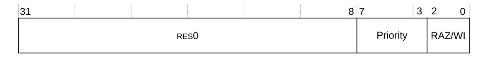

下表给出了 **ICV_PMR** 的位分配。

| 位 | 名称 | 功能 |
| --- | --- | --- |
| [31:8] | - | 保留，RES0。 |
| [7:3] | Priority | CPU 接口的优先级掩码级别。如果中断的优先级高于本字段指示的值，接口即向核发出该中断的信号。 |
| [2:0] | - | RAZ/WI。 |

访问 **ICV_PMR**：

```arm
MRC p15, 0, <Rt>, c4, c6, 0   ; 将 ICV_PMR 读入 Rt
MCR p15, 0, <Rt>, c4, c6, 0   ; 将 Rt 写入 ICV_PMR
```

#### 3.5.11 中断控制器虚拟运行优先级寄存器

**ICV_RPR** 寄存器指示虚拟 **CPU 接口**的**运行优先级**。

**使用限制**

本寄存器为只读，且仅在 EL1 可用。

**陷阱与使能**

如果 **HSTR.T12** 置 1，则从 EL1 对本寄存器的读访问陷入 Hyp 模式。

如果 **ICH_HCR.TC** 置 1，则从 EL1 对本寄存器的读访问陷入 EL2。

**配置**

本寄存器在所有构建配置中均可用。

**属性**

**ICV_RPR** 是一个 32 位寄存器。

下图给出了 **ICV_RPR** 的位分配。


下表给出了 **ICV_RPR** 的位分配。

| 位 | 名称 | 功能 |
| --- | --- | --- |
| [31:8] | - | 保留，RES0。 |
| [7:0] | Priority | 当前运行优先级。当 **ICV_AP0R0** 与 **ICV_AP1R0** 均为 0x0 时返回 0xFF。否则返回 **ICV_AP0R0** 与 **ICV_AP1R0** 中最低置位对应的索引（位于位 [7:3]）。 |

访问 **ICV_RPR**：

```arm
MRC p15, 0, <Rt>, c12, c11, 3   ; 将 ICV_RPR 读入 Rt
MCR p15, 0, <Rt>, c12, c11, 3   ; 将 Rt 写入 ICV_RPR
```

#### 3.5.12 中断控制器虚拟控制寄存器

**ICV_CTLR** 寄存器控制 **GIC 虚拟 CPU 接口**行为的某些方面，并提供所实现特性的相关信息。

**使用限制**

本寄存器为读写。

**陷阱与使能**

如果 **HSTR.T12** 置 1，则从 EL1 对本寄存器的访问陷入 Hyp 模式。

如果 **ICH_HCR.TC** 置 1，则从 EL1 对本寄存器的访问陷入 EL2。

**配置**

本寄存器在所有构建配置中均可用。

**属性**

**ICV_CTLR** 是一个 32 位寄存器。

下图给出了 **ICV_CTLR** 的位分配。

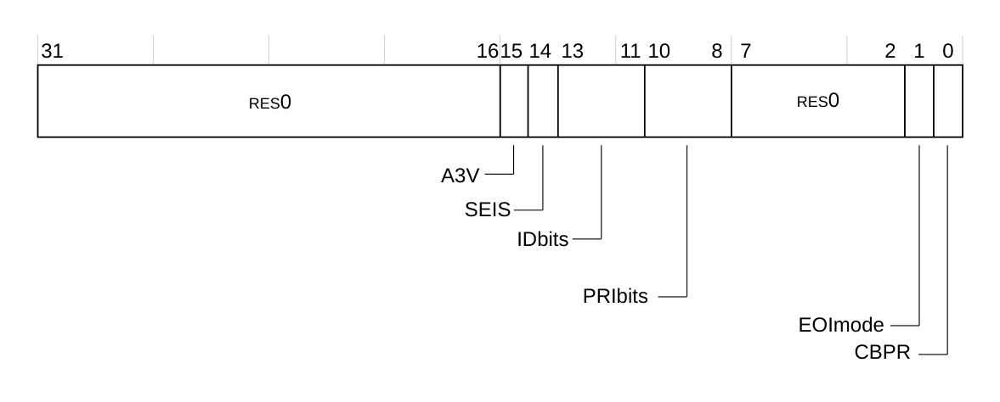

下表给出了 **ICV_CTLR** 的位分配。

| 位 | 名称 | 功能 |
| --- | --- | --- |
| [31:16] | - | 保留，RES0。 |
| [15] | A3V | 亲和性 3 有效。只读，写入被忽略：<br>0：虚拟 CPU 接口逻辑在 SGI 生成系统寄存器中仅支持亲和性 3 的零值。 |
| [14] | SEIS | SEI 支持。只读，写入被忽略。指示虚拟 CPU 接口是否支持本地产生 SEI：<br>0：虚拟 CPU 接口逻辑不支持本地产生 SEI。 |
| [13:11] | IDbits | 指示所支持的物理中断标识符位数。只读，写入被忽略：<br>0b000：支持 16 个中断标识符位。 |
| [10:8] | PRIbits | 指示所实现的优先级位数减一。只读，写入被忽略：<br>0b100：支持 5 个优先级位。 |
| [7:2] | - | 保留，RES0。 |
| [1] | EOImode | 控制对**中断结束**寄存器的写是否同时去激活中断。 |
| [0] | CBPR | 控制 **ICV_BPR1** 是否用于 Group 0 与 Group 1 中断的中断抢占。 |

访问 **ICV_CTLR**：

```arm
MRC p15, 0, <Rt>, c12, c12, 4   ; 将 ICV_CTLR 读入 Rt
MCR p15, 0, <Rt>, c12, c12, 4   ; 将 Rt 写入 ICV_CTLR
```

#### 3.5.13 中断控制器虚拟中断组 0 使能寄存器

**ICV_IGRPEN0** 寄存器控制是否使能虚拟 **Group 0** 中断。

**使用限制**

本寄存器为读写。

**陷阱与使能**

如果 **HSTR.T12** 置 1，则从 EL1 对本寄存器的访问陷入 Hyp 模式。

如果 **ICH_HCR.TALL0** 置 1，则从 EL1 对本寄存器的访问陷入 EL2。

**配置**

本寄存器在所有构建配置中均可用。

**属性**

**ICV_IGRPEN0** 是一个 32 位寄存器。

下图给出了 **ICV_IGRPEN0** 的位分配。


下表给出了 **ICV_IGRPEN0** 的位分配。

| 位 | 名称 | 功能 |
| --- | --- | --- |
| [31:1] | - | 保留，RES0。 |
| [0] | Enable | 使能虚拟 Group 0 中断：<br>0：Group 0 中断被禁用。这是复位值。<br>1：Group 0 中断被使能。 |

访问 **ICV_IGRPEN0**：

```arm
MRC p15, 0, <Rt>, c12, c12, 6   ; 将 ICV_IGRPEN0 读入 Rt
MCR p15, 0, <Rt>, c12, c12, 6   ; 将 Rt 写入 ICV_IGRPEN0
```

#### 3.5.14 中断控制器虚拟中断组 1 使能寄存器

**ICV_IGRPEN1** 寄存器控制是否使能虚拟 **Group 1** 中断。

**使用限制**

本寄存器为读写。

**陷阱与使能**

如果 **HSTR.T12** 置 1，则从 EL1 对本寄存器的访问陷入 Hyp 模式。

如果 **ICH_HCR.TALL1** 置 1，则从 EL1 对本寄存器的访问陷入 EL2。

**配置**

本寄存器在所有构建配置中均可用。

**属性**

**ICV_IGRPEN1** 是一个 32 位寄存器。

下图给出了 **ICV_IGRPEN1** 的位分配。

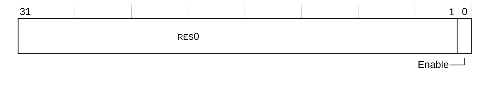

下表给出了 **ICV_IGRPEN1** 的位分配。

| 位 | 名称 | 功能 |
| --- | --- | --- |
| [31:1] | - | 保留，RES0。 |
| [0] | Enable | 使能虚拟 Group 1 中断：<br>0：Group 1 中断被禁用。这是复位值。<br>1：Group 1 中断被使能。 |

访问 **ICV_IGRPEN1**：

```arm
MRC p15, 0, <Rt>, c12, c12, 7   ; 将 ICV_IGRPEN1 读入 Rt
MCR p15, 0, <Rt>, c12, c12, 7   ; 将 Rt 写入 ICV_IGRPEN1
```

#### 3.5.15 中断控制器虚拟活动优先级组 0 寄存器

**ICV_AP0R0** 寄存器提供虚拟 **Group 0** 活动优先级的相关信息。本寄存器是 **ICH_AP0R0** 的别名。

**使用限制**

本寄存器为读写。

**陷阱与使能**

如果 **HSTR.T12** 置 1，则从 EL1 对本寄存器的访问陷入 Hyp 模式。

如果 **ICH_HCR.TALL0** 置 1，则从 EL1 对本寄存器的访问陷入 EL2。

**配置**

本寄存器在所有构建配置中均可用。

**属性**

**ICV_AP0R0** 是一个 32 位寄存器。

下图给出了 **ICV_AP0R0** 的位分配。


下表给出了 **ICV_AP0R0** 的位分配。

| 位 | 名称 | 功能 |
| --- | --- | --- |
| [n] | P\<n\> | **P\<n\>**，位 [n]，其中 n = 0 到 31。<br>提供对 Group 0 中断虚拟活动优先级的访问。每一位的取值可为：<br>0：在该位对应的优先级上没有活动的 Group 0 中断。<br>1：在该位对应的优先级上有活动的 Group 0 中断。 |

访问 **ICV_AP0R0**：

```arm
MRC p15, 0, <Rt>, c12, c8, 4   ; 将 ICV_AP0R0 读入 Rt
MCR p15, 0, <Rt>, c12, c8, 4   ; 将 Rt 写入 ICV_AP0R0
```

#### 3.5.16 中断控制器虚拟活动优先级组 1 寄存器

**ICV_AP1R0** 寄存器提供虚拟 **Group 1** 活动优先级的相关信息。本寄存器是 **ICH_AP1R0** 的别名。

**使用限制**

本寄存器为读写。

**陷阱与使能**

如果 **HSTR.T12** 置 1，则从 EL1 对本寄存器的访问陷入 Hyp 模式。

如果 **ICH_HCR.TALL1** 置 1，则从 EL1 对本寄存器的访问陷入 EL2。

**配置**

本寄存器在所有构建配置中均可用。

**属性**

**ICV_AP1R0** 是一个 32 位寄存器。

下图给出了 **ICV_AP1R0** 的位分配。


下表给出了 **ICV_AP1R0** 的位分配。

| 位 | 名称 | 功能 |
| --- | --- | --- |
| [n] | P\<n\> | **P\<n\>**，位 [n]，其中 n = 0 到 31。<br>Group 1 中断活动优先级。每一位的取值可为：<br>0：在该位对应的优先级上没有活动的 Group 1 中断。<br>1：在该位对应的优先级上有活动的 Group 1 中断。 |

访问 **ICV_AP1R0**：

```arm
MRC p15, 0, <Rt>, c12, c9, 0   ; 将 ICV_AP1R0 读入 Rt
MCR p15, 0, <Rt>, c12, c9, 0   ; 将 Rt 写入 ICV_AP1R0
```
