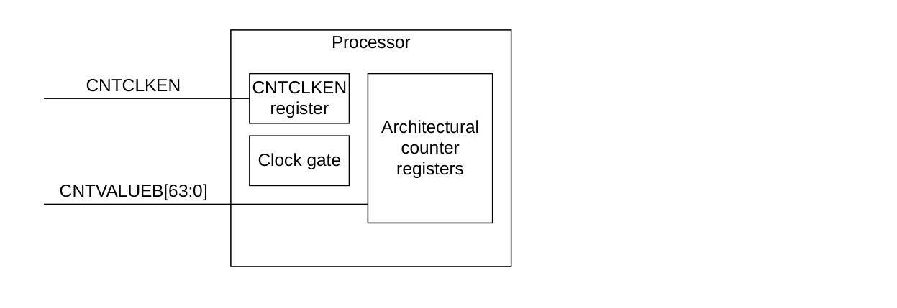

本章介绍 Cortex®-R52+ 处理器对 Arm **通用定时器（Generic Timer）** 的实现。

## 1. 关于通用定时器

**通用定时器**可以基于递增的计数值来调度事件并触发中断。它提供：

* 作为 **PPI** 生成定时器事件。
* 生成事件流（**event streams**）。

Cortex®-R52+ 处理器的**通用定时器**符合《Arm® Architecture Reference Manual Supplement Armv8, for the Armv8-R AArch32 architecture profile》。

本章仅介绍 Cortex®-R52+ 处理器实现所特有的特性。

## 2. 通用定时器功能描述

Cortex®-R52+ 处理器在集群的每个核内提供一组定时器寄存器。这些定时器为：

* 一个 **EL1** 物理定时器。
* 一个 **EL2** 物理定时器。
* 一个虚拟定时器。

Cortex®-R52+ 处理器不包含系统计数器（**system counter**）。系统计数器位于 **SoC** 中。系统计数器值通过同步二进制编码的 64 位总线 **CNTVALUEB[63:0]** 分发到 Cortex®-R52+ 处理器。

由于 **CNTVALUEB** 由系统计数器生成，而后者的工作频率通常低于处理器主时钟 **CLKIN**，因此提供了 **CNTCLKEN** 输入作为 **CNTVALUEB** 总线的时钟使能。这样即可对 **CNTVALUEB[63:0]** 总线施加多周期路径。**CNTCLKEN** 在 Cortex®-R52+ 处理器内部先被寄存，然后才用作 **CNTVALUEB[63:0]** 寄存器的时钟使能。下图给出了该接口。

无论内部寄存后的 **CNTCLKEN** 时钟使能何时被断言，**CNTVALUEB[63:0]** 总线上的值都必须保持稳定。**CNTCLKEN** 必须与 **CLKIN** 同步且平衡，并且必须以处理器 **CLKIN** 的整数分频翻转。

有关 **CNTCLKEN** 的更多信息，请参见第 219 页的 5. Clocking and Resets。

每个定时器都向核提供一个 **PPI** 形式的中断。

## 3. 通用定时器寄存器汇总

在每个核内，一组**通用定时器**寄存器被分配到 (coproc==0b1111) 空间。

### 3.1. AArch32 通用定时器寄存器汇总

下表给出了 AArch32 **通用定时器**寄存器。

下列寄存器在《Arm® Architecture Reference Manual Supplement Armv8, for the Armv8-R AArch32 architecture profile》中有完整说明。这意味着不存在 Cortex®-R52+ 特有的细节。

| 名称 | CRn | Op1 | CRm | Op2 | 复位 | 位宽 | 描述 |
| --- | --- | --- | --- | --- | --- | --- | --- |
| CNTFRQ | c14 | 0 | c0 | 0 | UNK | 32-bit | Counter-timer Frequency register |
| CNTPCT | - | 0 | c14 | - | UNK | 64-bit | Counter-timer Physical Count register |
| CNTKCTL | c14 | 0 | c1 | 0 | 0x00000000 | 32-bit | Counter-timer Kernel Control register |
| CNTP_TVAL | - | 0 | c2 | 0 | UNK | 32-bit | Counter-timer Physical Timer TimerValue register |
| CNTP_CTL | - | 0 | c2 | 1 | -⁶⁸ | 32-bit | Counter-timer Physical Timer Control register |
| CNTV_TVAL | - | 0 | c3 | 0 | UNK | 32-bit | Counter-timer Virtual Timer TimerValue register |
| CNTV_CTL | - | 0 | c3 | 1 | -⁶⁸ | 32-bit | Counter-timer Virtual Timer Control register |
| CNTVCT | - | 1 | c14 | - | UNK | 64-bit | Counter-timer Virtual Count register |
| CNTP_CVAL | - | 2 | c14 | - | UNK | 64-bit | Counter-timer Physical Timer CompareValue register |
| CNTV_CVAL | - | 3 | c14 | - | UNK | 64-bit | Counter-timer Virtual Timer CompareValue register |
| CNTVOFF | - | 4 | c14 | - | UNK | 64-bit | Counter-timer Virtual Offset register |
| CNTHCTL | c14 | 4 | c1 | 0 | -⁶⁹ | 32-bit | Counter-timer Hyp Control register |
| CNTHP_TVAL | - | 4 | c2 | 0 | UNK | 32-bit | Counter-timer Hyp Physical Timer TimerValue register |
| CNTHP_CTL | c14 | 4 | c2 | 1 | -⁶⁸ | 32-bit | Counter-timer Hyp Physical Timer Control register |
| CNTHP_CVAL | - | 6 | c14 | - | UNK | 64-bit | Counter-timer Hyp Physical CompareValue register |

⁶⁸ 位 [0] 的复位值为 0。

⁶⁹ 位 [2] 的复位值为 0，位 [1:0] 的复位值为 0b11。
