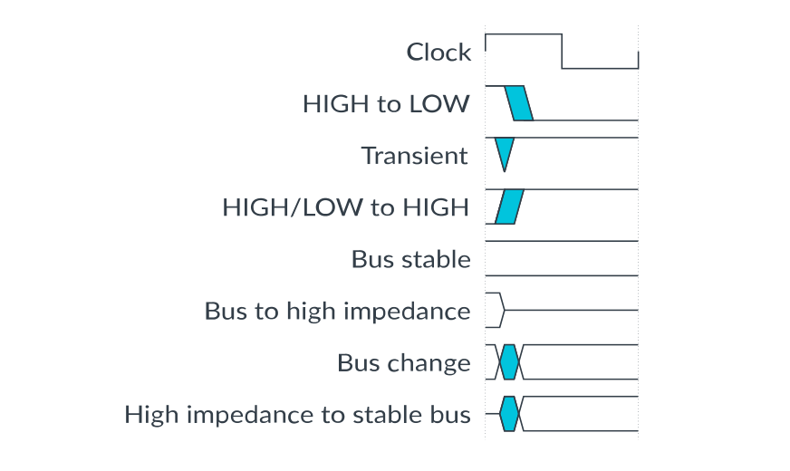

本章介绍本手册的产品修订状态、目标读者、排版约定以及相关参考资源。

## 1. 产品修订状态

`rxpy` 标识符表示本手册所述产品的修订状态，例如 `r1p2`，其中：

* `rx`：标识产品的主修订版本，例如 `r1`。
* `py`：标识产品的次修订版本或修改状态，例如 `p2`。

## 2. 目标读者

本书面向正在设计或编程使用 Cortex®-R52+ 处理器的片上系统（**System-on-Chip, SoC**）的系统设计人员、系统集成人员和程序员。

## 3. 约定

以下小节介绍 Arm 文档中使用的约定。

### 3.1. 术语表

《Arm® Glossary》是 Arm 文档中使用的术语及其定义的列表。除非 Arm 的含义与公认含义不同，否则 Arm 术语表不包含行业标准术语。

更多信息请参见 Arm 术语表：developer.arm.com/glossary。

### 3.2. 约定

| 约定 | 用途 |
| --- | --- |
| 斜体（*italic*） | 引用文献。 |
| 粗体（**bold**） | 描述性列表中的术语（在适当场合）。 |
| 等宽字体（`monospace`） | 可在键盘上输入的文本，例如命令、文件名、程序名和源代码。 |
| 带下划线的等宽字体 | 命令或选项的允许缩写。你可以输入带下划线的文本，代替完整的命令或选项名。 |
| `<and>` | 括起代码或代码片段中出现的汇编语法可替换项。例如：`MRC p15, 0, <Rd>, <CRn>, <CRm>, <Opcode_2>` |
| 小型大写（SMALL CAPITALS） | 《Arm® Glossary》中定义的具有特定技术含义的术语。例如 **IMPLEMENTATION DEFINED**、**IMPLEMENTATION SPECIFIC**、**UNKNOWN** 和 **UNPREDICTABLE**。 |
| 推荐（Recommendation） | 我们推荐如下做法。如果不遵循这些建议，系统可能无法正常工作。 |
| 要求（Requirement） | 系统要求如下。如果不遵循这些要求，系统将无法正常工作。 |
| 危险（Danger） | 可能导致系统或设备永久损坏，或造成人身伤害。 |
| 注意（Note） | 该信息很重要，需要引起注意。 |
| 提示（Tip） | 该信息可以帮助你以更轻松、更好或更快的方式完成任务。 |
| 提醒（Remember） | 该信息提醒你与当前内容相关的重要事项。 |

### 3.3. 时序图

下图说明时序图中使用的组成部分。若出现差异，会有清晰的标注。不得假设图中未明确给出的任何时序信息。

总线与信号的阴影区域表示未定义，即该时刻总线或信号在阴影区域内可以取任意值。实际电平并不重要，也不会影响正常工作。

### 3.4. 信号

信号约定如下：

**信号电平**

已断言信号的电平取决于该信号是高有效还是低有效。已断言（**Asserted**）的含义是：

* 对于高有效信号为高电平（**HIGH**）。
* 对于低有效信号为低电平（**LOW**）。

**小写 n**

位于信号名称开头或结尾的 `n` 表示低有效信号。

## 4. 有用的资源

本文档包含特定于本产品的信息。其他有用信息请参见以下资源。

Arm 文档的访问权限取决于其机密性：

* 非机密文档可从 developer.arm.com/documentation 获取。下表中的每个文档链接都指向该文档的在线版本。
* 机密文档仅通过产品包向被许可方提供。

### 4.1. Arm 产品资源

| 文档 | 文档 ID | 机密性 |
| --- | --- | --- |
| Arm® Cortex®-R52+ Processor Configuration and Sign-off Guide | 102201 | Confidential |
| Arm® Cortex®-R52+ Processor Integration Manual | 102200 | Confidential |
| Armv8 AArch32 UNPREDICTABLE behaviours | PRD03-GENC-010544 | Confidential |

### 4.2. Arm 架构与规范

| 文档 | 文档 ID | 机密性 |
| --- | --- | --- |
| AMBA® 3 AHB-Lite Protocol v1.0 Specification | IHI 0033A | Non-Confidential |
| AMBA® 3 APB Protocol v1.0 Specification | IHI 0024B | Non-Confidential |
| AMBA® 4 ATB Protocol Specification ATBv1.0 and ATBv1.1 | IHI 0032 | Non-Confidential |
| AMBA® AXI™ and ACE™ Protocol Specification AXI3™, AXI4™, and AXI4-Lite™, ACE and ACE-Lite™ | IHI 0022 | Non-Confidential |
| Arm® Architecture Reference Manual Supplement Armv8, for the Armv8-R AArch32 architecture profile | DDI 0568 | Non-Confidential |
| Arm® Architecture Reference Manual for A-profile architecture | DDI 0487 | Non-Confidential |
| Arm® CoreSight™ Architecture Specification v2.0 | IHI 0029D | Non-Confidential |
| Arm® Debug Interface Architecture Specification, ADIv5.0 to ADIv5.2 | IHI 0031 | Non-Confidential |
| Arm® Embedded Trace Macrocell Architecture Specification ETMv4 | IHI 0064 | Non-Confidential |
| Arm® Generic Interrupt Controller Architecture Specification GIC architecture version 3.0 and version 4.0 | IHI 0069 | Non-Confidential |
| Low Power Interface Specification Arm® Q-Channel and P-Channel Interfaces | IHI 0068 | Non-Confidential |

### 4.3. 非 Arm 资源

| 文档 | 文档 ID | 组织 |
| --- | --- | --- |
| IEEE Std 754-2008, IEEE Standard for Floating-Point Arithmetic | IEEE 754-2008 | https://www.ieee.org |

**注意：** Arm 仅在 Adobe Acrobat 和 Acrobat Reader 中测试其 PDF 文档。Arm 无法保证使用其他 PDF 阅读器时的文档质量。Adobe PDF 阅读器产品可从 http://www.adobe.com 下载。
