本章介绍性能监控单元（**PMU**，Performance Monitor Unit）的特性及其使用的寄存器。

## 1. 关于 PMU

每个 Cortex®-R52+ 核都包含性能监控器，它们实现 Arm PMUv3 体系结构。这使你能够在运行时收集核及其内存系统运行状态的各种统计信息。这些信息提供了有关处理器行为的有用数据，可用于调试或分析代码。

**PMU** 提供四个计数器。每个计数器可以统计核中可用的任意事件。由于流水线效应，记录的绝对计数可能有所偏差。除计数器只使能很短时间的情况外，该影响可以忽略。

这些事件从核导出，供 ETM 使用；计数器溢出也被导出，供 GIC 分发单元使用。可用的事件包括体系结构要求的事件（指令数、分支预测器准确性、数据缓存命中率）、一些通用事件（统计指令类型，尤其是分支与加载/存储），以及用于统计不同类型的 ECC 错误（及其总数）的事件。

下图给出了 **PMU** 内部的主要模块。

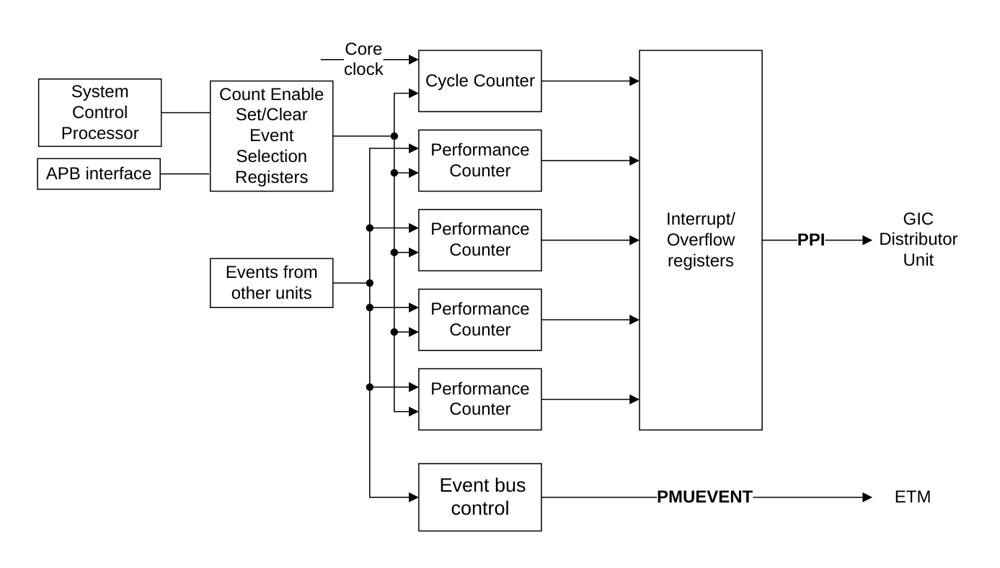

### 1.1 事件接口

设计中所有其他单元的事件都提供给 **PMU**。

### 1.2 系统寄存器与 APB 接口

可以使用系统寄存器或外部 APB 接口对 **PMU** 寄存器编程。

### 1.3 计数器

**PMU** 具有 32 位事件计数器与一个 64 位周期计数器，前者在使能后根据事件递增。

### 1.4 外部寄存器访问权限

是否允许访问某个寄存器取决于：

* 核是否已上电。
* **PMU** 软件锁的状态。
* 处理器的调试认证输入状态。

本文档不描述每个寄存器特有的行为以及寄存器访问类型。有关这些特性及其对寄存器影响的详细说明，请参见《Arm® Architecture Reference Manual Supplement Armv8, for the Armv8-R AArch32 architecture profile》。

本节给出的寄存器描述说明了每个寄存器是读写还是只读。

无论是否使能非侵入式调试，性能监控周期计数寄存器（**PMCCNTR**）始终使能，除非 **PMCR** 寄存器的 **DP** 位被置位。

### 1.5 认证信号与 PMU 行为

当使能非侵入式调试时，即 **DBGENx** 或 **NIDENx** 输入之一置起时，**PMU** 事件在 **PMUEVENT** 总线上导出。无论是否使能非侵入式调试，性能监控周期计数寄存器（**PMCCNTR**）始终使能。唯一的例外是 **PMCR.DP** 的禁用周期计数器位被置位。

无论非侵入式调试认证如何，**PMU** 都会统计事件。调试认证只控制向 **PMUEVENT** 总线的导出。具体而言，调试认证对导出的影响是：

* 如果核处于 EL2，则当 **DBGENx** 或 **NIDENx** 之一置起、且 **HIDENx** 或 **HNIDENx** 之一置起时，使能导出。
* 如果核处于 EL1，则当 **DBGENx** 或 **NIDENx** 之一置起时，使能导出。
* 如果核处于 EL0，则当 **DBGENx** 或 **NIDENx** 之一置起、且 **HCR.TGE=0** 时，使能导出。
* 如果核处于 EL0，则当 **DBGENx** 或 **NIDENx** 之一置起、**HIDENx** 或 **HNIDENx** 之一置起、且 **HCR.TGE=1** 时，使能导出。

从 EL0 与 EL1 可访问的计数器数量受 Hypervisor 限制，这由 **HDCR.HPMN** 控制。事件计数由 **HDCR.HPMD** 控制，该位禁止在 Hyp 模式下由客户操作系统（**OS**，Operating System）可访问的计数器进行事件计数。如果 **HDCR.HPMD=0**，则允许客户计数器在 Hyp 模式下进行事件计数。如果 **HDCR.HPMD=1**，则禁止客户计数器在 Hyp 模式下进行事件计数。

## 2. PMU 寄存器汇总

**PMU** 计数器及其关联的控制寄存器可通过内部非调试系统寄存器接口使用 MCR 与 MRC 指令访问。

下表汇总了 Cortex®-R52+ 的 **PMU** 寄存器。除若干只读 ID 值、计数器数量的影响以及事件选择值之外，**PMU** 寄存器在《Arm® Architecture Reference Manual Supplement Armv8, for the Armv8-R AArch32 architecture profile》中有完整说明。这意味着不存在 Cortex®-R52+ 特有的行为。

可通过内存映射接口外部调试接口访问的寄存器完整列表，请参见 4 内存映射寄存器汇总。

| 名称 | CRn | Op1 | CRm | Op2 | 类型 | 复位值 | 描述 |
| --- | --- | --- | --- | --- | --- | --- | --- |
| PMCR | c9 | 0 | c12 | 0 | RW | 0x41162000 | 3.1 性能监控控制寄存器 |
| PMCNTENSET | c9 | 0 | c12 | 1 | RW | UNK | 性能监控计数使能设置寄存器 |
| PMCNTENCLR | c9 | 0 | c12 | 2 | RW | UNK | 性能监控计数使能清除寄存器 |
| PMOVSR | c9 | 0 | c12 | 3 | RW | UNK | 性能监控溢出标志状态寄存器 |
| PMSWINC | c9 | 0 | c12 | 4 | WO | UNK | 性能监控软件递增寄存器 |
| PMSELR | c9 | 0 | c12 | 5 | RW | UNK | 性能监控事件计数器选择寄存器 |
| PMCEID0 | c9 | 0 | c12 | 6 | RO | 0x6E1FFFDB | 3.2 性能监控通用事件标识寄存器 0 |
| PMCEID1 | c9 | 0 | c12 | 7 | RO | 0x0000001E | 3.3 性能监控通用事件标识寄存器 1 |
| PMCCNTR | c9 | 0 | c13 | 0 | RW | UNK | 性能监控周期计数寄存器 |
| PMXEVTYPER | c9 | 0 | c13 | 1 | RW | 0x00000000 | 性能监控所选事件类型寄存器 |
| PMXEVCNTR | c9 | 0 | c13 | 2 | RW | UNK | 性能监控事件计数寄存器 |
| PMUSERENR | c9 | 0 | c14 | 0 | RW | 0x00000000 | 性能监控用户使能寄存器 |
| PMINTENSET | c9 | 0 | c14 | 1 | RW | UNK | 性能监控中断使能设置寄存器 |
| PMINTENCLR | c9 | 0 | c14 | 2 | RW | UNK | 性能监控中断使能清除寄存器 |
| PMOVSSET | c9 | 0 | c14 | 3 | RW | UNK | 性能监控溢出标志状态设置寄存器 |
| PMEVCNTR0 | c14 | 0 | c8 | 0 | RW | UNK | 性能监控事件计数寄存器 0 |
| PMEVCNTR1 | c14 | 0 | c8 | 1 | RW | UNK | 性能监控事件计数寄存器 1 |
| PMEVCNTR2 | c14 | 0 | c8 | 2 | RW | UNK | 性能监控事件计数寄存器 2 |
| PMEVCNTR3 | c14 | 0 | c8 | 3 | RW | UNK | 性能监控事件计数寄存器 3 |
| PMEVTYPER0 | c14 | 0 | c12 | 0 | RW | UNK | 性能监控所选事件类型寄存器 0 |
| PMEVTYPER1 | c14 | 0 | c12 | 1 | RW | UNK | 性能监控所选事件类型寄存器 1 |
| PMEVTYPER2 | c14 | 0 | c12 | 2 | RW | UNK | 性能监控所选事件类型寄存器 2 |
| PMEVTYPER3 | c14 | 0 | c12 | 3 | RW | UNK | 性能监控所选事件类型寄存器 3 |
| PMCCFILTR | c14 | 0 | c15 | 7 | RW | 0x00000000 | 性能监控周期计数过滤寄存器 |

## 3. PMU 寄存器描述

本节介绍处理器的 **PMU** 寄存器。

### 3.1 性能监控控制寄存器

**PMCR** 提供性能监控器的实现细节（包括实现的计数器数量），并配置与控制这些计数器。

**使用限制**

本寄存器为读写。有关影响本寄存器访问是否允许的条件的汇总，请参见第 391 页的 12.2.4 External register access permissions。详细说明请参见《Arm® Architecture Reference Manual Supplement Armv8, for the Armv8-R AArch32 architecture profile》。

**陷阱与使能**

如果 **HDCR.TPM** 置 1，则从 EL0 与 EL1 对本寄存器的访问陷入 EL2。

如果 **HDCR.TPMCR** 置 1，则从 EL0 与 EL1 对本寄存器的访问陷入 EL2。

如果 **HSTR.T9** 置 1，则从 EL0 与 EL1 对本寄存器的访问陷入 EL2。

如果 **PMUSERENR.EN** 置 0，则从 EL0 对本寄存器的访问进入未定义模式。

**配置**

本寄存器在所有处理器构建配置中均可用。

**属性**

**PMCR** 是一个 32 位寄存器。

下图给出了 **PMCR** 的位分配。

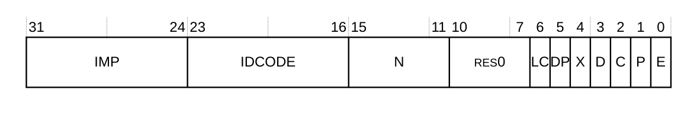

下表给出了 **PMCR** 的位分配。

| 位 | 名称 | 功能 |
| --- | --- | --- |
| [31:24] | IMP | 实现者代码：<br>0x41：Arm。<br>该字段为只读。 |
| [23:16] | IDCODE | 标识代码：<br>0x16：Cortex®-R52+。<br>该字段为只读。 |
| [15:11] | N | 事件计数器数量。<br>0b00100：四个计数器。该字段为只读。 |
| [10:7] | - | 保留，RES0。 |
| [6] | LC | 长周期计数使能。确定 **PMCCNTR** 的哪一位产生记录在 **PMOVSR[31]** 中的溢出。可能的取值为：<br>0：在使 **PMCCNTR[31]** 由 1 变为 0 的递增时溢出。复位值为 0x00000000。<br>1：在使 **PMCCNTR[63]** 由 1 变为 0 的递增时溢出。该位为读写，复位值为 UNKNOWN。 |
| [5] | DP | 禁止事件计数时禁用周期计数器 **PMCCNTR**：<br>0：周期计数器工作，与侵入式调试认证设置无关。这是复位值。<br>1：如果不允许且未使能非侵入式调试，则周期计数器被禁用。<br>该位为读写。 |
| [4] | X | 导出使能。该位允许将事件导出到 ETM 与 **PMUEVENTx** 外部总线：<br>0：事件导出被禁用。这是复位值。<br>1：事件导出被使能。<br>该位为读写，且不影响 **nPMUIRQ** 引脚上性能监控中断的产生。 |
| [3] | D | 时钟分频：<br>0：使能时，**PMCCNTR** 每个时钟周期计数一次。这是复位值。<br>1：使能时，**PMCCNTR** 每 64 个时钟周期计数一次。<br>该位为读写。 |
| [2] | C | 时钟计数器复位。该位为只写。写该位的效果为：<br>0：无动作。这是复位值。<br>1：将 **PMCCNTR** 复位为 0。<br>该位始终为 RAZ。 |
| [1] | P | 事件计数器复位。该位为只写。写该位的效果为：<br>0：无动作。这是复位值。<br>1：将事件计数器（不包括 **PMCCNTR**）复位为零。<br>该位始终为 RAZ。<br>在 EL0 与 EL1 中，向该位写 1 不会复位 **HDCR.HPMN** 为 EL2 使用保留的事件计数器。<br>在 EL2 中，向该位写 1 会复位所有事件计数器。<br>复位事件计数器不会将任何溢出位清零。 |
| [0] | E | 使能。该位可能的取值为：<br>0：所有计数器（包括 **PMCCNTR**）被禁用。这是复位值。<br>1：所有计数器被使能。<br>该位为读写。<br>在 EL0 与 EL1 中，该位不影响 **HDCR.HPMN** 为 EL2 使用保留的事件计数器的运行。 |

访问 **PMCR**：

```arm
MRC p15, 0, <Rt>, c9, c12, 0   ; 将 PMCR 读入 Rt
MCR p15, 0, <Rt>, c9, c12, 0   ; 将 Rt 写入 PMCR
```

**PMCR** 可以通过内存映射外部调试接口访问，偏移为 0xE04。

### 3.2 性能监控通用事件标识寄存器 0

**PMCEID0** 定义实现了哪些通用体系结构特征事件与通用微体系结构特征事件。

**使用限制**

本寄存器为只读。有关影响本寄存器访问是否允许的条件的汇总，请参见第 391 页的 12.2.4 External register access permissions。详细说明请参见《Arm® Architecture Reference Manual Supplement Armv8, for the Armv8-R AArch32 architecture profile》。

**陷阱与使能**

如果 **HDCR.TPM** 置 1，则从 EL0 与 EL1 对本寄存器的读访问陷入 Hyp 模式。

如果 **HSTR.T9** 置 1，则从 EL0 与 EL1 对本寄存器的读访问陷入 Hyp 模式。

如果 **PMUSERENR.EN** 置 0，则从 EL0 对本寄存器的读访问进入未定义模式。

**配置**

本寄存器在所有处理器构建配置中均可用。

**属性**

**PMCEID0** 是一个 32 位寄存器。

下图给出了 **PMCEID0** 的位分配。

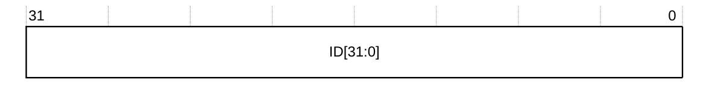

下表给出了 **PMCEID0** 的位分配，说明当相应位为 1 或 0 时事件是否实现。

| 位 | 名称 | 功能 |
| --- | --- | --- |
| [31:0] | ID[31:0] | **PMU** 事件计数器可统计的通用体系结构特征事件与微体系结构特征事件。<br>对于 6 事件中描述的每一位，如果该位为 1 则该事件已实现，如果该位为 0 则该事件未实现。 |

访问 **PMCEID0**：

```arm
MRC p15,0,<Rt>,c9,c12,6   ; 将 PMCEID0 读入 Rt
```

**PMCEID0** 可以通过内存映射外部调试接口访问，偏移为 0xE20。

### 3.3 性能监控通用事件标识寄存器 1

**PMCEID1** 定义实现了哪些通用体系结构特征事件与通用微架构特征事件。

**使用限制**

本寄存器为只读。有关影响本寄存器访问是否允许的条件的汇总，请参见第 391 页的 12.2.4 External register access permissions。详细说明请参见《Arm® Architecture Reference Manual Supplement Armv8, for the Armv8-R AArch32 architecture profile》。

**陷阱与使能**

如果 **HDCR.TPM** 置 1，则从 EL0 与 EL1 对本寄存器的读访问陷入 Hyp 模式。

如果 **HSTR.T9** 置 1，则从 EL0 与 EL1 对本寄存器的读访问陷入 Hyp 模式。

如果 **PMUSERENR.EN** 置 0，则从 EL0 对本寄存器的访问进入未定义模式。

**配置**

本寄存器在所有处理器构建配置中均可用。

**属性**

**PMCEID1** 是一个 32 位寄存器。

下图给出了 **PMCEID1** 的位分配。

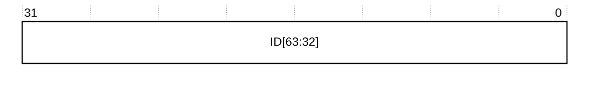

下表给出了 **PMCEID1** 的位分配。

| 位 | 名称 | 功能 |
| --- | --- | --- |
| [31:0] | ID[63:32] | **PMU** 事件计数器可统计的通用体系结构特征事件与微体系结构特征事件。<br>对于 6 事件中描述的每一位，如果该位为 1 则该事件已实现，如果该位为 0 则该事件未实现。 |

访问 **PMCEID1**：

```arm
MRC p15,0,<Rt>,c9,c12,7   ; 将 PMCEID1 读入 Rt
```

**PMCEID1** 可以通过内存映射外部调试接口访问，偏移为 0xE24。

## 4. 内存映射寄存器汇总

下表给出可通过内存映射外部调试接口访问的 **PMU** 寄存器。

除 ID 值、计数器数量的影响与事件编码之外，这些寄存器在《Arm® Architecture Reference Manual Supplement Armv8, for the Armv8-R AArch32 architecture profile》中有完整说明。这意味着不存在 Cortex®-R52+ 特有的行为。

**PADDRDBG31** 的取值与 CoreSight 软件锁会限制通过内存映射外部调试接口对 **PMU** 寄存器的写访问。当 **PADDRDBG31** 驱动为低电平时，必须使用 CoreSight 软件锁来解锁 **PMU** 寄存器的写权限。当 **PADDRDBG31** 驱动为高电平时，软件锁不限制 **PMU** 寄存器的写访问权限。软件锁由 Lock Access 寄存器控制。

| 偏移 | 名称 | 类型 | 描述 |
| --- | --- | --- | --- |
| 0x000 | PMEVCNTR0 | RW | 性能监控事件计数寄存器 0 |
| 0x008 | PMEVCNTR1 | RW | 性能监控事件计数寄存器 1 |
| 0x010 | PMEVCNTR2 | RW | 性能监控事件计数寄存器 2 |
| 0x018 | PMEVCNTR3 | RW | 性能监控事件计数寄存器 3 |
| 0x0F8 | PMCCNTR[31:0] | RW | 性能监控周期计数寄存器 |
| 0x0FC | PMCCNTR[63:32] | RW | 性能监控周期计数寄存器 |
| 0x400 | PMEVTYPER0 | RW | 性能监控事件类型寄存器 0 |
| 0x404 | PMEVTYPER1 | RW | 性能监控事件类型寄存器 1 |
| 0x408 | PMEVTYPER2 | RW | 性能监控事件类型寄存器 2 |
| 0x40C | PMEVTYPER3 | RW | 性能监控事件类型寄存器 3 |
| 0x47C | PMCCFILTR | RW | 性能监控周期计数过滤寄存器 |
| 0xC00 | PMCNTENSET | RW | 性能监控计数使能设置寄存器 |
| 0xC20 | PMCNTENCLR | RW | 性能监控计数使能清除寄存器 |
| 0xC40 | PMINTENSET | RW | 性能监控中断使能设置寄存器 |
| 0xC60 | PMINTENCLR | RW | 性能监控中断使能清除寄存器 |
| 0xC80 | PMOVSCLR | RW | 性能监控溢出标志状态寄存器 |
| 0xCA0 | PMSWINC | WO | 性能监控软件递增寄存器 |
| 0xCC0 | PMOVSSET | RW | 性能监控溢出标志状态设置寄存器 |
| 0xE00 | PMCFGR | RO | 5.1 性能监控配置寄存器 |
| 0xE04 | PMCR | RW | 性能监控控制寄存器 |
| 0xE20 | PMCEID0 | RO | 5.2.1 性能监控外设标识寄存器 0 |
| 0xE24 | PMCEID1 | RO | 性能监控通用事件标识寄存器 1 |
| 0xFA8 | PMDEVAFF0 | RO | 性能监控设备亲和性寄存器 0，请参见第 185 页的 4.3.78 Multiprocessor Affinity Register |
| 0xFAC | PMDEVAFF1 | RO | 性能监控设备亲和性寄存器 1 |
| 0xFB0 | PMLAR | WO | 性能监控锁访问寄存器 |
| 0xFB4 | PMLSR | RO | 性能监控锁状态寄存器 |
| 0xFB8 | PMAUTHSTATUS | RO | 性能监控认证状态寄存器 |
| 0xFBC | PMDEVARCH | RO | 性能监控设备体系结构寄存器 |
| 0xFCC | PMDEVTYPE | RO | 性能监控设备类型寄存器 |
| 0xFD0 | PMPIDR4 | RO | 5.2.5 性能监控外设标识寄存器 4 |
| 0xFD4 | PMPIDR5 | RO | 5.2.6 性能监控外设标识寄存器 5-7 |
| 0xFD8 | PMPIDR6 | RO | 5.2.6 性能监控外设标识寄存器 5-7 |
| 0xFDC | PMPIDR7 | RO | 5.2.6 性能监控外设标识寄存器 5-7 |
| 0xFE0 | PMPIDR0 | RO | 5.2.1 性能监控外设标识寄存器 0 |
| 0xFE4 | PMPIDR1 | RO | 5.2.2 性能监控外设标识寄存器 1 |
| 0xFE8 | PMPIDR2 | RO | 5.2.3 性能监控外设标识寄存器 2 |
| 0xFEC | PMPIDR3 | RO | 5.2.4 性能监控外设标识寄存器 3 |
| 0xFF0 | PMCIDR0 | RO | 5.3.1 性能监控组件标识寄存器 0 |
| 0xFF4 | PMCIDR1 | RO | 5.3.2 性能监控组件标识寄存器 1 |
| 0xFF8 | PMCIDR2 | RO | 5.3.3 性能监控组件标识寄存器 2 |
| 0xFFC | PMCIDR3 | RO | 5.3.4 性能监控组件标识寄存器 3 |

**注意：** 0xE04 处的寄存器与 **PMCR** 系统寄存器不同，二者的值不相同。

**注意：** 0xFAC 处的 PMDEVAFF1 为 RES0。

## 5. 内存映射寄存器描述

本节介绍可通过内存映射调试接口访问的 Cortex®-R52+ **PMU** 寄存器。

### 5.1 性能监控配置寄存器

**PMCFGR** 包含 **PMU** 特有的配置数据。

**使用限制**

本寄存器为只读。有关影响本寄存器访问是否允许的条件的汇总，请参见第 391 页的 12.2.4 External register access permissions。详细说明请参见《Arm® Architecture Reference Manual Supplement Armv8, for the Armv8-R AArch32 architecture profile》。

**陷阱与使能**

不存在影响本寄存器的陷阱与使能。

**配置**

本寄存器在所有处理器构建配置中均可用。

**属性**

**PMCFGR** 是一个 32 位寄存器。

下图给出了 **PMCFGR** 的位分配。

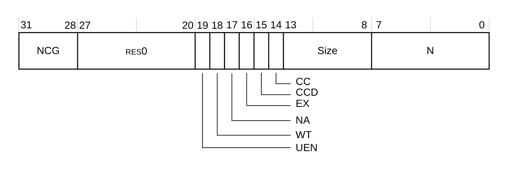

下表给出了 **PMCFGR** 的位分配。

| 位 | 名称 | 功能 |
| --- | --- | --- |
| [31:28] | NCG | 不支持该特性，RAZ。 |
| [27:20] | - | 保留，RES0。 |
| [19] | UEN | 支持用户模式使能寄存器。**PMUSERENR_EL0** 在外部调试接口中不可见，因此该位为 RAZ。 |
| [18] | WT | 不支持该特性，RAZ。 |
| [17] | NA | 不支持该特性，RAZ。 |
| [16] | EX | 支持导出。该值为：<br>1：支持导出。 |
| [15] | CCD | 周期计数器具有预分频。该值为：<br>1：周期计数器具有预分频。 |
| [14] | CC | 支持专用周期计数器。该值为：<br>1：支持专用计数器。 |
| [13:8] | Size | 计数器大小。该值为：<br>0b111111：64 位计数器。 |
| [7:0] | N | 事件计数器数量。该值为：<br>0x04：四个计数器。 |

**PMCFGR** 可以通过外部调试接口访问。

| 组件 | 偏移 |
| --- | --- |
| PMU | 0xEE0 |

### 5.2 性能监控外设标识寄存器

性能监控外设标识寄存器提供符合 Arm PMUv3 体系结构的所有组件所需的标准信息。

为满足 CoreSight 合规性，需要这些寄存器。更多信息请参见《Arm® CoreSight™ Architecture Specification v2.0》。

共有八个寄存器，如下表所列。

| 寄存器 | 偏移 | 值 |
| --- | --- | --- |
| PMPIDR0 | 0xFE0 | 0xBB |
| PMPIDR1 | 0xFE4 | 0xB9 |
| PMPIDR2 | 0xFE8 | 0x1B |
| PMPIDR3 | 0xFEC | 0x00 |
| PMPIDR4 | 0xFD0 | 0x04 |
| PMPIDR5 | 0xFD4 | 0x00 |
| PMPIDR6 | 0xFD8 | 0x00 |
| PMPIDR7 | 0xFDC | 0x00 |

每个性能监控外设 ID 寄存器只使用位 [7:0]，位 [31:8] 为 RES0。八个性能监控外设 ID 寄存器共同定义一个 64 位外设 ID。

#### 5.2.1 性能监控外设标识寄存器 0

**PMPIDR0** 提供用于标识性能监控组件的信息。

**使用限制**

本寄存器为只读。有关影响本寄存器访问是否允许的条件的汇总，请参见第 391 页的 12.2.4 External register access permissions。详细说明请参见《Arm® Architecture Reference Manual Supplement Armv8, for the Armv8-R AArch32 architecture profile》。

**陷阱与使能**

不存在影响本寄存器的陷阱与使能。

**配置**

本寄存器在所有处理器构建配置中均可用。

**属性**

**PMPIDR0** 是一个 32 位寄存器。

下图给出了 **PMPIDR0** 的位分配。

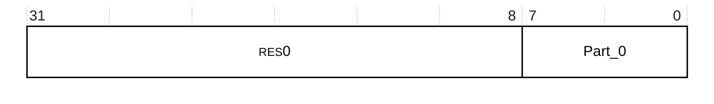

下表给出了 **PMPIDR0** 的位分配。

| 位 | 名称 | 功能 |
| --- | --- | --- |
| [31:8] | - | 保留，RES0。 |
| [7:0] | Part_0 | 0xBB：性能监控部件编号的最低有效字节。 |

**PMPIDR0** 可以通过外部调试接口访问。

| 组件 | 偏移 |
| --- | --- |
| PMU | 0xFE0 |

#### 5.2.2 性能监控外设标识寄存器 1

**PMPIDR1** 提供用于标识性能监控组件的信息。

**使用限制**

本寄存器为只读。有关影响本寄存器访问是否允许的条件的汇总，请参见第 391 页的 12.2.4 External register access permissions。详细说明请参见《Arm® Architecture Reference Manual Supplement Armv8, for the Armv8-R AArch32 architecture profile》。

**陷阱与使能**

不存在影响本寄存器的陷阱与使能。

**配置**

本寄存器在所有处理器构建配置中均可用。

**属性**

**PMPIDR1** 是一个 32 位寄存器。

下图给出了 **PMPIDR1** 的位分配。

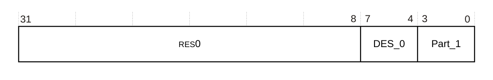

下表给出了 **PMPIDR1** 的位分配。

| 位 | 名称 | 功能 |
| --- | --- | --- |
| [31:8] | - | 保留，RES0。 |
| [7:4] | DES_0 | 0xB：Arm Limited。这是 JEP106 ID 代码的最低有效半字节。 |
| [3:0] | Part_1 | 0x9：性能监控部件编号的最高有效半字节。 |

**PMPIDR1** 可以通过外部调试接口访问。

| 组件 | 偏移 |
| --- | --- |
| PMU | 0xFE4 |

#### 5.2.3 性能监控外设标识寄存器 2

**PMPIDR2** 提供用于标识性能监控组件的信息。

**使用限制**

本寄存器为只读。有关影响本寄存器访问是否允许的条件的汇总，请参见第 391 页的 12.2.4 External register access permissions。详细说明请参见《Arm® Architecture Reference Manual Supplement Armv8, for the Armv8-R AArch32 architecture profile》。

**陷阱与使能**

不存在影响本寄存器的陷阱与使能。

**配置**

本寄存器在所有处理器构建配置中均可用。

**属性**

**PMPIDR2** 是一个 32 位寄存器。

下图给出了 **PMPIDR2** 的位分配。

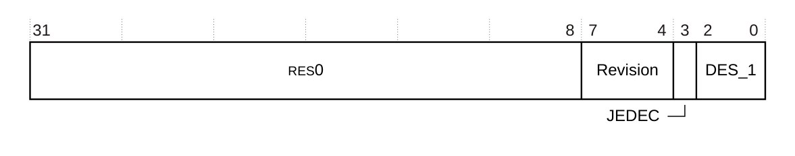

下表给出了 **PMPIDR2** 的位分配。

| 位 | 名称 | 功能 |
| --- | --- | --- |
| [31:8] | - | 保留，RES0。 |
| [7:4] | Revision | 0x1：r0p1。 |
| [3] | JEDEC | 1：表示使用 JEP106 标识代码。 |
| [2:0] | DES_1 | 0b011：Arm Limited。JEP106 ID 代码的最高有效位。 |

**PMPIDR2** 可以通过外部调试接口访问。

| 组件 | 偏移 |
| --- | --- |
| PMU | 0xFE8 |

#### 5.2.4 性能监控外设标识寄存器 3

**PMPIDR3** 提供用于标识性能监控组件的信息。

**使用限制**

本寄存器为只读。有关影响本寄存器访问是否允许的条件的汇总，请参见第 391 页的 12.2.4 External register access permissions。详细说明请参见《Arm® Architecture Reference Manual Supplement Armv8, for the Armv8-R AArch32 architecture profile》。

**陷阱与使能**

不存在影响本寄存器的陷阱与使能。

**配置**

本寄存器在所有处理器构建配置中均可用。

**属性**

**PMPIDR3** 是一个 32 位寄存器。

下图给出了 **PMPIDR3** 的位分配。

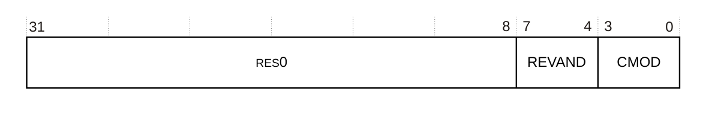

下表给出了 **PMPIDR3** 的位分配。

| 位 | 名称 | 功能 |
| --- | --- | --- |
| [31:8] | - | 保留，RES0。 |
| [7:4] | REVAND | 0x0：部件次修订版。 |
| [3:0] | CMOD | 0x0：客户修改。 |

**PMPIDR3** 可以通过外部调试接口访问。

| 组件 | 偏移 |
| --- | --- |
| PMU | 0xFEC |

#### 5.2.5 性能监控外设标识寄存器 4

**PMPIDR4** 提供用于标识性能监控组件的信息。

**使用限制**

本寄存器为只读。有关影响本寄存器访问是否允许的条件的汇总，请参见第 391 页的 12.2.4 External register access permissions。详细说明请参见《Arm® Architecture Reference Manual Supplement Armv8, for the Armv8-R AArch32 architecture profile》。

**陷阱与使能**

不存在影响本寄存器的陷阱与使能。

**配置**

本寄存器在所有处理器构建配置中均可用。

**属性**

**PMPIDR4** 是一个 32 位寄存器。

下图给出了 **PMPIDR4** 的位分配。

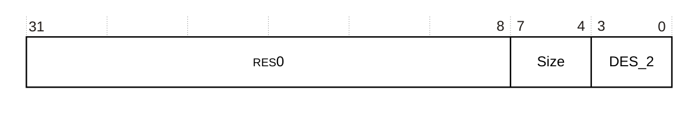

下表给出了 **PMPIDR4** 的位分配。

| 位 | 名称 | 功能 |
| --- | --- | --- |
| [31:8] | - | 保留，RES0。 |
| [7:4] | Size | 0x0：组件大小。**PMU** 占用 4KB 空间。 |
| [3:0] | DES_2 | 0x4：Arm Limited。这是 JEP106 延续码的最低有效半字节。 |

**PMPIDR4** 可以通过外部调试接口访问。

| 组件 | 偏移 |
| --- | --- |
| PMU | 0xFD0 |

#### 5.2.6 性能监控外设标识寄存器 5-7

**PMPIDR5**、**PMPIDR6** 与 **PMPIDR7** 中不保存任何信息，它们为 RES0。

### 5.3 性能监控组件标识寄存器

共有四个只读性能监控组件标识寄存器，即 Component ID0 到 Component ID3。

为满足 CoreSight 合规性，需要这些寄存器。更多信息请参见《Arm® CoreSight™ Architecture Specification v2.0》。

下表列出这些寄存器。

| 寄存器 | 偏移 | 值 |
| --- | --- | --- |
| PMCIDR0 | 0xFF0 | 0x0D |
| PMCIDR1 | 0xFF4 | 0x90 |
| PMCIDR2 | 0xFF8 | 0x05 |
| PMCIDR3 | 0xFFC | 0xB1 |

性能监控组件标识寄存器将性能监控器标识为 Arm PMUv3 体系结构。

#### 5.3.1 性能监控组件标识寄存器 0

**PMCIDR0** 提供用于标识性能监控组件的信息。

**使用限制**

本寄存器为只读。有关影响本寄存器访问是否允许的条件的汇总，请参见第 391 页的 12.2.4 External register access permissions。详细说明请参见《Arm® Architecture Reference Manual Supplement Armv8, for the Armv8-R AArch32 architecture profile》。

**陷阱与使能**

不存在影响本寄存器的陷阱与使能。

**配置**

本寄存器在所有处理器构建配置中均可用。

**属性**

**PMCIDR0** 是一个 32 位寄存器。

下图给出了 **PMCIDR0** 的位分配。


下表给出了 **PMCIDR0** 的位分配。

| 位 | 名称 | 功能 |
| --- | --- | --- |
| [31:8] | - | 保留，RES0。 |
| [7:0] | PRMBL_0 | 0x0D：前导码字节 0。 |

**PMCIDR0** 可以通过外部调试接口访问。

| 组件 | 偏移 |
| --- | --- |
| PMU | 0xFF0 |

#### 5.3.2 性能监控组件标识寄存器 1

**PMCIDR1** 提供用于标识性能监控组件的信息。

**使用限制**

本寄存器为只读。有关影响本寄存器访问是否允许的条件的汇总，请参见第 391 页的 12.2.4 External register access permissions。详细说明请参见《Arm® Architecture Reference Manual Supplement Armv8, for the Armv8-R AArch32 architecture profile》。

**陷阱与使能**

不存在影响本寄存器的陷阱与使能。

**配置**

本寄存器在所有处理器构建配置中均可用。

**属性**

**PMCIDR1** 是一个 32 位寄存器。

下图给出了 **PMCIDR1** 的位分配。

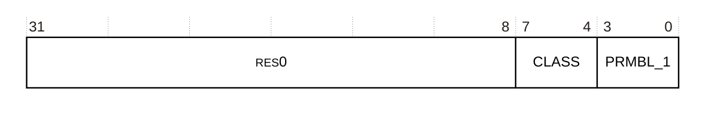

下表给出了 **PMCIDR1** 的位分配。

| 位 | 名称 | 功能 |
| --- | --- | --- |
| [31:8] | - | 保留，RES0。 |
| [7:4] | CLASS | 0x9：调试组件。 |
| [3:0] | PRMBL_1 | 0x0：前导码。 |

**PMCIDR1** 可以通过外部调试接口访问。

| 组件 | 偏移 |
| --- | --- |
| PMU | 0xFF4 |

#### 5.3.3 性能监控组件标识寄存器 2

**PMCIDR2** 提供用于标识性能监控组件的信息。

**使用限制**

本寄存器为只读。有关影响本寄存器访问是否允许的条件的汇总，请参见第 391 页的 12.2.4 External register access permissions。详细说明请参见《Arm® Architecture Reference Manual Supplement Armv8, for the Armv8-R AArch32 architecture profile》。

**陷阱与使能**

不存在影响本寄存器的陷阱与使能。

**配置**

本寄存器在所有处理器构建配置中均可用。

**属性**

**PMCIDR2** 是一个 32 位寄存器。

下图给出了 **PMCIDR2** 的位分配。

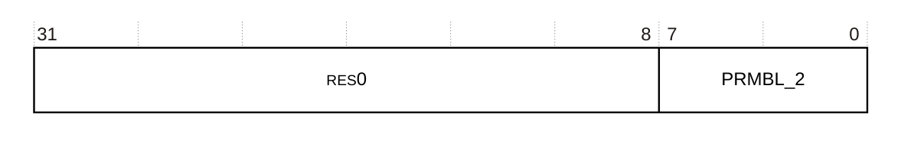

下表给出了 **PMCIDR2** 的位分配。

| 位 | 名称 | 功能 |
| --- | --- | --- |
| [31:8] | - | 保留，RES0。 |
| [7:0] | PRMBL_2 | 0x05：前导码字节 2。 |

**PMCIDR2** 可以通过外部调试接口访问。

| 组件 | 偏移 |
| --- | --- |
| PMU | 0xFF8 |

#### 5.3.4 性能监控组件标识寄存器 3

**PMCIDR3** 提供用于标识性能监控组件的信息。

**使用限制**

本寄存器为只读。有关影响本寄存器访问是否允许的条件的汇总，请参见第 391 页的 12.2.4 External register access permissions。详细说明请参见《Arm® Architecture Reference Manual Supplement Armv8, for the Armv8-R AArch32 architecture profile》。

**陷阱与使能**

不存在影响本寄存器的陷阱与使能。

**配置**

本寄存器在所有处理器构建配置中均可用。

**属性**

**PMCIDR3** 是一个 32 位寄存器。

下图给出了 **PMCIDR3** 的位分配。


下表给出了 **PMCIDR3** 的位分配。

| 位 | 名称 | 功能 |
| --- | --- | --- |
| [31:8] | - | 保留，RES0。 |
| [7:0] | PRMBL_3 | 0xB1：前导码字节 3。 |

**PMCIDR3** 可以通过外部调试接口访问。

| 组件 | 偏移 |
| --- | --- |
| PMU | 0xFFC |

## 6. 事件

每个核还根据事件属于性能分析事件还是错误检测事件，将其中一些事件导出到外部事件总线 **PMUEVENTx** 或外部错误总线 **ERREVENTx** 上。只有性能分析事件连接到 ETM。

下表给出了每个事件在相应事件总线上的位位置。此外，与特定核无关的错误事件导出到 **ERREVENT** 上，该总线上错误检测事件的位位置在下表中给出。

* 0x000 到 0x024 是体系结构定义的事件。更多信息请参见《Arm® Architecture Reference Manual Supplement Armv8, for the Armv8-R AArch32 architecture profile》。
* 0x060 到 0x08F 是体系结构推荐的事件。更多信息请参见《Arm® Architecture Reference Manual Supplement Armv8, for the Armv8-R AArch32 architecture profile》。
* 0x0C0 到 0x0DF 是实现定义的事件。
* **ERREVENT[25:0]** 是 ECC 错误事件。
* 0x100 到 0x10D 是可归因性能影响事件。
* 0x200 到 0x20A 是可测试性事件。这些事件仅用于测试目的，Arm 不保证这些事件的准确性。

**全局错误事件**

| ERREVENT | 事件名称 |
| --- | --- |
| [0] | 来自 AXIS 的可修正写数据载荷总线错误。 |
| [1] | 来自 AXIS 的致命写数据载荷总线错误。 |
| [2] | 来自 AXIS 的致命 **READY** 信号总线错误。 |
| [3] | 来自 AXIS 的致命非协议总线错误（载荷错误）。 |
| [4] | 来自 AXIS 的致命协议总线错误（LEN、ID、LAST、READY 与互连保护错误）。 |

**PMU 事件**

| 事件 ID | ETM ID | 助记符 | PMUEVENTx | ERREVENTx | 事件名称 |
| --- | --- | --- | --- | --- | --- |
| 0x000 | - | SW_INCR | - | - | 软件递增。仅当写入软件递增寄存器（**PMSWINC**）时该计数器才递增。 |
| 0x001 | 0x004 | L1I_CACHE_REFILL | [0] | - | L1 指令缓存重填。 |
| 0x003 | 0x005 | L1D_CACHE_REFILL | [1] | - | L1 数据缓存重填。 |
| 0x004 | 0x006 | L1D_CACHE | [2] | - | L1 数据缓存访问。 |
| 0x006 | 0x007 | LD_RETIRED | [3] | - | 体系结构执行的指令，条件检查通过——加载。 |
| 0x007 | 0x008 | ST_RETIRED | [4] | - | 体系结构执行的指令，条件检查通过——存储。 |
| 0x008 | 0x009 | INST_RETIRED | [5] | - | 体系结构执行的指令。 |
| - | 0x00A | - | [6] | - | 并行地体系结构执行两条指令。双发射时与位 **PMUEVENTx[5]** 一同置起。 |
| 0x009 | 0x00B | EXC_TAKEN | [7] | - | 已进入异常。 |
| 0x00A | 0x00C | EXC_RETURN | [8] | - | 体系结构执行的指令，条件码检查通过，异常返回。 |
| 0x00B | 0x00D | CID_WRITE_RETIRED | [9] | - | 体系结构执行的指令，条件码检查通过，写入 **CONTEXTIDR**。 |
| 0x00C | 0x00E | PC_WRITE_RETIRED | [10] | - | 体系结构执行的指令，条件检查通过，软件改变 **PC**。 |
| 0x00D | 0x00F | BR_IMMED_RETIRED | [11] | - | 体系结构执行的指令，立即数分支。 |
| 0x00E | 0x020 | BR_RETURN_RETIRED | [28] | - | 体系结构执行的指令，条件码检查通过，过程返回。 |
| 0x00F | 0x010 | UNALIGNED_LDST_RETIRED | [12] | - | 体系结构执行的指令，条件码检查通过，非对齐加载或存储。 |
| 0x010 | 0x011 | BR_MIS_PRED | [13] | - | 推测执行了预测错误或未预测的分支。 |
| 0x011 | - | CPU_CYCLES | - | - | 周期。 |
| 0x012 | 0x012 | BR_PRED | [14] | - | 推测执行了可预测分支。 |
| 0x013 | 0x013 | MEM_ACCESS | [15] | - | 数据存储器访问。 |
| 0x014 | 0x014 | L1I_CACHE | [16] | - | L1 指令缓存访问。 |
| 0x019 | - | BUS_ACCESS | - | - | **AXIM**、Flash 或 **LLPP** 总线访问。 |
| 0x01A | - | MEMORY_ERROR | - | - | 本地存储器错误（指令缓存、数据缓存、ATCM、BTCM、CTCM 或 Flash）。 |
| 0x01B | - | INST_SPEC | - | - | 推测执行的操作。 |
| 0x01D | - | BUS_CYCLES | - | - | 总线周期（**AXIM**）。 |
| 0x01E | - | CHAIN | - | - | 对奇数编号的计数器，前一个偶数编号计数器每次溢出时计数一次。对偶数编号的计数器不计数。 |
| 0x021 | 0x01C | BR_RETIRED | [24] | - | 体系结构执行的指令，分支。 |
| 0x022 | - | BR_MIS_PRED_RETIRED | - | - | 体系结构执行的指令，预测错误的分支。 |
| 0x023 | - | STALL_FRONTEND | - | - | 因前端而未发出操作。这通常发生在处理器没有可执行的指令时（例如，分支冲刷需要重新取指，从而清空流水线）。 |
| 0x024 | - | STALL_BACKEND | - | - | 因后端而未发出操作。这通常发生在处理器等待某个操作的结果时（例如，等待从存储器加载数据）。 |
| 0x060 | - | BUS_ACCESS_RD | - | - | 总线访问——读（**AXIM**、Flash 或 **LLPP**）。 |
| 0x061 | - | BUS_ACCESS_WR | - | - | 总线访问——写（**AXIM**、Flash 或 **LLPP**）。 |
| 0x082 | 0x01B | EXC_SVC | [23] | - | 已进入异常，Supervisor Call。 |
| 0x086 | 0x015 | EXC_IRQ | [17] | - | 已进入异常，IRQ。 |
| 0x087 | 0x016 | EXC_FIQ | [18] | - | 已进入异常，FIQ。 |
| 0x08A | 0x017 | EXC_HVC | [19] | - | 已进入异常，Hypervisor Call。 |
| 0x08E | 0x018 | EXC_TRAP_IRQ | [20] | - | 已进入异常，IRQ 未在本地进入。 |
| 0x08F | 0x019 | EXC_TRAP_FIQ | [21] | - | 已进入异常，FIQ 未在本地进入。 |
| 0x0C0 | 0x023 | HIRZER_AXI_READ | [31] | - | 外部存储器请求，**AXIM** 读。 |
| 0x0C1 | 0x024 | HIRZER_AXI_WRITE | [32] | - | 外部存储器请求，**AXIM** 写。 |
| 0x0C2 | 0x025 | HIRZER_FLASH_READ | [33] | - | 外部存储器请求，Flash（只读）。 |
| 0x0C3 | 0x026 | HIRZER_LLPP_READ | [34] | - | 外部存储器请求，**LLPP** 读。 |
| 0x0C4 | 0x027 | HIRZER_LLPP_WRITE | [35] | - | 外部存储器请求，**LLPP** 写。 |
| 0x0C5 | 0x028 | HIRZER_NC_AXI_READ | - | - | 不可缓存外部存储器请求，**AXIM** 读。 |
| 0x0C6 | 0x029 | HIRZER_NC_AXI_WRITE | - | - | 不可缓存外部存储器请求，**AXIM** 写。 |
| 0x0C7 | 0x02A | HIRZER_NC_FLASH_READ | - | - | 不可缓存外部存储器请求，Flash（只读）。 |
| 0x0C8 | - | HIRZER_REFILL_PF_AXI | - | - | 因预取而发生的 L1 数据缓存重填（仅 **AXIM**）。 |
| 0x0C9 | - | HIRZER_REFILL_LS_AXI | - | - | 因加载或存储而发生的 L1 数据缓存重填，**AXIM**。 |
| 0x0CA | - | HIRZER_REFILL_LS_FLASH | - | - | 因加载或存储而发生的 L1 数据缓存重填，Flash（注 78）。 |
| 0x0CB | 0x02B | HIRZER_DC_ACCESS_AXI | - | - | 在保留给 **AXIM** 的通路中访问 L1 数据缓存。 |
| 0x0CC | 0x02C | HIRZER_DC_ACCESS_FLASH | - | - | 在保留给 Flash 的通路中访问 L1 数据缓存（注 79）。 |
| 0x0CD | 0x02D | HIRZER_IC_ACCESS_AXI | - | - | 在保留给 **AXIM** 的通路中访问 L1 指令缓存。 |
| 0x0CE | 0x02E | HIRZER_IC_ACCESS_FLASH | - | - | 在保留给 Flash 的通路中访问 L1 指令缓存（注 80）。 |
| 0x0CF | - | HIRZER_NC_LS_HINTED_AXI | - | - | 因加载被提示而发生的不可缓存外部存储器请求，**AXIM**（注 81）。 |
| 0x0D0 | - | HIRZER_NC_LS_HINTED_FLASH_READ | - | - | 因加载被提示而发生的不可缓存外部存储器请求，Flash（注 81）。 |
| 0x0D1 | - | HIRZER_REFILL_IC_AXI | - | - | L1 指令缓存重填，**AXIM**。 |
| 0x0D2 | - | HIRZER_REFILL_IC_FLASH | - | - | L1 指令缓存重填，Flash（注 82）。 |
| 0x0D3 | 0x02F | HIRZER_NC_LS_AXI_READ | - | - | 因加载而发生的不可缓存外部存储器请求，**AXIM**。 |
| 0x0D4 | 0x030 | HIRZER_NC_LS_FLASH_READ | - | - | 因加载而发生的不可缓存外部存储器请求，Flash。 |
| 0x0D5 | 0x01D | HIRZER_COND_BR_RETIRED | [25] | - | 已执行的条件分支。 |
| 0x0D6 | - | HIRZER_MIS_PRED_COND_BR | - | - | 条件分支预测错误。 |
| 0x0D7 | 0x01E | HIRZER_BTAC_BR_RETIRED | [26] | - | 已执行的 **BTAC** 分支。 |
| 0x0D8 | - | HIRZER_MIS_PRED_BTAC_BR | - | - | 条件分支预测错误。 |
| 0x0D9 | 0x022 | HIRZER_VSCTLR_CHANGED | [30] | - | 体系结构执行的指令，对 **VSCTLR** 的 **MCR**。 |
| 0x0DA | 0x021 | HIRZER_DSB_ALL_RETIRED | [29] | - | 体系结构执行的指令，强 **DSB**、**DFB**。 |
| 0x0DB | - | HIRZER_SIMULT_ACCESS_AXI | - | - | 指令侧与数据侧同时访问 **AXIM**（造成竞争）。 |
| 0x0DC | - | HIRZER_SIMULT_ACCESS_FLASH | - | - | 指令侧与数据侧同时访问 Flash（造成竞争）。 |
| 0x0DD | 0x01A | HIRZER_EL2_ENTERED | [22] | - | 已进入异常到 EL2（进入 Hyp 模式），不包括复位。 |
| 0x0DE | 0x01F | HIRZER_CRS_BR_RETIRED | [27] | - | 实现定义的事件。已执行的 **CRS** 分支。 |
| 0x0DF | - | HIRZER_MIS_PRED_CRS_BR | - | - | **CRS** 分支预测错误。 |
| 0x0F0 | - | HIRZER_COR_ERR_MEM | - | [0] | 来自任意来源（L1 指令缓存、L1 数据缓存、ATCM、BTCM、CTCM 或 Flash）的可修正存储器错误。 |
| 0x0F1 | - | HIRZER_FAT_ERR_MEM | - | [1] | 来自任意来源（ATCM、BTCM、CTCM 或 Flash）的致命存储器错误。 |
| 0x0F2 | - | HIRZER_BUS_COR_DATA | - | [2] | 来自任意来源（**AXIM** 或 **LLPP**）的可修正数据载荷总线错误。 |
| - | - | - | - | [3] | 来自任意来源（**AXIM** 或 **LLPP**）的致命数据载荷总线错误。 |
| - | - | - | - | [4] | 来自任意来源（**AXIM**、Flash 或 **LLPP**）的致命 **READY** 信号总线错误。 |
| 0x0F3 | - | HIRZER_BUS_FAT_ANY | - | [5] | 来自任意来源（**AXIM**、Flash 或 **LLPP**）的致命非协议总线错误（载荷错误，数据除外）。 |
| 0x0F4 | - | HIRZER_BUS_PROTOCOL_ANY | - | [6] | 来自任意来源（**AXIM**、Flash 或 **LLPP**）的致命协议总线错误（LEN、ID、LAST、READY 与互连保护错误）。 |
| - | - | - | - | [7] | 可修正的 L1 指令缓存（数据或标签）存储器错误。 |
| - | - | - | - | [8] | 可修正的 L1 数据缓存（数据或标签）存储器错误。 |
| - | - | - | - | [9] | 可修正的 ATCM、BTCM 或 CTCM 存储器错误。 |
| - | - | - | - | [10] | 致命的 ATCM、BTCM 或 CTCM 存储器错误。 |
| - | - | - | - | [11] | 可修正的 Flash 存储器错误。 |
| - | - | - | - | [12] | 致命的 Flash 存储器错误。 |
| - | - | - | - | [13] | **AXIM** 总线超时。 |
| - | - | - | - | [14] | Flash 总线超时。 |
| - | - | - | - | [15] | **LLPP** 总线超时。 |
| - | - | - | - | [16] | 来自任意来源（L1 指令缓存、L1 数据缓存、ATCM、BTCM、CTCM 或 Flash）的可修正存储器错误，但未记录到 **ERR** 寄存器，因为它们已满或已被致命错误覆盖。 |
| - | - | - | - | [17] | 来自任意来源（ATCM、BTCM、CTCM 或 Flash）的致命存储器错误，但未记录到 **ERR** 寄存器，因为它们已满。 |
| - | - | - | - | [18] | Hyp 模式中的中断被屏蔽过长时间（**IMP_INTMONR** 看门狗已触发）。 |
| - | - | - | - | [19] | 在 Hyp 模式中同步检测到存储器或总线致命错误。 |
| - | - | - | - | [20] | 由于 EL2 控制的 **MPU** 故障产生中止，已进入中止异常。 |
| - | - | - | - | [21] | 由于 EL1 控制的 **MPU** 故障产生中止，已进入中止异常。 |
| - | - | - | - | [22] | 由于任意原因已进入未定义异常。 |
| - | - | - | - | [23] | 在 EL1 控制的 **MPU** 中标记为 Device 的存储器访问被冲刷，因为它在 EL2 控制的 **MPU** 中被标记为 Normal。 |
| - | - | - | - | [24] | 由于硬错误或异常向量处的异常导致处理器活锁。这是脉冲位。同一类型与同一向量偏移的异常连续进入 20 次。 |
| - | - | - | - | [25] | 在 EL2 中运行的软件解锁 **IMP_TESTR1**。**IMP_TESTR1** 仅用于测试目的。 |
| 0x100 | - | HIRZER_IQ_EMPTY_NO_MISS | - | - | 每个周期计数：**DPU** 指令队列（**IQ**，Instruction Queue）为空，且不是由于任意缓存通路中最近的指令缓存缺失。 |
| 0x101 | - | HIRZER_IQ_EMPTY_AXI_MISS | - | - | 每个周期计数：**DPU IQ** 为空，且有正在处理的、针对保留给 AXI 主接口的缓存通路的指令缓存缺失。 |
| 0x102 | - | HIRZER_IQ_EMPTY_FLASH_MISS | - | - | 每个周期计数：**DPU IQ** 为空，且有正在处理的、针对保留给 Flash 的缓存通路的指令缓存缺失。 |
| 0x103 | - | HIRZER_INTERLOCK_OTHER | - | - | 每个周期计数：存在互锁，且不是因为 Advanced SIMD 或浮点指令，也不是因为加载/存储指令等待数据以计算 **AGU** 中的地址。因 **Wr** 级停顿（通常是等待加载数据）引起的停顿周期不计入。 |
| 0x104 | - | HIRZER_INTERLOCK_AGU | - | - | 每个周期计数：存在互锁，且是因为加载/存储指令等待数据以计算地址生成单元（**AGU**，Address Generation Unit）中的地址。因 **Wr** 级停顿（通常是等待加载数据）引起的停顿周期不计入。 |
| 0x105 | - | HIRZER_INTERLOCK_FPASIMD | - | - | 每个周期计数：存在互锁，且是因为 Advanced SIMD 或浮点指令。因 **Wr** 级停顿（通常是等待加载数据）引起的停顿周期不计入。 |
| 0x106 | - | HIRZER_LOAD_STALL_AXI | - | - | 每个周期计数：**Wr** 级存在停顿，且是因为来自 **AXIM** 的加载缺失。 |
| 0x107 | - | HIRZER_LOAD_STALL_FLASH | - | - | 每个周期计数：**Wr** 级存在停顿，且是因为来自 Flash 的加载缺失。 |
| 0x108 | - | HIRZER_WR_STALL_STORE | - | - | 每个周期计数：**Wr** 级存在停顿，且是因为存储。 |
| 0x109 | - | HIRZER_WR_STALL_AXI_STB_FULL | - | - | 存储停顿，因为存储缓冲区的 **AXIM** 部分已满。 |
| 0x10A | - | HIRZER_WR_STALL_TCM_STB_FULL | - | - | 存储停顿，因为存储缓冲区的 **TCM** 部分已满。 |
| 0x10B | - | HIRZER_WR_STALL_LLPP_STB_FULL | - | - | 存储停顿，因为存储缓冲区的 **LLPP** 部分已满。 |
| 0x10C | - | HIRZER_BARRIER_STALL_BARRIER | - | - | 屏障停顿，因为存储缓冲区正忙于另一个屏障。 |
| 0x10D | - | HIRZER_BARRIER_STORE_AXIWRITE | - | - | 屏障停顿，因为它正在等待 **AXIM** 总线上的写完成。 |
| 0x200 | - | HIRZER_IC_WT_HIT | - | - | L1 指令缓存通路跟踪器命中。 |
| 0x201 | - | HIRZER_DC_WT_HIT | - | - | L1 数据缓存通路跟踪器命中。 |
| 0x202 | - | HIRZER_I_UMPU_HIT | - | - | 指令侧微 **MPU** 命中。 |
| 0x203 | - | HIRZER_D_UMPU_HIT | - | - | 数据侧微 **MPU** 命中。这也可以在流水线停顿时计数。 |
| 0x204 | - | HIRZER_IC_CACHE_HIT | - | - | L1 指令缓存命中。 |
| 0x205 | - | HIRZER_IC_LFB_HIT | - | - | L1 指令缓存行填充缓冲区命中。 |
| 0x206 | - | HIRZER_IC_BIU_HIT | - | - | L1 指令缓存在 **BIU** 响应上命中。 |
| 0x207 | - | HIRZER_IC_HINT_REQ | - | - | L1 指令缓存提示请求已发出。 |
| 0x208 | - | HIRZER_DC_TAG_ACCESS | - | - | 已访问 L1 数据缓存标签存储器。 |
| 0x209 | - | HIRZER_DC_DATA_ACCESS | - | - | 已访问 L1 数据缓存数据存储器。 |
| 0x20A | - | HIRZER_TCM_ACCESS | - | - | 已访问 **TCM** 存储器。 |

错误事件预计很少发生，并且会合并来自不同来源的错误。如果多个错误恰好在同一周期发生，相应的 **PMU** 计数器或 **PMUEVENTx**／**ERREVENTx** 位只指示一个错误。

注 78：事件 0x003（L1D_CACHE_REFILL）是事件 0x0C9 与 0x0CA 之和。

注 79：事件 0x004（L1D_CACHE）是事件 0x0CB 与 0x0CC 之和。

注 80：事件 0x014（L1I_CACHE）是事件 0x0CD 与 0x0CE 之和。

注 81：提示的加载存储单元（**LSU**，Load Store Unit）请求是从加载存储 1（**LS1**）流水级发出的提前请求，用于降低存储器延迟。更具体地说，可以在指令的条件码确定之前发出提示请求。

注 82：事件 0x001（L1I_CACHE_REFILL）是事件 0x0D1 与 0x0D2 之和。

## 7. 中断

当 **PMU** 产生中断时，Cortex®-R52+ 处理器置起 **PMU** 中断信号。该信号作为 PPI 之一连接到 Cortex®-R52+ 处理器中断控制器，其中断 ID 为 23。

该中断还作为触发输入驱动到 **CTI**。

相关参考

第 463 页的 14 Cross Trigger。

## 8. 导出 PMU 事件

本节介绍 **PMU** 事件的导出。

### 8.1 外部硬件

除处理器中的计数器之外，还有一些事件导出到 **PMUEVENTx** 总线上，可连接到外部硬件。**PMUEVENTx** 总线上的事件导出由 **PMCR.X** 位使能。

有关这些事件的信息，请参见 6 事件。

### 8.2 调试跟踪硬件

导出到 **PMUEVENTx** 的同一批事件也导出到 ETM 跟踪单元，从而可以监控这些事件以产生跟踪与其他触发。

有关这些事件的更多信息，请参见 6 事件。

相关参考

第 463 页的 14 Cross Trigger。

第 480 页的 15 Embedded Trace Macrocell。