本附录介绍 Cortex®-R52+ 处理器的可编程 MBIST 控制器（**PMC**，Programmable MBIST Controller）。

## 1. 简介

Cortex®-R52+ 处理器支持在线 MBIST 接口，该接口允许以全速对每个核中的全部 SRAM 进行读访问与写访问。

MBIST 的主要用途是生产测试，但 Cortex®-R52+ 处理器还支持在正常运行期间对 SRAM 与 ECC 逻辑进行现场测试。这称为**在线 MBIST（on-line MBIST）**。在线存储器测试用于功能安全应用，并在以下任一情况下执行：

* 按周期执行。
* 上电时执行。
* 检测到 ECC 错误时执行。

现有的生产测试 MBIST 控制器不支持在线 MBIST 的要求，因此需要使用专为此目的开发的 PMC-R52+。

取决于 **PMC** 参数的取值，在线 MBIST 有两种可用选项：

* 外部在线 MBIST 接口，当 **PMC** 设置为 0 时可与 PMC-R52+ 一起使用。请参见 1.1 外部集成 PMC-R52+ 的示例。
* 预集成的 PMC-R52+，其全部连接都在 Cortex®-R52+ 处理器内部，当 **PMC** 设置为 1 时使用。请参见 1.2 预集成 PMC-Cortex-R52+ 的示例。

PMC-R52+ 采用基于微码的可编程架构，从而具备很高的灵活性，可适应不同的使用模型与存储器测试算法。它具有标准的 Arm MBIST 主接口与一个 AHB-Lite 从接口。其主要用途是测试：

* SRAM。
* ECC 逻辑。
* 任何其他相关逻辑。

Cortex®-R52+ 的软件内置自测试（**SBIST**，Software Built-In Self-Test）库使用 PMC-R52+ 测试程序来：

* 周期性地测试存储器 ECC 及相关逻辑。
* 在处理器执行应用代码的同时在后台测试 SRAM。更多信息请参见 3.3 在线 MBIST、在线存储器。
* 使用生产测试算法周期性地测试 SRAM。更多信息请参见 3.2 在线 MBIST、离线存储器。

在测试存储器阵列之前，必须为 PMC-R52+ 编程存储器阵列的信息以及要执行的存储器事务列表。

### 1.1 外部集成 PMC-R52+ 的示例

当 **PMC** 参数设置为 0 时，通过 AHB-Lite 从接口对 PMC-R52+ 进行编程。

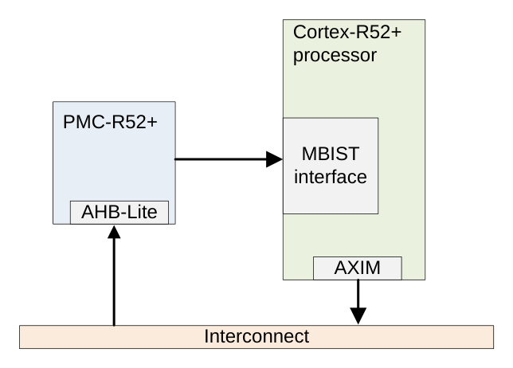

### 1.2 预集成 PMC-Cortex®-R52+ 的示例

下图给出了当 **PMC** 参数设置为 1 时、集成 PMC-Cortex®-R52+ 的 Cortex®-R52+ 处理器的一种示例配置。

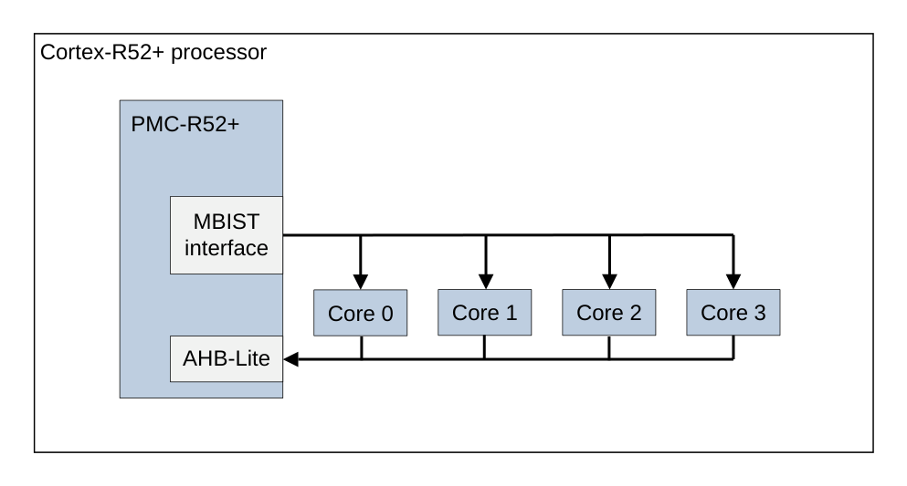

在此示例中，单个 PMC 由四个核共享。处理器包含一个内部编程接口，用于驱动 PMC 上的 AHB-Lite 接口。当按此配置对 PMC 编程后，它可以通过 MBIST 接口向某个专用核发出 MBIST 请求。所有这些接口都位于 Cortex®-R52+ 处理器内部。

将 PMC-R52+ 集成在集群内部这一选项存在一些限制：

* 系统无法对 PMC 编程，只有 Cortex®-R52+ 集群中的一个核可以。
* 调试器看不到 PMC 组件。
* PMC 的任何信号都不会引出到顶层（其中包含错误信息）。

如果需要上述任一方面，集成方不应使用将 PMC-R52+ 集成在集群内部的选项，而应改用外部集成 PMC-R52+ 的选项。

## 2. PMC-R52+ 的特性与优势

PMC-R52+ 的主要特性是：

* 允许以处理器时钟频率通过背靠背事务对存储器进行全速测试。
* 可使用短突发透明 SRAM 测试算法，非破坏性。
* 可使用生产测试 March SRAM 测试算法，破坏性。
* 可在测试完成或检测到存储器故障时中断处理器。
* 可使用软件轮询来检查测试是否完成或是否检测到存储器故障。
* 具有可分别由硬件或软件触发的独立测试突发。
* 基于微码，因此在面积约束内高度灵活，可实现不同的测试算法。
* 允许处理器对 SRAM 数据与 ECC 值进行任意读访问与写访问。

PMC-R52+ 的优势是：

* 检测 SRAM 中的潜在故障，包括时序故障。
* 检测存储器 ECC 逻辑中的潜在故障，包括时序故障。
* ECC 错误分析。检测到 ECC 错误时可测试某个 SRAM 条目，以确定发生的是硬错误还是软错误。如果是软错误，则无需使用核内的存储器错误缓存寄存器来替换条目。如果是硬错误，则必须修正该故障。为此，应使用错误缓存寄存器禁用条目或 SRAM 修正特性。
* SRAM 保持测试。
* 为错误监控软件与系统硬件验证注入存储器错误。
* 对 SRAM 进行存储器擦洗（**memory scrubbing**）以修正软 ECC 错误。这可防止错误累积，并确保可修正的单比特错误不会退化为无法修正的多比特错误。
* 由外部调试器进行存储器转储与监控。这对于软件与硬件调试、芯片上电、诊断 SRAM 电源问题以及核锁定很有用。

## 3. MBIST 使用模型

Cortex®-R52+ 处理器支持以下 MBIST 使用模型：

* 生产 MBIST。
* 在线 MBIST、离线存储器。
* 在线 MBIST、在线存储器。

PMC-R52+ 支持在线 MBIST、离线存储器以及在线 MBIST、在线存储器这两种使用模型。但是，它不支持生产 MBIST 使用模型。本手册中主要使用在线 MBIST、在线存储器使用模型。

### 3.1 生产 MBIST

生产 MBIST 使用模型是指主要在器件制造期间执行 SRAM 测试，但也可能在上电时或现场按周期执行。

进入生产 MBIST 模式的方法是在复位处理器的同时置位 MBIST 请求信号。复位释放后，处理器立即被暂停，并在整个测试期间保持该状态。这允许完全访问所有 SRAM 的所有条目。SRAM 由针对不同类型故障的不同测试算法进行测试。测试完成后必须复位处理器。测试会破坏存储器内容与处理器状态。如果测试后必须保留存储器内容或处理器状态，则必须使用软件保存并恢复处理器与存储器的当前状态。

### 3.2 在线 MBIST、离线存储器

在在线 MBIST、离线存储器使用模型中，被测存储器被置于离线状态，因此软件无法访问它。这允许在测试期间访问所有位置。

每次测试执行以下步骤：

1. 软件禁用被测存储器，使其可用于测试，但处理器仍可从其他存储器执行，性能可能有所下降。
2. 如果必须保留存储器内容，则软件应将被测存储器的内容保存到不被测试的存储器中。
3. 软件指示 MBIST 控制器测试该存储器。
4. MBIST 控制器测试该存储器。
5. 测试完成后，软件检查 MBIST 控制器是否有错误。
6. 取决于需求与被测存储器的类型，软件必须执行以下任一操作：
    * 恢复存储器的内容。
    * 如果测试的是缓存，则必须将其无效化。
7. 软件重新使能该存储器以供功能使用。

该使用模型允许使用标准的生产 MBIST March 算法，这类算法需要访问被测存储器内的所有条目。测试期间存储器内容会被破坏，软件可能需要保存并恢复这些存储器内容。处理器无法访问被测存储器，因为它已被禁用。因此，处理器改为访问另一个存储器。例如，如果软件在 TCM 范围内执行访问，则它通过缓存访问主存储器。存储器必须在某段时间内保持离线，以便执行测试算法。软件必须谨慎编写，以确保它不依赖通常存储在被测存储器中的数据。

### 3.3 在线 MBIST、在线存储器

在在线 MBIST、在线存储器使用模型中，执行周期性的自主突发测试或由软件发起的短突发测试。

更多信息请参见 4 短突发软件透明算法。在这种情况下，测试由一系列分别施加的短事务序列或突发完成。通常每个突发测试两个位置。每个突发持续不到 20 个时钟周期，并且针对不同的位置，因此可以测试存储器中的所有位置。在每个突发期间，MBIST 控制器保存并恢复被测的存储器位置。软件只需初始化 MBIST 控制器并处理检测到的任何错误。一旦 MBIST 控制器初始化完成，它就在无处理器干预的情况下执行每个短突发并遍历 RAM 中的所有位置。MBIST 控制器与处理器中的在线 MBIST 逻辑对每个突发自动执行以下步骤：

1. MBIST 控制器请求访问目标存储器。
2. 处理器就绪后应答该请求，并自动锁定该存储器以阻止正常访问。这保证了全速的 MBIST 访问，并保证测试期间软件不会对目标存储器做出任何更改。
3. MBIST 控制器执行一个短突发事务。
4. MBIST 控制器释放请求。
5. 随后自动解除对目标存储器的锁定。
6. 在一个突发期间只有一个存储器被锁定而无法被处理器访问，因此处理器可以访问其他存储器。如果处理器尝试访问被锁定的存储器，则会停顿直到该突发完成。由于突发很短且不频繁，该使用模型只在处理器尝试访问被测存储器时对性能有很小的影响。

## 4. 短突发软件透明算法

在线 MBIST 测试使用与生产 MBIST 测试相同的数据通路。因此，采用在线 MBIST、在线存储器使用模型时，RAM 测试的质量可以很高。在制造阶段，器件已经通过生产 MBIST 测试。因此，操作系统运行期间出现的最常见存储器故障与制造期间出现的故障不同。此外，生产 MBIST 测试可以在上电与掉电时运行。这为使用新的测试算法提供了机会，这些算法针对现场最可能发生的存储器故障，并且对处理器性能的影响最小。

### 4.1 SRAM 故障

短突发软件透明 MBIST 算法覆盖以下 SRAM 电路中由晶体管老化与电迁移引起的延迟故障与固定故障（**stuck-at**）：

* 单个位单元。
* 字线。
* 时序电路。
* 灵敏放大器。
* 数据多路复用器。

### 4.2 短突发软件透明在线 MBIST 测试算法示例

下表演示了一个短突发软件透明在线 MBIST 测试算法示例。

该示例测试算法可检测 4.1 SRAM 故障中列出的故障类型。该算法对所有 n 值重复执行，其中 n 是被测 SRAM 条目，取值范围为 0 到 SRAM 大小减 1。该算法使用地址偏移 m，其中 m 是被测阵列的固定 RAM 列多路复用因子（4、8、16 或 32）。

| 算法步骤 | 操作 | 描述 |
| --- | --- | --- |
| 1 | 读取位置 n 并存入寄存器 X。 | 位置 n 被保存。 |
| 2 | 读取位置 n+m 并存入寄存器 Y。 | 位置 n+m 被保存，下一条字线被激活。 |
| 3 | 将 X 写入位置 n+m。 | - |
| 4 | 将 ~X 写入位置 n。 | 在字线与所有位线之间切换。 |
| 5 | 读取位置 n 并检查其是否等于 ~X。 | 验证位置 n 中没有位固定。 |
| 6 | 读取位置 n+m 并检查其是否等于 X。 | 在字线与所有位线之间切换。 |
| 7 | 将 X 写入位置 n。 | 位置 n 被恢复。 |
| 8 | 将 Y 写入位置 n+m。 | 位置 n+m 被恢复。 |
| 9 | 读取位置 n 并检查其是否等于 X。 | 检查 X 寄存器是否被正确恢复。 |
| 10 | 读取位置 n+m 并检查其是否等于 Y。 | 检查 Y 寄存器是否被正确恢复。 |

有关 X 与 Y 寄存器的更多信息，请参见 8.11 数据寄存器 X0-X7 与 Y0-Y7。

### 4.3 微码

本节给出短突发软件透明在线 MBIST 算法示例的微码。

下表给出实现 4.2 中测试算法的 PMC-R52+ 微码。该微码假设 PMC-R52+ 配置为 x 快速地址更新模式，即每次执行时都改变行地址（字线）。有关 x 快速地址更新模式的更多信息，请参见 8.3 Main Control Register, CTRL（ADDRCD 位）。有关微码格式的更多信息，请参见 8.15 程序寄存器 P0-P31。

| 寄存器 | 指令 | 输出地址 | 地址更新 | 数据极性 | 数据寄存器 | 事务 | 操作 |
| --- | --- | --- | --- | --- | --- | --- | --- |
| P0 | 0 0 0 0 01 0010 | 地址。 | 保持地址 | - | X | 读 | 保存读数据。 |
| P1 | 1 0 0 1 01 0010 | 下一地址 | 保持地址 | - | Y | 读 | 保存读数据。 |
| P2 | 1 0 0 0 10 0011 | 下一地址 | 保持地址 | 不反相 | X | 写 | 等待寄存器更新。 |
| P3 | 0 0 1 0 10 0000 | 地址 | 保持地址 | 反相 | X | 写 | 无操作。 |
| P4 | 0 0 1 0 01 0000 | 地址 | 保持地址 | 反相 | X | 读 | 无操作，检查数据。 |
| P5 | 1 0 0 0 01 0000 | 下一地址 | 保持地址 | 不反相 | X | 读 | 无操作，检查数据。 |
| P6 | 0 0 0 0 10 0000 | 地址 | 保持地址 | 不反相 | X | 写 | 无操作。 |
| P7 | 1 0 0 1 10 0000 | 下一地址 | 保持地址 | 不反相 | Y | 写 | 无操作。 |
| P8 | 0 0 0 0 01 0000 | 地址 | 保持地址 | 不反相 | X | 读 | 无操作，检查数据。 |
| P9 | 1 1 0 1 01 0001 | 下一地址 | 更新地址 | 不反相 | Y | 读 | 最后一条操作，检查数据。 |

有关输出地址如何计算的更多信息，请参见 8.10.1 地址输出值。

## 5. 生产测试 March 算法

March MBIST 算法通常用于生产测试，但也可能用于上电时或运行中按周期进行的现场 SRAM 测试。PMC-R52+ 可以在软件的一定辅助下执行这些测试算法。

March MBIST 算法会破坏存储器内容，因此只能使用在线 MBIST、离线存储器使用模型运行。有关在线 MBIST、离线存储器使用模型的更多信息，请参见 3.2 在线 MBIST、离线存储器。

本节介绍如何对 PMC-R52+ 编程以执行一个称为 March C- 的示例 March MBIST 算法。这些信息可以作为实现其他生产测试 MBIST 算法的基础。

### 5.1 March 算法

March MBIST 算法通过向 SRAM 的所有条目填入测试模式来测试 SRAM。该算法还对一个 SRAM 执行多轮遍历，检查模式并写入新模式。

每一轮中执行的 SRAM 读操作与写操作称为一个 **March 元素（March element）**，每个元素对 SRAM 中的每个条目重复执行。每个条目中地址递增或递减的方向由 March 记法指明。

#### 5.1.1 March 记法

March 算法使用下表所示的记法描述。

| 记法 | 描述 |
| --- | --- |
| () | March 元素。其中包含要对每个 SRAM 条目执行的读操作与写操作。 |
| r0 | 读取 SRAM 并检查值是否等于模式 0。 |
| r1 | 读取 SRAM 并检查值是否等于模式 1。 |
| w0 | 向 SRAM 写入模式 0。 |
| w1 | 向 SRAM 写入模式 1。 |
| ↑ | 执行完一个 March 元素中的操作后递增地址。 |
| ↓ | 执行完一个 March 元素中的操作后递减地址。 |

模式 0 与模式 1 可以是任意值，但二者必须互为反值。

一个 March 元素中的操作在当前 SRAM 地址上执行，然后地址按指定方向递增或递减，并对新地址重复这些操作。这对 SRAM 中的所有条目重复执行。随后，对所有 SRAM 条目执行下一个 March 元素。当所有元素都执行完毕时，测试结束。

### 5.2 March C- 算法

March C- MBIST 算法对 SRAM 故障具有很高的覆盖率，包括地址译码器故障与耦合故障，并且每个 SRAM 条目只需十次访问。

下图给出了 March C- 算法：

```arm
{↑ (w0); ↑ (r0, w1); ↑ (r1, w0); ↓ (r0, w1); ↓ (r1, w0); ↓ (r0)}
```

### 5.3 针对 March C- 算法的 PMC-R52+ 编程

测试开始时，必须为 PMC-R52+ 编程被测存储器阵列的属性。这些属性包括：

* 阵列编码。
* 多路复用因子。
* 数据掩码。
* 流水线深度。
* 每次操作的周期数。

这些属性信息在测试期间无需更新。但是，在每次 SRAM 遍历之前，必须为微码与地址设置编程该 March 元素的信息。Arm 建议将 X 寄存器全宽填零，并将其用作测试模式 0。有关 X 寄存器的更多信息，请参见 8.11 数据寄存器 X0-X7 与 Y0-Y7。

还必须对 PMC-R52+ 编程，使微码程序持续循环直到到达结束地址。可以将 PMC-R52+ 编程为在一轮完成或检测到故障时中断处理器。或者，软件可以轮询 PMC-R52+ 以查看一轮何时完成或是否检测到故障。5.3.1 初始编程中给出的编程示例演示了通过轮询 PMC-R52+ 查看一轮何时完成或是否检测到故障的软件。

为某一轮对 PMC-R52+ 编程后，必须通过将 **CTRL.PEEN** 位设置为 0b1 来使能它执行微码程序。有关 **CTRL** 的更多信息，请参见 8.3 Main Control Register, CTRL。

每一轮的 PMC-R52+ 编程在以下各节中描述：

* 5.3.2 第 0 轮。
* 5.3.3 第 1 轮。
* 5.3.4 第 2 轮。
* 5.3.5 第 3 轮。
* 5.3.6 第 4 轮。
* 5.3.7 第 5 轮。

被测 SRAM 中的元素个数为 N。

#### 5.3.1 初始编程

测试开始时，必须按下表所述对寄存器编程。有关程序员模型的更多信息，请参见 8 程序员模型。

| 寄存器 | 编程值 |
| --- | --- |
| CTRL | 00000210<br>• X 快速、测试结束中断与故障中断禁用。<br>• 检测到故障时停止。<br>• 忽略 TC 输入（循环直到停止地址）。<br>有关 CTRL 的更多信息，请参见 8.3 Main Control Register, CTRL。 |
| MCR | 被测 SRAM 的属性。<br>有关 MCR 的更多信息，请参见 8.4 Memory Control Register, MCR。 |
| BER | 0xFFFFFFFF<br>有关 BER 的更多信息，请参见 8.5 Byte Enable Register, BER。 |
| PCR | 0x00000000<br>有关 PCR 的更多信息，请参见 8.6 Program Counter Register, PCR。 |
| X0-X7 | 全零。<br>有关 X 寄存器的更多信息，请参见 8.11 数据寄存器 X0-X7 与 Y0-Y7。 |
| Y0-Y7 | 全零。<br>有关 Y 寄存器的更多信息，请参见 8.11 数据寄存器 X0-X7 与 Y0-Y7。 |
| P0-P31 | 全零。<br>有关 P 寄存器的更多信息，请参见 8.15 程序寄存器 P0-P31。 |
| DM0-DM7 | 被测 SRAM 的数据掩码。<br>有关 DM 寄存器的更多信息，请参见 8.14 数据掩码寄存器 DM0-DM7。 |
| AOR | 按需设置。<br>有关 AOR 的更多信息，请参见 8.13 Auxiliary Output Register, AOR。 |

#### 5.3.2 第 0 轮

第 0 轮所需的额外编程在下表中描述。

被测 SRAM 中的元素个数为 N。

March 元素为：

```arm
↑ (w0)
```

第 0 轮的轮次专用编程在下表中描述。

| 寄存器 | 编程值 |
| --- | --- |
| STOPADDR | N-1<br>有关 STOPADDR 的更多信息，请参见 8.8 Stop Address Register, STOPADDR。 |
| CADDR | 0x00000000<br>有关 CADDR 的更多信息，请参见 8.9 Column Address Register, CADDR。 |
| RADDR | 0x00000000<br>有关 RADDR 的更多信息，请参见 8.10 Row Address Register, RADDR。 |
| CTRL | 0x00000610<br>递增地址。<br>有关 CTRL 寄存器的更多信息，请参见 8.3 Main Control Register, CTRL。 |
| PCR | 0x00000000<br>有关 PCR 的更多信息，请参见 8.6 Program Counter Register, PCR。 |

第 0 轮的微码编程在下表中描述。

| 寄存器 | 指令 | 输出地址 | 地址更新 | 数据极性 | 数据寄存器 | 事务 | 操作 |
| --- | --- | --- | --- | --- | --- | --- | --- |
| P0 | 0 1 0 0 10 0001 | 地址 | 更新地址 | 不反相 | X | 写 | 最后一条操作。 |

#### 5.3.3 第 1 轮

第 1 轮所需的额外编程在下表中描述。

被测 SRAM 中的元素个数为 N。

March 元素为：

```arm
↑ (r0, w1)
```

第 1 轮的轮次专用编程在下表中描述。

| 寄存器 | 编程值 |
| --- | --- |
| STOPADDR | N-1<br>有关 STOPADDR 的更多信息，请参见 8.8 Stop Address Register, STOPADDR。 |
| CADDR | 0x00000000<br>有关 CADDR 的更多信息，请参见 8.9 Column Address Register, CADDR。 |
| RADDR | 0x00000000<br>有关 RADDR 的更多信息，请参见 8.10 Row Address Register, RADDR。 |
| CTRL | 0x00000610<br>递增地址。<br>有关 CTRL 寄存器的更多信息，请参见 8.3 Main Control Register, CTRL。 |
| PCR | 0x00000000<br>有关 PCR 的更多信息，请参见 8.6 Program Counter Register, PCR。 |

第 1 轮的微码编程在下表中描述。

| 寄存器 | 指令 | 输出地址 | 地址更新 | 数据极性 | 数据寄存器 | 事务 | 操作 |
| --- | --- | --- | --- | --- | --- | --- | --- |
| P0 | 0 0 0 0 01 0000 | 地址 | 保持地址 | 不反相 | X | 读 | 无操作，检查数据。 |
| P1 | 0 1 1 0 10 0001 | 地址 | 更新地址 | 反相 | X | 写 | 最后一条操作。 |

#### 5.3.4 第 2 轮

第 2 轮所需的额外编程在下表中描述。

被测 SRAM 中的元素个数为 N。

March 元素为：

```arm
↑ (r1, w0)
```

第 2 轮的轮次专用编程在下表中描述。

| 寄存器 | 编程值 |
| --- | --- |
| STOPADDR | N-1<br>有关 STOPADDR 的更多信息，请参见 8.8 Stop Address Register, STOPADDR。 |
| CADDR | 0x00000000<br>有关 CADDR 的更多信息，请参见 8.9 Column Address Register, CADDR。 |
| RADDR | 0x00000000<br>有关 RADDR 的更多信息，请参见 8.10 Row Address Register, RADDR。 |
| CTRL | 0x00000610<br>递增地址。<br>有关 CTRL 寄存器的更多信息，请参见 8.3 Main Control Register, CTRL。 |
| PCR | 0x00000000<br>有关 PCR 的更多信息，请参见 8.6 Program Counter Register, PCR。 |

第 2 轮的微码编程在下表中描述。

| 寄存器 | 指令 | 输出地址 | 地址更新 | 数据极性 | 数据寄存器 | 事务 | 操作 |
| --- | --- | --- | --- | --- | --- | --- | --- |
| P0 | 0 0 1 0 01 0000 | 地址 | 保持地址 | 反相 | X | 读 | 无操作，检查数据。 |
| P1 | 0 1 0 0 10 0001 | 地址 | 更新地址 | 不反相 | X | 写 | 最后一条操作。 |

#### 5.3.5 第 3 轮

第 3 轮所需的额外编程在下表中描述。

被测 SRAM 中的元素个数为 N。

March 元素为：

```arm
↓ (r0, w1)
```

第 3 轮的轮次专用编程在下表中描述。

| 寄存器 | 编程值 |
| --- | --- |
| STOPADDR | 0x00000000<br>有关 STOPADDR 的更多信息，请参见 8.8 Stop Address Register, STOPADDR。 |
| CADDR | N-1<br>**注意：** 仅使用最低有效位（[MCR.CCW+1:0]）。<br>有关 CADDR 的更多信息，请参见 8.9 Column Address Register, CADDR。 |
| RADDR | N-1 >> MCR.CCW+2<br>有关 RADDR 的更多信息，请参见 8.10 Row Address Register, RADDR。 |
| CTRL | 00000210<br>递减地址。<br>有关 CTRL 寄存器的更多信息，请参见 8.3 Main Control Register, CTRL。 |
| PCR | 0x00000000<br>有关 PCR 的更多信息，请参见 8.6 Program Counter Register, PCR。 |

第 3 轮的微码编程在下表中描述。

| 寄存器 | 指令 | 输出地址 | 地址更新 | 数据极性 | 数据寄存器 | 事务 | 操作 |
| --- | --- | --- | --- | --- | --- | --- | --- |
| P0 | 0 0 0 0 01 0000 | 地址 | 保持地址 | 不反相 | X | 读 | 无操作，检查数据。 |
| P1 | 0 1 1 0 10 0001 | 地址 | 更新地址 | 反相 | X | 写 | 最后一条操作。 |

#### 5.3.6 第 4 轮

第 4 轮所需的额外编程在下表中描述。

被测 SRAM 中的元素个数为 N。

March 元素为：

```arm
↓ (r1, w0)
```

第 4 轮的轮次专用编程在下表中描述。

| 寄存器 | 编程值 |
| --- | --- |
| STOPADDR | 0x00000000<br>有关 STOPADDR 的更多信息，请参见 8.8 Stop Address Register, STOPADDR。 |
| CADDR | N-1<br>**注意：** 仅使用最低有效位（[MCR.CCW+1:0]）。<br>有关 CADDR 的更多信息，请参见 8.9 Column Address Register, CADDR。 |
| RADDR | N-1 >> MCR.CCW+2<br>有关 RADDR 的更多信息，请参见 8.10 Row Address Register, RADDR。 |
| CTRL | 00000210<br>递减地址。<br>有关 CTRL 寄存器的更多信息，请参见 8.3 Main Control Register, CTRL。 |
| PCR | 0x00000000<br>有关 PCR 的更多信息，请参见 8.6 Program Counter Register, PCR。 |

第 4 轮的微码编程在下表中描述。

| 寄存器 | 指令 | 输出地址 | 地址更新 | 数据极性 | 数据寄存器 | 事务 | 操作 |
| --- | --- | --- | --- | --- | --- | --- | --- |
| P0 | 0 0 1 0 01 0000 | 地址 | 保持地址 | 反相 | X | 读 | 无操作，检查数据。 |
| P1 | 0 1 0 0 10 0001 | 地址 | 更新地址 | 不反相 | X | 写 | 最后一条操作。 |

#### 5.3.7 第 5 轮

第 5 轮所需的额外编程在下表中描述。

被测 SRAM 中的元素个数为 N。

March 元素为：

```arm
↓ (r0)
```

第 5 轮的轮次专用编程在下表中描述。

| 寄存器 | 编程值 |
| --- | --- |
| STOPADDR | 0x00000000<br>有关 STOPADDR 的更多信息，请参见 8.8 Stop Address Register, STOPADDR。 |
| CADDR | N-1<br>**注意：** 仅使用最低有效位（[MCR.CCW+1:0]）。<br>有关 CADDR 的更多信息，请参见 8.9 Column Address Register, CADDR。 |
| RADDR | N-1 >> MCR.CCW+2<br>有关 RADDR 的更多信息，请参见 8.10 Row Address Register, RADDR。 |
| CTRL | 00000210<br>递减地址。<br>有关 CTRL 寄存器的更多信息，请参见 8.3 Main Control Register, CTRL。 |
| PCR | 0x00000000<br>有关 PCR 的更多信息，请参见 8.6 Program Counter Register, PCR。 |

第 5 轮的微码编程在下表中描述。

| 寄存器 | 指令 | 输出地址 | 地址更新 | 数据极性 | 数据寄存器 | 事务 | 操作 |
| --- | --- | --- | --- | --- | --- | --- | --- |
| P0 | 0 1 0 0 01 0001 | 地址 | 更新地址 | 不反相 | X | 读 | 最后一条操作，检查数据。 |

## 6. 示例测试代码

提供了实现以下算法的示例测试代码：

* 4 短突发软件透明算法。
* 5 生产测试 March 算法。

该示例测试代码以汇编代码实现，可在 Cortex®-R52+ SBIST 库环境下执行。有关 SBIST 库的更多信息，请参见《Arm® Cortex®-R52+ Processor SBIST User Guide》。该示例测试代码包含以下源文件：

| 源文件名 | 描述 |
| --- | --- |
| hirzer_sbist_ram.s | 测试包装程序，按顺序调用各测试函数。 |
| hirzer_sbist_ram_save_port.s | 体系结构状态保存函数，在执行测试之前调用。 |
| hirzer_sbist_ram_restore_port.s | 体系结构状态恢复函数，在执行测试之后调用。 |
| hirzer_sbist_ram_functions_common_port.s | 测试所需的各个函数。 |
| hirzer_sbist_ram_p001_n001_port.s | 测试第 1 部分（对 L1 数据缓存数据 RAM 执行 March 算法）。 |
| hirzer_sbist_ram_p002_n001_port.s | 测试第 2 部分（对 ATCM 执行短突发软件透明算法）。 |

两个测试部分 hirzer_sbist_ram_p001_n001_port.s 与 hirzer_sbist_ram_p002_n001_port.s 实现了：

* 用于测试配置为 32KB RAM 的 L1 数据缓存数据 RAM 的生产测试 March 算法。
* 用于测试配置为 32KB RAM 的 ATCM 的短突发软件透明算法。

执行时，该示例测试要求 Cortex®-R52+ 处理器至少配置 16 个 EL2 控制的 MPU 区域。

## 7. 功能描述

PMC-R52+ 包含以下主要模块：

**AHB 从接口**

AHB 从接口提供处理器对寄存器存储区的读访问与写访问。它仅在 PMC 未集成时可用。

**寄存器存储区**

寄存器存储区包含以下寄存器：

* 存储器配置。
* 控制。
* 地址。
* 数据。
* 程序。
* ID。

**执行单元**

执行单元使用存储在寄存器中的信息在 MBIST 接口上生成事务，并检查从所选存储器阵列返回的读数据。

**MBIST 主接口**

MBIST 主接口包含 MBIST 进入与退出状态机以及其他接口逻辑。

PMC-R52+ 在处理器内存映射中占用 4KB。有关程序员模型的更多信息，请参见 8 程序员模型。

如下图所示，处理器可以访问寄存器以配置并初始化 PMC-R52+，但无法访问执行单元。因此，处理器与 MBIST 接口是解耦的，它必须在寄存器存储区的程序寄存器中建立存储器事务，然后等待执行单元执行这些事务。

PMC-R52+ 可以配置为在它执行完处理器配置的事务或检测到错误时中断处理器或置起标志。

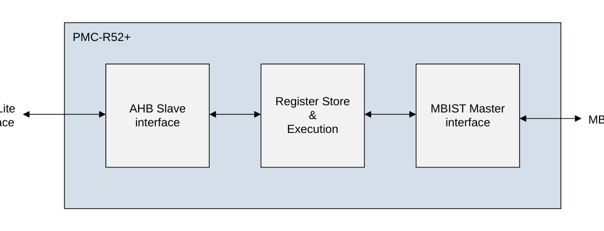

### 7.1 内部 RTL 常量

下表给出 PMC-R52+ 使用的内部 RTL 常量值。

表 D-18 中描述的值在程序员模型中可见。

| 名称 | 值 | 描述 |
| --- | --- | --- |
| MAWIDTH[5:0] | 17 | MBIST 地址宽度。<br>• 更多信息请参见《Arm® Cortex®-R52+ Processor Integration Manual》PMC-R52+ 附录中的 **MBISTADDR** 信号。<br>• 更多信息请参见 8.10 Row Address Register, RADDR 中的 **RADDR**。<br>• 更多信息请参见 8.8 Stop Address Register, STOPADDR 中的 **STOPADDR**。 |
| MDWIDTH[8:0] | 78 | MBIST 数据宽度。<br>• 更多信息请参见《Arm® Cortex®-R52+ Processor Integration Manual》PMC-R52+ 附录中的 **MBISTINDATA** 与 **MBISTOUTDATA** 信号。<br>• 更多信息请参见 8.11 数据寄存器 X0-X7 与 Y0-Y7 中的 X 与 Y 寄存器。<br>• 更多信息请参见 8.14 数据掩码寄存器 DM0-DM7 中的 DM 寄存器。 |
| MARWIDTH[3:0] | 5 | MBIST 阵列宽度。<br>• 更多信息请参见《Arm® Cortex®-R52+ Processor Integration Manual》PMC-R52+ 附录中的 **MBISTARRAY** 信号。<br>• 更多信息请参见 8.4 Memory Control Register, MCR 中的 **MCR.ARRAY** 字段。 |
| MBWIDTH[4:0] | 10 | MBIST 字节使能宽度。<br>• 更多信息请参见《Arm® Cortex®-R52+ Processor Integration Manual》PMC-R52+ 附录中的 **MBISTBE** 信号。<br>• 更多信息请参见 8.5 Byte Enable Register, BER 中的 **BER.BE** 字段。 |
| MCWIDTH[4:0] | 2 | MBIST 配置宽度。<br>• 更多信息请参见《Arm® Cortex®-R52+ Processor Integration Manual》PMC-R52+ 附录中的 **MBISTCFG** 信号。<br>• 更多信息请参见 8.3 Main Control Register, CTRL 中的 **CTRL.CFG** 字段。 |
| PROGSIZE[5:0] | 16 | 程序大小。即程序寄存器的数量。<br>• 更多信息请参见 8.15 程序寄存器 P0-P31。<br>• 更多信息请参见 8.6 Program Counter Register, PCR。 |
| PDWIDTH[2:0] | 4 | 流水线深度字段宽度，**MCR.PD**。更多信息请参见 8.4 Memory Control Register, MCR。 |
| RCOWIDTH[2:0] | 2 | RAM 每次操作周期数字段宽度，**MCR.RCO**。更多信息请参见 8.4 Memory Control Register, MCR。 |
| AIWIDTH[5:0] | 2 | **AIR** 寄存器与 AUXIN 信号宽度。更多信息请参见《Arm® Cortex®-R52+ Processor Integration Manual》的 PMC-R52+ 附录。 |
| AOWIDTH[5:0] | 2 | **AOR** 寄存器与 AUXOUT 信号宽度。更多信息请参见《Arm® Cortex®-R52+ Processor Integration Manual》的 PMC-R52+ 附录。 |

* 这些值是固定的，不得更改。
* PMC-R52+ 的 RTL 不得修改。

## 8. 程序员模型

本节介绍 PMC-R52+ 的程序员模型。

### 8.1 内存映射

下图给出了 PMC-R52+ 的内存映射。该内存映射占用 4KB，包含 CoreSight 寄存器与控制寄存器。

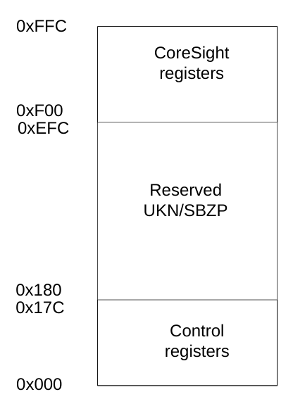

当 **PMC** 参数设置为 1 时，PMC-R52+ 的内存映射寄存器位于基地址 CFGPERIPHBASE+0x10000。当 **PMC** 参数设置为 0 时，基地址取决于系统集成。

**寄存器访问**

* CoreSight 寄存器为只读（RO），但 **CLAIMSET**、**CLAIMCLR** 与 **LAR** 除外。
* 控制寄存器为读写（RW）。

此外，以下信息也适用于寄存器访问：

* 不要尝试访问保留的或未使用的地址位置。尝试访问这些位置可能导致 UNPREDICTABLE 行为。
* 除非另有说明：
    * 不要修改 UNDEFINED 的寄存器位。
    * 读取时忽略 UNDEFINED 的寄存器位。
    * 复位信号将寄存器位复位为逻辑 0。
    * 软件可以向已实现、未保留的位与字段写入任意值。
* 本节使用的访问类型为：
    * RW。
    * RO。
    * 只写（WO）。
    * 读取时值未知（UNK）。
    * 写时应为零或保持原值（SBZP）。
    * 读时为零（RAZ）。
    * 读时为一（RAO）。
    * 写被忽略（WI）。

保留的寄存器位实现为 RAZ/WI，软件必须将其用作 UNK/SBZP。这种做法可在未来的 PMC-R52+ 修订版中新增寄存器位时，将对软件的影响降到最低。

以下规则适用于寄存器访问：

* 仅支持 32 位访问。比该尺寸更小的访问的结果是返回 ERROR 响应。
* 仅支持特权访问。为向用户模式代码隐藏潜在的敏感数据，非特权访问的结果如下：
    * 对 CoreSight 寄存器的读访问返回寄存器值，并返回 OKAY 响应。
    * 对控制寄存器的读访问返回数据值 0，并返回 ERROR 响应。
    * 对 CoreSight 寄存器的写访问被忽略，并返回 OKAY 响应。
    * 对控制寄存器的写访问被忽略，并返回 ERROR 响应。
* 当 **CTRL.PEEN** 为 1 时写控制寄存器，行为是 UNPREDICTABLE，但对 **CTRL** 寄存器的写除外。因此，当 **CTRL.PEEN** 为 1 时不得写控制寄存器。唯一的例外是清除 PEEN 位以停止执行，或清除 PES 位以恢复执行。
* 除通过 **CTRL** 寄存器轮询 PMC-R52+ 以检查测试是成功完成还是失败之外，在执行使能时读取任何控制寄存器预计都没有用处。

### 8.2 寄存器汇总

下表列出 PMC-R52+ 的寄存器及其在 4KB 存储区中的偏移。

| 偏移 | 类型 | 名称 | 描述 |
| --- | --- | --- | --- |
| 0x000 | RW | CTRL | 主控制寄存器，请参见 8.3 Main Control Register, CTRL。 |
| 0x004 | RW | MCR | 存储器控制寄存器，请参见 8.4 Memory Control Register, MCR。 |
| 0x008 | RW | BER | 字节使能寄存器，请参见 8.5 Byte Enable Register, BER。 |
| 0x00C | RW | PCR | 程序控制寄存器，请参见 8.6 Program Counter Register, PCR。 |
| 0x010 | RO | RPR | 读流水线寄存器，请参见 8.7 Read Pipeline Register, RPR。 |
| 0x014 | RW | STOPADDR | 停止地址寄存器，请参见 8.8 Stop Address Register, STOPADDR。 |
| 0x018 | RW | CADDR | 列地址寄存器，请参见 8.9 Column Address Register, CADDR。 |
| 0x01C | RW | RADDR | 行地址寄存器，请参见 8.10 Row Address Register, RADDR。 |
| 0x020-0x03C | RW | X0-X7 | 数据寄存器 X，请参见 8.11 数据寄存器 X0-X7 与 Y0-Y7。 |
| 0x040-0x05C | RW | Y0-Y7 | 数据寄存器 Y，请参见 8.11 数据寄存器 X0-X7 与 Y0-Y7。 |
| 0x060 | RW | AIR | 辅助输入寄存器，请参见 8.12 Auxiliary Input Register, AIR。 |
| 0x064 | RW | AOR | 辅助输出寄存器，请参见 8.13 Auxiliary Output Register, AOR。 |
| 0x068-0x07C | UNK/SBZP | - | 保留。 |
| 0x080-0x09C | RW | DM0-DM7 | 数据掩码寄存器，请参见 8.14 数据掩码寄存器 DM0-DM7。 |
| 0x0A0-0x0FC | UNK/SBZP | - | 保留。 |
| 0x100-0x17C | RW | P0-P31 | 程序寄存器，请参见 8.15 程序寄存器 P0-P31。 |
| 0x180-0xEFC | UNK/SBZP | - | 保留。 |
| 0xF00-0xFFC | - | - | CoreSight 寄存器，请参见 8.16 CoreSight 寄存器。 |

### 8.3 主控制寄存器 CTRL

**CTRL** 寄存器包含主要的测试控制位与状态位。

**使用限制**

本寄存器为读写（RW）。

**陷阱与使能**

不存在影响本寄存器的陷阱与使能。

**配置**

本寄存器在所有构建配置中均可用。

**属性**

**CTRL** 是一个 32 位寄存器。

下图给出了 **CTRL** 的位分配。

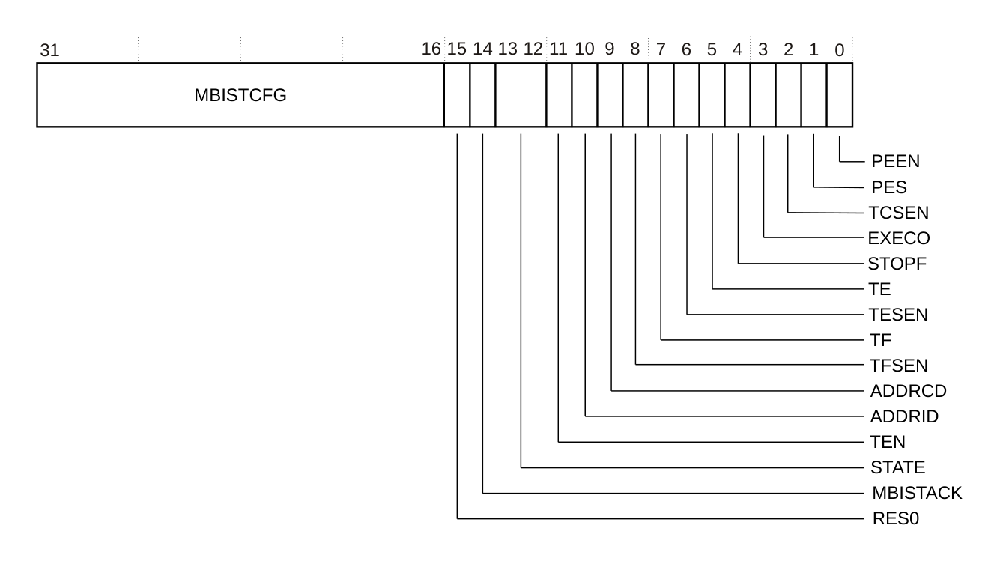

下表给出了 **CTRL** 的位分配。

| 位 | 名称 | 功能 |
| --- | --- | --- |
| [31:16] | MBISTCFG | 这是 **MBISTCFG** 信号的值。<br>**注意：**<br>• 该值仅在生产测试中使用。该字段必须始终写 0，因为 PMC-R52+ 不支持生产测试使用模型。<br>• 未使用的字段位为保留位，必须按 UNK/SBZP 处理。<br>• **MCWIDTH** 决定 **MBISTCFG** 字段的宽度。更多信息请参见 7.1 内部 RTL 常量。<br>复位值为 0x0000。该字段为 RW。 |
| [15] | - | 保留，RES0。<br>复位值为 UNKNOWN。该字段为 UNK/SBZP。 |
| [14] | MBISTACK | 这是 **MBISTACK** 信号的值。<br>无复位值。<br>该字段为 RO。<br>有关 **MBISTACK** 的更多信息，请参见《Arm® Cortex®-R52+ Processor Integration Manual》的 PMC-R52+ 附录。 |
| [13:12] | STATE | 这是 PMC-R52+ 状态机的状态。状态编码如下：<br>0b00：初始（Initial）。<br>0b01：运行（Run）。<br>0b10：挂起（Suspended）。<br>0b11：保留。<br>复位值为 0b0。该字段为 RO。<br>更多信息请参见 8.3.1 状态机。 |
| [11] | TEN | 测试使能。该位是复位时 **TEN** 信号的值。当 **TEN** 位为 0 时，PMC-R52+ 被禁用且无法编程。<br>该字段为 RO。<br>有关 **TEN** 的更多信息，请参见《Arm® Cortex®-R52+ Processor Integration Manual》的 PMC-R52+ 附录。 |
| [10] | ADDRID | 地址递增或递减控制。该位影响下一个 **RADDR** 与 **CADDR** 地址寄存器的值。选项为：<br>0b0：地址寄存器递减。<br>0b1：地址寄存器递增。<br>当执行 UA 位为 1 的指令时，地址寄存器更新为下一个值。有关 UA 位的更多信息，请参见 8.15 程序寄存器 P0-P31。<br>复位值为 0x0。该字段为 RW。 |
| [9] | ADDRCD | 地址变化方向。该位控制相对于存储器阵列的地址变化方向。它按如下方式影响下一个 **RADDR** 与 **CADDR** 地址寄存器的值：<br>0b0：y 快速。先改变 **CADDR**。在 **RADDR** 改变之前访问所有 **CADDR** 值。<br>0b1：x 快速。先改变 **RADDR**。在 **CADDR** 改变之前访问所有 **RADDR** 值。<br>当执行 UA 位为 1 的指令时，地址寄存器更新为下一个值。有关 UA 位的更多信息，请参见 8.15 程序寄存器 P0-P31。<br>复位值为 0x0。该字段为 RW。 |
| [8] | TFSEN | 测试失败信号使能。控制 **TF** 信号的行为。选项为：<br>0b0：**TF** 信号保持为低电平。<br>0b1：**TF** 信号等于 **TF** 位的值。<br>复位值为 0x0。该字段为 RW。<br>有关 **TF** 的更多信息，请参见《Arm® Cortex®-R52+ Processor Integration Manual》的 PMC-R52+ 附录。 |
| [7] | TF | 测试失败状态位。可能的取值为：<br>0b0：测试未失败。<br>0b1：测试已失败。<br>如果测试程序中的数据比较失败，**TF** 会自动置 1。**TF** 只能由软件清零。<br>复位值为 0x0。该字段为 RW。 |
| [6] | TESEN | 测试结束信号使能。控制 **TE** 信号的行为。选项为：<br>0b0：**TE** 信号保持为低电平。<br>0b1：**TE** 信号等于 **TE** 位的值。<br>复位值为 0x0。该字段为 RW。<br>有关 **TE** 的更多信息，请参见《Arm® Cortex®-R52+ Processor Integration Manual》的 PMC-R52+ 附录。 |
| [5] | TE | 测试结束状态位。可能的取值为：<br>0b0：测试未完成。<br>0b1：测试已完成。<br>当发生执行停止事件时，**TE** 自动置 1。有关停止事件的更多信息，请参见 8.3.1.4 停止事件。**TE** 只能由软件清零。<br>复位值为 0x0。该字段为 RW。 |
| [4] | STOPF | 检测到故障时停止。该位使执行在检测到故障时停止。可能的取值为：<br>0b0：检测到故障时停止模式被禁用。<br>0b1：检测到故障时停止被使能。<br>当 **STOPF** 为 1 且测试程序中的数据检查失败时，**PEEN** 位自动清零，**TF** 位自动置 1，执行在当前指令处暂停。这种情况下 **TE** 位不变。<br>由于数据检查与程序执行并发进行，PC 的值取决于失败读之后的指令以及 **MCR.PD** 的值。有关 **MCR** 的更多信息，请参见 8.4 Memory Control Register, MCR。可以使用 **RPR** 寄存器确定哪个读事务失败。有关 **RPR** 的更多信息，请参见 8.7 Read Pipeline Register, RPR。<br>复位值为 0x0。该字段为 RW。 |
| [3] | EXECO | 执行一次。选项为：<br>0b0：执行一次模式被禁用。<br>0b1：执行一次模式被使能。<br>如果 **EXECO** 为 1 且执行的指令其 OP 字段为 LASTOP，则 **PEEN** 位自动清零且 **TE** 位自动置 1。因此，这使指令只执行一次。<br>复位值为 0x0。该字段为 RW。 |
| [2] | TCSEN | 测试继续信号使能。选项为：<br>0b0：**TC** 信号被忽略。<br>0b1：使能 **TC** 信号。<br>当 **TCSEN** 为 0 时，测试挂起被禁用，执行完 OP 字段为 LASTOP 的指令后测试循环回到指令 0，直到发生停止事件。更多信息请参见 8.3.1.3 恢复事件。<br>复位值为 0x0。该字段为 RW。<br>有关 **TC** 的更多信息，请参见《Arm® Cortex®-R52+ Processor Integration Manual》的 PMC-R52+ 附录。 |
| [1] | PES | 程序执行挂起。该位与 **TCSEN** 位配合工作。选项为：<br>0b0：可以执行程序。<br>0b1：已挂起，不执行程序。<br>当执行 OP 字段为 LASTOP 的指令、**TCSEN** 位为 1 且 **EXECO** 位为 0 时，**PES** 自动置 1。<br>当 **STATE** 字段的值为挂起、**TC** 信号为高电平且 **TCSEN** 位为 1 时，**PES** 自动清零。<br>软件也可以在 **STATE** 字段的值为挂起时通过将 **PES** 位清零来触发执行。此时 **TCSEN** 位仍必须置 1，但 **TC** 信号必须保持为低电平。这种情况下 **PEEN** 也为 1。<br>复位值为 0x0。该字段为 RW。<br>**注意：**<br>• 如果 **PES** 当前为 0，软件不得向 **PES** 写 1。<br>• 如果软件向 **PEEN** 写 0，则必须向 **PES** 写 0。 |
| [0] | PEEN | 程序执行使能。这是主要的执行使能位。选项为：<br>0b0：程序执行被禁用。<br>0b1：程序执行被使能。<br>如果 **PEEN** 为 1 且 **PES** 为 0，则执行程序。<br>测试结束时 **PEEN** 自动清零。更多信息请参见 8.3.1.3 恢复事件。当 **PEEN** 为 0 时，**MBISTREQ** 信号驱动为低电平。<br>当软件将 **PEEN** 位置 1 时，内部状态被清除，包括读流水线寄存器 **RPR**。更多信息请参见 8.7 Read Pipeline Register, RPR。<br>复位值为 0x0。该字段为 RW。<br>**注意：** 在软件更改除 **CTRL** 寄存器以外的任何寄存器值之前（此时将 **PEEN** 位清零或将 **PES** 位清零），**PEEN** 必须为 0。 |

除 **TEN**、**MBISTACK** 与 **STATE** 外，所有字段均可由软件修改。此外，某些字段可由自动硬件机制更新。

#### 8.3.1 状态机

PMC-R52+ 有一个状态机，用于控制其执行状态与当前状态。当前状态可从 **CTRL.STATE** 字段读取。

有几个事件会使状态机在状态之间转换。相关说明见：

* 8.3.1.1 启动事件。
* 8.3.1.2 挂起事件。
* 8.3.1.3 恢复事件。
* 8.3.1.4 停止事件。
* 8.3.1.5 中止事件。

下表给出三个主要状态。

| 状态 | 描述 |
| --- | --- |
| 初始（Initial） | 程序未执行且 **MBISTREQ** 为低电平。 |
| 运行（Run） | 处于 MBIST 进入或退出序列，或程序正在执行。 |
| 挂起（Suspended） | 程序执行被挂起且 **MBISTREQ** 为低电平。 |

下图给出了状态机的状态转换。

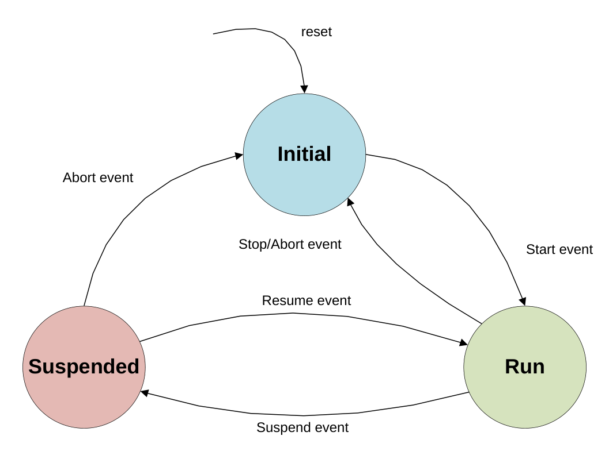

##### 8.3.1.1 启动事件

发生启动事件时：

* 初始化不可由软件写入的内部状态。
* 执行 MBIST 接口进入序列，然后开始程序执行。

该事件在初始状态中使用，由以下条件引起：

* **CTRL.PEEN** 为 0，且软件向 **CTRL.PEEN** 写 1、向 **CTRL.PES** 写 0。

**注意：** 如果该事件在测试成功完成之后发生，且软件未重新初始化 **PCR**、**CADDR** 或 **RADDR** 寄存器，则停止条件可能仍然有效，状态机会短暂进入运行状态然后返回初始状态。**MBISTREQ** 不会被置起。

##### 8.3.1.2 挂起事件

发生挂起事件时，执行 MBIST 接口退出序列。

该事件只能在状态机处于运行状态时发生，由以下条件引起：

* **CTRL.PEEN** 为 1、**CTRL.TCSEN** 为 1、**CTRL.EXECO** 为 0，且执行的指令其 OP 字段为 LASTOP，同时没有发生停止事件。该条件发生时，**CTRL.PES** 自动置 1。

##### 8.3.1.3 恢复事件

发生恢复事件时，执行 MBIST 接口进入序列。该事件只能在状态机处于挂起状态时发生，由以下任一条件引起：

* **CTRL.PEEN**、**CTRL.PES** 与 **CTRL.TCSEN** 位均为 1，且 **TC** 信号为高电平。此时 **CTRL.PES** 自动清零。
* **CTRL.PEEN**、**CTRL.PES** 与 **CTRL.TCSEN** 位均为 1，且软件向 **CTRL.PEEN** 写 1、向 **CTRL.PES** 写 0、向 **CTRL.TCSEN** 写 1。

##### 8.3.1.4 停止事件

停止事件在测试正常结束时发生。它导致执行 MBIST 接口退出序列，并将 **CTRL.PEEN** 置 0、**CTRL.TE** 置 1。该事件只能在运行状态中发生，由以下任一条件引起：

* **CTRL.PEEN** 为 1，执行的指令其 OP 字段为 LASTOP，且当前地址等于 **STOPADDR** 寄存器。
* **CTRL.PEEN** 与 **CTRL.EXECO** 位均为 1，且执行的指令其 OP 字段为 LASTOP。

该事件之后，**PCR** 指向 LASTOP 指令，且即使指令的 UA 位为 1，**CADDR** 与 **RADDR** 寄存器也不会更新。

##### 8.3.1.5 中止事件

中止事件可在运行状态或挂起状态发生，用于提前中止测试并返回初始状态。它将 **CTRL.TE** 置 1；如果该事件由读数据检查失败引起，则 **CTRL.TF** 也会置 1。该事件由以下任一条件引起：

* **CTRL.PEEN** 与 **CTRL.STOPF** 为 1，且读数据检查失败。
* **CTRL.PEEN** 为 1，且软件向 **CTRL.PEEN** 写 0、向 **CTRL.PES** 写 0。

**注意：**

* 该事件发生时执行立即停止，**PCR**、**CADDR**、**RADDR** 与 **RPR** 寄存器不更新。这使软件能够确定导致该事件的读数据检查失败所在的故障 RAM 地址，请参见 8.7 Read Pipeline Register, RPR 中的 **RPR.R** 字段。
* Arm 建议，当 **CTRL.MBISTACK** 为 0 且 **CTRL.STATE** 为 0b01 时，软件不要引起中止事件，因为如果它发生在 MBIST 进入期间，可能违反 MBIST 接口协议。
* 软件从挂起状态引起中止之前，必须遵循以下步骤：
    1. 使用 **CTRL.TCSEN** 位禁用 **TC** 信号的来源。
    2. 检查 PMC-R52+ 不处于运行状态。
    3. 清除 **CTRL.PEEN** 与 **CTRL.PES** 位。

#### 8.3.2 程序执行模式

程序执行模式由 **CTRL** 寄存器中的以下位配置：

* **PEEN**。
* **PES**。
* **EXECO**。
* **TCSEN**。

下表描述了这些执行模式。

| PEEN | PES | EXECO | TCSEN | 描述 |
| --- | --- | --- | --- | --- |
| 0 | - | - | - | 不执行程序。 |
| 1 | 0 | 0 | 1 | 执行程序直到发生挂起、停止或中止事件。用于在程序循环的每次迭代时挂起执行，等待 **TC** 输入脉冲或软件向 **PES** 写 0。 |
| 1 | 0 | 1 | - | 执行程序直到发生停止或中止事件。用于只执行一次指令。 |
| 1 | 0 | 0 | 0 | 执行程序直到发生停止或中止事件。用于在不挂起的情况下遍历所有存储器位置。 |
| 1 | 1 | - | - | 程序执行被挂起，等待发生恢复事件或中止事件。 |

### 8.4 存储器控制寄存器 MCR

**MCR** 配置被测存储器阵列的属性。

**使用限制**

本寄存器为读写（RW）。

**陷阱与使能**

不存在影响本寄存器的陷阱与使能。

**配置**

本寄存器在所有构建配置中均可用。

**属性**

**MCR** 是一个 32 位寄存器。

下图给出了 **MCR** 的位分配。

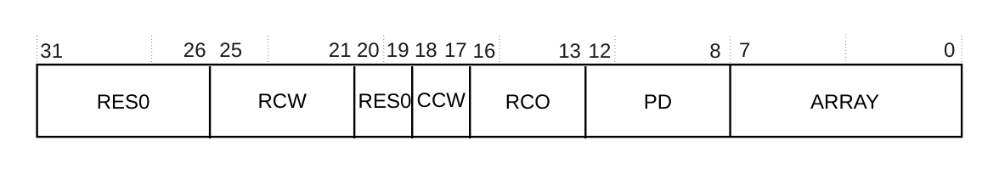

下表给出了 **MCR** 的位分配。

| 位 | 名称 | 功能 |
| --- | --- | --- |
| [31:26] | - | 保留，RES0。<br>复位值为 UNKNOWN。该字段为 UNK/SBZP。 |
| [25:21] | RCW | 行计数器宽度。必须设置为被测 RAM 地址总线行部分的宽度减 2。因此 0 对应两个行地址位。<br>该字段可编程的最大值为 MAWIDTH-CCW-4，如果使用大于该值的数值，行为不可预测。<br>复位值为 UNKNOWN。该字段为 RW。 |
| [20:19] | - | 保留，RES0。<br>复位值为 UNKNOWN。该字段为 UNK/SBZP。 |
| [18:17] | CCW | 列计数器宽度。必须设置为被测 RAM 地址总线列部分的宽度减 2。取值为：<br>0b00：2 位，4 个 RAM 列。<br>0b01：3 位，8 个 RAM 列。<br>0b10：4 位，16 个 RAM 列。<br>0b11：5 位，32 个 RAM 列。<br>复位值为 UNKNOWN。该字段为 RW。<br>**注意：** 该字段的编码在后续 PMC-R52+ 修订版中可能改变。 |
| [16:13] | RCO | RAM 每次操作的周期数。必须设置为被测 RAM 每次访问所需的周期数减 1。因此值 0 对应每次访问一个周期。<br>复位值为 UNKNOWN。该字段为 RW。<br>**注意：**<br>• 未使用的字段位为保留位，必须按 UNK/SBZP 处理。<br>• RCO 的宽度由 **RCOWIDTH** 参数设定。更多信息请参见 7.1 内部 RTL 常量。 |
| [12:8] | PD | 流水线深度。即被测存储器从 **MBISTADDR** 到 **MBISTOUTDATA** 信号的处理器路径中的流水线级数。更多信息请参见《Arm® Cortex®-R52+ Processor Integration Manual》的 PMC-R52+ 附录。<br>例如，如果有三级流水线，则该字段必须设置为 3。<br>复位值为 UNKNOWN。该字段为 RW。<br>**注意：**<br>• 未使用的字段位为保留位，必须按 UNK/SBZP 处理。<br>• PD 的宽度由 **PDWIDTH** 参数设定。更多信息请参见 7.1 内部 RTL 常量。 |
| [7:0] | ARRAY | **MBISTARRAY** 信号值。更多信息请参见《Arm® Cortex®-R52+ Processor Integration Manual》的 PMC-R52+ 附录。<br>复位值为 UNKNOWN。该字段为 RW。<br>**注意：**<br>• 未使用的字段位为保留位，必须按 UNK/SBZP 处理。<br>• ARRAY 的宽度由 **MARWIDTH** 参数设定。更多信息请参见 7.1 内部 RTL 常量。 |

* 所有字段均可由软件修改。
* 软件必须在 **CTRL.PEEN** 位置 1 之前初始化本寄存器。更多信息请参见 8.3 Main Control Register, CTRL。

### 8.5 字节使能寄存器 BER

**BER** 设置 **MBISTBE** 信号的值。

**使用限制**

本寄存器为读写（RW）。

**陷阱与使能**

不存在影响本寄存器的陷阱与使能。

**配置**

本寄存器在所有构建配置中均可用。

**属性**

**BER** 是一个 32 位寄存器。

下图给出了 **BER** 的位分配。

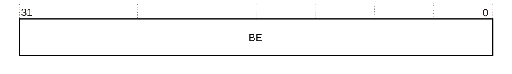

下表给出了 **BER** 的位分配。

| 位 | 名称 | 功能 |
| --- | --- | --- |
| [31:0] | BE | **MBISTBE** 信号值。更多信息请参见《Arm® Cortex®-R52+ Processor Integration Manual》的 PMC-R52+ 附录。<br>复位值为 UNKNOWN。该字段为 RW。<br>**注意：**<br>• 未使用的字段位为保留位，必须按 UNK/SBZP 处理。<br>• BE 的宽度由 **MBWIDTH** 参数设定。更多信息请参见 7.1 内部 RTL 常量。 |

本寄存器只能由软件修改。软件必须在 **CTRL.PEEN** 位置 1 之前初始化本寄存器。更多信息请参见 8.3 Main Control Register, CTRL。

### 8.6 程序计数器寄存器 PCR

**PCR** 包含程序计数器字段。

**使用限制**

本寄存器为读写（RW）。

**陷阱与使能**

不存在影响本寄存器的陷阱与使能。

**配置**

本寄存器在所有构建配置中均可用。

**属性**

**PCR** 是一个 32 位寄存器。

下图给出了 **PCR** 的位分配。

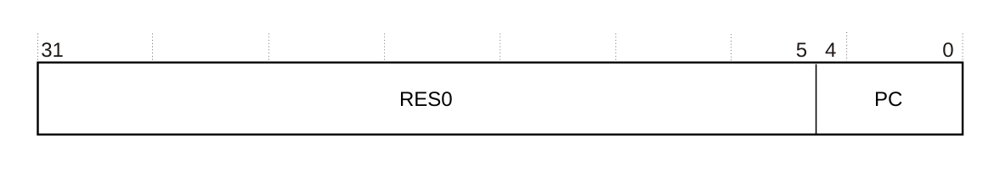

下表给出了 **PCR** 的位分配。

| 位 | 名称 | 功能 |
| --- | --- | --- |
| [31:5] | - | 保留，RES0。<br>复位值为 UNKNOWN。该字段为 UNK/SBZP。 |
| [4:0] | PC | 程序计数器。该字段指向下一条要执行的程序寄存器。每执行一条指令，PC 自动递增。当执行 OP 字段为 LASTOP 的指令且测试未结束时，PC 自动设置为 0x00。更多信息请参见 8.15 程序寄存器 P0-P31。<br>复位值为 UNKNOWN。该字段为 RW。<br>**注意：**<br>• 未使用的字段位为保留位，必须按 UNK/SBZP 处理。<br>• PC 的宽度由 log2(PROGSIZE) 参数设定。更多信息请参见 7.1 内部 RTL 常量。 |

本寄存器可由软件修改，并且会被自动更新。软件必须在 **CTRL.PEEN** 位置 1 之前将本寄存器初始化为 0。更多信息请参见 8.3 Main Control Register, CTRL。

### 8.7 读流水线寄存器 RPR

如果检测到存储器故障且 **CTRL.STOPF** 位为 1，则 **RPR** 允许软件确定该故障与哪条读指令相关以及包含该故障的存储器地址。

更多信息请参见 8.3 Main Control Register, CTRL。

**使用限制**

本寄存器为只读（RO）。

**陷阱与使能**

不存在影响本寄存器的陷阱与使能。

**配置**

本寄存器在所有构建配置中均可用。

**属性**

**RPR** 是一个 32 位寄存器。

下图给出了 **RPR** 的位分配。

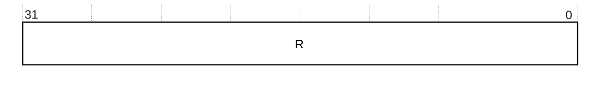

下表给出了 **RPR** 的位分配。

| 位 | 名称 | 功能 |
| --- | --- | --- |
| [31:0] | R | 这是执行单元中 **RPR** 的当前值。只有 R[MCR.PD:0] 位有效，未使用的最高有效位设为 0。<br>执行读操作时：<br>• R[0] 置 1。<br>• 每个时钟周期 R 左移一次。<br>数据比较失败时，相应的读操作已到达 R[MCR.PD]。要确定哪条读指令失败：<br>• 统计 R 字段中置位的位数（n）。<br>• 从 PCR.PC 指向的指令开始向前回数 n 条读指令。<br>以表 D-2 中的示例为例：<br>• 如果测试停止且 PCR.PC=8（第 9 行）、R 中有 2 位被置位，则失败的读指令是指令 4（第 5 行）。<br>• 故障地址可根据失败读之后所执行指令的以下取值确定：<br>    ◦ CADDR.CA。<br>    ◦ RADDR.RA。<br>    ◦ CTRL.ADDRID。<br>    ◦ CTRL.ADDRCR。<br>    ◦ Px.UA，其中 x 的取值范围为 0 到 31。<br>有关 **MBISTOUTADDR** 如何计算的更多信息，请参见 8.10.1 地址输出值。<br>复位值为 UNKNOWN。该字段为 RO。<br>**注意：**<br>• 未使用的字段位为保留位，必须按 UNK/WI 处理。<br>• R 的宽度为 2^PDWIDTH。更多信息请参见 7.1 内部 RTL 常量。 |

### 8.8 停止地址寄存器 STOPADDR

**STOPADDR** 寄存器包含停止地址，用于与当前地址比较，以确定何时已测试完所有存储器位置，从而结束测试。

**使用限制**

本寄存器为读写（RW）。

**陷阱与使能**

不存在影响本寄存器的陷阱与使能。

**配置**

本寄存器在所有构建配置中均可用。

**属性**

**STOPADDR** 是一个 32 位寄存器。

下图给出了 **STOPADDR** 的位分配。

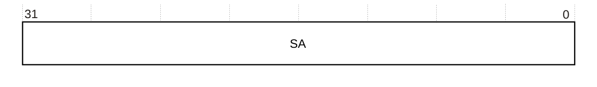

下表给出了 **STOPADDR** 的位分配。

| 位 | 名称 | 功能 |
| --- | --- | --- |
| [31:0] | SA | 停止地址。<br>复位值为 UNKNOWN。该字段为 RW。<br>**注意：**<br>• 未使用的字段位为保留位，必须按 UNK/SBZP 处理。<br>• SA 字段的宽度由 **MAWIDTH** 设定。更多信息请参见 7.1 内部 RTL 常量。取决于该参数，最高有效位可能未使用。 |

本寄存器只能由软件修改。软件必须在 **CTRL.PEEN** 位置 1 之前初始化本寄存器。更多信息请参见 8.3 Main Control Register, CTRL。

### 8.9 列地址寄存器 CADDR

**CADDR** 包含列地址字段。

**使用限制**

本寄存器为读写（RW）。

**陷阱与使能**

不存在影响本寄存器的陷阱与使能。

**配置**

本寄存器在所有构建配置中均可用。

**属性**

**CADDR** 是一个 32 位寄存器。

下图给出了 **CADDR** 的位分配。

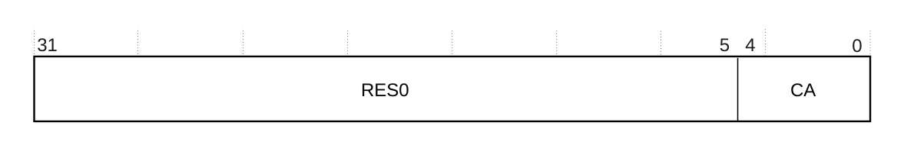

下表给出了 **CADDR** 的位分配。

| 位 | 名称 | 功能 |
| --- | --- | --- |
| [31:5] | - | 保留，RES0。<br>复位值为 UNKNOWN。该字段为 UNK/SBZP。 |
| [4:0] | CA | 列地址。该字段包含存储器地址值中列位的当前值。当执行 UA 位置 1 的指令时，它根据 **CTRL.ADDRID** 与 **CTRL.ADDRCD** 位的取值更新。执行 UA 位置 1 的指令时只使用 CA[MCR.CCW+1:0] 位，其余最高有效位清零。<br>有关以下内容的信息：<br>• UA 位，请参见 8.15 程序寄存器 P0-P31。<br>• **CTRL**，请参见 8.3 Main Control Register, CTRL。<br>• 输出地址计算，请参见 8.10.1 地址输出值。<br>复位值为 UNKNOWN。该字段为 RW。<br>**注意：** 软件写本寄存器时，只更新 CA[MCR.CCW+1:0] 位，其余最高有效位清零。 |

本寄存器可由软件修改，并且会被自动更新。软件必须在 **CTRL.PEEN** 位置 1 之前初始化本寄存器。建议在写本寄存器之前为被测存储器正确设置 **MCR.CCW** 字段。更多信息请参见 8.3 Main Control Register, CTRL。

### 8.10 行地址寄存器 RADDR

**RADDR** 包含行地址寄存器字段。

**使用限制**

本寄存器为读写（RW）。

**陷阱与使能**

不存在影响本寄存器的陷阱与使能。

**配置**

本寄存器在所有构建配置中均可用。

**属性**

**RADDR** 是一个 32 位寄存器。

下图给出了 **RADDR** 的位分配。

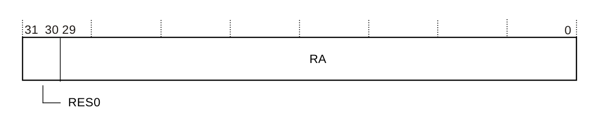

下表给出了 **RADDR** 的位分配。

| 位 | 名称 | 功能 |
| --- | --- | --- |
| [31:30] | - | 保留，RES0。<br>复位值为 UNKNOWN。该字段为 UNK/SBZP。 |
| [29:0] | RA | 行地址。该字段包含存储器地址值中行位的当前值。当执行 UA 位置 1 的指令时，它根据 **CTRL.ADDRID** 与 **CTRL.ADDRCD** 位的取值更新。执行 UA 位置 1 的指令时只使用 RA[MCR.RCW+1:0] 位，其余最高有效位清零。<br>复位值为 UNKNOWN。该字段为 RW。<br>**注意：**<br>• 软件写本寄存器时，只更新 RA[MCR.RCW+1:0] 位，其余最高有效位清零。<br>• 未使用的字段位为保留位，必须按 UNK/SBZP 处理。<br>• RA 字段的宽度由 **MAWIDTH** 参数减 2 设定。更多信息请参见 7.1 内部 RTL 常量。 |

本寄存器可由软件修改，并且会被自动更新。软件必须在 **CTRL.PEEN** 位置 1 之前初始化本寄存器。建议在写本寄存器之前为被测存储器正确设置 **MCR.RCW** 字段。更多信息请参见 8.3 Main Control Register, CTRL。

#### 8.10.1 地址输出值

**MBISTADDR** 输出值是当前地址还是下一地址，取决于当前指令中 **AO** 位的取值。

更多信息请参见 8.15 程序寄存器 P0-P31。

**RADDR** 与 **CADDR** 寄存器组合形成地址。这两个寄存器的下一个值由 **CTRL.ADDRID** 与 **CTRL.ADDRCD** 位确定。更多信息请参见 8.3 Main Control Register, CTRL。

以下公式（使用 Verilog 语法）给出 **RADDR** 与 **CADDR** 寄存器如何组合以生成地址。当前地址使用 **RADDR** 与 **CADDR** 寄存器的当前值，下一地址使用这两个寄存器的下一个值。

```arm
address={{MAWIDTH-aw{1'b0}}, RADDR[MCR.RCW+1:0], CADDR[MCR.CCW+1:0]}
```

其中 aw=MCR.RCW+MCR.CCW+4。

要计算当前地址，软件必须以相同方式将 **RADDR** 与 **CADDR** 寄存器拼接在一起。

### 8.11 数据寄存器 X0-X7 与 Y0-Y7

X0-X7 与 Y0-Y7 寄存器是两个独立的数据寄存器，寄存器描述相同。

**使用限制**

这些寄存器为读写（RW）。

**陷阱与使能**

不存在影响这些寄存器的陷阱与使能。

**配置**

这些寄存器在所有构建配置中均可用。

**属性**

这些是 32 位寄存器。

下图给出了 X0-X7 与 Y0-Y7 的位分配。

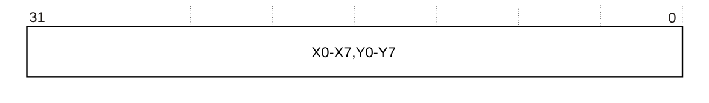

从软件角度看，它们按下表所示分为 32 位宽的寄存器 X0-X7 与 Y0-Y7。

下表给出了 X0-X7 与 Y0-Y7 的位分配。

| 位 | 名称 | 功能 |
| --- | --- | --- |
| [31:0] | X0,Y0 | 位 [31:0]。<br>复位值为 UNKNOWN。该字段为 RW。 |
| [31:0] | X1,Y1 | 位 [63:32]。<br>复位值为 UNKNOWN。该字段为 RW。 |
| [31:0] | X2,Y2 | 位 [95:64]。<br>复位值为 UNKNOWN。该字段为 RW。 |
| [31:0] | X3,Y3 | 位 [127:96]。<br>复位值为 UNKNOWN。该字段为 RW。 |
| [31:0] | X4,Y4 | 位 [159:128]。<br>复位值为 UNKNOWN。该字段为 RW。 |
| [31:0] | X5,Y5 | 位 [191:160]。<br>复位值为 UNKNOWN。该字段为 RW。 |
| [31:0] | X6,Y6 | 位 [223:192]。<br>复位值为 UNKNOWN。该字段为 RW。 |
| [31:0] | X7,Y7 | 位 [255:224]。<br>复位值为 UNKNOWN。该字段为 RW。 |

* 这些寄存器可由软件修改，并且会被自动更新。
* 软件必须在 **CTRL.PEEN** 位置 1 之前初始化它们。更多信息请参见 8.3 Main Control Register, CTRL。
* 未使用的寄存器位为保留位，必须按 UNK/SBZP 处理。
* X 与 Y 寄存器的总宽度由 **MDWIDTH** 参数设定。更多信息请参见 7.1 内部 RTL 常量。每个寄存器占用 32 位位置的个数为 int(MDWIDTH/32)+1。

### 8.12 辅助输入寄存器 AIR

**AIR** 在 **MBISTACK** 置起时存储 AUXIN 信号的值。AUXIN 是通用信号，可用于在 MBIST 操作期间捕获信号。AIR[0] 包含 Cortex®-R52+ 处理器 **MBISTERREXT** 输出信号的值。如果某位在某个时钟周期被置位，则该位保持置位，直到软件将其清除。

有关 AUXIN 与 **MBISTACK** 的更多信息，请参见《Arm® Cortex®-R52+ Processor Integration Manual》的 PMC-R52+ 附录。

**使用限制**

本寄存器为读写（RW）。

**陷阱与使能**

不存在影响本寄存器的陷阱与使能。

**配置**

本寄存器在所有构建配置中均可用。

**属性**

**AIR** 是一个 32 位寄存器。

下图给出了 **AIR** 的位分配。


下表给出了 **AIR** 的位分配。

| 位 | 名称 | 功能 |
| --- | --- | --- |
| [31:0] | AIR | AUXIN 信号值。<br>复位值为 UNKNOWN。该字段为 RW。<br>**注意：**<br>• 未使用的字段位为保留位，必须按 UNK/SBZP 处理。<br>• AIR 的宽度由 **AIWIDTH** 参数设定。更多信息请参见 7.1 内部 RTL 常量。 |

### 8.13 辅助输出寄存器 AOR

**AOR** 存储 AUXOUT 信号的值。AUXOUT 是通用信号，例如可用于控制与在线 MBIST 测试相关的外部逻辑，例如使能 **TC** 信号脉冲的生成或这些脉冲的频率。

有关 AUXOUT 信号的更多信息，请参见《Arm® Cortex®-R52+ Processor Integration Manual》的 PMC-R52+ 附录。

**使用限制**

本寄存器为读写（RW）。

**陷阱与使能**

不存在影响本寄存器的陷阱与使能。

**配置**

本寄存器在所有构建配置中均可用。

**属性**

**AOR** 是一个 32 位寄存器。

下图给出了 **AOR** 的位分配。


下表给出了 **AOR** 的位分配。

| 位 | 名称 | 功能 |
| --- | --- | --- |
| [31:0] | AOR | AUXOUT 信号值。<br>复位值为 UNKNOWN。该字段为 RW。<br>**注意：**<br>• 未使用的字段位为保留位，必须按 UNK/SBZP 处理。<br>• AOR 的宽度由 **AOWIDTH** 参数设定。更多信息请参见 7.1 内部 RTL 常量。 |

### 8.14 数据掩码寄存器 DM0-DM7

DM0-DM7 寄存器保存用于掩蔽所有 RAM 数据值的数值。这些寄存器掩蔽 **MBISTINDATA**、**MBISTOUTDATA** 以及比较前的数据值。当 DM 位为 0 时，相应的被掩蔽位为 0；当 DM 位为 1 时，相应的数据位不被掩蔽。

有关 **MBISTACK** 的信息，请参见《Arm® Cortex®-R52+ Processor Integration Manual》的 PMC-R52+ 附录。

**使用限制**

这些寄存器为读写（RW）。

**陷阱与使能**

不存在影响这些寄存器的陷阱与使能。

**配置**

这些寄存器在所有构建配置中均可用。

**属性**

这些是 32 位寄存器。

下图给出了 DM0-DM7 的位分配。

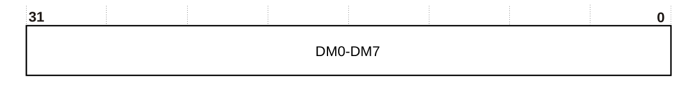

从软件角度看，它们按下表所示分为 32 位宽的寄存器 DM0-DM7。

下表给出了 DM0-DM7 的位分配。

| 位 | 名称 | 功能 |
| --- | --- | --- |
| [31:0] | DM0 | 位 [31:0]。<br>复位值为 UNKNOWN。该字段为 RW。 |
| [31:0] | DM1 | 位 [63:32]。<br>复位值为 UNKNOWN。该字段为 RW。 |
| [31:0] | DM2 | 位 [95:64]。<br>复位值为 UNKNOWN。该字段为 RW。 |
| [31:0] | DM3 | 位 [127:96]。<br>复位值为 UNKNOWN。该字段为 RW。 |
| [31:0] | DM4 | 位 [159:128]。<br>复位值为 UNKNOWN。该字段为 RW。 |
| [31:0] | DM5 | 位 [191:160]。<br>复位值为 UNKNOWN。该字段为 RW。 |
| [31:0] | DM6 | 位 [223:192]。<br>复位值为 UNKNOWN。该字段为 RW。 |
| [31:0] | DM7 | 位 [255:224]。<br>复位值为 UNKNOWN。该字段为 RW。 |

* 这些寄存器只能由软件修改。
* 软件必须在 **CTRL.PEEN** 位置 1 之前初始化它们。更多信息请参见 8.3 Main Control Register, CTRL。
* 未使用的寄存器位为保留位，必须按 UNK/SBZP 处理。
* 这些寄存器的总宽度由 **MDWIDTH** 参数设定。更多信息请参见 7.1 内部 RTL 常量。每个寄存器占用 32 位位置的个数为 int(MDWIDTH/32)+1。

### 8.15 程序寄存器 P0-P31

P0-P31 寄存器保存微码指令。

这些指令构成一个算法，执行该算法以生成测试 **MCR.ARRAY** 字段所选存储器阵列所需的 MBIST 事务。更多信息请参见 8.4 Memory Control Register, MCR。

**使用限制**

这些寄存器为读写（RW）。

**陷阱与使能**

不存在影响这些寄存器的陷阱与使能。

**配置**

这些寄存器在所有构建配置中均可用。

**属性**

这些是 32 位寄存器。

下图给出了 P0-P31 的位分配。

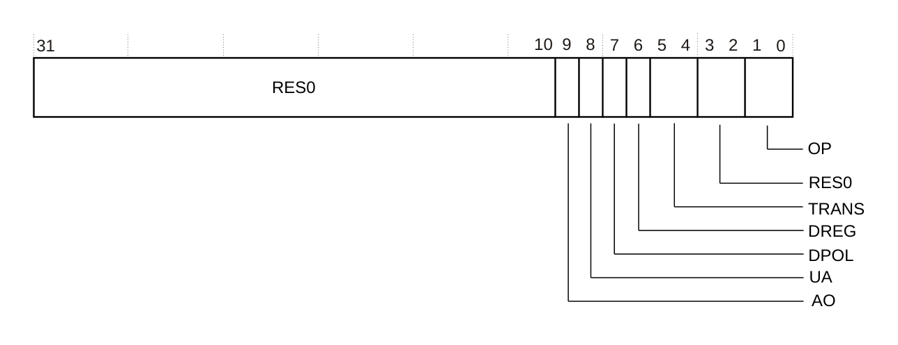

从软件角度看，它们按下表所示分为 32 位宽的寄存器 P0-P31。

下表给出了 P0-P31 的位分配。

| 位 | 名称 | 功能 |
| --- | --- | --- |
| [31:10] | - | 保留，RES0。<br>复位值为 UNKNOWN。该字段为 RW。 |
| [9] | AO | 地址输出。该位决定 **MBISTADDR** 信号上输出哪个地址值。该位的编码为：<br>0b0：当前地址。<br>0b1：下一地址。<br>地址由 **RADDR** 与 **CADDR** 寄存器确定。更多信息请参见 8.10.1 地址输出值。<br>复位值为 UNKNOWN。该字段为 RW。 |
| [8] | UA | 更新地址。该位使 **CADDR** 与 **RADDR** 根据 **CTRL.ADDRID** 与 **CTRL.ADDRCD** 位的取值更新为下一个值。更多信息请参见 8.3 Main Control Register, CTRL。该位的编码为：<br>0b0：保持地址。不更新地址寄存器。<br>0b1：更新地址。将下一个地址值装入地址寄存器。<br>复位值为 UNKNOWN。该字段为 RW。 |
| [7] | DPOL | 数据极性。该位控制数据寄存器值是否反相。对于 READ 事务，它用于确定是否将指定 DREG 的值与返回的数据进行比较。对于 WRITE 事务，它用于确定是否将指定 DREG 的值写入存储器阵列。该位的编码为：<br>0b0：使用未反相的 DREG 寄存器值。<br>0b1：使用反相的 DREG 寄存器值。<br>复位值为 UNKNOWN。该字段为 RW。 |
| [6] | DREG | 指令使用的数据寄存器。选项为：<br>0b0：X。<br>0b1：Y。<br>有关数据寄存器的更多信息，请参见 8.11 数据寄存器 X0-X7 与 Y0-Y7。<br>复位值为 UNKNOWN。该字段为 RW。 |
| [5:4] | TRANS | 生成的 MBIST 事务。该字段的编码为：<br>0b00：NONE。不生成事务。<br>0b01：READ。<br>0b10：WRITE。<br>0b11：保留。不得使用该编码。<br>复位值为 UNKNOWN。该字段为 RW。 |
| [3:2] | - | 保留，供 **OP** 字段将来扩展使用。<br>复位值为 UNKNOWN。该字段为 UNK/SBZP。 |
| [1:0] | OP | 操作字段。该字段指定指令除 MBIST 事务之外执行的操作。各编码及其功能为：<br>0b00：NONE。无操作。对于 TRANS 为 READ 的指令，返回的数据会被检查是否等于 **DREG** 所选数据寄存器的内容。如果不相等，则 **CTRL.TF** 位置 1。更多信息请参见 8.3 Main Control Register, CTRL。<br>0b01：LASTOP。这使 PCR.PC 字段设置为 0x00，执行根据 **CTRL** 寄存器的设置停止或挂起。更多信息请参见 8.3.1.2 挂起事件与 8.3.1.3 恢复事件。读操作以与 NONE 操作相同的方式检查。<br>0b10：SAVERD。将读数据保存到 **DREG** 字段指定的数据寄存器。返回的读数据不被检查。该操作只能与读操作一起使用。<br>0b11：WAITRU。在执行该指令之前，等待 **DREG** 字段指定的数据寄存器被流水线中较早的读操作（SAVERD）更新。<br>**注意：**<br>• OP WAITRU 等待流水线中所有更新 DREG 的较早 OP SAVERD 读操作完成。让流水线中同时存在多个具有相同 DREG 值的 OP SAVERD 读操作没有用处。因此，如果出现这种情况，将是编程错误。<br>• 如果流水线中没有更新 DREG 的较早 OP SAVERD 读操作，则 OP WAITRU 被忽略，但仍会在一个周期内不在 MBIST 接口上执行任何操作。<br>• 当流水线深度小于读与写之间的指令数乘以 MBIST 事务每次操作的周期数时，对于从由使用 OP SAVERD 的指令更新的数据寄存器取数据的写操作，不需要 OP WAITRU。这种情况下应避免 OP WAITRU，因为它会给程序执行增加一个冗余周期。<br>复位值为 UNKNOWN。该字段为 RW。 |

* 软件必须在 **CTRL.PEEN** 位置 1 之前初始化这些寄存器。当 **CTRL.PEEN** 置 1 时，必须至少有一条 OP 字段为 LASTOP 的指令。更多信息请参见 8.3 Main Control Register, CTRL。
* 未使用的寄存器位为保留位，必须按 UNK/SBZP 处理。
* **PROGSIZE** 设定实现的寄存器数量。更多信息请参见 7.1 内部 RTL 常量。

### 8.16 CoreSight 寄存器

本节介绍 CoreSight 寄存器。

有关 CoreSight 寄存器的完整说明，请参见《Arm® CoreSight™ Architecture Specification v2.0》。

#### 8.16.1 寄存器汇总

下表列出 CoreSight 寄存器。

| 偏移 | 类型 | 复位值 | 名称 | 描述 |
| --- | --- | --- | --- | --- |
| 0xF00 | RO | 0x00000000 | ITCTRL | 集成模式控制寄存器，请参见 8.16.2 Integration Mode Control Register, ITCTRL。 |
| 0xF04-0xF9C | UNK/SBZP | UNKNOWN | - | 保留。 |
| 0xFA0 | RW | 0x0000000F | CLAIMSET | 声明标签设置寄存器，请参见 8.16.3 Claim Tag Set Register, CLAIMSET。 |
| 0xFA4 | RW | 0x00000000 | CLAIMCLR | 声明标签清除寄存器，请参见 8.16.4 Claim Tag Clear Register, CLAIMCLR。 |
| 0xFA8 | RO | 见注 92 | DEVAFF0 | 设备亲和性寄存器 0，请参见 8.16.5 Device Affinity 0 Register, DEVAFF0。 |
| 0xFAC | RO | 0x00000000 | DEVAFF1 | 设备亲和性寄存器 1，请参见 8.16.6 Device Affinity 1 Register, DEVAFF1。 |
| 0xFB0 | WO | UNKNOWN | LAR | 锁访问寄存器，请参见 8.16.7 Lock Access Register, LAR。 |
| 0xFB4 | RO | 0x00000000 | LSR | 锁状态寄存器，请参见 8.16.8 Lock Status Register, LSR。 |
| 0xFB8 | RO | 0x00000000 | AUTHSTATUS | 认证状态寄存器，请参见 8.16.9 Authentication Status Register, AUTHSTATUS。 |
| 0xFBC | RO | 0x47700A55 | DEVARCH | 设备体系结构寄存器，请参见 8.16.10 Device Architecture Register, DEVARCH。 |
| 0xFC0 | RO | 0x00000000 | DEVID2 | 设备配置寄存器 2，请参见 8.16.11 Device ID Registers, DEVID, DEVID1, and DEVID2。 |
| 0xFC4 | RO | 0x00000000 | DEVID1 | 设备配置寄存器 1，请参见 8.16.11 Device ID Registers, DEVID, DEVID1, and DEVID2。 |
| 0xFC8 | RO | 0x00000000 | DEVID | 设备配置寄存器，请参见 8.16.11 Device ID Registers, DEVID, DEVID1, and DEVID2。 |
| 0xFCC | RO | 0x00000055 | DEVTYPE | 设备类型标识寄存器，请参见 8.16.12 Device Type Identifier Register, DEVTYPE。 |
| 0xFD0 | RO | 0x00000004 | PIDR4 | 外设标识寄存器，请参见 8.16.13 Peripheral Identification Registers。 |
| 0xFD4 | RO | 0x00000000 | PIDR5 | 外设标识寄存器，请参见 8.16.13 Peripheral Identification Registers。 |
| 0xFD8 | RO | 0x00000000 | PIDR6 | 外设标识寄存器，请参见 8.16.13 Peripheral Identification Registers。 |
| 0xFDC | RO | 0x00000000 | PIDR7 | 外设标识寄存器，请参见 8.16.13 Peripheral Identification Registers。 |
| 0xFE0 | RO | 0x000000BB | PIDR0 | 外设标识寄存器，请参见 8.16.13 Peripheral Identification Registers。 |
| 0xFE4 | RO | 0x000000B9 | PIDR1 | 外设标识寄存器，请参见 8.16.13 Peripheral Identification Registers。 |
| 0xFE8 | RO | 0x0000001B | PIDR2 | 外设标识寄存器，请参见 8.16.13 Peripheral Identification Registers。 |
| 0xFEC | RO | 见注 93 | PIDR3 | 外设标识寄存器，请参见 8.16.13 Peripheral Identification Registers。 |
| 0xFF0 | RO | 0x0000000D | CIDR0 | 组件标识寄存器，请参见 8.16.14 Component Identification Registers。 |
| 0xFF4 | RO | 0x00000090 | CIDR1 | 组件标识寄存器，请参见 8.16.14 Component Identification Registers。 |
| 0xFF8 | RO | 0x00000005 | CIDR2 | 组件标识寄存器，请参见 8.16.14 Component Identification Registers。 |
| 0xFFC | RO | 0x000000B1 | CIDR3 | 组件标识寄存器，请参见 8.16.14 Component Identification Registers。 |

注 92 请参见 8.16.5 Device Affinity 0 Register, DEVAFF0。注 93 请参见 8.16.13.5 Peripheral Identification Register 3, PIDR3。

#### 8.16.2 集成模式控制寄存器 ITCTRL

CoreSight 组件可以使用 **ITCTRL** 寄存器在功能模式与集成模式之间动态切换。

**使用限制**

本寄存器为只读（RO）。

**陷阱与使能**

不存在影响本寄存器的陷阱与使能。

**配置**

本寄存器在所有构建配置中均可用。

**属性**

**ITCTRL** 是一个 32 位寄存器。

下图给出了 **ITCTRL** 的位分配。

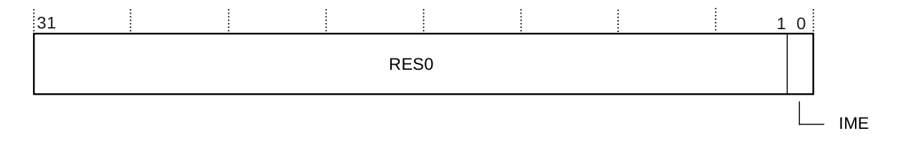

下表给出了 **ITCTRL** 的位分配。

| 位 | 名称 | 功能 |
| --- | --- | --- |
| [31:1] | - | 保留，RES0。 |
| [0] | IME | 集成模式使能。<br>0：PMC-R52+ 不处于集成模式。 |

#### 8.16.3 声明标签设置寄存器 CLAIMSET

**CLAIMSET** 寄存器通过置位相应位来指示某个调试代理正在使用 CoreSight 组件提供的某项功能。

**使用限制**

本寄存器为读写（RW）。

**陷阱与使能**

不存在影响本寄存器的陷阱与使能。

**配置**

本寄存器在所有构建配置中均可用。

**属性**

**CLAIMSET** 是一个 32 位寄存器。

下图给出了 **CLAIMSET** 的位分配。

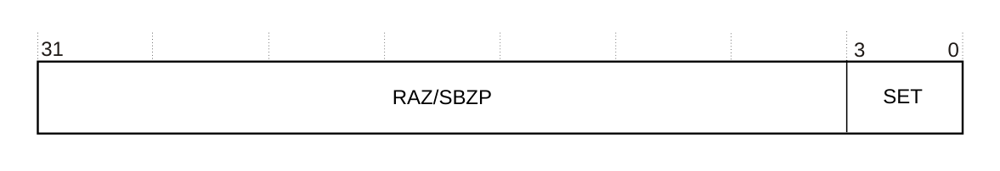

下表给出了 **CLAIMSET** 的位分配。

| 位 | 名称 | 功能 |
| --- | --- | --- |
| [31:4] | - | RAZ/SBZP。 |
| [3:0] | SET | 读取时，对每一位：<br>0：未实现该声明标签位。<br>1：已实现该声明标签位。<br>写入时，对每一位：<br>0：无影响。<br>1：置位声明标签的相应位。 |

#### 8.16.4 声明标签清除寄存器 CLAIMCLR

**CLAIMCLR** 寄存器通过清除相应位来指示某个调试代理不再使用 CoreSight 组件提供的某项功能。

**使用限制**

本寄存器为读写（RW）。

**陷阱与使能**

不存在影响本寄存器的陷阱与使能。

**配置**

本寄存器在所有构建配置中均可用。

**属性**

**CLAIMCLR** 是一个 32 位寄存器。

下图给出了 **CLAIMCLR** 的位分配。

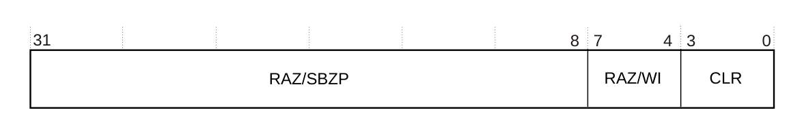

下表给出了 **CLAIMCLR** 的位分配。

| 位 | 名称 | 功能 |
| --- | --- | --- |
| [31:8] | - | RAZ/SBZP。 |
| [7:4] | - | RAZ/WI。 |
| [3:0] | CLR | 读取时，对每一位：<br>0：声明标签位未置位。<br>1：声明标签位已置位。<br>写入时，对每一位：<br>0：无影响。<br>1：清除声明标签的相应位。 |

#### 8.16.5 设备亲和性寄存器 0 DEVAFF0

**DEVAFF0** 寄存器使调试器能够确定两个组件之间是否具有亲和性。

**使用限制**

本寄存器为只读（RO）。

**陷阱与使能**

不存在影响本寄存器的陷阱与使能。

**配置**

本寄存器在所有构建配置中均可用。

**属性**

**DEVAFF0** 是一个 32 位寄存器。

下图给出了 **DEVAFF0** 的位分配。

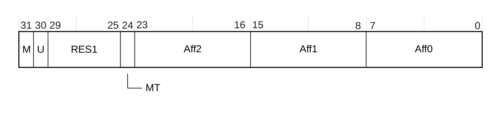

下表给出了 **DEVAFF0** 的位分配。

| 位 | 名称 | 功能 |
| --- | --- | --- |
| [31] | M | 保留，RES1。 |
| [30] | U | 指示单核系统与处理器中的核 0 的区分。该取值为：<br>0：PMC-R52+ 是该处理器的一部分。 |
| [29:25] | - | 保留，RES0。 |
| [24] | MT | 指示最低亲和性级别是否由采用多线程方式实现的逻辑核组成。该取值为：<br>0：最低亲和性级别上的 PE 性能基本独立。 |
| [23:16] | Aff2 | 亲和性级别 2。最高有效亲和性级别字段。指示从 CFGMPIDRAFF2 信号读取的值。 |
| [15:8] | Aff1 | 亲和性级别 1。中间亲和性级别字段。指示从 CFGMPIDRAFF1 信号读取的值。 |
| [7:0] | Aff0 | 亲和性级别 0。有效亲和性级别字段。<br>0x80：亲和性级别 0 不适用。PMC-R52+ 是处理器级组件，因此不使用该字段。 |

#### 8.16.6 设备亲和性寄存器 1 DEVAFF1

**DEVAFF1** 寄存器的值为 0x00000000。

#### 8.16.7 锁访问寄存器 LAR

未实现 **LAR**。

#### 8.16.8 锁状态寄存器 LSR

未实现 **LSR**。

#### 8.16.9 认证状态寄存器 AUTHSTATUS

**AUTHSTATUS** 寄存器的读取值为 0x00000000，表示未实现认证。

#### 8.16.10 设备体系结构寄存器 DEVARCH

**DEVARCH** 标识 CoreSight 组件的构建者与体系结构。

**使用限制**

本寄存器为只读（RO）。

**陷阱与使能**

不存在影响本寄存器的陷阱与使能。

**配置**

本寄存器在所有构建配置中均可用。

**属性**

**DEVARCH** 是一个 32 位寄存器。

下图给出了 **DEVARCH** 的位分配。

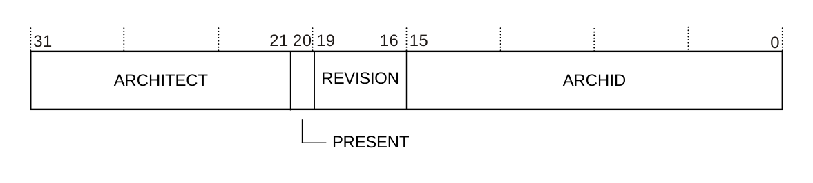

下表给出了 **DEVARCH** 的位分配。

| 位 | 名称 | 功能 |
| --- | --- | --- |
| [31:21] | ARCHITECT | 定义组件的构建者。<br>0x23B：Arm。 |
| [20] | PRESENT | 指示本寄存器是否存在。<br>1：寄存器存在。 |
| [19:16] | REVISION | 体系结构修订版：<br>0b0000：PMC 体系结构修订版 0。 |
| [15:0] | ARCHID | 体系结构 ID：<br>0x0A55：PMC 组件。 |

#### 8.16.11 设备 ID 寄存器 DEVID、DEVID1 与 DEVID2

未实现 **DEVID**、**DEVID1** 与 **DEVID2** 寄存器，它们的读取值均为 0x00000000。

#### 8.16.12 设备类型标识寄存器 DEVTYPE

如果部件编号字段无法识别，调试器可以改为报告 **DEVTYPE** 寄存器提供的组件信息。

**使用限制**

本寄存器为只读（RO）。

**陷阱与使能**

不存在影响本寄存器的陷阱与使能。

**配置**

本寄存器在所有构建配置中均可用。

**属性**

**DEVTYPE** 是一个 32 位寄存器。

下图给出了 **DEVTYPE** 的位分配。

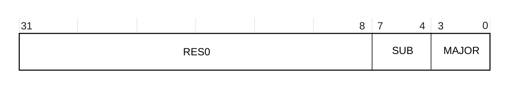

下表给出了 **DEVTYPE** 的位分配。

| 位 | 名称 | 功能 |
| --- | --- | --- |
| [31:8] | - | 保留，RES0。 |
| [7:4] | SUB | 组件的子类型：<br>0x5：存储器。紧耦合设备，例如内建自测试（**BIST**，Built-In Self-Test）。 |
| [3:0] | MAJOR | 组件的主类型：<br>0x5：调试逻辑。 |

#### 8.16.13 外设标识寄存器

共有 8 个只读外设标识寄存器 PIDR7-PIDR0。

##### 8.16.13.1 外设标识寄存器 7 PIDR7

**PIDR7** 提供可用于标识 CoreSight 组件的信息。

**使用限制**

本寄存器为只读（RO）。

**陷阱与使能**

不存在影响本寄存器的陷阱与使能。

**配置**

本寄存器在所有构建配置中均可用。

**属性**

**PIDR7** 是一个 32 位寄存器。

下图给出了 **PIDR7** 的位分配。

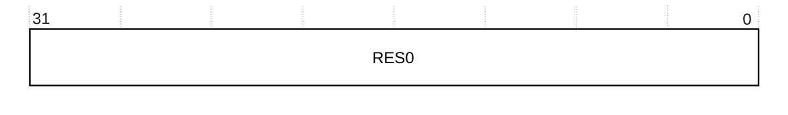

下表给出了 **PIDR7** 的位分配。

| 位 | 名称 | 功能 |
| --- | --- | --- |
| [31:0] | - | 保留，RES0。 |

##### 8.16.13.2 外设标识寄存器 6 PIDR6

**PIDR6** 提供可用于标识 CoreSight 组件的信息。

**使用限制**

本寄存器为只读（RO）。

**陷阱与使能**

不存在影响本寄存器的陷阱与使能。

**配置**

本寄存器在所有构建配置中均可用。

**属性**

**PIDR6** 是一个 32 位寄存器。

下图给出了 **PIDR6** 的位分配。

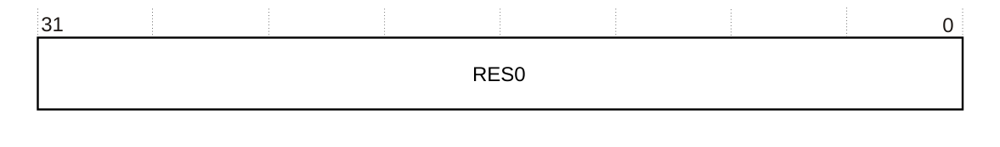

下表给出了 **PIDR6** 的位分配。

| 位 | 名称 | 功能 |
| --- | --- | --- |
| [31:0] | - | 保留，RES0。 |

##### 8.16.13.3 外设标识寄存器 5 PIDR5

**PIDR5** 提供可用于标识 CoreSight 组件的信息。

**使用限制**

本寄存器为只读（RO）。

**陷阱与使能**

不存在影响本寄存器的陷阱与使能。

**配置**

本寄存器在所有构建配置中均可用。

**属性**

**PIDR5** 是一个 32 位寄存器。

下图给出了 **PIDR5** 的位分配。

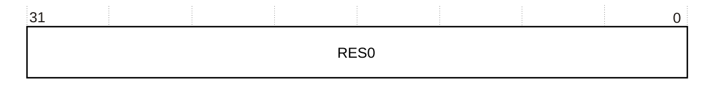

下表给出了 **PIDR5** 的位分配。

| 位 | 名称 | 功能 |
| --- | --- | --- |
| [31:0] | - | 保留，RES0。 |

##### 8.16.13.4 外设标识寄存器 4 PIDR4

**PIDR4** 提供可用于标识 CoreSight 组件的信息。

**使用限制**

本寄存器为只读（RO）。

**陷阱与使能**

不存在影响本寄存器的陷阱与使能。

**配置**

本寄存器在所有构建配置中均可用。

**属性**

**PIDR4** 是一个 32 位寄存器。

下图给出了 **PIDR4** 的位分配。

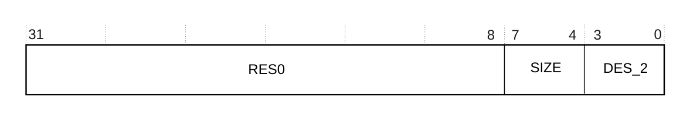

下表给出了 **PIDR4** 的位分配。

| 位 | 名称 | 功能 |
| --- | --- | --- |
| [31:8] | - | 保留，RES0。 |
| [7:4] | SIZE | **SIZE** 字段指示本组件使用的存储器大小。<br>0x0：4KB 块。 |
| [3:0] | DES_2 | JEP106 延续码：<br>0x4：Arm JEP106 延续码。 |

##### 8.16.13.5 外设标识寄存器 3 PIDR3

**PIDR3** 提供可用于标识 CoreSight 组件的信息。

**使用限制**

本寄存器为只读（RO）。

**陷阱与使能**

不存在影响本寄存器的陷阱与使能。

**配置**

本寄存器在所有构建配置中均可用。

**属性**

**PIDR3** 是一个 32 位寄存器。

下图给出了 **PIDR3** 的位分配。

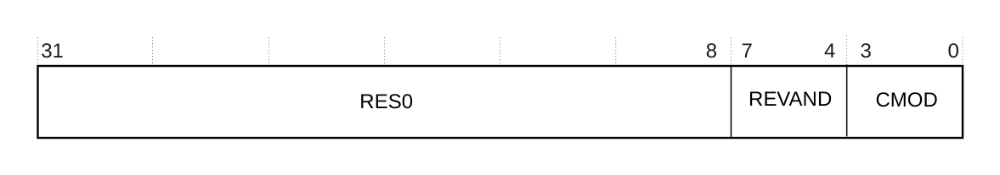

下表给出了 **PIDR3** 的位分配。

| 位 | 名称 | 功能 |
| --- | --- | --- |
| [31:8] | - | 保留，RES0。 |
| [7:4] | REVAND | 部件次修订版。复位时采样的 ECOREVNUM 输入信号。 |
| [3:0] | CMOD | 客户修改码。<br>0x0：表示由 Arm 提供。 |

##### 8.16.13.6 外设标识寄存器 2 PIDR2

**PIDR2** 提供可用于标识 CoreSight 组件的信息。

**使用限制**

本寄存器为只读（RO）。

**陷阱与使能**

不存在影响本寄存器的陷阱与使能。

**配置**

本寄存器在所有构建配置中均可用。

**属性**

**PIDR2** 是一个 32 位寄存器。

下图给出了 **PIDR2** 的位分配。

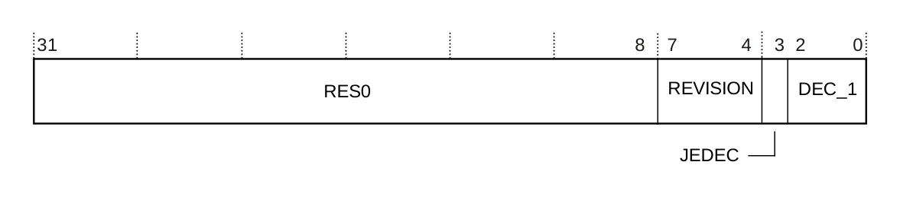

下表给出了 **PIDR2** 的位分配。

| 位 | 名称 | 功能 |
| --- | --- | --- |
| [31:8] | - | 保留，RES0。 |
| [7:4] | REVISION | PMC-R52+ 的修订版编号。<br>0x1：r0p1。 |
| [3] | JEDEC | 0x1：使用 JEDEC 分配的值。 |
| [2:0] | DES_1 | JEP106 标识位 [6:4]：<br>0x3：Arm ID。 |

##### 8.16.13.7 外设标识寄存器 1 PIDR1

**PIDR1** 提供可用于标识 CoreSight 组件的信息。

**使用限制**

本寄存器为只读（RO）。

**陷阱与使能**

不存在影响本寄存器的陷阱与使能。

**配置**

本寄存器在所有构建配置中均可用。

**属性**

**PIDR1** 是一个 32 位寄存器。

下图给出了 **PIDR1** 的位分配。

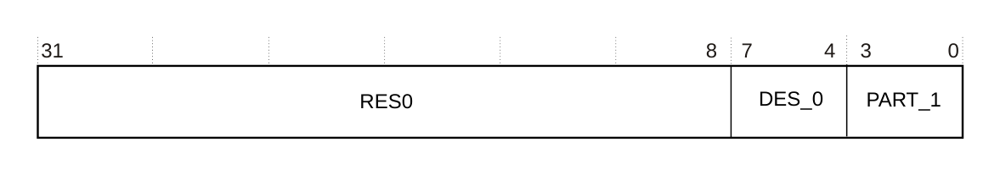

下表给出了 **PIDR1** 的位分配。

| 位 | 名称 | 功能 |
| --- | --- | --- |
| [31:8] | - | 保留，RES0。 |
| [7:4] | DES_0 | JEP106 标识码 [3:0]：<br>0xB：Arm ID。 |
| [3:0] | PART_1 | 部件编号位 [11:8]：<br>0x9：表示 Cortex®-R52+ 处理器。 |

##### 8.16.13.8 外设标识寄存器 0 PIDR0

**PIDR0** 提供可用于标识 CoreSight 组件的信息。

**使用限制**

本寄存器为只读（RO）。

**陷阱与使能**

不存在影响本寄存器的陷阱与使能。

**配置**

本寄存器在所有构建配置中均可用。

**属性**

**PIDR0** 是一个 32 位寄存器。

下图给出了 **PIDR0** 的位分配。

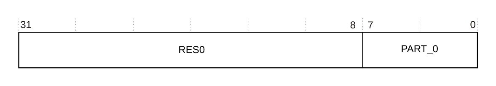

下表给出了 **PIDR0** 的位分配。

| 位 | 名称 | 功能 |
| --- | --- | --- |
| [31:8] | - | 保留，RES0。 |
| [7:0] | PART_0 | 部件编号位 [7:0]：<br>0xBB：表示 Cortex®-R52+ 处理器。 |

#### 8.16.14 组件标识寄存器

共有 4 个只读组件标识寄存器 CIDR3-CIDR0。

##### 8.16.14.1 组件标识寄存器 3 CIDR3

**CIDR3** 提供可用于标识 CoreSight 组件的信息。

**使用限制**

本寄存器为只读（RO）。

**陷阱与使能**

不存在影响本寄存器的陷阱与使能。

**配置**

本寄存器在所有构建配置中均可用。

**属性**

**CIDR3** 是一个 32 位寄存器。

下图给出了 **CIDR3** 的位分配。

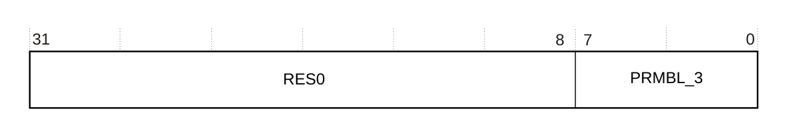

下表给出了 **CIDR3** 的位分配。

| 位 | 名称 | 功能 |
| --- | --- | --- |
| [31:8] | - | 保留，RES0。 |
| [7:0] | PRMBL_3 | 前导码，段 3，0xB1。 |

##### 8.16.14.2 组件标识寄存器 2 CIDR2

**CIDR2** 提供可用于标识 CoreSight 组件的信息。

**使用限制**

本寄存器为只读（RO）。

**陷阱与使能**

不存在影响本寄存器的陷阱与使能。

**配置**

本寄存器在所有构建配置中均可用。

**属性**

**CIDR2** 是一个 32 位寄存器。

下图给出了 **CIDR2** 的位分配。


下表给出了 **CIDR2** 的位分配。

| 位 | 名称 | 功能 |
| --- | --- | --- |
| [31:8] | - | 保留，RES0。 |
| [7:0] | PRMBL_2 | 前导码，段 2，0x5。 |

##### 8.16.14.3 组件标识寄存器 1 CIDR1

**CIDR1** 提供可用于标识 CoreSight 组件的信息。

**使用限制**

本寄存器为只读（RO）。

**陷阱与使能**

不存在影响本寄存器的陷阱与使能。

**配置**

本寄存器在所有构建配置中均可用。

**属性**

**CIDR1** 是一个 32 位寄存器。

下图给出了 **CIDR1** 的位分配。

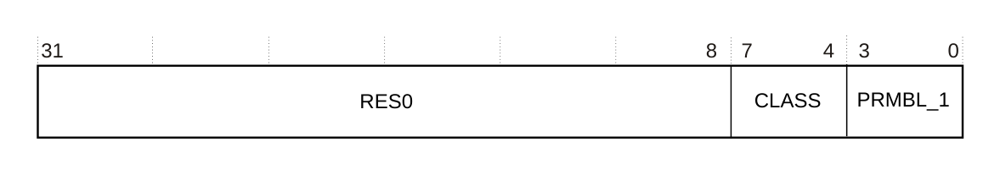

下表给出了 **CIDR1** 的位分配。

| 位 | 名称 | 功能 |
| --- | --- | --- |
| [31:8] | - | 保留，RES0。 |
| [7:4] | CLASS | 组件类：<br>0x9：CoreSight 组件。 |
| [3:0] | PRMBL_1 | 前导码，段 1，0x0。 |

##### 8.16.14.4 组件标识寄存器 0 CIDR0

**CIDR0** 提供可用于标识 CoreSight 组件的信息。

**使用限制**

本寄存器为只读（RO）。

**陷阱与使能**

不存在影响本寄存器的陷阱与使能。

**配置**

本寄存器在所有构建配置中均可用。

**属性**

**CIDR0** 是一个 32 位寄存器。

下图给出了 **CIDR0** 的位分配。

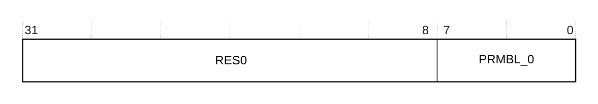

下表给出了 **CIDR0** 的位分配。

| 位 | 名称 | 功能 |
| --- | --- | --- |
| [31:8] | - | 保留，RES0。 |
| [7:0] | PRMBL_0 | 前导码，段 0，0x0D。 |

