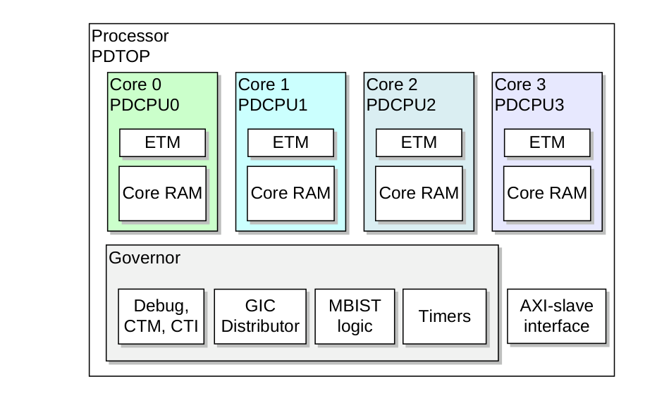

本章介绍 Cortex®-R52+ 处理器的电源管理特性。

## 1. 关于电源管理

处理器提供了降低动态功耗和静态功耗的特性。这些特性包括：

* 设计中内置自动控制的局部和区域时钟门控，用于降低动态功耗。
* 每个核的架构时钟门控。它在 **WFI** 低功耗状态和 **WFE** 低功耗状态下使用，以在核空闲时进一步降低动态功耗。
* 支持对单个核进行电源门控的控制机制和分区，用于降低静态功耗。

## 2. 局部与区域时钟门控

处理器的设计使综合工具能够自动为成组的触发器推断时钟门控。这些门控会关闭时钟，从而降低时钟门控本地触发器和逻辑所消耗的动态功耗。

设计中显式的时钟门控可以在空闲时关闭更大区域逻辑的时钟，从而进一步降低动态功耗。这些区域时钟门控由处理器内部的逻辑根据当前活动情况自动控制。

## 3. 架构时钟门控

**WFI** 和 **WFE** 指令是 Armv8-R AArch32 架构中使核进入低功耗状态的特性。这些指令通常会在保持核对供电的同时关闭核内的时钟。

这样便消除了核内大部分动态功耗。这是一种待机模式，根据进入时使用的是 **WFI** 还是 **WFE**，分别称为 **WFI** 低功耗状态或 **WFE** 低功耗状态。

**WFI** 低功耗状态是核下电序列的一部分。

### 3.1. WFI 低功耗状态

核通过执行 **WFI** 指令进入 **WFI** 低功耗状态。

在执行 **WFI** 指令时，核会等待核内所有指令退休后才进入 **WFI** 低功耗状态。**WFI** 指令确保按程序顺序在 **WFI** 指令之前发生的所有显式内存访问都已退休。例如，**WFI** 指令确保以下指令从内存系统接收到所需的数据或响应：

* 加载指令。
* 缓存维护操作。
* **Store-Exclusive** 指令。

此外，**WFI** 指令确保存储指令已从流水线退休并完成。完成的定义是：

* 存储已按内存属性要求写入终点。
* 响应已知（正常或错误）。

当核处于 **WFI** 低功耗状态时，若核未在处理传入事务，则会通过时钟门控自动关闭其时钟。当以下任一情况正在进行时，核内的时钟会被临时使能，而不会导致核退出 **WFI** 低功耗状态：

* 对位于核电源域中的调试或跟踪寄存器的 **APB** 访问。
* 对核中某个 **TCM** 的 **AXIS** 接口访问。

当核被复位或发生 **WFI** 唤醒事件（例如中断）时，核退出 **WFI** 低功耗状态。有关各种 **WFI** 唤醒事件的信息，请参见《Arm® Architecture Reference Manual Supplement Armv8, for the Armv8-R AArch32 architecture profile》。

当核处于 **WFI** 低功耗状态时，该核的 **STANDBYWFIx** 被断言。该断言仅表示核已停止执行指令。即使由于 **AXIS** 或 **APB** 访问而临时使能了核内时钟，**STANDBYWFIx** 仍保持断言。

### 3.2. WFE 低功耗状态

核通过执行 **WFE** 指令进入 **WFE** 低功耗状态。

在执行 **WFE** 指令时，核会等待核内所有指令完成后才进入 **WFE** 低功耗状态。**WFE** 指令确保按程序顺序在 **WFE** 指令之前发生的所有显式内存访问都已完成。

当核处于 **WFE** 低功耗状态时，若核未在处理传入事务，则会通过时钟门控自动关闭其时钟。当以下任一事件正在进行时，核内的时钟会被临时使能，而不会导致核退出 **WFE** 低功耗状态：

* 对位于核电源域中的调试或跟踪寄存器的 **APB** 访问。
* 对核中某个 **TCM** 的 **AXIS** 接口访问。

当核被复位或发生 **WFE** 唤醒事件时，核退出 **WFE** 低功耗状态。**WFE** 唤醒事件的一个例子是另一个核执行 **SEV** 指令所生成的事件。有关各种 **WFE** 唤醒事件的信息，请参见《Arm® Architecture Reference Manual Supplement Armv8, for the Armv8-R AArch32 architecture profile》。

当发生以下任一情况时，Cortex®-R52+ 核也会退出 **WFE** 低功耗状态：

* **EVENTI** 输入信号被断言。
* **CLREXMONREQ** 输入信号被断言。

当核处于 **WFE** 低功耗状态时，该核的 **STANDBYWFEx** 被断言。该断言仅表示核已停止执行指令。即使由于 **AXIS** 访问或 **APB** 访问而临时使能了核内时钟，**STANDBYWFEx** 仍保持断言。

### 3.3. 使用 WFE 和 SEV 指令的事件通信

**EVENTI** 信号使外部代理能够参与 **WFE** 和 **SEV** 事件通信。

当 **EVENTI** 信号被断言时，它会向处理器中的所有核发送事件消息。这类似于在处理器中的一个核上执行 **SEV** 指令。例如，这使外部代理能够通知核其已释放信号量，核可以退出 **WFE** 低功耗状态。**EVENTI** 输入信号必须保持高电平至少一个 **CLKIN** 周期，才能被各核看到。

外部代理可以通过检查 **EVENTO** 信号来确定处理器中至少有一个核执行了 **SEV** 指令。当处理器中任一核执行 **SEV** 指令时，会向处理器中的所有核发送事件，并且 **EVENTO** 信号被断言。当任一核执行 **SEV** 指令时，该信号被断言为高电平并保持三个 **CLKIN** 周期。

### 3.4. CLREXMON 请求与应答信令

系统可以使用 **CLREXMONREQ** 输入向 Cortex®-R52+ 处理器表示外部全局独占监视器已被清除。它同时作为处理器中所有核的 **WFE** 唤醒事件。

## 4. 电源门控

Cortex®-R52+ 处理器的设计允许对集群内的单个核下电。下电可消除与该核相关的大部分动态功耗和静态功耗。

该特性要求处理器实现时使用适当的电源域和钳位电路，并集成到具有适当电源控制器的 **SoC** 中。因此，核下电的部分细节特定于你所使用的器件。有关可在 Cortex®-R52+ 处理器中实现的电源域，请参见第 226 页的 6.4.1 Power domains。

在核下电之前，运行在其上的软件必须使核进入适当的状态。这可能涉及将存储在寄存器或 **TCM** 中的数据保存到保持供电的系统内存中。软件必须执行 **WFI** 指令以停止流水线并排空总线主设备。最后，电源控制器必须使用 **Cortex®-R52+ 低功耗接口（Low-Power Interface, LPI）** 确保核处于静止状态且无法被唤醒，然后才能移除电源。

Cortex®-R52+ LPI 向电源控制器提供提示信号。这些提示信号指示何时收到传入的中断或调试请求、核应上电。核恢复供电后必须复位。核的引导软件可以从冷启动重新启动，或恢复先前保存的状态。Cortex®-R52+ 核本身不能保留任何状态。如果要求在下电后恢复任何状态，则必须由软件完成。

### 4.1. 电源域

Cortex®-R52+ 处理器具有两个层次化的电源域 **PDCPUx** 和 **PDTOP**。

**PDTOP** 是顶层电源域，包括：

* **GIC** 分发器、调试 **APB** 从设备、**CTM** 和 **CTI**。
* **AXIS** 接口。
* **MBIST** 逻辑。
* 定时器。

**PDCPU** 是每个核的电源域，包括：

* 核 x。
* L1 指令和缓存 RAM 以及 **TCM** RAM。
* 核级调试逻辑。
* **ETM** 逻辑。

下图给出了嵌入在 **SoC** 电源域中的处理器电源域示例。

### 4.2. Cortex®-R52+ LPI

每个 Cortex®-R52+ 核都有自己的 **P 通道** LPI。各 LPI 相互独立工作。电源控制器可以使用 LPI 请求核进入可安全下电的状态。LPI 还提供提示信息，指示下电请求何时可能成功、何时可能需要上电。

请参见《Low Power Interface Specification Arm® Q-Channel and P-Channel Interfaces》。

每个 **P 通道**可以请求以下两种状态之一：

**RUN（COREPSTATEx=0）**

核可正常工作，包括处理通过 **AXIS** 接口接收的事务以及对核域调试寄存器的 **APB** 事务。核在 **RUN** 状态下可以进入和退出 **WFI** 低功耗状态或 **WFE** 低功耗状态。

**SHUTDOWN（COREPSTATEx=1）**

核不执行指令，也不处理中断和通过 **AXIS** 接口接收的事务以及对核域调试寄存器的 **APB** 事务。在该状态下，**AXIS** 接口收到的事务会得到错误响应。除非使能了模拟下电（**emulated powerdown**），否则 **APB** 接口或核域调试寄存器收到的事务会得到错误响应。

每个 **P 通道**在 **COREPACTIVEx** 的两位上提供活动提示：

**位 [1]**

在 **RUN** 状态下，若核满足以下任一情况，则该位被断言：

* 正在执行指令。
* 有未完成的事务。
* 可以处理中断。
* 正在处理通过 **AXIS** 接口接收的事务，或对核域调试寄存器的 **APB** 事务。
* 正在处理对核域调试寄存器的 **APB** 事务（除非使能了模拟下电）。

在 **SHUTDOWN** 状态下，若有通常应路由到该核的传入中断，或有调试上电请求，则该位被断言。

**位 [0]**

若设置了调试禁止下电（**DBGPRCR.CORENPDRQ**）或调试上电请求（**EDPRCR.COREPURQ**、**TRCPDCR.PU**）功能，则该位被断言。这向电源控制器表明任何下电都必须以模拟方式执行。

当核处于 **SHUTDOWN** 状态时，以下情况会得到错误响应：

* **AXIS** 接口为核接收的事务。
* 调试 **APB** 接口为核域调试寄存器接收的事务，但使能模拟下电时除外。

此类事务不会被阻塞，也不会导致任何活动提示被断言。

### 4.3. 下电序列

要对核下电，运行在该核上的软件必须使用以下过程：

**过程**

1. 如有必要，将核的状态保存到未下电的系统内存中。这必须包括不希望丢失的、存储在 **TCM** 中的任何数据。
2. 禁用 **ICC_IGRPEN0** 和 **ICC_IGRPEN1** 寄存器中的中断使能位。使用 **GICR_WAKER** 寄存器设置该核的 **GIC** 分发器唤醒请求。读取 **GICR_WAKER**，确认 **ChildrenAsleep** 位表示接口已处于静止状态。
3. 执行一条**指令同步屏障（Instruction Synchronization Barrier, ISB）**，确保步骤 1 和步骤 2 中所述的所有更改已完成。
4. 根据需要为核下电对 **SoC** 中的电源控制逻辑进行编程。
5. 执行 **WFI** 指令。

作为对步骤 4 中请求的响应，电源控制器：

1. 等待 **COREPACTIVEx[1]** 变为低电平。
2. 在 LPI 上请求 **SHUTDOWN** 状态。
3. 请求成功后，对相应的核电源域下电，包括断言钳位信号。

**注意：** **COREPACTIVEx[1]** 变为低电平后，唯一能阻止 **SHUTDOWN** 状态请求成功的刺激是传入的**系统错误中断（System Error Interrupt, SEI）** 或**虚拟系统错误中断（Virtual System Error Interrupt, VSEI）**。处理此类 **SEI** 或 **VSEI** 后，软件必须执行 **WFI** 使核能够关闭，或按第 229 页的 6.4.4 Powerup sequence 所述重新启动核。重新启动核必须包括清除 **GIC** 分发器唤醒请求。当核已接受 **SHUTDOWN** 请求后，除复位外任何刺激都无法使其重新启动。

### 4.4. 上电序列

如果 **COREPACTIVEx[1]** 变为高电平，或出于其他 **SoC** 特定的原因，电源控制器必须使用以下过程对核上电：

**过程**

1. 将 **nCPUPORESETx** 和 **nCORERESETx** 断言为低电平。
2. 恢复相应核电源域的供电，包括释放钳位信号。
3. 在 LPI 上请求 **RUN** 状态。该请求在复位去断言后被接受。
4. 去断言 **nCPUPORESETx** 和 **nCORERESETx**。

核接受复位异常并开始执行复位处理程序。软件必须按常规初始化核，包括根据需要初始化寄存器，并使用 **GICR_WAKER** 寄存器清除 **GIC** 分发器唤醒请求。如有必要，软件必须恢复下电前保存的核状态。

### 4.5. 下电期间的调试

当核正常下电时，核域调试寄存器的状态会丢失，包括已编程的断点或观察点。当核退出下电时，**EDPRSR.SPD** 读到 1，表示核域调试寄存器的状态已丢失。

为了能够调试与电源控制相关的软件，处理器提供了使能模拟下电的功能。在模拟下电场景中，核的下电和上电软件序列与第 228 页的 6.4.3 Powerdown sequence 和第 229 页的 6.4.4 Powerup sequence 所述相同。但电源控制器的行为不同，以便不丢失调试状态。

调试器可以通过为该核或多个核设置 **DBGPRCR.CORENPDRQ** 来请求模拟所有下电操作。这会使 **COREPACTIVEx[0]** 输出信号被断言，电源控制器必须将其作为执行不同下电和上电序列的指示。

要执行模拟下电，电源控制器必须：

1. 等待 **COREPACTIVEx[1]** 变为低电平。
2. 在 LPI 上请求 **SHUTDOWN** 状态。

电源控制器不得断言钳位信号，也不得移除核的电源。

在模拟下电后执行上电时，电源控制器必须：

1. 将 **nCORERESETx** 断言为低电平。
2. 在 LPI 上请求 **RUN** 状态。
3. 去断言 **nCORERESETx**。

当核处于模拟下电状态时，访问调试寄存器的效果与正常 **RUN** 状态相同。当核退出模拟下电时，**EDPRSR.SPD** 读到 0，表示核域调试寄存器的状态未丢失。

### 4.6. 集群下电

Cortex®-R52+ 处理器不包含任何协助整个处理器集群下电的特性。

**SoC** 负责确保：除对单个核下电外，若系统有要求，到 **AXIS**、调试 **APB** 和中断的接口处于空闲状态。因此，关闭集群的软硬件序列特定于你所使用的 **SoC**。
