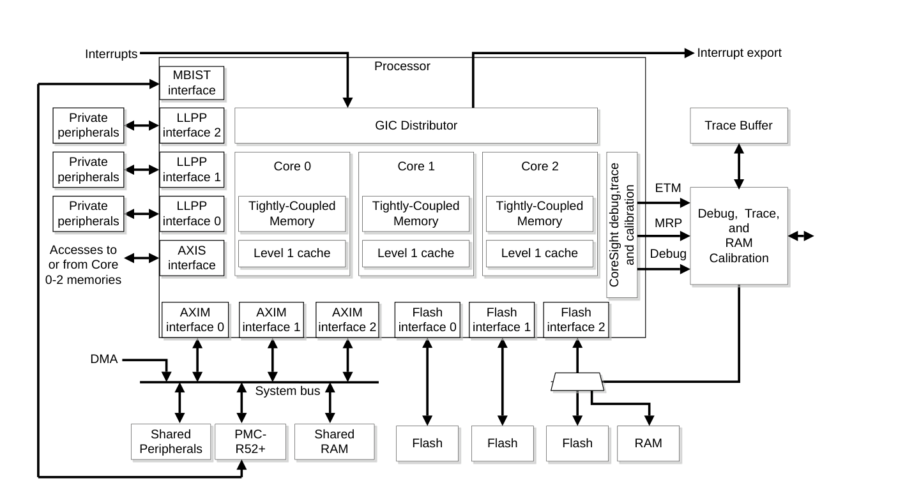
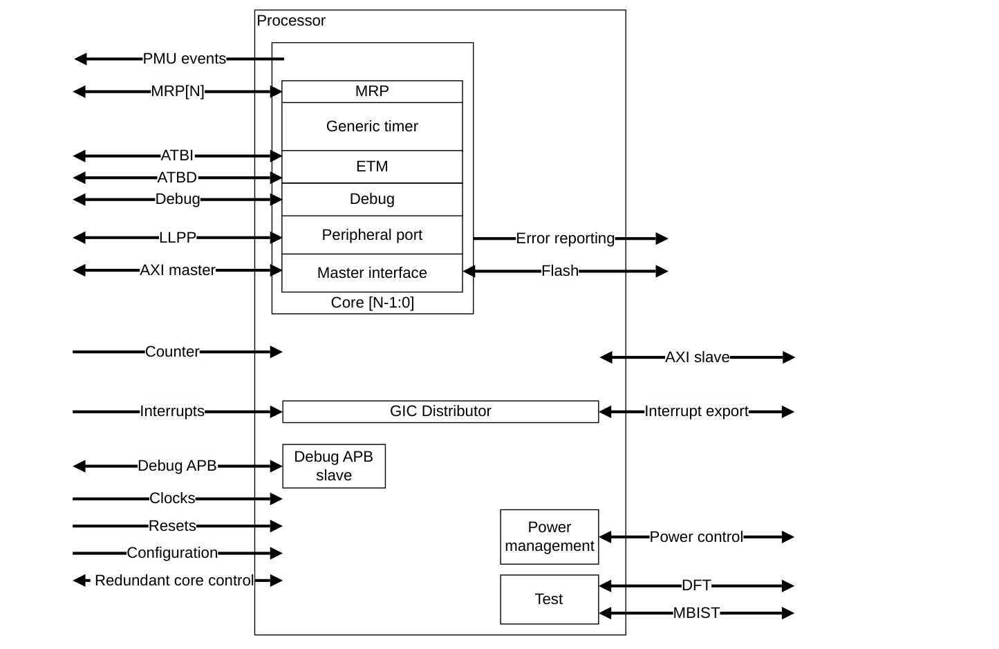
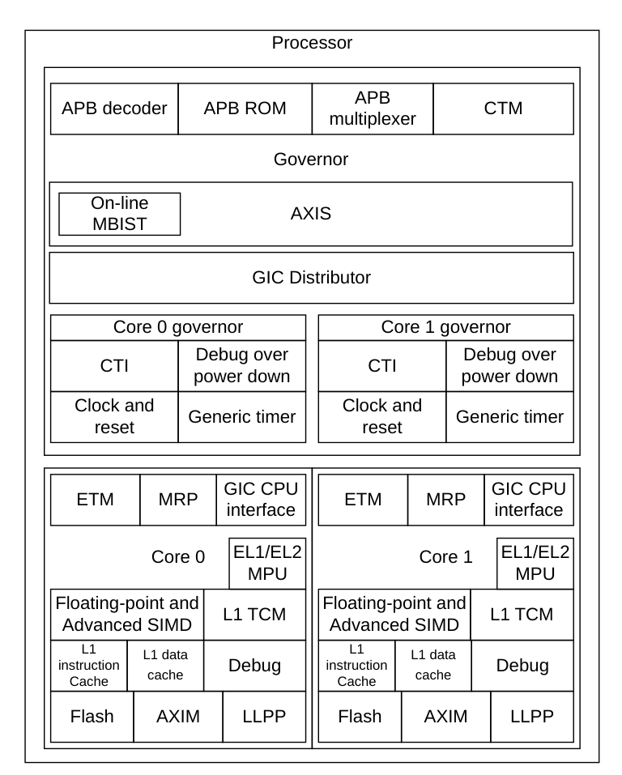

本章介绍 Cortex®-R52+ 处理器。

## 1. 关于 Cortex®-R52+ 处理器

Cortex®-R52+ 处理器是一款中等性能、顺序执行的超标量处理器，主要用于汽车和工业应用，也适用于通信和存储设备等各种其他嵌入式应用。

Cortex®-R52+ 处理器具有一至四个核，每个核实现一个符合 Armv8-R AArch32 的处理元件（**Processing Element, PE**）。在 Cortex®-R52+ 的语境中，PE 与核在概念上是相同的。

多个受保护内存系统架构（**Protected Memory System Architecture, PMSA**）上下文可以使用虚拟化技术在同一核上执行，从而将它们相互隔离。处理器能够隔离不同上下文的实时性能，防止一个上下文影响更关键上下文的响应时间和确定性。处理器可以具有逻辑和比较器的冗余副本，以支持双核锁步（**Dual-Core Lock-Step, DCLS**）运行。

下图给出了一个 Cortex®-R52+ 处理器系统的示例。

**相关参考**

第 33 页的 2.2 Component blocks。

### 1.1. 特性

Cortex®-R52+ 处理器的主要特性包括：

* 最多四个核，每个核具有带分支预测的八级顺序超标量流水线。
* 对所实例化的 RAM 以及所连接的 Flash 存储器提供双错检测（**Double Error Detect, DED**）或单错纠正双错检测（**Single Error Correct Double Error Detect, SECDED**）保护。所实例化的 RAM 包括：
  * 指令缓存标签和数据 RAM。
  * 数据缓存标签和数据 RAM。
  * 紧耦合存储器（**Tightly Coupled Memory, TCM**）。
* 主 AXI 主机（**AXIM**）接口、AXI 从机（**AXIS**）接口、低延迟外设端口（**LLPP**）接口和 Flash 接口的可选总线保护：
  * 数据信号上的可选数据完整性保护。
  * 数据、地址、控制和响应载荷以及握手信号上的可选信号完整性保护。
  * 可选互连保护。
* 错误报告接口。
* 电源管理。
* Armv8-R AArch32 调试，提供硬件断点和观察点、自托管调试和外部调试，也支持调试目标与主机之间的通信。AArch32 配置文件的 Armv8-R 调试基于 Armv8.0 Debug 架构。
* 用于指令和数据跟踪的嵌入式跟踪宏单元（**Embedded Trace Macrocell, ETM**）。
* 用于仿真和校准的内存重建端口（**Memory Reconstruction Port, MRP**）。
* 基于 PMUv3 架构的性能监视单元（**Performance Monitoring Unit, PMU**）支持。
* 用于多处理器调试的交叉触发接口（**Cross Trigger Interface, CTI**）。
* 集成的、快速响应的带虚拟化通用中断控制器（**Generic Interrupt Controller, GIC**）。
* 用于在启动时以及启动后按计划间隔测试存储器的在线内存内建自测试（**Memory Built-In Self Test, MBIST**）接口，可选以下之一：
  * 可与可编程 MBIST 控制器（**PMC**）PMC-R52+ 配合使用的外部在线 MBIST 接口。
  * 带有内部 MBIST 连接的预集成 PMC-R52+。

### 1.2. 接口

Cortex®-R52+ 处理器具有多种外部接口。

下图给出 Cortex®-R52+ 处理器的外部接口。箭头表示各接口中信号的方向。

### 1.3. 配置选项

Cortex®-R52+ 处理器具有可在实现和集成阶段配置的选项，以满足你的功能需求。

下表给出处理器的可配置选项。

| 特性 | 选项 | 配置阶段 |
| --- | --- | --- |
| 核数量 | 1-4 个核。 | 实现 |
| 锁步 | 是否包含用于 DCLS 的冗余逻辑、触发器和比较器。DCLS 配置包含 2、4、6 或 8 份核逻辑实例，具体取决于所配置的核数量。 | 实现 |
| EL1 控制的 MPU | 每个核 16、20 或 24 个可编程的 EL2 控制内存保护单元（**MPU**）区域。 | 实现 |
| EL2 控制的 MPU | 每个核 0、16、20 或 24 个可编程的 EL2 控制 **MPU** 区域。 | 实现 |
| AXI 总线保护 | 不包含总线保护、仅包含信号完整性保护、包含信号完整性和互连保护，或仅包含数据完整性保护。 | 实现 |
| RAM 保护 | 对所有 RAM 包含保护，或不包含保护。 | 实现 |
| 中断控制器中断（**SPI**）数量 | 32-960，为 32 的倍数，每个核至少 32 个中断。 | 实现 |
| 每个核的 Advanced SIMD 与浮点能力 | 仅单精度浮点，或单精度与双精度浮点以及 **Advanced SIMD**。 | 实现 |
| 每个核上三个 TCM 的容量 | 0KB、8KB-1MB（2 的幂）。 | 实现 |
| 每个核的 TCM 等待状态 | 0 或 1 个等待状态。 | 实现 |
| 每个核的指令缓存容量 | 4KB、8KB、16KB、32KB，或完全排除。 | 实现 |
| 每个核的数据缓存容量 | 4KB、8KB、16KB、32KB，或完全排除。 | 实现 |
| GIC 的外部设备接口 | 0 或 1 个外部设备。 | 实现 |
| Flash ECC 方案 | 在 64 位 ECC 和 128 位 ECC 之间切换 Flash 存储器完整性保护方案。 | 实现 |
| PMC | 外部在线 MBIST 接口或集成 PMC。 | 实现 |
| 复位所有寄存器 | 硬件中仅复位所需寄存器，或复位所有程序可见寄存器。 | 集成 |
| TCM 引导 | 启动时使能 ATCM 且位于地址 0x0，或复位时禁用。 | 集成 |
| Flash 引导 | 启动时使能 Flash 存储器，或复位时禁用。 | 集成 |
| Flash 接口基地址 | Flash 接口区域的基地址。 | 集成 |
| Flash 区域存在性固定配置 | Flash 区域访问 AXIM 接口或 Flash 接口。 | 集成 |
| LLPP 接口基地址与容量 | LLPP 区域的基地址和容量（2 的幂）。 | 集成 |
| LLPP 区域存在性固定配置 | LLPP 区域访问 AXIM 接口或 LLPP。 | 集成 |
| TCM 基地址 | 从 AXIS 接口看到的 TCM 区域基地址。 | 集成 |

**注意：** 在本手册中使用“总线保护”这一术语时，它涵盖上述三种机制。

#### 1.3.1. 处理器配置

Cortex®-R52+ 处理器可配置为实现 DCLS 和 Split‑Lock 配置。

##### 1.3.1.1. DCLS

在 DCLS 配置中，每个核都有第二份冗余的核逻辑副本，以及一份冗余的共享逻辑副本。

冗余逻辑与功能逻辑由相同的输入驱动。特别是，冗余核逻辑与功能核共享相同的缓存 RAM 和 **TCM**，因此只需要一组缓存 RAM 和 **TCM**。冗余逻辑与核一起锁步运行，但不会以任何方式直接影响处理器行为。处理器向系统其余部分的输出，以及核向缓存 RAM 和 **TCM** 的输出，完全由功能核驱动。

在实现时，可以包含比较器逻辑来比较冗余逻辑与功能逻辑的输出。这些比较器可以检测由于辐照或电路故障而在任一逻辑组中发生的单点故障。与 RAM 错误检测方案配合使用时，系统即可受到保护，免受这类故障的影响。

如果实现 DCLS 配置，可以在单独授权的功能安全包中找到更多信息。

##### 1.3.1.2. Split‑Lock

在 Split‑Lock 配置中，每个核必须有两份或四份完整的冗余副本。下表给出核在 Lock 模式和 Split 模式下的使用方式。下表中：

* **N** 为物理核数量。
* **LOCK_N** 为 Lock 模式下使用的核数量。
* **SPLIT_N** 为 Split 模式下使用的核数量。

| N | LOCK_N | SPLIT_N |
| --- | --- | --- |
| 2 | 1 | 2 |
| 4 | 2 | 4 |

在 Lock 模式下，高位核作为低位核的冗余副本。例如，如果 **N** 为 4，则逻辑上仅存在低位核，即核 0 和核 1。核 2 和核 3 是逻辑上不存在的低位核之外的高位核，但它们作为冗余副本工作。虽然存在，但属于高位核的输入输出、缓存 RAM 和 **TCM** 均被禁用，在 Lock 模式下不得使用。

在 Split 模式下，与所选物理核数量相关的所有接口、缓存 RAM 和 **TCM** 均存在并使能，但无法进行冗余检查。

与 DCLS 类似，在 Lock 模式运行期间可以包含比较器逻辑来比较冗余逻辑与功能逻辑的输出。Split 模式运行会禁用比较器逻辑。

对于 Split‑Lock，必须设置新的输入信号 **CFGSLSPLIT**，以确定配置为 Split 模式还是 Lock 模式。如果选择 Lock 模式，则除 **CFGSLSPLIT** 外还必须驱动所有 DCLS 信号。如果选择 Split 模式，则除 **CFGSLSPLIT** 外只需驱动 **CLKINDCLS**。有关 DCLS 信号的更多信息，请参见第 614 页的 A.30 DCLS signals。

如果实现 Split‑Lock 配置，可以在单独授权的功能安全包中找到更多信息。

## 2. 组件模块

下图给出双核配置下处理器的主要组件模块。

### 2.1. 指令取指

预取单元（**Prefetch Unit, PFU**）从指令缓存、**TCM** 或外部存储器获取指令，预测指令流中分支的结果，并将指令传递给数据处理单元（**Data Processing Unit, DPU**）处理。

PFU 每周期从存储器取指 64 位。

Cortex®-R52+ 处理器中的指令取指始终为小端。

取指级与译码级之间的指令队列将指令执行与指令取指解耦。这样，当取指级因预测分支而被冲刷时，指令仍可继续执行。

Cortex®-R52+ 分支预测机制在流水线的早期阶段检测分支，并立即将指令取指重定向到相应地址，而不是等待分支到达流水线末端。但是，并非所有分支都以这种方式预测。

**分支目标地址缓存**

PFU 包含一个 16 项的**分支目标地址缓存（Branch Target Address Cache, BTAC）**，用于预测间接分支（子程序返回除外）的目标地址。BTAC 的实现对架构透明，因此无需在上下文切换时冲刷。

**分支预测器**

分支预测器为全局类型，使用分支历史寄存器和 2048 项的模式历史预测表。

**返回栈**

PFU 包含一个 8 项的调用返回栈，用于加速从子程序调用返回。对于每次子程序调用，返回地址被压入硬件栈。识别到子程序返回时，弹出返回栈中保存的地址，PFU 将其用作预测的返回地址。返回栈对架构透明，因此无需在上下文切换时冲刷。

**异常目标地址缓存**

**异常目标地址缓存（Exception Target Address Cache, ETAC）** 是一种结构，用于通过缓存 **IRQ** 和 **FIQ** 异常的通用处理程序地址，降低这些异常的最佳情况延迟。

ETAC 在复位后即被使能。向系统寄存器 **CPUACTLR.ETACDIS** 写 1 可禁用 ETAC。

ETAC 仅支持缓存中断（**IRQ**）和快速中断（**FIQ**）向量表项。其他类型的异常不会在 ETAC 中分配表项。这是因为在实时系统中，对 **IRQ** 和 **FIQ** 异常的快速响应最为关键。

只有当向量位于 **TCM** 中时，该向量才会被缓存到 ETAC。位于任何其他类型存储器中的向量永远不会在 ETAC 中分配或命中。这是因为 **TCM** 是唯一具有完美响应的存储器。其他存储器可能发生缓存缺失，在这种情况下，与缓存缺失的延迟相比，ETAC 带来的节省微乎其微。只有当向量表中的指令为兼容指令时，ETAC 才缓存与该 **IRQ** 或 **FIQ** 异常对应的向量。兼容指令是指 **B #immed** 的所有编码。如果异常向量不是兼容指令，则 ETAC 不缓存该异常。

**IRQ** 和 **FIQ** 异常可以被取到异常级别 **EL1** 或 **EL2**，具体取决于中断发生时的异常级别以及 **HCR.IMO** 和 **HCR.FMO** 的值。ETAC 独立支持取到 **EL1** 和 **EL2** 的 **IRQ** 和 **FIQ** 异常，这意味着对每种情况都有四个独立的表项。

更多信息请参见：

* **CPUACTLR**：第 99 页的 4.3.19 CPU Auxiliary Control Register。
* **HCR**：第 123 页的 4.3.39 Hyp Configuration Register。

### 2.2. Advanced SIMD 与浮点支持

每个核所支持的 **Advanced SIMD** 与浮点使用 **NEON™** 技术，这是一种 SIMD 架构。

**Advanced SIMD** 与浮点特性提供：

* 用于单精度（C 语言 float 类型）数据处理操作的指令。
* 用于双精度（C 语言 double 类型）数据处理操作的可选指令。
* 用于提高精度的组合乘累加指令（**Fused MAC**）。
* 对转换、加、减、带可选累加的乘、除以及平方根的硬件支持。
* 对非规格化数以及所有 IEEE Standard 754-2008 舍入模式的硬件支持。
* 对于单精度浮点，有 32 个 32 位单精度寄存器或 16 个 64 位双精度寄存器。如果包含用于双精度和 **Advanced SIMD** 的可选指令，则共有 32 个 64 位双精度寄存器或 16 个 128 位寄存器。

**相关参考**

第 564 页的 16. Advanced SIMD and floating-point support。

### 2.3. GIC 分发器

**GIC 分发器**接收物理中断，对其进行优先级排序，并将其路由到相应的中断目标。

**GIC 分发器**的输出是每个中断目标的最高优先级挂起中断。中断目标可以是某个核的 **GIC CPU 接口**，也可以是与外部设备（例如直接内存访问（**DMA**）控制器）连接的导出端口。

**相关参考**

第 284 页的 10. Generic Interrupt Controller。

### 2.4. GIC CPU 接口

**GIC CPU 接口**处理每个核的物理中断和虚拟中断的中断抢占。

每个 **GIC CPU 接口**的虚拟部分分为 Hypervisor 寄存器和 Guest OS 寄存器。Hypervisor 使用 **GIC CPU 接口**向 Guest OS 生成中断。

**相关参考**

第 284 页的 10. Generic Interrupt Controller。

### 2.5. 内存系统

Cortex®-R52+ 内存系统根据你的实现提供不同的存储器和接口。

每个 Cortex®-R52+ 核具有专用的 128 位 **AXIM** 接口，用于存储器、指令和数据以及外设访问，适用于没有严格实时要求的上下文。

同时，对于实时上下文，每个 Cortex®-R52+ 核可以具有：

* 三个统一 **TCM**，每个 8KB-1MB，为指令和数据提供最低延迟的访问。
* 可选的 32 位 AXI4 **LLPP** 接口，用于对私有外设的设备数据访问。
* 128 位只读 Flash 接口。
* 对所有 **TCM** 和 Flash 存储器的 **ECC** 保护，提供 SECDED 保护。
* 通过 **AXIS** 接口进行 **DMA** 的 **TCM** 访问。
* 使用 **MBIST** 接口进行 **TCM** 测试。

实时上下文也能够访问 **AXIM**，但根据系统设计，这种访问可能并不可取。

每个 Cortex®-R52+ 核具有可选的哈佛缓存，可用于缓存来自 Flash 接口和 **AXIM** 接口的数据。缓存行为取决于内存属性。

每个核具有：

* 带合并与前递（适当时）的存储缓冲。
* 4 路指令缓存，容量 4-32KB。
* 指令行填充缓冲。
* 4 路数据缓存，容量 4-32KB，采用写通（**Write-Through**）行为。
* 数据读缓冲。
* 对所有缓存存储器（包括标签 RAM）的 **ECC** 保护。
* 对缓存进行加载和存储的 64 位数据通路。
* 符合 Arm 架构的缓存维护操作。
* 使用 **MBIST** 接口进行缓存存储器测试。

**相关参考**

第 236 页的 8. Memory System。

### 2.6. 内存管理

内存保护单元（**MPU**）确定每个内存位置的属性，包括权限、类型和可缓存性。处理器提供两个可编程 **MPU**，分别由 **EL1** 和 **EL2** 控制。

访问权限决定允许哪些特权级访问某个位置，以及是否允许写访问或指令执行。内存类型和可缓存性影响处理器处理特定访问的方式，例如处理器是否允许将两个存储合并为一次写访问。这些属性及其含义由 Arm 架构定义。

**相关参考**

第 276 页的 9. Memory Protection Unit。

### 2.7. 调试、跟踪与测试

处理器具有生产测试设施，处理器中的每个核都具有侵入式调试和非侵入式调试特性，以支持软件调试。

侵入式调试特性包括硬件异常捕获、断点和观察点、通过调试通信通道进行数据传输以及单步执行。侵入式调试模式包括自托管（或监控）调试和外部（或暂停）调试。侵入式调试会影响处理器性能，不过如果时间允许，可以安排自托管调试。

非侵入式调试特性包括跟踪指令执行和跟踪数据传输。每个核都有自己的 **ETM**，允许在可用跟踪带宽允许的情况下同时跟踪所有核。跟踪信息通过 **ATB** 跟踪总线导出，可连接到 CoreSight 系统以合并跟踪源、缓冲并导出。

处理器包含一个 **PMU**，用于生成并计数核中发生的事件，例如缓存行填充、流水线停顿和 **ECC** 故障。这些事件也会适当导出，供外部硬件使用。

生产测试包括 **MBIST**。

**相关参考**

第 386 页的 12. Debug。

第 463 页的 14. Cross Trigger。

第 480 页的 15. Embedded Trace Macrocell。

## 3. 接口

Cortex®-R52+ 处理器具有多种外部接口。

### 3.1. 高级微控制器总线架构（AMBA）接口

处理器实现以下 AMBA 接口。

#### 3.1.1. AXIM

Cortex®-R52+ 处理器的每个核具有一个 128 位 **AXIM** 接口，提供对外部存储器和外设的高性能访问。

**相关参考**

第 250 页的 8.5 AXIM interface。

第 586 页的 AXIM interface signals。

#### 3.1.2. AXIS

Cortex®-R52+ 处理器中的每个核连接到一个公共的 128 位 **AXIS** 接口。这提供了对 **TCM** 的外部访问。**AXIS** 接口支持外部控制器与内部存储器之间的 **DMA** 访问。

**相关参考**

第 267 页的 8.8 AXIS interface。

第 592 页的 AXIS interface signals。

#### 3.1.3. 高级外设总线（APB）调试接口

调试使用 AMBA APBv3 接口。

**相关参考**

第 607 页的 Debug APB interface signals。

#### 3.1.4. LLPP

Cortex®-R52+ 处理器中的每个核具有一个到专用 32 位 **LLPP** 主机接口的接口。这些端口用于需要低延迟访问的私有外设。

**相关参考**

第 256 页的 8.6 Low-latency peripheral port。

第 597 页的 LLPP interface signals。

### 3.2. Flash 接口

Cortex®-R52+ 处理器中的每个核具有一个专用的 128 位只读 Flash 主机接口，可作为 AXI4 接口使用。该接口用于对连接到处理器的 Flash 存储器提供低延迟访问，使处理器能够借助缓存从 Flash ROM 执行实时任务。

**相关参考**

第 264 页的 8.7 Flash interface。

### 3.3. 内存重建端口

Cortex®-R52+ 处理器的每个核提供一个 **MRP**，用于报告写访问，以便重建内存映像。

每个核的 **MRP** 接口主要特性包括：

* 来自 **MRP** 的跟踪信息未压缩。
* **MRP** 不包含任何过滤。

**相关参考**

第 584 页的 MRP signals。

### 3.4. 中断接口

Cortex®-R52+ 处理器的中断接口具有一个输入端口，用于可配置数量的共享外设中断（**Shared Peripheral Interrupt, SPI**），范围为 32 至 960（32 的倍数），每个核至少 32 个。所有 **SPI** 均可配置为上升沿触发或电平敏感高有效。

中断分发器具有可选的中断导出端口，用于将中断路由到外部设备，例如 **DMA** 引擎。中断控制器选择该端口来路由 **SPI** 的方式与将中断路由到核的方式相同。

中断控制器还提供每个核私有的私有外设中断（**Private Peripheral Interrupt, PPI**）和软件生成中断（**Software Generated Interrupt, SGI**）。部分 **PPI** 作为主输入引出。

**相关参考**

第 284 页的 10. Generic Interrupt Controller。

### 3.5. MBIST 接口

**MBIST** 接口用于在生产测试期间测试 RAM。

Cortex®-R52+ 处理器允许在正常运行期间使用 **MBIST** 接口测试 RAM，这称为在线 MBIST。

现有的生产测试 MBIST 控制器不支持在线 MBIST 的要求，因此有必要使用为此目的专门开发的 PMC-R52+。PMC-R52+ 是 Cortex®-R52+ RTL 的一部分。它是一项集成选项，并非每个实现都包含。有关 PMC-R52+ 的更多信息，请参见第 653 页的 D. PMC-R52+。

有关 **MBIST** 接口和在线 MBIST 的更多信息，请联系你的实现团队。

### 3.6. 低功耗接口

**P 通道**接口用于向外部电源控制器发出电源状态信息。

**相关参考**

第 223 页的 6. Power Management。

## 4. 支持的标准

处理器遵循或实现 Arm 定义的各种规范。

### 4.1. Arm 架构

Cortex®-R52+ 处理器实现 Armv8-R AArch32 架构，包括：

* 支持 AArch32 执行状态。
* 支持异常级别 **EL0**、**EL1** 和 **EL2**。
* 支持符合 ANSI/IEEE Std 754-2008《IEEE Standard for Binary Floating-Point Arithmetic》的浮点计算功能。

更多信息请参见《Arm® Architecture Reference Manual Supplement Armv8, for the Armv8-R AArch32 architecture profile》。

### 4.2. AMBA

Cortex®-R52+ 处理器遵循：

* 用于主 **AXIM** 接口、**AXIS** 接口和 **LLPP** 端口的 AMBA 4 高级可扩展接口（**AXI**）协议。请参见《AMBA® AXI™ and ACE™ Protocol Specification AXI3™, AXI4™, and AXI4-Lite™, ACE and ACE-Lite™》。
* AMBA 3 APB 协议。请参见《AMBA® 3 APB Protocol v1.0 Specification》。
* AMBA 4 高级跟踪总线（**ATB**）协议。请参见《AMBA® 4 ATB Protocol Specification ATBv1.0 and ATBv1.1》。

### 4.3. 通用中断控制器架构

Cortex®-R52+ 处理器支持 GIC 架构版本 3 的一个子集。

请参见《Arm® Generic Interrupt Controller Architecture Specification GIC architecture version 3.0 and version 4.0》。

### 4.4. 通用定时器架构

处理器实现 Arm 通用定时器架构。

更多信息请参见《Arm® Architecture Reference Manual Supplement Armv8, for the Armv8-R AArch32 architecture profile》。

### 4.5. 调试架构

处理器实现符合 CoreSight 架构的 Armv8-R AArch32 调试架构。

更多信息请参见：

* 《Arm® CoreSight™ Architecture Specification v2.0》。
* 《Arm® Architecture Reference Manual Supplement Armv8, for the Armv8-R AArch32 architecture profile》。

### 4.6. 嵌入式跟踪宏单元架构

处理器实现 ETMv4.2 架构。

请参见《Arm® Embedded Trace Macrocell Architecture Specification ETMv4》。

## 5. 文档

Cortex®-R52+ 处理器文档如下：

**技术参考手册（Technical Reference Manual）**

技术参考手册（**TRM**）描述处理器的功能以及功能选项对处理器行为的影响。在设计流程的所有阶段都需要它。设计流程早期所做的选择可能意味着 TRM 中描述的某些行为并不相关。如果你要对处理器进行编程，必须从以下方面获取额外信息：

* 实现者，以确定该实现的构建配置。
* 集成者，以确定你所使用器件的引脚配置。

**配置与签核指南（Configuration and Sign-off Guide）**

配置与签核指南（**CSG**）描述：

* 可用的构建配置选项以及选择它们时的相关问题。
* 如何使用构建配置选项配置寄存器传输级（**RTL**）源文件。
* 如何集成 RAM 阵列。
* 如何验证 RTL。
* 如何运行测试向量。
* 布局规划的注意事项。
* 对配置后的设计进行签核的流程。

Arm 产品交付物包含参考脚本以及关于如何使用它们实现你的设计的信息。Arm 提供的参考方法学流程是示例参考实现。有关 EDA 工具支持，请联系你的 EDA 供应商。

CSG 是一份机密文档，仅向被许可方提供。

**集成手册（Integration Manual）**

集成手册（**IM**）描述如何将处理器集成到 SoC 中，描述集成者必须固定配置（**tie off**）的信号，以便按所需集成方式配置宏单元。某些实现选项可能影响可用的集成选项。

IM 是一份机密文档，仅向被许可方提供。

**安全手册（Safety Manual）**

安全手册（**SM**）及其他相关文档详细描述故障检测与控制特性的能力、开发流程和使用假设，以支持在具有明确功能安全要求的情况下包含该处理器的产品开发。

SM 是一份机密文档，仅向被许可方提供。

## 6. 设计流程

Arm 处理器以可综合的 RTL 形式交付。在处理器可用于产品之前，必须经过以下流程：

**实现（Implementation）**

实现者配置并综合 RTL，生成硬宏单元。这可能包括将缓存 RAM 集成到设计中。

**集成（Integration）**

集成者将配置后的设计连接到 SoC 中，包括将其连接到存储器系统和外设。

**编程（Programming）**

这是最后一个流程。系统程序员开发：

* 用于配置 Arm 处理器的软件。
* 用于初始化 Arm 处理器的软件。
* 应用软件以及 SoC 测试。

每个流程：

* 可以由不同方执行。
* 可能涉及做出影响处理器行为和特性的配置选择。
