本章介绍系统寄存器及其结构和操作。

## 1. 关于系统控制

系统寄存器提供对处理器中所实现功能的控制及其状态信息。

系统寄存器的主要功能如下：

* 整体系统控制和配置。
* **MPU** 配置和管理。
* 缓存配置和管理。
* 系统性能监视。
* **GIC CPU 接口**配置和管理。

部分系统寄存器可通过内存映射的外部调试接口访问。

术语 **RES0**、**RES1**、**RAZ**、**RAZ/WI**、**RAO/WI** 和 **RAZ/SBZ** 在《Arm® Architecture Reference Manual Supplement Armv8, for the Armv8-R AArch32 architecture profile》中描述。

有关 **GIC** 寄存器的信息，参见第 284 页的 10. Generic Interrupt Controller，或《Arm® Generic Interrupt Controller Architecture Specification GIC architecture version 3.0 and version 4.0》。

有关调试相关系统寄存器（**coproc==0b1110**）的信息，参见第 391 页的 12.3 System register summary。

**相关参考**

内存映射寄存器汇总（第 397 页）。

## 2. 寄存器汇总

系统寄存器使用 **MCR**、**MRC**、**MRRC** 或 **MCRR** 指令访问，其中 **coproc==0b1111**。

系统寄存器空间包括系统寄存器和系统操作。系统寄存器空间的描述说明了每个寄存器或操作允许的访问方式：只读（**RO**）、只写（**WO**）或读写（**RW**）。

下表描述了本节中使用的寄存器汇总表的列标题。

| 标题 | 描述 |
| --- | --- |
| CRn | 系统控制主寄存器编号。 |
| Op1 | 寄存器访问指令的参数。 |
| CRm | 寄存器访问指令的参数。 |
| Op2 | 寄存器访问指令的参数。 |
| Name | 寄存器或操作的名称。某些汇编器支持通过名称访问寄存器与操作的别名。 |
| Reset | 寄存器的复位值。 |
| Description | 指向寄存器描述的交叉引用。 |

### 2.1 c0 寄存器

下表给出当 **CRn** 的值为 **c0** 时可访问的 32 位系统寄存器。

有关更多信息，参见《Arm® Architecture Reference Manual Supplement Armv8, for the Armv8-R AArch32 architecture profile》。

| CRn | Op1 | CRm | Op2 | Name | Access | Reset | Description |
| --- | --- | --- | --- | --- | --- | --- | --- |
| c0 | 0 | c0 | 0 | MIDR | RO | 0x410FD161 | 第 172 页的 4.3.69 Main ID Register |
| c0 | 0 | c0 | 1 | CTR | RO | 0x8144c004 | 第 96 页的 4.3.16 Cache Type Register |
| c0 | 0 | c0 | 2 | TCMTR | RO | -¹ | 第 212 页的 4.3.96 TCM Type Register |
| c0 | 0 | c0 | 3 | TLBTR | RO | 0x00000000 | 第 214 页的 4.3.99 TLB Type Register |
| c0 | 0 | c0 | 4 | MPUIR | RO | -² | 第 184 页的 4.3.77 MPU Type Register |
| c0 | 0 | c0 | 5 | MPIDR | RO | -³ | 第 185 页的 4.3.78 Multiprocessor Affinity Register |
| c0 | 0 | c0 | 6 | REVIDR | RO | 0x00000000 | 第 201 页的 4.3.90 Revision ID Register |
| c0 | 0 | c0 | 7 | MIDR | RO | 0x410FD161 | Main ID Register 的别名，第 172 页的 4.3.69 Main ID Register |
| c0 | 0 | c1 | 0 | ID_PFR0 | RO | 0x00000131 | 第 192 页的 4.3.83 Processor Feature Register 0 |
| c0 | 0 | c1 | 1 | ID_PFR1 | RO | 0x10111001 | 第 193 页的 4.3.84 Processor Feature Register 1 |
| c0 | 0 | c1 | 2 | ID_DFR0 | RO | 0x03010006 | 第 109 页的 4.3.24 Debug Feature Register 0 |
| c0 | 0 | c1 | 3 | ID_AFR0 | RO | 0x00000000 | 第 86 页的 4.3.5 Auxiliary Feature Register 0 |
| c0 | 0 | c1 | 4 | ID_MMFR0 | RO | 0x00211040 | 第 175 页的 4.3.71 Memory Model Feature Register 0 |
| c0 | 0 | c1 | 5 | ID_MMFR1 | RO | 0x40000000 | 第 176 页的 4.3.72 Memory Model Feature Register 1 |
| c0 | 0 | c1 | 6 | ID_MMFR2 | RO | 0x01200000 | 第 178 页的 4.3.73 Memory Model Feature Register 2 |
| c0 | 0 | c1 | 7 | ID_MMFR3 | RO | 0xF0102211 | 第 179 页的 4.3.74 Memory Model Feature Register 3 |
| c0 | 0 | c2 | 0 | ID_ISAR0 | RO | 0x02101110 | 第 159 页的 4.3.60 Instruction Set Attribute Register 0 |
| c0 | 0 | c2 | 1 | ID_ISAR1 | RO | 0x13112111 | 第 161 页的 4.3.61 Instruction Set Attribute Register 1 |
| c0 | 0 | c2 | 2 | ID_ISAR2 | RO | 0x21232142 | 第 162 页的 4.3.62 Instruction Set Attribute Register 2 |
| c0 | 0 | c2 | 3 | ID_ISAR3 | RO | 0x01112131 | 第 164 页的 4.3.63 Instruction Set Attribute Register 3 |
| c0 | 0 | c2 | 4 | ID_ISAR4 | RO | 0x00010142 | 第 166 页的 4.3.64 Instruction Set Attribute Register 4 |
| c0 | 0 | c2 | 5 | ID_ISAR5 | RO | 0x00010001 | 第 167 页的 4.3.65 Instruction Set Attribute Register 5 |
| c0 | 0 | c2 | 6 | ID_MMFR4 | RO | 0x00000010 | 第 181 页的 4.3.75 Memory Model Feature Register 4 |
| c0 | 1 | c0 | 0 | CCSIDR | RO | UNK | 第 103 页的 4.3.20 Current Cache Size ID Register |
| c0 | 1 | c0 | 1 | CLIDR | RO | -⁷ | 第 92 页的 4.3.13 Cache Level ID Register |
| c0 | 1 | c0 | 7 | AIDR | RO | 0x00000000 | 第 86 页的 4.3.6 Auxiliary ID Register |
| c0 | 2 | c0 | 0 | CSSELR | RW | 0x00000000 | 第 95 页的 4.3.15 Cache Size Selection Register |
| c0 | 4 | c0 | 0 | VPIDR | RW | -⁴ | 第 216 页的 4.3.102 Virtualization Processor ID Register |
| c0 | 4 | c0 | 4 | HMPUIR | RO | -⁵ | 第 138 页的 4.3.47 Hyp MPU Type Register |
| c0 | 4 | c0 | 5 | VMPIDR | RW | -⁶ | 第 215 页的 4.3.101 Virtualization Multiprocessor ID Register |

¹ 复位值取决于实现的 TCM 数量。参见第 212 页的 4.3.96 TCM Type Register。

² 复位值取决于实现的 EL1 控制的 MPU 区域数量。

* 16 个 EL1 控制的 MPU 区域=0x00001000
* 20 个 EL1 控制的 MPU 区域=0x00001400
* 24 个 EL1 控制的 MPU 区域=0x00001800

位 [15:8] 包含区域数量。

³ 复位值取决于集群和处理器 ID。参见第 185 页的 4.3.78 Multiprocessor Affinity Register。

⁴ 复位值为 Main ID Register 的值。

⁵ 复位值取决于 EL2 控制的 MPU 区域数量。

* 无 EL2 控制的 MPU 区域=0x00000000。
* 16 个 EL2 控制的 MPU 区域=0x00000010。
* 20 个 EL2 控制的 MPU 区域=0x00000014。
* 24 个 EL2 控制的 MPU 区域=0x00000018。

位 [7:0] 包含区域数量。

⁶ 复位值为 Multiprocessor Affinity Register 的值。

⁷ 复位值取决于是否实现了指令缓存和数据缓存。参见寄存器描述。

### 2.2 c1 寄存器

下表给出当 **CRn** 的值为 **c1** 时可访问的 32 位系统寄存器。

有关更多信息，参见《Arm® Architecture Reference Manual Supplement Armv8, for the Armv8-R AArch32 architecture profile》。

| CRn | Op1 | CRm | Op2 | Name | Access | Reset | Description |
| --- | --- | --- | --- | --- | --- | --- | --- |
| c1 | 0 | c0 | 0 | SCTLR | RW | -⁹ | 第 203 页的 4.3.92 System Control Register |
| c1 | 0 | c0 | 1 | ACTLR | RW | 0x00000000 | 第 84 页的 4.3.2 Auxiliary Control Register |
| c1 | 0 | c0 | 2 | CPACR | RW | 0x00000000 | 第 82 页的 4.3.1 Architectural Feature Access Control Register |
| c1 | 0 | c0 | 3 | ACTLR2 | RW | 0x00000000 | 第 84 页的 4.3.3 Auxiliary Control Register 2 |
| c1 | 0 | c1 | 2 | NSACR | RO | 0x00000C00 | 第 186 页的 4.3.79 Non-Secure Access Control Register |
| c1 | 4 | c0 | 0 | HSCTLR | RW | -⁹ | 第 147 页的 4.3.53 Hyp System Control Register |
| c1 | 4 | c0 | 1 | HACTLR | RW | 0x00000000 | 第 118 页的 4.3.33 Hyp Auxiliary Control Register |
| c1 | 4 | c0 | 3 | HACTLR2 | RW | 0x00000000 | 第 120 页的 4.3.34 Hyp Auxiliary Control Register 2 |
| c1 | 4 | c1 | 0 | HCR | RW | 0x00000002 | 第 123 页的 4.3.39 Hyp Configuration Register |
| c1 | 4 | c1 | 1 | HDCR | RW | 0x00000004 | 第 129 页的 4.3.42 Hyp Debug Control Register |
| c1 | 4 | c1 | 2 | HCPTR | RW | -⁸ | 第 116 页的 4.3.31 Hyp Architectural Feature Trap Register (HCPTR) |
| c1 | 4 | c1 | 3 | HSTR | RW | 0x00000000 | 第 150 页的 4.3.54 Hyp System Trap Register |
| c1 | 4 | c1 | 4 | HCR2 | RW | 0x00000000 | 第 128 页的 4.3.40 Hyp Configuration Register 2 |
| c1 | 4 | c1 | 7 | HACR | RW | 0x00000000 | 第 118 页的 4.3.32 Hyp Auxiliary Configuration Register |

⁸ 复位值取决于 Advanced SIMD 与浮点配置。

⁹ 复位值取决于输入 **CFGTHUMBEXCEPTION** 与 **CFGENDIANESS**。

### 2.3 c2 寄存器

下表给出当 **CRn** 的值为 **c2** 时可访问的 32 位系统寄存器。

| CRn | Op1 | CRm | Op2 | Name | Access | Reset | Description |
| --- | --- | --- | --- | --- | --- | --- | --- |
| c2 | 4 | c0 | 0 | VSCTLR | RW | 0x00000000 | 第 217 页的 4.3.103 Virtualization System Control Register |

### 2.4 c3 寄存器

**CRn** 的值为 **c3** 时没有系统寄存器。

### 2.5 c4 寄存器

下表给出当 **CRn** 的值为 **c4** 时可访问的 32 位系统寄存器。

有关更多信息，参见《Arm® Architecture Reference Manual Supplement Armv8, for the Armv8-R AArch32 architecture profile》。

| CRn | Op1 | CRm | Op2 | Name | Access | Reset | Description |
| --- | --- | --- | --- | --- | --- | --- | --- |
| c4 | 0 | c6 | 0 | ICC_PMR、ICV_PMR | RW | 0x00000000 | 第 352 页的 10.3.4.10 Interrupt Controller Interrupt Priority Mask Register；第 376 页的 10.3.5.10 Interrupt Controller Virtual Interrupt Priority Mask Register |
| c4 | 3 | c5 | 0 | DSPSR | RW | UNK | Debug Saved Program Status Register |
| c4 | 3 | c5 | 1 | DLR | RW | -¹⁰ | Debug Link Register |

¹⁰ 复位值为停机调试状态下的 **PC** 值。

### 2.6 c5 寄存器

下表给出当 **CRn** 的值为 **c5** 时可访问的 32 位系统寄存器。

| CRn | Op1 | CRm | Op2 | Name | Access | Reset | Description |
| --- | --- | --- | --- | --- | --- | --- | --- |
| c5 | 0 | c0 | 0 | DFSR | RW | UNK | 第 108 页的 4.3.23 Data Fault Status Register |
| c5 | 0 | c0 | 1 | IFSR | RW | UNK | 第 158 页的 4.3.59 Instruction Fault Status Register |
| c5 | 0 | c1 | 0 | ADFSR | RW | UNK | 第 84 页的 4.3.4 Auxiliary Data Fault Status Register |
| c5 | 0 | c1 | 1 | AIFSR | RW | UNK | 第 86 页的 4.3.7 Auxiliary Instruction Fault Status Register |
| c5 | 4 | c1 | 0 | HADFSR | RW | UNK | 第 120 页的 4.3.35 Hyp Auxiliary Data Fault Status Register |
| c5 | 4 | c1 | 1 | HAIFSR | RW | UNK | 第 122 页的 4.3.36 Hyp Auxiliary Instruction Fault Status Register |
| c5 | 4 | c2 | 0 | HSR | RW | UNK | 第 145 页的 4.3.52 Hyp Syndrome Register |

### 2.7 c6 寄存器

下表给出当 **CRn** 的值为 **c6** 时可访问的 32 位系统寄存器。

| CRn | Op1 | CRm | Op2 | Name | Access | Reset | Description |
| --- | --- | --- | --- | --- | --- | --- | --- |
| c6 | 0 | c0 | 0 | DFAR | RW | UNK | 第 107 页的 4.3.22 Data Fault Address Register |
| c6 | 0 | c0 | 2 | IFAR | RW | UNK | 第 157 页的 4.3.58 Instruction Fault Address Register |
| c6 | 0 | c2 | 1 | PRSELR | RW | UNK | 第 198 页的 4.3.87 Protection Region Selection Register |
| c6 | 0 | c3 | 0 | PRBAR | RW | UNK | 第 194 页的 4.3.85 Protection Region Base Address Register |
| c6 | 0 | c3 | 1 | PRLAR | RW | UNK¹¹ | 第 196 页的 4.3.86 Protection Region Limit Address Register |
| c6 | 0 | c8-15 | 0 | PRBAR0-14（偶数） | RW | UNK | 第 194 页的 4.3.85 Protection Region Base Address Register |
| c6 | 0 | c8-15 | 1 | PRLAR0-14（偶数） | RW | UNK¹¹ | 第 196 页的 4.3.86 Protection Region Limit Address Register |
| c6 | 0 | c8-15 | 4 | PRBAR1-15（奇数） | RW | UNK | 第 194 页的 4.3.85 Protection Region Base Address Register |
| c6 | 0 | c8-15 | 5 | PRLAR1-15（奇数） | RW | UNK¹¹ | 第 196 页的 4.3.86 Protection Region Limit Address Register |
| c6 | 1 | c8-12 | 0 | PRBAR16-22（偶数） | RW | UNK | 第 194 页的 4.3.85 Protection Region Base Address Register |
| c6 | 1 | c8-12 | 0 | PRLAR16-22（偶数） | RW | UNK | 第 196 页的 4.3.86 Protection Region Limit Address Register |
| c6 | 1 | c8-11 | 4 | PRBAR17-23（奇数） | RW | UNK | 第 194 页的 4.3.85 Protection Region Base Address Register |
| c6 | 1 | c8-11 | 4 | PRLAR17-23（奇数） | RW | UNK | 第 196 页的 4.3.86 Protection Region Limit Address Register |
| c6 | 4 | c0 | 0 | HDFAR | RW | UNK | 第 128 页的 4.3.41 Hyp Data Fault Address Register |
| c6 | 4 | c0 | 2 | HIFAR | RW | UNK | 第 132 页的 4.3.43 Hyp Instruction Fault Address Register |
| c6 | 4 | c0 | 4 | HPFAR | RW | UNK | 第 133 页的 4.3.44 Hyp IPA Fault Address Register |
| c6 | 4 | c1 | 1 | HPRENR | RW | 0x00000000 | 第 136 页的 4.3.46 Hyp MPU Region Enable Register |
| c6 | 4 | c2 | 1 | HPRSELR | RW | UNK | 第 142 页的 4.3.50 Hyp Protection Region Selection Register |
| c6 | 4 | c3 | 0 | HPRBAR | RW | UNK | 第 139 页的 4.3.48 Hyp Protection Region Base Address Register |
| c6 | 4 | c3 | 1 | HPRLAR | RW | UNK¹¹ | 第 141 页的 4.3.49 Hyp Protection Region Limit Address Register |
| c6 | 4 | c8-15 | 0 | HPRBAR0-14（偶数） | RW | UNK | 第 139 页的 4.3.48 Hyp Protection Region Base Address Register |
| c6 | 4 | c8-15 | 1 | HPRLAR0-14（偶数） | RW | UNK¹¹ | 第 141 页的 4.3.49 Hyp Protection Region Limit Address Register |
| c6 | 4 | c8-15 | 4 | HPRBAR1-15（奇数） | RW | UNK | 第 139 页的 4.3.48 Hyp Protection Region Base Address Register |
| c6 | 4 | c8-15 | 5 | HPRLAR1-15（奇数） | RW | UNK¹¹ | 第 141 页的 4.3.49 Hyp Protection Region Limit Address Register |
| c6 | 5 | c8-12 | 0 | HPRBAR16-22（偶数） | RW | UNK | 第 139 页的 4.3.48 Hyp Protection Region Base Address Register |
| c6 | 5 | c8-12 | 0 | HPRLAR16-22（偶数） | RW | UNK | 第 141 页的 4.3.49 Hyp Protection Region Limit Address Register |
| c6 | 5 | c8-11 | 4 | HPRBAR17-23（奇数） | RW | UNK | 第 139 页的 4.3.48 Hyp Protection Region Base Address Register |
| c6 | 5 | c8-11 | 4 | HPRLAR17-23（奇数） | RW | UNK | 第 141 页的 4.3.49 Hyp Protection Region Limit Address Register |

¹¹ 位 [0] 的复位值为 0。

### 2.8 c7 寄存器

下表给出当 **CRn** 的值为 **c7** 时可访问的 32 位系统寄存器。

| CRn | Op1 | CRm | Op2 | Name | Access | Reset | Description |
| --- | --- | --- | --- | --- | --- | --- | --- |
| c7 | 0 | c4 | 0 | PAR | RW | UNK | 第 188 页的 4.3.81 Physical Address Register |

### 2.9 c7 系统操作

下表给出 **CRn** 为 **c7** 时的系统操作。

下列操作在《Arm® Architecture Reference Manual Supplement Armv8, for the Armv8-R AArch32 architecture profile》中有完整说明，即没有 Cortex®-R52+ 特定的细节。

| op1 | CRm | op2 | Name | Description |
| --- | --- | --- | --- | --- |
| 0 | c1 | 0 | ICIALLUIS | 使所有指令缓存失效至内部可共享的统一点（**Point of Unification，PoU**）。 |
| 0 | c1 | 6 | BPIALLIS | 使分支预测器中所有条目失效，内部可共享。 |
| 0 | c5 | 0 | ICIALLU | 使所有指令缓存失效至 PoU。 |
| 0 | c5 | 1 | ICIMVAU | 按 **VA** 使指令缓存失效至 PoU。 |
| 0 | c5 | 4 | CP15ISB | 指令同步屏障操作，该操作在 Armv8-R AArch32 中已弃用。 |
| 0 | c5 | 6 | BPIALL | 使分支预测器中所有条目失效。 |
| 0 | c5 | 7 | BPIMVA | 按 **VA** 使分支预测器失效。 |
| 0 | c6 | 1 | DCIMVAC | 按 **VA** 使数据缓存行失效至 PoC¹²。 |
| 0 | c6 | 2 | DCISW | 按组/路使数据缓存行失效。 |
| 0 | c8 | 0 | ATS1CPR | 地址转换阶段 1 当前状态 EL1 读。 |
| 0 | c8 | 1 | ATS1CPW | 地址转换阶段 1 当前状态 EL1 写。 |
| 0 | c8 | 2 | ATS1CUR | 地址转换阶段 1 当前状态非特权读。 |
| 0 | c8 | 3 | ATS1CUW | 地址转换阶段 1 当前状态非特权写。 |
| 0 | c8 | 4 | ATS12NSOPR | 地址转换阶段 1 和 2 仅非安全 EL1 读。 |
| 0 | c8 | 5 | ATS12NSOPW | 地址转换阶段 1 和 2 仅非安全 EL1 写。 |
| 0 | c8 | 6 | ATS12NSOUR | 地址转换阶段 1 和 2 仅非安全非特权读。 |
| 0 | c8 | 7 | ATS12NSOUW | 地址转换阶段 1 和 2 仅非安全非特权写。 |
| 0 | c10 | 1 | DCCMVAC | 按 **VA** 清除数据缓存行至 PoC。 |
| 0 | c10 | 2 | DCCSW | 按组/路清除数据缓存行。 |
| 0 | c10 | 4 | CP15DSB | 数据同步屏障操作，该操作在 Armv8-R AArch32 中已弃用。 |
| 0 | c10 | 5 | CP15DMB | 数据存储屏障操作，该操作在 Armv8-R AArch32 中已弃用。 |
| 0 | c11 | 1 | DCCMVAU | 按 **VA** 清除数据缓存行至 PoU。 |
| 0 | c14 | 1 | DCCIMVAC | 按 **VA** 清除并使数据缓存行失效至 PoC。 |
| 0 | c14 | 2 | DCCISW | 按组/路清除并使数据缓存行失效。 |
| 4 | c8 | 0 | ATS1HR | 地址转换阶段 1 Hyp 模式读。 |
| 4 | c8 | 1 | ATS1HW | 地址转换阶段 1 Hyp 模式写。 |

¹² 一致性点（**Point of Coherence，PoC**）始终位于处理器外部，具体取决于外部存储系统。

### 2.10 c8 系统操作

当 **CRn** 为 **c8** 时，系统操作执行为 **NOP**。

### 2.11 c9 寄存器

下表给出当 **CRn** 的值为 **c9** 时可访问的 32 位系统寄存器。

**c9** 包含性能监视寄存器。除 **PMCR**、**PMCEID0** 和 **PMCEID1** 中的 ID 字段、**PMEVNTYPER** 使用的事件选择值，以及各寄存器中可写位的数量外，这些寄存器在《Arm® Architecture Reference Manual Supplement Armv8, for the Armv8-R AArch32 architecture profile》中有完整说明。这意味着没有 Cortex®-R52+ 特定的细节。

| CRn | Op1 | CRm | Op2 | Name | Access | Reset | Description |
| --- | --- | --- | --- | --- | --- | --- | --- |
| c9 | 0 | c1 | 0 | IMP_ATCMREGIONR | RW | -¹³ | 第 208 页的 4.3.94 TCM Region Registers A, B, and C |
| c9 | 0 | c1 | 1 | IMP_BTCMREGIONR | RW | -¹³ | 第 208 页的 4.3.94 TCM Region Registers A, B, and C |
| c9 | 0 | c1 | 2 | IMP_CTCMREGIONR | RW | -¹³ | 第 208 页的 4.3.94 TCM Region Registers A, B, and C |
| c9 | 0 | c12 | 0 | PMCR | RW | 0x41162000 | 第 439 页的 13.3.1 Performance Monitors Control Register |
| c9 | 0 | c12 | 1 | PMCNTENSET | RW | UNK | Performance Monitors Count Enable Set Register |
| c9 | 0 | c12 | 2 | PMCNTENCLR | RW | UNK | Performance Monitors Count Enable Clear Register |
| c9 | 0 | c12 | 3 | PMOVSR | RW | UNK | Performance Monitor Overflow Flag Status Clear Register |
| c9 | 0 | c12 | 4 | PMSWINC | WO | UNK | Performance Monitors Software Increment Register |
| c9 | 0 | c12 | 5 | PMSELR | RW | UNK | Performance Monitors Event Counter Selection Register |
| c9 | 0 | c12 | 6 | PMCEID0 | RO | 0x6E1FFFDB | 第 441 页的 13.3.2 Performance Monitors Common Event Identification Register 0 |
| c9 | 0 | c12 | 7 | PMCEID1 | RO | 0x0000001E | 第 442 页的 13.3.3 Performance Monitors Common Event Identification Register 1 |
| c9 | 0 | c13 | 0 | PMCCNTR | RW | UNK | Performance Monitors Cycle Count Register |
| c9 | 0 | c13 | 1 | PMXEVTYPER | RW | 0x00000000 | Performance Monitors Selected Event Type Register |
| c9 | 0 | c13 | 2 | PMXEVCNTR | RW | UNK | Performance Monitors Selected Event Count Register |
| c9 | 0 | c14 | 0 | PMUSERENR | RW | 0x00000000 | Performance Monitors User Enable Register |
| c9 | 0 | c14 | 1 | PMINTENSET | RW | UNK | Performance Monitors Interrupt Enable Set Register |
| c9 | 0 | c14 | 2 | PMINTENCLR | RW | UNK | Performance Monitors Interrupt Enable Clear Register |
| c9 | 0 | c14 | 3 | PMOVSSET | RW | UNK | Performance Monitor Overflow Flag Status Set Register |
| c9 | 1 | c1 | 0 | IMP_CSCTLR | RW | 0x00000000 | 第 93 页的 4.3.14 Cache Segregation Control Register |
| c9 | 1 | c1 | 1 | IMP_BPCTLR | RW | 0x00000000 | 第 87 页的 4.3.10 Branch Predictor Control Register |
| c9 | 1 | c1 | 2 | IMP_MEMPROTCTLR | RW | -¹⁴ | 第 182 页的 4.3.76 Memory Protection Control Register |

¹³ 复位值取决于实现（TCM 大小）和输入引脚。参见寄存器描述。

¹⁴ 复位值取决于信号 **CFGFLASHPROTEN** 与 **CFGRAMPROTEN**，参见寄存器描述。

**相关参考**

性能监视单元（第 436 页）。

### 2.12 c10 寄存器

下表给出当 **CRn** 的值为 **c10** 时可访问的 32 位系统寄存器。

有关更多信息，参见《Arm® Architecture Reference Manual Supplement Armv8, for the Armv8-R AArch32 architecture profile》。

| CRn | Op1 | CRm | Op2 | Name | Access | Reset | Description |
| --- | --- | --- | --- | --- | --- | --- | --- |
| c10 | 0 | c2 | 0 | MAIR0 | RW | UNK | 第 173 页的 4.3.70 Memory Attribute Indirection Registers 0 and 1 |
| c10 | 0 | c2 | 1 | MAIR1 | RW | UNK | 第 173 页的 4.3.70 Memory Attribute Indirection Registers 0 and 1 |
| c10 | 0 | c3 | 0 | AMAIR0 | RW | 0x00000000 | 第 87 页的 4.3.8 Auxiliary Memory Attribute Indirection Register 0 |
| c10 | 0 | c3 | 1 | AMAIR1 | RW | 0x00000000 | 第 87 页的 4.3.9 Auxiliary Memory Attribute Indirection Register 1 |
| c10 | 4 | c2 | 0 | HMAIR0 | RW | UNK | 第 134 页的 4.3.45 Hyp Memory Attribute Indirection Register 0 and 1 |
| c10 | 4 | c2 | 1 | HMAIR1 | RW | UNK | 第 134 页的 4.3.45 Hyp Memory Attribute Indirection Register 0 and 1 |
| c10 | 4 | c3 | 0 | HAMAIR0 | RW | 0x00000000 | 第 123 页的 4.3.37 Hyp Auxiliary Memory Attribute Indirection Register 0 |
| c10 | 4 | c3 | 1 | HAMAIR1 | RW | 0x00000000 | 第 123 页的 4.3.38 Hyp Auxiliary Memory Attribute Indirection Register 1 |

### 2.13 c11 寄存器

下表给出当 **CRn** 的值为 **c11** 时可访问的 32 位系统寄存器。

| CRn | Op1 | CRm | Op2 | Name | Access | Reset | Description |
| --- | --- | --- | --- | --- | --- | --- | --- |
| c11 | 0 | c0 | 0 | IMP_SLAVEPCTLR | RW | 0x00000001 | 第 202 页的 4.3.91 Slave Port Control Register |

### 2.14 c12 寄存器

下表给出当 **CRn** 的值为 **c12** 时可访问的 32 位系统寄存器。

有关更多信息，参见《Arm® Generic Interrupt Controller Architecture Specification GIC architecture version 3.0 and version 4.0》。

| CRn | Op1 | CRm | Op2 | Name | Access | Reset | Description |
| --- | --- | --- | --- | --- | --- | --- | --- |
| c12 | 0 | c0 | 0 | VBAR | RW | 0x00000000 | 第 214 页的 4.3.100 Vector Base Address Register |
| c12 | 0 | c0 | 1 | RVBAR | RO | -¹⁶ | 第 200 页的 4.3.89 Reset Vector Base Address Register |
| c12 | 0 | c1 | 0 | ISR | RO | -¹⁵ | 第 170 页的 4.3.67 Interrupt Status Register |
| c12 | 0 | c8 | 0 | ICC_IAR0<br>ICV_IAR0 | RO | 0x000003FF | 第 343 页的 10.3.4.1 Interrupt Controller Interrupt Acknowledge Register 0；第 367 页的 10.3.5.1 Interrupt Controller Virtual Interrupt Acknowledge Register 0 |
| c12 | 0 | c8 | 1 | ICC_EOIR0<br>ICV_EOIR0 | WO | UNK | 第 344 页的 10.3.4.3 Interrupt Controller End Of Interrupt Register 0；第 369 页的 10.3.5.3 Interrupt Controller Virtual End Of Interrupt Register 0 |
| c12 | 0 | c8 | 2 | ICC_HPPIR0<br>ICV_HPPIR0 | RO | 0x000003FF | 第 346 页的 10.3.4.5 Interrupt Controller Highest Priority Pending Interrupt Register 0；第 370 页的 10.3.5.5 Interrupt Controller Virtual Highest Priority Pending Interrupt Register 0 |
| c12 | 0 | c8 | 3 | ICC_BPR0<br>ICV_BPR0 | RW | 0x00000002 | 第 348 页的 10.3.4.7 Interrupt Controller Binary Point Register 0；第 372 页的 10.3.5.7 Interrupt Controller Virtual Binary Point Register 0 |
| c12 | 0 | c8 | 4 | ICC_AP0R0<br>ICV_AP0R0 | RW | 0x00000000 | 第 363 页的 10.3.4.20 Interrupt Controller Active Priorities Group 0 Register；第 380 页的 10.3.5.15 Interrupt Controller Virtual Active Priorities Group 0 Register |
| c12 | 0 | c9 | 0 | ICC_AP1R0<br>ICV_AP1R0 | RW | 0x00000000 | 第 364 页的 10.3.4.21 Interrupt Controller Active Priorities Group 1 Register；第 381 页的 10.3.5.16 Interrupt Controller Virtual Active Priorities Group 1 Register |
| c12 | 0 | c11 | 1 | ICC_DIR<br>ICV_DIR | WO | UNK | 第 351 页的 10.3.4.9 Interrupt Controller Deactivate Interrupt Register；第 375 页的 10.3.5.9 Interrupt Controller Deactivate Virtual Interrupt Register |
| c12 | 0 | c11 | 3 | ICC_RPR<br>ICV_RPR | RO | 0x000000FF | 第 352 页的 10.3.4.11 Interrupt Controller Running Priority Register；第 376 页的 10.3.5.11 Interrupt Controller Virtual Running Priority Register |
| c12 | 0 | c12 | 0 | ICC_IAR1<br>ICV_IAR1 | RO | 0x000003FF | 第 343 页的 10.3.4.2 Interrupt Controller Interrupt Acknowledge Register 1；第 368 页的 10.3.5.2 Interrupt Controller Virtual Interrupt Acknowledge Register 1 |
| c12 | 0 | c12 | 1 | ICC_EOIR1<br>ICV_EOIR1 | WO | UNK | 第 345 页的 10.3.4.4 Interrupt Controller End Of Interrupt Register 1；第 370 页的 10.3.5.4 Interrupt Controller Virtual End Of Interrupt Register 1 |
| c12 | 0 | c12 | 2 | ICC_HPPIR1<br>ICV_HPPIR1 | RO | 0x000003FF | 第 347 页的 10.3.4.6 Interrupt Controller Highest Priority Pending Interrupt Register 1；第 371 页的 10.3.5.6 Interrupt Controller Virtual Highest Priority Pending Interrupt Register 1 |
| c12 | 0 | c12 | 3 | ICC_BPR1<br>ICV_BPR1 | RW | 0x00000003 | 第 350 页的 10.3.4.8 Interrupt Controller Binary Point Register 1；第 374 页的 10.3.5.8 Interrupt Controller Virtual Binary Point Register 1 |
| c12 | 0 | c12 | 4 | ICC_CTLR<br>ICV_CTLR | RW | 0x00000400 | 第 353 页的 10.3.4.12 Interrupt Controller Control Register (EL1)；第 377 页的 10.3.5.12 Interrupt Controller Virtual Control Register |
| c12 | 0 | c12 | 5 | ICC_SRE | RO | 0x00000007 | 第 355 页的 10.3.4.13 Interrupt Controller System Register Enable Register (EL1) |
| c12 | 0 | c12 | 6 | ICC_IGRPEN0<br>ICV_IGRPEN0 | RW | 0x00000000 | 第 357 页的 10.3.4.15 Interrupt Controller Interrupt Group 0 Enable Register；第 379 页的 10.3.5.13 Interrupt Controller Virtual Interrupt Group 0 Enable Register |
| c12 | 0 | c12 | 7 | ICC_IGRPEN1<br>ICV_IGRPEN1 | RW | 0x00000000 | 第 358 页的 10.3.4.16 Interrupt Controller Interrupt Group 1 Enable Register；第 379 页的 10.3.5.14 Interrupt Controller Virtual Interrupt Group 1 Enable Register |
| c12 | 4 | c0 | 0 | HVBAR | RW | -¹⁶ | 第 153 页的 4.3.55 Hyp Vector Base Address Register |
| c12 | 4 | c0 | 2 | HRMR | RW | 0x00000000 | 第 154 页的 4.3.56 Hypervisor Reset Management Register |
| c12 | 4 | c8 | 0 | ICH_AP0R0 | RW | 0x00000000 | 第 340 页的 10.3.3.9 Interrupt Controller Hyp Active Priorities Group 0 Register 0 |
| c12 | 4 | c9 | 0 | ICH_AP1R0 | RW | 0x00000000 | 第 341 页的 10.3.3.10 Interrupt Controller Hyp Active Priorities Group 1 Register 0 |
| c12 | 4 | c9 | 5 | ICC_HSRE | RO | 0x0000000F | 第 356 页的 10.3.4.14 Interrupt Controller System Register Enable Register (EL2) |
| c12 | 4 | c11 | 0 | ICH_HCR | RW | 0x00000000 | 第 327 页的 10.3.3.1 Interrupt Controller Hyp Control Register |
| c12 | 4 | c11 | 1 | ICH_VTR | RO | 0x90180003 | 第 330 页的 10.3.3.2 Interrupt Controller Hyp Control VGIC Type Register |
| c12 | 4 | c11 | 2 | ICH_MISR | RO | 0x00000000 | 第 332 页的 10.3.3.3 Interrupt Controller Hyp Maintenance Interrupt Status Register EL2 |
| c12 | 4 | c11 | 3 | ICH_EISR | RO | 0x00000000 | 第 334 页的 10.3.3.4 Interrupt Controller End of Interrupt Status Register |
| c12 | 4 | c11 | 5 | ICH_ELRSR | RO | 0x0000000F | 第 335 页的 10.3.3.5 Interrupt Controller Empty List Register Status Register |
| c12 | 4 | c11 | 7 | ICH_VMCR | RW | 0x004C0008 | 第 336 页的 10.3.3.6 Interrupt Controller Virtual Machine Control Register |
| c12 | 4 | c12 | 0 | ICH_LR0 | RW | 0x00000000 | 第 337 页的 10.3.3.7 Interrupt Controller List Registers 0-3, ICH_LR0-3 |
| c12 | 4 | c12 | 1 | ICH_LR1 | RW | 0x00000000 | 第 337 页的 10.3.3.7 Interrupt Controller List Registers 0-3, ICH_LR0-3 |
| c12 | 4 | c12 | 2 | ICH_LR2 | RW | 0x00000000 | 第 337 页的 10.3.3.7 Interrupt Controller List Registers 0-3, ICH_LR0-3 |
| c12 | 4 | c12 | 3 | ICH_LR3 | RW | 0x00000000 | 第 337 页的 10.3.3.7 Interrupt Controller List Registers 0-3, ICH_LR0-3 |
| c12 | 4 | c14 | 0 | ICH_LRC0 | RW | 0x00000000 | 第 338 页的 10.3.3.8 Interrupt Controller List Registers 0-3, ICH_LRC0-3 |
| c12 | 4 | c14 | 1 | ICH_LRC1 | RW | 0x00000000 | 第 338 页的 10.3.3.8 Interrupt Controller List Registers 0-3, ICH_LRC0-3 |
| c12 | 4 | c14 | 2 | ICH_LRC2 | RW | 0x00000000 | 第 338 页的 10.3.3.8 Interrupt Controller List Registers 0-3, ICH_LRC0-3 |
| c12 | 4 | c14 | 3 | ICH_LRC3 | RW | 0x00000000 | 第 338 页的 10.3.3.8 Interrupt Controller List Registers 0-3, ICH_LRC0-3 |

¹⁵ 复位值取决于是否有挂起中断。

¹⁶ **CFGVECTABLEx[31:5]** 决定复位后的向量基地址，参见寄存器描述。

### 2.15 c13 寄存器

下表给出当 **CRn** 的值为 **c13** 时可访问的 32 位系统寄存器。

有关更多信息，参见《Arm® Architecture Reference Manual Supplement Armv8, for the Armv8-R AArch32 architecture profile》。

| CRn | Op1 | CRm | Op2 | Name | Access | Reset | Description |
| --- | --- | --- | --- | --- | --- | --- | --- |
| c13 | 0 | c0 | 0 | FCSEIDR | RW | 0x00000000 | 第 113 页的 4.3.28 FCSE Process ID Register |
| c13 | 0 | c0 | 1 | CONTEXTIDR | RW | 0x00000000 | 第 98 页的 4.3.18 Context ID Register |
| c13 | 0 | c0 | 2 | TPIDRURW | RW | UNK | 第 111 页的 4.3.25 EL0 Read/Write Software Thread ID Register |
| c13 | 0 | c0 | 3 | TPIDRURO | RW | UNK | 第 112 页的 4.3.26 EL0 Read-Only Software Thread ID Register |
| c13 | 0 | c0 | 4 | TPIDRPRW | RW | UNK | 第 112 页的 4.3.27 EL1 Software Thread ID Register |
| c13 | 4 | c0 | 2 | HTPIDR | RW | UNK | 第 144 页的 4.3.51 Hyp Software Thread ID Register |

### 2.16 c14 寄存器

下表给出 **CRn** 的值为 **c14** 时的 32 位系统寄存器。

除 **PMEVCNTR\*** 使用的事件选择值外，这些寄存器在《Arm® Architecture Reference Manual Supplement Armv8, for the Armv8-R AArch32 architecture profile》中有完整说明。这意味着没有 Cortex®-R52+ 特定的细节。

| CRn | Op1 | CRm | Op2 | Name | Access | Reset | Description |
| --- | --- | --- | --- | --- | --- | --- | --- |
| c14 | 0 | c0 | 0 | CNTFRQ | RO¹⁷ | 0x00000000 | Counter-timer Frequency Register |
| c14 | 0 | c1 | 0 | CNTKCTL | RW | 0x00000000 | Counter-timer Kernel Control Register |
| c14 | 0 | c2 | 0 | CNTP_TVAL | RW | UNK | Counter-timer Physical Timer TimerValue Register |
| c14 | 0 | c2 | 1 | CNTP_CTL | RW | - | Counter-timer Physical Timer Control Register |
| c14 | 0 | c3 | 0 | CNTV_TVAL | RW | UNK | Counter-timer Virtual Timer TimerValue Register |
| c14 | 0 | c3 | 1 | CNTV_CTL | RW | -¹⁸ | Counter-timer Virtual Timer Control Register |
| c14 | 0 | c8 | 0 | PMEVCNTR0 | RW | UNK | Performance Monitors Event Count Registers |
| c14 | 0 | c8 | 1 | PMEVCNTR1 | RW | UNK | Performance Monitors Event Count Registers |
| c14 | 0 | c8 | 2 | PMEVCNTR2 | RW | UNK | Performance Monitors Event Count Registers |
| c14 | 0 | c8 | 3 | PMEVCNTR3 | RW | UNK | Performance Monitors Event Count Registers |
| c14 | 0 | c12 | 0 | PMEVTYPER0 | RW | UNK | Performance Monitors Event Type Registers |
| c14 | 0 | c12 | 1 | PMEVTYPER1 | RW | UNK | Performance Monitors Event Type Registers |
| c14 | 0 | c12 | 2 | PMEVTYPER2 | RW | UNK | Performance Monitors Event Type Registers |
| c14 | 0 | c12 | 3 | PMEVTYPER3 | RW | UNK | Performance Monitors Event Type Registers |
| c14 | 0 | c15 | 7 | PMCCFILTR | RW | 0x00000000 | Performance Monitors Cycle Count Filter Register |
| c14 | 4 | c1 | 0 | CNTHCTL | RW | -¹⁹ | Counter-timer Hyp Control Register |
| c14 | 4 | c2 | 0 | CNTHP_TVAL | RW | UNK | Counter-timer Physical Timer TimerValue Register |
| c14 | 4 | c2 | 1 | CNTHP_CTL | RW | -¹⁸ | Counter-timer Hyp Physical Timer Control Register (EL2) |

¹⁷ **CNTKCTL[0]** 或 **CNTKCTL[1]** 决定 **CNTFRQ** 的用户读访问权限。

¹⁸ 位 [0] 的复位值为 0。

¹⁹ 位 [2] 的复位值为 0，位 [1:0] 的复位值为 **0b11**。

**相关参考**

性能监视单元（第 436 页）。

### 2.17 c15 寄存器

下表给出当 **CRn** 的值为 **c15** 时可访问的 32 位系统寄存器。

| CRn | Op1 | CRm | Op2 | Name | Access | Reset | Description |
| --- | --- | --- | --- | --- | --- | --- | --- |
| c15 | 0 | c0 | 0 | IMP_PERIPHPREGIONR | RW | -²⁰ | 第 186 页的 4.3.80 Peripheral Port Region Register |
| c15 | 0 | c0 | 1 | IMP_FLASHIFREGIONR | RW | -²¹ | 第 115 页的 4.3.30 Flash Interface Region Register |
| c15 | 0 | c2 | 0 | IMP_BUILDOPTR | RO | -²² | 第 88 页的 4.3.11 Build Options Register |
| c15 | 0 | c2 | 7 | IMP_PINOPTR | RO | -²³ | 第 190 页的 4.3.82 Pin Options Register |
| c15 | 0 | c15 | 0 | IMP_CDBGDCI | WO | UNK | 第 171 页的 4.3.68 Invalidate All Register |
| c15 | 1 | c3 | 0 | IMP_CBAR | RO | -²⁴ | 第 97 页的 4.3.17 Configuration Base Address Register |
| c15 | 1 | c3 | 1 | IMP_QOSR | RW | 0x00000000 | 第 199 页的 4.3.88 Quality Of Service Register |
| c15 | 1 | c3 | 2 | IMP_BUSTIMEOUTR | RW | 0x00000000 | 第 90 页的 4.3.12 Bus Timeout Register |
| c15 | 1 | c3 | 4 | IMP_INTMONR | RW | 0x00000000 | 第 169 页的 4.3.66 Interrupt Monitoring Register |
| c15 | 2 | c0 | 0 | IMP_ICERR0 | RW | 0x00000000 | 第 155 页的 4.3.57 Instruction Cache Error Record Registers 0 and 1 |
| c15 | 2 | c0 | 1 | IMP_ICERR1 | RW | 0x00000000 | 第 155 页的 4.3.57 Instruction Cache Error Record Registers 0 and 1 |
| c15 | 2 | c1 | 0 | IMP_DCERR0 | RW | 0x00000000 | 第 105 页的 4.3.21 Data Cache Error Record Registers 0 and 1 |
| c15 | 2 | c1 | 1 | IMP_DCERR1 | RW | 0x00000000 | 第 105 页的 4.3.21 Data Cache Error Record Registers 0 and 1 |
| c15 | 2 | c2 | 0 | IMP_TCMERR0 | RW | 0x00000000 | 第 207 页的 4.3.93 TCM Error Record Register 0 and 1 |
| c15 | 2 | c2 | 1 | IMP_TCMERR1 | RW | 0x00000000 | 第 207 页的 4.3.93 TCM Error Record Register 0 and 1 |
| c15 | 2 | c2 | 2 | IMP_TCMSYNDR0 | RO | 0x00000000 | 第 210 页的 4.3.95 TCM Syndrome Register 0 and 1 |
| c15 | 2 | c2 | 3 | IMP_TCMSYNDR1 | RO | 0x00000000 | 第 210 页的 4.3.95 TCM Syndrome Register 0 and 1 |
| c15 | 2 | c3 | 0 | IMP_FLASHERR0 | RW | 0x00000000 | 第 114 页的 4.3.29 Flash Error Record Register 0 and 1 |
| c15 | 2 | c3 | 1 | IMP_FLASHERR1 | RW | 0x00000000 | 第 114 页的 4.3.29 Flash Error Record Register 0 and 1 |
| c15 | 3 | c0 | 0 | IMP_CDBGDR0 | RO | UNK | Cache Debug Data Register 0。参见第 247 页的 8.4 Direct access to L1 caches。 |
| c15 | 3 | c0 | 1 | IMP_CDBGDR1 | RO | UNK | Cache Debug Data Register 1。参见第 247 页的 8.4 Direct access to L1 caches。 |
| c15 | 3 | c2 | 0 | IMP_CDBGDCT | WO | UNK | Data Cache Tag Read Operation。参见第 247 页的 8.4 Direct access to L1 caches。 |
| c15 | 3 | c2 | 1 | IMP_CDBGICT | WO | UNK | Instruction Cache Tag Read Operation。参见第 247 页的 8.4 Direct access to L1 caches。 |
| c15 | 3 | c4 | 0 | IMP_CDBGDCD | WO | UNK | Data Cache Data Read Operation。参见第 247 页的 8.4 Direct access to L1 caches。 |
| c15 | 3 | c4 | 1 | IMP_CDBGICD | WO | UNK | Instruction Cache Data Read Operation。参见第 247 页的 8.4 Direct access to L1 caches。 |
| c15 | 4 | c0 | 0 | IMP_TESTR0 | RO | -²⁵ | 第 213 页的 4.3.97 Test Register 0 |
| c15 | 4 | c0 | 1 | IMP_TESTR1 | WO | - | 第 214 页的 4.3.98 Test Register 1 |

²⁰ 复位值取决于 **CFGLLPPBASEADDR[31:12]** 与 **CFGLLPPSIZE[3:0]**。参见寄存器描述。

²¹ 复位值取决于 **CFGFLASHBASEADDR[31:27]**。参见寄存器描述。

²² 复位值取决于硬件配置。参见第 88 页的 4.3.11 Build Options Register。

²³ 复位值取决于硬件配置。参见第 190 页的 4.3.82 Pin Options Register。

²⁴ 位 [31:21] 的复位值为 **CFGPERIPHBASE** 信号的值。位 [20:0] 的复位值为 **0b000000000000000000000**。

²⁵ 复位值取决于当前中断。参见第 213 页的 4.3.97 Test Register 0。

### 2.18 64 位寄存器

下表给出 64 位非调试系统寄存器（**coproc==0b1111**），通过 **MCRR** 和 **MRRC** 指令访问。

性能监视寄存器和计数器定时器寄存器在《Arm® Architecture Reference Manual Supplement Armv8, for the Armv8-R AArch32 architecture profile》中有完整说明。这意味着没有 Cortex®-R52+ 特定的细节。

| Op1 | CRm | Name | Access | Reset | Description |
| --- | --- | --- | --- | --- | --- |
| 0 | c7 | PAR | RW | UNK | 第 188 页的 4.3.81 Physical Address Register |
| 0 | c9 | PMCCNTR | RW | UNK | Performance Monitors Cycle Count Register |
| 0 | c12 | ICC_SGI1R | WO | UNK | 第 360 页的 10.3.4.18 Interrupt Controller Software Generated Interrupt Group 1 Register |
| 0 | c14 | CNTPCT | RO | UNK | Counter-timer Physical Count Register |
| 0 | c15 | CPUACTLR | - | 0x8A800 | 第 99 页的 4.3.19 CPU Auxiliary Control Register |
| 1 | c12 | ICC_ASGI1R | WO | UNK | 第 361 页的 10.3.4.19 Interrupt Controller Alias Software Generated Interrupt Group 1 Register |
| 1 | c14 | CNTVCT | RO | UNK | Counter-timer Virtual Count Register |
| 2 | c12 | ICC_SGI0R | WO | UNK | 第 358 页的 10.3.4.17 Interrupt Controller Software Generated Interrupt Group 0 Register |
| 2 | c14 | CNTP_CVAL | RW | UNK | Counter-timer Physical Timer CompareValue Register |
| 3 | c14 | CNTV_CVAL | RW | UNK | Counter-timer Virtual Timer CompareValue Register |
| 4 | c14 | CNTVOFF | RW | UNK | Counter-timer Virtual Offset Register |
| 6 | c14 | CNTHP_CVAL | RW | UNK | Counter-timer Hyp Physical CompareValue Register |

### 2.19 AArch32 标识寄存器

下表给出 AArch32 标识寄存器。

有关更多信息，参见《Arm® Architecture Reference Manual Supplement Armv8, for the Armv8-R AArch32 architecture profile》。

| Name | CRn | Op1 | CRm | Op2 | Reset | Access | Description |
| --- | --- | --- | --- | --- | --- | --- | --- |
| MIDR | c0 | 0 | c0 | 0 | 0x410FD161 | RO | 第 172 页的 4.3.69 Main ID Register |
| CTR | c0 | 0 | c0 | 1 | 0x8144c004 | RO | 第 96 页的 4.3.16 Cache Type Register |
| TCMTR | c0 | 0 | c0 | 2 | -²⁶ | RO | 第 212 页的 4.3.96 TCM Type Register |
| TLBTR | c0 | 0 | c0 | 3 | 0x00000000 | RO | 第 214 页的 4.3.99 TLB Type Register |
| MPIDR | c0 | 0 | c0 | 5 | -²⁷ | RO | 第 185 页的 4.3.78 Multiprocessor Affinity Register |
| REVIDR | c0 | 0 | c0 | 6 | 0x00000000 | RO | 第 201 页的 4.3.90 Revision ID Register |
| MIDR | c0 | 0 | c0 | 7 | 0x410FD161 | RO | Main ID Register 的别名，第 172 页的 4.3.69 Main ID Register |
| ID_PFR0 | c0 | 0 | c1 | 0 | 0x00000131 | RO | 第 192 页的 4.3.83 Processor Feature Register 0 |
| ID_PFR1 | c0 | 0 | c1 | 1 | 0x10111001 | RO | 第 193 页的 4.3.84 Processor Feature Register 1 |
| ID_DFR0 | c0 | 0 | c1 | 2 | 0x03010006 | RO | 第 109 页的 4.3.24 Debug Feature Register 0 |
| ID_AFR0 | c0 | 0 | c1 | 3 | 0x00000000 | RO | 第 86 页的 4.3.5 Auxiliary Feature Register 0 |
| ID_MMFR0 | c0 | 0 | c1 | 4 | 0x00211040 | RO | 第 175 页的 4.3.71 Memory Model Feature Register 0 |
| ID_MMFR1 | c0 | 0 | c1 | 5 | 0x40000000 | RO | 第 176 页的 4.3.72 Memory Model Feature Register 1 |
| ID_MMFR2 | c0 | 0 | c1 | 6 | 0x01200000 | RO | 第 178 页的 4.3.73 Memory Model Feature Register 2 |
| ID_MMFR3 | c0 | 0 | c1 | 7 | 0xF0102211 | RO | 第 179 页的 4.3.74 Memory Model Feature Register 3 |
| ID_ISAR0 | c0 | 0 | c2 | 0 | 0x02101110 | RO | 第 159 页的 4.3.60 Instruction Set Attribute Register 0 |
| ID_ISAR1 | c0 | 0 | c2 | 1 | 0x13112111 | RO | 第 161 页的 4.3.61 Instruction Set Attribute Register 1 |
| ID_ISAR2 | c0 | 0 | c2 | 2 | 0x21232142 | RO | 第 162 页的 4.3.62 Instruction Set Attribute Register 2 |
| ID_ISAR3 | c0 | 0 | c2 | 3 | 0x01112131 | RO | 第 164 页的 4.3.63 Instruction Set Attribute Register 3 |
| ID_ISAR4 | c0 | 0 | c2 | 4 | 0x00010142 | RO | 第 166 页的 4.3.64 Instruction Set Attribute Register 4 |
| ID_ISAR5 | c0 | 0 | c2 | 5 | 0x00010001 | RO | 第 167 页的 4.3.65 Instruction Set Attribute Register 5 |
| ID_MMFR4 | c0 | 0 | c2 | 6 | 0x00000010 | RO | 第 181 页的 4.3.75 Memory Model Feature Register 4 |
| CCSIDR | c0 | 1 | c0 | 0 | UNK | RO | 第 103 页的 4.3.20 Current Cache Size ID Register |
| CLIDR | c0 | 1 | c0 | 1 | -²⁸ | RO | 第 92 页的 4.3.13 Cache Level ID Register |
| AIDR | c0 | 1 | c0 | 7 | 0x00000000 | RO | 第 86 页的 4.3.6 Auxiliary ID Register |
| CSSELR | c0 | 2 | c0 | 0 | UNK | RW | 第 95 页的 4.3.15 Cache Size Selection Register |
| VPIDR | c0 | 4 | c0 | 0 | -²⁹ | RW | 第 216 页的 4.3.102 Virtualization Processor ID Register |
| VMPIDR | c0 | 4 | c0 | 5 | -³⁰ | RW | 第 215 页的 4.3.101 Virtualization Multiprocessor ID Register |

²⁶ 复位值取决于实现的 TCM 数量。参见第 212 页的 4.3.96 TCM Type Register。

²⁷ 复位值取决于集群和处理器 ID。参见第 185 页的 4.3.78 Multiprocessor Affinity Register。

²⁸ 复位值取决于是否实现了指令缓存和数据缓存。参见寄存器描述。

²⁹ 复位值为 Main ID Register 的值。

³⁰ 复位值为 Multiprocessor Affinity Register 的值。

### 2.20 AArch32 存储控制寄存器

下表给出 AArch32 存储控制寄存器。

| Name | CRn | Op1 | CRm | Op2 | Reset | Access | Width | Description |
| --- | --- | --- | --- | --- | --- | --- | --- | --- |
| MAIR0 | c10 | 0 | c2 | 0 | UNK | RW | 32 位 | 第 173 页的 4.3.70 Memory Attribute Indirection Registers 0 and 1 |
| MAIR1 | c10 | 0 | c2 | 1 | UNK | RW | 32 位 | 第 173 页的 4.3.70 Memory Attribute Indirection Registers 0 and 1 |
| AMAIR0 | c10 | 0 | c3 | 0 | 0x00000000 | RW | 32 位 | 第 87 页的 4.3.8 Auxiliary Memory Attribute Indirection Register 0 |
| AMAIR1 | c10 | 0 | c3 | 1 | 0x00000000 | RW | 32 位 | 第 87 页的 4.3.9 Auxiliary Memory Attribute Indirection Register 1 |
| HMAIR0 | c10 | 4 | c2 | 0 | UNK | RW | 32 位 | 第 134 页的 4.3.45 Hyp Memory Attribute Indirection Register 0 and 1 |
| HMAIR1 | c10 | 4 | c2 | 1 | UNK | RW | 32 位 | 第 134 页的 4.3.45 Hyp Memory Attribute Indirection Register 0 and 1 |
| HAMAIR0 | c10 | 4 | c3 | 0 | 0x00000000 | RW | 32 位 | 第 123 页的 4.3.37 Hyp Auxiliary Memory Attribute Indirection Register 0 |
| HAMAIR1 | c10 | 4 | c3 | 1 | 0x00000000 | RW | 32 位 | 第 123 页的 4.3.38 Hyp Auxiliary Memory Attribute Indirection Register 1 |
| CONTEXTIDR | c13 | 0 | c0 | 1 | 0x00000000 | RW | 32 位 | 第 98 页的 4.3.18 Context ID Register |

### 2.21 AArch32 异常和故障处理寄存器

下表给出 AArch32 异常和故障处理寄存器。

| Name | CRn | Op1 | CRm | Op2 | Access | Reset | Description |
| --- | --- | --- | --- | --- | --- | --- | --- |
| DFSR | c5 | 0 | c0 | 0 | RW | UNK | 第 108 页的 4.3.23 Data Fault Status Register |
| IFSR | c5 | 0 | c0 | 1 | RW | UNK | 第 158 页的 4.3.59 Instruction Fault Status Register |
| ADFSR | c5 | 0 | c1 | 0 | RW | UNK | 第 84 页的 4.3.4 Auxiliary Data Fault Status Register |
| AIFSR | c5 | 0 | c1 | 1 | RW | UNK | 第 86 页的 4.3.7 Auxiliary Instruction Fault Status Register |
| HADFSR | c5 | 4 | c1 | 0 | RW | UNK | 第 120 页的 4.3.35 Hyp Auxiliary Data Fault Status Register |
| HAIFSR | c5 | 4 | c1 | 1 | RW | UNK | 第 122 页的 4.3.36 Hyp Auxiliary Instruction Fault Status Register |
| HSR | c5 | 4 | c2 | 0 | RW | UNK | 第 145 页的 4.3.52 Hyp Syndrome Register |
| DFAR | c6 | 0 | c0 | 0 | RW | UNK | 第 107 页的 4.3.22 Data Fault Address Register |
| IFAR | c6 | 0 | c0 | 2 | RW | UNK | 第 157 页的 4.3.58 Instruction Fault Address Register |
| HDFAR | c6 | 4 | c0 | 0 | RW | UNK | 第 128 页的 4.3.41 Hyp Data Fault Address Register |
| HIFAR | c6 | 4 | c0 | 2 | RW | UNK | 第 132 页的 4.3.43 Hyp Instruction Fault Address Register |
| HPFAR | c6 | 4 | c0 | 4 | RW | UNK | 第 133 页的 4.3.44 Hyp IPA Fault Address Register |
| VBAR | c12 | 0 | c0 | 0 | RW | 0x00000000 | 第 214 页的 4.3.100 Vector Base Address Register |
| ISR | c12 | 0 | c1 | 0 | RO | -³¹ | 第 170 页的 4.3.67 Interrupt Status Register |
| HVBAR | c12 | 4 | c0 | 0 | RW | -³² | 第 153 页的 4.3.55 Hyp Vector Base Address Register |

³¹ 复位值取决于是否有挂起中断。

³² **CFGVECTABLEx[31:5]** 决定复位后的向量基地址，参见寄存器描述。

### 2.22 AArch32 其他系统控制寄存器

下表给出 AArch32 其他系统控制寄存器。

| Name | CRn | Op1 | CRm | Op2 | Access | Reset | Description |
| --- | --- | --- | --- | --- | --- | --- | --- |
| SCTLR | c1 | 0 | c0 | 0 | RW | -³³ | 第 203 页的 4.3.92 System Control Register |
| ACTLR | c1 | 0 | c0 | 1 | RW | 0x00000000 | 第 84 页的 4.3.2 Auxiliary Control Register |
| CPACR | c1 | 0 | c0 | 2 | RW | 0x00000000 | 第 82 页的 4.3.1 Architectural Feature Access Control Register |
| ACTLR2 | c1 | 0 | c0 | 3 | RW | 0x00000000 | 第 84 页的 4.3.3 Auxiliary Control Register 2 |
| HSCTLR | c1 | 4 | c0 | 0 | RW | -³³ | 第 147 页的 4.3.53 Hyp System Control Register |
| HACTLR | c1 | 4 | c0 | 1 | RW | 0x00000000 | 第 118 页的 4.3.33 Hyp Auxiliary Control Register |
| HACTLR2 | c1 | 4 | c0 | 3 | RW | 0x00000000 | 第 120 页的 4.3.34 Hyp Auxiliary Control Register 2 |

³³ 复位值取决于输入 **CFGTHUMBEXCEPTION** 与 **CFGENDIANESS**。上表所给的值对应于这些信号设置为 **LOW** 的情况。

### 2.23 AArch32 地址寄存器

下表给出 AArch32 地址转换寄存器。

有关更多信息，参见第 72 页的 2.26 AArch32 虚拟化寄存器。

| Name | CRn | Op1 | CRm | Op2 | Access | Reset | Width | Description |
| --- | --- | --- | --- | --- | --- | --- | --- | --- |
| PAR | c7 | 0 | c4 | 0 | RW | UNK | 32 位 | 第 188 页的 4.3.81 Physical Address Register |
| PAR | - | 0 | c7 | - | RW | - | 64 位 | 第 188 页的 4.3.81 Physical Address Register |
| ATS1CPR | c7 | 0 | c8 | 0 | WO | - | 32 位 | 地址转换阶段 1 当前状态 EL1 读 |
| ATS1CPW | c7 | 0 | c8 | 1 | WO | - | 32 位 | 地址转换阶段 1 当前状态 EL1 写 |
| ATS1CUR | c7 | 0 | c8 | 2 | WO | - | 32 位 | 地址转换阶段 1 当前状态非特权读 |
| ATS1CUW | c7 | 0 | c8 | 3 | WO | - | 32 位 | 地址转换阶段 1 当前状态非特权写 |
| ATS12NSOPR | c7 | 0 | c8 | 4 | WO | - | 32 位 | 地址转换阶段 1 和 2 仅非安全 EL1 读 |
| ATS12NSOPW | c7 | 0 | c8 | 5 | WO | - | 32 位 | 地址转换阶段 1 和 2 仅非安全 EL1 写 |
| ATS12NSOUR | c7 | 0 | c8 | 6 | WO | - | 32 位 | 地址转换阶段 1 和 2 仅非安全非特权读 |
| ATS12NSOUW | c7 | 0 | c8 | 7 | WO | - | 32 位 | 地址转换阶段 1 和 2 仅非安全非特权写 |
| ATS1HR | c7 | 4 | c8 | 0 | WO | - | 32 位 | 地址转换阶段 1 Hyp 模式读 |
| ATS1HW | c7 | 4 | c8 | 1 | WO | - | 32 位 | 地址转换阶段 1 Hyp 模式写 |

### 2.24 AArch32 线程寄存器

下表给出 AArch32 线程寄存器。

| Name | CRn | Op1 | CRm | Op2 | Access | Reset | Description |
| --- | --- | --- | --- | --- | --- | --- | --- |
| TPIDRURW | c13 | 0 | c0 | 2 | RW | UNK | 第 111 页的 4.3.25 EL0 Read/Write Software Thread ID Register |
| TPIDRURO | c13 | 0 | c0 | 3 | RW | UNK | 第 112 页的 4.3.26 EL0 Read-Only Software Thread ID Register |
| TPIDRPRW | c13 | 0 | c0 | 4 | RW | UNK | 第 112 页的 4.3.27 EL1 Software Thread ID Register |
| HTPIDR | c13 | 4 | c0 | 2 | RW | UNK | 第 144 页的 4.3.51 Hyp Software Thread ID Register |

### 2.25 AArch32 性能监视寄存器

性能监视寄存器的信息可在 **PMU** 寄存器汇总中找到。

参见第 438 页的表 13-1 Performance monitor registers。

### 2.26 AArch32 虚拟化寄存器

下表给出 AArch32 虚拟化寄存器。

有关更多信息，参见《Arm® Architecture Reference Manual Supplement Armv8, for the Armv8-R AArch32 architecture profile》。

| Name | CRn | Op1 | CRm | Op2 | Access | Reset | Width | Description |
| --- | --- | --- | --- | --- | --- | --- | --- | --- |
| VPIDR | c0 | 4 | c0 | 0 | RW | -³⁴ | 32 位 | 第 216 页的 4.3.102 Virtualization Processor ID Register |
| VMPIDR | c0 | 4 | c0 | 5 | RW | -³⁵ | 32 位 | 第 215 页的 4.3.101 Virtualization Multiprocessor ID Register |
| HSCTLR | c1 | 4 | c0 | 0 | RW | -³⁶ | 32 位 | 第 147 页的 4.3.53 Hyp System Control Register |
| HACTLR | c1 | 4 | c0 | 1 | RW | 0x00000000 | - | 第 118 页的 4.3.33 Hyp Auxiliary Control Register |
| HACTLR2 | c1 | 4 | c0 | 3 | RW | 0x00000000 | 32 位 | 第 120 页的 4.3.34 Hyp Auxiliary Control Register 2 |
| HCR | c1 | 4 | c1 | 0 | RW | 0x00000002 | 32 位 | 第 123 页的 4.3.39 Hyp Configuration Register |
| HDCR | c1 | 4 | c1 | 1 | RW | 0x00000004 | 32 位 | 第 129 页的 4.3.42 Hyp Debug Control Register |
| HCPTR | c1 | 4 | c1 | 2 | RW | -³⁷ | 32 位 | 第 116 页的 4.3.31 Hyp Architectural Feature Trap Register (HCPTR) |
| HSTR | c1 | 4 | c1 | 3 | RW | 0x00000000 | 32 位 | 第 150 页的 4.3.54 Hyp System Trap Register |
| HCR2 | c1 | 4 | c1 | 4 | RW | 0x00000000 | 32 位 | 第 128 页的 4.3.40 Hyp Configuration Register 2 |
| HACR | c1 | 4 | c1 | 7 | RW | 0x00000000 | 32 位 | 第 118 页的 4.3.32 Hyp Auxiliary Configuration Register |
| VSCTLR | c2 | 4 | c0 | 0 | RW | 0x00000000 | 32 位 | 第 217 页的 4.3.103 Virtualization System Control Register |
| HADFSR | c5 | 4 | c1 | 0 | RW | UNK | 32 位 | 第 120 页的 4.3.35 Hyp Auxiliary Data Fault Status Register |
| HAIFSR | c5 | 4 | c1 | 1 | RW | UNK | 32 位 | 第 122 页的 4.3.36 Hyp Auxiliary Instruction Fault Status Register |
| HSR | c5 | 4 | c2 | 0 | RW | UNK | 32 位 | 第 145 页的 4.3.52 Hyp Syndrome Register |
| HDFAR | c6 | 4 | c0 | 0 | RW | UNK | 32 位 | 第 128 页的 4.3.41 Hyp Data Fault Address Register |
| HIFAR | c6 | 4 | c0 | 2 | RW | UNK | 32 位 | 第 132 页的 4.3.43 Hyp Instruction Fault Address Register |
| HPFAR | c6 | 4 | c0 | 4 | RW | UNK | 32 位 | 第 133 页的 4.3.44 Hyp IPA Fault Address Register |
| HMAIR0 | c10 | 4 | c2 | 0 | RW | UNK | 32 位 | 第 134 页的 4.3.45 Hyp Memory Attribute Indirection Register 0 and 1 |
| HMAIR1 | c10 | 4 | c2 | 1 | RW | UNK | 32 位 | 第 134 页的 4.3.45 Hyp Memory Attribute Indirection Register 0 and 1 |
| HAMAIR0 | c10 | 4 | c3 | 0 | RW | 0x00000000 | 32 位 | 第 123 页的 4.3.37 Hyp Auxiliary Memory Attribute Indirection Register 0 |
| HAMAIR1 | c10 | 4 | c3 | 1 | RW | 0x00000000 | 32 位 | 第 123 页的 4.3.38 Hyp Auxiliary Memory Attribute Indirection Register 1 |
| HVBAR | c12 | 4 | c0 | 0 | RW | -³⁸ | 32 位 | 第 153 页的 4.3.55 Hyp Vector Base Address Register |
| HRMR | c12 | 4 | c0 | 2 | RW | 0x00000000 | 32 位 | 第 154 页的 4.3.56 Hypervisor Reset Management Register |
| ICH_AP0R0 | c12 | 4 | c8 | 0 | RW | 0x00000000 | 32 位 | 第 340 页的 10.3.3.9 Interrupt Controller Hyp Active Priorities Group 0 Register 0 |
| ICH_AP1R0 | c12 | 4 | c9 | 0 | RW | 0x00000000 | 32 位 | 第 341 页的 10.3.3.10 Interrupt Controller Hyp Active Priorities Group 1 Register 0 |
| ICC_HSRE | c12 | 4 | c9 | 5 | RW | 0x0000000F | 32 位 | 第 356 页的 10.3.4.14 Interrupt Controller System Register Enable Register (EL2) |
| ICH_HCR | c12 | 4 | c11 | 0 | RW | 0x00000000 | 32 位 | 第 327 页的 10.3.3.1 Interrupt Controller Hyp Control Register |
| ICH_VTR | c12 | 4 | c11 | 1 | RO | 0x90180003 | 32 位 | 第 330 页的 10.3.3.2 Interrupt Controller Hyp Control VGIC Type Register |
| ICH_MISR | c12 | 4 | c11 | 2 | RO | 0x00000000 | 32 位 | 第 332 页的 10.3.3.3 Interrupt Controller Hyp Maintenance Interrupt Status Register EL2 |
| ICH_EISR | c12 | 4 | c11 | 3 | RO | 0x00000000 | 32 位 | 第 334 页的 10.3.3.4 Interrupt Controller End of Interrupt Status Register |
| ICH_ELRSR | c12 | 4 | c11 | 5 | RO | 0x0000000F | 32 位 | 第 335 页的 10.3.3.5 Interrupt Controller Empty List Register Status Register |
| ICH_VMCR | c12 | 4 | c11 | 7 | RW | 0x004C0008 | 32 位 | 第 336 页的 10.3.3.6 Interrupt Controller Virtual Machine Control Register |
| ICH_LR0 | c12 | 4 | c12 | 0 | RW | 0x00000000 | 32 位 | 第 337 页的 10.3.3.7 Interrupt Controller List Registers 0-3, ICH_LR0-3 |
| ICH_LR1 | c12 | 4 | c12 | 1 | RW | 0x00000000 | 32 位 | 第 337 页的 10.3.3.7 Interrupt Controller List Registers 0-3, ICH_LR0-3 |
| ICH_LR2 | c12 | 4 | c12 | 2 | RW | 0x00000000 | 32 位 | 第 337 页的 10.3.3.7 Interrupt Controller List Registers 0-3, ICH_LR0-3 |
| ICH_LR3 | c12 | 4 | c12 | 3 | RW | 0x00000000 | 32 位 | 第 337 页的 10.3.3.7 Interrupt Controller List Registers 0-3, ICH_LR0-3 |
| ICH_LRC0 | c12 | 4 | c14 | 0 | RW | 0x00000000 | 32 位 | 第 338 页的 10.3.3.8 Interrupt Controller List Registers 0-3, ICH_LRC0-3 |
| ICH_LRC1 | c12 | 4 | c14 | 1 | RW | 0x00000000 | 32 位 | 第 338 页的 10.3.3.8 Interrupt Controller List Registers 0-3, ICH_LRC0-3 |
| ICH_LRC2 | c12 | 4 | c14 | 2 | RW | 0x00000000 | 32 位 | 第 338 页的 10.3.3.8 Interrupt Controller List Registers 0-3, ICH_LRC0-3 |
| ICH_LRC3 | c12 | 4 | c14 | 3 | RW | 0x00000000 | 32 位 | 第 338 页的 10.3.3.8 Interrupt Controller List Registers 0-3, ICH_LRC0-3 |
| HTPIDR | c13 | 4 | c0 | 2 | RW | UNK | 32 位 | 第 144 页的 4.3.51 Hyp Software Thread ID Register |
| CNTHCTL | c14 | 4 | c1 | 0 | RW | -³⁹ | 32 位 | Counter-timer Hyp Control Register |
| CNTHP_TVAL | c14 | 4 | c2 | 0 | RW | UNK | 32 位 | Counter-timer Physical Timer TimerValue Register |
| CNTHP_CTL | c14 | 4 | c2 | 1 | RW | -⁴⁰ | 32 位 | Counter-timer Hyp Physical Timer Control Register (EL2) |
| CNTVOFF | - | 4 | c14 | - | RW | UNK | 64 位 | Counter-timer Virtual Offset Register |
| CNTHP_CVAL | - | 6 | c14 | - | RW | UNK | 64 位 | Counter-timer Hyp Physical CompareValue Register |

³⁴ 复位值为 Main ID Register 的值。

³⁵ 复位值为 Multiprocessor Affinity Register 的值。

³⁶ 复位值取决于 **CFGENDIANESSx** 与 **CFGTHUMBEXCEPTIONSx**。

³⁷ 复位值取决于浮点与 **Advanced SIMD** 配置。

³⁸ **CFGVECTABLEx[31:5]** 决定复位后的向量基地址，参见寄存器描述。

³⁹ 位 [2] 的复位值为 0，位 [1:0] 的复位值为 **0b11**。

⁴⁰ 位 [0] 的复位值为 0。

下表给出属于本功能组的 Hyp 模式（**coproc==0b1111**）操作。

| Name | CRn | Op1 | CRm | Op2 | Access | Reset | Width | Description |
| --- | --- | --- | --- | --- | --- | --- | --- | --- |
| ATS1HR | c7 | 4 | c8 | 0 | WO | - | 32 位 | 地址转换阶段 1 Hyp 模式读 |
| ATS1HW | c7 | 4 | c8 | 1 | WO | - | 32 位 | 地址转换阶段 1 Hyp 模式写 |

### 2.27 AArch32 GIC 系统寄存器

下表给出 AArch32 GIC 系统寄存器。

| Name | CRn | Op1 | CRm | Op2 | Access | Reset | Width | Description |
| --- | --- | --- | --- | --- | --- | --- | --- | --- |
| ICC_SGI1R | - | 0 | c12 | - | WO | UNK | 64 位 | 第 360 页的 10.3.4.18 Interrupt Controller Software Generated Interrupt Group 1 Register |
| ICC_ASGI1R | - | 1 | c12 | - | WO | UNK | 64 位 | 第 361 页的 10.3.4.19 Interrupt Controller Alias Software Generated Interrupt Group 1 Register |
| ICC_SGI0R | - | 2 | c12 | - | WO | UNK | 64 位 | 第 358 页的 10.3.4.17 Interrupt Controller Software Generated Interrupt Group 0 Register |
| ICC_PMR | c4 | 0 | c6 | 0 | RW | 0x00000000 | 32 位 | 第 352 页的 10.3.4.10 Interrupt Controller Interrupt Priority Mask Register |
| ICV_PMR | c4 | 0 | c6 | 0 | RW | 0x00000000 | 32 位 | 第 376 页的 10.3.5.10 Interrupt Controller Virtual Interrupt Priority Mask Register |
| ICC_IAR0 | c12 | 0 | c8 | 0 | RO | 0x000003FF | 32 位 | 第 343 页的 10.3.4.1 Interrupt Controller Interrupt Acknowledge Register 0 |
| ICV_IAR0 | c12 | 0 | c8 | 0 | RO | 0x000003FF | 32 位 | 第 367 页的 10.3.5.1 Interrupt Controller Virtual Interrupt Acknowledge Register 0 |
| ICC_EOIR0 | c12 | 0 | c8 | 1 | WO | UNK | 32 位 | 第 344 页的 10.3.4.3 Interrupt Controller End Of Interrupt Register 0 |
| ICV_EOIR0 | c12 | 0 | c8 | 1 | WO | UNK | 32 位 | 第 369 页的 10.3.5.3 Interrupt Controller Virtual End Of Interrupt Register 0 |
| ICC_HPPIR0 | c12 | 0 | c8 | 2 | RO | 0x000003FF | 32 位 | 第 346 页的 10.3.4.5 Interrupt Controller Highest Priority Pending Interrupt Register 0 |
| ICV_HPPIR0 | c12 | 0 | c8 | 2 | RO | 0x000003FF | 32 位 | 第 370 页的 10.3.5.5 Interrupt Controller Virtual Highest Priority Pending Interrupt Register 0 |
| ICC_BPR0 | c12 | 0 | c8 | 3 | RW | 0x00000003 | 32 位 | 第 348 页的 10.3.4.7 Interrupt Controller Binary Point Register 0 |
| ICV_BPR0 | c12 | 0 | c8 | 3 | RW | 0x00000002 | 32 位 | 第 372 页的 10.3.5.7 Interrupt Controller Virtual Binary Point Register 0 |
| ICC_AP0R0 | c12 | 0 | c8 | 4 | RW | 0x00000000 | 32 位 | 第 363 页的 10.3.4.20 Interrupt Controller Active Priorities Group 0 Register |
| ICV_AP0R0 | c12 | 0 | c8 | 4 | RW | 0x00000000 | 32 位 | 第 380 页的 10.3.5.15 Interrupt Controller Virtual Active Priorities Group 0 Register |
| ICC_AP1R0 | c12 | 0 | c9 | 0 | RW | 0x00000000 | 32 位 | 第 364 页的 10.3.4.21 Interrupt Controller Active Priorities Group 1 Register |
| ICV_AP1R0 | c12 | 0 | c9 | 0 | RW | 0x00000000 | 32 位 | 第 381 页的 10.3.5.16 Interrupt Controller Virtual Active Priorities Group 1 Register |
| ICC_DIR | c12 | 0 | c11 | 1 | WO | UNK | 32 位 | 第 351 页的 10.3.4.9 Interrupt Controller Deactivate Interrupt Register |
| ICV_DIR | c12 | 0 | c11 | 1 | WO | UNK | 32 位 | 第 375 页的 10.3.5.9 Interrupt Controller Deactivate Virtual Interrupt Register |
| ICC_RPR | c12 | 0 | c11 | 3 | RO | 0x000000FF | 32 位 | 第 352 页的 10.3.4.11 Interrupt Controller Running Priority Register |
| ICV_RPR | c12 | 0 | c11 | 3 | RO | 0x000000FF | 32 位 | 第 376 页的 10.3.5.11 Interrupt Controller Virtual Running Priority Register |
| ICC_IAR1 | c12 | 0 | c12 | 0 | RO | 0x000003FF | 32 位 | 第 343 页的 10.3.4.2 Interrupt Controller Interrupt Acknowledge Register 1 |
| ICV_IAR1 | c12 | 0 | c12 | 0 | RO | 0x000003FF | 32 位 | 第 368 页的 10.3.5.2 Interrupt Controller Virtual Interrupt Acknowledge Register 1 |
| ICC_EOIR1 | c12 | 0 | c12 | 1 | WO | UNK | 32 位 | 第 345 页的 10.3.4.4 Interrupt Controller End Of Interrupt Register 1 |
| ICV_EOIR1 | c12 | 0 | c12 | 1 | WO | UNK | 32 位 | 第 370 页的 10.3.5.4 Interrupt Controller Virtual End Of Interrupt Register 1 |
| ICC_HPPIR1 | c12 | 0 | c12 | 2 | RO | 0x000003FF | 32 位 | 第 347 页的 10.3.4.6 Interrupt Controller Highest Priority Pending Interrupt Register 1 |
| ICV_HPPIR1 | c12 | 0 | c12 | 2 | RO | 0x000003FF | 32 位 | 第 371 页的 10.3.5.6 Interrupt Controller Virtual Highest Priority Pending Interrupt Register 1 |
| ICC_BPR1 | c12 | 0 | c12 | 3 | RW | 0x00000004 | 32 位 | 第 350 页的 10.3.4.8 Interrupt Controller Binary Point Register 1 |
| ICV_BPR1 | c12 | 0 | c12 | 3 | RW | 0x00000003 | 32 位 | 第 374 页的 10.3.5.8 Interrupt Controller Virtual Binary Point Register 1 |
| ICC_CTLR | c12 | 0 | c12 | 4 | RW | 0x00000400 | 32 位 | 第 353 页的 10.3.4.12 Interrupt Controller Control Register (EL1) |
| ICV_CTLR | c12 | 0 | c12 | 4 | RW | 0x00000400 | 32 位 | 第 377 页的 10.3.5.12 Interrupt Controller Virtual Control Register |
| ICC_SRE | c12 | 0 | c12 | 5 | RW | 0x00000007 | 32 位 | 第 355 页的 10.3.4.13 Interrupt Controller System Register Enable Register (EL1) |
| ICC_IGRPEN0 | c12 | 0 | c12 | 6 | RW | 0x00000000 | 32 位 | 第 357 页的 10.3.4.15 Interrupt Controller Interrupt Group 0 Enable Register |
| ICV_IGRPEN0 | c12 | 0 | c12 | 6 | RW | 0x00000000 | 32 位 | 第 379 页的 10.3.5.13 Interrupt Controller Virtual Interrupt Group 0 Enable Register |
| ICC_IGRPEN1 | c12 | 0 | c12 | 7 | RW | 0x00000000 | 32 位 | 第 358 页的 10.3.4.16 Interrupt Controller Interrupt Group 1 Enable Register |
| ICV_IGRPEN1 | c12 | 0 | c12 | 7 | RW | 0x00000000 | 32 位 | 第 379 页的 10.3.5.14 Interrupt Controller Virtual Interrupt Group 1 Enable Register |
| ICC_HSRE | c12 | 4 | c9 | 5 | RW | 0x0000000F | 32 位 | 第 356 页的 10.3.4.14 Interrupt Controller System Register Enable Register (EL2) |
| ICH_AP0R0 | c12 | 4 | c8 | 0 | RW | 0x00000000 | 32 位 | 第 340 页的 10.3.3.9 Interrupt Controller Hyp Active Priorities Group 0 Register 0 |
| ICH_AP1R0 | c12 | 4 | c9 | 0 | RW | 0x00000000 | 32 位 | 第 341 页的 10.3.3.10 Interrupt Controller Hyp Active Priorities Group 1 Register 0 |
| ICH_HCR | c12 | 4 | c11 | 0 | RW | 0x00000000 | 32 位 | 第 327 页的 10.3.3.1 Interrupt Controller Hyp Control Register |
| ICH_VTR | c12 | 4 | c11 | 1 | RO | 0x90180003 | 32 位 | 第 330 页的 10.3.3.2 Interrupt Controller Hyp Control VGIC Type Register |
| ICH_MISR | c12 | 4 | c11 | 2 | RO | 0x00000000 | 32 位 | 第 332 页的 10.3.3.3 Interrupt Controller Hyp Maintenance Interrupt Status Register EL2 |
| ICH_EISR | c12 | 4 | c11 | 3 | RO | 0x00000000 | 32 位 | 第 334 页的 10.3.3.4 Interrupt Controller End of Interrupt Status Register |
| ICH_ELRSR | c12 | 4 | c11 | 5 | RO | 0x0000000F | 32 位 | 第 335 页的 10.3.3.5 Interrupt Controller Empty List Register Status Register |
| ICH_VMCR | c12 | 4 | c11 | 7 | RW | 0x004C0008 | 32 位 | 第 336 页的 10.3.3.6 Interrupt Controller Virtual Machine Control Register EL2 |
| ICH_LR0 | c12 | 4 | c12 | 0 | RW | 0x00000000 | 32 位 | 第 337 页的 10.3.3.7 Interrupt Controller List Registers 0-3, ICH_LR0-3 |
| ICH_LR1 | c12 | 4 | c12 | 1 | RW | 0x00000000 | 32 位 | 第 337 页的 10.3.3.7 Interrupt Controller List Registers 0-3, ICH_LR0-3 |
| ICH_LR2 | c12 | 4 | c12 | 2 | RW | 0x00000000 | 32 位 | 第 337 页的 10.3.3.7 Interrupt Controller List Registers 0-3, ICH_LR0-3 |
| ICH_LR3 | c12 | 4 | c12 | 3 | RW | 0x00000000 | 32 位 | 第 337 页的 10.3.3.7 Interrupt Controller List Registers 0-3, ICH_LR0-3 |
| ICH_LRC0 | c12 | 4 | c14 | 0 | RW | 0x00000000 | 32 位 | 第 338 页的 10.3.3.8 Interrupt Controller List Registers 0-3, ICH_LRC0-3 |
| ICH_LRC1 | c12 | 4 | c14 | 1 | RW | 0x00000000 | 32 位 | 第 338 页的 10.3.3.8 Interrupt Controller List Registers 0-3, ICH_LRC0-3 |
| ICH_LRC2 | c12 | 4 | c14 | 2 | RW | 0x00000000 | 32 位 | 第 338 页的 10.3.3.8 Interrupt Controller List Registers 0-3, ICH_LRC0-3 |
| ICH_LRC3 | c12 | 4 | c14 | 3 | RW | 0x00000000 | 32 位 | 第 338 页的 10.3.3.8 Interrupt Controller List Registers 0-3, ICH_LRC0-3 |

### 2.28 AArch32 通用定时器寄存器

有关通用定时器寄存器的更多信息：

参见第 384 页的 11.3.1 AArch32 Generic Timer register summary。

### 2.29 AArch32 IMPLEMENTATION DEFINED 寄存器

下表给出 AArch32 IMPLEMENTATION DEFINED 寄存器。

| Name | CRn | Op1 | CRm | Op2 | Access | Reset | Description |
| --- | --- | --- | --- | --- | --- | --- | --- |
| CPUACTLR | - | 0 | c15 | - | RW | 0x8A800 | 第 99 页的 4.3.19 CPU Auxiliary Control Register |
| MPUIR | c0 | 0 | c0 | 4 | RO | -⁴¹ | 第 184 页的 4.3.77 MPU Type Register |
| AIDR | c0 | 1 | c0 | 7 | RO | 0x00000000 | 第 86 页的 4.3.6 Auxiliary ID Register |
| HMPUIR | c0 | 4 | c0 | 4 | RO | -⁴² | 第 138 页的 4.3.47 Hyp MPU Type Register |
| ACTLR | c1 | 0 | c0 | 1 | RW | 0x00000000 | 第 84 页的 4.3.2 Auxiliary Control Register |
| ACTLR2 | c1 | 0 | c0 | 3 | RW | 0x00000000 | 第 84 页的 4.3.3 Auxiliary Control Register 2 |
| HACTLR | c1 | 4 | c0 | 1 | RW | 0x00000000 | 第 118 页的 4.3.33 Hyp Auxiliary Control Register |
| HACTLR2 | c1 | 4 | c0 | 3 | RW | 0x00000000 | 第 120 页的 4.3.34 Hyp Auxiliary Control Register 2 |
| HACR | c1 | 4 | c1 | 7 | RW | 0x00000000 | 第 118 页的 4.3.32 Hyp Auxiliary Configuration Register |
| ADFSR | c5 | 0 | c1 | 0 | RW | UNK | 第 84 页的 4.3.4 Auxiliary Data Fault Status Register |
| AIFSR | c5 | 0 | c1 | 1 | RW | UNK | 第 86 页的 4.3.7 Auxiliary Instruction Fault Status Register |
| HADFSR | c5 | 4 | c1 | 0 | RW | UNK | 第 120 页的 4.3.35 Hyp Auxiliary Data Fault Status Register |
| HAIFSR | c5 | 4 | c1 | 1 | RW | UNK | 第 122 页的 4.3.36 Hyp Auxiliary Instruction Fault Status Register |
| IMP_ATCMREGIONR | c9 | 0 | c1 | 0 | RW | -⁴³ | 第 208 页的 4.3.94 TCM Region Registers A, B, and C |
| IMP_BTCMREGIONR | c9 | 0 | c1 | 1 | RW | -⁴³ | 第 208 页的 4.3.94 TCM Region Registers A, B, and C |
| IMP_CTCMREGIONR | c9 | 0 | c1 | 2 | RW | -⁴³ | 第 208 页的 4.3.94 TCM Region Registers A, B, and C |
| IMP_CSCTLR | c9 | 1 | c1 | 0 | RW | 0x00000000 | 第 93 页的 4.3.14 Cache Segregation Control Register |
| IMP_BPCTLR | c9 | 1 | c1 | 1 | RW | 0x00000000 | 第 87 页的 4.3.10 Branch Predictor Control Register |
| IMP_MEMPROTCLR | c9 | 1 | c1 | 2 | RW | -⁴⁴ | 第 182 页的 4.3.76 Memory Protection Control Register |
| AMAIR0 | c10 | 0 | c3 | 0 | RW | 0x00000000 | 第 87 页的 4.3.8 Auxiliary Memory Attribute Indirection Register 0 |
| AMAIR1 | c10 | 0 | c3 | 1 | RW | 0x00000000 | 第 87 页的 4.3.9 Auxiliary Memory Attribute Indirection Register 1 |
| HAMAIR0 | c10 | 4 | c3 | 0 | RW | 0x00000000 | 第 123 页的 4.3.37 Hyp Auxiliary Memory Attribute Indirection Register 0 |
| HAMAIR1 | c10 | 4 | c3 | 1 | RW | 0x00000000 | 第 123 页的 4.3.38 Hyp Auxiliary Memory Attribute Indirection Register 1 |
| IMP_SLAVEPCTLR | c11 | 0 | c0 | 0 | RW | 0x00000001 | 第 202 页的 4.3.91 Slave Port Control Register |
| IMP_PERIPHPREGIONR | c15 | 0 | c0 | 0 | RW | -⁴⁵ | 第 186 页的 4.3.80 Peripheral Port Region Register |
| IMP_FLASHIFREGIONR | c15 | 0 | c0 | 1 | RW | -⁴⁶ | 第 115 页的 4.3.30 Flash Interface Region Register |
| IMP_BUILDOPTR | c15 | 0 | c2 | 0 | RO | -⁴⁷ | 第 88 页的 4.3.11 Build Options Register |
| IMP_PINOPTR | c15 | 0 | c2 | 7 | RO | -⁴⁸ | 第 190 页的 4.3.82 Pin Options Register |
| IMP_CBAR | c15 | 1 | c3 | 0 | RO | -⁴⁹ | 第 97 页的 4.3.17 Configuration Base Address Register |
| IMP_QOSR | c15 | 1 | c3 | 1 | RW | 0x00000000 | 第 199 页的 4.3.88 Quality Of Service Register |
| IMP_BUSTIMEOUTR | c15 | 1 | c3 | 2 | RW | 0x00000000 | 第 90 页的 4.3.12 Bus Timeout Register |
| IMP_INTMONR | c15 | 1 | c3 | 4 | RW | 0x00000000 | 第 169 页的 4.3.66 Interrupt Monitoring Register |
| IMP_ICERR0 | c15 | 2 | c0 | 0 | RW | 0x00000000 | 第 155 页的 4.3.57 Instruction Cache Error Record Registers 0 and 1 |
| IMP_ICERR1 | c15 | 2 | c0 | 1 | RW | 0x00000000 | 第 155 页的 4.3.57 Instruction Cache Error Record Registers 0 and 1 |
| IMP_DCERR0 | c15 | 2 | c1 | 0 | RW | 0x00000000 | 第 105 页的 4.3.21 Data Cache Error Record Registers 0 and 1 |
| IMP_DCERR1 | c15 | 2 | c1 | 1 | RW | 0x00000000 | 第 105 页的 4.3.21 Data Cache Error Record Registers 0 and 1 |
| IMP_TCMERR0 | c15 | 2 | c2 | 0 | RW | 0x00000000 | 第 207 页的 4.3.93 TCM Error Record Register 0 and 1 |
| IMP_TCMERR1 | c15 | 2 | c2 | 1 | RW | 0x00000000 | 第 207 页的 4.3.93 TCM Error Record Register 0 and 1 |
| IMP_TCMSYNDR0 | c15 | 2 | c2 | 2 | RO | 0x00000000 | 第 210 页的 4.3.95 TCM Syndrome Register 0 and 1 |
| IMP_TCMSYNDR1 | c15 | 2 | c2 | 3 | RO | 0x00000000 | 第 210 页的 4.3.95 TCM Syndrome Register 0 and 1 |
| IMP_FLASHERR0 | c15 | 2 | c3 | 0 | RW | 0x00000000 | 第 114 页的 4.3.29 Flash Error Record Register 0 and 1 |
| IMP_FLASHERR1 | c15 | 2 | c3 | 1 | RW | 0x00000000 | 第 114 页的 4.3.29 Flash Error Record Register 0 and 1 |
| IMP_CDBGDR0 | c15 | 3 | c0 | 0 | RO | UNK | Cache Debug Data Register 0。参见第 247 页的 8.4 Direct access to L1 caches。 |
| IMP_CDBGDR1 | c15 | 3 | c0 | 1 | RO | UNK | Cache Debug Data Register 1。参见第 247 页的 8.4 Direct access to L1 caches。 |
| IMP_TESTR0 | c15 | 4 | c0 | 0 | RO | -⁵⁰ | 第 213 页的 4.3.97 Test Register 0 |
| IMP_TESTR1 | c15 | 4 | c0 | 1 | WO | - | 该寄存器仅用于测试目的。 |

⁴¹ 复位值取决于实现的 EL1 控制的 MPU 区域数量。

* 16 个 EL1 控制的 MPU 区域=0x00001000
* 20 个 EL1 控制的 MPU 区域=0x00001400
* 24 个 EL1 控制的 MPU 区域=0x00001800

位 [15:8] 包含区域数量。

⁴² 复位值取决于 EL2 控制的 MPU 区域数量。

* 无 EL2 控制的 MPU 区域=0x00000000。
* 16 个 EL2 控制的 MPU 区域=0x00000010。
* 20 个 EL2 控制的 MPU 区域=0x00000014。
* 24 个 EL2 控制的 MPU 区域=0x00000018。

⁴³ 复位值取决于实现（TCM 大小）和输入引脚。参见寄存器描述。

⁴⁴ 复位值取决于信号 **CFGFLASHPROTEN** 与 **CFGRAMPROTEN**，参见寄存器描述。

⁴⁵ 复位值取决于 **CFGLLPPBASEADDR[31:12]** 与 **CFGLLPPSIZE[3:0]**。参见寄存器描述。

⁴⁶ 复位值取决于 **CFGFLASHBASEADDR[31:27]**。参见寄存器描述。

⁴⁷ 复位值取决于硬件配置。参见第 88 页的 4.3.11 Build Options Register。

⁴⁸ 复位值取决于硬件配置。参见第 190 页的 4.3.82 Pin Options Register。

⁴⁹ 位 [31:21] 的复位值为 **CFGPERIPHBASE** 信号的值。位 [20:0] 的复位值为 **0b000000000000000000000**。

⁵⁰ 位 [31:6] 的复位值为 **0b00000000000000000000000000**。位 [5:0] 的复位值给出当前中断的值。参见第 213 页的 4.3.97 Test Register 0。

### 2.30 AArch32 实现定义操作

这些寄存器提供特定于 Cortex®-R52+ 处理器的操作。

| Name | CRn | Op1 | CRm | Op2 | Access | Reset | Description |
| --- | --- | --- | --- | --- | --- | --- | --- |
| IMP_CDBGDCI | c15 | 0 | c15 | 0 | WO | UNK | 第 171 页的 4.3.68 Invalidate All Register |
| IMP_CDBGDCT | c15 | 3 | c2 | 0 | WO | UNK | Data Cache Tag Read Operation Register。参见第 247 页的 8.4 Direct access to L1 caches。 |
| IMP_CDBGICT | c15 | 3 | c2 | 1 | WO | UNK | Instruction Cache Tag Read Operation Register。参见第 247 页的 8.4 Direct access to L1 caches。 |
| IMP_CDBGDCD | c15 | 3 | c4 | 0 | WO | UNK | Data Cache Data Read Operation Register。参见第 247 页的 8.4 Direct access to L1 caches。 |
| IMP_CDBGICD | c15 | 3 | c4 | 1 | WO | UNK | Instruction Cache Data Read Operation Register。参见第 247 页的 8.4 Direct access to L1 caches。 |

### 2.31 AArch32 调试寄存器

下表给出以 **coproc==0b1111** 访问的 32 位宽调试寄存器。

以 **coproc==0b1110** 访问的调试寄存器列于第 391 页的 12.3 System register summary。

| Name | CRn | Op1 | CRm | Op2 | Access | Reset | Description |
| --- | --- | --- | --- | --- | --- | --- | --- |
| HDCR | c1 | 4 | c1 | 1 | RW | 0x00000004 | 第 129 页的 4.3.42 Hyp Debug Control Register |
| DSPSR | c4 | 3 | c5 | 0 | RW | UNK | Debug Saved Program Status Register |
| DLR | c4 | 3 | c5 | 1 | RW | -⁵¹ | Debug Link Register |

⁵¹ 复位值为停机调试状态下的 **PC** 值。

### 2.32 AArch32 复位管理寄存器

下表给出 32 位宽复位管理寄存器。

| Name | CRn | Op1 | CRm | Op2 | Access | Reset | Description |
| --- | --- | --- | --- | --- | --- | --- | --- |
| RVBAR | c12 | 0 | c0 | 1 | RO | -⁵² | 第 200 页的 4.3.89 Reset Vector Base Address Register |
| HRMR | c12 | 4 | c0 | 2 | RW | 0x00000000 | 第 154 页的 4.3.56 Hypervisor Reset Management Register |

⁵² **CFGVECTABLEx[31:5]** 决定复位后的向量基地址，参见寄存器描述。

### 2.33 AArch32 遗留特性寄存器

下表给出 AArch32 遗留特性寄存器。

有关这些操作的更多信息，参见《Arm® Architecture Reference Manual Supplement Armv8, for the Armv8-R AArch32 architecture profile》。

| Name | CRn | Op1 | CRm | Op2 | Access | Reset | Description |
| --- | --- | --- | --- | --- | --- | --- | --- |
| CP15ISB | c7 | 0 | c5 | 4 | WO | - | 指令同步屏障操作，该操作在 Armv8-R AArch32 中已弃用 |
| CP15DSB | c7 | 0 | c10 | 4 | WO | - | 数据同步屏障操作，该操作在 Armv8-R AArch32 中已弃用 |
| CP15DMB | c7 | 0 | c10 | 5 | WO | - | 数据存储屏障操作，该操作在 Armv8-R AArch32 中已弃用 |
| FCSEIDR | c13 | 0 | c0 | 0 | RW | 0x00000000 | 第 113 页的 4.3.28 FCSE Process ID Register |

### 2.34 AArch32 缓存维护指令

下表给出 32 位宽缓存维护指令。

有关这些操作的更多信息，参见《Arm® Architecture Reference Manual Supplement Armv8, for the Armv8-R AArch32 architecture profile》。

| Name | CRn | Op1 | CRm | Op2 | Access | Reset | Description |
| --- | --- | --- | --- | --- | --- | --- | --- |
| ICIALLUIS | c7 | 0 | c1 | 0 | WO | - | 使所有指令缓存失效至内部可共享的统一点（**Point of Unification，PoU**）。 |
| BPIALLIS | c7 | 0 | c1 | 6 | WO | - | 使分支预测器中所有条目失效，内部可共享 |
| ICIALLU | c7 | 0 | c5 | 0 | WO | - | 使所有指令缓存失效至 PoU |
| ICIMVAU | c7 | 0 | c5 | 1 | WO | - | 按 **VA** 使指令缓存失效至 PoU |
| BPIALL | c7 | 0 | c5 | 6 | WO | - | 使分支预测器中所有条目失效 |
| BPIMVA | c7 | 0 | c5 | 7 | WO | - | 按 **VA** 使分支预测器失效 |
| DCIMVAC | c7 | 0 | c6 | 1 | WO | - | 按 **VA** 使数据缓存行失效至 PoC⁵³ |
| DCISW | c7 | 0 | c6 | 2 | WO | - | 按组/路使数据缓存行失效 |
| DCCMVAC | c7 | 0 | c10 | 1 | WO | - | 按 **VA** 清除数据缓存行至 PoC |
| DCCSW | c7 | 0 | c10 | 2 | WO | - | 按组/路清除数据缓存行 |
| DCCMVAU | c7 | 0 | c11 | 1 | WO | - | 按 **VA** 清除数据缓存行至 PoU |
| DCCIMVAC | c7 | 0 | c14 | 1 | WO | - | 按 **VA** 清除并使数据缓存行失效至 PoC |
| DCCISW | c7 | 0 | c14 | 2 | WO | - | 按组/路清除并使数据缓存行失效 |

⁵³ 一致性点（**Point of Coherence，PoC**）始终位于处理器外部，具体取决于外部存储系统。

### 2.35 AArch32 安全寄存器

下表给出 32 位宽安全寄存器。

有关更多信息，参见《Arm® Architecture Reference Manual Supplement Armv8, for the Armv8-R AArch32 architecture profile》。

| Name | CRn | Op1 | CRm | Op2 | Access | Reset | Description |
| --- | --- | --- | --- | --- | --- | --- | --- |
| NSACR | c1 | 0 | c1 | 2 | RO | 0x00000C00 | 第 186 页的 4.3.79 Non-Secure Access Control Register |

Cortex®-R52+ 处理器不支持区分安全与非安全物理存储器的能力。**NSACR** 寄存器为完整性而包含在内，并被分配到一个功能组。

### 2.36 AArch32 PMSA 特定寄存器

下表给出 32 位宽 PMSA 特定寄存器。

| Name | CRn | Op1 | CRm | Op2 | Access | Reset | Description |
| --- | --- | --- | --- | --- | --- | --- | --- |
| PRSELR | c6 | 0 | c2 | 1 | RW | UNK | 第 198 页的 4.3.87 Protection Region Selection Register |
| PRBAR | c6 | 0 | c3 | 0 | RW | UNK | 第 194 页的 4.3.85 Protection Region Base Address Register |
| PRLAR | c6 | 0 | c3 | 1 | RW | UNK⁵⁴ | 第 196 页的 4.3.86 Protection Region Limit Address Register |
| PRBAR0-14（偶数） | c6 | 0 | c8-15 | 0 | RW | UNK | 第 194 页的 4.3.85 Protection Region Base Address Register |
| PRLAR0-14（偶数） | c6 | 0 | c8-15 | 1 | RW | UNK⁵⁴ | 第 196 页的 4.3.86 Protection Region Limit Address Register |
| PRBAR1-15（奇数） | c6 | 0 | c8-15 | 4 | RW | UNK | 第 194 页的 4.3.85 Protection Region Base Address Register |
| PRLAR1-15（奇数） | c6 | 0 | c8-15 | 5 | RW | UNK⁵⁴ | 第 196 页的 4.3.86 Protection Region Limit Address Register |
| PRBAR16-22（偶数） | c6 | 1 | c8-12 | 0 | RW | UNK | 第 194 页的 4.3.85 Protection Region Base Address Register |
| PRLAR16-22（偶数） | c6 | 1 | c8-12 | 0 | RW | UNK | 第 196 页的 4.3.86 Protection Region Limit Address Register |
| PRBAR17-23（奇数） | c6 | 1 | c8-11 | 4 | RW | UNK | 第 194 页的 4.3.85 Protection Region Base Address Register |
| PRLAR17-23（奇数） | c6 | 1 | c8-11 | 4 | RW | UNK | 第 196 页的 4.3.86 Protection Region Limit Address Register |
| HPRENR | c6 | 4 | c1 | 1 | RW | 0x00000000 | 第 136 页的 4.3.46 Hyp MPU Region Enable Register |
| HPRSELR | c6 | 4 | c2 | 1 | RW | UNK | 第 142 页的 4.3.50 Hyp Protection Region Selection Register |
| HPRBAR | c6 | 4 | c3 | 0 | RW | UNK | 第 139 页的 4.3.48 Hyp Protection Region Base Address Register |
| HPRLAR | c6 | 4 | c3 | 1 | RW | UNK⁵⁴ | 第 141 页的 4.3.49 Hyp Protection Region Limit Address Register |
| HPRBAR0-14（偶数） | c6 | 4 | c8-15 | 0 | RW | UNK | 第 139 页的 4.3.48 Hyp Protection Region Base Address Register |
| HPRLAR0-14（偶数） | c6 | 4 | c8-15 | 1 | RW | UNK⁵⁴ | 第 141 页的 4.3.49 Hyp Protection Region Limit Address Register |
| HPRBAR1-15（奇数） | c6 | 4 | c8-15 | 4 | RW | UNK | 第 139 页的 4.3.48 Hyp Protection Region Base Address Register |
| HPRLAR1-15（奇数） | c6 | 4 | c8-15 | 5 | RW | UNK⁵⁴ | 第 141 页的 4.3.49 Hyp Protection Region Limit Address Register |
| HPRBAR16-22（偶数） | c6 | 5 | c8-12 | 0 | RW | UNK | 第 139 页的 4.3.48 Hyp Protection Region Base Address Register |
| HPRLAR16-22（偶数） | c6 | 5 | c8-12 | 0 | RW | UNK | 第 141 页的 4.3.49 Hyp Protection Region Limit Address Register |
| HPRBAR17-23（奇数） | c6 | 5 | c8-11 | 4 | RW | UNK | 第 139 页的 4.3.48 Hyp Protection Region Base Address Register |
| HPRLAR17-23（奇数） | c6 | 5 | c8-11 | 4 | RW | UNK | 第 141 页的 4.3.49 Hyp Protection Region Limit Address Register |

⁵⁴ 位 [0] 的复位值为 0。

## 3. AArch32 寄存器描述

本节按名称的字母顺序介绍系统寄存器。

第 55 页的 4.2.1 c0 寄存器 至 第 67 页的 4.2.18 64 位寄存器 给出了按寄存器编号排列的各寄存器交叉引用。

### 3.1 架构特性访问控制寄存器（Architectural Feature Access Control Register）

**CPACR** 控制对 **Advanced SIMD** 与浮点功能的访问，并指示 CP0 至 CP13 未实现。

**使用限制**

该寄存器可通过下列方式访问：

| EL0 | EL1 | EL2 |
| --- | --- | --- |
| -   | RW  | RW  |

**CPACR** 对在 **EL2** 执行的指令没有影响。

**陷阱与使能**

如果 **HCPTR.TCPAC** 设置为 **1**，则从 **EL1** 对此寄存器的访问将被陷阱到 Hyp 模式。

如果 **HSTR.T1** 设置为 **1**，则从 **EL1** 对此寄存器的访问将被陷阱到 Hyp 模式。

**配置**

此寄存器在所有构建配置中都可用。

**属性**

**CPACR** 是一个 32 位寄存器。

下图显示了 **CPACR** 的位分配。

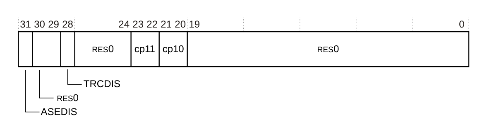

下表显示了 **CPACR** 的位分配。

| 位      | 名称  | 功能 |
| ------- | ----- | ---- |
| [31]    | ASEDIS | 禁用 Advanced SIMD 功能：<br>`0` 不导致任何指令变为 UNDEFINED。这是复位值。<br>`1` 所有属于 **Advanced SIMD** 但不属于浮点指令的指令编码均为 UNDEFINED。 |
| [30:29] | -     | 保留，RES0。 |
| [28]    | TRCDIS | 该字段为 RES0。Cortex®-R52+ 处理器不包含到跟踪宏单元寄存器的系统寄存器接口。 |
| [27:24] | -     | 保留，RES0。 |
| [23:22] | cp11⁵⁶ | 该字段的值被忽略。如果该字段编程为与 **cp10** 字段不同的值，则直接读取 **CPACR** 时该字段为 UNKNOWN。 |
| [21:20] | cp10⁵⁵ | 定义 **Advanced SIMD** 与浮点特性的访问权限。该字段可能的值为：<br>`0b00` 从 EL0 和 EL1 对 Advanced SIMD 与浮点寄存器或指令的访问为 UNDEFINED。这是复位值。<br>`0b01` 仅允许 EL1 访问。从 EL0 执行的软件对 Advanced SIMD 与浮点寄存器或指令的任何访问都会产生未定义指令异常。<br>`0b10` 保留。<br>`0b11` 该控制允许从 EL0 和 EL1 完全访问 **Advanced SIMD** 与浮点功能。 |
| [19:0]  | -     | 保留，RES0。 |

⁵⁵ 该字段控制的 Advanced SIMD 与浮点特性包括：

* 浮点指令。
* Advanced SIMD 指令，包括整数与浮点。
* Advanced SIMD 与浮点寄存器 D0-D31 及其作为 S0-S31 和 Q0-Q15 的视图。
* **FPSCR**、**FPSID**、**MVFR0**、**MVFR1**、**MVFR2**、**FPEXC** 系统寄存器。

⁵⁶ **cp10** 和 **cp11** 必须编程为相同的值。

要访问 **CPACR**：

```arm
MRC p15,0,<Rt>,c1,c0,2 ; 将 CPACR 读入 Rt
MCR p15,0,<Rt>,c1,c0,2 ; 将 Rt 写入 CPACR
```

### 3.2 辅助控制寄存器（Auxiliary Control Register）

该寄存器始终为 RES0。

### 3.3 辅助控制寄存器 2（Auxiliary Control Register 2）

该寄存器始终为 RES0。

### 3.4 辅助数据故障状态寄存器（Auxiliary Data Fault Status Register）

**ADFSR** 为进入 EL1 模式的数据中止（**Data Abort**）异常提供故障状态信息。该故障状态信息可与 **DFSR** 一起使用，以进一步对故障分类。

**使用限制**

该寄存器可通过下列方式访问：

| EL0 | EL1 | EL2 |
| --- | --- | --- |
| -   | RW  | RW  |

**陷阱与使能**

如果 **HCR.TVM** 设置为 **1**，则从 **EL1** 对此寄存器的写访问将被陷阱到 Hyp 模式。

如果 **HCR.TRVM** 设置为 **1**，则从 **EL1** 对此寄存器的读访问将被陷阱到 Hyp 模式。

如果 **HSTR.T5** 设置为 **1**，则从 **EL1** 对此寄存器的访问将被陷阱到 Hyp 模式。

**配置**

此寄存器在所有构建配置中都可用。

**属性**

**ADFSR** 是一个 32 位寄存器。

下图显示了 **ADFSR** 的位分配。


下表显示了 **ADFSR** 的位分配。

| 位     | 名称 | 功能 |
| ------ | ---- | ---- |
| [31:5] | -    | 保留，RES0。 |
| [4:2]  | PORT | 引起故障的存储器或端口：<br>`0b000` AXIM<br>`0b001` Flash<br>`0b010` LLPP<br>`0b011` 内部外设接口<br>`0b100` ATCM<br>`0b101` BTCM<br>`0b110` CTCM<br>`0b111` 存储器区域重叠、存储器端口不明确，或故障没有地址 |
| [1:0]  | TYPE | 故障类型：<br>`0b00` 其他错误（并非由于响应、ECC 或超时）<br>`0b01` 响应错误<br>`0b10` 数据 ECC 错误<br>`0b11` 超时错误 |

要访问 **ADFSR**：

```arm
MRC p15,0,<Rt>,c5,c1,0 ; 将 ADFSR 读入 Rt
```

### 3.5 辅助特性寄存器 0（Auxiliary Feature Register 0）

**ID_AFR0** 始终为 RES0。

### 3.6 辅助 ID 寄存器（Auxiliary ID Register）

**AIDR** 始终为 RES0。

### 3.7 辅助指令故障状态寄存器（Auxiliary Instruction Fault Status Register）

**AIFSR** 为进入 EL1 模式的预取中止（**Prefetch Abort**）异常提供故障状态信息。

**使用限制**

该寄存器可通过下列方式访问：

| EL0 | EL1 | EL2 |
| --- | --- | --- |
| -   | RW  | RW  |

**陷阱与使能**

如果 **HCR.TVM** 设置为 **1**，则从 **EL1** 对此寄存器的写访问将被陷阱到 Hyp 模式。

如果 **HCR.TRVM** 设置为 **1**，则从 **EL1** 对此寄存器的读访问将被陷阱到 Hyp 模式。

如果 **HSTR.T5** 设置为 **1**，则从 **EL1** 对此寄存器的访问将被陷阱到 Hyp 模式。

**配置**

此寄存器在所有构建配置中都可用。

**属性**

**AIFSR** 是一个 32 位寄存器。

下图显示了 **AIFSR** 的位分配。

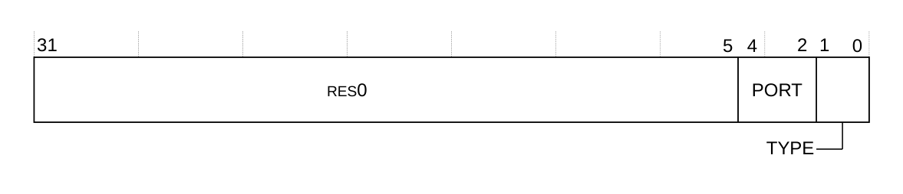

下表显示了 **AIFSR** 的位分配。

| 位     | 名称 | 功能 |
| ------ | ---- | ---- |
| [31:5] | -    | 保留，RES0。 |
| [4:2]  | PORT | 引起故障的存储器端口：<br>`0b000` AXIM<br>`0b001` Flash<br>`0b010` LLPP<br>`0b100` ATCM<br>`0b101` BTCM<br>`0b110` CTCM<br>`0b111` 存储器区域重叠、存储器端口不明确，或故障没有地址 |
| [1:0]  | TYPE | 故障类型：<br>`0b00` 其他错误（并非由于响应、ECC 或超时）<br>`0b01` 响应错误<br>`0b10` 数据 ECC 错误<br>`0b11` 超时错误 |

要访问 **AIFSR**：

```arm
MRC p15,0,<Rt>,c5,c1,1 ; 将 AIFSR 读入 Rt
MCR p15,0,<Rt>,c5,c1,1 ; 将 Rt 写入 AIFSR
```

### 3.8 辅助存储属性间接寄存器 0（Auxiliary Memory Attribute Indirection Register 0）

**AMAIR0** 始终为 RES0。

### 3.9 辅助存储属性间接寄存器 1（Auxiliary Memory Attribute Indirection Register 1）

**AMAIR1** 始终为 RES0。

### 3.10 分支预测器控制寄存器（Branch Predictor Control Register）

**IMP_BPCTLR** 提供用于禁用动态分支预测的软件控制。

**使用限制**

该寄存器可通过下列方式访问：

| EL0 | EL1 | EL2 |
| --- | --- | --- |
| -   | RW  | RW  |

**陷阱与使能**

如果 **HCR.TIDCP** 设置为 **1**，则从 **EL1** 对此寄存器的访问将被陷阱到 **EL2**。

**配置**

此寄存器在所有构建配置中都可用。

**属性**

**IMP_BPCTLR** 是一个 32 位寄存器。

下图显示了 **IMP_BPCTLR** 的位分配。

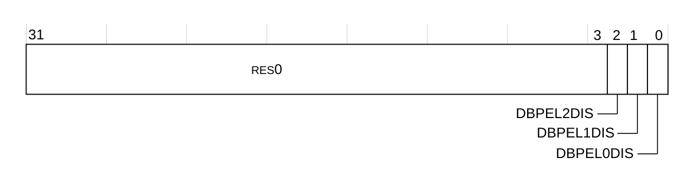

下表显示了 **IMP_BPCTLR** 的位分配。

| 位     | 名称      | 功能 |
| ------ | --------- | ---- |
| [31:3] | -         | 保留，RES0。 |
| [2]    | DBPEL2DIS | 在 **EL2** 运行时禁用动态分支预测器。可能的值为：<br>`0` 在 **EL2** 运行时使能动态分支预测器。<br>`1` 在 **EL2** 运行时禁用动态分支预测器。 |
| [1]    | DBPEL1DIS | 在 **EL1** 运行时禁用动态分支预测器。可能的值为：<br>`0` 在 **EL1** 运行时使能动态分支预测器。<br>`1` 在 **EL1** 运行时禁用动态分支预测器。 |
| [0]    | DBPEL0DIS | 在 **EL0** 运行时禁用动态分支预测器。可能的值为：<br>`0` 在 **EL0** 运行时使能动态分支预测器。<br>`1` 在 **EL0** 运行时禁用动态分支预测器。 |

这三个位字段的复位值取决于 **CFGSAFETYBOOTx** 引脚的值：

* 当该引脚为低电平时，复位值为 **0**。
* 当该引脚为高电平时，复位值为 **1**。

要访问 **IMP_BPCTLR**：

```arm
MRC p15, 1, <Rt>, c9, c1, 1 ; 将 IMP_BPCTLR 读入 Rt
MCR p15, 1, <Rt>, c9, c1, 1 ; 将 Rt 写入 IMP_BPCTLR
```

### 3.11 构建选项寄存器（Build Options Register）

**IMP_BUILDOPTR** 显示用于配置处理器的实现时构建配置选项的值。

**使用限制**

该寄存器可通过下列方式访问：

| EL0 | EL1 | EL2 |
| --- | --- | --- |
| -   | RO  | RO  |

**陷阱与使能**

没有影响该寄存器的陷阱与使能。

**配置**

此寄存器在所有构建配置中都可用。

**属性**

**IMP_BUILDOPTR** 是一个 32 位寄存器。

下图显示了 **IMP_BUILDOPTR** 的位分配。

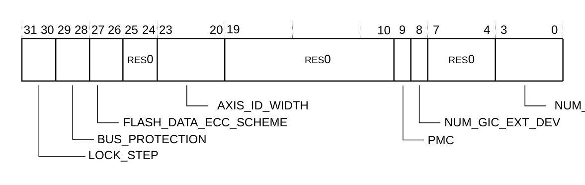

下表显示了 **IMP_BUILDOPTR** 的位分配。

| 位      | 名称                  | 功能 |
| ------- | --------------------- | ---- |
| [31:30] | LOCK_STEP             | 是否包含冗余逻辑、触发器和比较器，用于 DCLS：<br>`0` 不包含冗余逻辑。<br>`1` DCLS 配置。<br>`2` Split-Lock 配置。 |
| [29:28] | BUS_PROTECTION        | 指示实现了何种总线保护方案：<br>`0` 不包含总线保护。<br>`1` 仅包含信号完整性保护。<br>`2` 包含信号完整性保护与互连保护。<br>`3` 仅包含数据完整性保护。 |
| [27:26] | FLASH_DATA_ECC_SCHEME | Flash 存储器接口数据 ECC 块大小：<br>`1` 64 位块。<br>`2` 128 位块。 |
| [25:24] | -                     | 保留，RES0。 |
| [23:20] | AXIS_ID_WIDTH         | 返回 **0b1111**。 |
| [19:10] | -                     | 保留，RES0。 |
| [9]     | PMC                   | 对在线 MBIST 的支持：<br>`0` 无集成 PMC，使用外部在线 MBIST 接口。<br>`1` 集成 PMC，无外部在线 MBIST 接口。 |
| [8]     | NUM_GIC_EXT_DEV       | 指示 **GIC** 外部设备接口的数量。该值为 0 或 1。 |
| [7:4]   | -                     | 保留，RES0。 |
| [3:0]   | NUM_CORES             | 指示 Cortex®-R52+ 处理器中的内核数量，编码为内核数量减一。 |

要访问 **IMP_BUILDOPTR**：

```arm
MRC p15, 0, <Rt>, c15, c2, 0 ; 将 IMP_BUILDOPTR 读入 Rt
```

### 3.12 总线超时寄存器（Bus Timeout Register）

**IMP_BUSTIMEOUTR** 为对 **AXIM**、Flash 接口和 **LLPP** 的访问提供可编程的时间限制。

**使用限制**

该寄存器可通过下列方式访问：

| EL0 | EL1  | EL2 |
| --- | ---- | --- |
| -   | RW/RO | RW  |

当 **HACTLR.BUSTIMEOUTR** 为 **0** 时，在 **EL1** 对 **IMP_BUSTIMEOUTR** 的访问为只读（**RO**）。

**陷阱与使能**

如果 **HACTLR.BUSTIMEOUTR** 设置为 **0**，则从 **EL1** 对此寄存器的写访问将被陷阱到 **EL2**。

**配置**

此寄存器在所有构建配置中都可用。

**属性**

**IMP_BUSTIMEOUTR** 是一个 32 位寄存器。

下图显示了 **IMP_BUSTIMEOUTR** 的位分配。

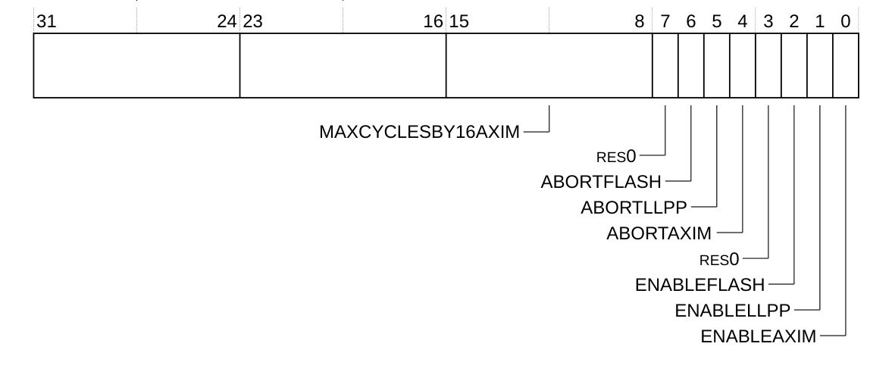

下表显示了 **IMP_BUSTIMEOUTR** 的位分配。

| 位      | 名称                | 功能 |
| ------- | ------------------- | ---- |
| [31:24] | MAXCYCLESBY16FLASH  | Flash 接口超时值，以周期数除以 16 表示 |
| [23:16] | MAXCYCLESBY16LLPP   | **LLPP** 超时值，以周期数除以 16 表示 |
| [15:8]  | MAXCYCLESBY16AXIM   | **AXIM** 接口超时值，以周期数除以 16 表示 |
| [7]     | -                   | 保留，RES0 |
| [6]     | ABORTFLASH          | 检测到 Flash 超时时，中止当前及后续的 Flash 访问 |
| [5]     | ABORTLLPP           | 检测到 **LLPP** 超时时，中止当前及后续的 **LLPP** 访问 |
| [4]     | ABORTAXIM           | 检测到 **AXIM** 超时时，中止当前及后续的 **AXIM** 访问 |
| [3]     | -                   | 保留，RES0 |
| [2]     | ENABLEFLASH         | Flash 接口的超时计数器使能 |
| [1]     | ENABLELLPP          | **LLPP** 的超时计数器使能 |
| [0]     | ENABLEAXIM          | **AXIM** 接口的超时计数器使能 |

当超时计数器使能时，Flash、**LLPP** 和 **AXIM** 接口超时值（**MAXCYCLESBY16FLASH**、**MAXCYCLESBY16LLPP** 和 **MAXCYCLESBY16AXIM**）不能为零。

要访问 **IMP_BUSTIMEOUTR**：

```arm
MRC p15,1,<Rt>,c15,c3,2 ; 将 IMP_BUSTIMEOUTR 读入 Rt
MCR p15,1,<Rt>,c15,c3,2 ; 将 Rt 写入 IMP_BUSTIMEOUTR
```

### 3.13 缓存级别 ID 寄存器（Cache Level ID Register）

**CLIDR** 标识每个级别所实现的缓存类型、缓存层次的一致性级别（**Level of Coherency**）和统一点级别（**Level of Unification**）。

**使用限制**

该寄存器可通过下列方式访问：

| EL0 | EL1 | EL2 |
| --- | --- | --- |
| -   | RO  | RO  |

**陷阱与使能**

如果 **HCR.TID2** 设置为 **1**，则从 **EL1** 对此寄存器的读取访问将被陷阱到 Hyp 模式。

如果 **HSTR.T0** 设置为 **1**，则从 **EL1** 对此寄存器的读取访问将被陷阱到 Hyp 模式。

**配置**

此寄存器在所有构建配置中都可用。

**属性**

**CLIDR** 是一个 32 位寄存器。

下图显示了 **CLIDR** 的位分配。

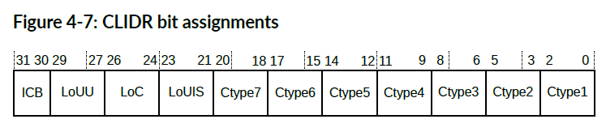

下表显示了 **CLIDR** 的位分配。

| 位      | 名称   | 功能 |
| ------- | ------ | ---- |
| [31:30] | ICB    | 内部缓存边界：<br>`0b00` 该机制中未公开。 |
| [29:27] | LoUU   | 指示缓存层次的统一单处理器级别（**Level of Unification Uniprocessor**）：<br>`0b001` 级别 1，如果实现了任一缓存。<br>`0b000` 级别 0，如果指令缓存和数据缓存都未实现。 |
| [26:24] | LoC    | 指示缓存层次的一致性级别（**Level of Coherency**）：<br>`0b001` 级别 1，如果实现了任一缓存。<br>`0b000` 级别 0，如果指令缓存和数据缓存都未实现。 |
| [23:21] | LoUIS  | 指示缓存层次的内部可共享统一点级别（**Level of Unification Inner Shareable**）：<br>`0b001` 级别 1，如果实现了任一缓存。<br>`0b000` 级别 0，如果指令缓存和数据缓存都未实现。 |
| [20:18] | Ctype7 | 如果处理器实现了 L7 缓存，则指示缓存类型：<br>`0b000` 未实现 L7 缓存。 |
| [17:15] | Ctype6 | 如果处理器实现了 L6 缓存，则指示缓存类型：<br>`0b000` 未实现 L6 缓存。 |
| [14:12] | Ctype5 | 如果处理器实现了 L5 缓存，则指示缓存类型：<br>`0b000` 未实现 L5 缓存。 |
| [11:9]  | Ctype4 | 如果处理器实现了 L4 缓存，则指示缓存类型：<br>`0b000` 未实现 L4 缓存。 |
| [8:6]   | Ctype3 | 如果处理器实现了 L3 缓存，则指示缓存类型：<br>`0b000` 未实现 L3 缓存。 |
| [5:3]   | Ctype2 | 如果处理器实现了 L2 缓存，则指示缓存类型：<br>`0b000` 未实现 L2 缓存。 |
| [2:0]   | Ctype1 | 指示 L1 上实现的缓存类型：<br>`0b000` 无缓存。<br>`0b001` 仅指令缓存。<br>`0b010` 仅数据缓存。<br>`0b011` 独立的指令缓存和数据缓存。 |

要访问 **CLIDR**：

```arm
MRC p15,1,<Rt>,c0,c0,1 ; 将 CLIDR 读入 Rt
```

### 3.14 缓存隔离控制寄存器（Cache Segregation Control Register）

**IMP_CSCTLR** 控制 **Flash** 与 **AXIM** 之间指令和数据缓存通道的隔离。

**使用限制**

该寄存器可通过下列方式访问：

| EL0 | EL1 | EL2 |
| --- | --- | --- |
| -   | RW  | RW  |

系统复位后，只有在使能缓存之前才允许写入 **IMP_CSCTLR**。这可确保在数据缓存或指令缓存使能之后，即使随后被禁用，缓存隔离控制也不会发生变化。

**陷阱与使能**

如果 **HCR.TIDCP** 设置为 **1**，则从 **EL1** 对此寄存器的访问将被陷阱到 **EL2**。

**配置**

此寄存器在所有构建配置中都可用。

**属性**

**IMP_CSCTLR** 是一个 32 位寄存器。

下图显示了 **IMP_CSCTLR** 的位分配。

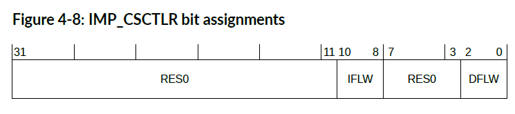

下表显示了 **IMP_CSCTLR** 的位分配。

| 位      | 名称 | 功能 |
| ------- | ---- | ---- |
| [31:11] | -    | 保留，RES0 |
| [10:8]  | IFLW | 指令缓存 Flash 通道 |
| [7:3]   | -    | 保留，RES0 |
| [2:0]   | DFLW | 数据缓存 Flash 通道 |

下表显示了 **IFLW** 和 **DFLW** 字段的编码。

| 值    | Flash 通道 | AXIM 通道 |
| ----- | ---------- | --------- |
| 0b000 | -          | 0-3       |
| 0b001 | 0          | 1-3       |
| 0b010 | 0-1        | 2-3       |
| 0b011 | 0-2        | 3         |
| 0b100 | 0-3        | -         |

要访问 **IMP_CSCTLR**：

```arm
MRC p15,1,<Rt>,c9,c1,0 ; 将 IMP_CSCTLR 读入 Rt
MCR p15,1,<Rt>,c9,c1,0 ; 将 Rt 写入 IMP_CSCTLR
```

### 3.15 缓存大小选择寄存器（Cache Size Selection Register）

**CSSELR** 通过指定所需的缓存级别和缓存类型（指令缓存或数据缓存）来选择当前 **CCSIDR**。

**使用限制**

该寄存器可通过下列方式访问：

| EL0 | EL1 | EL2 |
| --- | --- | --- |
| -   | RW  | RW  |

**陷阱与使能**

如果 **HCR.TID2** 设置为 **1**，则从 **EL1** 对此寄存器的访问将被陷阱到 Hyp 模式。

如果 **HSTR.T0** 设置为 **1**，则从 **EL1** 对此寄存器的访问将被陷阱到 Hyp 模式。

**配置**

此寄存器在所有构建配置中都可用。

**属性**

**CSSELR** 是一个 32 位寄存器。

下图显示了 **CSSELR** 的位分配。

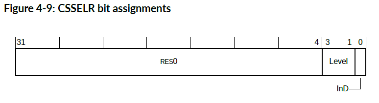

下表显示了 **CSSELR** 的位分配。

| 位     | 名称  | 功能 |
| ------ | ----- | ---- |
| [31:4] | -     | 保留，RES0。 |
| [3:1]  | Level | 所需缓存的缓存级别。该字段为只读（**RO**）：<br>`0b000` L1。 |
| [0]    | InD   | 指令非数据位：<br>`0` 数据缓存。<br>`1` 指令缓存。 |

要访问 **CSSELR**：

```arm
MRC p15, 2, <Rt>, c0, c0, 0 ; 将 CSSELR 读入 Rt
MCR p15, 2, <Rt>, c0, c0, 0 ; 将 Rt 写入 CSSELR
```

### 3.16 缓存类型寄存器（Cache Type Register）

**CTR** 提供有关缓存体系结构的信息。

**使用限制**

该寄存器可通过下列方式访问：

| EL0 | EL1 | EL2 |
| --- | --- | --- |
| -   | RO  | RO  |

**陷阱与使能**

如果 **HCR.TID2** 设置为 **1**，则从 **EL1** 对此寄存器的读取访问将被陷阱到 Hyp 模式。

如果 **HSTR.T0** 设置为 **1**，则从 **EL1** 对此寄存器的读取访问将被陷阱到 Hyp 模式。

**配置**

此寄存器在所有构建配置中都可用。

**属性**

**CTR** 是一个 32 位寄存器。

下图显示了 **CTR** 的位分配。

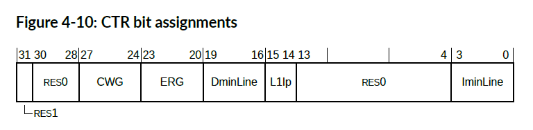

下表显示了 **CTR** 的位分配。

| 位      | 名称     | 功能 |
| ------- | -------- | ---- |
| [31]    | -        | 保留，RES1。 |
| [30:28] | -        | 保留，RES0。 |
| [27:24] | CWG      | 缓存写回颗粒：<br>`0x1` 缓存写回颗粒为 2 个字⁵⁷。 |
| [23:20] | ERG      | 独占预留颗粒。为加载独占（**Load-Exclusive**）和存储独占（**Store-Exclusive**）指令实现的预留颗粒最大大小的字数的以 2 为底的对数。<br>`0x4` 独占预留颗粒为 16 个字。 |
| [19:16] | DminLine | 处理器控制的所有数据和统一缓存中最小缓存行的字数的以 2 为底的对数：<br>`0x4` 最小数据缓存行大小为 16 个字。 |
| [15:14] | L1Ip     | L1 指令缓存策略。指示 L1 指令缓存的索引与标记策略：<br>`0b11` 物理索引物理标记（**Physically Indexed Physically Tagged，PIPT**）。 |
| [13:4]  | -        | 保留，RES0。 |
| [3:0]   | IminLine | 处理器控制的所有指令缓存中最小缓存行的字数的以 2 为底的对数。<br>`0x4` 最小指令缓存行大小为 16 个字。 |

⁵⁷ 在 Cortex®-R52+ 处理器中，缓存为写通（**Write-Through**）且不支持已修改缓存行。如果软件使用该字段确定 DMA 缓冲区对齐，则该值表示可以使用 64 位对齐的 DMA 缓冲区而不会带来缓存性能损失。

要访问 **CTR**：

```arm
MRC p15,0,<Rt>,c0,c0,1 ; 将 CTR 读入 Rt
```

### 3.17 配置基地址寄存器（Configuration Base Address Register）

**IMP_CBAR** 保存内存映射 **GIC Distributor** 寄存器的物理基地址。

**使用限制**

该寄存器可通过下列方式访问：

| EL0 | EL1 | EL2 |
| --- | --- | --- |
| -   | RO  | RO  |

**陷阱与使能**

没有影响该寄存器的陷阱与使能。

**配置**

此寄存器在所有构建配置中都可用。

**属性**

**IMP_CBAR** 是一个 32 位寄存器。

下图显示了 **IMP_CBAR** 的位分配。

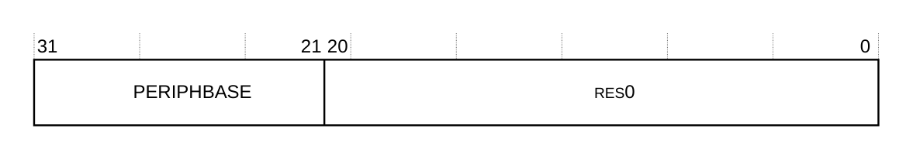

下表显示了 **IMP_CBAR** 的位分配。

| 位      | 名称       | 功能 |
| ------- | ---------- | ---- |
| [31:21] | PERIPHBASE | 内存映射外设基物理地址的高位。这些是内存映射外设存储区域的基物理地址的最高位。输入 **CFGPERIPHBASE[31:21]** 决定复位值。有关内存映射外设的更多信息，参见第 274 页的 8.12 Peripherals memory map |
| [20:0]  | -          | 保留，RES0。 |

要访问 **IMP_CBAR**：

```arm
MRC p15, 1, <Rt>, c15, c3, 0 ; 将 IMP_CBAR 读入 Rt
```

### 3.18 上下文 ID 寄存器（Context ID Register）

**CONTEXTIDR** 标识当前的进程标识符。

**使用限制**

该寄存器可通过下列方式访问：

| EL0 | EL1 | EL2 |
| --- | --- | --- |
| -   | RW  | RW  |

**陷阱与使能**

如果 **HCR.TVM** 设置为 **1**，则从 **EL1** 对此寄存器的写访问将被陷阱到 Hyp 模式。

如果 **HCR.TRVM** 设置为 **1**，则从 **EL1** 对此寄存器的读访问将被陷阱到 Hyp 模式。

如果 **HSTR.T13** 设置为 **1**，则从 **EL1** 对此寄存器的访问将被陷阱到 Hyp 模式。

**配置**

此寄存器在所有构建配置中都可用。

**属性**

**CONTEXTIDR** 是一个 32 位寄存器。

下图显示了 **CONTEXTIDR** 的位分配。

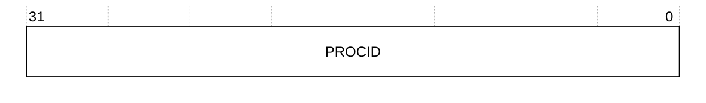

下表显示了 **CONTEXTIDR** 的位分配。

| 位     | 名称   | 功能 |
| ------ | ------ | ---- |
| [31:0] | PROCID | 进程标识符。该字段必须编程为标识当前进程的唯一值。该寄存器复位为 0。 |

要访问 **CONTEXTIDR**：

```arm
MRC p15, 0, <Rt>, c13, c0, 1 ; 将 CONTEXTIDR 读入 Rt
MCR p15, 0, <Rt>, c13, c0, 1 ; 将 Rt 写入 CONTEXTIDR
```

### 3.19 CPU 辅助控制寄存器（CPU Auxiliary Control Register）

**CPUACTLR** 提供处理器已实现的配置和控制选项。

**使用限制**

该寄存器可通过下列方式访问：

| EL0 | EL1   | EL2 |
| --- | ----- | --- |
| -   | RW/RO | RW  |

**CPUACTLR** 从 **EL2** 访问为 **RW**；当 **HACTLR.CPUACTLR** 置位时从 **EL1** 访问为 **RW**，当 **HACTLR.CPUACTLR** 清零时从 **EL1** 访问为 **RO**，且从 **EL0** 不可访问。

CPU 辅助控制寄存器只能在系统空闲时写入。《Arm® Architecture Reference Manual Supplement Armv8, for the Armv8-R AArch32 architecture profile》建议在上电复位之后、使能 **MPU** 之前写入该寄存器。

**注意：** 置位其中许多位可能导致代码性能显著下降。因此，除非 Arm 给出指示，否则建议不要修改该寄存器。

**陷阱与使能**

如果 **HACTLR.CPUACTLR** 设置为 **0**，则从 **EL1** 对此寄存器的写访问将被陷阱到 **EL2**。

**配置**

此寄存器在所有构建配置中都可用。

**属性**

参见第 67 页的表 4-17 64 位寄存器汇总。

下图显示了 **CPUACTLR** 的位分配。

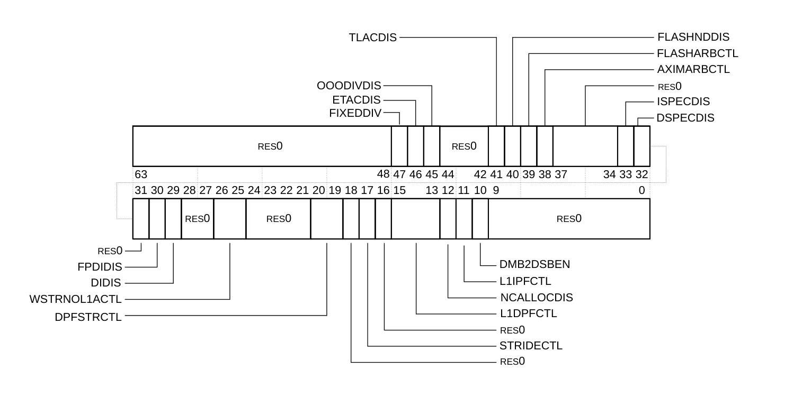

下表显示了 **CPUACTLR** 的位分配。

| 位      | 名称         | 功能 |
| ------- | ------------ | ---- |
| [63:48] | -            | 保留，RES0。 |
| [47]    | FIXEDDIV     | 使能整数除法指令的固定延迟。可能的值为：<br>`0` 禁用整数除法指令的固定延迟。这是复位值。<br>`1` 使能整数除法指令的固定延迟。 |
| [46]    | ETACDIS      | 禁用 PFU 异常目标地址缓存。可能的值为：<br>`0` 使能 PFU 异常目标地址缓存。这是复位值。<br>`1` 禁用 PFU 异常目标地址缓存。 |
| [45]    | OOODIVDIS    | 禁用除法指令的乱序完成。可能的值为：<br>`0` 使能除法指令的乱序完成。这是复位值。<br>`1` 禁用除法指令的乱序完成。 |
| [44:42] | -            | 保留，RES0。 |
| [41]    | TLACDIS      | 禁用存储单元（**Store Unit，STU**）的标记查找避免缓存。可能的值为：<br>`0` 使能 STU 标记查找避免缓存。这是复位值。<br>`1` 禁用 STU 标记查找避免缓存。 |
| [40]    | FLASHNDDIS   | 禁用 Flash 访问使用非 Flash 专用资源。可能的值为：<br>`0` 使能 Flash 访问使用非 Flash 专用资源。这是复位值。<br>`1` 禁用 Flash 访问使用非 Flash 专用资源。 |
| [39]    | FLASHARBCTL  | Flash 接口仲裁控制：<br>`0` 数据侧访问具有更高优先级。这是复位值。<br>`1` 指令侧访问具有更高优先级。 |
| [38]    | AXIMARBCTL   | **AXIM** 接口仲裁控制。可能的值为：<br>`0` 数据侧访问具有更高优先级。这是复位值。<br>`1` 指令侧访问具有更高优先级。 |
| [37:34] | -            | 保留，RES0。 |
| [33]    | ISPECDIS     | 禁用指令侧推测访问。可能的值为：<br>`0` 使能指令侧推测访问。<br>`1` 禁用指令侧推测访问。<br>复位值取决于 **CFGSAFETYBOOTx** 引脚的值：<br>* 当该引脚为低电平时，复位值为 **0**。<br>* 当该引脚为高电平时，复位值为 **1**。 |
| [32]    | DSPECDIS     | 禁用数据侧推测访问。可能的值为：<br>`0` 使能数据侧推测访问。<br>`1` 禁用数据侧推测访问。<br>复位值取决于 **CFGSAFETYBOOTx** 引脚的值：<br>* 当该引脚为低电平时，复位值为 **0**。<br>* 当该引脚为高电平时，复位值为 **1**。 |
| [31]    | -            | 保留，RES0。 |
| [30]    | FPDIDIS      | 禁用浮点双发射。可能的值为：<br>`0` 使能 **Advanced SIMD** 与浮点指令的双发射。这是复位值。<br>`1` 禁用 Advanced SIMD 与浮点指令的双发射。 |
| [29]    | DIDIS        | 禁用双发射（**Dual Issue**）。可能的值为：<br>`0` 使能指令双发射。这是复位值。<br>`1` 禁用所有指令的双发射。 |
| [28:27] | -            | 保留，RES0。 |
| [26:25] | WSTRNOL1ACTL | 写流式非 L1 分配阈值。可能的值为：<br>`0b00` 第 4 个连续流式缓存行不在 L1 缓存中分配。这是复位值。<br>`0b01` 第 64 个连续流式缓存行不在 L1 缓存中分配。<br>`0b10` 第 128 个连续流式缓存行不在 L1 缓存中分配。<br>`0b11` 禁用流式。所有写分配行都在 L1 缓存中分配。 |
| [24:21] | -            | 保留，RES0。 |
| [20:19] | DPFSTRCTL    | 独立数据预取流的数量。可能的值为：<br>`0b00` 1 个流。<br>`0b01` 2 个流。这是复位值。<br>`0b10` 3 个流。<br>`0b11` 4 个流。 |
| [18]    | -            | 保留，RES0。 |
| [17]    | STRIDECTL    | 使能步幅检测。可能的值为：<br>`0` 2 个连续步幅触发预取。这是复位值。<br>`1` 3 个连续步幅触发预取。 |
| [16]    | -            | 保留，RES0。 |
| [15:13] | L1DPFCTL     | L1 数据预取控制。该字段的值决定 L1 存储器系统中允许的最大未完成数据预取数量，不包括由软件加载或 **PLD** 指令产生的预取。可能的值为：<br>`0b000` 禁用预取。<br>`0b001` 允许 1 个未完成预取。<br>`0b010` 允许 2 个未完成预取。<br>`0b011` 允许 3 个未完成预取。<br>`0b100` 允许 4 个未完成预取。<br>`0b101` 允许 5 个未完成预取。<br>`0b110` 允许 6 个未完成预取。<br>`0b111` 允许 8 个未完成预取。<br>复位值取决于 **CFGSAFETYBOOTx** 引脚的值：<br>* 当该引脚为低电平时，复位值为 **0b101**。<br>* 当该引脚为高电平时，复位值为 **0b000**。 |
| [12]    | NCALLOCDIS   | 到微 MPU 的 MPU 区域分配。微 MPU 是存储在处理器数据侧逻辑本地的 MPU 区域缓存。可能的值为：<br>`0` 微 MPU 优先分配正常非缓存区域，以便可以更早地对这些区域进行推测读取。<br>`1` 所有存储器类型具有相同优先级。这是复位值。 |
| [11]    | L1IPFCTL     | L1 指令预取控制。可能的值为：<br>`0` 禁用预取。<br>`1` 使能预取。<br>复位值取决于 **CFGSAFETYBOOTx** 引脚的值：<br>* 当该引脚为低电平时，复位值为 **1**。<br>* 当该引脚为高电平时，复位值为 **0**。 |
| [10]    | DMB2DSBEN    | 使能数据存储屏障（**DMB**）表现为数据同步屏障（**DSB**）。可能的值为：<br>`0` 禁用 DMB 表现为 DSB。这是复位值。<br>`1` 使能 DMB 表现为 DSB。 |
| [9:0]   | -            | 保留，RES0。 |

要访问 **CPUACTLR**：

```arm
MRRC p15, 0, <Rt>, <Rt2>, c15 ; 将 CPU 辅助控制寄存器读入 <Rt>, <Rt2>
MCRR p15, 0, <Rt>, <Rt2>, c15 ; 将 <Rt>, <Rt2> 写入 CPU 辅助控制寄存器
```

### 3.20 当前缓存大小 ID 寄存器（Current Cache Size ID Register）

**CCSIDR** 提供有关缓存体系结构的信息。

**使用限制**

该寄存器可通过下列方式访问：

| EL0 | EL1 | EL2 |
| --- | --- | --- |
| -   | RO  | RO  |

**陷阱与使能**

当 **HCR.TID2** 或 **HSTR.T0** 置位时，在 **EL1** 对 **CCSIDR** 的读访问将被陷阱到 **EL2**。

**配置**

此寄存器在所有构建配置中都可用。

实现中为其可访问的每个缓存包含一个 **CCSIDR**。**CSSELR** 选择可访问的缓存大小 ID 寄存器。

**属性**

**CCSIDR** 是一个 32 位寄存器。

下图显示了 **CCSIDR** 的位分配。

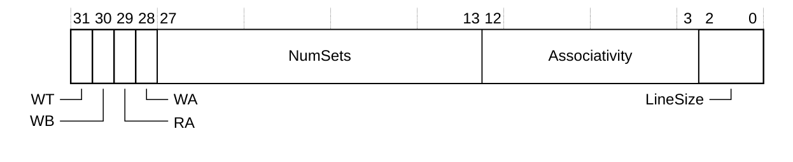

下表显示了 **CCSIDR** 的位分配。

| 位      | 名称          | 功能 |
| ------- | ------------- | ---- |
| [31]    | WT            | 指示对写通（**Write-Through**）的支持：<br>`0` 该缓存级别不支持写通。<br>`1` 该缓存级别支持写通。<br>**注意：** 选择指令缓存时返回值为 0。 |
| [30]    | WB            | 指示对写回（**Write-Back**）的支持：<br>`0` 该缓存级别不支持写回。 |
| [29]    | RA            | 指示对读分配（**Read-Allocation**）的支持：<br>`1` 该缓存级别支持读分配。 |
| [28]    | WA            | 指示对写分配（**Write-Allocation**）的支持：<br>`0` 该缓存级别不支持写分配。<br>`1` 该缓存级别支持写分配。<br>**注意：** 选择指令缓存时返回值为 0。 |
| [27:13] | NumSets       | 指示缓存中的组数减一。因此，值为 0 表示缓存中有 1 组。组数不一定是 2 的幂⁵⁸。 |
| [12:3]  | Associativity | 指示缓存的相联度：<br>`0x3` 该缓存为四路。 |
| [2:0]   | LineSize      | 指示缓存行中的字数：<br>`0b010` 每行 16 个字。 |

⁵⁸ 有关编码的更多信息，参见第 105 页的表 4-64 CCSIDR 编码。

下表显示了 **CCSIDR** 的各单独位字段和完整寄存器编码。**CSSELR** 决定选择哪个 **CCSIDR**。

| CSSELR | 缓存 | 大小 | 完整寄存器编码 | WT | WB | RA | WA | NumSets | Associativity | LineSize |
| --- | --- | --- | --- | --- | --- | --- | --- | --- | --- | --- |
| 0x0 | L1 数据缓存 | 4KB | 0xB001E01A | 1 | 0 | 1 | 1 | 0x000F | 0x003 | 0x2 |
| 0x0 | L1 数据缓存 | 8KB | 0xB003E01A | 1 | 0 | 1 | 1 | 0x001F | 0x003 | 0x2 |
| 0x0 | L1 数据缓存 | 16KB | 0xB007E01A | 1 | 0 | 1 | 1 | 0x003F | 0x003 | 0x2 |
| 0x0 | L1 数据缓存 | 32KB | 0xB00FE01A | 1 | 0 | 1 | 1 | 0x007F | 0x003 | 0x2 |
| 0x1 | L1 指令缓存 | 4KB | 0x2001E01A | 0 | 0 | 1 | 0 | 0x000F | 0x003 | 0x2 |
| 0x1 | L1 指令缓存 | 8KB | 0x2003E01A | 0 | 0 | 1 | 0 | 0x001F | 0x003 | 0x2 |
| 0x1 | L1 指令缓存 | 16KB | 0x2007E01A | 0 | 0 | 1 | 0 | 0x003F | 0x003 | 0x2 |
| 0x1 | L1 指令缓存 | 32KB | 0x200FE01A | 0 | 0 | 1 | 0 | 0x007F | 0x003 | 0x2 |

要访问 **CCSIDR**：

```arm
MRC p15, 1, <Rt>, c0, c0, 0 ; 将 CCSIDR 读入 Rt
```

### 3.21 数据缓存错误记录寄存器 0 和 1（Data Cache Error Record Registers 0 and 1）

**IMP_DCERR0** 和 **IMP_DCERR1** 寄存器指示检测到的数据缓存错误所对应的数据缓存 RAM 及缓存索引。

**使用限制**

这些寄存器可通过下列方式访问：

| EL0 | EL1   | EL2 |
| --- | ----- | --- |
| -   | RW/RO | RW  |

当 **HACTLR.ERR** 置位时，这些寄存器从 **EL1** 访问为 **RW**；当 **HACTLR.ERR** 清零时从 **EL1** 访问为 **RO**。

**陷阱与使能**

当 **HACTLR.ERR** 为 **0** 时，在 **EL1** 对这些寄存器的写访问将被陷阱到 **EL2**。

**配置**

这些寄存器在配置了数据缓存的所有内核上都可用。

**属性**

**IMP_DCERR0** 和 **IMP_DCERR1** 是 32 位寄存器。

下图显示了 **IMP_DCERR0** 和 **IMP_DCERR1** 的位分配。

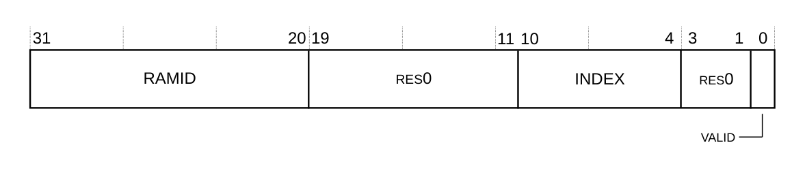

下表显示了 **IMP_DCERR0** 和 **IMP_DCERR1** 的位分配。

| 位      | 名称  | 功能 |
| ------- | ----- | ---- |
| [31:20] | RAMID | 指示 RAM 组：<br>RAMID[11] Tag RAM 3 组。<br>RAMID[10] Tag RAM 2 组。<br>RAMID[9] Tag RAM 1 组。<br>RAMID[8] Tag RAM 0 组。<br>RAMID[7] Data RAM 7 组。<br>RAMID[6] Data RAM 6 组。<br>RAMID[5] Data RAM 5 组。<br>RAMID[4] Data RAM 4 组。<br>RAMID[3] Data RAM 3 组。<br>RAMID[2] Data RAM 2 组。<br>RAMID[1] Data RAM 1 组。<br>RAMID[0] Data RAM 0 组。 |
| [19:11] | -     | 保留，RES0。 |
| [10:4]  | INDEX | 数据缓存索引。这是按缓存大小适当掩码后的地址位 [12:6]。 |
| [3:1]   | -     | 保留，RES0。 |
| [0]     | VALID | 寄存器内容有效。 |

对这些寄存器的写入是唯一的。如果将位 [1] 和位 [0] 置为 0，且寄存器保存的是可纠正错误的信息，则寄存器被清零。如果位 [1] 置为 1 且位 [0] 置为 0，则寄存器总是被清零。

要访问 **IMP_DCERR0**：

```arm
MRC p15,2,<Rt>,c15,c1,0 ; 将 IMP_DCERR0 读入 Rt
MCR p15,2,<Rt>,c15,c1,0 ; 将 Rt 写入 IMP_DCERR0
```

要访问 **IMP_DCERR1**：

```arm
MRC p15,2,<Rt>,c15,c1,1 ; 将 IMP_DCERR1 读入 Rt
MCR p15,2,<Rt>,c15,c1,1 ; 将 Rt 写入 IMP_DCERR1
```

### 3.22 数据故障地址寄存器（Data Fault Address Register）

**DFAR** 保存引起最近一次数据故障（仅同步）或未被取到 Hyp 模式的观察点命中的出错地址。

**使用限制**

该寄存器可通过下列方式访问：

| EL0 | EL1 | EL2 |
| --- | --- | --- |
| -   | RW  | RW  |

**陷阱与使能**

从 **EL1** 对 **DFAR** 的读访问和写访问分别根据 **HCR.TRVM** 和 **HCR.TVM** 被陷阱到 **EL2**。

**配置**

此寄存器在所有构建配置中都可用。

**属性**

**DFAR** 是一个 32 位寄存器。

下图显示了 **DFAR** 的位分配。


下表显示了 **DFAR** 的位分配。

| 位     | 名称 | 功能 |
| ------ | ---- | ---- |
| [31:0] | VA   | 同步数据中止异常的出错地址 |

要访问 **DFAR**：

```arm
MRC p15, 0, <Rt>, c6, c0, 0 ; 将 DFAR 读入 Rt
MCR p15, 0, <Rt>, c6, c0, 0 ; 将 Rt 写入 DFAR
```

### 3.23 数据故障状态寄存器（Data Fault Status Register）

**DFSR** 保存最近一次数据故障（同步或异步）或未被取到 Hyp 模式的观察点命中的状态信息。

**使用限制**

该寄存器可通过下列方式访问：

| EL0 | EL1 | EL2 |
| --- | --- | --- |
| -   | RW  | RW  |

**陷阱与使能**

从 **EL1** 对 **DFSR** 的读访问和写访问分别根据 **HCR.TRVM** 和 **HCR.TVM** 被陷阱到 **EL2**。

**配置**

此寄存器在所有构建配置中都可用。

**属性**

**DFSR** 是一个 32 位寄存器。

下图显示了 **DFSR** 的位分配。

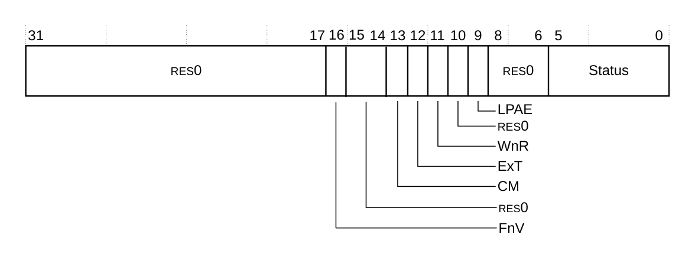

下表显示了 **DFSR** 的位分配。

| 位      | 名称   | 功能 |
| ------- | ------ | ---- |
| [31:17] | -      | 保留，RES0。 |
| [16]    | FnV    | 该字段为 RES0。 |
| [15:14] | -      | 保留，RES0。 |
| [13]    | CM     | 缓存维护故障。对于同步故障，该位指示是否由缓存维护操作产生了故障：<br>`0` 中止并非由缓存维护操作引起。<br>`1` 中止由缓存维护操作引起。 |
| [12]    | ExT    | 外部中止类型。该字段指示中止是由 **AXI Decode** 错误还是 **Slave** 错误引起的：<br>`0` 外部中止标记为 **DECERR**。<br>`1` 外部中止标记为 **SLVERR**。 |
| [11]    | WnR    | 写非读位。该字段指示引起中止的是写访问还是读访问：<br>`0` 中止由读访问引起。<br>`1` 中止由写访问引起。<br>对于 **coproc==0b1111** 的缓存维护操作（包括地址转换操作）上的故障，该位总是返回值 1。 |
| [10]    | -      | 保留，RES0。 |
| [9]     | LPAE   | 该字段为 RES1。 |
| [8:6]   | -      | 保留，RES0。 |
| [5:0]   | Status | 故障状态位。该字段指示产生的异常类型。未列出的任何编码均为保留。<br>`0b000100` 转换故障，级别 0。<br>`0b001100` 权限故障，级别 0。<br>`0b010000` 同步外部中止。<br>`0b010001` 异步外部中止。<br>`0b011000` 存储器访问同步奇偶校验错误⁵⁹。<br>`0b011001` 存储器访问异步奇偶校验错误⁵⁹。<br>`0b100001` 对齐故障。<br>`0b100010` 调试事件。<br>`0b110101` 不支持的独占访问故障。 |

⁵⁹ 奇偶校验是通用体系结构术语。这是用于存储器 ECC 和总线保护错误的取值，这些错误会产生中止。

要访问 **DFSR**：

```arm
MRC p15, 0, <Rt>, c5, c0, 0 ; 将 DFSR 读入 Rt
MCR p15, 0, <Rt>, c5, c0, 0 ; 将 Rt 写入 DFSR
```

### 3.24 调试特性寄存器 0（Debug Feature Register 0）

**ID_DFR0** 提供有关调试系统的顶层信息。

**使用限制**

该寄存器可通过下列方式访问：

| EL0 | EL1 | EL2 |
| --- | --- | --- |
| -   | RO  | RO  |

必须与 **Main ID** 寄存器 **MIDR** 一起解释。

**陷阱与使能**

当 **HCR.TID3** 或 **HSTR.T0** 置位时，在 **EL1** 对 **ID_DFR0** 的读访问将被陷阱到 **EL2**。

**配置**

此寄存器在所有构建配置中都可用。

**属性**

**ID_DFR0** 是一个 32 位寄存器。

下图显示了 **ID_DFR0** 的位分配。

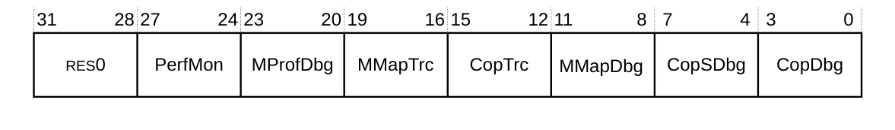

下表显示了 **ID_DFR0** 的位分配。

| 位      | 名称     | 功能 |
| ------- | -------- | ---- |
| [31:28] | -        | 保留，RES0。 |
| [27:24] | PerfMon  | 指示对性能监视模型的支持：<br>`0b0011` 支持性能监视单元版本 3（**PMUv3**）系统寄存器。 |
| [23:20] | MProfDbg | 指示对 M profile 处理器的内存映射调试模型的支持：<br>`0b0000` 处理器不支持 M profile 调试体系结构。 |
| [19:16] | MMapTrc  | 指示对内存映射跟踪模型的支持：<br>`0b0001` 支持 Arm 跟踪体系结构，具有内存映射访问。<br>在跟踪寄存器中，**TRCIDR0-13** 提供了有关该实现的更多信息。 |
| [15:12] | CopTrc   | 指示对基于系统寄存器的跟踪模型的支持：<br>`0b0000` 处理器不支持具有 **coproc==0b1110** 访问的 Arm 跟踪体系结构。 |
| [11:8]  | MMapDbg  | 该字段为 RES0。 |
| [7:4]   | CopSDbg  | 该字段为 RES0。 |
| [3:0]   | CopDbg   | 指示对基于系统寄存器的调试模型的支持：<br>`0b0110` 处理器支持具有 **coproc==0b1110** 访问的 v8 调试体系结构。 |

要访问 **ID_DFR0**：

```arm
MRC p15,0,<Rt>,c0,c1,2 ; 将 ID_DFR0 读入 Rt
```

### 3.25 EL0 读写软件线程 ID 寄存器（EL0 Read/Write Software Thread ID Register）

**TPIDRURW** 寄存器提供一个位置，供在 **EL0** 执行的软件存储线程标识信息，用于操作系统管理目的。

**使用限制**

该寄存器可通过下列方式访问：

| EL0 | EL1 | EL2 |
| --- | --- | --- |
| RW  | RW  | RW  |

**陷阱与使能**

当 **HSTR.T13** 置位时，**EL0** 和 **EL1** 对 **TPIDRURW** 的访问将被陷阱到 **EL2**。

**配置**

此寄存器在所有构建配置中都可用。

**属性**

**TPIDRURW** 是一个 32 位寄存器。

下图显示了 **TPIDRURW** 的位分配。


下表显示了 **TPIDRURW** 的位分配。

| 位     | 名称      | 功能 |
| ------ | --------- | ---- |
| [31:0] | Thread ID | 由在 **EL0** 运行的软件存储的线程标识信息。<br>更多信息，参见《Arm® Architecture Reference Manual Supplement Armv8, for the Armv8-R AArch32 architecture profile》。 |

要访问 **TPIDRURW**：

```arm
MRC p15, 0, <Rt>, c13, c0, 2 ; 将 TPIDRURW 读入 Rt
MCR p15, 0, <Rt>, c13, c0, 2 ; 将 Rt 写入 TPIDRURW
```

### 3.26 EL0 只读软件线程 ID 寄存器（EL0 Read-Only Software Thread ID Register）

**TPIDRURO** 寄存器提供一个位置，供在 **EL1** 或更高异常级别执行的软件存储对 **EL0** 执行的软件可见的线程标识信息，用于操作系统管理目的。

**使用限制**

该寄存器可通过下列方式访问：

| EL0 | EL1 | EL2 |
| --- | --- | --- |
| RO  | RW  | RW  |

**陷阱与使能**

当 **HSTR.T13** 置位时，**EL0** 和 **EL1** 对 **TPIDRURO** 的访问将被陷阱到 **EL2**。

**配置**

此寄存器在所有构建配置中都可用。

**属性**

**TPIDRURO** 是一个 32 位寄存器。

下图显示了 **TPIDRURO** 的位分配。


下表显示了 **TPIDRURO** 的位分配。

| 位     | 名称      | 功能 |
| ------ | --------- | ---- |
| [31:0] | Thread ID | 由在 **EL1** 运行的软件存储的线程标识信息。<br>更多信息，参见《Arm® Architecture Reference Manual Supplement Armv8, for the Armv8-R AArch32 architecture profile》。 |

要访问 **TPIDRURO**：

```arm
MRC p15, 0, <Rt>, c13, c0, 3 ; 将 TPIDRURO 读入 Rt
MCR p15, 0, <Rt>, c13, c0, 3 ; 将 Rt 写入 TPIDRURO
```

### 3.27 EL1 软件线程 ID 寄存器（EL1 Software Thread ID Register）

**TPIDRPRW** 寄存器提供一个位置，供在 **EL1** 或更高异常级别执行的软件存储对 **EL0** 执行的软件不可见的线程标识信息。这用于操作系统管理目的。

**使用限制**

该寄存器可通过下列方式访问：

| EL0 | EL1 | EL2 |
| --- | --- | --- |
| -   | RW  | RW  |

**陷阱与使能**

当 **HSTR.T13** 置位时，**EL1** 对 **TPIDRPRW** 的访问将被陷阱到 **EL2**。

**配置**

此寄存器在所有构建配置中都可用。

**属性**

**TPIDRPRW** 是一个 32 位寄存器。

下图显示了 **TPIDRPRW** 的位分配。

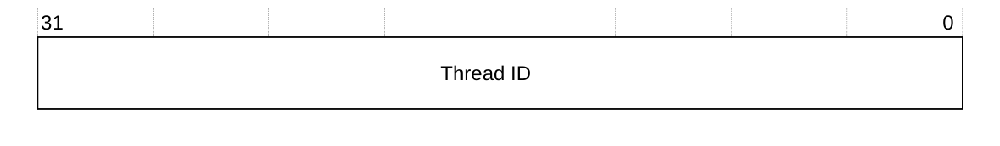

下表显示了 **TPIDRPRW** 的位分配。

| 位     | 名称      | 功能 |
| ------ | --------- | ---- |
| [31:0] | Thread ID | 由在 **EL1** 运行的软件存储的线程标识信息。<br>更多信息，参见《Arm® Architecture Reference Manual Supplement Armv8, for the Armv8-R AArch32 architecture profile》。 |

要访问 **TPIDRPRW**：

```arm
MRC p15, 0, <Rt>, c13, c0, 4 ; 将 TPIDRPRW 读入 Rt
MCR p15, 0, <Rt>, c13, c0, 4 ; 将 Rt 写入 TPIDRPRW
```

### 3.28 FCSE 进程 ID 寄存器（FCSE Process ID Register）

Armv8-R AArch32 废弃了 FCSE 功能。在 Armv8-R AArch32 中，**FCSEIDR** 表现为 **RAZ/WI**。

### 3.29 Flash 错误记录寄存器 0 和 1（Flash Error Record Registers 0 and 1）

**IMP_FLASHERR0** 和 **IMP_FLASHERR1** 寄存器指示检测到的 Flash 数据错误的类型和地址索引。

**使用限制**

该寄存器可通过下列方式访问：

| EL0 | EL1   | EL2 |
| --- | ----- | --- |
| -   | RW/RO | RW  |

当 **HACTLR.ERR** 置位时，该寄存器从 **EL1** 访问为 **RW**；当 **HACTLR.ERR** 清零时从 **EL1** 访问为 **RO**。

**陷阱与使能**

当 **HACTLR.ERR** 为 **0** 时，在 **EL1** 对这些寄存器的写访问将被陷阱到 **EL2**。

**配置**

此寄存器在所有构建配置中都可用。

**属性**

**IMP_FLASHERR0** 和 **IMP_FLASHERR1** 是 32 位寄存器。

下图显示了 **IMP_FLASHERR0** 和 **IMP_FLASHERR1** 的位分配。

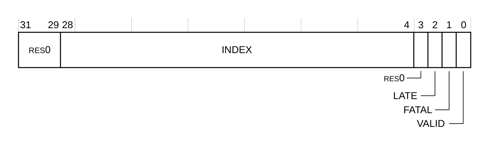

下表显示了 **IMP_FLASHERR0** 和 **IMP_FLASHERR1** 的位分配。

| 位     | 名称  | 功能 |
| ------ | ----- | ---- |
| [31:29] | -    | 保留，RES0。 |
| [28:4] | INDEX | 存储器中的索引。这对应于访问地址的位 [25:1]。 |
| [3]    | -     | 保留，RES0。 |
| [2]    | LATE  | 记录的错是延迟（**late**）错误。 |
| [1]    | FATAL | 记录的错误为致命或可纠正：<br>`0` 可纠正。<br>`1` 致命。 |
| [0]    | VALID | 寄存器内容有效。 |

要访问 **IMP_FLASHERR0**：

```arm
MRC p15,2,<Rt>,c15,c3,0 ; 将 IMP_FLASHERR0 读入 Rt
MCR p15,2,<Rt>,c15,c3,0 ; 将 Rt 写入 IMP_FLASHERR0
```

要访问 **IMP_FLASHERR1**：

```arm
MRC p15,2,<Rt>,c15,c3,1 ; 将 IMP_FLASHERR1 读入 Rt
MCR p15,2,<Rt>,c15,c3,1 ; 将 Rt 写入 IMP_FLASHERR1
```

对这些寄存器的写入是唯一的。如果将位 [1] 和位 [0] 置为 0，且寄存器保存的是可纠正错误的信息，则寄存器被清零。如果位 [1] 置为 1 且位 [0] 置为 0，则寄存器总是被清零。

**相关参考**

总线保护（第 272 页）。

### 3.30 Flash 接口区域寄存器（Flash Interface Region Register）

**IMP_FLASHIFREGIONR** 指示 Flash 接口区域的基地址。它提供使能和禁用 Flash 接口的控制。

**使用限制**

该寄存器可通过下列方式访问：

| EL0 | EL1   | EL2 |
| --- | ----- | --- |
| -   | RW/RO | RW  |

当 **HACTLR.FLASHIFREGIONR** 为 **1** 时，从 **EL1** 对 **IMP_FLASHIFREGIONR** 的访问为 **RW**；当 **HACTLR.FLASHIFREGIONR** 为 **0** 时为 **RO**。

**陷阱与使能**

当 **HCR.TIDCP** 置位时，**EL1** 对 **IMP_FLASHIFREGIONR** 的访问将被陷阱到 **EL2**。

**配置**

此寄存器在所有构建配置中都可用。

**属性**

**IMP_FLASHIFREGIONR** 是一个 32 位寄存器。

下图显示了 **IMP_FLASHIFREGIONR** 的位分配。

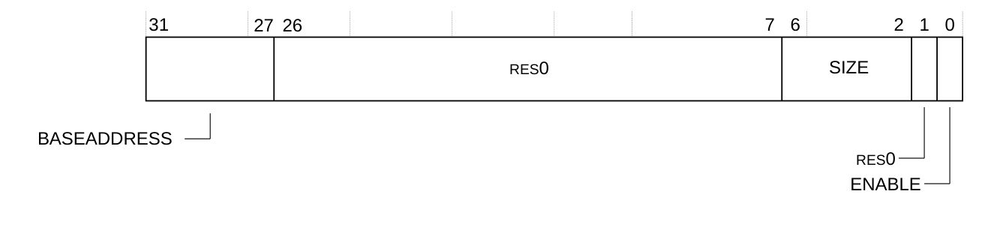

下表显示了 **IMP_FLASHIFREGIONR** 的位分配。

| 位      | 名称        | 功能 |
| ------- | ----------- | ---- |
| [31:27] | BASEADDRESS | 指示输入信号 **CFGFLASHBASEADDR[31:27]** 上的 Flash 接口区域基地址的高位。 |
| [26:7]  | -           | 保留，RES0。 |
| [6:2]   | SIZE        | Flash 接口区域大小。参见第 116 页的表 4-83 IMP_FLASHIFREGION.SIZE 支持的值。 |
| [1]     | -           | 保留，RES0。 |
| [0]     | ENABLE      | 使能 Flash 接口。复位时设置为输入信号 **CFGFLASHENx**。 |

下表显示了支持的 Flash 接口区域大小。

| SIZE 值  | Flash 接口区域大小 |
| -------- | ------------------ |
| 0b00000  | 0KB（无 Flash 区域）。 |
| 0b10010  | 128MB |

要访问 **IMP_FLASHIFREGIONR**：

```arm
MRC p15,0,<Rt>,c15,c0,1 ; 将 IMP_FLASHIFREGIONR 读入 Rt
MCR p15,0,<Rt>,c15,c0,1 ; 将 Rt 写入 IMP_FLASHIFREGIONR
```

### 3.31 Hyp 架构特性陷阱寄存器（Hyp Architectural Feature Trap Register）

**HCPTR** 控制将 **EL1** 或更低级别的 **Advanced SIMD** 与浮点功能访问陷阱到 **EL2**。它还控制从 **EL2** 对该功能的访问。

**使用限制**

该寄存器可通过下列方式访问：

| EL0 | EL1 | EL2 |
| --- | --- | --- |
| -   | -   | RW  |

**陷阱与使能**

当 **HSTR.T1** 置位时，**EL1** 对 **HCPTR** 的访问将被陷阱到 **EL2**。

**配置**

此寄存器在所有构建配置中都可用。

**属性**

**HCPTR** 是一个 32 位寄存器。

下图显示了 **HCPTR** 的位分配。

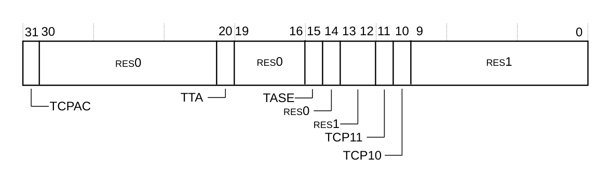

下表显示了 **HCPTR** 的位分配。

| 位      | 名称  | 功能 |
| ------- | ----- | ---- |
| [31]    | TCPAC | 陷阱 **CPACR** 访问。该位可能的值为：<br>`0` 对 CPACR 访问没有影响。<br>`1` 将有效的 **EL1** CPACR 访问陷阱到 **EL2**。<br>复位值为 0。 |
| [30:21] | -     | 保留，RES0。 |
| [20]    | TTA   | 将到所有已实现跟踪寄存器的系统寄存器访问陷阱到 **EL2**。该实现不包含到跟踪宏单元寄存器的系统寄存器接口，因此该值为 RES0。 |
| [19:16] | -     | 保留，RES0。 |
| [15]    | TASE  | 当 **HCPTR.TCP10** 的值为 **0** 时，将 **Advanced SIMD** 指令陷阱到 **EL2**。该位可能的值为：<br>`0` 该控制对 Advanced SIMD 指令的执行没有影响。<br>`1` 当 **HCPTR.TCP10** 的值为 **0** 时，执行 Advanced SIMD 指令的任何尝试都被陷阱到 **EL2**，除非它被 CPACR 或 NSACR 控制陷阱到 **EL1**。被陷阱的指令会产生：<br>&nbsp;&nbsp;• 若异常从 EL0 取到 EL1，则产生 Hyp 陷阱异常。<br>&nbsp;&nbsp;• 若异常在 EL2 中取到 EL2，则产生未定义指令异常。<br>当 **HCPTR.TCP10** 的值为 1 时，该字段的值被忽略。<br>复位值为 0。 |
| [14]    | -     | 保留，RES0。 |
| [13:12] | -     | 保留，RES1。 |
| [11]    | TCP11 | 该字段的值被忽略。如果该字段编程为与 **TCP10** 位不同的值，则直接读取 **HCPTR** 时该字段为 UNKNOWN。 |
| [10]    | TCP10 | 将 **Advanced SIMD** 与浮点功能的访问陷阱到 **EL2**。该位可能的值为：<br>`0` 该控制对 Advanced SIMD 与浮点功能的访问没有影响。<br>`1` 对 Advanced SIMD 与浮点功能的任何访问尝试都被陷阱到 **EL2**，除非它被 CPACR 或 NSACR 控制陷阱到 **EL1**。被陷阱的指令会产生：<br>&nbsp;&nbsp;• 若异常从 EL0 取到 EL1，则产生 Hyp 陷阱异常。<br>&nbsp;&nbsp;• 若异常在 EL2 中取到 EL2，则产生未定义指令异常。<br>复位值为 0。 |
| [9:0]   | -     | 保留，RES1。 |

要访问 **HCPTR**：

```arm
MRC p15,4,<Rt>,c1,c1,2 ; 将 HCPTR 读入 Rt
MCR p15,4,<Rt>,c1,c1,2 ; 将 Rt 写入 HCPTR
```

### 3.32 Hyp 辅助配置寄存器（Hyp Auxiliary Configuration Register）

**HACR** 寄存器始终为 RES0。

### 3.33 Hyp 辅助控制寄存器（Hyp Auxiliary Control Register）

**HACTLR** 控制将 **EL1** 执行的 Cortex®-R52+ 特定系统寄存器访问陷阱到 **EL2**。

**使用限制**

该寄存器可通过下列方式访问：

| EL0 | EL1 | EL2 |
| --- | --- | --- |
| -   | -   | RW  |

**陷阱与使能**

当 **HSTR.T1** 置位时，**EL1** 对 **HACTLR** 的访问将被陷阱到 **EL2**。

**配置**

此寄存器在所有构建配置中都可用。

**属性**

**HACTLR** 是一个 32 位寄存器。

下图显示了 **HACTLR** 的位分配。

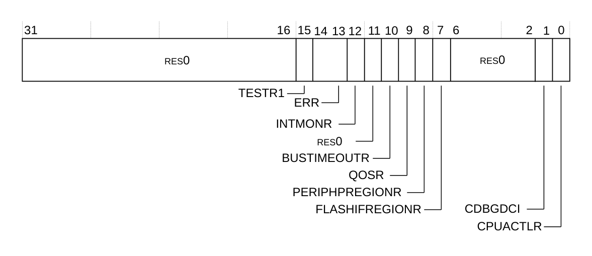

下表显示了 **HACTLR** 的位分配。

| 位      | 名称            | 功能 |
| ------- | --------------- | ---- |
| [31:16] | -               | 保留，RES0。 |
| [15]    | TESTR1          | 控制 **EL0** 和 **EL1** 对 **IMP_TESTR1** 的访问：<br>`0` 陷阱 EL0 和 EL1 的写访问。<br>`1` 使能 EL0 和 EL1 的访问。 |
| [14]    | -               | 保留，RES0。 |
| [13]    | ERR             | 控制对 **IMP_DCERR0**、**IMP_DCERR1**、**IMP_ICERR0**、**IMP_ICERR1**、**IMP_TCMERR0**、**IMP_TCMERR1**、**IMP_FLASHERR0** 和 **IMP_FLASHERR1** 寄存器的访问：<br>`0` 陷阱 EL1 对这些寄存器的写访问。<br>`1` 使能 EL1 对这些寄存器的访问。 |
| [12]    | INTMONR         | 控制 **EL1** 对 **IMP_INTMONR** 的访问：<br>`0` 陷阱 EL1 的写访问。<br>`1` 使能 EL1 的访问。 |
| [11]    | -               | 保留，RES0。 |
| [10]    | BUSTIMEOUTR     | 控制 **EL1** 对 **IMP_BUSTIMEOUTR** 的访问：<br>`0` 陷阱 EL1 的写访问。<br>`1` 使能 EL1 的访问。 |
| [9]     | QOSR            | 控制 **EL1** 对 **QOSR** 的访问：<br>`0` 陷阱 EL1 的写访问。<br>`1` 使能 EL1 的访问。 |
| [8]     | PERIPHPREGIONR  | 控制 **EL1** 对 **IMP_PERIPHPREGIONR** 的访问：<br>`0` 陷阱 EL1 的写访问。<br>`1` 使能 EL1 的访问。 |
| [7]     | FLASHIFREGIONR  | 控制 **EL1** 对 **IMP_FLASHIFREGIONR** 的访问：<br>`0` 陷阱 EL1 的写访问。<br>`1` 使能 EL1 的访问。 |
| [6:2]   | -               | 保留，RES0。 |
| [1]     | CDBGDCI         | 控制 **EL1** 对 **CDBGDCI** 的访问：<br>`0` 陷阱 EL1 的写访问。<br>`1` 使能 EL1 的访问。 |
| [0]     | CPUACTLR        | **IMP_CPUACTLR** 写访问控制。可能的值为：<br>`0` 陷阱 EL1 的写访问。这是复位值。<br>`1` 该寄存器可从 EL1 写入访问。 |

要访问 **HACTLR**：

```arm
MRC p15,4,<Rt>,c1,c0,1 ; 将 HACTLR 读入 Rt
MCR p15,4,<Rt>,c1,c0,1 ; 将 Rt 写入 HACTLR
```

### 3.34 Hyp 辅助控制寄存器 2（Hyp Auxiliary Control Register 2）

该寄存器始终为 **RAZ/WI**。

### 3.35 Hyp 辅助数据故障状态寄存器（Hyp Auxiliary Data Fault Status Register）

**HADFSR** 为取到 Hyp 模式的数据中止异常提供附加的异常综合信息。

**使用限制**

该寄存器可通过下列方式访问：

| EL0 | EL1 | EL2 |
| --- | --- | --- |
| -   | -   | RW  |

**陷阱与使能**

从 **EL1** 对 **HADFSR** 的读访问和写访问分别根据 **HCR.TRVM** 和 **HCR.TVM** 被陷阱到 **EL2**。

**配置**

此寄存器在所有构建配置中都可用。

**属性**

**HADFSR** 是一个 32 位寄存器。

下图显示了 **HADFSR** 的位分配。

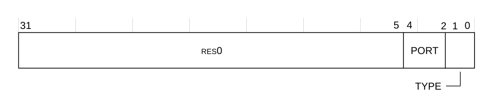

下表显示了 **HADFSR** 的位分配。

| 位     | 名称 | 功能 |
| ------ | ---- | ---- |
| [31:5] | -    | 保留，RES0 |
| [4:2]  | PORT | 引起故障的存储器端口：<br>`0b000` AXIM<br>`0b001` Flash<br>`0b010` LLPP<br>`0b011` 内部外设接口<br>`0b100` ATCM<br>`0b101` BTCM<br>`0b110` CTCM<br>`0b111` 存储器区域重叠、存储器端口不明确，或故障没有地址 |
| [1:0]  | TYPE | 故障类型：<br>`0b00` 其他错误（并非由于响应、ECC 或超时）<br>`0b01` 响应错误<br>`0b10` 数据 ECC 错误<br>`0b11` 超时错误 |

要访问 **HADFSR**：

```arm
MRC p15,4,<Rt>,c5,c1,0 ; 将 HADFSR 读入 Rt
MCR p15,4,<Rt>,c5,c1,0 ; 将 Rt 写入 HADFSR
```

### 3.36 Hyp 辅助指令故障状态寄存器（Hyp Auxiliary Instruction Fault Status Register）

**HAIFSR** 为取到 Hyp 模式的预取中止异常提供附加的异常综合信息。

**使用限制**

该寄存器可通过下列方式访问：

| EL0 | EL1 | EL2 |
| --- | --- | --- |
| -   | -   | RW  |

**陷阱与使能**

从 **EL1** 对 **HAIFSR** 的读访问和写访问分别根据 **HCR.TRVM** 和 **HCR.TVM** 被陷阱到 **EL2**。

**配置**

此寄存器在所有构建配置中都可用。

**属性**

**HAIFSR** 是一个 32 位寄存器。

下图显示了 **HAIFSR** 的位分配。


下表显示了 **HAIFSR** 的位分配。

| 位     | 名称 | 功能 |
| ------ | ---- | ---- |
| [31:5] | -    | 保留，RES0 |
| [4:2]  | PORT | 引起故障的存储器端口：<br>`0b000` AXIM<br>`0b001` Flash<br>`0b010` LLPP<br>`0b100` ATCM<br>`0b101` BTCM<br>`0b110` CTCM<br>`0b111` 存储器区域重叠、存储器端口不明确，或故障没有地址 |
| [1:0]  | TYPE | 故障类型：<br>`0b00` 其他错误（并非由于响应、ECC 或超时）<br>`0b01` 响应错误<br>`0b10` 数据 ECC 错误<br>`0b11` 超时错误 |

要访问 **HAIFSR**：

```arm
MRC p15,4,<Rt>,c5,c1,1 ; 将 HAIFSR 读入 Rt
MCR p15,4,<Rt>,c5,c1,1 ; 将 Rt 写入 HAIFSR
```

### 3.37 Hyp 辅助存储属性间接寄存器 0（Hyp Auxiliary Memory Attribute Indirection Register 0）

**HAMAIR0** 始终为 RES0。

### 3.38 Hyp 辅助存储属性间接寄存器 1（Hyp Auxiliary Memory Attribute Indirection Register 1）

**HAMAIR1** 始终为 RES0。

### 3.39 Hyp 配置寄存器（Hyp Configuration Register）

**HCR** 提供虚拟化配置控制，其中包括定义各种操作是否被陷阱到 **Hyp** 模式。

**使用限制**

该寄存器可通过下列方式访问：

| EL0 | EL1 | EL2 |
| --- | --- | --- |
| -   | -   | RW  |

**陷阱与使能**

当 **HSTR.T1** 置位时，**EL1** 对 **HCR** 的访问将被陷阱到 **EL2**。

**配置**

此寄存器在所有构建配置中都可用。

**属性**

**HCR** 是一个 32 位寄存器。

下图显示了 **HCR** 的位分配。

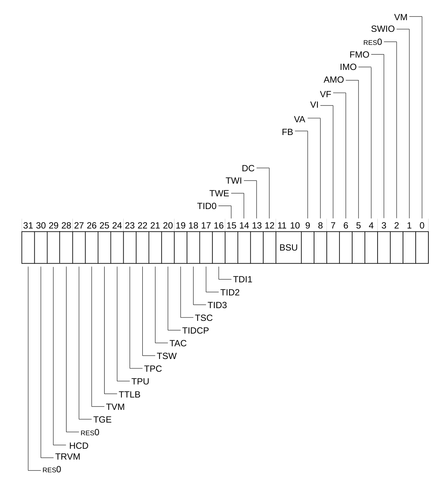

下表显示了 **HCR** 的位分配。

| 位    | 名称  | 功能 |
| ----- | ----- | ---- |
| [31]  | -     | 保留，RES0。 |
| [30]  | TRVM  | 陷阱读取虚拟内存控制（Trap Read of Virtual Memory controls）。<br>为 1 时，这将导致从 **EL1** 对 **EL1** 虚拟内存控制寄存器的读取被陷阱到 **EL2**。读取访问被陷阱的寄存器如下：**SCTLR**、**DFSR**、**IFSR**、**DFAR**、**IFAR**、**ADFSR**、**AIFSR**、**MAIR0**、**MAIR1**、**AMAIR0**、**AMAIR1**、**CONTEXTIDR**、**PRSELR**、**PRBAR**、**PRBARn**、**PRLAR** 和 **PRLARn**。<br>复位值为 0。 |
| [29]  | HCD   | **HVC** 指令禁用。选项为：<br>`0` 在 **EL2** 和 **EL1** 使能 **HVC** 指令执行。<br>`1` **HVC** 指令在 **EL2** 和 **EL1** 为 UNDEFINED。未定义指令异常被取到执行该 **HVC** 指令所在的异常级别。<br>复位值为 0。 |
| [28]  | -     | 保留，RES0。 |
| [27]  | TGE   | 陷阱通用异常（Trap General Exceptions）。如果该位置位，则：<br>&nbsp;&nbsp;• 所有本应路由到 **EL1** 的异常都被路由到 **EL2**。<br>&nbsp;&nbsp;• 无论 **SCTLR.M** 位的实际状态如何，该位都被视为 0，读取该位的用途除外。<br>&nbsp;&nbsp;• 无论 **HCR.FMO**、**IMO** 和 **AMO** 位的实际状态如何，这些位都被视为 1，读取这些位的用途除外。<br>&nbsp;&nbsp;• 所有虚拟中断都被禁用。<br>&nbsp;&nbsp;• 返回到 **EL1** 的异常返回被视为非法异常返回。<br>此外，如果 **HCR.TGE** 为 1，则 **HDCR.{TDRA,TDOSA,TDA}** 位被忽略，处理器表现得如同它们被置为 1 一样，从 **HDCR** 读回的值除外。<br>复位值为 0。 |
| [26]  | TVM   | 陷阱虚拟内存控制（Trap Virtual Memory controls）。为 1 时，这将导致从 **EL1** 对 **EL1** 虚拟内存控制寄存器的写入被陷阱到 **EL2**。写入访问被陷阱的寄存器如下：**SCTLR**、**DFSR**、**IFSR**、**DFAR**、**IFAR**、**ADFSR**、**AIFSR**、**MAIR0**、**MAIR1**、**AMAIR0**、**AMAIR1**、**CONTEXTIDR**、**PRSELR**、**PRBAR**、**PRBARn**、**PRLAR** 和 **PRLARn**。<br>复位值为 0。 |
| [25]  | TTLB  | 该字段为 RES0。 |
| [24]  | TPU   | 陷阱操作到统一点（point of unification）的缓存维护指令。为 1 时，这将导致从 **EL1** 或 **EL0** 执行的非 UNDEFINED 的此类指令被陷阱到 **EL2**。这涵盖以下指令：**ICIMVAU**、**ICIALLU**、**ICIALLUIS** 和 **DCCMVAU**。<br>复位值为 0。 |
| [23]  | TPC   | 陷阱操作到一致性点（point of coherency）的数据缓存维护操作。为 1 时，这将导致从 **EL1** 或 **EL0** 执行的非 UNDEFINED 的此类指令被陷阱到 **EL2**。这涵盖以下指令：**DCIMVAC**、**DCCIMVAC** 和 **DCCMVAC**。<br>复位值为 0。 |
| [22]  | TSW   | 陷阱按组/路（Set/Way）执行的数据缓存维护操作。为 1 时，这将导致从 **EL1** 执行的非 UNDEFINED 的此类指令被陷阱到 **EL2**。这涵盖以下指令：**DCISW**、**DCCSW** 和 **DCCISW**。<br>复位值为 0。 |
| [21]  | TAC   | 陷阱 **ACTLR** 访问。该位置为 1 时，任何有效的 **ACTLR** 访问都被陷阱到 **Hyp** 模式。<br>复位值为 0。 |
| [20]  | TIDCP | 陷阱下列寄存器。为 1 时，这将导致从 **EL1** 执行的所有 `coproc==0b1111` 的 **MCR** 和 **MRC** 指令按如下方式被陷阱到 **EL2**：<br>&nbsp;&nbsp;• **CRn** 为 9，Opcode1 为 0 到 7，**CRm** 为 c0、c1、c2、c5、c6、c7、c8，opcode2 为 0 到 7。<br>&nbsp;&nbsp;• **CRn** 为 10，Opcode1 为 0 到 7，**CRm** 为 c0、c1、c4、c8，opcode2 为 0 到 7。<br>&nbsp;&nbsp;• **CRn** 为 11，Opcode1 为 0 到 7，**CRm** 为 c0 到 c8，或 c15，opcode2 为 0 到 7。<br>从 **EL0** 对这些寄存器的访问为 UNDEFINED。<br>复位值为 0。 |
| [19]  | TSC   | 该字段为 RES0。 |
| [18]  | TID3  | 陷阱 ID 组 3。为 1 时，这将导致从 **EL1** 对下列寄存器的读取被陷阱到 **EL2**：**ID_PFR0**、**ID_PFR1**、**ID_DFR0**、**ID_AFR0**、**ID_MMFR0**、**ID_MMFR1**、**ID_MMFR2**、**ID_MMFR3**、**ID_ISAR0**、**ID_ISAR1**、**ID_ISAR2**、**ID_ISAR3**、**ID_ISAR4**、**ID_ISAR5**、**MVFR0**、**MVFR1** 和 **MVFR2**。还包括对下列任一编码的 **MRC** 指令：<br>&nbsp;&nbsp;• `(coproc==0b1111)`，OPC1 为 0，**CRn** 为 0，**CRm** 为 c3、c4、c5、c6 或 c7，且 Opc2 为 0 或 1。<br>&nbsp;&nbsp;• `(coproc==0b1111)`，Opc1 为 0，**CRn** 为 0，**CRm** 为 c3，且 Opc2 为 2。<br>&nbsp;&nbsp;• `(coproc==0b1111)`，Opc1 为 0，**CRn** 为 0，**CRm** 为 5，且 Opc2 为 4 或 5。<br>复位值为 0。 |
| [17]  | TID2  | 陷阱 ID 组 2。为 1 时，这将导致从 **EL1** 或 **EL0** 对下列寄存器的读取（或对 **CSSELR** 的写入，若未 UNDEFINED）被陷阱到 **EL2**：**CTR**、**CCSIDR**、**CLIDR** 和 **CSSELR**。<br>复位值为 0。 |
| [16]  | TID1  | 陷阱 ID 组 1。为 1 时，这将导致从 **EL1** 对下列寄存器的读取被陷阱到 **EL2**：**TCMTR**、**AIDR**、**MPUIR**、**TLBTR** 和 **REVIDR**。<br>复位值为 0。 |
| [15]  | TID0  | 陷阱 ID 组 0。为 1 时，这将导致从 **EL1** 或 **EL0** 对下列寄存器的读取（若未 UNDEFINED）被陷阱到 **EL2**：**FPSID** 和 Jazelle ID 寄存器（**JIDR**）。<br>复位值为 0。 |
| [14]  | TWE   | 陷阱 **WFE**。为 1 时，这将导致从 **EL1** 或 **EL0** 执行的 **WFE** 指令在本来会导致挂起执行的情况下被陷阱到 **EL2**。例如当事件寄存器未置位时。<br>复位值为 0。<br>关于 **WFE** 指令对事件寄存器状态的依赖关系的更多信息，请参见《Arm® Architecture Reference Manual for A-profile architecture》。 |
| [13]  | TWI   | 陷阱 **WFI**。为 1 时，这将导致从 **EL1** 或 **EL0** 执行的 **WFI** 指令在本来会导致挂起执行的情况下被陷阱到 **EL2**。例如在没有挂起的 **WFI** 唤醒事件时。<br>复位值为 0。 |
| [12]  | DC    | 默认可缓存（Default cacheable）。该位被扩展，以便在 **PMSA** 模式下为 **EL1** 和 **EL0** 使能默认可缓存性。置为 1 时，**PMSA** 客户机的默认内存映射被替换为 Normal、Non-shareable、Inner Write-Back Write-Allocate、Outer Write-Back Write-Allocate。将该位置为 1 不会对 **PMSA** 上下文强制 **SCTLR.M** 为零。<br>复位值为 0。 |
| [11:10] | BSU | 屏障可共享性升级（Barrier Shareability upgrade）。该字段的值决定施加到从 **EL1** 或 **EL0** 执行的任何屏障上的最小可共享域。可能的值有：<br>`0b00` 无影响。<br>`0b01` Inner Shareable。<br>`0b10` Outer Shareable。<br>`0b11` Full System。<br>复位值为 `0b00`。 |
| [9]   | FB    | 强制广播（Force broadcast）。对 Cortex®-R52+ 没有影响，因为 Inner Shareable 域只包含一个核。<br>复位值为 0。 |
| [8]   | VA    | 虚拟异步中止异常。当 **AMO** 位被置为 1 时，置位该位会在处理器执行于 **EL0** 或 **EL1** 时向客户机操作系统发出虚拟异步中止异常信号。<br>客户机操作系统无法区分该虚拟异常与相应的物理异常。<br>复位值为 0。 |
| [7]   | VI    | 虚拟 IRQ 异常。当 **IMO** 位被置为 1 时，置位该位会在处理器执行于 **EL0** 或 **EL1** 时向客户机操作系统发出虚拟 IRQ 异常信号。<br>客户机操作系统无法区分该虚拟异常与相应的物理异常。<br>复位值为 0。 |
| [6]   | VF    | 虚拟 FIQ 异常。当 **FMO** 位被置为 1 时，置位该位会在处理器执行于 **EL0** 或 **EL1** 时向客户机操作系统发出虚拟 FIQ 异常信号。<br>客户机操作系统无法区分该虚拟异常与相应的物理异常。<br>复位值为 0。 |
| [5]   | AMO   | 异步中止屏蔽覆盖（Asynchronous Abort Mask Override）。该位置为 1 时，当核处于 **EL1** 或 **EL0** 异常状态时，它覆盖 **CPSR.A** 对物理异步中止的作用，并使能由 **VA** 位和 **VSEI** 输入信号进行的虚拟异常信号发送。<br>复位值为 0。 |
| [4]   | IMO   | IRQ 屏蔽覆盖（IRQ Mask Override）。该位置为 1 时，当核处于 **EL1** 或 **EL0** 异常状态时，它覆盖 **CPSR.I** 对物理 IRQ 异常的屏蔽作用，并使能由 **VI** 位和中断控制器进行的虚拟异常信号发送。<br>复位值为 0。 |
| [3]   | FMO   | FIQ 屏蔽覆盖（FIQ Mask Override）。该位置为 1 时，当核处于 **EL1** 或 **EL0** 异常状态时，它覆盖 **CPSR.I** 对物理 FIQ 异常的屏蔽作用，并使能由 **VF** 位和中断控制器进行的虚拟异常信号发送。<br>复位值为 0。 |
| [2]   | PTW   | 该字段为 RES0。 |
| [1]   | SWIO  | 按组/路无效化覆盖（Set/Way Invalidation Override）。为 1 时，这将导致 **EL1** 执行的按组/路数据缓存无效化指令被视为按组/路数据缓存清理并无效化指令。**DCISW** 被当作 **DCCISW** 执行。<br>该位为 RES1。 |
| [0]   | VM    | 使能由 **EL2** 控制的、针对 **EL1** 和 **EL0** 访问的 **MPU** 保护。<br>`0` **EL1** 和 **EL0** 阶段 2 地址保护禁用，除非 **HCR.DC** 位为 1。<br>`1` **EL1** 和 **EL0** 阶段 2 地址保护和属性合并被使能。<br>复位值为 0。 |

要访问 **HCR**：

```arm
MRC p15, 4, <Rt>, c1, c1, 0 ; 将 Hyp 配置寄存器读入 Rt
MCR p15, 4, <Rt>, c1, c1, 0 ; 将 Rt 写入 Hyp 配置寄存器
```

### 3.40 Hyp 配置寄存器 2（Hyp Configuration Register 2）

**HCR2** 寄存器始终为 RES0。

### 3.41 Hyp 数据故障地址寄存器（Hyp Data Fault Address Register）

**HDFAR** 保存导致同步数据中止（Data Abort）异常被取到 **Hyp** 模式的故障地址。

**使用限制**

该寄存器可通过下列方式访问：

| EL0 | EL1 | EL2 |
| --- | --- | --- |
| -   | -   | RW  |

**陷阱与使能**

当 **HSTR.T6** 置位时，**EL1** 对 **HDFAR** 的访问将被陷阱到 **EL2**。

**配置**

此寄存器在所有构建配置中都可用。

**属性**

**HDFAR** 是一个 32 位寄存器。

**陷阱与使能**

如果 **HSTR.T6** 置位，**EL1** 对 **HDFAR** 的访问将被陷阱到 **EL2**。

下图显示了 **HDFAR** 的位分配。

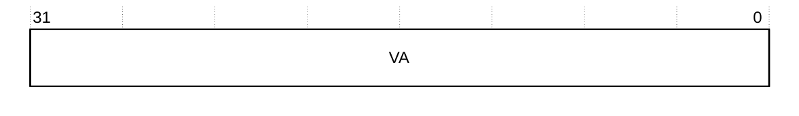

下表显示了 **HDFAR** 的位分配。

| 位     | 名称 | 功能 |
| ------ | ---- | ---- |
| [31:0] | VA   | 同步数据中止异常的故障地址 |

要访问 **HDFAR**：

```arm
MRC p15, 4, <Rt>, c6, c0, 0 ; 将 HDFAR 读入 Rt
MCR p15, 4, <Rt>, c6, c0, 0 ; 将 Rt 写入 HDFAR
```

### 3.42 Hyp 调试控制寄存器（Hyp Debug Control Register）

**HDCR** 控制 **EL1** 或更低级别对调试与跟踪架构以及性能监控器所提供的功能的访问是否被陷阱到 **Hyp** 模式。

**使用限制**

该寄存器可通过下列方式访问：

| EL0 | EL1 | EL2 |
| --- | --- | --- |
| -   | -   | RW  |

**陷阱与使能**

当 **HSTR.T1** 置位时，**EL1** 对 **HDCR** 的访问将被陷阱到 **EL2**。

**配置**

此寄存器在所有构建配置中都可用。

**属性**

**HDCR** 是一个 32 位寄存器。

下图显示了 **HDCR** 的位分配。

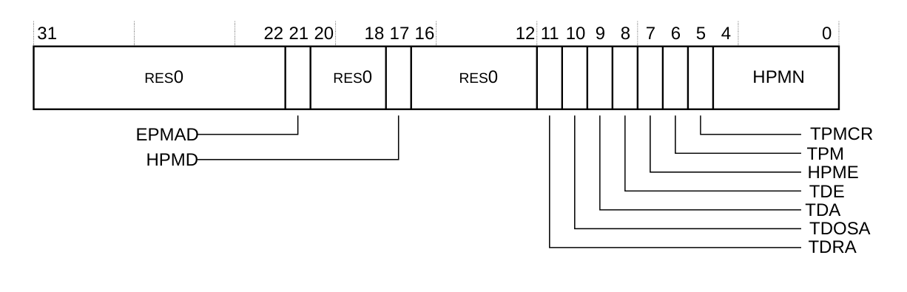

下表显示了 **HDCR** 的位分配。

| 位    | 名称  | 功能 |
| ----- | ----- | ---- |
| [31:22] | -   | 保留，RES0。 |
| [21]  | EPMAD | 禁用外部调试器对性能监控器寄存器的访问。<br>`0` 允许外部调试器访问性能监控器寄存器。<br>`1` 禁止外部调试器访问性能监控器寄存器。<br>复位值为 0。 |
| [20:18] | -   | 保留，RES0。 |
| [17]  | HPMD  | Hyp 性能监控器禁用。这禁止在 **Hyp** 模式下进行事件计数。<br>`0` 允许在 **Hyp** 模式下进行事件计数。<br>`1` 禁止在 **Hyp** 模式下进行事件计数。<br>该控制适用于：<br>&nbsp;&nbsp;• 0 到 **HPMN** 范围内的计数器。<br>&nbsp;&nbsp;• 如果 **PMCR.DP** 置为 1，则适用于 **PMCCNTR**。<br>编号更高的计数器不受影响。如果 **PMCR.DP** 置为 0，则 **PMCCNTR** 不受影响。<br>热复位时，该字段复位为 0。 |
| [16:12] | -   | 保留，RES0。 |
| [11]  | TDRA  | 陷阱调试 ROM 地址寄存器访问。<br>`0` 对 **EL1** 和 **EL0** 到调试 ROM 地址寄存器的访问没有影响。<br>`1` 将有效的 **EL1** 和 **EL0** 对调试 ROM 地址寄存器 **DBGDRAR** 和 **DBGDSAR** 的访问陷阱到 **Hyp** 模式。<br>如果 **HCR.TGE** 为 1 或 **HDCR.TDE** 为 1，则该位被忽略并被视为 1，从 **HDCR** 读回的值除外。<br>热复位时，该字段复位为 0。 |
| [10]  | TDOSA | 陷阱调试 OS 相关寄存器访问：<br>`0` 对调试系统寄存器的访问没有影响。<br>`1` 将有效的对 OS 相关调试系统寄存器的访问陷阱到 **Hyp** 模式。<br>访问被陷阱的寄存器如下：<br>&nbsp;&nbsp;• **DBGOSLSR**。<br>&nbsp;&nbsp;• **DBGOSLAR**。<br>&nbsp;&nbsp;• **DBGOSDLR**。<br>&nbsp;&nbsp;• **DBGPRCR**。<br>如果 **HCR.TGE** 为 1 或 **HDCR.TDE** 为 1，则该位被忽略并被视为 1，从 **HDCR** 读回的值除外。<br>热复位时，该字段复位为 0。 |
| [9]   | TDA   | 陷阱调试访问（Trap Debug Access）：<br>`0` 对调试系统寄存器的访问没有影响。<br>`1` 将有效的对调试系统寄存器的访问（**HDCR.TDRA** 和 **HDCR.TDOSA** 所陷阱的寄存器除外）陷阱到 **Hyp** 模式。<br>如果 **HCR.TGE** 为 1 或 **HDCR.TDE** 为 1，则该位被忽略并被视为 1，从 **HDCR** 读回的值除外。<br>热复位时，该字段复位为 0。 |
| [8]   | TDE   | 陷阱调试异常（Trap Debug Exceptions）：<br>`0` 对调试异常没有影响。<br>`1` 将非安全调试异常路由到 **Hyp** 模式。<br>如果 **HCR.TGE** 为 1，则该位被忽略并被视为 1，从 **HDCR** 读回的值除外。<br>该位复位为 0。 |
| [7]   | HPME  | 管理程序性能监控器使能（Hypervisor Performance Monitor Enable）：<br>`0` **Hyp** 模式性能监控器计数器禁用。<br>`1` **Hyp** 模式性能监控器计数器使能。<br>该位置为 1 时，使能对保留给 **Hyp** 模式使用的性能监控器的访问。更多信息请参见 **HPMN** 字段的说明。<br>热复位时，该字段复位为 0。 |
| [6]   | TPM   | 陷阱性能监控器访问：<br>`0` 对性能监控器访问没有影响。<br>`1` 将有效的性能监控器访问陷阱到 **Hyp** 模式。<br>复位值为 0。更多信息请参见《Arm® Architecture Reference Manual Supplement Armv8, for the Armv8-R AArch32 architecture profile》。 |
| [5]   | TPMCR | 陷阱性能监控器控制寄存器（**PMCR**）访问：<br>`0` 对 **PMCR** 访问没有影响。<br>`1` 将有效的 **PMCR** 访问陷阱到 **Hyp** 模式。<br>复位值为 0。更多信息请参见《Arm® Architecture Reference Manual Supplement Armv8, for the Armv8-R AArch32 architecture profile》。 |
| [4:0] | HPMN  | Hyp 性能监控器计数。它定义在使能非特权访问时，可从 **EL1** 和 **EL0** 模式访问的性能监控器计数器数量。如果软件正在访问性能监控器计数器 n，则：<br>&nbsp;&nbsp;• 如果 n 在 0 ≤ n < **HPMN** 范围内，该计数器可从 **EL1** 和 **EL2** 访问；如果使能了计数器的非特权访问，也可从 **EL0** 访问。<br>&nbsp;&nbsp;• 如果 n 在 **HPMN** ≤ n < **PMCR.N** 范围内，该计数器只能从 **EL2** 访问，且仅在 **HPME** 使能时。<br>如果该字段置为 0，则 **EL0** 或 **EL1** 都无法访问任何计数器。<br>如果该字段置为大于 **PMCR.N** 的值，则所有计数器在 **EL0** 或 **EL1** 中都可用。<br>**EL2** 对 **HDCR.HPMN** 的读取总是返回写入 **HDCR.HPMN** 的值。无论该值为 0 还是大于 **PMCR.N** 都是如此。<br>复位值为 0x04。 |

要访问 **HDCR**：

```arm
MRC p15,4,<Rt>,c1,c1,1 ; 将 HDCR 读入 Rt
MCR p15,4,<Rt>,c1,c1,1 ; 将 Rt 写入 HDCR
```

### 3.43 Hyp 指令故障地址寄存器（Hyp Instruction Fault Address Register）

**HIFAR** 保存导致同步预取中止（Prefetch Abort）异常被取到 **Hyp** 模式的故障地址。

**使用限制**

该寄存器可通过下列方式访问：

| EL0 | EL1 | EL2 |
| --- | --- | --- |
| -   | -   | RW  |

**陷阱与使能**

当 **HSTR.T6** 置位时，**EL1** 对 **HIFAR** 的访问将被陷阱到 **EL2**。

**配置**

此寄存器在所有构建配置中都可用。

**属性**

**HIFAR** 是一个 32 位寄存器。

下图显示了 **HIFAR** 的位分配。


下表显示了 **HIFAR** 的位分配。

| 位     | 名称 | 功能 |
| ------ | ---- | ---- |
| [31:0] | VA   | 同步预取中止异常的故障地址 |

要访问 **HIFAR**：

```arm
MRC p15, 4, <Rt>, c6, c0, 2 ; 将 HIFAR 读入 Rt
MCR p15, 4, <Rt>, c6, c0, 2 ; 将 Rt 写入 HIFAR
```

### 3.44 Hyp IPA 故障地址寄存器（Hyp IPA Fault Address Register）

**HPFAR** 保存阶段 2 转换上被取到 **Hyp** 模式的预取中止和数据中止的故障地址。

**使用限制**

该寄存器可通过下列方式访问：

| EL0 | EL1 | EL2 |
| --- | --- | --- |
| -   | -   | RW  |

**陷阱与使能**

当 **HSTR.T6** 置位时，**EL1** 对 **HPFAR** 的访问将被陷阱到 **EL2**。

**配置**

此寄存器在所有构建配置中都可用。

**属性**

**HPFAR** 是一个 32 位寄存器。

下图显示了 **HPFAR** 的位分配。

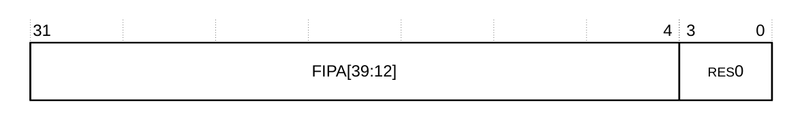

下表显示了 **HPFAR** 的位分配。

| 位     | 名称       | 功能 |
| ------ | ---------- | ---- |
| [31:4] | FIPA[39:12] | 故障地址的位 [31:4] |
| [3:0]  | -          | 保留，RES0 |

要访问 **HPFAR**：

```arm
MRC p15, 4, <Rt>, c6, c0, 4 ; 将 HPFAR 读入 Rt
MCR p15, 4, <Rt>, c6, c0, 4 ; 将 Rt 写入 HPFAR
```

### 3.45 Hyp 存储属性间接寄存器 0 和 1（Hyp Memory Attribute Indirection Register 0 and 1）

**HMAIR0** 和 **HMAIR1** 提供与长描述符格式转换表项中可能的 **AttrIndex** 值相对应的存储属性编码。这用于 **EL2** 控制的 **MPU**。

**使用限制**

这些寄存器可通过下列方式访问：

| EL0 | EL1 | EL2 |
| --- | --- | --- |
| -   | -   | RW  |

**陷阱与使能**

如果 **HSTR.T10** 置位，**EL1** 对 **HMAIR0** 和 **HMAIR1** 的访问将被陷阱到 **EL2**。

**配置**

这些寄存器在所有构建配置中都可用。

**属性**

**HMAIR0** 和 **HMAIR1** 是 32 位寄存器。

下图显示了 **HMAIR0** 和 **HMAIR1** 的位分配。

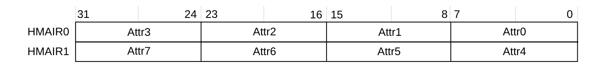

下表显示了 **HMAIR0** 的位分配。

| 位      | 名称  | 定义 |
| ------- | ----- | ---- |
| [31:24] | Attr3 | **AttrIndex** 置为 3 的 **EL2** 控制的 **MPU** 区域的存储属性编码。 |
| [23:16] | Attr2 | **AttrIndex** 置为 2 的 **EL2** 控制的 **MPU** 区域的存储属性编码。 |
| [15:8]  | Attr1 | **AttrIndex** 置为 1 的 **EL2** 控制的 **MPU** 区域的存储属性编码。 |
| [7:0]   | Attr0 | **AttrIndex** 置为 0 的 **EL2** 控制的 **MPU** 区域的存储属性编码。 |

下表显示了 **HMAIR1** 的位分配。

| 位      | 名称  | 定义 |
| ------- | ----- | ---- |
| [31:24] | Attr7 | **AttrIndex** 置为 7 的 **EL2** 控制的 **MPU** 区域的存储属性编码。 |
| [23:16] | Attr6 | **AttrIndex** 置为 6 的 **EL2** 控制的 **MPU** 区域的存储属性编码。 |
| [15:8]  | Attr5 | **AttrIndex** 置为 5 的 **EL2** 控制的 **MPU** 区域的存储属性编码。 |
| [7:0]   | Attr4 | **AttrIndex** 置为 4 的 **EL2** 控制的 **MPU** 区域的存储属性编码。 |

下表显示了 **Attr\<n\>[7:4]** 位的编码：

| Attr\<n\>[7:4]  | 名称 |
| --------------- | ---- |
| `0000`          | Device 存储器。Device 存储器的类型参见 **Attr\<n\>[3:0]** 的编码。 |
| `00RW`，RW 不为 `00` | Normal Memory，Outer Write-Through transient。 |
| `0100`          | Normal Memory，Outer Non-cacheable。 |
| `01RW`，RW 不为 `00` | Normal Memory，Outer Write-Back transient。 |
| `10RW`          | Normal Memory，Outer Write-Through non-transient。 |
| `11RW`          | Normal Memory，Outer Write-Back non-transient。 |

R = Outer Read Allocate Policy，W = Outer Write Allocate Policy。

位 [3:0] 的含义取决于位 [7:4] 的值。下表显示了 **Attr\<n\>[3:0]** 位的编码：

| Attr\<n\>[3:0] | **Attr\<n\>[7:4]** 为 `0000` 时的含义 | **Attr\<n\>[7:4]** 不为 `0000` 时的含义 |
| -------------- | ------------------------------------- | --------------------------------------- |
| `0000` | Device-nGnRnE memory | UNPREDICTABLE |
| `00RW`，RW 不为 `00` | UNPREDICTABLE | Normal Memory，Inner Write-Through transient |
| `0100` | Device-nGnRE memory | Normal memory，Inner Non-cacheable |
| `01RW`，RW 不为 `00` | UNPREDICTABLE | Normal Memory，Inner Write-Back transient |
| `1000` | Device-nGRE memory | Normal Memory，Inner Write-Through non-transient（RW=00） |
| `10RW`，RW 不为 `00` | UNPREDICTABLE | Normal Memory，Inner Write-Through non-transient |
| `1100` | Device-GRE memory | Normal Memory，Inner Write-Back non-transient（RW=00） |
| `11RW`，RW 不为 `00` | UNPREDICTABLE | Normal Memory，Inner Write-Back non-transient |

R = Inner Read Allocate Policy，W = Inner Write Allocate Policy。

某些 **Attr\<n\>** 字段中的 R 和 W 位具有下列含义：

| R 或 W | 含义 |
| ------ | ---- |
| `0`    | 不分配 |
| `1`    | 分配 |

要访问 **HMAIR0**：

```arm
MRC p15, 4, <Rt>, c10, c2, 0 ; 将 HMAIR0 读入 Rt
MCR p15, 4, <Rt>, c10, c2, 0 ; 将 Rt 写入 HMAIR0
```

要访问 **HMAIR1**：

```arm
MRC p15, 4, <Rt>, c10, c2, 1 ; 将 HMAIR1 读入 Rt
MCR p15, 4, <Rt>, c10, c2, 1 ; 将 Rt 写入 HMAIR1
```

### 3.46 Hyp MPU 区域使能寄存器（Hyp MPU Region Enable Register）

**HPRENR** 提供对 **EL2** 控制的 **MPU** 区域 0 到 15 的区域使能位（**HPRLAR.EN**）的直接访问。

**使用限制**

该寄存器可通过下列方式访问：

| EL0 | EL1 | EL2 |
| --- | --- | --- |
| -   | -   | RW  |

**陷阱与使能**

没有影响该寄存器的陷阱与使能。

**配置**

此寄存器在所有构建配置中都可用。

**属性**

**HPRENR** 是一个 32 位寄存器。

下图显示了未实现任何 **EL2** 控制的 **MPU** 区域时 **HPRENR** 的位分配。

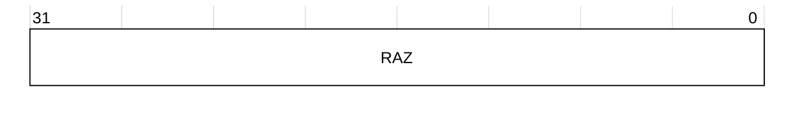

下表显示了 **HPRENR** 的位分配。

| 位      | 名称 | 功能 |
| ------- | ---- | ---- |
| [31:16] | -    | RAZ。 |

下图显示了实现了 16 个 **EL2** 控制的 **MPU** 区域时 **HPRENR** 的位分配。

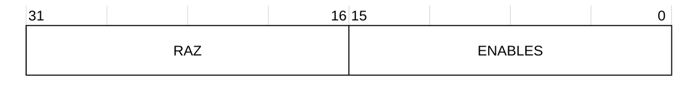

下表显示了 **HPRENR** 的位分配。

| 位      | 名称     | 功能 |
| ------- | -------- | ---- |
| [31:16] | -        | RAZ。 |
| [15:0]  | ENABLES  | 每一位 N 使能或禁用相应的 **EL2** 控制的 **MPU** 区域 N。 |

下图显示了实现了 20 个 **EL2** 控制的 **MPU** 区域时 **HPRENR** 的位分配。

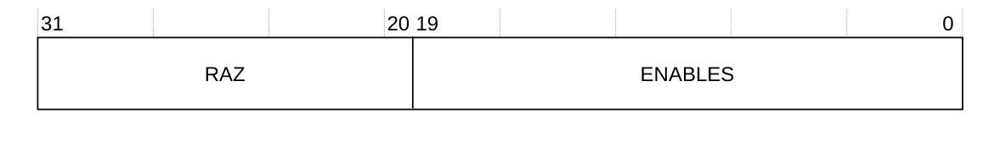

下表显示了 **HPRENR** 的位分配。

| 位      | 名称     | 功能 |
| ------- | -------- | ---- |
| [31:20] | -        | RAZ。 |
| [19:0]  | ENABLES  | 每一位 N 使能或禁用相应的 **EL2** 控制的 **MPU** 区域 N。 |

下图显示了实现了 24 个 **EL2** 控制的 **MPU** 区域时 **HPRENR** 的位分配。

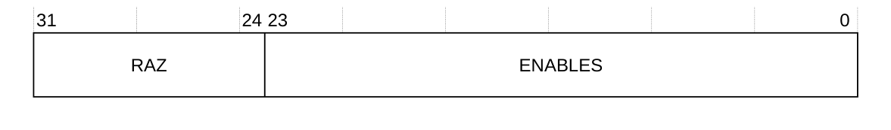

下表显示了 **HPRENR** 的位分配。

| 位      | 名称     | 功能 |
| ------- | -------- | ---- |
| [31:24] | -        | RAZ。 |
| [23:0]  | ENABLES  | 每一位 N 使能或禁用相应的 **EL2** 控制的 **MPU** 区域 N。 |

要访问 **HPRENR**：

```arm
MRC p15,4,<Rt>,c6,c1,1 ; 将 HPRENR 读入 Rt
MCR p15,4,<Rt>,c6,c1,1 ; 将 Rt 写入 HPRENR
```

### 3.47 Hyp MPU 类型寄存器（Hyp MPU Type Register）

**HMPUIR** 指示 **EL2** 控制的 **MPU** 所实现的可编程存储区域的数量。

**使用限制**

该寄存器可通过下列方式访问：

| EL0 | EL1 | EL2 |
| --- | --- | --- |
| -   | -   | RO  |

**陷阱与使能**

没有影响该寄存器的陷阱与使能。

**配置**

此寄存器在所有构建配置中都可用。

**属性**

**HMPUIR** 是一个 32 位寄存器。

下图显示了 **HMPUIR** 的位分配。

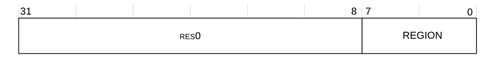

下表显示了 **HMPUIR** 的位分配。

| 位     | 名称   | 功能 |
| ------ | ------ | ---- |
| [31:8] | -      | 保留，RES0。 |
| [7:0]  | REGION | 指示 **EL2** 控制的 **MPU** 所实现的可编程存储区域的数量，取值为 0、16、20 或 24。 |

要访问 **HMPUIR**：

```arm
MRC p15,4,<Rt>,c0,c0,4 ; 将 HMPUIR 读入 Rt
```

### 3.48 Hyp 保护区域基地址寄存器（Hyp Protection Region Base Address Register）

Hyp 保护区域基地址寄存器指示 **EL2** 控制的 **MPU** 区域的基地址，并提供两种访问机制：直接访问（**HPRBAR\<n\>**）和间接访问（**HPRBAR**）。间接访问另见 **HPRSELR**。

**使用限制**

该寄存器可通过下列方式访问：

| EL0 | EL1 | EL2 |
| --- | --- | --- |
| -   | -   | RW  |

**陷阱与使能**

没有影响该寄存器的陷阱与使能。

**配置**

此寄存器在所有构建配置中都可用。

**属性**

**HPRBAR** 和 **HPRBARn** 是 32 位寄存器。

下图显示了 **HPRBAR** 的位分配。

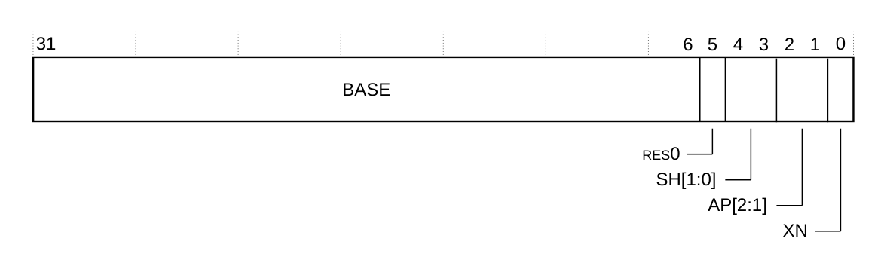

下表显示了 **HPRBAR** 的位分配。

| 位     | 名称     | 功能 |
| ------ | -------- | ---- |
| [31:6] | BASE     | 包含所选 **EL2** 控制的 **MPU** 存储区域下限（含）的位 [31:6]。该值被零扩展以提供用于比较的基地址。 |
| [5]    | -        | 保留，RES0。 |
| [4:3]  | SH[1:0]  | 可共享性字段。 |
| [2:1]  | AP[2:1]  | 访问权限位。 |
| [0]    | XN       | 从不执行（Execute-never）。 |

下表显示了 Normal 存储器的 **SH[1:0]** 字段编码。

| SH[1:0] | Normal 存储器 |
| ------- | ------------- |
| `0b00`  | Non-shareable |
| `0b01`  | UNPREDICTABLE |
| `0b10`  | Outer Shareable |
| `0b11`  | Inner Shareable |

下表显示了 **EL2** 控制的 **MPU** 的 **AP[2:1]** 数据访问权限。

| AP[2:1] | 从 EL2 访问 | 从 EL0 和 EL1 访问 | 说明 |
| ------- | ----------- | ------------------ | ---- |
| `0b00`  | 读/写 | 无 | 读/写，仅在 **EL2** |
| `0b01`  | 读/写 | 读/写 | 读/写，在任意特权级别 |
| `0b10`  | 只读 | 无 | 只读，仅在 **EL2** |
| `0b11`  | 只读 | 只读 | 只读，在任意特权级别 |

该寄存器复位为 UNKNOWN 值。

要访问 **HPRBAR**：

```arm
MRC p15,4,<Rt>,c6,c3,0 ; 将 HPRBAR 读入 Rt
MCR p15,4,<Rt>,c6,c3,0 ; 将 Rt 写入 HPRBAR
```

**HPRBAR0** 到 **HPRBAR23** 提供直接访问。要访问 **HPRBARn**（其中 n 以二进制数表示）：

```arm
MRC p15, 4+nDIV16, <Rt>, c6, c8+n[3:1], 4*n[0] ; 将 PRBARn 读入 Rt
MCR p15, 4+nDIV16, <Rt>, c6, c8+n[3:1], 4*n[0] ; 将 Rt 写入 PRBARn
```

### 3.49 Hyp 保护区域限地址寄存器（Hyp Protection Region Limit Address Register）

Hyp 保护区域限地址寄存器指示 **EL2** 控制的 **MPU** 区域的限地址，并提供两种访问机制：直接访问（**HPRLAR\<n\>**）和间接访问（**HPRLAR**）。间接访问另见 **HPRSELR**。

**使用限制**

该寄存器可通过下列方式访问：

| EL0 | EL1 | EL2 |
| --- | --- | --- |
| -   | -   | RW  |

**陷阱与使能**

没有影响该寄存器的陷阱与使能。

**配置**

此寄存器在所有构建配置中都可用。

**属性**

**HPRLAR** 和 **HPRLARn** 是 32 位寄存器。

下图显示了 **HPRLAR** 的位分配。

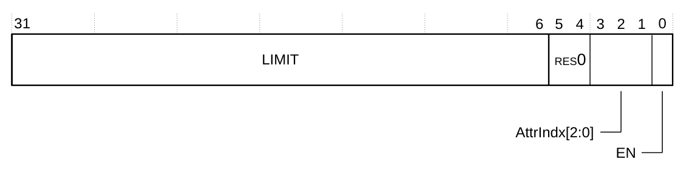

下表显示了 **HPRLAR** 的位分配。

| 位    | 名称          | 功能 |
| ----- | ------------- | ---- |
| [31:6] | LIMIT        | 包含所选 **EL2** 控制的 **MPU** 存储区域上限（含）的位 [31:6]。该值后接 0x3F 以提供用于比较的限地址。<br>复位为 UNKNOWN 值。 |
| [5:4] | -             | 保留，RES0。 |
| [3:1] | AttrIndx[2:0] | 索引 **HMAIRx** 寄存器之一中的一组属性。<br>复位为 UNKNOWN 值。 |
| [0]   | EN            | 区域使能。<br>`0` 区域禁用。<br>`1` 区域使能。<br>该字段复位为零。 |

要访问 **HPRLAR**：

```arm
MRC p15,4,<Rt>,c6,c3,1 ; 将 HPRLAR 读入 Rt
MCR p15,4,<Rt>,c6,c3,1 ; 将 Rt 写入 HPRLAR
```

**HPRLAR0** 到 **HPRLAR23** 提供直接访问。要访问 **HPRLARn**（其中 n 以二进制数表示）：

```arm
MRC p15, 4+nDIV16, <Rt>, c6, c8+n[3:1], 4*n[0]+1 ; 将 PRLARn 读入 Rt
MCR p15, 4+nDIV16, <Rt>, c6, c8+n[3:1], 4*n[0]+1 ; 将 Rt 写入 PRLARn
```

### 3.50 Hyp 保护区域选择寄存器（Hyp Protection Region Selection Register）

**HPRSELR** 指示并选择当前的 **EL2** 控制的 **MPU** 区域，该区域可使用 **HPRBAR** 和 **HPRLAR** 寄存器进行间接访问。

**使用限制**

该寄存器可通过下列方式访问：

| EL0 | EL1 | EL2 |
| --- | --- | --- |
| -   | -   | RW  |

**陷阱与使能**

没有影响该寄存器的陷阱与使能。

**配置**

此寄存器在所有构建配置中都可用。

**属性**

**HPRSELR** 是一个 32 位寄存器。

**0 个或 16 个 EL2 控制的 MPU 区域**

如果实现了 0 个或 16 个 **EL2** 控制的 **MPU** 区域，下图显示了 **HPRSELR** 的位分配。

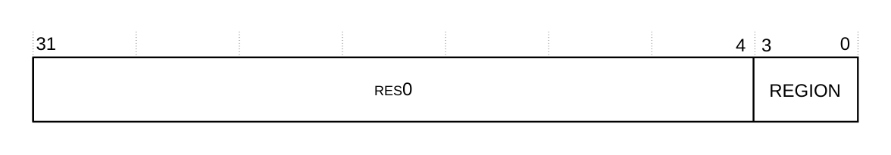

如果实现了 0 个或 16 个 **EL2** 控制的 **MPU** 区域，下表显示了 **HPRSELR** 的位分配。

| 位    | 名称   | 功能 |
| ----- | ------ | ---- |
| [31:4] | -     | 保留，RES0。 |
| [3:0] | REGION | 在 **HPRBAR** 和 **HPRLAR** 中可见的当前区域的编号。<br>如果实现的是 0 区域 **MPU**，向该寄存器写入值的结果为 UNPREDICTABLE。<br>如果实现的是 16 区域 **MPU**，向该寄存器写入大于或等于 16 的值的结果为 UNPREDICTABLE。 |

**20 个或 24 个 EL2 控制的 MPU 区域**

如果实现了 20 个或 24 个 **EL2** 控制的 **MPU** 区域，下图显示了 **HPRSELR** 的位分配。


如果实现了 20 个或 24 个 **EL2** 控制的 **MPU** 区域，下表显示了 **HPRSELR** 的位分配。

| 位    | 名称   | 功能 |
| ----- | ------ | ---- |
| [31:5] | -     | 保留，RES0。 |
| [4:0] | REGION | 在 **HPRBAR** 和 **HPRLAR** 中可见的当前区域的编号。<br>如果实现的是 20 区域 **MPU**，向该寄存器写入大于或等于 20 的值的结果为 UNPREDICTABLE。<br>如果实现的是 24 区域 **MPU**，向该寄存器写入大于或等于 24 的值的结果为 UNPREDICTABLE。 |

要访问 **HPRSELR**：

```arm
MRC p15,4,<Rt>,c6,c2,1 ; 将 HPRSELR 读入 Rt
MCR p15,4,<Rt>,c6,c2,1 ; 将 Rt 写入 HPRSELR
```

### 3.51 Hyp 软件线程 ID 寄存器（Hyp Software Thread ID Register）

**HTPIDR** 寄存器提供了一个位置，供在 **Hyp** 模式下运行的软件存储线程标识信息，该信息对在 **EL0** 或 **EL1** 执行的软件可见。此寄存器的用途是 **hypervisor** 管理。

**使用限制**

该寄存器可通过下列方式访问：

| EL0 | EL1 | EL2 |
| --- | --- | --- |
| -   | -   | RW  |

**陷阱与使能**

当 **HSTR.T13** 置位时，对 **HTPIDR** 的 **EL1** 访问会被陷阱到 **EL2**。

**配置**

此寄存器在所有构建配置中都可用。

**属性**

**HTPIDR** 是 32 位寄存器。

该寄存器复位时为 UNKNOWN。

下图显示了 **HTPIDR** 的位分配。


下表显示了 **HTPIDR** 的位分配。

| 位      | 名称      | 功能 |
| ------- | --------- | ---- |
| [31:0] | Thread ID | 由在该异常级别运行的软件存储的线程标识信息。<br>更多信息请参阅 *Arm® Architecture Reference Manual Supplement Armv8, for the Armv8-R AArch32 architecture profile*。 |

要访问 **HTPIDR**：

```arm
MRC p15, 4, <Rt>, c13, c0, 2 ; 将 HTPIDR 读入 Rt
MCR p15, 4, <Rt>, c13, c0, 2 ; 将 Rt 写入 HTPIDR
```

### 3.52 Hyp 综合征寄存器（Hyp Syndrome Register）

**HSR** 保存取到 **Hyp** 模式的异常的综合征信息。

**使用限制**

该寄存器可通过下列方式访问：

| EL0 | EL1 | EL2 |
| --- | --- | --- |
| -   | -   | RW  |

**陷阱与使能**

当 **HSTR.T5** 置位时，对 **HSR** 的 **EL1** 访问会被陷阱到 **EL2**。

**配置**

此寄存器在所有构建配置中都可用。

**属性**

**HSR** 是 32 位寄存器。

下图显示了 **HSR** 的位分配。

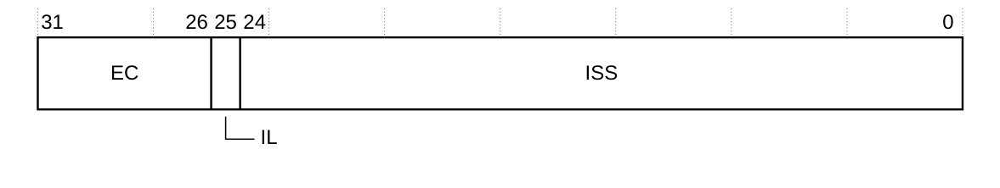

下表显示了 **HSR** 的位分配。

| 位      | 名称 | 功能 |
| ------- | ---- | ---- |
| [31:26] | EC   | 异常类。在 **Hyp** 模式下所取异常的异常类。参见第 146 页的表 4-128：异常类编码。 |
| [25]    | IL   | 指令长度位。指示被陷阱到 **Hyp** 模式的指令的大小。当该位有效时，可能的取值为：<br>`0` 16 位指令被陷阱。<br>`1` 32 位指令被陷阱。<br>该字段为 RES1，且在以下情况下无效：<br>&nbsp;&nbsp;• 当 **EC** 字段为 `0b000000` 时，表示原因为未知的异常。<br>&nbsp;&nbsp;• 预取中止。<br>&nbsp;&nbsp;• 没有有效 **ISS** 信息、或 **ISS** 无效的数据中止。<br>&nbsp;&nbsp;• 当 **EC** 值为 `0b001110` 时，表示非法状态异常。<br>当因 **PC** 对齐故障产生异常时，**IL** 字段无效且为 UNKNOWN。 |
| [24:0]  | ISS  | 指令特定综合征。该字段的解释取决于 **EC** 字段的值。更多信息请参阅 *Arm® Architecture Reference Manual Supplement Armv8, for the Armv8-R AArch32 architecture profile*。 |

表 4-128 给出了异常类编码。

| EC 值    | 异常类 | 描述 |
| -------- | ------ | ---- |
| `0b000000` | 原因为未知的异常 | 未知原因。 |
| `0b000001` | 来自 **WFI** 或 **WFE** 指令的异常 | 被陷阱的 **WFI** 或 **WFE** 指令。<br>未通过条件码检查的条件 **WFE** 和 **WFI** 指令不会导致异常。 |
| `0b000011` | 来自 **MCR** 或 **MRC** 访问的异常 | 被陷阱的（**coproc==0b1111**）**MCR** 或 **MRC** 访问。 |
| `0b000100` | 来自 **MCRR** 或 **MRRC** 访问的异常 | 被陷阱的（**coproc==0b1111**）**MCRR** 或 **MRRC** 访问。 |
| `0b000101` | 来自 **MCR** 或 **MRC** 访问的异常 | 被陷阱的（**coproc==0b1110**）**MCR** 或 **MRC** 访问。 |
| `0b000110` | 来自（**coproc==0b1110**）**LDC** 或 **STC** 访问的异常 | 被陷阱的（**coproc==0b1110**）**LDC** 或 **STC** 访问。 |
| `0b000111` | 由 **HCPTR** 引起的对 **SIMD** 或浮点功能的访问异常 | 由 **HCPTR** 引起的对 **SIMD** 或浮点功能的访问异常。不包括在未实现 **Advanced SIMD** 和浮点时所导致的异常，这些异常以 **EC** 值 `0b000000` 报告。 |
| `0b001000` | 来自 **MCR** 或 **MRC** 访问的异常 | 针对 **ID** 组陷阱的被陷阱 **VMRS** 访问。 |
| `0b001100` | 来自 **MCRR** 或 **MRRC** 访问的异常 | 被陷阱的（**coproc==0b1110**）**MRRC** 或 **MCRR** 访问。 |
| `0b001110` | 来自非法状态或 **PC** 对齐故障的异常 | 取到 **AArch32** 状态的非法状态异常。 |
| `0b010001` | 来自 **HVC** 或 **SVC** 指令执行的异常 | 取到 **Hyp** 模式的 **SVC**。 |
| `0b010010` | 来自 **HVC** 或 **SVC** 指令执行的异常 | 执行了 **HVC**。 |
| `0b100000` | 来自预取中止的异常 | 路由到 **Hyp** 模式的预取中止。 |
| `0b100001` | 来自预取中止的异常 | 从 **Hyp** 模式取到的预取中止。 |
| `0b100010` | 来自非法状态或 **PC** 对齐故障的异常 | **PC** 对齐故障异常。 |
| `0b100100` | 来自数据中止的异常 | 路由到 **Hyp** 模式的数据中止。 |
| `0b100101` | 来自数据中止的异常 | 从 **Hyp** 模式取到的数据中止。 |

要访问 **HSR**：

```arm
MRC p15, 4, <Rt>, c5, c2, 0 ; 将 HSR 读入 Rt
MCR p15, 4, <Rt>, c5, c2, 0 ; 将 Rt 写入 HSR
```

### 3.53 Hyp 系统控制寄存器（Hyp System Control Register）

**HSCTLR** 提供对 **Hyp** 模式下系统运行的顶层控制。

**使用限制**

该寄存器可通过下列方式访问：

| EL0 | EL1 | EL2 |
| --- | --- | --- |
| -   | -   | RW  |

**陷阱与使能**

当 **HSTR.T1** 置位时，对 **HSCTLR** 的 **EL1** 访问会被陷阱到 **EL2**。

**配置**

此寄存器在所有构建配置中都可用。

**属性**

**HSCTLR** 是 32 位寄存器。

下图显示了 **HSCTLR** 的位分配。

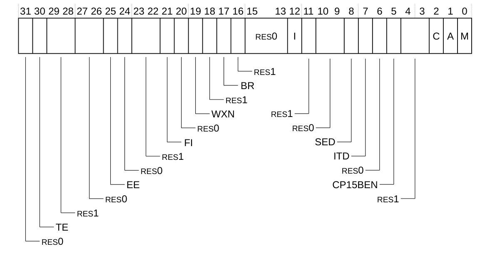

下表显示了 **HSCTLR** 的位分配。

| 位      | 名称    | 功能 |
| ------- | ------- | ---- |
| [31]    | -       | 保留，RES0。 |
| [30]    | TE      | **Thumb** 异常使能。该位控制 **Hyp** 模式下所取的异常是以 **A32** 还是 **T32** 状态取入：<br>`0` 异常以 **A32** 状态取入。<br>`1` 异常以 **T32** 状态取入。<br>输入信号 **CFGTHUMBEXCEPTIONS** 定义 **TE** 位的复位值。 |
| [29:28] | -       | 保留，RES1。 |
| [27:26] | -       | 保留，RES0。 |
| [25]    | EE      | 异常字节序。该位的值定义取到 **Hyp** 模式的异常（包括复位）时 **CPSR.E** 位的值。<br>`0` 小端。<br>`1` 大端。<br>输入信号 **CFGENDIANESSx** 定义 **EE** 位的复位值。 |
| [24]    | -       | 保留，RES0。 |
| [23:22] | -       | 保留，RES1。 |
| [21]    | FI      | 快速中断配置使能位：<br>`0` 所有性能特性使能。<br>`1` 快速中断配置。部分性能特性禁用。<br>将该位置 1 可以通过禁用部分实现定义的性能特性来降低实现中的中断延迟。参见第 48 页的 3.2.4.3 快速中断。<br>复位值为 0。 |
| [20]    | -       | 保留，RES0。 |
| [19]    | WXN     | 写权限隐含 XN。该位可用于要求所有具有写权限的 **EL2** 控制的 **MPU** 存储区域被视为 XN：<br>`0` 具有写权限的 **EL2** 控制的 **MPU** 区域不强制为 XN。<br>`1` 具有写权限的 **EL2** 控制的 **MPU** 区域强制为 XN。<br>复位值为 0。 |
| [18]    | -       | 保留，RES1。 |
| [17]    | BR      | 背景区域使能位。当 **EL2 MPU** 使能时，该位控制不映射到任何 **EL2 MPU** 区域的 **EL2** 访问如何处理：<br>`0` 任何不匹配 **EL2 MPU** 区域的 **EL2** 事务产生转换故障。<br>`1` 为不匹配可编程 **EL2 MPU** 区域的 **EL2** 访问使能背景区域。<br>参见第 278 页的 9.2.2 EL2 控制的 MPU 背景区域。<br>复位值为 0。 |
| [16]    | -       | 保留，RES1。 |
| [15:13] | -       | 保留，RES0。 |
| [12]    | I       | 指令缓存使能。这是 **EL2** 的指令缓存使能位：<br>`0` **EL2** 的指令缓存禁用。<br>`1` **EL2** 的指令缓存使能。<br>该字段复位为 0。 |
| [11]    | -       | 保留，RES1。 |
| [10:9]  | -       | 保留，RES0。 |
| [8]     | SED     | **SETEND** 禁用：<br>`0` **SETEND** 指令在 **EL2** 可用。<br>`1` **SETEND** 指令为 UNDEFINED。<br>复位值为 0。 |
| [7]     | ITD     | **IT** 禁用：<br>`0` **IT** 指令功能在 **EL2** 可用。<br>`1` 所有 hw1[3:0]!=1000 的 **IT** 指令编码在 **EL2** 均为 UNDEFINED。后续指令在 **EL2** 均为 UNDEFINED，其 hw1 取值如下：<br>0x11xxxxxxxxxxxxxx 所有 32 位指令、B(2)、B(1)、Undefined、SVC、Load/Store multiple<br>0x1x11xxxxxxxxxxxx 杂项 16 位指令<br>0x1x10xxxxxxxxxx ADD Rd, PC, #imm<br>0x01001xxxxxxxxxxx LDR Rd, [PC, #imm]<br>0x0101xxx1111xxx ADD(4)、CMP(3)、MOV、BX pc、BLX pc<br>0x010001xx1xxxx111 ADD(4)、CMP(3)、MOV<br>复位值为 0。<br>尽管 Cortex®-R52+ 处理器支持该功能，但它在 **Armv8** 中已废弃。 |
| [6]     | -       | 保留，RES0。 |
| [5]     | CP15BEN | CP15* 屏障使能。使能 **EL2** 下 **CP15DMB**、**CP15DSB** 和 **CP15ISB** 屏障操作的使用：<br>`0` **EL2** 下 CP15* 屏障操作禁用。其编码为 UNDEFINED。<br>`1` **EL2** 下 CP15* 屏障操作使能。<br>复位值为 1。 |
| [4:3]   | -       | 保留，RES1。 |
| [2]     | C       | 缓存使能。这是 **EL2** 的数据缓存使能位：<br>`0` **EL2** 的数据缓存禁用。<br>`1` **EL2** 的数据缓存使能。<br>该字段复位为 0。 |
| [1]     | A       | 对齐检查使能。这是对齐故障检查的使能位：<br>`0` **EL2** 的对齐故障检查禁用。<br>`1` **EL2** 的对齐故障检查使能。<br>该字段复位为 0。 |
| [0]     | M       | **MPU** 使能。这是 **EL2** 控制的 **MPU** 的全局使能位：<br>`0` **EL2** 控制的 **MPU** 禁用。<br>`1` **EL2** 控制的 **MPU** 使能。<br>该字段复位为 0。 |

要访问 **HSCTLR**：

```arm
MRC p15,4,<Rt>,c1,c0,0 ; 将 HSCTLR 读入 Rt
MCR p15,4,<Rt>,c1,c0,0 ; 将 Rt 写入 HSCTLR
```

### 3.54 Hyp 系统陷阱寄存器（Hyp System Trap Register）

**HSTR** 控制 **EL1** 或更低级别对 **coproc==1111** 编码空间中的系统寄存器访问被陷阱到 **EL2** 的行为。

**使用限制**

该寄存器可通过下列方式访问：

表 4-131：寄存器可访问性

| EL0 | EL1 | EL2 |
| --- | --- | --- |
| -   | -   | RW  |

**陷阱与使能**

当 **HSTR.T1** 置位时，对 **HSTR** 的 **EL1** 访问会被陷阱到 **EL2**。

**配置**

此寄存器在所有构建配置中都可用。

**属性**

**HSTR** 是 32 位寄存器。

下图显示了 **HSTR** 的位分配。

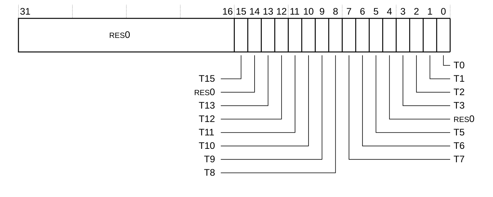

下表显示了 **HSTR** 的位分配。

| 位      | 名称 | 功能 |
| ------- | ---- | ---- |
| [31:16] | -    | 保留，RES0。 |
| [15]    | T15  | 陷阱主寄存器 **CRn = 15**。可能的取值为：<br>`0` 对非调试系统寄存器的访问无影响。<br>`1` 将有效的 **EL1** 或更低级别对主寄存器 **CRn = 15** 的访问陷阱到 **Hyp** 模式。<br>复位值为 0。 |
| [14]    | -    | 保留，RES0。 |
| [13]    | T13  | 陷阱主寄存器 **CRn = 13**。可能的取值为：<br>`0` 对非调试系统寄存器的访问无影响。<br>`1` 将有效的 **EL1** 或更低级别对主寄存器 **CRn = 13** 的访问陷阱到 **Hyp** 模式。<br>复位值为 0。 |
| [12]    | T12  | 陷阱主寄存器 **CRn = 12**。可能的取值为：<br>`0` 对非调试系统寄存器的访问无影响。<br>`1` 将有效的 **EL1** 或更低级别对主寄存器 **CRn = 12** 的访问陷阱到 **Hyp** 模式。<br>复位值为 0。 |
| [11]    | T11  | 陷阱主寄存器 **CRn = 11**。可能的取值为：<br>`0` 对非调试系统寄存器的访问无影响。<br>`1` 将有效的 **EL1** 或更低级别对主寄存器 **CRn = 11** 的访问陷阱到 **Hyp** 模式。<br>复位值为 0。 |
| [10]    | T10  | 陷阱主寄存器 **CRn = 10**。可能的取值为：<br>`0` 对非调试系统寄存器的访问无影响。<br>`1` 将有效的 **EL1** 或更低级别对主寄存器 **CRn = 10** 的访问陷阱到 **Hyp** 模式。<br>复位值为 0。 |
| [9]     | T9   | 陷阱主寄存器 **CRn = 9**。可能的取值为：<br>`0` 对非调试系统寄存器的访问无影响。<br>`1` 将有效的 **EL1** 或更低级别对主寄存器 **CRn = 9** 的访问陷阱到 **Hyp** 模式。<br>复位值为 0。 |
| [8]     | T8   | 陷阱主寄存器 **CRn = 8**。可能的取值为：<br>`0` 对非调试系统寄存器的访问无影响。<br>`1` 将有效的 **EL1** 或更低级别对主寄存器 **CRn = 8** 的访问陷阱到 **Hyp** 模式。<br>复位值为 0。 |
| [7]     | T7   | 陷阱主寄存器 **CRn = 7**。可能的取值为：<br>`0` 对非调试系统寄存器的访问无影响。<br>`1` 将有效的 **EL1** 或更低级别对主寄存器 **CRn = 7** 的访问陷阱到 **Hyp** 模式。<br>复位值为 0。 |
| [6]     | T6   | 陷阱主寄存器 **CRn = 6**。可能的取值为：<br>`0` 对非调试系统寄存器的访问无影响。<br>`1` 将有效的 **EL1** 或更低级别对主寄存器 **CRn = 6** 的访问陷阱到 **Hyp** 模式。<br>复位值为 0。 |
| [5]     | T5   | 陷阱主寄存器 **CRn = 5**。可能的取值为：<br>`0` 对非调试系统寄存器的访问无影响。<br>`1` 将有效的 **EL1** 或更低级别对主寄存器 **CRn = 5** 的访问陷阱到 **Hyp** 模式。<br>复位值为 0。 |
| [4]     | -    | 保留，RES0。 |
| [3]     | T3   | 陷阱主寄存器 **CRn = 3**。可能的取值为：<br>`0` 对非调试系统寄存器的访问无影响。<br>`1` 将有效的 **EL1** 或更低级别对主寄存器 **CRn = 3** 的访问陷阱到 **Hyp** 模式。<br>复位值为 0。 |
| [2]     | T2   | 陷阱主寄存器 **CRn = 2**。可能的取值为：<br>`0` 对非调试系统寄存器的访问无影响。<br>`1` 将有效的 **EL1** 或更低级别对主寄存器 **CRn = 2** 的访问陷阱到 **Hyp** 模式。<br>复位值为 0。 |
| [1]     | T1   | 陷阱主寄存器 **CRn = 1**。可能的取值为：<br>`0` 对非调试系统寄存器的访问无影响。<br>`1` 将有效的 **EL1** 或更低级别对主寄存器 **CRn = 1** 的访问陷阱到 **Hyp** 模式。<br>复位值为 0。 |
| [0]     | T0   | 陷阱主寄存器 **CRn = 0**。可能的取值为：<br>`0` 对非调试系统寄存器的访问无影响。<br>`1` 将有效的 **EL1** 或更低级别对主寄存器 **CRn = 0** 的访问陷阱到 **Hyp** 模式。<br>复位值为 0。 |

要访问 **HSTR**：

```arm
MRC p15, 4, <Rt>, c1, c1, 3 ; 将 HSTR 读入 Rt
MCR p15, 4, <Rt>, c1, c1, 3 ; 将 Rt 写入 HSTR
```

### 3.55 Hyp 向量基地址寄存器（Hyp Vector Base Address Register）

**HVBAR** 保存任何取到 **Hyp** 模式的异常的异常基地址。

**使用限制**

该寄存器可通过下列方式访问：

| EL0 | EL1 | EL2 |
| --- | --- | --- |
| -   | -   | RW  |

**陷阱与使能**

当 **HSTR.T12** 置位时，对 **HVBAR** 的 **EL1** 访问会被陷阱到 **EL2**。

**配置**

此寄存器在所有构建配置中都可用。

**属性**

**HVBAR** 是 32 位寄存器。

下图显示了 **HVBAR** 的位分配。

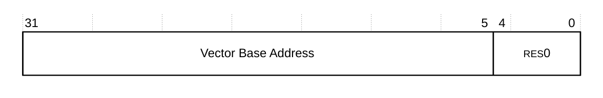

下表显示了 **HVBAR** 的位分配。

| 位      | 名称 | 功能 |
| ------- | ---- | ---- |
| [31:5]  | Vector Base Address | 取到 **EL2** 的异常的异常向量基地址的位 [31:5]。异常向量的位 [4:0] 是异常偏移。<br>复位后，**CFGVECTABLEx[31:5]** 决定向量基地址。 |
| [4:0]   | -    | 保留，RES0。 |

更多信息请参阅 *Arm® Architecture Reference Manual Supplement Armv8, for the Armv8-R AArch32 architecture profile*。

要访问 **HVBAR**：

```arm
MRC p15, 4, <Rt>, c12, c0, 0 ; 将 HVBAR 读入 Rt
MCR p15, 4, <Rt>, c12, c0, 0 ; 将 Rt 写入 HVBAR
```

### 3.56 管理程序复位管理寄存器（Hypervisor Reset Management Register）

对 **HRMR** 寄存器的写请求一次热复位。

**使用限制**

该寄存器可通过下列方式访问：

| EL0 | EL1 | EL2 |
| --- | --- | --- |
| -   | -   | RW  |

**陷阱与使能**

当 **HSTR.T12** 置位时，对 **HRMR** 的 **EL1** 访问会被陷阱到 **EL2**。

**配置**

此寄存器在所有构建配置中都可用。

**属性**

**HRMR** 是 32 位寄存器。

下图显示了 **HRMR** 的位分配。

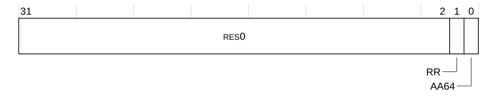

下表显示了 **HRMR** 的位分配。

| 位     | 名称 | 功能 |
| ------ | ---- | ---- |
| [31:2] | -    | 保留，RES0。 |
| [1]    | RR   | 复位请求。将该位置 1 请求一次热复位并置位 **WARMRSTREQx**。 |
| [0]    | AA64 | RAZ/WI。 |

要访问 **HRMR**：

```arm
MRC p15, 4, <Rt>, c12, c0, 2 ; 将 HRMR 读入 Rt
MCR p15, 4, <Rt>, c12, c0, 2 ; 将 Rt 写入 HRMR
```

### 3.57 指令缓存错误记录寄存器 0 和 1（Instruction Cache Error Record Registers 0 and 1）

**IMP_ICERR0** 和 **IMP_ICERR1** 寄存器指示检测到的指令缓存错误的指令缓存 **RAM** 和缓存索引。

**使用限制**

该寄存器可通过下列方式访问：

表 4-137：寄存器可访问性

| EL0 | EL1  | EL2 |
| --- | ---- | --- |
| -   | RW/RO | RW  |

当 **HACTLR.ERR** 置位时，**IMP_ICERR0** 和 **IMP_ICERR1** 寄存器从 **EL1** 可读写；当 **HACTLR.ERR** 清零时，从 **EL1** 只读。

**陷阱与使能**

当 **HACTLR.ERR** 为 0 时，对这些寄存器的 **EL1** 写访问会被陷阱到 **EL2**。

**配置**

这些寄存器在配置有指令缓存的内核中可用。

**属性**

**IMP_ICERR0** 和 **IMP_ICERR1** 是 32 位寄存器。

下图显示了 **IMP_ICERR0** 和 **IMP_ICERR1** 的位分配。

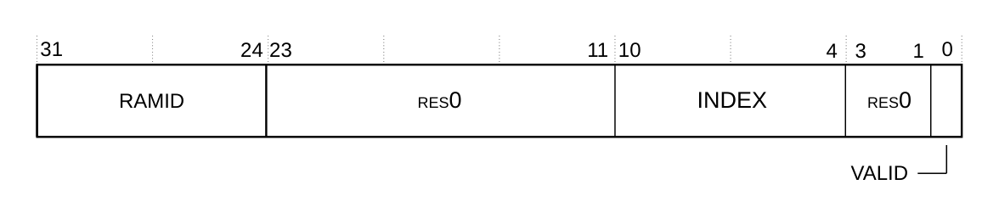

下表显示了 **IMP_ICERR0** 和 **IMP_ICERR1** 的位分配。

| 位      | 名称  | 功能 |
| ------- | ----- | ---- |
| [31:24] | RAMID | 指示 **RAM** 体：<br>**RAMID[7]** **Tag RAM**，体 3。<br>**RAMID[6]** **Tag RAM**，体 2。<br>**RAMID[5]** **Tag RAM**，体 1。<br>**RAMID[4]** **Tag RAM**，体 0。<br>**RAMID[3]** **Data RAM**，体 3。<br>**RAMID[2]** **Data RAM**，体 2。<br>**RAMID[1]** **Data RAM**，体 1。<br>**RAMID[0]** **Data RAM**，体 0。 |
| [23:11] | -     | 保留，RES0。 |
| [10:4]  | INDEX | 指令缓存索引。这是用缓存大小适当掩码的地址位 [12:6]。 |
| [3:1]   | -     | 保留，RES0。 |
| [0]     | VALID | 寄存器内容有效。<br>对这些寄存器的写入是唯一的。如果位 [1] 和位 [0] 置为 0，且寄存器保存的是关于可纠正错误的信息，则寄存器被清零。如果位 [1] 置为 1 且位 [0] 置为 0，则寄存器总是被清零。 |

要访问 **IMP_ICERR0**：

```arm
MRC p15,2,<Rt>,c15,c0,0 ; 将 IMP_ICERR0 读入 Rt
MCR p15,2,<Rt>,c15,c0,0 ; 将 Rt 写入 IMP_ICERR0
```

要访问 **IMP_ICERR1**：

```arm
MRC p15,2,<Rt>,c15,c0,1 ; 将 IMP_ICERR1 读入 Rt
MCR p15,2,<Rt>,c15,c0,1 ; 将 Rt 写入 IMP_ICERR1
```

### 3.58 指令故障地址寄存器（Instruction Fault Address Register）

**IFAR** 保存导致同步预取中止异常的故障地址。

**使用限制**

该寄存器可通过下列方式访问：

| EL0 | EL1 | EL2 |
| --- | --- | --- |
| -   | RW  | RW  |

**陷阱与使能**

**EL1** 对 **IFAR** 的读取和写入分别根据 **HCR.TRVM** 和 **HCR.TVM** 被陷阱到 **EL2**。

**配置**

此寄存器在所有构建配置中都可用。

**属性**

**IFAR** 是 32 位寄存器。

下图显示了 **IFAR** 的位分配。

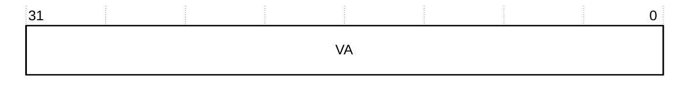

下表显示了 **IFAR** 的位分配。

| 位      | 名称 | 功能 |
| ------- | ---- | ---- |
| [31:0]  | VA   | 同步预取中止异常的故障地址。 |

要访问 **IFAR**：

```arm
MRC p15, 0, <Rt>, c6, c0, 2 ; 将 IFAR 读入 Rt
MCR p15, 0, <Rt>, c6, c0, 2 ; 将 Rt 写入 IFAR
```

### 3.59 指令故障状态寄存器（Instruction Fault Status Register）

**IFSR** 保存关于最后一次指令故障的状态信息。

**使用限制**

该寄存器可通过下列方式访问：

| EL0 | EL1 | EL2 |
| --- | --- | --- |
| -   | RW  | RW  |

**陷阱与使能**

**EL1** 对 **IFSR** 的读取和写入分别根据 **HCR.TRVM** 和 **HCR.TVM** 被陷阱到 **EL2**。

**配置**

此寄存器在所有构建配置中都可用。

**属性**

**IFSR** 是 32 位寄存器。

下图显示了 **IFSR** 的位分配。

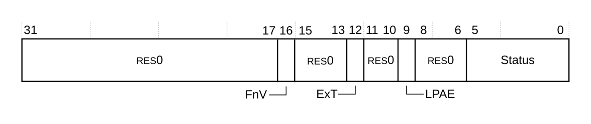

下表显示了 **IFSR** 的位分配。

| 位      | 名称   | 功能 |
| ------- | ------ | ---- |
| [31:17] | -      | 保留，RES0。 |
| [16]    | FnV    | 该字段为 RES0。 |
| [15:13] | -      | 保留，RES0。 |
| [12]    | ExT    | 外部中止类型。该字段指示是由 **AXI** 译码错误还是从设备错误导致的中止：<br>`0` 外部中止标记为 DECERR。<br>`1` 外部中止标记为 SLVERR。<br>对于外部中止以外的中止，该位总是返回 0。 |
| [11:10] | -      | 保留，RES0。 |
| [9]     | LPAE   | 该字段为 RES1。 |
| [8:6]   | -      | 保留，RES0。 |
| [5:0]   | Status | 故障状态位。该字段指示所产生的异常类型。未列出的任何编码均为保留。<br>`0b000100` 转换故障，级别 0。<br>`0b001100` 权限故障，级别 0。<br>`0b010000` 同步外部中止。<br>`0b011000` 存储访问同步奇偶校验错误。<br>`0b100001` 对齐故障。<br>`0b100010` 调试事件。<br>如果数据中止异常由指令缓存维护操作产生，则故障在 **DFSR** 或 **HSR** 中以适当的故障状态码报告为缓存维护故障。对于在 **DFSR** 中报告的此类异常，相应的 **IFSR** 为 UNKNOWN。 |

要访问 **IFSR**：

```arm
MRC p15, 0, <Rt>, c5, c0, 1 ; 将 IFSR 读入 Rt
MCR p15, 0, <Rt>, c5, c0, 1 ; 将 Rt 写入 IFSR
```

### 3.60 指令集属性寄存器 0（Instruction Set Attribute Register 0）

**ID_ISAR0** 提供关于处理器所实现指令集的信息。

**使用限制**

该寄存器可通过下列方式访问：

| EL0 | EL1 | EL2 |
| --- | --- | --- |
| -   | RO  | RO  |

**ID_ISAR0** 必须与 **ID_ISAR1**、**ID_ISAR2**、**ID_ISAR3**、**ID_ISAR4** 和 **ID_ISAR5** 一起解释。参见：

- 第 161 页的 3.61 指令集属性寄存器 1。
- 第 162 页的 3.62 指令集属性寄存器 2。
- 第 164 页的 3.63 指令集属性寄存器 3。
- 第 166 页的 3.64 指令集属性寄存器 4。
- 第 167 页的 3.65 指令集属性寄存器 5。

**陷阱与使能**

当 **HCR.TID3** 或 **HSTR.T0** 置位时，对 **ID_ISAR0** 的 **EL1** 读访问会被陷阱到 **EL2**。

**配置**

此寄存器在所有构建配置中都可用。

**属性**

**ID_ISAR0** 是 32 位寄存器。

下图显示了 **ID_ISAR0** 的位分配。

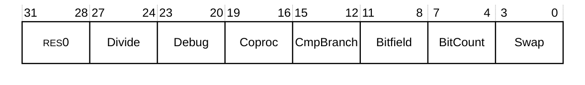

下表显示了 **ID_ISAR0** 的位分配。

| 位      | 名称      | 功能 |
| ------- | --------- | ---- |
| [31:28] | -         | 保留，RES0。 |
| [27:24] | Divide    | 指示实现的 **Divide** 指令：<br>`0x2` **T32** 和 **A32** 指令集中的 **SDIV** 和 **UDIV**。 |
| [23:20] | Debug     | 指示实现的 **Debug** 指令：<br>`0x1` **BKPT**。 |
| [19:16] | Coproc    | 指示实现的系统寄存器访问指令：<br>`0x0` 未实现任何此类指令，由架构单独归属的除外，包括（**coproc==0b1110**）、（**coproc==0b1111**）**Advanced SIMD** 和浮点。 |
| [15:12] | CmpBranch | 指示 **T32** 指令集中实现的组合比较和分支指令：<br>`0x1` **CBNZ** 和 **CBZ**。 |
| [11:8]  | Bitfield  | 指示实现的位字段指令：<br>`0x1` **BFC**、**BFI**、**SBFX** 和 **UBFX**。 |
| [7:4]   | BitCount  | 指示实现的位计数指令：<br>`0x1` **CLZ**。 |
| [3:0]   | Swap      | 指示 **A32** 指令集中实现的交换指令：<br>`0x0` 未实现任何交换指令。 |

要访问 **ID_ISAR0**：

```arm
MRC p15, 0, <Rt>, c0, c2, 0 ; 将 ID_ISAR0 读入 Rt
```

### 3.61 指令集属性寄存器 1（Instruction Set Attribute Register 1）

**ID_ISAR1** 提供关于处理器所实现指令集的信息。

**使用限制**

该寄存器可通过下列方式访问：

| EL0 | EL1 | EL2 |
| --- | --- | --- |
| -   | RO  | RO  |

**ID_ISAR1** 必须与 **ID_ISAR0**、**ID_ISAR2**、**ID_ISAR3**、**ID_ISAR4** 和 **ID_ISAR5** 一起解释。参见：

- 第 159 页的 3.60 指令集属性寄存器 0。
- 第 162 页的 3.62 指令集属性寄存器 2。
- 第 164 页的 3.63 指令集属性寄存器 3。
- 第 166 页的 3.64 指令集属性寄存器 4。
- 第 167 页的 3.65 指令集属性寄存器 5。

**陷阱与使能**

当 **HCR.TID3** 或 **HSTR.T0** 置位时，对 **ID_ISAR1** 的 **EL1** 读访问会被陷阱到 **EL2**。

**配置**

此寄存器在所有构建配置中都可用。

**属性**

**ID_ISAR1** 是 32 位寄存器。

下图显示了 **ID_ISAR1** 的位分配。

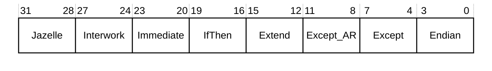

下表显示了 **ID_ISAR1** 的位分配。

| 位      | 名称      | 功能 |
| ------- | --------- | ---- |
| [31:28] | Jazelle   | 指示实现的 **Jazelle** 状态指令：<br>`0x1` **BXJ** 指令以及 **PSR** 中的 **J** 位。 |
| [27:24] | Interwork | 指示实现的交互工作指令：<br>`0x3` **BX** 和 **BLX** 指令以及 **PSR** 中的 **T** 位。**PC** 加载具有类似 **BX** 的行为。**A32** 指令集中以 **PC** 为目的寄存器且 **S** 位清零的数据处理指令同样具有类似 **BX** 的行为。 |
| [23:20] | Immediate | 指示实现的带长立即数的数据处理指令：<br>`0x1`<br>&nbsp;&nbsp;• **MOVT** 指令。<br>&nbsp;&nbsp;• 采用零扩展 16 位立即数的 **MOV** 指令编码。<br>&nbsp;&nbsp;• 采用零扩展 12 位立即数的 **T32 ADD** 和 **SUB** 指令编码，以及由这些编码的伪代码交叉引用的其他 **ADD**、**ADR** 和 **SUB** 编码。 |
| [19:16] | IfThen    | 指示 **T32** 指令集中实现的 **If-Then** 指令：<br>`0x1` **IT** 指令以及 **PSR** 中的 **IT** 位。 |
| [15:12] | Extend    | 指示实现的扩展指令：<br>`0x2` **SXTB**、**SXTH**、**UXTB**、**UXTH**、**SXTB16**、**SXTAB**、**SXTAB16**、**SXTAH**、**UXTB16**、**UXTAB**、**UXTAB16** 和 **UXTAH** 指令。 |
| [11:8]  | Except_AR | 指示实现的 **R** 类异常处理指令：<br>`0x1` **SRS** 和 **RFE** 指令，以及 **CPS** 指令的 **R** 类形式。 |
| [7:4]   | Except    | 指示 **A32** 指令集中实现的异常处理指令：<br>`0x1` **LDM**（异常返回）、**LDM**（用户寄存器）和 **STM**（用户寄存器）指令版本。 |
| [3:0]   | Endian    | 指示实现的字节序指令：<br>`0x1` **SETEND** 指令以及 **PSR** 中的 **E** 位。 |

要访问 **ID_ISAR1**：

```arm
MRC p15, 0, <Rt>, c0, c2, 1 ; 将 ID_ISAR1 读入 Rt
```

### 3.62 指令集属性寄存器 2（Instruction Set Attribute Register 2）

**ID_ISAR2** 提供关于处理器所实现指令集的信息。

**使用限制**

该寄存器可通过下列方式访问：

| EL0 | EL1 | EL2 |
| --- | --- | --- |
| -   | RO  | RO  |

**ID_ISAR2** 必须与 **ID_ISAR0**、**ID_ISAR1**、**ID_ISAR3**、**ID_ISAR4** 和 **ID_ISAR5** 一起解释。参见：

- 第 159 页的 3.60 指令集属性寄存器 0。
- 第 161 页的 3.61 指令集属性寄存器 1。
- 第 164 页的 3.63 指令集属性寄存器 3。
- 第 166 页的 3.64 指令集属性寄存器 4。
- 第 167 页的 3.65 指令集属性寄存器 5。

**陷阱与使能**

当 **HCR.TID3** 或 **HSTR.T0** 置位时，对 **ID_ISAR2** 的 **EL1** 读访问会被陷阱到 **EL2**。

**配置**

此寄存器在所有构建配置中都可用。

**属性**

**ID_ISAR2** 是 32 位寄存器。

下图显示了 **ID_ISAR2** 的位分配。

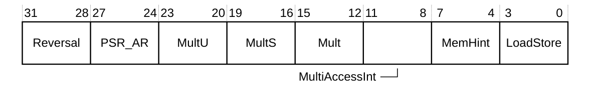

下表显示了 **ID_ISAR2** 的位分配。

| 位      | 名称           | 功能 |
| ------- | -------------- | ---- |
| [31:28] | Reversal       | 指示实现的翻转指令：<br>`0x2` **REV**、**REV16** 和 **REVSH**，以及 **RBIT** 指令。 |
| [27:24] | PSR_AR         | 指示实现的 **R** 类 **PSR** 操作指令：<br>`0x1` **MRS** 和 **MSR** 指令，以及数据处理指令的异常返回形式。<br>注意：<br>数据处理指令的异常返回形式为：<br>&nbsp;&nbsp;• 在 **A32** 指令集中，以 **PC** 为目的寄存器且 **S** 位置位的数据处理指令。<br>&nbsp;&nbsp;• 在 **T32** 指令集中，**SUBS PC, LR, #N** 指令。 |
| [23:20] | MultU          | 指示实现的高级无符号乘法指令：<br>`0x2` **UMAAL**、**UMLAL** 和 **UMULL** 指令。 |
| [19:16] | MultS          | 指示实现的高级有符号乘法指令。<br>`0x3` **SMLABB**、**SMLABT**、**SMLAD**、**SMLADX**、**SMLAL**、**SMLALBB**、**SMLALBT**、**SMLALD**、**SMLALDX**、**SMLALTB**、**SMLALTT**、**SMLATB**、**SMLATT**、**SMLAWB**、**SMLAWT**、**SMLSD**、**SMLSDX**、**SMLSLD**、**SMLSLDX**、**SMMLA**、**SMMLAR**、**SMMLS**、**SMMLSR**、**SMMUL**、**SMMULR**、**SMUAD**、**SMUADX**、**SMULBB**、**SMULBT**、**SMULL**、**SMULTB**、**SMULTT**、**SMULWB**、**SMULWT**、**SMUSD** 和 **SMUSDX** 指令，以及 **PSR** 中的 **Q** 位。 |
| [15:12] | Mult           | 指示实现的附加乘法指令：<br>`0x2` **MLA**、**MLS** 和 **MUL** 指令。 |
| [11:8]  | MultiAccessInt | 指示对可中断多访问指令的支持：<br>`0x1` **LDM** 和 **STM** 指令可重新开始。 |
| [7:4]   | MemHint        | 指示实现的存储器提示指令：<br>`0x4` **PLD**、**PLI** 和 **PLDW** 指令。<br>注意：<br>Cortex®-R52+ 处理器：<br>&nbsp;&nbsp;• 将 **PLI** 指令视为 **NOP**。<br>&nbsp;&nbsp;• 当出现 **PLD** 或 **PLDW** 指令时触发缓存行填充，除非该行已在缓存中或该位置被视为不可缓存。 |
| [3:0]   | LoadStore      | 指示实现的附加加载/存储指令：<br>`0x2` **LDRD**、**STRD**、加载获取（**LDAB**、**LDAH**、**LDA**、**LDAEXB**、**LDAEXH**、**LDAEX** 和 **LDAEXD**）以及存储释放（**STLB**、**STLH**、**STL**、**STLEXB**、**STLEXH**、**STLEX** 和 **STLEXD**）指令。 |

要访问 **ID_ISAR2**：

```arm
MRC p15, 0, <Rt>, c0, c2, 2 ; 将 ID_ISAR2 读入 Rt
```

### 3.63 指令集属性寄存器 3（Instruction Set Attribute Register 3）

**ID_ISAR3** 提供关于处理器所实现指令集的信息。

**使用限制**

该寄存器可通过下列方式访问：

| EL0 | EL1 | EL2 |
| --- | --- | --- |
| -   | RO  | RO  |

**ID_ISAR3** 必须与 **ID_ISAR0**、**ID_ISAR1**、**ID_ISAR2**、**ID_ISAR4** 和 **ID_ISAR5** 一起解释。参见：

- 第 159 页的 3.60 指令集属性寄存器 0。
- 第 161 页的 3.61 指令集属性寄存器 1。
- 第 162 页的 3.62 指令集属性寄存器 2。
- 第 166 页的 3.64 指令集属性寄存器 4。
- 第 167 页的 3.65 指令集属性寄存器 5。

**陷阱与使能**

当 **HCR.TID3** 或 **HSTR.T0** 置位时，对 **ID_ISAR3** 的 **EL1** 读访问会被陷阱到 **EL2**。

**配置**

此寄存器在所有构建配置中都可用。

**属性**

**ID_ISAR3** 是 32 位寄存器。

下图显示了 **ID_ISAR3** 的位分配。

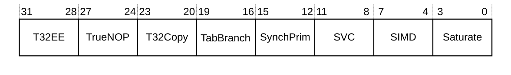

下表显示了 **ID_ISAR3** 的位分配。

| 位      | 名称      | 功能 |
| ------- | --------- | ---- |
| [31:28] | T32EE     | 指示实现的 **T32EE** 指令：<br>`0x0` 未实现任何此类指令。 |
| [27:24] | TrueNOP   | 指示对真 **NOP** 指令的支持：<br>`0x1` **A32** 和 **T32** 指令集中的真 **NOP** 指令，以及附加的 **NOP** 兼容提示。 |
| [23:20] | T32Copy   | 指示对 **T32** 不设置标志的 **MOV** 指令的支持：<br>`0x1` 支持 **T32** 指令集 **MOV**（寄存器）指令的 T1 编码，即从低寄存器复制到低寄存器。 |
| [19:16] | TabBranch | 指示 **T32** 指令集中实现的表分支指令。<br>`0x1` **TBB** 和 **TBH** 指令。 |
| [15:12] | SynchPrim | 指示实现的同步原语指令。<br>`0x2` **CLREX**、**LDREX**、**LDREXB**、**LDREXD**、**STREX**、**STREXB**、**STREXD** 和 **STREXH** 指令。 |
| [11:8]  | SVC       | 指示实现的 **SVC** 指令：<br>`0x1` **SVC** 指令。 |
| [7:4]   | SIMD      | 指示实现的单指令多数据（**SIMD**）指令。<br>`0x3` **PKHBT**、**PKHTB**、**QADD16**、**QADD8**、**QASX**、**QSUB16**、**QSUB8**、**QSAX**、**SADD16**、**SADD8**、**SASX**、**SEL**、**SHADD16**、**SHADD8**、**SHASX**、**SHSUB16**、**SHSUB8**、**SHSAX**、**SSAT**、**SSAT16**、**SSUB16**、**SSUB8**、**SSAX**、**SXTAB16**、**SXTB16**、**UADD16**、**UADD8**、**UASX**、**UHADD16**、**UHADD8**、**UHASX**、**UHSUB16**、**UHSUB8**、**UHSAX**、**UQADD16**、**UQADD8**、**UQASX**、**UQSUB16**、**UQSUB8**、**UQSAX**、**USAD8**、**USADA8**、**USAT**、**USAT16**、**USUB16**、**USUB8**、**USAX**、**UXTAB16**、**UXTB16** 指令，以及 **PSR** 中的 **Q** 和 **GE[3:0]** 位。 |
| [3:0]   | Saturate  | 指示实现的饱和指令：<br>`0x1` **QADD**、**QDADD**、**QDSUB**、**QSUB** 指令，以及 **PSR** 中的 **Q** 位。 |

要访问 **ID_ISAR3**：

```arm
MRC p15, 0, <Rt>, c0, c2, 3 ; 将 ID_ISAR3 读入 Rt
```

### 3.64 指令集属性寄存器 4（Instruction Set Attribute Register 4）

**ID_ISAR4** 提供关于处理器所实现指令集的信息。

**使用限制**

该寄存器可通过下列方式访问：

| EL0 | EL1 | EL2 |
| --- | --- | --- |
| -   | RO  | RO  |

**ID_ISAR4** 必须与 **ID_ISAR0**、**ID_ISAR1**、**ID_ISAR2**、**ID_ISAR3** 和 **ID_ISAR5** 一起解释。参见：

- 第 159 页的 3.60 指令集属性寄存器 0。
- 第 161 页的 3.61 指令集属性寄存器 1。
- 第 162 页的 3.62 指令集属性寄存器 2。
- 第 164 页的 3.63 指令集属性寄存器 3。
- 第 167 页的 3.65 指令集属性寄存器 5。

**陷阱与使能**

当 **HCR.TID3** 或 **HSTR.T0** 置位时，对 **ID_ISAR4** 的 **EL1** 读访问会被陷阱到 **EL2**。

**配置**

此寄存器在所有构建配置中都可用。

**属性**

**ID_ISAR4** 是 32 位寄存器。

下图显示了 **ID_ISAR4** 的位分配。

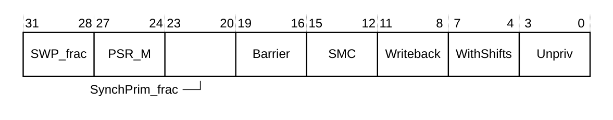

下表显示了 **ID_ISAR4** 的位分配。

| 位      | 名称           | 功能 |
| ------- | -------------- | ---- |
| [31:28] | SWP_frac       | 指示对 **SWP** 或 **SWPB** 指令的存储器系统总线锁定支持：<br>`0x0` 未实现 **SWP** 和 **SWPB** 指令。 |
| [27:24] | PSR_M          | 指示实现的 **M** 类 **PSR** 修改指令：<br>`0x0` 未实现任何此类指令。 |
| [23:20] | SynchPrim_frac | 该字段与 **ID_ISAR3.SynchPrim** 字段一起用于指示实现的同步原语指令：<br>`0x0` **CLREX**、**LDREX**、**LDREXB**、**LDREXD**、**LDREXH**、**STREX**、**STREXB**、**STREXD** 和 **STREXH** 指令。 |
| [19:16] | Barrier        | 指示 **A32** 和 **T32** 指令集中支持的屏障指令：<br>`0x1` **DMB**、**DSB** 和 **ISB** 屏障指令。 |
| [15:12] | SMC            | 指示实现的 **SMC** 指令：<br>`0x0` 不支持 **SMC** 指令。 |
| [11:8]  | Writeback      | 指示对写回寻址模式的支持：<br>`0x1` 处理器支持 **Armv8** 中定义的所有写回寻址模式。 |
| [7:4]   | WithShifts     | 指示对带移位的指令的支持：<br>`0x4`<br>&nbsp;&nbsp;• 支持 **LSL 0-3** 范围内的加载和存储移位。<br>&nbsp;&nbsp;• 支持其他常量移位选项，包括加载/存储及其他指令。<br>&nbsp;&nbsp;• 支持寄存器控制的移位选项。 |
| [3:0]   | Unpriv         | 指示实现的非特权指令：<br>`0x2` **LDRBT**、**LDRHT**、**LDRSBT**、**LDRSHT**、**LDRT**、**STRBT**、**STRHT** 和 **STRT** 指令。 |

要访问 **ID_ISAR4**：

```arm
MRC p15, 0, <Rt>, c0, c2, 4 ; 将 ID_ISAR4 读入 Rt
```

### 3.65 指令集属性寄存器 5（Instruction Set Attribute Register 5）

**ID_ISAR5** 提供关于处理器所实现指令集的信息。

**使用限制**

该寄存器可通过下列方式访问：

| EL0 | EL1 | EL2 |
| --- | --- | --- |
| -   | RO  | RO  |

**ID_ISAR5** 必须与 **ID_ISAR0**、**ID_ISAR1**、**ID_ISAR2**、**ID_ISAR3** 和 **ID_ISAR4** 一起解释。参见：

- 第 159 页的 3.60 指令集属性寄存器 0。
- 第 161 页的 3.61 指令集属性寄存器 1。
- 第 162 页的 3.62 指令集属性寄存器 2。
- 第 164 页的 3.63 指令集属性寄存器 3。
- 第 166 页的 3.64 指令集属性寄存器 4。

**陷阱与使能**

当 **HCR.TID3** 或 **HSTR.T0** 置位时，对 **ID_ISAR5** 的 **EL1** 读访问会被陷阱到 **EL2**。

**配置**

此寄存器在所有构建配置中都可用。

**属性**

**ID_ISAR5** 是 32 位寄存器。

下图显示了 **ID_ISAR5** 的位分配。

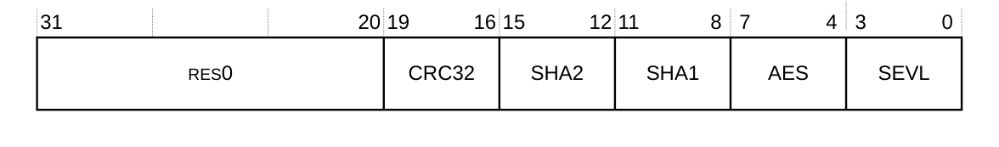

下表显示了 **ID_ISAR5** 的位分配。

| 位      | 名称  | 功能 |
| ------- | ----- | ---- |
| [31:20] | -     | 保留，RES0。 |
| [19:16] | CRC32 | 指示 **AArch32** 状态下是否实现 **CRC32** 指令：<br>`0x1` 实现了 **CRC32** 指令。 |
| [15:12] | SHA2  | 指示 **AArch32** 状态下是否实现 **SHA2** 指令：<br>`0x0` 未实现密码扩展。 |
| [11:8]  | SHA1  | 指示 **AArch32** 状态下是否实现 **SHA1** 指令：<br>`0x0` 未实现密码扩展。 |
| [7:4]   | AES   | 指示 **AArch32** 状态下是否实现 **AES** 指令：<br>`0x0` 未实现密码扩展。 |
| [3:0]   | SEVL  | 指示是否实现 **SEVL** 指令：<br>`0x1` 实现了 **SEVL** 以发送本地事件。 |

要访问 **ID_ISAR5**：

```arm
MRC p15,0,<Rt>,c0,c2,5 ; 将 ID_ISAR5 读入 Rt
```

### 3.66 中断监视寄存器（Interrupt Monitoring Register）

**IMP_INTMONR** 提供对计数器的访问，用于检测内核进入 **hypervisor** 模式后，当前 **PSR** 中的中断屏蔽位未在给定时间限制内清零的情况。**IMP_INTMONR** 统计物理系统错误、物理中断和物理快速中断的屏蔽位置位的周期数，并在超出限制时通过 **ERREVENTx[18]** 发出超时信号。**IMP_INTMONR** 不要求存在被屏蔽的挂起中断。**IMP_INTMONR** 支持两种工作模式：看门狗模式和最大值监视模式。对于两种工作模式，当任一屏蔽位置位从而无法取相应中断时，计数器递增。当所有使能的中断都可取时，计数器复位为零。在看门狗模式下，当计数器达到 **IMP_INTMONR.MAXCYCLESBY16×16** 时产生事件。在最大值监视模式下，**IMP_INTMONR.MAXCYCLESBY16** 保存计数器在复位前已达到的最大值除以 16。

**使用限制**

该寄存器可通过下列方式访问：

| EL0 | EL1  | EL2 |
| --- | ---- | --- |
| -   | RW/RO | RW  |

当 **HACTLR.INTMONR** 置位时，从 **EL1** 可读写；当 **HACTLR.INTMONR** 清零时，从 **EL1** 只读，且从 **EL0** 不可访问。

**陷阱与使能**

当 **HACTLR.INTMONR** 为 0 时，对 **INTMONR** 的 **EL1** 写访问会被陷阱到 **EL2**。

**配置**

此寄存器在所有构建配置中都可用。

**属性**

**IMP_INTMONR** 是 32 位寄存器。

下图显示了 **IMP_INTMONR** 的位分配。

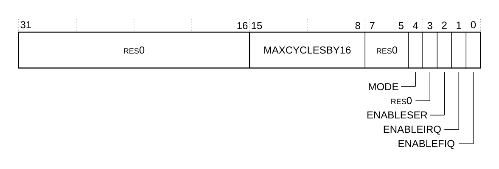

下表显示了 **IMP_INTMONR** 的位分配。

| 位      | 名称            | 功能 |
| ------- | --------------- | ---- |
| [31:16] | -               | 保留，RES0。 |
| [15:8]  | MAXCYCLESBY16   | 最大计数除以 16。 |
| [7:5]   | -               | 保留，RES0。 |
| [4]     | MODE            | 设置计数器的工作模式：<br>`0` 看门狗模式。<br>`1` 最大值监视模式。 |
| [3]     | -               | 保留，RES0。 |
| [2]     | ENABLESER       | 使能统计物理系统错误被屏蔽的周期。 |
| [1]     | ENABLEIRQ       | 使能统计无法取的物理中断。 |
| [0]     | ENABLEFIQ       | 使能统计无法取的快速中断。 |

要访问 **IMP_INTMONR**：

```arm
MRC p15, 1, <Rt>, c15, c3, 4 ; 将 IMP_INTMONR 读入 Rt
MCR p15, 1, <Rt>, c15, c3, 4 ; 将 Rt 写入 IMP_INTMONR
```

### 3.67 中断状态寄存器（Interrupt Status Register）

**ISR** 显示是否存在挂起的 **IRQ**、**FIQ** 或外部中止。被指示为挂起的中止可能是物理中止或虚拟中止。

**使用限制**

该寄存器可通过下列方式访问：

表 4-157：寄存器可访问性

| EL0 | EL1 | EL2 |
| --- | --- | --- |
| -   | RO  | RO  |

**陷阱与使能**

当 **HSTR.T12** 置位时，对 **ISR** 的 **EL1** 读访问会被陷阱到 **EL2**。

**配置**

此寄存器在所有构建配置中都可用。

**属性**

**ISR** 是 32 位寄存器。

下图显示了 **ISR** 的位分配。


下表显示了 **ISR** 的位分配。

| 位     | 名称 | 功能 |
| ------ | ---- | ---- |
| [31:9] | -    | 保留，RES0。 |
| [8]    | A    | 外部中止挂起位：<br>`0` 无挂起的外部中止。<br>`1` 有一个外部中止挂起。 |
| [7]    | I    | **IRQ** 挂起位。指示是否有 **IRQ** 中断挂起：<br>`0` 无挂起的 **IRQ**。<br>`1` 有 **IRQ** 中断挂起。 |
| [6]    | F    | **FIQ** 挂起位。指示是否有 **FIQ** 中断挂起：<br>`0` 无挂起的 **FIQ**。<br>`1` 有 **FIQ** 中断挂起。 |
| [5:0]  | -    | 保留，RES0。 |

要访问 **ISR**：

```arm
MRC p15, 0, <Rt>, c12, c1, 0 ; 将 ISR 读入 Rt
```

### 3.68 全部无效化寄存器（Invalidate All Register）

**IMP_CDBGDCI** 始终为 RES0。

### 3.69 主 ID 寄存器（Main ID Register）

**MIDR** 提供处理器的标识信息，包括设备的实现者代码和设备 **ID** 号。

**使用限制**

该寄存器可通过下列方式访问：

| EL0 | EL1 | EL2 |
| --- | --- | --- |
| -   | RO  | RO  |

**陷阱与使能**

当 **HSTR.T0** 置位时，对 **MIDR** 的 **EL1** 访问会被陷阱到 **EL2**。

**配置**

此寄存器在所有构建配置中都可用。

**属性**

**MIDR** 是 32 位寄存器。

下图显示了 **MIDR** 的位分配。


下表显示了 **MIDR** 的位分配。

| 位      | 名称        | 功能 |
| ------- | ----------- | ---- |
| [31:24] | Implementer | 指示实现者代码。该值为：<br>`0x41` Arm Limited。 |
| [23:20] | Variant     | 指示处理器的变体号。这是产品修订状态 rnpn 描述中 rn 部分的次版本号 n。该值为：<br>`0x0` r0p1。 |
| [19:16] | Architecture | 指示架构代码。该值为：<br>`0xF` 由 **CPUID** 方案定义。 |
| [15:4]  | PartNum     | 指示主部件号。该值为：<br>`0xD16` Cortex®-R52+ 处理器。 |
| [3:0]   | Revision    | 指示处理器的小版本号。这是产品修订状态 rnpn 描述中 pn 部分的小版本号 n。该值为：<br>`0x1` r0p1。 |

要访问 **MIDR**：

```arm
MRC p15, 0, <Rt>, c0, c0, 0 ; 将 MIDR 读入 Rt
```

**MIDR** 还可以通过内存映射接口和外部调试接口访问，偏移为 0xD00。

### 3.70 存储器属性间接寄存器 0 和 1（Memory Attribute Indirection Registers 0 and 1）

**MAIR0** 和 **MAIR1** 提供与保护区域限地址寄存器中可能的 **AttrIndx** 值相对应的存储器属性编码。该寄存器给出从 **Hyp** 模式以外状态进行存储器访问时使用的值。

**使用限制**

这些寄存器可通过下列方式访问：

| EL0 | EL1 | EL2 |
| --- | --- | --- |
| -   | RW  | RW  |

**陷阱与使能**

当 **HCR.TVM** 置位时，对这些寄存器的 **EL1** 写访问会被陷阱到 **EL2**。当 **HCR.TRVM** 置位时，**EL1** 读访问会被陷阱到 **EL2**。当 **HSTR.T10** 置位时，**EL1** 访问会被陷阱到 **EL2**。

**配置**

这些寄存器在所有构建配置中都可用。

**属性**

**MAIR0** 和 **MAIR1** 是 32 位寄存器。

下图显示了 **MAIR0** 和 **MAIR1** 的位分配。


下表显示了 **MAIR0** 和 **MAIR1** 的位分配。

| 位     | 名称     | 功能 |
| ------ | -------- | ---- |
| [7:0]  | Attr<m>⁶⁰ | 保护区域限地址寄存器中 **AttrIndx[2:0]** 项的存储器属性编码，其中：<br>&nbsp;&nbsp;• **AttrIndx[2]** 选择相应的 **MAIR**：<br>&nbsp;&nbsp;&nbsp;&nbsp;◦ 将 **AttrIndx[2]** 置为 0 选择 **MAIR0**。<br>&nbsp;&nbsp;&nbsp;&nbsp;◦ 将 **AttrIndx[2]** 置为 1 选择 **MAIR1**。<br>&nbsp;&nbsp;• **AttrIndx[2:0]** 给出 **Attr\<n\>** 中 \<n\> 的值。 |

⁶⁰ 其中 m 为 0-7。

下表显示了 **Attr\<n\>[7:4]** 的位分配。

表 4-163：**Attr\<n\>[7:4]** 位分配

| 位             | 描述 |
| -------------- | ---- |
| `0b0000`       | 设备存储器。有关设备存储器类型，请参见下表。 |
| `0b00RW`（**RW** 不为 00） | 普通存储器，外层写通瞬态⁶¹。 |
| `0b0100`       | 普通存储器，外层不可缓存。 |
| `0b01RW`（**RW** 不为 00） | 普通存储器，外层写回瞬态⁶¹。 |
| `0b10RW`       | 普通存储器，外层写通非瞬态。 |
| `0b11RW`       | 普通存储器，外层写回非瞬态。 |

⁶¹ 瞬态提示被忽略。

下表显示了 **Attr\<n\>[3:0]** 的位分配。**Attr\<n\>[3:0]** 的编码取决于 **Attr\<n\>[7:4]** 的值。

表 4-164：**Attr\<n\>[3:0]** 位分配

| 位             | 当 **Attr\<n\>[7:4]** 为 0000 时的描述 | 当 **Attr\<n\>[7:4]** 不为 0000 时的描述 |
| -------------- | -------------------------------------- | ---------------------------------------- |
| `0b0000`       | Device-nGnRnE 存储器 | UNPREDICTABLE |
| `0b00RW`（**RW** 不为 00） | UNPREDICTABLE | 普通存储器，内层写通瞬态 |
| `0b0100`       | Device-nGnRE 存储器 | 普通存储器，内层不可缓存 |
| `0b01RW`（**RW** 不为 00） | UNPREDICTABLE | 普通存储器，内层写回瞬态 |
| `0b1000`       | Device-nGRE 存储器 | 普通存储器，内层写通非瞬态（RW=00） |
| `0b10RW`（**RW** 不为 00） | UNPREDICTABLE | 普通存储器，内层写通非瞬态 |
| `0b1100`       | Device-GRE 存储器 | 普通存储器，内层写回非瞬态（RW=00） |
| `0b11RW`（**RW** 不为 00） | UNPREDICTABLE | 普通存储器，内层写回非瞬态 |

下表给出了表 4-163：**Attr\<n\>[7:4]** 位分配 和表 4-164：**Attr\<n\>[3:0]** 位分配 中部分 **Attr\<n\>** 编码所使用的 **R** 和 **W** 位的编码，它们分别定义读分配和写分配策略。

表 4-165：部分 **Attr\<m\>** 字段中 **R** 和 **W** 位的编码

| R 或 W | 描述 |
| ------ | ---- |
| 0      | 不分配。 |
| 1      | 分配。 |

要访问 **MAIR0**：

```arm
MRC p15, 0, <Rt>, c10, c2, 0 ; 将 MAIR0 读入 Rt
MCR p15, 0, <Rt>, c10, c2, 0 ; 将 Rt 写入 MAIR0
```

要访问 **MAIR1**：

```arm
MRC p15, 0, <Rt>, c10, c2, 1 ; 将 MAIR1 读入 Rt
MCR p15, 0, <Rt>, c10, c2, 1 ; 将 Rt 写入 MAIR1
```

### 3.71 存储器模型特性寄存器 0（Memory Model Feature Register 0）

**ID_MMFR0** 提供关于存储器模型和存储器管理支持的信息。

**使用限制**

该寄存器可通过下列方式访问：

| EL0 | EL1 | EL2 |
| --- | --- | --- |
| -   | RO  | RO  |

必须与 **ID_MMFR1**、**ID_MMFR2** 和 **ID_MMFR3** 一起解释。参见：

- 第 176 页的 3.72 存储器模型特性寄存器 1。
- 第 178 页的 3.73 存储器模型特性寄存器 2。
- 第 179 页的 3.74 存储器模型特性寄存器 3。

**陷阱与使能**

当 **HCR.TID3** 或 **HSTR.T0** 置位时，对 **ID_MMFR0** 的 **EL1** 读访问会被陷阱到 **EL2**。

**配置**

此寄存器在所有构建配置中都可用。

**属性**

**ID_MMFR0** 是 32 位寄存器。

下图显示了 **ID_MMFR0** 的位分配。


下表显示了 **ID_MMFR0** 的位分配。

| 位      | 名称     | 功能 |
| ------- | -------- | ---- |
| [31:28] | InnerShr | 指示实现的最内层共享域：<br>`0x0` 实现为不可缓存。 |
| [27:24] | FCSE     | 指示对快速上下文切换扩展（**FCSE**）的支持：<br>`0x0` 不支持。 |
| [23:20] | AuxReg   | 指示对辅助寄存器的支持：<br>`0x2` 支持辅助故障状态寄存器（**AIFSR** 和 **ADFSR**）以及辅助控制寄存器。 |
| [19:16] | TCM      | 指示对 **TCM** 及相关 **DMA** 的支持：<br>`0x1` 支持 **TCM** 及相关 **DMA**。 |
| [15:12] | ShareLvl | 指示实现的共享级别数量：<br>`0x1` 实现两级共享性。 |
| [11:8]  | OuterShr | 指示实现的最外层共享域：<br>`0x0` 实现为不可缓存。 |
| [7:4]   | PMSA     | 指示对 **PMSA** 的支持：<br>`0x4` 支持 **Armv8-R AArch32** 基地址和限地址 **PMSA**。 |
| [3:0]   | VMSA     | 指示对虚拟存储器系统架构（**VMSA**）的支持。<br>`0x0` 不支持 **VMSA**。 |

要访问 **ID_MMFR0**：

```arm
MRC p15,0,<Rt>,c0,c1,4 ; 将 ID_MMFR0 读入 Rt
```

### 3.72 存储器模型特性寄存器 1（Memory Model Feature Register 1）

**ID_MMFR1** 提供关于存储器模型和存储器管理支持的信息。

**使用限制**

该寄存器可通过下列方式访问：

| EL0 | EL1 | EL2 |
| --- | --- | --- |
| -   | RO  | RO  |

必须与 **ID_MMFR0**、**ID_MMFR2** 和 **ID_MMFR3** 一起解释。参见：

- 第 175 页的 3.71 存储器模型特性寄存器 0。
- 第 178 页的 3.73 存储器模型特性寄存器 2。
- 第 179 页的 3.74 存储器模型特性寄存器 3。

**陷阱与使能**

当 **HCR.TID3** 或 **HSTR.T0** 置位时，对 **ID_MMFR1** 的 **EL1** 读访问会被陷阱到 **EL2**。

**配置**

此寄存器在所有构建配置中都可用。

**属性**

**ID_MMFR1** 是 32 位寄存器。

下图显示了 **ID_MMFR1** 的位分配。


下表显示了 **ID_MMFR1** 的位分配。该表应与 *Arm® Architecture Reference Manual Supplement Armv8, for the Armv8-R AArch32 architecture profile* 一起阅读。

| 位      | 名称      | 功能 |
| ------- | --------- | ---- |
| [31:28] | BPred     | 指示分支预测器管理要求：<br>`0x4` 为保证执行正确性，分支预测器在任何时候都不需要冲刷。 |
| [27:24] | L1TstCln  | 指示支持的 L1 数据缓存测试和清洁操作（针对哈佛或统一缓存实现）：<br>`0x0` 不支持。 |
| [23:20] | L1Uni     | 指示支持的整个 L1 缓存维护操作（针对统一缓存实现）：<br>`0x0` 不支持。 |
| [19:16] | L1Hvd     | 指示支持的整个 L1 缓存维护操作（针对哈佛缓存实现）：<br>`0x0` 不支持。 |
| [15:12] | L1UniSW   | 指示支持的按组/路进行的 L1 缓存行维护操作（针对统一缓存实现）：<br>`0x0` 不支持。 |
| [11:8]  | L1HvdSW   | 指示支持的按组/路进行的 L1 缓存行维护操作（针对哈佛缓存实现）：<br>`0x0` 不支持。 |
| [7:4]   | L1UniVA   | 指示支持的按 **MVA** 进行的 L1 缓存行维护操作（针对统一缓存实现）：<br>`0x0` 不支持。 |
| [3:0]   | L1HvdVA   | 指示支持的按 **MVA** 进行的 L1 缓存行维护操作（针对哈佛缓存实现）：<br>`0x0` 不支持。 |

要访问 **ID_MMFR1**：

```arm
MRC p15, 0, <Rt>, c0, c1, 5 ; 将 ID_MMFR1 读入 Rt
```

### 3.73 存储器模型特性寄存器 2（Memory Model Feature Register 2）

**ID_MMFR2** 提供关于已实现的存储器模型和存储器管理支持的信息。

**使用限制**

该寄存器可通过下列方式访问：

| EL0 | EL1 | EL2 |
| --- | --- | --- |
| -   | RO  | RO  |

必须与 **ID_MMFR0**、**ID_MMFR1** 和 **ID_MMFR3** 一起解释。参见：

- 第 175 页的 3.71 存储器模型特性寄存器 0。
- 第 176 页的 3.72 存储器模型特性寄存器 1。
- 第 179 页的 3.74 存储器模型特性寄存器 3。

**陷阱与使能**

当 **HCR.TID3** 或 **HSTR.T0** 置位时，对 **ID_MMFR2** 的 **EL1** 读访问会被陷阱到 **EL2**。

**配置**

此寄存器在所有构建配置中都可用。

**属性**

**ID_MMFR2** 是 32 位寄存器。

下图显示了 **ID_MMFR2** 的位分配。


下表显示了 **ID_MMFR2** 的位分配。

| 位      | 名称      | 功能 |
| ------- | --------- | ---- |
| [31:28] | HWAccFlg  | 硬件访问标志。指示对硬件访问标志的支持（作为 **VMSAv7** 实现的一部分）：<br>`0x0` 不支持。 |
| [27:24] | WFIStall  | 等待中断停滞。指示对等待中断（**WFI**）停滞的支持：<br>`0x1` 支持 **WFI** 停滞。 |
| [23:20] | MemBarr   | 存储器屏障。指示支持的 CP15* 存储器屏障操作。<br>`0x2` 支持的 CP15* 存储器屏障操作为：<br>&nbsp;&nbsp;• 数据同步屏障（**CP15DSB**）。<br>&nbsp;&nbsp;• 指令同步屏障（**CP15ISB**）。<br>&nbsp;&nbsp;• 数据存储器屏障（**CP15DMB**）。 |
| [19:16] | UniTLB    | 统一 **TLB**。指示支持的 **TLB** 维护操作（针对统一 **TLB** 实现）。<br>`0x0` 不支持。 |
| [15:12] | HvdTLB    | 哈佛 **TLB**。指示支持的 **TLB** 维护操作（针对哈佛 **TLB** 实现）：<br>`0x0` 不支持。 |
| [11:8]  | LL1HvdRng | L1 哈佛缓存范围。指示支持的 L1 缓存维护范围操作（针对哈佛缓存实现）：<br>`0x0` 不支持。 |
| [7:4]   | L1HvdBG   | L1 哈佛缓存后台取指。指示支持的 L1 缓存后台预取操作（针对哈佛缓存实现）：<br>`0x0` 不支持。 |
| [3:0]   | L1HvdFG   | L1 哈佛缓存前台取指。指示支持的 L1 缓存前台预取操作（针对哈佛缓存实现）：<br>`0x0` 不支持。 |

要访问 **ID_MMFR2**：

```arm
MRC p15,0,<Rt>,c0,c1,6 ; 将 ID_MMFR2 读入 Rt
```

### 3.74 存储器模型特性寄存器 3（Memory Model Feature Register 3）

**ID_MMFR3** 提供关于存储器模型和存储器管理支持的信息。

**使用限制**

该寄存器可通过下列方式访问：

| EL0 | EL1 | EL2 |
| --- | --- | --- |
| -   | RO  | RO  |

必须与 **ID_MMFR0**、**ID_MMFR1** 和 **ID_MMFR2** 一起解释。参见：

- 第 175 页的 3.71 存储器模型特性寄存器 0。
- 第 176 页的 3.72 存储器模型特性寄存器 1。
- 第 178 页的 3.73 存储器模型特性寄存器 2。

**陷阱与使能**

当 **HCR.TID3** 或 **HSTR.T0** 置位时，对 **ID_MMFR3** 的 **EL1** 读访问会被陷阱到 **EL2**。

**配置**

此寄存器在所有构建配置中都可用。

**属性**

**ID_MMFR3** 是 32 位寄存器。

下图显示了 **ID_MMFR3** 的位分配。


下表显示了 **ID_MMFR3** 的位分配。该表应与 *Arm® Architecture Reference Manual Supplement Armv8, for the Armv8-R AArch32 architecture profile* 一起阅读。

| 位      | 名称       | 功能 |
| ------- | ---------- | ---- |
| [31:28] | Supersec   | 超级段。指示对超级段的支持：<br>`0xF` 不支持超级段。 |
| [27:24] | CMemSz     | 缓存存储器大小。指示处理器缓存支持的物理存储器大小：<br>`0x0` 4GB，对应 32 位物理地址范围。 |
| [23:20] | CohWalk    | 一致遍历。指示转换表更新是否需要清洁到统一化点：<br>`0x1` 对转换表的更新不需要清洁到统一化点即可确保后续转换表遍历可见。 |
| [19:16] | -          | 保留，RES0。 |
| [15:12] | MaintBcst  | 维护广播。指示缓存和分支预测器操作是否广播：<br>`0x2` 缓存和分支预测器操作根据共享性和指令定义的行为影响相应结构。 |
| [11:8]  | BPMaint    | 分支预测器维护。指示支持的分支预测器维护操作。<br>`0x2` 支持分支预测器维护操作。 |
| [7:4]   | CMaintSW   | 按组/路的缓存维护。指示支持的按组/路进行的缓存维护操作。<br>`0x1` 支持按组/路进行的分层缓存维护操作。 |
| [3:0]   | CMaintVA   | 按 **VA** 的缓存维护。指示支持的按 **VA** 进行的缓存维护操作。<br>`0x1` 支持按 **VA** 进行的分层缓存维护操作。 |

要访问 **ID_MMFR3**：

```arm
MRC p15, 0, <Rt>, c0, c1, 7 ; 将 ID_MMFR3 读入 Rt
```

### 3.75 存储器模型特性寄存器 4（Memory Model Feature Register 4）

**ID_MMFR4** 提供关于已实现的存储器模型和存储器管理支持的信息。

**使用限制**

该寄存器可通过下列方式访问：

| EL0 | EL1 | EL2 |
| --- | --- | --- |
| -   | RO  | RO  |

**陷阱与使能**

当 **HCR.TID3** 或 **HSTR.T0** 置位时，对 **ID_MMFR4** 的 **EL1** 读访问会被陷阱到 **EL2**。

**配置**

此寄存器在所有构建配置中都可用。

**属性**

**ID_MMFR4** 是 32 位寄存器。

下图显示了 **ID_MMFR4** 的位分配。


下表显示了 **ID_MMFR4** 的位分配。

| 位     | 名称 | 功能 |
| ------ | ---- | ---- |
| [31:8] | -    | 保留，RAZ。 |
| [7:4]  | AC2  | 指示使用 **ACTLR2** 和 **HACTLR2** 对 **ACTLR** 和 **HACTLR** 寄存器的扩展：<br>`0b0001` 实现了 **ACTLR2** 和 **HACTLR2**。 |
| [3:0]  | -    | 保留，RAZ。 |

要访问 **ID_MMFR4**：

```arm
MRC p15, 0, <Rt>, c0, c2, 6 ; 将 ID_MMFR4 读入 Rt
```

### 3.76 存储器保护控制寄存器（Memory Protection Control Register）

**IMP_MEMPROTCTLR** 提供对 **Flash** 接口、L1 缓存存储器和 **TCM** 存储器的 **ECC** 保护进行使能和禁用的控制。

**使用限制**

该寄存器可通过下列方式访问：

表 4-176：寄存器可访问性

| EL0 | EL1 | EL2 |
| --- | --- | --- |
| -   | RW  | RW  |

**陷阱与使能**

当 **HCR.TIDCP** 置位时，对 **IMP_MEMPROTCTLR** 的 **EL1** 访问会被陷阱到 **EL2**。

**配置**

此寄存器在所有构建配置中都可用。

**属性**

**IMP_MEMPROTCTLR** 是 32 位寄存器。

下图显示了 **IMP_MEMPROTCTLR** 的位分配。


下表显示了 **IMP_MEMPROTCTLR** 的位分配。

| 位     | 名称         | 功能 |
| ------ | ------------ | ---- |
| [31:6] | -            | 保留，RES0。 |
| [5]    | FLASHPROTIMP | **Flash** 保护已实现。指示从 **CFGFLASHPROTIMP** 配置信号读取的值。该位为 RO/WI。 |
| [4]    | RAMPROTIMP   | **RAM** 保护已实现。该位为 RO/WI。 |
| [3:2]  | -            | 保留，RES0。 |
| [1]    | FLASHPROTEN  | 使能 **Flash** 接口保护。<br>`0` **Flash** 保护禁用。<br>`1` **Flash** 保护使能。<br>输入信号 **CFGFLASHPROTEN** 定义复位值。<br>注意：<br>当 **FLASHPROTIMP** 为 0 时，**Flash** 保护 **FLASHPROTEN** 始终禁用；但当实现了信号完整性保护或数据完整性保护时，它始终使能（尽管不一定显示值为 1）。 |
| [0]    | RAMPROTEN    | 使能 **TCM** 和 L1 缓存 **RAM** 保护。<br>`0` **RAM** 保护禁用。<br>`1` **RAM** 保护使能。<br>输入信号 **CFGRAMPROTEN** 定义复位值。<br>注意：<br>当 **RAMPROTIMP** 为 0 时，**RAMPROTEN** 的值被忽略（设计表现得如同它为 0）。 |

要访问 **IMP_MEMPROTCTLR**：

```arm
MRC p15, 1, <Rt>, c9, c1, 2 ; 将 IMP_MEMPROTCTLR 读入 Rt
MCR p15, 1, <Rt>, c9, c1, 2 ; 将 Rt 写入 IMP_MEMPROTCTLR
```

### 3.77 MPU 类型寄存器（MPU Type Register）

**MPUIR** 指示 **EL1** 控制的 **MPU** 所实现的可编程存储区域数量。

**使用限制**

该寄存器可通过下列方式访问：

表 4-178：寄存器可访问性

| EL0 | EL1 | EL2 |
| --- | --- | --- |
| -   | RO  | RO  |

**陷阱与使能**

当 **HCR.TID1** 置位时，对 **MPUIR** 的 **EL1** 读访问会被陷阱到 **EL2**。

**配置**

此寄存器在所有构建配置中都可用。

**属性**

**MPUIR** 是 32 位寄存器。

下图显示了 **MPUIR** 的位分配。


下表显示了 **MPUIR** 的位分配。

| 位      | 名称    | 功能 |
| ------- | ------- | ---- |
| [31:24] | -       | 该字段为 RES0。 |
| [23:16] | IREGION | 该字段为 RES0。 |
| [15:8]  | DREGION | 指示 **EL1** 控制的 **MPU** 所实现的可编程存储区域数量。该值可以是 16、20 或 24。 |
| [7:1]   | -       | 该字段为 RES0。 |
| [0]     | nU      | 非统一 **MPU**。指示 **MPU** 是否实现统一存储映射。<br>`0` 统一存储映射。 |

要访问 **MPUIR**：

```arm
MRC p15, 0, <Rt>, c0, c0, 4 ; 将 MPUIR 读入 Rt
```

### 3.78 多处理器亲和性寄存器（Multiprocessor Affinity Register）

**MPIDR** 提供用于集群内调度的内核标识机制。

**使用限制**

该寄存器可通过下列方式访问：

| EL0 | EL1 | EL2 |
| --- | --- | --- |
| -   | RO  | RO  |

**陷阱与使能**

没有影响该寄存器的陷阱与使能。

**配置**

内部 **MPIDR** 在架构上映射到外部 **EDDEVAFF0** 寄存器。此寄存器在所有构建配置中都可用。

**属性**

**MPIDR** 是 32 位寄存器。

下图显示了 **MPIDR** 的位分配。


下表显示了 **MPIDR** 的位分配。

| 位      | 名称 | 功能 |
| ------- | ---- | ---- |
| [31]    | M    | 保留，RES1。 |
| [30]    | U    | 指示单核系统，以区别于集群中的内核 0。该值为：<br>`0` 内核是集群的一部分。 |
| [29:25] | -    | 保留，RES0。 |
| [24]    | MT   | 指示最低亲和性级别是否由采用多线程方式实现的逻辑 **PE** 组成。该值为：<br>`0` 最低亲和性级别的 **PE** 性能基本独立。 |
| [23:16] | Aff2 | 亲和性级别 2。该 **PE** 在系统中的最低有效亲和性字段。<br>指示从 **CFGMPIDRAFF2** 配置信号读取的值。 |
| [15:8]  | Aff1 | 亲和性级别 1。该 **PE** 在系统中的中间亲和性字段。<br>指示从 **CFGMPIDRAFF1** 配置信号读取的值。 |
| [7:0]   | Aff0 | 亲和性级别 0。该 **PE** 在系统中的最高有效亲和性字段。 |

要访问 **MPIDR**：

```arm
MRC p15, 0, <Rt>, c0, c0, 5 ; 将 MPIDR 读入 Rt
```

**EDDEVAFF0** 可以通过内存映射接口和外部调试接口访问，偏移为 0xFA8。

### 3.79 非安全访问控制寄存器（Non-Secure Access Control Register）

Cortex®-R52+ 处理器不实现 **TrustZone** 技术。从 **EL2** 或 **EL1** 对 **NSACR** 的任何读取都返回值 0x00000C00。

### 3.80 外设端口区域寄存器（Peripheral Port Region Register）

**IMP_PERIPHPREGIONR** 指示外设端口区域的基地址和大小。提供对外设端口的使能和禁用控制。

**使用限制**

该寄存器可通过下列方式访问：

表 4-182：寄存器可访问性

| EL0 | EL1  | EL2 |
| --- | ---- | --- |
| -   | RW/RO | RW  |

**陷阱与使能**

当 **HCR.TIDCP** 置位时，对 **IMP_PERIPHPREGIONR** 的 **EL1** 访问会被陷阱到 **EL2**。当 **HACTLR.PERIPHPREGIONR** 为 0 时，对 **IMP_PERIPHPREGIONR** 的 **EL1** 写会被陷阱到 **EL2**。

**配置**

此寄存器在所有构建配置中都可用。

**属性**

**IMP_PERIPHPREGIONR** 是 32 位寄存器。

下图显示了 **IMP_PERIPHPREGIONR** 的位分配。


下表显示了 **IMP_PERIPHPREGIONR** 的位分配。

| 位      | 名称        | 功能 |
| ------- | ----------- | ---- |
| [31:12] | BASEADDRESS | 外设端口区域基地址。该值由输入信号 **CFGLLPPBASEADDR[31:12]** 设置。 |
| [11:7]  | -           | 保留，RES0。 |
| [6:2]   | SIZE        | 指示外设端口区域大小：<br>`0b00000` 无外设端口区域。<br>`0b00011` 4KB。<br>`0b00100` 8KB。<br>`0b00101` 16KB。<br>`0b00110` 32KB。<br>`0b00111` 64KB。<br>`0b01000` 128KB。<br>`0b01001` 256KB。<br>`0b01010` 512KB。<br>`0b01011` 1MB。<br>`0b01100` 2MB。<br>`0b01101` 4MB。<br>`0b01110` 16MB。<br>`0b01111` 128MB。<br>该值由输入信号 **CFGLLPPSIZE[3:0]** 和 **CFGLLPPIMP** 设置。 |
| [1]     | ENABLEEL2   | 在 **EL2** 使能外设端口。该位复位为 0。 |
| [0]     | ENABLEEL10  | 在 **EL1** 和 **EL0** 使能外设端口。该位复位为 0。 |

要访问 **IMP_PERIPHPREGIONR**：

```arm
MRC p15, 0, <Rt>, c15, c0, 0 ; 将 IMP_PERIPHPREGIONR 读入 Rt
MCR p15, 0, <Rt>, c15, c0, 0 ; 将 Rt 写入 IMP_PERIPHPREGIONR
```

### 3.81 物理地址寄存器（Physical Address Register）

**PAR** 接收任何地址转换操作产生的物理地址。在 Cortex®-R52+ 处理器中，转换指在 **MPU** 中进行查找。

**使用限制**

该寄存器可通过下列方式访问：

| EL0 | EL1 | EL2 |
| --- | --- | --- |
| -   | RW  | RW  |

**陷阱与使能**

当 **HSTR.T7** 置位时，对 **PAR** 的 **EL1** 访问会被陷阱到 **EL2**。

**配置**

该寄存器有两种格式，取决于该寄存器位 [0]（即 **F** 位）的值。

此寄存器在所有构建配置中都可用。

**属性**

**PAR** 寄存器的两种格式都是 64 位。

下表显示了所有格式通用的 **PAR** 位分配。

| 位  | 名称 | 功能 |
| --- | ---- | ---- |
| [0] | F    | 指示转换是否成功完成：<br>`0` 地址转换成功完成。<br>`1` 地址转换被中止。 |

以 32 位寄存器方式访问 **PAR** 时：

```arm
MRC p15, 0, <Rt>, c7, c4, 0 ; 将 PAR[31:0] 读入 Rt
MCR p15, 0, <Rt>, c7, c4, 0 ; 将 Rt 写入 PAR[31:0]。PAR[63:32] 保持不变
```

以 64 位寄存器方式访问 **PAR** 时：

```arm
MRRC p15, 0, <Rt>, <Rt2>, c7 ; 将 64 位 PAR 读入 Rt（低字）和 Rt2（高字）
MCRR p15, 0, <Rt>, <Rt2>, c7 ; 将 Rt（低字）和 Rt2（高字）写入 64 位 PAR
```

**3.81.1 物理地址寄存器（F==0）**

下图显示了 **PAR.F==0** 时 **PAR** 的位分配。


下表显示了 **PAR.F==0** 时 **PAR** 的位分配。

| 位      | 名称 | 功能 |
| ------- | ---- | ---- |
| [63:56] | ATTR | 返回的输出地址的存储器属性。该字段使用与 **MAIR0** 和 **MAIR1** 中 **Attr\<n\>** 字段相同的编码。 |
| [55:40] | -    | 保留，RES0。 |
| [39:12] | PA   | 输出地址。与所提供输入地址对应的输出地址（**OA**）。该字段返回地址位 [31:12]。位 [39:32] 为 RES0。 |
| [11]    | -    | 保留，RES1。 |
| [10]    | -    | 保留，RES0。 |
| [9]     | NS   | 非安全：<br>`1` 未实现安全扩展。<br>这是复位值。 |
| [8:7]   | SH   | 返回的输出地址的共享性属性。允许的取值为：<br>`0b00` 不可共享。<br>`0b10` 外层可共享。<br>`0b11` 内层可共享。<br>值 `0b01` 为保留。<br>注意：<br>对于下列情况，该字段返回值 `0b10`：<br>&nbsp;&nbsp;• 任何类型的 Device 存储器。<br>&nbsp;&nbsp;• 内层不可缓存且外层不可缓存属性同时存在的 Normal 存储器。 |
| [6:1]   | -    | 保留，RES0。 |

**3.81.2 物理地址寄存器（F==1）**

下图显示了 **PAR.F==1** 时 **PAR** 的位分配。


下表显示了 **PAR.F==1** 时 **PAR** 的位分配。

| 位      | 名称   | 功能 |
| ------- | ------ | ---- |
| [63:12] | -      | 保留，RES0。 |
| [11]    | -      | 保留，RES1。 |
| [10]    | -      | 保留，RES0。 |
| [9]     | FSTAGE | 指示转换被中止时所处的转换阶段：<br>`0` 因第 1 阶段转换中的故障而中止转换。<br>`1` 因第 2 阶段转换中的故障而中止转换。 |
| [8]     | S2WLK  | 在 Cortex®-R52+ 中，该字段始终置为 0。 |
| [7]     | -      | 保留，RES0。 |
| [6:1]   | FST    | 故障状态字段。取值与 **DFSR.STATUS** 和 **IFSR.STATUS** 字段相同。 |

### 3.82 引脚选项寄存器（Pin Options Register）

**IMP_PINOPTR** 显示在处理器与 **SoC** 其余部分集成期间用于配置处理器的配置信号的 tie-off 值。除此之外，软件无法看到这些信息。

**使用限制**

该寄存器可通过下列方式访问：

| EL0 | EL1 | EL2 |
| --- | --- | --- |
| -   | RO  | RO  |

**陷阱与使能**

没有影响该寄存器的陷阱与使能。

**配置**

此寄存器在所有构建配置中都可用。

**属性**

**IMP_PINOPTR** 是 32 位寄存器。

下图显示了 **IMP_PINOPTR** 的位分配。


下表显示了 **IMP_PINOPTR** 的位分配。

| 位      | 名称                   | 功能 |
| ------- | ---------------------- | ---- |
| [31:24] | CFGAXISTCMBASEADDR     | **CFGAXISTCMBASEADDR** 信号的值。 |
| [23]    | CFGSLSPLIT             | **CFGSLSPLIT** 信号的值。 |
| [22:21] | CFGCLUSTERUTID         | **CFGCLUSTERUTID** 信号的值。 |
| [20:19] | -                      | 保留，RES0。 |
| [18]    | CFGFLASHPROTEN         | **CFGFLASHPROTEN** 信号的值。 |
| [17]    | CFGRAMPROTEN           | **CFGRAMPROTEN** 信号的值。 |
| [16]    | CFGINITREG             | **CFGINITREG** 信号的值。 |
| [15]    | CFGMRPEN               | **CFGMRPEN** 信号的值。 |
| [14:8]  | -                      | 保留，RES0。 |
| [7]     | CFGSAFETYBOOTx         | **CFGSAFETYBOOTx** 信号的值。 |
| [6]     | CFGL1CACHEINVDISx      | **CFGL1CACHEINVDISx** 信号的值。 |
| [5]     | CFGENDIANESSx          | **CFGENDIANESSx** 信号的值。 |
| [4]     | CFGTHUMBEXCEPTIONSx    | **CFGTHUMBEXCEPTIONSx** 信号的值。 |
| [3]     | -                      | 保留，RES0。 |
| [2]     | CFGFLASHENx            | **CFGFLASHENx** 信号的值。 |
| [1]     | -                      | 保留，RES0。 |
| [0]     | CFGTCMBOOTx            | **CFGTCMBOOTx** 信号的值。 |

要访问 **IMP_PINOPTR**：

```arm
MRC p15, 0, <Rt>, c15, c2, 7 ; 将 IMP_PINOPTR 读入 Rt
```

### 3.83 处理器特性寄存器 0（Processor Feature Register 0）

**ID_PFR0** 提供关于处理器在 **AArch32** 中所支持指令集的顶层信息。

**使用限制**

该寄存器可通过下列方式访问：

| EL0 | EL1 | EL2 |
| --- | --- | --- |
| -   | RO  | RO  |

**ID_PFR0** 必须与 **ID_PFR1** 一起解释。

**陷阱与使能**

当 **HCR.TID3** 或 **HSTR.T0** 置位时，对 **ID_PFR0** 的 **EL1** 读访问会被陷阱到 **EL2**。

**配置**

此寄存器在所有构建配置中都可用。

**属性**

**ID_PFR0** 是 32 位寄存器。

下图显示了 **ID_PFR0** 的位分配。


下表显示了 **ID_PFR0** 的位分配。

| 位      | 名称   | 功能 |
| ------- | ------ | ---- |
| [31:16] | -      | 保留，RES0。 |
| [15:12] | State3 | 指示对 **Thumb** 执行环境（**T32EE**）指令集的支持。该值为：<br>`0x0` 处理器不支持 **T32EE** 指令集。 |
| [11:8]  | State2 | 指示对 **Jazelle** 的支持。该值为：<br>`0x1` 处理器支持 **Jazelle** 的简单实现。 |
| [7:4]   | State1 | 指示对 **T32** 指令集的支持。该值为：<br>`0x3` 处理器在引入 **Thumb-2** 技术后支持 **T32** 编码，并支持所有 16 位和 32 位 **T32** 基本指令。 |
| [3:0]   | State0 | 指示对 **A32** 指令集的支持。该值为：<br>`0x1` 已实现 **A32** 指令集。 |

要访问 **ID_PFR0**：

```arm
MRC p15, 0, <Rt>, c0, c1, 0 ; 将 ID_PFR0 读入 Rt
```

### 3.84 处理器特性寄存器 1（Processor Feature Register 1）

**ID_PFR1** 寄存器提供关于处理器所支持的编程模型和架构扩展的信息。

**使用限制**

该寄存器可通过下列方式访问：

| EL0 | EL1 | EL2 |
| --- | --- | --- |
| -   | RO  | RO  |

必须与 **ID_PFR0** 一起解释。

**陷阱与使能**

当 **HCR.TID3** 或 **HSTR.T0** 置位时，对 **ID_PFR1** 的 **EL1** 读访问会被陷阱到 **EL2**。

**配置**

此寄存器在所有构建配置中都可用。

**属性**

**ID_PFR1** 是 32 位寄存器。

下图显示了 **ID_PFR1** 的位分配。


下表显示了 **ID_PFR1** 的位分配。

| 位      | 名称        | 功能 |
| ------- | ----------- | ---- |
| [31:28] | GIC CPU     | **GIC CPU** 支持：<br>`0x1` 支持到 **GIC CPU** 接口的系统寄存器接口。 |
| [27:24] | Virt_frac   | 虚拟化小数特性字段：<br>`0x0` 未实现 **Armv7** 虚拟化扩展的任何特性。 |
| [23:20] | Sec_frac    | 安全小数特性字段：<br>`0x1` 实现了 **VBAR** 寄存器。Cortex®-R52+ 处理器中未实现 **TTBCR** 寄存器。 |
| [19:16] | GenTimer    | **Generic Timer** 支持：<br>`0x1` 实现了 **Generic Timer**。 |
| [15:12] | Virtualization | 指示对虚拟化的支持：<br>`0x1` 实现了虚拟化。 |
| [11:8]  | MProgMod    | **M** 类编程模型支持：<br>`0x0` 不支持。 |
| [7:4]   | Security    | 安全支持：<br>`0x0` 未实现安全。 |
| [3:0]   | ProgMod     | 指示对 **Armv4** 及之后版本的标准编程模型的支持。该模型必须支持 **User**、**FIQ**、**IRQ**、**Supervisor**、**Abort**、**Undefined** 和 **System** 模式：<br>`0x1` 支持。 |

要访问 **ID_PFR1**：

```arm
MRC p15, 0, <Rt>, c0, c1, 1 ; 将 ID_PFR1 读入 Rt
```

### 3.85 保护区域基地址寄存器（Protection Region Base Address Register）

保护区域基地址寄存器指示 **EL1** 控制的 **MPU** 区域的基地址，并提供两种访问机制：直接访问（**PRBARn**）和间接访问（**PRBAR**）。关于间接访问另请参见 **PRSELR**。

**使用限制**

该寄存器可通过下列方式访问：

表 4-194：寄存器可访问性

| EL0 | EL1 | EL2 |
| --- | --- | --- |
| -   | RW  | RW  |

**陷阱与使能**

**PRBAR** 可从 **EL2** 访问，当 **VSCTLR.MSA** 为 0 时也可从 **EL1** 访问。

**配置**

此寄存器在所有构建配置中都可用。

**属性**

**PRBAR** 和 **PRBARn** 是 32 位寄存器。

下图显示了 **PRBAR** 的位分配。


下表显示了 **PRBAR** 的位分配。

| 位     | 名称     | 功能 |
| ------ | -------- | ---- |
| [31:6] | BASE     | 包含所选 **EL1** 控制的 **MPU** 存储区域下包含限的位 [31:6]。该值经零扩展以提供用于比较的基地址。 |
| [5]    | -        | 保留，RES0。 |
| [4:3]  | SH[1:0]  | 共享性字段。 |
| [2:1]  | AP[2:1]  | 访问权限位。 |
| [0]    | XN       | 执行永不（**Execute-never**）。 |

下表描述了 **Normal** 存储器的 **SH[1:0]** 字段编码。

表 4-196：**Normal** 存储器的 **SH[1:0]** 字段编码

| SH[1:0] | Normal 存储器 |
| ------- | ------------- |
| `0b00`  | 不可共享。 |
| `0b01`  | UNPREDICTABLE。 |
| `0b10`  | 外层可共享。 |
| `0b11`  | 内层可共享。 |

下表描述了 **EL1** 控制的 **MPU** 的数据访问权限。

表 4-197：**EL1** 控制的 **MPU** 的 **AP[2:1]** 数据访问权限

| AP[2:1] | 从 EL1 的访问 | 从 EL0 的访问 |
| ------- | ------------- | ------------- |
| `0b00`  | 读/写         | 无            |
| `0b01`  | 读/写         | 读/写         |
| `0b10`  | 只读          | 无            |
| `0b11`  | 只读          | 只读          |

该寄存器复位为 UNKNOWN 值。

要访问由 **PRSELR** 选中的 **PRBAR**：

```arm
MRC p15, 0, <Rt>, c6, c3, 0 ; 将 PRBAR 读入 Rt
MCR p15, 0, <Rt>, c6, c3, 0 ; 将 Rt 写入 PRBAR
```

**PRBAR0** 到 **PRBAR23** 提供直接访问。要访问 **PRBARn**（其中 n 以二进制数表示）：

```arm
MRC p15, 0+nDIV16, <Rt>, c6, c8+n[3:1], 4*n[0] ; 将 PRBARn 读入 Rt
MCR p15, 0+nDIV16, <Rt>, c6, c8+n[3:1], 4*n[0] ; 将 Rt 写入 PRBARn
```

### 3.86 保护区域限地址寄存器（Protection Region Limit Address Register）

保护区域限地址寄存器指示 **EL1** 控制的 **MPU** 区域的限地址，并提供两种访问机制：直接访问（**PRLARn**）和间接访问（**PRLAR**）。关于间接访问另请参见 **PRSELR**。

**使用限制**

该寄存器可通过下列方式访问：

表 4-198：寄存器可访问性

| EL0 | EL1 | EL2 |
| --- | --- | --- |
| -   | RW  | RW  |

**陷阱与使能**

**PRLAR** 可从 **EL2** 访问，当 **VSCTLR.MSA** 为 0 时也可从 **EL1** 访问。

**配置**

此寄存器在所有构建配置中都可用。

**属性**

**PRLAR** 和 **PRLARn** 是 32 位寄存器。

下图显示了 **PRLAR** 的位分配。


下表显示了 **PRLAR** 的位分配。

| 位     | 名称        | 功能 |
| ------ | ----------- | ---- |
| [31:6] | LIMIT       | 包含所选 **EL1 MPU** 存储区域上包含限的位 [31:6]。该值后缀以 0x3F 以提供用于比较的限地址。<br>复位为 UNKNOWN 值。 |
| [5:4]  | -           | 保留，RES0。 |
| [3:1]  | AttrIndx[2:0] | 索引 **MAIRx** 寄存器之一的属性集。<br>复位为 UNKNOWN 值。 |
| [0]    | EN          | 区域使能。<br>`0` 区域禁用。<br>`1` 区域使能。<br>该字段复位为零。 |

要访问 **PRLAR**：

```arm
MRC p15, 0, <Rt>, c6, c3, 1 ; 将 PRLAR 读入 Rt
MCR p15, 0, <Rt>, c6, c3, 1 ; 将 Rt 写入 PRLAR
```

**PRLAR0** 到 **PRLAR23** 提供直接访问。要访问 **PRLARn**（其中 n 以二进制数表示）：

```arm
MRC p15, 0+nDIV16, <Rt>, c6, c8+n[3:1], 4*n[0]+1 ; 将 PRLARn 读入 Rt
MCR p15, 0+nDIV16, <Rt>, c6, c8+n[3:1], 4*n[0]+1 ; 将 Rt 写入 PRLARn
```

### 3.87 保护区域选择寄存器（Protection Region Selection Register）

**PRSELR** 指示并选择当前 **EL1** 控制的 **MPU** 区域寄存器 **PRBAR** 和 **PRLAR**。

**使用限制**

该寄存器可通过下列方式访问：

| EL0 | EL1 | EL2 |
| --- | --- | --- |
| -   | RW  | RW  |

**陷阱与使能**

**PRSELR** 可从 **EL2** 访问，当 **VSCTLR.MSA** 为 0 时也可从 **EL1** 访问。

**配置**

此寄存器在所有构建配置中都可用。

**属性**

**PRSELR** 是 32 位寄存器。

**0 个或 16 个 EL2 控制的 MPU 区域**

下图显示了实现 0 个或 16 个 **EL2** 控制的 **MPU** 区域时 **PRSELR** 的位分配。


下表显示了实现 0 个或 16 个 **EL2** 控制的 **MPU** 区域时 **PRSELR** 的位分配。

| 位     | 名称   | 功能 |
| ------ | ------ | ---- |
| [31:4] | -      | 保留，RES0。 |
| [3:0]  | REGION | 在 **PRBAR** 和 **PRLAR** 中可见的当前区域的编号。<br>如果实现的是 0 区域 **MPU**，向该寄存器写入值的结果为 UNPREDICTABLE。<br>向该寄存器写入大于或等于 16 的值的结果为 UNPREDICTABLE。 |

**20 个或 24 个 EL2 控制的 MPU 区域**

下图显示了实现 20 个或 24 个 **EL2** 控制的 **MPU** 区域时 **PRSELR** 的位分配。


下表显示了实现 20 个或 24 个 **EL2** 控制的 **MPU** 区域时 **PRSELR** 的位分配。

| 位     | 名称   | 功能 |
| ------ | ------ | ---- |
| [31:5] | -      | 保留，RES0。 |
| [4:0]  | REGION | 在 **PRBAR** 和 **PRLAR** 中可见的当前区域的编号。<br>如果实现的是 20 区域 **MPU**，向该寄存器写入大于或等于 20 的值的结果为 UNPREDICTABLE。<br>如果实现的是 24 区域 **MPU**，向该寄存器写入大于或等于 24 的值的结果为 UNPREDICTABLE。 |

要访问 **PRSELR**：

```arm
MRC p15, 0, <Rt>, c6, c2, 1 ; 将 PRSELR 读入 Rt
MCR p15, 0, <Rt>, c6, c2, 1 ; 将 Rt 写入 PRSELR
```

### 3.88 服务质量寄存器（Quality Of Service Register）

**IMP_QOSR** 提供 **AXIM** 读通道和写通道的可编程服务质量（**QoS**）标识符。

**使用限制**

该寄存器可通过下列方式访问：

表 4-203：寄存器可访问性

| EL0 | EL1  | EL2 |
| --- | ---- | --- |
| -   | RW/RO | RW  |

**陷阱与使能**

当 **HACTLR.QOSR** 置位时，该寄存器从 **EL1** 可读写；当 **HACTLR.QOSR** 清零时，从 **EL1** 只读。

**配置**

此寄存器在所有构建配置中都可用。

**属性**

**IMP_QOSR** 是 32 位寄存器。

下图显示了 **IMP_QOSR** 的位分配。


下表显示了 **IMP_QOSR** 的位分配。

| 位     | 名称      | 功能 |
| ------ | --------- | ---- |
| [31:12] | -        | 保留，RES0。 |
| [11:8] | AWQOS[3:0] | 每次写事务在写地址通道上发送的 **QoS** 标识符。 |
| [7:4]  | -         | 保留，RES0。 |
| [3:0]  | ARQOS[3:0] | 每次读事务在读地址通道上发送的 **QoS** 标识符。 |

要访问 **IMP_QOSR**：

```arm
MRC p15, 1, <Rt>, c15, c3, 1 ; 将 IMP_QOSR 读入 Rt
MCR p15, 1, <Rt>, c15, c3, 1 ; 将 Rt 写入 IMP_QOSR
```

### 3.89 复位向量基地址寄存器（Reset Vector Base Address Register）

**RVBAR** 包含复位后开始执行的地址。

**使用限制**

该寄存器可通过下列方式访问：

| EL0 | EL1 | EL2 |
| --- | --- | --- |
| -   | -   | RO  |

**陷阱与使能**

当 **HSTR.T12** 置位时，对 **RVBAR** 的 **EL1** 访问会被陷阱到 **EL2**。

**配置**

此寄存器在所有构建配置中都可用。

**属性**

**RVBAR** 是 32 位寄存器。

下图显示了 **RVBAR** 的位分配。


下表显示了 **RVBAR** 的位分配。

| 位      | 名称      | 功能 |
| ------- | --------- | ---- |
| [31:1]  | Reset Address | 复位地址 [31:1]。<br>[31:5] 为 **CFGVECTABLEx[31:5]** 的值。<br>[4:1] 为 `0b0000`。 |
| [0]     | -         | 保留，RES1。 |

关于更多信息，请参阅 *Arm® Architecture Reference Manual Supplement Armv8, for the Armv8-R AArch32 architecture profile*。

要访问 **RVBAR**：

```arm
MRC p15, 0, <Rt>, c12, c0, 1 ; 将 RVBAR 读入 Rt
```

### 3.90 修订 ID 寄存器（Revision ID Register）

**REVIDR** 提供实现相关的次修订信息，只能结合主 **ID** 寄存器一起解释。

**使用限制**

该寄存器可通过下列方式访问：

| EL0 | EL1 | EL2 |
| --- | --- | --- |
| -   | RO  | RO  |

**陷阱与使能**

当 **HCR.TID1** 或 **HSTR.T0** 置位时，对 **REVIDR** 的 **EL1** 读访问会被陷阱到 **EL2**。

**配置**

此寄存器在所有构建配置中都可用。

**属性**

**REVIDR** 是 32 位寄存器。

下图显示了 **REVIDR** 的位分配。


下表显示了 **REVIDR** 的位分配。

| 位      | 名称  | 功能 |
| ------- | ----- | ---- |
| [31:12] | -     | 保留，RES0。 |
| [11:0]  | ID number | 实现相关的修订信息。复位值由具体的 Cortex®-R52+ 实现决定。<br>`0x000` 修订代码为零。 |

要访问 **REVIDR**：

```arm
MRC p15, 0, <Rt>, c0, c0, 6 ; 将 REVIDR 读入 Rt
```

### 3.91 从端口控制寄存器（Slave Port Control Register）

**IMP_SLAVEPCTLR** 提供对 **AXIS** 访问 **TCM** 所需总线特权级别的设置控制。

**使用限制**

该寄存器可通过下列方式访问：

表 4-209：寄存器可访问性

| EL0 | EL1 | EL2 |
| --- | --- | --- |
| -   | RW  | RW  |

**陷阱与使能**

当 **HCR.TIDCP** 置位时，对 **IMP_SLAVEPCTLR** 的 **EL1** 访问会被陷阱到 **EL2**。

**配置**

此寄存器在所有构建配置中都可用。

**属性**

**IMP_SLAVEPCTLR** 是 32 位寄存器。

下图显示了 **IMP_SLAVEPCTLR** 的位分配。


下表显示了 **IMP_SLAVEPCTLR** 的位分配。

| 位    | 名称       | 功能 |
| ----- | ---------- | ---- |
| [31:2] | -         | 保留，RES0。 |
| [1:0] | TCMACCLVL  | 指示 **AXIS** 访问 **TCM** 所需的特权级别。<br>`0b00` 无访问。<br>`0b01` 仅特权访问。这是复位值。<br>`0b10` 保留。<br>`0b11` 特权和非特权访问。 |

要访问 **IMP_SLAVEPCTLR**：

```arm
MRC p15, 0, <Rt>, c11, c0, 0 ; 将 IMP_SLAVEPCTLR 读入 Rt
MCR p15, 0, <Rt>, c11, c0, 0 ; 将 Rt 写入 IMP_SLAVEPCTLR
```

### 3.92 系统控制寄存器（System Control Register）

**SCTLR** 提供对内核（包括其存储器系统）的控制。

**使用限制**

**SCTLR** 可通过下列方式访问：

| EL0 | EL1 | EL2 |
| --- | --- | --- |
| -   | RW  | RW  |

寄存器中的某些位为只读。这些位与实现的不可配置特性相关，是为了与架构的早期版本兼容而提供的。

**陷阱与使能**

当 **HCR.TVM** 置位时，对 **SCTLR** 的 **EL1** 写访问会被陷阱到 **EL2**。当 **HCR.TRVM** 置位时，**EL1** 读访问会被陷阱到 **EL2**。当 **HSTR.T1** 置位时，对该寄存器的 **EL1** 访问会被陷阱到 **EL2**。

**配置**

此寄存器在所有构建配置中都可用。

**属性**

**SCTLR** 是 32 位寄存器。

下图显示了 **SCTLR** 的位分配。


下表显示了 **SCTLR** 的位分配。

| 位      | 名称    | 功能 |
| ------- | ------- | ---- |
| [31]    | -       | 保留，RES0。 |
| [30]    | TE      | **T32** 异常使能。该位控制取到 **EL1** 的异常是以 **A32** 还是 **T32** 状态取入：<br>`0` 异常以 **A32** 状态取入。<br>`1` 异常以 **T32** 状态取入。<br>输入 **CFGTHUMBEXCEPTIONSx** 定义 **TE** 位的复位值。 |
| [29:28] | -       | 保留，RES1。 |
| [27:26] | -       | 保留，RES0。 |
| [25]    | EE      | 异常字节序位。该位的值定义取到 **EL1** 的异常时 **CPSR.E** 位的值。<br>`0` 小端。<br>`1` 大端。<br>输入 **CFGENDIANESSx** 定义 **EE** 位的复位值。 |
| [24]    | -       | 保留，RES0。 |
| [23:22] | -       | 保留，RES1。 |
| [21]    | FI      | 快速中断。**HSCTLR.FI** 位的只读副本。 |
| [20]    | UWXN    | 非特权写权限隐含 **EL1** 执行永不（**XN**）。该位可用于要求所有具有非特权写权限的存储区域，对在 **EL1** 执行的软件的访问被视为 **XN**。<br>`0` 具有非特权写权限的区域不强制为 **XN**，这是复位值。<br>`1` 具有非特权写权限的区域对在 **EL1** 执行的软件的访问强制为 **XN**。 |
| [19]    | WXN     | 写权限隐含 **XN**。该位可用于要求所有具有写权限的 **EL1** 控制的 **MPU** 存储区域在 **EL0** 和 **EL1** 被视为 **XN**。<br>`0` 具有写权限的 **EL1** 控制的 **MPU** 区域不强制为 **XN**，这是复位值。<br>`1` 具有写权限的 **EL1** 控制的 **MPU** 区域强制为 **XN**。 |
| [18]    | nTWE    | 不陷阱等待事件（**WFE**）。<br>`0` 如果在 **EL0** 执行的 **WFE** 指令会导致执行被挂起（例如事件寄存器未置位且没有挂起的 **WFE** 唤醒事件），则使用 `0x1` 的 **ESR** 编码将其作为异常取到 **EL1**。<br>`1` **WFE** 指令正常执行。<br>复位值为 1。<br>关于 **WFE** 指令对事件寄存器状态的依赖关系的更多信息，请参阅 *Arm® Architecture Reference Manual for A-profile architecture*。 |
| [17]    | BR      | **EL1** 的背景区域。<br>复位值为 0。 |
| [16]    | nTWI    | 不陷阱 **WFI**。<br>`0` 如果在 **EL0** 执行的 **WFI** 指令会导致执行被挂起（例如没有挂起的 **WFI** 唤醒事件），则使用 `0x1` 的 **ESR** 编码将其作为异常取到 **EL1**。<br>`1` **WFI** 指令正常执行。<br>复位值为 1。 |
| [15:13] | -       | 保留，RES0。 |
| [12]    | I       | 指令缓存使能位。这是指令缓存的全局使能位：<br>`0` 从 **EL1** 和 **EL0** 对 **Normal** 存储器的所有指令访问对于指令缓存均不可缓存。<br>`1` 从 **EL1** 和 **EL0** 对 **Normal** 存储器的所有指令访问都可在指令缓存中缓存。<br>复位值为 0。 |
| [11]    | -       | 保留，RES1。 |
| [10:9]  | -       | 保留，RES0。 |
| [8]     | SED     | **SETEND** 指令禁用。在 **EL0** 和 **EL1** 禁用 **SETEND** 指令。<br>`0` **SETEND** 指令在 **EL0** 和 **EL1** 的执行使能。<br>`1` **SETEND** 指令在 **EL0** 和 **EL1** 为 UNDEFINED。<br>复位值为 0。 |
| [7]     | ITD     | **IT** 禁用：<br>`0` **IT** 指令功能在 **EL0** 和 **EL1** 可用。<br>`1` 所有 hw1[3:0]!=1000 的 **IT** 指令编码在 **EL0** 和 **EL1** 均为 UNDEFINED。后续指令在 **EL0** 和 **EL1** 均为 UNDEFINED，其 hw1 取值如下：<br>0x11xxxxxxxxxxxxxx 所有 32 位指令、B(2)、B(1)、Undefined、SVC、Load/Store multiple<br>0x1x11xxxxxxxxxxxx 杂项 16 位指令<br>0x1x10xxxxxxxxxx ADD Rd, PC, #imm<br>0x01001xxxxxxxxxxx LDR Rd, [PC, #imm]<br>0x0101xxx1111xxx ADD(4)、CMP(3)、MOV、BX pc、BLX pc<br>0x010001xx1xxxx111 ADD(4)、CMP(3)、MOV<br>复位值为 0。<br>尽管 Cortex®-R52+ 处理器支持该功能，但它在 **Armv8** 中已废弃。 |
| [6]     | -       | 保留，RES0。 |
| [5]     | CP15BEN | CP15* 屏障使能。使能 **EL0** 和 **EL1** 下 **CP15DMB**、**CP15DSB** 和 **CP15ISB** 屏障操作的使用：<br>`0` **EL0** 和 **EL1** 下 CP15* 屏障操作禁用。其编码为 UNDEFINED。<br>`1` **EL0** 和 **EL1** 下 CP15* 屏障操作使能。<br>复位值为 1。 |
| [4:3]   | -       | 保留，RES1。 |
| [2]     | C       | 缓存使能（用于数据缓存）。这是数据和统一缓存的全局使能位：<br>`0` 从 **EL1** 和 **EL0** 对 **Normal** 存储器的所有数据访问均不可缓存。<br>`1` 从 **EL1** 和 **EL0** 对 **Normal** 存储器的所有数据访问都可在数据和统一缓存的所有级别中缓存。<br>复位值为 0。 |
| [1]     | A       | 对齐检查使能。这是对齐故障检查的使能位：<br>`0` **EL0** 和 **EL1** 的对齐故障检查禁用，这是复位值。<br>`1` **EL0** 和 **EL1** 的对齐故障检查使能。 |
| [0]     | M       | **EL1** 控制的 **MPU** 使能。<br>`0` **EL1** 控制的 **MPU** 禁用。<br>`1` **EL1** 控制的 **MPU** 使能。<br>复位值为 0。 |

要访问 **SCTLR**：

```arm
MRC p15, 0, <Rt>, c1, c0, 0 ; 将 SCTLR 读入 Rt
MCR p15, 0, <Rt>, c1, c0, 0 ; 将 Rt 写入 SCTLR
```

### 3.93 TCM 错误记录寄存器 0 和 1（TCM Error Record Register 0 and 1）

**IMP_TCMERR0** 和 **IMP_TCMERR1** 指示检测到 **TCM** 错误时的 **TCM** 及地址索引。

**使用限制**

该寄存器可通过下列方式访问：

表 4-213：寄存器可访问性

| EL0 | EL1  | EL2 |
| --- | ---- | --- |
| -   | RW/RO | RW  |

当 **HACTLR.ERR** 置位时，**IMP_TCMERR0** 和 **IMP_TCMERR1** 从 **EL1** 可读写；当 **HACTLR.ERR** 清零时，从 **EL1** 只读。

**陷阱与使能**

当 **HACTLR.ERR** 为 0 时，**EL1** 写访问会被陷阱到 **EL2**。

**配置**

此寄存器在所有构建配置中都可用。

**属性**

**IMP_TCMERR0** 和 **IMP_TCMERR1** 是 32 位寄存器。

下图显示了 **IMP_TCMERR0** 和 **IMP_TCMERR1** 的位分配。


下表显示了 **IMP_TCMERR0** 和 **IMP_TCMERR1** 的位分配。

| 位      | 名称  | 功能 |
| ------- | ----- | ---- |
| [31:24] | RAMID | **RAM** 体标识符。<br>`0x00` 仅 **ATCM** 一个体。<br>`0x11` **BTCM** 体 0。<br>`0x12` **BTCM** 体 1。<br>`0x13` **BTCM** 两个体。<br>`0x21` **CTCM** 体 0。<br>`0x22` **CTCM** 体 1。<br>`0x23` **CTCM** 两个体。 |
| [23:21] | -     | 保留，RES0。 |
| [20:4]  | INDEX | 访问地址的位 [19:3]。 |
| [3:2]   | -     | 保留，RES0。 |
| [1]     | FATAL | 所记录的错误为致命错误。 |
| [0]     | VALID | 寄存器内容有效。 |

要访问 **IMP_TCMERR0**：

```arm
MRC p15, 2, <Rt>, c15, c2, 0 ; 将 IMP_TCMERR0 读入 Rt
MCR p15, 2, <Rt>, c15, c2, 0 ; 将 Rt 写入 IMP_TCMERR0
```

要访问 **IMP_TCMERR1**：

```arm
MRC p15, 2, <Rt>, c15, c2, 1 ; 将 IMP_TCMERR1 读入 Rt
MCR p15, 2, <Rt>, c15, c2, 1 ; 将 Rt 写入 IMP_TCMERR1
```

只有软件可以清除 **ERR**，方式有两种：

- 向 **ERR** 写入位 [1] 和位 [0] 均为 0 的值（例如 0）。如果 **ERR** 保存的是关于可纠正错误的信息，则会清除 **ERR**。这可以防止软件无意中清除已被覆盖（为致命错误）的 **ERR**。
- 向 **ERR** 写入位 [1] 为 1 且位 [0] 为 0 的值。这始终会清除 **ERR**。

### 3.94 TCM 区域寄存器 A、B 和 C（TCM Region Registers A, B, and C）

**IMP_ATCMREGIONR**、**IMP_BTCMREGIONR** 和 **IMP_CTCMREGIONR** 寄存器分别指示 **TCM** 大小，并控制其基地址和处理器内核访问的使能。

**使用限制**

这些寄存器可通过下列方式访问：

表 4-215：寄存器可访问性

| EL0 | EL1 | EL2 |
| --- | --- | --- |
| -   | RW  | RW  |

**陷阱与使能**

当 **HCR.TIDCP** 置位时，对 **IMP_ATCMREGIONR**、**IMP_BTCMREGIONR** 和 **IMP_CTCMREGIONR** 的 **EL1** 访问会被陷阱到 **EL2**。

**配置**

这些寄存器在所有构建配置中都可用。

**属性**

**IMP_ATCMREGIONR**、**IMP_BTCMREGIONR** 和 **IMP_CTCMREGIONR** 是 32 位寄存器。

下图显示了 **IMP_ATCMREGIONR**、**IMP_BTCMREGIONR** 和 **IMP_CTCMREGIONR** 的位分配。


下表显示了 **IMP_ATCMREGIONR**、**IMP_BTCMREGIONR** 和 **IMP_CTCMREGIONR** 的位分配。

| 位      | 名称        | 功能 |
| ------- | ----------- | ---- |
| [31:13] | BASEADDRESS | **TCM** 基地址的位 [31:13]。这些位复位为 0。 |
| [12:9]  | -           | 保留，RES0。 |
| [8]     | WAITSTATES  | 指示 **TCM** 是否以可选的一个周期等待状态实现。 |
| [7]     | -           | 保留，RES0。 |
| [6:2]   | SIZE        | 指示 **TCM** 大小：<br>`0b0000` 无 **TCM**。<br>`0b00100` 8KB。<br>`0b00101` 16KB。<br>`0b00110` 32KB。<br>`0b00111` 64KB。<br>`0b01000` 128KB。<br>`0b01001` 256KB。<br>`0b01010` 512KB。<br>`0b01011` 1MB。 |
| [1]     | ENABLEEL2   | 在 **EL2** 使能 **TCM**。 |
| [0]     | ENABLEEL10  | 在 **EL1** 和 **EL0** 使能 **TCM**。 |

复位时，除 **SIZE** 和 **WAITSTATES** 外，所有位均为 0。如果 **CFGTCMBOOTx** 为高电平，则 **IMP_ATCMREGIONR.ENABLEEL2** 和 **IMP_ATCMREGIONR.ENABLEEL10** 复位为 1。

要访问 **IMP_ATCMREGIONR**：

```arm
MRC p15, 0, <Rt>, c9, c1, 0 ; 将 IMP_ATCMREGIONR 读入 Rt
MCR p15, 0, <Rt>, c9, c1, 0 ; 将 Rt 写入 IMP_ATCMREGIONR
```

要访问 **IMP_BTCMREGIONR**：

```arm
MRC p15, 0, <Rt>, c9, c1, 1 ; 将 IMP_BTCMREGIONR 读入 Rt
MCR p15, 0, <Rt>, c9, c1, 1 ; 将 Rt 写入 IMP_BTCMREGIONR
```

要访问 **IMP_CTCMREGIONR**：

```arm
MRC p15, 0, <Rt>, c9, c1, 2 ; 将 IMP_CTCMREGIONR 读入 Rt
MCR p15, 0, <Rt>, c9, c1, 2 ; 将 Rt 写入 IMP_CTCMREGIONR
```

**IMP_ATCMREGIONR**、**IMP_BTCMREGIONR** 和 **IMP_CTCMREGIONR** 寄存器的基地址和 **TCM** 使能设置对 **AXIS TCM** 从端口发起的访问没有影响。

### 3.95 TCM 综合征寄存器 0 和 1（TCM Syndrome Register 0 and 1）

**IMP_TCMSYNDR0** 和 **IMP_TCMSYNDR1** 专用于 **TCM**，在发生错误时记录综合征值。

**使用限制**

该寄存器可通过下列方式访问：

表 4-217：寄存器可访问性

| EL0 | EL1 | EL2 |
| --- | --- | --- |
| -   | RO  | RO  |

**陷阱与使能**

这些寄存器始终为只读。

**配置**

此寄存器在所有构建配置中都可用。

**属性**

**IMP_TCMSYNDR0** 和 **IMP_TCMSYNDR1** 是 32 位寄存器。

下图显示了 **IMP_TCMSYNDR0** 和 **IMP_TCMSYNDR1** 的位分配。


下表显示了 **IMP_TCMSYNDR0** 和 **IMP_TCMSYNDR1** 的位分配。

| 位      | 名称  | 功能 |
| ------- | ----- | ---- |
| [31:15] | -     | 保留，RES0。 |
| [14:8]  | BANK1 | 体 1 错误的综合征。 |
| [7:0]   | BANK0 | 体 0 错误的综合征。 |

要访问 **IMP_TCMSYNDR0**：

```arm
MRC p15, 2, <Rt>, c15, c2, 2 ; 将 IMP_TCMSYNDR0 读入 Rt
```

要访问 **IMP_TCMSYNDR1**：

```arm
MRC p15, 2, <Rt>, c15, c2, 3 ; 将 IMP_TCMSYNDR1 读入 Rt
```

**IMP_TCMSYNDRn** 寄存器与 **IMP_TCMERRn** 寄存器相关联。当 **IMP_TCMERRn** 中记录到新错误时，相应的一个或多个综合征会同时记录到 **IMP_TCMSYNDRn** 中。**IMP_TCMSYNDRn** 中填充的字段取决于 **IMP_TCMERRn.RAMID**。下表显示了这些寄存器之间可能的关联。当软件清除 **IMP_TCMERRn** 中的错误时，**IMP_TCMSYNDRn** 也会被清除。

表 4-219：**IMP_TCMSYNDRn** 字段

| IMP_TCMERRn.RAMID | 错误 | 写入的 IMP_TCMSYNDRn 字段 | 综合征描述 |
| ----------------- | ---- | ------------------------- | ---------- |
| `0x00` | **ATCM**，体 0 | **BANK0[7:0]** | 1 × 8 位（64 位 **ECC** 方案） |
| `0x11` | **BTCM**，体 0 | **BANK0[6:0]** | 1 × 7 位（32 位 **ECC** 方案） |
| `0x12` | **BTCM**，体 1 | **BANK1[6:0]** | 1 × 7 位（32 位 **ECC** 方案） |
| `0x13` | **BTCM**，体 0 和体 1 | **BANK0[6:0]**、**BANK1[6:0]** | 2 × 7 位（32 位 **ECC** 方案） |
| `0x21` | **CTCM**，体 0 | **BANK0[6:0]** | 1 × 7 位（32 位 **ECC** 方案） |
| `0x22` | **CTCM**，体 1 | **BANK1[6:0]** | 1 × 7 位（32 位 **ECC** 方案） |
| `0x23` | **CTCM**，体 0 和体 1 | **BANK0[6:0]**、**BANK1[6:0]** | 2 × 7 位（32 位 **ECC** 方案） |

### 3.96 TCM 类型寄存器（TCM Type Register）

**TCMTR** 指示实现了哪些 **TCM**。

**使用限制**

该寄存器可通过下列方式访问：

表 4-220：寄存器可访问性

| EL0 | EL1 | EL2 |
| --- | --- | --- |
| -   | RO  | RO  |

**陷阱与使能**

当 **HCR.TID1** 或 **HSTR.T0** 置位时，对 **TCMTR** 的 **EL1** 读访问会被陷阱到 **EL2**。

**配置**

此寄存器在所有构建配置中都可用。

**属性**

**TCMTR** 是 32 位寄存器。

下图显示了 **TCMTR** 的位分配。


下表显示了 **TCMTR** 的位分配。

| 位      | 名称 | 功能 |
| ------- | ---- | ---- |
| [31:29] | TCMS | 指示是否实现了 **TCM**：<br>`0b000` 未实现 **TCM**。<br>`0b100` 实现了一个或多个 **TCM**。 |
| [28:3]  | -    | 保留，RES0。 |
| [2]     | CTCM | **CTCM** 已实现且大小非零。 |
| [1]     | BTCM | **BTCM** 已实现且大小非零。 |
| [0]     | ATCM | **ATCM** 已实现且大小非零。 |

复位值为相应位字段的值，取决于所实现的 **TCM** 数量。

要访问 **TCMTR**：

```arm
MRC p15, 0, <Rt>, c0, c0, 2 ; 将 TCMTR 读入 Rt
MCR p15, 0, <Rt>, c0, c0, 2 ; 将 Rt 写入 TCMTR
```

### 3.97 测试寄存器 0（Test Register 0）

**IMP_TESTR0** 测试寄存器通过使部分硬件对软件直接可见，以便于软件测试。

**使用限制**

该寄存器可通过下列方式访问：

| EL0 | EL1 | EL2 |
| --- | --- | --- |
| -   | RO  | RO  |

**陷阱与使能**

没有影响该寄存器的陷阱与使能。

**配置**

此寄存器在所有构建配置中都可用。

**属性**

**IMP_TESTR0** 是 32 位寄存器。

下图显示了 **IMP_TESTR0** 的位分配。


下表显示了 **IMP_TESTR0** 的位分配。

| 位     | 名称 | 功能 |
| ------ | ---- | ---- |
| [31:6] | -    | 保留，RES0。 |
| [5]    | VSEI | 到 **PE** 的虚拟系统错误中断信号的值。 |
| [4]    | SEI  | 到 **PE** 的系统错误中断信号的值。 |
| [3]    | VIRQ | 到 **PE** 的虚拟 **IRQ** 中断信号的值。 |
| [2]    | IRQ  | 到 **PE** 的 **IRQ** 中断信号的值。 |
| [1]    | VFIQ | 到 **PE** 的虚拟 **FIQ** 中断信号的值。 |
| [0]    | FIQ  | 到 **PE** 的 **FIQ** 中断信号的值。 |

要访问 **IMP_TESTR0**：

```arm
MRC p15, 4, <Rt>, c15, c0, 0 ; 将 IMP_TESTR0 读入 Rt
```

### 3.98 测试寄存器 1（Test Register 1）

**IMP_TESTR1** 寄存器仅用于 Arm 测试目的。

### 3.99 TLB 类型寄存器（TLB Type Register）

**TLBTR** 始终为 RES0。

### 3.100 向量基地址寄存器（Vector Base Address Register）

**VBAR** 保存未取到 **Hyp** 模式的异常的异常基地址。

**使用限制**

该寄存器可通过下列方式访问：

| EL0 | EL1 | EL2 |
| --- | --- | --- |
| -   | RW  | RW  |

软件必须在处理器启动序列中向该寄存器编程所需的初始值。

**陷阱与使能**

当 **HSTR.T12** 置位时，对 **VBAR** 的 **EL1** 访问会被陷阱到 **EL2**。

**配置**

此寄存器在所有构建配置中都可用。

**属性**

**VBAR** 是 32 位寄存器。

下图显示了 **VBAR** 的位分配。


下表显示了 **VBAR** 的位分配。

| 位      | 名称 | 功能 |
| ------- | ---- | ---- |
| [31:5]  | Vector Base Address | 向量基地址。取到该异常级别的异常的异常向量基地址的位 [31:5]。异常向量的位 [4:0] 是异常偏移。 |
| [4:0]   | -    | 保留，RES0。 |

**VBAR** 的复位值为 0x00000000。

关于更多信息，请参阅 *Arm® Architecture Reference Manual Supplement Armv8, for the Armv8-R AArch32 architecture profile*。

要访问 **VBAR**：

```arm
MRC p15, 0, <Rt>, c12, c0, 0 ; 将 VBAR 读入 Rt
MCR p15, 0, <Rt>, c12, c0, 0 ; 将 Rt 写入 VBAR
```

### 3.101 虚拟化多处理器 ID 寄存器（Virtualization Multiprocessor ID Register）

**VMPIDR** 提供虚拟化多处理器 **ID** 的值。这是 **EL1** 读取 **MPIDR** 时返回的值。

**使用限制**

该寄存器可通过下列方式访问：

| EL0 | EL1 | EL2 |
| --- | --- | --- |
| -   | -   | RW  |

**陷阱与使能**

当 **HSTR.T0** 置位时，对 **VMPIDR** 的 **EL1** 访问会被陷阱到 **EL2**。

**配置**

此寄存器在所有构建配置中都可用。

**属性**

**VMPIDR** 是 32 位寄存器。

**VMPIDR** 复位为 **MPIDR** 的值。

下图显示了 **VMPIDR** 的位分配。


下表显示了 **VMPIDR** 的位分配。

| 位      | 名称   | 功能 |
| ------- | ------ | ---- |
| [31:0]  | VMPIDR | **EL1** 读取 **MPIDR** 时返回的 **MPIDR** 值。**MPIDR** 的描述定义了该值的细分。参见第 185 页的 3.78 多处理器亲和性寄存器。 |

要访问 **VMPIDR**：

```arm
MRC p15,4,<Rt>,c0,c0,5 ; 将 VMPIDR 读入 Rt
MCR p15,4,<Rt>,c0,c0,5 ; 将 Rt 写入 VMPIDR
```

### 3.102 虚拟化处理器 ID 寄存器（Virtualization Processor ID Register）

**VPIDR** 保存虚拟化处理器 **ID** 的值。这是 **EL1** 读取 **MIDR** 时返回的值。

**使用限制**

该寄存器可通过下列方式访问：

| EL0 | EL1 | EL2 |
| --- | --- | --- |
| -   | -   | RW  |

**陷阱与使能**

当 **HSTR.T0** 置位时，对 **VPIDR** 的 **EL1** 访问会被陷阱到 **EL2**。

**配置**

该寄存器在所有构建配置中都可用。

**属性**

**VPIDR** 是 32 位寄存器。

**VPIDR** 复位为 **MIDR** 的值。

下图显示了 **VPIDR** 的位分配。


下表显示了 **VPIDR** 的位分配。

| 位      | 名称  | 功能 |
| ------- | ----- | ---- |
| [31:0]  | VPIDR | **EL1** 读取 **MIDR** 时返回的 **MIDR** 值。**MIDR** 的描述定义了该值的细分。参见第 172 页的 3.69 主 ID 寄存器。 |

要访问 **VPIDR**：

```arm
MRC p15, 4, <Rt>, c0, c0, 0 ; 将 VPIDR 读入 Rt
MCR p15, 4, <Rt>, c0, c0, 0 ; 将 Rt 写入 VPIDR
```

### 3.103 虚拟化系统控制寄存器（Virtualization System Control Register）

**VSCTLR** 保存虚拟机 **ID**（**VMID**）。

**使用限制**

该寄存器可通过下列方式访问：

表 4-230：寄存器可访问性

| EL0 | EL1 | EL2 |
| --- | --- | --- |
| -   | -   | RW  |

**陷阱与使能**

没有影响该寄存器的陷阱与使能。

**配置**

此寄存器在所有构建配置中都可用。

**属性**

**VSCTLR** 是 32 位寄存器。

下图显示了 **VSCTLR** 的位分配。


下表显示了 **VSCTLR** 的位分配。

| 位      | 名称   | 功能 |
| ------- | ------ | ---- |
| [31:24] | -      | 保留，RES0。 |
| [23:16] | VMID   | 虚拟机 **ID**。复位为零。 |
| [15:3]  | -      | 保留，RES0。 |
| [2]     | S2NIE  | **EL2** 控制的普通中断使能。允许在 **EL2** 控制的 **MPU** 中标记为 **Normal** 存储器的、在 **EL0** 或 **EL1** 执行的所有访问在基地址恢复（base-restore）时被中断，无论 **EL1** 控制的 **MPU** 返回何种属性。<br>`0` 禁用。<br>`1` 使能。在 **EL0** 或 **EL1** 执行的访问可被中断。<br>复位值为 0。 |
| [1]     | S2DMAD | **EL2** 控制的设备多访问禁用。使 **EL0** 和 **EL1** 对 **EL2** 控制的 **MPU** 中标记为 **Device** 且跨越对齐 64 位边界的存储区域的任何加载或存储指令产生权限故障。<br>`0` 禁用。<br>`1` 使能。多访问产生权限故障。<br>复位值为 0。 |
| [0]     | MSA    | 该字段为 RES0。**EL1** 使用 **PMSA** 存储器管理。 |

要访问 **VSCTLR**：

```arm
MRC p15, 4, <Rt>, c2, c0, 0 ; 将 VSCTLR 读入 Rt
MCR p15, 4, <Rt>, c2, c0, 0 ; 将 Rt 写入 VSCTLR
```
