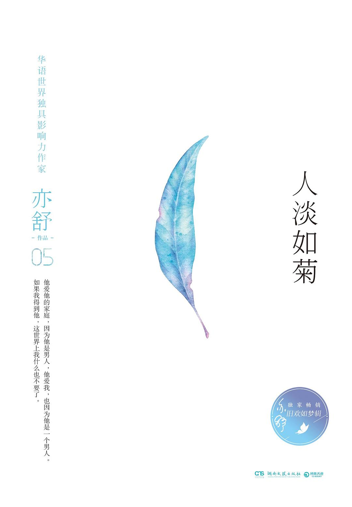

这个星期读完了亦舒的《人淡如菊》。这本不到三百页的精装小书，是香港"师太"写于四十多年前的旧作——一般认为 1979 年前后即在香港初版，手头这个版本则是 2017 年湖南文艺出版社"亦舒·旧欢如梦辑"五种之一。一个年轻中国姑娘与一位中年英国教授的禁忌之恋，放在今天读，故事旧了，清醒没有旧。本文整理自豆瓣条目与多篇书评，从作者、故事、评价三个层面记录这次阅读。

## 书籍速览

| 项目 | 内容 |
| --- | --- |
| 书名 | 人淡如菊 |
| 作者 | [亦舒](https://zh.wikipedia.org/wiki/%E4%BA%A6%E8%88%92)（原名倪亦舒，1946 年生于上海） |
| 初版 | 1979 年前后，香港（天地图书）；手头版本：湖南文艺出版社，2017 年 7 月，精装 |
| 页数 | 256 页 |
| 定价 | 38.00 元 |
| ISBN | 9787540481209 |
| 丛书 | 亦舒·旧欢如梦辑（同辑：《喜宝》《我的前半生》《玫瑰的故事》《圆舞》） |
| 豆瓣评分 | 6.4 分（509 人评价；早期版本评分更高：南海出版公司 2002 年版 7.6 分，新世界出版社 2008 年版 7.4 分） |

## 关于亦舒

**亦舒**，原名倪亦舒，1946 年生于上海，1950 年代随家人移居香港，科幻作家[倪匡](https://zh.wikipedia.org/wiki/%E5%80%AA%E5%8C%A1)是她兄长。在香港通俗文学的版图上，人们习惯把倪匡、金庸与她并称"香港文坛三大奇迹"。她自称"说故事的人"，自 1960 年代起笔耕不辍，出版小说散文三百余部——《玫瑰的故事》《喜宝》《圆舞》《我的前半生》《朝花夕拾》《天若有情》只是其中一角，且多部被搬上银幕荧屏：《我的前半生》《流金岁月》先后改编为热播电视剧，《玫瑰的故事》2024 年由刘亦菲主演再拍剧集。

亦舒笔下的女主角几乎共享同一种底色：都市女性的自立与清醒——先谋生，后谋爱，爱情再美也不能当饭吃。这套价值观在今天读来已近常识，放到她开始写作的年代，却是相当超前的。《人淡如菊》写的恰是这个信条的反面教材：一个还没学会"先谋生"的姑娘，如何把爱情当成了全部。

## 书名与题旨

"人淡如菊"四字出自唐代司空图《二十四诗品·典雅》："落花无言，人淡如菊。"原意写一种收敛自持的人格境界——花开花落都不喧哗。拿它做一本恋爱小说的书名，初看温柔，读完才知是反讽：乔的那段感情进行时轰轰烈烈，回头看时淡得"如梦"。这也正是丛书名的出处——**旧欢如梦辑**：旧日恋情，隔了岁月望过去，终究像一场梦。

## 故事与读感

全书十章，以"壹"到"拾"为序，是女主人公乔的第一人称回忆。亦舒的文风在这里已经完全成熟：短句、白描、不煽情，情绪全藏在对话的缝隙里。

### 一、仰慕

乔二十出头，从香港到英国念书，在课堂上遇见了四十七岁的英国教授比尔·纳梵——有妻子、两个孩子和一条正在上升的事业线。书里没有一见钟情的热闹，只有一个少女对"学识与人品"的漫长仰望。做学生的日子里，两人始终守着分寸。

### 二、告白

毕业回港，工作无趣，思念日甚，乔终于找借口重返英国。表白的那一幕是全书最干净的段落：

> "你不要笑我。我爱你很久了，纳梵先生。"

这一次，纳梵没有再把界限守住。二十一岁的乔与四十七岁的教授开始了一段隐秘的恋情，他许诺离婚，她便信了。彼时乔的自我辩护是："感情里有苦衷之说的不过是因为情不坚定。"

### 三、现实

恋情很快撞上现实的墙。纳梵的妻子发现了这一切，让孩子出面传话；他在离婚这件事上摇摆经年，甚至谎称手续已办妥，一面又指望乔像主妇一样操持他的生活。乔渐渐看清了这段关系的成色：

> "他爱他的家庭，因为他是男人；他爱我，也因为他是一个男人。如果我得到他，这世界上我什么也不要了。"

> "中年男人的爱虽然是事实，但总还有其他的事在心里，不得自由。"

等到勉强走到一起，柴米油盐又把恋爱磨平了棱角：社会压力与事业阴影接踵而至，妻子最终与他离婚，恋情最好的部分早已在过去。那句被无数读者抄进笔记的总结，出自乔的醒悟："恋爱是一回事，幸福，又是另一回事，两者不一定共存。"

### 四、离开

收束干脆得近乎冷酷。在家明——世交家的儿子、爱了她多年、被她一直当作"备胎"——的帮助下，乔不辞而别，回香港嫁给了他。这个连劝人都只说"要不就好好地念书，要不就好好地做事……做人应该好好地做"的年轻人，最终成了乔的丈夫。纳梵则失去了一切：妻子离开他，事业也蒙上阴影。而全书的最后，是乔的自述：

> "我不后悔与比尔·纳梵在一起的两年了。那是一次恋爱，真的恋爱。而现在，我是幸福的。我似乎应该是一个毫无怨言的人。"

## 反响与评价

同一个故事，不同年代的读者打出了不同的分数：2002 年南海出版公司版 7.6 分，2008 年新世界出版社版 7.4 分，2017 年这个"旧欢如梦辑"版本只有 6.4 分（509 人评价）。分数随版本与读者换代走低，本身就是一个有意思的文化注脚——乔的选择放在今天，确实更难获得同情。

豆瓣短评区因此分成两派：一派直斥"三观不正"，认为婚外恋被写得太轻，结尾那句"我是幸福的"尤其让部分读者难以接受；另一派恰恰因此赞它诚实——亦舒不打算写道德训诫，她只写一个女人如何在回忆里安放旧欢，至于对错，读者自己称量。但即使在批评声里，大家也大多承认她的文字功夫：克制、利落、金句迭出，把一部言情小说写出了苍凉的味道。

## 写在最后

《人淡如菊》是一两个晚上就能读完的小书，花在通勤上的三个小时绰绰有余。如果你还没读过亦舒，它未必是最好的起点——《喜宝》《我的前半生》名气更大——但它最能代表那种"师太式清醒"：把爱情从神坛上请下来，让女人自己走。合上书，"落花无言，人淡如菊"八个字会跟着你很久：乔最终没有活成菊花，她只是学会了把往事淡下去。想对照着读的话，接着翻同辑的《喜宝》——同样是年轻女人与年长男人的故事，一个要爱，一个要保障，两种答案，一样苍凉。

**参考来源**：[豆瓣读书《人淡如菊》条目](https://book.douban.com/subject/27084283/)；[亦舒《人淡如菊》书评（搜狐）](https://www.sohu.com/a/471977276_120733961)；[亦舒 - 维基百科](https://zh.wikipedia.org/wiki/%E4%BA%A6%E8%88%92)。
