本章描述系统级时钟的架构，包括以下内容：

* 系统时钟细节
* 时钟源
* 时钟架构
* 时钟控制寄存器
* 时钟监视
* 时钟门控
* 模块时钟

本章涵盖与芯片上生成的时钟相关的信息。由外部芯片提供的协议时钟在使用它们的相应章节中介绍。

## 1. 简介

### 1.1. 特性

芯片时钟架构支持以下特性：

* 支持多个时钟源用于时钟生成：
  * 快速内部 RC 振荡器（**Fast Internal RC Oscillator，FIRC**）
  * 慢速内部 RC 振荡器（**Slow Internal RC Oscillator，SIRC**）
  * 快速外部晶体振荡器（**Fast External Crystal Oscillator，FXOSC**）
  * 锁相环（**Phase-Locked Loops，PLL**）
  * 数字频率合成器（**Digital Frequency Synthesizer，DFS**）模块
* 用于减少电磁辐射的调频（**Frequency Modulated，FM**）时钟
* 为定时器和通信功能提供精确时钟
* 时钟生成模块（**Clock Generation Module，MC_CGM**）时钟选择器的无毛刺时钟切换
* 用于驱动内核的系统时钟的渐进式时钟频率切换（**Progressive Clock Frequency Switching，PCFS**）
* 用于检查时钟完整性的时钟监视单元
* 使用 MC_ME 分区 n 过程配置寄存器的模块时钟门控

### 1.2. 概述

#### 1.2.1. 内核相关时钟概述

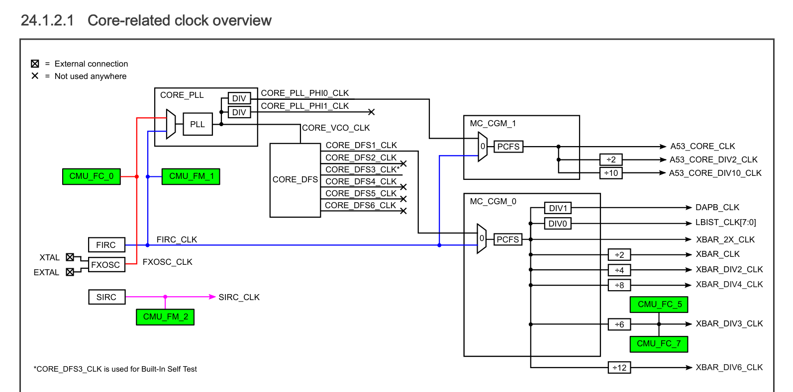

#### 1.2.2. 外设相关时钟概述

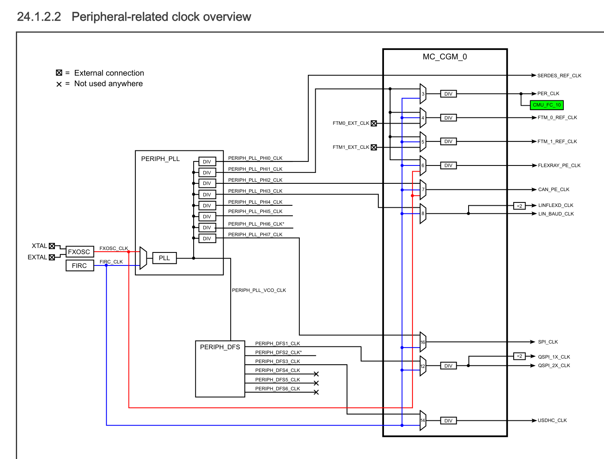

#### 1.2.3. DDR PLL 时钟概述

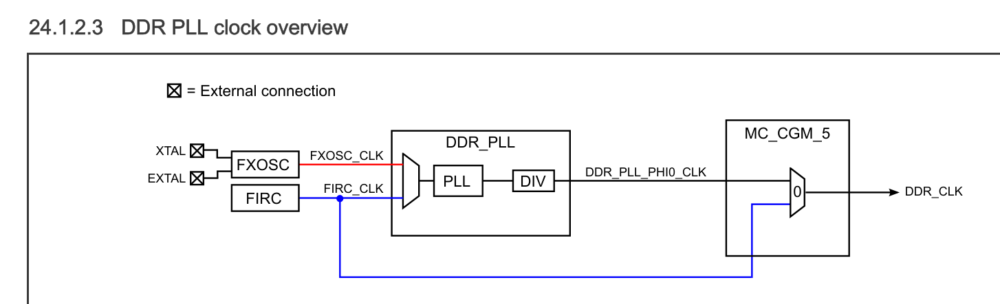

#### 1.2.4. 加速器 PLL 时钟概述

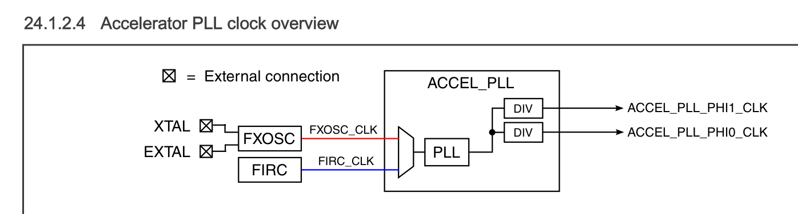

#### 1.2.5. Aurora 时钟概述

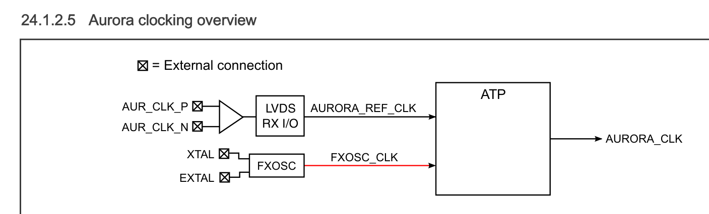

**注意：** 有关 ATP 模块和 **AURORA_PLL** 的时钟连接细节，参见[Aurora 踪迹端口（**ATP**）子系统](../ch081_aurora_trace_port_atp_subsystem/index.md)一章中的"Aurora PLL"一节。

#### 1.2.6. GMAC 时钟概述

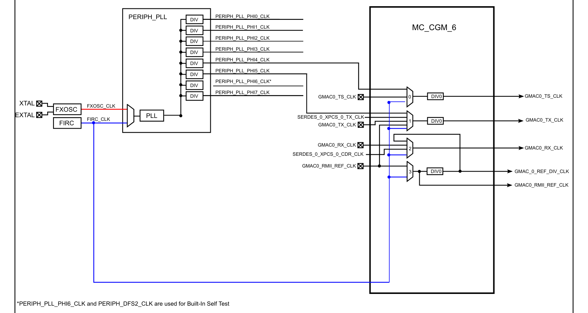

#### 1.2.7. CLKOUTn 概述

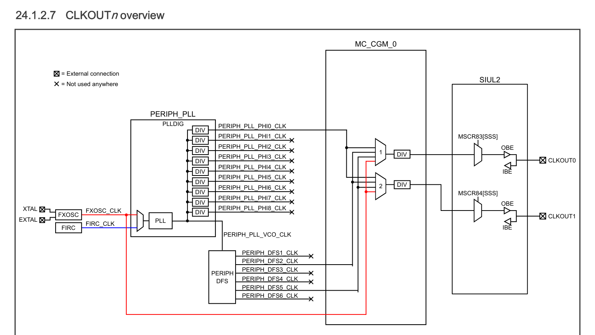

**重要提示：** 在禁用 CLKOUTn 源之前，应先禁用 CLKOUTn 输出。

##### 1.2.7.1. CLKOUTn 时钟配置

表 74 给出 CLKOUTn 时钟配置。

| 目标时钟 | 源时钟 | I/O 端口 | MSCRa | OBE | IBE | SSS | IMCRb | IMCRb[SSS] |
| --- | --- | --- | --- | --- | --- | --- | --- | --- |
| CLKOUT0 | 参见"应用时钟源选项"表中"MC_CGM_0"行和"时钟多路复用器 1 选择器"行 | PF_03 | 83 | 1 | 0 | 001b | — | — |
| CLKOUT1 | 参见"应用时钟源选项"表中"时钟多路复用器 2 选择器"行 | PF_04 | 84 | 1 | 0 | 001b | — | — |

#### 1.2.8. 其他时钟

##### 1.2.8.1. PFE_MAC_0 时钟概述

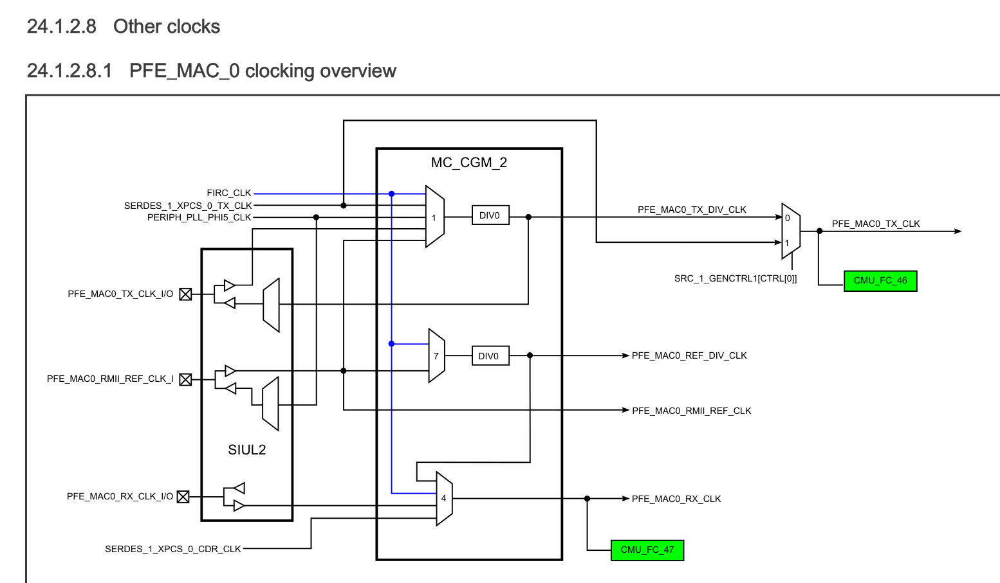

**注意：** 在为 PFE_MAC0_TX_CLK 切换时钟源之前，必须禁用多路复用器的两个时钟输入（例如 PFE_MAC0_TX_DIV_CLK 和 SERDES_1_XPCS_0_TX_CLK）。

##### 1.2.8.2. PFE_MAC_1 时钟概述

##### 1.2.8.3. PFE_MAC_2 时钟概述

##### 1.2.8.4. PFE 时钟

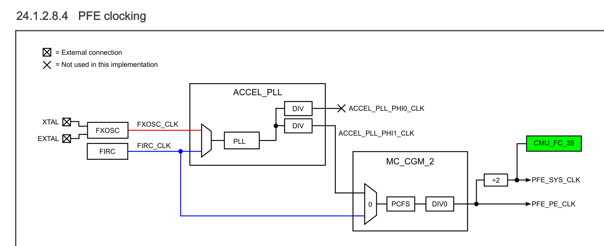

## 2. 时钟源

### 2.1. 简介

内部时钟由以下输入时钟源之一生成：

* **FIRC** — 48 MHz（主要用作备用时钟）（参见注释）
* **SIRC** — 32 kHz（参见注释）
* **FXOSC** — 20–40 MHz（参见注释）
* **PLL**：
  * **CORE_PLL**（FM）
  * **PERIPH_PLL**（非 FM）
  * **DDR_PLL**（FM）
  * **ACCEL_PLL**（FM）
  * **AURORA_PLL**（非 FM）
* **DFS** 模块：
  * **CORE_PLL** DFS
  * **PERIPH_PLL** DFS

以上列表中给出的是标称频率。详细的时钟工作参数参见本芯片的数据手册。

**注意：** 根据 MC_CGM 的配置，PLL 输出（直接输出或 DFS 输出）、FXOSC、SIRC 和 FIRC 可被选择用于驱动系统外设、内核和基础设施。

### 2.2. 输入时钟引脚

表 75 给出输入时钟引脚。

| 描述 | 引脚 |
| --- | --- |
| FXOSC 引脚 | XTAL、EXTAL |
| FTM_0 外部参考时钟 | FTM0_EXT_REF |
| FTM_1 外部参考时钟 | FTM1_EXT_REF |
| SPI_n 时钟 | DSPIn_SCK_I |
| 以太网时间戳时钟 | GMAC0_TS_CLK_I |
| 以太网 TX 时钟 | GMAC0_TX_CLK_I、GMAC1_TX_CLK_I |
| 以太网 RX 时钟 | GMAC0_RX_CLK_I、GMAC1_RX_CLK_I |
| 以太网 RMII REF 时钟 | GMAC0_RMII_REF_CLK_I、GMAC1_RMII_REF_CLK_I |
| Aurora 参考时钟（差分） | AUR_CLK_P、AUR_CLK_N |
| JTAG 时钟 | TCK |
| RTC 外部时钟 | RTC_EXT_CLK |
| PFE_MAC_0 以太网 TX 时钟 | PFE_MAC0_TX_CLK_I |
| PFE_MAC_0 以太网 RX 时钟 | PFE_MAC0_RX_CLK_I |
| PFE_MAC_0 以太网 RMII REF 时钟 | PFE_MAC0_RMII_REF_CLK_I |
| PFE_MAC_1 以太网 TX 时钟 | PFE_MAC1_TX_CLK_I |
| PFE_MAC_1 以太网 RX 时钟 | PFE_MAC1_RX_CLK_I |
| PFE_MAC_1 以太网 RMII REF 时钟 | PFE_MAC1_RMII_REF_CLK_I |
| PFE_MAC_2 以太网 TX 时钟 | PFE_MAC2_TX_CLK_I |
| PFE_MAC_2 以太网 RX 时钟 | PFE_MAC2_RX_CLK_I |
| PFE_MAC_2 以太网 RMII REF 时钟 | PFE_MAC2_RMII_REF_CLK_I |

### 2.3. 输出时钟引脚

表 76 给出输出时钟引脚。

| 描述 | 引脚 |
| --- | --- |
| 输出时钟 | CLKOUT0 |
| 输出时钟 | CLKOUT1 |

### 2.4. FIRC

本芯片具有一个 48 MHz **FIRC**（输出 **FIRC_CLK**），具有以下特性：

* 始终使能
* FXOSC 不可用时的 PLL 时钟源
* 以下模块的时钟源：
  * 电源管理控制器（**PMC**）
  * 复位生成模块（**MC_RGM**）
  * 故障收集与控制单元（**FCCU**）
  * FCCU 输出监督单元（**FOSU**）
  * 软件看门狗定时器（**SWT**）
  * 系统集成单元 Lite2（**SIUL2**）（输入滤波器）
* 复位后的默认系统时钟
* 在失锁（**loss of lock**）或失钟（**loss of clock**）检测发生时作为系统时钟源

### 2.5. SIRC

本芯片具有一个 32 kHz **SIRC**（输出 **SIRC_CLK**），具有以下特性：

* 始终使能
* 用作以下模块的时钟源：
  * 实时时钟（**RTC**）
  * **POR_WDOG**

### 2.6. FXOSC

本芯片具有一个 20–40 MHz **FXOSC**（输出 **FXOSC_CLK**），具有以下特性：

* 芯片各 PLL 的参考
* 以下模块的参考时钟源：
  * **FlexCAN**
  * **FlexRay**
* 可用于驱动 CLKOUT 引脚
* 允许使用晶体或外部时钟源作为芯片的参考时钟
* 使用基频范围为 20–40 MHz 的晶体
* 支持以下输入时钟模式：
  * 晶体（**Crystal**）
  * 单端旁路（**Single-ended bypass**）
  * 差分旁路（**Differential bypass**）

#### 2.6.1. FXOSC 寄存器接口

详情参见[快速晶体振荡器数字控制器（**FXOSC**）](../ch28_fast_crystal_oscillator_digital_controller_fxosc/index.md)一章。

### 2.7. PLL

本芯片包含以下 PLL：

* **CORE_PLL** – 可编程 FM PLL（SSCG），用于以下：
  * Cortex-A53 集群
  * Cortex-M7 集群
  * **HSE_H**
  * 高速芯片互连
* **PERIPH_PLL** – 用于外设，包括以下：
  * **GMAC**
  * **FlexCAN**
  * **FlexRay**（非 FM）
  * ...
* **ACCEL_PLL** – 支持 FM（SSCG）的可编程加速器
* **DDR_PLL** – 用于 DRAM 接口（FM）
* **AURORA_PLL** – 用于 Aurora 接口（非 FM）

这些 PLL 具有以下特性：

* 以下一种或全部工作模式：
  * 带晶体参考的正常 PLL 模式
  * 带外部参考的正常 PLL 模式
  * 带内部 RC 振荡器（FIRC）输入的正常 PLL 模式（引导期间使用）
* 来自监控电路的锁定状态指示
* 打开/关闭频率调制的选项（适用于 CORE_PLL、DDR_PLL、ACCEL_PLL）
* 使用数字频率合成器（**DFS**）的分数分频输出，用于额外的时钟域

#### 2.7.1. PLL 输入时钟

各 PLL 的时钟源可以是 20–40 MHz FXOSC 或 48 MHz FIRC。引导期间，FIRC_CLK 用作默认的 PLL 参考时钟。引导之后，PLL 参考必须改为 FXOSC_CLK。

#### 2.7.2. PLL 输出时钟

各 PLL 具有 VCO 时钟和多个 PHIn 输出时钟。PLL 输出时钟可配置为分频后供模块使用（详情参见概述）。

#### 2.7.3. PLL 寄存器接口

参见[PLL 数字接口（**PLLDIG**）](../ch27_pll_digital_interface_plldig/index.md)一章了解详情。

#### 2.7.4. DFS

本芯片包含两个 DFS 模块：

* CORE_PLL DFS
* PERIPH_PLL DFS

DFS 使用各 PLL 的 VCO 输出时钟作为其源时钟。

DFS 模块提供以下特性：

* 多相位分频输出
* 独立控制的相位分频器输出
* 具有独立复位的相位分频器
* 支持六个输出的 CORE_PLL DFS
* 支持六个输出的 PERIPH_PLL DFS

DFS 时钟到 DFS 端口的映射如下：

| DFS 实例 | 时钟 | 端口 |
| --- | --- | --- |
| CORE_DFS | CORE_DFS1_CLK | CORE_DFS_DVPORT0 |
| CORE_DFS | CORE_DFS2_CLK | CORE_DFS_DVPORT1 |
| CORE_DFS | CORE_DFS3_CLK | CORE_DFS_DVPORT2 |
| CORE_DFS | CORE_DFS4_CLK | CORE_DFS_DVPORT3 |
| CORE_DFS | CORE_DFS5_CLK | CORE_DFS_DVPORT4 |
| CORE_DFS | CORE_DFS6_CLK | CORE_DFS_DVPORT5 |
| PERIPH_DFS | PERIPH_DFS1_CLK | PERIPH_DFS_DVPORT0 |
| PERIPH_DFS | PERIPH_DFS2_CLK | PERIPH_DFS_DVPORT1 |
| PERIPH_DFS | PERIPH_DFS3_CLK | PERIPH_DFS_DVPORT2 |
| PERIPH_DFS | PERIPH_DFS4_CLK | PERIPH_DFS_DVPORT3 |
| PERIPH_DFS | PERIPH_DFS5_CLK | PERIPH_DFS_DVPORT4 |
| PERIPH_DFS | PERIPH_DFS6_CLK | PERIPH_DFS_DVPORT5 |

## 3. 时钟生成

### 3.1. MC_CGM 时钟选择器上的时钟源映射

表 78 给出 MC_CGM 时钟选择器上的时钟源映射。

| 时钟选择器索引1 | 时钟源 |
| --- | --- |
| 0 | FIRC_CLK |
| 1 | SIRC_CLK |
| 2 | FXOSC_CLK |
| 4 | CORE_PLL_PHI0_CLK |
| 5 | CORE_PLL_PHI1_CLK |
| 12 | CORE_DFS1_CLK |
| 13 | CORE_DFS2_CLK |
| 14 | CORE_DFS3_CLK |
| 15 | CORE_DFS4_CLK |
| 16 | CORE_DFS5_CLK |
| 17 | CORE_DFS6_CLK |
| 18 | PERIPH_PLL_PHI0_CLK |
| 19 | PERIPH_PLL_PHI1_CLK |
| 20 | PERIPH_PLL_PHI2_CLK |
| 21 | PERIPH_PLL_PHI3_CLK |
| 22 | PERIPH_PLL_PHI4_CLK |
| 23 | PERIPH_PLL_PHI5_CLK |
| 24 | PERIPH_PLL_PHI6_CLK |
| 25 | PERIPH_PLL_PHI7_CLK |
| 26 | PERIPH_DFS1_CLK |
| 27 | PERIPH_DFS2_CLK |
| 28 | PERIPH_DFS3_CLK |
| 29 | PERIPH_DFS4_CLK |
| 30 | PERIPH_DFS5_CLK |
| 31 | PERIPH_DFS6_CLK |
| 32 | ACCEL_PLL_PHI0_CLK |
| 33 | ACCEL_PLL_PHI1_CLK |
| 34 | FTM0_EXT_CLK |
| 35 | FTM1_EXT_CLK |
| 36 | DDR_PLL_PHI0_CLK |
| 37 | GMAC0_TX_CLK |
| 38 | GMAC0_RX_CLK |
| 39 | GMAC0_RMII_REF_CLK |
| 40 | 保留 |
| 41 | SERDES_0_XPCS_0_CDR_CLK |
| 44 | GMAC0_TS_CLK |
| 45 | GMAC0_REF_DIV_CLK |
| 46 | 保留 |
| 47 | SERDES_0_XPCS_1_CDR_CLK（仅 MC_CGM_2） |
| 48 | PFE_MAC0_TX_CLK |
| 49 | PFE_MAC0_RX_CLK |
| 50 | PFE_MAC0_RMII_REF_CLK |
| 51 | PFE_MAC1_TX_CLK |
| 52 | PFE_MAC1_RX_CLK |
| 53 | PFE_MAC1_RMII_REF_CLK |
| 54 | PFE_MAC2_TX_CLK |
| 55 | PFE_MAC2_RX_CLK |
| 56 | PFE_MAC2_RMII_REF_CLK |
| 57 | 保留 |
| 58 | SERDES_1_XPCS_0_CDR_CLK |
| 59 | PFE_MAC_0_REF_DIV_CLK |
| 60 | PFE_MAC_1_REF_DIV_CLK |
| 61 | PFE_MAC_2_REF_DIV_CLK |
| 62 | 保留 |
| 63 | SERDES_1_XPCS_1_CDR_CLK |

1. 所有未列出的时钟选择器索引均为保留。

### 3.2. MC_CGM_n 寄存器

以下各节中的表格给出 MC_CGM_n 寄存器与输出时钟之间的关系。

#### 3.2.1. MC_CGM_0 寄存器与输出时钟的关系

| MC_CGM 实例 | 时钟多路复用器 | 描述 | 寄存器 | 选择器输出 | 分频器输出 |
| --- | --- | --- | --- | --- | --- |
| MC_CGM_0 | 时钟多路复用器 0 | 选择控制寄存器 | MC_CGM_MUX_0_CSC | XBAR_2X_CLK | — |
| MC_CGM_0 | 时钟多路复用器 0 | 选择状态寄存器 | MC_CGM_MUX_0_CSS | XBAR_2X_CLK | — |
| MC_CGM_0 | 时钟多路复用器 0 | 分频器 0 控制寄存器 | MC_CGM_MUX_0_DC_0 | XBAR_2X_CLK | LBIST_CLK |
| MC_CGM_0 | 时钟多路复用器 0 | 分频器 1 控制寄存器 | MC_CGM_MUX_0_DC_1 | XBAR_2X_CLK | DAPB_CLK1 |
| MC_CGM_0 | 时钟多路复用器 1 | 选择控制寄存器 | MC_CGM_MUX_1_CSC | — | — |
| MC_CGM_0 | 时钟多路复用器 1 | 选择状态寄存器 | MC_CGM_MUX_1_CSS | — | — |
| MC_CGM_0 | 时钟多路复用器 1 | 分频器 0 控制寄存器 | MC_CGM_MUX_1_DC_0 | — | CLKOUT0 |
| MC_CGM_0 | 时钟多路复用器 2 | 选择控制寄存器 | MC_CGM_MUX_2_CSC | — | — |
| MC_CGM_0 | 时钟多路复用器 2 | 选择状态寄存器 | MC_CGM_MUX_2_CSS | — | — |
| MC_CGM_0 | 时钟多路复用器 2 | 分频器 0 控制寄存器 | MC_CGM_MUX_2_DC_0 | — | CLKOUT1 |
| MC_CGM_0 | 时钟多路复用器 3 | 选择控制寄存器 | MC_CGM_MUX_3_CSC | — | — |
| MC_CGM_0 | 时钟多路复用器 3 | 选择状态寄存器 | MC_CGM_MUX_3_CSS | — | — |
| MC_CGM_0 | 时钟多路复用器 3 | 分频器 0 控制寄存器 | MC_CGM_MUX_3_DC_0 | — | PER_CLK |
| MC_CGM_0 | 时钟多路复用器 4 | 选择控制寄存器 | MC_CGM_MUX_4_CSC | — | — |
| MC_CGM_0 | 时钟多路复用器 4 | 选择状态寄存器 | MC_CGM_MUX_4_CSS | — | — |
| MC_CGM_0 | 时钟多路复用器 4 | 分频器 0 控制寄存器 | MC_CGM_MUX_4_DC_0 | — | FTM_0_REF_CLK |
| MC_CGM_0 | 时钟多路复用器 5 | 选择控制寄存器 | MC_CGM_MUX_5_CSC | — | — |
| MC_CGM_0 | 时钟多路复用器 5 | 选择状态寄存器 | MC_CGM_MUX_5_CSS | — | — |
| MC_CGM_0 | 时钟多路复用器 5 | 分频器 0 控制寄存器 | MC_CGM_MUX_5_DC_0 | — | FTM_1_REF_CLK |
| MC_CGM_0 | 时钟多路复用器 6 | 选择控制寄存器 | MC_CGM_MUX_6_CSC | — | — |
| MC_CGM_0 | 时钟多路复用器 6 | 选择状态寄存器 | MC_CGM_MUX_6_CSS | — | — |
| MC_CGM_0 | 时钟多路复用器 6 | 分频器 0 控制寄存器 | MC_CGM_MUX_6_DC_0 | — | FLEXRAY_PE_CLK |
| MC_CGM_0 | 时钟多路复用器 7 | 选择控制寄存器 | MC_CGM_MUX_7_CSC | CAN_PE_CLK | — |
| MC_CGM_0 | 时钟多路复用器 7 | 选择状态寄存器 | MC_CGM_MUX_7_CSS | CAN_PE_CLK | — |
| MC_CGM_0 | 时钟多路复用器 8 | 选择控制寄存器 | MC_CGM_MUX_8_CSC | LIN_BAUD_CLK | — |
| MC_CGM_0 | 时钟多路复用器 8 | 选择状态寄存器 | MC_CGM_MUX_8_CSS | LIN_BAUD_CLK | — |
| MC_CGM_0 | 时钟多路复用器 12 | 选择控制寄存器 | MC_CGM_MUX_12_CSC | — | — |
| MC_CGM_0 | 时钟多路复用器 12 | 选择状态寄存器 | MC_CGM_MUX_12_CSS | — | — |
| MC_CGM_0 | 时钟多路复用器 12 | 分频器 0 控制寄存器 | MC_CGM_MUX_12_DC_0 | — | QSPI_2X_CLK |
| MC_CGM_0 | 时钟多路复用器 14 | 选择控制寄存器 | MC_CGM_MUX_14_CSC |  | — |
| MC_CGM_0 | 时钟多路复用器 14 | 选择状态寄存器 | MC_CGM_MUX_14_CSS |  | — |
| MC_CGM_0 | 时钟多路复用器 14 | 分频器 0 控制寄存器 | MC_CGM_MUX_14_DC_0 |  | USDHC_CLK |
| MC_CGM_0 | 时钟多路复用器 16 | 选择控制寄存器 | MC_CGM_MUX_16_CSC | SPI_CLK | — |
| MC_CGM_0 | 时钟多路复用器 16 | 选择状态寄存器 | MC_CGM_MUX_16_CSS | SPI_CLK | — |

1. 不要修改 MC_CGM_MUX_0_DC_1。

#### 3.2.2. MC_CGM_1 寄存器与输出时钟的关系

| MC_CGM 实例 | 时钟多路复用器 | 描述 | 寄存器 | 选择器输出 | 分频器输出 |
| --- | --- | --- | --- | --- | --- |
| MC_CGM_1 | 时钟多路复用器 0 | 选择控制寄存器 | MC_CGM_MUX_0_CSC | A53_CORE_CLK | — |
| MC_CGM_1 | 时钟多路复用器 0 | 选择状态寄存器 | MC_CGM_MUX_0_CSS | A53_CORE_CLK | — |

#### 3.2.3. MC_CGM_2 寄存器与输出时钟的关系

| MC_CGM 实例 | 时钟多路复用器 | 描述 | 寄存器 | 选择器输出 | 分频器输出 |
| --- | --- | --- | --- | --- | --- |
| MC_CGM_2 | 时钟多路复用器 0 | 选择控制寄存器 | MC_CGM_MUX_0_CSC | — | — |
| MC_CGM_2 | 时钟多路复用器 0 | 选择状态寄存器 | MC_CGM_MUX_0_CSS | — | — |
| MC_CGM_2 | 时钟多路复用器 0 | 分频器 0 控制寄存器 | MC_CGM_MUX_0_DC_0 | — | PFE_PE_CLK |
| MC_CGM_2 | 时钟多路复用器 1 | 选择控制寄存器 | MC_CGM_MUX_1_CSC | — | — |
| MC_CGM_2 | 时钟多路复用器 1 | 选择状态寄存器 | MC_CGM_MUX_1_CSS | — | — |
| MC_CGM_2 | 时钟多路复用器 1 | 分频器 0 控制寄存器 | MC_CGM_MUX_1_DC_0 | — | PFE_MAC0_TX_DIV_CLK1 |
| MC_CGM_2 | 时钟多路复用器 2 | 选择控制寄存器 | MC_CGM_MUX_2_CSC | — | — |
| MC_CGM_2 | 时钟多路复用器 2 | 选择状态寄存器 | MC_CGM_MUX_2_CSS | — | — |
| MC_CGM_2 | 时钟多路复用器 2 | 分频器 0 控制寄存器 | MC_CGM_MUX_2_DC_0 | — | PFE_MAC1_TX_DIV_CLK |
| MC_CGM_2 | 时钟多路复用器 3 | 选择控制寄存器 | MC_CGM_MUX_3_CSC | — | — |
| MC_CGM_2 | 时钟多路复用器 3 | 选择状态寄存器 | MC_CGM_MUX_3_CSS | — | — |
| MC_CGM_2 | 时钟多路复用器 3 | 分频器 0 控制寄存器 | MC_CGM_MUX_3_DC_0 | — | PFE_MAC2_TX_DIV_CLK |
| MC_CGM_2 | 时钟多路复用器 4 | 选择控制寄存器 | MC_CGM_MUX_4_CSC | PFE_MAC0_RX_CLK | — |
| MC_CGM_2 | 时钟多路复用器 4 | 选择状态寄存器 | MC_CGM_MUX_4_CSS | PFE_MAC0_RX_CLK | — |
| MC_CGM_2 | 时钟多路复用器 5 | 选择控制寄存器 | MC_CGM_MUX_5_CSC | PFE_MAC1_RX_CLK | — |
| MC_CGM_2 | 时钟多路复用器 5 | 选择状态寄存器 | MC_CGM_MUX_5_CSS | PFE_MAC1_RX_CLK | — |
| MC_CGM_2 | 时钟多路复用器 6 | 选择控制寄存器 | MC_CGM_MUX_6_CSC | PFE_MAC2_RX_CLK | — |
| MC_CGM_2 | 时钟多路复用器 6 | 选择状态寄存器 | MC_CGM_MUX_6_CSS | PFE_MAC2_RX_CLK | — |
| MC_CGM_2 | 时钟多路复用器 7 | 选择控制寄存器 | MC_CGM_MUX_7_CSC | — | — |
| MC_CGM_2 | 时钟多路复用器 7 | 选择状态寄存器 | MC_CGM_MUX_7_CSS | — | — |
| MC_CGM_2 | 时钟多路复用器 7 | 分频器 0 控制寄存器 | MC_CGM_MUX_7_DC_0 | — | PFE_MAC_0_REF_DIV_CLK |
| MC_CGM_2 | 时钟多路复用器 8 | 选择控制寄存器 | MC_CGM_MUX_8_CSC | — | — |
| MC_CGM_2 | 时钟多路复用器 8 | 选择状态寄存器 | MC_CGM_MUX_8_CSS | — | — |
| MC_CGM_2 | 时钟多路复用器 8 | 分频器 0 控制寄存器 | MC_CGM_MUX_8_DC_0 | — | PFE_MAC_1_REF_DIV_CLK |
| MC_CGM_2 | 时钟多路复用器 9 | 选择控制寄存器 | MC_CGM_MUX_9_CSC | — | — |
| MC_CGM_2 | 时钟多路复用器 9 | 选择状态寄存器 | MC_CGM_MUX_9_CSS | — | — |
| MC_CGM_2 | 时钟多路复用器 9 | 分频器 0 控制寄存器 | MC_CGM_MUX_9_DC_0 | — | PFE_MAC_2_REF_DIV_CLK |

1. 参见"PFE_MAC_0 时钟概述"了解详情。

#### 3.2.4. MC_CGM_5 寄存器与输出时钟的关系

| MC_CGM 实例 | 时钟多路复用器 | 描述 | 寄存器 | 选择器输出 | 分频器输出 |
| --- | --- | --- | --- | --- | --- |
| MC_CGM_5 | 时钟多路复用器 0 | 选择控制寄存器 | MC_CGM_MUX_0_CSC | DDR_CLK | — |
| MC_CGM_5 | 时钟多路复用器 0 | 选择状态寄存器 | MC_CGM_MUX_0_CSS | DDR_CLK | — |

#### 3.2.5. MC_CGM_6 寄存器与输出时钟的关系

| MC_CGM 实例 | 时钟多路复用器 | 描述 | 寄存器 | 选择器输出 | 分频器输出 |
| --- | --- | --- | --- | --- | --- |
| MC_CGM_6 | 时钟多路复用器 0 | 选择控制寄存器 | MC_CGM_MUX_0_CSC | — | — |
| MC_CGM_6 | 时钟多路复用器 0 | 选择状态寄存器 | MC_CGM_MUX_0_CSS | — | — |
| MC_CGM_6 | 时钟多路复用器 0 | 分频器 0 控制寄存器 | MC_CGM_MUX_0_DC_0 | — | GMAC0_TS_CLK |
| MC_CGM_6 | 时钟多路复用器 1 | 选择控制寄存器 | MC_CGM_MUX_1_CSC | — | — |
| MC_CGM_6 | 时钟多路复用器 1 | 选择状态寄存器 | MC_CGM_MUX_1_CSS | — | — |
| MC_CGM_6 | 时钟多路复用器 1 | 分频器 0 控制寄存器 | MC_CGM_MUX_1_DC_0 | — | GMAC0_TX_CLK |
| MC_CGM_6 | 时钟多路复用器 2 | 选择控制寄存器 | MC_CGM_MUX_2_CSC | GMAC0_RX_CLK | — |
| MC_CGM_6 | 时钟多路复用器 2 | 选择状态寄存器 | MC_CGM_MUX_2_CSS | GMAC0_RX_CLK | — |
| MC_CGM_6 | 时钟多路复用器 3 | 选择控制寄存器 | MC_CGM_MUX_3_CSC | GMAC0_RMII_REF_CLK | — |
| MC_CGM_6 | 时钟多路复用器 3 | 选择状态寄存器 | MC_CGM_MUX_3_CSS | GMAC0_RMII_REF_CLK | — |
| MC_CGM_6 | 时钟多路复用器 3 | 分频器 0 控制寄存器 | MC_CGM_MUX_3_DC_0 | GMAC0_RMII_REF_CLK | GMAC_0_REF_DIV_CLK |

### 3.3. 应用时钟源选项

表 84 给出应用时钟源选项。

| MC_CGM 实例 | 时钟选择器 | 目标应用模式时钟选择选项 |
| --- | --- | --- |
| MC_CGM_0 | 时钟多路复用器 0 选择器 | CORE_DFS1_CLK FIRC_CLK |
| MC_CGM_0 | 时钟多路复用器 1 选择器 | FXOSC_CLK PERIPH_DFS5_CLK PERIPH_DFS2_CLK PERIPH_PLL_PHI0_CLK |
| MC_CGM_0 | 时钟多路复用器 2 选择器 | FXOSC_CLK PERIPH_DFS5_CLK PERIPH_DFS2_CLK PERIPH_PLL_PHI0_CLK |
| MC_CGM_0 | 时钟多路复用器 3 选择器 | PERIPH_PLL_PHI1_CLK FIRC_CLK |
| MC_CGM_0 | 时钟多路复用器 4 选择器 | PERIPH_PLL_PHI1_CLK FTM0_EXT_CLK FIRC_CLK |
| MC_CGM_0 | 时钟多路复用器 5 选择器 | PERIPH_PLL_PHI1_CLK FTM1_EXT_CLK FIRC_CLK |
| MC_CGM_0 | 时钟多路复用器 6 选择器 | PERIPH_PLL_PHI1_CLK FXOSC_CLK FIRC_CLK |
| MC_CGM_0 | 时钟多路复用器 7 选择器 | PERIPH_PLL_PHI2_CLK FXOSC_CLK FIRC_CLK |
| MC_CGM_0 | 时钟多路复用器 8 选择器 | PERIPH_PLL_PHI3_CLK FXOSC_CLK FIRC_CLK |
| MC_CGM_0 | 时钟多路复用器 12 选择器 | PERIPH_DFS1_CLK FIRC_CLK |
| MC_CGM_0 | 时钟多路复用器 14 选择器 | PERIPH_DFS3_CLK FIRC_CLK |
| MC_CGM_0 | 时钟多路复用器 16 选择器 | PERIPH_PLL_PHI7_CLK FIRC_CLK |
| MC_CGM_1 | 时钟多路复用器 0 选择器 | CORE_PLL_PHI0_CLK FIRC_CLK |
| MC_CGM_2 | 时钟多路复用器 0 选择器 | ACCEL_PLL_PHI1_CLK |
| MC_CGM_2 | 时钟多路复用器 1 选择器 | SERDES_1_XPCS_0_TX_CLK PERIPH_PLL_PHI5_CLK PFE_MAC0_TX_CLK PFE_MAC0_RMII_REF_CLK |
| MC_CGM_2 | 时钟多路复用器 2 选择器 | SERDES_1_XPCS_1_TX_CLK PERIPH_PLL_PHI5_CLK PFE_MAC1_TX_CLK PFE_MAC1_RMII_REF_CLK |
| MC_CGM_2 | 时钟多路复用器 3 选择器 | SERDES_0_XPCS_1_TX_CLK PERIPH_PLL_PHI5_CLK PFE_MAC2_TX_CLK PFE_MAC2_RMII_REF_CLK |
| MC_CGM_2 | 时钟多路复用器 4 选择器 | SERDES_1_XPCS_0_CDR_CLK PFE_MAC0_RX_CLK PFE_MAC_0_REF_DIV_CLK |
| MC_CGM_2 | 时钟多路复用器 5 选择器 | SERDES_1_XPCS_1_CDR_CLK PFE_MAC1_RX_CLK PFE_MAC_1_REF_DIV_CLK |
| MC_CGM_2 | 时钟多路复用器 6 选择器 | SERDES_0_XPCS_1_CDR_CLK PFE_MAC2_RX_CLK PFE_MAC_2_REF_DIV_CLK |
| MC_CGM_2 | 时钟多路复用器 7 选择器 | PFE_MAC0_RMII_REF_CLK |
| MC_CGM_2 | 时钟多路复用器 8 选择器 | PFE_MAC1_RMII_REF_CLK |
| MC_CGM_2 | 时钟多路复用器 9 选择器 | PFE_MAC2_RMII_REF_CLK |
| MC_CGM_5 | 时钟多路复用器 0 选择器 | DDR_PLL_PHI0_CLK FIRC_CLK |
| MC_CGM_6 | 时钟多路复用器 0 选择器 | PERIPH_PLL_PHI4_CLK GMAC0_TS_CLK |
| MC_CGM_6 | 时钟多路复用器 1 选择器 | PERIPH_PLL_PHI5_CLK SERDES_0_XPCS_0_TX_CLK GMAC0_TX_CLK GMAC0_RMII_REF_CLK |
| MC_CGM_6 | 时钟多路复用器 2 选择器 | SERDES_0_XPCS_0_CDR_CLK GMAC0_RX_CLK GMAC0_REF_DIV_CLK |
| MC_CGM_6 | 时钟多路复用器 3 选择器 | GMAC0_RMII_REF_CLK |

**注意：** 在切换源时钟之前，当前时钟和目标时钟都必须处于工作状态。

### 3.4. 系统时钟频率限制

系统级时钟的最大工作频率见产品数据手册。不得超过数据手册中给出的限制。

### 3.5. 默认时钟配置

上电时，FIRC_CLK 是整个系统的默认时钟。所有系统时钟分频器都被置为其默认值或复位值。

## 4. 软件可复位域

在撤销软件可复位域 1 的复位之前，必须将 MC_CGM_1 多路复用器 0 的输入源（A53_CORE_CLK 输出）切换为 FIRC_CLK。切换时钟后，再撤销软件域 1 的复位。

在撤销软件可复位域 2 的复位之前，必须将 MC_CGM_2 多路复用器 [0:9] 的输入源切换为 FIRC_CLK。切换时钟后，再撤销软件域 2 的复位。

在撤销软件可复位域 3 的复位之前，必须将以下各项的输入源切换为 FIRC_CLK：

* MC_CGM_0 mux_3（PER_CLK）
* MC_CGM_0 mux_6（FLEXRAY_PE_CLK）
* MC_CGM_0 mux_7（CAN_PE_CLK）
* MC_CGM_0 mux_8（LINFLEXD_CLK、LIN_BAUD_CLK）

切换时钟后，再撤销软件域 3 的复位。

**注意：** 在软件可复位域 3 中，XBAR_DIV2_CLK 处逻辑的复位撤销在 XBAR_DIV6_CLK 处完成。无需将任何时钟切换为 FIRC。

## 5. 时钟开/关流程

以下各节描述开启和关闭时钟信号的正确流程。

### 5.1. 时钟开启

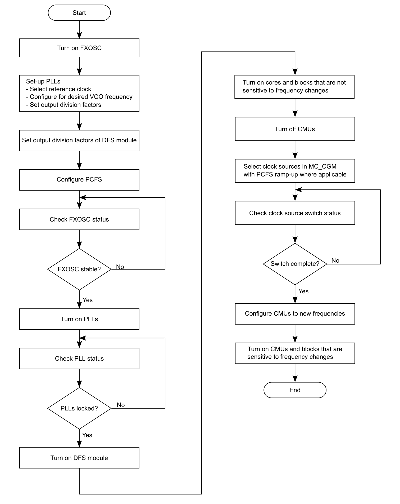

**注意：** 正确的 PLL 开启顺序详情参见"PLL 开启顺序"一节。

#### 5.1.1. PLL SSCG 设置

某些 PLL 实例支持通过频率调制（FM）实现扩频时钟生成（**SSCG**），以帮助减少 EMI。支持该特性的 PLL 列表参见"PLL"一节。

为此类 PLL 使能 SSCG 时，应使用中心展频（**center-spread**）调制类型。为此，按如下方式配置该 PLL 的 PLLFM 寄存器字段：

* SSCGBYP = 0b
* SPREADCTL = 0b

在这种情况下，配置 PLL 时请参考数据手册中标注"启用中心展频 SSCG（with center-spread SSCG enabled）"的最大频率。在其他所有情况下，请参考标注"未启用中心展频 SSCG（without center-spread SSCG enabled）"的最大频率。

### 5.2. 时钟关闭

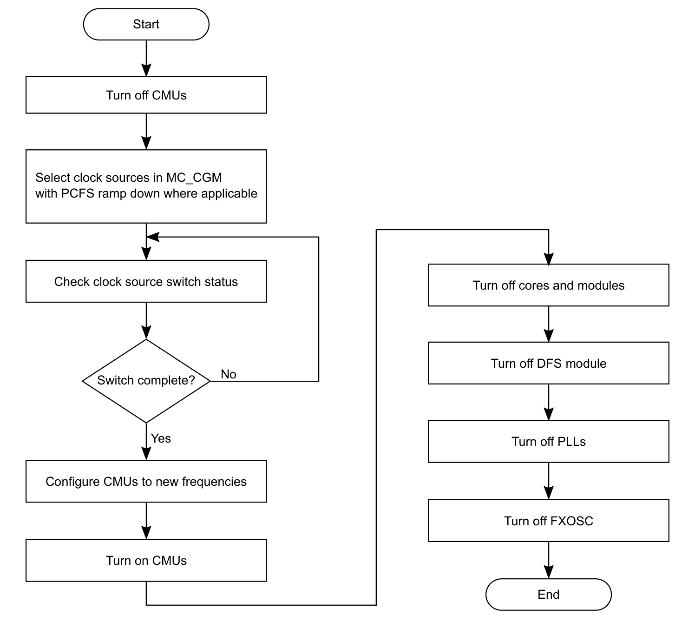

### 5.3. PLL 开启顺序

为使芯片正常工作，请执行以下 PLL 开启顺序：

1. 开启 AURORA_PLL。
2. 检查 AURORA_PLL 的锁定状态。
3. 如果 AURORA_PLL 未锁定，重复上一步骤；否则进入下一步。
4. 开启 CORE_PLL。
5. 检查 CORE_PLL 的锁定状态。
6. 如果 CORE_PLL 未锁定，重复上一步骤；否则进入下一步。
7. 开启 PERIPH_PLL。
8. 检查 PERIPH_PLL 的锁定状态。
9. 如果 PERIPH_PLL 未锁定，重复上一步骤；否则进入下一步。
10. 开启 DDR_PLL。
11. 检查 DDR_PLL 的锁定状态。
12. 如果 DDR_PLL 未锁定，重复上述步骤集合；否则进入下一步。
13. 开启 ACCEL_PLL。
14. 检查 ACCEL_PLL 的锁定状态。
15. 如果 ACCEL_PLL 未锁定，重复上一步骤；否则 PLL 开启顺序完成。

**注意：** 仅在跟踪功能期间才需要 AURORA_PLL 开启步骤。

### 5.4. 开启 CLKOUTn 信号

为避免开启输出时钟时在 CLKOUTn 信号上出现毛刺，必须遵守以下步骤：

1. 通过配置 SIUL2 选择 CLKOUTn 信号功能（例如 SIUL2_MSCRn）。
2. 配置并开启所需的输出时钟源。
3. 在 MC_CGM_0 中选择所需的输出时钟源（如"应用时钟源选项"所示）。
4. 配置并使能 MC_CGM_0 中相应的输出时钟分频器（例如向 MC_CGM_0_MUX_1_DC[DE] 写入 1）。

### 5.5. 关闭 CLKOUTn 信号

为避免关闭输出时钟时在 CLKOUTn 信号上出现毛刺，必须遵守以下步骤：

1. 在 MC_CGM_0 中禁用相应的输出时钟分频器（例如向 MC_CGM_0_MUX_1_DC[DE] 写入 0）。
2. 可选：关闭先前选择的输出时钟源。
3. 可选：通过 SIUL2 将 CLKOUTn 引脚重新配置为其他功能。

**重要提示：** 如果发生复位事件，CLKOUTn 信号上可能出现毛刺。在这种情况下，RESET_B 置位，向任何监视 RESET_B 的外设指示 CLKOUTn 不再有效。

## 6. 时钟门控

关于模块时钟门控的可能性，参见[模式进入模块（**MC_ME**）](../ch33_mode_entry_module_mc_me/index.md)一章"MC_ME 分区映射"一节中的分区映射表。

**注意：** 关于时钟被门控时模块的行为，参见[复位（**Reset**）](../ch29_reset/index.md)一章的"软件可复位域"一节。

## 7. 模块时钟

### 7.1. 安全模块

图 67 给出 REG_INTF_CLK 和 MODULE_CLK 的连接方式，表 85 给出这些模块使用的 REG_INTF_CLK 和 MODULE_CLK 信号。任何未明确显示 REG_INTF_CLK 的模块图，其 REG_INTF_CLK 都使用与 MODULE_CLK 相同的源。

| 模块 | MODULE_CLK | REG_INTF_CLK |
| --- | --- | --- |
| CRC | XBAR_DIV3_CLK | XBAR_DIV3_CLK |
| EIM_0 | A53_CORE_DIV10_CLK | A53_CORE_DIV10_CLK |
| EIM_[1:3] | XBAR_DIV6_CLK | XBAR_DIV6_CLK |
| EIM | XBAR_DIV6_CLK | XBAR_DIV6_CLK |
| ERM | 参见 ERM | 参见 ERM |
| FCCU | 参见 FCCU | 参见 FCCU |
| RCCU | 参见冗余控制与校验单元（RCCU） | 参见冗余控制与校验单元（RCCU） |
| SBSW | 参见 SBSW | 参见 SBSW |
| STCU2 | 参见 STCU2 | 参见 STCU2 |

#### 7.1.1. ERM

下图给出 ERM 的时钟配置。

MEM_CLK 连接到所连接模块的存储器的存储器时钟（存储器时钟详情参见[错误报告模块（**ERM**）](../ch067_error_reporting_module_erm/index.md)一章）。

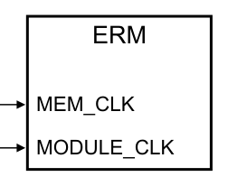

#### 7.1.2. FCCU

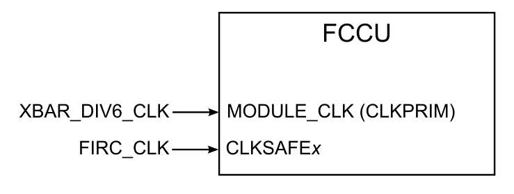

#### 7.1.3. 冗余控制与校验单元（RCCU）

在本芯片中，RCCU 对以下模块执行锁步（**lockstep**）校验：

* Cortex-M7
* Cortex-A53
* 增强型直接存储器访问（**eDMA3**）

RCCU 使用与其执行锁步校验的模块相同的时钟源（参见以各列出模块名称命名的小节）。

#### 7.1.4. SBSW

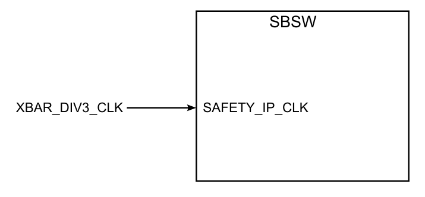

#### 7.1.5. STCU2

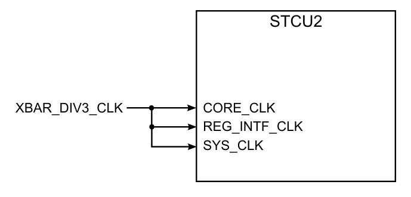

### 7.2. 通信模块

图 72 给出 REG_INTF_CLK 和 MODULE_CLK 的连接方式，表 86 给出这些模块使用的 REG_INTF_CLK 和 MODULE_CLK 信号。任何未明确显示 REG_INTF_CLK 的模块图，其 REG_INTF_CLK 都使用与 MODULE_CLK 相同的源。

| 模块 | MODULE_CLK | REG_INTF_CLK |
| --- | --- | --- |
| SerDes | 参见 SerDes | 参见 SerDes |
| 以太网路由器 | 参见以太网路由器（PFE）时钟 | 参见以太网路由器（PFE）时钟 |
| 以太网（GMAC_0） | 参见以太网（GMAC_0） | 参见以太网（GMAC_0） |
| SPI | 参见串行外设接口（SPI）时钟 | 参见串行外设接口（SPI）时钟 |
| FlexCAN | 参见 FlexCAN 时钟 | 参见 FlexCAN 时钟 |
| FlexRay | 参见 FlexRay 通信控制器时钟 | 参见 FlexRay 通信控制器时钟 |
| I2C | 参见 I2C 时钟 | 参见 I2C 时钟 |
| LINFlexD | 参见 LINFlexD 时钟 | 参见 LINFlexD 时钟 |
| USB | 参见 USB 时钟 | 参见 USB 时钟 |

#### 7.2.1. SerDes

下图和下表给出 SerDes_n 的时钟配置。

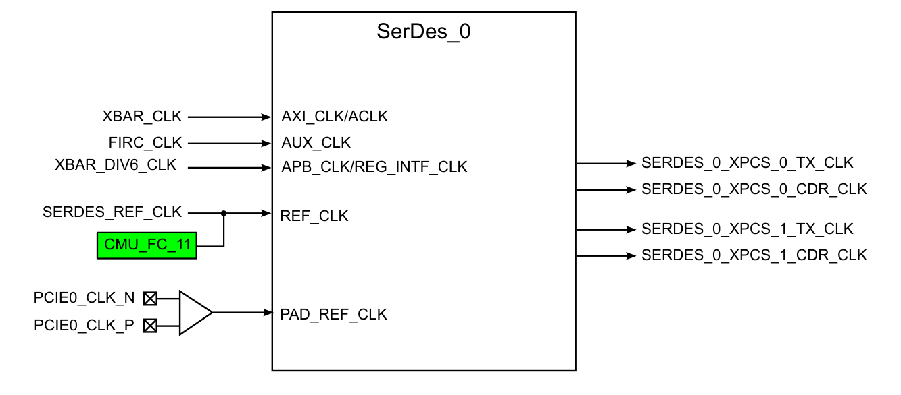

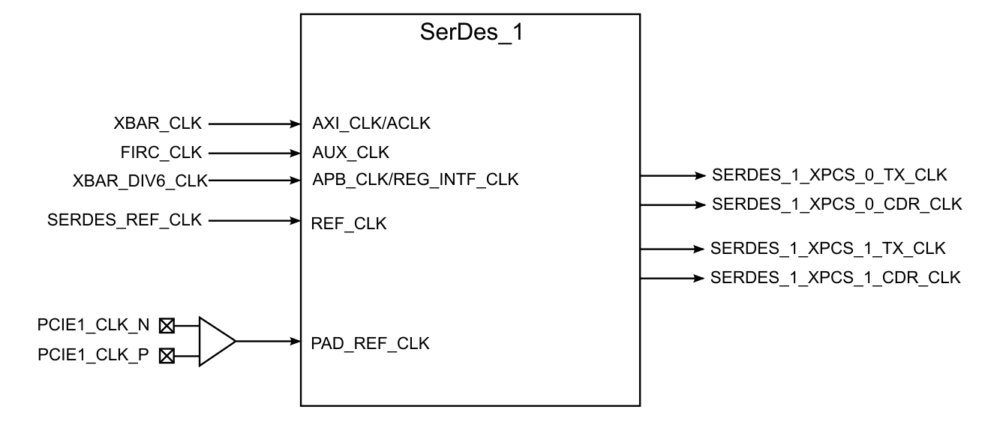

**注意：** 如果将 SerDes_n 输出时钟用于以太网操作，必须配置以下输入之一：

* PCIEn_CLK_N 和 PCIEn_CLK_P
* SERDES_REF_CLK

| PCIe 模式 | 允许的时钟源 |
| --- | --- |
| Gen1 | 外部时钟 内部 PLL |
| Gen2 | 外部时钟 内部 PLL |
| Gen3 | 仅使用 PCIEn_CLK_N 和 PCIEn_CLK_P 源（由于更严格的抖动要求） |

**注意：** 将 SerDes_n 配置为使用内部时钟时，应将 PCIEn_CLK_N 和 PCIEn_CLK_P 接地，以避免 SerDes_n 时钟输入上的噪声。

#### 7.2.2. 以太网（GMAC_0）

图 75 给出 GMAC_0 以太网时钟的整体情况。

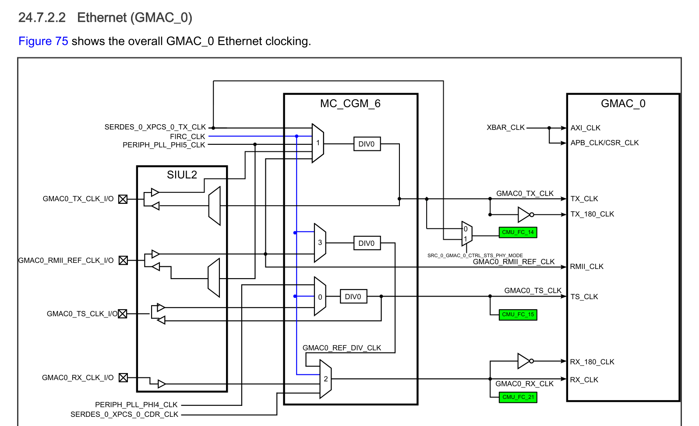

**注意：** 不应使用 FIRC_CLK 作为任何 GMAC_0 时钟信号的源。

##### 7.2.2.1. 以太网（GMAC_0）RGMII 配置

图 76 给出 GMAC_0 RGMII 以太网时钟，表 88 给出 RGMII 的 SIUL2 时钟信号配置。

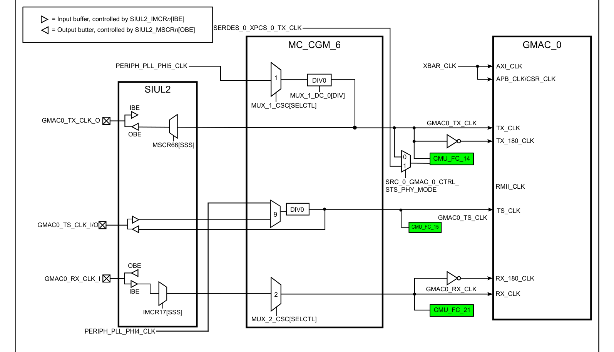

| 目标时钟 | 源时钟 | I/O 端口 | MSCRa | OBE | IBE | SSS | IMCRb | IMCRb[SSS] |
| --- | --- | --- | --- | --- | --- | --- | --- | --- |
| GMAC0_TS_CLK1 | GMAC0_TS_CLK_I | PF_01 | 81 | 0 | 1 | X | 27 | 010b |
| GMAC0_TS_CLK | PERIPH_PLL_PHI4_CLK | — |  |  |  |  |  |  |
| GMAC0_TX_CLK_O | GMAC0_TX_CLK | PE_02 | 66 | 1 | 0 | 001b | 26 | X |
| GMAC0_TX_CLK | PERIPH_PLL_PHI5_CLK | — |  |  |  |  |  |  |
| GMAC0_RX_CLK | GMAC0_RX_CLK_I | PE_08 | 72 | 0 | 1 | X | 17 | 010b |

1. GMAC0_TS_CLK 的更多详情参见"GMAC_0 时钟"图。

##### 7.2.2.2. 以太网（GMAC_0）RMII 配置

图 77 给出使用外部参考的 GMAC_0 RMII 以太网时钟，表 89 给出 RMII 的 SIUL2 时钟信号配置。

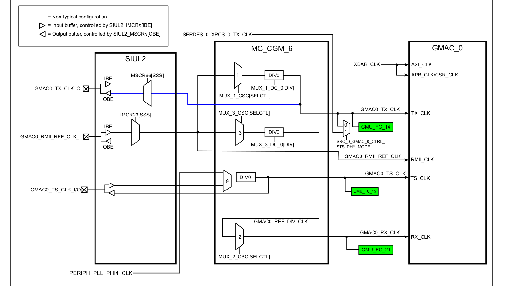

| 目标时钟 | 源时钟 | I/O 端口 | MSCRa | OBE | IBE | SSS | IMCRb | IMCRb[SSS] |
| --- | --- | --- | --- | --- | --- | --- | --- | --- |
| GMAC0_TS_CLK1 | GMAC0_TS_CLK_I | PF_01 | 81 | 0 | 1 | X | 27 | 010b |
| GMAC0_TS_CLK | PERIPH_PLL_PHI4_CLK | — |  |  |  |  |  |  |
| GMAC0_RMII_REF_CLK | GMAC0_RMII_REF_CLK_I | PE_07 | 71 | 0 | 1 | X | 23 | 010b |
| GMAC0_RX_CLK |  |  |  |  |  |  |  |  |
| GMAC0_TX_CLK |  |  |  |  |  |  |  |  |
| GMAC0_TX_CLK_O | GMAC0_TX_CLK | PE_02 | 66 | 1 | 0 | 001b | 26 | X |

1. GMAC0_TS_CLK 的更多详情参见"GMAC_0 时钟"图。

##### 7.2.2.3. 以太网（GMAC_0）MII 配置

图 78 给出 GMAC_0 MII 以太网时钟，表 90 给出 MII 的 SIUL2 时钟信号配置。

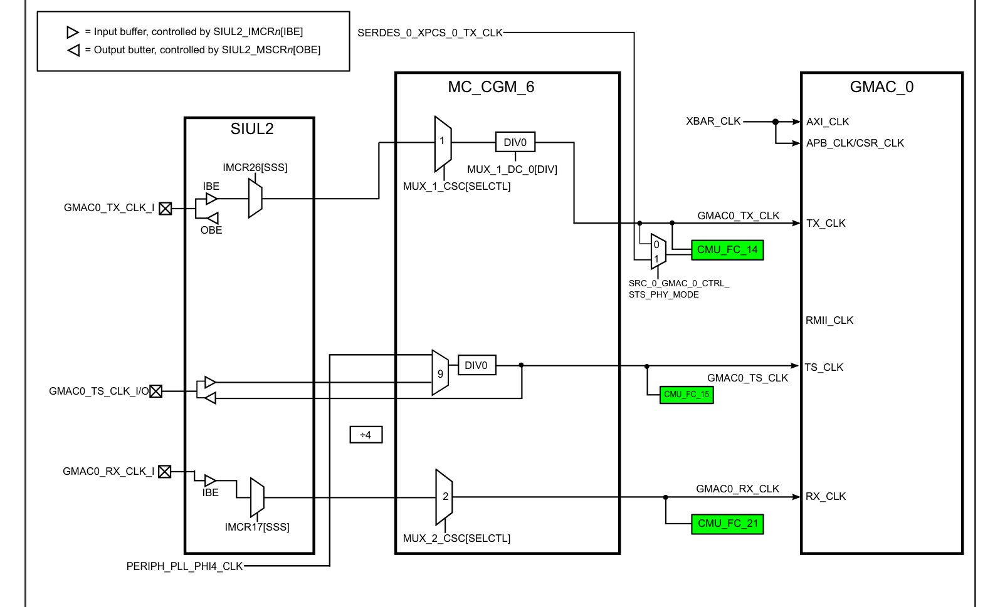

| 目标时钟 | 源时钟 | I/O 端口 | MSCRa | OBE | IBE | SSS | IMCRb | IMCRb[SSS] |
| --- | --- | --- | --- | --- | --- | --- | --- | --- |
| GMAC0_TS_CLK1 | GMAC0_TS_CLK_I | PF_01 | 81 | 0 | 1 | X | 27 | 010b |
| GMAC0_TS_CLK | PERIPH_PLL_PHI4_CLK | — |  |  |  |  |  |  |
| GMAC0_TX_CLK | GMAC0_TX_CLK_I | PE_02 | 66 | 0 | 1 | X | 26 | 010b |
| GMAC0_RX_CLK | GMAC0_RX_CLK_I | PE_08 | 72 | 0 | 1 | X | 17 | 010b |

1. GMAC0_TS_CLK 的更多详情参见"GMAC_0 时钟"图。

##### 7.2.2.4. 以太网（GMAC_0）SGMII 配置

图 79 给出 GMAC_0 SGMII 以太网时钟，表 91 给出 SGMII 的 SIUL2 时钟信号配置。

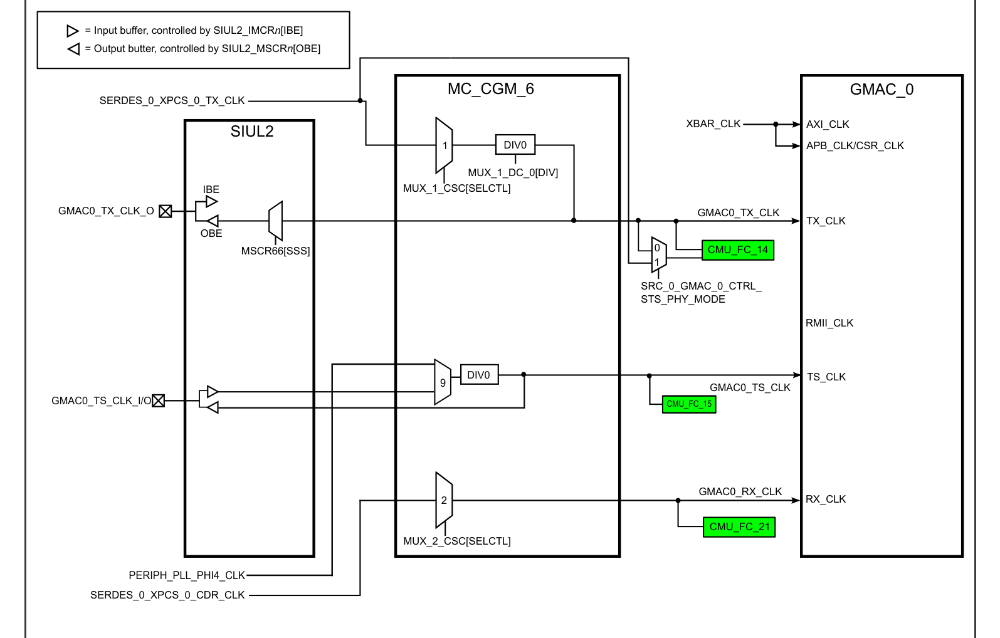

| 目标时钟 | 源时钟 | I/O 端口 | MSCRa | OBE | IBE | SSS | IMCRb | IMCRb[SSS] |
| --- | --- | --- | --- | --- | --- | --- | --- | --- |
| GMAC0_TS_CLK1 | GMAC0_TS_CLK_I | PF_01 | 81 | 0 | 1 | X | 27 | 010b |
| GMAC0_TS_CLK | PERIPH_PLL_PHI4_CLK | — |  |  |  |  |  |  |
| GMAC0_TX_CLK | SERDES_0_XPCS_0_TX_CLK | — |  |  |  |  |  |  |
| GMAC0_TX_CLK_O | GMAC0_TX_CLK | PE_02 | 66 | 1 | 0 | 001b | 26 | X |
| GMAC0_RX_CLK | SERDES_0_XPCS_0_CDR_CLK | — |  |  |  |  |  |  |

1. GMAC0_TS_CLK 的更多详情参见"GMAC_0 时钟"图。

#### 7.2.3. 以太网路由器（PFE）时钟

图 80 给出 PFE_MAC_n 以太网路由器时钟概述（GMAC_TS_CLK 生成的详情参见"以太网（GMAC_0）"一节）。

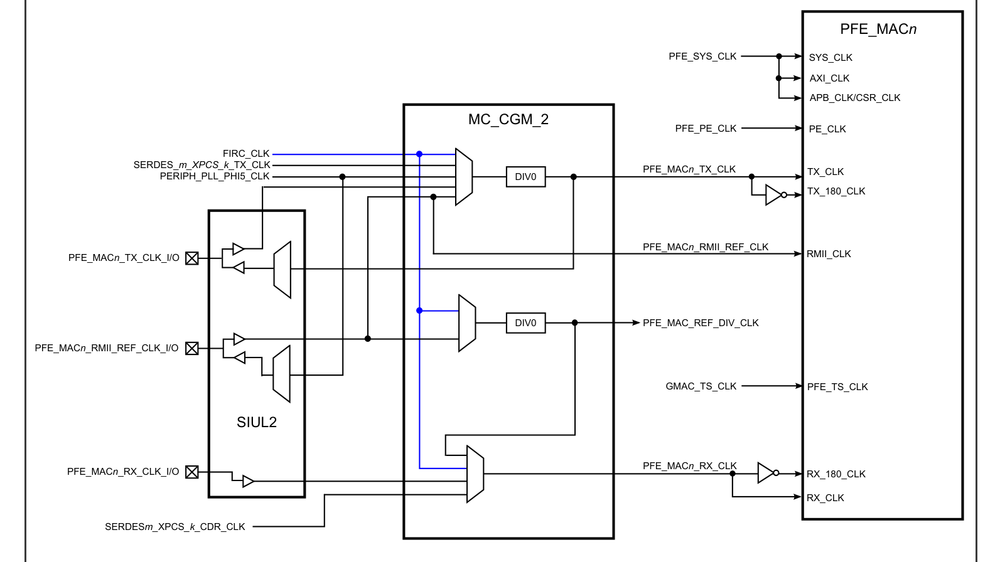

**注意：** 不应使用 FIRC_CLK 作为任何 PFE_MAC_n 时钟信号的源。

| SerDes_m 时钟信号 | PFE_MAC_n 目标 |
| --- | --- |
| SERDES_1_XPCS_0_TX/CDR_CLK | PFE_MAC_0 |
| SERDES_1_XPCS_1_TX/CDR_CLK | PFE_MAC_1 |
| SERDES_0_XPCS_1_TX/CDR_CLK | PFE_MAC_2 |

| 模式 | MC_CGM_2 多路复用器时钟选择（RX_CLK） | MC_CGM_2 多路复用器时钟选择（TX_CLK） |
| --- | --- | --- |
| MII | PFE_MACn_RX_CLK_I | PFE_MACn_TX_CLK_I |
| RGMII | PFE_MACn_RX_CLK_I | PERIPH_PLL_PHI5_CLK |
| SGMII | SERDES_m_XPCS_k_CDR_CLK | SERDES_m_XPCS_k_TX_CLK |
| RMII | PFE_MACn_RMII_REF_CLK_I | PFE_MACn_RMII_REF_CLK_I |

##### 7.2.3.1. PFE_MAC_0 时钟概述

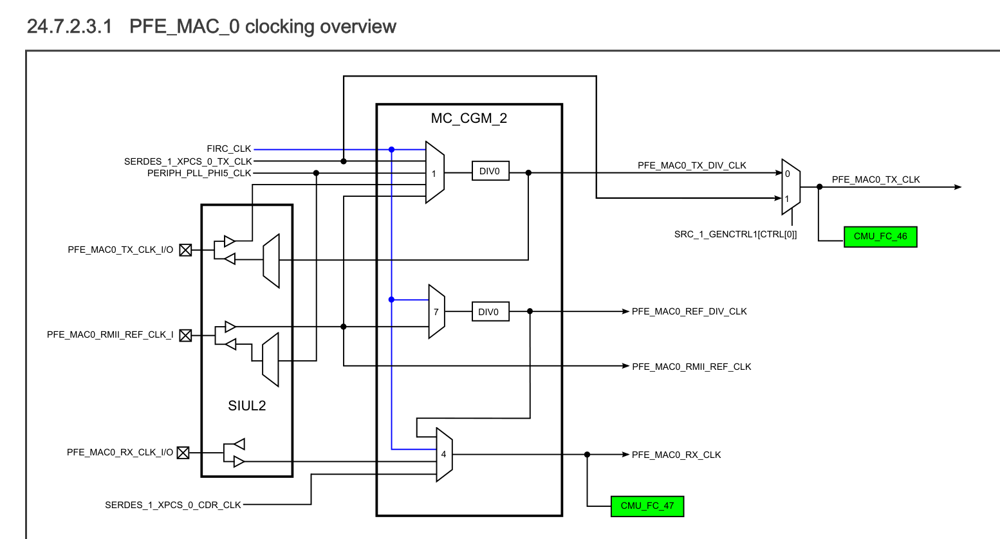

**注意：** 在为 PFE_MAC0_TX_CLK 切换时钟源之前，必须禁用多路复用器的两个时钟输入（例如 PFE_MAC0_TX_DIV_CLK 和 SERDES_1_XPCS_0_TX_CLK）。

###### 7.2.3.1.1. PFE_MAC_0 RGMII 配置

图 82 给出 PFE_MAC_0 RGMII 以太网时钟，表 94 给出 RGMII 的 SIUL2 时钟信号配置。

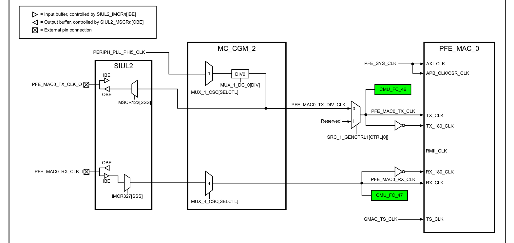

| 目标时钟 | 源时钟 | I/O 端口 | MSCRa | OBE | IBE | SSS | IMCRb | IMCRb[SSS] |
| --- | --- | --- | --- | --- | --- | --- | --- | --- |
| GMAC_TS_CLK | 参见"以太网（GMAC_0）RGMII 配置" |  |  |  |  |  |  |  |
| PFE_MAC0_TX_CLK | PERIPH_PLL_PHI5_CLK | — |  |  |  |  |  |  |
| PFE_MAC0_TX_CLK_O |  | PH_10 | 122 | 1 | 0 | 001b | — | X |
| PFE_MAC0_RX_CLK | PFE_MAC0_RX_CLK_I | PH_04 | 116 | 0 | 1 | X | 327 | 010b |

###### 7.2.3.1.2. PFE_MAC_0 RMII 配置

图 83 给出 PFE_MAC_0 RMII 以太网时钟，表 95 给出 RMII 的 SIUL2 时钟信号配置。

对于 RMII 配置，必须对 MC_CGM_2 的多路复用器和分频器进行编程，使 PFE_MAC_0 的 RX_CLK、TX_CLK 和 RMII_CLK 相同。

配置 RMII 的步骤如下：

* REF_CLK 50 MHz（来自 PHY，或内部产生并馈送至 PHY）
* RX_CLK（必须从 REF_CLK 派生）：
  * 对于 100 Mbps，应为 25 MHz
  * 对于 10 Mbps，应为 2.5 MHz
* TX_CLK 未使用

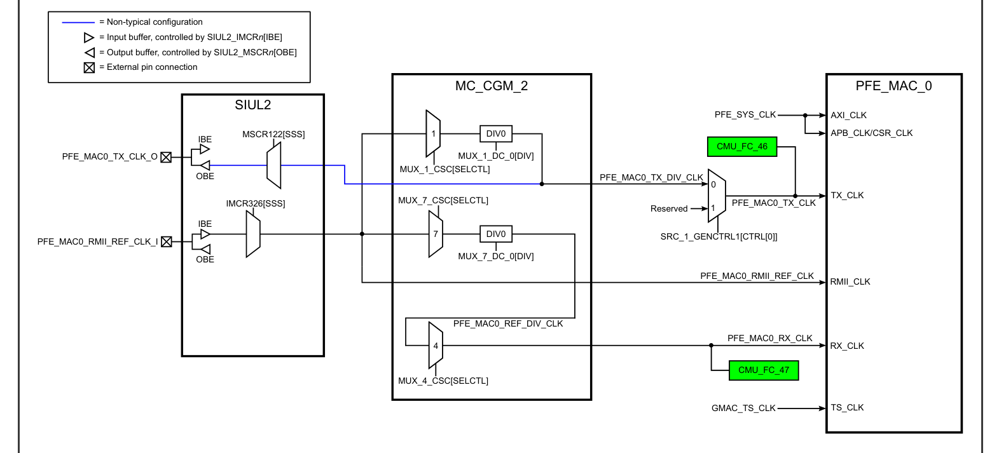

| 目标时钟 | 源时钟 | I/O 端口 | MSCRa | OBE | IBE | SSS | IMCRb | IMCRb[SSS] |
| --- | --- | --- | --- | --- | --- | --- | --- | --- |
| GMAC_TS_CLK | 参见"以太网（GMAC_0）RMII 配置" |  |  |  |  |  |  |  |
| PFE_MAC0_TX_CLK_O |  | PH_10 | 122 | 1 | 0 | 001b | — | X |
| PFE_MAC0_RMII_REF_CLK | PFE_MAC0_RMII_REF_CLK_I | PH_03 | 115 | 0 | 1 | X | 326 | 010b |
| PFE_MAC0_TX_CLK |  |  |  |  |  |  |  |  |
| PFE_MAC0_RX_CLK |  |  |  |  |  |  |  |  |

###### 7.2.3.1.3. PFE_MAC_0 MII 配置

图 84 给出 PFE_MAC_0 MII 以太网时钟，表 96 给出 MII 的 SIUL2 时钟信号配置。

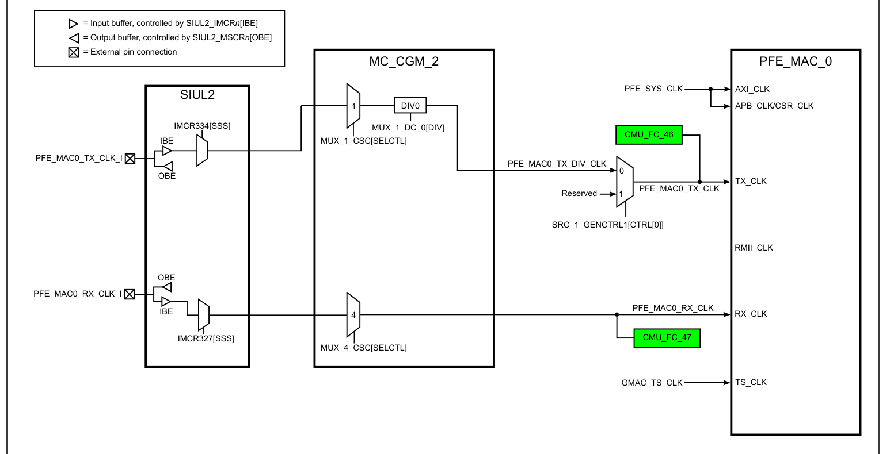

| 目标时钟 | 源时钟 | I/O 端口 | MSCRa | OBE | IBE | SSS | IMCRb | IMCRb[SSS] |
| --- | --- | --- | --- | --- | --- | --- | --- | --- |
| GMAC_TS_CLK | 参见"以太网（GMAC_0）MII 配置" |  |  |  |  |  |  |  |
| PFE_MAC0_TX_CLK | PFE_MAC0_TX_CLK_I | PH_10 | 122 | 0 | 1 | X | 334 | 010b |
| PFE_MAC0_RX_CLK | PFE_MAC0_RX_CLK_I | PH_04 | 116 | 0 | 1 | X | 327 | 010b |

###### 7.2.3.1.4. PFE_MAC_0 SGMII 配置

图 85 给出 PFE_MAC_0 SGMII 以太网时钟，表 97 给出 SGMII 的 SIUL2 时钟信号配置。

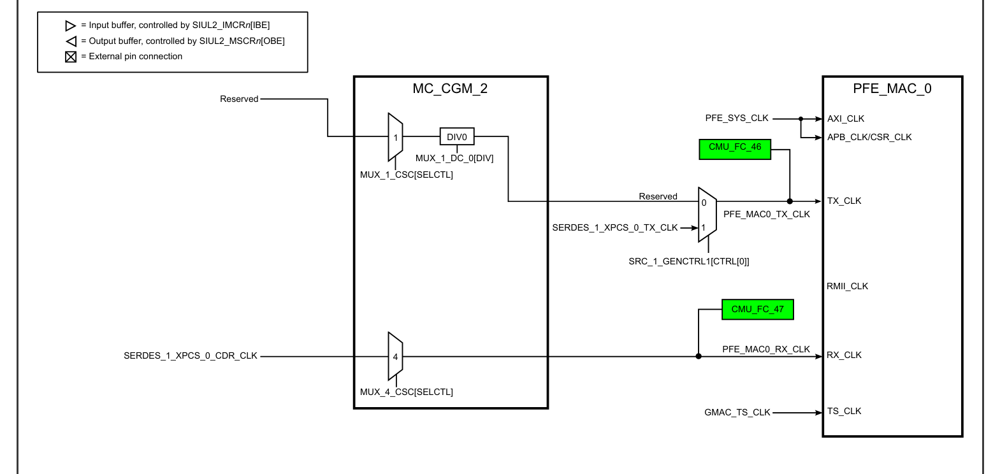

| 目标时钟 | 源时钟 | I/O 端口 | MSCRa | OBE | IBE | SSS | IMCRb | IMCRb[SSS] |
| --- | --- | --- | --- | --- | --- | --- | --- | --- |
| GMAC_TS_CLK | 参见"以太网（GMAC_0）SGMII 配置" |  |  |  |  |  |  |  |
| PFE_MAC0_TX_CLK | SERDES_1_XPCS_0_TX_CLK | — |  |  |  |  |  |  |
| PFE_MAC0_RX_CLK | SERDES_1_XPCS_0_CDR_CLK | — |  |  |  |  |  |  |

##### 7.2.3.2. PFE_MAC_1 时钟概述

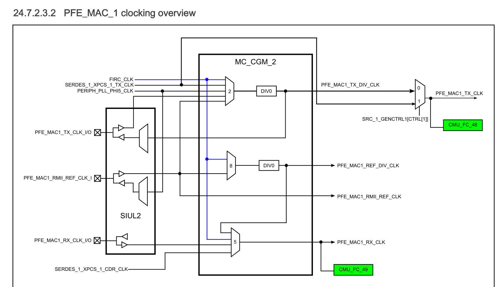

###### 7.2.3.2.1. PFE_MAC_1 RGMII 配置

图 87 给出 PFE_MAC_1 RGMII 以太网时钟，表 98 给出 RGMII 的 SIUL2 时钟信号配置。

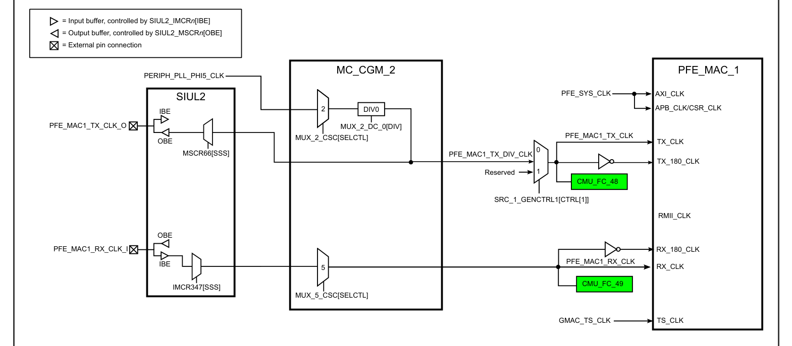

| 目标时钟 | 源时钟 | I/O 端口 | MSCRa | OBE | IBE | SSS | IMCRb | IMCRb[SSS] |
| --- | --- | --- | --- | --- | --- | --- | --- | --- |
| GMAC_TS_CLK | 参见"以太网（GMAC_0）RGMII 配置" |  |  |  |  |  |  |  |
| PFE_MAC1_TX_CLK | PERIPH_PLL_PHI5_CLK | — |  |  |  |  |  |  |
| PFE_MAC1_TX_CLK_O |  | PE_02 | 66 | 1 | 0 | 010b | — | X |
| PFE_MAC1_RX_CLK | PFE_MAC1_RX_CLK_I | PE_08 | 72 | 0 | 1 | X | 347 | 010b |

###### 7.2.3.2.2. PFE_MAC_1 RMII 配置

图 88 给出 PFE_MAC_1 RMII 以太网时钟，表 99 给出 RMII 的 SIUL2 时钟信号配置。

对于 RMII 配置，必须对 MC_CGM_2 的多路复用器和分频器进行编程，使 PFE_MAC_1 的 RX_CLK、TX_CLK 和 RMII_CLK 相同。

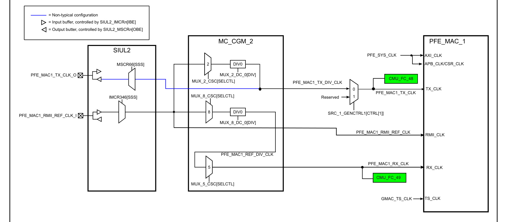

| 目标时钟 | 源时钟 | I/O 端口 | MSCRa | OBE | IBE | SSS | IMCRb | IMCRb[SSS] |
| --- | --- | --- | --- | --- | --- | --- | --- | --- |
| GMAC_TS_CLK | 参见"以太网（GMAC_0）RMII 配置" |  |  |  |  |  |  |  |
| PFE_MAC1_TX_CLK_O |  | PE_02 | 66 | 1 | 0 | 010b | — | X |
| PFE_MAC1_RMII_REF_CLK | PFE_MAC1_RMII_REF_CLK_I | PE_07 | 71 | 0 | 1 | X | 346 | 010b |
| PFE_MAC1_TX_CLK |  |  |  |  |  |  |  |  |
| PFE_MAC1_RX_CLK |  |  |  |  |  |  |  |  |

###### 7.2.3.2.3. PFE_MAC_1 MII 配置

图 89 给出 PFE_MAC_1 MII 以太网时钟，表 100 给出 PFE_MAC1 MII 的 SIUL2 时钟信号配置。

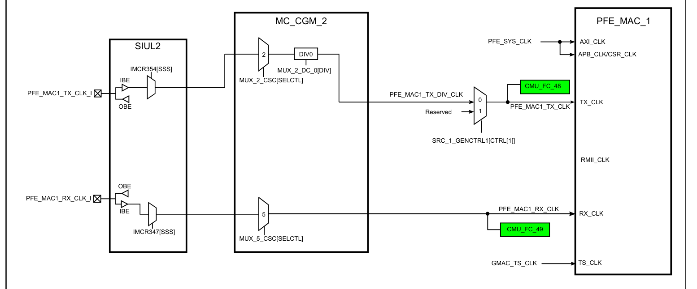

| 目标时钟 | 源时钟 | I/O 端口 | MSCRa | OBE | IBE | SSS | IMCRb | IMCRb[SSS] |
| --- | --- | --- | --- | --- | --- | --- | --- | --- |
| GMAC_TS_CLK | 参见"以太网（GMAC_0）MII 配置" |  |  |  |  |  |  |  |
| PFE_MAC1_TX_CLK | PFE_MAC1_TX_CLK_I | PE_02 | 66 | 0 | 1 | X | 354 | 010b |
| PFE_MAC1_RX_CLK | PFE_MAC1_RX_CLK_I | PE_08 | 72 | 0 | 1 | X | 347 | 010b |

###### 7.2.3.2.4. PFE_MAC_1 SGMII 配置

图 90 给出 PFE_MAC_1 SGMII 以太网时钟，表 101 给出 PFE_MAC_1 SGMII 的 SIUL2 时钟信号配置。

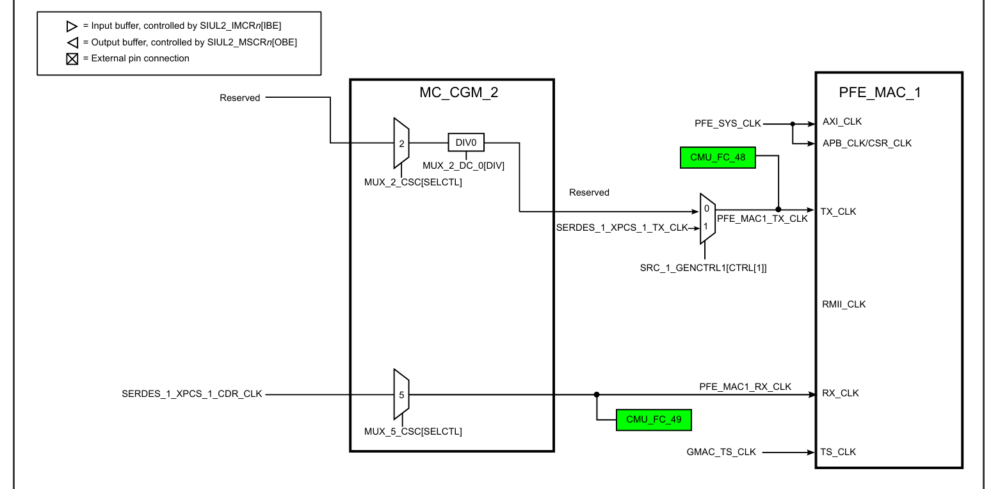

| 目标时钟 | 源时钟 | I/O 端口 | MSCRa | OBE | IBE | SSS | IMCRb | IMCRb[SSS] |
| --- | --- | --- | --- | --- | --- | --- | --- | --- |
| GMAC_TS_CLK | 参见"以太网（GMAC_0）SGMII 配置" |  |  |  |  |  |  |  |
| PFE_MAC1_TX_CLK | SERDES_1_XPCS_1_TX_CLK | — |  |  |  |  |  |  |
| PFE_MAC1_RX_CLK | SERDES_1_XPCS_1_CDR_CLK | — |  |  |  |  |  |  |

##### 7.2.3.3. PFE_MAC_2 时钟概述

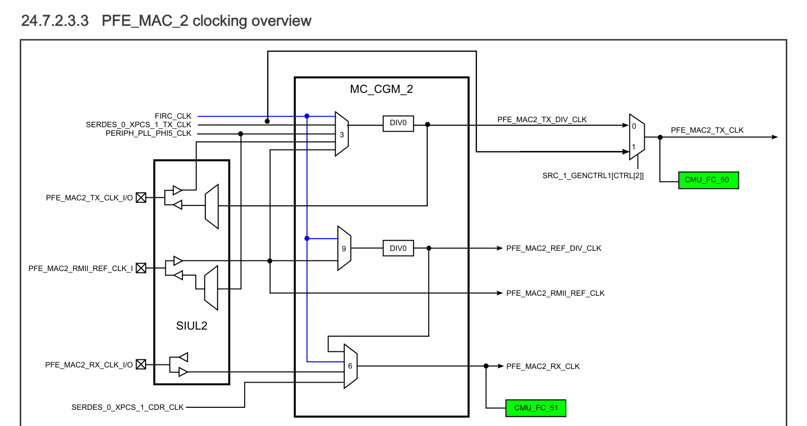

###### 7.2.3.3.1. PFE_MAC_2 RGMII 配置

图 92 给出 PFE_MAC_2 RGMII 以太网时钟，表 102 给出 RGMII 的 SIUL2 时钟信号配置。

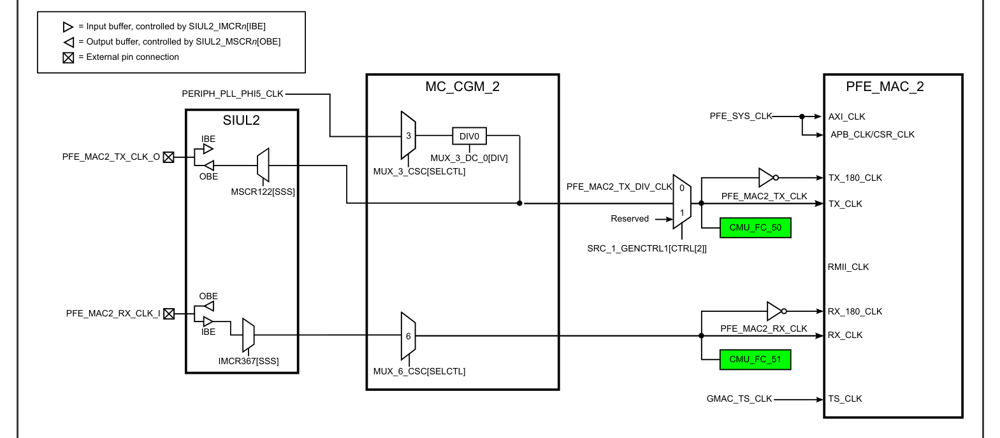

| 目标时钟 | 源时钟 | I/O 端口 | MSCRa | OBE | IBE | SSS | IMCRb | IMCRb[SSS] |
| --- | --- | --- | --- | --- | --- | --- | --- | --- |
| GMAC_TS_CLK | 参见"以太网（GMAC_0）RGMII 配置" |  |  |  |  |  |  |  |
| PFE_MAC2_TX_CLK | PERIPH_PLL_PHI5_CLK | — |  |  |  |  |  |  |
| PFE_MAC2_TX_CLK_O |  | PH_10 | 122 | 1 | 0 | 010b | — | X |
| PFE_MAC2_TX_CLK_O |  | PL_08 | 184 | 1 | 0 | 101b | — | X |
| PFE_MAC2_RX_CLK | PFE_MAC2_RX_CLK_I | PH_04 | 116 | 0 | 1 | X | 367 | 011b |
| PFE_MAC2_RX_CLK | PFE_MAC2_RX_CLK_I | PE_00 | 64 | 0 | 1 | X | 367 | 010b |

###### 7.2.3.3.2. PFE_MAC_2 RMII 配置

图 93 给出 PFE_MAC_2 RMII 以太网时钟，表 103 给出 RMII 的 SIUL2 时钟信号配置。

对于 RMII 配置，必须对 MC_CGM_2 的多路复用器和分频器进行编程，使 PFE_MAC_2 的 RX_CLK、TX_CLK 和 RMII_CLK 相同。

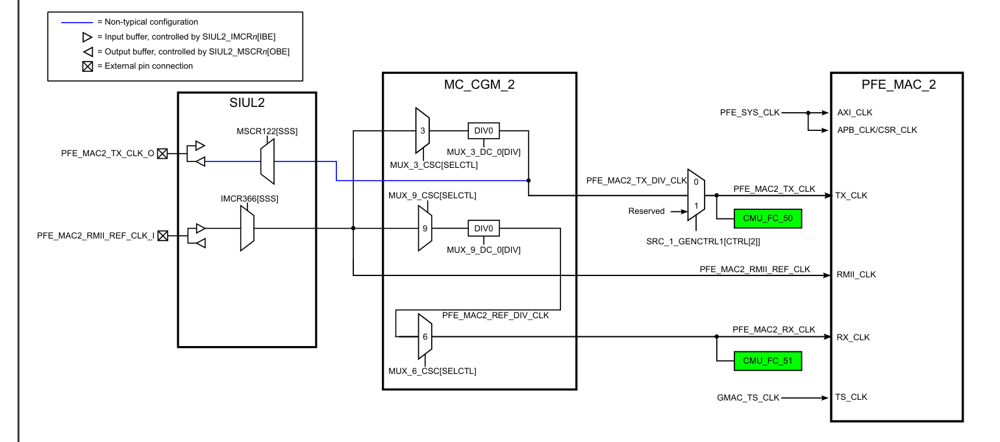

| 目标时钟 | 源时钟 | I/O 端口 | MSCRa | OBE | IBE | SSS | IMCRb | IMCRb[SSS] |
| --- | --- | --- | --- | --- | --- | --- | --- | --- |
| GMAC_TS_CLK | 参见"以太网（GMAC_0）RMII 配置" |  |  |  |  |  |  |  |
| PFE_MAC2_TX_CLK_O |  | PH_10 | 122 | 1 | 0 | 010b | — | X |
| PFE_MAC2_RMII_REF_CLK | PFE_MAC2_RMII_REF_CLK_I | PH_03 | 115 | 0 | 1 | X | 366 | 011b |
| PFE_MAC2_TX_CLK |  |  |  |  |  |  |  |  |
| PFE_MAC2_RX_CLK |  |  |  |  |  |  |  |  |

###### 7.2.3.3.3. PFE_MAC_2 MII 配置

图 94 给出 PFE_MAC_2 MII 以太网时钟，表 104 给出 PFE_MAC2 MII 的 SIUL2 时钟信号配置。

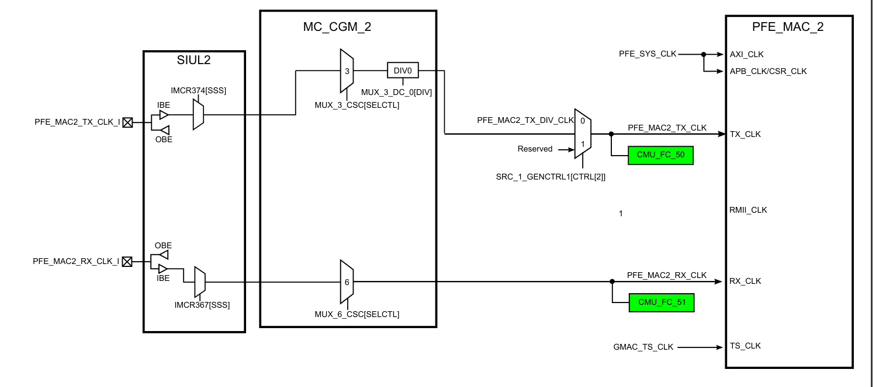

| 目标时钟 | 源时钟 | I/O 端口 | MSCRa | OBE | IBE | SSS | IMCRb | IMCRb[SSS] |
| --- | --- | --- | --- | --- | --- | --- | --- | --- |
| GMAC_TS_CLK | 参见"以太网（GMAC_0）MII 配置" |  |  |  |  |  |  |  |
| PFE_MAC2_TX_CLK | PFE_MAC2_TX_CLK_I | PH_10 | 122 | 0 | 1 | X | 374 | 011b |
| PFE_MAC2_TX_CLK | PFE_MAC2_TX_CLK_I | PL_08 | 184 | 0 | 1 | X |  | 010b |
| PFE_MAC2_RX_CLK | PFE_MAC2_RX_CLK_I | PH_04 | 116 | 0 | 1 | X | 367 | 011b |
| PFE_MAC2_RX_CLK | PFE_MAC2_RX_CLK_I | PE_00 | 64 | 0 | 1 | X | 367 | 010b |

###### 7.2.3.3.4. PFE_MAC_2 SGMII 配置

图 95 给出 PFE_MAC_2 SGMII 以太网时钟，表 105 给出 PFE_MAC_2 SGMII 的 SIUL2 时钟信号配置。

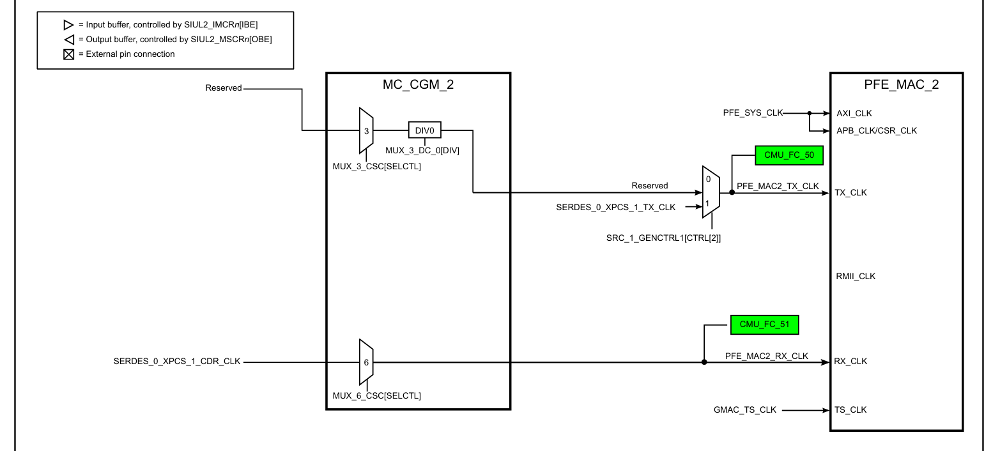

| 目标时钟 | 源时钟 | I/O 端口 | MSCRa | OBE | IBE | SSS | IMCRb | IMCRb[SSS] |
| --- | --- | --- | --- | --- | --- | --- | --- | --- |
| GMAC_TS_CLK | 参见"以太网（GMAC_0）SGMII 配置" |  |  |  |  |  |  |  |
| PFE_MAC2_TX_CLK | SERDES_0_XPCS_1_TX_CLK | — |  |  |  |  |  |  |
| PFE_MAC2_RX_CLK | SERDES_0_XPCS_1_CDR_CLK | — |  |  |  |  |  |  |

#### 7.2.4. LLCE 子系统时钟概述

图 96 给出 LLCE 时钟，表 106 给出 LLCE LPSPIn 的 SIUL2 时钟信号配置。

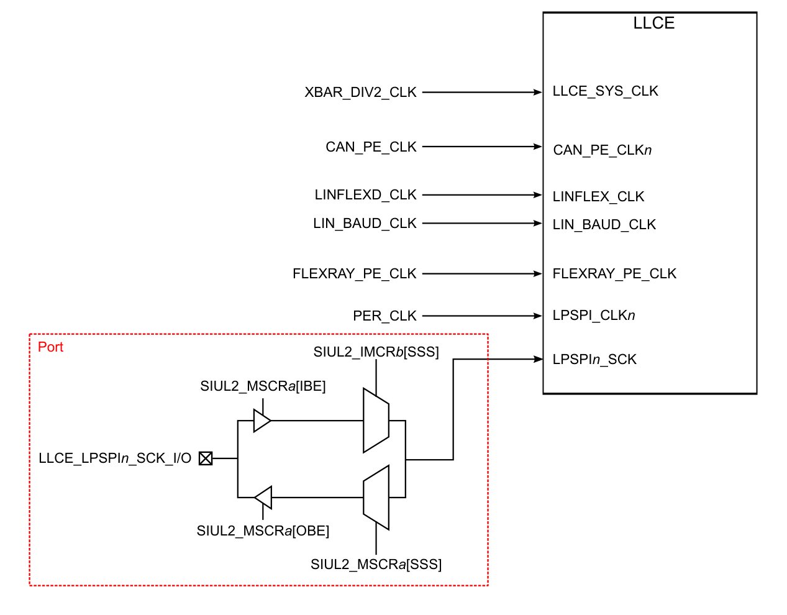

| LPSPIn | SPI 模式 | I/O 信号 | 端口 | MSCRa | OBE | IBE | SSS | IMCRb | IMCR[SSS] |
| --- | --- | --- | --- | --- | --- | --- | --- | --- | --- |
| LPSPI0_SCK | 从机 | LLCE_LPSPI0_SCK_I | PA_09 | 9 | 0 | 1 | X | 288 | 010b |
| LPSPI0_SCK | 主机 | LLCE_LPSPI0_SCK_O | PA_09 | 9 | 1 | 0 | 001b | 288 | X |
| LPSPI1_SCK | 从机 | LLCE_LPSPI1_SCK_I | PH_06 | 118 | 0 | 1 | X | 296 | 011b |
| LPSPI1_SCK | 主机 | LLCE_LPSPI1_SCK_O | PH_06 | 118 | 1 | 0 | 010b | 296 | X |
| LPSPI1_SCK | 从机 | LLCE_LPSPI1_SCK_I | PL_13 | 189 | 0 | 1 | X | 296 | 010b |
| LPSPI1_SCK | 主机 | LLCE_LPSPI1_SCK_O | PL_13 | 189 | 1 | 0 | 101b | 296 | X |
| LPSPI2_SCK | 从机 | LLCE_LPSPI2_SCK_I | PB_11 | 27 | 0 | 1 | X | 304 | 010b |
| LPSPI2_SCK | 主机 | LLCE_LPSPI2_SCK_O | PB_11 | 27 | 1 | 0 | 100b | 304 | X |
| LPSPI3_SCK | 从机 | LLCE_LPSPI3_SCK_I | PL_01 | 177 | 0 | 1 | X | 312 | 010b |
| LPSPI3_SCK | 主机 | LLCE_LPSPI3_SCK_O | PL_01 | 177 | 1 | 0 | 010b | 312 | X |

#### 7.2.5. 串行外设接口（SPI）时钟

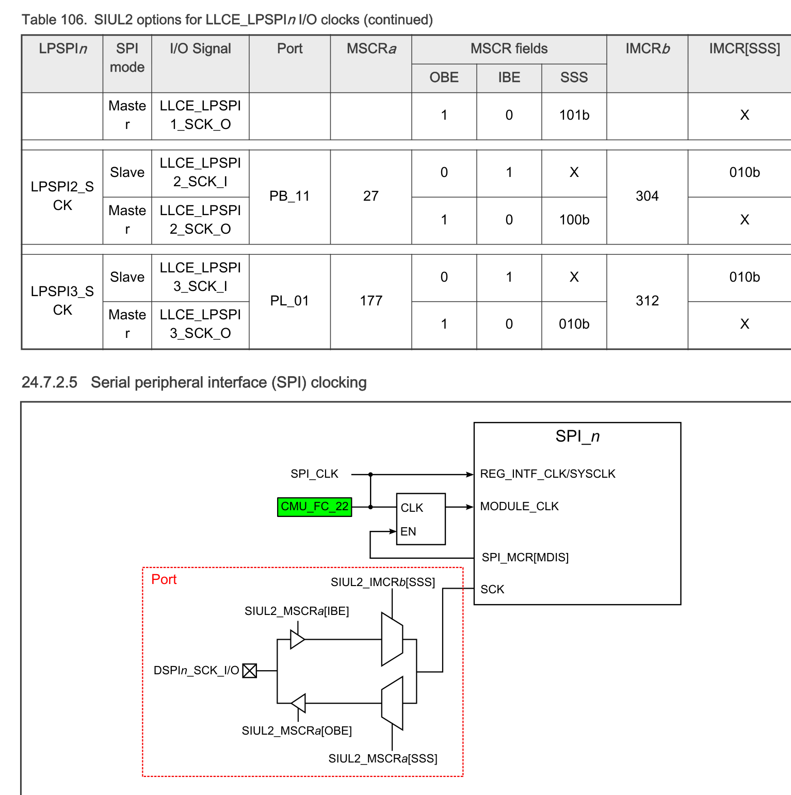

| SPI_n 信号 | SPI 模式 | I/O 信号 | 端口 | MSCRa | OBE | IBE | SSS | IMCRb | IMCR[SSS] |
| --- | --- | --- | --- | --- | --- | --- | --- | --- | --- |
| SPI_0_SCK | 从机 | SPI0_SCK_I | PA_13 | 13 | 0 | 1 | X | 469 | 010b |
| SPI_0_SCK | 主机 | SPI0_SCK_O | PA_13 | 13 | 1 | 0 | 001b | 469 | X |
| SPI_1_SCK | 从机 | SPI1_SCK_I | PA_08 | 8 | 0 | 1 | X | 474 | 010b |
| SPI_1_SCK | 主机 | SPI1_SCK_O | PA_08 | 8 | 1 | 0 | 011b | 474 | X |
| SPI_2_SCK | 从机 | SPI2_SCK_I | PI_09 | 153 | 0 | 1 | X | 479 | 011b |
| SPI_2_SCK | 主机 | SPI2_SCK_O | PI_09 | 153 | 1 | 0 | 010b | 479 | X |
| SPI_2_SCK | 从机 | SPI2_SCK_I | PI_08 | 184 | 0 | 1 | X | 479 | 010b |
| SPI_2_SCK | 主机 | SPI2_SCK_O | PI_08 | 184 | 1 | 0 | 001b | 479 | X |
| SPI_2_SCK | 从机 | SPI2_SCK_I | PJ_12 | 156 | 0 | 1 | X | 479 | 100b |
| SPI_3_SCK | 从机 | SPI3_SCK_I | PJ_15 | 159 | 0 | 1 | X | 484 | 011b |
| SPI_3_SCK | 主机 | SPI3_SCK_O | PJ_15 | 159 | 1 | 0 | 010b | 484 | X |
| SPI_3_SCK | 从机 | SPI3_SCK_I | PL_13 | 189 | 0 | 1 | X | 484 | 010b |
| SPI_3_SCK | 主机 | SPI3_SCK_O | PL_13 | 189 | 1 | 0 | 010b | 484 | X |
| SPI_3_SCK | 从机 | SPI3_SCK_I | PK_02 | 162 | 0 | 1 | X | 484 | 100b |
| SPI_4_SCK | 从机 | SPI4_SCK_I | PC_09 | 41 | 0 | 1 | X | 489 | 010b |
| SPI_4_SCK | 主机 | SPI4_SCK_O | PC_09 | 41 | 1 | 0 | 100b | 489 | X |
| SPI_4_SCK | 从机 | SPI4_SCK_I | PK_05 | 165 | 0 | 1 | X | 489 | 011b |
| SPI_4_SCK | 主机 | SPI4_SCK_O | PK_05 | 165 | 1 | 0 | 010b | 489 | X |
| SPI_4_SCK | 从机 | SPI4_SCK_I | PK_06 | 162 | 0 | 1 | X | 489 | 100b |
| SPI_5_SCK | 从机 | SPI5_SCK_I | PA_09 | 9 | 0 | 1 | X | 494 | 010b |
| SPI_5_SCK | 主机 | SPI5_SCK_O | PA_09 | 9 | 1 | 0 | 011b | 494 | X |
| SPI_5_SCK | 从机 | SPI5_SCK_I | PK_15 | 175 | 0 | 1 | X | 494 | 100b |
| SPI_5_SCK | 主机 | SPI5_SCK_O | PK_15 | 175 | 1 | 0 | 100b | 494 | X |
| SPI_5_SCK | 从机 | SPI5_SCK_I | PK_12 | 172 | 0 | 1 | X | 494 | 011b |

#### 7.2.6. FlexCAN 时钟

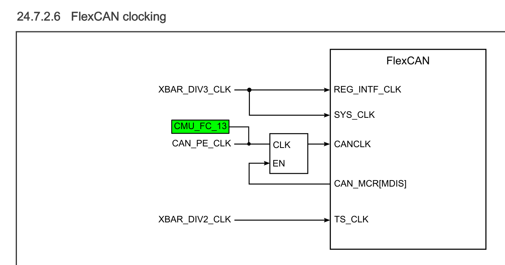

#### 7.2.7. FlexRay 通信控制器时钟

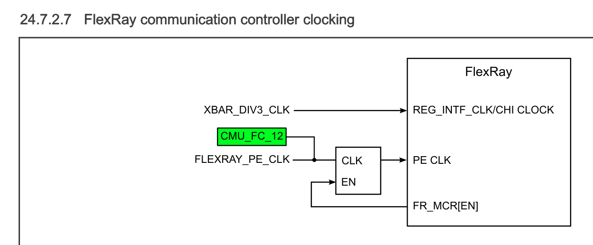

#### 7.2.8. I2C 时钟

图 100 给出 I2C_n 时钟，图 101 给出 I2C 的 SIUL2 配置。

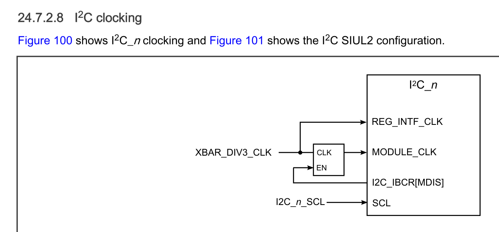

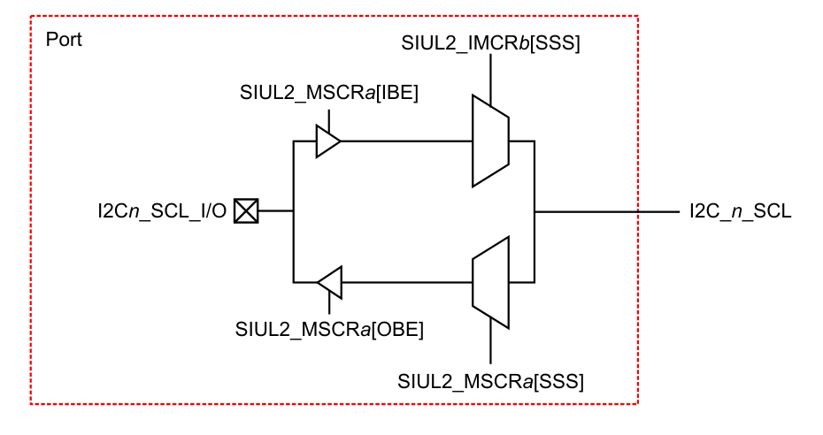

| I2C_n 信号 | I2C 模式 | I/O 信号 | 端口 | MSCRa | OBE | IBE | SSS | IMCRb | IMCR[SSS] |
| --- | --- | --- | --- | --- | --- | --- | --- | --- | --- |
| I2C_0_SCL | 从机 | I2C0_SCL_I | PB_01 | 17 | 0 | 1 | X | 54 | 010b |
| I2C_0_SCL | 主机 | I2C0_SCL_O | PB_01 | 17 | 1 | 0 | 001b | 54 | X |
| I2C_0_SCL | 从机 | I2C0_SCL_I | PC_00 | 32 | 0 | 1 | X | 54 | 011b |
| I2C_0_SCL | 主机 | I2C0_SCL_O | PC_00 | 32 | 1 | 0 | 001b | 54 | X |
| I2C_0_SCL | 从机 | I2C0_SCL_I | PD_07 | 55 | 0 | 1 | X | 54 | 100b |
| I2C_0_SCL | 主机 | I2C0_SCL_O | PD_07 | 55 | 1 | 0 | 011b | 54 | X |
| I2C_0_SCL | 从机 | I2C0_SCL_I | PJ_00 | 144 | 0 | 1 | X | 54 | 101b |
| I2C_0_SCL | 主机 | I2C0_SCL_O | PJ_00 | 144 | 1 | 0 | 011b | 54 | X |
| I2C_0_SCL | 从机 | I2C0_SCL_I | PJ_00 | 15 | 0 | 1 | X | 54 | 110b |
| I2C_0_SCL | 主机 | I2C0_SCL_O | PJ_00 | 15 | 1 | 0 | 011b | 54 | X |
| I2C_1_SCL | 从机 | I2C1_SCL_I | PB_03 | 19 | 0 | 1 | X | 205 | 010b |
| I2C_1_SCL | 主机 | I2C1_SCL_O | PB_03 | 19 | 1 | 0 | 001b | 205 | X |
| I2C_1_SCL | 从机 | I2C1_SCL_I | PD_01 | 49 | 0 | 1 | X | 205 | 011b |
| I2C_1_SCL | 主机 | I2C1_SCL_O | PD_01 | 49 | 1 | 0 | 001b | 205 | X |
| I2C_1_SCL | 从机 | I2C1_SCL_I | PH_02 | 114 | 0 | 1 | X | 205 | 100b |
| I2C_1_SCL | 主机 | I2C1_SCL_O | PH_02 | 114 | 1 | 0 | 100b | 205 | X |
| I2C_1_SCL | 从机 | I2C1_SCL_I | PK_03 | 163 | 0 | 1 | X | 205 | 101b |
| I2C_1_SCL | 主机 | I2C1_SCL_O | PK_03 | 163 | 1 | 0 | 011b | 205 | X |
| I2C_1_SCL | 从机 | I2C1_SCL_I | PK_15 | 175 | 0 | 1 | X | 205 | 110b |
| I2C_1_SCL | 主机 | I2C1_SCL_O | PK_15 | 175 | 1 | 0 | 101b | 205 | X |
| I2C_2_SCL | 从机 | I2C2_SCL_I | PB_05 | 21 | 0 | 1 | X | 207 | 010b |
| I2C_2_SCL | 主机 | I2C2_SCL_O | PB_05 | 21 | 1 | 0 | 001b | 207 | X |
| I2C_2_SCL | 从机 | I2C2_SCL_I | PD_00 | 48 | 0 | 1 | X | 207 | 011b |
| I2C_2_SCL | 主机 | I2C2_SCL_O | PD_00 | 48 | 1 | 0 | 011b | 207 | X |
| I2C_2_SCL | 从机 | I2C2_SCL_I | PH_08 | 120 | 0 | 1 | X | 207 | 100b |
| I2C_2_SCL | 主机 | I2C2_SCL_O | PH_08 | 120 | 1 | 0 | 001b | 207 | X |
| I2C_3_SCL | 从机 | I2C3_SCL_I | PB_07 | 23 | 0 | 1 | X | 209 | 010b |
| I2C_3_SCL | 主机 | I2C3_SCL_O | PB_07 | 23 | 1 | 0 | 001b | 209 | X |
| I2C_3_SCL | 从机 | I2C3_SCL_I | PB_14 | 30 | 0 | 1 | X | 209 | 011b |
| I2C_3_SCL | 主机 | I2C3_SCL_O | PB_14 | 30 | 1 | 0 | 100b | 209 | X |
| I2C_3_SCL | 从机 | I2C3_SCL_I | PD_03 | 51 | 0 | 1 | X | 209 | 100b |
| I2C_3_SCL | 主机 | I2C3_SCL_O | PD_03 | 51 | 1 | 0 | 011b | 209 | X |
| I2C_3_SCL | 从机 | I2C3_SCL_I | PE_15 | 79 | 0 | 1 | X | 209 | 101b |
| I2C_3_SCL | 主机 | I2C3_SCL_O | PE_15 | 79 | 1 | 0 | 011b | 209 | X |
| I2C_4_SCL | 从机 | I2C4_SCL_I | PB_01 | 17 | 0 | 1 | X | 211 | 010b |
| I2C_4_SCL | 主机 | I2C4_SCL_O | PB_01 | 17 | 1 | 0 | 100b | 211 | X |
| I2C_4_SCL | 从机 | I2C4_SCL_I | PC_02 | 34 | 0 | 1 | X | 211 | 011b |
| I2C_4_SCL | 主机 | I2C4_SCL_O | PC_02 | 34 | 1 | 0 | 010b | 211 | X |

#### 7.2.9. LINFlexD 时钟

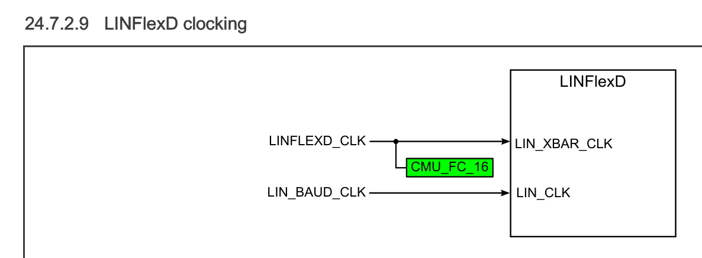

#### 7.2.10. USB 时钟

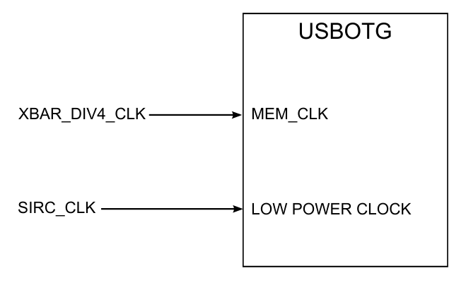

### 7.3. 定时器模块

图 104 给出 REG_INTF_CLK 和 MODULE_CLK 的连接方式，表 109 给出这些模块使用的 REG_INTF_CLK 和 MODULE_CLK 信号。任何未明确显示 REG_INTF_CLK 的模块图，其 REG_INTF_CLK 都使用与 MODULE_CLK 相同的源。

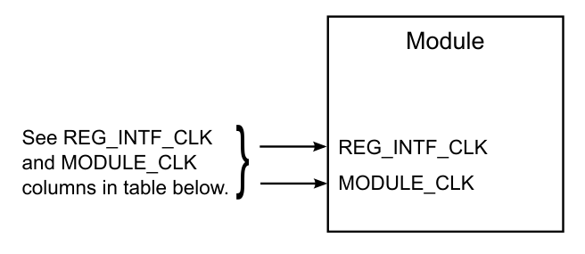

| 模块 | MODULE_CLK | REG_INTF_CLK |
| --- | --- | --- |
| FTM | 参见 FTM 时钟 | 参见 FTM 时钟 |
| PIT | XBAR_DIV3_CLK | XBAR_DIV3_CLK |
| RTC | 参见 RTC 时钟 | 参见 RTC 时钟 |
| STM | STM_0 – STM_11 | XBAR_DIV3_CLK |
| STM | STM_TS | XBAR_DIV6_CLK |
| SWT | 参见 SWT 时钟 | 参见 SWT 时钟 |

#### 7.3.1. FTM 时钟

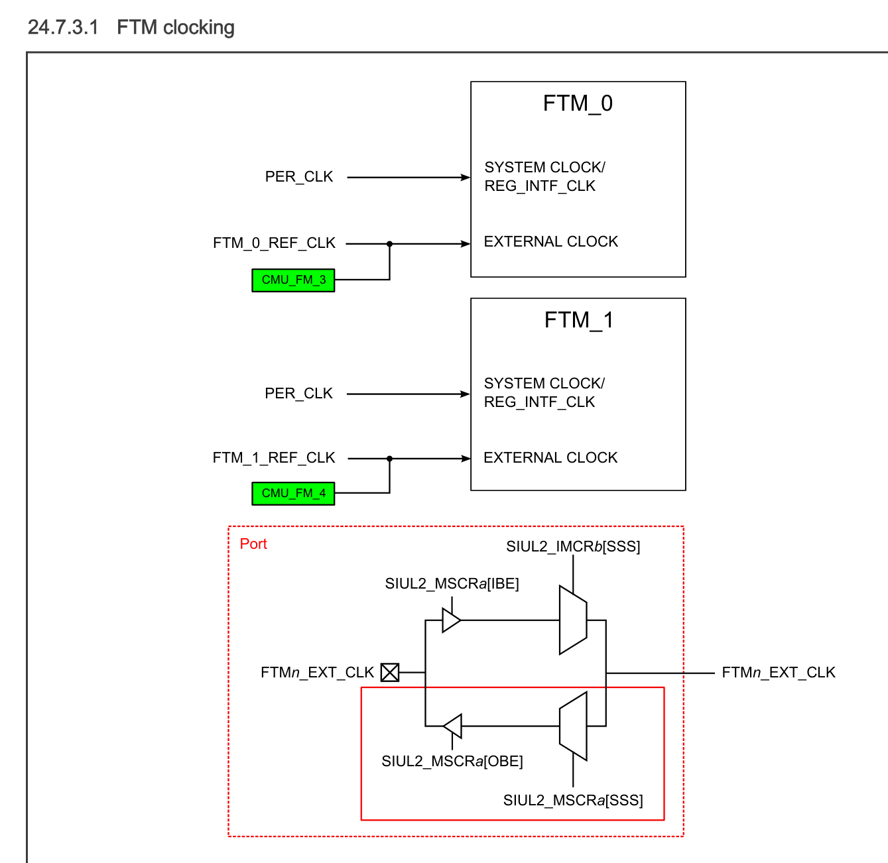

**注意：** 红色实线框中的输出多路复用器和输出缓冲器不适用于端口 PJ_08。

| FTMn_EXT_CLK 信号 | FTM_n_SC[CLKS] | I/O 信号 | 端口 | MSCRa | OBE | IBE | IMCRb | IMCR[SSS] |
| --- | --- | --- | --- | --- | --- | --- | --- | --- |
| FTM0_EXT_CLK | 11b | FTM0_EXT_CLK | PA_13 | 13 | 0 | 1 | 661 | 010b |
| FTM0_EXT_CLK | !(11b) | FTM0_EXT_CLK | PA_13 | 13 | X | X | 661 | X |
| FTM0_EXT_CLK | 11b | FTM0_EXT_CLK | PH_04 | 116 | 0 | 1 | 661 | 010b |
| FTM0_EXT_CLK | !(11b) | FTM0_EXT_CLK | PH_04 | 116 | X | X | 661 | X |
| FTM0_EXT_CLK | 11b | FTM0_EXT_CLK | PJ_08 | — | — | — | 661 | 100b |
| FTM1_EXT_CLK | 11b | FTM1_EXT_CLK | PB_11 | 27 | 0 | 1 | 671 | 010b |
| FTM1_EXT_CLK | !(11b) | FTM1_EXT_CLK | PB_11 | 27 | X | X | 671 | X |
| FTM1_EXT_CLK | 11b | FTM1_EXT_CLK | PD_15 | 63 | 0 | 1 | 671 | 011b |
| FTM1_EXT_CLK | !(11b) | FTM1_EXT_CLK | PD_15 | 63 | X | X | 671 | X |

#### 7.3.2. RTC 时钟

图 106 给出 RTC 时钟配置，图 107 给出外部 RTC 时钟的 SIUL2 端口配置。

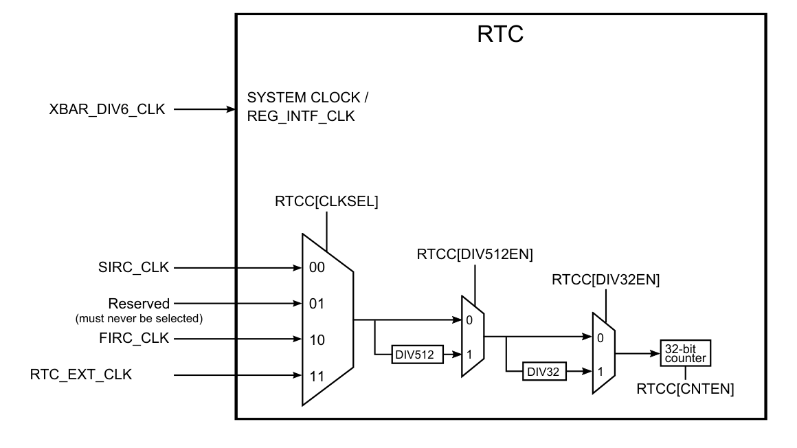

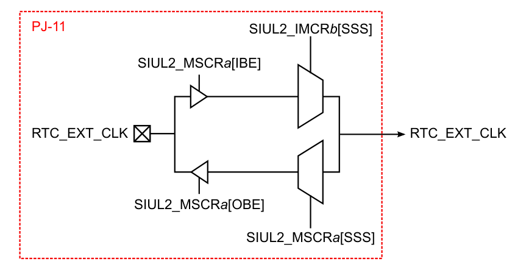

**警告：** RTCC[CLKSEL] 绝不能等于 01b。

| RTC_RTCC[CLKSEL] | 端口 | MSCRa | OBE | IBE | IMCRb | IMCR[SSS] |
| --- | --- | --- | --- | --- | --- | --- |
| 11b | PJ_11 | 155 | 0 | 1 | 979 | 010b |
| !(11b) | PJ_11 | 155 | X | X | 979 | X |

**注意：** 如果要在功能性复位后保留 RTC 内容，RTC 只能使用 SIRC_CLK 或 FIRC_CLK 作为时钟源。芯片会在复位时重新配置 RTC_EXT_CLK 引脚复用。

#### 7.3.3. SWT 时钟

### 7.4. 通用模块

图 109 给出 REG_INTF_CLK 和 MODULE_CLK 的连接方式，表 112 给出这些模块使用的 REG_INTF_CLK 和 MODULE_CLK 信号。任何未明确显示 REG_INTF_CLK 的模块图，其 REG_INTF_CLK 都使用与 MODULE_CLK 相同的源。

| 模块 | MODULE_CLK | REG_INTF_CLK |
| --- | --- | --- |
| WKPU | XBAR_DIV6_CLK | XBAR_DIV6_CLK |
| SRC | XBAR_DIV6_CLK | XBAR_DIV6_CLK |
| SRC_TOP | XBAR_DIV6_CLK | XBAR_DIV6_CLK |
| SIUL2_[0:1] | 参见 SIUL2 时钟 | 参见 SIUL2 时钟 |
| TMU | XBAR_DIV3_CLK | XBAR_DIV3_CLK |

#### 7.4.1. SIUL2 时钟

### 7.5. 模拟模块

图 111 给出 REG_INTF_CLK 和 MODULE_CLK 的连接方式，表 113 给出这些模块使用的 REG_INTF_CLK 和 MODULE_CLK 信号。任何未明确显示 REG_INTF_CLK 的模块图，其 REG_INTF_CLK 都使用与 MODULE_CLK 相同的源。

| 模块 | MODULE_CLK | REG_INTF_CLK |
| --- | --- | --- |
| CTU | 参见 CTU 时钟 | 参见 CTU 时钟 |
| SAR_ADC | 参见 SAR_ADC 时钟 | 参见 SAR_ADC 时钟 |

#### 7.5.1. CTU 时钟

#### 7.5.2. SAR_ADC 时钟

### 7.6. 调试模块

详情参见[调试（**Debug**）](../ch078_debug/index.md)一章。

#### 7.6.1. 调试踪迹单元时钟

下图给出加速器子系统中调试踪迹时钟的概述。

### 7.7. 存储器控制器模块

图 115 给出 REG_INTF_CLK 和 MODULE_CLK 的连接方式，表 114 给出这些模块使用的 REG_INTF_CLK 和 MODULE_CLK 信号。任何未明确显示 REG_INTF_CLK 的模块图，其 REG_INTF_CLK 都使用与 MODULE_CLK 相同的源。

| 模块 | MODULE_CLK | REG_INTF_CLK |
| --- | --- | --- |
| DDR | 参见 DDR 控制器时钟 | 参见 DDR 控制器时钟 |
| SRAM 控制器 | 参见 SRAM 控制器时钟 | 参见 SRAM 控制器时钟 |
| uSDHC | 参见 uSDHC 时钟 | 参见 uSDHC 时钟 |
| QuadSPI | 参见 QuadSPI 时钟 | 参见 QuadSPI 时钟 |

#### 7.7.1. DDR 控制器时钟

#### 7.7.2. SRAM 控制器时钟

#### 7.7.3. uSDHC 时钟

#### 7.7.4. QuadSPI 时钟

### 7.8. 时钟模块

图 120 给出 REG_INTF_CLK 和 MODULE_CLK 的连接方式，表 115 给出这些模块使用的 REG_INTF_CLK 和 MODULE_CLK 信号。任何未明确显示 REG_INTF_CLK 的模块图，其 REG_INTF_CLK 都使用与 MODULE_CLK 相同的源。

| 模块 | MODULE_CLK | REG_INTF_CLK |
| --- | --- | --- |
| CMU | XBAR_DIV6_CLK（参考时钟和被监视时钟的详情参见"时钟输入源"一节） | XBAR_DIV6_CLK |
| DFS | XBAR_DIV6_CLK | XBAR_DIV6_CLK |
| FIRC | 详情参见 FIRC | 详情参见 FIRC |
| MC_CGM | XBAR_DIV6_CLK | XBAR_DIV6_CLK |
| PLLDIG | XBAR_DIV6_CLK | XBAR_DIV6_CLK |
| SIRC | 详情参见 SIRC | 详情参见 SIRC |
| FXOSC | XBAR_DIV6_CLK（详情参见 FXOSC） | XBAR_DIV6_CLK |

### 7.9. 复位模块

图 121 给出 REG_INTF_CLK 和 MODULE_CLK 的连接方式，表 116 给出这些模块使用的 REG_INTF_CLK 和 MODULE_CLK 信号。任何未明确显示 REG_INTF_CLK 的模块图，其 REG_INTF_CLK 都使用与 MODULE_CLK 相同的源。

| 模块 | MODULE_CLK | REG_INTF_CLK |
| --- | --- | --- |
| MC_RGM | FIRC_CLK | FIRC_CLK |
| RDC | 参见 RDC 时钟 | 参见 RDC 时钟 |

#### 7.9.1. RDC 时钟

### 7.10. 电源模式模块

图 123 给出 REG_INTF_CLK 和 MODULE_CLK 的连接方式，表 117 给出这些模块使用的 REG_INTF_CLK 和 MODULE_CLK 信号。任何未明确显示 REG_INTF_CLK 的模块图，其 REG_INTF_CLK 都使用与 MODULE_CLK 相同的源。

| 模块 | MODULE_CLK | REG_INTF_CLK |
| --- | --- | --- |
| MC_ME | XBAR_DIV6_CLK | XBAR_DIV6_CLK |
| PMC | 参见 PMC 时钟 | 参见 PMC 时钟 |

#### 7.10.1. PMC 时钟

### 7.11. 内核平台模块

图 125 给出 REG_INTF_CLK 和 MODULE_CLK 的连接方式，表 118 给出这些模块使用的 REG_INTF_CLK 和 MODULE_CLK 信号。任何未明确显示 REG_INTF_CLK 的模块图，其 REG_INTF_CLK 都使用与 MODULE_CLK 相同的源。

| 模块 | MODULE_CLK | REG_INTF_CLK |
| --- | --- | --- |
| Cortex-A53 集群 | 参见 Cortex-A53 集群时钟 | 参见 Cortex-A53 集群时钟 |
| Cortex-M7 | 参见 Cortex-M7 时钟 | 参见 Cortex-M7 时钟 |
| DMAMUX | XBAR_DIV3_CLK | XBAR_DIV3_CLK |
| eDMA | 参见 eDMA 时钟 | 参见 eDMA 时钟 |
| Arm 通用中断控制器（GIC500） | 参见"Arm 通用中断控制器（GIC500）时钟"了解详情 | 参见"Arm 通用中断控制器（GIC500）时钟"了解详情 |
| MSCM | XBAR_DIV3_CLK | XBAR_DIV3_CLK |
| SEMA42 | XBAR_DIV3_CLK | XBAR_DIV3_CLK |
| XRDC_0 | XBAR_DIV6_CLK | XBAR_DIV6_CLK |
| XRDC_1 | XBAR_DIV6_CLK | XBAR_DIV6_CLK |

#### 7.11.1. Cortex-A53 集群时钟

**注意：** 通用定时器使用 FXOSC_CLK。

#### 7.11.2. Cortex-M7 时钟

#### 7.11.3. eDMA 时钟

#### 7.11.4. Arm 通用中断控制器（GIC500）时钟

## 8. 时钟监视

### 8.1. 简介

对于所有安全关键时钟，芯片必须能够检测时钟丢失或频率不正确。使用 CMU 可以实现这一目标。所使用的参考时钟取决于 CMU 实例（FIRC_CLK 或 FXOSC_CLK）。CMU 的详细信息参见"时钟监视单元（CMU）"一章。

**注意：** 如果 FIRC 未在规定的工作参数范围内运行，必须通过 POR 进行恢复。触发 POR 的方法如下：

* 主安全内核上运行的软件检测到工作不正常的 FIRC（基于以 FXOSC_CLK 为参考时钟、对 FIRC_CLK 进行测量的 CMU_FM）。然后该软件通过 SPI 向外部 PMIC 发送 POR 命令（假设该软件能够发出复位）。
* 如果软件因 FIRC 故障而停止正常工作，或停止对 PMIC 的服务，PMIC 看门狗定时器超时（在 FTTI 内）并发出 POR。

**注意：** 在使能外设之前配置外设时钟。要验证外设时钟是否在预期参数范围内工作，请检查与外设时钟对应的 CMU。如果尽管配置正确，CMU 仍显示频率不正确，软件应发出破坏性复位以纠正该问题。

### 8.2. 时钟输入源

下表给出每个 CMU 监视的时钟。这些信号在芯片内部连接，但不能通过芯片边界上的引脚访问。表的第二列给出相应 CMU 实例的地址偏移。

**注意：** 括号中显示的所有"CMU 实例"仅供将来使用，其相关寄存器空间为保留。

| CMU 实例 | 地址偏移 | 参考时钟 | 被监视时钟 | 错误响应 |
| --- | --- | --- | --- | --- |
| CMU_FC_0 | 0000h | FIRC_CLK | FXOSC_CLK | FXOSC_FAIL（MC_RGM 破坏性复位） |
| CMU_FM_1 | 0020h | FXOSC_CLK | FIRC_CLK | — |
| CMU_FM_2 | 0040h | FXOSC_CLK | SIRC_CLK | — |
| CMU_FM_3 | 0060h | FXOSC_CLK | FTM0_EXT_CLK | — |
| CMU_FM_4 | 0080h | FXOSC_CLK | FTM1_EXT_CLK | — |
| CMU_FC_5 | 00A0h | FIRC_CLK | XBAR_DIV3_CLK | XBAR_DIV3_CLK_FAIL（MC_RGM 破坏性复位） |
| CMU_FC_6 | 00C0h | FIRC_CLK | XBAR_CLK（M7_0） | CMU_REPORT_0（FCCU NCF） |
| CMU_FC_7 | 00E0h | FXOSC_CLK | XBAR_DIV3_CLK | CMU_REPORT_0（FCCU NCF） |
| CMU_FC_8 | 0100h | FIRC_CLK | XBAR_CLK（M7_1） | CMU_REPORT_0（FCCU NCF） |
| CMU_FC_9 | 0120h | FIRC_CLK | XBAR_CLK（M7_2） | CMU_REPORT_0（FCCU NCF） |
| CMU_FC_24 | 0300h | FIRC_CLK | XBAR_CLK（M7_3） | CMU_REPORT_0（FCCU NCF） |
| CMU_FC_10 | 0140h | FIRC_CLK | PER_CLK | CMU_REPORT_0（FCCU NCF） |
| CMU_FC_11 | 0160h | FXOSC_CLK | SERDES_REF_CLK | CMU_REPORT_0（FCCU NCF） |
| CMU_FC_12 | 0180h | FXOSC_CLK | FLEXRAY_PE_CLK | CMU_REPORT_0（FCCU NCF） |
| CMU_FC_13 | 01A0h | FXOSC_CLK | CAN_PE_CLK | CMU_REPORT_0（FCCU NCF） |
| CMU_FC_14 | 01C0h | FXOSC_CLK | GMAC0_TX_CLK | CMU_REPORT_0（FCCU NCF） |
| CMU_FC_15 | 01E0h | FXOSC_CLK | GMAC0_TS_CLK | CMU_REPORT_0（FCCU NCF） |
| CMU_FC_16 | 0200h | FXOSC_CLK | LINFLEXD_CLK | CMU_REPORT_0（FCCU NCF） |
| CMU_FC_17 | 0220h | FXOSC_CLK | QSPI_1X_CLK | CMU_REPORT_0（FCCU NCF） |
| CMU_FC_18 | 0240h | FXOSC_CLK | USDHC_CLK | CMU_REPORT_0（FCCU NCF） |
| (19) | 0260h | 保留 |  |  |
| CMU_FC_20 | 0280h | FIRC_CLK | DDR_CLK | CMU_REPORT_0（FCCU NCF） |
| CMU_FC_21 | 02A0h | FXOSC_CLK | GMAC0_RX_CLK | CMU_REPORT_0（FCCU NCF） |
| CMU_FC_22 | 02C0h | FXOSC_CLK | SPI_CLK | CMU_REPORT_0（FCCU NCF） |
| (23) | 02E0h | 保留 |  |  |
| (25) | 0320h | 保留 |  |  |
| (26) | 0340h | 保留 |  |  |
| CMU_FC_27 | 0360h | FXOSC_CLK | A53_CORE_CLK（集群 0） | CMU_REPORT_1（FCCU NCF） |
| CMU_FC_28 | 0380h | FIRC_CLK | A53_CORE_CLK（集群 1） | CMU_REPORT_1（FCCU NCF） |
| (29) | 03A0h | 保留 |  |  |
| (30) | 03C0h | 保留 |  |  |
| (31) | 03E0h | 保留 |  |  |
| (32) | 0400h | 保留 |  |  |
| (33) | 0420h | 保留 |  |  |
| (34) | 0440h | 保留 |  |  |
| (35) | 0460h | 保留 |  |  |
| (36) | 0480h | 保留 |  |  |
| (37) | 04A0h | 保留 |  |  |
| (38) | 04C0h | 保留 |  |  |
| CMU_FC_39 | 04E0h | FXOSC_CLK | PFE_SYS_CLK | CMU_REPORT_3（FCCU NCF） |
| (40) | 0500h | 保留 |  |  |
| (41) | 0520h | 保留 |  |  |
| (42) | 0540h | 保留 |  |  |
| (43) | 0560h | 保留 |  |  |
| (44) | 0580h | 保留 |  |  |
| (45) | 05A0h | 保留 |  |  |
| CMU_FC_46 | 05C0h | FXOSC_CLK | PFE_MAC0_TX_DIV_CLK | CMU_REPORT_3（FCCU NCF） |
| CMU_FC_47 | 05E0h | FXOSC_CLK | PFE_MAC0_RX_CLK | CMU_REPORT_3（FCCU NCF） |
| CMU_FC_48 | 0600h | FXOSC_CLK | PFE_MAC1_TX_CLK | CMU_REPORT_3（FCCU NCF） |
| CMU_FC_49 | 0620h | FXOSC_CLK | PFE_MAC1_RX_CLK | CMU_REPORT_3（FCCU NCF） |
| CMU_FC_50 | 0640h | FXOSC_CLK | PFE_MAC2_TX_CLK | CMU_REPORT_3（FCCU NCF） |
| CMU_FC_51 | 0660h | FXOSC_CLK | PFE_MAC2_RX_CLK | CMU_REPORT_3（FCCU NCF） |
| (52) | 0680h | 保留 |  |  |
| (53) | 06A0h | 保留 |  |  |
| (54) | 06C0h | 保留 |  |  |

### 8.3. 使能和禁用 CMU_FC_0 和 CMU_FC_5

必须使能 CMU_FC_0 和 CMU_FC_5 并使其处于运行状态，才能正确检测失钟事件。

* CMU_FC_0：
  * 必须在 FXOSC 开启并稳定后立即使能 CMU_FC_0。
  * 必须在关闭 FXOSC 之前禁用 CMU_FC_0。
* CMU_FC_5：
  * 必须在 XBAR_DIV3_CLK 配置完成后（即源配置和选择之后）立即使能 CMU_FC_5。
  * 必须在重新配置 XBAR_DIV3_CLK 之前（即源重新配置或源选择更改之前）禁用 CMU_FC_5。
