## 1. 芯片特定的 MC_CGM 信息

### 1.1. MC_CGM 实例

下表给出本芯片上的 MC_CGM 实例及其生成的时钟。

| 实例 | 为其生成时钟 |
| --- | --- |
| MC_CGM_0 | 系统外设 |
| MC_CGM_1 | Cortex-A53 内核 |
| MC_CGM_2 | PFE |
| MC_CGM_5 | DDR 外设 |
| MC_CGM_6 | GMAC |

### 1.2. 时钟源编号

在本章中，每个带编号的时钟源 clk_src_n 指"MC_CGM 时钟选择器上的时钟源映射"一节中"MC_CGM 时钟源映射"表里具有相同索引号的时钟源。

### 1.3. 切换触发状态

如果选择焊盘时钟作为 MC_CGM 硬件时钟多路复用器的源，该时钟源在复位期间会变为无效。复位后，`MC_CGM.MUX_*_CSS[SWTRG]` 的值读取为 5。

### 1.4. PCFS 寄存器编程

| 目标频率（MHz） | 步长持续时间（SDUR） | 分频器变化初始值（INIT） | 分频器变化速率（RATE） | 分频器结束值（DIVE） | 分频器起始值（DIVS） |
| --- | --- | --- | --- | --- | --- |
| 1300 | 480 | 1215 | 27 | 81249 | 28945 |
| 1000 | 480 | 1410 | 47 | 62499 | 22855 |
| 985 | 480 | 1440 | 48 | 61562 | 23320 |
| 800 | 480 | 1606 | 73 | 49999 | 19469 |
| 788 | 480 | 1575 | 75 | 49249 | 18325 |
| 640 | 480 | 1770 | 118 | 39999 | 15160 |
| 600 | 480 | 1834 | 131 | 37499 | 14755 |
| 500 | 480 | 2013 | 183 | 31249 | 13078 |
| 450 | 480 | 2320 | 232 | 28124 | 13760 |
| 400 | 480 | 2286 | 254 | 24999 | 12430 |

## 2. 芯片特定的 MC_CGM_2 信息

### 2.1. MC_CGM_2 配置

本芯片上的 MC_CGM_2 实例未实现分频器触发控制（**Divider Trigger Control**）和分频器触发（**Divider Trigger**）寄存器。请忽略 MC_CGM_2 寄存器说明中对它们的引用。

## 3. 简介

时钟生成模块（**MC_CGM**）用于按照应用需求为各芯片模块设置可配置的时钟域。它包括时钟多路复用器，允许软件为这些域选择所需的时钟源。该选择过程由 MC_CGM 管理，以确保时钟从一个源到另一个源的切换以无毛刺（**glitch-less**）的方式发生。此外，MC_CGM 包括可由软件配置的时钟分频器。

MC_CGM 框图如下图所示：

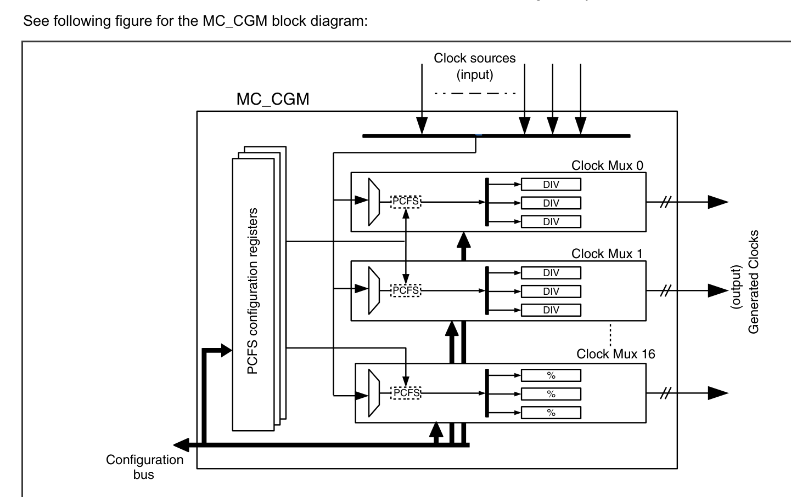

**注意：** 该框图是通用的，不一定反映任何特定的 MC_CGM 实现。

## 4. 特性

MC_CGM 包括以下特性：

* 实现软件可配置的时钟多路复用器，用于从各种时钟源中进行选择
* 提供保证无毛刺切换的硬件控制多路复用器，而软件控制的多路复用器需要软件序列来确保这种切换
* 提供软件可配置的自动 PCFS（针对某些时钟），通过在切换时钟源时平缓地降升时钟频率，将功耗突变的影响降至最低
* 实现软件可配置的时钟分频器

## 5. MC_CGM_0 寄存器说明

MC_CGM 实现一组共享 PCFS 配置寄存器的时钟多路复用器。MC_CGM 寄存器具有以下属性：

* 所有寄存器均为 32 位宽。
* 仅支持 32 位读和写访问。
* 小于 32 位的读/写访问将以错误终止。
* 对可写寄存器中只读寄存器字段的写入将被忽略，并且不提供错误响应。
* 对只读寄存器的写入将以错误响应中止。

### 5.1. MC_CGM_0 内存映射

MC_CGM_0 基地址：**4003_0000h**

| 偏移 | 寄存器 | 宽度（位） | 访问 | 复位值 |
| --- | --- | --- | --- | --- |
| **0h** | [PCFS 步长持续时间寄存器（**PCFS_SDUR**）](#52-pcfs-步长持续时间寄存器pcfs_sdur) | 32 | RW | **0000_0000h** |
| **88h** | [PCFS 分频器变化 12 寄存器（**PCFS_DIVC12**）](#53-pcfs-分频器变化-12-寄存器pcfs_divc12) | 32 | RW | **0000_0000h** |
| **8Ch** | [PCFS 分频器结束 12 寄存器（**PCFS_DIVE12**）](#54-pcfs-分频器结束-12-寄存器pcfs_dive12) | 32 | RW | **0000_03E7h** |
| **90h** | [PCFS 分频器起始 12 寄存器（**PCFS_DIVS12**）](#55-pcfs-分频器起始-12-寄存器pcfs_divs12) | 32 | RW | **0000_03E7h** |
| **300h** | [时钟多路复用器 0 选择控制寄存器（**MUX_0_CSC**）](#56-时钟多路复用器-0-选择控制寄存器mux_0_csc) | 32 | RW | **0000_0000h** |
| **304h** | [时钟多路复用器 0 选择状态寄存器（**MUX_0_CSS**）](#57-时钟多路复用器-0-选择状态寄存器mux_0_css) | 32 | R | **0008_0000h** |
| **308h** | [时钟多路复用器 0 分频器 0 控制寄存器（**MUX_0_DC_0**）](#58-时钟多路复用器-0-分频器-0-控制寄存器mux_0_dc_0) | 32 | RW | **0000_0000h** |
| **30Ch** | [时钟多路复用器 0 分频器 1 控制寄存器（**MUX_0_DC_1**）](#59-时钟多路复用器-0-分频器-1-控制寄存器mux_0_dc_1) | 32 | RW | **8005_0000h** |
| **33Ch** | [时钟多路复用器 0 分频器更新状态寄存器（**MUX_0_DIV_UPD_STAT**）](#510-时钟多路复用器-0-分频器更新状态寄存器mux_0_div_upd_stat) | 32 | R | **0000_0000h** |
| **340h** | [时钟多路复用器 1 选择控制寄存器（**MUX_1_CSC**）](#511-时钟多路复用器-1-选择控制寄存器mux_1_csc) | 32 | RW | **0200_0000h** |
| **344h** | [时钟多路复用器 1 选择状态寄存器（**MUX_1_CSS**）](#512-时钟多路复用器-1-选择状态寄存器mux_1_css) | 32 | R | **0202_0000h** |
| **348h** | [时钟多路复用器 1 分频器 0 控制寄存器（**MUX_1_DC_0**）](#513-时钟多路复用器-1-分频器-0-控制寄存器mux_1_dc_0) | 32 | RW | **0000_0000h** |
| **37Ch** | [时钟多路复用器 1 分频器更新状态寄存器（**MUX_1_DIV_UPD_STAT**）](#514-时钟多路复用器-1-分频器更新状态寄存器mux_1_div_upd_stat) | 32 | R | **0000_0000h** |
| **380h** | [时钟多路复用器 2 选择控制寄存器（**MUX_2_CSC**）](#515-时钟多路复用器-2-选择控制寄存器mux_2_csc) | 32 | RW | **0200_0000h** |
| **384h** | [时钟多路复用器 2 选择状态寄存器（**MUX_2_CSS**）](#516-时钟多路复用器-2-选择状态寄存器mux_2_css) | 32 | R | **0202_0000h** |
| **388h** | [时钟多路复用器 2 分频器 0 控制寄存器（**MUX_2_DC_0**）](#517-时钟多路复用器-2-分频器-0-控制寄存器mux_2_dc_0) | 32 | RW | **0000_0000h** |
| **3BCh** | [时钟多路复用器 2 分频器更新状态寄存器（**MUX_2_DIV_UPD_STAT**）](#518-时钟多路复用器-2-分频器更新状态寄存器mux_2_div_upd_stat) | 32 | R | **0000_0000h** |
| **3C0h** | [时钟多路复用器 3 选择控制寄存器（**MUX_3_CSC**）](#519-时钟多路复用器-3-选择控制寄存器mux_3_csc) | 32 | RW | **0000_0000h** |
| **3C4h** | [时钟多路复用器 3 选择状态寄存器（**MUX_3_CSS**）](#520-时钟多路复用器-3-选择状态寄存器mux_3_css) | 32 | R | **0008_0000h** |
| **3C8h** | [时钟多路复用器 3 分频器 0 控制寄存器（**MUX_3_DC_0**）](#521-时钟多路复用器-3-分频器-0-控制寄存器mux_3_dc_0) | 32 | RW | **0000_0000h** |
| **3FCh** | [时钟多路复用器 3 分频器更新状态寄存器（**MUX_3_DIV_UPD_STAT**）](#522-时钟多路复用器-3-分频器更新状态寄存器mux_3_div_upd_stat) | 32 | R | **0000_0000h** |
| **400h** | [时钟多路复用器 4 选择控制寄存器（**MUX_4_CSC**）](#523-时钟多路复用器-4-选择控制寄存器mux_4_csc) | 32 | RW | **0000_0000h** |
| **404h** | [时钟多路复用器 4 选择状态寄存器（**MUX_4_CSS**）](#524-时钟多路复用器-4-选择状态寄存器mux_4_css) | 32 | R | **0008_0000h** |
| **408h** | [时钟多路复用器 4 分频器 0 控制寄存器（**MUX_4_DC_0**）](#525-时钟多路复用器-4-分频器-0-控制寄存器mux_4_dc_0) | 32 | RW | **0000_0000h** |
| **43Ch** | [时钟多路复用器 4 分频器更新状态寄存器（**MUX_4_DIV_UPD_STAT**）](#526-时钟多路复用器-4-分频器更新状态寄存器mux_4_div_upd_stat) | 32 | R | **0000_0000h** |
| **440h** | [时钟多路复用器 5 选择控制寄存器（**MUX_5_CSC**）](#527-时钟多路复用器-5-选择控制寄存器mux_5_csc) | 32 | RW | **0000_0000h** |
| **444h** | [时钟多路复用器 5 选择状态寄存器（**MUX_5_CSS**）](#528-时钟多路复用器-5-选择状态寄存器mux_5_css) | 32 | R | **0008_0000h** |
| **448h** | [时钟多路复用器 5 分频器 0 控制寄存器（**MUX_5_DC_0**）](#529-时钟多路复用器-5-分频器-0-控制寄存器mux_5_dc_0) | 32 | RW | **0000_0000h** |
| **47Ch** | [时钟多路复用器 5 分频器更新状态寄存器（**MUX_5_DIV_UPD_STAT**）](#530-时钟多路复用器-5-分频器更新状态寄存器mux_5_div_upd_stat) | 32 | R | **0000_0000h** |
| **480h** | [时钟多路复用器 6 选择控制寄存器（**MUX_6_CSC**）](#531-时钟多路复用器-6-选择控制寄存器mux_6_csc) | 32 | RW | **0000_0000h** |
| **484h** | [时钟多路复用器 6 选择状态寄存器（**MUX_6_CSS**）](#532-时钟多路复用器-6-选择状态寄存器mux_6_css) | 32 | R | **0008_0000h** |
| **488h** | [时钟多路复用器 6 分频器 0 控制寄存器（**MUX_6_DC_0**）](#533-时钟多路复用器-6-分频器-0-控制寄存器mux_6_dc_0) | 32 | RW | **0000_0000h** |
| **4BCh** | [时钟多路复用器 6 分频器更新状态寄存器（**MUX_6_DIV_UPD_STAT**）](#534-时钟多路复用器-6-分频器更新状态寄存器mux_6_div_upd_stat) | 32 | R | **0000_0000h** |
| **4C0h** | [时钟多路复用器 7 选择控制寄存器（**MUX_7_CSC**）](#535-时钟多路复用器-7-选择控制寄存器mux_7_csc) | 32 | RW | **0000_0000h** |
| **4C4h** | [时钟多路复用器 7 选择状态寄存器（**MUX_7_CSS**）](#536-时钟多路复用器-7-选择状态寄存器mux_7_css) | 32 | R | **0008_0000h** |
| **500h** | [时钟多路复用器 8 选择控制寄存器（**MUX_8_CSC**）](#537-时钟多路复用器-8-选择控制寄存器mux_8_csc) | 32 | RW | **0000_0000h** |
| **504h** | [时钟多路复用器 8 选择状态寄存器（**MUX_8_CSS**）](#538-时钟多路复用器-8-选择状态寄存器mux_8_css) | 32 | R | **0008_0000h** |
| **600h** | [时钟多路复用器 12 选择控制寄存器（**MUX_12_CSC**）](#539-时钟多路复用器-12-选择控制寄存器mux_12_csc) | 32 | RW | **0000_0000h** |
| **604h** | [时钟多路复用器 12 选择状态寄存器（**MUX_12_CSS**）](#540-时钟多路复用器-12-选择状态寄存器mux_12_css) | 32 | R | **0008_0000h** |
| **608h** | [时钟多路复用器 12 分频器 0 控制寄存器（**MUX_12_DC_0**）](#541-时钟多路复用器-12-分频器-0-控制寄存器mux_12_dc_0) | 32 | RW | **0000_0000h** |
| **63Ch** | [时钟多路复用器 12 分频器更新状态寄存器（**MUX_12_DIV_UPD_STAT**）](#542-时钟多路复用器-12-分频器更新状态寄存器mux_12_div_upd_stat) | 32 | R | **0000_0000h** |
| **680h** | [时钟多路复用器 14 选择控制寄存器（**MUX_14_CSC**）](#543-时钟多路复用器-14-选择控制寄存器mux_14_csc) | 32 | RW | **0000_0000h** |
| **684h** | [时钟多路复用器 14 选择状态寄存器（**MUX_14_CSS**）](#544-时钟多路复用器-14-选择状态寄存器mux_14_css) | 32 | R | **0008_0000h** |
| **688h** | [时钟多路复用器 14 分频器 0 控制寄存器（**MUX_14_DC_0**）](#545-时钟多路复用器-14-分频器-0-控制寄存器mux_14_dc_0) | 32 | RW | **0000_0000h** |
| **6BCh** | [时钟多路复用器 14 分频器更新状态寄存器（**MUX_14_DIV_UPD_STAT**）](#546-时钟多路复用器-14-分频器更新状态寄存器mux_14_div_upd_stat) | 32 | R | **0000_0000h** |
| **700h** | [时钟多路复用器 16 选择控制寄存器（**MUX_16_CSC**）](#547-时钟多路复用器-16-选择控制寄存器mux_16_csc) | 32 | RW | **0000_0000h** |
| **704h** | [时钟多路复用器 16 选择状态寄存器（**MUX_16_CSS**）](#548-时钟多路复用器-16-选择状态寄存器mux_16_css) | 32 | R | **0008_0000h** |

### 5.2. PCFS 步长持续时间寄存器（**PCFS_SDUR**）

**PCFS_SDUR** 偏移：**0h**

本寄存器指定每个 PCFS 步的步长持续时间。本寄存器中提供的值以 clk_src_0 的周期数表示 PCFS 步长持续时间。

本寄存器仅通过破坏性复位复位。详情参见"PCFS"一节。


| 位 | 字段 | 功能 |
| --- | --- | --- |
| 31-16 | — | 本字段为保留，读取返回零。 |
| 15-0 | **SDUR** | 步长持续时间（**Step duration**）<br>步长的持续时间计数值 |

### 5.3. PCFS 分频器变化 12 寄存器（**PCFS_DIVC12**）

**PCFS_DIVC12** 偏移：**88h**

本寄存器为 clk_src_12 的渐进式时钟频率切换（**Progressive Clock Frequency switching**）定义频率变化速率以及频率上升时的初始变化值。

本寄存器仅在破坏性复位时复位。


| 位 | 字段 | 功能 |
| --- | --- | --- |
| 31-16 | **INIT** | 分频器变化初始值（**Divider change initial value**）<br>本字段为 clk_src_12 的时钟上升相位提供时钟分频器的初始变化值。 |
| 15-8 | — | 本字段为保留，读取返回零。 |
| 7-0 | **RATE** | 分频器变化速率（**Divider change rate**）<br>该值控制 clk_src_12 的时钟上升和下降相位的时钟分频器变化值。 |

### 5.4. PCFS 分频器结束 12 寄存器（**PCFS_DIVE12**）

**PCFS_DIVE12** 偏移：**8Ch**

本寄存器为 clk_src_12 的渐进式系统时钟切换定义频率下降时的最终分频值。

本寄存器仅在破坏性复位时复位。


| 位 | 字段 | 功能 |
| --- | --- | --- |
| 31-20 | — | 本字段为保留，读取返回零。 |
| 19-0 | **DIVE** | 分频器结束值（**Divider end value**）<br>本字段为 clk_src_12 的下降相位提供时钟分频器的结束值。 |

### 5.5. PCFS 分频器起始 12 寄存器（**PCFS_DIVS12**）

**PCFS_DIVS12** 偏移：**90h**

本寄存器为 clk_src_12 的渐进式系统时钟切换定义频率上升时的初始分频值。

本寄存器仅在破坏性复位时复位。


| 位 | 字段 | 功能 |
| --- | --- | --- |
| 31-20 | — | 本字段为保留，读取返回零。 |
| 19-0 | **DIVS** | 分频器起始值（**Divider start value**）<br>本字段为 clk_src_12 的上升相位提供时钟分频器的起始值 |

### 5.6. 时钟多路复用器 0 选择控制寄存器（**MUX_0_CSC**）

**MUX_0_CSC** 偏移：**300h**

本寄存器提供时钟多路复用器 0 的时钟源选择控制。时钟多路复用器 0 实现硬件控制的时钟切换，确保时钟切换以平滑的方式发生（无毛刺）。详情参见"硬件控制的时钟多路复用器"一节。

本寄存器仅在破坏性复位时复位。

对本寄存器所有 PCFS 相关字段的更新必须是原子写（**atomic write**），即单次写入必须同时更新 CLK_SW、RAMPDOWN 和 RAMPUP 字段。即使只想触发 RAMPUP 或 RAMPDOWN 过程之一，也必须同时置位 RAMPUP 和 RAMPDOWN 两位，否则将不会执行所需的 PCFS 序列。

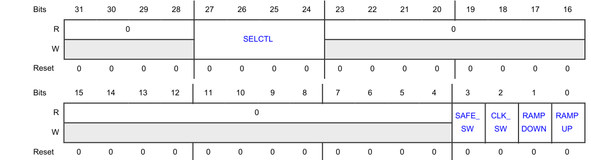

| 位 | 字段 | 功能 |
| --- | --- | --- |
| 31-28 | — | 本字段为保留，读取返回零。 |
| 27-24 | **SELCTL** | 时钟源选择控制（**Clock source selection control**）<br>为时钟多路复用器 0 选择源时钟。保留值未显示。<br>`0000b` - clk_src_0<br>`1100b` - clk_src_12 |
| 23-4 | — | 本字段为保留，读取返回零。 |
| 3 | **SAFE_SW** | 安全时钟请求（**Safe clock request**）<br>向该位写入 1 会向 clk_src_0 发出安全时钟切换请求。发出安全时钟切换操作请求后，该位自动清零，状态寄存器中对应的位被置位。 |
| 2 | **CLK_SW** | 时钟切换（**Clock switch**）<br>向该位写入 1 会向时钟多路复用器 0 发出时钟切换请求。发出时钟切换操作请求后，该位自动清零，状态寄存器中对应的位被置位。 |
| 1 | **RAMPDOWN** | PCFS 下降（**PCFS ramp-down**）<br>向该位写入 1 会向时钟多路复用器 0 发出 PCFS 下降请求。发出 PCFS 下降操作请求后，该位自动清零，状态寄存器中对应的位被置位。 |
| 0 | **RAMPUP** | PCFS 上升（**PCFS ramp-up**）<br>向该位写入 1 会向时钟多路复用器 0 发出 PCFS 上升请求。发出 PCFS 上升操作请求后，该位自动清零，状态寄存器中对应的位被置位。 |

### 5.7. 时钟多路复用器 0 选择状态寄存器（**MUX_0_CSS**）

**MUX_0_CSS** 偏移：**304h**

本寄存器提供时钟多路复用器 0 的当前时钟源选择状态。

本寄存器仅在破坏性复位时复位。

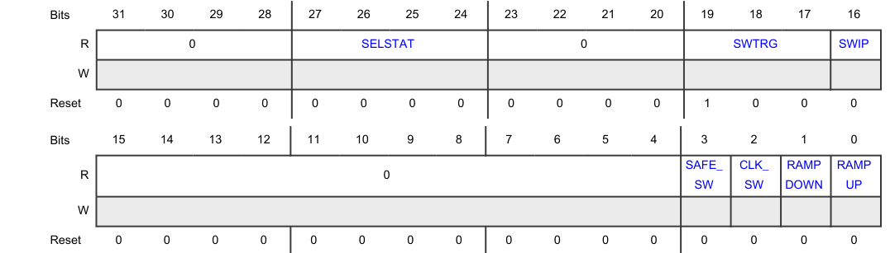

| 位 | 字段 | 功能 |
| --- | --- | --- |
| 31-28 | — | 本字段为保留，读取返回零。 |
| 27-24 | **SELSTAT** | 时钟源选择状态（**Clock source selection status**）<br>该值指示时钟多路复用器 0 当前选择的源。保留值未显示。<br>`0000b` - clk_src_0<br>`1100b` - clk_src_12 |
| 23-20 | — | 本字段为保留，读取返回零。 |
| 19-17 | **SWTRG** | 切换触发原因（**Switch trigger cause**）<br>该值指示最近一次时钟源切换的原因。<br>**注意：** 如果时钟失效，随后对 MC_CGM 硬件时钟多路复用器发出多次安全时钟切换请求，则 SWTRG 字段的值可能为 4 或 5。<br>`000b` - 保留<br>`001b` - 请求后切换成功。<br>`010b` - 因目标时钟无效而切换请求失败，且当前时钟为 clk_src_0。<br>`011b` - 因当前时钟无效而切换请求失败，且当前时钟为 clk_src_0。<br>`100b` - 因安全时钟请求或复位而切换到 clk_src_0 成功。<br>`101b` - 因安全时钟请求或复位而切换到 clk_src_0 成功，但先前的当前时钟源无效。<br>`110b` - 保留<br>`111b` - 保留 |
| 16 | **SWIP** | 切换进行中（**Switch in progress**）<br>**注意：** 新的时钟切换请求只能在上一请求完成三个时钟周期之后发出。<br>`0b` - 时钟源切换已完成。<br>`1b` - 时钟源切换正在进行中。 |
| 15-4 | — | 本字段为保留，读取返回零。 |
| 3 | **SAFE_SW** | 安全时钟请求（**Safe clock request**）<br>本字段指示在时钟多路复用器 0 上先前的/正在进行的请求期间是否请求了切换到安全时钟操作。<br>`0b` - 未请求安全时钟切换操作。<br>`1b` - 已请求安全时钟切换操作。 |
| 2 | **CLK_SW** | 时钟切换（**Clock switch**）<br>本字段指示在时钟多路复用器 0 上先前的/正在进行的请求期间是否请求了时钟切换操作。<br>`0b` - 未请求时钟切换操作。<br>`1b` - 已请求时钟切换操作。 |
| 1 | **RAMPDOWN** | PCFS 下降（**PCFS ramp-down**）<br>本字段指示在时钟多路复用器 0 上先前的/正在进行的请求期间是否请求了 PCFS 下降操作。<br>**注意：** 在安全时钟切换的情况下，下降操作在内部运行，但对应状态字段的值不会置为 1。<br>`0b` - 未请求下降操作。<br>`1b` - 已请求下降操作。 |
| 0 | **RAMPUP** | PCFS 上升（**PCFS ramp-up**）<br>本字段指示在时钟多路复用器 0 上先前的/正在进行的请求期间是否请求了 PCFS 上升操作。<br>`0b` - 未请求上升操作。<br>`1b` - 已请求上升操作。 |

### 5.8. 时钟多路复用器 0 分频器 0 控制寄存器（**MUX_0_DC_0**）

**MUX_0_DC_0** 偏移：**308h**

本寄存器控制时钟多路复用器 0 的时钟分频器 0。

该分频器为 50% 占空比分频器。

**注意：** 对本寄存器各字段的更新应为原子写，即单次写入应更新整个寄存器。

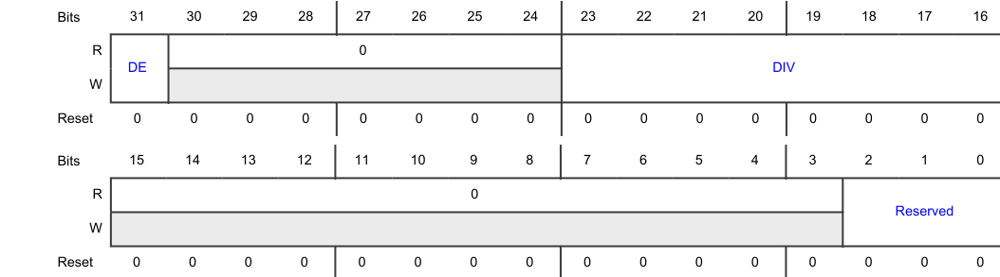

| 位 | 字段 | 功能 |
| --- | --- | --- |
| 31 | **DE** | 分频器使能（**Divider enable**）<br>`0b` - 分频器被禁用。<br>`1b` - 分频器被使能。 |
| 30-24 | — | 本字段为保留，读取返回零。 |
| 23-16 | **DIV** | 分频值（**Division value**）<br>本字段提供时钟分频器的分频值。分频后的时钟周期为分频器当前输入时钟周期的"DIV+1"倍。 |
| 15-3 | — | 保留 |
| 2-0 | — | 保留 |

### 5.9. 时钟多路复用器 0 分频器 1 控制寄存器（**MUX_0_DC_1**）

**MUX_0_DC_1** 偏移：**30Ch**

本寄存器控制时钟多路复用器 0 的时钟分频器 1。

该分频器为 50% 占空比分频器。

**注意：** 对本寄存器各字段的更新应为原子写，即单次写入应更新整个寄存器。


| 位 | 字段 | 功能 |
| --- | --- | --- |
| 31 | **DE** | 分频器使能（**Divider enable**）<br>`0b` - 分频器被禁用。<br>`1b` - 分频器被使能。 |
| 30-24 | — | 本字段为保留，读取返回零。 |
| 23-16 | **DIV** | 分频值（**Division value**）<br>本字段提供时钟分频器的分频值。分频后的时钟周期为分频器当前输入时钟周期的"DIV+1"倍。 |
| 15-0 | — | 本字段为保留，读取返回零。 |

### 5.10. 时钟多路复用器 0 分频器更新状态寄存器（**MUX_0_DIV_UPD_STAT**）

**MUX_0_DIV_UPD_STAT** 偏移：**33Ch**

本寄存器提供与时钟多路复用器 0 对应的时钟分频器的更新状态。当对任一分频器控制寄存器执行写操作时，本寄存器中的分频器状态位被置为逻辑 1。当分频器已采样新的分频器配置时，该位被置为逻辑 0。在不跟踪状态位的情况下对同一时钟多路复用器内的相同或其他时钟分频器执行多次写入会导致报告不一致，即在相应的分频器更新仍待处理时分频器状态位可能已被置为逻辑 0。

**注意：** 无论 MC_CGM 时钟多路复用器内是否实现了任何分频器，对 MUX_n_DIV_UPD_STAT 的读访问总是完成而不返回总线传输错误。

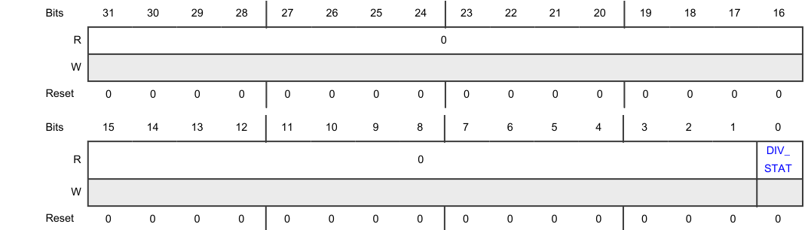

| 位 | 字段 | 功能 |
| --- | --- | --- |
| 31-1 | — | 本字段为保留，读取返回零。 |
| 0 | **DIV_STAT** | 时钟多路复用器 0 的分频器状态（**Divider status for clock mux 0**）<br>在更新分频器控制寄存器之后读取 MUX_n_DIV_UPD_STAT 时，如果由于所选时钟源中的错误导致该字段的值固定为 1，请执行以下步骤将多路复用器切换到新的时钟源：<br>1. 将多路复用器切换到可工作的时钟源，不轮询该字段。<br>2. 更新 MUX_n_DC_m 并轮询该字段。<br>**注意：** 一旦分频器配置被更新或发生破坏性复位，该位即被清零。如果在该位为 1 时发生功能性复位，则它可能保持固定为 1，直到分频器输入时钟被恢复。<br>`0b` - 没有待处理的分频器配置更新。<br>`1b` - 与该多路复用器关联的至少一个分频器上的分频器配置更新待处理。 |

### 5.11. 时钟多路复用器 1 选择控制寄存器（**MUX_1_CSC**）

**MUX_1_CSC** 偏移：**340h**

本寄存器提供时钟多路复用器 1 的时钟源选择控制。时钟多路复用器 1 实现软件控制的时钟切换，通过在软件中执行一系列步骤可以完成平滑的时钟切换。详情参见"软件控制的时钟多路复用器"一节。

本寄存器仅在破坏性复位时复位。

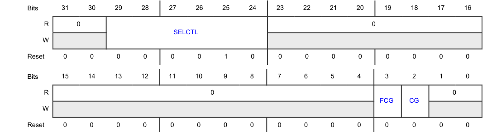

| 位 | 字段 | 功能 |
| --- | --- | --- |
| 31-30 | — | 本字段为保留，读取返回零。 |
| 29-24 | **SELCTL** | 时钟源选择控制（**Clock source selection control**）<br>为时钟多路复用器 1 选择源时钟。保留值未显示。<br>`00_0010b` - clk_src_2<br>`01_0010b` - clk_src_18<br>`01_1011b` - clk_src_27<br>`01_1110b` - clk_src_30 |
| 23-4 | — | 本字段为保留，读取返回零。 |
| 3 | **FCG** | 强制时钟门控（**Force clock gate**）<br>向该位写入 1 会将时钟多路复用器 1 输出端的时钟门控到逻辑 0，而与当前所选时钟的逻辑电平无关。仅在确保当前时钟源无效时才应使用该位执行时钟门控。 |
| 2 | **CG** | 时钟门控（**Clock gate**）<br>向该位写入 1 会将时钟多路复用器 1 输出端的时钟门控到逻辑 0。使用该位可确保门控时钟时不会产生毛刺。 |
| 1-0 | — | 本字段为保留，读取返回零。 |

### 5.12. 时钟多路复用器 1 选择状态寄存器（**MUX_1_CSS**）

**MUX_1_CSS** 偏移：**344h**

本寄存器提供时钟多路复用器 1 的当前时钟源选择状态。

本寄存器仅在破坏性复位时复位。

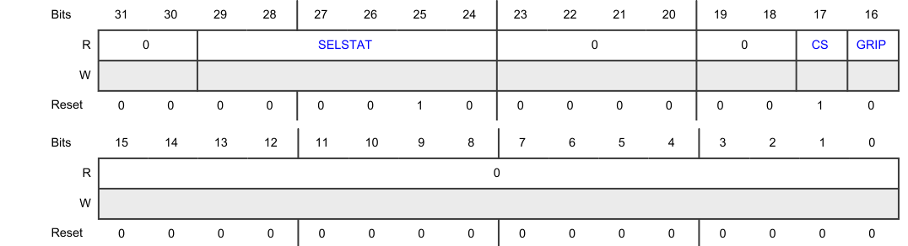

| 位 | 字段 | 功能 |
| --- | --- | --- |
| 31-30 | — | 本字段为保留，读取返回零。 |
| 29-24 | **SELSTAT** | 时钟源选择状态（**Clock source selection status**）<br>该值指示时钟多路复用器 1 当前选择的源。保留值未显示。<br>`00_0010b` - clk_src_2<br>`01_0010b` - clk_src_18<br>`01_1011b` - clk_src_27<br>`01_1110b` - clk_src_30 |
| 23-20 | — | 本字段为保留，读取返回零。 |
| 19-18 | — | 本字段为保留，读取返回零。 |
| 17 | **CS** | 时钟状态（**Clock status**）<br>本字段指示时钟多路复用器输出端时钟的状态。<br>`0b` - 时钟多路复用器输出端的时钟被门控到逻辑 0<br>`1b` - 时钟多路复用器是透明的。时钟多路复用器输入端的有效时钟脉冲在其输出端产生相同数量的脉冲 |
| 16 | **GRIP** | 门控请求进行中（**Gating request is in progress**）<br>发出时钟门控请求后，该位指示多路复用器输出端的时钟门控是否已完成。<br>`0b` - 时钟源门控或解除门控已完成。<br>`1b` - 时钟源门控或解除门控正在进行中。 |
| 15-0 | — | 本字段为保留，读取返回零。 |

### 5.13. 时钟多路复用器 1 分频器 0 控制寄存器（**MUX_1_DC_0**）

**MUX_1_DC_0** 偏移：**348h**

本寄存器控制时钟多路复用器 1 的时钟分频器 0。

该分频器为 50% 占空比分频器。

**注意：** 对本寄存器各字段的更新应为原子写，即单次写入应更新整个寄存器。


| 位 | 字段 | 功能 |
| --- | --- | --- |
| 31 | **DE** | 分频器使能（**Divider enable**）<br>`0b` - 分频器被禁用。<br>`1b` - 分频器被使能。 |
| 30-24 | — | 本字段为保留，读取返回零。 |
| 23-16 | **DIV** | 分频值（**Division value**）<br>本字段提供时钟分频器的分频值。分频后的时钟周期为分频器当前输入时钟周期的"DIV+1"倍。 |
| 15-0 | — | 本字段为保留，读取返回零。 |

### 5.14. 时钟多路复用器 1 分频器更新状态寄存器（**MUX_1_DIV_UPD_STAT**）

**MUX_1_DIV_UPD_STAT** 偏移：**37Ch**

本寄存器提供与时钟多路复用器 1 对应的时钟分频器的更新状态。当对任一分频器控制寄存器执行写操作时，本寄存器中的分频器状态位被置为逻辑 1。当分频器已采样新的分频器配置时，该位被置为逻辑 0。在不跟踪状态位的情况下对同一时钟多路复用器内的相同或其他时钟分频器执行多次写入会导致报告不一致，即在相应的分频器更新仍待处理时分频器状态位可能已被置为逻辑 0。

**注意：** 无论 MC_CGM 时钟多路复用器内是否实现了任何分频器，对 MUX_n_DIV_UPD_STAT 的读访问总是完成而不返回总线传输错误。


| 位 | 字段 | 功能 |
| --- | --- | --- |
| 31-1 | — | 本字段为保留，读取返回零。 |
| 0 | **DIV_STAT** | 时钟多路复用器 1 的分频器状态（**Divider status for clock mux 1**）<br>在更新分频器控制寄存器之后读取 MUX_n_DIV_UPD_STAT 时，如果由于所选时钟源中的错误导致该字段的值固定为 1，请执行以下步骤将多路复用器切换到新的时钟源：<br>1. 将多路复用器切换到可工作的时钟源，不轮询该字段。<br>2. 更新 MUX_n_DC_m 并轮询该字段。<br>**注意：** 一旦分频器配置被更新或发生破坏性复位，该位即被清零。如果在该位为 1 时发生功能性复位，则它可能保持固定为 1，直到分频器输入时钟被恢复。<br>`0b` - 没有待处理的分频器配置更新。<br>`1b` - 与该多路复用器关联的至少一个分频器上的分频器配置更新待处理。 |

### 5.15. 时钟多路复用器 2 选择控制寄存器（**MUX_2_CSC**）

**MUX_2_CSC** 偏移：**380h**

本寄存器提供时钟多路复用器 2 的时钟源选择控制。时钟多路复用器 2 实现软件控制的时钟切换，通过在软件中执行一系列步骤可以完成平滑的时钟切换。详情参见"软件控制的时钟多路复用器"一节。

本寄存器仅在破坏性复位时复位。

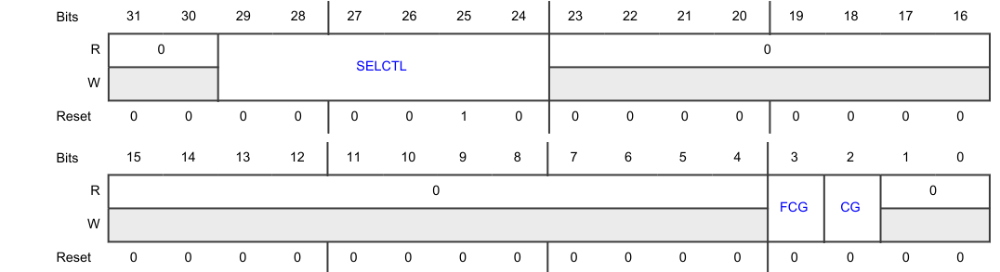

| 位 | 字段 | 功能 |
| --- | --- | --- |
| 31-30 | — | 本字段为保留，读取返回零。 |
| 29-24 | **SELCTL** | 时钟源选择控制（**Clock source selection control**）<br>为时钟多路复用器 2 选择源时钟。保留值未显示。<br>`00_0010b` - clk_src_2<br>`01_0010b` - clk_src_18<br>`01_1011b` - clk_src_27<br>`01_1110b` - clk_src_30 |
| 23-4 | — | 本字段为保留，读取返回零。 |
| 3 | **FCG** | 强制时钟门控（**Force clock gate**）<br>向该位写入 1 会将时钟多路复用器 2 输出端的时钟门控到逻辑 0，而与当前所选时钟的逻辑电平无关。仅在确保当前时钟源无效时才应使用该位执行时钟门控。 |
| 2 | **CG** | 时钟门控（**Clock gate**）<br>向该位写入 1 会将时钟多路复用器 2 输出端的时钟门控到逻辑 0。使用该位可确保门控时钟时不会产生毛刺。 |
| 1-0 | — | 本字段为保留，读取返回零。 |

### 5.16. 时钟多路复用器 2 选择状态寄存器（**MUX_2_CSS**）

**MUX_2_CSS** 偏移：**384h**

本寄存器提供时钟多路复用器 2 的当前时钟源选择状态。

本寄存器仅在破坏性复位时复位。


| 位 | 字段 | 功能 |
| --- | --- | --- |
| 31-30 | — | 本字段为保留，读取返回零。 |
| 29-24 | **SELSTAT** | 时钟源选择状态（**Clock source selection status**）<br>该值指示时钟多路复用器 2 当前选择的源。保留值未显示。<br>`00_0010b` - clk_src_2<br>`01_0010b` - clk_src_18<br>`01_1011b` - clk_src_27<br>`01_1110b` - clk_src_30 |
| 23-20 | — | 本字段为保留，读取返回零。 |
| 19-18 | — | 本字段为保留，读取返回零。 |
| 17 | **CS** | 时钟状态（**Clock status**）<br>本字段指示时钟多路复用器输出端时钟的状态。<br>`0b` - 时钟多路复用器输出端的时钟被门控到逻辑 0<br>`1b` - 时钟多路复用器是透明的。时钟多路复用器输入端的有效时钟脉冲在其输出端产生相同数量的脉冲 |
| 16 | **GRIP** | 门控请求进行中（**Gating request is in progress**）<br>发出时钟门控请求后，该位指示多路复用器输出端的时钟门控是否已完成。<br>`0b` - 时钟源门控或解除门控已完成。<br>`1b` - 时钟源门控或解除门控正在进行中。 |
| 15-0 | — | 本字段为保留，读取返回零。 |

### 5.17. 时钟多路复用器 2 分频器 0 控制寄存器（**MUX_2_DC_0**）

**MUX_2_DC_0** 偏移：**388h**

本寄存器控制时钟多路复用器 2 的时钟分频器 0。

该分频器为 50% 占空比分频器。

**注意：** 对本寄存器各字段的更新应为原子写，即单次写入应更新整个寄存器。

**注意：** 软件控制的时钟多路复用器分频器在功能性复位进入序列中发生的硬件转换和握手时不会返回默认状态（只有硬件控制的时钟多路复用器分频器才返回默认状态）。


| 位 | 字段 | 功能 |
| --- | --- | --- |
| 31 | **DE** | 分频器使能（**Divider enable**）<br>`0b` - 分频器被禁用。<br>`1b` - 分频器被使能。 |
| 30-24 | — | 本字段为保留，读取返回零。 |
| 23-16 | **DIV** | 分频值（**Division value**）<br>本字段提供时钟分频器的分频值。分频后的时钟周期为分频器当前输入时钟周期的"DIV+1"倍。 |
| 15-0 | — | 本字段为保留，读取返回零。 |

### 5.18. 时钟多路复用器 2 分频器更新状态寄存器（**MUX_2_DIV_UPD_STAT**）

**MUX_2_DIV_UPD_STAT** 偏移：**3BCh**

本寄存器提供与时钟多路复用器 2 对应的时钟分频器的更新状态。当对任一分频器控制寄存器执行写操作时，本寄存器中的分频器状态位被置为逻辑 1。当分频器已采样新的分频器配置时，该位被置为逻辑 0。在不跟踪状态位的情况下对同一时钟多路复用器内的相同或其他时钟分频器执行多次写入会导致报告不一致，即在相应的分频器更新仍待处理时分频器状态位可能已被置为逻辑 0。

**注意：** 无论 MC_CGM 时钟多路复用器内是否实现了任何分频器，对 MUX_n_DIV_UPD_STAT 的读访问总是完成而不返回总线传输错误。


| 位 | 字段 | 功能 |
| --- | --- | --- |
| 31-1 | — | 本字段为保留，读取返回零。 |
| 0 | **DIV_STAT** | 时钟多路复用器 2 的分频器状态（**Divider status for clock mux 2**）<br>在更新分频器控制寄存器之后读取 MUX_n_DIV_UPD_STAT 时，如果由于所选时钟源中的错误导致该字段的值固定为 1，请执行以下步骤将多路复用器切换到新的时钟源：<br>1. 将多路复用器切换到可工作的时钟源，不轮询该字段。<br>2. 更新 MUX_n_DC_m 并轮询该字段。<br>**注意：** 一旦分频器配置被更新或发生破坏性复位，该位即被清零。如果在该位为 1 时发生功能性复位，则它可能保持固定为 1，直到分频器输入时钟被恢复。<br>`0b` - 没有待处理的分频器配置更新。<br>`1b` - 与该多路复用器关联的至少一个分频器上的分频器配置更新待处理。 |

### 5.19. 时钟多路复用器 3 选择控制寄存器（**MUX_3_CSC**）

**MUX_3_CSC** 偏移：**3C0h**

本寄存器提供时钟多路复用器 3 的时钟源选择控制。时钟多路复用器 3 实现硬件控制的时钟切换，确保时钟切换以平滑的方式发生（无毛刺）。详情参见"硬件控制的时钟多路复用器"一节。

本寄存器仅在破坏性复位时复位。


| 位 | 字段 | 功能 |
| --- | --- | --- |
| 31-29 | — | 本字段为保留，读取返回零。 |
| 28-24 | **SELCTL** | 时钟源选择控制（**Clock source selection control**）<br>为时钟多路复用器 3 选择源时钟。保留值未显示。<br>`0_0000b` - clk_src_0<br>`1_0011b` - clk_src_19 |
| 23-4 | — | 本字段为保留，读取返回零。 |
| 3 | **SAFE_SW** | 安全时钟请求（**Safe clock request**）<br>向该位写入 1 会向 clk_src_0 发出安全时钟切换请求。发出安全时钟切换操作请求后，该位自动清零，状态寄存器中对应的位被置位。 |
| 2 | **CLK_SW** | 时钟切换（**Clock switch**）<br>向该位写入 1 会向时钟多路复用器 3 发出时钟切换请求。发出时钟切换操作请求后，该位自动清零，状态寄存器中对应的位被置位。 |
| 1-0 | — | 本字段为保留，读取返回零。 |

### 5.20. 时钟多路复用器 3 选择状态寄存器（**MUX_3_CSS**）

**MUX_3_CSS** 偏移：**3C4h**

本寄存器提供时钟多路复用器 3 的当前时钟源选择状态。

本寄存器仅在破坏性复位时复位。


| 位 | 字段 | 功能 |
| --- | --- | --- |
| 31-29 | — | 本字段为保留，读取返回零。 |
| 28-24 | **SELSTAT** | 时钟源选择状态（**Clock source selection status**）<br>该值指示时钟多路复用器 3 当前选择的源。保留值未显示。<br>`0_0000b` - clk_src_0<br>`1_0011b` - clk_src_19 |
| 23-20 | — | 本字段为保留，读取返回零。 |
| 19-17 | **SWTRG** | 切换触发原因（**Switch trigger cause**）<br>该值指示最近一次时钟源切换的原因。<br>**注意：** 如果时钟失效，随后对 MC_CGM 硬件时钟多路复用器发出多次安全时钟切换请求，则 SWTRG 字段的值可能为 4 或 5。<br>`000b` - 保留<br>`001b` - 请求后切换成功。<br>`010b` - 因目标时钟无效而切换请求失败，且当前时钟为 clk_src_0。<br>`011b` - 因当前时钟无效而切换请求失败，且当前时钟为 clk_src_0。<br>`100b` - 因安全时钟请求或复位而切换到 clk_src_0 成功。<br>`101b` - 因安全时钟请求或复位而切换到 clk_src_0 成功，但先前的当前时钟源无效。<br>`110b` - 保留<br>`111b` - 保留 |
| 16 | **SWIP** | 切换进行中（**Switch in progress**）<br>**注意：** 新的时钟切换请求只能在上一请求完成三个时钟周期之后发出。<br>`0b` - 时钟源切换已完成。<br>`1b` - 时钟源切换正在进行中。 |
| 15-4 | — | 本字段为保留，读取返回零。 |
| 3 | **SAFE_SW** | 安全时钟请求（**Safe clock request**）<br>本字段指示在时钟多路复用器 3 上先前的/正在进行的请求期间是否请求了切换到安全时钟操作。<br>`0b` - 未请求安全时钟切换操作。<br>`1b` - 已请求安全时钟切换操作。 |
| 2 | **CLK_SW** | 时钟切换（**Clock switch**）<br>本字段指示在时钟多路复用器 3 上先前的/正在进行的请求期间是否请求了时钟切换操作。<br>`0b` - 未请求时钟切换操作。<br>`1b` - 已请求时钟切换操作。 |
| 1-0 | — | 本字段为保留，读取返回零。 |

### 5.21. 时钟多路复用器 3 分频器 0 控制寄存器（**MUX_3_DC_0**）

**MUX_3_DC_0** 偏移：**3C8h**

本寄存器控制时钟多路复用器 3 的时钟分频器 0。

该分频器为 50% 占空比分频器。

**注意：** 对本寄存器各字段的更新应为原子写，即单次写入应更新整个寄存器。


| 位 | 字段 | 功能 |
| --- | --- | --- |
| 31 | **DE** | 分频器使能（**Divider enable**）<br>`0b` - 分频器被禁用。<br>`1b` - 分频器被使能。 |
| 30-24 | — | 本字段为保留，读取返回零。 |
| 23-16 | **DIV** | 分频值（**Division value**）<br>本字段提供时钟分频器的分频值。分频后的时钟周期为分频器当前输入时钟周期的"DIV+1"倍。 |
| 15-0 | — | 本字段为保留，读取返回零。 |

### 5.22. 时钟多路复用器 3 分频器更新状态寄存器（**MUX_3_DIV_UPD_STAT**）

**MUX_3_DIV_UPD_STAT** 偏移：**3FCh**

本寄存器提供与时钟多路复用器 3 对应的时钟分频器的更新状态。当对任一分频器控制寄存器执行写操作时，本寄存器中的分频器状态位被置为逻辑 1。当分频器已采样新的分频器配置时，该位被置为逻辑 0。在不跟踪状态位的情况下对同一时钟多路复用器内的相同或其他时钟分频器执行多次写入会导致报告不一致，即在相应的分频器更新仍待处理时分频器状态位可能已被置为逻辑 0。

**注意：** 无论 MC_CGM 时钟多路复用器内是否实现了任何分频器，对 MUX_n_DIV_UPD_STAT 的读访问总是完成而不返回总线传输错误。


| 位 | 字段 | 功能 |
| --- | --- | --- |
| 31-1 | — | 本字段为保留，读取返回零。 |
| 0 | **DIV_STAT** | 时钟多路复用器 3 的分频器状态（**Divider status for clock mux 3**）<br>在更新分频器控制寄存器之后读取 MUX_n_DIV_UPD_STAT 时，如果由于所选时钟源中的错误导致该字段的值固定为 1，请执行以下步骤将多路复用器切换到新的时钟源：<br>1. 将多路复用器切换到可工作的时钟源，不轮询该字段。<br>2. 更新 MUX_n_DC_m 并轮询该字段。<br>**注意：** 一旦分频器配置被更新或发生破坏性复位，该位即被清零。如果在该位为 1 时发生功能性复位，则它可能保持固定为 1，直到分频器输入时钟被恢复。<br>`0b` - 没有待处理的分频器配置更新。<br>`1b` - 与该多路复用器关联的至少一个分频器上的分频器配置更新待处理。 |

### 5.23. 时钟多路复用器 4 选择控制寄存器（**MUX_4_CSC**）

**MUX_4_CSC** 偏移：**400h**

本寄存器提供时钟多路复用器 4 的时钟源选择控制。时钟多路复用器 4 实现硬件控制的时钟切换，确保时钟切换以平滑的方式发生（无毛刺）。详情参见"硬件控制的时钟多路复用器"一节。

本寄存器仅在破坏性复位时复位。


| 位 | 字段 | 功能 |
| --- | --- | --- |
| 31-30 | — | 本字段为保留，读取返回零。 |
| 29-24 | **SELCTL** | 时钟源选择控制（**Clock source selection control**）<br>为时钟多路复用器 4 选择源时钟。保留值未显示。<br>`00_0000b` - clk_src_0<br>`01_0011b` - clk_src_19<br>`10_0010b` - clk_src_34 |
| 23-4 | — | 本字段为保留，读取返回零。 |
| 3 | **SAFE_SW** | 安全时钟请求（**Safe clock request**）<br>向该位写入 1 会向 clk_src_0 发出安全时钟切换请求。发出安全时钟切换操作请求后，该位自动清零，状态寄存器中对应的位被置位。 |
| 2 | **CLK_SW** | 时钟切换（**Clock switch**）<br>向该位写入 1 会向时钟多路复用器 4 发出时钟切换请求。发出时钟切换操作请求后，该位自动清零，状态寄存器中对应的位被置位。 |
| 1-0 | — | 本字段为保留，读取返回零。 |

### 5.24. 时钟多路复用器 4 选择状态寄存器（**MUX_4_CSS**）

**MUX_4_CSS** 偏移：**404h**

本寄存器提供时钟多路复用器 4 的当前时钟源选择状态。

本寄存器仅在破坏性复位时复位。


| 位 | 字段 | 功能 |
| --- | --- | --- |
| 31-30 | — | 本字段为保留，读取返回零。 |
| 29-24 | **SELSTAT** | 时钟源选择状态（**Clock source selection status**）<br>该值指示时钟多路复用器 4 当前选择的源。保留值未显示。<br>`00_0000b` - clk_src_0<br>`01_0011b` - clk_src_19<br>`10_0010b` - clk_src_34 |
| 23-20 | — | 本字段为保留，读取返回零。 |
| 19-17 | **SWTRG** | 切换触发原因（**Switch trigger cause**）<br>该值指示最近一次时钟源切换的原因。<br>**注意：** 如果时钟失效，随后对 MC_CGM 硬件时钟多路复用器发出多次安全时钟切换请求，则 SWTRG 字段的值可能为 4 或 5。<br>`000b` - 保留<br>`001b` - 请求后切换成功。<br>`010b` - 因目标时钟无效而切换请求失败，且当前时钟为 clk_src_0。<br>`011b` - 因当前时钟无效而切换请求失败，且当前时钟为 clk_src_0。<br>`100b` - 因安全时钟请求或复位而切换到 clk_src_0 成功。<br>`101b` - 因安全时钟请求或复位而切换到 clk_src_0 成功，但先前的当前时钟源无效。<br>`110b` - 保留<br>`111b` - 保留 |
| 16 | **SWIP** | 切换进行中（**Switch in progress**）<br>**注意：** 新的时钟切换请求只能在上一请求完成三个时钟周期之后发出。<br>`0b` - 时钟源切换已完成。<br>`1b` - 时钟源切换正在进行中。 |
| 15-4 | — | 本字段为保留，读取返回零。 |
| 3 | **SAFE_SW** | 安全时钟请求（**Safe clock request**）<br>本字段指示在时钟多路复用器 4 上先前的/正在进行的请求期间是否请求了切换到安全时钟操作。<br>`0b` - 未请求安全时钟切换操作。<br>`1b` - 已请求安全时钟切换操作。 |
| 2 | **CLK_SW** | 时钟切换（**Clock switch**）<br>本字段指示在时钟多路复用器 4 上先前的/正在进行的请求期间是否请求了时钟切换操作。<br>`0b` - 未请求时钟切换操作。<br>`1b` - 已请求时钟切换操作。 |
| 1-0 | — | 本字段为保留，读取返回零。 |

### 5.25. 时钟多路复用器 4 分频器 0 控制寄存器（**MUX_4_DC_0**）

**MUX_4_DC_0** 偏移：**408h**

本寄存器控制时钟多路复用器 4 的时钟分频器 0。

该分频器为 50% 占空比分频器。

**注意：** 对本寄存器各字段的更新应为原子写，即单次写入应更新整个寄存器。


| 位 | 字段 | 功能 |
| --- | --- | --- |
| 31 | **DE** | 分频器使能（**Divider enable**）<br>`0b` - 分频器被禁用。<br>`1b` - 分频器被使能。 |
| 30-24 | — | 本字段为保留，读取返回零。 |
| 23-16 | **DIV** | 分频值（**Division value**）<br>本字段提供时钟分频器的分频值。分频后的时钟周期为分频器当前输入时钟周期的"DIV+1"倍。 |
| 15-0 | — | 本字段为保留，读取返回零。 |

### 5.26. 时钟多路复用器 4 分频器更新状态寄存器（**MUX_4_DIV_UPD_STAT**）

**MUX_4_DIV_UPD_STAT** 偏移：**43Ch**

本寄存器提供与时钟多路复用器 4 对应的时钟分频器的更新状态。当对任一分频器控制寄存器执行写操作时，本寄存器中的分频器状态位被置为逻辑 1。当分频器已采样新的分频器配置时，该位被置为逻辑 0。在不跟踪状态位的情况下对同一时钟多路复用器内的相同或其他时钟分频器执行多次写入会导致报告不一致，即在相应的分频器更新仍待处理时分频器状态位可能已被置为逻辑 0。

**注意：** 无论 MC_CGM 时钟多路复用器内是否实现了任何分频器，对 MUX_n_DIV_UPD_STAT 的读访问总是完成而不返回总线传输错误。


| 位 | 字段 | 功能 |
| --- | --- | --- |
| 31-1 | — | 本字段为保留，读取返回零。 |
| 0 | **DIV_STAT** | 时钟多路复用器 4 的分频器状态（**Divider status for clock mux 4**）<br>在更新分频器控制寄存器之后读取 MUX_n_DIV_UPD_STAT 时，如果由于所选时钟源中的错误导致该字段的值固定为 1，请执行以下步骤将多路复用器切换到新的时钟源：<br>1. 将多路复用器切换到可工作的时钟源，不轮询该字段。<br>2. 更新 MUX_n_DC_m 并轮询该字段。<br>**注意：** 一旦分频器配置被更新或发生破坏性复位，该位即被清零。如果在该位为 1 时发生功能性复位，则它可能保持固定为 1，直到分频器输入时钟被恢复。<br>`0b` - 没有待处理的分频器配置更新。<br>`1b` - 与该多路复用器关联的至少一个分频器上的分频器配置更新待处理。 |

### 5.27. 时钟多路复用器 5 选择控制寄存器（**MUX_5_CSC**）

**MUX_5_CSC** 偏移：**440h**

本寄存器提供时钟多路复用器 5 的时钟源选择控制。时钟多路复用器 5 实现硬件控制的时钟切换，确保时钟切换以平滑的方式发生（无毛刺）。详情参见"硬件控制的时钟多路复用器"一节。

本寄存器仅在破坏性复位时复位。


| 位 | 字段 | 功能 |
| --- | --- | --- |
| 31-30 | — | 本字段为保留，读取返回零。 |
| 29-24 | **SELCTL** | 时钟源选择控制（**Clock source selection control**）<br>为时钟多路复用器 5 选择源时钟。保留值未显示。<br>`00_0000b` - clk_src_0<br>`01_0011b` - clk_src_19<br>`10_0011b` - clk_src_35 |
| 23-4 | — | 本字段为保留，读取返回零。 |
| 3 | **SAFE_SW** | 安全时钟请求（**Safe clock request**）<br>向该位写入 1 会向 clk_src_0 发出安全时钟切换请求。发出安全时钟切换操作请求后，该位自动清零，状态寄存器中对应的位被置位。 |
| 2 | **CLK_SW** | 时钟切换（**Clock switch**）<br>向该位写入 1 会向时钟多路复用器 5 发出时钟切换请求。发出时钟切换操作请求后，该位自动清零，状态寄存器中对应的位被置位。 |
| 1-0 | — | 本字段为保留，读取返回零。 |

### 5.28. 时钟多路复用器 5 选择状态寄存器（**MUX_5_CSS**）

**MUX_5_CSS** 偏移：**444h**

本寄存器提供时钟多路复用器 5 的当前时钟源选择状态。

本寄存器仅在破坏性复位时复位。


| 位 | 字段 | 功能 |
| --- | --- | --- |
| 31-30 | — | 本字段为保留，读取返回零。 |
| 29-24 | **SELSTAT** | 时钟源选择状态（**Clock source selection status**）<br>该值指示时钟多路复用器 5 当前选择的源。保留值未显示。<br>`00_0000b` - clk_src_0<br>`01_0011b` - clk_src_19<br>`10_0011b` - clk_src_35 |
| 23-20 | — | 本字段为保留，读取返回零。 |
| 19-17 | **SWTRG** | 切换触发原因（**Switch trigger cause**）<br>该值指示最近一次时钟源切换的原因。<br>**注意：** 如果时钟失效，随后对 MC_CGM 硬件时钟多路复用器发出多次安全时钟切换请求，则 SWTRG 字段的值可能为 4 或 5。<br>`000b` - 保留<br>`001b` - 请求后切换成功。<br>`010b` - 因目标时钟无效而切换请求失败，且当前时钟为 clk_src_0。<br>`011b` - 因当前时钟无效而切换请求失败，且当前时钟为 clk_src_0。<br>`100b` - 因安全时钟请求或复位而切换到 clk_src_0 成功。<br>`101b` - 因安全时钟请求或复位而切换到 clk_src_0 成功，但先前的当前时钟源无效。<br>`110b` - 保留<br>`111b` - 保留 |
| 16 | **SWIP** | 切换进行中（**Switch in progress**）<br>**注意：** 新的时钟切换请求只能在上一请求完成三个时钟周期之后发出。<br>`0b` - 时钟源切换已完成。<br>`1b` - 时钟源切换正在进行中。 |
| 15-4 | — | 本字段为保留，读取返回零。 |
| 3 | **SAFE_SW** | 安全时钟请求（**Safe clock request**）<br>本字段指示在时钟多路复用器 5 上先前的/正在进行的请求期间是否请求了切换到安全时钟操作。<br>`0b` - 未请求安全时钟切换操作。<br>`1b` - 已请求安全时钟切换操作。 |
| 2 | **CLK_SW** | 时钟切换（**Clock switch**）<br>本字段指示在时钟多路复用器 5 上先前的/正在进行的请求期间是否请求了时钟切换操作。<br>`0b` - 未请求时钟切换操作。<br>`1b` - 已请求时钟切换操作。 |
| 1-0 | — | 本字段为保留，读取返回零。 |

### 5.29. 时钟多路复用器 5 分频器 0 控制寄存器（**MUX_5_DC_0**）

**MUX_5_DC_0** 偏移：**448h**

本寄存器控制时钟多路复用器 5 的时钟分频器 0。

该分频器为 50% 占空比分频器。

**注意：** 对本寄存器各字段的更新应为原子写，即单次写入应更新整个寄存器。

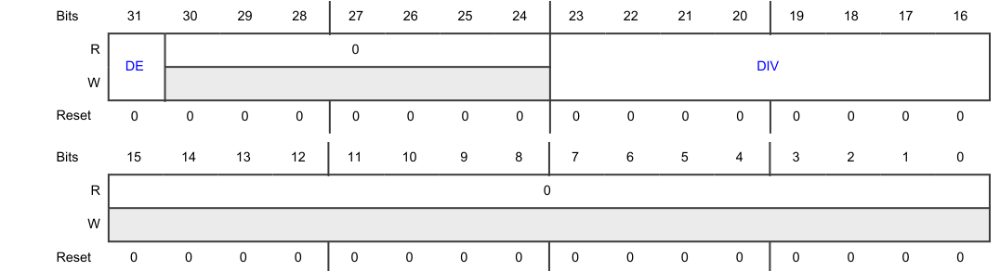

| 位 | 字段 | 功能 |
| --- | --- | --- |
| 31 | **DE** | 分频器使能（**Divider enable**）<br>`0b` - 分频器被禁用。<br>`1b` - 分频器被使能。 |
| 30-24 | — | 本字段为保留，读取返回零。 |
| 23-16 | **DIV** | 分频值（**Division value**）<br>本字段提供时钟分频器的分频值。分频后的时钟周期为分频器当前输入时钟周期的"DIV+1"倍。 |
| 15-0 | — | 本字段为保留，读取返回零。 |

### 5.30. 时钟多路复用器 5 分频器更新状态寄存器（**MUX_5_DIV_UPD_STAT**）

**MUX_5_DIV_UPD_STAT** 偏移：**47Ch**

本寄存器提供与时钟多路复用器 5 对应的时钟分频器的更新状态。当对任一分频器控制寄存器执行写操作时，本寄存器中的分频器状态位被置为逻辑 1。当分频器已采样新的分频器配置时，该位被置为逻辑 0。在不跟踪状态位的情况下对同一时钟多路复用器内的相同或其他时钟分频器执行多次写入会导致报告不一致，即在相应的分频器更新仍待处理时分频器状态位可能已被置为逻辑 0。

**注意：** 无论 MC_CGM 时钟多路复用器内是否实现了任何分频器，对 MUX_n_DIV_UPD_STAT 的读访问总是完成而不返回总线传输错误。


| 位 | 字段 | 功能 |
| --- | --- | --- |
| 31-1 | — | 本字段为保留，读取返回零。 |
| 0 | **DIV_STAT** | 时钟多路复用器 5 的分频器状态（**Divider status for clock mux 5**）<br>在更新分频器控制寄存器之后读取 MUX_n_DIV_UPD_STAT 时，如果由于所选时钟源中的错误导致该字段的值固定为 1，请执行以下步骤将多路复用器切换到新的时钟源：<br>1. 将多路复用器切换到可工作的时钟源，不轮询该字段。<br>2. 更新 MUX_n_DC_m 并轮询该字段。<br>**注意：** 一旦分频器配置被更新或发生破坏性复位，该位即被清零。如果在该位为 1 时发生功能性复位，则它可能保持固定为 1，直到分频器输入时钟被恢复。<br>`0b` - 没有待处理的分频器配置更新。<br>`1b` - 与该多路复用器关联的至少一个分频器上的分频器配置更新待处理。 |

### 5.31. 时钟多路复用器 6 选择控制寄存器（**MUX_6_CSC**）

**MUX_6_CSC** 偏移：**480h**

本寄存器提供时钟多路复用器 6 的时钟源选择控制。时钟多路复用器 6 实现硬件控制的时钟切换，确保时钟切换以平滑的方式发生（无毛刺）。详情参见"硬件控制的时钟多路复用器"一节。

本寄存器仅在破坏性复位时复位。

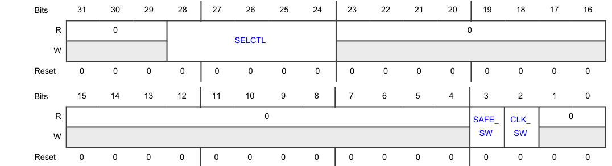

| 位 | 字段 | 功能 |
| --- | --- | --- |
| 31-29 | — | 本字段为保留，读取返回零。 |
| 28-24 | **SELCTL** | 时钟源选择控制（**Clock source selection control**）<br>为时钟多路复用器 6 选择源时钟。保留值未显示。<br>`0_0000b` - clk_src_0<br>`0_0010b` - clk_src_2<br>`1_0011b` - clk_src_19 |
| 23-4 | — | 本字段为保留，读取返回零。 |
| 3 | **SAFE_SW** | 安全时钟请求（**Safe clock request**）<br>向该位写入 1 会向 clk_src_0 发出安全时钟切换请求。发出安全时钟切换操作请求后，该位自动清零，状态寄存器中对应的位被置位。 |
| 2 | **CLK_SW** | 时钟切换（**Clock switch**）<br>向该位写入 1 会向时钟多路复用器 6 发出时钟切换请求。发出时钟切换操作请求后，该位自动清零，状态寄存器中对应的位被置位。 |
| 1-0 | — | 本字段为保留，读取返回零。 |

### 5.32. 时钟多路复用器 6 选择状态寄存器（**MUX_6_CSS**）

**MUX_6_CSS** 偏移：**484h**

本寄存器提供时钟多路复用器 6 的当前时钟源选择状态。

本寄存器仅在破坏性复位时复位。


| 位 | 字段 | 功能 |
| --- | --- | --- |
| 31-29 | — | 本字段为保留，读取返回零。 |
| 28-24 | **SELSTAT** | 时钟源选择状态（**Clock source selection status**）<br>该值指示时钟多路复用器 6 当前选择的源。保留值未显示。<br>`0_0000b` - clk_src_0<br>`0_0010b` - clk_src_2<br>`1_0011b` - clk_src_19 |
| 23-20 | — | 本字段为保留，读取返回零。 |
| 16 | **SWIP** | 切换进行中（**Switch in progress**）<br>**注意：** 新的时钟切换请求只能在上一请求完成三个时钟周期之后发出。<br>`0b` - 时钟源切换已完成。<br>`1b` - 时钟源切换正在进行中。 |
| 15-4 | — | 本字段为保留，读取返回零。 |
| 3 | **SAFE_SW** | 安全时钟请求（**Safe clock request**）<br>本字段指示在时钟多路复用器 6 上先前的/正在进行的请求期间是否请求了切换到安全时钟操作。<br>`0b` - 未请求安全时钟切换操作。<br>`1b` - 已请求安全时钟切换操作。 |
| 2 | **CLK_SW** | 时钟切换（**Clock switch**）<br>本字段指示在时钟多路复用器 6 上先前的/正在进行的请求期间是否请求了时钟切换操作。<br>`0b` - 未请求时钟切换操作。<br>`1b` - 已请求时钟切换操作。 |
| 1-0 | — | 本字段为保留，读取返回零。 |

### 5.33. 时钟多路复用器 6 分频器 0 控制寄存器（**MUX_6_DC_0**）

**MUX_6_DC_0** 偏移：**488h**

本寄存器控制时钟多路复用器 6 的时钟分频器 0。

该分频器为 50% 占空比分频器。

**注意：** 对本寄存器各字段的更新应为原子写，即单次写入应更新整个寄存器。


| 位 | 字段 | 功能 |
| --- | --- | --- |
| 31 | **DE** | 分频器使能（**Divider enable**）<br>`0b` - 分频器被禁用。<br>`1b` - 分频器被使能。 |
| 30-24 | — | 本字段为保留，读取返回零。 |
| 23-16 | **DIV** | 分频值（**Division value**）<br>本字段提供时钟分频器的分频值。分频后的时钟周期为分频器当前输入时钟周期的"DIV+1"倍。 |
| 15-0 | — | 本字段为保留，读取返回零。 |

### 5.34. 时钟多路复用器 6 分频器更新状态寄存器（**MUX_6_DIV_UPD_STAT**）

**MUX_6_DIV_UPD_STAT** 偏移：**4BCh**

本寄存器提供与时钟多路复用器 6 对应的时钟分频器的更新状态。当对任一分频器控制寄存器执行写操作时，本寄存器中的分频器状态位被置为逻辑 1。当分频器已采样新的分频器配置时，该位被置为逻辑 0。在不跟踪状态位的情况下对同一时钟多路复用器内的相同或其他时钟分频器执行多次写入会导致报告不一致，即在相应的分频器更新仍待处理时分频器状态位可能已被置为逻辑 0。

**注意：** 无论 MC_CGM 时钟多路复用器内是否实现了任何分频器，对 MUX_n_DIV_UPD_STAT 的读访问总是完成而不返回总线传输错误。


| 位 | 字段 | 功能 |
| --- | --- | --- |
| 31-1 | — | 本字段为保留，读取返回零。 |
| 0 | **DIV_STAT** | 时钟多路复用器 6 的分频器状态（**Divider status for clock mux 6**）<br>在更新分频器控制寄存器之后读取 MUX_n_DIV_UPD_STAT 时，如果由于所选时钟源中的错误导致该字段的值固定为 1，请执行以下步骤将多路复用器切换到新的时钟源：<br>1. 将多路复用器切换到可工作的时钟源，不轮询该字段。<br>2. 更新 MUX_n_DC_m 并轮询该字段。<br>**注意：** 一旦分频器配置被更新或发生破坏性复位，该位即被清零。如果在该位为 1 时发生功能性复位，则它可能保持固定为 1，直到分频器输入时钟被恢复。<br>`0b` - 没有待处理的分频器配置更新。<br>`1b` - 与该多路复用器关联的至少一个分频器上的分频器配置更新待处理。 |

### 5.35. 时钟多路复用器 7 选择控制寄存器（**MUX_7_CSC**）

**MUX_7_CSC** 偏移：**4C0h**

本寄存器提供时钟多路复用器 7 的时钟源选择控制。时钟多路复用器 7 实现硬件控制的时钟切换，确保时钟切换以平滑的方式发生（无毛刺）。详情参见"硬件控制的时钟多路复用器"一节。

本寄存器仅在破坏性复位时复位。


| 位 | 字段 | 功能 |
| --- | --- | --- |
| 31-29 | — | 本字段为保留，读取返回零。 |
| 28-24 | **SELCTL** | 时钟源选择控制（**Clock source selection control**）<br>为时钟多路复用器 7 选择源时钟。保留值未显示。<br>`0_0000b` - clk_src_0<br>`0_0010b` - clk_src_2<br>`1_0100b` - clk_src_20 |
| 23-4 | — | 本字段为保留，读取返回零。 |
| 3 | **SAFE_SW** | 安全时钟请求（**Safe clock request**）<br>向该位写入 1 会向 clk_src_0 发出安全时钟切换请求。发出安全时钟切换操作请求后，该位自动清零，状态寄存器中对应的位被置位。 |
| 2 | **CLK_SW** | 时钟切换（**Clock switch**）<br>向该位写入 1 会向时钟多路复用器 7 发出时钟切换请求。发出时钟切换操作请求后，该位自动清零，状态寄存器中对应的位被置位。 |
| 1-0 | — | 本字段为保留，读取返回零。 |

### 5.36. 时钟多路复用器 7 选择状态寄存器（**MUX_7_CSS**）

**MUX_7_CSS** 偏移：**4C4h**

本寄存器提供时钟多路复用器 7 的当前时钟源选择状态。

本寄存器仅在破坏性复位时复位。


| 位 | 字段 | 功能 |
| --- | --- | --- |
| 31-29 | — | 本字段为保留，读取返回零。 |
| 28-24 | **SELSTAT** | 时钟源选择状态（**Clock source selection status**）<br>该值指示时钟多路复用器 7 当前选择的源。保留值未显示。<br>`0_0000b` - clk_src_0<br>`0_0010b` - clk_src_2<br>`1_0100b` - clk_src_20 |
| 23-20 | — | 本字段为保留，读取返回零。 |
| 19-17 | **SWTRG** | 切换触发原因（**Switch trigger cause**）<br>该值指示最近一次时钟源切换的原因。<br>**注意：** 如果时钟失效，随后对 MC_CGM 硬件时钟多路复用器发出多次安全时钟切换请求，则 SWTRG 字段的值可能为 4 或 5。<br>`000b` - 保留<br>`001b` - 请求后切换成功。<br>`010b` - 因目标时钟无效而切换请求失败，且当前时钟为 clk_src_0。<br>`011b` - 因当前时钟无效而切换请求失败，且当前时钟为 clk_src_0。<br>`100b` - 因安全时钟请求或复位而切换到 clk_src_0 成功。<br>`101b` - 因安全时钟请求或复位而切换到 clk_src_0 成功，但先前的当前时钟源无效。<br>`110b` - 保留<br>`111b` - 保留 |
| 16 | **SWIP** | 切换进行中（**Switch in progress**）<br>**注意：** 新的时钟切换请求只能在上一请求完成三个时钟周期之后发出。<br>`0b` - 时钟源切换已完成。<br>`1b` - 时钟源切换正在进行中。 |
| 15-4 | — | 本字段为保留，读取返回零。 |
| 3 | **SAFE_SW** | 安全时钟请求（**Safe clock request**）<br>本字段指示在时钟多路复用器 7 上先前的/正在进行的请求期间是否请求了切换到安全时钟操作。<br>`0b` - 未请求安全时钟切换操作。<br>`1b` - 已请求安全时钟切换操作。 |
| 2 | **CLK_SW** | 时钟切换（**Clock switch**）<br>本字段指示在时钟多路复用器 7 上先前的/正在进行的请求期间是否请求了时钟切换操作。<br>`0b` - 未请求时钟切换操作。<br>`1b` - 已请求时钟切换操作。 |
| 1-0 | — | 本字段为保留，读取返回零。 |

### 5.37. 时钟多路复用器 8 选择控制寄存器（**MUX_8_CSC**）

**MUX_8_CSC** 偏移：**500h**

本寄存器提供时钟多路复用器 8 的时钟源选择控制。时钟多路复用器 8 实现硬件控制的时钟切换，确保时钟切换以平滑的方式发生（无毛刺）。详情参见"硬件控制的时钟多路复用器"一节。

本寄存器仅在破坏性复位时复位。

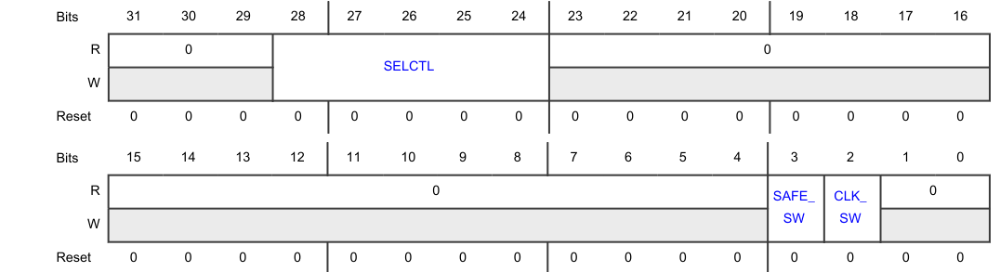

| 位 | 字段 | 功能 |
| --- | --- | --- |
| 31-29 | — | 本字段为保留，读取返回零。 |
| 28-24 | **SELCTL** | 时钟源选择控制（**Clock source selection control**）<br>为时钟多路复用器 8 选择源时钟。保留值未显示。<br>`0_0000b` - clk_src_0<br>`0_0010b` - clk_src_2<br>`1_0101b` - clk_src_21 |
| 23-4 | — | 本字段为保留，读取返回零。 |
| 3 | **SAFE_SW** | 安全时钟请求（**Safe clock request**）<br>向该位写入 1 会向 clk_src_0 发出安全时钟切换请求。发出安全时钟切换操作请求后，该位自动清零，状态寄存器中对应的位被置位。 |
| 2 | **CLK_SW** | 时钟切换（**Clock switch**）<br>向该位写入 1 会向时钟多路复用器 8 发出时钟切换请求。发出时钟切换操作请求后，该位自动清零，状态寄存器中对应的位被置位。 |
| 1-0 | — | 本字段为保留，读取返回零。 |

### 5.38. 时钟多路复用器 8 选择状态寄存器（**MUX_8_CSS**）

**MUX_8_CSS** 偏移：**504h**

本寄存器提供时钟多路复用器 8 的当前时钟源选择状态。

本寄存器仅在破坏性复位时复位。


| 位 | 字段 | 功能 |
| --- | --- | --- |
| 31-29 | — | 本字段为保留，读取返回零。 |
| 28-24 | **SELSTAT** | 时钟源选择状态（**Clock source selection status**）<br>该值指示时钟多路复用器 8 当前选择的源。保留值未显示。<br>`0_0000b` - clk_src_0<br>`0_0010b` - clk_src_2<br>`1_0101b` - clk_src_21 |
| 23-20 | — | 本字段为保留，读取返回零。 |
| 19-17 | **SWTRG** | 切换触发原因（**Switch trigger cause**）<br>该值指示最近一次时钟源切换的原因。<br>**注意：** 如果时钟失效，随后对 MC_CGM 硬件时钟多路复用器发出多次安全时钟切换请求，则 SWTRG 字段的值可能为 4 或 5。<br>`000b` - 保留<br>`001b` - 请求后切换成功。<br>`010b` - 因目标时钟无效而切换请求失败，且当前时钟为 clk_src_0。<br>`011b` - 因当前时钟无效而切换请求失败，且当前时钟为 clk_src_0。<br>`100b` - 因安全时钟请求或复位而切换到 clk_src_0 成功。<br>`101b` - 因安全时钟请求或复位而切换到 clk_src_0 成功，但先前的当前时钟源无效。<br>`110b` - 保留<br>`111b` - 保留 |
| 16 | **SWIP** | 切换进行中（**Switch in progress**）<br>**注意：** 新的时钟切换请求只能在上一请求完成三个时钟周期之后发出。<br>`0b` - 时钟源切换已完成。<br>`1b` - 时钟源切换正在进行中。 |
| 15-4 | — | 本字段为保留，读取返回零。 |
| 3 | **SAFE_SW** | 安全时钟请求（**Safe clock request**）<br>本字段指示在时钟多路复用器 8 上先前的/正在进行的请求期间是否请求了切换到安全时钟操作。<br>`0b` - 未请求安全时钟切换操作。<br>`1b` - 已请求安全时钟切换操作。 |
| 2 | **CLK_SW** | 时钟切换（**Clock switch**）<br>本字段指示在时钟多路复用器 8 上先前的/正在进行的请求期间是否请求了时钟切换操作。<br>`0b` - 未请求时钟切换操作。<br>`1b` - 已请求时钟切换操作。 |
| 1-0 | — | 本字段为保留，读取返回零。 |

### 5.39. 时钟多路复用器 12 选择控制寄存器（**MUX_12_CSC**）

**MUX_12_CSC** 偏移：**600h**

本寄存器提供时钟多路复用器 12 的时钟源选择控制。时钟多路复用器 12 实现硬件控制的时钟切换，确保时钟切换以平滑的方式发生（无毛刺）。详情参见"硬件控制的时钟多路复用器"一节。

本寄存器仅在破坏性复位时复位。


| 位 | 字段 | 功能 |
| --- | --- | --- |
| 31-29 | — | 本字段为保留，读取返回零。 |
| 28-24 | **SELCTL** | 时钟源选择控制（**Clock source selection control**）<br>为时钟多路复用器 12 选择源时钟。保留值未显示。<br>`0_0000b` - clk_src_0<br>`1_1010b` - clk_src_26 |
| 23-4 | — | 本字段为保留，读取返回零。 |
| 3 | **SAFE_SW** | 安全时钟请求（**Safe clock request**）<br>向该位写入 1 会向 clk_src_0 发出安全时钟切换请求。发出安全时钟切换操作请求后，该位自动清零，状态寄存器中对应的位被置位。 |
| 2 | **CLK_SW** | 时钟切换（**Clock switch**）<br>向该位写入 1 会向时钟多路复用器 12 发出时钟切换请求。发出时钟切换操作请求后，该位自动清零，状态寄存器中对应的位被置位。 |
| 1-0 | — | 本字段为保留，读取返回零。 |

### 5.40. 时钟多路复用器 12 选择状态寄存器（**MUX_12_CSS**）

**MUX_12_CSS** 偏移：**604h**

本寄存器提供时钟多路复用器 12 的当前时钟源选择状态。

本寄存器仅在破坏性复位时复位。


| 位 | 字段 | 功能 |
| --- | --- | --- |
| 31-29 | — | 本字段为保留，读取返回零。 |
| 28-24 | **SELSTAT** | 时钟源选择状态（**Clock source selection status**）<br>该值指示时钟多路复用器 12 当前选择的源。保留值未显示。<br>`0_0000b` - clk_src_0<br>`1_1010b` - clk_src_26 |
| 23-20 | — | 本字段为保留，读取返回零。 |
| 19-17 | **SWTRG** | 切换触发原因（**Switch trigger cause**）<br>该值指示最近一次时钟源切换的原因。<br>**注意：** 如果时钟失效，随后对 MC_CGM 硬件时钟多路复用器发出多次安全时钟切换请求，则 SWTRG 字段的值可能为 4 或 5。<br>`000b` - 保留<br>`001b` - 请求后切换成功。<br>`010b` - 因目标时钟无效而切换请求失败，且当前时钟为 clk_src_0。<br>`011b` - 因当前时钟无效而切换请求失败，且当前时钟为 clk_src_0。<br>`100b` - 因安全时钟请求或复位而切换到 clk_src_0 成功。<br>`101b` - 因安全时钟请求或复位而切换到 clk_src_0 成功，但先前的当前时钟源无效。<br>`110b` - 保留<br>`111b` - 保留 |
| 16 | **SWIP** | 切换进行中（**Switch in progress**）<br>**注意：** 新的时钟切换请求只能在上一请求完成三个时钟周期之后发出。<br>`0b` - 时钟源切换已完成。<br>`1b` - 时钟源切换正在进行中。 |
| 15-4 | — | 本字段为保留，读取返回零。 |
| 3 | **SAFE_SW** | 安全时钟请求（**Safe clock request**）<br>本字段指示在时钟多路复用器 12 上先前的/正在进行的请求期间是否请求了切换到安全时钟操作。<br>`0b` - 未请求安全时钟切换操作。<br>`1b` - 已请求安全时钟切换操作。 |
| 2 | **CLK_SW** | 时钟切换（**Clock switch**）<br>本字段指示在时钟多路复用器 12 上先前的/正在进行的请求期间是否请求了时钟切换操作。<br>`0b` - 未请求时钟切换操作。<br>`1b` - 已请求时钟切换操作。 |
| 1-0 | — | 本字段为保留，读取返回零。 |

### 5.41. 时钟多路复用器 12 分频器 0 控制寄存器（**MUX_12_DC_0**）

**MUX_12_DC_0** 偏移：**608h**

本寄存器控制时钟多路复用器 12 的时钟分频器 0。

该分频器为 50% 占空比分频器。

**注意：** 对本寄存器各字段的更新应为原子写，即单次写入应更新整个寄存器。


| 位 | 字段 | 功能 |
| --- | --- | --- |
| 31 | **DE** | 分频器使能（**Divider enable**）<br>`0b` - 分频器被禁用。<br>`1b` - 分频器被使能。 |
| 30-24 | — | 本字段为保留，读取返回零。 |
| 23-16 | **DIV** | 分频值（**Division value**）<br>本字段提供时钟分频器的分频值。分频后的时钟周期为分频器当前输入时钟周期的"DIV+1"倍。 |
| 15-0 | — | 本字段为保留，读取返回零。 |

### 5.42. 时钟多路复用器 12 分频器更新状态寄存器（**MUX_12_DIV_UPD_STAT**）

**MUX_12_DIV_UPD_STAT** 偏移：**63Ch**

本寄存器提供与时钟多路复用器 12 对应的时钟分频器的更新状态。当对任一分频器控制寄存器执行写操作时，本寄存器中的分频器状态位被置为逻辑 1。当分频器已采样新的分频器配置时，该位被置为逻辑 0。在不跟踪状态位的情况下对同一时钟多路复用器内的相同或其他时钟分频器执行多次写入会导致报告不一致，即在相应的分频器更新仍待处理时分频器状态位可能已被置为逻辑 0。

**注意：** 无论 MC_CGM 时钟多路复用器内是否实现了任何分频器，对 MUX_n_DIV_UPD_STAT 的读访问总是完成而不返回总线传输错误。

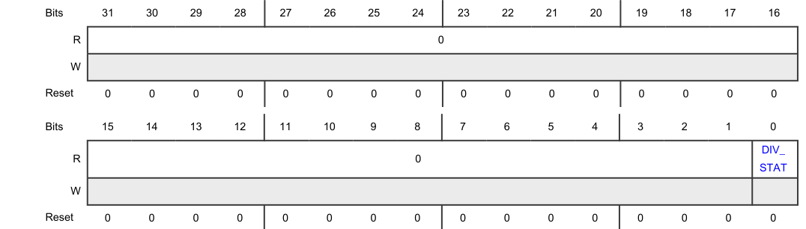

| 位 | 字段 | 功能 |
| --- | --- | --- |
| 31-1 | — | 本字段为保留，读取返回零。 |
| 0 | **DIV_STAT** | 时钟多路复用器 12 的分频器状态（**Divider status for clock mux 12**）<br>在更新分频器控制寄存器之后读取 MUX_n_DIV_UPD_STAT 时，如果由于所选时钟源中的错误导致该字段的值固定为 1，请执行以下步骤将多路复用器切换到新的时钟源：<br>1. 将多路复用器切换到可工作的时钟源，不轮询该字段。<br>2. 更新 MUX_n_DC_m 并轮询该字段。<br>**注意：** 一旦分频器配置被更新或发生破坏性复位，该位即被清零。如果在该位为 1 时发生功能性复位，则它可能保持固定为 1，直到分频器输入时钟被恢复。<br>`0b` - 没有待处理的分频器配置更新。<br>`1b` - 与该多路复用器关联的至少一个分频器上的分频器配置更新待处理。 |

### 5.43. 时钟多路复用器 14 选择控制寄存器（**MUX_14_CSC**）

**MUX_14_CSC** 偏移：**680h**

本寄存器提供时钟多路复用器 14 的时钟源选择控制。时钟多路复用器 14 实现硬件控制的时钟切换，确保时钟切换以平滑的方式发生（无毛刺）。详情参见"硬件控制的时钟多路复用器"一节。

本寄存器仅在破坏性复位时复位。

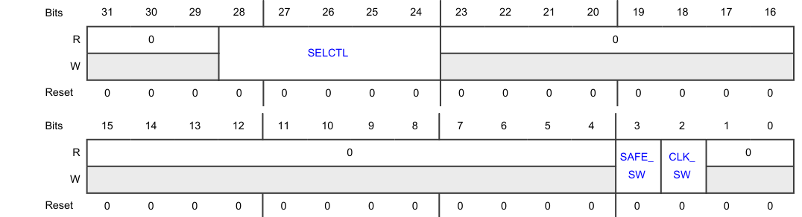

| 位 | 字段 | 功能 |
| --- | --- | --- |
| 31-29 | — | 本字段为保留，读取返回零。 |
| 28-24 | **SELCTL** | 时钟源选择控制（**Clock source selection control**）<br>为时钟多路复用器 14 选择源时钟。保留值未显示。<br>`0_0000b` - clk_src_0<br>`1_1100b` - clk_src_28 |
| 23-4 | — | 本字段为保留，读取返回零。 |
| 3 | **SAFE_SW** | 安全时钟请求（**Safe clock request**）<br>向该位写入 1 会向 clk_src_0 发出安全时钟切换请求。发出安全时钟切换操作请求后，该位自动清零，状态寄存器中对应的位被置位。 |
| 2 | **CLK_SW** | 时钟切换（**Clock switch**）<br>向该位写入 1 会向时钟多路复用器 14 发出时钟切换请求。发出时钟切换操作请求后，该位自动清零，状态寄存器中对应的位被置位。 |
| 1-0 | — | 本字段为保留，读取返回零。 |

### 5.44. 时钟多路复用器 14 选择状态寄存器（**MUX_14_CSS**）

**MUX_14_CSS** 偏移：**684h**

本寄存器提供时钟多路复用器 14 的当前时钟源选择状态。

本寄存器仅在破坏性复位时复位。

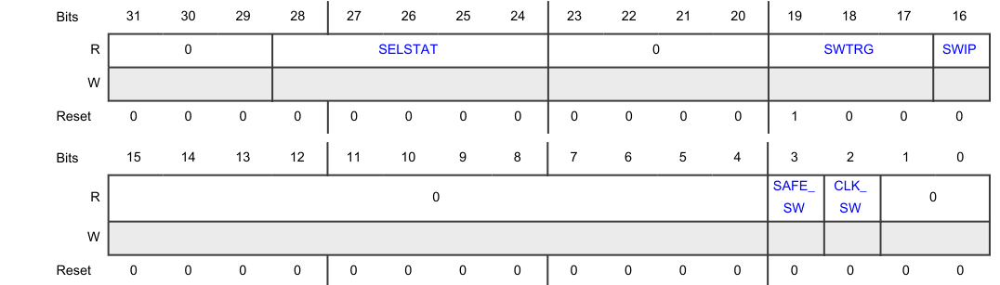

| 位 | 字段 | 功能 |
| --- | --- | --- |
| 31-29 | — | 本字段为保留，读取返回零。 |
| 28-24 | **SELSTAT** | 时钟源选择状态（**Clock source selection status**）<br>该值指示时钟多路复用器 14 当前选择的源。保留值未显示。<br>`0_0000b` - clk_src_0<br>`1_1100b` - clk_src_28 |
| 23-20 | — | 本字段为保留，读取返回零。 |
| 19-17 | **SWTRG** | 切换触发原因（**Switch trigger cause**）<br>该值指示最近一次时钟源切换的原因。<br>**注意：** 如果时钟失效，随后对 MC_CGM 硬件时钟多路复用器发出多次安全时钟切换请求，则 SWTRG 字段的值可能为 4 或 5。<br>`000b` - 保留<br>`001b` - 请求后切换成功。<br>`010b` - 因目标时钟无效而切换请求失败，且当前时钟为 clk_src_0。<br>`011b` - 因当前时钟无效而切换请求失败，且当前时钟为 clk_src_0。<br>`100b` - 因安全时钟请求或复位而切换到 clk_src_0 成功。<br>`101b` - 因安全时钟请求或复位而切换到 clk_src_0 成功，但先前的当前时钟源无效。<br>`110b` - 保留<br>`111b` - 保留 |
| 16 | **SWIP** | 切换进行中（**Switch in progress**）<br>**注意：** 新的时钟切换请求只能在上一请求完成三个时钟周期之后发出。<br>`0b` - 时钟源切换已完成。<br>`1b` - 时钟源切换正在进行中。 |
| 15-4 | — | 本字段为保留，读取返回零。 |
| 3 | **SAFE_SW** | 安全时钟请求（**Safe clock request**）<br>本字段指示在时钟多路复用器 14 上先前的/正在进行的请求期间是否请求了切换到安全时钟操作。<br>`0b` - 未请求安全时钟切换操作。<br>`1b` - 已请求安全时钟切换操作。 |
| 2 | **CLK_SW** | 时钟切换（**Clock switch**）<br>本字段指示在时钟多路复用器 14 上先前的/正在进行的请求期间是否请求了时钟切换操作。<br>`0b` - 未请求时钟切换操作。<br>`1b` - 已请求时钟切换操作。 |
| 1-0 | — | 本字段为保留，读取返回零。 |

### 5.45. 时钟多路复用器 14 分频器 0 控制寄存器（**MUX_14_DC_0**）

**MUX_14_DC_0** 偏移：**688h**

本寄存器控制时钟多路复用器 14 的时钟分频器 0。

该分频器为 50% 占空比分频器。

**注意：** 对本寄存器各字段的更新应为原子写，即单次写入应更新整个寄存器。


| 位 | 字段 | 功能 |
| --- | --- | --- |
| 31 | **DE** | 分频器使能（**Divider enable**）<br>`0b` - 分频器被禁用。<br>`1b` - 分频器被使能。 |
| 30-24 | — | 本字段为保留，读取返回零。 |
| 23-16 | **DIV** | 分频值（**Division value**）<br>本字段提供时钟分频器的分频值。分频后的时钟周期为分频器当前输入时钟周期的"DIV+1"倍。 |
| 15-0 | — | 本字段为保留，读取返回零。 |

### 5.46. 时钟多路复用器 14 分频器更新状态寄存器（**MUX_14_DIV_UPD_STAT**）

**MUX_14_DIV_UPD_STAT** 偏移：**6BCh**

本寄存器提供与时钟多路复用器 14 对应的时钟分频器的更新状态。当对任一分频器控制寄存器执行写操作时，本寄存器中的分频器状态位被置为逻辑 1。当分频器已采样新的分频器配置时，该位被置为逻辑 0。在不跟踪状态位的情况下对同一时钟多路复用器内的相同或其他时钟分频器执行多次写入会导致报告不一致，即在相应的分频器更新仍待处理时分频器状态位可能已被置为逻辑 0。

**注意：** 无论 MC_CGM 时钟多路复用器内是否实现了任何分频器，对 MUX_n_DIV_UPD_STAT 的读访问总是完成而不返回总线传输错误。


| 位 | 字段 | 功能 |
| --- | --- | --- |
| 31-1 | — | 本字段为保留，读取返回零。 |
| 0 | **DIV_STAT** | 时钟多路复用器 14 的分频器状态（**Divider status for clock mux 14**）<br>在更新分频器控制寄存器之后读取 MUX_n_DIV_UPD_STAT 时，如果由于所选时钟源中的错误导致该字段的值固定为 1，请执行以下步骤将多路复用器切换到新的时钟源：<br>1. 将多路复用器切换到可工作的时钟源，不轮询该字段。<br>2. 更新 MUX_n_DC_m 并轮询该字段。<br>**注意：** 一旦分频器配置被更新或发生破坏性复位，该位即被清零。如果在该位为 1 时发生功能性复位，则它可能保持固定为 1，直到分频器输入时钟被恢复。<br>`0b` - 没有待处理的分频器配置更新。<br>`1b` - 与该多路复用器关联的至少一个分频器上的分频器配置更新待处理。 |

### 5.47. 时钟多路复用器 16 选择控制寄存器（**MUX_16_CSC**）

**MUX_16_CSC** 偏移：**700h**

本寄存器提供时钟多路复用器 16 的时钟源选择控制。时钟多路复用器 16 实现硬件控制的时钟切换，确保时钟切换以平滑的方式发生（无毛刺）。详情参见"硬件控制的时钟多路复用器"一节。

本寄存器仅在破坏性复位时复位。


| 位 | 字段 | 功能 |
| --- | --- | --- |
| 31-29 | — | 本字段为保留，读取返回零。 |
| 28-24 | **SELCTL** | 时钟源选择控制（**Clock source selection control**）<br>为时钟多路复用器 16 选择源时钟。保留值未显示。<br>`0_0000b` - clk_src_0<br>`1_1001b` - clk_src_25 |
| 23-4 | — | 本字段为保留，读取返回零。 |
| 3 | **SAFE_SW** | 安全时钟请求（**Safe clock request**）<br>向该位写入 1 会向 clk_src_0 发出安全时钟切换请求。发出安全时钟切换操作请求后，该位自动清零，状态寄存器中对应的位被置位。 |
| 2 | **CLK_SW** | 时钟切换（**Clock switch**）<br>向该位写入 1 会向时钟多路复用器 16 发出时钟切换请求。发出时钟切换操作请求后，该位自动清零，状态寄存器中对应的位被置位。 |
| 1-0 | — | 本字段为保留，读取返回零。 |

### 5.48. 时钟多路复用器 16 选择状态寄存器（**MUX_16_CSS**）

**MUX_16_CSS** 偏移：**704h**

本寄存器提供时钟多路复用器 16 的当前时钟源选择状态。

本寄存器仅在破坏性复位时复位。

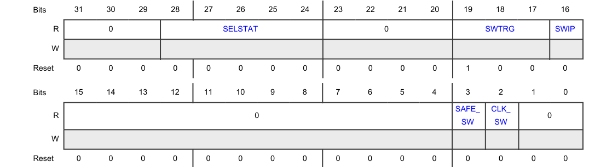

| 位 | 字段 | 功能 |
| --- | --- | --- |
| 31-29 | — | 本字段为保留，读取返回零。 |
| 28-24 | **SELSTAT** | 时钟源选择状态（**Clock source selection status**）<br>该值指示时钟多路复用器 16 当前选择的源。保留值未显示。<br>`0_0000b` - clk_src_0<br>`1_1001b` - clk_src_25 |
| 23-20 | — | 本字段为保留，读取返回零。 |
| 19-17 | **SWTRG** | 切换触发原因（**Switch trigger cause**）<br>该值指示最近一次时钟源切换的原因。<br>**注意：** 如果时钟失效，随后对 MC_CGM 硬件时钟多路复用器发出多次安全时钟切换请求，则 SWTRG 字段的值可能为 4 或 5。<br>`000b` - 保留<br>`001b` - 请求后切换成功。<br>`010b` - 因目标时钟无效而切换请求失败，且当前时钟为 clk_src_0。<br>`011b` - 因当前时钟无效而切换请求失败，且当前时钟为 clk_src_0。<br>`100b` - 因安全时钟请求或复位而切换到 clk_src_0 成功。<br>`101b` - 因安全时钟请求或复位而切换到 clk_src_0 成功，但先前的当前时钟源无效。<br>`110b` - 保留<br>`111b` - 保留 |
| 16 | **SWIP** | 切换进行中（**Switch in progress**）<br>**注意：** 新的时钟切换请求只能在上一请求完成三个时钟周期之后发出。<br>`0b` - 时钟源切换已完成。<br>`1b` - 时钟源切换正在进行中。 |
| 15-4 | — | 本字段为保留，读取返回零。 |
| 3 | **SAFE_SW** | 安全时钟请求（**Safe clock request**）<br>本字段指示在时钟多路复用器 16 上先前的/正在进行的请求期间是否请求了切换到安全时钟操作。<br>`0b` - 未请求安全时钟切换操作。<br>`1b` - 已请求安全时钟切换操作。 |
| 2 | **CLK_SW** | 时钟切换（**Clock switch**）<br>本字段指示在时钟多路复用器 16 上先前的/正在进行的请求期间是否请求了时钟切换操作。<br>`0b` - 未请求时钟切换操作。<br>`1b` - 已请求时钟切换操作。 |
| 1-0 | — | 本字段为保留，读取返回零。 |

## 6. MC_CGM_1 寄存器说明

MC_CGM 实现一组共享 PCFS 配置寄存器的时钟多路复用器。MC_CGM 寄存器具有以下属性：

* 所有寄存器均为 32 位宽。
* 仅支持 32 位读和写访问。
* 小于 32 位的读/写访问将以错误终止。
* 对可写寄存器中只读寄存器字段的写入将被忽略，并且不提供错误响应。
* 对只读寄存器的写入将以错误响应中止。

### 6.1. MC_CGM_1 内存映射

MC_CGM_1 基地址：**4003_4000h**

| 偏移 | 寄存器 | 宽度（位） | 访问 | 复位值 |
| --- | --- | --- | --- | --- |
| **0h** | [PCFS 步长持续时间寄存器（**PCFS_SDUR**）](#62-pcfs-步长持续时间寄存器pcfs_sdur) | 32 | RW | **0000_0000h** |
| **28h** | [PCFS 分频器变化 4 寄存器（**PCFS_DIVC4**）](#63-pcfs-分频器变化-4-寄存器pcfs_divc4) | 32 | RW | **0000_0000h** |
| **2Ch** | [PCFS 分频器结束 4 寄存器（**PCFS_DIVE4**）](#64-pcfs-分频器结束-4-寄存器pcfs_dive4) | 32 | RW | **0000_03E7h** |
| **30h** | [PCFS 分频器起始 4 寄存器（**PCFS_DIVS4**）](#65-pcfs-分频器起始-4-寄存器pcfs_divs4) | 32 | RW | **0000_03E7h** |
| **300h** | [时钟多路复用器 0 选择控制寄存器（**MUX_0_CSC**）](#66-时钟多路复用器-0-选择控制寄存器mux_0_csc) | 32 | RW | **0000_0000h** |
| **304h** | [时钟多路复用器 0 选择状态寄存器（**MUX_0_CSS**）](#67-时钟多路复用器-0-选择状态寄存器mux_0_css) | 32 | R | **0008_0000h** |

### 6.2. PCFS 步长持续时间寄存器（**PCFS_SDUR**）

**PCFS_SDUR** 偏移：**0h**

本寄存器指定每个 PCFS 步的步长持续时间。本寄存器中提供的值以 clk_src_0 的周期数表示 PCFS 步长持续时间。

本寄存器仅通过破坏性复位复位。详情参见"PCFS"一节。


| 位 | 字段 | 功能 |
| --- | --- | --- |
| 31-16 | — | 本字段为保留，读取返回零。 |
| 15-0 | **SDUR** | 步长持续时间（**Step duration**）<br>步长的持续时间计数值 |

### 6.3. PCFS 分频器变化 4 寄存器（**PCFS_DIVC4**）

**PCFS_DIVC4** 偏移：**28h**

本寄存器为 clk_src_4 的渐进式时钟频率切换（**Progressive Clock Frequency switching**）定义频率变化速率以及频率上升时的初始变化值。

本寄存器仅在破坏性复位时复位。


| 位 | 字段 | 功能 |
| --- | --- | --- |
| 31-16 | **INIT** | 分频器变化初始值（**Divider change initial value**）<br>本字段为 clk_src_4 的时钟上升相位提供时钟分频器的初始变化值。 |
| 15-8 | — | 本字段为保留，读取返回零。 |
| 7-0 | **RATE** | 分频器变化速率（**Divider change rate**）<br>该值控制 clk_src_4 的时钟上升和下降相位的时钟分频器变化值。 |

### 6.4. PCFS 分频器结束 4 寄存器（**PCFS_DIVE4**）

**PCFS_DIVE4** 偏移：**2Ch**

本寄存器为 clk_src_4 的渐进式系统时钟切换定义频率下降时的最终分频值。

本寄存器仅在破坏性复位时复位。


| 位 | 字段 | 功能 |
| --- | --- | --- |
| 31-20 | — | 本字段为保留，读取返回零。 |
| 19-0 | **DIVE** | 分频器结束值（**Divider end value**）<br>本字段为 clk_src_4 的下降相位提供时钟分频器的结束值。 |

### 6.5. PCFS 分频器起始 4 寄存器（**PCFS_DIVS4**）

**PCFS_DIVS4** 偏移：**30h**

本寄存器为 clk_src_4 的渐进式系统时钟切换定义频率上升时的初始分频值。

本寄存器仅在破坏性复位时复位。


| 位 | 字段 | 功能 |
| --- | --- | --- |
| 31-20 | — | 本字段为保留，读取返回零。 |
| 19-0 | **DIVS** | 分频器起始值（**Divider start value**）<br>本字段为 clk_src_4 的上升相位提供时钟分频器的起始值 |

### 6.6. 时钟多路复用器 0 选择控制寄存器（**MUX_0_CSC**）

**MUX_0_CSC** 偏移：**300h**

本寄存器提供时钟多路复用器 0 的时钟源选择控制。时钟多路复用器 0 实现硬件控制的时钟切换，确保时钟切换以平滑的方式发生（无毛刺）。详情参见"硬件控制的时钟多路复用器"一节。

本寄存器仅在破坏性复位时复位。

对本寄存器所有 PCFS 相关字段的更新必须是原子写（**atomic write**），即单次写入必须同时更新 CLK_SW、RAMPDOWN 和 RAMPUP 字段。即使只想触发 RAMPUP 或 RAMPDOWN 过程之一，也必须同时置位 RAMPUP 和 RAMPDOWN 两位，否则将不会执行所需的 PCFS 序列。

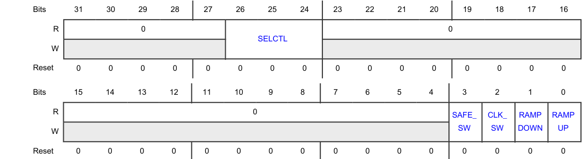

| 位 | 字段 | 功能 |
| --- | --- | --- |
| 31-27 | — | 本字段为保留，读取返回零。 |
| 26-24 | **SELCTL** | 时钟源选择控制（**Clock source selection control**）<br>为时钟多路复用器 0 选择源时钟。保留值未显示。<br>`000b` - clk_src_0<br>`100b` - clk_src_4 |
| 23-4 | — | 本字段为保留，读取返回零。 |
| 3 | **SAFE_SW** | 安全时钟请求（**Safe clock request**）<br>向该位写入 1 会向 clk_src_0 发出安全时钟切换请求。发出安全时钟切换操作请求后，该位自动清零，状态寄存器中对应的位被置位。 |
| 2 | **CLK_SW** | 时钟切换（**Clock switch**）<br>向该位写入 1 会向时钟多路复用器 0 发出时钟切换请求。发出时钟切换操作请求后，该位自动清零，状态寄存器中对应的位被置位。 |
| 1 | **RAMPDOWN** | PCFS 下降（**PCFS ramp-down**）<br>向该位写入 1 会向时钟多路复用器 0 发出 PCFS 下降请求。发出 PCFS 下降操作请求后，该位自动清零，状态寄存器中对应的位被置位。 |
| 0 | **RAMPUP** | PCFS 上升（**PCFS ramp-up**）<br>向该位写入 1 会向时钟多路复用器 0 发出 PCFS 上升请求。发出 PCFS 上升操作请求后，该位自动清零，状态寄存器中对应的位被置位。 |

### 6.7. 时钟多路复用器 0 选择状态寄存器（**MUX_0_CSS**）

**MUX_0_CSS** 偏移：**304h**

本寄存器提供时钟多路复用器 0 的当前时钟源选择状态。

本寄存器仅在破坏性复位时复位。

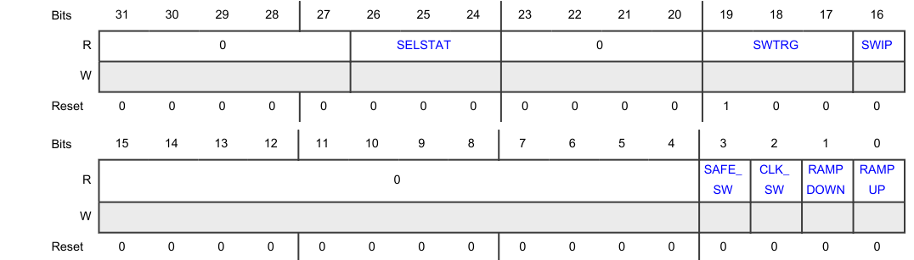

| 位 | 字段 | 功能 |
| --- | --- | --- |
| 31-27 | — | 本字段为保留，读取返回零。 |
| 26-24 | **SELSTAT** | 时钟源选择状态（**Clock source selection status**）<br>该值指示时钟多路复用器 0 当前选择的源。保留值未显示。<br>`000b` - clk_src_0<br>`100b` - clk_src_4 |
| 23-20 | — | 本字段为保留，读取返回零。 |
| 19-17 | **SWTRG** | 切换触发原因（**Switch trigger cause**）<br>该值指示最近一次时钟源切换的原因。<br>**注意：** 如果时钟失效，随后对 MC_CGM 硬件时钟多路复用器发出多次安全时钟切换请求，则 SWTRG 字段的值可能为 4 或 5。<br>`000b` - 保留<br>`001b` - 请求后切换成功。<br>`010b` - 因目标时钟无效而切换请求失败，且当前时钟为 clk_src_0。<br>`011b` - 因当前时钟无效而切换请求失败，且当前时钟为 clk_src_0。<br>`100b` - 因安全时钟请求或复位而切换到 clk_src_0 成功。<br>`101b` - 因安全时钟请求或复位而切换到 clk_src_0 成功，但先前的当前时钟源无效。<br>`110b` - 保留<br>`111b` - 保留 |
| 16 | **SWIP** | 切换进行中（**Switch in progress**）<br>**注意：** 新的时钟切换请求只能在上一请求完成三个时钟周期之后发出。<br>`0b` - 时钟源切换已完成。<br>`1b` - 时钟源切换正在进行中。 |
| 15-4 | — | 本字段为保留，读取返回零。 |
| 3 | **SAFE_SW** | 安全时钟请求（**Safe clock request**）<br>本字段指示在时钟多路复用器 0 上先前的/正在进行的请求期间是否请求了切换到安全时钟操作。<br>`0b` - 未请求安全时钟切换操作。<br>`1b` - 已请求安全时钟切换操作。 |
| 2 | **CLK_SW** | 时钟切换（**Clock switch**）<br>本字段指示在时钟多路复用器 0 上先前的/正在进行的请求期间是否请求了时钟切换操作。<br>`0b` - 未请求时钟切换操作。<br>`1b` - 已请求时钟切换操作。 |
| 1 | **RAMPDOWN** | PCFS 下降（**PCFS ramp-down**）<br>本字段指示在时钟多路复用器 0 上先前的/正在进行的请求期间是否请求了 PCFS 下降操作。<br>**注意：** 在安全时钟切换的情况下，下降操作在内部运行，但对应状态字段的值不会置为 1。<br>`0b` - 未请求下降操作。<br>`1b` - 已请求下降操作。 |
| 0 | **RAMPUP** | PCFS 上升（**PCFS ramp-up**）<br>本字段指示在时钟多路复用器 0 上先前的/正在进行的请求期间是否请求了 PCFS 上升操作。<br>`0b` - 未请求上升操作。<br>`1b` - 已请求上升操作。 |

## 7. MC_CGM_2 寄存器说明

MC_CGM 实现一组共享 PCFS 配置寄存器的时钟多路复用器。MC_CGM 寄存器具有以下属性：

* 所有寄存器均为 32 位宽。
* 仅支持 32 位读和写访问。
* 小于 32 位的读/写访问将以错误终止。
* 对可写寄存器中只读寄存器字段的写入将被忽略，并且不提供错误响应。
* 对只读寄存器的写入将以错误响应中止。

### 7.1. MC_CGM_2 内存映射

MC_CGM_2 基地址：**4401_8000h**

| 偏移 | 寄存器 | 宽度（位） | 访问 | 复位值 |
| --- | --- | --- | --- | --- |
| **0h** | [PCFS 步长持续时间寄存器（**PCFS_SDUR**）](#72-pcfs-步长持续时间寄存器pcfs_sdur) | 32 | RW | **0000_0000h** |
| **10Ch** | [PCFS 分频器变化 23 寄存器（**PCFS_DIVC23**）](#73-pcfs-分频器变化-23-寄存器pcfs_divc23) | 32 | RW | **0000_0000h** |
| **110h** | [PCFS 分频器结束 23 寄存器（**PCFS_DIVE23**）](#74-pcfs-分频器结束-23-寄存器pcfs_dive23) | 32 | RW | **0000_03E7h** |
| **114h** | [PCFS 分频器起始 23 寄存器（**PCFS_DIVS23**）](#75-pcfs-分频器起始-23-寄存器pcfs_divs23) | 32 | RW | **0000_03E7h** |
| **184h** | [PCFS 分频器变化 33 寄存器（**PCFS_DIVC33**）](#76-pcfs-分频器变化-33-寄存器pcfs_divc33) | 32 | RW | **0000_0000h** |
| **188h** | [PCFS 分频器结束 33 寄存器（**PCFS_DIVE33**）](#77-pcfs-分频器结束-33-寄存器pcfs_dive33) | 32 | RW | **0000_03E7h** |
| **18Ch** | [PCFS 分频器起始 33 寄存器（**PCFS_DIVS33**）](#78-pcfs-分频器起始-33-寄存器pcfs_divs33) | 32 | RW | **0000_03E7h** |
| **220h** | [PCFS 分频器变化 46 寄存器（**PCFS_DIVC46**）](#79-pcfs-分频器变化-46-寄存器pcfs_divc46) | 32 | RW | **0000_0000h** |
| **224h** | [PCFS 分频器结束 46 寄存器（**PCFS_DIVE46**）](#710-pcfs-分频器结束-46-寄存器pcfs_dive46) | 32 | RW | **0000_03E7h** |
| **228h** | [PCFS 分频器起始 46 寄存器（**PCFS_DIVS46**）](#711-pcfs-分频器起始-46-寄存器pcfs_divs46) | 32 | RW | **0000_03E7h** |
| **22Ch** | [PCFS 分频器变化 47 寄存器（**PCFS_DIVC47**）](#712-pcfs-分频器变化-47-寄存器pcfs_divc47) | 32 | RW | **0000_0000h** |
| **230h** | [PCFS 分频器结束 47 寄存器（**PCFS_DIVE47**）](#713-pcfs-分频器结束-47-寄存器pcfs_dive47) | 32 | RW | **0000_03E7h** |
| **234h** | [PCFS 分频器起始 47 寄存器（**PCFS_DIVS47**）](#714-pcfs-分频器起始-47-寄存器pcfs_divs47) | 32 | RW | **0000_03E7h** |
| **238h** | [PCFS 分频器变化 48 寄存器（**PCFS_DIVC48**）](#715-pcfs-分频器变化-48-寄存器pcfs_divc48) | 32 | RW | **0000_0000h** |
| **23Ch** | [PCFS 分频器结束 48 寄存器（**PCFS_DIVE48**）](#716-pcfs-分频器结束-48-寄存器pcfs_dive48) | 32 | RW | **0000_03E7h** |
| **240h** | [PCFS 分频器起始 48 寄存器（**PCFS_DIVS48**）](#717-pcfs-分频器起始-48-寄存器pcfs_divs48) | 32 | RW | **0000_03E7h** |
| **244h** | [PCFS 分频器变化 49 寄存器（**PCFS_DIVC49**）](#718-pcfs-分频器变化-49-寄存器pcfs_divc49) | 32 | RW | **0000_0000h** |
| **248h** | [PCFS 分频器结束 49 寄存器（**PCFS_DIVE49**）](#719-pcfs-分频器结束-49-寄存器pcfs_dive49) | 32 | RW | **0000_03E7h** |
| **24Ch** | [PCFS 分频器起始 49 寄存器（**PCFS_DIVS49**）](#720-pcfs-分频器起始-49-寄存器pcfs_divs49) | 32 | RW | **0000_03E7h** |
| **250h** | [PCFS 分频器变化 50 寄存器（**PCFS_DIVC50**）](#721-pcfs-分频器变化-50-寄存器pcfs_divc50) | 32 | RW | **0000_0000h** |
| **254h** | [PCFS 分频器结束 50 寄存器（**PCFS_DIVE50**）](#722-pcfs-分频器结束-50-寄存器pcfs_dive50) | 32 | RW | **0000_03E7h** |
| **258h** | [PCFS 分频器起始 50 寄存器（**PCFS_DIVS50**）](#723-pcfs-分频器起始-50-寄存器pcfs_divs50) | 32 | RW | **0000_03E7h** |
| **25Ch** | [PCFS 分频器变化 51 寄存器（**PCFS_DIVC51**）](#724-pcfs-分频器变化-51-寄存器pcfs_divc51) | 32 | RW | **0000_0000h** |
| **260h** | [PCFS 分频器结束 51 寄存器（**PCFS_DIVE51**）](#725-pcfs-分频器结束-51-寄存器pcfs_dive51) | 32 | RW | **0000_03E7h** |
| **264h** | [PCFS 分频器起始 51 寄存器（**PCFS_DIVS51**）](#726-pcfs-分频器起始-51-寄存器pcfs_divs51) | 32 | RW | **0000_03E7h** |
| **268h** | [PCFS 分频器变化 52 寄存器（**PCFS_DIVC52**）](#727-pcfs-分频器变化-52-寄存器pcfs_divc52) | 32 | RW | **0000_0000h** |
| **26Ch** | [PCFS 分频器结束 52 寄存器（**PCFS_DIVE52**）](#728-pcfs-分频器结束-52-寄存器pcfs_dive52) | 32 | RW | **0000_03E7h** |
| **270h** | [PCFS 分频器起始 52 寄存器（**PCFS_DIVS52**）](#729-pcfs-分频器起始-52-寄存器pcfs_divs52) | 32 | RW | **0000_03E7h** |
| **274h** | [PCFS 分频器变化 53 寄存器（**PCFS_DIVC53**）](#730-pcfs-分频器变化-53-寄存器pcfs_divc53) | 32 | RW | **0000_0000h** |
| **278h** | [PCFS 分频器结束 53 寄存器（**PCFS_DIVE53**）](#731-pcfs-分频器结束-53-寄存器pcfs_dive53) | 32 | RW | **0000_03E7h** |
| **27Ch** | [PCFS 分频器起始 53 寄存器（**PCFS_DIVS53**）](#732-pcfs-分频器起始-53-寄存器pcfs_divs53) | 32 | RW | **0000_03E7h** |
| **280h** | [PCFS 分频器变化 54 寄存器（**PCFS_DIVC54**）](#733-pcfs-分频器变化-54-寄存器pcfs_divc54) | 32 | RW | **0000_0000h** |
| **284h** | [PCFS 分频器结束 54 寄存器（**PCFS_DIVE54**）](#734-pcfs-分频器结束-54-寄存器pcfs_dive54) | 32 | RW | **0000_03E7h** |
| **288h** | [PCFS 分频器起始 54 寄存器（**PCFS_DIVS54**）](#735-pcfs-分频器起始-54-寄存器pcfs_divs54) | 32 | RW | **0000_03E7h** |
| **28Ch** | [PCFS 分频器变化 55 寄存器（**PCFS_DIVC55**）](#736-pcfs-分频器变化-55-寄存器pcfs_divc55) | 32 | RW | **0000_0000h** |
| **290h** | [PCFS 分频器结束 55 寄存器（**PCFS_DIVE55**）](#737-pcfs-分频器结束-55-寄存器pcfs_dive55) | 32 | RW | **0000_03E7h** |
| **294h** | [PCFS 分频器起始 55 寄存器（**PCFS_DIVS55**）](#738-pcfs-分频器起始-55-寄存器pcfs_divs55) | 32 | RW | **0000_03E7h** |
| **298h** | [PCFS 分频器变化 56 寄存器（**PCFS_DIVC56**）](#739-pcfs-分频器变化-56-寄存器pcfs_divc56) | 32 | RW | **0000_0000h** |
| **29Ch** | [PCFS 分频器结束 56 寄存器（**PCFS_DIVE56**）](#740-pcfs-分频器结束-56-寄存器pcfs_dive56) | 32 | RW | **0000_03E7h** |
| **2A0h** | [PCFS 分频器起始 56 寄存器（**PCFS_DIVS56**）](#741-pcfs-分频器起始-56-寄存器pcfs_divs56) | 32 | RW | **0000_03E7h** |
| **2A4h** | [PCFS 分频器变化 57 寄存器（**PCFS_DIVC57**）](#742-pcfs-分频器变化-57-寄存器pcfs_divc57) | 32 | RW | **0000_0000h** |
| **2A8h** | [PCFS 分频器结束 57 寄存器（**PCFS_DIVE57**）](#743-pcfs-分频器结束-57-寄存器pcfs_dive57) | 32 | RW | **0000_03E7h** |
| **2ACh** | [PCFS 分频器起始 57 寄存器（**PCFS_DIVS57**）](#744-pcfs-分频器起始-57-寄存器pcfs_divs57) | 32 | RW | **0000_03E7h** |
| **2B0h** | [PCFS 分频器变化 58 寄存器（**PCFS_DIVC58**）](#745-pcfs-分频器变化-58-寄存器pcfs_divc58) | 32 | RW | **0000_0000h** |
| **2B4h** | [PCFS 分频器结束 58 寄存器（**PCFS_DIVE58**）](#746-pcfs-分频器结束-58-寄存器pcfs_dive58) | 32 | RW | **0000_03E7h** |
| **2B8h** | [PCFS 分频器起始 58 寄存器（**PCFS_DIVS58**）](#747-pcfs-分频器起始-58-寄存器pcfs_divs58) | 32 | RW | **0000_03E7h** |
| **2BCh** | [PCFS 分频器变化 59 寄存器（**PCFS_DIVC59**）](#748-pcfs-分频器变化-59-寄存器pcfs_divc59) | 32 | RW | **0000_0000h** |
| **2C0h** | [PCFS 分频器结束 59 寄存器（**PCFS_DIVE59**）](#749-pcfs-分频器结束-59-寄存器pcfs_dive59) | 32 | RW | **0000_03E7h** |
| **2C4h** | [PCFS 分频器起始 59 寄存器（**PCFS_DIVS59**）](#750-pcfs-分频器起始-59-寄存器pcfs_divs59) | 32 | RW | **0000_03E7h** |
| **2C8h** | [PCFS 分频器变化 60 寄存器（**PCFS_DIVC60**）](#751-pcfs-分频器变化-60-寄存器pcfs_divc60) | 32 | RW | **0000_0000h** |
| **2CCh** | [PCFS 分频器结束 60 寄存器（**PCFS_DIVE60**）](#752-pcfs-分频器结束-60-寄存器pcfs_dive60) | 32 | RW | **0000_03E7h** |
| **2D0h** | [PCFS 分频器起始 60 寄存器（**PCFS_DIVS60**）](#753-pcfs-分频器起始-60-寄存器pcfs_divs60) | 32 | RW | **0000_03E7h** |
| **2D4h** | [PCFS 分频器变化 61 寄存器（**PCFS_DIVC61**）](#754-pcfs-分频器变化-61-寄存器pcfs_divc61) | 32 | RW | **0000_0000h** |
| **2D8h** | [PCFS 分频器结束 61 寄存器（**PCFS_DIVE61**）](#755-pcfs-分频器结束-61-寄存器pcfs_dive61) | 32 | RW | **0000_03E7h** |
| **2DCh** | [PCFS 分频器起始 61 寄存器（**PCFS_DIVS61**）](#756-pcfs-分频器起始-61-寄存器pcfs_divs61) | 32 | RW | **0000_03E7h** |
| **2E0h** | [PCFS 分频器变化 62 寄存器（**PCFS_DIVC62**）](#757-pcfs-分频器变化-62-寄存器pcfs_divc62) | 32 | RW | **0000_0000h** |
| **2E4h** | [PCFS 分频器结束 62 寄存器（**PCFS_DIVE62**）](#758-pcfs-分频器结束-62-寄存器pcfs_dive62) | 32 | RW | **0000_03E7h** |
| **2E8h** | [PCFS 分频器起始 62 寄存器（**PCFS_DIVS62**）](#759-pcfs-分频器起始-62-寄存器pcfs_divs62) | 32 | RW | **0000_03E7h** |
| **2ECh** | [PCFS 分频器变化 63 寄存器（**PCFS_DIVC63**）](#760-pcfs-分频器变化-63-寄存器pcfs_divc63) | 32 | RW | **0000_0000h** |
| **2F0h** | [PCFS 分频器结束 63 寄存器（**PCFS_DIVE63**）](#761-pcfs-分频器结束-63-寄存器pcfs_dive63) | 32 | RW | **0000_03E7h** |
| **2F4h** | [PCFS 分频器起始 63 寄存器（**PCFS_DIVS63**）](#762-pcfs-分频器起始-63-寄存器pcfs_divs63) | 32 | RW | **0000_03E7h** |
| **300h** | [时钟多路复用器 0 选择控制寄存器（**MUX_0_CSC**）](#763-时钟多路复用器-0-选择控制寄存器mux_0_csc) | 32 | RW | **0000_0000h** |
| **304h** | [时钟多路复用器 0 选择状态寄存器（**MUX_0_CSS**）](#764-时钟多路复用器-0-选择状态寄存器mux_0_css) | 32 | R | **0008_0000h** |
| **308h** | [时钟多路复用器 0 分频器 0 控制寄存器（**MUX_0_DC_0**）](#765-时钟多路复用器-0-分频器-0-控制寄存器mux_0_dc_0) | 32 | RW | **8001_0000h** |
| **334h** | [时钟多路复用器 0 分频器触发控制寄存器（**MUX_0_DIV_TRIG_CTRL**）](#766-时钟多路复用器-0-分频器触发控制寄存器mux_0_div_trig_ctrl) | 32 | RW | **0000_0000h** |
| **338h** | [时钟多路复用器 0 分频器触发寄存器（**MUX_0_DIV_TRIG**）](#767-时钟多路复用器-0-分频器触发寄存器mux_0_div_trig) | 32 | RW | **0000_0000h** |
| **33Ch** | [时钟多路复用器 0 分频器更新状态寄存器（**MUX_0_DIV_UPD_STAT**）](#768-时钟多路复用器-0-分频器更新状态寄存器mux_0_div_upd_stat) | 32 | R | **0000_0000h** |
| **340h** | [时钟多路复用器 1 选择控制寄存器（**MUX_1_CSC**）](#769-时钟多路复用器-1-选择控制寄存器mux_1_csc) | 32 | RW | **0000_0000h** |
| **344h** | [时钟多路复用器 1 选择状态寄存器（**MUX_1_CSS**）](#770-时钟多路复用器-1-选择状态寄存器mux_1_css) | 32 | R | **0008_0000h** |
| **348h** | [时钟多路复用器 1 分频器 0 控制寄存器（**MUX_1_DC_0**）](#771-时钟多路复用器-1-分频器-0-控制寄存器mux_1_dc_0) | 32 | RW | **0000_0000h** |
| **34Ch** | [时钟多路复用器 1 分频器 1 控制寄存器（**MUX_1_DC_1**）](#772-时钟多路复用器-1-分频器-1-控制寄存器mux_1_dc_1) | 32 | RW | **0003_0000h** |
| **374h** | [时钟多路复用器 1 分频器触发控制寄存器（**MUX_1_DIV_TRIG_CTRL**）](#773-时钟多路复用器-1-分频器触发控制寄存器mux_1_div_trig_ctrl) | 32 | RW | **0000_0000h** |
| **378h** | [时钟多路复用器 1 分频器触发寄存器（**MUX_1_DIV_TRIG**）](#774-时钟多路复用器-1-分频器触发寄存器mux_1_div_trig) | 32 | RW | **0000_0000h** |
| **37Ch** | [时钟多路复用器 1 分频器更新状态寄存器（**MUX_1_DIV_UPD_STAT**）](#775-时钟多路复用器-1-分频器更新状态寄存器mux_1_div_upd_stat) | 32 | R | **0000_0000h** |
| **380h** | [时钟多路复用器 2 选择控制寄存器（**MUX_2_CSC**）](#776-时钟多路复用器-2-选择控制寄存器mux_2_csc) | 32 | RW | **0000_0000h** |
| **384h** | [时钟多路复用器 2 选择状态寄存器（**MUX_2_CSS**）](#777-时钟多路复用器-2-选择状态寄存器mux_2_css) | 32 | R | **0008_0000h** |
| **388h** | [时钟多路复用器 2 分频器 0 控制寄存器（**MUX_2_DC_0**）](#778-时钟多路复用器-2-分频器-0-控制寄存器mux_2_dc_0) | 32 | RW | **0000_0000h** |
| **38Ch** | [时钟多路复用器 2 分频器 1 控制寄存器（**MUX_2_DC_1**）](#779-时钟多路复用器-2-分频器-1-控制寄存器mux_2_dc_1) | 32 | RW | **0003_0000h** |
| **3B4h** | [时钟多路复用器 2 分频器触发控制寄存器（**MUX_2_DIV_TRIG_CTRL**）](#780-时钟多路复用器-2-分频器触发控制寄存器mux_2_div_trig_ctrl) | 32 | RW | **0000_0000h** |
| **3B8h** | [时钟多路复用器 2 分频器触发寄存器（**MUX_2_DIV_TRIG**）](#781-时钟多路复用器-2-分频器触发寄存器mux_2_div_trig) | 32 | RW | **0000_0000h** |
| **3BCh** | [时钟多路复用器 2 分频器更新状态寄存器（**MUX_2_DIV_UPD_STAT**）](#782-时钟多路复用器-2-分频器更新状态寄存器mux_2_div_upd_stat) | 32 | R | **0000_0000h** |
| **3C0h** | [时钟多路复用器 3 选择控制寄存器（**MUX_3_CSC**）](#783-时钟多路复用器-3-选择控制寄存器mux_3_csc) | 32 | RW | **0000_0000h** |
| **3C4h** | [时钟多路复用器 3 选择状态寄存器（**MUX_3_CSS**）](#784-时钟多路复用器-3-选择状态寄存器mux_3_css) | 32 | R | **0008_0000h** |
| **3C8h** | [时钟多路复用器 3 分频器 0 控制寄存器（**MUX_3_DC_0**）](#785-时钟多路复用器-3-分频器-0-控制寄存器mux_3_dc_0) | 32 | RW | **0000_0000h** |
| **3CCh** | [时钟多路复用器 3 分频器 1 控制寄存器（**MUX_3_DC_1**）](#786-时钟多路复用器-3-分频器-1-控制寄存器mux_3_dc_1) | 32 | RW | **0003_0000h** |
| **3F4h** | [时钟多路复用器 3 分频器触发控制寄存器（**MUX_3_DIV_TRIG_CTRL**）](#787-时钟多路复用器-3-分频器触发控制寄存器mux_3_div_trig_ctrl) | 32 | RW | **0000_0000h** |
| **3F8h** | [时钟多路复用器 3 分频器触发寄存器（**MUX_3_DIV_TRIG**）](#788-时钟多路复用器-3-分频器触发寄存器mux_3_div_trig) | 32 | RW | **0000_0000h** |
| **3FCh** | [时钟多路复用器 3 分频器更新状态寄存器（**MUX_3_DIV_UPD_STAT**）](#789-时钟多路复用器-3-分频器更新状态寄存器mux_3_div_upd_stat) | 32 | R | **0000_0000h** |
| **400h** | [时钟多路复用器 4 选择控制寄存器（**MUX_4_CSC**）](#790-时钟多路复用器-4-选择控制寄存器mux_4_csc) | 32 | RW | **0000_0000h** |
| **404h** | [时钟多路复用器 4 选择状态寄存器（**MUX_4_CSS**）](#791-时钟多路复用器-4-选择状态寄存器mux_4_css) | 32 | R | **0008_0000h** |
| **440h** | [时钟多路复用器 5 选择控制寄存器（**MUX_5_CSC**）](#792-时钟多路复用器-5-选择控制寄存器mux_5_csc) | 32 | RW | **0000_0000h** |
| **444h** | [时钟多路复用器 5 选择状态寄存器（**MUX_5_CSS**）](#793-时钟多路复用器-5-选择状态寄存器mux_5_css) | 32 | R | **0008_0000h** |
| **480h** | [时钟多路复用器 6 选择控制寄存器（**MUX_6_CSC**）](#794-时钟多路复用器-6-选择控制寄存器mux_6_csc) | 32 | RW | **0000_0000h** |
| **484h** | [时钟多路复用器 6 选择状态寄存器（**MUX_6_CSS**）](#795-时钟多路复用器-6-选择状态寄存器mux_6_css) | 32 | R | **0008_0000h** |
| **4C0h** | [时钟多路复用器 7 选择控制寄存器（**MUX_7_CSC**）](#796-时钟多路复用器-7-选择控制寄存器mux_7_csc) | 32 | RW | **0000_0000h** |
| **4C4h** | [时钟多路复用器 7 选择状态寄存器（**MUX_7_CSS**）](#797-时钟多路复用器-7-选择状态寄存器mux_7_css) | 32 | R | **0008_0000h** |
| **4C8h** | [时钟多路复用器 7 分频器 0 控制寄存器（**MUX_7_DC_0**）](#798-时钟多路复用器-7-分频器-0-控制寄存器mux_7_dc_0) | 32 | RW | **0000_0000h** |
| **4F4h** | [时钟多路复用器 7 分频器触发控制寄存器（**MUX_7_DIV_TRIG_CTRL**）](#799-时钟多路复用器-7-分频器触发控制寄存器mux_7_div_trig_ctrl) | 32 | RW | **0000_0000h** |
| **4F8h** | [时钟多路复用器 7 分频器触发寄存器（**MUX_7_DIV_TRIG**）](#7100-时钟多路复用器-7-分频器触发寄存器mux_7_div_trig) | 32 | RW | **0000_0000h** |
| **4FCh** | [时钟多路复用器 7 分频器更新状态寄存器（**MUX_7_DIV_UPD_STAT**）](#7101-时钟多路复用器-7-分频器更新状态寄存器mux_7_div_upd_stat) | 32 | R | **0000_0000h** |
| **500h** | [时钟多路复用器 8 选择控制寄存器（**MUX_8_CSC**）](#7102-时钟多路复用器-8-选择控制寄存器mux_8_csc) | 32 | RW | **0000_0000h** |
| **504h** | [时钟多路复用器 8 选择状态寄存器（**MUX_8_CSS**）](#7103-时钟多路复用器-8-选择状态寄存器mux_8_css) | 32 | R | **0008_0000h** |
| **508h** | [时钟多路复用器 8 分频器 0 控制寄存器（**MUX_8_DC_0**）](#7104-时钟多路复用器-8-分频器-0-控制寄存器mux_8_dc_0) | 32 | RW | **0000_0000h** |
| **534h** | [时钟多路复用器 8 分频器触发控制寄存器（**MUX_8_DIV_TRIG_CTRL**）](#7105-时钟多路复用器-8-分频器触发控制寄存器mux_8_div_trig_ctrl) | 32 | RW | **0000_0000h** |
| **538h** | [时钟多路复用器 8 分频器触发寄存器（**MUX_8_DIV_TRIG**）](#7106-时钟多路复用器-8-分频器触发寄存器mux_8_div_trig) | 32 | RW | **0000_0000h** |
| **53Ch** | [时钟多路复用器 8 分频器更新状态寄存器（**MUX_8_DIV_UPD_STAT**）](#7107-时钟多路复用器-8-分频器更新状态寄存器mux_8_div_upd_stat) | 32 | R | **0000_0000h** |
| **540h** | [时钟多路复用器 9 选择控制寄存器（**MUX_9_CSC**）](#7108-时钟多路复用器-9-选择控制寄存器mux_9_csc) | 32 | RW | **0000_0000h** |
| **544h** | [时钟多路复用器 9 选择状态寄存器（**MUX_9_CSS**）](#7109-时钟多路复用器-9-选择状态寄存器mux_9_css) | 32 | R | **0008_0000h** |
| **548h** | [时钟多路复用器 9 分频器 0 控制寄存器（**MUX_9_DC_0**）](#7110-时钟多路复用器-9-分频器-0-控制寄存器mux_9_dc_0) | 32 | RW | **0000_0000h** |
| **574h** | [时钟多路复用器 9 分频器触发控制寄存器（**MUX_9_DIV_TRIG_CTRL**）](#7111-时钟多路复用器-9-分频器触发控制寄存器mux_9_div_trig_ctrl) | 32 | RW | **0000_0000h** |
| **578h** | [时钟多路复用器 9 分频器触发寄存器（**MUX_9_DIV_TRIG**）](#7112-时钟多路复用器-9-分频器触发寄存器mux_9_div_trig) | 32 | RW | **0000_0000h** |
| **57Ch** | [时钟多路复用器 9 分频器更新状态寄存器（**MUX_9_DIV_UPD_STAT**）](#7113-时钟多路复用器-9-分频器更新状态寄存器mux_9_div_upd_stat) | 32 | R | **0000_0000h** |

### 7.2. PCFS 步长持续时间寄存器（**PCFS_SDUR**）

**PCFS_SDUR** 偏移：**0h**

本寄存器指定每个 PCFS 步的步长持续时间。本寄存器中提供的值以 clk_src_0 的周期数表示 PCFS 步长持续时间。

本寄存器仅通过破坏性复位复位。详情参见"PCFS"一节。

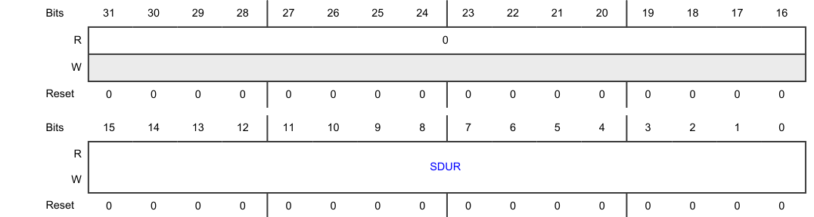

| 位 | 字段 | 功能 |
| --- | --- | --- |
| 31-16 | — | 本字段为保留，读取返回零。 |
| 15-0 | **SDUR** | 步长持续时间（**Step duration**）<br>步长的持续时间计数值 |

### 7.3. PCFS 分频器变化 23 寄存器（**PCFS_DIVC23**）

**PCFS_DIVC23** 偏移：**10Ch**

本寄存器为 clk_src_23 的渐进式时钟频率切换（**Progressive Clock Frequency switching**）定义频率变化速率以及频率上升时的初始变化值。

本寄存器仅在破坏性复位时复位。


| 位 | 字段 | 功能 |
| --- | --- | --- |
| 31-16 | **INIT** | 分频器变化初始值（**Divider change initial value**）<br>本字段为 clk_src_23 的时钟上升相位提供时钟分频器的初始变化值。 |
| 15-8 | — | 本字段为保留，读取返回零。 |
| 7-0 | **RATE** | 分频器变化速率（**Divider change rate**）<br>该值控制 clk_src_23 的时钟上升和下降相位的时钟分频器变化值。 |

### 7.4. PCFS 分频器结束 23 寄存器（**PCFS_DIVE23**）

**PCFS_DIVE23** 偏移：**110h**

本寄存器为 clk_src_23 的渐进式系统时钟切换定义频率下降时的最终分频值。

本寄存器仅在破坏性复位时复位。


| 位 | 字段 | 功能 |
| --- | --- | --- |
| 31-20 | — | 本字段为保留，读取返回零。 |
| 19-0 | **DIVE** | 分频器结束值（**Divider end value**）<br>本字段为 clk_src_23 的下降相位提供时钟分频器的结束值。 |

### 7.5. PCFS 分频器起始 23 寄存器（**PCFS_DIVS23**）

**PCFS_DIVS23** 偏移：**114h**

本寄存器为 clk_src_23 的渐进式系统时钟切换定义频率上升时的初始分频值。

本寄存器仅在破坏性复位时复位。


| 位 | 字段 | 功能 |
| --- | --- | --- |
| 31-20 | — | 本字段为保留，读取返回零。 |
| 19-0 | **DIVS** | 分频器起始值（**Divider start value**）<br>本字段为 clk_src_23 的上升相位提供时钟分频器的起始值 |

### 7.6. PCFS 分频器变化 33 寄存器（**PCFS_DIVC33**）

**PCFS_DIVC33** 偏移：**184h**

本寄存器为 clk_src_33 的渐进式时钟频率切换（**Progressive Clock Frequency switching**）定义频率变化速率以及频率上升时的初始变化值。

本寄存器仅在破坏性复位时复位。


| 位 | 字段 | 功能 |
| --- | --- | --- |
| 31-16 | **INIT** | 分频器变化初始值（**Divider change initial value**）<br>本字段为 clk_src_33 的时钟上升相位提供时钟分频器的初始变化值。 |
| 15-8 | — | 本字段为保留，读取返回零。 |
| 7-0 | **RATE** | 分频器变化速率（**Divider change rate**）<br>该值控制 clk_src_33 的时钟上升和下降相位的时钟分频器变化值。 |

### 7.7. PCFS 分频器结束 33 寄存器（**PCFS_DIVE33**）

**PCFS_DIVE33** 偏移：**188h**

本寄存器为 clk_src_33 的渐进式系统时钟切换定义频率下降时的最终分频值。

本寄存器仅在破坏性复位时复位。


| 位 | 字段 | 功能 |
| --- | --- | --- |
| 31-20 | — | 本字段为保留，读取返回零。 |
| 19-0 | **DIVE** | 分频器结束值（**Divider end value**）<br>本字段为 clk_src_33 的下降相位提供时钟分频器的结束值。 |

### 7.8. PCFS 分频器起始 33 寄存器（**PCFS_DIVS33**）

**PCFS_DIVS33** 偏移：**18Ch**

本寄存器为 clk_src_33 的渐进式系统时钟切换定义频率上升时的初始分频值。

本寄存器仅在破坏性复位时复位。


| 位 | 字段 | 功能 |
| --- | --- | --- |
| 31-20 | — | 本字段为保留，读取返回零。 |
| 19-0 | **DIVS** | 分频器起始值（**Divider start value**）<br>本字段为 clk_src_33 的上升相位提供时钟分频器的起始值 |

### 7.9. PCFS 分频器变化 46 寄存器（**PCFS_DIVC46**）

**PCFS_DIVC46** 偏移：**220h**

本寄存器为 clk_src_46 的渐进式时钟频率切换（**Progressive Clock Frequency switching**）定义频率变化速率以及频率上升时的初始变化值。

本寄存器仅在破坏性复位时复位。


| 位 | 字段 | 功能 |
| --- | --- | --- |
| 31-16 | **INIT** | 分频器变化初始值（**Divider change initial value**）<br>本字段为 clk_src_46 的时钟上升相位提供时钟分频器的初始变化值。 |
| 15-8 | — | 本字段为保留，读取返回零。 |
| 7-0 | **RATE** | 分频器变化速率（**Divider change rate**）<br>该值控制 clk_src_46 的时钟上升和下降相位的时钟分频器变化值。 |

### 7.10. PCFS 分频器结束 46 寄存器（**PCFS_DIVE46**）

**PCFS_DIVE46** 偏移：**224h**

本寄存器为 clk_src_46 的渐进式系统时钟切换定义频率下降时的最终分频值。

本寄存器仅在破坏性复位时复位。


| 位 | 字段 | 功能 |
| --- | --- | --- |
| 31-20 | — | 本字段为保留，读取返回零。 |
| 19-0 | **DIVE** | 分频器结束值（**Divider end value**）<br>本字段为 clk_src_46 的下降相位提供时钟分频器的结束值。 |

### 7.11. PCFS 分频器起始 46 寄存器（**PCFS_DIVS46**）

**PCFS_DIVS46** 偏移：**228h**

本寄存器为 clk_src_46 的渐进式系统时钟切换定义频率上升时的初始分频值。

本寄存器仅在破坏性复位时复位。


| 位 | 字段 | 功能 |
| --- | --- | --- |
| 31-20 | — | 本字段为保留，读取返回零。 |
| 19-0 | **DIVS** | 分频器起始值（**Divider start value**）<br>本字段为 clk_src_46 的上升相位提供时钟分频器的起始值 |

### 7.12. PCFS 分频器变化 47 寄存器（**PCFS_DIVC47**）

**PCFS_DIVC47** 偏移：**22Ch**

本寄存器为 clk_src_47 的渐进式时钟频率切换（**Progressive Clock Frequency switching**）定义频率变化速率以及频率上升时的初始变化值。

本寄存器仅在破坏性复位时复位。


| 位 | 字段 | 功能 |
| --- | --- | --- |
| 31-16 | **INIT** | 分频器变化初始值（**Divider change initial value**）<br>本字段为 clk_src_47 的时钟上升相位提供时钟分频器的初始变化值。 |
| 15-8 | — | 本字段为保留，读取返回零。 |
| 7-0 | **RATE** | 分频器变化速率（**Divider change rate**）<br>该值控制 clk_src_47 的时钟上升和下降相位的时钟分频器变化值。 |

### 7.13. PCFS 分频器结束 47 寄存器（**PCFS_DIVE47**）

**PCFS_DIVE47** 偏移：**230h**

本寄存器为 clk_src_47 的渐进式系统时钟切换定义频率下降时的最终分频值。

本寄存器仅在破坏性复位时复位。


| 位 | 字段 | 功能 |
| --- | --- | --- |
| 31-20 | — | 本字段为保留，读取返回零。 |
| 19-0 | **DIVE** | 分频器结束值（**Divider end value**）<br>本字段为 clk_src_47 的下降相位提供时钟分频器的结束值。 |

### 7.14. PCFS 分频器起始 47 寄存器（**PCFS_DIVS47**）

**PCFS_DIVS47** 偏移：**234h**

本寄存器为 clk_src_47 的渐进式系统时钟切换定义频率上升时的初始分频值。

本寄存器仅在破坏性复位时复位。

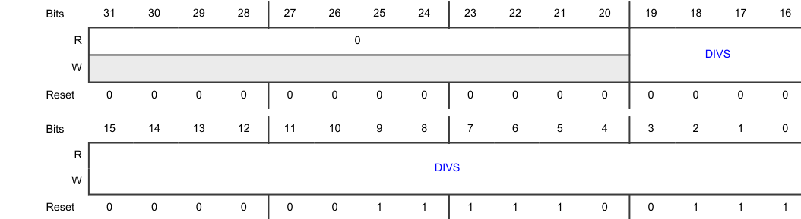

| 位 | 字段 | 功能 |
| --- | --- | --- |
| 31-20 | — | 本字段为保留，读取返回零。 |
| 19-0 | **DIVS** | 分频器起始值（**Divider start value**）<br>本字段为 clk_src_47 的上升相位提供时钟分频器的起始值 |

### 7.15. PCFS 分频器变化 48 寄存器（**PCFS_DIVC48**）

**PCFS_DIVC48** 偏移：**238h**

本寄存器为 clk_src_48 的渐进式时钟频率切换（**Progressive Clock Frequency switching**）定义频率变化速率以及频率上升时的初始变化值。

本寄存器仅在破坏性复位时复位。


| 位 | 字段 | 功能 |
| --- | --- | --- |
| 31-16 | **INIT** | 分频器变化初始值（**Divider change initial value**）<br>本字段为 clk_src_48 的时钟上升相位提供时钟分频器的初始变化值。 |
| 15-8 | — | 本字段为保留，读取返回零。 |
| 7-0 | **RATE** | 分频器变化速率（**Divider change rate**）<br>该值控制 clk_src_48 的时钟上升和下降相位的时钟分频器变化值。 |

### 7.16. PCFS 分频器结束 48 寄存器（**PCFS_DIVE48**）

**PCFS_DIVE48** 偏移：**23Ch**

本寄存器为 clk_src_48 的渐进式系统时钟切换定义频率下降时的最终分频值。

本寄存器仅在破坏性复位时复位。


| 位 | 字段 | 功能 |
| --- | --- | --- |
| 31-20 | — | 本字段为保留，读取返回零。 |
| 19-0 | **DIVE** | 分频器结束值（**Divider end value**）<br>本字段为 clk_src_48 的下降相位提供时钟分频器的结束值。 |

### 7.17. PCFS 分频器起始 48 寄存器（**PCFS_DIVS48**）

**PCFS_DIVS48** 偏移：**240h**

本寄存器为 clk_src_48 的渐进式系统时钟切换定义频率上升时的初始分频值。

本寄存器仅在破坏性复位时复位。


| 位 | 字段 | 功能 |
| --- | --- | --- |
| 31-20 | — | 本字段为保留，读取返回零。 |
| 19-0 | **DIVS** | 分频器起始值（**Divider start value**）<br>本字段为 clk_src_48 的上升相位提供时钟分频器的起始值 |

### 7.18. PCFS 分频器变化 49 寄存器（**PCFS_DIVC49**）

**PCFS_DIVC49** 偏移：**244h**

本寄存器为 clk_src_49 的渐进式时钟频率切换（**Progressive Clock Frequency switching**）定义频率变化速率以及频率上升时的初始变化值。

本寄存器仅在破坏性复位时复位。


| 位 | 字段 | 功能 |
| --- | --- | --- |
| 31-16 | **INIT** | 分频器变化初始值（**Divider change initial value**）<br>本字段为 clk_src_49 的时钟上升相位提供时钟分频器的初始变化值。 |
| 15-8 | — | 本字段为保留，读取返回零。 |
| 7-0 | **RATE** | 分频器变化速率（**Divider change rate**）<br>该值控制 clk_src_49 的时钟上升和下降相位的时钟分频器变化值。 |

### 7.19. PCFS 分频器结束 49 寄存器（**PCFS_DIVE49**）

**PCFS_DIVE49** 偏移：**248h**

本寄存器为 clk_src_49 的渐进式系统时钟切换定义频率下降时的最终分频值。

本寄存器仅在破坏性复位时复位。

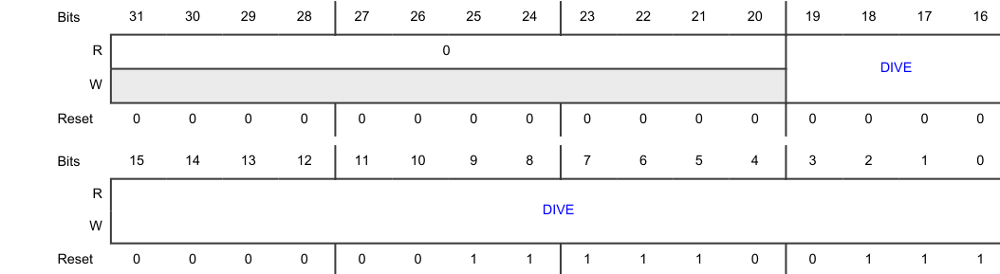

| 位 | 字段 | 功能 |
| --- | --- | --- |
| 31-20 | — | 本字段为保留，读取返回零。 |
| 19-0 | **DIVE** | 分频器结束值（**Divider end value**）<br>本字段为 clk_src_49 的下降相位提供时钟分频器的结束值。 |

### 7.20. PCFS 分频器起始 49 寄存器（**PCFS_DIVS49**）

**PCFS_DIVS49** 偏移：**24Ch**

本寄存器为 clk_src_49 的渐进式系统时钟切换定义频率上升时的初始分频值。

本寄存器仅在破坏性复位时复位。


| 位 | 字段 | 功能 |
| --- | --- | --- |
| 31-20 | — | 本字段为保留，读取返回零。 |
| 19-0 | **DIVS** | 分频器起始值（**Divider start value**）<br>本字段为 clk_src_49 的上升相位提供时钟分频器的起始值 |

### 7.21. PCFS 分频器变化 50 寄存器（**PCFS_DIVC50**）

**PCFS_DIVC50** 偏移：**250h**

本寄存器为 clk_src_50 的渐进式时钟频率切换（**Progressive Clock Frequency switching**）定义频率变化速率以及频率上升时的初始变化值。

本寄存器仅在破坏性复位时复位。


| 位 | 字段 | 功能 |
| --- | --- | --- |
| 31-16 | **INIT** | 分频器变化初始值（**Divider change initial value**）<br>本字段为 clk_src_50 的时钟上升相位提供时钟分频器的初始变化值。 |
| 15-8 | — | 本字段为保留，读取返回零。 |
| 7-0 | **RATE** | 分频器变化速率（**Divider change rate**）<br>该值控制 clk_src_50 的时钟上升和下降相位的时钟分频器变化值。 |

### 7.22. PCFS 分频器结束 50 寄存器（**PCFS_DIVE50**）

**PCFS_DIVE50** 偏移：**254h**

本寄存器为 clk_src_50 的渐进式系统时钟切换定义频率下降时的最终分频值。

本寄存器仅在破坏性复位时复位。


| 位 | 字段 | 功能 |
| --- | --- | --- |
| 31-20 | — | 本字段为保留，读取返回零。 |
| 19-0 | **DIVE** | 分频器结束值（**Divider end value**）<br>本字段为 clk_src_50 的下降相位提供时钟分频器的结束值。 |

### 7.23. PCFS 分频器起始 50 寄存器（**PCFS_DIVS50**）

**PCFS_DIVS50** 偏移：**258h**

本寄存器为 clk_src_50 的渐进式系统时钟切换定义频率上升时的初始分频值。

本寄存器仅在破坏性复位时复位。


| 位 | 字段 | 功能 |
| --- | --- | --- |
| 31-20 | — | 本字段为保留，读取返回零。 |
| 19-0 | **DIVS** | 分频器起始值（**Divider start value**）<br>本字段为 clk_src_50 的上升相位提供时钟分频器的起始值 |

### 7.24. PCFS 分频器变化 51 寄存器（**PCFS_DIVC51**）

**PCFS_DIVC51** 偏移：**25Ch**

本寄存器为 clk_src_51 的渐进式时钟频率切换（**Progressive Clock Frequency switching**）定义频率变化速率以及频率上升时的初始变化值。

本寄存器仅在破坏性复位时复位。


| 位 | 字段 | 功能 |
| --- | --- | --- |
| 31-16 | **INIT** | 分频器变化初始值（**Divider change initial value**）<br>本字段为 clk_src_51 的时钟上升相位提供时钟分频器的初始变化值。 |
| 15-8 | — | 本字段为保留，读取返回零。 |
| 7-0 | **RATE** | 分频器变化速率（**Divider change rate**）<br>该值控制 clk_src_51 的时钟上升和下降相位的时钟分频器变化值。 |

### 7.25. PCFS 分频器结束 51 寄存器（**PCFS_DIVE51**）

**PCFS_DIVE51** 偏移：**260h**

本寄存器为 clk_src_51 的渐进式系统时钟切换定义频率下降时的最终分频值。

本寄存器仅在破坏性复位时复位。


| 位 | 字段 | 功能 |
| --- | --- | --- |
| 31-20 | — | 本字段为保留，读取返回零。 |
| 19-0 | **DIVE** | 分频器结束值（**Divider end value**）<br>本字段为 clk_src_51 的下降相位提供时钟分频器的结束值。 |

### 7.26. PCFS 分频器起始 51 寄存器（**PCFS_DIVS51**）

**PCFS_DIVS51** 偏移：**264h**

本寄存器为 clk_src_51 的渐进式系统时钟切换定义频率上升时的初始分频值。

本寄存器仅在破坏性复位时复位。


| 位 | 字段 | 功能 |
| --- | --- | --- |
| 31-20 | — | 本字段为保留，读取返回零。 |
| 19-0 | **DIVS** | 分频器起始值（**Divider start value**）<br>本字段为 clk_src_51 的上升相位提供时钟分频器的起始值 |

### 7.27. PCFS 分频器变化 52 寄存器（**PCFS_DIVC52**）

**PCFS_DIVC52** 偏移：**268h**

本寄存器为 clk_src_52 的渐进式时钟频率切换（**Progressive Clock Frequency switching**）定义频率变化速率以及频率上升时的初始变化值。

本寄存器仅在破坏性复位时复位。


| 位 | 字段 | 功能 |
| --- | --- | --- |
| 31-16 | **INIT** | 分频器变化初始值（**Divider change initial value**）<br>本字段为 clk_src_52 的时钟上升相位提供时钟分频器的初始变化值。 |
| 15-8 | — | 本字段为保留，读取返回零。 |
| 7-0 | **RATE** | 分频器变化速率（**Divider change rate**）<br>该值控制 clk_src_52 的时钟上升和下降相位的时钟分频器变化值。 |

### 7.28. PCFS 分频器结束 52 寄存器（**PCFS_DIVE52**）

**PCFS_DIVE52** 偏移：**26Ch**

本寄存器为 clk_src_52 的渐进式系统时钟切换定义频率下降时的最终分频值。

本寄存器仅在破坏性复位时复位。


| 位 | 字段 | 功能 |
| --- | --- | --- |
| 31-20 | — | 本字段为保留，读取返回零。 |
| 19-0 | **DIVE** | 分频器结束值（**Divider end value**）<br>本字段为 clk_src_52 的下降相位提供时钟分频器的结束值。 |

### 7.29. PCFS 分频器起始 52 寄存器（**PCFS_DIVS52**）

**PCFS_DIVS52** 偏移：**270h**

本寄存器为 clk_src_52 的渐进式系统时钟切换定义频率上升时的初始分频值。

本寄存器仅在破坏性复位时复位。


| 位 | 字段 | 功能 |
| --- | --- | --- |
| 31-20 | — | 本字段为保留，读取返回零。 |
| 19-0 | **DIVS** | 分频器起始值（**Divider start value**）<br>本字段为 clk_src_52 的上升相位提供时钟分频器的起始值 |

### 7.30. PCFS 分频器变化 53 寄存器（**PCFS_DIVC53**）

**PCFS_DIVC53** 偏移：**274h**

本寄存器为 clk_src_53 的渐进式时钟频率切换（**Progressive Clock Frequency switching**）定义频率变化速率以及频率上升时的初始变化值。

本寄存器仅在破坏性复位时复位。


| 位 | 字段 | 功能 |
| --- | --- | --- |
| 31-16 | **INIT** | 分频器变化初始值（**Divider change initial value**）<br>本字段为 clk_src_53 的时钟上升相位提供时钟分频器的初始变化值。 |
| 15-8 | — | 本字段为保留，读取返回零。 |
| 7-0 | **RATE** | 分频器变化速率（**Divider change rate**）<br>该值控制 clk_src_53 的时钟上升和下降相位的时钟分频器变化值。 |

### 7.31. PCFS 分频器结束 53 寄存器（**PCFS_DIVE53**）

**PCFS_DIVE53** 偏移：**278h**

本寄存器为 clk_src_53 的渐进式系统时钟切换定义频率下降时的最终分频值。

本寄存器仅在破坏性复位时复位。


| 位 | 字段 | 功能 |
| --- | --- | --- |
| 31-20 | — | 本字段为保留，读取返回零。 |
| 19-0 | **DIVE** | 分频器结束值（**Divider end value**）<br>本字段为 clk_src_53 的下降相位提供时钟分频器的结束值。 |

### 7.32. PCFS 分频器起始 53 寄存器（**PCFS_DIVS53**）

**PCFS_DIVS53** 偏移：**27Ch**

本寄存器为 clk_src_53 的渐进式系统时钟切换定义频率上升时的初始分频值。

本寄存器仅在破坏性复位时复位。


| 位 | 字段 | 功能 |
| --- | --- | --- |
| 31-20 | — | 本字段为保留，读取返回零。 |
| 19-0 | **DIVS** | 分频器起始值（**Divider start value**）<br>本字段为 clk_src_53 的上升相位提供时钟分频器的起始值 |

### 7.33. PCFS 分频器变化 54 寄存器（**PCFS_DIVC54**）

**PCFS_DIVC54** 偏移：**280h**

本寄存器为 clk_src_54 的渐进式时钟频率切换（**Progressive Clock Frequency switching**）定义频率变化速率以及频率上升时的初始变化值。

本寄存器仅在破坏性复位时复位。


| 位 | 字段 | 功能 |
| --- | --- | --- |
| 31-16 | **INIT** | 分频器变化初始值（**Divider change initial value**）<br>本字段为 clk_src_54 的时钟上升相位提供时钟分频器的初始变化值。 |
| 15-8 | — | 本字段为保留，读取返回零。 |
| 7-0 | **RATE** | 分频器变化速率（**Divider change rate**）<br>该值控制 clk_src_54 的时钟上升和下降相位的时钟分频器变化值。 |

### 7.34. PCFS 分频器结束 54 寄存器（**PCFS_DIVE54**）

**PCFS_DIVE54** 偏移：**284h**

本寄存器为 clk_src_54 的渐进式系统时钟切换定义频率下降时的最终分频值。

本寄存器仅在破坏性复位时复位。


| 位 | 字段 | 功能 |
| --- | --- | --- |
| 31-20 | — | 本字段为保留，读取返回零。 |
| 19-0 | **DIVE** | 分频器结束值（**Divider end value**）<br>本字段为 clk_src_54 的下降相位提供时钟分频器的结束值。 |

### 7.35. PCFS 分频器起始 54 寄存器（**PCFS_DIVS54**）

**PCFS_DIVS54** 偏移：**288h**

本寄存器为 clk_src_54 的渐进式系统时钟切换定义频率上升时的初始分频值。

本寄存器仅在破坏性复位时复位。


| 位 | 字段 | 功能 |
| --- | --- | --- |
| 31-20 | — | 本字段为保留，读取返回零。 |
| 19-0 | **DIVS** | 分频器起始值（**Divider start value**）<br>本字段为 clk_src_54 的上升相位提供时钟分频器的起始值 |

### 7.36. PCFS 分频器变化 55 寄存器（**PCFS_DIVC55**）

**PCFS_DIVC55** 偏移：**28Ch**

本寄存器为 clk_src_55 的渐进式时钟频率切换（**Progressive Clock Frequency switching**）定义频率变化速率以及频率上升时的初始变化值。

本寄存器仅在破坏性复位时复位。


| 位 | 字段 | 功能 |
| --- | --- | --- |
| 31-16 | **INIT** | 分频器变化初始值（**Divider change initial value**）<br>本字段为 clk_src_55 的时钟上升相位提供时钟分频器的初始变化值。 |
| 15-8 | — | 本字段为保留，读取返回零。 |
| 7-0 | **RATE** | 分频器变化速率（**Divider change rate**）<br>该值控制 clk_src_55 的时钟上升和下降相位的时钟分频器变化值。 |

### 7.37. PCFS 分频器结束 55 寄存器（**PCFS_DIVE55**）

**PCFS_DIVE55** 偏移：**290h**

本寄存器为 clk_src_55 的渐进式系统时钟切换定义频率下降时的最终分频值。

本寄存器仅在破坏性复位时复位。


| 位 | 字段 | 功能 |
| --- | --- | --- |
| 31-20 | — | 本字段为保留，读取返回零。 |
| 19-0 | **DIVE** | 分频器结束值（**Divider end value**）<br>本字段为 clk_src_55 的下降相位提供时钟分频器的结束值。 |

### 7.38. PCFS 分频器起始 55 寄存器（**PCFS_DIVS55**）

**PCFS_DIVS55** 偏移：**294h**

本寄存器为 clk_src_55 的渐进式系统时钟切换定义频率上升时的初始分频值。

本寄存器仅在破坏性复位时复位。


| 位 | 字段 | 功能 |
| --- | --- | --- |
| 31-20 | — | 本字段为保留，读取返回零。 |
| 19-0 | **DIVS** | 分频器起始值（**Divider start value**）<br>本字段为 clk_src_55 的上升相位提供时钟分频器的起始值 |

### 7.39. PCFS 分频器变化 56 寄存器（**PCFS_DIVC56**）

**PCFS_DIVC56** 偏移：**298h**

本寄存器为 clk_src_56 的渐进式时钟频率切换（**Progressive Clock Frequency switching**）定义频率变化速率以及频率上升时的初始变化值。

本寄存器仅在破坏性复位时复位。


| 位 | 字段 | 功能 |
| --- | --- | --- |
| 31-16 | **INIT** | 分频器变化初始值（**Divider change initial value**）<br>本字段为 clk_src_56 的时钟上升相位提供时钟分频器的初始变化值。 |
| 15-8 | — | 本字段为保留，读取返回零。 |
| 7-0 | **RATE** | 分频器变化速率（**Divider change rate**）<br>该值控制 clk_src_56 的时钟上升和下降相位的时钟分频器变化值。 |

### 7.40. PCFS 分频器结束 56 寄存器（**PCFS_DIVE56**）

**PCFS_DIVE56** 偏移：**29Ch**

本寄存器为 clk_src_56 的渐进式系统时钟切换定义频率下降时的最终分频值。

本寄存器仅在破坏性复位时复位。


| 位 | 字段 | 功能 |
| --- | --- | --- |
| 31-20 | — | 本字段为保留，读取返回零。 |
| 19-0 | **DIVE** | 分频器结束值（**Divider end value**）<br>本字段为 clk_src_56 的下降相位提供时钟分频器的结束值。 |

### 7.41. PCFS 分频器起始 56 寄存器（**PCFS_DIVS56**）

**PCFS_DIVS56** 偏移：**2A0h**

本寄存器为 clk_src_56 的渐进式系统时钟切换定义频率上升时的初始分频值。

本寄存器仅在破坏性复位时复位。


| 位 | 字段 | 功能 |
| --- | --- | --- |
| 31-20 | — | 本字段为保留，读取返回零。 |
| 19-0 | **DIVS** | 分频器起始值（**Divider start value**）<br>本字段为 clk_src_56 的上升相位提供时钟分频器的起始值 |

### 7.42. PCFS 分频器变化 57 寄存器（**PCFS_DIVC57**）

**PCFS_DIVC57** 偏移：**2A4h**

本寄存器为 clk_src_57 的渐进式时钟频率切换（**Progressive Clock Frequency switching**）定义频率变化速率以及频率上升时的初始变化值。

本寄存器仅在破坏性复位时复位。

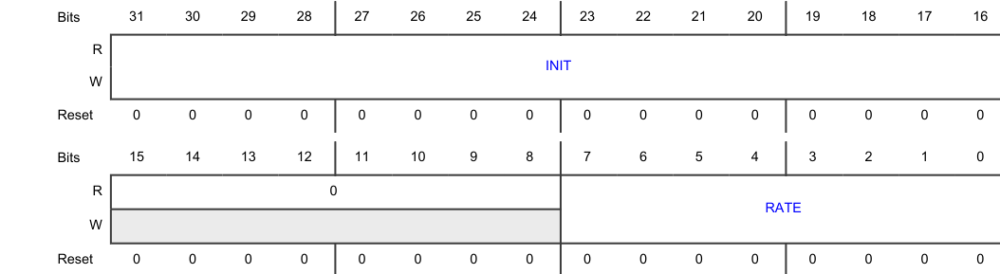

| 位 | 字段 | 功能 |
| --- | --- | --- |
| 31-16 | **INIT** | 分频器变化初始值（**Divider change initial value**）<br>本字段为 clk_src_57 的时钟上升相位提供时钟分频器的初始变化值。 |
| 15-8 | — | 本字段为保留，读取返回零。 |
| 7-0 | **RATE** | 分频器变化速率（**Divider change rate**）<br>该值控制 clk_src_57 的时钟上升和下降相位的时钟分频器变化值。 |

### 7.43. PCFS 分频器结束 57 寄存器（**PCFS_DIVE57**）

**PCFS_DIVE57** 偏移：**2A8h**

本寄存器为 clk_src_57 的渐进式系统时钟切换定义频率下降时的最终分频值。

本寄存器仅在破坏性复位时复位。


| 位 | 字段 | 功能 |
| --- | --- | --- |
| 31-20 | — | 本字段为保留，读取返回零。 |
| 19-0 | **DIVE** | 分频器结束值（**Divider end value**）<br>本字段为 clk_src_57 的下降相位提供时钟分频器的结束值。 |

### 7.44. PCFS 分频器起始 57 寄存器（**PCFS_DIVS57**）

**PCFS_DIVS57** 偏移：**2ACh**

本寄存器为 clk_src_57 的渐进式系统时钟切换定义频率上升时的初始分频值。

本寄存器仅在破坏性复位时复位。


| 位 | 字段 | 功能 |
| --- | --- | --- |
| 31-20 | — | 本字段为保留，读取返回零。 |
| 19-0 | **DIVS** | 分频器起始值（**Divider start value**）<br>本字段为 clk_src_57 的上升相位提供时钟分频器的起始值 |

### 7.45. PCFS 分频器变化 58 寄存器（**PCFS_DIVC58**）

**PCFS_DIVC58** 偏移：**2B0h**

本寄存器为 clk_src_58 的渐进式时钟频率切换（**Progressive Clock Frequency switching**）定义频率变化速率以及频率上升时的初始变化值。

本寄存器仅在破坏性复位时复位。


| 位 | 字段 | 功能 |
| --- | --- | --- |
| 31-16 | **INIT** | 分频器变化初始值（**Divider change initial value**）<br>本字段为 clk_src_58 的时钟上升相位提供时钟分频器的初始变化值。 |
| 15-8 | — | 本字段为保留，读取返回零。 |
| 7-0 | **RATE** | 分频器变化速率（**Divider change rate**）<br>该值控制 clk_src_58 的时钟上升和下降相位的时钟分频器变化值。 |

### 7.46. PCFS 分频器结束 58 寄存器（**PCFS_DIVE58**）

**PCFS_DIVE58** 偏移：**2B4h**

本寄存器为 clk_src_58 的渐进式系统时钟切换定义频率下降时的最终分频值。

本寄存器仅在破坏性复位时复位。

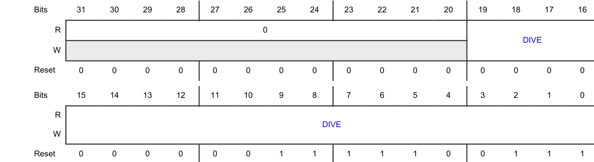

| 位 | 字段 | 功能 |
| --- | --- | --- |
| 31-20 | — | 本字段为保留，读取返回零。 |
| 19-0 | **DIVE** | 分频器结束值（**Divider end value**）<br>本字段为 clk_src_58 的下降相位提供时钟分频器的结束值。 |

### 7.47. PCFS 分频器起始 58 寄存器（**PCFS_DIVS58**）

**PCFS_DIVS58** 偏移：**2B8h**

本寄存器为 clk_src_58 的渐进式系统时钟切换定义频率上升时的初始分频值。

本寄存器仅在破坏性复位时复位。


| 位 | 字段 | 功能 |
| --- | --- | --- |
| 31-20 | — | 本字段为保留，读取返回零。 |
| 19-0 | **DIVS** | 分频器起始值（**Divider start value**）<br>本字段为 clk_src_58 的上升相位提供时钟分频器的起始值 |

### 7.48. PCFS 分频器变化 59 寄存器（**PCFS_DIVC59**）

**PCFS_DIVC59** 偏移：**2BCh**

本寄存器为 clk_src_59 的渐进式时钟频率切换（**Progressive Clock Frequency switching**）定义频率变化速率以及频率上升时的初始变化值。

本寄存器仅在破坏性复位时复位。


| 位 | 字段 | 功能 |
| --- | --- | --- |
| 31-16 | **INIT** | 分频器变化初始值（**Divider change initial value**）<br>本字段为 clk_src_59 的时钟上升相位提供时钟分频器的初始变化值。 |
| 15-8 | — | 本字段为保留，读取返回零。 |
| 7-0 | **RATE** | 分频器变化速率（**Divider change rate**）<br>该值控制 clk_src_59 的时钟上升和下降相位的时钟分频器变化值。 |

### 7.49. PCFS 分频器结束 59 寄存器（**PCFS_DIVE59**）

**PCFS_DIVE59** 偏移：**2C0h**

本寄存器为 clk_src_59 的渐进式系统时钟切换定义频率下降时的最终分频值。

本寄存器仅在破坏性复位时复位。


| 位 | 字段 | 功能 |
| --- | --- | --- |
| 31-20 | — | 本字段为保留，读取返回零。 |
| 19-0 | **DIVE** | 分频器结束值（**Divider end value**）<br>本字段为 clk_src_59 的下降相位提供时钟分频器的结束值。 |

### 7.50. PCFS 分频器起始 59 寄存器（**PCFS_DIVS59**）

**PCFS_DIVS59** 偏移：**2C4h**

本寄存器为 clk_src_59 的渐进式系统时钟切换定义频率上升时的初始分频值。

本寄存器仅在破坏性复位时复位。


| 位 | 字段 | 功能 |
| --- | --- | --- |
| 31-20 | — | 本字段为保留，读取返回零。 |
| 19-0 | **DIVS** | 分频器起始值（**Divider start value**）<br>本字段为 clk_src_59 的上升相位提供时钟分频器的起始值 |

### 7.51. PCFS 分频器变化 60 寄存器（**PCFS_DIVC60**）

**PCFS_DIVC60** 偏移：**2C8h**

本寄存器为 clk_src_60 的渐进式时钟频率切换（**Progressive Clock Frequency switching**）定义频率变化速率以及频率上升时的初始变化值。

本寄存器仅在破坏性复位时复位。


| 位 | 字段 | 功能 |
| --- | --- | --- |
| 31-16 | **INIT** | 分频器变化初始值（**Divider change initial value**）<br>本字段为 clk_src_60 的时钟上升相位提供时钟分频器的初始变化值。 |
| 15-8 | — | 本字段为保留，读取返回零。 |
| 7-0 | **RATE** | 分频器变化速率（**Divider change rate**）<br>该值控制 clk_src_60 的时钟上升和下降相位的时钟分频器变化值。 |

### 7.52. PCFS 分频器结束 60 寄存器（**PCFS_DIVE60**）

**PCFS_DIVE60** 偏移：**2CCh**

本寄存器为 clk_src_60 的渐进式系统时钟切换定义频率下降时的最终分频值。

本寄存器仅在破坏性复位时复位。


| 位 | 字段 | 功能 |
| --- | --- | --- |
| 31-20 | — | 本字段为保留，读取返回零。 |
| 19-0 | **DIVE** | 分频器结束值（**Divider end value**）<br>本字段为 clk_src_60 的下降相位提供时钟分频器的结束值。 |

### 7.53. PCFS 分频器起始 60 寄存器（**PCFS_DIVS60**）

**PCFS_DIVS60** 偏移：**2D0h**

本寄存器为 clk_src_60 的渐进式系统时钟切换定义频率上升时的初始分频值。

本寄存器仅在破坏性复位时复位。


| 位 | 字段 | 功能 |
| --- | --- | --- |
| 31-20 | — | 本字段为保留，读取返回零。 |
| 19-0 | **DIVS** | 分频器起始值（**Divider start value**）<br>本字段为 clk_src_60 的上升相位提供时钟分频器的起始值 |

### 7.54. PCFS 分频器变化 61 寄存器（**PCFS_DIVC61**）

**PCFS_DIVC61** 偏移：**2D4h**

本寄存器为 clk_src_61 的渐进式时钟频率切换（**Progressive Clock Frequency switching**）定义频率变化速率以及频率上升时的初始变化值。

本寄存器仅在破坏性复位时复位。


| 位 | 字段 | 功能 |
| --- | --- | --- |
| 31-16 | **INIT** | 分频器变化初始值（**Divider change initial value**）<br>本字段为 clk_src_61 的时钟上升相位提供时钟分频器的初始变化值。 |
| 15-8 | — | 本字段为保留，读取返回零。 |
| 7-0 | **RATE** | 分频器变化速率（**Divider change rate**）<br>该值控制 clk_src_61 的时钟上升和下降相位的时钟分频器变化值。 |

### 7.55. PCFS 分频器结束 61 寄存器（**PCFS_DIVE61**）

**PCFS_DIVE61** 偏移：**2D8h**

本寄存器为 clk_src_61 的渐进式系统时钟切换定义频率下降时的最终分频值。

本寄存器仅在破坏性复位时复位。


| 位 | 字段 | 功能 |
| --- | --- | --- |
| 31-20 | — | 本字段为保留，读取返回零。 |
| 19-0 | **DIVE** | 分频器结束值（**Divider end value**）<br>本字段为 clk_src_61 的下降相位提供时钟分频器的结束值。 |

### 7.56. PCFS 分频器起始 61 寄存器（**PCFS_DIVS61**）

**PCFS_DIVS61** 偏移：**2DCh**

本寄存器为 clk_src_61 的渐进式系统时钟切换定义频率上升时的初始分频值。

本寄存器仅在破坏性复位时复位。


| 位 | 字段 | 功能 |
| --- | --- | --- |
| 31-20 | — | 本字段为保留，读取返回零。 |
| 19-0 | **DIVS** | 分频器起始值（**Divider start value**）<br>本字段为 clk_src_61 的上升相位提供时钟分频器的起始值 |

### 7.57. PCFS 分频器变化 62 寄存器（**PCFS_DIVC62**）

**PCFS_DIVC62** 偏移：**2E0h**

本寄存器为 clk_src_62 的渐进式时钟频率切换（**Progressive Clock Frequency switching**）定义频率变化速率以及频率上升时的初始变化值。

本寄存器仅在破坏性复位时复位。


| 位 | 字段 | 功能 |
| --- | --- | --- |
| 31-16 | **INIT** | 分频器变化初始值（**Divider change initial value**）<br>本字段为 clk_src_62 的时钟上升相位提供时钟分频器的初始变化值。 |
| 15-8 | — | 本字段为保留，读取返回零。 |
| 7-0 | **RATE** | 分频器变化速率（**Divider change rate**）<br>该值控制 clk_src_62 的时钟上升和下降相位的时钟分频器变化值。 |

### 7.58. PCFS 分频器结束 62 寄存器（**PCFS_DIVE62**）

**PCFS_DIVE62** 偏移：**2E4h**

本寄存器为 clk_src_62 的渐进式系统时钟切换定义频率下降时的最终分频值。

本寄存器仅在破坏性复位时复位。


| 位 | 字段 | 功能 |
| --- | --- | --- |
| 31-20 | — | 本字段为保留，读取返回零。 |
| 19-0 | **DIVE** | 分频器结束值（**Divider end value**）<br>本字段为 clk_src_62 的下降相位提供时钟分频器的结束值。 |

### 7.59. PCFS 分频器起始 62 寄存器（**PCFS_DIVS62**）

**PCFS_DIVS62** 偏移：**2E8h**

本寄存器为 clk_src_62 的渐进式系统时钟切换定义频率上升时的初始分频值。

本寄存器仅在破坏性复位时复位。


| 位 | 字段 | 功能 |
| --- | --- | --- |
| 31-20 | — | 本字段为保留，读取返回零。 |
| 19-0 | **DIVS** | 分频器起始值（**Divider start value**）<br>本字段为 clk_src_62 的上升相位提供时钟分频器的起始值 |

### 7.60. PCFS 分频器变化 63 寄存器（**PCFS_DIVC63**）

**PCFS_DIVC63** 偏移：**2ECh**

本寄存器为 clk_src_63 的渐进式时钟频率切换（**Progressive Clock Frequency switching**）定义频率变化速率以及频率上升时的初始变化值。

本寄存器仅在破坏性复位时复位。


| 位 | 字段 | 功能 |
| --- | --- | --- |
| 31-16 | **INIT** | 分频器变化初始值（**Divider change initial value**）<br>本字段为 clk_src_63 的时钟上升相位提供时钟分频器的初始变化值。 |
| 15-8 | — | 本字段为保留，读取返回零。 |
| 7-0 | **RATE** | 分频器变化速率（**Divider change rate**）<br>该值控制 clk_src_63 的时钟上升和下降相位的时钟分频器变化值。 |

### 7.61. PCFS 分频器结束 63 寄存器（**PCFS_DIVE63**）

**PCFS_DIVE63** 偏移：**2F0h**

本寄存器为 clk_src_63 的渐进式系统时钟切换定义频率下降时的最终分频值。

本寄存器仅在破坏性复位时复位。


| 位 | 字段 | 功能 |
| --- | --- | --- |
| 31-20 | — | 本字段为保留，读取返回零。 |
| 19-0 | **DIVE** | 分频器结束值（**Divider end value**）<br>本字段为 clk_src_63 的下降相位提供时钟分频器的结束值。 |

### 7.62. PCFS 分频器起始 63 寄存器（**PCFS_DIVS63**）

**PCFS_DIVS63** 偏移：**2F4h**

本寄存器为 clk_src_63 的渐进式系统时钟切换定义频率上升时的初始分频值。

本寄存器仅在破坏性复位时复位。


| 位 | 字段 | 功能 |
| --- | --- | --- |
| 31-20 | — | 本字段为保留，读取返回零。 |
| 19-0 | **DIVS** | 分频器起始值（**Divider start value**）<br>本字段为 clk_src_63 的上升相位提供时钟分频器的起始值 |

### 7.63. 时钟多路复用器 0 选择控制寄存器（**MUX_0_CSC**）

**MUX_0_CSC** 偏移：**300h**

本寄存器提供时钟多路复用器 0 的时钟源选择控制。时钟多路复用器 0 实现硬件控制的时钟切换，确保时钟切换以平滑的方式发生（无毛刺）。详情参见"硬件控制的时钟多路复用器"一节。

本寄存器仅在破坏性复位时复位。

对本寄存器所有 PCFS 相关字段的更新必须是原子写（**atomic write**），即单次写入必须同时更新 CLK_SW、RAMPDOWN 和 RAMPUP 字段。即使只想触发 RAMPUP 或 RAMPDOWN 过程之一，也必须同时置位 RAMPUP 和 RAMPDOWN 两位，否则将不会执行所需的 PCFS 序列。

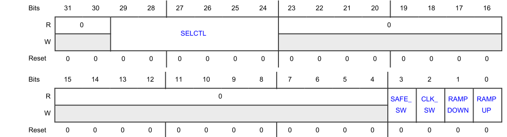

| 位 | 字段 | 功能 |
| --- | --- | --- |
| 31-30 | — | 本字段为保留，读取返回零。 |
| 29-24 | **SELCTL** | 时钟源选择控制（**Clock source selection control**）<br>为时钟多路复用器 0 选择源时钟。保留值未显示。<br>`00_0000b` - clk_src_0<br>`10_0001b` - clk_src_33 |
| 23-4 | — | 本字段为保留，读取返回零。 |
| 3 | **SAFE_SW** | 安全时钟请求（**Safe clock request**）<br>向该位写入 1 会向 clk_src_0 发出安全时钟切换请求。发出安全时钟切换操作请求后，该位自动清零，状态寄存器中对应的位被置位。 |
| 2 | **CLK_SW** | 时钟切换（**Clock switch**）<br>向该位写入 1 会向时钟多路复用器 0 发出时钟切换请求。发出时钟切换操作请求后，该位自动清零，状态寄存器中对应的位被置位。 |
| 1 | **RAMPDOWN** | PCFS 下降（**PCFS ramp-down**）<br>向该位写入 1 会向时钟多路复用器 0 发出 PCFS 下降请求。发出 PCFS 下降操作请求后，该位自动清零，状态寄存器中对应的位被置位。 |
| 0 | **RAMPUP** | PCFS 上升（**PCFS ramp-up**）<br>向该位写入 1 会向时钟多路复用器 0 发出 PCFS 上升请求。发出 PCFS 上升操作请求后，该位自动清零，状态寄存器中对应的位被置位。 |

### 7.64. 时钟多路复用器 0 选择状态寄存器（**MUX_0_CSS**）

**MUX_0_CSS** 偏移：**304h**

本寄存器提供时钟多路复用器 0 的当前时钟源选择状态。

本寄存器仅在破坏性复位时复位。

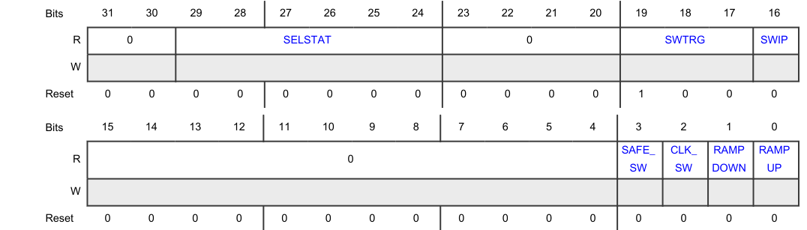

| 位 | 字段 | 功能 |
| --- | --- | --- |
| 31-30 | — | 本字段为保留，读取返回零。 |
| 29-24 | **SELSTAT** | 时钟源选择状态（**Clock source selection status**）<br>该值指示时钟多路复用器 0 当前选择的源。保留值未显示。<br>`00_0000b` - clk_src_0<br>`10_0001b` - clk_src_33 |
| 23-20 | — | 本字段为保留，读取返回零。 |
| 19-17 | **SWTRG** | 切换触发原因（**Switch trigger cause**）<br>该值指示最近一次时钟源切换的原因。<br>**注意：** 如果时钟失效，随后对 MC_CGM 硬件时钟多路复用器发出多次安全时钟切换请求，则 SWTRG 字段的值可能为 4 或 5。<br>`000b` - 保留<br>`001b` - 请求后切换成功。<br>`010b` - 因目标时钟无效而切换请求失败，且当前时钟为 clk_src_0。<br>`011b` - 因当前时钟无效而切换请求失败，且当前时钟为 clk_src_0。<br>`100b` - 因安全时钟请求或复位而切换到 clk_src_0 成功。<br>`101b` - 因安全时钟请求或复位而切换到 clk_src_0 成功，但先前的当前时钟源无效。<br>`110b` - 保留<br>`111b` - 保留 |
| 16 | **SWIP** | 切换进行中（**Switch in progress**）<br>**注意：** 新的时钟切换请求只能在上一请求完成三个时钟周期之后发出。<br>`0b` - 时钟源切换已完成。<br>`1b` - 时钟源切换正在进行中。 |
| 15-4 | — | 本字段为保留，读取返回零。 |
| 3 | **SAFE_SW** | 安全时钟请求（**Safe clock request**）<br>本字段指示在时钟多路复用器 0 上先前的/正在进行的请求期间是否请求了切换到安全时钟操作。<br>`0b` - 未请求安全时钟切换操作。<br>`1b` - 已请求安全时钟切换操作。 |
| 2 | **CLK_SW** | 时钟切换（**Clock switch**）<br>本字段指示在时钟多路复用器 0 上先前的/正在进行的请求期间是否请求了时钟切换操作。<br>`0b` - 未请求时钟切换操作。<br>`1b` - 已请求时钟切换操作。 |
| 1 | **RAMPDOWN** | PCFS 下降（**PCFS ramp-down**）<br>本字段指示在时钟多路复用器 0 上先前的/正在进行的请求期间是否请求了 PCFS 下降操作。<br>**注意：** 在安全时钟切换的情况下，下降操作在内部运行，但对应状态字段的值不会置为 1。<br>`0b` - 未请求下降操作。<br>`1b` - 已请求下降操作。 |
| 0 | **RAMPUP** | PCFS 上升（**PCFS ramp-up**）<br>本字段指示在时钟多路复用器 0 上先前的/正在进行的请求期间是否请求了 PCFS 上升操作。<br>`0b` - 未请求上升操作。<br>`1b` - 已请求上升操作。 |

### 7.65. 时钟多路复用器 0 分频器 0 控制寄存器（**MUX_0_DC_0**）

**MUX_0_DC_0** 偏移：**308h**

本寄存器控制时钟多路复用器 0 的时钟分频器 0。

该分频器为 50% 占空比分频器。

**注意：** 对本寄存器各字段的更新应为原子写，即单次写入应更新整个寄存器。

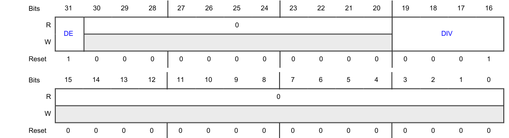

| 位 | 字段 | 功能 |
| --- | --- | --- |
| 31 | **DE** | 分频器使能（**Divider enable**）<br>`0b` - 分频器被禁用。<br>`1b` - 分频器被使能。 |
| 30-20 | — | 本字段为保留，读取返回零。 |
| 19-16 | **DIV** | 分频值（**Division value**）<br>本字段提供时钟分频器的分频值。分频后的时钟周期为分频器当前输入时钟周期的"DIV+1"倍。 |
| 15-0 | — | 本字段为保留，读取返回零。 |

### 7.66. 时钟多路复用器 0 分频器触发控制寄存器（**MUX_0_DIV_TRIG_CTRL**）

**MUX_0_DIV_TRIG_CTRL** 偏移：**334h**

本寄存器选择与时钟多路复用器 0 关联的分频器是在写入相应分频器配置寄存器时立即更新（称为立即分频器更新，**immediate divider update**），还是仅在写入 MC_CGM_MUX_0_DIV_TRIG 寄存器时更新（称为公共触发更新，**common trigger update**）。配置为公共触发更新时，本寄存器还控制与片上 AXBS 的停止（**halt**）握手协议的启动。当时钟分频器之间的分频值之比需要改变时，软件需要配置 HHEN 字段以与片上 AXBS 进行握手。


| 位 | 字段 | 功能 |
| --- | --- | --- |
| 31 | **HHEN** | 停止握手使能（**Halt handshake enable**）<br>当启动公共触发分频器更新时，本字段控制是否启动与 AXBS 的停止握手协议。<br>`0b` - 不启动停止握手协议。<br>`1b` - 启动停止握手协议。 |
| 30-1 | — | 本字段为保留，读取返回零。 |
| 0 | **TCTL** | 触发控制（**Trigger control**）<br>本字段控制立即更新与公共更新之间的分频器更新配置。<br>`0b` - 立即分频器更新<br>`1b` - 公共触发分频器更新 |

### 7.67. 时钟多路复用器 0 分频器触发寄存器（**MUX_0_DIV_TRIG**）

**MUX_0_DIV_TRIG** 偏移：**338h**

本寄存器为时钟多路复用器 0 的时钟分频器（仅 50% 占空比分频器）提供公共触发。向本寄存器写入任意值即向分频器提供一个触发。只有在适当配置 MC_CGM_MUX_0_DIV_TRIG_CTRL 寄存器之后才应写入本寄存器。


| 位 | 字段 | 功能 |
| --- | --- | --- |
| 31-0 | **TRIGGER** | 分频器更新的触发（**Trigger for divider update**） |

### 7.68. 时钟多路复用器 0 分频器更新状态寄存器（**MUX_0_DIV_UPD_STAT**）

**MUX_0_DIV_UPD_STAT** 偏移：**33Ch**

本寄存器提供与时钟多路复用器 0 对应的时钟分频器的更新状态。当对任一分频器控制寄存器执行写操作时，本寄存器中的分频器状态位被置为逻辑 1。当分频器已采样新的分频器配置时，该位被置为逻辑 0。在不跟踪状态位的情况下对同一时钟多路复用器内的相同或其他时钟分频器执行多次写入会导致报告不一致，即在相应的分频器更新仍待处理时分频器状态位可能已被置为逻辑 0。

**注意：** 无论 MC_CGM 时钟多路复用器内是否实现了任何分频器，对 MUX_n_DIV_UPD_STAT 的读访问总是完成而不返回总线传输错误。


| 位 | 字段 | 功能 |
| --- | --- | --- |
| 31-1 | — | 本字段为保留，读取返回零。 |
| 0 | **DIV_STAT** | 时钟多路复用器 0 的分频器状态（**Divider status for clock mux 0**）<br>在更新分频器控制寄存器之后读取 MUX_n_DIV_UPD_STAT 时，如果由于所选时钟源中的错误导致该字段的值固定为 1，请执行以下步骤将多路复用器切换到新的时钟源：<br>1. 将多路复用器切换到可工作的时钟源，不轮询该字段。<br>2. 更新 MUX_n_DC_m 并轮询该字段。<br>**注意：** 一旦分频器配置被更新或发生破坏性复位，该位即被清零。如果在该位为 1 时发生功能性复位，则它可能保持固定为 1，直到分频器输入时钟被恢复。<br>`0b` - 没有待处理的分频器配置更新。<br>`1b` - 与该多路复用器关联的至少一个分频器上的分频器配置更新待处理。 |

### 7.69. 时钟多路复用器 1 选择控制寄存器（**MUX_1_CSC**）

**MUX_1_CSC** 偏移：**340h**

本寄存器提供时钟多路复用器 1 的时钟源选择控制。时钟多路复用器 1 实现硬件控制的时钟切换，确保时钟切换以平滑的方式发生（无毛刺）。详情参见"硬件控制的时钟多路复用器"一节。

本寄存器仅在破坏性复位时复位。


| 位 | 字段 | 功能 |
| --- | --- | --- |
| 31-30 | — | 本字段为保留，读取返回零。 |
| 29-24 | **SELCTL** | 时钟源选择控制（**Clock source selection control**）<br>为时钟多路复用器 1 选择源时钟。保留值未显示。<br>`00_0000b` - clk_src_0<br>`01_0111b` - clk_src_23<br>`11_0000b` - clk_src_48<br>`11_0010b` - clk_src_50<br>`11_1001b` - clk_src_57 |
| 23-4 | — | 本字段为保留，读取返回零。 |
| 3 | **SAFE_SW** | 安全时钟请求（**Safe clock request**）<br>向该位写入 1 会向 clk_src_0 发出安全时钟切换请求。发出安全时钟切换操作请求后，该位自动清零，状态寄存器中对应的位被置位。 |
| 2 | **CLK_SW** | 时钟切换（**Clock switch**）<br>向该位写入 1 会向时钟多路复用器 1 发出时钟切换请求。发出时钟切换操作请求后，该位自动清零，状态寄存器中对应的位被置位。 |
| 1-0 | — | 本字段为保留，读取返回零。 |

### 7.70. 时钟多路复用器 1 选择状态寄存器（**MUX_1_CSS**）

**MUX_1_CSS** 偏移：**344h**

本寄存器提供时钟多路复用器 1 的当前时钟源选择状态。

本寄存器仅在破坏性复位时复位。


| 位 | 字段 | 功能 |
| --- | --- | --- |
| 31-30 | — | 本字段为保留，读取返回零。 |
| 29-24 | **SELSTAT** | 时钟源选择状态（**Clock source selection status**）<br>该值指示时钟多路复用器 1 当前选择的源。保留值未显示。<br>`00_0000b` - clk_src_0<br>`01_0111b` - clk_src_23<br>`11_0000b` - clk_src_48<br>`11_0010b` - clk_src_50<br>`11_1001b` - clk_src_57 |
| 23-20 | — | 本字段为保留，读取返回零。 |
| 19-17 | **SWTRG** | 切换触发原因（**Switch trigger cause**）<br>该值指示最近一次时钟源切换的原因。<br>**注意：** 如果时钟失效，随后对 MC_CGM 硬件时钟多路复用器发出多次安全时钟切换请求，则 SWTRG 字段的值可能为 4 或 5。<br>`000b` - 保留<br>`001b` - 请求后切换成功。<br>`010b` - 因目标时钟无效而切换请求失败，且当前时钟为 clk_src_0。<br>`011b` - 因当前时钟无效而切换请求失败，且当前时钟为 clk_src_0。<br>`100b` - 因安全时钟请求或复位而切换到 clk_src_0 成功。<br>`101b` - 因安全时钟请求或复位而切换到 clk_src_0 成功，但先前的当前时钟源无效。<br>`110b` - 保留<br>`111b` - 保留 |
| 16 | **SWIP** | 切换进行中（**Switch in progress**）<br>**注意：** 新的时钟切换请求只能在上一请求完成三个时钟周期之后发出。<br>`0b` - 时钟源切换已完成。<br>`1b` - 时钟源切换正在进行中。 |
| 15-4 | — | 本字段为保留，读取返回零。 |
| 3 | **SAFE_SW** | 安全时钟请求（**Safe clock request**）<br>本字段指示在时钟多路复用器 1 上先前的/正在进行的请求期间是否请求了切换到安全时钟操作。<br>`0b` - 未请求安全时钟切换操作。<br>`1b` - 已请求安全时钟切换操作。 |
| 2 | **CLK_SW** | 时钟切换（**Clock switch**）<br>本字段指示在时钟多路复用器 1 上先前的/正在进行的请求期间是否请求了时钟切换操作。<br>`0b` - 未请求时钟切换操作。<br>`1b` - 已请求时钟切换操作。 |
| 1-0 | — | 本字段为保留，读取返回零。 |

### 7.71. 时钟多路复用器 1 分频器 0 控制寄存器（**MUX_1_DC_0**）

**MUX_1_DC_0** 偏移：**348h**

本寄存器控制时钟多路复用器 1 的时钟分频器 0。

该分频器为 50% 占空比分频器。

**注意：** 对本寄存器各字段的更新应为原子写，即单次写入应更新整个寄存器。


| 位 | 字段 | 功能 |
| --- | --- | --- |
| 31 | **DE** | 分频器使能（**Divider enable**）<br>`0b` - 分频器被禁用。<br>`1b` - 分频器被使能。 |
| 30-24 | — | 本字段为保留，读取返回零。 |
| 23-16 | **DIV** | 分频值（**Division value**）<br>本字段提供时钟分频器的分频值。分频后的时钟周期为分频器当前输入时钟周期的"DIV+1"倍。 |
| 15-2 | — | 保留 |
| 1-0 | — | 保留 |

### 7.72. 时钟多路复用器 1 分频器 1 控制寄存器（**MUX_1_DC_1**）

**MUX_1_DC_1** 偏移：**34Ch**

本寄存器控制时钟多路复用器 1 的时钟分频器 1。

该分频器为 50% 占空比分频器。

**注意：** 对本寄存器各字段的更新应为原子写，即单次写入应更新整个寄存器。


| 位 | 字段 | 功能 |
| --- | --- | --- |
| 31 | **DE** | 分频器使能（**Divider enable**）<br>`0b` - 分频器被禁用。<br>`1b` - 分频器被使能。 |
| 30-18 | — | 本字段为保留，读取返回零。 |
| 17-16 | **DIV** | 分频值（**Division value**）<br>本字段提供时钟分频器的分频值。分频后的时钟周期为分频器当前输入时钟周期的"DIV+1"倍。 |
| 15-0 | — | 本字段为保留，读取返回零。 |

### 7.73. 时钟多路复用器 1 分频器触发控制寄存器（**MUX_1_DIV_TRIG_CTRL**）

**MUX_1_DIV_TRIG_CTRL** 偏移：**374h**

本寄存器选择与时钟多路复用器 1 关联的分频器是在写入相应分频器配置寄存器时立即更新（称为立即分频器更新，**immediate divider update**），还是仅在写入 MC_CGM_MUX_1_DIV_TRIG 寄存器时更新（称为公共触发更新，**common trigger update**）。配置为公共触发更新时，本寄存器还控制与片上 AXBS 的停止（**halt**）握手协议的启动。当时钟分频器之间的分频值之比需要改变时，软件需要配置 HHEN 字段以与片上 AXBS 进行握手。


| 位 | 字段 | 功能 |
| --- | --- | --- |
| 31 | **HHEN** | 停止握手使能（**Halt handshake enable**）<br>当启动公共触发分频器更新时，本字段控制是否启动与 AXBS 的停止握手协议。<br>`0b` - 不启动停止握手协议。<br>`1b` - 启动停止握手协议。 |
| 30-1 | — | 本字段为保留，读取返回零。 |
| 0 | **TCTL** | 触发控制（**Trigger control**）<br>本字段控制立即更新与公共更新之间的分频器更新配置。<br>`0b` - 立即分频器更新<br>`1b` - 公共触发分频器更新 |

### 7.74. 时钟多路复用器 1 分频器触发寄存器（**MUX_1_DIV_TRIG**）

**MUX_1_DIV_TRIG** 偏移：**378h**

本寄存器为时钟多路复用器 1 的时钟分频器（仅 50% 占空比分频器）提供公共触发。向本寄存器写入任意值即向分频器提供一个触发。只有在适当配置 MC_CGM_MUX_1_DIV_TRIG_CTRL 寄存器之后才应写入本寄存器。

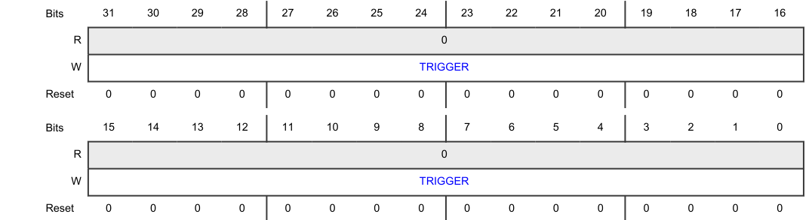

| 位 | 字段 | 功能 |
| --- | --- | --- |
| 31-0 | **TRIGGER** | 分频器更新的触发（**Trigger for divider update**） |

### 7.75. 时钟多路复用器 1 分频器更新状态寄存器（**MUX_1_DIV_UPD_STAT**）

**MUX_1_DIV_UPD_STAT** 偏移：**37Ch**

本寄存器提供与时钟多路复用器 1 对应的时钟分频器的更新状态。当对任一分频器控制寄存器执行写操作时，本寄存器中的分频器状态位被置为逻辑 1。当分频器已采样新的分频器配置时，该位被置为逻辑 0。在不跟踪状态位的情况下对同一时钟多路复用器内的相同或其他时钟分频器执行多次写入会导致报告不一致，即在相应的分频器更新仍待处理时分频器状态位可能已被置为逻辑 0。

**注意：** 无论 MC_CGM 时钟多路复用器内是否实现了任何分频器，对 MUX_n_DIV_UPD_STAT 的读访问总是完成而不返回总线传输错误。


| 位 | 字段 | 功能 |
| --- | --- | --- |
| 31-1 | — | 本字段为保留，读取返回零。 |
| 0 | **DIV_STAT** | 时钟多路复用器 1 的分频器状态（**Divider status for clock mux 1**）<br>在更新分频器控制寄存器之后读取 MUX_n_DIV_UPD_STAT 时，如果由于所选时钟源中的错误导致该字段的值固定为 1，请执行以下步骤将多路复用器切换到新的时钟源：<br>1. 将多路复用器切换到可工作的时钟源，不轮询该字段。<br>2. 更新 MUX_n_DC_m 并轮询该字段。<br>**注意：** 一旦分频器配置被更新或发生破坏性复位，该位即被清零。如果在该位为 1 时发生功能性复位，则它可能保持固定为 1，直到分频器输入时钟被恢复。<br>`0b` - 没有待处理的分频器配置更新。<br>`1b` - 与该多路复用器关联的至少一个分频器上的分频器配置更新待处理。 |

### 7.76. 时钟多路复用器 2 选择控制寄存器（**MUX_2_CSC**）

**MUX_2_CSC** 偏移：**380h**

本寄存器提供时钟多路复用器 2 的时钟源选择控制。时钟多路复用器 2 实现硬件控制的时钟切换，确保时钟切换以平滑的方式发生（无毛刺）。详情参见"硬件控制的时钟多路复用器"一节。

本寄存器仅在破坏性复位时复位。


| 位 | 字段 | 功能 |
| --- | --- | --- |
| 31-30 | — | 本字段为保留，读取返回零。 |
| 29-24 | **SELCTL** | 时钟源选择控制（**Clock source selection control**）<br>为时钟多路复用器 2 选择源时钟。保留值未显示。<br>`00_0000b` - clk_src_0<br>`01_0111b` - clk_src_23<br>`11_0011b` - clk_src_51<br>`11_0101b` - clk_src_53<br>`11_1110b` - clk_src_62 |
| 23-4 | — | 本字段为保留，读取返回零。 |
| 3 | **SAFE_SW** | 安全时钟请求（**Safe clock request**）<br>向该位写入 1 会向 clk_src_0 发出安全时钟切换请求。发出安全时钟切换操作请求后，该位自动清零，状态寄存器中对应的位被置位。 |
| 2 | **CLK_SW** | 时钟切换（**Clock switch**）<br>向该位写入 1 会向时钟多路复用器 2 发出时钟切换请求。发出时钟切换操作请求后，该位自动清零，状态寄存器中对应的位被置位。 |
| 1-0 | — | 本字段为保留，读取返回零。 |

### 7.77. 时钟多路复用器 2 选择状态寄存器（**MUX_2_CSS**）

**MUX_2_CSS** 偏移：**384h**

本寄存器提供时钟多路复用器 2 的当前时钟源选择状态。

本寄存器仅在破坏性复位时复位。


| 位 | 字段 | 功能 |
| --- | --- | --- |
| 31-30 | — | 本字段为保留，读取返回零。 |
| 29-24 | **SELSTAT** | 时钟源选择状态（**Clock source selection status**）<br>该值指示时钟多路复用器 2 当前选择的源。保留值未显示。<br>`00_0000b` - clk_src_0<br>`01_0111b` - clk_src_23<br>`11_0011b` - clk_src_51<br>`11_0101b` - clk_src_53<br>`11_1110b` - clk_src_62 |
| 23-20 | — | 本字段为保留，读取返回零。 |
| 19-17 | **SWTRG** | 切换触发原因（**Switch trigger cause**）<br>该值指示最近一次时钟源切换的原因。<br>**注意：** 如果时钟失效，随后对 MC_CGM 硬件时钟多路复用器发出多次安全时钟切换请求，则 SWTRG 字段的值可能为 4 或 5。<br>`000b` - 保留<br>`001b` - 请求后切换成功。<br>`010b` - 因目标时钟无效而切换请求失败，且当前时钟为 clk_src_0。<br>`011b` - 因当前时钟无效而切换请求失败，且当前时钟为 clk_src_0。<br>`100b` - 因安全时钟请求或复位而切换到 clk_src_0 成功。<br>`101b` - 因安全时钟请求或复位而切换到 clk_src_0 成功，但先前的当前时钟源无效。<br>`110b` - 保留<br>`111b` - 保留 |
| 16 | **SWIP** | 切换进行中（**Switch in progress**）<br>**注意：** 新的时钟切换请求只能在上一请求完成三个时钟周期之后发出。<br>`0b` - 时钟源切换已完成。<br>`1b` - 时钟源切换正在进行中。 |
| 15-4 | — | 本字段为保留，读取返回零。 |
| 3 | **SAFE_SW** | 安全时钟请求（**Safe clock request**）<br>本字段指示在时钟多路复用器 2 上先前的/正在进行的请求期间是否请求了切换到安全时钟操作。<br>`0b` - 未请求安全时钟切换操作。<br>`1b` - 已请求安全时钟切换操作。 |
| 2 | **CLK_SW** | 时钟切换（**Clock switch**）<br>本字段指示在时钟多路复用器 2 上先前的/正在进行的请求期间是否请求了时钟切换操作。<br>`0b` - 未请求时钟切换操作。<br>`1b` - 已请求时钟切换操作。 |
| 1-0 | — | 本字段为保留，读取返回零。 |

### 7.78. 时钟多路复用器 2 分频器 0 控制寄存器（**MUX_2_DC_0**）

**MUX_2_DC_0** 偏移：**388h**

本寄存器控制时钟多路复用器 2 的时钟分频器 0。

该分频器为 50% 占空比分频器。

**注意：** 对本寄存器各字段的更新应为原子写，即单次写入应更新整个寄存器。

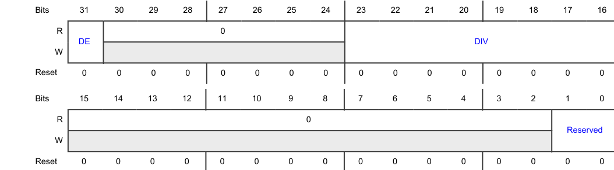

| 位 | 字段 | 功能 |
| --- | --- | --- |
| 31 | **DE** | 分频器使能（**Divider enable**）<br>`0b` - 分频器被禁用。<br>`1b` - 分频器被使能。 |
| 30-24 | — | 本字段为保留，读取返回零。 |
| 23-16 | **DIV** | 分频值（**Division value**）<br>本字段提供时钟分频器的分频值。分频后的时钟周期为分频器当前输入时钟周期的"DIV+1"倍。 |
| 15-2 | — | 保留 |
| 1-0 | — | 保留 |

### 7.79. 时钟多路复用器 2 分频器 1 控制寄存器（**MUX_2_DC_1**）

**MUX_2_DC_1** 偏移：**38Ch**

本寄存器控制时钟多路复用器 2 的时钟分频器 1。

该分频器为 50% 占空比分频器。

**注意：** 对本寄存器各字段的更新应为原子写，即单次写入应更新整个寄存器。

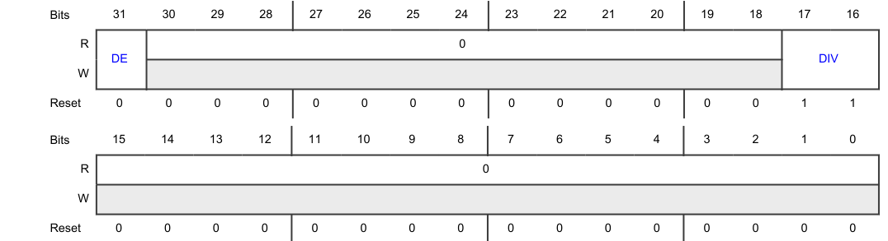

| 位 | 字段 | 功能 |
| --- | --- | --- |
| 31 | **DE** | 分频器使能（**Divider enable**）<br>`0b` - 分频器被禁用。<br>`1b` - 分频器被使能。 |
| 30-18 | — | 本字段为保留，读取返回零。 |
| 17-16 | **DIV** | 分频值（**Division value**）<br>本字段提供时钟分频器的分频值。分频后的时钟周期为分频器当前输入时钟周期的"DIV+1"倍。 |
| 15-0 | — | 本字段为保留，读取返回零。 |

### 7.80. 时钟多路复用器 2 分频器触发控制寄存器（**MUX_2_DIV_TRIG_CTRL**）

**MUX_2_DIV_TRIG_CTRL** 偏移：**3B4h**

本寄存器选择与时钟多路复用器 2 关联的分频器是在写入相应分频器配置寄存器时立即更新（称为立即分频器更新，**immediate divider update**），还是仅在写入 MC_CGM_MUX_2_DIV_TRIG 寄存器时更新（称为公共触发更新，**common trigger update**）。配置为公共触发更新时，本寄存器还控制与片上 AXBS 的停止（**halt**）握手协议的启动。当时钟分频器之间的分频值之比需要改变时，软件需要配置 HHEN 字段以与片上 AXBS 进行握手。


| 位 | 字段 | 功能 |
| --- | --- | --- |
| 31 | **HHEN** | 停止握手使能（**Halt handshake enable**）<br>当启动公共触发分频器更新时，本字段控制是否启动与 AXBS 的停止握手协议。<br>`0b` - 不启动停止握手协议。<br>`1b` - 启动停止握手协议。 |
| 30-1 | — | 本字段为保留，读取返回零。 |
| 0 | **TCTL** | 触发控制（**Trigger control**）<br>本字段控制立即更新与公共更新之间的分频器更新配置。<br>`0b` - 立即分频器更新<br>`1b` - 公共触发分频器更新 |

### 7.81. 时钟多路复用器 2 分频器触发寄存器（**MUX_2_DIV_TRIG**）

**MUX_2_DIV_TRIG** 偏移：**3B8h**

本寄存器为时钟多路复用器 2 的时钟分频器（仅 50% 占空比分频器）提供公共触发。向本寄存器写入任意值即向分频器提供一个触发。只有在适当配置 MC_CGM_MUX_2_DIV_TRIG_CTRL 寄存器之后才应写入本寄存器。

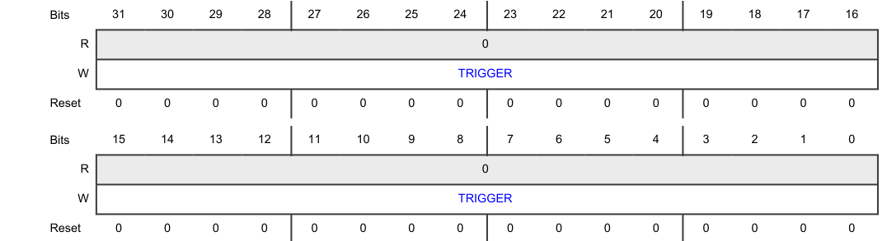

| 位 | 字段 | 功能 |
| --- | --- | --- |
| 31-0 | **TRIGGER** | 分频器更新的触发（**Trigger for divider update**） |

### 7.82. 时钟多路复用器 2 分频器更新状态寄存器（**MUX_2_DIV_UPD_STAT**）

**MUX_2_DIV_UPD_STAT** 偏移：**3BCh**

本寄存器提供与时钟多路复用器 2 对应的时钟分频器的更新状态。当对任一分频器控制寄存器执行写操作时，本寄存器中的分频器状态位被置为逻辑 1。当分频器已采样新的分频器配置时，该位被置为逻辑 0。在不跟踪状态位的情况下对同一时钟多路复用器内的相同或其他时钟分频器执行多次写入会导致报告不一致，即在相应的分频器更新仍待处理时分频器状态位可能已被置为逻辑 0。

**注意：** 无论 MC_CGM 时钟多路复用器内是否实现了任何分频器，对 MUX_n_DIV_UPD_STAT 的读访问总是完成而不返回总线传输错误。

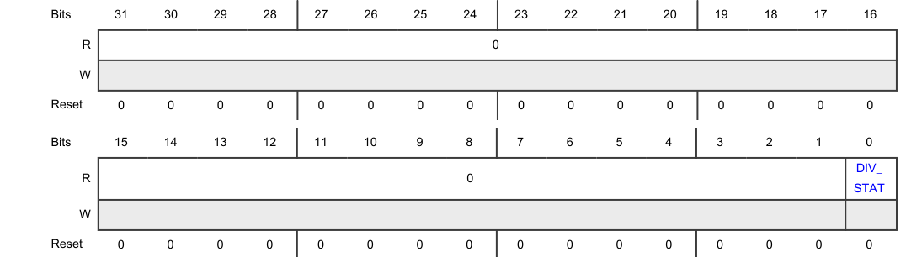

| 位 | 字段 | 功能 |
| --- | --- | --- |
| 31-1 | — | 本字段为保留，读取返回零。 |
| 0 | **DIV_STAT** | 时钟多路复用器 2 的分频器状态（**Divider status for clock mux 2**）<br>在更新分频器控制寄存器之后读取 MUX_n_DIV_UPD_STAT 时，如果由于所选时钟源中的错误导致该字段的值固定为 1，请执行以下步骤将多路复用器切换到新的时钟源：<br>1. 将多路复用器切换到可工作的时钟源，不轮询该字段。<br>2. 更新 MUX_n_DC_m 并轮询该字段。<br>**注意：** 一旦分频器配置被更新或发生破坏性复位，该位即被清零。如果在该位为 1 时发生功能性复位，则它可能保持固定为 1，直到分频器输入时钟被恢复。<br>`0b` - 没有待处理的分频器配置更新。<br>`1b` - 与该多路复用器关联的至少一个分频器上的分频器配置更新待处理。 |

### 7.83. 时钟多路复用器 3 选择控制寄存器（**MUX_3_CSC**）

**MUX_3_CSC** 偏移：**3C0h**

本寄存器提供时钟多路复用器 3 的时钟源选择控制。时钟多路复用器 3 实现硬件控制的时钟切换，确保时钟切换以平滑的方式发生（无毛刺）。详情参见"硬件控制的时钟多路复用器"一节。

本寄存器仅在破坏性复位时复位。


| 位 | 字段 | 功能 |
| --- | --- | --- |
| 31-30 | — | 本字段为保留，读取返回零。 |
| 29-24 | **SELCTL** | 时钟源选择控制（**Clock source selection control**）<br>为时钟多路复用器 3 选择源时钟。保留值未显示。<br>`00_0000b` - clk_src_0<br>`01_0111b` - clk_src_23<br>`10_1110b` - clk_src_46<br>`11_0110b` - clk_src_54<br>`11_1000b` - clk_src_56 |
| 23-4 | — | 本字段为保留，读取返回零。 |
| 3 | **SAFE_SW** | 安全时钟请求（**Safe clock request**）<br>向该位写入 1 会向 clk_src_0 发出安全时钟切换请求。发出安全时钟切换操作请求后，该位自动清零，状态寄存器中对应的位被置位。 |
| 2 | **CLK_SW** | 时钟切换（**Clock switch**）<br>向该位写入 1 会向时钟多路复用器 3 发出时钟切换请求。发出时钟切换操作请求后，该位自动清零，状态寄存器中对应的位被置位。 |
| 1-0 | — | 本字段为保留，读取返回零。 |

### 7.84. 时钟多路复用器 3 选择状态寄存器（**MUX_3_CSS**）

**MUX_3_CSS** 偏移：**3C4h**

本寄存器提供时钟多路复用器 3 的当前时钟源选择状态。

本寄存器仅在破坏性复位时复位。


| 位 | 字段 | 功能 |
| --- | --- | --- |
| 31-30 | — | 本字段为保留，读取返回零。 |
| 29-24 | **SELSTAT** | 时钟源选择状态（**Clock source selection status**）<br>该值指示时钟多路复用器 3 当前选择的源。保留值未显示。<br>`00_0000b` - clk_src_0<br>`01_0111b` - clk_src_23<br>`10_1110b` - clk_src_46<br>`11_0110b` - clk_src_54<br>`11_1000b` - clk_src_56 |
| 23-20 | — | 本字段为保留，读取返回零。 |
| 19-17 | **SWTRG** | 切换触发原因（**Switch trigger cause**）<br>该值指示最近一次时钟源切换的原因。<br>**注意：** 如果时钟失效，随后对 MC_CGM 硬件时钟多路复用器发出多次安全时钟切换请求，则 SWTRG 字段的值可能为 4 或 5。<br>`000b` - 保留<br>`001b` - 请求后切换成功。<br>`010b` - 因目标时钟无效而切换请求失败，且当前时钟为 clk_src_0。<br>`011b` - 因当前时钟无效而切换请求失败，且当前时钟为 clk_src_0。<br>`100b` - 因安全时钟请求或复位而切换到 clk_src_0 成功。<br>`101b` - 因安全时钟请求或复位而切换到 clk_src_0 成功，但先前的当前时钟源无效。<br>`110b` - 保留<br>`111b` - 保留 |
| 16 | **SWIP** | 切换进行中（**Switch in progress**）<br>**注意：** 新的时钟切换请求只能在上一请求完成三个时钟周期之后发出。<br>`0b` - 时钟源切换已完成。<br>`1b` - 时钟源切换正在进行中。 |
| 15-4 | — | 本字段为保留，读取返回零。 |
| 3 | **SAFE_SW** | 安全时钟请求（**Safe clock request**）<br>本字段指示在时钟多路复用器 3 上先前的/正在进行的请求期间是否请求了切换到安全时钟操作。<br>`0b` - 未请求安全时钟切换操作。<br>`1b` - 已请求安全时钟切换操作。 |
| 2 | **CLK_SW** | 时钟切换（**Clock switch**）<br>本字段指示在时钟多路复用器 3 上先前的/正在进行的请求期间是否请求了时钟切换操作。<br>`0b` - 未请求时钟切换操作。<br>`1b` - 已请求时钟切换操作。 |
| 1-0 | — | 本字段为保留，读取返回零。 |

### 7.85. 时钟多路复用器 3 分频器 0 控制寄存器（**MUX_3_DC_0**）

**MUX_3_DC_0** 偏移：**3C8h**

本寄存器控制时钟多路复用器 3 的时钟分频器 0。

该分频器为 50% 占空比分频器。

**注意：** 对本寄存器各字段的更新应为原子写，即单次写入应更新整个寄存器。


| 位 | 字段 | 功能 |
| --- | --- | --- |
| 31 | **DE** | 分频器使能（**Divider enable**）<br>`0b` - 分频器被禁用。<br>`1b` - 分频器被使能。 |
| 30-24 | — | 本字段为保留，读取返回零。 |
| 23-16 | **DIV** | 分频值（**Division value**）<br>本字段提供时钟分频器的分频值。分频后的时钟周期为分频器当前输入时钟周期的"DIV+1"倍。 |
| 15-2 | — | 保留 |
| 1-0 | — | 保留 |

### 7.86. 时钟多路复用器 3 分频器 1 控制寄存器（**MUX_3_DC_1**）

**MUX_3_DC_1** 偏移：**3CCh**

本寄存器控制时钟多路复用器 3 的时钟分频器 1。

该分频器为 50% 占空比分频器。

**注意：** 对本寄存器各字段的更新应为原子写，即单次写入应更新整个寄存器。

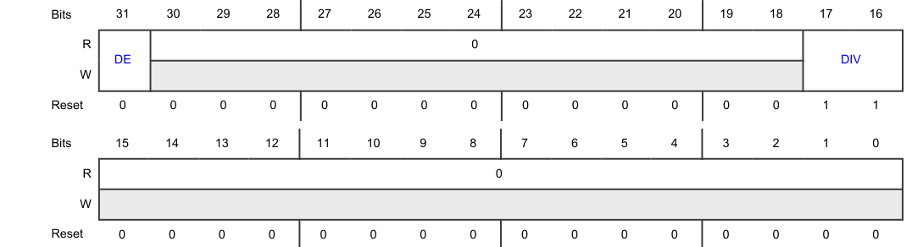

| 位 | 字段 | 功能 |
| --- | --- | --- |
| 31 | **DE** | 分频器使能（**Divider enable**）<br>`0b` - 分频器被禁用。<br>`1b` - 分频器被使能。 |
| 30-18 | — | 本字段为保留，读取返回零。 |
| 17-16 | **DIV** | 分频值（**Division value**）<br>本字段提供时钟分频器的分频值。分频后的时钟周期为分频器当前输入时钟周期的"DIV+1"倍。 |
| 15-0 | — | 本字段为保留，读取返回零。 |

### 7.87. 时钟多路复用器 3 分频器触发控制寄存器（**MUX_3_DIV_TRIG_CTRL**）

**MUX_3_DIV_TRIG_CTRL** 偏移：**3F4h**

本寄存器选择与时钟多路复用器 3 关联的分频器是在写入相应分频器配置寄存器时立即更新（称为立即分频器更新，**immediate divider update**），还是仅在写入 MC_CGM_MUX_3_DIV_TRIG 寄存器时更新（称为公共触发更新，**common trigger update**）。配置为公共触发更新时，本寄存器还控制与片上 AXBS 的停止（**halt**）握手协议的启动。当时钟分频器之间的分频值之比需要改变时，软件需要配置 HHEN 字段以与片上 AXBS 进行握手。

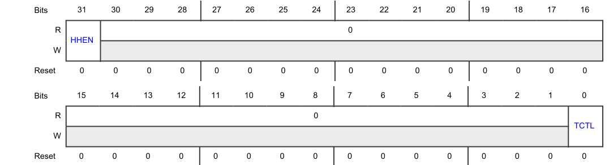

| 位 | 字段 | 功能 |
| --- | --- | --- |
| 31 | **HHEN** | 停止握手使能（**Halt handshake enable**）<br>当启动公共触发分频器更新时，本字段控制是否启动与 AXBS 的停止握手协议。<br>`0b` - 不启动停止握手协议。<br>`1b` - 启动停止握手协议。 |
| 30-1 | — | 本字段为保留，读取返回零。 |
| 0 | **TCTL** | 触发控制（**Trigger control**）<br>本字段控制立即更新与公共更新之间的分频器更新配置。<br>`0b` - 立即分频器更新<br>`1b` - 公共触发分频器更新 |

### 7.88. 时钟多路复用器 3 分频器触发寄存器（**MUX_3_DIV_TRIG**）

**MUX_3_DIV_TRIG** 偏移：**3F8h**

本寄存器为时钟多路复用器 3 的时钟分频器（仅 50% 占空比分频器）提供公共触发。向本寄存器写入任意值即向分频器提供一个触发。只有在适当配置 MC_CGM_MUX_3_DIV_TRIG_CTRL 寄存器之后才应写入本寄存器。


| 位 | 字段 | 功能 |
| --- | --- | --- |
| 31-0 | **TRIGGER** | 分频器更新的触发（**Trigger for divider update**） |

### 7.89. 时钟多路复用器 3 分频器更新状态寄存器（**MUX_3_DIV_UPD_STAT**）

**MUX_3_DIV_UPD_STAT** 偏移：**3FCh**

本寄存器提供与时钟多路复用器 3 对应的时钟分频器的更新状态。当对任一分频器控制寄存器执行写操作时，本寄存器中的分频器状态位被置为逻辑 1。当分频器已采样新的分频器配置时，该位被置为逻辑 0。在不跟踪状态位的情况下对同一时钟多路复用器内的相同或其他时钟分频器执行多次写入会导致报告不一致，即在相应的分频器更新仍待处理时分频器状态位可能已被置为逻辑 0。

**注意：** 无论 MC_CGM 时钟多路复用器内是否实现了任何分频器，对 MUX_n_DIV_UPD_STAT 的读访问总是完成而不返回总线传输错误。

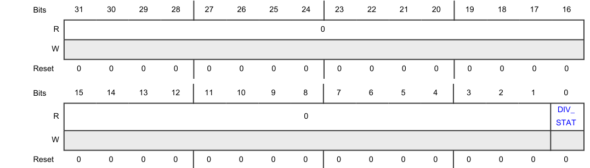

| 位 | 字段 | 功能 |
| --- | --- | --- |
| 31-1 | — | 本字段为保留，读取返回零。 |
| 0 | **DIV_STAT** | 时钟多路复用器 3 的分频器状态（**Divider status for clock mux 3**）<br>在更新分频器控制寄存器之后读取 MUX_n_DIV_UPD_STAT 时，如果由于所选时钟源中的错误导致该字段的值固定为 1，请执行以下步骤将多路复用器切换到新的时钟源：<br>1. 将多路复用器切换到可工作的时钟源，不轮询该字段。<br>2. 更新 MUX_n_DC_m 并轮询该字段。<br>**注意：** 一旦分频器配置被更新或发生破坏性复位，该位即被清零。如果在该位为 1 时发生功能性复位，则它可能保持固定为 1，直到分频器输入时钟被恢复。<br>`0b` - 没有待处理的分频器配置更新。<br>`1b` - 与该多路复用器关联的至少一个分频器上的分频器配置更新待处理。 |

### 7.90. 时钟多路复用器 4 选择控制寄存器（**MUX_4_CSC**）

**MUX_4_CSC** 偏移：**400h**

本寄存器提供时钟多路复用器 4 的时钟源选择控制。时钟多路复用器 4 实现硬件控制的时钟切换，确保时钟切换以平滑的方式发生（无毛刺）。详情参见"硬件控制的时钟多路复用器"一节。

本寄存器仅在破坏性复位时复位。


| 位 | 字段 | 功能 |
| --- | --- | --- |
| 31-30 | — | 本字段为保留，读取返回零。 |
| 29-24 | **SELCTL** | 时钟源选择控制（**Clock source selection control**）<br>为时钟多路复用器 4 选择源时钟。保留值未显示。<br>`00_0000b` - clk_src_0<br>`11_0001b` - clk_src_49<br>`11_1010b` - clk_src_58<br>`11_1011b` - clk_src_59 |
| 23-4 | — | 本字段为保留，读取返回零。 |
| 3 | **SAFE_SW** | 安全时钟请求（**Safe clock request**）<br>向该位写入 1 会向 clk_src_0 发出安全时钟切换请求。发出安全时钟切换操作请求后，该位自动清零，状态寄存器中对应的位被置位。 |
| 2 | **CLK_SW** | 时钟切换（**Clock switch**）<br>向该位写入 1 会向时钟多路复用器 4 发出时钟切换请求。发出时钟切换操作请求后，该位自动清零，状态寄存器中对应的位被置位。 |
| 1-0 | — | 本字段为保留，读取返回零。 |

### 7.91. 时钟多路复用器 4 选择状态寄存器（**MUX_4_CSS**）

**MUX_4_CSS** 偏移：**404h**

本寄存器提供时钟多路复用器 4 的当前时钟源选择状态。

本寄存器仅在破坏性复位时复位。


| 位 | 字段 | 功能 |
| --- | --- | --- |
| 31-30 | — | 本字段为保留，读取返回零。 |
| 29-24 | **SELSTAT** | 时钟源选择状态（**Clock source selection status**）<br>该值指示时钟多路复用器 4 当前选择的源。保留值未显示。<br>`00_0000b` - clk_src_0<br>`11_0001b` - clk_src_49<br>`11_1010b` - clk_src_58<br>`11_1011b` - clk_src_59 |
| 23-20 | — | 本字段为保留，读取返回零。 |
| 19-17 | **SWTRG** | 切换触发原因（**Switch trigger cause**）<br>该值指示最近一次时钟源切换的原因。<br>**注意：** 如果时钟失效，随后对 MC_CGM 硬件时钟多路复用器发出多次安全时钟切换请求，则 SWTRG 字段的值可能为 4 或 5。<br>`000b` - 保留<br>`001b` - 请求后切换成功。<br>`010b` - 因目标时钟无效而切换请求失败，且当前时钟为 clk_src_0。<br>`011b` - 因当前时钟无效而切换请求失败，且当前时钟为 clk_src_0。<br>`100b` - 因安全时钟请求或复位而切换到 clk_src_0 成功。<br>`101b` - 因安全时钟请求或复位而切换到 clk_src_0 成功，但先前的当前时钟源无效。<br>`110b` - 保留<br>`111b` - 保留 |
| 16 | **SWIP** | 切换进行中（**Switch in progress**）<br>**注意：** 新的时钟切换请求只能在上一请求完成三个时钟周期之后发出。<br>`0b` - 时钟源切换已完成。<br>`1b` - 时钟源切换正在进行中。 |
| 15-4 | — | 本字段为保留，读取返回零。 |
| 3 | **SAFE_SW** | 安全时钟请求（**Safe clock request**）<br>本字段指示在时钟多路复用器 4 上先前的/正在进行的请求期间是否请求了切换到安全时钟操作。<br>`0b` - 未请求安全时钟切换操作。<br>`1b` - 已请求安全时钟切换操作。 |
| 2 | **CLK_SW** | 时钟切换（**Clock switch**）<br>本字段指示在时钟多路复用器 4 上先前的/正在进行的请求期间是否请求了时钟切换操作。<br>`0b` - 未请求时钟切换操作。<br>`1b` - 已请求时钟切换操作。 |
| 1-0 | — | 本字段为保留，读取返回零。 |

### 7.92. 时钟多路复用器 5 选择控制寄存器（**MUX_5_CSC**）

**MUX_5_CSC** 偏移：**440h**

本寄存器提供时钟多路复用器 5 的时钟源选择控制。时钟多路复用器 5 实现硬件控制的时钟切换，确保时钟切换以平滑的方式发生（无毛刺）。详情参见"硬件控制的时钟多路复用器"一节。

本寄存器仅在破坏性复位时复位。


| 位 | 字段 | 功能 |
| --- | --- | --- |
| 31-30 | — | 本字段为保留，读取返回零。 |
| 29-24 | **SELCTL** | 时钟源选择控制（**Clock source selection control**）<br>为时钟多路复用器 5 选择源时钟。保留值未显示。<br>`00_0000b` - clk_src_0<br>`11_0100b` - clk_src_52<br>`11_1100b` - clk_src_60<br>`11_1111b` - clk_src_63 |
| 23-4 | — | 本字段为保留，读取返回零。 |
| 3 | **SAFE_SW** | 安全时钟请求（**Safe clock request**）<br>向该位写入 1 会向 clk_src_0 发出安全时钟切换请求。发出安全时钟切换操作请求后，该位自动清零，状态寄存器中对应的位被置位。 |
| 2 | **CLK_SW** | 时钟切换（**Clock switch**）<br>向该位写入 1 会向时钟多路复用器 5 发出时钟切换请求。发出时钟切换操作请求后，该位自动清零，状态寄存器中对应的位被置位。 |
| 1-0 | — | 本字段为保留，读取返回零。 |

### 7.93. 时钟多路复用器 5 选择状态寄存器（**MUX_5_CSS**）

**MUX_5_CSS** 偏移：**444h**

本寄存器提供时钟多路复用器 5 的当前时钟源选择状态。

本寄存器仅在破坏性复位时复位。

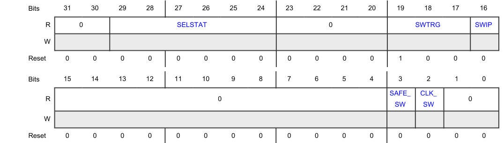

| 位 | 字段 | 功能 |
| --- | --- | --- |
| 31-30 | — | 本字段为保留，读取返回零。 |
| 29-24 | **SELSTAT** | 时钟源选择状态（**Clock source selection status**）<br>该值指示时钟多路复用器 5 当前选择的源。保留值未显示。<br>`00_0000b` - clk_src_0<br>`11_0100b` - clk_src_52<br>`11_1100b` - clk_src_60<br>`11_1111b` - clk_src_63 |
| 23-20 | — | 本字段为保留，读取返回零。 |
| 19-17 | **SWTRG** | 切换触发原因（**Switch trigger cause**）<br>该值指示最近一次时钟源切换的原因。<br>**注意：** 如果时钟失效，随后对 MC_CGM 硬件时钟多路复用器发出多次安全时钟切换请求，则 SWTRG 字段的值可能为 4 或 5。<br>`000b` - 保留<br>`001b` - 请求后切换成功。<br>`010b` - 因目标时钟无效而切换请求失败，且当前时钟为 clk_src_0。<br>`011b` - 因当前时钟无效而切换请求失败，且当前时钟为 clk_src_0。<br>`100b` - 因安全时钟请求或复位而切换到 clk_src_0 成功。<br>`101b` - 因安全时钟请求或复位而切换到 clk_src_0 成功，但先前的当前时钟源无效。<br>`110b` - 保留<br>`111b` - 保留 |
| 16 | **SWIP** | 切换进行中（**Switch in progress**）<br>**注意：** 新的时钟切换请求只能在上一请求完成三个时钟周期之后发出。<br>`0b` - 时钟源切换已完成。<br>`1b` - 时钟源切换正在进行中。 |
| 15-4 | — | 本字段为保留，读取返回零。 |
| 3 | **SAFE_SW** | 安全时钟请求（**Safe clock request**）<br>本字段指示在时钟多路复用器 5 上先前的/正在进行的请求期间是否请求了切换到安全时钟操作。<br>`0b` - 未请求安全时钟切换操作。<br>`1b` - 已请求安全时钟切换操作。 |
| 2 | **CLK_SW** | 时钟切换（**Clock switch**）<br>本字段指示在时钟多路复用器 5 上先前的/正在进行的请求期间是否请求了时钟切换操作。<br>`0b` - 未请求时钟切换操作。<br>`1b` - 已请求时钟切换操作。 |
| 1-0 | — | 本字段为保留，读取返回零。 |

### 7.94. 时钟多路复用器 6 选择控制寄存器（**MUX_6_CSC**）

**MUX_6_CSC** 偏移：**480h**

本寄存器提供时钟多路复用器 6 的时钟源选择控制。时钟多路复用器 6 实现硬件控制的时钟切换，确保时钟切换以平滑的方式发生（无毛刺）。详情参见"硬件控制的时钟多路复用器"一节。

本寄存器仅在破坏性复位时复位。


| 位 | 字段 | 功能 |
| --- | --- | --- |
| 31-30 | — | 本字段为保留，读取返回零。 |
| 29-24 | **SELCTL** | 时钟源选择控制（**Clock source selection control**）<br>为时钟多路复用器 6 选择源时钟。保留值未显示。<br>`00_0000b` - clk_src_0<br>`10_1111b` - clk_src_47<br>`11_0111b` - clk_src_55<br>`11_1101b` - clk_src_61 |
| 23-4 | — | 本字段为保留，读取返回零。 |
| 3 | **SAFE_SW** | 安全时钟请求（**Safe clock request**）<br>向该位写入 1 会向 clk_src_0 发出安全时钟切换请求。发出安全时钟切换操作请求后，该位自动清零，状态寄存器中对应的位被置位。 |
| 2 | **CLK_SW** | 时钟切换（**Clock switch**）<br>向该位写入 1 会向时钟多路复用器 6 发出时钟切换请求。发出时钟切换操作请求后，该位自动清零，状态寄存器中对应的位被置位。 |
| 1-0 | — | 本字段为保留，读取返回零。 |

### 7.95. 时钟多路复用器 6 选择状态寄存器（**MUX_6_CSS**）

**MUX_6_CSS** 偏移：**484h**

本寄存器提供时钟多路复用器 6 的当前时钟源选择状态。

本寄存器仅在破坏性复位时复位。


| 位 | 字段 | 功能 |
| --- | --- | --- |
| 31-30 | — | 本字段为保留，读取返回零。 |
| 29-24 | **SELSTAT** | 时钟源选择状态（**Clock source selection status**）<br>该值指示时钟多路复用器 6 当前选择的源。保留值未显示。<br>`00_0000b` - clk_src_0<br>`10_1111b` - clk_src_47<br>`11_0111b` - clk_src_55<br>`11_1101b` - clk_src_61 |
| 23-20 | — | 本字段为保留，读取返回零。 |
| 19-17 | **SWTRG** | 切换触发原因（**Switch trigger cause**）<br>该值指示最近一次时钟源切换的原因。<br>**注意：** 如果时钟失效，随后对 MC_CGM 硬件时钟多路复用器发出多次安全时钟切换请求，则 SWTRG 字段的值可能为 4 或 5。<br>`000b` - 保留<br>`001b` - 请求后切换成功。<br>`010b` - 因目标时钟无效而切换请求失败，且当前时钟为 clk_src_0。<br>`011b` - 因当前时钟无效而切换请求失败，且当前时钟为 clk_src_0。<br>`100b` - 因安全时钟请求或复位而切换到 clk_src_0 成功。<br>`101b` - 因安全时钟请求或复位而切换到 clk_src_0 成功，但先前的当前时钟源无效。<br>`110b` - 保留<br>`111b` - 保留 |
| 16 | **SWIP** | 切换进行中（**Switch in progress**）<br>**注意：** 新的时钟切换请求只能在上一请求完成三个时钟周期之后发出。<br>`0b` - 时钟源切换已完成。<br>`1b` - 时钟源切换正在进行中。 |
| 15-4 | — | 本字段为保留，读取返回零。 |
| 3 | **SAFE_SW** | 安全时钟请求（**Safe clock request**）<br>本字段指示在时钟多路复用器 6 上先前的/正在进行的请求期间是否请求了切换到安全时钟操作。<br>`0b` - 未请求安全时钟切换操作。<br>`1b` - 已请求安全时钟切换操作。 |
| 2 | **CLK_SW** | 时钟切换（**Clock switch**）<br>本字段指示在时钟多路复用器 6 上先前的/正在进行的请求期间是否请求了时钟切换操作。<br>`0b` - 未请求时钟切换操作。<br>`1b` - 已请求时钟切换操作。 |
| 1-0 | — | 本字段为保留，读取返回零。 |

### 7.96. 时钟多路复用器 7 选择控制寄存器（**MUX_7_CSC**）

**MUX_7_CSC** 偏移：**4C0h**

本寄存器提供时钟多路复用器 7 的时钟源选择控制。时钟多路复用器 7 实现硬件控制的时钟切换，确保时钟切换以平滑的方式发生（无毛刺）。详情参见"硬件控制的时钟多路复用器"一节。

本寄存器仅在破坏性复位时复位。


| 位 | 字段 | 功能 |
| --- | --- | --- |
| 31-30 | — | 本字段为保留，读取返回零。 |
| 29-24 | **SELCTL** | 时钟源选择控制（**Clock source selection control**）<br>为时钟多路复用器 7 选择源时钟。保留值未显示。<br>`00_0000b` - clk_src_0<br>`11_0010b` - clk_src_50 |
| 23-4 | — | 本字段为保留，读取返回零。 |
| 3 | **SAFE_SW** | 安全时钟请求（**Safe clock request**）<br>向该位写入 1 会向 clk_src_0 发出安全时钟切换请求。发出安全时钟切换操作请求后，该位自动清零，状态寄存器中对应的位被置位。 |
| 2 | **CLK_SW** | 时钟切换（**Clock switch**）<br>向该位写入 1 会向时钟多路复用器 7 发出时钟切换请求。发出时钟切换操作请求后，该位自动清零，状态寄存器中对应的位被置位。 |
| 1-0 | — | 本字段为保留，读取返回零。 |

### 7.97. 时钟多路复用器 7 选择状态寄存器（**MUX_7_CSS**）

**MUX_7_CSS** 偏移：**4C4h**

本寄存器提供时钟多路复用器 7 的当前时钟源选择状态。

本寄存器仅在破坏性复位时复位。


| 位 | 字段 | 功能 |
| --- | --- | --- |
| 31-30 | — | 本字段为保留，读取返回零。 |
| 29-24 | **SELSTAT** | 时钟源选择状态（**Clock source selection status**）<br>该值指示时钟多路复用器 7 当前选择的源。保留值未显示。<br>`00_0000b` - clk_src_0<br>`11_0010b` - clk_src_50 |
| 23-20 | — | 本字段为保留，读取返回零。 |
| 19-17 | **SWTRG** | 切换触发原因（**Switch trigger cause**）<br>该值指示最近一次时钟源切换的原因。<br>**注意：** 如果时钟失效，随后对 MC_CGM 硬件时钟多路复用器发出多次安全时钟切换请求，则 SWTRG 字段的值可能为 4 或 5。<br>`000b` - 保留<br>`001b` - 请求后切换成功。<br>`010b` - 因目标时钟无效而切换请求失败，且当前时钟为 clk_src_0。<br>`011b` - 因当前时钟无效而切换请求失败，且当前时钟为 clk_src_0。<br>`100b` - 因安全时钟请求或复位而切换到 clk_src_0 成功。<br>`101b` - 因安全时钟请求或复位而切换到 clk_src_0 成功，但先前的当前时钟源无效。<br>`110b` - 保留<br>`111b` - 保留 |
| 16 | **SWIP** | 切换进行中（**Switch in progress**）<br>**注意：** 新的时钟切换请求只能在上一请求完成三个时钟周期之后发出。<br>`0b` - 时钟源切换已完成。<br>`1b` - 时钟源切换正在进行中。 |
| 15-4 | — | 本字段为保留，读取返回零。 |
| 3 | **SAFE_SW** | 安全时钟请求（**Safe clock request**）<br>本字段指示在时钟多路复用器 7 上先前的/正在进行的请求期间是否请求了切换到安全时钟操作。<br>`0b` - 未请求安全时钟切换操作。<br>`1b` - 已请求安全时钟切换操作。 |
| 2 | **CLK_SW** | 时钟切换（**Clock switch**）<br>本字段指示在时钟多路复用器 7 上先前的/正在进行的请求期间是否请求了时钟切换操作。<br>`0b` - 未请求时钟切换操作。<br>`1b` - 已请求时钟切换操作。 |
| 1-0 | — | 本字段为保留，读取返回零。 |

### 7.98. 时钟多路复用器 7 分频器 0 控制寄存器（**MUX_7_DC_0**）

**MUX_7_DC_0** 偏移：**4C8h**

本寄存器控制时钟多路复用器 7 的时钟分频器 0。

该分频器为 50% 占空比分频器。

**注意：** 对本寄存器各字段的更新应为原子写，即单次写入应更新整个寄存器。

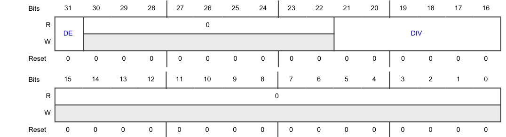

| 位 | 字段 | 功能 |
| --- | --- | --- |
| 31 | **DE** | 分频器使能（**Divider enable**）<br>`0b` - 分频器被禁用。<br>`1b` - 分频器被使能。 |
| 30-22 | — | 本字段为保留，读取返回零。 |
| 21-16 | **DIV** | 分频值（**Division value**）<br>本字段提供时钟分频器的分频值。分频后的时钟周期为分频器当前输入时钟周期的"DIV+1"倍。 |
| 15-0 | — | 本字段为保留，读取返回零。 |

### 7.99. 时钟多路复用器 7 分频器触发控制寄存器（**MUX_7_DIV_TRIG_CTRL**）

**MUX_7_DIV_TRIG_CTRL** 偏移：**4F4h**

本寄存器选择与时钟多路复用器 7 关联的分频器是在写入相应分频器配置寄存器时立即更新（称为立即分频器更新，**immediate divider update**），还是仅在写入 MC_CGM_MUX_7_DIV_TRIG 寄存器时更新（称为公共触发更新，**common trigger update**）。配置为公共触发更新时，本寄存器还控制与片上 AXBS 的停止（**halt**）握手协议的启动。当时钟分频器之间的分频值之比需要改变时，软件需要配置 HHEN 字段以与片上 AXBS 进行握手。


| 位 | 字段 | 功能 |
| --- | --- | --- |
| 31 | **HHEN** | 停止握手使能（**Halt handshake enable**）<br>当启动公共触发分频器更新时，本字段控制是否启动与 AXBS 的停止握手协议。<br>`0b` - 不启动停止握手协议。<br>`1b` - 启动停止握手协议。 |
| 30-1 | — | 本字段为保留，读取返回零。 |
| 0 | **TCTL** | 触发控制（**Trigger control**）<br>本字段控制立即更新与公共更新之间的分频器更新配置。<br>`0b` - 立即分频器更新<br>`1b` - 公共触发分频器更新 |

### 7.100. 时钟多路复用器 7 分频器触发寄存器（**MUX_7_DIV_TRIG**）

**MUX_7_DIV_TRIG** 偏移：**4F8h**

本寄存器为时钟多路复用器 7 的时钟分频器（仅 50% 占空比分频器）提供公共触发。向本寄存器写入任意值即向分频器提供一个触发。只有在适当配置 MC_CGM_MUX_7_DIV_TRIG_CTRL 寄存器之后才应写入本寄存器。


| 位 | 字段 | 功能 |
| --- | --- | --- |
| 31-0 | **TRIGGER** | 分频器更新的触发（**Trigger for divider update**） |

### 7.101. 时钟多路复用器 7 分频器更新状态寄存器（**MUX_7_DIV_UPD_STAT**）

**MUX_7_DIV_UPD_STAT** 偏移：**4FCh**

本寄存器提供与时钟多路复用器 7 对应的时钟分频器的更新状态。当对任一分频器控制寄存器执行写操作时，本寄存器中的分频器状态位被置为逻辑 1。当分频器已采样新的分频器配置时，该位被置为逻辑 0。在不跟踪状态位的情况下对同一时钟多路复用器内的相同或其他时钟分频器执行多次写入会导致报告不一致，即在相应的分频器更新仍待处理时分频器状态位可能已被置为逻辑 0。

**注意：** 无论 MC_CGM 时钟多路复用器内是否实现了任何分频器，对 MUX_n_DIV_UPD_STAT 的读访问总是完成而不返回总线传输错误。


| 位 | 字段 | 功能 |
| --- | --- | --- |
| 31-1 | — | 本字段为保留，读取返回零。 |
| 0 | **DIV_STAT** | 时钟多路复用器 7 的分频器状态（**Divider status for clock mux 7**）<br>在更新分频器控制寄存器之后读取 MUX_n_DIV_UPD_STAT 时，如果由于所选时钟源中的错误导致该字段的值固定为 1，请执行以下步骤将多路复用器切换到新的时钟源：<br>1. 将多路复用器切换到可工作的时钟源，不轮询该字段。<br>2. 更新 MUX_n_DC_m 并轮询该字段。<br>**注意：** 一旦分频器配置被更新或发生破坏性复位，该位即被清零。如果在该位为 1 时发生功能性复位，则它可能保持固定为 1，直到分频器输入时钟被恢复。<br>`0b` - 没有待处理的分频器配置更新。<br>`1b` - 与该多路复用器关联的至少一个分频器上的分频器配置更新待处理。 |

### 7.102. 时钟多路复用器 8 选择控制寄存器（**MUX_8_CSC**）

**MUX_8_CSC** 偏移：**500h**

本寄存器提供时钟多路复用器 8 的时钟源选择控制。时钟多路复用器 8 实现硬件控制的时钟切换，确保时钟切换以平滑的方式发生（无毛刺）。详情参见"硬件控制的时钟多路复用器"一节。

本寄存器仅在破坏性复位时复位。


| 位 | 字段 | 功能 |
| --- | --- | --- |
| 31-30 | — | 本字段为保留，读取返回零。 |
| 29-24 | **SELCTL** | 时钟源选择控制（**Clock source selection control**）<br>为时钟多路复用器 8 选择源时钟。保留值未显示。<br>`00_0000b` - clk_src_0<br>`11_0101b` - clk_src_53 |
| 23-4 | — | 本字段为保留，读取返回零。 |
| 3 | **SAFE_SW** | 安全时钟请求（**Safe clock request**）<br>向该位写入 1 会向 clk_src_0 发出安全时钟切换请求。发出安全时钟切换操作请求后，该位自动清零，状态寄存器中对应的位被置位。 |
| 2 | **CLK_SW** | 时钟切换（**Clock switch**）<br>向该位写入 1 会向时钟多路复用器 8 发出时钟切换请求。发出时钟切换操作请求后，该位自动清零，状态寄存器中对应的位被置位。 |
| 1-0 | — | 本字段为保留，读取返回零。 |

### 7.103. 时钟多路复用器 8 选择状态寄存器（**MUX_8_CSS**）

**MUX_8_CSS** 偏移：**504h**

本寄存器提供时钟多路复用器 8 的当前时钟源选择状态。

本寄存器仅在破坏性复位时复位。


| 位 | 字段 | 功能 |
| --- | --- | --- |
| 31-30 | — | 本字段为保留，读取返回零。 |
| 29-24 | **SELSTAT** | 时钟源选择状态（**Clock source selection status**）<br>该值指示时钟多路复用器 8 当前选择的源。保留值未显示。<br>`00_0000b` - clk_src_0<br>`11_0101b` - clk_src_53 |
| 23-20 | — | 本字段为保留，读取返回零。 |
| 19-17 | **SWTRG** | 切换触发原因（**Switch trigger cause**）<br>该值指示最近一次时钟源切换的原因。<br>**注意：** 如果时钟失效，随后对 MC_CGM 硬件时钟多路复用器发出多次安全时钟切换请求，则 SWTRG 字段的值可能为 4 或 5。<br>`000b` - 保留<br>`001b` - 请求后切换成功。<br>`010b` - 因目标时钟无效而切换请求失败，且当前时钟为 clk_src_0。<br>`011b` - 因当前时钟无效而切换请求失败，且当前时钟为 clk_src_0。<br>`100b` - 因安全时钟请求或复位而切换到 clk_src_0 成功。<br>`101b` - 因安全时钟请求或复位而切换到 clk_src_0 成功，但先前的当前时钟源无效。<br>`110b` - 保留<br>`111b` - 保留 |
| 16 | **SWIP** | 切换进行中（**Switch in progress**）<br>**注意：** 新的时钟切换请求只能在上一请求完成三个时钟周期之后发出。<br>`0b` - 时钟源切换已完成。<br>`1b` - 时钟源切换正在进行中。 |
| 15-4 | — | 本字段为保留，读取返回零。 |
| 3 | **SAFE_SW** | 安全时钟请求（**Safe clock request**）<br>本字段指示在时钟多路复用器 8 上先前的/正在进行的请求期间是否请求了切换到安全时钟操作。<br>`0b` - 未请求安全时钟切换操作。<br>`1b` - 已请求安全时钟切换操作。 |
| 2 | **CLK_SW** | 时钟切换（**Clock switch**）<br>本字段指示在时钟多路复用器 8 上先前的/正在进行的请求期间是否请求了时钟切换操作。<br>`0b` - 未请求时钟切换操作。<br>`1b` - 已请求时钟切换操作。 |
| 1-0 | — | 本字段为保留，读取返回零。 |

### 7.104. 时钟多路复用器 8 分频器 0 控制寄存器（**MUX_8_DC_0**）

**MUX_8_DC_0** 偏移：**508h**

本寄存器控制时钟多路复用器 8 的时钟分频器 0。

该分频器为 50% 占空比分频器。

**注意：** 对本寄存器各字段的更新应为原子写，即单次写入应更新整个寄存器。


| 位 | 字段 | 功能 |
| --- | --- | --- |
| 31 | **DE** | 分频器使能（**Divider enable**）<br>`0b` - 分频器被禁用。<br>`1b` - 分频器被使能。 |
| 30-22 | — | 本字段为保留，读取返回零。 |
| 21-16 | **DIV** | 分频值（**Division value**）<br>本字段提供时钟分频器的分频值。分频后的时钟周期为分频器当前输入时钟周期的"DIV+1"倍。 |
| 15-0 | — | 本字段为保留，读取返回零。 |

### 7.105. 时钟多路复用器 8 分频器触发控制寄存器（**MUX_8_DIV_TRIG_CTRL**）

**MUX_8_DIV_TRIG_CTRL** 偏移：**534h**

本寄存器选择与时钟多路复用器 8 关联的分频器是在写入相应分频器配置寄存器时立即更新（称为立即分频器更新，**immediate divider update**），还是仅在写入 MC_CGM_MUX_8_DIV_TRIG 寄存器时更新（称为公共触发更新，**common trigger update**）。配置为公共触发更新时，本寄存器还控制与片上 AXBS 的停止（**halt**）握手协议的启动。当时钟分频器之间的分频值之比需要改变时，软件需要配置 HHEN 字段以与片上 AXBS 进行握手。


| 位 | 字段 | 功能 |
| --- | --- | --- |
| 31 | **HHEN** | 停止握手使能（**Halt handshake enable**）<br>当启动公共触发分频器更新时，本字段控制是否启动与 AXBS 的停止握手协议。<br>`0b` - 不启动停止握手协议。<br>`1b` - 启动停止握手协议。 |
| 30-1 | — | 本字段为保留，读取返回零。 |
| 0 | **TCTL** | 触发控制（**Trigger control**）<br>本字段控制立即更新与公共更新之间的分频器更新配置。<br>`0b` - 立即分频器更新<br>`1b` - 公共触发分频器更新 |

### 7.106. 时钟多路复用器 8 分频器触发寄存器（**MUX_8_DIV_TRIG**）

**MUX_8_DIV_TRIG** 偏移：**538h**

本寄存器为时钟多路复用器 8 的时钟分频器（仅 50% 占空比分频器）提供公共触发。向本寄存器写入任意值即向分频器提供一个触发。只有在适当配置 MC_CGM_MUX_8_DIV_TRIG_CTRL 寄存器之后才应写入本寄存器。


| 位 | 字段 | 功能 |
| --- | --- | --- |
| 31-0 | **TRIGGER** | 分频器更新的触发（**Trigger for divider update**） |

### 7.107. 时钟多路复用器 8 分频器更新状态寄存器（**MUX_8_DIV_UPD_STAT**）

**MUX_8_DIV_UPD_STAT** 偏移：**53Ch**

本寄存器提供与时钟多路复用器 8 对应的时钟分频器的更新状态。当对任一分频器控制寄存器执行写操作时，本寄存器中的分频器状态位被置为逻辑 1。当分频器已采样新的分频器配置时，该位被置为逻辑 0。在不跟踪状态位的情况下对同一时钟多路复用器内的相同或其他时钟分频器执行多次写入会导致报告不一致，即在相应的分频器更新仍待处理时分频器状态位可能已被置为逻辑 0。

**注意：** 无论 MC_CGM 时钟多路复用器内是否实现了任何分频器，对 MUX_n_DIV_UPD_STAT 的读访问总是完成而不返回总线传输错误。


| 位 | 字段 | 功能 |
| --- | --- | --- |
| 31-1 | — | 本字段为保留，读取返回零。 |
| 0 | **DIV_STAT** | 时钟多路复用器 8 的分频器状态（**Divider status for clock mux 8**）<br>在更新分频器控制寄存器之后读取 MUX_n_DIV_UPD_STAT 时，如果由于所选时钟源中的错误导致该字段的值固定为 1，请执行以下步骤将多路复用器切换到新的时钟源：<br>1. 将多路复用器切换到可工作的时钟源，不轮询该字段。<br>2. 更新 MUX_n_DC_m 并轮询该字段。<br>**注意：** 一旦分频器配置被更新或发生破坏性复位，该位即被清零。如果在该位为 1 时发生功能性复位，则它可能保持固定为 1，直到分频器输入时钟被恢复。<br>`0b` - 没有待处理的分频器配置更新。<br>`1b` - 与该多路复用器关联的至少一个分频器上的分频器配置更新待处理。 |

### 7.108. 时钟多路复用器 9 选择控制寄存器（**MUX_9_CSC**）

**MUX_9_CSC** 偏移：**540h**

本寄存器提供时钟多路复用器 9 的时钟源选择控制。时钟多路复用器 9 实现硬件控制的时钟切换，确保时钟切换以平滑的方式发生（无毛刺）。详情参见"硬件控制的时钟多路复用器"一节。

本寄存器仅在破坏性复位时复位。


| 位 | 字段 | 功能 |
| --- | --- | --- |
| 31-30 | — | 本字段为保留，读取返回零。 |
| 29-24 | **SELCTL** | 时钟源选择控制（**Clock source selection control**）<br>为时钟多路复用器 9 选择源时钟。保留值未显示。<br>`00_0000b` - clk_src_0<br>`11_1000b` - clk_src_56 |
| 23-4 | — | 本字段为保留，读取返回零。 |
| 3 | **SAFE_SW** | 安全时钟请求（**Safe clock request**）<br>向该位写入 1 会向 clk_src_0 发出安全时钟切换请求。发出安全时钟切换操作请求后，该位自动清零，状态寄存器中对应的位被置位。 |
| 2 | **CLK_SW** | 时钟切换（**Clock switch**）<br>向该位写入 1 会向时钟多路复用器 9 发出时钟切换请求。发出时钟切换操作请求后，该位自动清零，状态寄存器中对应的位被置位。 |
| 1-0 | — | 本字段为保留，读取返回零。 |

### 7.109. 时钟多路复用器 9 选择状态寄存器（**MUX_9_CSS**）

**MUX_9_CSS** 偏移：**544h**

本寄存器提供时钟多路复用器 9 的当前时钟源选择状态。

本寄存器仅在破坏性复位时复位。


| 位 | 字段 | 功能 |
| --- | --- | --- |
| 31-30 | — | 本字段为保留，读取返回零。 |
| 29-24 | **SELSTAT** | 时钟源选择状态（**Clock source selection status**）<br>该值指示时钟多路复用器 9 当前选择的源。保留值未显示。<br>`00_0000b` - clk_src_0<br>`11_1000b` - clk_src_56 |
| 23-20 | — | 本字段为保留，读取返回零。 |
| 19-17 | **SWTRG** | 切换触发原因（**Switch trigger cause**）<br>该值指示最近一次时钟源切换的原因。<br>**注意：** 如果时钟失效，随后对 MC_CGM 硬件时钟多路复用器发出多次安全时钟切换请求，则 SWTRG 字段的值可能为 4 或 5。<br>`000b` - 保留<br>`001b` - 请求后切换成功。<br>`010b` - 因目标时钟无效而切换请求失败，且当前时钟为 clk_src_0。<br>`011b` - 因当前时钟无效而切换请求失败，且当前时钟为 clk_src_0。<br>`100b` - 因安全时钟请求或复位而切换到 clk_src_0 成功。<br>`101b` - 因安全时钟请求或复位而切换到 clk_src_0 成功，但先前的当前时钟源无效。<br>`110b` - 保留<br>`111b` - 保留 |
| 16 | **SWIP** | 切换进行中（**Switch in progress**）<br>**注意：** 新的时钟切换请求只能在上一请求完成三个时钟周期之后发出。<br>`0b` - 时钟源切换已完成。<br>`1b` - 时钟源切换正在进行中。 |
| 15-4 | — | 本字段为保留，读取返回零。 |
| 3 | **SAFE_SW** | 安全时钟请求（**Safe clock request**）<br>本字段指示在时钟多路复用器 9 上先前的/正在进行的请求期间是否请求了切换到安全时钟操作。<br>`0b` - 未请求安全时钟切换操作。<br>`1b` - 已请求安全时钟切换操作。 |
| 2 | **CLK_SW** | 时钟切换（**Clock switch**）<br>本字段指示在时钟多路复用器 9 上先前的/正在进行的请求期间是否请求了时钟切换操作。<br>`0b` - 未请求时钟切换操作。<br>`1b` - 已请求时钟切换操作。 |
| 1-0 | — | 本字段为保留，读取返回零。 |

### 7.110. 时钟多路复用器 9 分频器 0 控制寄存器（**MUX_9_DC_0**）

**MUX_9_DC_0** 偏移：**548h**

本寄存器控制时钟多路复用器 9 的时钟分频器 0。

该分频器为 50% 占空比分频器。

**注意：** 对本寄存器各字段的更新应为原子写，即单次写入应更新整个寄存器。


| 位 | 字段 | 功能 |
| --- | --- | --- |
| 31 | **DE** | 分频器使能（**Divider enable**）<br>`0b` - 分频器被禁用。<br>`1b` - 分频器被使能。 |
| 30-22 | — | 本字段为保留，读取返回零。 |
| 21-16 | **DIV** | 分频值（**Division value**）<br>本字段提供时钟分频器的分频值。分频后的时钟周期为分频器当前输入时钟周期的"DIV+1"倍。 |
| 15-0 | — | 本字段为保留，读取返回零。 |

### 7.111. 时钟多路复用器 9 分频器触发控制寄存器（**MUX_9_DIV_TRIG_CTRL**）

**MUX_9_DIV_TRIG_CTRL** 偏移：**574h**

本寄存器选择与时钟多路复用器 9 关联的分频器是在写入相应分频器配置寄存器时立即更新（称为立即分频器更新，**immediate divider update**），还是仅在写入 MC_CGM_MUX_9_DIV_TRIG 寄存器时更新（称为公共触发更新，**common trigger update**）。配置为公共触发更新时，本寄存器还控制与片上 AXBS 的停止（**halt**）握手协议的启动。当时钟分频器之间的分频值之比需要改变时，软件需要配置 HHEN 字段以与片上 AXBS 进行握手。

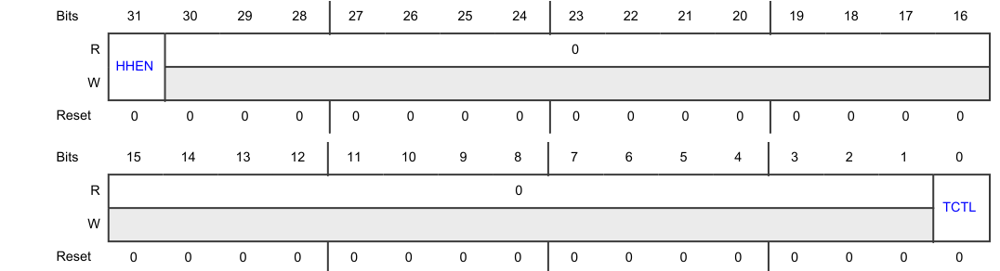

| 位 | 字段 | 功能 |
| --- | --- | --- |
| 31 | **HHEN** | 停止握手使能（**Halt handshake enable**）<br>当启动公共触发分频器更新时，本字段控制是否启动与 AXBS 的停止握手协议。<br>`0b` - 不启动停止握手协议。<br>`1b` - 启动停止握手协议。 |
| 30-1 | — | 本字段为保留，读取返回零。 |
| 0 | **TCTL** | 触发控制（**Trigger control**）<br>本字段控制立即更新与公共更新之间的分频器更新配置。<br>`0b` - 立即分频器更新<br>`1b` - 公共触发分频器更新 |

### 7.112. 时钟多路复用器 9 分频器触发寄存器（**MUX_9_DIV_TRIG**）

**MUX_9_DIV_TRIG** 偏移：**578h**

本寄存器为时钟多路复用器 9 的时钟分频器（仅 50% 占空比分频器）提供公共触发。向本寄存器写入任意值即向分频器提供一个触发。只有在适当配置 MC_CGM_MUX_9_DIV_TRIG_CTRL 寄存器之后才应写入本寄存器。


| 位 | 字段 | 功能 |
| --- | --- | --- |
| 31-0 | **TRIGGER** | 分频器更新的触发（**Trigger for divider update**） |

### 7.113. 时钟多路复用器 9 分频器更新状态寄存器（**MUX_9_DIV_UPD_STAT**）

**MUX_9_DIV_UPD_STAT** 偏移：**57Ch**

本寄存器提供与时钟多路复用器 9 对应的时钟分频器的更新状态。当对任一分频器控制寄存器执行写操作时，本寄存器中的分频器状态位被置为逻辑 1。当分频器已采样新的分频器配置时，该位被置为逻辑 0。在不跟踪状态位的情况下对同一时钟多路复用器内的相同或其他时钟分频器执行多次写入会导致报告不一致，即在相应的分频器更新仍待处理时分频器状态位可能已被置为逻辑 0。

**注意：** 无论 MC_CGM 时钟多路复用器内是否实现了任何分频器，对 MUX_n_DIV_UPD_STAT 的读访问总是完成而不返回总线传输错误。


| 位 | 字段 | 功能 |
| --- | --- | --- |
| 31-1 | — | 本字段为保留，读取返回零。 |
| 0 | **DIV_STAT** | 时钟多路复用器 9 的分频器状态（**Divider status for clock mux 9**）<br>在更新分频器控制寄存器之后读取 MUX_n_DIV_UPD_STAT 时，如果由于所选时钟源中的错误导致该字段的值固定为 1，请执行以下步骤将多路复用器切换到新的时钟源：<br>1. 将多路复用器切换到可工作的时钟源，不轮询该字段。<br>2. 更新 MUX_n_DC_m 并轮询该字段。<br>**注意：** 一旦分频器配置被更新或发生破坏性复位，该位即被清零。如果在该位为 1 时发生功能性复位，则它可能保持固定为 1，直到分频器输入时钟被恢复。<br>`0b` - 没有待处理的分频器配置更新。<br>`1b` - 与该多路复用器关联的至少一个分频器上的分频器配置更新待处理。 |

## 8. MC_CGM_5 寄存器说明

MC_CGM 实现一组共享 PCFS 配置寄存器的时钟多路复用器。MC_CGM 寄存器具有以下属性：
* 所有寄存器均为 32 位宽。
* 仅支持 32 位读和写访问。
* 小于 32 位的读/写访问将以错误终止。
* 对可写寄存器中只读寄存器字段的写入将被忽略，并且不提供错误响应。
* 对只读寄存器的写入将以错误响应中止。

### 8.1. MC_CGM_5 内存映射

MC_CGM_5 基地址：**4006_8000h**

| 偏移 | 寄存器 | 宽度（位） | 访问 | 复位值 |
| --- | --- | --- | --- | --- |
| **300h** | [时钟多路复用器 0 选择控制寄存器（**MUX_0_CSC**）](#82-时钟多路复用器-0-选择控制寄存器mux_0_csc) | 32 | RW | **0000_0000h** |
| **304h** | [时钟多路复用器 0 选择状态寄存器（**MUX_0_CSS**）](#83-时钟多路复用器-0-选择状态寄存器mux_0_css) | 32 | R | **0008_0000h** |

### 8.2. 时钟多路复用器 0 选择控制寄存器（**MUX_0_CSC**）

**MUX_0_CSC** 偏移：**300h**

本寄存器提供时钟多路复用器 0 的时钟源选择控制。时钟多路复用器 0 实现硬件控制的时钟切换，确保时钟切换以平滑的方式发生（无毛刺）。详情参见"硬件控制的时钟多路复用器"一节。

本寄存器仅在破坏性复位时复位。


| 位 | 字段 | 功能 |
| --- | --- | --- |
| 31-30 | — | 本字段为保留，读取返回零。 |
| 29-24 | **SELCTL** | 时钟源选择控制（**Clock source selection control**）<br>为时钟多路复用器 0 选择源时钟。保留值未显示。<br>`00_0000b` - clk_src_0<br>`10_0100b` - clk_src_36 |
| 23-4 | — | 本字段为保留，读取返回零。 |
| 3 | **SAFE_SW** | 安全时钟请求（**Safe clock request**）<br>向该位写入 1 会向 clk_src_0 发出安全时钟切换请求。发出安全时钟切换操作请求后，该位自动清零，状态寄存器中对应的位被置位。 |
| 2 | **CLK_SW** | 时钟切换（**Clock switch**）<br>向该位写入 1 会向时钟多路复用器 0 发出时钟切换请求。发出时钟切换操作请求后，该位自动清零，状态寄存器中对应的位被置位。 |
| 1-0 | — | 本字段为保留，读取返回零。 |

### 8.3. 时钟多路复用器 0 选择状态寄存器（**MUX_0_CSS**）

**MUX_0_CSS** 偏移：**304h**

本寄存器提供时钟多路复用器 0 的当前时钟源选择状态。

本寄存器仅在破坏性复位时复位。


| 位 | 字段 | 功能 |
| --- | --- | --- |
| 31-30 | — | 本字段为保留，读取返回零。 |
| 29-24 | **SELSTAT** | 时钟源选择状态（**Clock source selection status**）<br>该值指示时钟多路复用器 0 当前选择的源。保留值未显示。<br>`00_0000b` - clk_src_0<br>`10_0100b` - clk_src_36 |
| 23-20 | — | 本字段为保留，读取返回零。 |
| 19-17 | **SWTRG** | 切换触发原因（**Switch trigger cause**）<br>该值指示最近一次时钟源切换的原因。<br>**注意：** 如果时钟失效，随后对 MC_CGM 硬件时钟多路复用器发出多次安全时钟切换请求，则 SWTRG 字段的值可能为 4 或 5。<br>`000b` - 保留<br>`001b` - 请求后切换成功。<br>`010b` - 因目标时钟无效而切换请求失败，且当前时钟为 clk_src_0。<br>`011b` - 因当前时钟无效而切换请求失败，且当前时钟为 clk_src_0。<br>`100b` - 因安全时钟请求或复位而切换到 clk_src_0 成功。<br>`101b` - 因安全时钟请求或复位而切换到 clk_src_0 成功，但先前的当前时钟源无效。<br>`110b` - 保留<br>`111b` - 保留 |
| 16 | **SWIP** | 切换进行中（**Switch in progress**）<br>**注意：** 新的时钟切换请求只能在上一请求完成三个时钟周期之后发出。<br>`0b` - 时钟源切换已完成。<br>`1b` - 时钟源切换正在进行中。 |
| 15-4 | — | 本字段为保留，读取返回零。 |
| 3 | **SAFE_SW** | 安全时钟请求（**Safe clock request**）<br>本字段指示在时钟多路复用器 0 上先前的/正在进行的请求期间是否请求了切换到安全时钟操作。<br>`0b` - 未请求安全时钟切换操作。<br>`1b` - 已请求安全时钟切换操作。 |
| 2 | **CLK_SW** | 时钟切换（**Clock switch**）<br>本字段指示在时钟多路复用器 0 上先前的/正在进行的请求期间是否请求了时钟切换操作。<br>`0b` - 未请求时钟切换操作。<br>`1b` - 已请求时钟切换操作。 |
| 1-0 | — | 本字段为保留，读取返回零。 |

## 9. MC_CGM_6 寄存器说明

MC_CGM 实现一组共享 PCFS 配置寄存器的时钟多路复用器。MC_CGM 寄存器具有以下属性：
* 所有寄存器均为 32 位宽。
* 仅支持 32 位读和写访问。
* 小于 32 位的读/写访问将以错误终止。
* 对可写寄存器中只读寄存器字段的写入将被忽略，并且不提供错误响应。
* 对只读寄存器的写入将以错误响应中止。

### 9.1. MC_CGM_6 内存映射

MC_CGM_6 基地址：**4053_C000h**

| 偏移 | 寄存器 | 宽度（位） | 访问 | 复位值 |
| --- | --- | --- | --- | --- |
| **300h** | [时钟多路复用器 0 选择控制寄存器（**MUX_0_CSC**）](#92-时钟多路复用器-0-选择控制寄存器mux_0_csc) | 32 | RW | **0000_0000h** |
| **304h** | [时钟多路复用器 0 选择状态寄存器（**MUX_0_CSS**）](#93-时钟多路复用器-0-选择状态寄存器mux_0_css) | 32 | R | **0008_0000h** |
| **308h** | [时钟多路复用器 0 分频器 0 控制寄存器（**MUX_0_DC_0**）](#94-时钟多路复用器-0-分频器-0-控制寄存器mux_0_dc_0) | 32 | RW | **0000_0000h** |
| **33Ch** | [时钟多路复用器 0 分频器更新状态寄存器（**MUX_0_DIV_UPD_STAT**）](#95-时钟多路复用器-0-分频器更新状态寄存器mux_0_div_upd_stat) | 32 | R | **0000_0000h** |
| **340h** | [时钟多路复用器 1 选择控制寄存器（**MUX_1_CSC**）](#96-时钟多路复用器-1-选择控制寄存器mux_1_csc) | 32 | RW | **0000_0000h** |
| **344h** | [时钟多路复用器 1 选择状态寄存器（**MUX_1_CSS**）](#97-时钟多路复用器-1-选择状态寄存器mux_1_css) | 32 | R | **0008_0000h** |
| **348h** | [时钟多路复用器 1 分频器 0 控制寄存器（**MUX_1_DC_0**）](#98-时钟多路复用器-1-分频器-0-控制寄存器mux_1_dc_0) | 32 | RW | **0000_0000h** |
| **37Ch** | [时钟多路复用器 1 分频器更新状态寄存器（**MUX_1_DIV_UPD_STAT**）](#99-时钟多路复用器-1-分频器更新状态寄存器mux_1_div_upd_stat) | 32 | R | **0000_0000h** |
| **380h** | [时钟多路复用器 2 选择控制寄存器（**MUX_2_CSC**）](#910-时钟多路复用器-2-选择控制寄存器mux_2_csc) | 32 | RW | **0000_0000h** |
| **384h** | [时钟多路复用器 2 选择状态寄存器（**MUX_2_CSS**）](#911-时钟多路复用器-2-选择状态寄存器mux_2_css) | 32 | R | **0008_0000h** |
| **3C0h** | [时钟多路复用器 3 选择控制寄存器（**MUX_3_CSC**）](#912-时钟多路复用器-3-选择控制寄存器mux_3_csc) | 32 | RW | **0000_0000h** |
| **3C4h** | [时钟多路复用器 3 选择状态寄存器（**MUX_3_CSS**）](#913-时钟多路复用器-3-选择状态寄存器mux_3_css) | 32 | R | **0008_0000h** |
| **3C8h** | [时钟多路复用器 3 分频器 0 控制寄存器（**MUX_3_DC_0**）](#914-时钟多路复用器-3-分频器-0-控制寄存器mux_3_dc_0) | 32 | RW | **0000_0000h** |
| **3FCh** | [时钟多路复用器 3 分频器更新状态寄存器（**MUX_3_DIV_UPD_STAT**）](#915-时钟多路复用器-3-分频器更新状态寄存器mux_3_div_upd_stat) | 32 | R | **0000_0000h** |

### 9.2. 时钟多路复用器 0 选择控制寄存器（**MUX_0_CSC**）

**MUX_0_CSC** 偏移：**300h**

本寄存器提供时钟多路复用器 0 的时钟源选择控制。时钟多路复用器 0 实现硬件控制的时钟切换，确保时钟切换以平滑的方式发生（无毛刺）。详情参见"硬件控制的时钟多路复用器"一节。

本寄存器仅在破坏性复位时复位。


| 位 | 字段 | 功能 |
| --- | --- | --- |
| 31-30 | — | 本字段为保留，读取返回零。 |
| 29-24 | **SELCTL** | 时钟源选择控制（**Clock source selection control**）<br>为时钟多路复用器 0 选择源时钟。保留值未显示。<br>`00_0000b` - clk_src_0<br>`01_0110b` - clk_src_22<br>`10_1100b` - clk_src_44 |
| 23-4 | — | 本字段为保留，读取返回零。 |
| 3 | **SAFE_SW** | 安全时钟请求（**Safe clock request**）<br>向该位写入 1 会向 clk_src_0 发出安全时钟切换请求。发出安全时钟切换操作请求后，该位自动清零，状态寄存器中对应的位被置位。 |
| 2 | **CLK_SW** | 时钟切换（**Clock switch**）<br>向该位写入 1 会向时钟多路复用器 0 发出时钟切换请求。发出时钟切换操作请求后，该位自动清零，状态寄存器中对应的位被置位。 |
| 1-0 | — | 本字段为保留，读取返回零。 |

### 9.3. 时钟多路复用器 0 选择状态寄存器（**MUX_0_CSS**）

**MUX_0_CSS** 偏移：**304h**

本寄存器提供时钟多路复用器 0 的当前时钟源选择状态。

本寄存器仅在破坏性复位时复位。

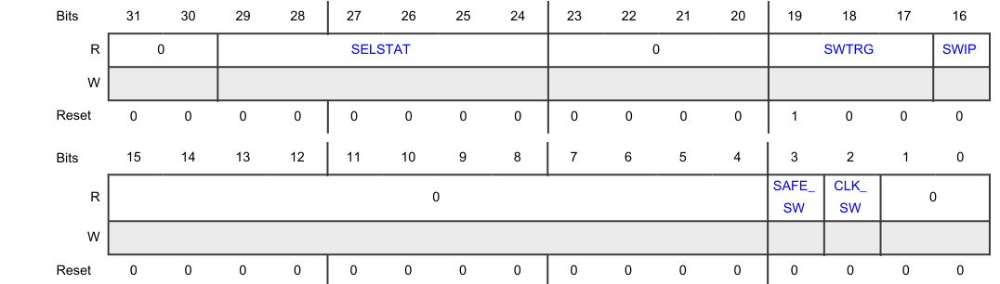

| 位 | 字段 | 功能 |
| --- | --- | --- |
| 31-30 | — | 本字段为保留，读取返回零。 |
| 29-24 | **SELSTAT** | 时钟源选择状态（**Clock source selection status**）<br>该值指示时钟多路复用器 0 当前选择的源。保留值未显示。<br>`00_0000b` - clk_src_0<br>`01_0110b` - clk_src_22<br>`10_1100b` - clk_src_44 |
| 23-20 | — | 本字段为保留，读取返回零。 |
| 19-17 | **SWTRG** | 切换触发原因（**Switch trigger cause**）<br>该值指示最近一次时钟源切换的原因。<br>**注意：** 如果时钟失效，随后对 MC_CGM 硬件时钟多路复用器发出多次安全时钟切换请求，则 SWTRG 字段的值可能为 4 或 5。<br>`000b` - 保留<br>`001b` - 请求后切换成功。<br>`010b` - 因目标时钟无效而切换请求失败，且当前时钟为 clk_src_0。<br>`011b` - 因当前时钟无效而切换请求失败，且当前时钟为 clk_src_0。<br>`100b` - 因安全时钟请求或复位而切换到 clk_src_0 成功。<br>`101b` - 因安全时钟请求或复位而切换到 clk_src_0 成功，但先前的当前时钟源无效。<br>`110b` - 保留<br>`111b` - 保留 |
| 16 | **SWIP** | 切换进行中（**Switch in progress**）<br>**注意：** 新的时钟切换请求只能在上一请求完成三个时钟周期之后发出。<br>`0b` - 时钟源切换已完成。<br>`1b` - 时钟源切换正在进行中。 |
| 15-4 | — | 本字段为保留，读取返回零。 |
| 3 | **SAFE_SW** | 安全时钟请求（**Safe clock request**）<br>本字段指示在时钟多路复用器 0 上先前的/正在进行的请求期间是否请求了切换到安全时钟操作。<br>`0b` - 未请求安全时钟切换操作。<br>`1b` - 已请求安全时钟切换操作。 |
| 2 | **CLK_SW** | 时钟切换（**Clock switch**）<br>本字段指示在时钟多路复用器 0 上先前的/正在进行的请求期间是否请求了时钟切换操作。<br>`0b` - 未请求时钟切换操作。<br>`1b` - 已请求时钟切换操作。 |
| 1-0 | — | 本字段为保留，读取返回零。 |

### 9.4. 时钟多路复用器 0 分频器 0 控制寄存器（**MUX_0_DC_0**）

**MUX_0_DC_0** 偏移：**308h**

本寄存器控制时钟多路复用器 0 的时钟分频器 0。

该分频器为 50% 占空比分频器。

**注意：** 对本寄存器各字段的更新应为原子写，即单次写入应更新整个寄存器。

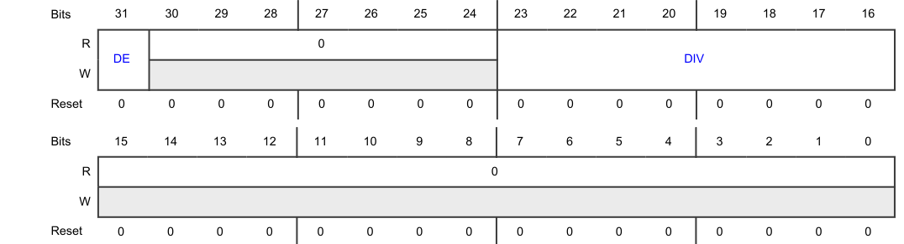

| 位 | 字段 | 功能 |
| --- | --- | --- |
| 31 | **DE** | 分频器使能（**Divider enable**）<br>`0b` - 分频器被禁用。<br>`1b` - 分频器被使能。 |
| 30-24 | — | 本字段为保留，读取返回零。 |
| 23-16 | **DIV** | 分频值（**Division value**）<br>本字段提供时钟分频器的分频值。分频后的时钟周期为分频器当前输入时钟周期的"DIV+1"倍。 |
| 15-0 | — | 本字段为保留，读取返回零。 |

### 9.5. 时钟多路复用器 0 分频器更新状态寄存器（**MUX_0_DIV_UPD_STAT**）

**MUX_0_DIV_UPD_STAT** 偏移：**33Ch**

本寄存器提供与时钟多路复用器 0 对应的时钟分频器的更新状态。当对任一分频器控制寄存器执行写操作时，本寄存器中的分频器状态位被置为逻辑 1。当分频器已采样新的分频器配置时，该位被置为逻辑 0。在不跟踪状态位的情况下对同一时钟多路复用器内的相同或其他时钟分频器执行多次写入会导致报告不一致，即在相应的分频器更新仍待处理时分频器状态位可能已被置为逻辑 0。

**注意：** 无论 MC_CGM 时钟多路复用器内是否实现了任何分频器，对 MUX_n_DIV_UPD_STAT 的读访问总是完成而不返回总线传输错误。


| 位 | 字段 | 功能 |
| --- | --- | --- |
| 31-1 | — | 本字段为保留，读取返回零。 |
| 0 | **DIV_STAT** | 时钟多路复用器 0 的分频器状态（**Divider status for clock mux 0**）<br>在更新分频器控制寄存器之后读取 MUX_n_DIV_UPD_STAT 时，如果由于所选时钟源中的错误导致该字段的值固定为 1，请执行以下步骤将多路复用器切换到新的时钟源：<br>1. 将多路复用器切换到可工作的时钟源，不轮询该字段。<br>2. 更新 MUX_n_DC_m 并轮询该字段。<br>**注意：** 一旦分频器配置被更新或发生破坏性复位，该位即被清零。如果在该位为 1 时发生功能性复位，则它可能保持固定为 1，直到分频器输入时钟被恢复。<br>`0b` - 没有待处理的分频器配置更新。<br>`1b` - 与该多路复用器关联的至少一个分频器上的分频器配置更新待处理。 |

### 9.6. 时钟多路复用器 1 选择控制寄存器（**MUX_1_CSC**）

**MUX_1_CSC** 偏移：**340h**

本寄存器提供时钟多路复用器 1 的时钟源选择控制。时钟多路复用器 1 实现硬件控制的时钟切换，确保时钟切换以平滑的方式发生（无毛刺）。详情参见"硬件控制的时钟多路复用器"一节。

本寄存器仅在破坏性复位时复位。


| 位 | 字段 | 功能 |
| --- | --- | --- |
| 31-30 | — | 本字段为保留，读取返回零。 |
| 29-24 | **SELCTL** | 时钟源选择控制（**Clock source selection control**）<br>为时钟多路复用器 1 选择源时钟。保留值未显示。<br>`00_0000b` - clk_src_0<br>`01_0111b` - clk_src_23<br>`10_0101b` - clk_src_37<br>`10_0111b` - clk_src_39<br>`10_1000b` - clk_src_40 |
| 23-4 | — | 本字段为保留，读取返回零。 |
| 3 | **SAFE_SW** | 安全时钟请求（**Safe clock request**）<br>向该位写入 1 会向 clk_src_0 发出安全时钟切换请求。发出安全时钟切换操作请求后，该位自动清零，状态寄存器中对应的位被置位。 |
| 2 | **CLK_SW** | 时钟切换（**Clock switch**）<br>向该位写入 1 会向时钟多路复用器 1 发出时钟切换请求。发出时钟切换操作请求后，该位自动清零，状态寄存器中对应的位被置位。 |
| 1-0 | — | 本字段为保留，读取返回零。 |

### 9.7. 时钟多路复用器 1 选择状态寄存器（**MUX_1_CSS**）

**MUX_1_CSS** 偏移：**344h**

本寄存器提供时钟多路复用器 1 的当前时钟源选择状态。

本寄存器仅在破坏性复位时复位。


| 位 | 字段 | 功能 |
| --- | --- | --- |
| 31-30 | — | 本字段为保留，读取返回零。 |
| 29-24 | **SELSTAT** | 时钟源选择状态（**Clock source selection status**）<br>该值指示时钟多路复用器 1 当前选择的源。保留值未显示。<br>`00_0000b` - clk_src_0<br>`01_0111b` - clk_src_23<br>`10_0101b` - clk_src_37<br>`10_0111b` - clk_src_39<br>`10_1000b` - clk_src_40 |
| 23-20 | — | 本字段为保留，读取返回零。 |
| 19-17 | **SWTRG** | 切换触发原因（**Switch trigger cause**）<br>该值指示最近一次时钟源切换的原因。<br>**注意：** 如果时钟失效，随后对 MC_CGM 硬件时钟多路复用器发出多次安全时钟切换请求，则 SWTRG 字段的值可能为 4 或 5。<br>`000b` - 保留<br>`001b` - 请求后切换成功。<br>`010b` - 因目标时钟无效而切换请求失败，且当前时钟为 clk_src_0。<br>`011b` - 因当前时钟无效而切换请求失败，且当前时钟为 clk_src_0。<br>`100b` - 因安全时钟请求或复位而切换到 clk_src_0 成功。<br>`101b` - 因安全时钟请求或复位而切换到 clk_src_0 成功，但先前的当前时钟源无效。<br>`110b` - 保留<br>`111b` - 保留 |
| 16 | **SWIP** | 切换进行中（**Switch in progress**）<br>**注意：** 新的时钟切换请求只能在上一请求完成三个时钟周期之后发出。<br>`0b` - 时钟源切换已完成。<br>`1b` - 时钟源切换正在进行中。 |
| 15-4 | — | 本字段为保留，读取返回零。 |
| 3 | **SAFE_SW** | 安全时钟请求（**Safe clock request**）<br>本字段指示在时钟多路复用器 1 上先前的/正在进行的请求期间是否请求了切换到安全时钟操作。<br>`0b` - 未请求安全时钟切换操作。<br>`1b` - 已请求安全时钟切换操作。 |
| 2 | **CLK_SW** | 时钟切换（**Clock switch**）<br>本字段指示在时钟多路复用器 1 上先前的/正在进行的请求期间是否请求了时钟切换操作。<br>`0b` - 未请求时钟切换操作。<br>`1b` - 已请求时钟切换操作。 |
| 1-0 | — | 本字段为保留，读取返回零。 |

### 9.8. 时钟多路复用器 1 分频器 0 控制寄存器（**MUX_1_DC_0**）

**MUX_1_DC_0** 偏移：**348h**

本寄存器控制时钟多路复用器 1 的时钟分频器 0。

该分频器为 50% 占空比分频器。

**注意：** 对本寄存器各字段的更新应为原子写，即单次写入应更新整个寄存器。

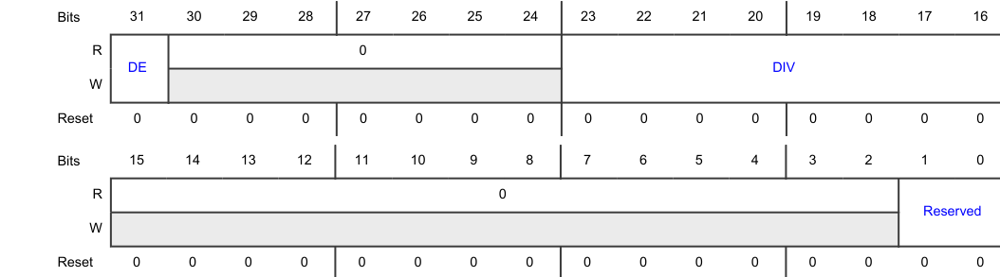

| 位 | 字段 | 功能 |
| --- | --- | --- |
| 31 | **DE** | 分频器使能（**Divider enable**）<br>`0b` - 分频器被禁用。<br>`1b` - 分频器被使能。 |
| 30-24 | — | 本字段为保留，读取返回零。 |
| 23-16 | **DIV** | 分频值（**Division value**）<br>本字段提供时钟分频器的分频值。分频后的时钟周期为分频器当前输入时钟周期的"DIV+1"倍。 |
| 15-2 | — | 保留 |
| 1-0 | — | 保留 |

### 9.9. 时钟多路复用器 1 分频器更新状态寄存器（**MUX_1_DIV_UPD_STAT**）

**MUX_1_DIV_UPD_STAT** 偏移：**37Ch**

本寄存器提供与时钟多路复用器 1 对应的时钟分频器的更新状态。当对任一分频器控制寄存器执行写操作时，本寄存器中的分频器状态位被置为逻辑 1。当分频器已采样新的分频器配置时，该位被置为逻辑 0。在不跟踪状态位的情况下对同一时钟多路复用器内的相同或其他时钟分频器执行多次写入会导致报告不一致，即在相应的分频器更新仍待处理时分频器状态位可能已被置为逻辑 0。

**注意：** 无论 MC_CGM 时钟多路复用器内是否实现了任何分频器，对 MUX_n_DIV_UPD_STAT 的读访问总是完成而不返回总线传输错误。


| 位 | 字段 | 功能 |
| --- | --- | --- |
| 31-1 | — | 本字段为保留，读取返回零。 |
| 0 | **DIV_STAT** | 时钟多路复用器 1 的分频器状态（**Divider status for clock mux 1**）<br>在更新分频器控制寄存器之后读取 MUX_n_DIV_UPD_STAT 时，如果由于所选时钟源中的错误导致该字段的值固定为 1，请执行以下步骤将多路复用器切换到新的时钟源：<br>1. 将多路复用器切换到可工作的时钟源，不轮询该字段。<br>2. 更新 MUX_n_DC_m 并轮询该字段。<br>**注意：** 一旦分频器配置被更新或发生破坏性复位，该位即被清零。如果在该位为 1 时发生功能性复位，则它可能保持固定为 1，直到分频器输入时钟被恢复。<br>`0b` - 没有待处理的分频器配置更新。<br>`1b` - 与该多路复用器关联的至少一个分频器上的分频器配置更新待处理。 |

### 9.10. 时钟多路复用器 2 选择控制寄存器（**MUX_2_CSC**）

**MUX_2_CSC** 偏移：**380h**

本寄存器提供时钟多路复用器 2 的时钟源选择控制。时钟多路复用器 2 实现硬件控制的时钟切换，确保时钟切换以平滑的方式发生（无毛刺）。详情参见"硬件控制的时钟多路复用器"一节。

本寄存器仅在破坏性复位时复位。


| 位 | 字段 | 功能 |
| --- | --- | --- |
| 31-30 | — | 本字段为保留，读取返回零。 |
| 29-24 | **SELCTL** | 时钟源选择控制（**Clock source selection control**）<br>为时钟多路复用器 2 选择源时钟。保留值未显示。<br>`00_0000b` - clk_src_0<br>`10_0110b` - clk_src_38<br>`10_1001b` - clk_src_41<br>`10_1101b` - clk_src_45 |
| 23-4 | — | 本字段为保留，读取返回零。 |
| 3 | **SAFE_SW** | 安全时钟请求（**Safe clock request**）<br>向该位写入 1 会向 clk_src_0 发出安全时钟切换请求。发出安全时钟切换操作请求后，该位自动清零，状态寄存器中对应的位被置位。 |
| 2 | **CLK_SW** | 时钟切换（**Clock switch**）<br>向该位写入 1 会向时钟多路复用器 2 发出时钟切换请求。发出时钟切换操作请求后，该位自动清零，状态寄存器中对应的位被置位。 |
| 1-0 | — | 本字段为保留，读取返回零。 |

### 9.11. 时钟多路复用器 2 选择状态寄存器（**MUX_2_CSS**）

**MUX_2_CSS** 偏移：**384h**

本寄存器提供时钟多路复用器 2 的当前时钟源选择状态。

本寄存器仅在破坏性复位时复位。


| 位 | 字段 | 功能 |
| --- | --- | --- |
| 31-30 | — | 本字段为保留，读取返回零。 |
| 29-24 | **SELSTAT** | 时钟源选择状态（**Clock source selection status**）<br>该值指示时钟多路复用器 2 当前选择的源。保留值未显示。<br>`00_0000b` - clk_src_0<br>`10_0110b` - clk_src_38<br>`10_1001b` - clk_src_41<br>`10_1101b` - clk_src_45 |
| 23-20 | — | 本字段为保留，读取返回零。 |
| 19-17 | **SWTRG** | 切换触发原因（**Switch trigger cause**）<br>该值指示最近一次时钟源切换的原因。<br>**注意：** 如果时钟失效，随后对 MC_CGM 硬件时钟多路复用器发出多次安全时钟切换请求，则 SWTRG 字段的值可能为 4 或 5。<br>`000b` - 保留<br>`001b` - 请求后切换成功。<br>`010b` - 因目标时钟无效而切换请求失败，且当前时钟为 clk_src_0。<br>`011b` - 因当前时钟无效而切换请求失败，且当前时钟为 clk_src_0。<br>`100b` - 因安全时钟请求或复位而切换到 clk_src_0 成功。<br>`101b` - 因安全时钟请求或复位而切换到 clk_src_0 成功，但先前的当前时钟源无效。<br>`110b` - 保留<br>`111b` - 保留 |
| 16 | **SWIP** | 切换进行中（**Switch in progress**）<br>**注意：** 新的时钟切换请求只能在上一请求完成三个时钟周期之后发出。<br>`0b` - 时钟源切换已完成。<br>`1b` - 时钟源切换正在进行中。 |
| 15-4 | — | 本字段为保留，读取返回零。 |
| 3 | **SAFE_SW** | 安全时钟请求（**Safe clock request**）<br>本字段指示在时钟多路复用器 2 上先前的/正在进行的请求期间是否请求了切换到安全时钟操作。<br>`0b` - 未请求安全时钟切换操作。<br>`1b` - 已请求安全时钟切换操作。 |
| 2 | **CLK_SW** | 时钟切换（**Clock switch**）<br>本字段指示在时钟多路复用器 2 上先前的/正在进行的请求期间是否请求了时钟切换操作。<br>`0b` - 未请求时钟切换操作。<br>`1b` - 已请求时钟切换操作。 |
| 1-0 | — | 本字段为保留，读取返回零。 |

### 9.12. 时钟多路复用器 3 选择控制寄存器（**MUX_3_CSC**）

**MUX_3_CSC** 偏移：**3C0h**

本寄存器提供时钟多路复用器 3 的时钟源选择控制。时钟多路复用器 3 实现硬件控制的时钟切换，确保时钟切换以平滑的方式发生（无毛刺）。详情参见"硬件控制的时钟多路复用器"一节。

本寄存器仅在破坏性复位时复位。

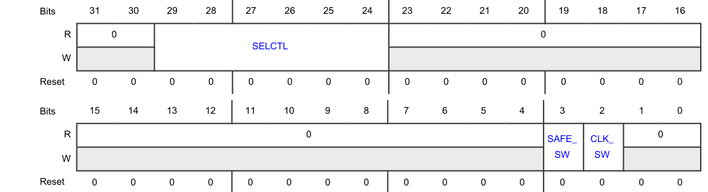

| 位 | 字段 | 功能 |
| --- | --- | --- |
| 31-30 | — | 本字段为保留，读取返回零。 |
| 29-24 | **SELCTL** | 时钟源选择控制（**Clock source selection control**）<br>为时钟多路复用器 3 选择源时钟。保留值未显示。<br>`00_0000b` - clk_src_0<br>`10_0111b` - clk_src_39 |
| 23-4 | — | 本字段为保留，读取返回零。 |
| 3 | **SAFE_SW** | 安全时钟请求（**Safe clock request**）<br>向该位写入 1 会向 clk_src_0 发出安全时钟切换请求。发出安全时钟切换操作请求后，该位自动清零，状态寄存器中对应的位被置位。 |
| 2 | **CLK_SW** | 时钟切换（**Clock switch**）<br>向该位写入 1 会向时钟多路复用器 3 发出时钟切换请求。发出时钟切换操作请求后，该位自动清零，状态寄存器中对应的位被置位。 |
| 1-0 | — | 本字段为保留，读取返回零。 |

### 9.13. 时钟多路复用器 3 选择状态寄存器（**MUX_3_CSS**）

**MUX_3_CSS** 偏移：**3C4h**

本寄存器提供时钟多路复用器 3 的当前时钟源选择状态。

本寄存器仅在破坏性复位时复位。


| 位 | 字段 | 功能 |
| --- | --- | --- |
| 31-30 | — | 本字段为保留，读取返回零。 |
| 29-24 | **SELSTAT** | 时钟源选择状态（**Clock source selection status**）<br>该值指示时钟多路复用器 3 当前选择的源。保留值未显示。<br>`00_0000b` - clk_src_0<br>`10_0111b` - clk_src_39 |
| 23-20 | — | 本字段为保留，读取返回零。 |
| 19-17 | **SWTRG** | 切换触发原因（**Switch trigger cause**）<br>该值指示最近一次时钟源切换的原因。<br>**注意：** 如果时钟失效，随后对 MC_CGM 硬件时钟多路复用器发出多次安全时钟切换请求，则 SWTRG 字段的值可能为 4 或 5。<br>`000b` - 保留<br>`001b` - 请求后切换成功。<br>`010b` - 因目标时钟无效而切换请求失败，且当前时钟为 clk_src_0。<br>`011b` - 因当前时钟无效而切换请求失败，且当前时钟为 clk_src_0。<br>`100b` - 因安全时钟请求或复位而切换到 clk_src_0 成功。<br>`101b` - 因安全时钟请求或复位而切换到 clk_src_0 成功，但先前的当前时钟源无效。<br>`110b` - 保留<br>`111b` - 保留 |
| 16 | **SWIP** | 切换进行中（**Switch in progress**）<br>**注意：** 新的时钟切换请求只能在上一请求完成三个时钟周期之后发出。<br>`0b` - 时钟源切换已完成。<br>`1b` - 时钟源切换正在进行中。 |
| 15-4 | — | 本字段为保留，读取返回零。 |
| 3 | **SAFE_SW** | 安全时钟请求（**Safe clock request**）<br>本字段指示在时钟多路复用器 3 上先前的/正在进行的请求期间是否请求了切换到安全时钟操作。<br>`0b` - 未请求安全时钟切换操作。<br>`1b` - 已请求安全时钟切换操作。 |
| 2 | **CLK_SW** | 时钟切换（**Clock switch**）<br>本字段指示在时钟多路复用器 3 上先前的/正在进行的请求期间是否请求了时钟切换操作。<br>`0b` - 未请求时钟切换操作。<br>`1b` - 已请求时钟切换操作。 |
| 1-0 | — | 本字段为保留，读取返回零。 |

### 9.14. 时钟多路复用器 3 分频器 0 控制寄存器（**MUX_3_DC_0**）

**MUX_3_DC_0** 偏移：**3C8h**

本寄存器控制时钟多路复用器 3 的时钟分频器 0。

该分频器为 50% 占空比分频器。

**注意：** 对本寄存器各字段的更新应为原子写，即单次写入应更新整个寄存器。

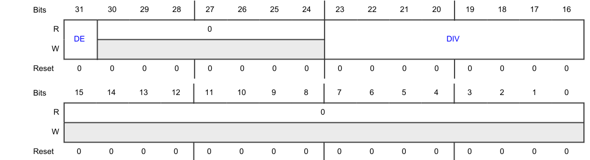

| 位 | 字段 | 功能 |
| --- | --- | --- |
| 31 | **DE** | 分频器使能（**Divider enable**）<br>`0b` - 分频器被禁用。<br>`1b` - 分频器被使能。 |
| 30-24 | — | 本字段为保留，读取返回零。 |
| 23-16 | **DIV** | 分频值（**Division value**）<br>本字段提供时钟分频器的分频值。分频后的时钟周期为分频器当前输入时钟周期的"DIV+1"倍。 |
| 15-0 | — | 本字段为保留，读取返回零。 |

### 9.15. 时钟多路复用器 3 分频器更新状态寄存器（**MUX_3_DIV_UPD_STAT**）

**MUX_3_DIV_UPD_STAT** 偏移：**3FCh**

本寄存器提供与时钟多路复用器 3 对应的时钟分频器的更新状态。当对任一分频器控制寄存器执行写操作时，本寄存器中的分频器状态位被置为逻辑 1。当分频器已采样新的分频器配置时，该位被置为逻辑 0。在不跟踪状态位的情况下对同一时钟多路复用器内的相同或其他时钟分频器执行多次写入会导致报告不一致，即在相应的分频器更新仍待处理时分频器状态位可能已被置为逻辑 0。

**注意：** 无论 MC_CGM 时钟多路复用器内是否实现了任何分频器，对 MUX_n_DIV_UPD_STAT 的读访问总是完成而不返回总线传输错误。


| 位 | 字段 | 功能 |
| --- | --- | --- |
| 31-1 | — | 本字段为保留，读取返回零。 |
| 0 | **DIV_STAT** | 时钟多路复用器 3 的分频器状态（**Divider status for clock mux 3**）<br>在更新分频器控制寄存器之后读取 MUX_n_DIV_UPD_STAT 时，如果由于所选时钟源中的错误导致该字段的值固定为 1，请执行以下步骤将多路复用器切换到新的时钟源：<br>1. 将多路复用器切换到可工作的时钟源，不轮询该字段。<br>2. 更新 MUX_n_DC_m 并轮询该字段。<br>**注意：** 一旦分频器配置被更新或发生破坏性复位，该位即被清零。如果在该位为 1 时发生功能性复位，则它可能保持固定为 1，直到分频器输入时钟被恢复。<br>`0b` - 没有待处理的分频器配置更新。<br>`1b` - 与该多路复用器关联的至少一个分频器上的分频器配置更新待处理。 |

## 10. 功能描述

### 10.1. 时钟选择多路复用器

MC_CGM 内部的每个时钟多路复用器要么实现完全硬件控制的时钟多路复用器，要么实现软件控制的时钟多路复用器。以下各节描述时钟多路复用器的这两种形式。

#### 10.1.1. 硬件控制的时钟多路复用器

在基于硬件的时钟多路复用中，其基本假设是在某些条件（错误或复位状态）下，软件可能未处于活动状态。因此，时钟切换完全由硬件完成且是无毛刺的。为了便于软件发出时钟切换请求，MUX_n_CSC 和 MUX_n_CSS 寄存器实现了时钟多路复用器的请求和状态，其余部分由硬件管理。使用这些寄存器，软件可以监视基于硬件的时钟多路复用器的状态，也可以发出时钟切换请求。建议仅在没有待处理/正在进行的时钟切换请求时才发出新的时钟切换请求。但是，切换到安全时钟（即 clk_src_0）可以在任何时刻执行。切换到安全时钟总是会完成。软件应确保在执行基于软件的切换到安全时钟时，寄存器配置时钟至少在完成对 MUX_n_CSC 寄存器的写入期间是可用的。这意味着时钟必须正在运行，寄存器写才能完成。硬件时钟多路复用器还支持基于硬件的切换到安全时钟，该切换从外部请求 MC_CGM（例如由 MC_RGM 发出）。对于基于硬件的切换到安全时钟，不需要 MC_CGM 的寄存器配置时钟。

* 从软件"切换到安全时钟"仅通过编程 MUX_n_CSC[SAFE_SW] 位字段来请求，而不是通过组合 MUX_n_CSC 寄存器的 MUX_n_CSC[CLK_SW] 和 MUX_n_CSC[SELCTL] 位字段来请求。请求切换到安全时钟时，对其他字段的写入将被忽略。
* 在 MC_RGM 请求的切换到安全时钟完成后，MC_RGM 还会请求时钟分频器切换到其默认值。这种硬件触发的分频器更新可以用与软件配置更新相同的方式进行监视，软件应利用它来确保在重新配置时钟之前配置更新已完成。
* 当时钟选择指向"保留"输入时钟源时，对 MUX_n_CSC 寄存器的写访问将以总线传输错误中止。

**注意：** 图 131 给出在向硬件控制的时钟多路复用器发出时钟切换请求时应遵循的步骤序列的流程图表示。切换到安全时钟可以在任何时刻请求，出于清晰的原因，图中未予显示。

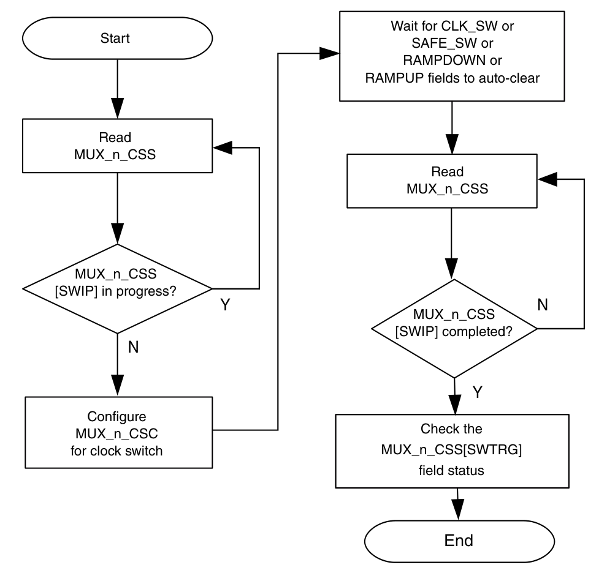

* 切换到安全时钟命令总是会导致从当前选择的时钟下降（**ramp-down**），然后切换到"安全时钟"，除非存在软件请求的正在进行且无上升和下降的时钟切换。当存在正在进行的无上升或无下降的时钟切换时发出安全时钟切换请求，将导致切换到安全时钟而不执行下降（无论是通过 MC_RGM 还是通过 MUX_n_CSC 寄存器提供），即不会在切换到"安全时钟"之前执行下降。
* 上述流程图步骤可以在下面的第 1 点和第 3 点之前执行：
  1. 禁用分频器。
  2. 通过硬件多路复用器切换时钟。
  3. 使能并配置分频器（原子写指令）。

#### 10.1.2. 软件控制的时钟多路复用器

在基于软件的时钟多路复用中，其基本假设是软件始终可用，且芯片中不存在错误或复位条件。这意味着通过在软件中遵循一系列步骤，可以实现 MC_CGM MUX 的输入时钟源之间的无毛刺切换。基于软件的时钟多路复用器在时钟多路复用器的输出端实现一个时钟门控。软件可以使用同步/平滑时钟门控位（即 MUX_n_CSC[CG]）或强制时钟门控位（即 MUX_n_CSC[FCG]）来门控 MC_CGM MUX 的选定时钟。硬件不保证在使用强制时钟门控时任何毛刺都不会逃逸。当强制时钟门控位被写入 1 时，内部时钟门控将强制把选定的时钟门控到逻辑 0，因此，为避免时钟毛刺，应确保选定的时钟源没有在运行。图 132 给出在向软件控制的时钟多路复用器发出时钟切换请求时应遵循的步骤序列的流程图表示。软件控制的时钟多路复用器不支持切换到安全时钟。

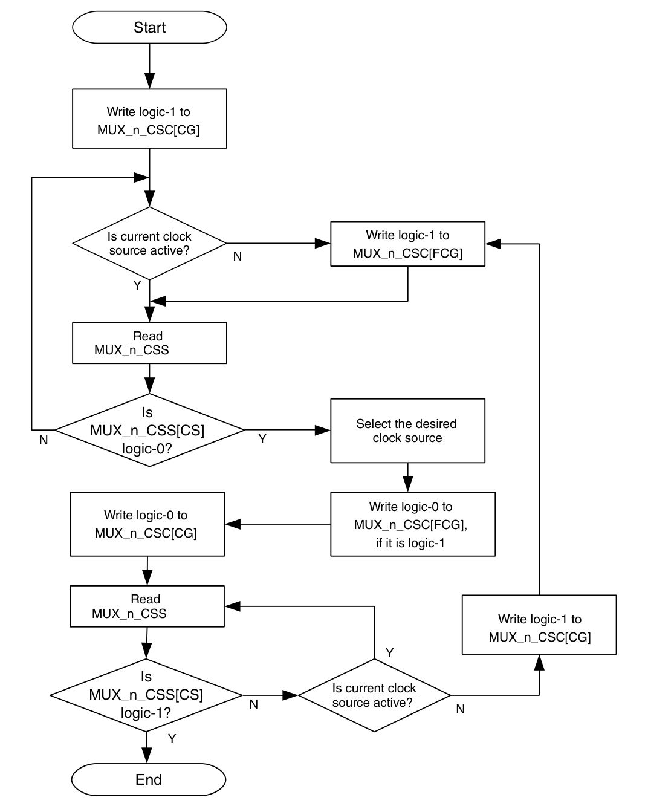

* 确保在使用强制门控位之前，任何使用 MC_CGM MUX 时钟的 IP 或其他逻辑都处于非活动状态，或者由强制门控产生的时钟毛刺不会影响该 IP（即，该 IP 在 MC_CGM 之后被时钟门控）。
* 在图 132 中，要选择的时钟源在时钟切换时应当是活动的，否则 MUX_n_CSS[CS] 字段将保持逻辑 0。如果被选择的时钟源在切换操作期间变为无效（即时钟丢失等），可以通过将 MUX_n_CSC[CG] 和 MUX_n_CSC[FCG] 字段都写为逻辑 1 来启动切换到另一时钟源。
* 为 MUX_n_CSC[SELCTL] 字段写入"保留"值可能导致时钟多路复用器输出端出现不可预测的时钟。

**注意：** 上述流程图步骤可以在下面的第 1 点和第 3 点之前执行：
1. 禁用分频器。
2. 通过软件多路复用器切换时钟。
3. 使能并配置分频器（原子写指令）。

### 10.2. PCFS

MC_CGM 在更改 MC_CGM 时钟多路复用器上的时钟源时实现 PCFS。PCFS 仅在硬件控制的时钟多路复用器中实现，而不在软件控制的时钟多路复用器中实现。它通过从一个时钟到另一时钟的渐进频率转换，为电源/电压供电单元提供渐进的负载变化。频率转换通过对输入时钟源按一系列分频值进行时钟分频来实现，当分频值序列递减时实现频率下降，递增时实现频率上升。由于时钟分频（分数分频）在数字逻辑中实现，因此它是粗级别的时钟分频而非精确级别的分频，这意味着渐进分频后的时钟的占空比可能随时间变化。

当已知漏电流与频率的关系时（即对于给定的漏电流，最大允许的频率变化量 fchg），PCFS 特性得到使用。fchg 是 PCFS 的第一个输入参数，PCFS 的其他参数相对于 clk_src_0 指定或计算。

PCFS 硬件根据编程到 PCFS 配置寄存器中的某些值生成时钟分频因子。以下伪代码表示时钟分频值序列（di）的生成：

```
/* ramp down division values (dn) with k steps*/
delta1 = RATE/1000;
delta2 = RATE/1000;
d0       = 1.0;
for i=1 to k-1 do
di = di-1 + delta1;
delta1 = delta1 + delta2;
endfor

/* ramp up division values (dn) with k steps*/
delta1 = RATE*k/1000;
delta2 = RATE/1000;
d0       = 1.0 + RATE*k*(k+1)/2;
for i=1 to k-1 do
di = di-1 - delta1;
delta1 = delta1 - delta2;
endfor
```

由于时钟分频值的生成不是一个封闭有界函数，因此针对给定的 fchg 计算 RATE 是一个迭代过程。找到一个 RATE 值，使其产生的时钟分频序列在使用时不会导致大于 fchg 的频率变化。表 122 列出了一些针对 amax 的 RATE 值，其中：

amax = fchg/Fi

其中 Fi 是时钟多路复用器第 i 个输入时钟源的频率。

| amax | PCFS rate |
| --- | --- |
| 0.005 | 12 |
| 0.01 | 48 |
| 0.15 | 112 |
| 0.20 | 184 |

在下降情况下的最后一个时钟分频因子，或上升情况下的第一个时钟（紧随下降过程之后），应满足这样的条件：从任一输入时钟源到另一时钟源的切换都可称为安全的，表明负载变化具有可持续的电源影响。该频率级别称为"安全频率"（**safe frequency**），相当于 clk_src_0 的频率，clk_src_0 被称为"安全时钟"（**safe clock**），其频率称为"安全时钟频率"（**safe clock frequency**，fsafe）。时钟分频因子序列中的最后一个时钟分频因子在"k"步之后出现。因子 k（= 步数）使用以下公式计算：

`k = ceil(0.5 + sqrt(0.25 - (2000 * (1 -(Fi/fsafe)) / RATE)))`

使用上述公式，针对给定的时钟源频率可以计算出所有 PCFS 寄存器配置值：

`PCFS_DIVEi.DIV = (Fi/fsafe)*1000-1;`

`PCFS_DIVCi.INIT = RATE * k;`

`PCFS_DIVCi.RATE = RATE;`

`PCFS_DIVSi.DIV  = 999 + (RATE * k * (k+1)/2);`

图 133 给出 PCFS 下降和上升期间发生的频率变化的图形表示。

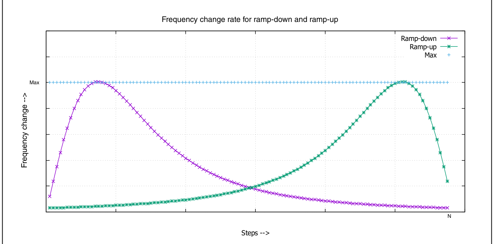

对于任何给定的时钟源，如果其频率低于 clk_src_0 的频率，则其相应的寄存器应编程为默认值，其中默认值满足 PCFS 分频器起始值和 PCFS 分频器结束值相同且等于 divide-by-1。默认值确保在发出时钟切换请求以从该源切换或切换到该源时不进行渐进的时钟分频。

**注意：** 使用公式 (clk_src_0/((PCFS_DIVE+1)/1000)) MHz 计算 PCFS RAMPDOWN 和 RAMPUP 操作期间的最小频率。

#### 10.2.1. PCFS 控制

PCFS 操作由一组配置寄存器配置。一组寄存器用于时钟分频因子的计算，即 PCFS_DIVC、PCFS_DIVE、PCFS_DIVS 和 PCFS_SDUR，而寄存器 MUX_n_CSC 和 MUX_n_CSS 实现 PCFS 操作的触发和状态。时钟分频因子应在任何其他 MC_CGM 操作启动之前编程并保持不变。所有与时钟分频因子对应的寄存器都应以 clk_src_0 作为配置时钟进行编程，并且在任何 MC_CGM 多路复用器上执行任何时钟切换或 PCFS 操作之前完成。应当注意，与时钟分频因子对应的寄存器的默认值为仅由硬件计算时钟分频因子（即 divide-by-1）。PCFS 操作总是在发出安全时钟请求时触发，除非存在正在进行的无上升或无下降的时钟切换。因此，软件需要确保 PCFS 配置完整且正确。

在配置 MUX_n_CSC 时，只应提供有效的 PCFS 和时钟切换请求。仅当 PCFS 操作处于空闲（**Idle**）状态时才应提供 PCFS 或时钟切换请求。如果存在正在进行的 PCFS 操作，建议在正在进行的操作完成之前不要提供任何新的 PCFS 触发（切换到安全时钟除外）。通过硬件或寄存器配置切换到安全时钟可以在任何时刻提供，并且总是会完成。PCFS 和时钟切换触发的有效组合列于表 123。所有 PCFS 命令本质上应是原子的，这意味着单次寄存器写入应提供要执行的完整 PCFS 序列，即下降、时钟切换和上升。

| PCFS 操作状态 | 命令 |
| --- | --- |
| 空闲（Idle） | 下降、时钟切换和上升 |
| 空闲（Idle） | 仅时钟切换（无上升或无下降） |

当通过写入 MUX_n_CSC 提供切换到安全时钟时，对其他寄存器字段的写入将被忽略。

#### 10.2.2. 时钟源上电与选择

本节为给定时钟源的上电以及在 MC_CGM 时钟多路复用器处选择该时钟源提供指南。以下为时钟源的上电流程：

1. 配置参数（如有）。
2. 配置上电（或下电）控制字段。
3. 等待上电状态指示。

在上电指示之后，可以选择该时钟源以在 MC_CGM 时钟多路复用器处提供输出时钟。还可以在已上电的时钟源上激活时钟监视设置。

图 134 给出该序列的流程图表示。

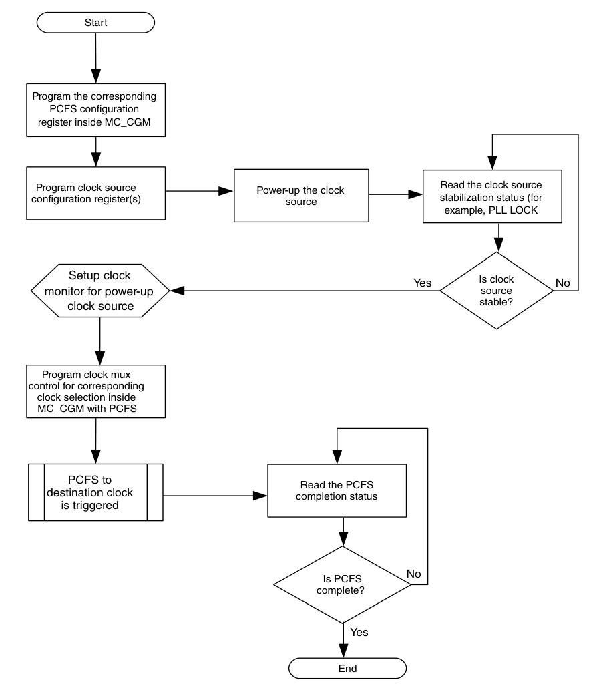

#### 10.2.3. 时钟源下电与取消选择

本节为给定时钟源的下电以及在 MC_CGM 时钟多路复用器处取消选择该时钟源提供指南。以下为时钟源的下电流程：

1. 在所有 MC_CGM 时钟多路复用器处取消选择该时钟源。
2. 配置上电（或下电）控制字段。
3. 等待下电状态指示。

图 135 给出该序列的流程图表示。

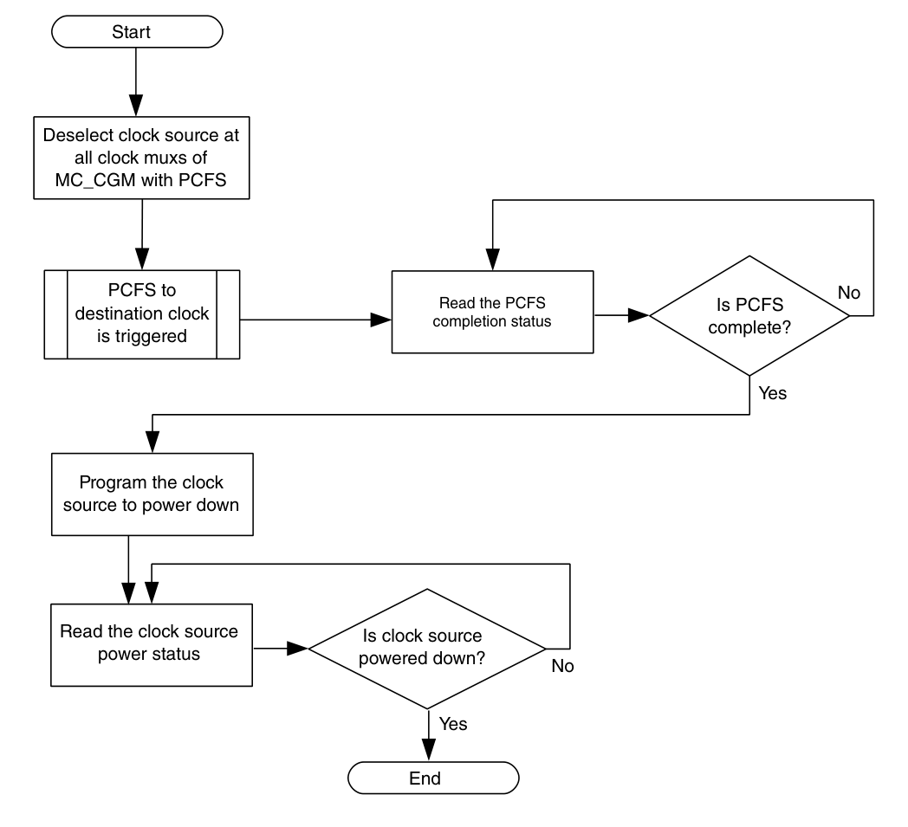

#### 10.2.4. 带负载变化的时钟切换

本节为在系统中两个高频时钟源之间连同负载变化的切换提供指南。负载变化是指系统中逻辑/外设的开启或关闭，它会对芯片产生显著的电容变化。这会触发芯片的电压调节。

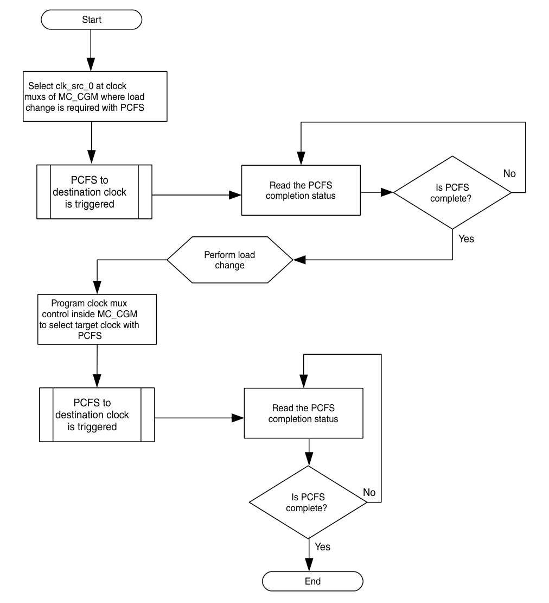

### 10.3. 时钟分频器

时钟分频器用于生成经分频的时钟，用于运行 IP 或外设。MC_CGM 在每个时钟多路复用器处提供以下内置分频器：

* 50% 时钟分频器

每个分频器都可以由分频器使能（**DE**）位和分频值（**DIV**）字段控制。如果分频器在其相应配置寄存器中的 DE 位置为逻辑 0，则该分频器被禁用，输出的分频时钟被保持为逻辑 0。如果 DE 位为逻辑 1，则分频器被使能并根据 DIV 字段中设置的值提供分频时钟。

#### 10.3.1. 50% 时钟分频器

50% 占空比分频器生成真正的分频时钟。分频因子始终为整数，但不限于偶数。分频时钟的上升沿始终与分频器源时钟的上升沿同步，而下降沿根据分频因子是偶数还是奇数分别与上升沿或下降沿同步。如果输入时钟的占空比为 50%，则分频后的输出时钟保持相同的 50% 占空比。图 137 给出 50% 时钟分频器的操作及其相关信号。

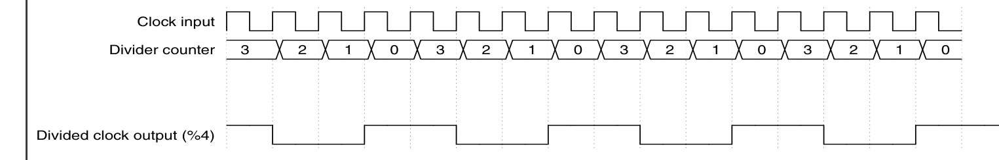

50% 分频时钟可以被视为相对于同一时钟多路复用器处其他分频器的其他分频时钟是异步的（非边沿对齐）。50% 时钟分频器的实现没有有源闭环，并且即使输入时钟出现单个周期的毛刺，预期也不会卡住。

#### 10.3.2. 时钟分频器更新

要更新分频值或分频器使能，软件应遵循图 138 所示的流程。这些更新仅在当前分频周期结束后才会发生。但是，如果时钟分频器的相位被更新，则该更新独立于分频周期的状态发生。对时钟分频器字段的任何更新都不会在分频时钟输出或相位分频时钟输出上产生时钟毛刺。

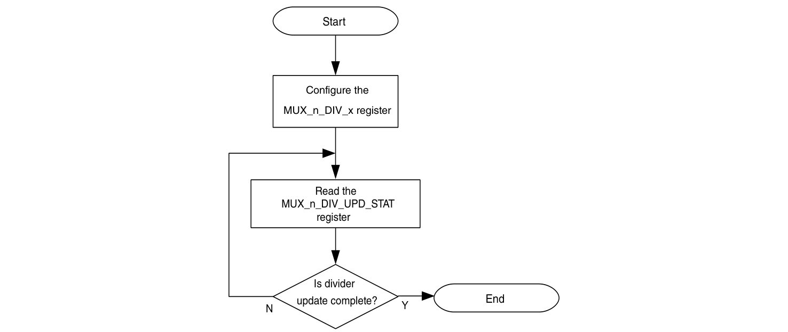
