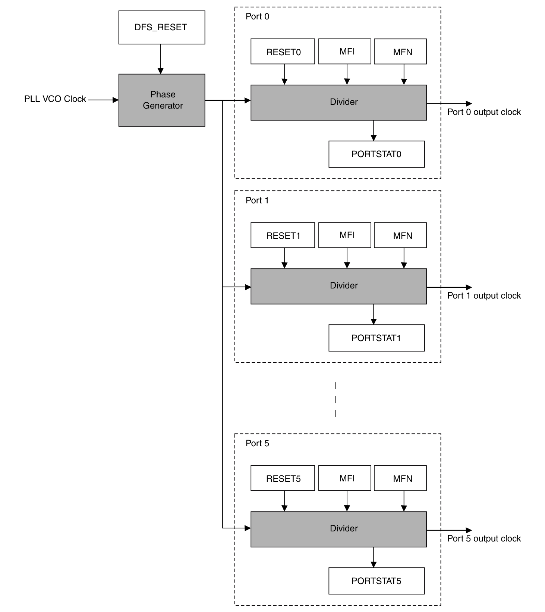
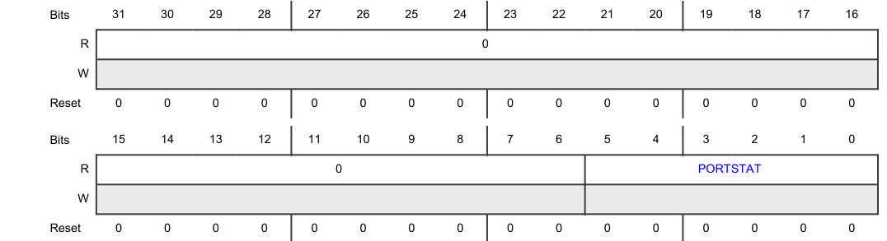
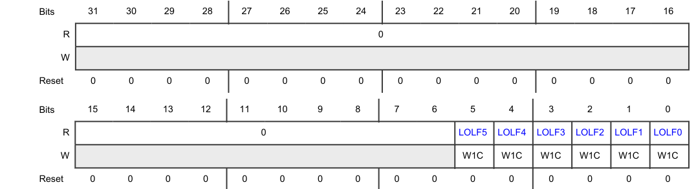
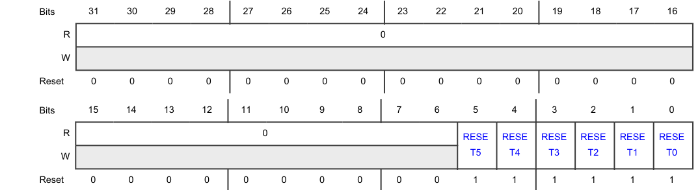
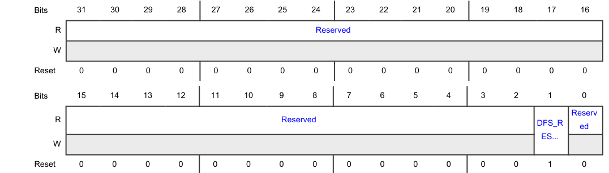
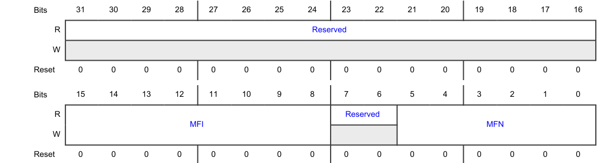
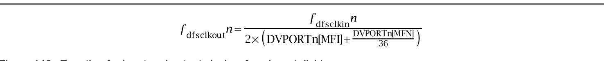

## 1. 简介

该模块从相应 **PLL** 提供的输入时钟源生成不同频率的可编程时钟输出。DFS 模块按照各端口的相应配置在其端口上提供时钟信号作为输出。此外，该模块为每个输出端口提供锁定（**lock**）指示。

### 1.1. 框图

以下是 DFS 的框图：

### 1.2. 特性

DFS 包括以下特性：

* 两个分数时钟分频器，具有：
  * 可单独配置的分频因子。
  * 独立的使能/禁用控制。
  * 独立的锁定状态报告。
* 软件可控的 DFS 主复位。

### 1.3. 工作模式

以下列出 DFS 支持的各种工作模式。

| 模式 | CTL[RESET] | PORTRESET[RESETn] | 描述 |
| --- | --- | --- | --- |
| 非功能（**Non-functional**） | 1 | x | DFS 相位发生器处于复位状态。 |
| 功能（**Functional**） | 0 | 0 | DFS 端口 n 被使能。 |
| 功能（**Functional**） | 0 | 1 | DFS 端口 n 被禁用。 |

当 DFS 处于功能模式时，支持使能端口和禁用端口的任意组合。

## 2. 初始化信息

**初始化**

以下步骤描述 DFS 初始化的流程：

1. 通过以下操作将 DFS 主单元和模拟 DFS 的输出端口置于复位状态：
   * 向 PORTRESET[RESETn] 写入 3Fh
   * 检查 PORTSR 是否为 0。
   * 向 CTL[DFS_RESET] 写入 1
2. 设置模拟 DFS 的 PLL 时钟输出以稳定并锁定 PLL。
3. 通过 DVPORTn 寄存器为每个 DFS 端口配置所需的分频因子。
4. 向 CTL[DFS_RESET] 写入 0，以撤销模拟 DFS 模块主 RESET 的复位。
5. 向 PORTRESET[RESETn] 写入 0，以撤销模拟 DFS 模块输出端口的复位。
6. 轮询 PORTSR，直到所有已配置的模拟 DFS 输出端口都锁定。

**在不禁用 DFS 主复位的情况下重新编程 DFS 端口**

以下步骤描述在不禁用 DFS 主复位的情况下重新编程 DFS 端口的流程（当 DFS 端口已经锁定时）：

1. 使用前述初始化序列中提到的流程对 DFS 进行编程。
2. 通过配置 PORTRESET 中的相应字段，使要更改其编程的输出端口进入端口复位状态。
3. 等待 PORTSR 中的相应字段变为 0。
4. 在相应的分频寄存器（DVPORT0）中更改 MFI 和 MFN 的配置。
5. 通过配置 PORTRESET 中的相应字段，撤销要更改其编程的输出端口的端口复位。
6. 轮询 PORTSR，检查相应的 DFS 输出端口是否已锁定。

**DFS LOL 之后的初始化：**

以下步骤描述 DFS LOL（失锁）之后的初始化流程：

1. 通过向 PORTLOLSR[LOLFn] 写入 1 来清除 DFS LOL
2. 通过以下操作将 DFS 主单元和模拟 DFS 的输出端口置于复位状态：
   * 向 PORTRESET[RESETn] 写入 3Fh。
   * 向 CTL[DFS_RESET] 写入 1。
3. 设置模拟 DFS 的 PLL 时钟输出以稳定并锁定 PLL。
4. 通过 DVPORTn 寄存器为每个 DFS 端口配置所需的分频因子。
5. 向 CTL[DFS_RESET] 写入 0，以撤销模拟 DFS 模块主 RESET 的复位。
6. 等待 200 ns。
7. 向 PORTRESET[RESETn] 写入 0，以撤销模拟 DFS 模块输出端口的复位。
8. 轮询 PORTSR，直到所有已配置的模拟 DFS 输出端口都锁定。

**禁用 DFS**

以下步骤描述禁用 DFS 的流程：

1. 向 PORTRESET[RESETn] 写入 3Fh。
2. 等待 PORTSR 变为 0。
3. 向 CTL[DFS_RESET] 写入 1。

## 3. DFS 寄存器说明

本节提供 DFS 所有寄存器的内存映射和详细说明。

内存映射给出相对于模块基地址的地址偏移。

### 3.1. DFS 内存映射

CORE_DFS 基地址：**4005_4000h**

PERIPH_DFS 基地址：**4005_8000h**

| 偏移 | 寄存器 | 宽度（位） | 访问 | 复位值 |
| --- | --- | --- | --- | --- |
| **Ch** | 端口状态寄存器[（**PORTSR**）](#32-端口状态寄存器portsr) | 32 | R | **0000_0000h** |
| **10h** | 端口失锁状态寄存器[（**PORTLOLSR**）](#33-端口失锁状态寄存器portlolsr) | 32 | RW | **0000_0000h** |
| **14h** | 端口复位寄存器[（**PORTRESET**）](#34-端口复位寄存器portreset) | 32 | RW | **0000_003Fh** |
| **18h** | 控制寄存器[（**CTL**）](#35-控制寄存器ctl) | 32 | RW | **0000_0002h** |
| **1Ch - 30h** | 端口 n 分频器寄存器（**DVPORT0 - DVPORT5**） | 32 | RW | **0000_0000h** |

### 3.2. 端口状态寄存器（**PORTSR**）

**PORTSR** 偏移：**Ch**

本寄存器反映 DFS 输出端口的锁定状态。

| 位 | 字段 | 功能 |
| --- | --- | --- |
| 31-6 | — | 保留 |
| 5-0 | **PORTSTAT** | 端口状态（**Port status**） 本字段反映 DFS 模拟块的 DFS 输出端口的锁定状态。每一位代表模拟块的一个端口。例如，PORTSR[PORTSTAT[0]] 代表端口 0。 `00_0000b` - 没有任何输出端口锁定。 `00_0001b` - 输出端口[0]已锁定。 `00_0010b` - 输出端口[1]已锁定。 `00_0100b` - 输出端口[2]已锁定。 `00_1000b` - 输出端口[3]已锁定。 `01_0000b` - 输出端口[4]已锁定。 `10_0000b` - 输出端口[5]已锁定。 |

### 3.3. 端口失锁状态寄存器（**PORTLOLSR**）

**PORTLOLSR** 偏移：**10h**

本寄存器包含 DFS 输出端口的失锁（**loss-of-lock**）状态标志。

| 位 | 字段 | 功能 |
| --- | --- | --- |
| 31-6 | — | 保留 |
| 5-0 | **LOLFn** | 失锁标志（**Loss of lock flag**） DFS IP 没有用于声明锁定或失锁的实时时钟监视器。如果在 DFS 之前禁用 PLL IP，则会产生失锁。 该字段为粘性（**sticky**）字段。这意味着如果重新获得锁定，该字段将保持为 1，直到通过向其写入 1 或置位复位将其清除。 `0b` - DFS 未检测到通道端口 n 输出的失锁。 `1b` - DFS 检测到通道端口 n 输出的失锁。 |

### 3.4. 端口复位寄存器（**PORTRESET**）

**PORTRESET** 偏移：**14h**

本寄存器控制 DFS 输出端口的使能与禁用。

**注意：** 本寄存器仅支持字（**word**）访问。其他写访问会导致以下结果：

* 不可预测的行为
* 不产生传输错误

| 位 | 字段 | 功能 |
| --- | --- | --- |
| 31-6 | — | 保留 |
| 5-0 | **RESETn** | 端口 n 的使能控制（**Enable control for port n**） `0b` - 端口 n 被使能。 `1b` - 端口 n 被禁用。 |

### 3.5. 控制寄存器（**CTL**）

**CTL** 偏移：**18h**

本寄存器对 DFS 进行配置。

| 位 | 字段 | 功能 |
| --- | --- | --- |
| 31-2 | — | 保留 |
| 1 | **DFS_RESET** | 本字段控制 DFS 的主复位。需与 PORTRESET[RESET] 位配合进行时序控制。 `0b` - DFS 相位发生器已脱离复位。可以通过编程端口复位寄存器（**PORTRESET**）使能各个端口。 `1b` - DFS 相位发生器处于复位状态。无法使能任何端口。 |
| 0 | — | 保留 |

### 3.6. 端口 n 分频器寄存器（**DVPORT0 - DVPORT5**）

**DVPORT0** 偏移：**1Ch**

**DVPORT1** 偏移：**20h**

**DVPORT2** 偏移：**24h**

**DVPORT3** 偏移：**28h**

**DVPORT4** 偏移：**2Ch**

**DVPORT5** 偏移：**30h**

本寄存器保存 DFS 输出端口的分频器配置。

| 位 | 字段 | 功能 |
| --- | --- | --- |
| 31-16 | — | 保留 |
| 15-8 | **MFI** | 本字段提供端口 n 分频因子的整数部分。 |
| 7-6 | — | 保留 |
| 5-0 | **MFN** | 本字段提供端口 n 分频因子的分数部分的分子。 |

## 4. 功能描述

### 4.1. 端口分频器配置

DFS IP 从 PLL 获取输入时钟并生成多个时钟相位。六个独立的相位分频器随后使用这些相位。通过编程 DVPORTn[MFI] 和 DVPORTn[MFN] 字段控制每个端口分频器的分频因子。以下公式描述每个相位分频器的输入时钟与输出时钟之间的关系：

在该公式中：

* n 是 DFS 输出端口号。
* DVPORTn[MFI] 是分频值的整数部分，范围为 1d 至 255d。
* DVPORTn[MFN] 是分频值的分数部分的分子，范围为 0d 至 35d。
