## 1. 概述

PLL 可以对给定时钟输入的频率进行倍频或分频。

### 1.1. 框图

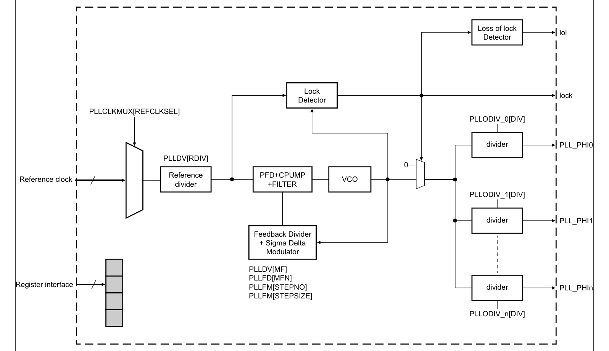

输出分频器的数量可能因模块实例而异。参见[时钟（**Clocking**）](../ch24_clocking/index.md)一章以确认 PLL 输出分频器的数量。

### 1.2. 特性

PLL 包括以下特性：

* 提供选择多个时钟源作为参考时钟的功能
* 可编程频率调制
* PLL 输出上的多个整数分频器
* 锁定检测电路在 PLL 达到频率锁定时进行报告
* 持续监视锁定状态以报告失锁（**Loss of Lock，LOL**）情况
* 为低功耗运行而将模块掉电（掉电模式，**Power-Down mode**）

## 2. ACCEL_PLL 寄存器说明

本节提供用于配置 PLL 的寄存器的内存映射和详细说明。下表给出内存映射。地址以相对于模块基地址的偏移量给出。所有寄存器均使用 8 位、16 位或 32 位寻址进行访问。

### 2.1. ACCEL_PLL 内存映射

ACCEL_PLL 基地址：**4004_0000h**

| 偏移 | 寄存器 | 宽度（位） | 访问 | 复位值 |
| --- | --- | --- | --- | --- |
| **0h** | [PLL 控制寄存器（**PLLCR**）](#22-pll-控制寄存器pllcr) | 32 | RW | **8000_0000h** |
| **4h** | [PLL 状态寄存器（**PLLSR**）](#23-pll-状态寄存器pllsr) | 32 | RW | **0000_0300h** |
| **8h** | [PLL 分频器寄存器（**PLLDV**）](#24-pll-分频器寄存器plldv) | 32 | RW | **0C3F_1032h** |
| **Ch** | [PLL 频率调制寄存器（**PLLFM**）](#25-pll-频率调制寄存器pllfm) | 32 | RW | **4000_0000h** |
| **10h** | [PLL 分数分频器寄存器（**PLLFD**）](#26-pll-分数分频器寄存器pllfd) | 32 | RW | **0000_0000h** |
| **20h** | [PLL 时钟多路复用器（**PLLCLKMUX**）](#27-pll-时钟多路复用器pllclkmux) | 32 | RW | **0000_0000h** |
| **80h - 84h** | PLL 输出分频器（**PLLODIV_0 - PLLODIV_1**） | 32 | RW | **0000_0000h** |

### 2.2. PLL 控制寄存器（**PLLCR**）

**PLLCR** 偏移：**0h**
配置 PLL 功能。

| 位 | 字段 | 功能 |
| --- | --- | --- |
| 31 | **PLLPD** | PLL 掉电（**PLL Power Down**） 将 PLL 掉电或上电。 `0b` - 已上电 `1b` - 已掉电 |
| 30-0 | — | 本字段为保留，读取返回零。 |

### 2.3. PLL 状态寄存器（**PLLSR**）

**PLLSR** 偏移：**4h**
显示 PLL 状态。
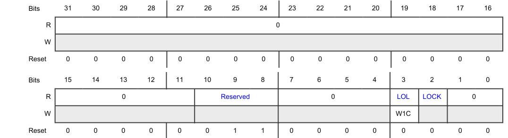

| 位 | 字段 | 功能 |
| --- | --- | --- |
| 31-11 | — | 本字段为保留，读取返回零。 |
| 10-8 | — | 本字段为保留，读取返回零。 |
| 7-4 | — | 本字段为保留，读取返回零。 |
| 3 | **LOL** | 失锁标志（**Loss-Of-Lock Flag**） 指示当前的 PLL 锁定状态。 `0b` - 未检测到失锁 `1b` - 检测到失锁 |
| 2 | **LOCK** | 锁定状态（**Lock Status**） 指示 PLL 已获得锁定。 `0b` - 未锁定 `1b` - 已锁定 |
| 1-0 | — | 本字段为保留，读取返回零。 |

### 2.4. PLL 分频器寄存器（**PLLDV**）

**PLLDV** 偏移：**8h**
对输入时钟进行分频以生成 PLL 输出。
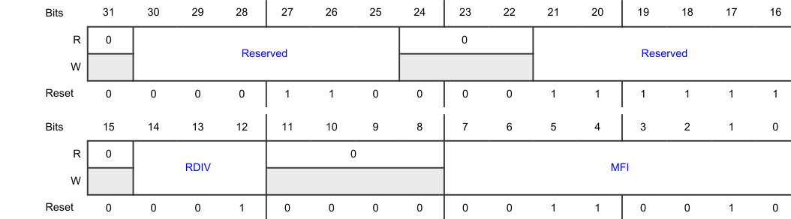

| 位 | 字段 | 功能 |
| --- | --- | --- |
| 31 | — | 保留 |
| 30-25 | — | 本字段为保留，读取返回零。 |
| 24-22 | — | 本字段为保留，读取返回零。 |
| 21-16 | — | 本字段为保留，读取返回零。 |
| 15 | — | 本字段为保留，读取返回零。 |
| 14-12 | **RDIV** | 输入时钟预分频器（**Input Clock Predivider**） 设置输入时钟分频器。 预分频器电路的输出生成 PLL 环路参考时钟。 `000b` - Divide by 1 `001b` - Divide by 1 `010b` - Divide by 2 `011b` - Divide by 3 `100b` - Divide by 4 `101b` - Divide by 5 `110b` - Divide by 6 `111b` - Divide by 7 |
| 11-8 | — | 本字段为保留，读取返回零。 |
| 7-0 | **MFI** | 环路分频器的整数部分（**Integer Portion Of Loop Divider**） 设置 PLL 反馈环路中分频器的值。 所指定的值确定应用于参考频率的倍增因子。向该字段写入分频值时，所选值不得违反 VCO 频率规范。 |

### 2.5. PLL 频率调制寄存器（**PLLFM**）

**PLLFM** 偏移：**Ch**
配置 PLL 频率调制参数。

| 位 | 字段 | 功能 |
| --- | --- | --- |
| 31 | — | 本字段为保留，读取返回零。 |
| 30 | **SSCGBYP** | 频率调制（扩频时钟生成，**Spread Spectrum Clock Generation**）旁路 旁路频率调制。 `0b` - 未旁路 `1b` - 已旁路 |
| 29 | **SPREADCTL** | 调制类型选择（**Modulation Type Selection**） 指示调制围绕标称频率居中。 `0b` - 围绕标称频率居中 `1b` - 保留 |
| 28-26 | — | 本字段为保留，读取返回零。 |
| 25-16 | **STEPSIZE** | 频率调制步长（**Frequency Modulation Step Size**） 在频率调制模式下提供调制深度和频率的步长（参见"频率调制"一节）。 |
| 15-11 | — | 本字段为保留，读取返回零。 |
| 10-0 | **STEPNO** | 调制周期步数或频率调制步数（**Number Of Steps Of Modulation Period Or Frequency Modulation**） 在频率调制模式下提供达到调制深度所需的步数（参见"频率调制"一节）。 |

### 2.6. PLL 分数分频器寄存器（**PLLFD**）

**PLLFD** 偏移：**10h**
使能并配置频率调制。
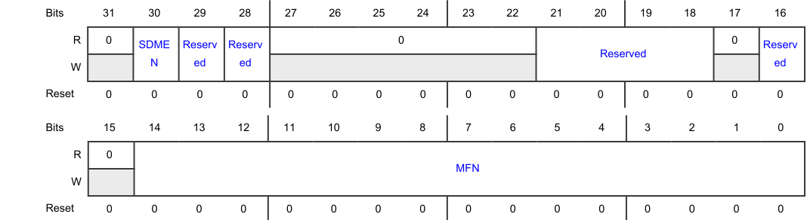

| 位 | 字段 | 功能 |
| --- | --- | --- |
| 31 | — | 本字段为保留，读取返回零。 |
| 30 | **SDMEN** | 分数模式使能（**Fractional Mode Enable**） 使能分数（**Fractional**）模式。 `0b` - 禁用 `1b` - 使能 |
| 29 | — | 本字段为保留，读取返回零。 |
| 28 | — | 本字段为保留，读取返回零。 |
| 27-22 | — | 本字段为保留，读取返回零。 |
| 21-18 | — | 本字段为保留，读取返回零。 |
| 17 | — | 本字段为保留，读取返回零。 |
| 16 | — | 本字段为保留，读取返回零。 |
| 15 | — | 本字段为保留，读取返回零。 |
| 14-0 | **MFN** | 分数环路分频因子的分子（**Numerator Of Fractional Loop Division Factor**） 设置分数环路分频因子的分子。 向该字段写入的值必须小于 18432。当分数模式被禁用时，必须向该字段写入 000_0000_0000_0000b。 |

### 2.7. PLL 时钟多路复用器（**PLLCLKMUX**）

**PLLCLKMUX** 偏移：**20h**
选择 PLL 时钟源。
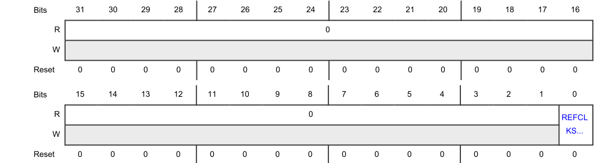

| 位 | 字段 | 功能 |
| --- | --- | --- |
| 31-1 | — | 本字段为保留，读取返回零。 |
| 0 | **REFCLKSEL** | 参考时钟选择（**Reference Clock Select**） 选择 PLL 时钟源。 `0b` - FIRC_CLK `1b` - FXOSC_CLK |

### 2.8. PLL 输出分频器（**PLLODIV_0 - PLLODIV_1**）

**PLLODIV_0** 偏移：**80h**
**PLLODIV_1** 偏移：**84h**
控制 PLL 输出时钟分频器设置。

该分频器为 50% 占空比分频器。

**注意：** 这些寄存器仅支持字（**word**）访问。其他写访问会导致以下结果：

* 不可预测的行为
* 不产生传输错误
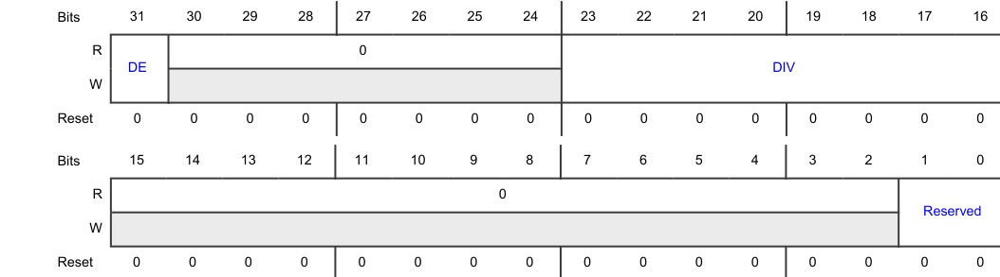

| 位 | 字段 | 功能 |
| --- | --- | --- |
| 31 | **DE** | 分频器使能（**Divider Enable**） 使能 PLL 输出分频器。在禁用 PLL 之前必须先禁用分频器。 `0b` - 禁用 `1b` - 使能 |
| 30-24 | — | 本字段为保留，读取返回零。 |
| 23-16 | **DIV** | 分频值（**Division Value**） 提供输出时钟分频器的分频值。分频后的时钟周期为分频器输入时钟周期的 DIV + 1 倍。 |
| 15-2 | — | 本字段为保留，读取返回零。 |
| 1-0 | — | 本字段为保留，读取返回零。 |

不得向其写入除复位值之外的任何值。

## 3. CORE_PLL 寄存器说明

本节提供用于配置 PLL 的寄存器的内存映射和详细说明。下表给出内存映射。地址以相对于模块基地址的偏移量给出。所有寄存器均使用 8 位、16 位或 32 位寻址进行访问。

### 3.1. CORE_PLL 内存映射

CORE_PLL 基地址：**4003_8000h**

| 偏移 | 寄存器 | 宽度（位） | 访问 | 复位值 |
| --- | --- | --- | --- | --- |
| **0h** | [PLL 控制寄存器（**PLLCR**）](#32-pll-控制寄存器pllcr) | 32 | RW | **8000_0000h** |
| **4h** | [PLL 状态寄存器（**PLLSR**）](#33-pll-状态寄存器pllsr) | 32 | RW | **0000_0300h** |
| **8h** | [PLL 分频器寄存器（**PLLDV**）](#34-pll-分频器寄存器plldv) | 32 | RW | **0C3F_1032h** |
| **Ch** | [PLL 频率调制寄存器（**PLLFM**）](#35-pll-频率调制寄存器pllfm) | 32 | RW | **4000_0000h** |
| **10h** | [PLL 分数分频器寄存器（**PLLFD**）](#36-pll-分数分频器寄存器pllfd) | 32 | RW | **0000_0000h** |
| **20h** | [PLL 时钟多路复用器（**PLLCLKMUX**）](#37-pll-时钟多路复用器pllclkmux) | 32 | RW | **0000_0000h** |
| **80h - 84h** | PLL 输出分频器（**PLLODIV_0 - PLLODIV_1**） | 32 | RW | **0000_0000h** |

### 3.2. PLL 控制寄存器（**PLLCR**）

**PLLCR** 偏移：**0h**
配置 PLL 功能。
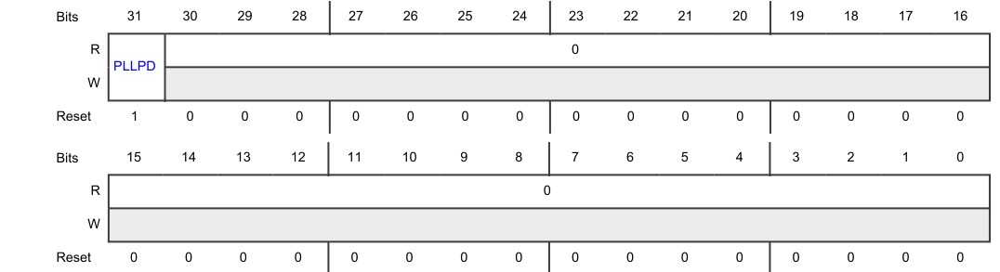

| 位 | 字段 | 功能 |
| --- | --- | --- |
| 31 | **PLLPD** | PLL 掉电（**PLL Power Down**） 将 PLL 掉电或上电。 `0b` - 已上电 `1b` - 已掉电 |
| 30-0 | — | 本字段为保留，读取返回零。 |

### 3.3. PLL 状态寄存器（**PLLSR**）

**PLLSR** 偏移：**4h**
显示 PLL 状态。

| 位 | 字段 | 功能 |
| --- | --- | --- |
| 31-11 | — | 本字段为保留，读取返回零。 |
| 10-8 | — | 本字段为保留，读取返回零。 |
| 7-4 | — | 本字段为保留，读取返回零。 |
| 3 | **LOL** | 失锁标志（**Loss-Of-Lock Flag**） 指示当前的 PLL 锁定状态。 `0b` - 未检测到失锁 `1b` - 检测到失锁 |
| 2 | **LOCK** | 锁定状态（**Lock Status**） 指示 PLL 已获得锁定。 `0b` - 未锁定 `1b` - 已锁定 |
| 1-0 | — | 本字段为保留，读取返回零。 |

### 3.4. PLL 分频器寄存器（**PLLDV**）

**PLLDV** 偏移：**8h**
对输入时钟进行分频以生成 PLL 输出。

| 位 | 字段 | 功能 |
| --- | --- | --- |
| 31 | — | 保留 |
| 30-25 | — | 本字段为保留，读取返回零。 |
| 24-22 | — | 本字段为保留，读取返回零。 |
| 21-16 | — | 本字段为保留，读取返回零。 |
| 15 | — | 本字段为保留，读取返回零。 |
| 14-12 | **RDIV** | 输入时钟预分频器（**Input Clock Predivider**） 设置输入时钟分频器。 预分频器电路的输出生成 PLL 环路参考时钟。 `000b` - Divide by 1 `001b` - Divide by 1 `010b` - Divide by 2 `011b` - Divide by 3 `100b` - Divide by 4 `101b` - Divide by 5 `110b` - Divide by 6 `111b` - Divide by 7 |
| 11-8 | — | 本字段为保留，读取返回零。 |
| 7-0 | **MFI** | 环路分频器的整数部分（**Integer Portion Of Loop Divider**） 设置 PLL 反馈环路中分频器的值。 所指定的值确定应用于参考频率的倍增因子。向该字段写入分频值时，所选值不得违反 VCO 频率规范。 |

### 3.5. PLL 频率调制寄存器（**PLLFM**）

**PLLFM** 偏移：**Ch**
配置 PLL 频率调制参数。
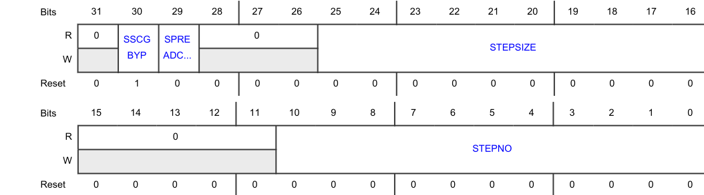

| 位 | 字段 | 功能 |
| --- | --- | --- |
| 31 | — | 本字段为保留，读取返回零。 |
| 30 | **SSCGBYP** | 频率调制（扩频时钟生成，**Spread Spectrum Clock Generation**）旁路 旁路频率调制。 `0b` - 未旁路 `1b` - 已旁路 |
| 29 | **SPREADCTL** | 调制类型选择（**Modulation Type Selection**） 指示调制围绕标称频率居中。 `0b` - 围绕标称频率居中 `1b` - 保留 |
| 28-26 | — | 本字段为保留，读取返回零。 |
| 25-16 | **STEPSIZE** | 频率调制步长（**Frequency Modulation Step Size**） 在频率调制模式下提供调制深度和频率的步长（参见"频率调制"一节）。 |
| 15-11 | — | 本字段为保留，读取返回零。 |
| 10-0 | **STEPNO** | 调制周期步数或频率调制步数（**Number Of Steps Of Modulation Period Or Frequency Modulation**） 在频率调制模式下提供达到调制深度所需的步数（参见"频率调制"一节）。 |

### 3.6. PLL 分数分频器寄存器（**PLLFD**）

**PLLFD** 偏移：**10h**
使能并配置频率调制。
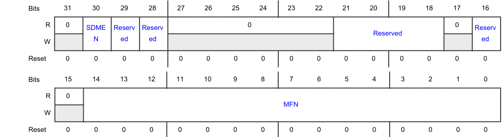

| 位 | 字段 | 功能 |
| --- | --- | --- |
| 31 | — | 本字段为保留，读取返回零。 |
| 30 | **SDMEN** | 分数模式使能（**Fractional Mode Enable**） 使能分数（**Fractional**）模式。 `0b` - 禁用 `1b` - 使能 |
| 29 | — | 本字段为保留，读取返回零。 |
| 28 | — | 本字段为保留，读取返回零。 |
| 27-22 | — | 本字段为保留，读取返回零。 |
| 21-18 | — | 本字段为保留，读取返回零。 |
| 17 | — | 本字段为保留，读取返回零。 |
| 16 | — | 本字段为保留，读取返回零。 |
| 15 | — | 本字段为保留，读取返回零。 |
| 14-0 | **MFN** | 分数环路分频因子的分子（**Numerator Of Fractional Loop Division Factor**） 设置分数环路分频因子的分子。 向该字段写入的值必须小于 18432。当分数模式被禁用时，必须向该字段写入 000_0000_0000_0000b。 |

### 3.7. PLL 时钟多路复用器（**PLLCLKMUX**）

**PLLCLKMUX** 偏移：**20h**
选择 PLL 时钟源。
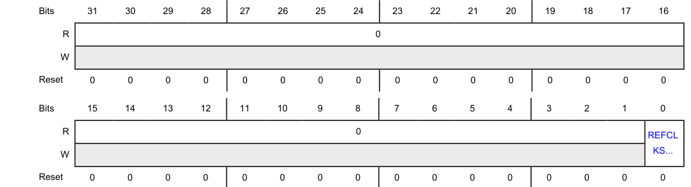

| 位 | 字段 | 功能 |
| --- | --- | --- |
| 31-1 | — | 本字段为保留，读取返回零。 |
| 0 | **REFCLKSEL** | 参考时钟选择（**Reference Clock Select**） 选择 PLL 时钟源。 `0b` - FIRC_CLK `1b` - FXOSC_CLK |

### 3.8. PLL 输出分频器（**PLLODIV_0 - PLLODIV_1**）

**PLLODIV_0** 偏移：**80h**
**PLLODIV_1** 偏移：**84h**
控制 PLL 输出时钟分频器设置。

该分频器为 50% 占空比分频器。

**注意：** 这些寄存器仅支持字（**word**）访问。其他写访问会导致以下结果：

* 不可预测的行为
* 不产生传输错误
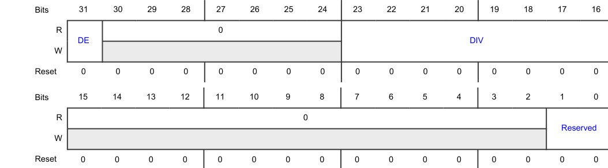

| 位 | 字段 | 功能 |
| --- | --- | --- |
| 31 | **DE** | 分频器使能（**Divider Enable**） 使能 PLL 输出分频器。在禁用 PLL 之前必须先禁用分频器。 `0b` - 禁用 `1b` - 使能 |
| 30-24 | — | 本字段为保留，读取返回零。 |
| 23-16 | **DIV** | 分频值（**Division Value**） 提供输出时钟分频器的分频值。分频后的时钟周期为分频器输入时钟周期的 DIV + 1 倍。 |
| 15-2 | — | 本字段为保留，读取返回零。 |
| 1-0 | — | 本字段为保留，读取返回零。 |

不得向其写入除复位值之外的任何值。

## 4. DDR_PLL 寄存器说明

本节提供用于配置 PLL 的寄存器的内存映射和详细说明。下表给出内存映射。地址以相对于模块基地址的偏移量给出。所有寄存器均使用 8 位、16 位或 32 位寻址进行访问。

### 4.1. DDR_PLL 内存映射

DDR_PLL 基地址：**4004_4000h**

| 偏移 | 寄存器 | 宽度（位） | 访问 | 复位值 |
| --- | --- | --- | --- | --- |
| **0h** | [PLL 控制寄存器（**PLLCR**）](#42-pll-控制寄存器pllcr) | 32 | RW | **8000_0000h** |
| **4h** | [PLL 状态寄存器（**PLLSR**）](#43-pll-状态寄存器pllsr) | 32 | RW | **0000_0300h** |
| **8h** | [PLL 分频器寄存器（**PLLDV**）](#44-pll-分频器寄存器plldv) | 32 | RW | **0C3F_1032h** |
| **Ch** | [PLL 频率调制寄存器（**PLLFM**）](#45-pll-频率调制寄存器pllfm) | 32 | RW | **4000_0000h** |
| **10h** | [PLL 分数分频器寄存器（**PLLFD**）](#46-pll-分数分频器寄存器pllfd) | 32 | RW | **0000_0000h** |
| **20h** | [PLL 时钟多路复用器（**PLLCLKMUX**）](#47-pll-时钟多路复用器pllclkmux) | 32 | RW | **0000_0000h** |
| **80h** | [PLL 输出分频器（**PLLODIV_0**）](#48-pll-输出分频器pllodiv_0) | 32 | RW | **0000_0000h** |

### 4.2. PLL 控制寄存器（**PLLCR**）

**PLLCR** 偏移：**0h**
配置 PLL 功能。

| 位 | 字段 | 功能 |
| --- | --- | --- |
| 31 | **PLLPD** | PLL 掉电（**PLL Power Down**） 将 PLL 掉电或上电。 `0b` - 已上电 `1b` - 已掉电 |
| 30-0 | — | 本字段为保留，读取返回零。 |

### 4.3. PLL 状态寄存器（**PLLSR**）

**PLLSR** 偏移：**4h**
显示 PLL 状态。

| 位 | 字段 | 功能 |
| --- | --- | --- |
| 31-11 | — | 本字段为保留，读取返回零。 |
| 10-8 | — | 本字段为保留，读取返回零。 |
| 7-4 | — | 本字段为保留，读取返回零。 |
| 3 | **LOL** | 失锁标志（**Loss-Of-Lock Flag**） 指示当前的 PLL 锁定状态。 `0b` - 未检测到失锁 `1b` - 检测到失锁 |
| 2 | **LOCK** | 锁定状态（**Lock Status**） 指示 PLL 已获得锁定。 `0b` - 未锁定 `1b` - 已锁定 |
| 1-0 | — | 本字段为保留，读取返回零。 |

### 4.4. PLL 分频器寄存器（**PLLDV**）

**PLLDV** 偏移：**8h**
对输入时钟进行分频以生成 PLL 输出。

| 位 | 字段 | 功能 |
| --- | --- | --- |
| 31 | — | 保留 |
| 30-25 | — | 本字段为保留，读取返回零。 |
| 24-22 | — | 本字段为保留，读取返回零。 |
| 21-16 | — | 本字段为保留，读取返回零。 |
| 15 | — | 本字段为保留，读取返回零。 |
| 14-12 | **RDIV** | 输入时钟预分频器（**Input Clock Predivider**） 设置输入时钟分频器。 预分频器电路的输出生成 PLL 环路参考时钟。 `000b` - Divide by 1 `001b` - Divide by 1 `010b` - Divide by 2 `011b` - Divide by 3 `100b` - Divide by 4 `101b` - Divide by 5 `110b` - Divide by 6 `111b` - Divide by 7 |
| 11-8 | — | 本字段为保留，读取返回零。 |
| 7-0 | **MFI** | 环路分频器的整数部分（**Integer Portion Of Loop Divider**） 设置 PLL 反馈环路中分频器的值。 所指定的值确定应用于参考频率的倍增因子。向该字段写入分频值时，所选值不得违反 VCO 频率规范。 |

### 4.5. PLL 频率调制寄存器（**PLLFM**）

**PLLFM** 偏移：**Ch**
配置 PLL 频率调制参数。

| 位 | 字段 | 功能 |
| --- | --- | --- |
| 31 | — | 本字段为保留，读取返回零。 |
| 30 | **SSCGBYP** | 频率调制（扩频时钟生成，**Spread Spectrum Clock Generation**）旁路 旁路频率调制。 `0b` - 未旁路 `1b` - 已旁路 |
| 29 | **SPREADCTL** | 调制类型选择（**Modulation Type Selection**） 指示调制围绕标称频率居中。 `0b` - 围绕标称频率居中 `1b` - 保留 |
| 28-26 | — | 本字段为保留，读取返回零。 |
| 25-16 | **STEPSIZE** | 频率调制步长（**Frequency Modulation Step Size**） 在频率调制模式下提供调制深度和频率的步长（参见"频率调制"一节）。 |
| 15-11 | — | 本字段为保留，读取返回零。 |
| 10-0 | **STEPNO** | 调制周期步数或频率调制步数（**Number Of Steps Of Modulation Period Or Frequency Modulation**） 在频率调制模式下提供达到调制深度所需的步数（参见"频率调制"一节）。 |

### 4.6. PLL 分数分频器寄存器（**PLLFD**）

**PLLFD** 偏移：**10h**
使能并配置频率调制。
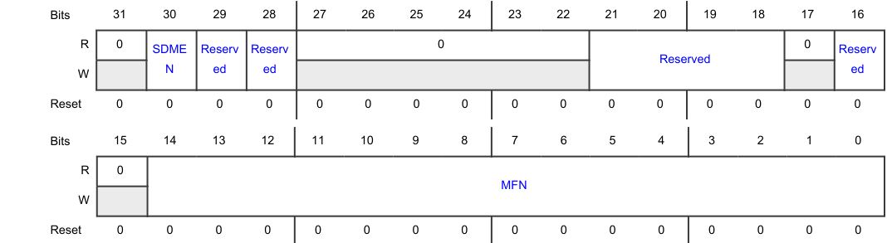

| 位 | 字段 | 功能 |
| --- | --- | --- |
| 31 | — | 本字段为保留，读取返回零。 |
| 30 | **SDMEN** | 分数模式使能（**Fractional Mode Enable**） 使能分数（**Fractional**）模式。 `0b` - 禁用 `1b` - 使能 |
| 29 | — | 本字段为保留，读取返回零。 |
| 28 | — | 本字段为保留，读取返回零。 |
| 27-22 | — | 本字段为保留，读取返回零。 |
| 21-18 | — | 本字段为保留，读取返回零。 |
| 17 | — | 本字段为保留，读取返回零。 |
| 16 | — | 本字段为保留，读取返回零。 |
| 15 | — | 本字段为保留，读取返回零。 |
| 14-0 | **MFN** | 分数环路分频因子的分子（**Numerator Of Fractional Loop Division Factor**） 设置分数环路分频因子的分子。 向该字段写入的值必须小于 18432。当分数模式被禁用时，必须向该字段写入 000_0000_0000_0000b。 |

### 4.7. PLL 时钟多路复用器（**PLLCLKMUX**）

**PLLCLKMUX** 偏移：**20h**
选择 PLL 时钟源。

| 位 | 字段 | 功能 |
| --- | --- | --- |
| 31-1 | — | 本字段为保留，读取返回零。 |
| 0 | **REFCLKSEL** | 参考时钟选择（**Reference Clock Select**） 选择 PLL 时钟源。 `0b` - FIRC_CLK `1b` - FXOSC_CLK |

### 4.8. PLL 输出分频器（**PLLODIV_0**）

**PLLODIV_0** 偏移：**80h**
控制 PLL 输出时钟分频器设置。

该分频器为 50% 占空比分频器。

**注意：** 这些寄存器仅支持字（**word**）访问。其他写访问会导致以下结果：

* 不可预测的行为
* 不产生传输错误

| 位 | 字段 | 功能 |
| --- | --- | --- |
| 31 | **DE** | 分频器使能（**Divider Enable**） 使能 PLL 输出分频器。在禁用 PLL 之前必须先禁用分频器。 `0b` - 禁用 `1b` - 使能 |
| 30-24 | — | 本字段为保留，读取返回零。 |
| 23-16 | **DIV** | 分频值（**Division Value**） 提供输出时钟分频器的分频值。分频后的时钟周期为分频器输入时钟周期的 DIV + 1 倍。 |
| 15-2 | — | 本字段为保留，读取返回零。 |
| 1-0 | — | 本字段为保留，读取返回零。 |

不得向其写入除复位值之外的任何值。

## 5. PERIPH_PLL 寄存器说明

本节提供用于配置 PLL 的寄存器的内存映射和详细说明。下表给出内存映射。地址以相对于模块基地址的偏移量给出。所有寄存器均使用 8 位、16 位或 32 位寻址进行访问。

### 5.1. PERIPH_PLL 内存映射

PERIPH_PLL 基地址：**4003_C000h**

| 偏移 | 寄存器 | 宽度（位） | 访问 | 复位值 |
| --- | --- | --- | --- | --- |
| **0h** | [PLL 控制寄存器（**PLLCR**）](#52-pll-控制寄存器pllcr) | 32 | RW | **8000_0000h** |
| **4h** | [PLL 状态寄存器（**PLLSR**）](#53-pll-状态寄存器pllsr) | 32 | RW | **0000_0300h** |
| **8h** | [PLL 分频器寄存器（**PLLDV**）](#54-pll-分频器寄存器plldv) | 32 | RW | **0C3F_1032h** |
| **10h** | [PLL 分数分频器寄存器（**PLLFD**）](#55-pll-分数分频器寄存器pllfd) | 32 | RW | **0000_0000h** |
| **20h** | [PLL 时钟多路复用器（**PLLCLKMUX**）](#56-pll-时钟多路复用器pllclkmux) | 32 | RW | **0000_0000h** |
| **80h - 9Ch** | PLL 输出分频器（**PLLODIV_0 - PLLODIV_7**） | 32 | RW | **0000_0000h** |

### 5.2. PLL 控制寄存器（**PLLCR**）

**PLLCR** 偏移：**0h**
配置 PLL 功能。
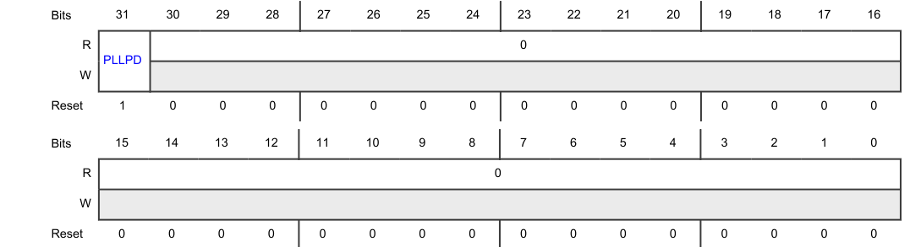

| 位 | 字段 | 功能 |
| --- | --- | --- |
| 31 | **PLLPD** | PLL 掉电（**PLL Power Down**） 将 PLL 掉电或上电。 `0b` - 已上电 `1b` - 已掉电 |
| 30-0 | — | 本字段为保留，读取返回零。 |

### 5.3. PLL 状态寄存器（**PLLSR**）

**PLLSR** 偏移：**4h**
显示 PLL 状态。

| 位 | 字段 | 功能 |
| --- | --- | --- |
| 31-11 | — | 本字段为保留，读取返回零。 |
| 10-8 | — | 本字段为保留，读取返回零。 |
| 7-4 | — | 本字段为保留，读取返回零。 |
| 3 | **LOL** | 失锁标志（**Loss-Of-Lock Flag**） 指示当前的 PLL 锁定状态。 `0b` - 未检测到失锁 `1b` - 检测到失锁 |
| 2 | **LOCK** | 锁定状态（**Lock Status**） 指示 PLL 已获得锁定。 `0b` - 未锁定 `1b` - 已锁定 |
| 1-0 | — | 本字段为保留，读取返回零。 |

### 5.4. PLL 分频器寄存器（**PLLDV**）

**PLLDV** 偏移：**8h**
对输入时钟进行分频以生成 PLL 输出。

| 位 | 字段 | 功能 |
| --- | --- | --- |
| 31 | — | 保留 |
| 30-25 | — | 本字段为保留，读取返回零。 |
| 24-22 | — | 本字段为保留，读取返回零。 |
| 21-16 | — | 本字段为保留，读取返回零。 |
| 15 | — | 本字段为保留，读取返回零。 |
| 14-12 | **RDIV** | 输入时钟预分频器（**Input Clock Predivider**） 设置输入时钟分频器。 预分频器电路的输出生成 PLL 环路参考时钟。 `000b` - Divide by 1 `001b` - Divide by 1 `010b` - Divide by 2 `011b` - Divide by 3 `100b` - Divide by 4 `101b` - Divide by 5 `110b` - Divide by 6 `111b` - Divide by 7 |
| 11-8 | — | 本字段为保留，读取返回零。 |
| 7-0 | **MFI** | 环路分频器的整数部分（**Integer Portion Of Loop Divider**） 设置 PLL 反馈环路中分频器的值。 所指定的值确定应用于参考频率的倍增因子。向该字段写入分频值时，所选值不得违反 VCO 频率规范。 |

### 5.5. PLL 分数分频器寄存器（**PLLFD**）

**PLLFD** 偏移：**10h**
使能并配置频率调制。
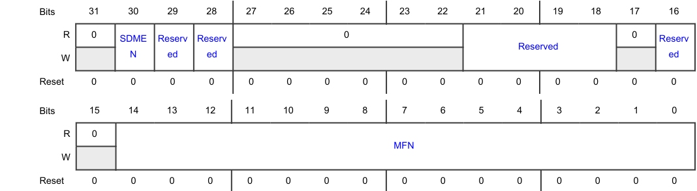

| 位 | 字段 | 功能 |
| --- | --- | --- |
| 31 | — | 本字段为保留，读取返回零。 |
| 30 | **SDMEN** | 分数模式使能（**Fractional Mode Enable**） 使能分数（**Fractional**）模式。 `0b` - 禁用 `1b` - 使能 |
| 29 | — | 本字段为保留，读取返回零。 |
| 28 | — | 本字段为保留，读取返回零。 |
| 27-22 | — | 本字段为保留，读取返回零。 |
| 21-18 | — | 本字段为保留，读取返回零。 |
| 17 | — | 本字段为保留，读取返回零。 |
| 16 | — | 本字段为保留，读取返回零。 |
| 15 | — | 本字段为保留，读取返回零。 |
| 14-0 | **MFN** | 分数环路分频因子的分子（**Numerator Of Fractional Loop Division Factor**） 设置分数环路分频因子的分子。 向该字段写入的值必须小于 18432。当分数模式被禁用时，必须向该字段写入 000_0000_0000_0000b。 |

### 5.6. PLL 时钟多路复用器（**PLLCLKMUX**）

**PLLCLKMUX** 偏移：**20h**
选择 PLL 时钟源。

| 位 | 字段 | 功能 |
| --- | --- | --- |
| 31-1 | — | 本字段为保留，读取返回零。 |
| 0 | **REFCLKSEL** | 参考时钟选择（**Reference Clock Select**） 选择 PLL 时钟源。 `0b` - FIRC_CLK `1b` - FXOSC_CLK |

### 5.7. PLL 输出分频器（**PLLODIV_0 - PLLODIV_7**）

对于 a = 0 至 7：
**PLLODIV_a** 偏移：**80h + (a × 4h)**
控制 PLL 输出时钟分频器设置。

该分频器为 50% 占空比分频器。

**注意：** 这些寄存器仅支持字（**word**）访问。其他写访问会导致以下结果：

* 不可预测的行为
* 不产生传输错误

| 位 | 字段 | 功能 |
| --- | --- | --- |
| 31 | **DE** | 分频器使能（**Divider Enable**） 使能 PLL 输出分频器。在禁用 PLL 之前必须先禁用分频器。 `0b` - 禁用 `1b` - 使能 |
| 30-24 | — | 本字段为保留，读取返回零。 |
| 23-16 | **DIV** | 分频值（**Division Value**） 提供输出时钟分频器的分频值。分频后的时钟周期为分频器输入时钟周期的 DIV + 1 倍。 |
| 15-2 | — | 本字段为保留，读取返回零。 |
| 1-0 | — | 本字段为保留，读取返回零。 |

不得向其写入除复位值之外的任何值。

## 6. 功能描述

本节说明 PLL 的工作与配置。

### 6.1. 工作模式

| PLLCR[PLLPD] | PLLFD[SDMEN] | PLLFM[SSCGBYP] | 描述 |
| --- | --- | --- | --- |
| 1 | x | x | PLL 被禁用。 |
| 0 | 0 | 1 | 功能模式 – PLL 仅以整数模式运行。 参见"时钟配置"一节。 |
| 0 | 1 | 1 | 功能模式 – PLL 以分数模式运行（非频率调制）。 参见"时钟配置"一节。 |
| 0 | 1 | 0 | 功能模式 – PLL 以频率调制模式运行。 参见"频率调制"一节。 |

### 6.2. 输入时钟频率

PLL 设计为在指定的输入时钟频率范围内工作。PLL 源频率限制在本芯片的数据手册中讨论。

### 6.3. 时钟配置

参见以下公式以及相应的寄存器配置，它们确定 VCO 频率（fVCO）与 PLL 参考频率之间的关系。

* 仅整数模式（**Integer-only mode**）：
  * 当 PLLDV[RDIV] 为 0 时：

  * 当 PLLDV[RDIV] 不为 0 时：

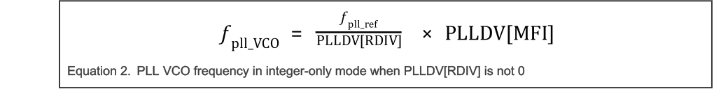

* 分数模式（**Fractional mode**）：
  * 当 PLLDV[RDIV] 为 0 时：

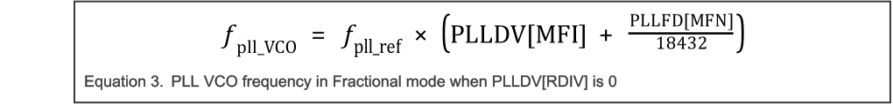

  * 当 PLLDV[RDIV] 不为 0 时：

参见以下公式以及相应的寄存器配置，它们确定参考频率与 PLL_PHIn 输出频率之间的关系。

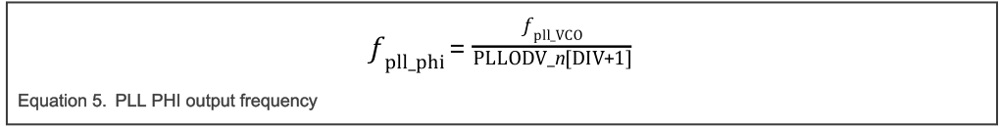

在配置 PLL 时，不得违反 PLL 的最大系统时钟频率或最大和最小 VCO 频率规范（频率限制参见本芯片的数据手册）。

在修改任何 PLL 配置或输入时钟之前，必须通过向 PLLCR[PLLPD] 写入 1 来禁用 PLL。

在向 PLLCR[PLLPD] 写入 0 以使能 PLL 之前，必须通过向 PLLCR[PLLPD] 写入 1 将 PLL 禁用至少 5 μs。

对 PLL 进行编程并进入正常（**Normal**）模式的推荐流程如"初始化信息"一节所示。

### 6.4. 失锁 (LOL)

PLL 提供失锁（**LOL**）指示。仅当 PLL 处于功能模式时才能生成失锁指示（参见"工作模式"一节）。
当 PLL 检测到失锁时，它会置位其失锁事件输出。

PLL 不检测参考时钟丢失。如果在 PLL 获得锁定之后参考时钟停止，PLL 会继续指示锁定。
假定在 PLL 工作期间，PLL 之外对 PLL 参考时钟的监视是使能的。

PLL 失锁用于检测重大故障。请使用 CMU 进行精确的频率监视。

### 6.5. 频率调制

在频率调制模式下，PLL 生成经过频率调制的时钟。调制深度和调制频率使用"频率调制编程"一节中给出的公式计算。

向 PLLFM[SPREADCTL] 写入 0 以选择中心展频（**center-spread**）调制。图 142 给出中心展频调制的一个示例。

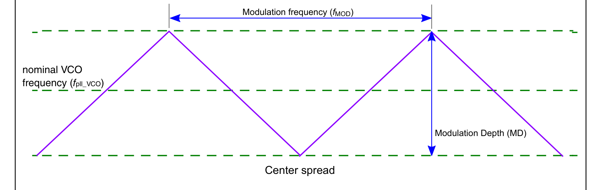

#### 6.5.1. 频率调制编程

调制深度和调制频率的编程使用步数（PLLFM[STEPNO]）和步长（PLLFM[STEPSIZE]）。下表给出在对 PLL 进行频率调制编程时计算所用的变量。

| 变量 | 描述 |
| --- | --- |
| fREF | 输入时钟频率 |
| fMOD | 期望的调制频率 |
| MD | 以百分比表示的期望调制深度 |
| LDF | 环路分频因子（**Loop division factor**） |
| fpll_VCO | 标称 VCO 频率 |

使用以下公式配置 PLL 的频率调制。

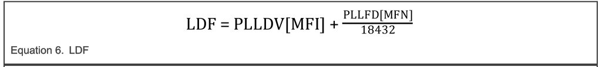

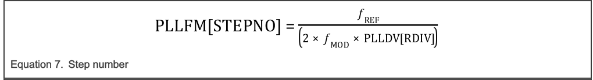

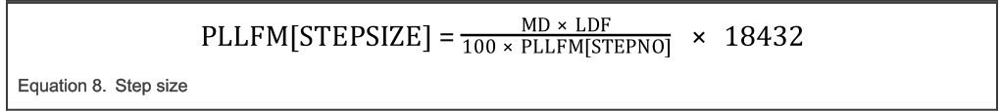

只有满足公式 9 所示条件时，才可能进行频率调制。

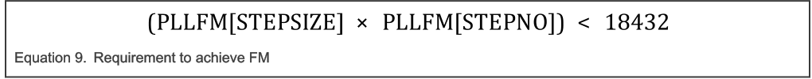

必须向 PLLFM[SSCGBYP] 写入 0 并向 PLLFD[SDMEN] 写入 1，以使能频率调制。

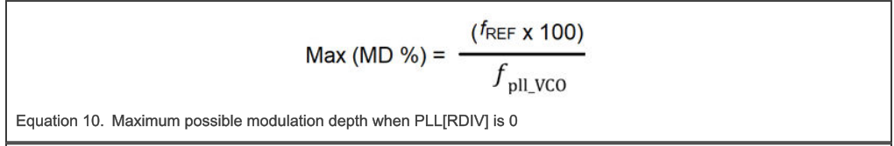

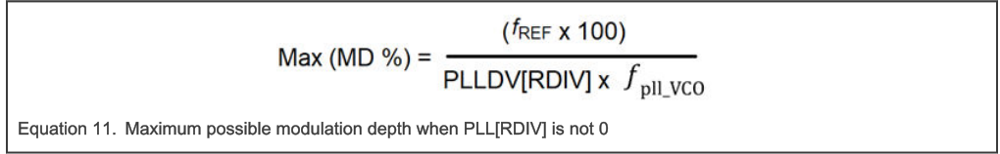

**警告：** 由于对 PLLFM[STEPSIZE] 和 PLLFM[STEPNO] 应用了舍入操作，有效调制深度可能与预期调制深度不同。

### 6.6. 中断信号

本模块没有中断信号。

## 7. 外部信号

本模块没有外部信号。

## 8. 初始化信息

执行以下步骤以初始化 PLL：

1. 确认所有分频器的 PLLODIV_n[DE] 为 0。
2. 确认 PLLCR[PLLPD] 为 1。
3. 编程 PLLCLKMUX 以选择合适的参考时钟。
4. 根据需要编程以下寄存器：
   * PLLDV
   * PLLFD
   * PLLFM 至期望值
5. 将 PLLODIV_n[DIV] 编程为期望值。
6. 等待 PLL 参考时钟稳定。
7. 向 PLLCR[PLLPD] 写入 0。
8. 等待 PLLSR[LOCK] 变为 1。
9. 向 PLLODIV_n[DE] 写入 1。

执行以下步骤以关闭 PLL：

1. 对所有分频器向 PLLODIV_n[DE] 写入 0。
2. 向 PLLCR[PLLPD] 写入 1。
