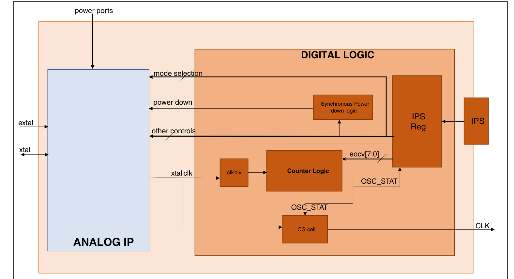
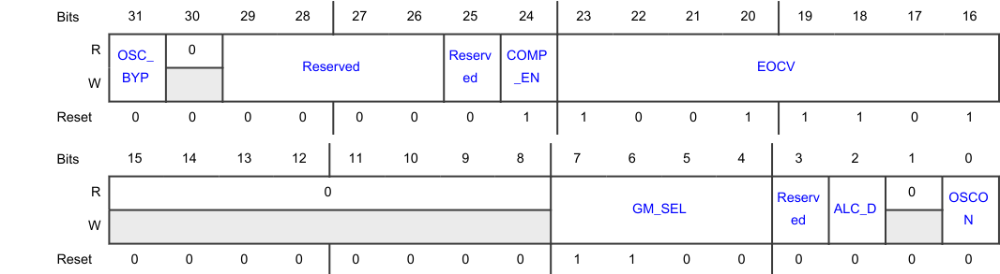
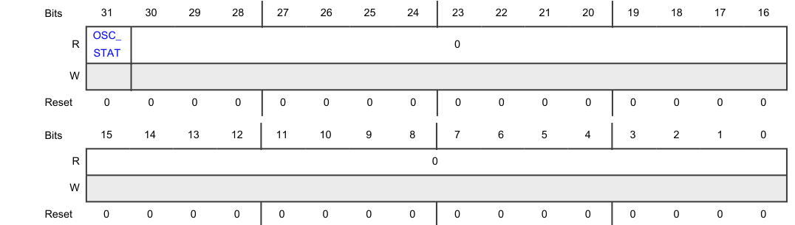

## 1. 概述

快速晶体振荡器（**Fast Crystal Oscillator，FXOSC**）生成一个可在 SoC 级别使用的时钟。FXOSC 具有用于控制和配置振荡器的数字接口。当 FXOSC 在任何时候被掉电时，其设计都保证不会在输出时钟上产生任何毛刺。FXOSC 内部的计数器处理不同的稳定时间。CG 单元为时钟门控单元，它在稳定时间到来之前对时钟进行门控。

### 1.1. 框图

### 1.2. 特性

FXOSC 的特性如下：

* 状态寄存器显示模块的当前状态。
* 控制寄存器可以：
  * 选择一种工作模式：
    * 晶体模式（**Crystal mode**）
    * 使用 EXTAL 时钟输入的单输入旁路模式（**Single-Input Bypass mode**）
  * 禁用模块（掉电模式，**Power-Down mode**）

## 2. FXOSC 寄存器说明

本节提供用于配置 FXOSC 的所有寄存器的说明。

### 2.1. FXOSC 内存映射

使用 8 位、16 位或 32 位寻址访问寄存器。

FXOSC 基地址：**4005_0000h**

| 偏移 | 寄存器 | 宽度（位） | 访问 | 复位值 |
| --- | --- | --- | --- | --- |
| **0h** | FXOSC 控制寄存器[（**CTRL**）](#22-fxosc-控制寄存器ctrl) | 32 | RW | **019D_00C0h** |
| **4h** | 振荡器状态寄存器[（**STAT**）](#23-振荡器状态寄存器stat) | 32 | R | **0000_0000h** |

### 2.2. FXOSC 控制寄存器（**CTRL**）

**CTRL** 偏移：**0h**

配置 FXOSC 的工作。

| 位 | 字段 | 功能 |
| --- | --- | --- |
| 31 | **OSC_BYP** | 振荡器旁路（**Oscillator bypass**） 旁路内部振荡器。 `0b` - 内部振荡器未旁路 `1b` - 内部振荡器已旁路 |
| 30 | — | 保留 |
| 29-26 | — | 本字段为保留，读取返回零。 |
| 25 | — | 保留 |
| 24 | **COMP_EN** | 比较器使能（**Comparator enable**） 使能或禁用比较器。 * 晶体模式下将该字段置为 1。 * 单输入旁路模式下将该字段置为 0。 `0b` - 比较器被禁用 `1b` - 比较器被使能 |
| 23-16 | **EOCV** | 计数结束值（**End of count value**） 指定计数结束值（**end-of-count**）。 振荡器计数器以晶体时钟的 4 分频运行，计数至 EOCV ✕ 128。该计数周期确保在外部振荡器时钟信号稳定之后，系统才选择 FXOSC 作为时钟源。 * 必须将 EOCV 设置为适当的值，以使时钟和占空比得以稳定，并保证 OSC_STAT 在晶体启动时间内被置位。 **注意：** 在晶体模式下，必须基于晶体规范使用"初始化 FXOSC"一节中的公式计算适当的 EOCV 值。在单输入旁路模式下，EOCV 值无关紧要。FXOSC 将计数器保持为复位状态。 * 在修改 EOCV 之前，必须禁用 FXOSC。 |
| 15-8 | — | 本字段为保留，读取返回零。 |
| 7-4 | **GM_SEL** | 晶体过驱保护（**Crystal overdrive protection**） 选择由 FXOSC 放大器施加的跨导（**transconductance**）。该设置取决于晶体规范。 **注意：** 在晶体模式下，跨导为零（GM_SEL = 0000b）时 FXOSC 将无法工作。有关如何设置该字段的详细信息，参见"初始化 FXOSC"一节。 `0000b` - 0× `0001b` - 0.145× `0010b` - 0.223× `0011b` - 0.368× `0100b` - 0.291× `0101b` - 0.436× `0110b` - 0.514× `0111b` - 0.660× `1000b` - 0.339× `1001b` - 0.485× `1010b` - 0.563× `1011b` - 0.708× `1100b` - 0.631× `1101b` - 0.776× `1110b` - 0.854× `1111b` - 1.0× |
| 3 | — | 保留 |
| 2 | **ALC_D** | 自动电平控制器使能（**Automatic level controller enable**） `0b` - 使能自动电平控制器 `1b` - 禁用自动电平控制器 |
| 1 | — | 保留 |
| 0 | **OSCON** | 晶体振荡器掉电控制（**Crystal oscillator power-down control**） 使能或禁用 FXOSC `0b` - 禁用 FXOSC `1b` - 使能 FXOSC |

### 2.3. 振荡器状态寄存器（**STAT**）

**STAT** 偏移：**4h**

显示 FXOSC 的当前状态。

| 位 | 字段 | 功能 |
| --- | --- | --- |
| 31 | **OSC_STAT** | 晶体振荡器状态（**Crystal oscillator status**） 指示晶体振荡器的状态。 **注意：** 如果跨导被设置为 0，则 OSC_STAT 值无效。 `0b` - 晶体振荡器关闭，或已开启但不稳定。 `1b` - 晶体振荡器已开启并提供稳定的时钟。 |
| 30-0 | — | 本字段为保留，读取返回零。 |

## 3. 功能描述

下表给出由 CTRL 寄存器设置的 FXOSC 各种模式的配置设置：

| 模式 | CTRL[OSCON] | CTRL[OSC_BYP] | CTRL[COMP_EN] | FXOSC_CLK |
| --- | --- | --- | --- | --- |
| 掉电模式（**Power-Down mode**） | 0 | X | X | 0 |
| 晶体模式（**Crystal mode**） | 1 | 0 | 1 | 晶体时钟 |
| 单输入旁路模式（**Single-Input Bypass mode**） | 1 | 1 | 0 | EXTAL |

在任何复位（POR、破坏性复位或功能性复位）之后，掉电模式都是 FXOSC 的默认状态。

### 3.1. 晶体模式下的时钟生成

当计数值达到 EOCV × 128 时，FXOSC_CLK 启动。

### 3.2. 单输入旁路模式下的时钟生成

该模式旁路振荡器，使用单输入外部时钟（EXTAL 输入）作为 FXOSC_CLK。

### 3.3. 时钟

本模块没有需要考虑的时钟事项。

### 3.4. 中断

本模块没有中断。

## 4. 外部信号

本模块没有外部信号。

## 5. 初始化

**初始化 FXOSC**

按如下方式初始化 FXOSC：

1. 向 CTRL[OSC_BYP] 和 CTRL[COMP_EN] 写入期望值，以选择表 127 所示的工作模式。

   **注意：** 修改工作模式时，必须先禁用 FXOSC。

2. 配置 CTRL[GM_SEL]。
   * 在晶体模式下，根据芯片数据手册中的模块规范配置跨导。
   * 在单输入旁路模式下，向该字段写入 0000b。

   **注意：** 在晶体模式下，跨导为零（GM_SEL = 0000b）时 FXOSC 将无法工作。

3. 设置 CTRL[EOCV]，按如下方式计算该值：
   * EOCV（十进制）=（稳定时间（ns））÷（4×128×（时钟周期（ns）））
4. 向 CTRL[OSCON] 写入 1 以使能 FXOSC。

   **注意：** 当 FXOSC 用于旁路模式时，外部源的时钟只能在 FXOSC 被使能之后使用。

5. 在使用时钟之前，确认时钟已稳定（STAT[OSC_STAT] = 1）。

**禁用 FXOSC**

当 FXOSC_CLK 正在运行且稳定时，向 CTRL[OSCON] 写入 0 以禁用 FXOSC。

FXOSC 在至少四个晶体时钟之后进入掉电模式。由于使用了同步器，在转换到掉电模式期间不会发生毛刺。

禁用 FXOSC 之后：

* 在重新使能 FXOSC 之前至少等待 2 μs。
* 在至少 16 个 FXOSC_CLK 周期内，不得更改 FXOSC 寄存器中的其他值。
