## 1. 介绍

本章描述芯片的复位序列和行为。复位序列由若干具有固定顺序的定义入口点组成，执行完成后使芯片进入已知且确定的状态。芯片上的一个或多个模块触发复位事件，这些复位事件决定复位序列的入口点。

本章讨论以下细节：

* 芯片的全局复位行为
* 各种复位源
* 可能的复位序列及其阶段
* 软件可复位域（**software resettable domains**），可在不影响其他模块功能的情况下独立复位
* 复位过程中模块的状态
* 低功耗（待机，**Standby**）模式进入和退出期间芯片的复位行为

下图说明在复位序列的不同阶段，各模块与复位生成模块（**Reset Generation Module，MC_RGM**）交互的高层复位架构。

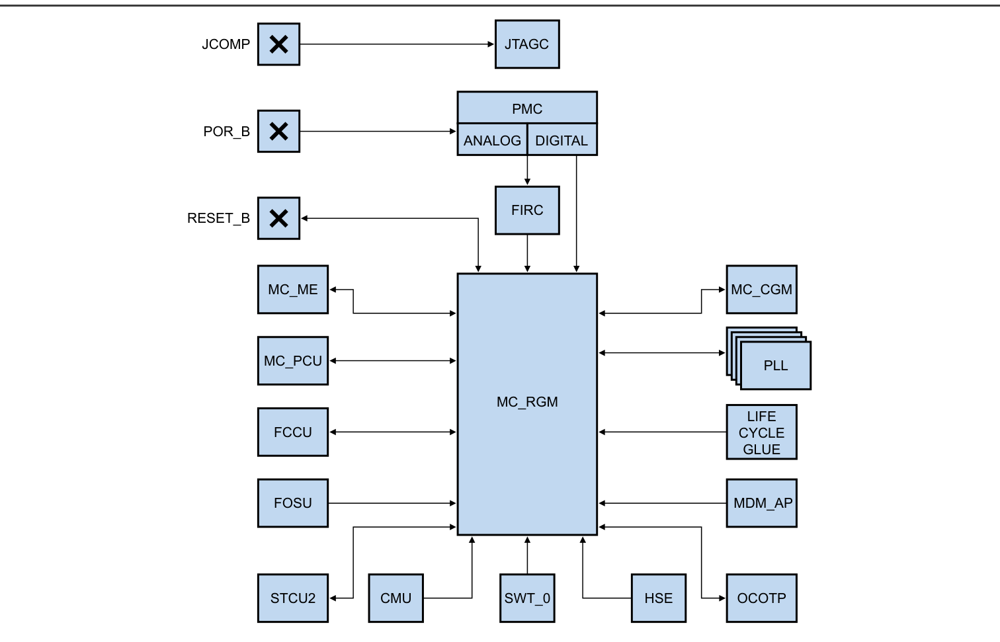

**注意：**

* 双向箭头：**RGM** 在复位序列期间与这些模块握手。
* 单向箭头：这些模块是复位源。

表 128 列出可导致各自复位序列的复位事件类型。

| 复位事件 | 说明 |
| --- | --- |
| 功能性复位（**Functional reset**） | 芯片操作仍然可靠，**SRAM** 存储器内容可以保留。会对功能无法保证的模块进行复位。 |
| 破坏性复位（**Destructive reset**） | 除少数选定模块外，复位芯片的大部分。该复位事件之后，存储器内容视为丢失。 |
| 上电复位（**POR**） | 整个芯片被复位。 |

## 2. 复位特性

该芯片的复位架构提供以下特性：

* 具有三个入口点的复位序列控制：
    * **POR**
    * 破坏性复位
    * 功能性复位
* 破坏性和功能性复位事件的状态报告
* 功能性复位升级为破坏性复位
* 破坏性复位升级以保持复位状态直到下一次 **POR**
* **SRAM** 内容保护，避免在任何功能性复位事件中被破坏
* 软件可复位域管理
* 芯片退出待机模式后的复位管理
* 通过熔丝（**fuses**）配置芯片

## 3. 高层复位序列

下图给出 **POR**、破坏性复位和功能性复位事件的高层复位序列总览。当复位过程到达"退出复位（**Out Of Reset**）"状态时，芯片即可运行。

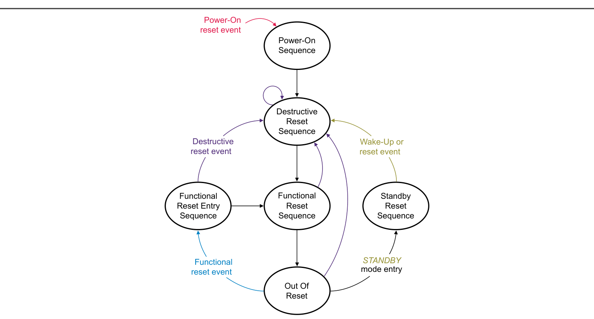

**POR** 事件会立即进入上电序列（**Power-On Sequence**）状态的起点，无论芯片当前处于某个复位序列还是"退出复位"状态。为简化上图，用一条红色箭头表示这一点。

表 129 列出每类复位事件进入高层复位序列的入口点。

| 复位事件类型 | 来源状态 | 反应 |
| --- | --- | --- |
| **POR** | 任意位置 | 转移到上电序列的起点 |
| 破坏性复位 | 上电序列 | 不改变复位序列 |
| 破坏性复位 | 其他任意位置 | 转移到破坏性复位序列的起点 |
| 功能性复位 | 退出复位 | 转移到功能性复位入口序列的起点 |
| 功能性复位 | **VDD_CORE_OK** 置位或 **FIRC** 稳定之前的待机复位序列 | 转移到破坏性复位序列的起点 |
| 功能性复位 | 其他任意位置 | 不改变复位序列 |

对于 **MC_RGM** 捕获的每个复位事件，芯片执行以下操作：

* 向 **MC_RGM_DES** 和 **MC_RGM_FES** 寄存器中对应的复位事件状态字段写 1。
* 将引脚置为默认状态。
* 按上表所述进入复位序列。

## 4. 复位源

所有 **POR** 源在有效时始终置位 **RESET_B**。**POR** 不能降级为 **IRQ**，也不需要升级。

所有破坏性复位源在有效时始终置位 **RESET_B**。

如果复位序列结束后 **MC_RGM_DES** 和 **MC_RGM_FES** 寄存器中的字段均为 1，表示功能性复位源有效期间芯片经历了破坏性复位。此时应忽略 **MC_RGM_DES** 寄存器中的 **F_DR_8**、**F_DR_13** 和 **F_DR_18**，因为这些字段是虚假置位的。

表 130 列出复位源；该表跨页续排，以下合并为一张表。

| 名称 | 说明 | 源模块 | 索引 | **RESET_B** 置位 | 可降级为 **IRQ** | 升级 |
| --- | --- | --- | --- | --- | --- | --- |
| **POR** 复位源 |  |  |  |  |  |  |
| **POR** | **VDD_STBY** | **PMC** | D[0] | 始终 | 否 | 否 |
| **POR** | **PMC** 电源 | **PMC** | D[0] | 始终 | 否 | 否 |
| **POR** | 关键 **SPD** 错误 | Critical SPDs (**CSPD**) | D[0] | 始终 | 否 | 否 |
| **POR** | **POR_B** 引脚置位 | **POR_B** 引脚 | D[0] | 始终 | 否 | 否 |
| **POR** | **POR** 看门狗超时 | **POR_WDG**（位于 **PMC** 内） | D[0] | 始终 | 否 | 否 |
| 破坏性复位源 |  |  |  |  |  |  |
| **NC_SPD_RST** | 非关键 **SPD** 故障 | Non-critical SPDs (**NCSPD**) | D[1] | 始终 | 否 | 否 |
| **FCCU_FTR** | **FCCU** 未响应 | **FOSU** | D[3] | 始终 | 否 | 是 |
| **STCU_URF** | **STCU** 不可恢复故障 | **STCU** | D[4] | 始终 | 否 | 是 |
| **MC_RGM_FRE** | 功能性复位升级 | **MC_RGM** | D[6] | 始终 | 否 | 是 |
| **FXOSC_FAIL** | **FXOSC** 故障 | **CMU_0** | D[8] | 始终 | 否 | 是 |
| **CORE_LOL** | **CORE_PLL** 失锁 | **CORE_PLL** | D[9] | 始终 | 否 | 是 |
| **PERIPH_LOL** | **PERIPH_PLL** 失锁 | **PERIPH_PLL** | D[10] | 始终 | 否 | 否 |
| **DDR_LOL** | **DDR_PLL** 失锁 | **DDR_PLL** | D[11] | 始终 | 否 | 否 |
| **ACC_LOL** | **ACCEL_PLL** 失锁 | **ACCELERATOR_PLL** | D[12] | 始终 | 否 | 否 |
| **XBAR_DIV3_CLK_FAIL** | **XBAR_DIV3_CLK** 故障 | **CMU_5** | D[13] | 始终 | 否 | 否 |
| **HSE_LC_RST** | 生命周期错误 | **HSE** 生命周期检查器 | D[16] | 始终 | 否 | 是 |
| **HSE_SNVS_RST** | 检测到 **HSE SNVS** 篡改 | **HSE SNVS** | D[17] | 始终 | 否 | 否 |
| **HSE_SWT_RST** | **HSE SWT** 超时 | **HSE SWT** | D[18] | 始终 | 否 | 是 |
| **SW_DEST** | 软件破坏性复位 | **MC_ME** | D[30] | 始终 | 否 | 是 |
| **DEBUG_DEST** | 调试破坏性复位 | **MDM_AP** | D[31] | 始终 | 否 | 否 |
| 功能性复位源 |  |  |  |  |  |  |
| **EXT** | **RESET_B** 引脚置位 | **RESET_B** 引脚 | F[0] | 始终 | 是 | 否 |
| **FCCU_RST** | **FCCU** 复位反应 | **FCCU** 软反应 | F[3] | 始终 | 否 | 是 |
| **ST_DONE** | 自检完成 | **STCU** | F[4] | 始终 | 否 | 否 |
| **SWT_0_RST** | **SWT_0** 超时 | **SWT_0** | F[6] | 始终 | 否 | 是 |
| **HSE_RAM_ECC_RST** | **HSE RAM ECC** 错误 | **HSE ECC** 模块 | F[18] | 始终 | 否 | 否 |
| **HSE_BOOT_ERR_RST** | **BootROM** 执行错误 | **HSE** 与 **BootROM** | F[20] | 始终 | 否 | 是 |
| **HSE_CORE_LOCK_RST** | **HSE M7** 内核锁定状态 | **HSE** | F[21] | 始终 | 否 | 是 |
| **SW_FUNC** | 软件功能性复位 | **MC_ME** | F[30] | 始终 | 否 | 否 |
| **DEBUG_FUNC** | 调试功能性复位 | **MDM_AP** | F[31] | 始终 | 是 | 否 |

## 5. 复位源说明

### 5.1. **POR** 复位源

#### 5.1.1. 片上 **POR**

在芯片上电期间，只要片上 **POR** 检测电路可以工作，芯片就会置位其内部 **POR** 信号（关于 **POR** 期间监测的电源，参见"电源管理"一章）。

在芯片正常工作期间，当片上 **POR** 检测电路监测的任一芯片电压低于其规定的最小阈值时，内部上电复位信号置位。芯片置位内部 **POR** 信号后，该信号一直保持置位，直到片上 **POR** 检测电路监测的所有芯片电压都上升到其最低工作阈值以上。

片上 **POR** 电路位于连接到以下电源轨的 **CSPD** 中（详见"电源管理控制器（**PMC**）"一章）：

* 复位序列和初始引导所需的逻辑
* **FIRC** 的模拟部分
* 关键引脚（例如 **RESET_B**）

#### 5.1.2. 关键 **LVD**

在芯片上电期间，只要对应的片上 **LVD** 检测电路可以工作，芯片就会置位每个关键 **LVD** 复位信号。

在芯片正常工作期间，当对应的被测电压低于其相应规定阈值时，芯片立即置位每个关键 **LVD** 复位信号。

芯片置位某个关键 **LVD** 复位信号后，会持续置位该信号，直到对应的芯片电压上升到其阈值以上。

导致复位置位的被测 **LVD** 芯片电压（当其低于规定电压时）列于"电源管理"一章的"最小片外 **LVD** 与 **HVD**"表中。

关键片上 **LVD** 电路位于 **CSPD** 中，连接到为正确执行引导过程而必须保持在规定电平的电源轨。

#### 5.1.3. 外部 **POR_B** 引脚

低电平有效的 **POR_B** 引脚在输入端使用弱下拉。

在芯片上电期间，片外电源管理电路一旦可以工作就置位 **POR_B** 引脚。片外电源管理电路可以由单个电源管理 **IC**（**PMIC**）或多个芯片组合构成。

在正常工作期间，当该电路监测的任一电压低于相应阈值时，片外电源管理电路置位 **POR_B** 引脚。

当片外电源管理电路置位 **POR_B** 引脚时，该电路会持续置位 **POR_B**，直到其监测的所有电压都上升到相应阈值以上。

片外电源管理电路监测所有片外提供的电压。

#### 5.1.4. **POR** 看门狗定时器

**POR** 看门狗定时器超时时，芯片立即置位 **POR_WDG** 复位。

芯片进入 **POR** 序列后立即清零 **POR** 看门狗定时器并撤销 **POR_WDG** 复位。

以下复位事件会启动 **POR** 看门狗定时器计数：

1. 所有 **POR** 事件（上电序列完成之后）
2. 所有破坏性复位事件（事件检测到之后立即）
3. 所有功能性复位事件（事件检测到之后立即）

**POR_WDOG** 的默认超时值为 960 个 **SIRC** 时钟周期（30 ms）。

**POR** 看门狗正常工作必须满足以下条件：

* 熔丝未禁用 **POR** 看门狗。
* 没有任何因素触发破坏性复位升级阈值。

### 5.2. 破坏性复位源

#### 5.2.1. **SPD** 故障

**SPD** 检测相关稳压器与被测电源之间连接上的扰动。此类扰动可能是：

* **PMIC** 与芯片之间的断线
* 间歇性连接
* 高阻连接

在芯片工作期间，当 **SPD** 电路监测的对应芯片电压下降到低于精密 **LVD** 最小电压、但仍高于处理后续复位所需逻辑可以工作的电平时，芯片立即置位每个 **SPD** 故障信号。

芯片置位某个 **SPD** 故障信号后，会持续置位该信号，直到被测电压上升到其阈值以上。

以下情况下 **NCSPD** 的反应被禁用：

* 上电复位
* 进入破坏性复位序列
* 功能性复位

**PMC** 内的 **NCSPD_CTL** 寄存器在功能性复位时被复位。该寄存器的默认配置禁用所有 **NCSPD** 的反应。

可以通过软件使能 **NCSPD**。

软件可以通过读取 **PMC** 中写 1 清零的状态寄存器，判断是哪个 **NCSPD** 导致了破坏性复位。

**CSPD** 不能被禁用。

#### 5.2.2. **FCCU** 未响应

**FOSU** 模块监测 **FCCU**；如果 **FCCU** 未在规定时间内对故障作出反应，**FOSU** 置位 **FCCU** 未响应复位。

**FCCU** 未响应复位在进入破坏性复位和 **POR** 序列时立即撤销。

#### 5.2.3. **STCU2** 不可恢复故障

**STCU2** 依据其对多种可能错误条件的配置，置位不可恢复故障。

**STCU2** 不可恢复故障复位在进入破坏性复位和 **POR** 序列时立即撤销。

#### 5.2.4. 功能性复位升级为破坏性复位

当导致升级计数器递增并达到 **MC_RGM_FRET[FRET]** 寄存器字段中阈值的那个功能性复位事件发生时，**MC_RGM** 立即置位功能性复位升级复位。

功能性复位升级计数器在进入破坏性复位和 **POR** 序列时立即清零，功能性复位升级复位也同时撤销。

功能性复位升级功能可以通过软件使能和禁用。

功能性复位升级阈值可以通过软件设置。

在破坏性复位与 **POR** 序列退出之后，功能性复位升级功能的默认配置为使能，且 **FRET** 值设为 15。

如果使能，芯片处于退出复位状态时每发生一次功能性复位事件，功能性复位升级计数器加一。

功能性复位升级计数器可以由软件清零。

#### 5.2.5. **FXOSC** 故障

监测 **FXOSC** 输出时钟的时钟监视器一旦检测到 **FXOSC** 输出时钟频率超出规定的最小/最大频率阈值范围，就置位 **FXOSC** 故障复位。

**FXOSC** 故障复位在进入破坏性复位和 **POR** 序列时立即撤销。

#### 5.2.6. **CORE_PLL** 失锁

**CORE_PLL** 在先前已锁定之后一旦失锁，就置位 **CORE_PLL** 失锁。

**CORE_PLL** 失锁在进入任何复位序列时立即撤销。

#### 5.2.7. **PERIPH_PLL** 失锁

**PERIPH_PLL** 在先前已锁定之后一旦失锁，就置位 **PERIPH_PLL** 失锁。

**PERIPH_PLL** 失锁在进入任何复位序列时立即撤销。

**PERIPH_PLL** 在功能性复位时被复位。**PERIPH_PLL** 失锁会产生破坏性复位，因此在进入破坏性复位序列时被复位。

#### 5.2.8. **DDR_PLL** 失锁

**DDR_PLL** 在先前已锁定之后一旦失锁，就置位 **DDR_PLL** 失锁。

**DDR_PLL** 失锁在进入任何复位序列时立即撤销。

**DDR_PLL** 在功能性复位时被复位。**DDR_PLL** 失锁会产生破坏性复位，因此在进入破坏性复位序列时被复位。

#### 5.2.9. **ACCEL_PLL** 失锁

**ACCEL_PLL** 在先前已锁定之后一旦失锁，就置位 **ACCEL_PLL** 失锁。

**ACCEL_PLL** 失锁在进入任何复位序列时立即撤销。

**ACCEL_PLL** 在功能性复位时被复位。**ACCEL_PLL** 失锁会产生破坏性复位，因此在进入破坏性复位序列时被复位。

#### 5.2.10. **XBAR_DIV3** 时钟故障

**XBAR_DIV3_CLK** 故障监视器的最小频率阈值通常设置得低于提供 **FCCU** 反应的 **CMU** 精密监视的阈值。这是因为该监视器主要用于检查该时钟域的时钟丢失。

**XBAR_DIV3_CLK** 故障复位在进入破坏性复位和 **POR** 序列时立即撤销。

#### 5.2.11. 生命周期错误

生命周期（**Life-Cycle**）模块在检测到生命周期值错误时立即置位安全生命周期故障复位，例如：

* 读取生命周期值期间发生故障
* 读到无效的生命周期值
* 存储的生命周期值损坏

安全生命周期故障复位在进入破坏性复位和 **POR** 序列时立即撤销。

#### 5.2.12. 软件破坏性复位

通过 **MC_ME** 发出切换到破坏性复位的模式变更请求时，立即置位软件破坏性复位。

软件破坏性复位在进入破坏性复位和 **POR** 序列时立即清零。

#### 5.2.13. 调试破坏性复位

调试器将 **DAP** 的 **MDM_AP** 寄存器中的破坏性复位字段置为 1 时，立即置位调试破坏性复位。

调试器将 **DAP** 的 **MDM_AP** 寄存器中的破坏性复位字段置为 0 时，立即撤销调试破坏性复位（该字段会自动置 0，因为调试器逻辑本身工作在破坏性复位之下）。

### 5.3. 功能性复位源

#### 5.3.1. **FCCU** 复位反应

当 **FCCU** 检测到故障且该故障被配置为产生软反应时，**FCCU** 置位 **FCCU** 复位反应复位。

**FCCU** 复位反应复位在置位后由 **FCCU** 自动撤销，并在进入破坏性复位和 **POR** 序列时立即撤销。

软件可以通过读取 **FCCU** 中的状态寄存器，判断是哪个故障导致了 **FCCU** 复位反应。

#### 5.3.2. 自检完成

在主复位域上的 **BIST**（**LBIST/MBIST**）执行完成后，**STCU2** 置位自检完成复位。

自检完成复位在置位后由 **STCU2** 自动撤销，并在进入破坏性复位和 **POR** 序列时立即撤销。

#### 5.3.3. **SWT_0** 超时

运行在"Cortex-M7 cluster0"上的软件未在 **SWT** 复位定时器到期前喂狗时，立即置位 **SWT_0** 超时复位请求。**SWT_0** 超时信号在进入任何复位序列时立即撤销。

#### 5.3.4. 软件功能性复位

通过 **MC_ME** 发出切换到功能性复位的模式变更请求时，立即置位软件功能性复位。

软件功能性复位在进入功能性复位、破坏性复位和 **POR** 序列时立即清零。

#### 5.3.5. 调试功能性复位

调试器置位 **DAP** 的 **MDM_AP** 寄存器中的功能性复位字段时，立即置位调试功能性复位。

调试器清零 **DAP** 的 **MDM_AP** 寄存器中的功能性复位字段时，立即撤销调试功能性复位。

### 5.4. 非 **MC_RGM** 复位源与间接复位源

#### 5.4.1. **JCOMP** 引脚

高电平有效的 **JCOMP** 引脚为仅输入，带弱下拉。

需要 **JTAG** 操作时（例如调试期间）置位 **JCOMP** 引脚；不需要 **JTAG** 操作时持续撤销该引脚。

**JCOMP** 引脚撤销时置位 **JCOMP** 复位。

**JCOMP** 引脚置位时撤销 **JCOMP** 复位。

### 5.5. 破坏性复位升级以保持复位状态

当导致升级计数器递增并达到 **MC_RGM_DRET[DRET]** 中阈值的那个破坏性复位事件发生时，**MC_RGM** 立即置位破坏性复位升级复位。

破坏性复位升级复位置位后，复位序列立即进入 **DEST0** 状态并保持在那里，直到 **POR** 事件启动 **POR** 序列。

破坏性复位升级功能可以通过软件使能和禁用。

破坏性复位升级阈值可以通过软件设置。

上电序列退出之后，破坏性复位升级功能的默认配置为禁用。

如果使能，每发生一次破坏性复位事件，破坏性复位升级计数器加一。

破坏性复位升级计数器可以由软件清零。

### 5.6. **RESET_B**

低电平有效的 **RESET_B** 引脚为开漏双向，带弱上拉。

芯片正在置位 **RESET_B** 引脚时，忽略该引脚的输入值。

**MC_RGM** 在进入破坏性复位和 **POR** 序列时始终置位 **RESET_B** 引脚。

在进入破坏性和上电复位序列时立即设定的默认配置是：所有功能性复位事件都会使 **RESET_B** 置位。

**MC_RGM** 置位 **RESET_B** 引脚后，会持续置位，直到除"**RESET_B** 已撤销"这一检查之外的所有复位序列退出条件都得到满足。

对所有复位序列，只有当 **RESET_B** 引脚达到其撤销状态时复位序列才能退出；换言之，必须等到 **MC_RGM** 和外部系统都不再置位 **RESET_B** 引脚。

当 **MC_RGM** 未置位 **RESET_B** 引脚、且在该引脚上检测到置位边沿时，置位外部复位事件。

**RESET_B** 引脚输入信号经过毛刺滤波，可滤除高、低毛刺，特性如下：

* 最大被抑制脉冲：20 ns
* 最小通过脉冲：400 ns

**RESET_B** 引脚由片外电源管理电路在器件电源开始斜坡上升之前就置位，并至少保持到 **POR_B** 引脚撤销。这样可以防止 **RESET_B** 引脚在其电源斜坡上升期间出现异常行为。

## 6. 复位过程

### 6.1. 概述

复位过程是基于所发生复位事件的一系列复位阶段。所有复位事件都遵循同一套芯片复位序列，只是入口点随复位事件类型而变化。这些阶段在执行上是顺序的。每个阶段由 **MC_RGM** 在前一阶段完成时触发。这些阶段按特定顺序执行，以确保从任何复位事件退出时系统都处于确定状态。

### 6.2. 复位过程序列

#### 6.2.1. **POR** 序列

当发生 **POR** 事件（例如任一 **POR** 源置位）时进入该阶段。在该阶段，芯片等待上电序列完成。当所有 **POR** 源清除时退出该阶段。

参与 **POR** 复位序列的模块如下：

* **PMC**
* **FIRC**
* **POR_B**
* **JTAGC/JCOMP**

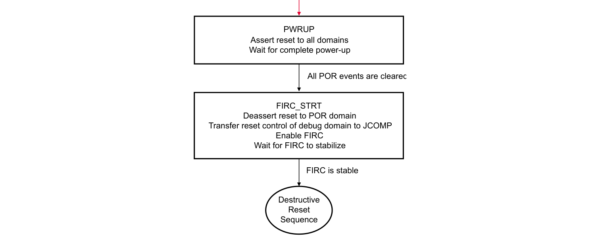

#### 6.2.2. 破坏性复位序列

参与破坏性复位序列的模块如下：

* **OCOTP**
* **PMC**
* **FIRC**
* **SIRC**
* 生命周期逻辑

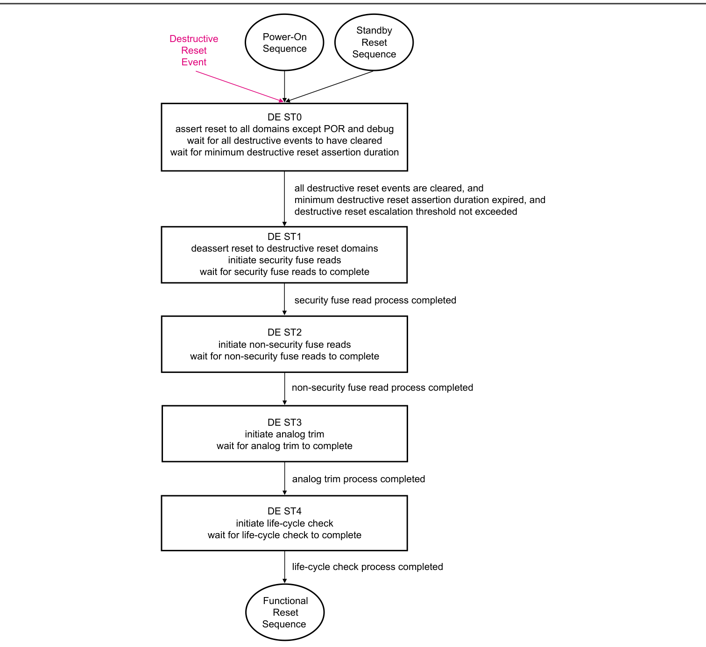

**注意：** 由于复位序列期间只有 **FIRC** 一个时钟源可用，且非 **FIRC** 时钟域在进入破坏性复位序列时可能出现毛刺，因此 **POR** 域中的所有 **IP** 都运行在 **FIRC** 时钟或 **TCK** 上。一个小小的例外是 **POR_WDOG**，它还有一个内部产生的独立时钟，用于其看门狗定时器。

#### 6.2.3. 功能性复位序列

下图中的 **FUNC0** 到 **FUNC7** 表示功能性复位入口序列。参与功能性复位入口序列的模块如下：

* **STCU2**
* **FCCU/FOSU**
* **CMU**
* **SWT**
* Debug/ETR/MDM_AP
* **HSE**
* **NoC**
* **CGM**
* **DFS**
* **PLL**
* **FXOSC**

下图中的 **FUNC8** 到 **FUNC10** 表示功能性复位退出序列。参与功能性复位退出序列的模块如下：

* 存储器修复
* **RESET_B**
* 引导配置引脚（关于复位序列期间为选择引导模式和配置而采样的引脚，参见"引导"一章的"引导模式"一节）

**注意：** 为正确采样引导配置引脚，必须确保相应的 **I/O** 电源处于其规定范围内。否则，复位序列不会被阻止完成，但可能导致错误的引导。

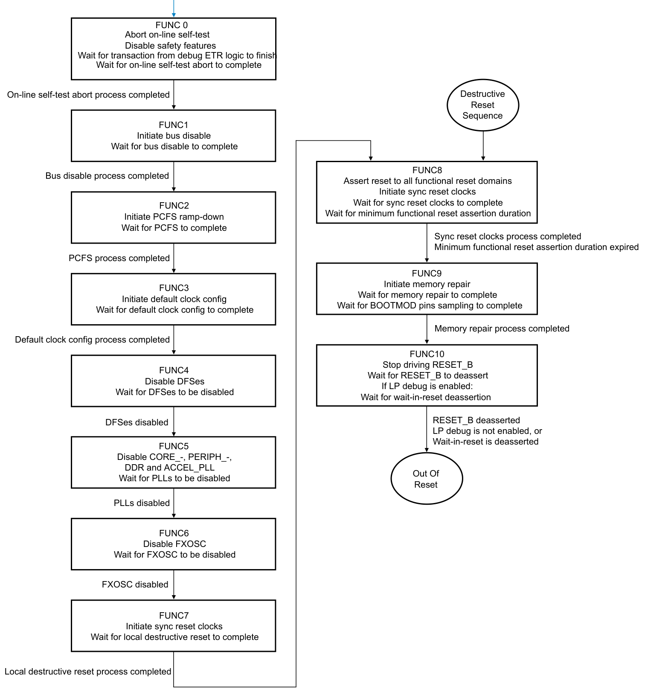

#### 6.2.4. 待机复位序列

参与待机复位序列的模块如下：

* Debug/TPIU/MDM_AP
* **MC_PCU**
* **FIRC**
* **PMC**
* **SIRC**

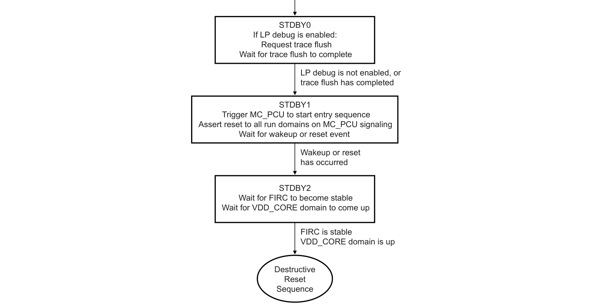

## 7. 退出复位时的芯片状态

表 131 给出上电复位（**POR**）之后，各功能在初始、复位序列期间、运行期间与待机期间的状态；该表跨页续排，以下合并为一张表。

| 功能 | 初始 | 复位序列期间 | 运行期间 | 待机期间 |
| --- | --- | --- | --- | --- |
| 时钟源 | **FIRC** 和 **SIRC** 开启，其他全部关闭 |  |  |  |
| 时钟选择 | 默认值（系统使用 **FIRC**） |  |  |  |
| 时钟分频器 | 默认值 |  |  |  |
| 复位状态标志 | 仅 **F_POR** 置位 |  |  |  |
| **MC_ME** 先前模式 | 复位 |  |  |  |
| **FCCU** 故障信息 | 已清零 |  |  |  |
| **SRAM** 内容 | 无效 |  |  |  |
| **DRAM** 内容 | 无效 |  |  |  |
| 待机 **RAM** 内容 | 无效 |  |  |  |
| 熔丝配置 | 已加载 | 已重新加载 |  |  |
| 内核 | 关闭 |  |  |  |
| 可复位子系统 | 全部关闭并处于复位 |  |  |  |
| **POR** 域（运行） | 开启，采用默认配置 |  |  |  |
| **POR** 域（待机） | 开启，采用默认配置 |  |  |  |
| 破坏性复位域（运行） | 开启，采用默认配置 |  |  |  |
| 破坏性复位域（待机） | 开启，采用默认配置 |  |  |  |
| 功能性复位域（运行） | 开启，采用默认配置 |  |  |  |
| 待机域 | 开启，采用默认配置 |  |  |  |
| 待机引脚 | 默认配置 |  |  |  |
| 非待机引脚 | 默认配置 |  |  |  |

表 132 给出破坏性复位之后各功能在复位序列期间、运行期间与待机期间的状态；该表跨页续排，以下合并为一张表。

| 功能 | 复位序列期间 | 运行期间 | 待机期间 |
| --- | --- | --- | --- |
| 时钟源 | **FIRC** 和 **SIRC** 开启，其他全部关闭 |  |  |
| 时钟选择 | 默认值（系统使用 **FIRC**） |  |  |
| 时钟分频器 | 默认值 |  |  |
| 复位状态标志 | 另外置位 **F_DR_\*** |  | 置位 **F_DR_\*** 和 **RGM_RDSS[DES_RES]** |
| **MC_ME** 先前模式 | 复位 |  |  |
| **FCCU** 故障信息 | 已清零 |  |  |
| **SRAM** 内容 | 无效 |  |  |
| **DRAM** 内容 | 无效 |  |  |
| 待机 **RAM** 内容 | 无效 |  |  |
| 熔丝配置 | 已重新加载 |  |  |
| 内核 | 关闭 |  |  |
| 可复位子系统 | 全部关闭并处于复位 |  |  |
| **POR** 域（运行） | 开启，采用先前配置 |  | 开启，采用默认配置 |
| **POR** 域（待机） | 开启，采用先前配置 |  |  |
| 破坏性复位域（运行） | 开启，采用默认配置 |  |  |
| 破坏性复位域（待机） | 开启，采用默认配置 |  |  |
| 功能性复位域（运行） | 开启，采用默认配置 |  |  |
| 待机域 | 开启，采用默认配置 |  |  |
| 待机引脚 | 默认配置 |  |  |
| 非待机引脚 | 默认配置 |  |  |

表 133 给出功能性复位之后各功能在运行期间与待机期间的状态。

| 功能 | 运行期间 | 待机期间 |
| --- | --- | --- |
| 时钟源 | **FIRC** 和 **SIRC** 开启，其他全部关闭 |  |
| 时钟选择 | 默认值（系统使用 **FIRC**） |  |
| 时钟分频器 | 默认值 |  |
| 复位状态标志 | 另外置位 **F_FR_\*** | 置位 **F_FR_\*** 和 **RGM_RDSS[FES_RES]** |
| **MC_ME** 先前模式 | 复位 |  |
| **FCCU** 故障信息 | 保留 | 已清零 |
| **SRAM** 内容 | 保留 | 无效 |
| **DRAM** 内容 | 若使能保留则保留，否则无效 |  |
| 待机 **RAM** 内容 | 保留 |  |
| 熔丝配置 | 保留 |  |
| 内核 | 关闭 |  |
| 可复位子系统 | 全部关闭并处于复位 |  |
| **POR** 域（运行） | 开启，采用先前配置 | 开启，采用默认配置 |
| **POR** 域（待机） | 开启，采用先前配置 |  |
| 破坏性复位域（运行） | 开启，采用先前配置 | 开启，采用默认配置 |
| 破坏性复位域（待机） | 开启，采用先前配置 |  |
| 功能性复位域（运行） | 开启，采用默认配置 |  |
| 待机域 | 开启，采用默认配置 |  |
| 待机引脚 | 默认配置 |  |
| 非待机引脚 | 默认配置 |  |

表 134 给出唤醒之后各功能在待机期间的状态。

| 功能 | 待机期间 |
| --- | --- |
| 时钟源 | **FIRC** 开启，**SIRC** 保持进入待机时的状态，其他全部关闭 |
| 时钟选择 | 默认值（系统使用 **FIRC**） |
| 时钟分频器 | 默认值 |
| 复位状态标志 | 无标志置位 |
| **MC_ME** 先前模式 | 待机 |
| **FCCU** 故障信息 | 已清零 |
| **HSE RAM** | 已初始化 |
| **SRAM** 内容 | 无效 |
| **DRAM** 内容 | 若使能保留则保留，否则无效 |
| 待机 **RAM** 内容 | 保留 |
| 熔丝配置 | 保留 |
| 内核 | **HSE** 开启，其他全部关闭 |
| 可复位子系统 | 全部关闭并处于复位 |
| **POR** 域（运行） | 开启，采用默认配置 |
| **POR** 域（待机） | 开启，采用先前配置 |
| 破坏性复位域（运行） | 开启，采用默认配置 |
| 破坏性复位域（待机） | 开启，采用先前配置 |
| 功能性复位域（运行） | 开启，采用默认配置 |
| 待机域 | 未知 |
| 待机引脚 | 与进入待机时相同 |
| 非待机引脚 | 默认配置 |

## 8. 复位过程中模块的状态

表 135 列出各模块在上电复位、破坏性复位和功能性复位期间的状态；该表跨四页续排，以下合并为一张表。表中 **Y** 表示该复位会复位整个模块；带灰色底纹的 **Y** 表示该复位只复位模块的一部分、另一部分不复位；**N** 表示该复位不复位模块的任何部分。

| 模块名称 | **POR** | 破坏性复位 | 功能性复位 | **JCOMP** | **PRSTn** | 供电域 | 属于 **LBIST** | 注释 |
| --- | --- | --- | --- | --- | --- | --- | --- | --- |
| **MC_RGM** | Y | N | N | N | N | Standby | No |  |
| **RDC** | Y | Y | Y | N | N | Run | No |  |
| **PMC** | Y | N | N | N | N | Standby | No |  |
| **FIRC** | Y | N | N | N | N | Run | No |  |
| **POR_WDOG** | Y | N | N | N | N | Standby | No |  |
| **MC_CGM** | Y | Y | N | N | N | Run | No |  |
| **OCOTP** | Y | Y | N | N | N | Standby | No |  |
| **HSE MU** | Y | Y | Y | N | N | Run | Yes |  |
| 生命周期检查逻辑 | Y | Y | N | N | N | Standby | No |  |
| **STCU2** | Y | Y | N | N | N | Run | No |  |
| **FCCU** | Y | Y | N | N | N | Run | Yes |  |
| **FOSU** | Y | Y | N | N | N | Run | Yes |  |
| **MC_PCU** | Y | Y | N | N | N | Standby | No |  |
| **WKPU** | Y | Y | N | N | N | Standby | No |  |
| **SIRC** | Y | N | N | N | N | Standby | No |  |
| **FXOSC** | Y | Y | Y | N | N | Run | No |  |
| **PLL** | Y | Y | Y | N | N | Run | No |  |
| **DFS** | Y | Y | Y | N | N | Run | No |  |
| **RTC** | Y | Y | N | N | N | Standby | No |  |
| **QuadSPI** | Y | Y | Y | N | N | Run | Yes |  |
| 锁步 **Cortex-M7** 内核 | Y | Y | Y | N | N | Run | Yes |  |
| **NoC** | Y | Y | Y | N | N | Run | Yes |  |
| **OCP2IPS** | Y | Y | Y | N | N | Run | Yes |  |
| **SEMA42** | Y | Y | Y | N | N | Run | Yes |  |
| **GIC500** | Y | Y | Y | N | Y | Run | Yes |  |
| **Ncore** | Y | Y | Y | N | N | Run | Yes |  |
| **SWT** | Y | Y | Y | N | N | Run | Yes |  |
| **PIT** | Y | Y | Y | N | N | Run | Yes |  |
| **STM** | Y | Y | Y | N | N | Run | Yes |  |
| **FTM** | Y | Y | Y | N | N | Run | Yes |  |
| **MC_ME** | Y | Y | Y | N | N | Run | Yes |  |
| **SIUL2** | Y | Y | Y | N | N | Run | Yes |  |
| **SAR_ADC** | Y | Y | Y | N | N | Run | Yes | 校准逻辑在破坏性复位时开启 |
| **CTU** | Y | Y | Y | N | N | Run | Yes |  |
| **FlexCAN** | Y | Y | Y | N | N | Run | Yes |  |
| **LINFlex** | Y | Y | Y | N | N | Run | Yes |  |
| **SPI** | Y | Y | Y | N | N | Run | Yes |  |
| **IIC** | Y | Y | Y | N | N | Run | Yes |  |
| **FlexRay** | Y | Y | Y | N | N | Run | Yes |  |
| **USDHC** | Y | Y | Y | N | N | Run | Yes |  |
| **GMAC**（以太网） | Y | Y | Y | N | N | Run | Yes |  |
| **DDR** 控制器 | Y | Y | Y | N | N | Run | Yes |  |
| **DDR PHY** | Y | Y | Y | N | N | Run | Yes | 功能性复位执行热复位序列，破坏性复位执行冷复位序列 |
| **MSCM** | Y | Y | Y | N | N | Run | Yes |  |
| **XRDC** | Y | Y | Y | N | N | Run | Yes |  |
| **ERM** | Y | Y | Y | N | N | Run | Yes |  |
| **EIM** | Y | Y | Y | N | N | Run | Yes |  |
| **CRC** | Y | Y | Y | N | N | Run | Yes |  |
| **CMU** | Y | Y | Y | N | N | Run | Yes |  |
| **SbSW** | Y | Y | Y | N | N | Run | Yes |  |
| **TMU** | Y | Y | Y | N | N | Run | Yes |  |
| **eDMA** | Y | Y | Y | N | N | Run | Yes |  |
| **DMAMUX** | Y | Y | Y | N | N | Run | Yes |  |
| **SRAM** 控制器 | Y | Y | Y | N | N | Run | Yes |  |
| **Aurora** | Y | Y | N | N | N | Run | Yes |  |
| **JDC** | Y | N | N | Y | N | Run | Yes |  |
| **JTAGC** | Y | N | N | Y | N | Run | No |  |
| **Cortex-A53**（**nCPUPORESET[1:0]**） | Y | Y | Y | N | Y | Run | Yes |  |
| **Cortex-A53**（**nCORERESET[1:0]**） | Y | Y | Y | N | Y | Run | Yes |  |
| **Cortex-A53**（**nL2RESET**） | Y | Y | Y | N | Y | Run | Yes |  |
| **Cortex-A53**（**nPRSTDEBUG**） | Y | Y | N | N | Y | Run | Yes |  |
| **PFE** | Y | Y | Y | N | Y | Run | Yes |  |
| 内核调试（含 **SWJ-DP**、**DAP** 及多个 **AP**） | Y | Y | N | N | N | Run | Yes | **DAP/SWJ-DP** 的 **TCK** 域逻辑在 **JCOMP** 复位下工作 |

## 9. 退出复位时确定复位原因

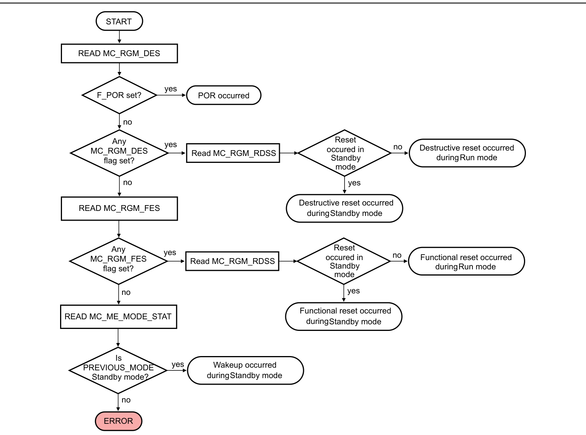

## 10. 复位相关 **I/O**

表 136 列出复位相关的 **I/O**。

| 名称 | 类型 | 上下拉 | 可复用 | 说明 |
| --- | --- | --- | --- | --- |
| **POR_B** | 输入 | 下拉 | 否 | 来自 **PMIC** 的低电平有效上电复位指示 |
| **RESET_B** | 双向 | 上拉 | 否 | 低电平有效的开漏外部复位指示 |
| **JCOMP** | 输入 | 下拉 | 否 | **JTAG** 兼容输入，为低电平时复位 **JTAG**/调试逻辑 |

## 11. 复位序列期间及退出复位后的引脚状态

参见芯片的 **IOMUX** 表。

## 12. 软件可复位域

### 12.1. 介绍

芯片划分为若干个复位域。

在 **POR**、破坏性复位或功能性复位之后，只有主复位域（**Main Reset Domain**）被释放复位。所有其他复位域保持复位状态，直到软件写入 **MC_RGM** 中用于释放指定复位域的寄存器字段。

软件也可以写入 **MC_RGM** 中的某个寄存器字段，在确保某种配置之后选择性地将某个复位域重新置入复位。该配置由 **MC_CGM**、**MC_ME** 和 **RDC** 模块控制。这些复位域称为软件可复位域/分区（**software-resettable domains/partitions**）。

这种复位结构带来更好的器件可用性。如果在某个软件复位域中检测到故障，可以单独复位该域，而不影响芯片其余部分的运行。

**MC_RGM** 为每个复位域/分区（包括主复位域）提供 64 位。这些位用于复位软件可复位域/分区本身或其中的内核。

* 32 位寄存器 **RGM_PRSTn_0[PERIPH_(64\*n+31)_RST : PERIPH_(64\*n)_RST]**
* 32 位寄存器 **RGM_PRSTn_1[PERIPH_(64\*n+63)_RST : PERIPH_(64\*n+32)_RST]**

**RGM_PRST0_0/1** 寄存器对应主复位分区，**RGM_PRST1_0/1** 寄存器对应第一个软件可复位分区，**RGM_PRST2_0/1** 寄存器（如果存在）对应第二个软件可复位分区，依此类推。

**RGM_PRSTn_0[PERIPH_(64\*n)_RST]** 对应分区复位。

表 137 列出各分区与内核的 **PRST** 字段；该表跨页续排，以下合并为一张表。

| **PRST** 字段 | 分区复位 | 内核/外设复位 | 复位分区名称 | 内核/外设名称 |
| --- | --- | --- | --- | --- |
| **RGM_PRST0_0** |  |  |  |  |
| **PERIPH_0_RST** | No | Yes | Main | Cortex-M7 cluster0 |
| **PERIPH_1_RST** | No | Yes | Main | Cortex-M7 cluster1 |
| **PERIPH_2_RST** | No | Yes | Main | Cortex-M7 cluster2 |
| **PERIPH_6_RST** | No | Yes | Main | Cortex-M7 cluster3 |
| **PERIPH_3_RST** | No | Yes | Main | DDR |
| **PERIPH_4_RST** | No | Yes | Main | PCIe_0 |
| **PERIPH_5_RST** | No | Yes | Main | PCIe_0 |
| **PERIPH_16_RST** | No | Yes | Main | PCIe_1 |
| **PERIPH_17_RST** | No | Yes | Main | PCIe_1 |
| **RGM_PRST1_0** |  |  |  |  |
| **PERIPH_64_RST** | Yes | No | Cortex-A53 | NA |
| **PERIPH_65_RST** | No | Yes | Cortex-A53 | Cortex-A53 CORE 0 cluster 0 |
| **PERIPH_66_RST** | No | Yes | Cortex-A53 | Cortex-A53 CORE 1 cluster 0 |
| **PERIPH_69_RST** | No | Yes | Cortex-A53 | Cortex-A53 CORE 2 cluster 0 |
| **PERIPH_70_RST** | No | Yes | Cortex-A53 | Cortex-A53 CORE 3 cluster 0 |
| **PERIPH_67_RST** | No | Yes | Cortex-A53 | Cortex-A53 CORE 0 cluster 1 |
| **PERIPH_68_RST** | No | Yes | Cortex-A53 | Cortex-A53 CORE 1 cluster 1 |
| **PERIPH_71_RST** | No | Yes | Cortex-A53 | Cortex-A53 CORE 2 cluster 1 |
| **PERIPH_72_RST** | No | Yes | Cortex-A53 | Cortex-A53 CORE 3 cluster 1 |
| **RGM_PRST2_0** |  |  |  |  |
| **PERIPH_128_RST** | Yes | No | PFE | NA |
| **RGM_PRST3_0** |  |  |  |  |
| **PERIPH_192_RST** | Yes | No | LLCE | NA |

### 12.2. 芯片上的软件复位域/分区列表

表 138 列出芯片上的软件可复位域/分区。

| 软件可复位域 | 模块 | **MC_RGM** 中的复位控制字段 |
| --- | --- | --- |
| **RD1** | Cortex-A53 Cluster | **RGM_PRST1_0[PERIPH_64_RST]** |
| **RD2** | PFE | **RGM_PRST2_0[PERIPH_128_RST]** |
| **RD3** | LLCE | **RGM_PRST3_0[PERIPH_192_RST]** |

芯片中的所有其他模块都属于主复位域（**RD0**）。

**注意：** 当模块时钟被门控或复位未撤销时，模块处于禁用状态。尝试访问因上述原因被禁用的模块，将导致无错误响应的无效行为、传输错误或挂起。

#### 12.2.1. **Cortex-A53** 软件可复位域/分区

该复位域由以下部分组成：

* 两个 **Cortex-A53** 簇
* 一对锁步的 **GIC 500**，用于处理中断
* 一致性互连结构（**Ncore**），包括目录缓存
* 支持锁步运行的延迟与比较单元

每个簇由四个 **Cortex-A53** 内核组成。两个簇既可以彼此处于延迟锁步，也可以独立运行，取决于将它们从复位中释放之前的配置。

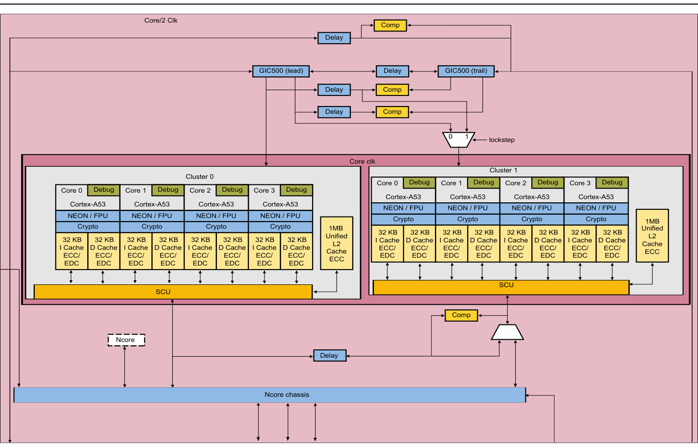

### 12.3. 上电/破坏性/功能性复位序列后软件复位域/分区的状态

所有软件可复位域/分区都处于复位状态。复位域/分区的时钟被门控。复位域/分区的输出处于安全状态（**safe-stated**），即输出隔离被置位。软件可复位域/分区中总线主设备的 **NoC**/交叉开关接口与 **NoC**/交叉开关之间也处于安全状态。

### 12.4. 软件复位分区开启流程图

对于 **Cortex-A53** 复位域，可以通过将 **MC_CGM_1** 配置为 **FIRC** 时钟来设置初始频率的时钟。详见"时钟"一章。

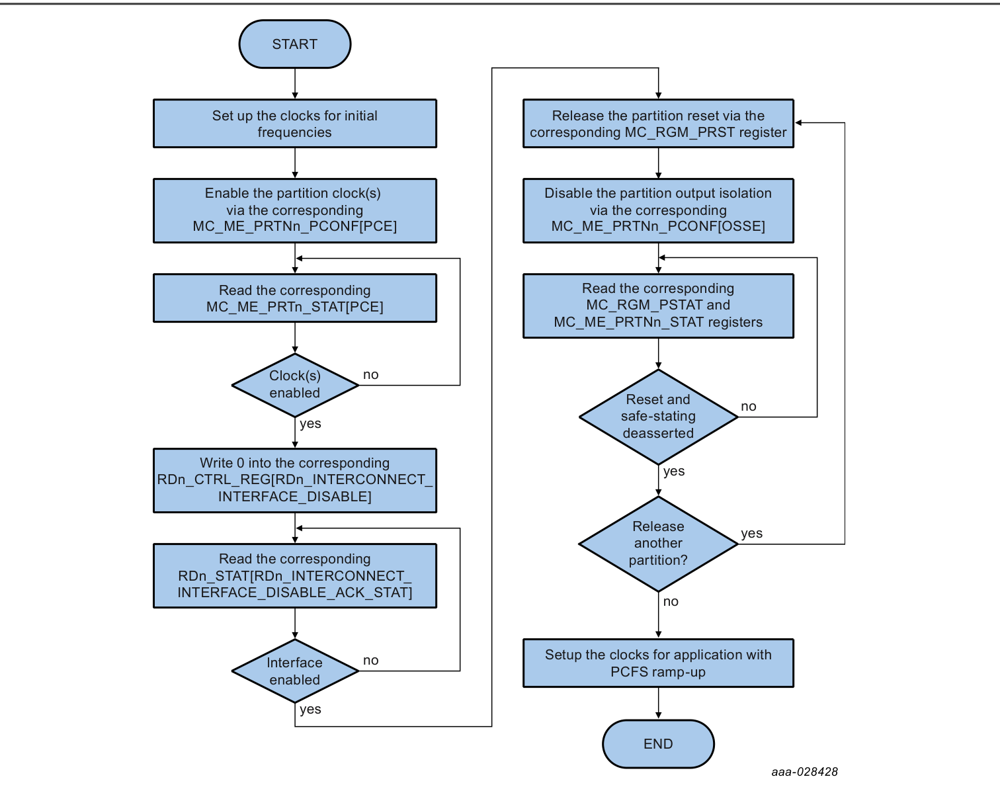

### 12.5. 软件复位分区关闭流程图

对于 **Cortex-A53** 复位域，可以通过将 **MC_CGM_1** 配置为 **FIRC** 时钟来设置初始频率的时钟。详见"时钟"一章。

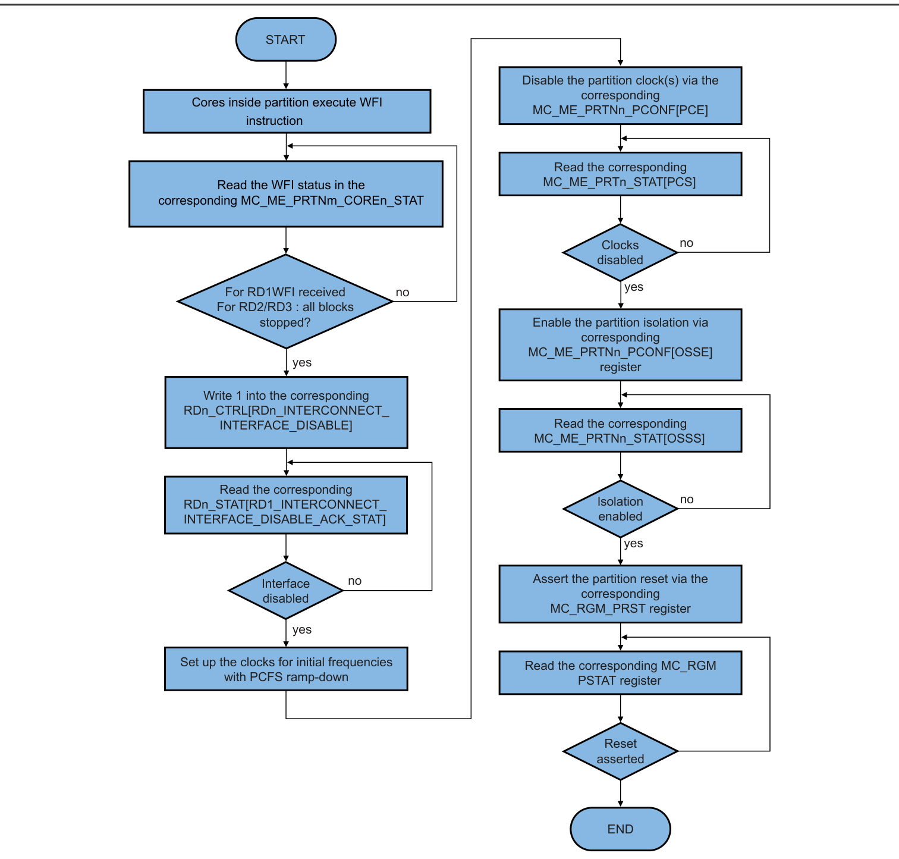

**注意：** 软件必须确保软件复位域内的 **NoC** 主设备在执行关闭序列之前保持空闲（**Idle**）状态。

**注意：** 要禁用 **A53** 分区，须确保 **MC_CGM2.MUX_0_DC_0** 已使能。

### 12.6. **PFE** 软件复位分区关闭流程图

对于 **PFE** 复位域，可以通过将 **MC_CGM_1** 配置为 **FIRC** 时钟来设置初始频率的时钟。详见"时钟"一章。

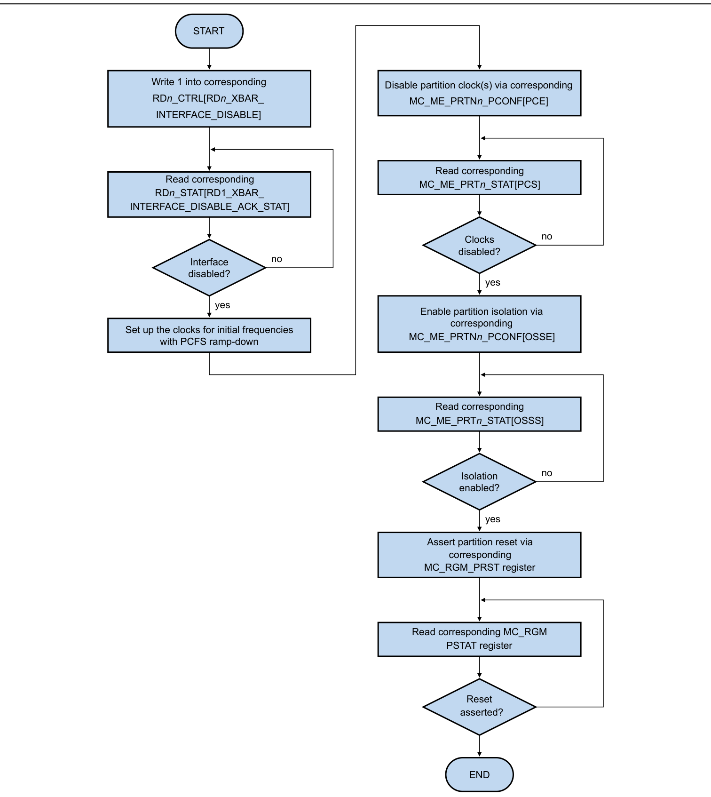

### 12.7. **PFE** 软件复位分区开启流程图

对于 **PFE** 复位域，可以通过将 **MC_CGM_1** 配置为 **FIRC** 时钟来设置初始频率的时钟。详见"时钟"一章。

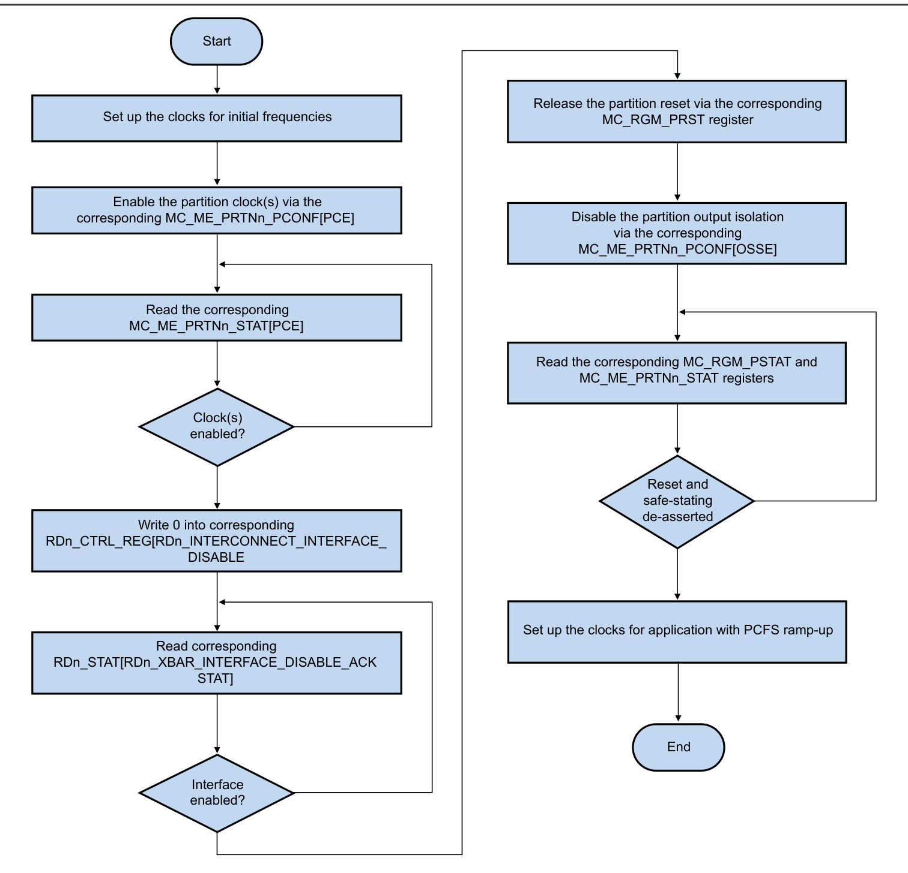

### 12.8. **LLCE** 软件复位分区开启流程图

对于 **LLCE** 复位域，可以通过将 **MC_CGM_1** 配置为 **FIRC** 时钟来设置初始频率的时钟。详见"时钟"一章。

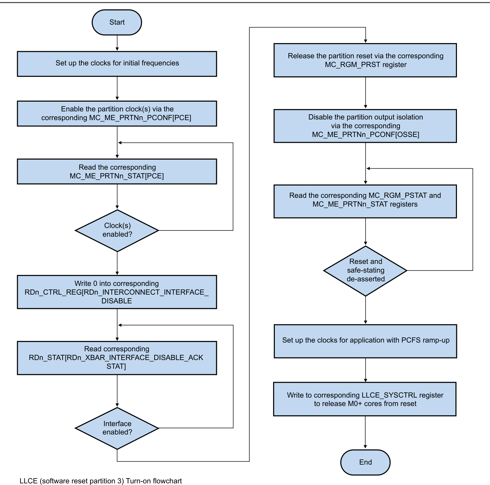

### 12.9. **LLCE** 软件复位分区关闭流程图

对于 **LLCE** 复位域，可以通过将 **MC_CGM_1** 配置为 **FIRC** 时钟来设置初始频率的时钟。详见"时钟"一章。

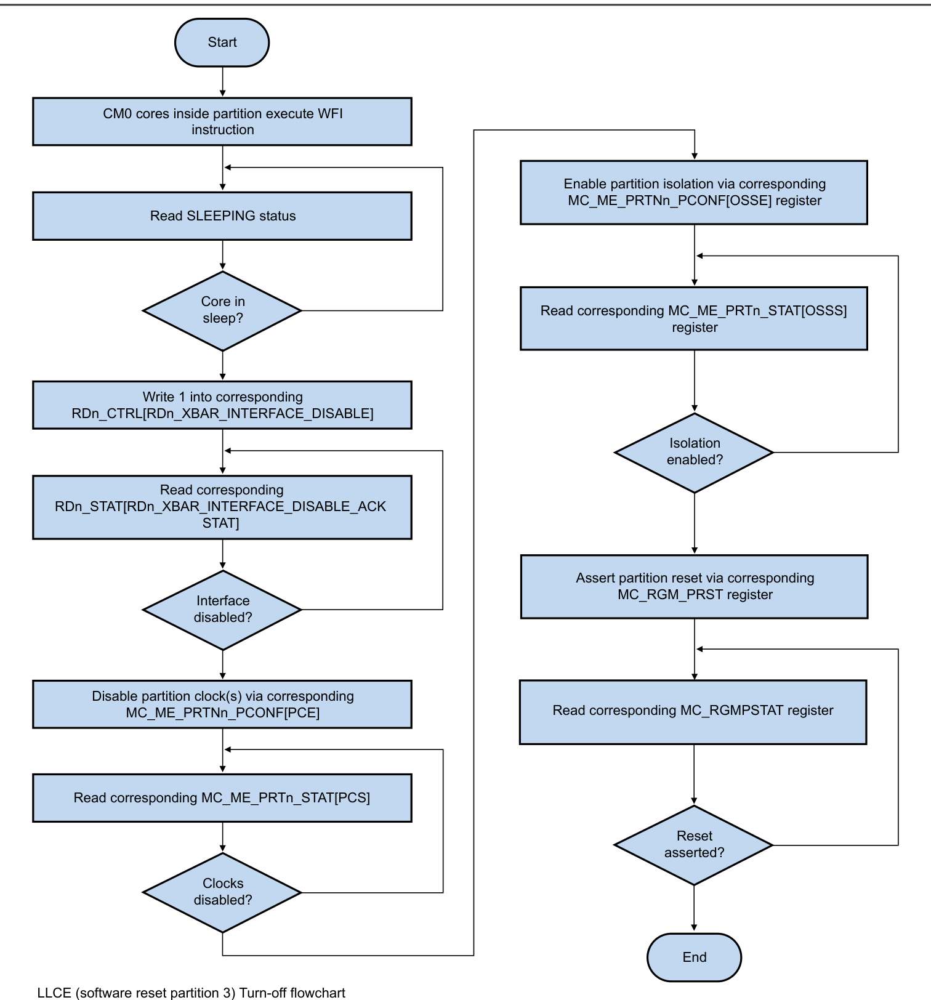

### 12.10. 内核开启序列

该序列可用于开启 **Cortex-M7** 应用内核或 **Cortex-A53** 簇内核。

表 139 给出内核开启序列。

| 内核 | **MC_RGM** 中的复位控制字段 |
| --- | --- |
| Cortex-M7 cluster 0 | **RGM_PRST0_0[PERIPH_0_RST]** |
| Cortex-M7 cluster 1 | **RGM_PRST0_0[PERIPH_1_RST]** |
| Cortex-M7 cluster 2 | **RGM_PRST0_0[PERIPH_2_RST]** |
| Cortex-M7 cluster 3 | **RGM_PRST0_0[PERIPH_6_RST]** |
| Cortex-A53 core 0 cluster 0 | **RGM_PRST1_0[PERIPH_65_RST]** |
| Cortex-A53 core 1 cluster 0 | **RGM_PRST1_0[PERIPH_66_RST]** |
| Cortex-A53 core 2 cluster 0 | **RGM_PRST1_0[PERIPH_69_RST]** |
| Cortex-A53 core 3 cluster 0 | **RGM_PRST1_0[PERIPH_70_RST]** |
| Cortex-A53 core 0 cluster 1 | **RGM_PRST1_0[PERIPH_67_RST]** |
| Cortex-A53 core 1 cluster 1 | **RGM_PRST1_0[PERIPH_68_RST]** |
| Cortex-A53 core 2 cluster 1 | **RGM_PRST1_0[PERIPH_71_RST]** |
| Cortex-A53 core 3 cluster 1 | **RGM_PRST1_0[PERIPH_72_RST]** |

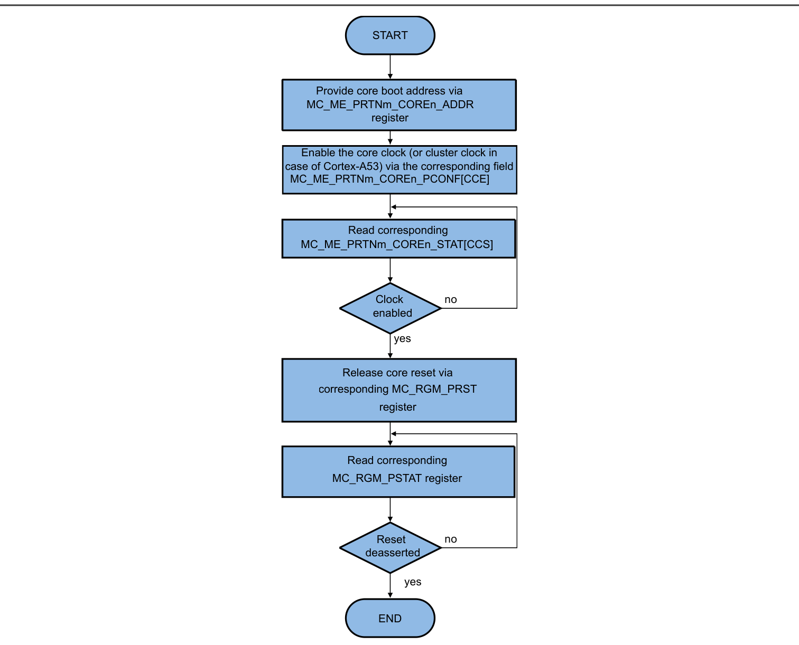

### 12.11. 内核关闭序列

该序列可用于关闭 **Cortex-M7** 应用内核或 **Cortex-A53** 簇内核。

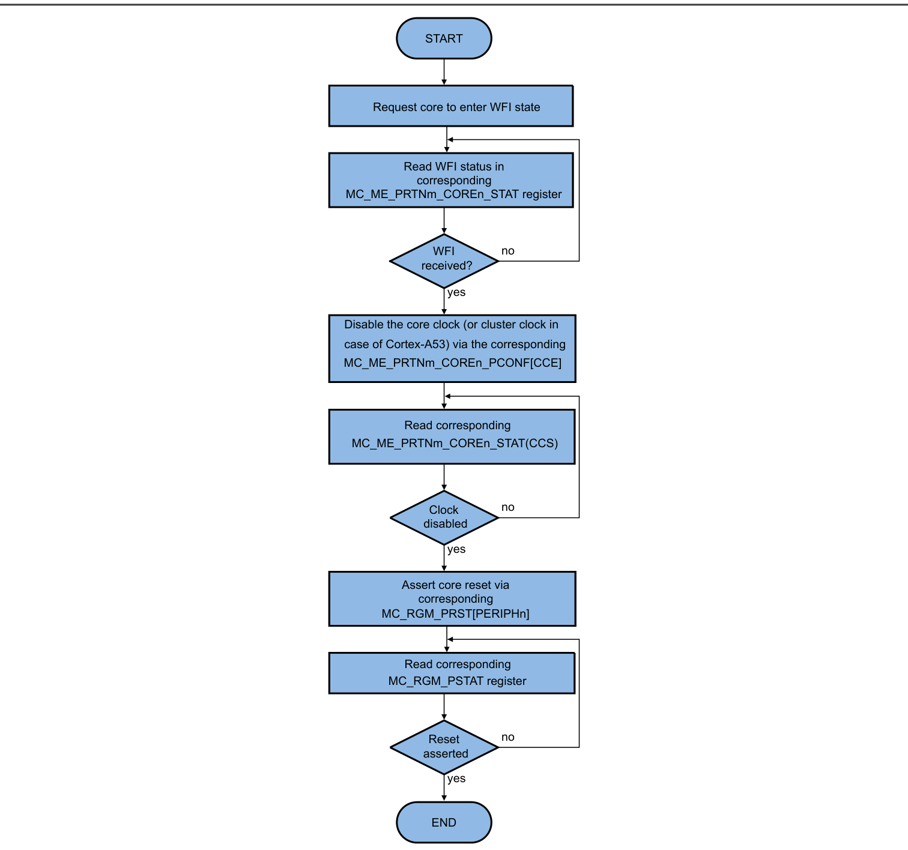

### 12.12. **Cortex-M7** 应用内核的自触发复位（热复位）序列

该序列用于通过写入 **Cortex-M7** 应用内核自身的寄存器，执行内核发起的热复位。复位序列完成后，内核自动退出复位，并从所提供的引导地址开始执行。

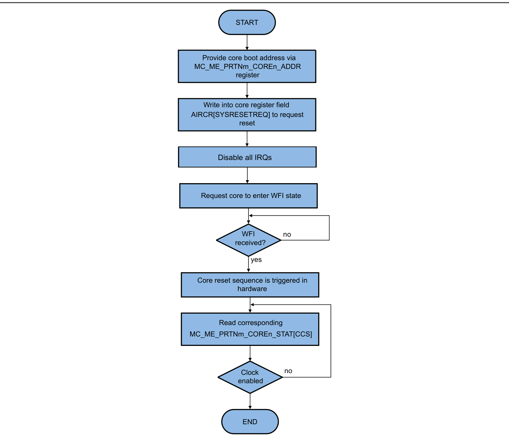

### 12.13. **Cortex-A53** 内核热复位序列

执行 **Cortex-A53** 热复位序列必须遵循以下步骤：

1. 写 **RM[RR]** 以发出 **WARMRESETREQ**。
2. 向 **SCTLR[C]** 写 0，防止进一步的数据缓存分配。
3. 清理并使 **L1** 数据缓存中的所有数据无效。
4. 通过清零 **CPUECTLR[SMPEN]**，禁用与本簇中其他内核的数据一致性。
5. 执行 **ISB** 指令，确保前面步骤中所有寄存器更改都已完成。
6. 执行 **DSB SY** 指令，确保在 **SMPEN** 字段清零之前由簇内任一内核发出的所有缓存、**TLB** 和分支预测器维护操作都已完成。
7. 执行 **WFI** 指令并等待 **STANDBYWFI** 输出置位。

当 **WARMRESETREQ** 与 **STANDBYWFI** 信号置位且 **SMPEN** 信号撤销时，向内核发出热复位（即置位 **nCORERESET**）。热复位持续 256 个 **Cortex-A53_CORE_CLK** 周期。

更多信息参见 **Cortex-A53** 文档：*Arm Cortex-A53 MPCore Processor Technical Reference Manual*，Revision r0p4，位于 www.arm.com。

### 12.14. 软件外设复位

某些外设（或其上的逻辑）只有在软件完成特定配置之后才能退出复位。在这些情况下，由专用的软件字段确保外设退出复位。

表 140 列出用于外设复位的字段。

| 外设 | **MC_RGM** 中的复位控制字段 | 说明 |
| --- | --- | --- |
| **DDR** | **RGM_PRST0_0[PERIPH_3_RST]** | **AXI** 接口与 **DDR** 控制器的复位 |
| **PCIe_0** | **RGM_PRST0_0[PERIPH_4_RST]** | **PCIe_0** 的复位控制 |
| **PCIe_0** | **RGM_PRST0_0[PERIPH_5_RST]** | **SerDes** 子系统的上电复位 |
| **PCIe_1** | **RGM_PRST0_0[PERIPH_16_RST]** | **PCIe_1** 的复位控制 |
| **PCIe_1** | **RGM_PRST0_0[PERIPH_17_RST]** | **SerDes** 子系统的上电复位 |

**注意：** 外设复位撤销后，不应再通过上述寄存器字段重新置位。它们会在下一次功能性复位、破坏性复位或 **POR** 时置位。

**注意：** 关于外设支持的任何软复位特性，参见该外设的专用章节。

**注意：** 当 **DDR_CLK** 选择为 **FIRC** 时，**PRST0_0[PERIPH_3_RST]** 复位必须撤销。**DDR_CLK** 可以在复位撤销之后切换到功能频率。

## 13. 复位域控制器（**RDC**）寄存器说明

本节提供用于配置系统复位的寄存器的内存映射与说明。所有寄存器都可以按 8 位、16 位或 32 位寻址方式访问。

### 13.1. **RDC** 内存映射

**RDC** 基地址：**4008_0000h**

| 偏移 | 寄存器 | 宽度（位） | 访问 | 复位值 |
| --- | --- | --- | --- | --- |
| **4h** | 软件复位域 1 控制（**RD1_CTRL_REG**） | 32 | RW | **0000_000Fh** |
| **8h** | 软件复位域 2 控制（**RD2_CTRL_REG**） | 32 | RW | **0000_000Fh** |
| **Ch** | 软件复位域 3 控制（**RD3_CTRL_REG**） | 32 | RW | **0000_000Fh** |
| **84h** | 软件复位域 1 状态（**RD1_STAT_REG**） | 32 | R | **0000_0018h** |
| **88h** | 软件复位域 2 状态（**RD2_STAT_REG**） | 32 | R | **0000_0018h** |
| **8Ch** | 软件复位域 3 状态（**RD3_STAT_REG**） | 32 | R | **0000_0018h** |

### 13.2. 软件复位域 1 控制（**RD1_CTRL_REG**）

**RD1_CTRL_REG** 偏移：**4h**

| 位 | 字段 | 功能 |
| --- | --- | --- |
| 31 | **RD1_CTRL_UNLOCK** | 复位域 1 控制寄存器解锁。`0b` - 软件复位域 1 控制寄存器字段被锁定，除本字段外不可更新。`1b` - 软件复位域 1 控制寄存器字段已解锁，可以更新。 |
| 30-4 | — | 保留 |
| 3 | **RD1_INTERCONNECT_INTERFACE_DISABLE** | 软件复位域 1 的互连接口禁用。`0b` - 使能软件复位域 1 的互连接口。`1b` - 禁用软件复位域 1 的互连接口。 |
| 2-0 | — | 保留 |

### 13.3. 软件复位域 2 控制（**RD2_CTRL_REG**）

**RD2_CTRL_REG** 偏移：**8h**

| 位 | 字段 | 功能 |
| --- | --- | --- |
| 31 | **RD2_CTRL_UNLOCK** | 复位域 2 控制寄存器解锁。`0b` - 软件复位域 2 控制寄存器字段被锁定，除本字段外不可更新。`1b` - 软件复位域 2 控制寄存器字段已解锁，可以更新。 |
| 30-4 | — | 保留 |
| 3 | **RD2_INTERCONNECT_INTERFACE_DISABLE** | 软件复位域 2 的互连接口禁用。`0b` - 使能软件复位域 2 的互连接口。`1b` - 禁用软件复位域 2 的互连接口。 |
| 2-0 | — | 保留 |

### 13.4. 软件复位域 3 控制（**RD3_CTRL_REG**）

**RD3_CTRL_REG** 偏移：**Ch**

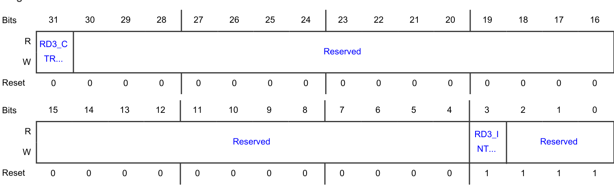

| 位 | 字段 | 功能 |
| --- | --- | --- |
| 31 | **RD3_CTRL_UNLOCK** | 复位域 3 控制寄存器解锁。`0b` - 软件复位域 3 控制寄存器字段被锁定，除本字段外不可更新。`1b` - 软件复位域 3 控制寄存器字段已解锁，可以更新。 |
| 30-4 | — | 保留 |
| 3 | **RD3_INTERCONNECT_INTERFACE_DISABLE** | 软件复位域 3 的互连接口禁用。`0b` - 使能软件复位域 3 的互连接口。`1b` - 禁用软件复位域 3 的互连接口。 |
| 2-0 | — | 保留 |

### 13.5. 软件复位域 1 状态（**RD1_STAT_REG**）

**RD1_STAT_REG** 偏移：**84h**

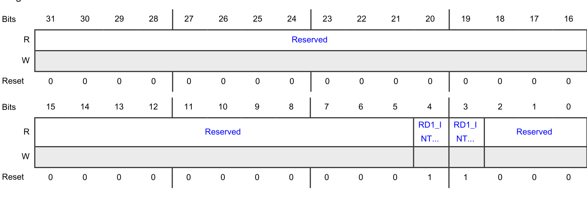

| 位 | 字段 | 功能 |
| --- | --- | --- |
| 31-5 | — | 保留 |
| 4 | **RD1_INTERCONNECT_INTERFACE_DISABLE_STAT** | 软件复位域 1 互连接口禁用确认状态。`0b` - 软件复位域 1 的互连接口未禁用。`1b` - 软件复位域 1 的互连接口已禁用。 |
| 3 | **RD1_INTERCONNECT_INTERFACE_DISABLE_REQ_ACK_STAT** | 软件复位域 1 互连接口禁用请求确认状态。`0b` - 软件复位域 1 的互连接口禁用请求未被确认。`1b` - 软件复位域 1 的互连接口禁用请求已被确认。 |
| 2-0 | — | 保留 |

### 13.6. 软件复位域 2 状态（**RD2_STAT_REG**）

**RD2_STAT_REG** 偏移：**88h**

| 位 | 字段 | 功能 |
| --- | --- | --- |
| 31-5 | — | 保留 |
| 4 | **RD2_INTERCONNECT_INTERFACE_DISABLE_STAT** | 软件复位域 2 互连接口禁用确认状态。`0b` - 软件复位域 2 的互连接口未禁用。`1b` - 软件复位域 2 的互连接口已禁用。 |
| 3 | **RD2_INTERCONNECT_INTERFACE_DISABLE_REQ_ACK_STAT** | 软件复位域 2 互连接口禁用请求确认状态。`0b` - 软件复位域 2 的互连接口禁用请求未被确认。`1b` - 软件复位域 2 的互连接口禁用请求已被确认。 |
| 2-0 | — | 保留 |

### 13.7. 软件复位域 3 状态（**RD3_STAT_REG**）

**RD3_STAT_REG** 偏移：**8Ch**

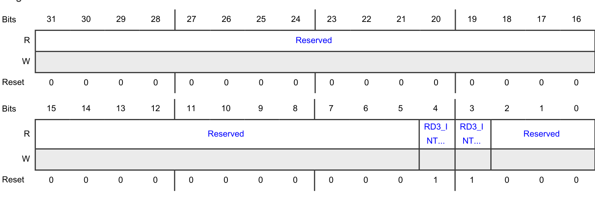

| 位 | 字段 | 功能 |
| --- | --- | --- |
| 31-5 | — | 保留 |
| 4 | **RD3_INTERCONNECT_INTERFACE_DISABLE_STAT** | 软件复位域 3 互连接口禁用确认状态。`0b` - 软件复位域 3 的互连接口未禁用。`1b` - 软件复位域 3 的互连接口已禁用。 |
| 3 | **RD3_INTERCONNECT_INTERFACE_DISABLE_REQ_ACK_STAT** | 软件复位域 3 互连接口禁用请求确认状态。`0b` - 软件复位域 3 的互连接口禁用请求未被确认。`1b` - 软件复位域 3 的互连接口禁用请求已被确认。 |
| 2-0 | — | 保留 |
