复位生成模块（**Reset Generation Module，MC_RGM**）集中不同的复位源并管理芯片的复位序列。它提供寄存器接口和复位序列器。本模块中提供多种寄存器，用于监视和控制芯片复位序列。

## 1. 芯片特定的 MC_RGM 信息

### 1.1. 复位源

**MC_RGM** 集中芯片的复位源。本章中，每个带编号的复位源对应于[复位（**Reset**）](../ch29_reset/index.md)一章"复位源"表中具有相同索引号的复位源。表 141 给出这一对应关系。

| 源 | 对应的 MC_RGM 寄存器和字段 | "复位源"表中的索引号 |
| --- | --- | --- |
| 破坏性 | **DES[F_DR_n]** | D[n] |
| 功能性 | **FES[F_FR_n]** | F[n] |

### 1.2. 外设编号

有关外设编号映射的信息，参见[复位（**Reset**）](../ch29_reset/index.md)一章"软件可复位域"一节中的"各分区和内核的 PRST 位"表。

### 1.3. 初始应用序列期间清除功能性复位计数器

**Boot ROM** 读取 **FREC** 寄存器以确定功能性复位的次数。如果 **Boot ROM** 执行期间发生的功能性复位次数大于 8，引导过程将进入故障安全（**Fail-Safe**）模式，即串行引导。为避免 **Boot ROM** 因反复发生功能性复位而进入故障安全模式，在将控制权交给应用程序时应清除 **FREC[FREC]**。

### 1.4. 个别外设复位的限制

本芯片以有限的方式支持个别外设复位。详情参见[复位（**Reset**）](../ch29_reset/index.md)一章的"软件可复位域"一节。

## 2. 简介

复位生成模块（**Reset Generation Module，MC_RGM**）集中不同的复位源并管理芯片的复位序列。它提供寄存器接口和复位序列器。本模块中提供多种寄存器，用于监视和控制芯片复位序列。

下图给出 **MC_RGM** 的框图。

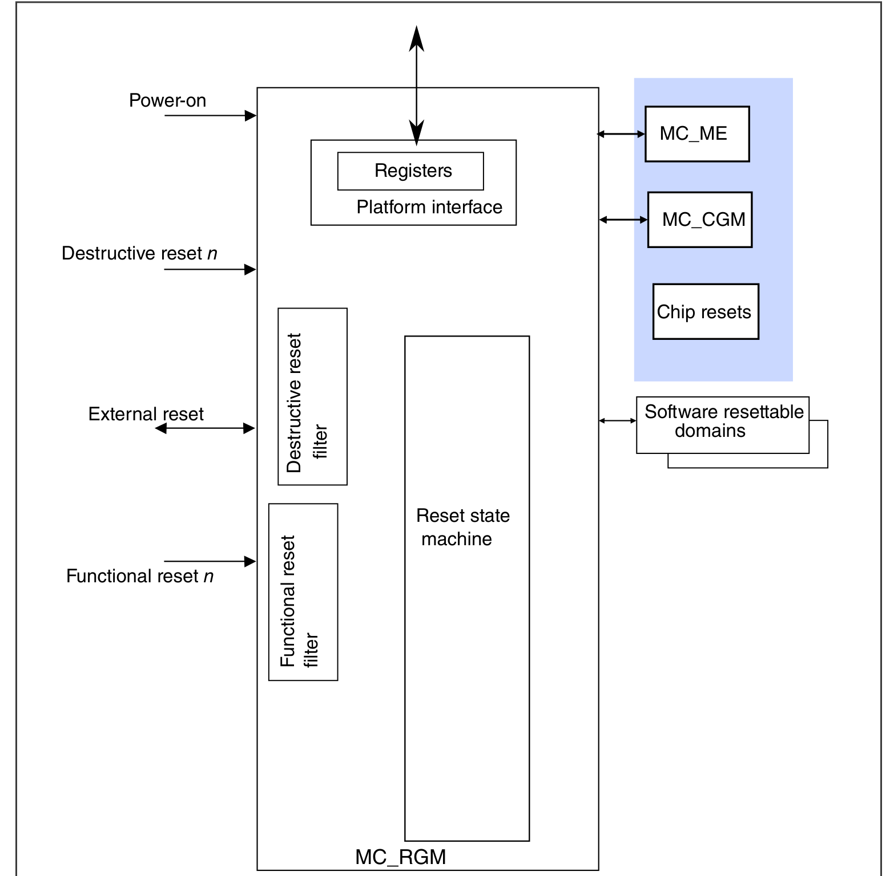

## 3. 特性

**MC_RGM** 的主要特性如下：

* 破坏性复位与功能性复位管理
* 捕获每个复位序列的复位源（复位状态标志）
* 置位 **RESET_B** 引脚，将复位序列传播到芯片外部
* 可配置的将反复发生的"功能性"复位升级为"破坏性"复位
* 可配置的将反复发生的"破坏性"复位升级为使芯片保持复位状态直到下一次上电复位
* 支持逐个复位外设。有关该特性的限制，参见芯片特定的 **MC_RGM** 信息
* 软件可控的复位置位
* 焊盘安全状态控制生成

## 4. 复位源

复位源分为三类：上电复位、破坏性复位和功能性复位。

上电复位源与通常和上电或低电压场景相关的事件关联。发生上电复位时，对芯片施加完整的复位序列。这会复位整个芯片（包括 **MC_RGM**），且存储器内容必须视为未知。

破坏性复位源与关键的、通常为硬件的错误或功能异常相关的事件关联。发生破坏性复位事件时，对芯片施加完整的复位序列。这会复位整个芯片（除一小部分外，例如 **FIRC**、**JTAG** 接口），确保数字和模拟模块都处于安全的启动状态，且存储器内容必须视为未知。

功能性复位源与不太关键的、通常为非硬件的错误或功能异常相关的事件关联。发生功能性复位事件时，对芯片施加部分复位序列。在这种情况下，大多数数字模块被正常复位，而模拟模块或特定数字模块的状态以及系统存储器内容被保留。

## 5. 外部信号说明

**MC_RGM** 与 **RESET_B** 引脚接口。表 142 描述连接到 I/O 焊盘环的信号。

| 信号名称 | 复位值 | 说明 |
| --- | --- | --- |
| **RESET_B** | 1 | 低有效外部复位。指示复位状态的双向复位引脚。 |

## 6. RESET_B 引脚置位与引脚安全状态控制

当器件处于复位序列时，**MC_RGM** 置位 **RESET_B** 引脚，并保持置位直到复位序列结束。在该复位序列期间，芯片的大多数引脚按照 IOMUX 表中给出的值进入安全状态。注意，安全状态值可能随复位序列类型而变化。

此外，**MC_RGM** 具有通过软件置位 **RESET_B** 引脚而不启动复位序列的特性。这通过向 **ERCTRL[ERASSERT]** 写入 `1b` 实现。此时，芯片的大多数引脚按照 IOMUX 表中给出的值进入安全状态。**RESET_B** 的置位和引脚安全状态保持有效，直到下一次复位序列结束。

该特性只能用于主复位域的自检。

## 7. MC_RGM 寄存器说明

访问以下位置不会产生传输错误：

* `2Ch`

### 7.1. MC RGM 寄存器映射存储器映射

**MC_RGM** 基地址：**4007_8000h**

| 偏移 | 寄存器 | 宽度（位） | 访问 | 复位值 |
| --- | --- | --- | --- | --- |
| **0h** | 破坏性事件状态寄存器（**DES**） | 32 | RW | **0000_0001h** |
| **8h** | 功能性/外部复位状态寄存器（**FES**） | 32 | RW | **0000_0000h** |
| **Ch** | 功能性事件复位禁用寄存器（**FERD**） | 32 | RW | **0000_0000h** |
| **14h** | 功能性复位升级计数器寄存器（**FREC**） | 32 | RW | **0000_0000h** |
| **18h** | 功能性复位升级阈值寄存器（**FRET**） | 32 | RW | **0000_000Fh** |
| **1Ch** | 破坏性复位升级阈值寄存器（**DRET**） | 32 | RW | **0000_0000h** |
| **20h** | 外部复位控制寄存器（**ERCTRL**） | 32 | RW | **0000_0000h** |
| **24h** | 待机期间复位状态寄存器（**RDSS**） | 32 | RW | **0000_0000h** |
| **40h** | 外设复位（**PRST0_0**） | 32 | RW | **0003_007Fh** |
| **48h** | 外设复位（**PRST1_0**） | 32 | RW | **0000_01FFh** |
| **50h** | 外设复位（**PRST2_0**） | 32 | RW | **0000_0001h** |
| **58h** | 外设复位（**PRST3_0**） | 32 | RW | **0000_0001h** |
| **140h** | 外设复位状态寄存器（**PSTAT0_0**） | 32 | R | **0003_007Fh** |
| **148h** | 外设复位状态寄存器（**PSTAT1_0**） | 32 | R | **0000_01FFh** |
| **150h** | 外设复位状态寄存器（**PSTAT2_0**） | 32 | R | **0000_0001h** |
| **158h** | 外设复位状态寄存器（**PSTAT3_0**） | 32 | R | **0000_0001h** |

### 7.2. 破坏性事件状态寄存器（**DES**）

**DES** 偏移：**0h**

该寄存器包含"破坏性"复位源的状态。在管理员模式下可按读/写访问，在用户模式下为只读。寄存器位通过写 1 清零。该寄存器仅在上电复位时复位。

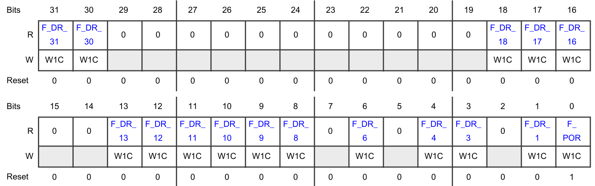

| 位 | 字段 | 功能 |
| --- | --- | --- |
| 31 | **F_DR_31** | "破坏性"复位 F_DR_31 的标志。`0b` - 自上次清除或上次上电复位置位以来，"破坏性"复位事件 F_DR_31 未发生。`1b` - "破坏性"复位事件 F_DR_31 已发生。 |
| 30 | **F_DR_30** | "破坏性"复位 F_DR_30 的标志。`0b` - 自上次清除或上次上电复位置位以来，"破坏性"复位事件 F_DR_30 未发生。`1b` - "破坏性"复位事件 F_DR_30 已发生。 |
| 29 | — | 保留 |
| 28 | — | 保留 |
| 27 | — | 保留 |
| 26 | — | 保留 |
| 25 | — | 保留 |
| 24 | — | 保留 |
| 23 | — | 保留 |
| 22 | — | 保留 |
| 21 | — | 保留 |
| 20 | — | 保留 |
| 19 | — | 保留 |
| 18 | **F_DR_18** | "破坏性"复位 F_DR_18 的标志。`0b` - 自上次清除或上次上电复位置位以来，"破坏性"复位事件 F_DR_18 未发生。`1b` - "破坏性"复位事件 F_DR_18 已发生。 |
| 17 | **F_DR_17** | "破坏性"复位 F_DR_17 的标志。`0b` - 自上次清除或上次上电复位置位以来，"破坏性"复位事件 F_DR_17 未发生。`1b` - "破坏性"复位事件 F_DR_17 已发生。 |
| 16 | **F_DR_16** | "破坏性"复位 F_DR_16 的标志。`0b` - 自上次清除或上次上电复位置位以来，"破坏性"复位事件 F_DR_16 未发生。`1b` - "破坏性"复位事件 F_DR_16 已发生。 |
| 15 | — | 保留 |
| 14 | — | 保留 |
| 13 | **F_DR_13** | "破坏性"复位 F_DR_13 的标志。`0b` - 自上次清除或上次上电复位置位以来，"破坏性"复位事件 F_DR_13 未发生。`1b` - "破坏性"复位事件 F_DR_13 已发生。 |
| 12 | **F_DR_12** | "破坏性"复位 F_DR_12 的标志。`0b` - 自上次清除或上次上电复位置位以来，"破坏性"复位事件 F_DR_12 未发生。`1b` - "破坏性"复位事件 F_DR_12 已发生。 |
| 11 | **F_DR_11** | "破坏性"复位 F_DR_11 的标志。`0b` - 自上次清除或上次上电复位置位以来，"破坏性"复位事件 F_DR_11 未发生。`1b` - "破坏性"复位事件 F_DR_11 已发生。 |
| 10 | **F_DR_10** | "破坏性"复位 F_DR_10 的标志。`0b` - 自上次清除或上次上电复位置位以来，"破坏性"复位事件 F_DR_10 未发生。`1b` - "破坏性"复位事件 F_DR_10 已发生。 |
| 9 | **F_DR_9** | "破坏性"复位 F_DR_9 的标志。`0b` - 自上次清除或上次上电复位置位以来，"破坏性"复位事件 F_DR_9 未发生。`1b` - "破坏性"复位事件 F_DR_9 已发生。 |
| 8 | **F_DR_8** | "破坏性"复位 F_DR_8 的标志。`0b` - 自上次清除或上次上电复位置位以来，"破坏性"复位事件 F_DR_8 未发生。`1b` - "破坏性"复位事件 F_DR_8 已发生。 |
| 7 | — | 保留 |
| 6 | **F_DR_6** | "破坏性"复位 F_DR_6 的标志。`0b` - 自上次清除或上次上电复位置位以来，"破坏性"复位事件 F_DR_6 未发生。`1b` - "破坏性"复位事件 F_DR_6 已发生。 |
| 5 | — | 保留 |
| 4 | **F_DR_4** | "破坏性"复位 F_DR_4 的标志。`0b` - 自上次清除或上次上电复位置位以来，"破坏性"复位事件 F_DR_4 未发生。`1b` - "破坏性"复位事件 F_DR_4 已发生。 |
| 3 | **F_DR_3** | "破坏性"复位 F_DR_3 的标志。`0b` - 自上次清除或上次上电复位置位以来，"破坏性"复位事件 F_DR_3 未发生。`1b` - "破坏性"复位事件 F_DR_3 已发生。 |
| 2 | — | 保留 |
| 1 | **F_DR_1** | "破坏性"复位 F_DR_1 的标志。`0b` - 自上次清除或上次上电复位置位以来，"破坏性"复位事件 F_DR_1 未发生。`1b` - "破坏性"复位事件 F_DR_1 已发生。 |
| 0 | **F_POR** | 上电复位标志。**注意：** 如果该字段置位，上电时必须忽略 **FES** 和 **DES** 寄存器中的所有复位状态。`0b` - 自上次清除以来未发生上电事件。`1b` - 已发生上电事件。 |

### 7.3. 功能性/外部复位状态寄存器（**FES**）

**FES** 偏移：**8h**

该寄存器包含"功能性"和外部复位源的状态。在管理员模式下可按读/写访问，在用户模式下为只读。如果触发事件已在源头清除，则寄存器位通过写 1 清零。该寄存器仅在上电复位时复位。

**注意：** 如果破坏性事件状态寄存器（**DES**）中除 **DES[F_POR]** 之外的字段被置位，则必须忽略本寄存器的状态。在这种情况下，功能性复位源有效期间发生了破坏性复位。

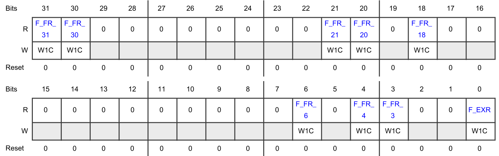

| 位 | 字段 | 功能 |
| --- | --- | --- |
| 31 | **F_FR_31** | "功能性"复位 F_FR_31 的标志。`0b` - 自上次清除或上次上电复位置位以来，"功能性"复位事件 F_FR_31 未发生。`1b` - "功能性"复位事件 F_FR_31 已发生。 |
| 30 | **F_FR_30** | "功能性"复位 F_FR_30 的标志。`0b` - 自上次清除或上次上电复位置位以来，"功能性"复位事件 F_FR_30 未发生。`1b` - "功能性"复位事件 F_FR_30 已发生。 |
| 29 | — | 保留 |
| 28 | — | 保留 |
| 27 | — | 保留 |
| 26 | — | 保留 |
| 25 | — | 保留 |
| 24 | — | 保留 |
| 23 | — | 保留 |
| 22 | — | 保留 |
| 21 | **F_FR_21** | "功能性"复位 F_FR_21 的标志。`0b` - 自上次清除或上次上电复位置位以来，"功能性"复位事件 F_FR_21 未发生。`1b` - "功能性"复位事件 F_FR_21 已发生。 |
| 20 | **F_FR_20** | "功能性"复位 F_FR_20 的标志。`0b` - 自上次清除或上次上电复位置位以来，"功能性"复位事件 F_FR_20 未发生。`1b` - "功能性"复位事件 F_FR_20 已发生。 |
| 19 | — | 保留 |
| 18 | **F_FR_18** | "功能性"复位 F_FR_18 的标志。`0b` - 自上次清除或上次上电复位置位以来，"功能性"复位事件 F_FR_18 未发生。`1b` - "功能性"复位事件 F_FR_18 已发生。 |
| 17 | — | 保留 |
| 16 | — | 保留 |
| 15 | — | 保留 |
| 14 | — | 保留 |
| 13 | — | 保留 |
| 12 | — | 保留 |
| 11 | — | 保留 |
| 10 | — | 保留 |
| 9 | — | 保留 |
| 8 | — | 保留 |
| 7 | — | 保留 |
| 6 | **F_FR_6** | "功能性"复位 F_FR_6 的标志。`0b` - 自上次清除或上次上电复位置位以来，"功能性"复位事件 F_FR_6 未发生。`1b` - "功能性"复位事件 F_FR_6 已发生。 |
| 5 | — | 保留 |
| 4 | **F_FR_4** | "功能性"复位 F_FR_4 的标志。`0b` - 自上次清除或上次上电复位置位以来，"功能性"复位事件 F_FR_4 未发生。`1b` - "功能性"复位事件 F_FR_4 已发生。 |
| 3 | **F_FR_3** | "功能性"复位 F_FR_3 的标志。`0b` - 自上次清除或上次上电复位置位以来，"功能性"复位事件 F_FR_3 未发生。`1b` - "功能性"复位事件 F_FR_3 已发生。 |
| 2 | — | 保留 |
| 1 | — | 保留 |
| 0 | **F_EXR** | 外部复位标志。`0b` - 自上次清除或上次上电复位置位以来，未发生外部复位事件。`1b` - 已发生外部复位事件。 |

### 7.4. 功能性事件复位禁用寄存器（**FERD**）

**FERD** 偏移：**Ch**

该寄存器提供专用字段用于禁用功能性复位源。当其中任一复位源被禁用时，相应的功能性事件被降级为触发中断请求。在管理员模式下可按读/写访问，在用户模式下为只读。在破坏性复位或上电复位之后，每个字节只能写入一次，且该寄存器仅在上电复位和任何破坏性复位时复位。

**注意：** 在向该寄存器的任何字段写 1 之前，重要的是先清除功能性/外部复位状态寄存器（**FES**）。否则可能产生中断请求。

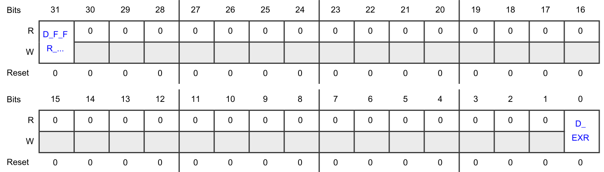

| 位 | 字段 | 功能 |
| --- | --- | --- |
| 31 | **D_F_FR_31** | F_FR_31 禁用控制。`0b` - 功能性复位事件 F_FR_31 触发复位序列。`1b` - 功能性复位事件 F_FR_31 产生中断请求。 |
| 30 | — | 保留 |
| 29 | — | 保留 |
| 28 | — | 保留 |
| 27 | — | 保留 |
| 26 | — | 保留 |
| 25 | — | 保留 |
| 24 | — | 保留 |
| 23 | — | 保留 |
| 22 | — | 保留 |
| 21 | — | 保留 |
| 20 | — | 保留 |
| 19 | — | 保留 |
| 18 | — | 保留 |
| 17 | — | 保留 |
| 16 | — | 保留 |
| 15 | — | 保留 |
| 14 | — | 保留 |
| 13 | — | 保留 |
| 12 | — | 保留 |
| 11 | — | 保留 |
| 10 | — | 保留 |
| 9 | — | 保留 |
| 8 | — | 保留 |
| 7 | — | 保留 |
| 6 | — | 保留 |
| 5 | — | 保留 |
| 4 | — | 保留 |
| 3 | — | 保留 |
| 2 | — | 保留 |
| 1 | — | 保留 |
| 0 | **D_EXR** | 外部复位事件降级为中断。`0b` - "外部"复位事件触发复位序列。`1b` - "外部"复位事件产生中断请求。 |

### 7.5. 功能性复位升级计数器寄存器（**FREC**）

**FREC** 偏移：**14h**

该寄存器提供功能性复位升级计数器的当前值。在管理员模式下可按读/写访问，在用户模式下可按读访问。该寄存器在上电复位、破坏性复位、将 **FREC** 字段重新配置为 `Fh` 以及向功能性复位升级阈值寄存器（**FRET**）寄存器写入任意值时复位。

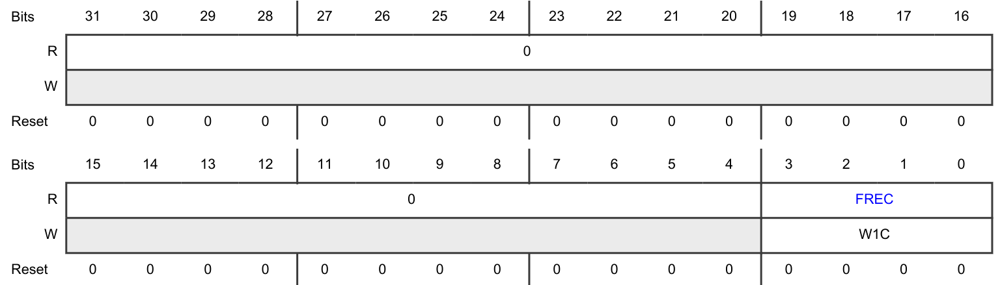

| 位 | 字段 | 功能 |
| --- | --- | --- |
| 31-4 | — | 保留 |
| 3-0 | **FREC** | 功能性复位升级计数器。该位字段提供功能性复位升级计数器的值。 |

### 7.6. 功能性复位升级阈值寄存器（**FRET**）

**FRET** 偏移：**18h**

该寄存器设置"功能性"复位升级为"破坏性"复位的阈值。在管理员模式下可按读/写访问，在用户模式下为只读。向 **FRET** 字段写入非零值将使能"功能性"复位升级功能。向该寄存器写入任意值会复位"功能性"复位升级计数器。有关"功能性"复位升级功能的详细信息，参见功能性复位升级。该寄存器在上电复位和任何"破坏性"复位时复位。

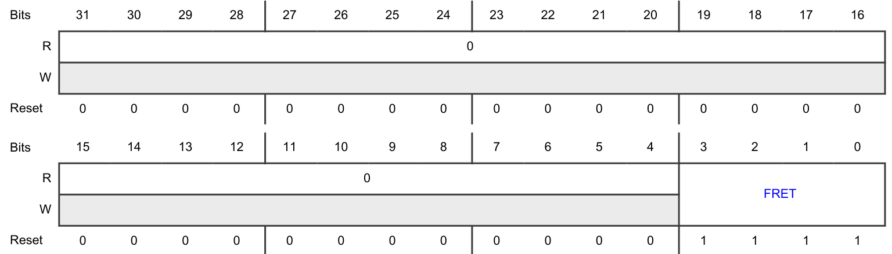

| 位 | 字段 | 功能 |
| --- | --- | --- |
| 31-4 | — | 保留 |
| 3-0 | **FRET** | 功能性复位升级阈值。如果该字段的值为 0，则禁用"功能性"复位升级功能。任何其他值表示导致"破坏性"复位的"功能性"复位次数。 |

### 7.7. 破坏性复位升级阈值寄存器（**DRET**）

**DRET** 偏移：**1Ch**

该寄存器设置"破坏性"复位升级的阈值，使芯片保持复位状态直到下一次上电复位触发新的复位序列。在管理员模式下可按读/写访问，在用户模式下为只读。向 **DRET** 字段写入非零值将使能"破坏性"复位升级功能。向该寄存器写入任意值会复位"破坏性"复位计数器。有关"破坏性"复位升级功能的详细信息，参见破坏性复位升级。该寄存器仅在上电复位时复位。

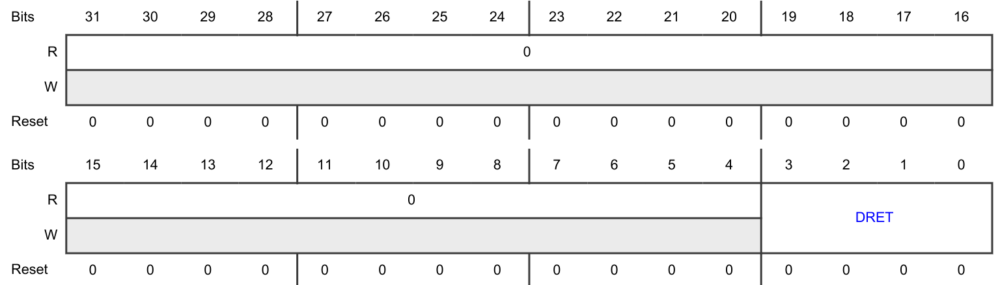

| 位 | 字段 | 功能 |
| --- | --- | --- |
| 31-4 | — | 保留 |
| 3-0 | **DRET** | 破坏性复位升级阈值。如果该字段的值为 0，则禁用"破坏性"复位升级功能。任何其他值表示使芯片保持复位状态直到下一次上电复位触发新复位序列的"破坏性"复位次数。 |

### 7.8. 外部复位控制寄存器（**ERCTRL**）

**ERCTRL** 偏移：**20h**

该寄存器允许软件控制外部复位引脚的置位。在管理员模式下可按读/写访问，在用户模式下为只读。该寄存器在所有复位时复位。

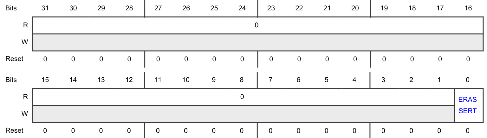

| 位 | 字段 | 功能 |
| --- | --- | --- |
| 31-1 | — | 保留 |
| 0 | **ERASSERT** | ERASSERT。**注意：** 将 ERASSERT 置为 `1b` 也会使芯片的大多数引脚进入安全状态。各引脚的安全状态值参见 IOMUX 表。软件只能在主复位域自检进入流程中使用 ERASSERT 位。在其他任何时间使用该位可能导致不可预测的系统行为。`0b` - 无变化。`1b` - 外部复位被置位。 |

### 7.9. 待机期间复位状态寄存器（**RDSS**）

**RDSS** 偏移：**24h**

该寄存器提供待机模式期间是否发生复位事件的状态。寄存器位通过写 1 清零。该寄存器仅在上电复位时复位。

**注意：** 在待机退出后退出复位序列时，软件必须对 **MC_ME[PREV_MODE]** 和 **RDSS** 寄存器执行读操作。如果 **RDSS** 寄存器的任何位被置位，软件必须忽略 **MC_ME[PREV_MODE]** 寄存器报告的状态；否则 **MC_ME[PREV_MODE]** 寄存器的状态报告器件状态。如果 **MC_ME** 指示上一模式为 RESET，则在软件中执行复位退出，否则执行待机退出。

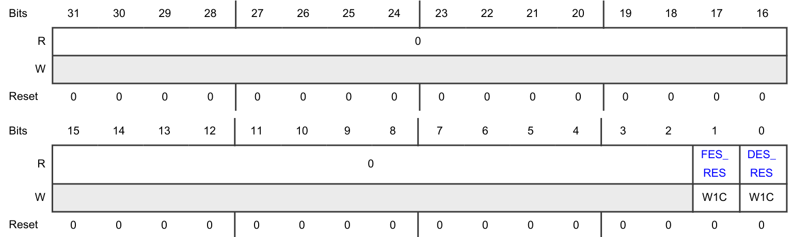

| 位 | 字段 | 功能 |
| --- | --- | --- |
| 31-2 | — | 保留 |
| 1 | **FES_RES** | FES_RES。`0b` - 待机模式期间未发生功能性复位事件。`1b` - 待机模式期间发生了功能性复位事件。 |
| 0 | **DES_RES** | DES_RES。`0b` - 待机模式期间未发生破坏性复位事件。`1b` - 待机模式期间发生了破坏性复位事件。 |

### 7.10. 外设复位（**PRST0_0**）

**PRST0_0** 偏移：**40h**

该寄存器为各种外设提供个别复位。在管理员模式下可按读/写访问，在用户模式下为只读。

**注意：** 该寄存器在功能性复位置位时复位。

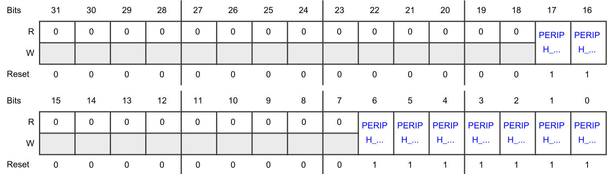

| 位 | 字段 | 功能 |
| --- | --- | --- |
| 31 | — | 保留 |
| 30 | — | 保留 |
| 29 | — | 保留 |
| 28 | — | 保留 |
| 27 | — | 保留 |
| 26 | — | 保留 |
| 25 | — | 保留 |
| 24 | — | 保留 |
| 23 | — | 保留 |
| 22 | — | 保留 |
| 21 | — | 保留 |
| 20 | — | 保留 |
| 19 | — | 保留 |
| 18 | — | 保留 |
| 17 | **PERIPH_17_RST** | 外设 PERIPH_17_RST 的复位控制值。`0b` - 不对 PERIPH_17_RST 强制复位。`1b` - 对 PERIPH_17_RST 强制复位。 |
| 16 | **PERIPH_16_RST** | 外设 PERIPH_16_RST 的复位控制值。`0b` - 不对 PERIPH_16_RST 强制复位。`1b` - 对 PERIPH_16_RST 强制复位。 |
| 15 | — | 保留 |
| 14 | — | 保留 |
| 13 | — | 保留 |
| 12 | — | 保留 |
| 11 | — | 保留 |
| 10 | — | 保留 |
| 9 | — | 保留 |
| 8 | — | 保留 |
| 7 | — | 保留 |
| 6 | **PERIPH_6_RST** | 外设 PERIPH_6_RST 的复位控制值。`0b` - 不对 PERIPH_6_RST 强制复位。`1b` - 对 PERIPH_6_RST 强制复位。 |
| 5 | **PERIPH_5_RST** | 外设 PERIPH_5_RST 的复位控制值。`0b` - 不对 PERIPH_5_RST 强制复位。`1b` - 对 PERIPH_5_RST 强制复位。 |
| 4 | **PERIPH_4_RST** | 外设 PERIPH_4_RST 的复位控制值。`0b` - 不对 PERIPH_4_RST 强制复位。`1b` - 对 PERIPH_4_RST 强制复位。 |
| 3 | **PERIPH_3_RST** | 外设 PERIPH_3_RST 的复位控制值。`0b` - 不对 PERIPH_3_RST 强制复位。`1b` - 对 PERIPH_3_RST 强制复位。 |
| 2 | **PERIPH_2_RST** | 外设 PERIPH_2_RST 的复位控制值。`0b` - 不对 PERIPH_2_RST 强制复位。`1b` - 对 PERIPH_2_RST 强制复位。 |
| 1 | **PERIPH_1_RST** | 外设 PERIPH_1_RST 的复位控制值。`0b` - 不对 PERIPH_1_RST 强制复位。`1b` - 对 PERIPH_1_RST 强制复位。 |
| 0 | **PERIPH_0_RST** | 外设 PERIPH_0_RST 的复位控制值。`0b` - 不对 PERIPH_0_RST 强制复位。`1b` - 对 PERIPH_0_RST 强制复位。 |

### 7.11. 外设复位（**PRST1_0**）

**PRST1_0** 偏移：**48h**

该寄存器为各种外设提供个别复位。在管理员模式下可按读/写访问，在用户模式下为只读。

**注意：** 该寄存器在功能性复位置位时复位。

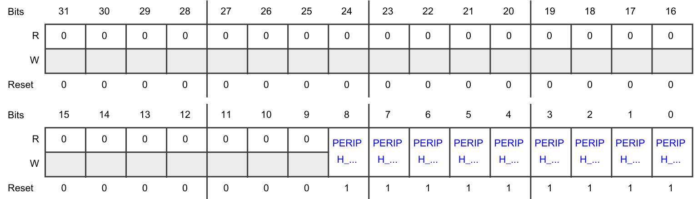

| 位 | 字段 | 功能 |
| --- | --- | --- |
| 31 | — | 保留 |
| 30 | — | 保留 |
| 29 | — | 保留 |
| 28 | — | 保留 |
| 27 | — | 保留 |
| 26 | — | 保留 |
| 25 | — | 保留 |
| 24 | — | 保留 |
| 23 | — | 保留 |
| 22 | — | 保留 |
| 21 | — | 保留 |
| 20 | — | 保留 |
| 19 | — | 保留 |
| 18 | — | 保留 |
| 17 | — | 保留 |
| 16 | — | 保留 |
| 15 | — | 保留 |
| 14 | — | 保留 |
| 13 | — | 保留 |
| 12 | — | 保留 |
| 11 | — | 保留 |
| 10 | — | 保留 |
| 9 | — | 保留 |
| 8 | **PERIPH_72_RST** | 外设 PERIPH_72_RST 的复位控制值。`0b` - 不对 PERIPH_72_RST 强制复位。`1b` - 对 PERIPH_72_RST 强制复位。 |
| 7 | **PERIPH_71_RST** | 外设 PERIPH_71_RST 的复位控制值。`0b` - 不对 PERIPH_71_RST 强制复位。`1b` - 对 PERIPH_71_RST 强制复位。 |
| 6 | **PERIPH_70_RST** | 外设 PERIPH_70_RST 的复位控制值。`0b` - 不对 PERIPH_70_RST 强制复位。`1b` - 对 PERIPH_70_RST 强制复位。 |
| 5 | **PERIPH_69_RST** | 外设 PERIPH_69_RST 的复位控制值。`0b` - 不对 PERIPH_69_RST 强制复位。`1b` - 对 PERIPH_69_RST 强制复位。 |
| 4 | **PERIPH_68_RST** | 外设 PERIPH_68_RST 的复位控制值。`0b` - 不对 PERIPH_68_RST 强制复位。`1b` - 对 PERIPH_68_RST 强制复位。 |
| 3 | **PERIPH_67_RST** | 外设 PERIPH_67_RST 的复位控制值。`0b` - 不对 PERIPH_67_RST 强制复位。`1b` - 对 PERIPH_67_RST 强制复位。 |
| 2 | **PERIPH_66_RST** | 外设 PERIPH_66_RST 的复位控制值。`0b` - 不对 PERIPH_66_RST 强制复位。`1b` - 对 PERIPH_66_RST 强制复位。 |
| 1 | **PERIPH_65_RST** | 外设 PERIPH_65_RST 的复位控制值。`0b` - 不对 PERIPH_65_RST 强制复位。`1b` - 对 PERIPH_65_RST 强制复位。 |
| 0 | **PERIPH_64_RST** | 外设 PERIPH_64_RST 的复位控制值。`0b` - 不对 PERIPH_64_RST 强制复位。`1b` - 对 PERIPH_64_RST 强制复位。 |

### 7.12. 外设复位（**PRST2_0**）

**PRST2_0** 偏移：**50h**

该寄存器为各种外设提供个别复位。在管理员模式下可按读/写访问，在用户模式下为只读。

**注意：** 该寄存器在功能性复位置位时复位。

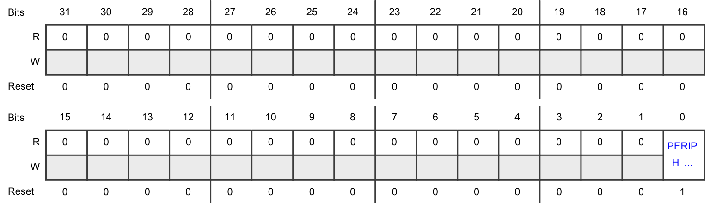

| 位 | 字段 | 功能 |
| --- | --- | --- |
| 31 | — | 保留 |
| 30 | — | 保留 |
| 29 | — | 保留 |
| 28 | — | 保留 |
| 27 | — | 保留 |
| 26 | — | 保留 |
| 25 | — | 保留 |
| 24 | — | 保留 |
| 23 | — | 保留 |
| 22 | — | 保留 |
| 21 | — | 保留 |
| 20 | — | 保留 |
| 19 | — | 保留 |
| 18 | — | 保留 |
| 17 | — | 保留 |
| 16 | — | 保留 |
| 15 | — | 保留 |
| 14 | — | 保留 |
| 13 | — | 保留 |
| 12 | — | 保留 |
| 11 | — | 保留 |
| 10 | — | 保留 |
| 9 | — | 保留 |
| 8 | — | 保留 |
| 7 | — | 保留 |
| 6 | — | 保留 |
| 5 | — | 保留 |
| 4 | — | 保留 |
| 3 | — | 保留 |
| 2 | — | 保留 |
| 1 | — | 保留 |
| 0 | **PERIPH_128_RST** | 外设 PERIPH_128_RST 的复位控制值。`0b` - 不对 PERIPH_128_RST 强制复位。`1b` - 对 PERIPH_128_RST 强制复位。 |

### 7.13. 外设复位（**PRST3_0**）

**PRST3_0** 偏移：**58h**

该寄存器为各种外设提供个别复位。在管理员模式下可按读/写访问，在用户模式下为只读。

**注意：** 该寄存器在功能性复位置位时复位。

| 位 | 字段 | 功能 |
| --- | --- | --- |
| 31 | — | 保留 |
| 30 | — | 保留 |
| 29 | — | 保留 |
| 28 | — | 保留 |
| 27 | — | 保留 |
| 26 | — | 保留 |
| 25 | — | 保留 |
| 24 | — | 保留 |
| 23 | — | 保留 |
| 22 | — | 保留 |
| 21 | — | 保留 |
| 20 | — | 保留 |
| 19 | — | 保留 |
| 18 | — | 保留 |
| 17 | — | 保留 |
| 16 | — | 保留 |
| 15 | — | 保留 |
| 14 | — | 保留 |
| 13 | — | 保留 |
| 12 | — | 保留 |
| 11 | — | 保留 |
| 10 | — | 保留 |
| 9 | — | 保留 |
| 8 | — | 保留 |
| 7 | — | 保留 |
| 6 | — | 保留 |
| 5 | — | 保留 |
| 4 | — | 保留 |
| 3 | — | 保留 |
| 2 | — | 保留 |
| 1 | — | 保留 |
| 0 | **PERIPH_192_RST** | 外设 PERIPH_192_RST 的复位控制值。`0b` - 不对 PERIPH_192_RST 强制复位。`1b` - 对 PERIPH_192_RST 强制复位。 |

### 7.14. 外设复位状态寄存器（**PSTAT0_0**）

**PSTAT0_0** 偏移：**140h**

该寄存器提供各种外设的当前复位状态。在所有模式下均为只读。

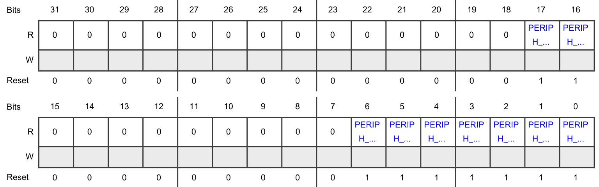

| 位 | 字段 | 功能 |
| --- | --- | --- |
| 31 | — | 保留 |
| 30 | — | 保留 |
| 29 | — | 保留 |
| 28 | — | 保留 |
| 27 | — | 保留 |
| 26 | — | 保留 |
| 25 | — | 保留 |
| 24 | — | 保留 |
| 23 | — | 保留 |
| 22 | — | 保留 |
| 21 | — | 保留 |
| 20 | — | 保留 |
| 19 | — | 保留 |
| 18 | — | 保留 |
| 17 | **PERIPH_17_STAT** | 外设 PERIPH_17_STAT 的复位状态。`0b` - 外设 PERIPH_17_STAT 未处于复位状态。`1b` - 外设 PERIPH_17_STAT 处于复位状态。 |
| 16 | **PERIPH_16_STAT** | 外设 PERIPH_16_STAT 的复位状态。`0b` - 外设 PERIPH_16_STAT 未处于复位状态。`1b` - 外设 PERIPH_16_STAT 处于复位状态。 |
| 15 | — | 保留 |
| 14 | — | 保留 |
| 13 | — | 保留 |
| 12 | — | 保留 |
| 11 | — | 保留 |
| 10 | — | 保留 |
| 9 | — | 保留 |
| 8 | — | 保留 |
| 7 | — | 保留 |
| 6 | **PERIPH_6_STAT** | 外设 PERIPH_6_STAT 的复位状态。`0b` - 外设 PERIPH_6_STAT 未处于复位状态。`1b` - 外设 PERIPH_6_STAT 处于复位状态。 |
| 5 | **PERIPH_5_STAT** | 外设 PERIPH_5_STAT 的复位状态。`0b` - 外设 PERIPH_5_STAT 未处于复位状态。`1b` - 外设 PERIPH_5_STAT 处于复位状态。 |
| 4 | **PERIPH_4_STAT** | 外设 PERIPH_4_STAT 的复位状态。`0b` - 外设 PERIPH_4_STAT 未处于复位状态。`1b` - 外设 PERIPH_4_STAT 处于复位状态。 |
| 3 | **PERIPH_3_STAT** | 外设 PERIPH_3_STAT 的复位状态。`0b` - 外设 PERIPH_3_STAT 未处于复位状态。`1b` - 外设 PERIPH_3_STAT 处于复位状态。 |
| 2 | **PERIPH_2_STAT** | 外设 PERIPH_2_STAT 的复位状态。`0b` - 外设 PERIPH_2_STAT 未处于复位状态。`1b` - 外设 PERIPH_2_STAT 处于复位状态。 |
| 1 | **PERIPH_1_STAT** | 外设 PERIPH_1_STAT 的复位状态。`0b` - 外设 PERIPH_1_STAT 未处于复位状态。`1b` - 外设 PERIPH_1_STAT 处于复位状态。 |
| 0 | **PERIPH_0_STAT** | 外设 PERIPH_0_STAT 的复位状态。`0b` - 外设 PERIPH_0_STAT 未处于复位状态。`1b` - 外设 PERIPH_0_STAT 处于复位状态。 |

### 7.15. 外设复位状态寄存器（**PSTAT1_0**）

**PSTAT1_0** 偏移：**148h**

该寄存器提供各种外设的当前复位状态。在所有模式下均为只读。

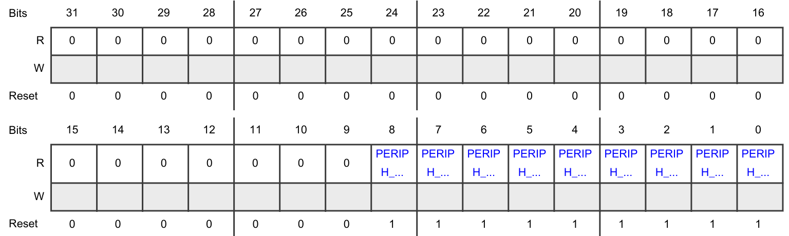

| 位 | 字段 | 功能 |
| --- | --- | --- |
| 31 | — | 保留 |
| 30 | — | 保留 |
| 29 | — | 保留 |
| 28 | — | 保留 |
| 27 | — | 保留 |
| 26 | — | 保留 |
| 25 | — | 保留 |
| 24 | — | 保留 |
| 23 | — | 保留 |
| 22 | — | 保留 |
| 21 | — | 保留 |
| 20 | — | 保留 |
| 19 | — | 保留 |
| 18 | — | 保留 |
| 17 | — | 保留 |
| 16 | — | 保留 |
| 15 | — | 保留 |
| 14 | — | 保留 |
| 13 | — | 保留 |
| 12 | — | 保留 |
| 11 | — | 保留 |
| 10 | — | 保留 |
| 9 | — | 保留 |
| 8 | **PERIPH_72_STAT** | 外设 PERIPH_72_STAT 的复位状态。`0b` - 外设 PERIPH_72_STAT 未处于复位状态。`1b` - 外设 PERIPH_72_STAT 处于复位状态。 |
| 7 | **PERIPH_71_STAT** | 外设 PERIPH_71_STAT 的复位状态。`0b` - 外设 PERIPH_71_STAT 未处于复位状态。`1b` - 外设 PERIPH_71_STAT 处于复位状态。 |
| 6 | **PERIPH_70_STAT** | 外设 PERIPH_70_STAT 的复位状态。`0b` - 外设 PERIPH_70_STAT 未处于复位状态。`1b` - 外设 PERIPH_70_STAT 处于复位状态。 |
| 5 | **PERIPH_69_STAT** | 外设 PERIPH_69_STAT 的复位状态。`0b` - 外设 PERIPH_69_STAT 未处于复位状态。`1b` - 外设 PERIPH_69_STAT 处于复位状态。 |
| 4 | **PERIPH_68_STAT** | 外设 PERIPH_68_STAT 的复位状态。`0b` - 外设 PERIPH_68_STAT 未处于复位状态。`1b` - 外设 PERIPH_68_STAT 处于复位状态。 |
| 3 | **PERIPH_67_STAT** | 外设 PERIPH_67_STAT 的复位状态。`0b` - 外设 PERIPH_67_STAT 未处于复位状态。`1b` - 外设 PERIPH_67_STAT 处于复位状态。 |
| 2 | **PERIPH_66_STAT** | 外设 PERIPH_66_STAT 的复位状态。`0b` - 外设 PERIPH_66_STAT 未处于复位状态。`1b` - 外设 PERIPH_66_STAT 处于复位状态。 |
| 1 | **PERIPH_65_STAT** | 外设 PERIPH_65_STAT 的复位状态。`0b` - 外设 PERIPH_65_STAT 未处于复位状态。`1b` - 外设 PERIPH_65_STAT 处于复位状态。 |
| 0 | **PERIPH_64_STAT** | 外设 PERIPH_64_STAT 的复位状态。`0b` - 外设 PERIPH_64_STAT 未处于复位状态。`1b` - 外设 PERIPH_64_STAT 处于复位状态。 |

### 7.16. 外设复位状态寄存器（**PSTAT2_0**）

**PSTAT2_0** 偏移：**150h**

该寄存器提供各种外设的当前复位状态。在所有模式下均为只读。

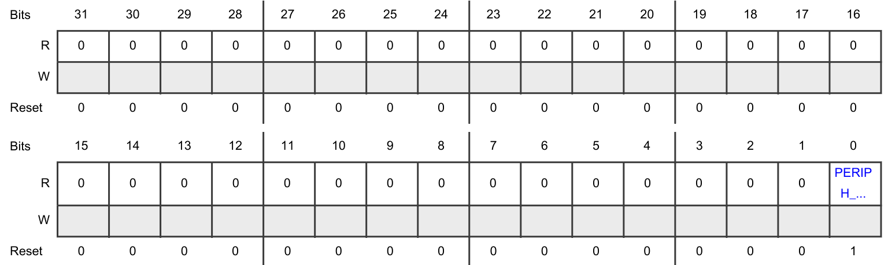

| 位 | 字段 | 功能 |
| --- | --- | --- |
| 31 | — | 保留 |
| 30 | — | 保留 |
| 29 | — | 保留 |
| 28 | — | 保留 |
| 27 | — | 保留 |
| 26 | — | 保留 |
| 25 | — | 保留 |
| 24 | — | 保留 |
| 23 | — | 保留 |
| 22 | — | 保留 |
| 21 | — | 保留 |
| 20 | — | 保留 |
| 19 | — | 保留 |
| 18 | — | 保留 |
| 17 | — | 保留 |
| 16 | — | 保留 |
| 15 | — | 保留 |
| 14 | — | 保留 |
| 13 | — | 保留 |
| 12 | — | 保留 |
| 11 | — | 保留 |
| 10 | — | 保留 |
| 9 | — | 保留 |
| 8 | — | 保留 |
| 7 | — | 保留 |
| 6 | — | 保留 |
| 5 | — | 保留 |
| 4 | — | 保留 |
| 3 | — | 保留 |
| 2 | — | 保留 |
| 1 | — | 保留 |
| 0 | **PERIPH_128_STAT** | 外设 PERIPH_128_STAT 的复位状态。`0b` - 外设 PERIPH_128_STAT 未处于复位状态。`1b` - 外设 PERIPH_128_STAT 处于复位状态。 |

### 7.17. 外设复位状态寄存器（**PSTAT3_0**）

**PSTAT3_0** 偏移：**158h**

该寄存器提供各种外设的当前复位状态。在所有模式下均为只读。

| 位 | 字段 | 功能 |
| --- | --- | --- |
| 31 | — | 保留 |
| 30 | — | 保留 |
| 29 | — | 保留 |
| 28 | — | 保留 |
| 27 | — | 保留 |
| 26 | — | 保留 |
| 25 | — | 保留 |
| 24 | — | 保留 |
| 23 | — | 保留 |
| 22 | — | 保留 |
| 21 | — | 保留 |
| 20 | — | 保留 |
| 19 | — | 保留 |
| 18 | — | 保留 |
| 17 | — | 保留 |
| 16 | — | 保留 |
| 15 | — | 保留 |
| 14 | — | 保留 |
| 13 | — | 保留 |
| 12 | — | 保留 |
| 11 | — | 保留 |
| 10 | — | 保留 |
| 9 | — | 保留 |
| 8 | — | 保留 |
| 7 | — | 保留 |
| 6 | — | 保留 |
| 5 | — | 保留 |
| 4 | — | 保留 |
| 3 | — | 保留 |
| 2 | — | 保留 |
| 1 | — | 保留 |
| 0 | **PERIPH_192_STAT** | 外设 PERIPH_192_STAT 的复位状态。`0b` - 外设 PERIPH_192_STAT 未处于复位状态。`1b` - 外设 PERIPH_192_STAT 处于复位状态。 |

## 8. 功能描述

### 8.1. 复位状态机

**MC_RGM** 的主要作用是生成复位序列，确保根据复位源事件复位芯片的正确部分。

对于每个复位事件，在 **MC_RGM** 捕获该事件后立即执行以下操作：

1. 在 **MC_RGM_DES** 和 **MC_RGM_FES** 寄存器中置位相应的复位事件状态位。
2. 将引脚置为默认状态。
3. 置位 **RESET_B** 引脚。

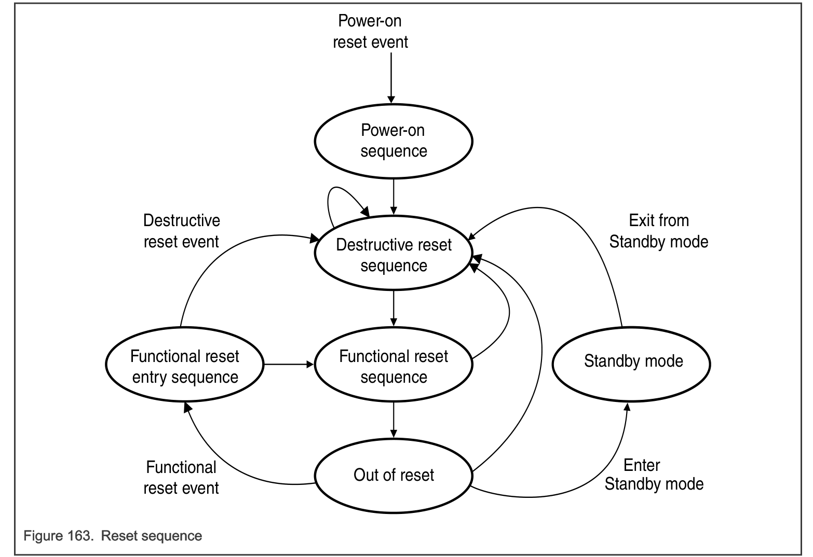

**注意：** 有关芯片特定的复位序列详情，参见芯片特定的 **MC_RGM** 信息。

#### 8.1.1. 上电复位序列

上电复位源置位时始终会生成复位，且优先于所有其他复位源。这种上电复位强制复位状态机进入上电序列，从而置位所有复位信号。当以下两个条件得到验证时，复位状态机开始推进：

1. 所有上电复位事件均已清除。
2. **MC_RGM** 的时钟源（**FIRC**）已启动并稳定。

如果发生了上电复位事件，则置位 **DES[F_POR]** 位。

上电复位不能由软件降级。

#### 8.1.2. 破坏性复位序列

"破坏性复位序列"由若干阶段组成，其中 DEST0 是第一个阶段，其后依次为 DEST1 等。

在发生上电、待机复位序列或已使能的破坏性复位事件时，从任何阶段立即进入该阶段。进入 DEST0 阶段时立即启动一个破坏性复位计数器。在以下所有条件建立后，DEST0 状态在 **FIRC_CLK** 的下一个上升沿退出到 DEST1 状态：

* DEST0 持续时间已到期
* 所有破坏性复位输入均已清除

如果发生上电复位事件，DEST0 状态立即退出到上电状态。

当满足以下条件时，复位状态机退出破坏性复位序列并进入功能性复位序列：

* 所有破坏性复位事件均已清除。
* 破坏性复位序列期间发生的所有过程均已完成。有关已完成破坏性复位序列的详细信息，参见[复位（**Reset**）](../ch29_reset/index.md)一章的"复位过程序列"一节。
* "破坏性"复位升级计数器尚未达到 **DRET[DRET]** 中的值。

#### 8.1.3. 功能性复位序列

存在两个功能性复位序列：功能性复位进入序列和功能性复位退出序列。

##### 8.1.3.1. 功能性复位进入序列

仅当空闲阶段期间发生功能性复位事件时，才进入功能性复位进入序列。

如果在正在进行的复位序列期间发生功能性复位事件，则置位相应的事件状态标志，并按照该复位事件的配置置位 **RESET_B** 引脚。但是，复位序列不受影响，继续不间断地推进。

在功能性复位进入序列期间不置位功能性复位。

如果发生了破坏性复位事件，功能性复位进入序列在 **FIRC** 的下一个上升沿退出到 DEST0。如果发生 **POR** 事件，该序列立即进入上电序列。

在所有其他情况下，该序列退出到功能性复位退出序列的第一个阶段。

##### 8.1.3.2. 功能性复位退出序列

功能性复位退出序列在退出破坏性复位序列时或功能性复位进入序列完成时进入。复位状态机在验证以下条件后退出该序列并进入空闲阶段：

* 所有功能性复位事件均已清除。
* 破坏性复位序列期间发生的所有过程均已完成。有关已完成功能性复位序列的详细信息，参见[复位（**Reset**）](../ch29_reset/index.md)一章的"复位过程序列"一节。

如果在正在进行的复位序列期间发生功能性复位事件，则置位相应的事件状态标志，并按照该复位事件的配置置位 **RESET_B** 引脚。但是，复位序列不受影响，继续不间断地推进。

#### 8.1.4. 空闲阶段

这是最后一个阶段，在退出功能性复位退出序列时进入。到达该阶段时，**MC_RGM** 将系统的控制权释放给平台，并等待可能触发复位序列的新复位事件。

### 8.2. 破坏性复位

破坏性复位表示发生了某事件，此后关键寄存器或存储器内容不再能保证。

当破坏性复位置位且上电复位未置位时，与给定破坏性复位事件关联的状态标志（破坏性事件状态寄存器（**DES**））被置位。可能同时置位多个状态位，由软件确定哪个复位源对应用最为关键。

低压检测器阈值确保：当使能内核电源低压检测对应的复位时，电源足以使破坏性事件正确传播通过数字逻辑。因此，如果使能了某个破坏性复位，**MC_RGM** 确保相关联的复位事件被正确触发到整个系统。

已使能的破坏性复位触发从 DEST0 起点开始的复位序列。

### 8.3. 外部复位

**MC_RGM** 管理来自 **RESET_B** 的外部复位。检测到 **RESET_B** 上的下降沿会启动从功能性复位进入序列起点开始的复位序列。

当外部复位置位且上电复位未置位时，与外部复位下降沿事件关联的状态标志（**RGM_FES[F_EXR]** 位）被置位。

### 8.4. 功能性复位

功能性复位表示发生了某事件，此后可以保证关键寄存器和存储器内容仍然完好。

当功能性复位置位且上电复位未置位时，与给定功能性复位事件关联的状态标志（功能性/外部复位状态寄存器（**FES**））被置位。可能同时置位多个状态位，由软件确定哪个复位源对应用最为关键。

已使能的功能性复位触发从功能性复位进入序列起点开始的复位序列。

### 8.5. 替代事件生成

**MC_RGM** 提供在复位源置位时生成替代事件的能力。当复位源置位时，**MC_RGM** 通常进入复位序列。作为替代，某些复位源事件可以从复位转换为向内核发出的中断请求。给定复位源的替代事件选择通过 **RGM_FERD** 寄存器实现，如表 143 所示。

| RGM 位 FERD 值 | 生成的事件 |
| --- | --- |
| 0 | 复位 |
| 1 | 中断请求 |

替代事件通过撤销请求源（即引起该替代请求的复位源）并清除相应的 **RGM_FES** 状态位来清除。

### 8.6. **RESET_B** 置位控制

软件通过写入 **RGM_ERCTRL** 寄存器中的 ERASSERT 位向 **MC_RGM** 指示应置位 **RESET_B**。当软件置位该位时，**RESET_B** 被置位。置位该字段不会以任何方式影响复位序列。

软件可能置位 **ERCTRL[ERASSERT]** 字段的一个例子是进入自检序列时，其间需要置位 **RESET_B**。这表示芯片虽然未处于复位序列中，但在功能模式下不可用。**RESET_B** 的撤销不由软件控制；相反，**RESET_B** 引脚保持置位，直到芯片下一次退出复位序列。

ERASSERT 位也在复位序列期间被清除。

如果复位序列由以下之一触发，**MC_RGM** 会置位外部复位：

* 上电复位
* 破坏性复位事件
* 功能性复位事件

在这种情况下，外部复位保持置位，直到退出复位序列的所有条件都得到满足，但 **RESET_B** 置位检查除外。

### 8.7. 功能性复位升级

如果在软件写入 **RGM_FRET** 寄存器之间发生了若干次功能性复位，功能性复位升级可用于生成破坏性复位。通过向该寄存器的 **FRET** 字段写入非零值使能该功能。

使能功能性复位升级后，**MC_RGM** 在每次导致启动复位序列（即从 IDLE 阶段进入 FUNC0）的功能性复位时递增一个计数器。该计数器在向 **RGM_FRET** 寄存器写入任何值以及发生任何上电或破坏性复位时清除。如果计数器达到 **RGM_FRET** 寄存器的 **FRET** 字段中的值，**MC_RGM** 置位破坏性复位。

下图给出功能性复位升级计数器。

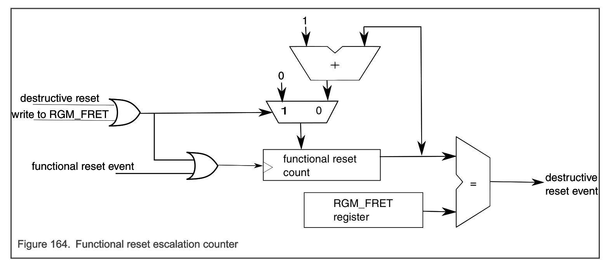

**注意：** 功能性计数器对使能了升级的每个复位源递增。详情参见[复位（**Reset**）](../ch29_reset/index.md)一章的"复位源"表。

### 8.8. 破坏性复位升级

如果在软件写入 **RGM_DRET** 寄存器之间发生了若干次破坏性复位，破坏性复位升级可用于使芯片保持复位状态，直到上电触发复位序列。通过向该寄存器的 **DRET** 字段写入非零值使能该功能。

使能破坏性复位升级后，**MC_RGM** 在每次已使能的破坏性复位时递增一个计数器。这会导致启动复位序列（即从空闲阶段或任何其他复位阶段进入 DEST0）或使正在进行的复位序列重新开始（即从任何其他复位阶段进入 DEST0）。该计数器在向 **RGM_DRET** 寄存器写入任何值以及发生任何上电复位时清除。如果计数器达到 **RGM_DRET** 寄存器的 **DRET** 字段中的值，**MC_RGM** 进入复位 DEST0 并保持在那里，直到下一次上电复位发生。

下图给出破坏性复位升级计数器。

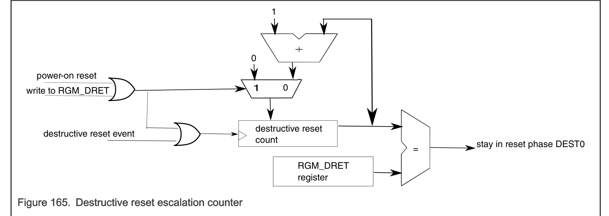

**注意：** 破坏性计数器对使能了升级的每个复位源递增。详情参见[复位（**Reset**）](../ch29_reset/index.md)一章的"复位源"表。

### 8.9. 个别外设复位

通过设置 **RGM_PRSTn** 寄存器中相应的位，可以单独复位某个外设而不复位芯片的其余部分。但是，为防止芯片出现意外行为，软件必须遵循以下序列：

1. 通过 **MC_ME** 禁用待复位的外设（详情参见[模式进入模块（**MC_ME**）](../ch33_mode_entry_module_mc_me/index.md)一章）。
2. 等待模式更改完成。
3. 置位 **RGM_PRSTn** 寄存器中与该外设对应的位。
4. 等待 **RGM_PSTATn** 寄存器中与该外设对应的位被置位。
5. 清除 **RGM_PRSTn** 寄存器中与该外设对应的位。
6. 等待 **RGM_PSTATn** 寄存器中与该外设对应的位被清除。

不执行步骤 5 和 6 可以使外设无限期保持在复位状态。步骤 6 完成后，可以通过 **MC_ME** 重新使能该外设。

**注意：** 有关该特性的任何限制，参见芯片特定的 **MC_RGM** 信息。

