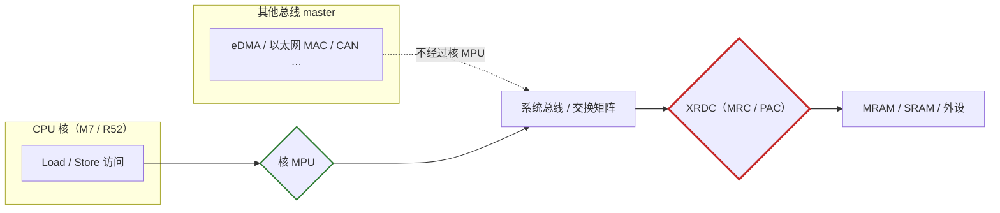

> **文档结构（2026-11-01 重组）**：本文档分为两大部分。
> **第一部分 · ARM 架构篇**（第 1–3 章）与具体芯片无关，按 Arm 官方文档对 Cortex-M7（ARMv7-M PMSAv7）与 Cortex-R52（Armv8-R PMSAv8-32）的 MPU 寄存器**逐位说明**，并在第 3 章对两者做系统的差异分析。
> **第二部分 · S32K5 实现篇**（第 4–19 章）把架构规范落到 S32K566：存储映射、区域布局、按存储类型的配置、启动时序、AUTOSAR OS 分区、RTD Platform 驱动与 sBoot 校验、故障处理与 ASIL D 关联。
>
> **本次修订要点**：① 寄存器位域按 Arm 文档重新逐位核对（R52 的 `PRBAR.XN`/`SH`/`AP`、`PRLAR.AttrIndx`、`PRSELR` 位宽、`MPUIR`、`HPRENR` 等均有修正，见第 1/2 章）；② 新增第 3 章 M7 vs R52 差异分析；③ 新增第 12 章 RTD Platform MPU 驱动与 sBoot 校验（来自 ima 知识库 `RTD_PLATFORM_UM.pdf` / `S32K5_SAF_SBOOT_UM.pdf` / `M7_S32K5_SCST_User_Manual.pdf`）；④ 修正 PMSAv7「区域大小必须为 2 的幂」约束引发的布局问题（3 MB SRAM 与 50 MB 外设窗无法用单个 M7 区域覆盖，见 §1.7/§5.3）。

---

## 第一部分 · ARM 架构篇 —— PMSAv7 与 PMSAv8-32 寄存器规范

## 1. Cortex-M7 MPU 详解（ARMv7-M PMSAv7）

### 1.1 寄存器模型与编程接口

Cortex-M7 只有**一套** MPU，寄存器位于系统控制空间（SCS），基址 `0xE000_ED90`，全部为 32 位：

| 寄存器 | 地址 | 访问 | 作用 |
| --- | --- | --- | --- |
| `MPU_TYPE` | `0xE000_ED90` | RO | 探测是否实现 MPU 及区域数（DREGION） |
| `MPU_CTRL` | `0xE000_ED94` | RW | 使能 MPU、背景区域、故障期行为 |
| `MPU_RNR` | `0xE000_ED98` | RW | 选择当前操作的 region 号 |
| `MPU_RBAR` | `0xE000_ED9C` | RW | 区域基址 + VALID |
| `MPU_RASR` | `0xE000_EDA0` | RW | 区域属性 + 大小 + 使能 |

编程模型是**"先选号，再写属性"**：写 `MPU_RNR = n`，然后写 `MPU_RBAR` 和 `MPU_RASR`。CMSIS 把它封装成 `ARM_MPU_SetRegion()`。

> `MPU_CTRL` 复位为 0（MPU 关闭）；`MPU_TYPE` 复位值反映实现——S32K566 上为 `0x00001000`，即 DREGION = 16。`[来源: S32K5xx RM, Chapter_02 Table 6]`

### 1.2 MPU_TYPE —— MPU 类型寄存器（`0xE000_ED90`，RO）

| 位 | 名称 | 说明 |
| --- | --- | --- |
| `[31:24]` | — | res0 |
| `[23:16]` | `IREGION` | 指令区域数。M7 为**统一 MPU**，该字段读作 0（DREGION 同时覆盖指令与数据） |
| `[15:8]` | `DREGION` | 支持的数据区域数：0（未实现 MPU）/ 8 / 12 / 16。**访问区域寄存器前必须确认非 0 且区域号 < DREGION**，越界访问行为未定义 |
| `[7:1]` | — | res0 |
| `[0]` | `SEPARATE` | 0 = 统一 MPU（指令/数据同一套区域）；1 = 分立。M7 为 0 |

### 1.3 MPU_CTRL —— MPU 控制寄存器（`0xE000_ED94`，RW）

| 位 | 名称 | 语义 |
| --- | --- | --- |
| `[2]` | `PRIVDEFENA` | 特权代码未命中区域时是否使用**默认内存映射**作为背景。**S32K5 建议置 0 并改用显式背景区域**（见 §9） |
| `[1]` | `HFNMIENA` | HardFault / NMI / FAULTMASK 期间是否仍启用 MPU |
| `[0]` | `ENABLE` | MPU 总使能。为 0 时其他寄存器配置全部无效 |
| `[31:3]` | — | res0 |

`HFNMIENA` 的取舍：`=0` 时故障处理器不受 MPU 约束，方便完整 dump 现场内存做离线分析；`=1` 时连故障处理器也受限，防篡改更强但现场信息可能残缺。做安全诊断固件时通常置 0 并把现场存入专用 no-cacheable 区域。

### 1.4 MPU_RNR —— 区域号寄存器（`0xE000_ED98`，RW）

| 位 | 名称 | 说明 |
| --- | --- | --- |
| `[7:0]` | `REGION` | 当前区域号。写 ≥ DREGION 的值行为未定义 |
| `[31:8]` | — | res0 |

### 1.5 MPU_RBAR —— 区域基址寄存器（`0xE000_ED9C`，RW）

| 位 | 名称 | 说明 |
| --- | --- | --- |
| `[31:5]` | `ADDR` | 区域基址。低位按 SIZE 对齐（§1.7），不足对齐时**低位被忽略**，保护范围悄悄扩大 |
| `[4]` | `VALID` | 1 = 本次访问使用 `REGION[3:0]` 指定的区域，忽略 `MPU_RNR`；0 = 使用 `MPU_RNR` |
| `[3:0]` | `REGION` | `VALID=1` 时的区域号 |

### 1.6 MPU_RASR —— 区域属性与大小寄存器（`0xE000_EDA0`，RW）

```
 31   29 28  27    26   24 23  22   21   19 18 17 16   15    8  7  6    5    1  0
┌────────┬───┬────────┬────────┬────────┬───┬───┬───┬────────┬──────┬────────┬───┐
│  res0  │ XN│  res0  │ AP[2:0]│  res0  │TEX│ S │ C │  SRD   │ res0 │ SIZE   │EN │
└────────┴───┴────────┴────────┴────────┴───┴───┴───┴────────┴──────┴────────┴───┘
```

| 字段 | 位 | 说明 |
| --- | --- | --- |
| `XN` | `[28]` | Execute Never。1 = 禁止从该区取指执行；0 = 可执行 |
| `AP[2:0]` | `[26:24]` | 访问权限，见 §1.8 |
| `TEX[2:0]` | `[21:19]` | 内存类型扩展，与 C/B/S 组合，见 §1.9 |
| `S` | `[18]` | Shareable |
| `C` | `[17]` | Cacheable |
| `B` | `[16]` | Bufferable |
| `SRD[7:0]` | `[15:8]` | 子区域禁用，≥256 B 时分 8 段，见 §1.10 |
| `SIZE[4:0]` | `[5:1]` | 区域大小 = 2^(SIZE+1) 字节，见 §1.7 |
| `ENABLE` | `[0]` | 区域使能（还需 `MPU_CTRL.ENABLE`） |

其余位（`[31:29]`、`[27]`、`[23:22]`、`[7:6]`）为 res0。

### 1.7 SIZE 编码与基址对齐约束

| `SIZE[4:0]` | 区域大小 | `SIZE[4:0]` | 区域大小 |
| --- | --- | --- | --- |
| `<4` | **保留**（最小 32 B） | `17` | 256 KB |
| `4` | 32 B | `19` | 1 MB |
| `5` | 64 B | `20` | 2 MB |
| `6` | 128 B | `21` | 4 MB |
| `7` | 256 B | `22` | 8 MB |
| `8` | 512 B | `23` | 16 MB |
| `9` | 1 KB | `24` | 32 MB |
| `11` | 4 KB | `25` | 64 MB |
| `14` | 32 KB | `31` | 4 GB |

两条硬约束（PMSAv7 最容易踩的坑）：

1. **区域大小必须是 2 的幂**（32 B – 4 GB）；
2. **基址必须按区域大小对齐**——64 KB 区域必须落在 `0x0001_0000` 边界，不能是 `0x0001_0001`。

违反第 2 条时，写进去的 ADDR 低位被硬件忽略，MPU 实际保护的是一个大一倍的区域。违反第 1 条时，大小**根本无法编码**——S32K566 上两个真实案例：3 MB 的 M7 SRAM0-2 与约 50 MB 的外设窗（`0x4000_0000`–`0x431F_FFFF`）都不能用单个 PMSAv7 区域覆盖，必须拆分（见 §5.3）。R52 的 PMSAv8-32 无此约束（BASE+LIMIT 任意 64 B 粒度），同一空间可单区覆盖（见 §3.3）。

### 1.8 AP 访问权限编码

| `AP[2:0]` | 特权访问 | 非特权访问 | 说明 |
| --- | --- | --- | --- |
| `000` | 无访问 | 无访问 | 任何访问都产生 permission fault |
| `001` | 读/写 | 无访问 | 仅特权可访问 |
| `010` | 读/写 | 只读 | 非特权写产生 fault |
| `011` | 读/写 | 读/写 | 完全访问 |
| `100` | unpredictable | unpredictable | **保留，禁止使用** |
| `101` | 只读 | 无访问 | 特权只读 |
| `110` | 只读 | 只读 | 特权与非特权均只读 |
| `111` | 只读 | 只读 | 同 110 |

### 1.9 TEX/C/B/S 内存属性编码

| TEX | C | B | 内存类型 / 缓存属性 | Shareable |
| --- | --- | --- | --- | --- |
| `000` | 0 | 0 | Strongly-ordered | 固定 Shareable |
| `000` | 0 | 1 | Device, Shared device | 固定 Shareable |
| `000` | 1 | 0 | Normal, WT, no write-allocate | S 位 |
| `000` | 1 | 1 | Normal, WB, no write-allocate | S 位 |
| `001` | 0 | 0 | Normal, Non-cacheable | S 位 |
| `001` | 0 | 1 | Reserved | — |
| `001` | 1 | 0 | 实现定义 | — |
| `001` | 1 | 1 | Normal, WB, write+read allocate | S 位 |
| `010` | 0 | 0 | Device, Non-shared device | 固定 Non-shareable |
| `010` | 0 | 1 | Reserved | — |
| `010` | 1 | X | Reserved | — |
| `011` | X | X | Reserved | — |
| `1BB` | `BAA` | `A` | Normal, Cached（AA/BB 编码缓存策略） | S 位 |

其中 `{TEX,C,B} = 1BB` 时的 AA/BB 缓存策略：

| AA 或 BB | 缓存策略 |
| --- | --- |
| `00` | Non-cacheable |
| `01` | Write-back, write and read allocate |
| `10` | Write-through, no write allocate |
| `11` | Write-back, no write allocate |

**外设必须用 Device 类型**。这是 M7 上最高频的错误：把 UART、FLEXCAN、GPIO 寄存器窗口配成 Normal cacheable，会导致寄存器读回旧值、外设写入被 cache 吞掉。正确做法是 `TEX=000, C=0, B=1`（Shared Device）或 `TEX=010, C=0, B=0`（Non-shared Device）。

### 1.10 区域重叠与 SRD 子区域禁用

- **重叠时编号大的优先**：区域 0 和区域 1 覆盖同一段内存，区域 1 的属性生效。这是 PMSAv7 最有用的特性——可以先用一个大区域定基调，再叠加小区域收紧（S32K5 的"背景 no-access + 有效区叠加"与"SRAM 合并区 + NC 子区覆盖"都依赖它，见 §5.2/§5.3）。
- **SRD 子区域**：区域 ≥ 256 B 时被等分为 8 段，`SRD[n]=1` 表示禁用第 n 段，`SRD[0]` 对应最低地址段。**注意：区域为 32/64/128 B 时写 SRD 结果不可预测**。

### 1.11 默认内存映射（背景区域）

`MPU_CTRL.PRIVDEFENA = 1` 时，特权访问未命中任何区域走默认内存映射：

| 地址范围 | 内存类型 | 属性 | 可执行 |
| --- | --- | --- | --- |
| `0x0000_0000`–`0x1FFF_FFFF` | Normal | Non-shareable, WT, cacheable | **是** |
| `0x2000_0000`–`0x3FFF_FFFF` | Normal | Non-shareable, WB, cacheable | 否 |
| `0x4000_0000`–`0x5FFF_FFFF` | Device | Shareable | 否 |
| `0x6000_0000`–`0x7FFF_FFFF` | Normal | Non-shareable, WB, cacheable | 否 |
| `0x8000_0000`–`0x9FFF_FFFF` | Normal | Non-shareable, WT, cacheable | 否 |
| `0xA000_0000`–`0xBFFF_FFFF` | Device | Shareable | 否 |
| `0xC000_0000`–`0xDFFF_FFFF` | Device | Shareable | 否 |
| `0xE000_0000`–`0xE00F_FFFF` | Device | Shareable（PPB） | 否 |
| `0xE010_0000`–`0xFFFF_FFFF` | Device | 实现定义 | 否 |

两个要点：

1. **只有 `0x0000_0000`–`0x1FFF_FFFF` 默认可执行**——这解释了为什么 MRAM 空置段（`0x0A00_0000` 起）是投机取指雷区，而 XSPI 窗口（`0x8100_0000` 起）的取指默认被 XN 压制（其危险来自数据侧投机，见 §9.2）；
2. 默认映射中 Normal 段的 cacheable 属性以 cache 实际使能为前提——cache 关闭时等效 Non-cacheable。

### 1.12 MemManage 故障与现场获取

`SCB->CFSR` 中 MFSR 字节的含义（判断方向的关键）：

| 位 | 含义 |
| --- | --- |
| `0` | IACCVIOL — 指令取指时权限违规 |
| `1` | DACCVIOL — 数据访问时权限违规 |
| `3` | MUNSTKERR — 异常返回时栈指针非法 |
| `4` | MSTKERR — 压栈时栈指针非法 |
| `5` | MLSPERR — 浮点压栈出错 |
| `7` | MMARVALID — MMFAR 中的地址有效 |

```c
void MemManage_Handler(void)
{
    /* 1. 先抓现场，再考虑清理 */
    uint32_t ipsr   = __get_IPSR();
    uint32_t mfsr   = SCB->CFSR & 0xFFU;        /* MemManage 状态 */
    uint32_t hfsr   = SCB->CFSR >> 16;
    uint32_t mmfar  = SCB->MMFAR;               /* 出错地址 */
    uint32_t bfar   = SCB->BFAR;
    uint32_t stacked_pc, stacked_lr;
    __asm volatile("mov %0, lr\n" : "=r"(stacked_lr));
    __asm volatile("mov %0, pc\n" : "=r"(stacked_pc));

    /* 2. 存入 no-cacheable 区域供诊断固件读取 */
    FaultRecord_SafeStore(ipsr, mfsr, hfsr, mmfar, bfar,
                          stacked_pc, stacked_lr);

    /* 3. ASIL D 要求：受控停机或安全状态，而非循环重试 */
    Safety_EnterSafeState(FAULT_SRC_MEMM, mmfar);
    for (;;) { }
}
```

> 使用前需在 `SCB->SHCSR` 打开 `MEMFAULTENA` 位（见 §14.2），否则 MemManage 直接进 HardFault。

### 1.13 编程规则（M7 与 R52 通用）

1. 重配某区域时，**编程代码本身不得位于该区域内**——否则改权限的瞬间取指就失败，CPU 卡死；
2. 改 `MPU_RBAR`/`MPU_RASR` 前执行 **DSB**，确保此前所有访存完成；
3. 改完执行 **ISB**，冲刷流水线使新属性生效；
4. 关闭 MPU 后再做整表配置（`MPU_CTRL = 0` → 配置 → DSB → `ENABLE=1` → DSB/ISB），避免中间态产生意外 fault。

---

## 2. Cortex-R52 MPU 详解（Armv8-R PMSAv8-32）

### 2.1 双 MPU 模型（EL1 / EL2）

R52 有**两个独立 MPU**，这是与 M7 最大的架构差异：

| MPU | 控制者 | 区域数 | 生效范围 |
| --- | --- | --- | --- |
| EL1 MPU | EL1（EL2 可代写） | 16 / 20 / 24 | EL0 与 EL1 访问 |
| EL2 MPU | EL2（Hypervisor） | 0 / 16 / 20 / 24（可选） | 叠加在 EL0/EL1 之上 |

组合规则：

- **EL0/EL1 访问** → 两个 MPU 都查，结果取 **least permissive（最小权限组合）**；
- **EL2 访问** → 只查 EL2 MPU；
- EL2 MPU 可整体禁用（S32K5 一般不用虚拟化，EL2 MPU 保持关闭）。

S32K566 实现 **EL1: 20 区域，EL2: 20 区域**（不是 16 或 24）。RM Table 6 原文："Level 1 and level 2 MPUs with **20 regions each** (level 2 MPU supports hypervisor)"。`[来源: S32K5xx RM Rev.2, Chapter_02 Table 6/Table 10]`

### 2.2 寄存器总览与访问方式

| 寄存器 | cp15 编码 | 访问 | 说明 |
| --- | --- | --- | --- |
| `MPUIR` | `c0, c0, 4` | RO（EL1/EL2） | EL1 MPU 区域信息（§2.3） |
| `PRSELR` | `c6, c2, 1` | RW | 选择当前 `PRBAR`/`PRLAR` 访问的目标区域（§2.4） |
| `PRBAR` | `c6, c3, 0` | RW | 区域基址 + AP/SH/XN（§2.5） |
| `PRLAR` | `c6, c3, 1` | RW | 区域上限 + AttrIndx + EN（§2.6） |
| `PRBARn` / `PRLARn` | `c6, c8+n[3:1], 4*n[0]+{0,1}` | RW | 直接访问 region 0–15 |
| `MAIR0` / `MAIR1` | `c10, c2, 0` / `c10, c2, 1` | RW | 内存属性间接（§2.8） |
| `SCTLR` | `c1, c0, 0` | RW | 系统控制（M/BR/WXN/UWXN/I/C，§2.10） |
| `HCR` | `c1, c1, 0` | RW | Hypervisor 配置（DC/VM/TID1，§2.10） |
| `HMPUIR` | `p15, 4, c0, c0, 4` | RO（EL2） | EL2 MPU 区域信息 |
| `HPRSELR` | `p15, 4, c6, c2, 1` | RW（EL2） | EL2 区域选择 |
| `HPRBAR` / `HPRLAR` | `p15, 4, c6, c3, 0` / `p15, 4, c6, c3, 1` | RW（EL2） | EL2 区域基址 / 上限 |
| `HPRENR` | `p15, 4, c6, c1, 1` | RW（EL2） | EL2 区域使能位掩码（§2.7） |
| `HMAIR0` / `HMAIR1` | `p15, 4, c10, c2, 0` / `1` | RW（EL2） | EL2 内存属性间接 |

两种编程方式：

```asm
@ 方式一：经 PRSELR 间接访问（推荐）
MOV   R0, #0                  @ 选区域 0
MCR   p15, 0, R0, c6, c2, 1   @ 写 PRSELR
MCR   p15, 0, R1, c6, c3, 0   @ 写 PRBAR
MCR   p15, 0, R2, c6, c3, 1   @ 写 PRLAR

@ 方式二：直接访问 PRBARn / PRLARn（仅 region 0–15）
MCR   p15, 0, R1, c6, c8+n[3:1], 4*n[0]      @ PRBARn
MCR   p15, 0, R2, c6, c8+n[3:1], 4*n[0]+1    @ PRLARn
```

> **易错点**：直接访问方式的 `op1` 计算容易写错（涉及 `c8 + n[3:1]` 与 `4*n[0]`）。**统一用 PRSELR 间接方式**——这同时是 region 16–19 的唯一访问途径（见 §16 风险 12）。
>
> **EL1 没有 PRENR**：R52 的 EL1 MPU 区域使能只能通过 `PRLAR.EN`；位掩码形式的区域使能寄存器只有 EL2 的 `HPRENR`（§2.7）。

### 2.3 MPUIR —— MPU 类型寄存器（`MRC p15, 0, Rt, c0, c0, 4`，RO）

| 位 | 名称 | 说明 |
| --- | --- | --- |
| `[31:24]` | — | res0 |
| `[23:16]` | `IREGION` | res0（统一 MPU） |
| `[15:8]` | `DREGION` | EL1 MPU 区域数：16 / 20 / 24（S32K566 = 20） |
| `[7:1]` | — | res0 |
| `[0]` | `nU` | Not Unified。0 = 统一内存映射 |

EL1 读 `MPUIR` 在 `HCR.TID1=1` 时被 trap 到 EL2。

### 2.4 PRSELR / HPRSELR —— 区域选择寄存器（`c6, c2, 1`，RW）

位宽随实现的区域数变化：

| 实现 | `REGION` 位域 | 越界行为 |
| --- | --- | --- |
| 0 / 16 区域 | `[3:0]` | 写 ≥16 为 UNPREDICTABLE |
| 20 / 24 区域 | `[4:0]` | 写 ≥20（或 ≥24）为 UNPREDICTABLE |

S32K566（20 区域）应使用 `[4:0]`。选号后，`PRBAR`/`PRLAR` 的读写即作用于该区域。

### 2.5 PRBAR / HPRBAR —— 区域基址寄存器（`c6, c3, 0`，RW）

| 位 | 名称 | 说明 |
| --- | --- | --- |
| `[31:6]` | `BASE` | 区域基址 bits[31:6]，零扩展后参与比较 |
| `[5]` | — | res0 |
| `[4:3]` | `SH[1:0]` | Shareability，见 §2.9 |
| `[2:1]` | `AP[2:1]` | 访问权限，见 §2.9 |
| `[0]` | `XN` | Execute-never。**注意 XN 在 PRBAR 而非 PRLAR**——与 M7（`MPU_RASR.XN[28]`）位置完全不同，见 §3.5 |

复位值为 UNKNOWN，配置代码必须写全字段。

### 2.6 PRLAR / HPRLAR —— 区域上限寄存器（`c6, c3, 1`，RW）

| 位 | 名称 | 说明 |
| --- | --- | --- |
| `[31:6]` | `LIMIT` | 区域上限 bits[31:6]，硬件自动后补 `0x3F`——**上限含端点** |
| `[5:4]` | — | res0 |
| `[3:1]` | `AttrIndx[2:0]` | 内存属性索引，索引 `MAIRx`（§2.8） |
| `[0]` | `EN` | 区域使能。0 = 禁用；1 = 使能。**EL1 MPU 只有这一种使能方式** |

区域地址范围：

```
PRBAR.BASE:0b000000 <= address <= PRLAR.LIMIT:0b111111
```

冒号是位连接运算符。BASE 的低 6 位被硬件读为 0，LIMIT 的低 6 位被读为 1——**实际粒度 64 字节，且两端都是包含的**。配错时不会像 M7 那样"悄悄扩成大一倍"，而是立刻产生异常，属于 fail-fast。

### 2.7 HPRENR —— EL2 区域使能寄存器（`p15, 4, c6, c1, 1`，RW）

| 实现 | 位域 | 说明 |
| --- | --- | --- |
| 0 区域 | 全 RAZ | — |
| 16 区域 | `[15:0]` `ENABLES` | 每位 N 使能/禁用 EL2 MPU 的 region N |
| 20 区域 | `[19:0]` `ENABLES` | `[31:20]` RAZ |
| 24 区域 | `[23:0]` `ENABLES` | `[31:24]` RAZ |

复位值 `0x00000000`。它是 `HPRLAR.EN` 的批量替代，仅 EL2 可访问。

### 2.8 MAIR0 / MAIR1 —— 内存属性间接寄存器（`c10, c2, 0` / `c10, c2, 1`，RW）

R52 把内存属性从区域寄存器里搬到了 `MAIRx`，每个 MPU 有 8 个 8-bit 属性槽，区域通过 `PRLAR.AttrIndx` 引用：

| AttrIndx | 值 | 内存类型 | S32K5 用途 |
| --- | --- | --- | --- |
| 0 | `0xFF` | Normal, Inner/Outer RW, Write-back, Write-allocate | Code/Data MRAM、SRAM |
| 1 | `0x00` | Device-nGnRnE | PPB（最严格 Device） |
| 2 | `0xBB` | Normal, Inner/Outer RW, Write-through（no write-allocate） | 保留 |
| 3 | `0x04` | Device-nGnRE | 外设桥窗口 |
| 4 | `0x44` | Normal, Inner/Outer Non-cacheable | LPE_SRAM Code 只读视图 |

```asm
@ 配置 MAIR0：Attr3=0x04, Attr2=0xBB, Attr1=0x00, Attr0=0xFF
MRC   p15, 0, R0, c10, c2, 0       @ 读 MAIR0
LDR   R1, =0x04BB00FF
MCR   p15, 0, R1, c10, c2, 0       @ 写 MAIR0
LDR   R1, =0x00000044
MCR   p15, 0, R1, c10, c2, 1       @ 写 MAIR1（Attr4 = 0x44）
DSB
ISB
```

> Device 属性四档严格程度：`0x00` nGnRnE（无合并、无重排序、无提前写确认）> `0x04` nGnRE > `0x0C` nGRE > `0x0F` GRE。中断控制器/系统关键寄存器用 nGnRnE，普通外设用 nGnRE。
>
> `HMAIR0`/`HMAIR1` 复位为 0——EL2 侧属性编程前全部无效（见 §16 风险 9）。

### 2.9 AP 与 SH 编码

**AP[2:1]（EL1 MPU，R52 TRM Table 3-126）**：

| `AP[2:1]` | EL1 访问 | EL0 访问 |
| --- | --- | --- |
| `00` | Read/Write | **无访问** |
| `01` | Read/Write | Read/Write |
| `10` | Read-only | **无访问** |
| `11` | Read-only | Read-only |

**SH[1:0]（Normal memory，R52 TRM Table 3-125）**：

| `SH[1:0]` | 含义 |
| --- | --- |
| `00` | Non-shareable |
| `01` | **UNPREDICTABLE** |
| `10` | Outer Shareable |
| `11` | Inner Shareable |

> **PMSAv8-32 没有"特权读写 + 用户只读"的混合 AP 编码**（M7 的 `AP=010` 在 R52 上无对应）。需要该语义时只能靠 OS 动态 region 在任务切换时改写 AP（见 §10.2）。

### 2.10 SCTLR / HCR 关键控制位

| 寄存器 | 位 | 名称 | 语义 |
| --- | --- | --- | --- |
| `SCTLR` | `[0]` | `M` | EL1 MPU 使能。为 0 时使用默认内存映射 |
| `SCTLR` | `[17]` | `BR` | Background Region for EL1。为 1 时 EL1 特权访问未命中区域可用背景区域；**S32K5 保持 0**（未命中即 fault，见 §5.4）。复位值 0 |
| `SCTLR` | `[19]` | `WXN` | Write permission implies XN。1 = 所有可写 region 强制 XN。**复位值 0**；置 1 会破坏 ATCM（必须可执行，见 §6.5） |
| `SCTLR` | `[20]` | `UWXN` | Unprivileged write permission implies EL1 XN。复位值 0 |
| `SCTLR` | `[12]` | `I` | 指令 cache 总使能 |
| `SCTLR` | `[2]` | `C` | 数据 cache 总使能 |
| `HCR` | — | `DC` | 默认 cacheability。为 1 时背景区域被赋予 Normal IB-OB WB Non-shareable + RA/WA，**且背景区域指令访问始终可执行**，全部 EL0/EL1 访问走两阶段查找（等同 `HCR.VM=1`）。**S32K5 无虚拟化场景保持 `DC=0`** |
| `HCR` | — | `VM` | 虚拟化标志，置位后 EL0/EL1 走两阶段 MPU 查找 |
| `HCR` | — | `TID1` | 置位后 EL1 读 `MPUIR` 被 trap 到 EL2 |

### 2.11 背景区域与默认内存映射

**指令访问背景区域**：

| 地址范围 | `SCTLR.I=1` | `SCTLR.I=0` | XN |
| --- | --- | --- | --- |
| `0x0000_0000`–`0x7FFF_FFFF` | Normal, Non-shareable, WT cacheable | Normal, Shareable, NC | 允许执行 |
| `0x8000_0000`–`0xFFFF_FFFF` | — | — | **Execute-never** |

**数据访问背景区域**：

| 地址范围 | `SCTLR.C=1` | `SCTLR.C=0` |
| --- | --- | --- |
| `0x0000_0000`–`0x3FFF_FFFF` | Normal, Non-shareable, WB WA cacheable | Normal, Shareable, NC |
| `0x4000_0000`–`0x5FFF_FFFF` | Normal, Non-shareable, WT cacheable | Normal, Shareable, NC |
| `0x6000_0000`–`0x7FFF_FFFF` | Normal, Shareable, NC | Normal, Shareable, NC |
| `0x8000_0000`–`0xBFFF_FFFF` | Device-nGnRE | Device-nGnRE |
| `0xC000_0000`–`0xFFFF_FFFF` | Device-nGnRnE | Device-nGnRnE |

注意 `0x8000_0000` 以上默认是 Device 类型——S32K5 的外设窗口正落在这个范围，默认属性恰好是安全的（不可 cache）。当 EL2 MPU 使能时，EL0/EL1 未命中 EL2 区域的访问直接产生 translation fault（两阶段查找的必然结果）。

### 2.12 故障类型

| 故障 | 触发条件 |
| --- | --- |
| Permission fault | 访问命中区域但权限不允许 |
| Translation fault | 访问命中多个区域（重叠）；或未命中任何区域且背景区域不可用 |

M7 只有 Permission fault（MPU 重叠时按优先级选中，不报错），R52 把"重叠"从特性变成了错误。

### 2.13 编程规则

同 §1.13（M7 与 R52 通用），另加 R52 特有的两条：

1. **ATCM 优先**。R52 TRM：*"Do not enable the MPU unless at least one MPU region is programmed and active. If the MPU is enabled, before using the TCM you must program MPU regions to cover the TCM regions."* 若在没有覆盖 TCM 的 region 时就置 `SCTLR.M`，TCM 访问会立即 fault。
2. **`WXN` 是决策，不是默认**。`WXN`/`UWXN` 复位为 0。由于 ATCM 必须保持可执行，全局 `WXN=1` 这条路走不通——改为逐 region 置 `XN`，并加上电自检读回每个 `PRBAR.XN`（见 §6.5）。

R52 无独立复位（SEGGER 文档明确指出调试器无法单独复位 R52 核），因此 R52 的 MPU 配置完全由 M7 侧的启动代码负责触发，两者之间需要 MU 中断或共享内存标志握手（见 §11）。

---

## 3. M7 与 R52 MPU 差异分析

本章把第 1、2 章的规范差异汇总成一张对照表，并逐项说明对 S32K5 设计的推论。两核虽然同片协作，MPU 的行为模型却分属两个架构世代。

### 3.1 总览对比表

| 维度 | Cortex-M7（PMSAv7） | Cortex-R52（PMSAv8-32） |
| --- | --- | --- |
| 架构 | ARMv7-M | Armv8-R AArch32 |
| MPU 套数 | 1 套 | **2 套**（EL1 / EL2，取最小权限组合） |
| 区域数 | 8 / 12 / 16（`MPU_TYPE.DREGION` 探测；S32K566 = 16） | 16 / 20 / 24（`MPUIR.DREGION`；S32K566 = 20） |
| 区域定义 | BASE + SIZE | BASE + LIMIT（**含端点**） |
| 区域大小 | 2 的幂，32 B – 4 GB | 64 B – 4 GB，任意 |
| 基址对齐 | 按 SIZE 对齐（不足则悄悄扩大） | BASE/LIMIT 按 64 B 对齐（不足即异常） |
| 区域重叠 | **允许，编号大者优先** | **禁止，多重命中 = translation fault** |
| 子区域 | SRD 8 段屏蔽 | 无 |
| 权限维度 | 特权 / 非特权 2 级 | EL0 / EL1 / EL2 3 级 |
| AP 编码 | 3 bit（8 种，含保留值） | 2 bit（4 种，无混合 RW/RO） |
| XN 位置 | `MPU_RASR.XN[28]`（属性寄存器） | `PRBAR.XN[0]`（基址寄存器） |
| 内存属性 | TEX/C/B/S 内联于 `MPU_RASR` | `MAIRx` 间接（`PRLAR.AttrIndx`） |
| Shareable | S 位（依附 TEX/C/B） | `SH[1:0]`（`0b01` 为 UNPREDICTABLE） |
| 背景区域 | `PRIVDEFENA` 特权默认映射 | `SCTLR.BR` 背景区域检查 |
| 默认映射可执行范围 | `0x0000_0000`–`0x1FFF_FFFF` | `0x0000_0000`–`0x7FFF_FFFF` |
| 故障类型 | Permission fault（MemManage） | Permission fault + **Translation fault**（Abort） |
| 故障地址寄存器 | `MMFAR` / `BFAR` | `DFAR` / `IFAR`（cp15 `c6, c0, 0/2`） |
| 寄存器访问 | 内存映射（SCS `0xE000_ED9x`） | 系统寄存器（cp15 `MCR`/`MRC`） |
| 区域使能 | `MPU_RASR.ENABLE` | `PRLAR.EN`（EL1）；`HPRENR`（仅 EL2） |
| 编程模型 | `MPU_RNR` 选号 → RBAR/RASR | `PRSELR` 选号 → PRBAR/PRLAR（或直接 PRBARn/PRLARn） |
| WXN | 无此概念 | `SCTLR.WXN`/`UWXN`，复位 0 |
| 故障期行为 | `HFNMIENA` 可豁免故障处理器 | 无对应机制，故障处理器自身受 MPU 约束 |
| 投机访问 | TRM 确立为架构行为；errata 1013783-B（§9） | 被 MPU 阻止出总线，**不产生 fault** |

<figure style="margin:1.2em 0;text-align:center">
<svg xmlns="http://www.w3.org/2000/svg" viewBox="0 0 680 452" width="100%" font-family="-apple-system,BlinkMacSystemFont,'Segoe UI','PingFang SC','Hiragino Sans GB','Microsoft YaHei',sans-serif" role="img">
<title>M7 与 R52 的 MPU 架构差异对比</title>
<desc>左侧 Cortex-M7 使用 ARMv7-M PMSAv7，通过 MPU_RNR/RBAR/RASR 三寄存器组以 SIZE 编码区域大小，支持子区域禁用和区域重叠优先级；右侧 Cortex-R52 使用 Armv8-R PMSAv8-32，通过 PRBAR/PRLAR 基址-上限寄存器对定义区域，最小 64 字节粒度、区域不可重叠，并具备 EL1/EL2 双 MPU 两级保护。</desc>
<defs><marker id="ar" viewBox="0 0 10 10" refX="8" refY="5" markerWidth="6" markerHeight="6" orient="auto-start-reverse"><path d="M2 1L8 5L2 9" fill="none" stroke="context-stroke" stroke-width="1.5" stroke-linecap="round" stroke-linejoin="round"/></marker></defs>
<rect x="40" y="20" width="285" height="410" rx="14" fill="#E6F1FB" stroke="#378ADD" stroke-width="0.5"/>
<text x="182" y="46" text-anchor="middle" font-size="14" font-weight="500" fill="#0C447C">Cortex-M7</text>
<text x="182" y="66" text-anchor="middle" font-size="12" fill="#185FA5">ARMv7-M PMSAv7</text>
<rect x="60" y="84" width="245" height="66" rx="8" fill="#B5D4F4" stroke="#185FA5" stroke-width="0.5"/>
<text x="182" y="105" text-anchor="middle" font-size="13" font-weight="500" fill="#042C53" dominant-baseline="central">寄存器模型</text>
<text x="182" y="124" text-anchor="middle" font-size="12" fill="#0C447C" dominant-baseline="central">RNR + RBAR + RASR</text>
<text x="182" y="140" text-anchor="middle" font-size="12" fill="#0C447C" dominant-baseline="central">基址 + SIZE 编码</text>
<rect x="60" y="162" width="245" height="66" rx="8" fill="#B5D4F4" stroke="#185FA5" stroke-width="0.5"/>
<text x="182" y="183" text-anchor="middle" font-size="13" font-weight="500" fill="#042C53" dominant-baseline="central">区域数量</text>
<text x="182" y="202" text-anchor="middle" font-size="12" fill="#0C447C" dominant-baseline="central">最多 16 个（8~15 可选）</text>
<text x="182" y="218" text-anchor="middle" font-size="12" fill="#0C447C" dominant-baseline="central">MPU_TYPE.DREGION 可探测</text>
<rect x="60" y="240" width="245" height="66" rx="8" fill="#B5D4F4" stroke="#185FA5" stroke-width="0.5"/>
<text x="182" y="261" text-anchor="middle" font-size="13" font-weight="500" fill="#042C53" dominant-baseline="central">区域特性</text>
<text x="182" y="280" text-anchor="middle" font-size="12" fill="#0C447C" dominant-baseline="central">可重叠，编号大者优先</text>
<text x="182" y="296" text-anchor="middle" font-size="12" fill="#0C447C" dominant-baseline="central">SRD 子区域 8 段屏蔽</text>
<rect x="60" y="318" width="245" height="66" rx="8" fill="#B5D4F4" stroke="#185FA5" stroke-width="0.5"/>
<text x="182" y="339" text-anchor="middle" font-size="13" font-weight="500" fill="#042C53" dominant-baseline="central">权限维度</text>
<text x="182" y="358" text-anchor="middle" font-size="12" fill="#0C447C" dominant-baseline="central">特权 / 非特权 两级</text>
<text x="182" y="374" text-anchor="middle" font-size="12" fill="#0C447C" dominant-baseline="central">MPU_CTRL 一套</text>
<rect x="60" y="396" width="245" height="20" rx="6" fill="#F1EFE8" stroke="#888780" stroke-width="0.5"/>
<text x="182" y="406" text-anchor="middle" font-size="12" fill="#2C2C2A" dominant-baseline="central">故障：MemManage</text>
<rect x="355" y="20" width="285" height="410" rx="14" fill="#EEEDFE" stroke="#7F77DD" stroke-width="0.5"/>
<text x="497" y="46" text-anchor="middle" font-size="14" font-weight="500" fill="#3C3489">Cortex-R52</text>
<text x="497" y="66" text-anchor="middle" font-size="12" fill="#534AB7">Armv8-R PMSAv8-32</text>
<rect x="375" y="84" width="245" height="66" rx="8" fill="#CECBF6" stroke="#534AB7" stroke-width="0.5"/>
<text x="497" y="105" text-anchor="middle" font-size="13" font-weight="500" fill="#26215C" dominant-baseline="central">寄存器模型</text>
<text x="497" y="124" text-anchor="middle" font-size="12" fill="#3C3489" dominant-baseline="central">PRBAR + PRLAR 寄存器对</text>
<text x="497" y="140" text-anchor="middle" font-size="12" fill="#3C3489" dominant-baseline="central">基址 + 上限（含端点）</text>
<rect x="375" y="162" width="245" height="66" rx="8" fill="#CECBF6" stroke="#534AB7" stroke-width="0.5"/>
<text x="497" y="183" text-anchor="middle" font-size="13" font-weight="500" fill="#26215C" dominant-baseline="central">区域数量</text>
<text x="497" y="202" text-anchor="middle" font-size="12" fill="#3C3489" dominant-baseline="central">EL1：16 / 20 / 24</text>
<text x="497" y="218" text-anchor="middle" font-size="12" fill="#3C3489" dominant-baseline="central">EL2：0 / 16 / 20 / 24</text>
<rect x="375" y="240" width="245" height="66" rx="8" fill="#CECBF6" stroke="#534AB7" stroke-width="0.5"/>
<text x="497" y="261" text-anchor="middle" font-size="13" font-weight="500" fill="#26215C" dominant-baseline="central">区域特性</text>
<text x="497" y="280" text-anchor="middle" font-size="12" fill="#0C447C" dominant-baseline="central">禁止重叠，多重命中报错</text>
<text x="497" y="296" text-anchor="middle" font-size="12" fill="#3C3489" dominant-baseline="central">64 B 粒度，无 SRD</text>
<rect x="375" y="318" width="245" height="66" rx="8" fill="#CECBF6" stroke="#534AB7" stroke-width="0.5"/>
<text x="497" y="339" text-anchor="middle" font-size="13" font-weight="500" fill="#26215C" dominant-baseline="central">权限维度</text>
<text x="497" y="358" text-anchor="middle" font-size="12" fill="#3C3489" dominant-baseline="central">EL0 / EL1 / EL2 三级</text>
<text x="497" y="374" text-anchor="middle" font-size="12" fill="#3C3489" dominant-baseline="central">双 MPU 取最小权限</text>
<rect x="375" y="396" width="245" height="20" rx="6" fill="#F1EFE8" stroke="#888780" stroke-width="0.5"/>
<text x="497" y="406" text-anchor="middle" font-size="12" fill="#2C2C2A" dominant-baseline="central">故障：权限错 + 转换错</text>
<path d="M325 225 L355 225" fill="none" stroke="#5F5E5A" stroke-width="1.5" marker-end="url(#ar)" marker-start="url(#ar)"/>
<text x="340" y="212" text-anchor="middle" font-size="11" fill="#5F5E5A">不同</text>
</svg>
</figure>

### 3.2 寄存器模型与编程接口差异

M7 的 MPU 寄存器是**内存映射**的（SCS `0xE000_ED9x`），C 代码可以直接解引用；R52 的是**系统寄存器**，必须走 `MCR`/`MRC p15` 或 CMSIS 内联函数。这直接决定了 HAL 抽象层的形态（§14.1）：驱动层对下要同时实现"内存映射写 RASR"和"cp15 写 PRBAR/PRLAR"两条完全不同的路径，对上暴露统一的 `MpuRegionCfg` 接口。

另一个编程模型差异：M7 用 `MPU_RNR` 选号、`MPU_RBAR.VALID` 可临时覆盖选号；R52 用 `PRSELR` 选号（位宽随区域数变化，20 区域实现是 `[4:0]`），没有 VALID 机制。

### 3.3 区域定义：SIZE 幂约束 vs LIMIT 自由粒度

这是对 S32K5 布局影响最大的差异：

- M7 的区域大小**必须是 2 的幂**且基址按大小对齐。S32K566 上两块连续大空间因此无法单区覆盖：**3 MB 的 M7 SRAM0-2**（拆 2 MB + 1 MB，§5.3）与**约 50 MB 的外设窗**（拆 32 MB + 8 MB，§5.3）。"SRAM0-2 合并为一个区域""外设合并为一个区域"这类在 PMSAv8 上成立的做法，在 PMSAv7 上不成立。
- R52 用 BASE+LIMIT、64 B 粒度，同样空间可以一个区域覆盖（外设 `0x4000_0000`–`0x431F_FFFF` 单区，§5.4）。
- 对齐失败的后果也相反：M7 是**静默扩大**（低地址位被忽略），R52 是**立即异常**（fail-fast）。

### 3.4 权限模型差异

M7 的 AP 是 3 位 8 编码（特权/非特权 × 无/RO/RW），R52 的 AP 是 2 位 4 编码（EL0/EL1 两级 × 无/RO/RW）。三点实务影响：

1. **混合权限缺失**：M7 的 `AP=010`（特权 RW + 非特权 RO）在 R52 上**没有对应编码**。需要"内核可写、应用只读"的共享区时，R52 侧只能靠 OS 在任务切换时改写区域 AP（§10.2），或接受双方同权限。
2. **保留值**：M7 的 `AP=100` 是保留值（行为不可预测），R52 的 `SH=01` 是 UNPREDICTABLE——静态检查规则要分别配置。
3. **特权级联**：R52 的 AP 语义天然覆盖"本 EL 及更低 EL"，EL2 MPU 再叠一层取最小权限；M7 只有单层 + `HFNMIENA` 的故障期豁免。

### 3.5 XN 的位置与 WXN 冲突

- M7 的 XN 在 `MPU_RASR[28]`，与 AP/属性同寄存器，一次写 RASR 即完成权限+属性+禁执行；
- R52 的 XN 在 `PRBAR[0]`，与基址同寄存器——**配基址的那次写顺手就把 XN 定了**，代码评审时容易漏看。
- R52 另有 `SCTLR.WXN`/`UWXN` 全局开关（复位 0）。看似方便的"write-xor-execute 全局兜底"在 S32K5 上**走不通**：ATCM 必须同时可写可执行（向量表、启动代码），`WXN=1` 会把它强制 XN，核无法从 ATCM 启动（§6.5）。R52 侧只能逐 region 管 XN，靠上电自检读回 `PRBAR.XN` 兜底（§16 风险 2/3）。
- M7 无 WXN 概念，相应也没有这个陷阱——但也没有全局兜底，同样是逐 region 管。

### 3.6 背景区域与 fail-fast 策略差异

两核对"未命中区域"的处理哲学相反，却在 S32K5 上达成同一目标：

| | M7 | R52 |
| --- | --- | --- |
| 机制 | `PRIVDEFENA=1` 时特权访问落到**默认内存映射** | `SCTLR.BR=1` 时特权访问落到**背景区域** |
| S32K5 选择 | **`PRIVDEFENA=0` + 显式 4 GB no-access 背景区**（区域 0，§9.3） | **`SCTLR.BR=0`，未命中即 Translation fault**（§5.4） |
| 能否"大背景+小覆盖" | 能（重叠合法，编号大者优先） | **不能**（重叠非法） |
| 未映射空间行为 | 落入背景区 → MemManage，fail-fast | 不建区 → Translation fault，fail-fast |
| 投机访问压制 | 背景区 SO+XN+AP=000（SDEN 1013783-B workaround，§9） | 投机访问被 MPU 阻止出总线、不产生 fault（§3.8） |

M7 之所以还要显式建 4 GB 背景区而不是开 `PRIVDEFENA`：默认映射把 `0x0000_0000`–`0x1FFF_FFFF` 全部列为 Normal 可执行，MRAM 空置段（`0x0A00_0000` 起）与未用 XSPI 窗都在其中，正是投机访问放行的雷区（§9.2）；且 errata 1013783-B 恰恰只在 `PRIVDEFENA=0` 时触发，官方 workaround 就是本方案的背景区配置（§9.1）。

### 3.7 故障模型差异

M7 的 MPU 违规走 **MemManage** 异常入口（`CFSR.MFSR` + `MMFAR`/`BFAR`）；R52 走 **Abort**（Permission/Translation fault，`DFAR`/`IFAR` 经 cp15 读取）。R52 多出的 Translation fault（区域重叠/未命中且背景不可用）把 M7 上的两个"静默行为"（重叠按优先级、未命中走默认映射）都变成了显式故障——配置错误更早暴露，但也意味着**R52 的区域表任何重叠都直接致命**，上电自检必须做非重叠校验（§13.3）。

R52 没有 `HFNMIENA` 等价物：故障处理器自身也在 MPU 约束之下，现场 dump 缓冲区必须保证对 EL1 可达（§13.2）。

### 3.8 投机访问行为差异

M7 TRM 把 speculative 访问确立为**架构行为**（任何 Normal 可执行地址可能被取指、任何 Normal 地址可能被数据读/cacheable 地址可能被 linefill），并明确 XN 区、non-accessible 区、Device/SO 区、Non-cacheable 区、AHBP 端口不发生投机访问——背景区配置正是利用这组规则压制投机（§9）。

R52 TRM 的表述不同：投机访问**被 MPU 阻止生成总线事务，且不产生 translation/permission fault**。也就是说 R52 侧未命中区域的投机访问天然无害；M7 侧则必须靠背景区的 SO+XN+AP=000 主动压制。这是 S32K5 上两核背景策略不同的架构根因。

### 3.9 对 S32K5 设计的推论

1. **两套背景策略并存**：M7 显式背景区（13 静态区之一），R52 靠 BR=0 fail-fast——同一芯片两种互补哲学，HAL 不能假设对称；
2. **M7 区域预算是稀缺资源**：16 个区域 + 2 的幂约束，静态区用到 13 个，OS 动态仅剩 3 个；R52 20 个区域 + 自由粒度，静态 12 个、动态 8 个——**双核的分区保护能力不对称**，AUTOSAR OS 分区规划必须按核分别预算（§10.3）；
3. **跨核共享区属性必须逐字段一致**：M7 的 TEX/C/B 与 R52 的 MAIR 槽要通过统一枚举映射（§14.1），否则一个核看到 WB、另一个看到 NC，跨核函数指针跳转会出现不可预测行为（§6.2）；
4. **XN 位置差异必须被 HAL 屏蔽**：统一 `MpuRegionCfg.xn` 字段，M7 实现写 `RASR[28]`，R52 实现写 `PRBAR[0]`；
5. **故障处理分核实现**：M7 `MemManage_Handler` + `CFSR/MMFAR`，R52 Abort handler + `DFAR/IFAR`；
6. **自检策略分化**：M7 查 `MPU_TYPE.DREGION` + RASR 回读；R52 查 `MPUIR.DREGION` + `PRSELR` 间接回读（覆盖 region 16–19）+ 非重叠校验。

---

## 第二部分 · S32K5 实现篇 —— 落到 S32K566 的设计决策

## 4. S32K5 平台与 MPU 设计动因

### 4.1 三簇异构核与隔离需求

S32K5 是 ASIL D 平台，三簇异构核共用同一套 MRAM 与 SRAM：

| 核簇 | 定位 | S32K566 配置 | 典型任务 |
| --- | --- | --- | --- |
| Cortex-R52 | 计算 / 实时 | 2 核（单 cluster 内，可配 1×Lockstep 或 2×Single Core） | 安全监控、实时控制、Hypervisor |
| Cortex-M7 | 平台 | **4 核**（纯 lockstep：3 个用户核；解耦：2 lockstep + 2 单核） | 通信栈、非实时任务、网关 |
| Cortex-M4 | 低功耗引擎 | 1 核 | LPRUN / Standby 期间值守 |

MPU 在这套系统里承担的是**职责隔离**而非仅仅是内存保护：

1. **核间隔离** —— R52 与 M7 各自有独立 SRAM 分区（R52 侧 `cpe_sram` 1 MB，M7 侧 SRAM0-2 共 3 MB）。MPU 保证一个核的任务无法越界破坏另一个核的栈或数据。
2. **多任务隔离** —— M7 与 R52 均运行 AUTOSAR OS，需要 task 级保护。
3. **故障安全** —— 一次非法访问必须被**立即捕获并转为受控异常**，而不是静默地让错误扩散到总线事务。这对 ASIL D 的内存安全性（避免非受控跳转到 RAM）至关重要。
4. **Cache 属性一致性** —— S32K5 的 MRAM/SRAM 有 cacheable / non-cacheable / shareable 的硬件分区（如 `int_sram_no_cacheable`、`int_sram_shareable`），MPU 是软件侧统一这个属性的唯一手段。

### 4.2 MPU 与 XRDC 的两级隔离模型

**Note:** MPU 只约束**本核**的访问，**挡不住 DMA** —— eDMA、以太网 MAC、CAN 等 master 绕过 CPU 的 MPU 直接打总线，要拦住它们必须配 **XRDC**（详见 §6.8）。S32K5 的安全设计如果只做 MPU，等于给非受控写入留了一扇敞开的大门。



## 5. S32K5 存储映射与 MPU 区域布局

### 5.1 关键存储资源

以下均为 **S32K566** 取值，来自 `S32K5xx_memory_map.xlsx`；"窗口"列是架构地址范围，"实际"列是本型号真正实现的部分。

| 资源 | 窗口（起–止） | 最大 | S32K566 实际 | 实际结束 | 属性 | 访问方 |
| --- | --- | --- | --- | --- | --- | --- |
| Code MRAM | `0x0800_0000`–`0x09FF_FFFF` | 64 MB | **32 MB（Bank A/B，Lower/Upper 各 16 MB）** | `0x09FF_FFFF` | ECC，cacheable，A/B 双 bank | 全部核 |
| Data MRAM | `0x0C80_0000`–`0x0C83_FFFF` | 256 KB | **256 KB** | `0x0C83_FFFF` | ECC | 全部核 |
| Non-secure OTP | `0x0C40_4000`–`0x0C42_0FFF` | 116 KB | 48 KB | `0x0C40_FFFF` | — | — |
| UTEST | `0x0C8F_E000`–`0x0C90_FFFF` | 72 KB | 40 KB | `0x0C90_7FFF` | — | — |
| M7 SRAM（SRAM0/1/2） | `0x2100_0000`–`0x212F_FFFF` | 3 MB | **3 MB**（3×1 MB） | `0x212F_FFFF` | ECC，含 NC / shareable 分区 | M7 核簇 |
| R52 SRAM（CPE_SRAM0-3） | `0x2200_0000`–`0x220F_FFFF` | 1 MB | **1 MB**（4×256 KB） | `0x220F_FFFF` | ECC | R52 核簇 |
| CPE_LLC0 Scratchpad | `0x0700_0000`–`0x073F_FFFF` | 4 MB | 960 KB | `0x070E_FFFF` | ECC | CPE |
| CPE_LLC1 Scratchpad | `0x0F00_0000`–`0x0F3F_FFFF` | 4 MB | 448 KB | `0x0F06_FFFF` | ECC | CPE |
| LPE_SRAM Code | `0x1000_0000`–`0x100F_FFFF` | 1 MB | 256 KB | `0x1003_FFFF` | ECC | LPE |
| LPE_SRAM Data | `0x2400_0000`–`0x240F_FFFF` | 1 MB | 128 KB | `0x2401_FFFF` | ECC | LPE |
| ITCM（每 M7） | `0x0000_0000`–`0x000F_FFFF` | 1 MB | **32 KB** | `0x0000_7FFF` | ECC，cacheable | M7 |
| DTCM（每 M7） | `0x2000_0000`–`0x200F_FFFF` | 1 MB | **64 KB** | `0x2000_FFFF` | ECC，cacheable | M7 |
| R52 ATCM/BTCM/CTCM（每核） | `0x0100_0000`–`0x016F_FFFF` | 各 1 MB | **各 32 KB** | `0x0160_7FFF` | ECC，零等待 | R52 |
| XSPI/QSPI flash | `0x8100_0000`–`0xDFFF_FFFF` | 1556480 KB | 1024 MB | `0xC0FF_FFFF` | — | 外部 flash |
| 外设桥 | `0x4000_0000`–`0x421F_FFFF` | — | 已用 34 MB | `0x4219_7FFF` | Device | 全部核 |
| PPB | `0xE000_0000`–`0xE00F_FFFF` | 1 MB | **1 MB** | `0xE00F_FFFF` | Device | 核私有 |

S32K5 已在硬件层面把 SRAM 切分为 cacheable / non-cacheable / shareable 段（linker 里体现为 `int_sram_no_cacheable`、`int_sram_shareable`），MPU 配置必须与这套划分**严格对齐**，否则软件属性与硬件属性冲突会导致不可预测行为。

### 5.2 静态区域权限策略（本次修订确立）

布局表之前先定权限策略，否则"RWX/RO"的表述各章会漂移：

| 区域类别 | M7 AP | R52 AP | 说明 |
| --- | --- | --- | --- |
| **静态区域**（全部硬件资源） | `001`（特权 RW）或 `101`（特权 RO） | `00`（EL1 RW）或 `10`（EL1 RO） | 供 OS 内核与可信服务使用；**用户态零访问** |
| **OS 动态区域**（按任务授权） | `011`/`010`/`110` | `01`/`11` | 非可信分区的代码 RO+X（M7 `110` / R52 `11`）与数据 RW+XN（M7 `011` / R52 `01`），任务切换时改写（§10.2） |
| **背景 no-access**（仅 M7） | `000` | — | 未覆盖地址一律 MemManage（§9） |

推论：

- **Bank A/B 静态区为特权 RW**（M7 `001` / R52 `00`）。运行镜像的"不可变"不是 MPU RO 能提供的——特权代码可自改 MPU，MPU RO 只是便利性收紧；真正的代码不可变靠 **XRDC 只读锁定**（§6.8）。FOTA 下载期把 Bank A 收紧为 RO+X（M7 `101` / R52 `10`）是可选加固，纳入 FOTA 状态机（§6.2）。
- **PPB 静态区必须特权可写**（M7 `001` / R52 `00`）：M7 的 MPU 寄存器就在 PPB（`0xE000_ED9x`），R52 的 GIC CPU 接口也在 PPB——OS 运行期切换 region、中断应答都要写 PPB。把它配成 RO 会让 OS 的分区保护直接锁死。
- **外设静态区为特权 RW**：用户态外设访问一律走 Trusted Function 提权（§10.4），不放开外设区写权限。

### 5.3 推荐的 M7 区域布局（16 region 预算，最小化方案）

M7 实现 **16 个区域**（`MPU_TYPE` 复位值 `0x00001000`）。RM Table 6 原文："On-core MPU for **dynamic task protection** (16 regions)"。`[来源: S32K5xx RM Rev.2 (2026-06-01), Chapter_02 Table 6/Table 10 —— ima automotive/S32K5/S32K5RM/]`

设计原则（本次修订确立）：

1. **区域 0 固定为 4 GB 背景 no-access**（speculative 访问背景区域，SDEN 1013783-B workaround，见 §9），利用 PMSAv7「编号大者优先」的特性，让所有有效区域叠加在其上；
2. **PMSAv7 功率约束**（§1.7）：区域大小必须是 2 的幂——SRAM0-2（3 MB）拆为 **2 MB + 1 MB** 两个区域；外设窗（`0x4000_0000`–`0x431F_FFFF`，约 50 MB）拆为 **32 MB + 8 MB** 两个区域（32 MB 区上界取 `0x41FF_FFFF` 覆盖 PBRIDGE3_0–5 + CPE 桥，8 MB 区覆盖 LPE/DSP 桥）；
3. **CPE_GIC0（`0x4300_0000`–`0x431F_FFFF`）不给 M7 建区**——它是 R52 核簇的中断控制器，M7 用自己的 NVIC（PPB 内），核间中断走 MU（§4.2/§6.7）。若 M7 需参与跨簇中断配置，增设 2 MB Device 区（静态 14、动态 2）；
4. **外部存储窗口不建区**（本项目不使用 XSPI），由背景区域兜底；
5. NC/shareable 子分区用**重叠小区域**收紧（M7 允许重叠）。

| # | 区域 | BASE | LIMIT | 大小 | 属性 | AP | XN | 备注 |
| --- | --- | --- | --- | --- | --- | --- | --- | --- |
| 0 | **背景 no-access** | `0x0000_0000` | — | 4 GB | **SO** | **000** | 1 | speculative 背景（SDEN 1013783-B，§9）；未覆盖地址一律 MemManage |
| 1 | M7 SRAM0+1 | `0x2100_0000` | `0x211F_FFFF` | 2 MB | WB | 001 | 1 | .data/.bss/堆（SIZE=20） |
| 2 | M7 SRAM2 | `0x2120_0000` | `0x212F_FFFF` | 1 MB | WB | 001 | 1 | （SIZE=19）；`0x2130_0000` 以上不建区 |
| 3 | SRAM NC/shareable 子分区 | 按链接脚本 | — | — | NC / Shareable | 001 | 1 | **重叠区域**，编号 > 1/2，压住合并区的对应子段 |
| 4 | Code MRAM **Bank A** | `0x0800_0000` | `0x08FF_FFFF` | 16 MB | WB | 001 | 0 | 活动镜像；FOTA 期可收紧 RO+X（§6.2） |
| 5 | Code MRAM **Bank B** | `0x0900_0000` | `0x09FF_FFFF` | 16 MB | WB | 001 | 0 | 更新镜像；A/B 隔离（§6.2） |
| 6 | Data MRAM | `0x0C80_0000` | `0x0C83_FFFF` | 256 KB | WB | 001 | 1 | |
| 7 | DTCM（本核） | `0x2000_0000` | `0x2000_FFFF` | 64 KB | NC | 001 | 1 | 主栈；读前需 64-bit 写初始化做 ECC（§6.5） |
| 8 | ITCM（本核） | `0x0000_0000` | `0x0000_7FFF` | 32 KB | NC | 001 | 0 | 向量表 + 热点 ISR。**与 LPE_SRAM alias 共用 1 MB 窗口** |
| 9 | LPE_SRAM Code | `0x1000_0000` | `0x1003_FFFF` | 256 KB | NC | 101 | 1 | M7 侧只读视图 |
| 10 | 外设 P-A | `0x4000_0000` | `0x41FF_FFFF` | 32 MB | Device | 001 | 1 | PBRIDGE3_0–5 + CPE_PBRIDGE3_0/1 + 桥间间隙 |
| 11 | 外设 P-B | `0x4200_0000` | `0x427F_FFFF` | 8 MB | Device | 001 | 1 | LPE_PBRIDGE3 + DSP_PBRIDGE3 + 间隙 |
| 12 | PPB | `0xE000_0000` | `0xE00F_FFFF` | 1 MB | Device | 001 | 1 | 本核私有；**必须特权可写**（§5.2） |
| 13–15 | **OS 分区动态区域** | — | — | — | — | 011/110 等 | — | AUTOSAR OS 任务/分区切换（§10） |

静态区域 **13 个**，OS 动态预算 **3 个**。`0x0A00_0000` 以上 MRAM 窗口空置段、`0x8100_0000` XSPI 窗口、`0x2130_0000` 以上、`0x4280_0000`–`0x42FF_FFFF`、`0x4320_0000` 以上、`0xE010_0000` 以上等**未实现/未使用空间全部落入区域 0**——误访问立即 fault，同时 speculative 访问被 SO+XN 压制。

> **Device 属性是强制的，不是建议。** RM Ch.11 §11.3.5 NOTE：REG_PROT 的 transfer error 只有在"通过其 MPU 或 MMU 定义了覆盖目标寄存器地址的 **strongly ordered 内存区域**"的 CPU 上才可观测。把外设窗口配成 Normal memory，REG_PROT 的拒绝会退化成异步总线错误，出错点离原因很远。详见 §6.7。

### 5.4 推荐的 R52 区域布局（20 region 预算，最小化方案）

S32K566 实现 **EL1: 20 区域，EL2: 20 区域**（不是 16 或 24）。RM Table 6 原文："Level 1 and level 2 MPUs with **20 regions each** (level 2 MPU supports hypervisor)"。`[来源: S32K5xx RM Rev.2, Chapter_02 Table 6/Table 10]`

R52 与 M7 的关键差异：**PMSAv8 禁止区域重叠**，无法用"大背景 + 小覆盖"的手法；R52 依靠 **`SCTLR.BR = 0`（背景区域检查关闭）实现 fail-fast**——未命中任何区域的访问直接 Translation fault。因此 R52 侧**不能**建 4 GB no-access 背景（会与"全覆盖"冲突），而是**只覆盖软件确实会访问的空间，其余空间留给 fault**。CPE_LLC0/1 scratchpad（CPE 加速器私有）与 XSPI 窗口（本项目不使用）**不建区**——误入即 fault，正是期望行为。

| # | 区域 | BASE | LIMIT | Attr | AP | XN | 备注 |
| --- | --- | --- | --- | --- | --- | --- | --- |
| 0 | ATCM_CPU0 | `0x0100_0000` | `0x0100_7FFF` | WB-WA（Attr0） | 00 | **0** | 必须在使能 MPU **之前**配置（§2.13/§11.2） |
| 1 | BTCM_CPU0 | `0x0110_0000` | `0x0110_7FFF` | WB-WA | 00 | 1 | |
| 2 | CTCM_CPU0 | `0x0120_0000` | `0x0120_7FFF` | WB-WA | 00 | 1 | |
| 3 | Code MRAM **Bank A** | `0x0800_0000` | `0x08FF_FFFF` | WB-WA（Attr0） | 00 | 0 | 属性与 M7 侧逐字段一致；活动镜像 |
| 4 | Code MRAM **Bank B** | `0x0900_0000` | `0x09FF_FFFF` | WB-WA | 00 | 0 | 与 Bank A 分开建区（§6.2） |
| 5 | Data MRAM | `0x0C80_0000` | `0x0C83_FFFF` | WB-WA | 00 | 1 | |
| 6 | CPE_SRAM 0-3 | `0x2200_0000` | `0x220F_FFFF` | WB-WA | 00 | 1 | `cpe_sram`，R52 私有数据/栈 |
| 7 | SysSRAM 0-2 | `0x2100_0000` | `0x212F_FFFF` | WB-WA | 00 | 1 | 与 M7 的跨核共享区（属性必须一致，§5.5） |
| 8 | LPE_SRAM Code | `0x1000_0000` | `0x1003_FFFF` | NC（Attr4） | 10 | 1 | R52 侧只读 |
| 9 | LPE_SRAM Data | `0x2400_0000` | `0x2401_FFFF` | WB-WA | 00 | 1 | |
| 10 | **外设（单区域）** | `0x4000_0000` | `0x431F_FFFF` | Device-nGnRE（Attr3） | 00 | 1 | 覆盖全部桥 + **CPE_GIC0**（R52 的中断控制器必须可达） |
| 11 | PPB | `0xE000_0000` | `0xE00F_FFFF` | Device-nGnRnE（Attr1） | 00 | 1 | 仅 EL1 的 AP |
| 12–19 | **OS 分区动态区域** | — | — | — | — | 01/11 | — | AUTOSAR OS（§10）：8 个动态 region |

静态区域 **12 个**，OS 动态预算 **8 个**。

> R52 **禁止区域重叠**是设计中最硬的约束（见 §2.6）。上表用掉 **12/20** 个静态区域，两两不重叠且 64 字节对齐，留 8 个给 OS 分区切换——RM 对 MPU 用途的描述正是"dynamic task protection"。
>
> **CPU1 仅 TCM 基址不同**：CPU1 的 ATCM/BTCM/CTCM 是 `0x0140_0000` / `0x0150_0000` / `0x0160_0000`。CPU1 不需要为 CPU0 的 TCM 建区。
>
> **外设单区域的取舍**：真实 memory map 显示最后一个桥（LPE_PBRIDGE3）结束于 `0x4219_7FFF`，DSP_PBRIDGE3 在 `0x4260_0000`–`0x427F_FFFF`、CPE_GIC0 在 `0x4300_0000`–`0x431F_FFFF`。本方案把三者**并入同一个 Device 区域**（上界 `0x431F_FFFF`）——R52 的 GIC 访问是刚需，DSP 桥并入只是让 bridge 间隙也变成 Device 可访问，换取 region 预算；对间隙的误访问改由该区域兜底而非 fault，属可接受的折衷（在风险清单中登记）。**同样的合并在 M7 上做不到**——PMSAv7 的 2 的幂约束迫使外设窗拆成两个区域（§3.3/§5.3）。

### 5.5 核间共享区的特殊处理

R52 与 M7 交换数据（如 CAN 报文、时间戳）的区域是跨核共享的，必须**双方一致地配置为 shareable + cacheable**，并配合以下手段：

| 手段 | 说明 |
| --- | --- |
| Non-shareable cacheable | 若数据量小且延迟敏感，让其中一个核配成 Non-shareable 避免 cache 一致性开销 |
| 内核 lockstep / atomic | 用 `ldrex`/`strex` 保证读改写原子性 |
| Mailbox / MU | S32K5 的 MU（Messaging Unit）寄存器用于核间同步与中断通知 |
| Cache 维护 | 跨核可见性依赖硬件一致性；S32K5 的核间不共享 L1 cache，需靠内存属性 + 屏障 |

共享区的地址与属性必须集中定义在共享头文件中（§11.3），两核 MPU 的对应区域逐字段一致——M7 的 `TEX=001,C=1,B=1,S=1` 对应 R52 的 Attr0（`0xFF`）+ `SH=11`（Inner-shareable）。

---

## 6. 按存储类型的 MPU 配置详解（MRAM / SRAM / TCM / XSPI / 外设）

本节把第 5 章的布局表展开到**每一种存储类型**。MPU 属性不是"拍脑袋选 Normal WB"，而是由存储介质的物理特性决定的——选错属性不会报错，只会让功能悄悄坏掉。

### 6.1 S32K5 存储类型全景

| 存储类型 | 地址范围 | 容量（S32K566） | ECC | 易失性 | 建议 MPU 属性 | 可达核 |
| --- | --- | --- | --- | --- | --- | --- |
| Code MRAM (eMRAM) | `0x0800_0000`–`0x09FF_FFFF` | **32 MB（Bank A/B 各 16 MB）** | 有 | 非易失 | Normal WB RA，RWX，A/B 分区 | 全部核 |
| Data MRAM | `0x0C80_0000`–`0x0C83_FFFF` | 256 KB | 有 | 非易失 | Normal WB RA，RW，XN | 全部核 |
| M7 SRAM0 | `0x2100_0000`–`0x210F_FFFF` | 1 MB | 有 | 易失 | Normal WB RA，RW | M7 核簇 |
| M7 SRAM1 | `0x2110_0000`–`0x211F_FFFF` | 1 MB | 有 | 易失 | Normal WB RA，RW | M7 核簇 |
| M7 SRAM2 | `0x2120_0000`–`0x212F_FFFF` | 1 MB | 有 | 易失 | Normal WB RA 或 NC | M7 核簇 |
| R52 SRAM（CPE_SRAM0-3） | `0x2200_0000`–`0x220F_FFFF` | 1 MB（4×256 KB） | 有 | 易失 | Normal WB RA，RW | R52 核簇 |
| CPE_LLC0 / LLC1 scratchpad | `0x0700_0000` / `0x0F00_0000` | 960 KB / 448 KB | 有 | 易失 | Normal WB-WA | CPE |
| LPE_SRAM Code | `0x1000_0000`–`0x1003_FFFF` | 256 KB | 有 | 易失 | Normal NC，RO | LPE（及其他） |
| LPE_SRAM Data | `0x2400_0000`–`0x2401_FFFF` | 128 KB | 有 | 易失 | Normal WB-WA | LPE（及其他） |
| ITCM（每 M7） | `0x0000_0000`–`0x0000_7FFF` | 32 KB | 有 | 易失 | Normal NC，RWX | M7 |
| DTCM（每 M7） | `0x2000_0000`–`0x2000_FFFF` | 64 KB | 有 | 易失 | Normal NC，RW | M7 |
| R52 ATCM/BTCM/CTCM | `0x0100_0000`–`0x0160_7FFF` | 各 32 KB | 有 | 易失 | Normal WB-WA | R52 |
| XSPI/QSPI 外部 flash | `0x8100_0000`–`0xC0FF_FFFF` | 1024 MB | 依器件 | 非易失 | **不建区**——本项目不使用，并入背景 no-access（§9） | 全部核 |
| 外设窗口 | `0x4000_0000`–`0x431F_FFFF` | 已用 34 MB | — | — | **Device-nGnRnE**（M7）/ **Device-nGnRE**（R52），XN | 全部核 |
| PPB（私有外设总线） | `0xE000_0000`–`0xE00F_FFFF` | 1 MB | — | — | Device-nGnRnE | 本核私有 |

> **外设窗口上界**：Rev.2 memory map 显示真实最后一个外设在 `0x4219_7FFF`。准确的表述是：**外设占据 `0x4000_0000`–`0x431F_FFFF`**（含 DSP_PBRIDGE3 `0x4260_0000`、CPE_GIC0 `0x4300_0000`）。本方案已决定：M7 侧拆两个 Device 区（`0x4000_0000`–`0x41FF_FFFF` + `0x4200_0000`–`0x427F_FFFF`，§5.3），R52 侧单区上界取 **`0x431F_FFFF`**；其后的厂商空间与未映射段并入背景 no-access 区域（M7，§9）或留空触发 Translation fault（R52）。

### 6.2 Code MRAM（eMRAM）—— S32K5 最大的架构变化

##### 硬件特性

S32K5 是业界首款 16 nm FinFET + 嵌入式 MRAM 的车规 MCU。与 S32K3 及更早的 eFlash 相比，MRAM 改变了几条底层假设：

| 特性 | MRAM (S32K5) | eFlash (S32K3 及更早) |
| --- | --- | --- |
| 寻址方式 | **字节寻址**，可直接读改写 | 需整页/整块操作 |
| 写前擦除 | **不需要** | 必须先擦除 |
| 写入速度 | 8.8–15 MB/s（各方口径不一） | eFlash 的 1/10–1/15 |
| 耐久 | 约 100 万次写 | 约 1 万–10 万次擦写 |
| 保持期 | 口径冲突，见下 | 通常 20 年 |

> **保持期数据冲突（待 RM 确认）**：NXP–TSMC 的 16 nm MRAM 技术公告称 20 年 @150 °C；另有中文资料称 S32K5 MRAM 数据保持期为 10 年 @85 °C，低于 eFlash。两者差异巨大，**必须查 S32K5xx RM 的 MRAM 章节**，这直接影响日志类数据的落盘策略。

##### MPU 配置含义

1. **代码区可读可写可执行**——MRAM 不需要 XIP 只读保护，支持 FOTA 的 A/B 双 bank 切换。但这也意味着**代码区能被自身数据覆盖**。ASIL D 场景下若要求"运行期代码不可变"，MPU 做不到（RO 对特权代码只是便利性收紧，特权代码可自改 MPU），必须靠 **XRDC 的只读锁定**实现（§6.8）。
2. **两核共用同一块 MRAM**——M7 与 R52 默认都从 Code MRAM 取指执行（Zephyr 中两者都以 `cmram` 作为 `zephyr,flash`）。同一物理区被两个核的 MPU 分别配置，**属性必须逐字段一致**（M7 `TEX=001,C=1,B=1` ↔ R52 Attr0 `0xFF`），否则一个核看到的是 cacheable，另一个看到的是 non-cacheable，跨核函数指针跳转会出现不可预测行为。
3. **FOTA 写入期间应关闭 cache**——MRAM 写入虽快，但写入过程中若目标代码段正在被 cache 或流水线持有，需要 clean + invalidate。建议 FOTA 代理在刷写前后统一做 cache 维护。
4. **不要把 MRAM 配成 Device 类型**——性能会崩塌（MRAM 就是当 RAM 用的），且 MRAM 支持 cache。

##### MRAM A/B bank：必须拆成两个独立 MPU 区域

Code MRAM 按 **Bank A（Lower）/ Bank B（Upper）各 16 MB、共 32 MB** 组织。这一结构已被 RM Rev.2 多处交叉证实：Ch.40 §40.1.1 列出 **16 个 2 MB Code 分区**（8 个 MRAMC Code block × Lower/Upper，Partition 0–15）另有 4 个 256 KB 小分区（Data / Secure Code A / Secure Code B / Secure Data），合计 33 MB——与 Ch.2 特性表 "MRAM: **33 MB**"（S32K566）一致；F16ASM `MCRS[SIZE]` 复位值 `6` 按 SIZE 编码即 **32 MB**。特性表同页给出的 OTA 能力是 "**Flexible A/B swap, RWW, Automatic address translation**"——硬件本身就按 A/B 双 bank 设计。`[来源: S32K5xx RM Rev.2, Chapter_40 §40.1.1/Table 194、Chapter_02 Table 6/特性比较表]`

设计结论：**两个 bank 各建一个 MPU 区域，不做单一大区**，理由：

| 维度 | 单一大区（32 MB） | **A/B 分区（推荐）** |
| --- | --- | --- |
| FOTA 下载 | 更新代理与运行代码同权限，无法约束写入者 | **Bank A（运行镜像）在下载期收紧为 RO+X**，Bank B 独享 RW——只有 FOTA 代理所在分区能写更新镜像 |
| 失效隔离 | 野指针可从 A 一路写到 B，两个镜像同时损毁 | Bank 边界天然是 16 MB 对齐的隔离墙，A 侧失控不破坏 B 侧备份镜像 |
| 启动校验 | — | 切换前对 B bank 做签名校验，校验逻辑运行于 A bank 的 RO 权限下，防"校验代码被篡改" |
| 区域成本 | 省 1 个区域 | 多用 1 个区域——在 §5.3/§5.4 的最小化预算下可承受 |

地址边界与硬件特性天然契合：`0x0800_0000`（Bank A）/`0x0900_0000`（Bank B）都是 16 MB 对齐（M7 `SIZE=23` 直接可用），R52 侧 64 B 粒度更无压力。`0x0A00_0000` 以上的窗口空置段（实现 32 MB、窗口 64 MB）不建区——由 M7 的背景 no-access 区域（§9）兜底；R52 侧留空触发 Translation fault。

> **两条硬件侧的写入防线**（与 MPU 区域互补）：
> ① **分区写锁**——`LOCK0[LPLOCKL/LPLOCKU]` 复位值 `FF`：**上电时全部分区处于写锁定**，FOTA 解锁是显式动作，意外写入天然被拒；`GCR[HLB]` 式的硬锁定在 MRAMC 侧对应 LOCK 寄存器（详见 Ch.40 §40.6.6）。
> ② **RWW 粒度**——read-while-write 以 **2 MB 分区**为粒度，FOTA 写入 Bank B 不阻塞 Bank A 取指；256-bit 页写 + 写后校验（`MCRS[WRE]`）由硬件自动完成。
> `[来源: S32K5xx RM Rev.2, Chapter_40 §40.2.2/§40.3.3.1.3/§40.6.6]`
>
> **A/B 切换机制**：RM 描述为 "Flexible A/B swap + **Automatic address translation**"（地址自动平移由硬件承担），OMU 的 "Code MRAM alias for calibration" 只重映射**前 16 MB**（§15）且仅用于标定——**不要把 OTA 的 A/B 角色互换寄托在 OMU 上**。MPU 区域表在切换后需要同步重配（A/B 角色互换），该动作纳入 FOTA 流程的安全状态机并做双核交叉校验（§13.2）。

### 6.3 M7 SRAM（3 MB，三个 bank）

S32K566 向 M7 核簇暴露三个 1 MB SRAM bank，连续位于 `0x2100_0000`–`0x212F_FFFF`。

| Bank | 地址范围 | 大小 | 建议用途 | MPU 属性 |
| --- | --- | --- | --- | --- |
| SRAM0 | `0x2100_0000`–`0x210F_FFFF` | 1 MB | .data/.bss/堆、主工作集 | Normal WB RA |
| SRAM1 | `0x2110_0000`–`0x211F_FFFF` | 1 MB | 次级数据、跨核缓冲 | Normal WB RA 或 NC |
| SRAM2 | `0x2120_0000`–`0x212F_FFFF` | 1 MB | non-cacheable / shareable 分区 | **Normal NC** / WB + Shareable |

> **注意（S32K3 迁移）**：S32K3 linker 示例里熟悉的分区表（"Standby RAM `0x2040_0000` / `int_sram_fls_rsv` `0x2040_7F00` / `int_sram_no_cacheable` `0x2040_8000` / `int_sram_shareable` `0x2041_0000`"）使用的地址**在 S32K5 上不存在**。"四类属性分区"的*结构*仍是有用的心智模型，但边界必须取自 S32K5 的 linker 脚本。
>
> **Standby RAM 硬约束不延续。** NXP 对 S32K3 的指引 *"CM7 CPU D-Cache MUST be disabled to use the Standby RAM area. Or set the standby RAM as non-cacheable in MPU configuration."* 是 S32K3 特有的——S32K5 memory map 中没有 256 B standby 窗口。S32K5 上对应的关注点是 **Standby 模式下保持的 384 KB `LPE_SRAM`**，位于 `0x1000_0000`（code）与 `0x2400_0000`（data），由 M4 配置而非 M7。

**PMSAv7 布局含义**：SRAM0-2 合计 3 MB，**不是 2 的幂，无法用单个 M7 区域覆盖**（§1.7）。本方案拆为 SRAM0+1（2 MB，`SIZE=20`）+ SRAM2（1 MB，`SIZE=19`）两个区域（§5.3）；NC/shareable 子分区在此之上用重叠小区域收紧。`0x2130_0000`–`0x213F_FFFF`（SRAM2 之后 1 MB）**不建区**，误访问落入背景区 fault。

**Zephyr 对应关系**：M7 板级目标用 `sram0` 作为 `zephyr,sram`，R52 目标用 `cpe_sram`。两套 DTS 走的是不同的 SRAM，**不是同一块内存的两种名字**。具体到 S32K5：M7 → `0x2100_0000`，R52 → `0x2200_0000`。

### 6.4 R52 SRAM（cpe_sram，1 MB）

| 项 | 内容 |
| --- | --- |
| 归属 | R52 cluster 私有 |
| 地址 | **`0x2200_0000`–`0x220F_FFFF`**（四个 bank：CPE_SRAM0-3，各 256 KB） |
| 大小 | 1 MB，带 ECC（SECDED） |
| Zephyr 节点名 | `cpe_sram` |

**关键风险**：R52 SRAM 虽然"归属 R52 核簇"，但物理上对片上其他 master（M7、eDMA、以太网 MAC 等）是可见的。MPU 只约束**本核**的访问，**挡不住 M7 或 DMA 从总线侧闯入**。要真正隔离必须配 **XRDC**——具体是 `CPE_MRC0`–`CPE_MRC3`，每个 CPE_SRAMCTL bank 对应一个 MRC，各 16 个 region descriptor。

**MPU 属性**：Normal WB RA，RW，XN=1（数据区不可执行）。R52 SRAM 是 R52 侧栈与任务数据的所在地，建议按任务再细分（见 §5.4/§10）。

### 6.5 TCM（ITCM / DTCM / ATCM / BTCM / CTCM）—— ECC 与 backdoor 是两个坑

##### 硬件特性

| 项 | 说明 |
| --- | --- |
| 固定基址 | M7 ITCM `0x0000_0000`、DTCM `0x2000_0000`；R52 ATCM/BTCM/CTCM `0x0100/0110/0120_0000`（CPU0）、`0x0140/0150/0160_0000`（CPU1） |
| M7 大小（S32K566） | ITCM 32 KB、DTCM 64 KB |
| R52 大小 | ATCM/BTCM/CTCM 各 32 KB，零等待 |
| M7 DTCM 接口 | 双接口 D0TCM / D1TCM |
| 使能 | `ITCMCR.EN` / `DTCMCR.EN` 软件可关 |

##### ECC 初始化约束（极易踩坑）

**读 TCM 或系统 RAM 之前，必须先做 64-bit 写初始化**，否则 ECC 会报错。NXP S32K 文档原文：*"为了防止 ECC 报错，在读操作前，TCM 和系统 RAM 都需要 64bit 写入初始化。"*

这意味着 MPU 配置**不能**放在 TCM 初始化之前去读 TCM 内容——启动代码必须先填 ECC 再建区域。且 RAM ECC 初始化**只在 Power-On Reset 时做**，其他复位类型不能重复做（会破坏 retained 数据）。

##### TCM backdoor：核 MPU 保护的结构性漏洞

> Arm Cortex-M7 TRM：*"**AHBS interface transactions are not capable of performing MPU lookups.** No distinction is made internally between unprivileged and privileged AHBS interface accesses as indicated on HPROTS. **The system is entirely responsible for providing TCM protection functionality for AHBS interface accesses** as required."*

后果：**任何主控经 `AXBS_TCM` 访问 TCM 时，完全绕过该核的 MPU。** RM Rev.2 Chapter_02 Table 11/12 明确列出了哪些 initiator 对哪些 TCM 有 backdoor 访问权——名单包括*其他 M7 核、两个 R52 核、M4、DSP-V、Neutron、LPE_eDMA3 和 eDMA5*。在 S32K5 上，TCM 不是私有内存；它对抗其他主控的**唯一**保护是 XRDC。

| 路径 | 由谁保护 |
| --- | --- |
| 拥有核 → 自己的 TCM | 核 MPU（M7：16 region；R52：EL1/EL2） |
| 其他主控 → TCM（经 `AXBS_TCM`） | **仅 XRDC**——`MRC_B3` 管 M7_0-3 TCM backdoor，`CPE_MRC4` 管 R52 Cluster 0 TCM，`LPE_MRC0` 管 M4 TCM backdoor |

> **设计规则：每个 TCM 必须同时在拥有核的 MPU 和对应的 XRDC MRC 中配置。** 只配 MPU 等于把 backdoor 敞开——而且 backdoor 地址（ITCM `0x1100_0000`–`0x116F_FFFF`，DTCM `0x2300_0000`–`0x236F_FFFF`）是与 TCM 自身基址不同的窗口，需要独立的 XRDC region。

##### 多核共享 TCM（S32K5 特有）

Arm/NXP 规定：多核器件上，所有已使能的核与非核 master **都可以使用未启用核的 TCM 作为系统内存**。启用核要把禁用核的 TCM 当普通 RAM 用，需按步骤执行：

1. 使能该 M7 核的 TCM 控制时钟
2. 该 M7 核进入等待模式
3. 使能该 M7 核的时钟

**MPU 含义**：TCM 的归属是动态的——哪个核启用了，TCM 就归谁；核被禁用后，它的 TCM 变成公共 RAM。因此 TCM 区域的 MPU 配置不能静态写死，需要随核的使能状态调整，或者干脆用 XRDC 按 domain 管。

##### MPU 属性

| 区域 | 建议属性 | 说明 |
| --- | --- | --- |
| ITCM | Normal NC，RWX | 向量表 + 热点 ISR，可执行 |
| DTCM 数据 | Normal NC，RW，XN | 栈与核心数据 |
| R52 ATCM | Normal WB-WA，**XN=0** | 必须保持可执行——见下文的 WXN 冲突 |
| R52 BTCM/CTCM | Normal WB-WA，XN=1 | 纯数据 |

配成 Normal cacheable 不会报错，但 cache 对该区间无效（TCM 接口本身不经 cache），属性形同虚设——属"无害但无意义"，评审时仍应写对。

##### ⚠️ ATCM 与 WXN 的冲突

`SCTLR.WXN` 复位为 **0**，TRM 原文写得很明确：*"0 = EL1-controlled MPU regions with write permission are not forced to be XN, **this is the reset value**."*

显而易见的缓解办法——全局置 `WXN=1` 强制 write-xor-execute——**会破坏 ATCM**，因为 ATCM 是可读写且必须可执行的 region（向量表、启动代码）。`WXN=1` 时 ATCM 被强制 XN，核无法从它启动。

两条出路，各有代价：

| 方案 | 代价 |
| --- | --- |
| **不置全局 `WXN`**，逐 region 置 `XN`（代码区 `XN=0`，所有数据区 `XN=1`） | 失去全局兜底。某个代码区漏置 `XN=1`、或某个数据区误置 `XN=0`，都是静默的。必须靠上电自检读回每个 `PRBAR.XN` 来覆盖。 |
| 置 `WXN=1`，把向量表/启动代码搬出 ATCM 到 MRAM | ATCM 变成纯数据区，失去零等待状态对最热代码的收益。 |

另需注意 `SCTLR.UWXN`（bit 20，"unprivileged write permission implies EL1 XN"）**同样复位为 0**——只置 `WXN` 的话，非特权可写区域仍然是可执行的。

### 6.6 外部存储扩展（XSPI / QSPI）—— 本项目不使用

**设计决策：本方案不考虑外部 flash / 外部 RAM 等扩展功能**，XSPI 窗口（数据 `0x8100_0000`–`0xC0FF_FFFF`、控制器寄存器 `0x40BA_4000`–`0x40BA_BFFF`）**不建 MPU 区域**，处理方式分核：

| 核 | 未使用窗口的处理 | 依据 |
| --- | --- | --- |
| M7 | 落入**背景 no-access 区域**（区域 0，§9） | 窗口的 `0x8100_0000`–`0x9FFF_FFFF` 段在 M7 默认内存映射里属于 Normal WT cacheable 段（取指默认 XN，但**数据侧可被投机读/linefill**）——这正是 speculative 访问问题的原始场景；背景区域以 SO+XN+AP=000 将其彻底压制 |
| R52 | **不建区**，`SCTLR.BR = 0` 下未命中区域即 Translation fault | fail-fast：任何误指向外部窗口的访问立即暴露 |

> 若未来项目启用外部存储：XSPI 的**寄存器窗口**与**数据窗口**必须分成两个 MPU 区域，寄存器窗口配 Device-nGnRnE、数据窗口配 Normal NC，且不得使用默认映射放行（同 errata 逻辑，未用地址段必须 SO+XN）。MRAM 编程走 XSPI 时有特殊处理要求（SEGGER：*"QSPI flash programming requires special handling compared to internal flash"*）。届时应重新评估 §5.3/§5.4 的 region 预算。

### 6.7 外设窗口

| 项 | 内容 |
| --- | --- |
| 起始 | `0x4000_0000` |
| 桥 | PBRIDGE3_0–5（`0x4000_0000`–`0x40BF_FFFF`）、CPE_PBRIDGE3_0/1（`0x4100_0000`–`0x411F_FFFF`）、LPE_PBRIDGE3（`0x4200_0000`–`0x421F_FFFF`）、DSP_PBRIDGE3（`0x4260_0000`–`0x427F_FFFF`）、CPE_GIC0（`0x4300_0000`–`0x431F_FFFF`） |
| 最后一个已映射外设 | `0x4219_7FFF` |
| Alias 窗口 | PBRIDGE3_0 alias 在 `0x5000_0000`–`0x501F_FFFF`（= 基址 **+ `0x1000_0000`**） |
| 属性 | **Device-nGnRE**（R52 Attr3 `0x04`）/ **Device**（M7 `TEX=010,C=0,B=0`） |
| XN | 1（不可执行） |

**桥的槽位几何**（决定 region 粒度）：每个 PBRIDGE3 占 2 MB，划分为 128 个 4 / 16 / 64 KB 槽。Rev.2 memory map 显示 486 行中有 479 个已映射外设，槽大小为 16 KB（384 个）、32 KB（91 个）、64 KB（11 个）。**合并 ≤ 64 KB 的间隙可把 34 MB 外设空间折叠成 11 个连续段**——这正是 §5.4 能用 **1 个 PERI region**（R52）覆盖全部外设（含 DSP 桥与 GIC）的原因；M7 侧因 PMSAv7 的 2 的幂约束需 **2 个**（§5.3）。

**必须单独建区的两块**：

1. **PPB / 系统控制空间** `0xE000_0000`–`0xE00F_FFFF`（1 MB）——M7 的 `MPU_TYPE`/`MPU_CTRL` 等就在 `0xE000_ED9x`。PPB 是**本核私有**的，M7 与 R52 看到的内容完全不同。不要把 PPB 与外设窗口合在一个大区里配成 Device，否则调试器访问与系统寄存器的可见性会变得难以推理。
2. **厂商自定义空间** `0xE010_0000` 以上，按 RM 划分。

**Secure / non-secure alias**：memory map 只为 PBRIDGE3_0 给出了明确的 alias 窗口，地址正好是 **基址 + `0x1000_0000`**（`0x4000_0000` → `0x5000_0000`）。其余 435 个已映射外设**没有** alias。结合 RM §36.2/§36.3 的表述——"表中内存槽代表的是 **non-secure 地址区**"——符合实际的解读是：表中地址即 non-secure 视图，而 secure 视图的基址规则**无法由该附件完全确定**。`+0x1000_0000` 规则仅对 PBRIDGE3_0 确认，推广前需核实。

### 6.8 XRDC：MPU 的互补层，必须一起设计

这是 S32K5 与 S32K3 设计上最大的差别，也是**只做 MPU 设计会漏掉的一整层**。

##### NXP 的两级隔离模型

NXP 官方明确表述：*"通过 XRDC 和 MPU，可以实现 2 级隔离层级"*：

| 层级 | 机制 | 隔离对象 |
| --- | --- | --- |
| 核心级 | **XRDC** | 核与核之间、核与外设之间 |
| 任务级 | **MPU** | 同一核内的任务之间 |

也就是说：**MPU 管"一个核内部谁是谁"，XRDC 管"哪个 master 能碰哪个 slave"**。两者职责不重叠，缺一不可。

##### XRDC 子模块

| 子模块 | 职责 |
| --- | --- |
| `XRDC_MGR` | Manager，协调所有编程模型的读写 |
| `XRDC_MDAC` | Master Domain Assignment Controller，给每个 master 分配 domain ID |
| `XRDC_MRC` | Memory Region Controller，按 region descriptor 管内存访问 |
| `XRDC_PAC` | Peripheral Access Controller，按 domain access control 管外设访问 |

##### S32K566 XRDC 实例与 MRC 目标

五个 XRDC 实例：`XRDC_A`、`XRDC_B`、`XRDC_C`、`CPE_XRDC`、`LPE_XRDC`。**16 个 Domain ID**；每实例 **768 个 PDAC slot（0–767）**。`[来源: S32K5xx RM Rev.2, Chapter_31 §31.1.1–31.1.5]`

| MRC | # descriptor | 保护目标 |
| --- | --- | --- |
| `MRC_B0` | 16 | AXI MRAM Controller P1（Code MRAM） |
| `MRC_B1` / `B2` / `B6` | 各 16 | AXI RAM Controller 0/1/2（SysSRAM） |
| **`MRC_B3`** | 16 | **Cortex-M7_0-3 TCM backdoor** |
| `MRC_B5` | 16 | AXI MRAM Controller P2（Data MRAM） |
| **`CPE_MRC4`** | 16 | **R52 Cluster 0 TCM** |
| `CPE_MRC0`–`MRC3` | 各 16 | `CPE_SRAMCTL_0/1/2/3` |
| `CPE_MRC5` / `M6` | 各 16 | `CPE_LLC_0` / `CPE_LLC_1` |
| **`LPE_MRC0`** | 16 | **LPE Cortex-M4 TCM Backdoor** |
| `MRC_A0` | 16 | NETC Base AXI32 |
| `MRC_A2` | 8 | NETC IEPRC ECAM |
| `MRC_B4` | 8 | XSPI Controller |
| `MRC_B7` | 4 | Neutron64S AXI64 |
| `MRC_B8` | 16 | AMRAMC IPS0 |
| `MRC_C0` | 4 | DSP-V AHB32 |
| `MRC_A1` / `A3` | 各 4 | CANXL_0 / CANXL_1 |

**PAC ↔ 桥映射**：`PAC_A0-1`→PBRIDGE3_0（slot 0–127）、`PAC_C0-2`→PBRIDGE3_1（128–255）、`PAC_B0-2`→PBRIDGE3_2（256–383）、`PAC_C3-4`→PBRIDGE3_3（384–511）、`PAC_C5-6`→PBRIDGE3_4（512–639）、`PAC_B3-5`→PBRIDGE3_5（640–767）、`CPE_PAC0-1`→CPE_PBRIDGE3_0、`CPE_PAC2-3`→CPE_PBRIDGE3_1、`LPE_PAC0-2`→LPE_PBRIDGE3。完整的 slot↔外设对照表见 memory map 附件的 "Peripherals Memory Map" tab。

##### ⚠️ XRDC 没有 execute-never 属性

`DdACP` 权限字段只编码**读/写**，分四级（secure-privileged、secure-user、nonsecure-privileged、nonsecure-user）。**没有 XN 位。**

> **后果：所有代码可执行性控制都在核 MPU 里。** XRDC 能让某 region 对某域只读，但不能让它不可执行。任何"这段内存绝不能当代码跑"的要求，必须靠每个能从这里取指的核上的 `PRBAR.XN` / `MPU_RASR.XN` 来落实——而且按 §6.5，这包括经 backdoor 触达它的那些核。

##### 启用顺序：XRDC 会把自己锁死

> "When XRDC is enabled (`CR[GVLD]` = 1), you **cannot access any XRDC-protected memory unless** you configure at least one set of memory region descriptors that includes the targeted memory." `[来源: Chapter_31 §31.5.6.5]`

**必须在置 `GVLD=1` 之前配完所有 MRGD/PAC descriptor 并自检。** 先启用后配置，可能把自己锁在 XRDC 寄存器之外。

##### 与 MPU 的关键差异

| 维度 | MPU | XRDC |
| --- | --- | --- |
| 约束对象 | **本核**的取指与数据访问 | **所有 master**（核 + eDMA + MAC + ...） |
| 能否挡住 DMA | **不能** | **能** |
| 能否禁执行 | **能**（XN） | **不能**（无 XN 属性） |
| 配置粒度 | 每核一套 | 全片一套 |
| 违规异常 | M7: MemManage；R52: Permission/Translation fault | **Bus Fault** |
| 是否随上下文切换 | 是（OS 按任务切换） | 否（按 domain ID 静态绑定） |

**最关键的结论：MPU 挡不住 DMA。** eDMA、以太网 MAC、CAN 等 master 绕过 CPU 的 MPU 直接访问总线。若安全设计只做 MPU，一个配置错误的 DMA 描述符就能写穿任意内存——包括 R52 的栈和 M7 的故障记录区。这类越权必须用 XRDC 的 MRC/PAC 拦。

##### 域间共享与 SEMA42

XRDC 支持把某块内存/外设设为多域共享，并用 **SEMA42 硬件信号量**做互斥。NXP AN14715 给出的典型流程：

1. Domain0 锁定 SEMA42 通道，初始化共享外设，**不释放**信号量
2. Domain1 尝试写该外设 → **触发 Bus Fault**
3. Fault handler 记录出错地址，调 `Xrdc_Ip_GetDomainIDErrorStatus()` 读 XRDC 错误状态

**异常处理含义**：XRDC 违规产生的是 **Bus Fault**，与 MPU 的 MemManage/Abort 是**不同的异常入口**。故障处理代码必须分别实现两个 handler，且 XRDC 的错误状态要用专用 API 读，不能从 `SCB->CFSR` 里找。

##### MCUXpresso SDK 支持

MCUXpresso SDK 提供 `XRDC_Init`、domain assignment（`xrdc_processor_domain_assignment_t`）、memory access policy（`xrdc_mem_access_config_t`）、peripheral access policy（`xrdc_periph_access_config_t`）等 API。AUTOSAR 路径下对应 `Xrdc_Ip` 驱动。

### 6.9 按存储类型的 MPU 配置速查

| 存储类型 | M7 属性 | R52 属性 | XN | 特别注意事项 |
| --- | --- | --- | --- | --- |
| Code MRAM `0x0800_0000`–`0x08FF_FFFF`（Bank A） | Normal WB RA | Attr0 `0xFF` | 0 | 两核属性必须逐字段一致；A/B 分区实现 FOTA 隔离（§6.2）；代码区不可变需 XRDC（XRDC 无 XN） |
| Code MRAM `0x0900_0000`–`0x09FF_FFFF`（Bank B） | Normal WB RA | Attr0 `0xFF` | 0 | 同上 |
| Data MRAM `0x0C80_0000`–`0x0C83_FFFF` | Normal WB RA | Attr0 `0xFF` | 1 | |
| M7 SRAM0-2 `0x2100_0000`–`0x212F_FFFF` | Normal WB RA | — | 1 | 3 MB 非 2 的幂，M7 拆 2+1 MB 两区（§1.7/§5.3）；NC 与 shareable 子分区用重叠区收紧 |
| R52 SRAM `0x2200_0000`–`0x220F_FFFF` | — | Attr0 `0xFF` | 1 | 防其他 master 需 XRDC（`CPE_MRC0`–`MRC3`） |
| CPE_LLC0/1 scratchpad | — | 不建区 | — | `0x0700_0000`（960 KB）/ `0x0F00_0000`（448 KB）；CPE 加速器私有，误入即 fault |
| LPE_SRAM Code `0x1000_0000` | Normal NC | Attr4 `0x44` | 1 | 256 KB；两核均按只读配置（M7 `101` / R52 `10`） |
| LPE_SRAM Data `0x2400_0000` | 不建区 | Attr0 `0xFF` | 1 | 128 KB；M7 不访问 LPE 数据区（M7 布局无此区，§5.3） |
| ITCM `0x0000_0000`（32 KB） | Normal NC | — | 0 | **与 LPE_SRAM alias 共用 1 MB 窗口**；读前必须 64-bit 写初始化 ECC |
| DTCM `0x2000_0000`（64 KB） | Normal NC | — | 1 | backdoor 在 `0x2300_0000`–`0x236F_FFFF`，需 XRDC `MRC_B3` |
| R52 ATCM/BTCM/CTCM | — | Attr0 `0xFF` | ATCM=0，其余=1 | backdoor 需 XRDC `CPE_MRC4`；ATCM 必须可执行（WXN 冲突，见 §6.5） |
| XSPI 数据 `0x8100_0000`–`0xC0FF_FFFF` | **不建区**（背景 no-access，§9） | **不建区**（BR=0 下 fault） | — | 本项目不使用外部存储（§6.6） |
| XSPI 寄存器 `0x40BA_4000` | **不建区**（已并入外设 P-A 区，Device） | 同左 | 1 | 若未来启用 XSPI，须与数据窗口分开建区 |
| 外设 `0x4000_0000`–`0x431F_FFFF` | Device（**2 个区域**：32 MB + 8 MB） | Device-nGnRE（**单区域**） | 1 | M7 拆区因 PMSAv7 功率约束（§3.3）；含 DSP 桥；真实最后外设 `0x4219_7FFF` |
| PPB `0xE000_0000`–`0xE00F_FFFF` | Device | Attr1 `0x00` | 1 | 本核私有；**必须特权/EL1 可写**（§5.2） |

---

## 7. M7 / R52 MPU 配置代码骨架（S32K5）

### 7.1 M7 配置骨架（PMSAv7）

```c
#include "core_cm7.h"

/* ---- PMSAv7 寄存器（SCS，§1.1）---- */
#define MPU_TYPE   (*((volatile uint32_t *)0xE000ED90U))
#define MPU_CTRL   (*((volatile uint32_t *)0xE000ED94U))
#define MPU_RNR    (*((volatile uint32_t *)0xE000ED98U))
#define MPU_RBAR   (*((volatile uint32_t *)0xE000ED9CU))
#define MPU_RASR   (*((volatile uint32_t *)0xE000EDA0U))

#define MPU_RBAR_VALID_Msk  (1UL << 4)

/* AP 编码（§1.8） */
#define AP_NO_ACCESS     0U   /* 000 */
#define AP_PRIV_RW       1U   /* 001 特权读写、用户无访问 */
#define AP_PRIV_RW_U_RO  2U   /* 010 */
#define AP_FULL_RW       3U   /* 011 */
#define AP_PRIV_RO       5U   /* 101 */
#define AP_RO_ALL        6U   /* 110 */

/* 平台无关属性枚举 → TEX/C/B/S（§14.1） */
#define ATTR_SO          0U   /* 000/0/0 Strongly-ordered */
#define ATTR_DEVICE      1U   /* 010/0/0 Device */
#define ATTR_NORMAL_WB   2U   /* 001/1/1 Write-back */
#define ATTR_NORMAL_WT   3U   /* 000/1/0 Write-through */
#define ATTR_NORMAL_NC   4U   /* 001/0/0 Non-cacheable */

typedef struct {
    uint32_t base;       /* 区域基址，必须按 size 对齐（§1.7） */
    uint8_t  size_log2;  /* SIZE 字段：区域大小 = 2^(SIZE+1) */
    uint8_t  ap;
    uint8_t  attr;
    uint8_t  xn;
    uint8_t  srd;
} M7RegionCfg;

static inline uint32_t rasr_make(uint32_t size_log2, uint8_t ap, uint8_t attr,
                                 uint8_t xn, uint8_t srd)
{
    uint32_t tex, c, b, s;
    switch (attr) {
    case ATTR_SO:        tex = 0; c = 0; b = 0; s = 1; break;  /* SO 固定 shareable */
    case ATTR_DEVICE:    tex = 2; c = 0; b = 0; s = 0; break;  /* Non-shared device */
    case ATTR_NORMAL_WB: tex = 1; c = 1; b = 1; s = 0; break;
    case ATTR_NORMAL_WT: tex = 0; c = 1; b = 0; s = 0; break;
    case ATTR_NORMAL_NC: tex = 1; c = 0; b = 0; s = 0; break;
    default:             tex = 0; c = 0; b = 0; s = 0; break;
    }
    return ((size_log2 & 0x1FU) << 1)  | ((tex & 0x7U) << 19) |
           ((s   & 0x1U) << 18)        | ((c   & 0x1U) << 17) |
           ((b   & 0x1U) << 16)        | ((srd & 0xFFU) << 8) |
           ((ap  & 0x7U) << 24)        | ((xn  & 0x1U) << 28) | 1UL;
}

/* §5.3 布局表（静态 13 区，示意前 6 区 + 背景） */
static const M7RegionCfg m7_static_regions[] = {
    /* base,        size, ap,          attr,          xn, srd */
    { 0x00000000U,  31U, AP_NO_ACCESS, ATTR_SO,       1U, 0x00U }, /* 区0 背景 no-access */
    { 0x21000000U,  20U, AP_PRIV_RW,   ATTR_NORMAL_WB, 1U, 0x00U }, /* 区1 SRAM0+1 2MB */
    { 0x21200000U,  19U, AP_PRIV_RW,   ATTR_NORMAL_WB, 1U, 0x00U }, /* 区2 SRAM2 1MB */
    { 0x08000000U,  23U, AP_PRIV_RW,   ATTR_NORMAL_WB, 0U, 0x00U }, /* 区4 Bank A 16MB */
    { 0x09000000U,  23U, AP_PRIV_RW,   ATTR_NORMAL_WB, 0U, 0x00U }, /* 区5 Bank B 16MB */
    { 0x0C800000U,  17U, AP_PRIV_RW,   ATTR_NORMAL_WB, 1U, 0x00U }, /* 区6 Data MRAM 256KB */
    /* ... 区3 NC 重叠区、区7 DTCM、区8 ITCM、区9 LPE_SRAM、
           区10/11 外设、区12 PPB 依链接脚本补齐；区13-15 留给 OS（§10） */
};

void M7_MPU_Init(void)
{
    /* 0. 先确认实现了多少区域（§1.2） */
    uint32_t dregion = (MPU_TYPE >> 8) & 0xFFU;
    if (dregion == 0U) { return; }            /* 无 MPU，按安全失败处理 */

    /* 1. 关闭 MPU 后再配置，避免中间态产生意外 fault（§1.13） */
    MPU_CTRL = 0U;
    __DSB();
    __ISB();

    /* 2. 逐区域写入。编程代码本身不能位于被重配的区域内 */
    for (uint32_t i = 0; i < sizeof(m7_static_regions)/sizeof(m7_static_regions[0]); ++i) {
        if (i >= dregion) { break; }
        MPU_RNR  = i;
        MPU_RBAR = m7_static_regions[i].base | MPU_RBAR_VALID_Msk;
        MPU_RASR = rasr_make(m7_static_regions[i].size_log2,
                             m7_static_regions[i].ap,
                             m7_static_regions[i].attr,
                             m7_static_regions[i].xn,
                             m7_static_regions[i].srd);
    }

    /* 3. 使能前完成所有 DSB，确保写入落地 */
    __DSB();

    /* 4. 使能 MPU —— **不置 PRIVDEFENA**：
     * 背景区域已由区域 0 显式提供；默认内存映射会把 0x0A00_0000 段
     * 放行为 Normal 可执行（speculative 访问风险），见 §9 */
    MPU_CTRL = (1UL << 0);   /* ENABLE only，PRIVDEFENA = 0 */
    __DSB();
    __ISB();
}
```

> 上例的 SIZE 值需按实际链接脚本调整。**务必先用 `MPU_TYPE.DREGION` 确认实现了多少区域再访问**，写越界区域号的行为未定义。

### 7.2 R52 配置骨架（PMSAv8-32）

```c
#include <stdint.h>

/* ---- PMSAv8-32 系统寄存器访问（§2.2）---- */
static inline void     r52_write_sctlr(uint32_t v) { __asm volatile("MCR p15, 0, %0, c1, c0, 0" :: "r"(v) : "memory"); }
static inline uint32_t r52_read_sctlr(void)        { uint32_t v; __asm volatile("MRC p15, 0, %0, c1, c0, 0" : "=r"(v)); return v; }
static inline void     r52_set_prselr(uint32_t n)  { __asm volatile("MCR p15, 0, %0, c6, c2, 1" :: "r"(n) : "memory"); }
static inline void     r52_set_prbar(uint32_t v)   { __asm volatile("MCR p15, 0, %0, c6, c3, 0" :: "r"(v) : "memory"); }
static inline void     r52_set_prlar(uint32_t v)   { __asm volatile("MCR p15, 0, %0, c6, c3, 1" :: "r"(v) : "memory"); }
static inline void     r52_set_mair0(uint32_t v)   { __asm volatile("MCR p15, 0, %0, c10, c2, 0" :: "r"(v) : "memory"); }
static inline void     r52_set_mair1(uint32_t v)   { __asm volatile("MCR p15, 0, %0, c10, c2, 1" :: "r"(v) : "memory"); }
static inline uint32_t r52_read_mpuir(void)        { uint32_t v; __asm volatile("MRC p15, 0, %0, c0, c0, 4" : "=r"(v)); return v; }

/* AP 编码（§2.9） */
#define AP_RW_EL1_ONLY   0U   /* 0b00: EL1 RW，EL0 无访问 */
#define AP_RW_EL0_EL1    1U   /* 0b01: EL1 RW，EL0 RW */
#define AP_RO_EL1_ONLY   2U   /* 0b10: EL1 RO，EL0 无访问 */
#define AP_RO_EL0_EL1    3U   /* 0b11: EL1 RO，EL0 RO */

/* SH 编码（§2.9） */
#define SH_NON_SHAREABLE 0U
#define SH_OUTER_SH      2U
#define SH_INNER_SH      3U

/* MAIR 属性槽（§2.8） */
#define ATTR_NORMAL_WB   0U   /* 0xFF */
#define ATTR_DEVICE_NGNRNE 1U /* 0x00 */
#define ATTR_NORMAL_WT   2U   /* 0xBB */
#define ATTR_DEVICE_NGNRE 3U  /* 0x04 */
#define ATTR_NORMAL_NC   4U   /* 0x44 */

typedef struct {
    uint32_t base;
    uint32_t limit;    /* 含端点；硬件取低 6 位为 1（§2.6） */
    uint8_t  ap;       /* PRBAR.AP[2:1] */
    uint8_t  sh;       /* PRBAR.SH[1:0] */
    uint8_t  xn;       /* PRBAR.XN —— 注意在 bit 0（§3.5） */
    uint8_t  attr;     /* PRLAR.AttrIndx[3:1] */
} R52RegionCfg;

/* PRBAR：[31:6] BASE | [4:3] SH | [2:1] AP | [0] XN（R52 TRM Table 3-124） */
static inline uint32_t prbar_make(uint32_t base, uint8_t ap, uint8_t sh, uint8_t xn)
{
    return (base & 0xFFFFFFC0U)
         | ((uint32_t)(sh & 0x3U) << 3)
         | ((uint32_t)(ap & 0x3U) << 1)
         |  (uint32_t)(xn & 0x1U);
}

/* PRLAR：[31:6] LIMIT | [3:1] AttrIndx | [0] EN（R52 TRM Table 3-127） */
static inline uint32_t prlar_make(uint32_t limit, uint8_t attr_idx)
{
    return (limit & 0xFFFFFFC0U) | 0x3FU
         | ((uint32_t)(attr_idx & 0x7U) << 1)
         | 1UL;                       /* EN */
}

/* §5.4 布局表（静态 12 区，示意前 6 区） */
static const R52RegionCfg r52_static_regions[] = {
    /* base,        limit,       ap,           sh,              xn, attr */
    { 0x01000000U, 0x01007FFFU, AP_RW_EL1_ONLY, SH_NON_SHAREABLE, 0U, ATTR_NORMAL_WB }, /* 区0 ATCM */
    { 0x01100000U, 0x01107FFFU, AP_RW_EL1_ONLY, SH_NON_SHAREABLE, 1U, ATTR_NORMAL_WB }, /* 区1 BTCM */
    { 0x01200000U, 0x01207FFFU, AP_RW_EL1_ONLY, SH_NON_SHAREABLE, 1U, ATTR_NORMAL_WB }, /* 区2 CTCM */
    { 0x08000000U, 0x08FFFFFFU, AP_RW_EL1_ONLY, SH_NON_SHAREABLE, 0U, ATTR_NORMAL_WB }, /* 区3 Bank A */
    { 0x09000000U, 0x09FFFFFFU, AP_RW_EL1_ONLY, SH_NON_SHAREABLE, 0U, ATTR_NORMAL_WB }, /* 区4 Bank B */
    { 0x22000000U, 0x220FFFFFU, AP_RW_EL1_ONLY, SH_NON_SHAREABLE, 1U, ATTR_NORMAL_WB }, /* 区6 CPE_SRAM */
    /* ... 区5 Data MRAM、区7 SysSRAM、区8/9 LPE_SRAM、区10 外设、区11 PPB
           依表补齐；区12-19 留给 OS（§10） */
};

void R52_MPU_Init(void)
{
    uint32_t sctlr;

    /* 0. 确认区域数（§2.3） */
    uint32_t dregion = (r52_read_mpuir() >> 8) & 0xFFU;   /* S32K566 = 20 */

    /* 1. 关闭 EL1 MPU（SCTLR.M = 0） */
    sctlr = r52_read_sctlr();
    sctlr &= ~1UL;
    r52_write_sctlr(sctlr);
    __DSB();
    __ISB();

    /* 2. 配置 MAIR（§2.8） */
    r52_set_mair0(0x04BB00FFU);   /* Attr3=0x04, Attr2=0xBB, Attr1=0x00, Attr0=0xFF */
    r52_set_mair1(0x00000044U);   /* Attr4=0x44 */

    /* 3. 逐区域写 PRBAR/PRLAR —— 统一走 PRSELR 间接方式，
     *    region 16-19 没有直接访问编码（§2.2/§16 风险 12）。
     *    ATCM 区域（区0）必须在其中（§2.13） */
    for (uint32_t i = 0; i < sizeof(r52_static_regions)/sizeof(r52_static_regions[0]); ++i) {
        if (i >= dregion) { break; }
        r52_set_prselr(i);
        r52_set_prbar(prbar_make(r52_static_regions[i].base,
                                 r52_static_regions[i].ap,
                                 r52_static_regions[i].sh,
                                 r52_static_regions[i].xn));
        r52_set_prlar(prlar_make(r52_static_regions[i].limit,
                                 r52_static_regions[i].attr));
    }
    __DSB();

    /* 4. 使能：M=1，**BR 保持 0**（未命中区域即 Translation fault，§5.4），
     *    不置 WXN/UWXN（ATCM 必须可执行，§6.5） */
    sctlr = r52_read_sctlr();
    sctlr |= (1UL << 0);          /* M  = 1 */
    sctlr &= ~(1UL << 17);        /* BR = 0 */
    r52_write_sctlr(sctlr);
    __DSB();
    __ISB();

    /* 5. 确认 HCR.DC = 0（否则背景区域始终可执行，§2.10） */
}
```

> R52 的系统寄存器访问必须走 `MCR p15, ...` 或 CMSIS 内联函数，不能像 M7 那样直接对内存地址解引用。`HCR.DC`/`HCR.VM` 的确认放在双核启动握手里（§11.2/§11.3）。

## 8. Cache 一致性：MPU 属性与 Cache 的耦合

这是 MPU 设计中最容易被低估的部分。

### 8.1 R52 与 M7 的 Cache 架构

| 项 | Cortex-M7 | Cortex-R52 |
| --- | --- | --- |
| L1 I-Cache | 4–64 KB，独立配置 | 0–32 KB |
| L1 D-Cache | 4–64 KB，独立配置 | 0–32 KB |
| TCM | 指令/数据各 0–1 MB | 最多 3 个 TCM，各至 1 MB |
| Bus | AXI4 128-bit | AXI4 128-bit（AXIM / Flash / LLPP 独立端口） |
| ECC | Cache、TCM、总线全支持 | 同左 |

S32K5 的 M7 与 R52 **各自独立**，没有共享 L2 cache。这意味着跨核共享数据不能依赖 cache 一致性协议自动同步。

### 8.2 属性配置规则

| 存储 | 正确属性 | 错误属性的后果 |
| --- | --- | --- |
| 外设寄存器 | Device-nGnRnE（M7 Device） | 配成 Normal cacheable → 读到旧值、写被吞 |
| MRAM / SRAM | Normal, WT 或 WB + RA | 配成 Device → 性能崩塌但正确 |
| Standby RAM | **Normal Non-cacheable** | cacheable → 进入低功耗后数据丢失 |
| ITCM / DTCM | Normal NC | cacheable 属性对 TCM 无效，无害但无意义 |
| 跨核共享 SRAM | Normal WB + Shareable | 属性不一致 → 数据永久不一致 |

### 8.3 Cache 维护序列

MPU 改属性后，必须失效对应 cache line，否则旧属性下缓存的数据会被错误复用：

```c
/* 改 MPU 属性后：DSB → 失效 cache → ISB */
MPU_UpdateRegionAttr(n);
__DSB();
SCB_CleanInvalidateDCache_by_Addr(addr, size);
__DSB();
__ISB();
```

**禁用 D-Cache 与 MPU 的替代方案**：NXP 在 Standby RAM 案例中给出的两条路是「禁用 D-Cache」或「MPU 配成 non-cacheable」。二选一，但**不能都不做**。

## 9. M7 背景区域与 speculative 访问 —— 仍然需要（架构行为 + SDEN 1013783-B）

### 9.1 问题机制

Cortex-M7 会对 **Normal 内存属性**的区域发起 speculative 访问——这首先是 *Arm Cortex-M7 TRM r1p2*（DDI0489，ima automotive/ARM/M7/ 收录）"Speculative accesses" 一节明确记载的**架构行为**，系统设计者不得假设 speculation 的范围是固定或确定的：

- speculative instruction fetch：可发生在任何 Normal、可执行地址，与该指令是否最终执行无关；
- speculative data read：任何 Normal RW/RO 地址，偶发于无任何指令触发数据读的场合；
- speculative cache linefill：任何 cacheable 地址；
- **TCM 区域永远按 Normal 处理**，因此永远受 speculation 影响（未初始化 TCM 会产生偶发 ECC 错误——§6.5 的"读前 64-bit 写初始化"由此而来）。

作为对照，TRM 同时明确了 speculation **不会**发生的场合：XN 区域不取指、MPU 标记 non-accessible 的地址不发起 data read、Non-cacheable 地址不 linefill、Device/Strongly-ordered 不发生 data read 与 linefill、AHBP 端口不发起 speculative 读、**speculative 写从不发生**。

若目标地址没有物理存储响应（未实现窗口、未连接器件），总线事务可能长时间挂起甚至**把系统锁死**——且这类访问**不产生 fault**：主循环停摆但中断仍在跑，是最难排查的一类失效。

> **errata 编号沿革（2026-11-01 以 SDEN v11.0 核实）**：早期 SDEN 版本与多家厂商手册以 **837019** 引用该问题（典型场景即 External RAM 段 speculative 访问无响应器件）。在 ima 收录的现行 *SDEN-1068427 v11.0（2024-05-28）* 中 **837019 已不再出现**；与其对应的现行条目是 **1013783-B**（"PLD might perform linefill to address that would generate a MemManage Fault"，Category B）：触发条件为 **D-Cache 开启 + MPU 开启 + `PRIVDEFENA=0`**——正是本方案的配置；其官方 workaround 为"region 0 覆盖全部未映射空间，XN=1、AP=000、TEX/C/B=000（Strongly-ordered）"——与本节设计逐字段一致。RTD Platform UM 亦将 "[Core] Speculative Accesses to Unmapped Memory" 列为 S32K5 errata（§3.6.5.1），与本节结论互证（§12）。

### 9.2 S32K5 上的两个雷区

`PRIVDEFENA=1` 时特权访问的兜底是默认内存映射，其中有两段 Normal 是危险区：

| 窗口 | 落入的默认段 | 危险 |
| --- | --- | --- |
| `0x0A00_0000`–`0x0BFF_FFFF`（MRAM 窗口空置段——实现 32 MB、窗口 64 MB，见 §5.1） | Code 区（Normal WT，**可执行**） | speculative 取指打向未实现的 MRAM 地址 |
| `0x8100_0000`–`0x9FFF_FFFF`（未使用的 XSPI 窗口，§6.6） | External RAM 区（Normal，**默认可执行**——speculative 访问问题的原始场景） | 器件未连接，speculative 访问无响应 |

**结论：背景保护机制在 S32K5 上仍然需要，且不能依赖 `PRIVDEFENA` 的默认映射**——默认映射恰恰是 Normal 属性最集中的地方，它只会把 speculative 访问放行到总线；而且 1013783-B 恰恰只在 `PRIVDEFENA=0` 时才会触发（见 §9.1 编号沿革），即本方案的配置必须叠加显式背景区域才安全。

### 9.3 设计决策（本次修订确立）

1. **`PRIVDEFENA = 0`**：不用默认映射当背景；
2. **显式背景区域**：区域 0 = 4 GB、`AP=000`（无访问）、Strongly-ordered、`XN=1`（§5.3）——
   - `XN=1` 压制 speculative **取指**（取指从不进入 XN 区域）；
   - Strongly-ordered / Device 类型无 speculative **数据读**与 linefill；
   - `AP=000` 让任何真实误访问立即产生 MemManage——fail-fast；
   - 该配置即 SDEN 1013783-B 官方 workaround 的逐字段复现；
3. 所有有效区域编号 > 0，利用 PMSAv7 **重叠时编号大者优先**叠加在背景之上；
4. **不推荐** ST 风格的省区域变体（4 GB 区 + `SRD=0x87` 只屏蔽 External RAM/Peripheral 段、Code/SRAM 段留给默认映射）：它保留了默认映射的 Normal 兜底，未映射段不再 fail-fast，不符合 ASIL D 的期望行为；
5. R52 无此问题（PMSAv8 无特权默认映射兜底），以 **`SCTLR.BR = 0` 的 fail-fast** 达到同等效果（§5.4）。

> speculative 访问是核微架构/架构行为，与 SoC 集成无关，**无法被 S32K5 的总线/互连侧"修复"**；1013783-B 在 SDEN v11.0 中为 open（Category B）。量产前仍以 NXP S32K5 errata sheet 复核 S32K5 所用 M7 revision（r1p2-00rel0）的具体适用状态（§18）。

---

## 10. AUTOSAR OS 分区与 ASIL 隔离（Freedom from Interference）

> 本章机制综合 ima 知识库《AUTOSAR OS 模块详解(九) 内存保护 Memory Protection》（Vector MICROSAR 实现剖析）与 AUTOSAR OS 规范通则，映射到 S32K5 双核 MPU 方案。

### 10.1 需求映射

ISO 26262 对 FFI 的要求：**一个分区的故障不得传播到另一分区并导致其违反安全目标**。AUTOSAR OS 内存保护将其分解为：

1. **空间隔离**——一个分区不能访问另一分区的代码/数据/栈；
2. **权限隔离**——常量只读、代码防改写、数据防执行；
3. **故障检测与处理**——违规必须被硬件捕获并交给 OS 标准钩子；
4. **特权分离**——应用运行于 user 模式，仅 OS 内核与可信服务运行于特权模式。

QM 与 ASIL 代码共核运行时，MPU 是实现 FFI 的核心技术手段；跨核 FFI 则由 XRDC 补全（§6.8）。

### 10.2 分区模型与保护集

- **OsApplication ↔ EcuC Partition ↔ ASIL 等级**一一对应；`OsAppMemoryProtectionIdentifier` 把 Application 绑定到一个**硬件保护集**（protection set）。**0 号保护集固定给系统 Application**——中断与异常入口默认切到 set 0，因此系统区必须始终可达；
- **静态 region，运行期不重编**：OS 初始化时一次性配置全部区域，运行期通过**切换保护集**改变权限视图——保护集与静态区域是多对多关系。这正是 §5.3/§5.4 预留动态 region 预算的机制基础；
- **栈保护**：SC3+ 下每核第一个内存保护区域默认给栈，任务切换时同步切换栈保护区间的边界——每个任务只能写自己的栈。

### 10.3 内存布局要求（决定 region 数量下限）

1. 所有代码/数据按 **AUTOSAR MemMap** 方式以分区为颗粒组装，链接脚本保证分区边界与 MPU 粒度对齐：
   - M7：基址按 `SIZE` 的 2 的幂对齐；**段尾必须预留 padding**——EndAddress 会被硬件取整到粒度边界，不足则保护范围悄悄扩大；
   - R52：BASE/LIMIT 按 64 B 对齐（粒度细，padding 压力小）。
2. 每个非可信分区的典型占用：**代码 RO+`XN=0` 一区 + 数据 RW+`XN=1` 一区**（Trusted 函数单独成区时再 +1）。n 个非可信分区 ⇒ 至少 2n 个动态 region；
3. 本方案预算（按核分别规划，§3.9）：**M7 预留 3 个**（§5.3 区域 13–15，支持 1 个非可信分区完整配置 + 1 个栈守护区，或 2 个合并了代码/数据的分区）、**R52 预留 8 个**（§5.4 区域 12–19，支持 4 个非可信分区）。分区数超出预算时，正确做法是**合并同 ASIL 等级的分区**，而不是压缩代码/数据区的成对配置。

### 10.4 Trusted / Non-Trusted 与外设访问

- `OsTrusted` / `OsApplicationIsPrivileged`：Non-Trusted 应用以 user 模式访问外设寄存器，多数控制性写入会被拒绝（只读/状态类可用）。需要特权操作时经 **Trusted Function（`CallTrustedFunction`）**陷入提权，**不得**通过放开外设区域写权限来"解决"；
- 外设访问的分区级粒度：本方案把外设合并为大区域（M7 两个区 / R52 单区，§5.3/§5.4），OS 若需按分区细分外设权限，走 **XRDC PAC**（domain 级，静态）而不是拆 MPU 区域——与 §6.8 的两层模型一致。

### 10.5 违规处理路径

| 层 | 机制 | 处理 |
| --- | --- | --- |
| 硬件 | M7 MemManage / R52 Permission-Translation fault | 保存现场 → OS 错误入口（§13.1） |
| OS | `ProtectionHook` 返回值 | `PRO_RESTART_TASK` / `PRO_RESTART_OSAP`（分区重启）/ `PRO_RESTART_OS` / `PRO_SHUTDOWN`——按 HARA 的降级策略选择 |
| 系统总线 | XRDC 违规 → Bus Fault | **独立异常入口**，用 `Xrdc_Ip` 专用 API 读错误状态（§6.8） |

### 10.6 与本方案的耦合点

| OS 机制 | 本方案支撑 |
| --- | --- |
| 保护集切换 | §5.3 区域 13–15 / §5.4 区域 12–19 |
| 栈守护 | 每分区栈边界区域，配合 OS 栈溢出检测 |
| 代码完整性 | MPU 只能 RO（对特权代码无效）——关键分区代码完整性靠 XRDC RO 锁 + 周期性读回校验（§13.2/§13.3） |
| 时序保护（SC2/SC4） | 与空间保护正交，由 OS 监控计数器实现，不占 MPU region |
| MRAM FOTA | §6.2 的 A/B 分区：FOTA 代理所在分区持有 Bank B 写权限，运行分区仅 Bank A RO |

---

## 11. 启动时序与配置顺序

### 11.1 M7 启动序列

```
复位
 └─> 关闭 MPU (MPU_CTRL = 0)
     └─> 先配背景 no-access 区域 0（§9，SDEN 1013783-B workaround）
         └─> 配置其余全部区域 (RNR/RBAR/RASR)
             └─> DSB
                 └─> 使能 MPU (ENABLE=1, PRIVDEFENA=0)
                     └─> ISB
                         └─> 按需使能 Cache
                             └─> 启动调度器
```

**不要在使能 Cache 前使能 MPU 的 cacheable 属性** —— 没有 cache 时配 cacheable 是安全的，但反过来（先有 cache 再改属性）必须先 invalidate。

### 11.2 R52 启动序列

```
R52 复位（由 M7 通过 BOOT 配置寄存器启动）
 └─> EL1: SCTLR.M = 0
     └─> 配置 MAIR0/MAIR1
         └─> 逐区域写 PRBAR/PRLAR  ← ATCM 区域必须在其中（§6.5）
             └─> DSB + ISB
                 └─> SCTLR.M = 1（**SCTLR.BR 保持 0** —— 未命中区域即 fault，§5.4）
                     └─> DSB + ISB
                         └─> 确认 HCR.DC = 0（否则背景区域始终可执行）
                             └─> 使能 Cache / TCM
                                 └─> 启动 EL1 软件
```

**该序列特有的两条约束**：

1. **ATCM 优先。** R52 TRM §6.1.1：*"Do not enable the MPU unless at least one MPU region is programmed and active. If the MPU is enabled, before using the TCM you must program MPU regions to cover the TCM regions."* 若在没有覆盖 TCM 的 region 时就置 `SCTLR.M`，TCM 访问会立即 fault。
2. **`WXN` 是决策，不是默认。** `WXN`/`UWXN` 复位为 0。由于 ATCM 必须保持可执行，全局 `WXN=1` 这条路走不通 —— 改为逐 region 置 `XN`，并加上电自检读回每个 `PRBAR.XN`。

> **EL1 无 `PRENR`**（§2.2）：区域使能只由 `PRLAR.EN` 决定，无需额外的使能掩码步骤。

R52 无独立复位（SEGGER 文档明确指出调试器无法单独复位 R52 核），因此**R52 的 MPU 配置完全由 M7 侧的启动代码负责触发**，两者之间需要 MU 中断或共享内存标志握手。

### 11.3 双核配置的时序风险

| 风险 | 说明 | 缓解 |
| --- | --- | --- |
| R52 先跑，M7 未起 | R52 访问未初始化的共享数据 | M7 完成 MRAM/SRAM 初始化后才通过 MU 释放 R52 |
| 各自 MPU 属性不一致 | 跨核共享区一个核看到旧值 | 共享区地址与属性集中定义在共享头文件 |
| 关 PD2 前未清 cache | 脏数据未写回 | 进 LPRUN/Standby 前 clean + invalidate |
| 重配区域时自举 | 改权限的代码在目标区内 | 关键重配放 RAM 中执行 |

---

## 12. RTD Platform MPU 驱动与 sBoot 校验

> 本章内容来自 ima 知识库 `RTD_PLATFORM_UM.pdf`（S32K5 RTD Platform Driver User Manual）与 `S32K5_SAF_SBOOT_UM.pdf`（S32K5 sBoot Software Product User Manual，v4.0/EAR-0.8.0）。两份 PDF 正文抓取受限，以下按其目录与检查表组织；落地编码前需打开原文核对参数默认值。

### 12.1 RTD Platform 驱动的 MPU 配置模型

S32K5 RTD 的 **Platform 驱动**统一承载 M7 与 R52 的 MPU 配置，通过 EB tresos / S32DS 配置容器生成 `Mpu_M7_Ip_ConfigType` / `Mpu_R52_Ip_ConfigType` 结构，启动代码调用其初始化接口完成 MPU 编程。配置开关 `PlatformMpuM7Configurable` / `PlatformMpuR52Configurable` 控制两个核的 MPU 配置是否纳入生成代码。

**MPU_M7 配置容器**（对应本文 §1 的 PMSAv7 寄存器组）：

| 容器 / 参数 | 对应本文 | 说明 |
| --- | --- | --- |
| `MPU_M7_ModuleConfig.DefaultMapEnable` | §1.3 `PRIVDEFENA` | 默认映射背景使能——**本方案必须配置为 disabled**（§9.3），否则 speculative 雷区放行 |
| `MPU_M7_ModuleConfig.RunInHFNMIEnable` | §1.3 `HFNMIENA` | 故障期 MPU 行为 |
| `MPU_M7_ModuleConfig.MemManageInterruptEnable` | §14.2 `MEMFAULTENA` | MemManage 异常使能 |
| `MPU_M7_ModuleConfig.PhysicalCoreID` | §6.3 | 多 M7 核时区分 ITCM/DTCM 归属 |
| `Mpu_M7_EcucPartitionRef` | §10.2 | 绑定到 AUTOSAR ECUC Partition |
| `RegionConfig`：RegionNumber / StartAddress / EndAddress / RegionSize / MemoryType / AccessRights / OuterCachePolicy / InnerCachePolicy / SubregionMask / Shareable | §1.6/§1.7/§1.9/§1.10 | 逐区域配置；注意 **RegionSize 受 2 的幂约束**（§1.7），本方案 §5.3 的拆分（SRAM 2+1 MB、外设 32+8 MB）必须原样映射到该容器 |

**MPU_R52 配置容器**（对应本文 §2 的 PMSAv8-32 寄存器组）：

| 容器 / 参数 | 对应本文 | 说明 |
| --- | --- | --- |
| `MPU_R52_ModuleConfig.MPU_R52_ExLevel` | §2.1 | 配置目标异常级别（EL1/EL2）——本方案配 EL1 |
| `MPU_R52_HwConfig` / `MPU_R52_DefaultMapEnable` | §2.10 `SCTLR.BR` | R52 的默认映射/背景区域开关——**本方案保持 disabled**（BR=0，§5.4） |
| `MPU_R52_VirtualEnable` | §2.10 `HCR.VM/DC` | 虚拟化使能——本方案 disabled |
| `MPU_R52_MemAttrArr`（AttrNum / MemType / DeviceAttr / NormalOuterAttr / NormalInnerAttr） | §2.8 MAIR 槽 | 内存属性间接表，生成 MAIR0/MAIR1 编码 |
| `MPU_R52_RegionConfig`（RegionNumber / StartAddress / EndAddress / AccessRights / Shareability / MPU_R52_MemAttr） | §2.5/§2.6/§2.9 | 逐区域配置；EndAddress 直接对应 `PRLAR.LIMIT`（含端点，§2.6）——与 M7 容器的 RegionSize+幂约束形成鲜明对比 |

**使用要点**：

1. RTD Platform UM §3.6.4.2 给出 MPU_M7 的 API 调用顺序（初始化 → 逐 region 配置 → 使能），与本文 §11.1 序列一致；§3.6.1.1 明确 MPU/FPU/Cache 在启动代码中的使能次序；
2. UM §3.6.5.1 将 **[Core] Speculative Accesses to Unmapped Memory** 列为 S32K5 errata——RTD 官方同样要求对未映射空间做防护，与本文 §9 的背景区域决策互证；
3. RTD 配置容器的参数默认值（尤其 `DefaultMapEnable`）**不能直接使用**，须按本文 §9.3/§5.4 显式覆盖；
4. UM §4.4 列出 `IPV_MPU_M7_IP`（集成验证 IP），可在集成测试中用于 MPU 路径的验证。

### 12.2 sBoot 的 MPU 检查（REQ_SBOOT_LOW_064）

sBoot（安全启动软件产品）在上电早期对 MPU 配置做**安全机制存在性检查**（safety mechanism availability check），对应 HW Safety Manual 假设 `AOU_SW_PROTECT_SAFETY_REG1`：

| 检查族 | 检查项 | 验证目标 |
| --- | --- | --- |
| `sBoot_MPU_M7` | `sBoot_MPU_M7_DefaultMemoryMapBackgroundRegionEnabledCheckError` | M7 默认映射/背景区域状态符合安全假设 |
| | `sBoot_MPU_M7_HardFaultEnabledCheckError` | HardFault 已使能 |
| | `sBoot_MPU_M7_FaultExceptionHandlerEnabledCheckError` | 故障异常 handler 已挂接 |
| | `sBoot_MPU_M7_RegionConfigCheckError` | M7 MPU region 配置符合预期（对照生成的 `Mpu_M7_Ip_ConfigType`） |
| `sBoot_MPU_R52` | `sBoot_MPU_R52_DefaultMemoryMapError` | R52 默认映射状态符合安全假设 |
| | `sBoot_MPU_R52_VirtualizationError` | 虚拟化状态符合预期（本方案 = 禁用） |
| | `sBoot_MPU_R52_HardwareConfigCheckError` | R52 MPU 硬件配置检查 |
| | `sBoot_MPU_R52_AttributeRegionConfigError` | R52 属性区域配置检查（对照 `Mpu_R52_Ip_ConfigType`） |

**与本项目设计的衔接**：

1. **检查配置来源**：sBoot 的 MPU Check Configuration（UM §5.3.3.3）引用生成的 `Mpu_M7_Config` / `Mpu_R52_Config` 结构——**期望值与运行期配置必须来自同一份 RTD 配置**，不能在 sBoot 与 OS 侧各写一份，否则 RegionConfigCheck 会误报或漏报；
2. **DefaultMemoryMap 检查与 §9.3 的对齐**：sBoot 检查"M7 默认映射背景区域使能"状态。本方案 `PRIVDEFENA=0` + 显式背景区域，属于对安全假设的**替代实现**——需在安全分析（safety manual 假设裁剪）中说明该偏差，或将 sBoot 期望值配置为与本方案一致；
3. **执行约束**：sBoot UM 明确要求*执行检查的核**不得被 MPU/MMU/XRDC/寄存器保护限制其对 Peripheral 寄存器的特权访问***。这与本文 §5.2 "PPB 必须特权可写"及 §6.7 外设区的配置一致——sBoot 执行阶段若先于 OS 配置 MPU，天然满足；若 MPU 在 sBoot 之前已生效，须保证外设区对执行核特权可达；
4. **版本演进**：sBoot v3.0 增加 M7 MPU 检查，v4.0（EAR-0.8.0）新增 **R52 MPU 检查与 XRDC 检查**——印证 §6.8 的结论：XRDC 已被 NXP 纳入与 MPU 同级的安全机制检查范围。

---

## 13. 故障处理与 ASIL D 关联

### 13.1 故障响应矩阵

| 场景 | 检测手段 | 响应 |
| --- | --- | --- |
| 非法指针解引用 | MPU Permission fault | MemManage / Abort → 记录现场 → 安全停机 |
| 栈溢出 | TCM/MPU 栈边界配置 | Data abort → 安全停机 |
| R52 区域重叠配置错 | Translation fault | Abort → 配置错误，fail fast |
| 外设被误配 cacheable | 功能异常，无 fault | 只能靠代码评审 + 静态检查 |
| 跨核数据不一致 | 无 fault | 需要软件一致性协议，MPU 无能为力 |

> 关键认知：**MPU 只能挡住"越权"，挡不住"配置错误"**。外设窗口误配为 cacheable 这类问题不会产生任何 fault，只表现为功能异常。所以 MPU 配置表应纳入静态检查与单元测试。

### 13.2 双核协同的安全策略

S32K5 是 ASIL D 平台，MPU 配置本身属于**安全相关配置项**，需要：

1. **配置完整性检查**：上电后自检遍历所有 region，验证 BASE/LIMIT/属性与编译期常量表一致，不一致则拒绝启动。
2. **双核交叉校验**：M7 侧持有 R52 的期望配置表，通过 MU 让 R52 回读实际寄存器并比对。FOTA 的 MRAM A/B 切换后 MPU 区域表重配（§6.2）同样纳入该交叉校验。
3. **单点故障防护**：MPU 寄存器本身不受保护，配置错误不会产生 fault。需在 ECC 覆盖的只读常量中保存期望值，运行期周期性比对。
4. **现场 dump 可达性**：R52 没有 `HFNMIENA` 等价物（§3.7），故障处理器自身受 MPU 约束——fault log 缓冲区必须落在 R52 静态区域覆盖范围内（§5.4 的 SysSRAM/CPE_SRAM 区）。
5. **ASIL D 分解**：MPU 作为硬件机制提供的是 **QM 级能力**，要达到 ASIL D 需要配合诊断覆盖率（结构性覆盖 + 运行时比对）。

### 13.3 诊断覆盖建议

| 诊断项 | 方法 | 覆盖率目标 |
| --- | --- | --- |
| MPU 可用性 | M7 读 `MPU_TYPE` / R52 读 `MPUIR`，确认 DREGION != 0 | 开机自检 |
| 区域配置正确性 | 遍历比对期望表 | 开机 + 运行时周期 |
| R52 region 16–19 | **必须经 `PRSELR` 间接访问**回读，直接访问编码不可达（§2.2） | 开机自检 |
| R52 区域非重叠 | 遍历两两比对 BASE/LIMIT 区间（重叠即 Translation fault 隐患，§3.7） | 开机自检 |
| R52 XN 位 | 逐 region 读回 `PRBAR.XN` 与期望表比对（WXN 无全局兜底，§6.5） | 开机 + 运行时周期 |
| R52 寄存器可读 | 通过 MU 让 R52 回读 PRBAR/PRLAR | 开机 |
| Cache 属性与 MPU 一致 | 静态配置一致性检查 | 编译期 + 评审 |

---

## 14. 实现清单

### 14.1 移植层接口抽象

由于 M7 与 R52 的寄存器模型完全不同，驱动层应抽象出统一接口：

```c
typedef struct {
    uint32_t base;        /* 区域基址 */
    uint32_t limit;       /* 区域上限（含）；M7 侧由 size 换算 */
    uint8_t  attr;        /* 平台无关的属性枚举 */
    uint8_t  ap;          /* 平台无关的权限枚举 */
    uint8_t  xn;
} MpuRegionCfg;

/* 平台相关实现 */
typedef struct {
    int (*GetRegionCount)(void);
    int (*SetRegion)(uint32_t idx, const MpuRegionCfg *cfg);
    int (*Enable)(void);
    int (*Disable)(void);
    int (*Verify)(const MpuRegionCfg *cfg, uint32_t idx);
} MpuHalOps;

extern const MpuHalOps MpuHal_M7;   /* PMSAv7 实现 */
extern const MpuHalOps MpuHal_R52;  /* PMSAv8-32 实现 */
```

**属性枚举统一映射**：

| 平台无关枚举 | M7 (TEX/C/B/S) | R52 (MAIR idx, val) |
| --- | --- | --- |
| `MPU_ATTR_DEVICE` | `010/0/0` | idx 1, `0x04` |
| `MPU_ATTR_NORMAL_WB` | `001/1/1` | idx 0, `0xFF` |
| `MPU_ATTR_NORMAL_WT` | `000/1/0` | idx 2, `0xBB` |
| `MPU_ATTR_NORMAL_NC` | `001/0/0` | idx 4, `0x44` |
| `MPU_ATTR_STRONGLY_ORDERED` | `000/0/0` | idx 1, `0x00` |

**权限枚举统一映射**：

| 平台无关枚举 | M7 AP | R52 AP |
| --- | --- | --- |
| `MPU_AP_NO_ACCESS` | `000` | — |
| `MPU_AP_PRIV_RW` | `001` | `00`（本 EL） |
| `MPU_AP_PRIV_RO_UNPRIV_RO` | `110` | `11` |
| `MPU_AP_FULL_RW` | `011` | `01` |
| `MPU_AP_PRIV_RO` | `101` | `10` |

### 14.2 集成步骤

1. 打开 `SCB->SHCSR` 的 `MEMFAULTENA` 位（MemManage 使能），并设置优先级高于其他可屏蔽异常。
2. 实现 MemManage（R52 为 Abort 异常）处理程序，读取并保存 CFSR/MMFAR/BFAR 与堆栈 PC/LR（§1.12）。
3. 分配 no-cacheable 的 fault log 区域，确保诊断数据不被 cache 影响；R52 侧缓冲区必须在其静态区域覆盖内（§13.2）。
4. 在 `MPU_TYPE.DREGION`（M7）/ `MPUIR.DREGION`（R52）确认区域数后再访问 region 寄存器。
5. 按 §5.3 / §5.4 的布局表编写配置代码，**地址与 SIZE 必须与 linker script 严格一致**。
6. 使能后执行自检比对，失败则拒绝启动；R52 侧含非重叠校验与 region 16–19 的间接回读（§13.3）。
7. 在 Debug 配置中打开 MemManage / Abort 断点。
8. 若使用 RTD Platform 驱动（§12.1），配置容器的 `DefaultMapEnable` 等参数须按本文覆盖默认值，并保证 sBoot（§12.2）与运行期引用同一份生成配置。

---

## 15. OMU：ASIL 分区的地址重映射陷阱

Overlay Management Unit 只重映射**读**地址，且 FCCU 被要求在其正常工作时保持其禁用。

| 项 | 值 |
| --- | --- |
| 实例 | `OMU_0 0x40BC_0000`、`OMU_1 0x40BC_8000`、`OMU_2 0x40BD_0000`、`CPE_OMU_0 0x4109_0000` |
| Region | 16 个（ORD0–ORD15），8 个 zone |
| 粒度 | 1 KB – 8192 KB（`ORDnRS[RS]` 编码 0000b–1101b），2 的幂 |
| 方向 | **仅读** —— 写不重映射 |
| 作用范围 | **Code MRAM 前 16 MB**（`0x0800_0000`–`0x08FF_FFFF`） |
| 延迟 | 命中时 AXI 读地址通道 +3 周期 |
| 优先级 | lowest order region hit wins；全局 region 必须是最低优先级活动 region |

> RM Ch.35 §35.3：*"During normal operation, the **FCCU monitors the OMU enable signal to ensure that the OMU is always disabled**."*

**为什么这与 MPU 设计相关**：OMU 的作用范围正好覆盖 §5.3/§5.4 配置的 Code MRAM region。若 OMU 在开发模式下遗留启用，CPU 读到的是重映射后的内容，而写的是原地址 —— 代码看起来在跑，但跑的不是那个地址的代码。**量产必须置 `OER[OE]=0`（bypass）**，并依赖 FCCU 监控作为安全机制。

---

## 16. 风险清单汇总

| # | 风险 | 严重度 | 依据 |
| --- | --- | --- | --- |
| 1 | R52 区域重叠产生 **translation fault**，而非按优先级裁决 | 🔴 高 | R52 TRM §8.1 |
| 2 | `SCTLR.WXN` / `UWXN` 复位为 **0** —— 可写区域默认可执行 | 🔴 高 | R52 TRM Table 3-133 |
| 3 | 全局 `WXN=1` 会破坏 ATCM 可执行性（向量表） | 🔴 高 | 推导，见 §6.5 |
| 4 | R52 使能 MPU 前未配覆盖 TCM 的 region → TCM 访问全锁 | 🔴 高 | R52 TRM §6.1.1 |
| 5 | M7/R52 TCM **backdoor 绕过核 MPU**，只有 XRDC MRC 能覆盖 | 🔴 高 | M7 TRM（AHBS）+ RM Ch.02 Table 11/12 |
| 6 | XRDC `GVLD=1` 早于 descriptor 配置完成 → 被保护内存不可访问 | 🔴 高 | RM Ch.31 §31.5.6.5 |
| 7 | ITCM 与 LPE_SRAM alias 共用 `0x0000_0000` —— 无法按地址区分 | 🟠 中高 | memory_map.xlsx |
| 8 | EL2 MPU region 必须覆盖所有 EL1 可见地址，否则两级查找 fault | 🟠 中高 | R52 TRM §8.2.2 |
| 9 | `HMAIR0`/`HMAIR1` 复位为 0 —— EL2 侧属性编程前全部无效 | 🟠 中高 | R52 TRM §3.3.45 |
| 10 | `HCR.DC=1` 使背景区域的指令取指始终可执行 | 🟠 中高 | R52 TRM §8.2.3 |
| 11 | REG_PROT transfer error 需 MPU 配 strongly-ordered 才可捕获 | 🟡 中 | RM Ch.11 §11.3.5 |
| 12 | R52 region 16–19 只能经 `PRSELR` 访问 —— 遍历自检会静默漏掉 | 🟡 中 | R52 TRM §3.3.85-87 |
| 13 | XRDC **无 XN** —— 可执行性完全由核 MPU 负责 | 🟡 中 | RM Ch.31 Table 147 |
| 14 | OMU 只重映射读，且作用于 Code MRAM 前 16 MB | 🟡 中 | RM Ch.35 §35.3 |
| 15 | `GCR[HLB]` 仅系统复位可清 —— 断送 OTA 后重配置的可能 | 🟡 低 | RM Ch.11 §11.6.3 |
| 16 | MSCM `CPXCFG3[CMP]` 复位值未知 —— 必须回读，不能假设 | 🟡 低 | RM Ch.09 §9.5.3.8 |

> 上表中的地址与区域数一旦确认，需要同步更新 §5.3 / §5.4 的布局表、第 6 章的按存储类型配置表，以及 §7.1 / §7.2 的配置代码。

---

## 17. 常见错误清单

| # | 错误 | 后果 | 修正 |
| --- | --- | --- | --- |
| 1 | 外设配成 Normal cacheable | 读旧值、写丢失 | 用 Device 类型 |
| 2 | M7 region 基址未按 SIZE 对齐 | 保护范围悄悄扩大 | 与 linker 对齐 |
| 3 | R52 区域重叠 | Translation fault | 重新划分不重叠区间 |
| 4 | 未先 DSB/ISB 就生效 | 新属性延迟生效 | 改属性前后加屏障 |
| 5 | 重配区域的代码位于该区域内 | 取指失败、CPU 卡死 | 关键重配移入 RAM |
| 6 | 改属性后未 invalidate cache | 旧数据被复用 | DSB → clean/invalidate → ISB |
| 7 | LPE_SRAM（Standby 保持区）配成 cacheable | 低功耗后数据丢失 | 配 NC 或关 D-Cache（§8.2） |
| 8 | 用 AP=`100`（M7 保留值） | 行为不可预测 | 只用合法编码 |
| 9 | 访问越界 region 序号 | 未定义行为 | 先查 DREGION |
| 10 | 忘开 `MEMFAULTENA` | fault 直接进 HardFault | 初始化时开（§14.2） |
| 11 | TCM 只配了核 MPU，没配 XRDC | 其他 master 经 backdoor 写入畅通无阻 | 两层都配（§6.5） |
| 12 | 以为 XRDC 能让区域不可执行 | 代码照样跑 | XRDC 无 XN，`XN` 要在核 MPU 里设（§6.8） |
| 13 | XRDC `GVLD` 提前置位 | 被保护内存变得不可访问 | 先配完、自检、再使能（§6.8） |
| 14 | OMU 量产未禁用 | 读被静默转到重映射地址 | `OER[OE]=0`，靠 FCCU 监控（§15） |
| 15 | R52 自检只遍历 region 0–15 | region 16–19 被静默跳过 | 用 `PRSELR` 间接访问（§2.4） |
| 16 | RTD `DefaultMapEnable` 保持默认值 | M7 默认映射放行 speculative 雷区 | 显式 disabled，按 §9.3/§12.1 覆盖 |
| 17 | sBoot 与 OS 侧 MPU 期望值各写一份 | RegionConfigCheck 误报/漏报 | 统一引用同一份生成配置（§12.2） |

---

## 18. 待确认事项

- [ ] M7 `MPU_RASR` 的 `SIZE` 字段编码公式与 `AP[2:0]` 语义 —— 需 *Arm v7-M Architecture Reference Manual*，该文档不在参考集内。§1.7/§1.8 用的是 Armv7-M 标准编码，量产前应以 DDI 0314 复核。
- [x] **MRAM 总容量与 A/B bank 划分（已按 RM Rev.2 核实）**：Code MRAM = **32 MB（16×2 MB 分区，Lower/Upper 各 16 MB）**，加 1 MB 小分区（Data/Secure Code A/Secure Code B/Secure Data）合计 33 MB；`MCRS[SIZE]=6`、特性表 "33 MB"、"Flexible A/B swap, RWW" 三处交叉证实。**2026-11-01 补充（memory_map.xlsx 部分核实）**：附件 `S32K5xx_memory_map.xlsx` 已收录在 ima S32K5RM 目录，其 Overview Memory Map 页的 Code MRAM 行带**按型号的实现容量列**（S32K511 = 8192 KB，即 8 MB）——证实 Code MRAM 是**单一地址行（0x0800_0000 起）+ 按型号实现容量**的表法；S32K566 实现 32 MB 时 Lower/Upper 各 16 MB 的边界 `0x0900_0000` 是算术必然。**遗留**：xlsx 全文抓取超限（83 KB，Peripherals Memory Map 页占大头），Bank A/B 命名与 RWW active/passive 分区隔离要求需在 ima 客户端打开该附件逐行确认；若项目实际型号为 S32K511（Code MRAM 仅 8 MB），A/B 边界与 region SIZE 需按 4 MB bank 重算
- [x] **speculative 访问 errata 的适用状态（2026-11-01 已核实，详见 §9.1 编号沿革）**：RM Table 9 给出 M7 revision 为 **r1p2-00rel0**、R52 为 **r1p4-00rel0**。ima `automotive/ARM/M7/` 收录的 *SDEN-1068427 v11.0（2024-05-28）* 中 **837019 已不存在**（旧版 SDEN 编号）；现行条目为 **1013783-B**（Category B，open），其触发条件（DC=1 + MPU 开 + `PRIVDEFENA=0`）与本方案一致，官方 workaround 与 §9.3 背景 region 逐字段相同——**背景区域结论不变**。speculative 访问本身由 *M7 TRM r1p2*（ima 收录）"Speculative accesses" 一节确立为架构行为。**遗留**：SDEN 全文抓取超限，1013783-B 对 r1p2 的逐 revision 标注以 NXP S32K5 errata sheet 最终确认；ima 的 R52 TRM 是 r1p0 版本，与 RM 声明的 r1p4 存在版本差——R52 MPU 行为论述应以 r1p4 文档复核
- [ ] RTD Platform `MPU_M7/MPU_R52` 配置容器的参数默认值与 API 签名（正文抓取受限，需打开 `RTD_PLATFORM_UM.pdf` 核对 §3.6.4/§4.1）
- [ ] sBoot `DefaultMemoryMapBackgroundRegionEnabled` 检查的期望语义与 §9.3（`PRIVDEFENA=0`）的偏差裁剪路径（需打开 `S32K5_SAF_SBOOT_UM.pdf` §5.3.3.3 及对应 Safety Manual 假设条目）
- [ ] MRAM 数据保持期（NXP–TSMC 称 20 年 @150 °C，另有资料称 10 年 @85 °C，差异巨大）
- [ ] MRAM 写入速度的确切口径（8.8 MB/s vs 15 MB/s）
- [ ] MRAM 写期间的取指/流水线行为（是否需要 FOTA 期间关 cache）
- [ ] Secure 视图的基址规则（仅 PBRIDGE3_0 的 `+0x1000_0000` alias 已确认）
- [ ] XRDC region 的最小对齐粒度
- [ ] XRDC 违规的 Bus Fault 优先级与 handler 挂接方式
- [ ] MCAL 中 `MemoryProtection_Ip` 与 `Xrdc_Ip` 的可用性（AUTOSAR 路径）
- [ ] Standby 模式保持的 384 KB LPE_SRAM 是否对 M7 侧构成 non-cacheable 约束（S32K3 的 Standby RAM 规则不延续）

---

## 19. 参考资料

| # | 文档 | 链接 / 来源 |
| --- | --- | --- |
| 0 | **NXP S32K5xx Reference Manual Rev.2（2026-06-01）** + 内嵌 `S32K5xx_memory_map.xlsx` —— **地址权威** | ima `automotive/S32K5/S32K5RM/`（分章 PDF，Ch.2/11/31/35/36/40 已逐节核对） |
| 1 | Cortex-M7 TRM（ARMv7-M PMSAv7 寄存器，Speculative accesses） | `developer.arm.com/documentation/ddi0403`；ima `automotive/ARM/M7/` |
| 2 | Armv7-M ARM — MPU_RASR（含 TEX/C/B/S 与 AP 编码表） | `developer.arm.com/documentation/ddi0403/d/.../MPU-Region-Attribute-and-Size-Register--MPU-RASR` |
| 3 | Cortex-R52 TRM r1p2 — MPU 寄存器（PRBAR/PRLAR/MAIR/SCTLR/HCR，Table 3-124…3-133） | `developer.arm.com/documentation/100026`；ima 收录 r1p0 版本 |
| 4 | Cortex-R52/R52+ Programmer's Guide — The Memory Protection Unit | `developer.arm.com/documentation/109997/0101` |
| 5 | Cortex-R52 产品页（MPU 区域数与规格） | `developer.arm.com/ip-products/processors/cortex-r/cortex-r52` |
| 6 | SDEN-1068427 v11.0（M7 errata：1013783-B speculative linefill） | ima `automotive/ARM/M7/` |
| 7 | Armv7-M and Armv8-R 软件迁移指南（MPU 初始化示例） | `documentation-service.arm.com/static/65e0a4c2837c4d065f654f42` |
| 8 | **RTD Platform Driver User Manual**（MPU M7/R52 配置容器、errata §3.6.5.1） | ima `automotive/S32K5/`（`RTD_PLATFORM_UM.pdf`） |
| 9 | **S32K5 sBoot Software Product UM v4.0**（MPU 检查 REQ_SBOOT_LOW_064） | ima `automotive/S32K5/`（`S32K5_SAF_SBOOT_UM.pdf`） |
| 10 | M7 S32K5 SCST User Manual（核自测与 MPU 的关系） | ima `automotive/S32K5/` |
| 11 | NXP S32K Knowledge Base（linker 分区与 Standby RAM 约束） | `community.nxp.com/t5/S32K-Knowledge-Base` |
| 12 | SEGGER NXP S32K5xx 知识库（MRAM 基址与多核调试） | `kb.segger.com/NXP_S32K5xx` |
| 13 | Zephyr S32K5XXCVB 板级文档（存储资源） | `docs.nordicsemi.com/bundle/ncs-latest/.../s32k5xxcvb` |
| 14 | Zephyr S32K566 SoC 移植提交（R52 `mpu_regions.c`，外设窗口真实上限） | `jausoft.net/cgit/zephyr.git/commit?id=72fb81eb` |
| 15 | NXP AN14715 — XRDC 内存/外设资源配置与 SEMA42 域间共享 | `docs.nxp.com/bundle/AN14715` |
| 16 | MCUXpresso SDK XRDC API（MGR/MDAC/MRC/PAC） | `mcuxpresso.nxp.com/api_doc/dev/721/group__xrdc.html` |
| 17 | Cortex-M7 TRM — TCM configuration（固定基址与大小规则） | `developer.arm.com/docs/ddi0489/latest/memory-system/tcm-interfaces/tcm-configuration` |
| 18 | All About Circuits — S32K5 MRAM 架构解读（XRDC 两层隔离、MRAM 特性） | `allaboutcircuits.com/news/nxp-rolls-out-automotive-mcu-for-zonal-sdvs-leveraging-mram` |
| 19 | NXP S32K5 产品页（MRAM 41 MB、XRDC、ASIL D） | `nxp.com/products/S32K5` |

> **关于参考资料 14 的说明**：Zephyr `mpu_regions.c` 给出的 `0xE00FFFFF` 外设上界是保守占位值，不作权威；应采用 memory map 真实值 `0x4219_7FFF`（桥延伸到 `0x431F_FFFF`）。参考资料 14 仅作佐证。
