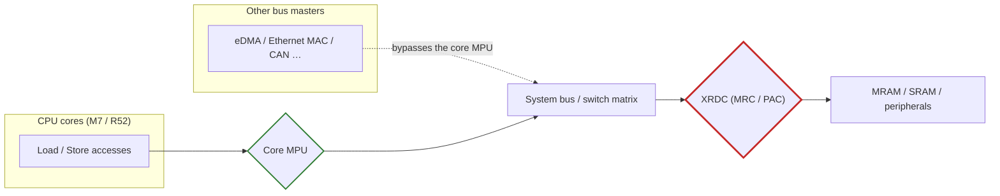

> **Document structure (restructured 2026-11-01)**: this document is organized in two parts.
> **Part I · ARM architecture** (chapters 1–3) is chip-independent and gives a **bit-by-bit description** of the MPU registers of the Cortex-M7 (ARMv7-M PMSAv7) and Cortex-R52 (Armv8-R PMSAv8-32) per the Arm official documentation, with a systematic difference analysis in chapter 3.
> **Part II · S32K5 implementation** (chapters 4–19) maps the architecture onto the S32K566: memory map, region layout, per-memory-type configuration, boot sequence, AUTOSAR OS partitions, the RTD Platform driver with sBoot checks, fault handling and ASIL D implications.
>
> **Revision highlights**: ① register bit fields re-verified bit by bit against the Arm documents (R52 `PRBAR.XN`/`SH`/`AP`, `PRLAR.AttrIndx`, `PRSELR` width, `MPUIR`, `HPRENR` all corrected — see chapters 1/2); ② new chapter 3, M7 vs R52 difference analysis; ③ new chapter 12, RTD Platform MPU driver and sBoot checks (from the ima knowledge base `RTD_PLATFORM_UM.pdf` / `S32K5_SAF_SBOOT_UM.pdf` / `M7_S32K5_SCST_User_Manual.pdf`); ④ layout problems caused by the PMSAv7 "region size must be a power of two" constraint fixed (3 MB SRAM and the ~50 MB peripheral window cannot be covered by a single M7 region — see §1.7/§5.3).

---

## Part I · ARM architecture — PMSAv7 and PMSAv8-32 register specification

## 1. Cortex-M7 MPU in detail (ARMv7-M PMSAv7)

### 1.1 Register model and programming interface

The Cortex-M7 has **one** MPU, with registers in the System Control Space (SCS) at base `0xE000_ED90`, all 32-bit:

| Register | Address | Access | Purpose |
| --- | --- | --- | --- |
| `MPU_TYPE` | `0xE000_ED90` | RO | Detects MPU presence and region count (DREGION) |
| `MPU_CTRL` | `0xE000_ED94` | RW | Enables MPU, background region, fault-period behaviour |
| `MPU_RNR` | `0xE000_ED98` | RW | Selects the region number to operate on |
| `MPU_RBAR` | `0xE000_ED9C` | RW | Region base address + VALID |
| `MPU_RASR` | `0xE000_EDA0` | RW | Region attributes + size + enable |

The programming model is **"select the number first, then write the attributes"**: write `MPU_RNR = n`, then write `MPU_RBAR` and `MPU_RASR`. CMSIS wraps this in `ARM_MPU_SetRegion()`.

> `MPU_CTRL` resets to 0 (MPU off); `MPU_TYPE` reset value reflects the implementation — `0x00001000` on the S32K566, i.e. DREGION = 16. `[Source: S32K5xx RM, Chapter_02 Table 6]`

### 1.2 MPU_TYPE — MPU type register (`0xE000_ED90`, RO)

| Bits | Name | Description |
| --- | --- | --- |
| `[31:24]` | — | res0 |
| `[23:16]` | `IREGION` | Instruction region count. The M7 has a **unified MPU**, so this field reads 0 (DREGION covers both instruction and data) |
| `[15:8]` | `DREGION` | Number of data regions: 0 (no MPU) / 8 / 12 / 16. **Before accessing region registers, confirm this is non-zero and the region number < DREGION**; out-of-range access is undefined |
| `[7:1]` | — | res0 |
| `[0]` | `SEPARATE` | 0 = unified MPU (one region set for instruction and data); 1 = separate. The M7 is 0 |

### 1.3 MPU_CTRL — MPU control register (`0xE000_ED94`, RW)

| Bits | Name | Semantics |
| --- | --- | --- |
| `[2]` | `PRIVDEFENA` | Whether privileged code that misses all regions falls back to the **default memory map** as a background. **S32K5 recommends 0 with an explicit background region instead** (see §9) |
| `[1]` | `HFNMIENA` | Whether the MPU stays enabled during HardFault / NMI / FAULTMASK |
| `[0]` | `ENABLE` | MPU master enable. When 0, all other register settings are inactive |
| `[31:3]` | — | res0 |

The `HFNMIENA` trade-off: `=0` leaves the fault handler unconstrained by the MPU, which makes a full memory dump for offline analysis easy; `=1` constrains even the fault handler — stronger anti-tampering but potentially incomplete scene data. Safety-diagnostic firmware usually sets 0 and stores the scene in a dedicated no-cacheable region.

### 1.4 MPU_RNR — region number register (`0xE000_ED98`, RW)

| Bits | Name | Description |
| --- | --- | --- |
| `[7:0]` | `REGION` | Current region number. Writing a value ≥ DREGION is undefined |
| `[31:8]` | — | res0 |

### 1.5 MPU_RBAR — region base address register (`0xE000_ED9C`, RW)

| Bits | Name | Description |
| --- | --- | --- |
| `[31:5]` | `ADDR` | Region base. Low bits are aligned per SIZE (§1.7); if not aligned, the **low bits are ignored** and the protected range silently grows |
| `[4]` | `VALID` | 1 = this access uses the region in `REGION[3:0]`, ignoring `MPU_RNR`; 0 = use `MPU_RNR` |
| `[3:0]` | `REGION` | Region number when `VALID=1` |

### 1.6 MPU_RASR — region attribute and size register (`0xE000_EDA0`, RW)

```
 31   29 28  27    26   24 23  22   21   19 18 17 16   15    8  7  6    5    1  0
┌────────┬───┬────────┬────────┬────────┬───┬───┬───┬────────┬──────┬────────┬───┐
│  res0  │ XN│  res0  │ AP[2:0]│  res0  │TEX│ S │ C │  SRD   │ res0 │ SIZE   │EN │
└────────┴───┴────────┴────────┴────────┴───┴───┴───┴────────┴──────┴────────┴───┘
```

| Field | Bits | Description |
| --- | --- | --- |
| `XN` | `[28]` | Execute Never. 1 = instruction fetch from this region forbidden |
| `AP[2:0]` | `[26:24]` | Access permission, see §1.8 |
| `TEX[2:0]` | `[21:19]` | Memory type extension, combined with C/B/S, see §1.9 |
| `S` | `[18]` | Shareable |
| `C` | `[17]` | Cacheable |
| `B` | `[16]` | Bufferable |
| `SRD[7:0]` | `[15:8]` | Subregion disable, 8 segments for ≥ 256 B, see §1.10 |
| `SIZE[4:0]` | `[5:1]` | Region size = 2^(SIZE+1) bytes, see §1.7 |
| `ENABLE` | `[0]` | Region enable (also requires `MPU_CTRL.ENABLE`) |

The remaining bits (`[31:29]`, `[27]`, `[23:22]`, `[7:6]`) are res0.

### 1.7 SIZE encoding and base alignment constraints

| `SIZE[4:0]` | Region size | `SIZE[4:0]` | Region size |
| --- | --- | --- | --- |
| `<4` | **reserved** (minimum 32 B) | `17` | 256 KB |
| `4` | 32 B | `19` | 1 MB |
| `5` | 64 B | `20` | 2 MB |
| `6` | 128 B | `21` | 4 MB |
| `7` | 256 B | `22` | 8 MB |
| `8` | 512 B | `23` | 16 MB |
| `9` | 1 KB | `24` | 32 MB |
| `11` | 4 KB | `25` | 64 MB |
| `14` | 32 KB | `31` | 4 GB |

Two hard constraints (the classic PMSAv7 pitfalls):

1. **The region size must be a power of two** (32 B – 4 GB);
2. **The base address must be aligned to the region size** — a 64 KB region must start on a `0x0001_0000` boundary, not `0x0001_0001`.

Violating constraint 2: the low bits of the written ADDR are ignored and the MPU actually protects a region **twice as large**. Violating constraint 1: the size **cannot be encoded at all** — two real S32K566 examples: the 3 MB M7 SRAM0-2 and the ~50 MB peripheral window (`0x4000_0000`–`0x431F_FFFF`) both need splitting (see §5.3). R52's PMSAv8-32 has no such constraint (BASE+LIMIT at arbitrary 64 B granularity) — the same space fits in one region (see §3.3).

### 1.8 AP access permission encoding

| `AP[2:0]` | Privileged | Unprivileged | Notes |
| --- | --- | --- | --- |
| `000` | No access | No access | Any access raises a permission fault |
| `001` | Read/Write | No access | Privileged only |
| `010` | Read/Write | Read-only | Unprivileged writes fault |
| `011` | Read/Write | Read/Write | Full access |
| `100` | unpredictable | unpredictable | **Reserved, do not use** |
| `101` | Read-only | No access | Privileged read-only |
| `110` | Read-only | Read-only | Both read-only |
| `111` | Read-only | Read-only | Same as 110 |

### 1.9 TEX/C/B/S memory attribute encoding

| TEX | C | B | Memory type / cacheability | Shareable |
| --- | --- | --- | --- | --- |
| `000` | 0 | 0 | Strongly-ordered | always Shareable |
| `000` | 0 | 1 | Device, Shared device | always Shareable |
| `000` | 1 | 0 | Normal, WT, no write-allocate | S bit |
| `000` | 1 | 1 | Normal, WB, no write-allocate | S bit |
| `001` | 0 | 0 | Normal, Non-cacheable | S bit |
| `001` | 0 | 1 | Reserved | — |
| `001` | 1 | 0 | Implementation defined | — |
| `001` | 1 | 1 | Normal, WB, write+read allocate | S bit |
| `010` | 0 | 0 | Device, Non-shared device | always Non-shareable |
| `010` | 0 | 1 | Reserved | — |
| `010` | 1 | X | Reserved | — |
| `011` | X | X | Reserved | — |
| `1BB` | `BAA` | `A` | Normal, Cached (AA/BB encode the cache policy) | S bit |

Cache policy for `{TEX,C,B} = 1BB`:

| AA or BB | Cache policy |
| --- | --- |
| `00` | Non-cacheable |
| `01` | Write-back, write and read allocate |
| `10` | Write-through, no write allocate |
| `11` | Write-back, no write allocate |

**Peripherals must use the Device type.** This is the most frequent M7 mistake: configuring the UART, FLEXCAN or GPIO register window as Normal cacheable makes registers read back stale values and swallows peripheral writes into the cache. Correct encodings: `TEX=000, C=0, B=1` (Shared Device) or `TEX=010, C=0, B=0` (Non-shared Device).

### 1.10 Region overlap and SRD subregion disable

- **On overlap, the higher region number wins**: if regions 0 and 1 cover the same memory, region 1's attributes apply. This is PMSAv7's most useful feature — set a broad baseline with one large region, then tighten it with a smaller overlapping one (S32K5's "background no-access + effective regions" and "merged SRAM + NC subregion overlay" both rely on it, see §5.2/§5.3).
- **SRD subregions**: a region ≥ 256 B is split into 8 equal segments; `SRD[n]=1` disables segment n, `SRD[0]` mapping to the lowest-address segment. **Note: for 32/64/128 B regions, writing SRD has unpredictable effects.**

### 1.11 Default memory map (background region)

When `MPU_CTRL.PRIVDEFENA = 1`, privileged accesses that miss every region fall back to the default memory map:

| Address range | Memory type | Attributes | Executable |
| --- | --- | --- | --- |
| `0x0000_0000`–`0x1FFF_FFFF` | Normal | Non-shareable, WT, cacheable | **yes** |
| `0x2000_0000`–`0x3FFF_FFFF` | Normal | Non-shareable, WB, cacheable | no |
| `0x4000_0000`–`0x5FFF_FFFF` | Device | Shareable | no |
| `0x6000_0000`–`0x7FFF_FFFF` | Normal | Non-shareable, WB, cacheable | no |
| `0x8000_0000`–`0x9FFF_FFFF` | Normal | Non-shareable, WT, cacheable | no |
| `0xA000_0000`–`0xBFFF_FFFF` | Device | Shareable | no |
| `0xC000_0000`–`0xDFFF_FFFF` | Device | Shareable | no |
| `0xE000_0000`–`0xE00F_FFFF` | Device | Shareable (PPB) | no |
| `0xE010_0000`–`0xFFFF_FFFF` | Device | implementation defined | no |

Two points:

1. **Only `0x0000_0000`–`0x1FFF_FFFF` is executable by default** — this is why the unused MRAM window (from `0x0A00_0000`) is a speculative-fetch minefield, while the XSPI window (from `0x8100_0000`) has its fetches suppressed by XN by default (its danger is on the data side, see §9.2);
2. The cacheable attributes of the Normal segments in the default map presuppose that the cache is actually enabled — with the cache off they behave as Non-cacheable.

### 1.12 MemManage fault and scene capture

The MFSR byte in `SCB->CFSR` (critical for determining the direction):

| Bit | Meaning |
| --- | --- |
| `0` | IACCVIOL — permission violation on instruction fetch |
| `1` | DACCVIOL — permission violation on data access |
| `3` | MUNSTKERR — invalid stack pointer on exception return |
| `4` | MSTKERR — invalid stack pointer on stacking |
| `5` | MLSPERR — floating-point stacking error |
| `7` | MMARVALID — address in MMFAR is valid |

```c
void MemManage_Handler(void)
{
    /* 1. Capture the scene first, clean up later */
    uint32_t ipsr   = __get_IPSR();
    uint32_t mfsr   = SCB->CFSR & 0xFFU;        /* MemManage status */
    uint32_t hfsr   = SCB->CFSR >> 16;
    uint32_t mmfar  = SCB->MMFAR;               /* Faulting address */
    uint32_t bfar   = SCB->BFAR;
    uint32_t stacked_pc, stacked_lr;
    __asm volatile("mov %0, lr\n" : "=r"(stacked_lr));
    __asm volatile("mov %0, pc\n" : "=r"(stacked_pc));

    /* 2. Store in a no-cacheable region for the diagnostic firmware to read */
    FaultRecord_SafeStore(ipsr, mfsr, hfsr, mmfar, bfar,
                          stacked_pc, stacked_lr);

    /* 3. ASIL D requires a controlled stop or safe state, not a retry loop */
    Safety_EnterSafeState(FAULT_SRC_MEMM, mmfar);
    for (;;) { }
}
```

> Before use, set `MEMFAULTENA` in `SCB->SHCSR` (see §14.2), otherwise MemManage escalates straight into HardFault.

### 1.13 Programming rules (common to M7 and R52)

1. When reconfiguring a region, **the programming code itself must not reside in that region** — otherwise instruction fetch fails the instant the permission changes and the CPU wedges;
2. Execute **DSB** before changing `MPU_RBAR`/`MPU_RASR`, ensuring all prior memory accesses complete;
3. Execute **ISB** after the change to flush the pipeline and make the new attributes take effect;
4. Disable the MPU before whole-table configuration (`MPU_CTRL = 0` → configure → DSB → `ENABLE=1` → DSB/ISB) to avoid faults from intermediate states.

---

## 2. Cortex-R52 MPU in detail (Armv8-R PMSAv8-32)

### 2.1 Dual MPU model (EL1 / EL2)

The R52 has **two independent MPUs** — the largest architectural difference from the M7:

| MPU | Controlled by | Region count | Scope |
| --- | --- | --- | --- |
| EL1 MPU | EL1 (EL2 may write it) | 16 / 20 / 24 | EL0 and EL1 accesses |
| EL2 MPU | EL2 (hypervisor) | 0 / 16 / 20 / 24 (optional) | Overlaid on EL0/EL1 |

Combination rules:

- **EL0/EL1 access** → looked up in **both** MPUs; the **least permissive** combination wins;
- **EL2 access** → EL2 MPU only;
- The EL2 MPU can be disabled wholesale (S32K5 does not use virtualization; keep the EL2 MPU off).

The S32K566 implements **EL1: 20 regions, EL2: 20 regions** (not 16 or 24). RM Table 6 verbatim: "Level 1 and level 2 MPUs with **20 regions each** (level 2 MPU supports hypervisor)". `[Source: S32K5xx RM Rev.2, Chapter_02 Table 6/Table 10]`

### 2.2 Register overview and access methods

| Register | cp15 encoding | Access | Purpose |
| --- | --- | --- | --- |
| `MPUIR` | `c0, c0, 4` | RO (EL1/EL2) | EL1 MPU region info (§2.3) |
| `PRSELR` | `c6, c2, 1` | RW | Selects the region targeted by `PRBAR`/`PRLAR` accesses (§2.4) |
| `PRBAR` | `c6, c3, 0` | RW | Region base + AP/SH/XN (§2.5) |
| `PRLAR` | `c6, c3, 1` | RW | Region limit + AttrIndx + EN (§2.6) |
| `PRBARn` / `PRLARn` | `c6, c8+n[3:1], 4*n[0]+{0,1}` | RW | Direct access to regions 0–15 |
| `MAIR0` / `MAIR1` | `c10, c2, 0` / `c10, c2, 1` | RW | Memory attribute indirection (§2.8) |
| `SCTLR` | `c1, c0, 0` | RW | System control (M/BR/WXN/UWXN/I/C, §2.10) |
| `HCR` | `c1, c1, 0` | RW | Hypervisor configuration (DC/VM/TID1, §2.10) |
| `HMPUIR` | `p15, 4, c0, c0, 4` | RO (EL2) | EL2 MPU region info |
| `HPRSELR` | `p15, 4, c6, c2, 1` | RW (EL2) | EL2 region select |
| `HPRBAR` / `HPRLAR` | `p15, 4, c6, c3, 0` / `p15, 4, c6, c3, 1` | RW (EL2) | EL2 region base / limit |
| `HPRENR` | `p15, 4, c6, c1, 1` | RW (EL2) | EL2 region-enable bitmask (§2.7) |
| `HMAIR0` / `HMAIR1` | `p15, 4, c10, c2, 0` / `1` | RW (EL2) | EL2 memory attribute indirection |

Two programming methods:

```asm
@ Method 1: indirect via PRSELR (recommended)
MOV   R0, #0                  @ Select region 0
MCR   p15, 0, R0, c6, c2, 1   @ Write PRSELR
MCR   p15, 0, R1, c6, c3, 0   @ Write PRBAR
MCR   p15, 0, R2, c6, c3, 1   @ Write PRLAR

@ Method 2: direct access to PRBARn / PRLARn (regions 0-15 only)
MCR   p15, 0, R1, c6, c8+n[3:1], 4*n[0]      @ PRBARn
MCR   p15, 0, R2, c6, c8+n[3:1], 4*n[0]+1    @ PRLARn
```

> **Easy mistake**: the `op1` computation for direct access is error-prone (involving `c8 + n[3:1]` and `4*n[0]`). **Use the PRSELR indirect method uniformly** — it is also the only access path for regions 16–19 (see §16 risk 12).
>
> **No PRENR at EL1**: R52 EL1 MPU region enabling is solely via `PRLAR.EN`; the bitmask enable register only exists at EL2 as `HPRENR` (§2.7).

### 2.3 MPUIR — MPU type register (`MRC p15, 0, Rt, c0, c0, 4`, RO)

| Bits | Name | Description |
| --- | --- | --- |
| `[31:24]` | — | res0 |
| `[23:16]` | `IREGION` | res0 (unified MPU) |
| `[15:8]` | `DREGION` | EL1 MPU region count: 16 / 20 / 24 (S32K566 = 20) |
| `[7:1]` | — | res0 |
| `[0]` | `nU` | Not Unified. 0 = unified memory map |

An EL1 read of `MPUIR` is trapped to EL2 when `HCR.TID1=1`.

### 2.4 PRSELR / HPRSELR — region select register (`c6, c2, 1`, RW)

The field width varies with the implemented region count:

| Implementation | `REGION` field | Out-of-range behaviour |
| --- | --- | --- |
| 0 / 16 regions | `[3:0]` | Writing ≥16 is UNPREDICTABLE |
| 20 / 24 regions | `[4:0]` | Writing ≥20 (or ≥24) is UNPREDICTABLE |

The S32K566 (20 regions) uses `[4:0]`. After selecting, `PRBAR`/`PRLAR` accesses target that region.

### 2.5 PRBAR / HPRBAR — region base address register (`c6, c3, 0`, RW)

| Bits | Name | Description |
| --- | --- | --- |
| `[31:6]` | `BASE` | Region base bits[31:6], zero-extended for comparison |
| `[5]` | — | res0 |
| `[4:3]` | `SH[1:0]` | Shareability, see §2.9 |
| `[2:1]` | `AP[2:1]` | Access permission, see §2.9 |
| `[0]` | `XN` | Execute-never. **Note XN is in PRBAR, not PRLAR** — a completely different position from the M7's `MPU_RASR.XN[28]`, see §3.5 |

The reset value is UNKNOWN; configuration code must write all fields.

### 2.6 PRLAR / HPRLAR — region limit register (`c6, c3, 1`, RW)

| Bits | Name | Description |
| --- | --- | --- |
| `[31:6]` | `LIMIT` | Region limit bits[31:6]; the hardware appends `0x3F` — **the limit is inclusive** |
| `[5:4]` | — | res0 |
| `[3:1]` | `AttrIndx[2:0]` | Memory attribute index, indexes `MAIRx` (§2.8) |
| `[0]` | `EN` | Region enable. 0 = disabled; 1 = enabled. **This is the only enable mechanism for the EL1 MPU** |

Region address range:

```
PRBAR.BASE:0b000000 <= address <= PRLAR.LIMIT:0b111111
```

The colon is the bit-concatenation operator. The low 6 bits of BASE read as 0 and the low 6 bits of LIMIT read as 1 — **the effective granularity is 64 bytes, and both ends are inclusive**. A misconfiguration does not silently double the region as on the M7; it raises an exception immediately — fail-fast.

### 2.7 HPRENR — EL2 region enable register (`p15, 4, c6, c1, 1`, RW)

| Implementation | Field | Description |
| --- | --- | --- |
| 0 regions | all RAZ | — |
| 16 regions | `[15:0]` `ENABLES` | Bit N enables/disables EL2 MPU region N |
| 20 regions | `[19:0]` `ENABLES` | `[31:20]` RAZ |
| 24 regions | `[23:0]` `ENABLES` | `[31:24]` RAZ |

Reset value `0x00000000`. It is a bulk replacement for `HPRLAR.EN`, accessible only at EL2.

### 2.8 MAIR0 / MAIR1 — memory attribute indirection registers (`c10, c2, 0` / `c10, c2, 1`, RW)

The R52 moves memory attributes out of the region registers into `MAIRx`; each MPU has 8 8-bit attribute slots, referenced by `PRLAR.AttrIndx`:

| AttrIndx | Value | Memory type | S32K5 use |
| --- | --- | --- | --- |
| 0 | `0xFF` | Normal, Inner/Outer RW, Write-back, Write-allocate | Code/Data MRAM, SRAM |
| 1 | `0x00` | Device-nGnRnE | PPB (strictest Device) |
| 2 | `0xBB` | Normal, Inner/Outer RW, Write-through (no write-allocate) | reserved |
| 3 | `0x04` | Device-nGnRE | peripheral bridge window |
| 4 | `0x44` | Normal, Inner/Outer Non-cacheable | LPE_SRAM Code read-only view |

```asm
@ Configure MAIR0: Attr3=0x04, Attr2=0xBB, Attr1=0x00, Attr0=0xFF
MRC   p15, 0, R0, c10, c2, 0       @ Read MAIR0
LDR   R1, =0x04BB00FF
MCR   p15, 0, R1, c10, c2, 0       @ Write MAIR0
LDR   R1, =0x00000044
MCR   p15, 0, R1, c10, c2, 1       @ Write MAIR1 (Attr4 = 0x44)
DSB
ISB
```

> Device attribute strictness: `0x00` nGnRnE (no merging, no reordering, no early write acknowledgement) > `0x04` nGnRE > `0x0C` nGRE > `0x0F` GRE. Interrupt controllers / system-critical registers use nGnRnE; ordinary peripherals use nGnRE.
>
> `HMAIR0`/`HMAIR1` reset to 0 — all EL2-side attributes are invalid until programmed (see §16 risk 9).

### 2.9 AP and SH encodings

**AP[2:1] (EL1 MPU, R52 TRM Table 3-126)**:

| `AP[2:1]` | EL1 access | EL0 access |
| --- | --- | --- |
| `00` | Read/Write | **no access** |
| `01` | Read/Write | Read/Write |
| `10` | Read-only | **no access** |
| `11` | Read-only | Read-only |

**SH[1:0] (Normal memory, R52 TRM Table 3-125)**:

| `SH[1:0]` | Meaning |
| --- | --- |
| `00` | Non-shareable |
| `01` | **UNPREDICTABLE** |
| `10` | Outer Shareable |
| `11` | Inner Shareable |

> **PMSAv8-32 has no "privileged RW + unprivileged RO" mixed AP encoding** (the M7's `AP=010` has no R52 counterpart). Where that semantics is needed, the OS must rewrite the region AP on task switch (see §10.2).

### 2.10 Key SCTLR / HCR control bits

| Register | Bit | Name | Semantics |
| --- | --- | --- | --- |
| `SCTLR` | `[0]` | `M` | EL1 MPU enable. When 0, the default memory map is used |
| `SCTLR` | `[17]` | `BR` | Background Region for EL1. When 1, EL1 privileged accesses missing all regions may use the background region; **S32K5 keeps 0** (miss = fault, see §5.4). Reset value 0 |
| `SCTLR` | `[19]` | `WXN` | Write permission implies XN. 1 = all writable regions forced XN. **Reset value 0**; setting 1 breaks ATCM (must stay executable, see §6.5) |
| `SCTLR` | `[20]` | `UWXN` | Unprivileged write permission implies EL1 XN. Reset value 0 |
| `SCTLR` | `[12]` | `I` | Instruction cache master enable |
| `SCTLR` | `[2]` | `C` | Data cache master enable |
| `HCR` | — | `DC` | Default cacheability. When 1, the background region gets Normal IB-OB WB Non-shareable + RA/WA, **and background-region instruction fetches are always executable**; all EL0/EL1 accesses perform a two-stage lookup (equivalent to `HCR.VM=1`). **Keep `DC=0` without virtualization** |
| `HCR` | — | `VM` | Virtualization flag; when set, EL0/EL1 perform a two-stage MPU lookup |
| `HCR` | — | `TID1` | When set, EL1 reads of `MPUIR` are trapped to EL2 |

### 2.11 Background region and default memory map

**Instruction-access background region**:

| Address range | `SCTLR.I=1` | `SCTLR.I=0` | XN |
| --- | --- | --- | --- |
| `0x0000_0000`–`0x7FFF_FFFF` | Normal, Non-shareable, WT cacheable | Normal, Shareable, NC | execution permitted |
| `0x8000_0000`–`0xFFFF_FFFF` | — | — | **Execute-never** |

**Data-access background region**:

| Address range | `SCTLR.C=1` | `SCTLR.C=0` |
| --- | --- | --- |
| `0x0000_0000`–`0x3FFF_FFFF` | Normal, Non-shareable, WB WA cacheable | Normal, Shareable, NC |
| `0x4000_0000`–`0x5FFF_FFFF` | Normal, Non-shareable, WT cacheable | Normal, Shareable, NC |
| `0x6000_0000`–`0x7FFF_FFFF` | Normal, Shareable, NC | Normal, Shareable, NC |
| `0x8000_0000`–`0xBFFF_FFFF` | Device-nGnRE | Device-nGnRE |
| `0xC000_0000`–`0xFFFF_FFFF` | Device-nGnRnE | Device-nGnRnE |

Note that everything above `0x8000_0000` defaults to Device — exactly where the S32K5 peripheral windows live, so the default attribute is coincidentally the safe one (non-cacheable). When the EL2 MPU is enabled, EL0/EL1 accesses that miss all EL2 regions raise a translation fault immediately (the inevitable consequence of two-stage lookup).

### 2.12 Fault types

| Fault | Trigger condition |
| --- | --- |
| Permission fault | Access hits a region but the permission disallows it |
| Translation fault | Access hits multiple regions (overlap); or hits no region and the background region is unusable |

The M7 raises only permission faults (on overlap the highest-number region is silently selected); the R52 turns "overlap" from a feature into an error.

### 2.13 Programming rules

Same as §1.13 (common to M7 and R52), plus two R52-specific rules:

1. **ATCM first**. R52 TRM: *"Do not enable the MPU unless at least one MPU region is programmed and active. If the MPU is enabled, before using the TCM you must program MPU regions to cover the TCM regions."* Enable `SCTLR.M` without a TCM-covering region and TCM access faults immediately.
2. **`WXN` is a decision, not a default**. `WXN`/`UWXN` reset to 0. Because ATCM must stay executable, the global `WXN=1` route is closed — set `XN` per region instead, and add a boot self-test that reads back every `PRBAR.XN` (see §6.5).

The R52 has no independent reset (SEGGER's documentation states a debugger cannot reset an R52 core on its own), so R52 MPU configuration is triggered entirely by the M7-side startup code, with an MU interrupt or shared-memory flag handshake between the two (see §11).

---

## 3. M7 vs R52 MPU difference analysis

This chapter condenses the differences of chapters 1–2 into a comparison table and explains the design consequences for S32K5 item by item. The two cores collaborate in one chip, yet their MPU behaviour models belong to two architecture generations.

### 3.1 Overview comparison

| Dimension | Cortex-M7 (PMSAv7) | Cortex-R52 (PMSAv8-32) |
| --- | --- | --- |
| Architecture | ARMv7-M | Armv8-R AArch32 |
| MPU sets | 1 | **2** (EL1 / EL2, least permissive combination) |
| Region count | 8 / 12 / 16 (`MPU_TYPE.DREGION`; S32K566 = 16) | 16 / 20 / 24 (`MPUIR.DREGION`; S32K566 = 20) |
| Region definition | BASE + SIZE | BASE + LIMIT (**inclusive**) |
| Region size | power of two, 32 B – 4 GB | 64 B – 4 GB, arbitrary |
| Base alignment | aligned to SIZE (misaligned → silently grows) | BASE/LIMIT 64 B aligned (misaligned → exception) |
| Region overlap | **allowed, higher number wins** | **forbidden, multiple hits = translation fault** |
| Subregions | SRD 8-segment masking | none |
| Privilege tiers | privileged / unprivileged (2) | EL0 / EL1 / EL2 (3) |
| AP encoding | 3 bit (8 values incl. reserved) | 2 bit (4 values, no mixed RW/RO) |
| XN location | `MPU_RASR.XN[28]` (attribute register) | `PRBAR.XN[0]` (base register) |
| Memory attributes | TEX/C/B/S inline in `MPU_RASR` | `MAIRx` indirection (`PRLAR.AttrIndx`) |
| Shareable | S bit (attached to TEX/C/B) | `SH[1:0]` (`0b01` UNPREDICTABLE) |
| Background region | `PRIVDEFENA` privileged default map | `SCTLR.BR` background region check |
| Default map executable range | `0x0000_0000`–`0x1FFF_FFFF` | `0x0000_0000`–`0x7FFF_FFFF` |
| Fault types | Permission fault (MemManage) | Permission fault + **Translation fault** (Abort) |
| Fault address registers | `MMFAR` / `BFAR` | `DFAR` / `IFAR` (cp15 `c6, c0, 0/2`) |
| Register access | memory-mapped (SCS `0xE000_ED9x`) | system registers (cp15 `MCR`/`MRC`) |
| Region enable | `MPU_RASR.ENABLE` | `PRLAR.EN` (EL1); `HPRENR` (EL2 only) |
| Programming model | `MPU_RNR` select → RBAR/RASR | `PRSELR` select → PRBAR/PRLAR (or direct PRBARn/PRLARn) |
| WXN | no equivalent | `SCTLR.WXN`/`UWXN`, reset 0 |
| Fault-period behaviour | `HFNMIENA` can exempt fault handlers | no equivalent; fault handlers are constrained by the MPU |
| Speculative accesses | TRM-established architectural behaviour; errata 1013783-B (§9) | stopped at the MPU, **no fault generated** |

<figure style="margin:1.2em 0;text-align:center">
<svg xmlns="http://www.w3.org/2000/svg" viewBox="0 0 680 452" width="100%" font-family="-apple-system,BlinkMacSystemFont,'Segoe UI',sans-serif" role="img">
<title>MPU architecture differences between Cortex-M7 and Cortex-R52</title>
<desc>Left: Cortex-M7 with ARMv7-M PMSAv7 uses MPU_RNR/RBAR/RASR with SIZE-encoded region size, subregion disable and overlap priority by region number. Right: Cortex-R52 with Armv8-R PMSAv8-32 uses PRBAR/PRLAR base-limit register pairs, 64-byte granularity, no overlapping regions, and dual EL1/EL2 MPUs taking the least permissive combination.</desc>
<defs><marker id="ar" viewBox="0 0 10 10" refX="8" refY="5" markerWidth="6" markerHeight="6" orient="auto-start-reverse"><path d="M2 1L8 5L2 9" fill="none" stroke="context-stroke" stroke-width="1.5" stroke-linecap="round" stroke-linejoin="round"/></marker></defs>
<rect x="40" y="20" width="285" height="410" rx="14" fill="#E6F1FB" stroke="#378ADD" stroke-width="0.5"/>
<text x="182" y="46" text-anchor="middle" font-size="14" font-weight="500" fill="#0C447C">Cortex-M7</text>
<text x="182" y="66" text-anchor="middle" font-size="12" fill="#185FA5">ARMv7-M PMSAv7</text>
<rect x="60" y="84" width="245" height="66" rx="8" fill="#B5D4F4" stroke="#185FA5" stroke-width="0.5"/>
<text x="182" y="105" text-anchor="middle" font-size="13" font-weight="500" fill="#042C53" dominant-baseline="central">Register model</text>
<text x="182" y="124" text-anchor="middle" font-size="12" fill="#0C447C" dominant-baseline="central">RNR + RBAR + RASR</text>
<text x="182" y="140" text-anchor="middle" font-size="12" fill="#0C447C" dominant-baseline="central">Base + SIZE encoding</text>
<rect x="60" y="162" width="245" height="66" rx="8" fill="#B5D4F4" stroke="#185FA5" stroke-width="0.5"/>
<text x="182" y="183" text-anchor="middle" font-size="13" font-weight="500" fill="#042C53" dominant-baseline="central">Region count</text>
<text x="182" y="202" text-anchor="middle" font-size="12" fill="#0C447C" dominant-baseline="central">Up to 16 (8-15 optional)</text>
<text x="182" y="218" text-anchor="middle" font-size="12" fill="#0C447C" dominant-baseline="central">MPU_TYPE.DREGION detectable</text>
<rect x="60" y="240" width="245" height="66" rx="8" fill="#B5D4F4" stroke="#185FA5" stroke-width="0.5"/>
<text x="182" y="261" text-anchor="middle" font-size="13" font-weight="500" fill="#042C53" dominant-baseline="central">Region behaviour</text>
<text x="182" y="280" text-anchor="middle" font-size="12" fill="#0C447C" dominant-baseline="central">Overlap allowed, higher number wins</text>
<text x="182" y="296" text-anchor="middle" font-size="12" fill="#0C447C" dominant-baseline="central">SRD masks 8 subregions</text>
<rect x="60" y="318" width="245" height="66" rx="8" fill="#B5D4F4" stroke="#185FA5" stroke-width="0.5"/>
<text x="182" y="339" text-anchor="middle" font-size="13" font-weight="500" fill="#042C53" dominant-baseline="central">Privilege tiers</text>
<text x="182" y="358" text-anchor="middle" font-size="12" fill="#0C447C" dominant-baseline="central">Privileged / unprivileged</text>
<text x="182" y="374" text-anchor="middle" font-size="12" fill="#0C447C" dominant-baseline="central">Single MPU_CTRL set</text>
<rect x="60" y="396" width="245" height="20" rx="6" fill="#F1EFE8" stroke="#888780" stroke-width="0.5"/>
<text x="182" y="406" text-anchor="middle" font-size="12" fill="#2C2C2A" dominant-baseline="central">Fault: MemManage</text>
<rect x="355" y="20" width="285" height="410" rx="14" fill="#EEEDFE" stroke="#7F77DD" stroke-width="0.5"/>
<text x="497" y="46" text-anchor="middle" font-size="14" font-weight="500" fill="#3C3489">Cortex-R52</text>
<text x="497" y="66" text-anchor="middle" font-size="12" fill="#534AB7">Armv8-R PMSAv8-32</text>
<rect x="375" y="84" width="245" height="66" rx="8" fill="#CECBF6" stroke="#534AB7" stroke-width="0.5"/>
<text x="497" y="105" text-anchor="middle" font-size="13" font-weight="500" fill="#26215C" dominant-baseline="central">Register model</text>
<text x="497" y="124" text-anchor="middle" font-size="12" fill="#3C3489" dominant-baseline="central">PRBAR + PRLAR register pair</text>
<text x="497" y="140" text-anchor="middle" font-size="12" fill="#3C3489" dominant-baseline="central">Base + limit (inclusive)</text>
<rect x="375" y="162" width="245" height="66" rx="8" fill="#CECBF6" stroke="#534AB7" stroke-width="0.5"/>
<text x="497" y="183" text-anchor="middle" font-size="13" font-weight="500" fill="#26215C" dominant-baseline="central">Region count</text>
<text x="497" y="202" text-anchor="middle" font-size="12" fill="#3C3489" dominant-baseline="central">EL1: 16 / 20 / 24</text>
<text x="497" y="218" text-anchor="middle" font-size="12" fill="#3C3489" dominant-baseline="central">EL2: 0 / 16 / 20 / 24</text>
<rect x="375" y="240" width="245" height="66" rx="8" fill="#CECBF6" stroke="#534AB7" stroke-width="0.5"/>
<text x="497" y="261" text-anchor="middle" font-size="13" font-weight="500" fill="#26215C" dominant-baseline="central">Region behaviour</text>
<text x="497" y="280" text-anchor="middle" font-size="12" fill="#3C3489" dominant-baseline="central">Overlap forbidden, multiple hits fault</text>
<text x="497" y="296" text-anchor="middle" font-size="12" fill="#3C3489" dominant-baseline="central">64 B granularity, no SRD</text>
<rect x="375" y="318" width="245" height="66" rx="8" fill="#CECBF6" stroke="#534AB7" stroke-width="0.5"/>
<text x="497" y="339" text-anchor="middle" font-size="13" font-weight="500" fill="#26215C" dominant-baseline="central">Privilege tiers</text>
<text x="497" y="358" text-anchor="middle" font-size="12" fill="#3C3489" dominant-baseline="central">EL0 / EL1 / EL2</text>
<text x="497" y="374" text-anchor="middle" font-size="12" fill="#3C3489" dominant-baseline="central">Dual MPU, least permissive</text>
<rect x="375" y="396" width="245" height="20" rx="6" fill="#F1EFE8" stroke="#888780" stroke-width="0.5"/>
<text x="497" y="406" text-anchor="middle" font-size="12" fill="#2C2C2A" dominant-baseline="central">Fault: permission + translation</text>
<path d="M325 225 L355 225" fill="none" stroke="#5F5E5A" stroke-width="1.5" marker-end="url(#ar)" marker-start="url(#ar)"/>
<text x="340" y="212" text-anchor="middle" font-size="11" fill="#5F5E5A">different</text>
</svg>
</figure>

### 3.2 Register model and programming interface

The M7's MPU registers are **memory-mapped** (SCS `0xE000_ED9x`) and can be dereferenced directly from C; the R52's are **system registers** and must go through `MCR`/`MRC p15` or CMSIS inline functions. This directly determines the shape of the HAL abstraction (§14.1): the driver implements two completely different paths underneath — "memory-mapped RASR write" and "cp15 PRBAR/PRLAR write" — while exposing a single `MpuRegionCfg` interface on top.

Another programming-model difference: the M7 selects regions via `MPU_RNR`, and `MPU_RBAR.VALID` can temporarily override the selection; the R52 selects via `PRSELR` (field width varies with region count — `[4:0]` on a 20-region implementation) and has no VALID mechanism.

### 3.3 Region definition: SIZE power-of-two vs LIMIT free granularity

This is the difference with the greatest impact on the S32K5 layout:

- M7 region sizes **must be powers of two** with bases aligned to the size. Two large contiguous spaces on the S32K566 therefore cannot be covered by a single M7 region: **the 3 MB M7 SRAM0-2** (split 2 MB + 1 MB, §5.3) and **the ~50 MB peripheral window** (split 32 MB + 8 MB, §5.3). "Merge SRAM0-2 into one region" or "merge peripherals into one region" — valid on PMSAv8 — does not hold on PMSAv7.
- The R52 uses BASE+LIMIT at 64 B granularity; the same space fits in one region (peripherals `0x4000_0000`–`0x431F_FFFF` as a single region, §5.4).
- The consequences of a misalignment are also opposite: on the M7 it **silently grows** (low address bits ignored), on the R52 it **faults immediately** (fail-fast).

### 3.4 Permission model

The M7 AP is a 3-bit, 8-value encoding (privileged/unprivileged × none/RO/RW); the R52 AP is a 2-bit, 4-value encoding (EL0/EL1 × none/RO/RW). Three practical consequences:

1. **Mixed permission missing**: the M7's `AP=010` (privileged RW + unprivileged RO) has **no R52 counterpart**. For a "kernel-writable, application-read-only" shared area, the R52 side must rewrite the region AP on task switch (§10.2), or accept equal permissions.
2. **Reserved values**: the M7's `AP=100` is reserved (unpredictable), the R52's `SH=01` is UNPREDICTABLE — configure static-check rules separately for each.
3. **Privilege cascading**: the R52 AP semantics naturally cover "this EL and lower", with the EL2 MPU overlaying another least-permissive layer; the M7 has a single layer plus the `HFNMIENA` fault-period exemption.

### 3.5 XN location and the WXN conflict

- The M7's XN sits in `MPU_RASR[28]`, in the same register as AP/attributes — one RASR write completes permission+attribute+no-execute;
- The R52's XN sits in `PRBAR[0]`, in the same register as the base — **the write that sets the base also fixes XN**, easy to miss in code review.
- The R52 additionally has global `SCTLR.WXN`/`UWXN` switches (reset 0). The seemingly convenient "global write-xor-execute backstop" **does not work** on the S32K5: ATCM must be simultaneously writable and executable (vector table, startup code), and `WXN=1` force-XNs it, so the core cannot boot from ATCM (§6.5). The R52 side manages XN per region, backed by a boot self-test that reads back `PRBAR.XN` (§16 risks 2/3).
- The M7 has no WXN concept and thus no such trap — but also no global backstop; it also manages XN per region.

### 3.6 Background region and fail-fast philosophies

The two cores treat "misses" with opposite philosophies that converge on the same goal for the S32K5:

| | M7 | R52 |
| --- | --- | --- |
| Mechanism | `PRIVDEFENA=1`: privileged misses fall to the **default memory map** | `SCTLR.BR=1`: privileged misses may use the **background region** |
| S32K5 choice | **`PRIVDEFENA=0` + explicit 4 GB no-access background** (region 0, §9.3) | **`SCTLR.BR=0`, miss = Translation fault** (§5.4) |
| "Big background + small overlay" | possible (overlap legal, higher number wins) | **impossible** (overlap illegal) |
| Unmapped space behaviour | falls into background → MemManage, fail-fast | no region → Translation fault, fail-fast |
| Speculation suppression | background SO+XN+AP=000 (SDEN 1013783-B workaround, §9) | speculation stopped at the MPU, no fault (§3.8) |

Why the M7 still needs an explicit 4 GB background instead of enabling `PRIVDEFENA`: the default map lists all of `0x0000_0000`–`0x1FFF_FFFF` as Normal executable, which includes the unused MRAM window (from `0x0A00_0000`) and the unused XSPI window — exactly the speculation minefield (§9.2); moreover errata 1013783-B triggers precisely when `PRIVDEFENA=0`, and the official workaround is exactly this background-region configuration (§9.1).

### 3.7 Fault model

M7 MPU violations enter via the **MemManage** exception (`CFSR.MFSR` + `MMFAR`/`BFAR`); the R52 enters via **Abort** (Permission/Translation fault, `DFAR`/`IFAR` read via cp15). The R52's extra Translation fault (overlap, or miss with no usable background) turns the M7's two "silent behaviours" (overlap by priority, miss to default map) into explicit faults — configuration errors surface earlier, but it also means **any overlap in the R52 region table is instantly fatal**, so the boot self-test must include a non-overlap check (§13.3).

The R52 has no `HFNMIENA` equivalent: fault handlers are themselves under MPU constraints, so the scene-dump buffer must be reachable at EL1 (§13.2).

### 3.8 Speculative access behaviour

The M7 TRM establishes speculative accesses as **architectural behaviour** (any Normal executable address may be fetched, any Normal address may be read, any cacheable address may be linefilled), and states that speculation does not occur in XN regions, non-accessible regions, Device/Strongly-ordered regions, Non-cacheable regions, or via the AHBP port — the background-region configuration exploits exactly this rule set (§9).

The R52 TRM phrases it differently: speculative accesses **are stopped from generating bus transactions by the MPU and raise no translation/permission fault**. In other words, R52-side speculation that misses all regions is harmless by construction; the M7 side must actively suppress it with the background region's SO+XN+AP=000. This is the architectural root of the two cores' different background strategies on the S32K5.

### 3.9 Consequences for the S32K5 design

1. **Two background strategies coexist**: M7 explicit background region (one of the 13 static regions), R52 fail-fast with BR=0 — two complementary philosophies in one chip; the HAL must not assume symmetry;
2. **The M7 region budget is scarce**: 16 regions + power-of-two constraint, 13 used by static regions leaving only 3 for the OS; the R52 has 20 regions + free granularity, 12 static and 8 dynamic — **partition-protection capacity is asymmetric across cores**, and AUTOSAR OS partition planning must budget per core (§10.3);
3. **Cross-core shared attributes must match field for field**: the M7's TEX/C/B and the R52's MAIR slots must be mapped through a unified enum (§14.1), otherwise one core sees WB and the other NC, and cross-core function-pointer jumps become unpredictable (§6.2);
4. **The XN location difference must be hidden by the HAL**: unified `MpuRegionCfg.xn` field — the M7 implementation writes `RASR[28]`, the R52 implementation writes `PRBAR[0]`;
5. **Fault handling is implemented per core**: M7 `MemManage_Handler` + `CFSR/MMFAR`, R52 Abort handler + `DFAR/IFAR`;
6. **Self-test strategies diverge**: M7 checks `MPU_TYPE.DREGION` + RASR readback; R52 checks `MPUIR.DREGION` + indirect `PRSELR` readback (covering regions 16–19) + non-overlap verification.

---

## Part II · S32K5 implementation — design decisions for the S32K566

## 4. The S32K5 platform and why MPU design is mandatory

### 4.1 Three heterogeneous core clusters and isolation requirements

The S32K5 is an ASIL D platform with three heterogeneous core clusters sharing one MRAM and SRAM pool:

| Cluster | Role | S32K566 configuration | Typical tasks |
| --- | --- | --- | --- |
| Cortex-R52 | Compute / real-time | 2 cores (single cluster; 1×Lockstep or 2×Single Core) | Safety monitoring, real-time control, hypervisor |
| Cortex-M7 | Platform | **4 cores** (lockstep-only: 3 user cores; decoupled: 2 lockstep + 2 single) | Communication stacks, non-real-time tasks, gateway |
| Cortex-M4 | Low-power engine | 1 core | Keep-alive during LPRUN / Standby |

In this system the MPU provides **responsibility isolation**, not merely memory protection:

1. **Inter-core isolation** — R52 and M7 each own separate SRAM partitions (`cpe_sram` 1 MB on the R52 side, SRAM0-2 totalling 3 MB on the M7 side). The MPU guarantees a task on one core cannot cross a boundary and corrupt another core's stack or data.
2. **Multi-task isolation** — both the M7 and the R52 run an AUTOSAR OS; both need task-level protection.
3. **Fail-safe behaviour** — an illegal access must be **caught immediately and converted into a controlled exception**, rather than silently propagating the error onto bus transactions. This is essential for ASIL D memory safety (avoiding uncontrolled jumps into RAM).
4. **Cache attribute consistency** — S32K5 MRAM/SRAM is partitioned in hardware into cacheable / non-cacheable / shareable regions (visible in the linker as `int_sram_no_cacheable`, `int_sram_shareable`). The MPU is the only software-side mechanism to unify these attributes.

### 4.2 The two-level MPU + XRDC isolation model

**Note:** the MPU constrains only **the local core** and **cannot stop DMA** — eDMA, the Ethernet MAC, CAN and other masters bypass the CPU's MPU and drive the bus directly. Intercepting them requires **XRDC** (see §6.8). A safety design on S32K5 that only covers the MPU leaves a wide-open door for uncontrolled writes.



## 5. S32K5 memory map and MPU region layout

### 5.1 Key memory resources

All values below are **S32K566** figures from `S32K5xx_memory_map.xlsx`; the "Window" column is the architectural range, "Actual" is what this derivative implements.

| Resource | Window (start–end) | Max | S32K566 actual | Actual end | Attributes | Accessor |
| --- | --- | --- | --- | --- | --- | --- |
| Code MRAM | `0x0800_0000`–`0x09FF_FFFF` | 64 MB | **32 MB (Bank A/B, Lower/Upper 16 MB each)** | `0x09FF_FFFF` | ECC, cacheable, A/B dual bank | all cores |
| Data MRAM | `0x0C80_0000`–`0x0C83_FFFF` | 256 KB | **256 KB** | `0x0C83_FFFF` | ECC | all cores |
| Non-secure OTP | `0x0C40_4000`–`0x0C42_0FFF` | 116 KB | 48 KB | `0x0C40_FFFF` | — | — |
| UTEST | `0x0C8F_E000`–`0x0C90_FFFF` | 72 KB | 40 KB | `0x0C90_7FFF` | — | — |
| M7 SRAM (SRAM0/1/2) | `0x2100_0000`–`0x212F_FFFF` | 3 MB | **3 MB** (3×1 MB) | `0x212F_FFFF` | ECC, incl. NC / shareable partitions | M7 cluster |
| R52 SRAM (CPE_SRAM0-3) | `0x2200_0000`–`0x220F_FFFF` | 1 MB | **1 MB** (4×256 KB) | `0x220F_FFFF` | ECC | R52 cluster |
| CPE_LLC0 Scratchpad | `0x0700_0000`–`0x073F_FFFF` | 4 MB | 960 KB | `0x070E_FFFF` | ECC | CPE |
| CPE_LLC1 Scratchpad | `0x0F00_0000`–`0x0F3F_FFFF` | 4 MB | 448 KB | `0x0F06_FFFF` | ECC | CPE |
| LPE_SRAM Code | `0x1000_0000`–`0x100F_FFFF` | 1 MB | 256 KB | `0x1003_FFFF` | ECC | LPE |
| LPE_SRAM Data | `0x2400_0000`–`0x240F_FFFF` | 1 MB | 128 KB | `0x2401_FFFF` | ECC | LPE |
| ITCM (per M7) | `0x0000_0000`–`0x000F_FFFF` | 1 MB | **32 KB** | `0x0000_7FFF` | ECC, cacheable | M7 |
| DTCM (per M7) | `0x2000_0000`–`0x200F_FFFF` | 1 MB | **64 KB** | `0x2000_FFFF` | ECC, cacheable | M7 |
| R52 ATCM/BTCM/CTCM (per core) | `0x0100_0000`–`0x016F_FFFF` | 1 MB each | **32 KB each** | `0x0160_7FFF` | ECC, zero wait state | R52 |
| XSPI/QSPI flash | `0x8100_0000`–`0xDFFF_FFFF` | 1556480 KB | 1024 MB | `0xC0FF_FFFF` | — | external flash |
| Peripheral bridges | `0x4000_0000`–`0x421F_FFFF` | — | 34 MB used | `0x4219_7FFF` | Device | all cores |
| PPB | `0xE000_0000`–`0xE00F_FFFF` | 1 MB | **1 MB** | `0xE00F_FFFF` | Device | core-private |

S32K5 partitions SRAM in hardware into cacheable / non-cacheable / shareable blocks (reflected in the linker as `int_sram_no_cacheable`, `int_sram_shareable`); the MPU configuration must **strictly match this partitioning**, otherwise conflicting software and hardware attributes produce unpredictable behaviour.

### 5.2 Static-region permission policy (established in this revision)

Fix the permission policy before the layout tables, otherwise "RWX/RO" drifts across chapters:

| Region class | M7 AP | R52 AP | Notes |
| --- | --- | --- | --- |
| **Static regions** (all hardware resources) | `001` (privileged RW) or `101` (privileged RO) | `00` (EL1 RW) or `10` (EL1 RO) | For the OS kernel and trusted services; **zero user-mode access** |
| **OS dynamic regions** (per-task grant) | `011`/`010`/`110` | `01`/`11` | Non-trusted partition code RO+X (M7 `110` / R52 `11`) and data RW+XN (M7 `011` / R52 `01`), rewritten on task switch (§10.2) |
| **Background no-access** (M7 only) | `000` | — | Any uncovered address raises MemManage (§9) |

Consequences:

- **Bank A/B static regions are privileged RW** (M7 `001` / R52 `00`). Runtime-image immutability is not something MPU RO can provide — privileged code can reprogram the MPU; RO is only a convenience tightening. True code immutability requires an **XRDC read-only lock** (§6.8). Tightening Bank A to RO+X (M7 `101` / R52 `10`) during FOTA download is an optional hardening integrated into the FOTA state machine (§6.2).
- **The PPB static region must stay privileged-writable** (M7 `001` / R52 `00`): the M7's MPU registers live in the PPB (`0xE000_ED9x`), and the R52's GIC CPU interface is also in the PPB — runtime region switching and interrupt acknowledgement all write the PPB. Making it RO locks the OS's partition protection outright.
- **Peripheral static regions are privileged RW**: user-mode peripheral access always goes through Trusted Function elevation (§10.4); never open peripheral-region write permission.

### 5.3 Recommended M7 region layout (16-region budget, minimized)

The M7 implements **16 regions** (`MPU_TYPE` reset `0x00001000`). RM Table 6 verbatim: "On-core MPU for **dynamic task protection** (16 regions)". `[Source: S32K5xx RM Rev.2 (2026-06-01), Chapter_02 Table 6/Table 10 — ima automotive/S32K5/S32K5RM/]`

Design principles (established in this revision):

1. **Region 0 is fixed as the 4 GB background no-access** (speculation background region, SDEN 1013783-B workaround, see §9), exploiting PMSAv7's "higher number wins on overlap" so every effective region overlays it;
2. **PMSAv7 power constraint** (§1.7): region sizes must be powers of two — SRAM0-2 (3 MB) splits into **2 MB + 1 MB**; the peripheral window (`0x4000_0000`–`0x431F_FFFF`, ~50 MB) splits into **32 MB + 8 MB** (the 32 MB region ends at `0x41FF_FFFF` covering PBRIDGE3_0–5 + the CPE bridges, the 8 MB region covers the LPE/DSP bridges);
3. **No M7 region for CPE_GIC0 (`0x4300_0000`–`0x431F_FFFF`)** — it is the R52 cluster's interrupt controller; the M7 uses its own NVIC (inside the PPB) and cross-cluster interrupts go through the MU (§4.2/§6.7). If M7 participation in cross-cluster interrupt configuration is needed, add a 2 MB Device region (14 static, 2 dynamic);
4. **No regions for external memory windows** (this project does not use XSPI); the background region catches them;
5. NC/shareable sub-partitions are tightened with **overlapping smaller regions** (M7 allows overlap).

| # | Region | BASE | LIMIT | Size | Attributes | AP | XN | Notes |
| --- | --- | --- | --- | --- | --- | --- | --- | --- |
| 0 | **Background no-access** | `0x0000_0000` | — | 4 GB | **SO** | **000** | 1 | speculation background (SDEN 1013783-B, §9); uncovered addresses all MemManage |
| 1 | M7 SRAM0+1 | `0x2100_0000` | `0x211F_FFFF` | 2 MB | WB | 001 | 1 | .data/.bss/heap (SIZE=20) |
| 2 | M7 SRAM2 | `0x2120_0000` | `0x212F_FFFF` | 1 MB | WB | 001 | 1 | (SIZE=19); no region above `0x2130_0000` |
| 3 | SRAM NC/shareable sub-partitions | per linker script | — | — | NC / Shareable | 001 | 1 | **overlapping region**, number > 1/2, overlays the merged region's segments |
| 4 | Code MRAM **Bank A** | `0x0800_0000` | `0x08FF_FFFF` | 16 MB | WB | 001 | 0 | active image; may tighten to RO+X during FOTA (§6.2) |
| 5 | Code MRAM **Bank B** | `0x0900_0000` | `0x09FF_FFFF` | 16 MB | WB | 001 | 0 | update image; A/B isolation (§6.2) |
| 6 | Data MRAM | `0x0C80_0000` | `0x0C83_FFFF` | 256 KB | WB | 001 | 1 | |
| 7 | DTCM (this core) | `0x2000_0000` | `0x2000_FFFF` | 64 KB | NC | 001 | 1 | main stack; 64-bit write ECC init before reads (§6.5) |
| 8 | ITCM (this core) | `0x0000_0000` | `0x0000_7FFF` | 32 KB | NC | 001 | 0 | vector table + hot ISRs. **Shares the 1 MB window with the LPE_SRAM alias** |
| 9 | LPE_SRAM Code | `0x1000_0000` | `0x1003_FFFF` | 256 KB | NC | 101 | 1 | M7-side read-only view |
| 10 | Peripherals P-A | `0x4000_0000` | `0x41FF_FFFF` | 32 MB | Device | 001 | 1 | PBRIDGE3_0–5 + CPE_PBRIDGE3_0/1 + inter-bridge gaps |
| 11 | Peripherals P-B | `0x4200_0000` | `0x427F_FFFF` | 8 MB | Device | 001 | 1 | LPE_PBRIDGE3 + DSP_PBRIDGE3 + gaps |
| 12 | PPB | `0xE000_0000` | `0xE00F_FFFF` | 1 MB | Device | 001 | 1 | core-private; **must stay privileged-writable** (§5.2) |
| 13–15 | **OS partition dynamic regions** | — | — | — | — | 011/110 etc. | — | AUTOSAR OS task/partition switching (§10) |

**13 static regions**, OS dynamic budget **3**. The unused/unimplemented spaces — MRAM window above `0x0A00_0000`, the XSPI window from `0x8100_0000`, above `0x2130_0000`, `0x4280_0000`–`0x42FF_FFFF`, above `0x4320_0000`, above `0xE010_0000` — all fall into region 0: a stray access faults immediately, and speculative accesses are suppressed by SO+XN.

> **The Device attribute is mandatory, not advisory.** RM Ch.11 §11.3.5 NOTE: a REG_PROT transfer error is only observable on a CPU that "has defined a **strongly ordered memory region** (through its MPU or MMU) covering the target register address". Configure the peripheral window as Normal memory and REG_PROT rejections degrade into asynchronous bus errors surfacing far from their cause. See §6.7.

### 5.4 Recommended R52 region layout (20-region budget, minimized)

The S32K566 implements **EL1: 20 regions, EL2: 20 regions** (not 16 or 24). RM Table 6 verbatim: "Level 1 and level 2 MPUs with **20 regions each** (level 2 MPU supports hypervisor)". `[Source: S32K5xx RM Rev.2, Chapter_02 Table 6/Table 10]`

The key R52-vs-M7 difference: **PMSAv8 forbids region overlap**, so the "big background + small overlay" trick is unavailable; the R52 relies on **`SCTLR.BR = 0` (background region check off) for fail-fast** — an access that misses every region raises a Translation fault immediately. The R52 therefore **cannot** build a 4 GB no-access background (it would conflict with "cover everything"); it **covers only the space software actually accesses and leaves the rest to fault**. No regions for CPE_LLC0/1 scratchpads (CPE-accelerator private) or the XSPI window (unused in this project) — straying there faults, which is the desired behaviour.

| # | Region | BASE | LIMIT | Attr | AP | XN | Notes |
| --- | --- | --- | --- | --- | --- | --- | --- |
| 0 | ATCM_CPU0 | `0x0100_0000` | `0x0100_7FFF` | WB-WA (Attr0) | 00 | **0** | must be configured **before** enabling the MPU (§2.13/§11.2) |
| 1 | BTCM_CPU0 | `0x0110_0000` | `0x0110_7FFF` | WB-WA | 00 | 1 | |
| 2 | CTCM_CPU0 | `0x0120_0000` | `0x0120_7FFF` | WB-WA | 00 | 1 | |
| 3 | Code MRAM **Bank A** | `0x0800_0000` | `0x08FF_FFFF` | WB-WA (Attr0) | 00 | 0 | attributes must match the M7 side field for field; active image |
| 4 | Code MRAM **Bank B** | `0x0900_0000` | `0x09FF_FFFF` | WB-WA | 00 | 0 | separate region from Bank A (§6.2) |
| 5 | Data MRAM | `0x0C80_0000` | `0x0C83_FFFF` | WB-WA | 00 | 1 | |
| 6 | CPE_SRAM 0-3 | `0x2200_0000` | `0x220F_FFFF` | WB-WA | 00 | 1 | `cpe_sram`, R52-private data/stack |
| 7 | SysSRAM 0-2 | `0x2100_0000` | `0x212F_FFFF` | WB-WA | 00 | 1 | cross-core shared with the M7 (attributes must match, §5.5) |
| 8 | LPE_SRAM Code | `0x1000_0000` | `0x1003_FFFF` | NC (Attr4) | 10 | 1 | R52-side read-only |
| 9 | LPE_SRAM Data | `0x2400_0000` | `0x2401_FFFF` | WB-WA | 00 | 1 | |
| 10 | **Peripherals (single region)** | `0x4000_0000` | `0x431F_FFFF` | Device-nGnRE (Attr3) | 00 | 1 | covers all bridges + **CPE_GIC0** (the R52's interrupt controller must be reachable) |
| 11 | PPB | `0xE000_0000` | `0xE00F_FFFF` | Device-nGnRnE (Attr1) | 00 | 1 | EL1-only AP |
| 12–19 | **OS partition dynamic regions** | — | — | — | — | 01/11 | — | AUTOSAR OS (§10): 8 dynamic regions |

**12 static regions**, OS dynamic budget **8**.

> The R52's **no-overlap rule** is the hardest constraint in the design (see §2.6). The table uses **12 of 20** static regions, pairwise non-overlapping and 64-byte aligned, leaving 8 for OS partition switching — the RM's description of the MPU's purpose is exactly "dynamic task protection".
>
> **CPU1 differs only in TCM bases**: CPU1's ATCM/BTCM/CTCM are `0x0140_0000` / `0x0150_0000` / `0x0160_0000`. CPU1 does not need regions for CPU0's TCM.
>
> **The single peripheral region trade-off**: the real memory map shows the last bridge (LPE_PBRIDGE3) ending at `0x4219_7FFF`, DSP_PBRIDGE3 at `0x4260_0000`–`0x427F_FFFF`, and CPE_GIC0 at `0x4300_0000`–`0x431F_FFFF`. This design merges all three into **one Device region** (upper bound `0x431F_FFFF`) — R52 GIC access is a hard requirement, and folding in the DSP bridge merely makes bridge gaps Device-accessible in exchange for region budget; stray accesses into the gaps are caught by the region rather than faulting, an acceptable compromise (registered in the risk register). **The same merge is impossible on the M7** — PMSAv7's power-of-two constraint forces the peripheral window to split into two regions (§3.3/§5.3).

### 5.5 Special handling of inter-core shared areas

The regions where R52 and M7 exchange data (CAN frames, timestamps, etc.) are cross-core shared and must be configured **identically on both cores as shareable + cacheable**, combined with:

| Mechanism | Description |
| --- | --- |
| Non-shareable cacheable | For small, latency-sensitive data, configure one core as Non-shareable to avoid cache-coherency overhead |
| Kernel lockstep / atomic | Use `ldrex`/`strex` to guarantee read-modify-write atomicity |
| Mailbox / MU | S32K5's Messaging Unit registers handle inter-core synchronization and interrupt notification |
| Cache maintenance | Cross-core visibility depends on hardware coherency; S32K5 cores do not share an L1 cache, so rely on memory attributes plus barriers |

The shared region's address and attributes must be centralized in a shared header (§11.3), with both cores' MPU regions matching field for field — M7 `TEX=001,C=1,B=1,S=1` corresponds to R52 Attr0 (`0xFF`) + `SH=11` (Inner-shareable).

---

## 6. MPU configuration by memory type (MRAM / SRAM / TCM / XSPI / peripherals)

This section expands the chapter 5 layout tables down to **each memory type**. MPU attributes are not picked at random ("Normal WB because it feels right") — they are dictated by the physical characteristics of the storage medium. A wrong attribute raises no error; the feature just quietly breaks.

### 6.1 S32K5 memory-type landscape

| Memory type | Address range | Capacity (S32K566) | ECC | Volatile | Recommended MPU attribute | Reachable cores |
| --- | --- | --- | --- | --- | --- | --- |
| Code MRAM (eMRAM) | `0x0800_0000`–`0x09FF_FFFF` | **32 MB (Bank A/B, 16 MB each)** | yes | non-volatile | Normal WB RA, RWX, A/B split | all cores |
| Data MRAM | `0x0C80_0000`–`0x0C83_FFFF` | 256 KB | yes | non-volatile | Normal WB RA, RW, XN | all cores |
| M7 SRAM0 | `0x2100_0000`–`0x210F_FFFF` | 1 MB | yes | volatile | Normal WB RA, RW | M7 cluster |
| M7 SRAM1 | `0x2110_0000`–`0x211F_FFFF` | 1 MB | yes | volatile | Normal WB RA, RW | M7 cluster |
| M7 SRAM2 | `0x2120_0000`–`0x212F_FFFF` | 1 MB | yes | volatile | Normal WB RA or NC | M7 cluster |
| R52 SRAM (CPE_SRAM0-3) | `0x2200_0000`–`0x220F_FFFF` | 1 MB (4×256 KB) | yes | volatile | Normal WB RA, RW | R52 cluster |
| CPE_LLC0 / LLC1 scratchpad | `0x0700_0000` / `0x0F00_0000` | 960 KB / 448 KB | yes | volatile | Normal WB-WA | CPE |
| LPE_SRAM Code | `0x1000_0000`–`0x1003_FFFF` | 256 KB | yes | volatile | Normal NC, RO | LPE (+ others) |
| LPE_SRAM Data | `0x2400_0000`–`0x2401_FFFF` | 128 KB | yes | volatile | Normal WB-WA | LPE (+ others) |
| ITCM (per M7) | `0x0000_0000`–`0x0000_7FFF` | 32 KB | yes | volatile | Normal NC, RWX | M7 |
| DTCM (per M7) | `0x2000_0000`–`0x2000_FFFF` | 64 KB | yes | volatile | Normal NC, RW | M7 |
| R52 ATCM/BTCM/CTCM | `0x0100_0000`–`0x0160_7FFF` | 32 KB each | yes | volatile | Normal WB-WA | R52 |
| XSPI/QSPI external flash | `0x8100_0000`–`0xC0FF_FFFF` | 1024 MB | device-dependent | non-volatile | **no region** — unused in this project; falls into the background no-access (§9) | all cores |
| Peripheral window | `0x4000_0000`–`0x431F_FFFF` | 34 MB used | — | — | **Device-nGnRnE** (M7) / **Device-nGnRE** (R52), XN | all cores |
| PPB (private peripheral bus) | `0xE000_0000`–`0xE00F_FFFF` | 1 MB | — | — | Device-nGnRnE | core-private |

> **Peripheral window bound**: the Rev.2 memory map shows the real last peripheral at `0x4219_7FFF`. The accurate statement is: **peripherals occupy `0x4000_0000`–`0x431F_FFFF`** (including DSP_PBRIDGE3 `0x4260_0000` and CPE_GIC0 `0x4300_0000`). This design: M7 side splits into two Device regions (`0x4000_0000`–`0x41FF_FFFF` + `0x4200_0000`–`0x427F_FFFF`, §5.3); R52 side uses a single region bounded at **`0x431F_FFFF`**; everything beyond goes into the M7 background no-access region (§9) or faults on the R52 (Translation fault).

### 6.2 Code MRAM (eMRAM) — the biggest architectural change in S32K5

##### Hardware characteristics

The S32K5 is the industry's first automotive MCU on 16 nm FinFET with embedded MRAM. Compared with eFlash (S32K3 and earlier), MRAM overturns several low-level assumptions:

| Characteristic | MRAM (S32K5) | eFlash (S32K3 and earlier) |
| --- | --- | --- |
| Addressing | **byte-addressable**, direct read-modify-write | page/block-oriented |
| Erase before write | **not required** | mandatory |
| Write speed | 8.8–15 MB/s (sources disagree) | 1/10–1/15 of that |
| Endurance | ~1 million writes | ~10k–100k erase cycles |
| Retention | conflicting figures, see below | typically 20 years |

> **Retention data conflict (confirm against the RM)**: an NXP–TSMC 16 nm MRAM technology announcement claims 20 years at 150 °C, while another source states 10 years at 85 °C for S32K5 MRAM, below eFlash. The gap is enormous — **check the MRAM chapter of the S32K5xx RM**, since it directly drives the logging-data policy.

##### MPU configuration implications

1. **The code region is readable, writable and executable** — MRAM needs no XIP read-only protection and supports in-place FOTA A/B image swapping. But this also means **the code region can be overwritten by its own data**. If ASIL D requires "code immutable at runtime", the MPU cannot deliver it (AP bottoms out at RO, which does not constrain privileged code); you need **XRDC read-only locking** (§6.8).
2. **Both cores share the same MRAM** — M7 and R52 both fetch code from Code MRAM by default (in Zephyr both use `cmram` as `zephyr,flash`). The same physical region is configured by two independent MPUs, so **the attributes must match field for field** (M7 `TEX=001,C=1,B=1` ↔ R52 Attr0 `0xFF`). Otherwise one core sees it as cacheable and the other as non-cacheable, and cross-core function-pointer jumps become unpredictable.
3. **Disable the cache during FOTA writes** — although MRAM writes are fast, if the target code section is still held in the cache or pipeline during the write, clean + invalidate is required. Have the FOTA agent perform cache maintenance before and after flashing.
4. **Do not configure MRAM as Device type** — performance collapses (MRAM is meant to be used as RAM) and MRAM does support caching.

##### MRAM A/B banks: must be split into two independent MPU regions

Code MRAM is organized as **Bank A (Lower) / Bank B (Upper), 16 MB each, 32 MB total**. This structure is cross-confirmed in RM Rev.2: Ch.40 §40.1.1 lists **16 2 MB Code partitions** (8 MRAMC Code blocks × Lower/Upper, Partition 0–15) plus 4 256 KB small partitions (Data / Secure Code A / Secure Code B / Secure Data), totalling 33 MB — consistent with the Ch.2 feature-table "MRAM: **33 MB**" (S32K566); the F16ASM `MCRS[SIZE]` reset value `6` decodes to **32 MB**. The same feature page gives the OTA capability as "**Flexible A/B swap, RWW, Automatic address translation**" — the hardware is designed around A/B dual banks. `[Source: S32K5xx RM Rev.2, Chapter_40 §40.1.1/Table 194, Chapter_02 Table 6/feature comparison table]`

Design conclusion: **one MPU region per bank, never a single large region**:

| Dimension | Single 32 MB region | **A/B split (recommended)** |
| --- | --- | --- |
| FOTA download | update agent and running code share permissions; the writer cannot be constrained | **Bank A (running image) tightens to RO+X during download**, Bank B is exclusively RW — only the partition hosting the FOTA agent can write the update image |
| Failure isolation | a wild pointer can write straight through A into B, destroying both images | the bank boundary is a natural 16 MB-aligned wall; A-side corruption cannot destroy the B-side backup image |
| Boot verification | — | verify Bank B's signature before switching, with the verification logic running under A-bank RO permissions, preventing "verification code tampered" |
| Region cost | saves one region | costs one region — affordable within the §5.3/§5.4 minimized budget |

The address boundaries fit the hardware naturally: `0x0800_0000` (Bank A) / `0x0900_0000` (Bank B) are both 16 MB-aligned (M7 `SIZE=23` works directly); the R52's 64 B granularity is trivial. The unused MRAM window above `0x0A00_0000` (32 MB implemented, 64 MB window) gets no region — covered by the M7 background no-access region (§9); the R52 leaves it to fault.

> **Two hardware-side write defences** (complementary to the MPU regions):
> ① **Partition write locks** — `LOCK0[LPLOCKL/LPLOCKU]` reset `FF`: **all partitions are write-locked at power-on**; FOTA unlocking is an explicit action, and accidental writes are rejected by construction; the `GCR[HLB]`-style hard lock corresponds to the LOCK register on the MRAMC side (see Ch.40 §40.6.6).
> ② **RWW granularity** — read-while-write works at **2 MB partition** granularity, so writing Bank B does not stall Bank A instruction fetch; 256-bit page writes with post-write verification (`MCRS[WRE]`) are automatic.
> `[Source: S32K5xx RM Rev.2, Chapter_40 §40.2.2/§40.3.3.1.3/§40.6.6]`
>
> **A/B switching**: the RM describes "Flexible A/B swap + **Automatic address translation**" (address remapping done by hardware); the OMU's "Code MRAM alias for calibration" remaps only the **first 16 MB** (§15) and is for calibration only — **do not entrust the OTA A/B role swap to the OMU**. The MPU region tables must be reconfigured after switching (A/B roles swapped); integrate this action into the FOTA safety state machine with dual-core cross-verification (§13.2).

### 6.3 M7 SRAM (3 MB, three banks)

The S32K566 exposes three 1 MB SRAM banks to the M7 cluster, contiguous at `0x2100_0000`–`0x212F_FFFF`.

| Bank | Address range | Size | Suggested use | MPU attribute |
| --- | --- | --- | --- | --- |
| SRAM0 | `0x2100_0000`–`0x210F_FFFF` | 1 MB | .data/.bss/heap, main working set | Normal WB RA |
| SRAM1 | `0x2110_0000`–`0x211F_FFFF` | 1 MB | secondary data, cross-core buffers | Normal WB RA or NC |
| SRAM2 | `0x2120_0000`–`0x212F_FFFF` | 1 MB | non-cacheable / shareable partitions | **Normal NC** / WB + Shareable |

> **Note (S32K3 migration)**: the partition table familiar from S32K3 linker examples ("Standby RAM `0x2040_0000` / `int_sram_fls_rsv` `0x2040_7F00` / `int_sram_no_cacheable` `0x2040_8000` / `int_sram_shareable` `0x2041_0000`") uses addresses **that do not exist on S32K5**. The *structure* of the "four attribute classes" is still a useful mental model, but the boundaries must come from the S32K5 linker script.
>
> **The Standby RAM hard constraint does not carry over.** NXP's S32K3 guidance *"CM7 CPU D-Cache MUST be disabled to use the Standby RAM area. Or set the standby RAM as non-cacheable in MPU configuration."* is S32K3-specific — the S32K5 memory map has no 256 B standby window. The corresponding S32K5 concern is the **384 KB `LPE_SRAM` retained through Standby**, at `0x1000_0000` (code) and `0x2400_0000` (data), configured by the M4, not the M7.

**PMSAv7 layout consequence**: SRAM0-2 totals 3 MB, **not a power of two, impossible to cover with a single M7 region** (§1.7). This design splits it into SRAM0+1 (2 MB, `SIZE=20`) + SRAM2 (1 MB, `SIZE=19`) (§5.3); NC/shareable sub-partitions are tightened with overlapping smaller regions on top. `0x2130_0000`–`0x213F_FFFF` (1 MB after SRAM2) **gets no region** — a stray access falls into the background region and faults.

**Zephyr correspondence**: the M7 board target uses `sram0` as `zephyr,sram`, the R52 target uses `cpe_sram`. The two DTS files point at different SRAMs — they are **not two names for the same memory**. On the S32K5 specifically: M7 → `0x2100_0000`, R52 → `0x2200_0000`.

### 6.4 R52 SRAM (cpe_sram, 1 MB)

| Item | Content |
| --- | --- |
| Ownership | R52 cluster private |
| Address | **`0x2200_0000`–`0x220F_FFFF`** (four banks: CPE_SRAM0-3, 256 KB each) |
| Size | 1 MB, with ECC (SECDED) |
| Zephyr node name | `cpe_sram` |

**Key risk**: although R52 SRAM "belongs to" the R52 cluster, it is physically visible to other on-chip masters (M7, eDMA, Ethernet MAC, …). An MPU constrains only **the local core** and **cannot stop the M7 or DMA from barging in from the bus side**. Real isolation requires **XRDC** — specifically `CPE_MRC0`–`CPE_MRC3`, one MRC per CPE_SRAMCTL bank, 16 region descriptors each.

**MPU attributes**: Normal WB RA, RW, XN=1 (data region non-executable). R52 SRAM hosts the R52-side stacks and task data; subdivide further per task (see §5.4/§10).

### 6.5 TCM (ITCM / DTCM / ATCM / BTCM / CTCM) — ECC and backdoor are the two traps

##### Hardware characteristics

| Item | Description |
| --- | --- |
| Fixed base addresses | M7 ITCM `0x0000_0000`, DTCM `0x2000_0000`; R52 ATCM/BTCM/CTCM `0x0100/0110/0120_0000` (CPU0), `0x0140/0150/0160_0000` (CPU1) |
| M7 sizes (S32K566) | ITCM 32 KB, DTCM 64 KB |
| R52 sizes | ATCM/BTCM/CTCM 32 KB each, zero wait state |
| M7 DTCM interfaces | dual interface D0TCM / D1TCM |
| Enable | `ITCMCR.EN` / `DTCMCR.EN` software-controllable |

##### ECC initialization constraint (very easy to trip over)

**Before reading TCM or system RAM, a 64-bit write initialization is mandatory**, otherwise ECC errors occur. NXP S32K documentation: *"To prevent ECC errors, TCM and system RAM both require 64-bit write initialization before read operations."*

This means MPU configuration **must not** read TCM contents before TCM initialization — startup code must fill ECC first and build regions afterwards. Also, RAM ECC initialization must be done **only on Power-On Reset**; repeating it on other reset types destroys retained data.

##### TCM backdoor: the structural hole in core-MPU protection

> Arm Cortex-M7 TRM: *"**AHBS interface transactions are not capable of performing MPU lookups.** No distinction is made internally between unprivileged and privileged AHBS interface accesses as indicated on HPROTS. **The system is entirely responsible for providing TCM protection functionality for AHBS interface accesses** as required."*

Consequence: **any master reaching a TCM through `AXBS_TCM` bypasses that core's MPU entirely.** RM Rev.2 Chapter_02 Table 11/12 tabulates exactly which initiators have backdoor access to which TCM — the list includes *other M7 cores, both R52 cores, the M4, DSP-V, Neutron, LPE_eDMA3 and eDMA5*. On the S32K5, "TCM" is not private memory; its **only** protection against other masters is XRDC.

| Path | Protected by |
| --- | --- |
| Owning core → its own TCM | core MPU (M7: 16 regions; R52: EL1/EL2) |
| Any other master → TCM via `AXBS_TCM` | **XRDC only** — `MRC_B3` for M7_0-3 TCM backdoor, `CPE_MRC4` for R52 Cluster 0 TCM, `LPE_MRC0` for M4 TCM backdoor |

> **Design rule: every TCM must be configured in both the owning core's MPU and the corresponding XRDC MRC.** Configuring only the MPU leaves the backdoor wide open — and the backdoor addresses (`0x1100_0000`–`0x116F_FFFF` for ITCM, `0x2300_0000`–`0x236F_FFFF` for DTCM) are separate windows from the TCM's own base, so they need their own XRDC regions.

##### Multi-core TCM sharing (S32K5 specific)

Arm/NXP specify that on multi-core devices, all enabled cores and non-core masters **may use the TCMs of disabled cores as system memory**. For an enabled core to use a disabled core's TCM as ordinary RAM:

1. Enable the TCM control clock of that M7 core
2. Put that M7 core into wait mode
3. Enable that M7 core's clock

**MPU implication**: TCM ownership is dynamic — whichever core is enabled owns its TCM; once a core is disabled, its TCM becomes common RAM. TCM MPU configuration therefore cannot be statically hard-coded; it must follow core enable state, or simply be managed by XRDC per domain.

##### MPU attributes

| Region | Recommended attribute | Notes |
| --- | --- | --- |
| ITCM | Normal NC, RWX | vector table + hot ISRs, executable |
| DTCM data | Normal NC, RW, XN | stack and core data |
| R52 ATCM | Normal WB-WA, **XN=0** | must stay executable — see the WXN conflict below |
| R52 BTCM/CTCM | Normal WB-WA, XN=1 | data only |

Configuring Normal cacheable raises no error, but the cache is ineffective over that range (the TCM interface bypasses the cache) and the attribute is vacuous — harmless but pointless; it should still be written correctly at review.

##### ⚠️ The ATCM-vs-WXN conflict

`SCTLR.WXN` resets to **0**, and the TRM states this explicitly: *"0 = EL1-controlled MPU regions with write permission are not forced to be XN, **this is the reset value**."*

The obvious mitigation — set `WXN = 1` globally to enforce write-xor-execute — **breaks ATCM**, because ATCM is a read/write region that must remain executable (vector table, startup code). With `WXN=1`, ATCM is force-XN and the core cannot boot from it.

Two ways out, neither free:

| Option | Cost |
| --- | --- |
| **Do not** set global `WXN`; set `XN` per region (code regions `XN=0`, all data regions `XN=1`) | loses the global backstop. A forgotten `XN=1` on a code region, or a stray `XN=0` on a data region, is silent. Must be covered by a boot-time self-test that reads back every `PRBAR.XN`. |
| Set `WXN=1` and move the vector table / startup code out of ATCM into MRAM | ATCM becomes data-only, losing the zero-wait-state benefit for the hottest code. |

Also note `SCTLR.UWXN` (bit 20, "unprivileged write permission implies EL1 XN") **also resets to 0** — setting only `WXN` leaves unprivileged-writable regions executable.

### 6.6 External storage expansion (XSPI / QSPI) — not used in this project

**Design decision: this design does not consider external flash / external RAM expansion.** The XSPI windows (data `0x8100_0000`–`0xC0FF_FFFF`, controller registers `0x40BA_4000`–`0x40BA_BFFF`) get **no MPU regions**; handling differs per core:

| Core | Handling of the unused window | Rationale |
| --- | --- | --- |
| M7 | falls into the **background no-access region** (region 0, §9) | the `0x8100_0000`–`0x9FFF_FFFF` segment of the window belongs to the Normal WT cacheable segment in the M7 default memory map (fetches default to XN, but **the data side can be speculatively read/linefilled**) — this is the original speculation problem scenario; the background region suppresses it completely with SO+XN+AP=000 |
| R52 | **no region**; with `SCTLR.BR = 0` a miss raises a Translation fault | fail-fast: any access straying into the external window is exposed immediately |

> If a future project enables external storage: the XSPI **register window** and **data window** must be two separate MPU regions — registers as Device-nGnRnE, data as Normal NC — and the default map must not be used to let them through (same errata logic: unused address ranges must be SO+XN). MRAM programming over XSPI has special handling requirements (SEGGER: *"QSPI flash programming requires special handling compared to internal flash"*). Re-evaluate the §5.3/§5.4 region budgets at that point.

### 6.7 Peripheral window

| Item | Content |
| --- | --- |
| Start | `0x4000_0000` |
| Bridges | PBRIDGE3_0–5 (`0x4000_0000`–`0x40BF_FFFF`), CPE_PBRIDGE3_0/1 (`0x4100_0000`–`0x411F_FFFF`), LPE_PBRIDGE3 (`0x4200_0000`–`0x421F_FFFF`), DSP_PBRIDGE3 (`0x4260_0000`–`0x427F_FFFF`), CPE_GIC0 (`0x4300_0000`–`0x431F_FFFF`) |
| Last mapped peripheral | `0x4219_7FFF` |
| Alias window | PBRIDGE3_0 alias at `0x5000_0000`–`0x501F_FFFF` (= base **+ `0x1000_0000`**) |
| Attributes | **Device-nGnRE** (R52 Attr3 `0x04`) / **Device** (M7 `TEX=010,C=0,B=0`) |
| XN | 1 (non-executable) |

**Bridge slot geometry** (matters for region granularity): each PBRIDGE3 occupies 2 MB divided into 128 slots of 4 / 16 / 64 KB. The Rev.2 memory map shows 479 mapped peripherals across 486 rows, with slot sizes of 16 KB (384), 32 KB (91) and 64 KB (11). **Merging gaps ≤ 64 KB collapses the 34 MB peripheral space into 11 contiguous segments** — this is what lets §5.4 cover all peripherals (including the DSP bridge and GIC) with **1 PERI region** (R52); the M7 side needs **2** due to PMSAv7's power-of-two constraint (§5.3).

**Two ranges that need their own region**:

1. **PPB / system control space** `0xE000_0000`–`0xE00F_FFFF` (1 MB) — where the M7's `MPU_TYPE`/`MPU_CTRL` live at `0xE000_ED9x`. The PPB is **core-private**; M7 and R52 see entirely different contents. Do not merge the PPB with the peripheral window into one big Device region, or debugger access and system-register visibility become hard to reason about.
2. **Vendor-defined space** above `0xE010_0000`, partitioned per the RM.

**Secure / non-secure aliasing**: the memory map gives an explicit alias window only for PBRIDGE3_0, at exactly **base + `0x1000_0000`** (`0x4000_0000` → `0x5000_0000`). The other 435 mapped peripherals have **no** alias. Combined with RM §36.2/§36.3 — "the memory slots in the table represent the **non-secure address region**" — the practical reading is: the tabulated addresses are the non-secure view, and the secure view's base rule is **not fully determined by this attachment**. The `+0x1000_0000` rule is confirmed for PBRIDGE3_0 only; verify before generalizing.

### 6.8 XRDC: the complementary layer that must be designed alongside the MPU

This is where S32K5 differs most from S32K3, and it is **an entire layer that an MPU-only design misses**.

##### NXP's two-level isolation model

NXP states it explicitly: *"Through XRDC and MPU, a two-level isolation hierarchy can be achieved"*:

| Level | Mechanism | Isolates |
| --- | --- | --- |
| Core level | **XRDC** | core vs. core, core vs. peripheral |
| Task level | **MPU** | task vs. task within one core |

In other words: **the MPU governs "who is who inside one core", XRDC governs "which master may touch which slave"**. The two do not overlap; neither is optional.

##### XRDC submodules

| Submodule | Responsibility |
| --- | --- |
| `XRDC_MGR` | Manager; coordinates all programming-model reads and writes |
| `XRDC_MDAC` | Master Domain Assignment Controller; assigns domain IDs to masters |
| `XRDC_MRC` | Memory Region Controller; memory access control via region descriptors |
| `XRDC_PAC` | Peripheral Access Controller; peripheral access control per domain |

##### S32K566 XRDC instances and MRC targets

Five XRDC instances: `XRDC_A`, `XRDC_B`, `XRDC_C`, `CPE_XRDC`, `LPE_XRDC`. **16 Domain IDs**; each instance exposes **768 PDAC slots (0–767)**. `[Source: S32K5xx RM Rev.2, Chapter_31 §31.1.1–31.1.5]`

| MRC | # descriptors | Protected target |
| --- | --- | --- |
| `MRC_B0` | 16 | AXI MRAM Controller P1 (Code MRAM) |
| `MRC_B1` / `B2` / `B6` | 16 each | AXI RAM Controller 0/1/2 (SysSRAM) |
| **`MRC_B3`** | 16 | **Cortex-M7_0-3 TCM backdoor** |
| `MRC_B5` | 16 | AXI MRAM Controller P2 (Data MRAM) |
| **`CPE_MRC4`** | 16 | **R52 Cluster 0 TCM** |
| `CPE_MRC0`–`MRC3` | 16 each | `CPE_SRAMCTL_0/1/2/3` |
| `CPE_MRC5` / `M6` | 16 each | `CPE_LLC_0` / `CPE_LLC_1` |
| **`LPE_MRC0`** | 16 | **LPE Cortex-M4 TCM Backdoor** |
| `MRC_A0` | 16 | NETC Base AXI32 |
| `MRC_A2` | 8 | NETC IEPRC ECAM |
| `MRC_B4` | 8 | XSPI Controller |
| `MRC_B7` | 4 | Neutron64S AXI64 |
| `MRC_B8` | 16 | AMRAMC IPS0 |
| `MRC_C0` | 4 | DSP-V AHB32 |
| `MRC_A1` / `A3` | 4 each | CANXL_0 / CANXL_1 |

**PAC ↔ bridge mapping**: `PAC_A0-1`→PBRIDGE3_0 (slots 0–127), `PAC_C0-2`→PBRIDGE3_1 (128–255), `PAC_B0-2`→PBRIDGE3_2 (256–383), `PAC_C3-4`→PBRIDGE3_3 (384–511), `PAC_C5-6`→PBRIDGE3_4 (512–639), `PAC_B3-5`→PBRIDGE3_5 (640–767), `CPE_PAC0-1`→CPE_PBRIDGE3_0, `CPE_PAC2-3`→CPE_PBRIDGE3_1, `LPE_PAC0-2`→LPE_PBRIDGE3. The full slot↔peripheral table is in the "Peripherals Memory Map" tab of the memory map attachment.

##### ⚠️ XRDC has no execute-never attribute

The `DdACP` permission field encodes only **read / write** across four levels (secure-privileged, secure-user, nonsecure-privileged, nonsecure-user). There is **no XN bit**.

> **Consequence: all code-executability control lives in the core MPU.** XRDC can make a region read-only for a domain, but it cannot make it non-executable. Any "this memory must never run as code" requirement must be enforced by `PRBAR.XN` / `MPU_RASR.XN` on every core that can fetch from it — and, per §6.5, that includes cores reaching it via backdoor.

##### Enable ordering: XRDC locks itself out if enabled half-configured

> "When XRDC is enabled (`CR[GVLD]` = 1), you **cannot access any XRDC-protected memory unless** you configure at least one set of memory region descriptors that includes the targeted memory." `[Source: Chapter_31 §31.5.6.5]`

**Configure all MRGD/PAC descriptors and self-check them before setting `GVLD=1`.** Enabling first and configuring second can lock you out of the XRDC's own registers.

##### Key differences from the MPU

| Dimension | MPU | XRDC |
| --- | --- | --- |
| Constrains | **the local core's** fetches and data accesses | **all masters** (cores + eDMA + MAC + …) |
| Stops DMA | **no** | **yes** |
| Disables execution | **yes** (XN) | **no** (no XN attribute) |
| Granularity | one set per core | one set for the whole chip |
| Violation exception | M7: MemManage; R52: permission/translation fault | **Bus Fault** |
| Context-switched | yes (OS switches per task) | no (statically bound to domain ID) |

**The single most important conclusion: the MPU cannot stop DMA.** eDMA, the Ethernet MAC, CAN and other masters bypass the CPU's MPU and access the bus directly. If the safety design only covers the MPU, a misconfigured DMA descriptor can write through arbitrary memory — including the R52's stack and the M7's fault-record area. Such violations must be intercepted by XRDC's MRC/PAC.

##### Inter-domain sharing and SEMA42

XRDC supports marking a memory block or peripheral as shared across domains, with **SEMA42 hardware semaphores** for mutual exclusion. The typical flow from NXP AN14715:

1. Domain0 locks the SEMA42 channel, initializes the shared peripheral, and **does not release** the semaphore
2. Domain1 attempts to write that peripheral → **triggers a Bus Fault**
3. The fault handler records the faulting address and calls `Xrdc_Ip_GetDomainIDErrorStatus()` to read the XRDC error status

**Exception-handling implication**: an XRDC violation raises a **Bus Fault**, a different exception entry from the MPU's MemManage/Abort. The fault-handling code must implement two separate handlers, and XRDC error status must be read with the dedicated API — it is not found in `SCB->CFSR`.

##### MCUXpresso SDK support

The MCUXpresso SDK provides `XRDC_Init`, domain assignment (`xrdc_processor_domain_assignment_t`), memory access policy (`xrdc_mem_access_config_t`) and peripheral access policy (`xrdc_periph_access_config_t`). On the AUTOSAR path this corresponds to the `Xrdc_Ip` driver.

### 6.9 MPU configuration quick reference by memory type

| Memory type | M7 attr | R52 attr | XN | Special notes |
| --- | --- | --- | --- | --- |
| Code MRAM `0x0800_0000`–`0x08FF_FFFF` (Bank A) | Normal WB RA | Attr0 `0xFF` | 0 | attributes must match across cores; A/B split enables FOTA isolation (§6.2); code immutability needs XRDC (XRDC has no XN) |
| Code MRAM `0x0900_0000`–`0x09FF_FFFF` (Bank B) | Normal WB RA | Attr0 `0xFF` | 0 | same |
| Data MRAM `0x0C80_0000`–`0x0C83_FFFF` | Normal WB RA | Attr0 `0xFF` | 1 | |
| M7 SRAM0-2 `0x2100_0000`–`0x212F_FFFF` | Normal WB RA | — | 1 | 3 MB not a power of two — M7 splits 2+1 MB (§1.7/§5.3); NC and shareable sub-partitions tightened via overlap |
| R52 SRAM `0x2200_0000`–`0x220F_FFFF` | — | Attr0 `0xFF` | 1 | guarding other masters needs XRDC (`CPE_MRC0`–`MRC3`) |
| CPE_LLC0/1 scratchpad | — | no region | — | `0x0700_0000` (960 KB) / `0x0F00_0000` (448 KB); CPE-accelerator private, straying faults |
| LPE_SRAM Code `0x1000_0000` | Normal NC | Attr4 `0x44` | 1 | 256 KB; both cores configure read-only (M7 `101` / R52 `10`) |
| LPE_SRAM Data `0x2400_0000` | no region | Attr0 `0xFF` | 1 | 128 KB; M7 does not access the LPE data region (no such region in the M7 layout, §5.3) |
| ITCM `0x0000_0000` (32 KB) | Normal NC | — | 0 | **shares the 1 MB window with the LPE_SRAM alias**; 64-bit write ECC init before reads |
| DTCM `0x2000_0000` (64 KB) | Normal NC | — | 1 | backdoor at `0x2300_0000`–`0x236F_FFFF`, needs XRDC `MRC_B3` |
| R52 ATCM/BTCM/CTCM | — | Attr0 `0xFF` | ATCM=0, others=1 | backdoor needs XRDC `CPE_MRC4`; ATCM must stay executable (WXN conflict, §6.5) |
| XSPI data `0x8100_0000`–`0xC0FF_FFFF` | **no region** (background no-access, §9) | **no region** (faults with BR=0) | — | no external storage in this project (§6.6) |
| XSPI registers `0x40BA_4000` | **no region** (inside peripheral P-A region, Device) | same | 1 | if XSPI is enabled in future, separate it from the data window |
| Peripherals `0x4000_0000`–`0x431F_FFFF` | Device (**2 regions**: 32 MB + 8 MB) | Device-nGnRE (**single region**) | 1 | M7 split due to PMSAv7 power constraint (§3.3); includes DSP bridge; real last peripheral `0x4219_7FFF` |
| PPB `0xE000_0000`–`0xE00F_FFFF` | Device | Attr1 `0x00` | 1 | core-private; **must stay privileged/EL1 writable** (§5.2) |

---

## 7. M7 / R52 MPU configuration code skeletons (S32K5)

### 7.1 M7 configuration skeleton (PMSAv7)

```c
#include "core_cm7.h"

/* ---- PMSAv7 registers (SCS, §1.1) ---- */
#define MPU_TYPE   (*((volatile uint32_t *)0xE000ED90U))
#define MPU_CTRL   (*((volatile uint32_t *)0xE000ED94U))
#define MPU_RNR    (*((volatile uint32_t *)0xE000ED98U))
#define MPU_RBAR   (*((volatile uint32_t *)0xE000ED9CU))
#define MPU_RASR   (*((volatile uint32_t *)0xE000EDA0U))

#define MPU_RBAR_VALID_Msk  (1UL << 4)

/* AP encodings (§1.8) */
#define AP_NO_ACCESS     0U   /* 000 */
#define AP_PRIV_RW       1U   /* 001 privileged RW, user no access */
#define AP_PRIV_RW_U_RO  2U   /* 010 */
#define AP_FULL_RW       3U   /* 011 */
#define AP_PRIV_RO       5U   /* 101 */
#define AP_RO_ALL        6U   /* 110 */

/* Platform-independent attribute enum → TEX/C/B/S (§14.1) */
#define ATTR_SO          0U   /* 000/0/0 Strongly-ordered */
#define ATTR_DEVICE      1U   /* 010/0/0 Device */
#define ATTR_NORMAL_WB   2U   /* 001/1/1 Write-back */
#define ATTR_NORMAL_WT   3U   /* 000/1/0 Write-through */
#define ATTR_NORMAL_NC   4U   /* 001/0/0 Non-cacheable */

typedef struct {
    uint32_t base;       /* region base; must be aligned to size (§1.7) */
    uint8_t  size_log2;  /* SIZE field: region size = 2^(SIZE+1) */
    uint8_t  ap;
    uint8_t  attr;
    uint8_t  xn;
    uint8_t  srd;
} M7RegionCfg;

static inline uint32_t rasr_make(uint32_t size_log2, uint8_t ap, uint8_t attr,
                                 uint8_t xn, uint8_t srd)
{
    uint32_t tex, c, b, s;
    switch (attr) {
    case ATTR_SO:        tex = 0; c = 0; b = 0; s = 1; break;  /* SO always shareable */
    case ATTR_DEVICE:    tex = 2; c = 0; b = 0; s = 0; break;  /* Non-shared device */
    case ATTR_NORMAL_WB: tex = 1; c = 1; b = 1; s = 0; break;
    case ATTR_NORMAL_WT: tex = 0; c = 1; b = 0; s = 0; break;
    case ATTR_NORMAL_NC: tex = 1; c = 0; b = 0; s = 0; break;
    default:             tex = 0; c = 0; b = 0; s = 0; break;
    }
    return ((size_log2 & 0x1FU) << 1)  | ((tex & 0x7U) << 19) |
           ((s   & 0x1U) << 18)        | ((c   & 0x1U) << 17) |
           ((b   & 0x1U) << 16)        | ((srd & 0xFFU) << 8) |
           ((ap  & 0x7U) << 24)        | ((xn  & 0x1U) << 28) | 1UL;
}

/* §5.3 layout table (13 static regions; first 6 + background shown) */
static const M7RegionCfg m7_static_regions[] = {
    /* base,        size, ap,          attr,          xn, srd */
    { 0x00000000U,  31U, AP_NO_ACCESS, ATTR_SO,       1U, 0x00U }, /* r0 background no-access */
    { 0x21000000U,  20U, AP_PRIV_RW,   ATTR_NORMAL_WB, 1U, 0x00U }, /* r1 SRAM0+1 2MB */
    { 0x21200000U,  19U, AP_PRIV_RW,   ATTR_NORMAL_WB, 1U, 0x00U }, /* r2 SRAM2 1MB */
    { 0x08000000U,  23U, AP_PRIV_RW,   ATTR_NORMAL_WB, 0U, 0x00U }, /* r4 Bank A 16MB */
    { 0x09000000U,  23U, AP_PRIV_RW,   ATTR_NORMAL_WB, 0U, 0x00U }, /* r5 Bank B 16MB */
    { 0x0C800000U,  17U, AP_PRIV_RW,   ATTR_NORMAL_WB, 1U, 0x00U }, /* r6 Data MRAM 256KB */
    /* ... r3 NC overlay, r7 DTCM, r8 ITCM, r9 LPE_SRAM,
           r10/11 peripherals, r12 PPB per the linker script; r13-15 for the OS (§10) */
};

void M7_MPU_Init(void)
{
    /* 0. Confirm how many regions are implemented first (§1.2) */
    uint32_t dregion = (MPU_TYPE >> 8) & 0xFFU;
    if (dregion == 0U) { return; }            /* no MPU; treat as safe failure */

    /* 1. Disable the MPU before configuring, avoiding faults mid-transition (§1.13) */
    MPU_CTRL = 0U;
    __DSB();
    __ISB();

    /* 2. Write each region. The programming code must not live in a reconfigured region */
    for (uint32_t i = 0; i < sizeof(m7_static_regions)/sizeof(m7_static_regions[0]); ++i) {
        if (i >= dregion) { break; }
        MPU_RNR  = i;
        MPU_RBAR = m7_static_regions[i].base | MPU_RBAR_VALID_Msk;
        MPU_RASR = rasr_make(m7_static_regions[i].size_log2,
                             m7_static_regions[i].ap,
                             m7_static_regions[i].attr,
                             m7_static_regions[i].xn,
                             m7_static_regions[i].srd);
    }

    /* 3. DSB before enabling, ensuring all writes have landed */
    __DSB();

    /* 4. Enable the MPU — **do not set PRIVDEFENA**:
     * the background region is already provided explicitly by region 0; the default
     * memory map would let the 0x0A00_0000 range through as Normal executable
     * (speculation risk), see §9 */
    MPU_CTRL = (1UL << 0);   /* ENABLE only, PRIVDEFENA = 0 */
    __DSB();
    __ISB();
}
```

> The SIZE values above must be adapted to the actual linker script. **Always confirm via `MPU_TYPE.DREGION` how many regions are implemented before accessing them** — writing an out-of-range region number is undefined behaviour.

### 7.2 R52 configuration skeleton (PMSAv8-32)

```c
#include <stdint.h>

/* ---- PMSAv8-32 system register access (§2.2) ---- */
static inline void     r52_write_sctlr(uint32_t v) { __asm volatile("MCR p15, 0, %0, c1, c0, 0" :: "r"(v) : "memory"); }
static inline uint32_t r52_read_sctlr(void)        { uint32_t v; __asm volatile("MRC p15, 0, %0, c1, c0, 0" : "=r"(v)); return v; }
static inline void     r52_set_prselr(uint32_t n)  { __asm volatile("MCR p15, 0, %0, c6, c2, 1" :: "r"(n) : "memory"); }
static inline void     r52_set_prbar(uint32_t v)   { __asm volatile("MCR p15, 0, %0, c6, c3, 0" :: "r"(v) : "memory"); }
static inline void     r52_set_prlar(uint32_t v)   { __asm volatile("MCR p15, 0, %0, c6, c3, 1" :: "r"(v) : "memory"); }
static inline void     r52_set_mair0(uint32_t v)   { __asm volatile("MCR p15, 0, %0, c10, c2, 0" :: "r"(v) : "memory"); }
static inline void     r52_set_mair1(uint32_t v)   { __asm volatile("MCR p15, 0, %0, c10, c2, 1" :: "r"(v) : "memory"); }
static inline uint32_t r52_read_mpuir(void)        { uint32_t v; __asm volatile("MRC p15, 0, %0, c0, c0, 4" : "=r"(v)); return v; }

/* AP encodings (§2.9) */
#define AP_RW_EL1_ONLY   0U   /* 0b00: EL1 RW, EL0 no access */
#define AP_RW_EL0_EL1    1U   /* 0b01: EL1 RW, EL0 RW */
#define AP_RO_EL1_ONLY   2U   /* 0b10: EL1 RO, EL0 no access */
#define AP_RO_EL0_EL1    3U   /* 0b11: EL1 RO, EL0 RO */

/* SH encodings (§2.9) */
#define SH_NON_SHAREABLE 0U
#define SH_OUTER_SH      2U
#define SH_INNER_SH      3U

/* MAIR attribute slots (§2.8) */
#define ATTR_NORMAL_WB   0U   /* 0xFF */
#define ATTR_DEVICE_NGNRNE 1U /* 0x00 */
#define ATTR_NORMAL_WT   2U   /* 0xBB */
#define ATTR_DEVICE_NGNRE 3U  /* 0x04 */
#define ATTR_NORMAL_NC   4U   /* 0x44 */

typedef struct {
    uint32_t base;
    uint32_t limit;    /* inclusive; hardware reads the low 6 bits as 1 (§2.6) */
    uint8_t  ap;       /* PRBAR.AP[2:1] */
    uint8_t  sh;       /* PRBAR.SH[1:0] */
    uint8_t  xn;       /* PRBAR.XN — note bit 0 (§3.5) */
    uint8_t  attr;     /* PRLAR.AttrIndx[3:1] */
} R52RegionCfg;

/* PRBAR: [31:6] BASE | [4:3] SH | [2:1] AP | [0] XN (R52 TRM Table 3-124) */
static inline uint32_t prbar_make(uint32_t base, uint8_t ap, uint8_t sh, uint8_t xn)
{
    return (base & 0xFFFFFFC0U)
         | ((uint32_t)(sh & 0x3U) << 3)
         | ((uint32_t)(ap & 0x3U) << 1)
         |  (uint32_t)(xn & 0x1U);
}

/* PRLAR: [31:6] LIMIT | [3:1] AttrIndx | [0] EN (R52 TRM Table 3-127) */
static inline uint32_t prlar_make(uint32_t limit, uint8_t attr_idx)
{
    return (limit & 0xFFFFFFC0U) | 0x3FU
         | ((uint32_t)(attr_idx & 0x7U) << 1)
         | 1UL;                       /* EN */
}

/* §5.4 layout table (12 static regions; first 6 shown) */
static const R52RegionCfg r52_static_regions[] = {
    /* base,        limit,       ap,           sh,              xn, attr */
    { 0x01000000U, 0x01007FFFU, AP_RW_EL1_ONLY, SH_NON_SHAREABLE, 0U, ATTR_NORMAL_WB }, /* r0 ATCM */
    { 0x01100000U, 0x01107FFFU, AP_RW_EL1_ONLY, SH_NON_SHAREABLE, 1U, ATTR_NORMAL_WB }, /* r1 BTCM */
    { 0x01200000U, 0x01207FFFU, AP_RW_EL1_ONLY, SH_NON_SHAREABLE, 1U, ATTR_NORMAL_WB }, /* r2 CTCM */
    { 0x08000000U, 0x08FFFFFFU, AP_RW_EL1_ONLY, SH_NON_SHAREABLE, 0U, ATTR_NORMAL_WB }, /* r3 Bank A */
    { 0x09000000U, 0x09FFFFFFU, AP_RW_EL1_ONLY, SH_NON_SHAREABLE, 0U, ATTR_NORMAL_WB }, /* r4 Bank B */
    { 0x22000000U, 0x220FFFFFU, AP_RW_EL1_ONLY, SH_NON_SHAREABLE, 1U, ATTR_NORMAL_WB }, /* r6 CPE_SRAM */
    /* ... r5 Data MRAM, r7 SysSRAM, r8/9 LPE_SRAM, r10 peripherals, r11 PPB
           per the table; r12-19 for the OS (§10) */
};

void R52_MPU_Init(void)
{
    uint32_t sctlr;

    /* 0. Confirm the region count (§2.3) */
    uint32_t dregion = (r52_read_mpuir() >> 8) & 0xFFU;   /* S32K566 = 20 */

    /* 1. Disable the EL1 MPU (SCTLR.M = 0) */
    sctlr = r52_read_sctlr();
    sctlr &= ~1UL;
    r52_write_sctlr(sctlr);
    __DSB();
    __ISB();

    /* 2. Configure MAIR (§2.8) */
    r52_set_mair0(0x04BB00FFU);   /* Attr3=0x04, Attr2=0xBB, Attr1=0x00, Attr0=0xFF */
    r52_set_mair1(0x00000044U);   /* Attr4=0x44 */

    /* 3. Write PRBAR/PRLAR per region — uniformly via the PRSELR indirect method;
     *    regions 16-19 have no direct access encoding (§2.2/§16 risk 12).
     *    The ATCM region (r0) must be among them (§2.13) */
    for (uint32_t i = 0; i < sizeof(r52_static_regions)/sizeof(r52_static_regions[0]); ++i) {
        if (i >= dregion) { break; }
        r52_set_prselr(i);
        r52_set_prbar(prbar_make(r52_static_regions[i].base,
                                 r52_static_regions[i].ap,
                                 r52_static_regions[i].sh,
                                 r52_static_regions[i].xn));
        r52_set_prlar(prlar_make(r52_static_regions[i].limit,
                                 r52_static_regions[i].attr));
    }
    __DSB();

    /* 4. Enable: M=1, **BR stays 0** (miss = Translation fault, §5.4),
     *    no WXN/UWXN (ATCM must stay executable, §6.5) */
    sctlr = r52_read_sctlr();
    sctlr |= (1UL << 0);          /* M  = 1 */
    sctlr &= ~(1UL << 17);        /* BR = 0 */
    r52_write_sctlr(sctlr);
    __DSB();
    __ISB();

    /* 5. Confirm HCR.DC = 0 (else the background region is always executable, §2.10) */
}
```

> R52 system-register access must go through `MCR p15, ...` or CMSIS inline functions; you cannot dereference a memory address as on the M7. Confirming `HCR.DC`/`HCR.VM` is part of the dual-core boot handshake (§11.2/§11.3).

## 8. Cache coherency: coupling between MPU attributes and cache

The most underrated part of MPU design.

### 8.1 Cache architecture of R52 vs M7

| Item | Cortex-M7 | Cortex-R52 |
| --- | --- | --- |
| L1 I-Cache | 4–64 KB, independently configurable | 0–32 KB |
| L1 D-Cache | 4–64 KB, independently configurable | 0–32 KB |
| TCM | 0–1 MB each for instruction and data | up to 3 TCMs, each up to 1 MB |
| Bus | AXI4 128-bit | AXI4 128-bit (separate AXIM / Flash / LLPP ports) |
| ECC | cache, TCM and bus fully covered | same |

The S32K5's M7 and R52 are **mutually independent**, with no shared L2 cache. Cross-core shared data cannot rely on a cache-coherency protocol to synchronize automatically.

### 8.2 Attribute configuration rules

| Storage | Correct attribute | Consequence of wrong attribute |
| --- | --- | --- |
| Peripheral registers | Device-nGnRnE (M7 Device) | Normal cacheable → stale reads, swallowed writes |
| MRAM / SRAM | Normal, WT or WB + RA | Device → performance collapses but still correct |
| Standby-retained RAM | **Normal Non-cacheable** | cacheable → data lost after low power |
| ITCM / DTCM | Normal NC | cacheable is ineffective over TCM — harmless but pointless |
| Cross-core shared SRAM | Normal WB + Shareable | attribute mismatch → permanently inconsistent data |

### 8.3 Cache maintenance sequence

After changing MPU attributes you must invalidate the corresponding cache lines, otherwise data cached under the old attributes will be wrongly reused:

```c
/* After changing MPU attributes: DSB → invalidate cache → ISB */
MPU_UpdateRegionAttr(n);
__DSB();
SCB_CleanInvalidateDCache_by_Addr(addr, size);
__DSB();
__ISB();
```

**Disabling the D-Cache as an alternative**: NXP's retained-RAM examples offer two paths — "disable D-Cache" or "configure the MPU region as non-cacheable". Pick one, but **never neither**.

## 9. M7 background region and speculative accesses — still required (architectural behaviour + SDEN 1013783-B)

### 9.1 Problem mechanism

The Cortex-M7 issues speculative accesses to regions with **Normal memory attributes** — this is first of all an **architectural behaviour** documented in the *Arm Cortex-M7 TRM r1p2* (DDI0489, ima automotive/ARM/M7/) under "Speculative accesses"; system designers must not assume the scope of speculation is fixed or deterministic:

- speculative instruction fetch: may occur at any Normal, executable address, regardless of whether the instruction ever executes;
- speculative data read: any Normal RW/RO address, occasionally with no instruction triggering a data read at all;
- speculative cache linefill: any cacheable address;
- **TCM regions are always treated as Normal**, so they are always subject to speculation (uninitialized TCM produces sporadic ECC errors — the origin of §6.5's "64-bit write init before reads").

For contrast, the TRM also lists where speculation **never** happens: no fetches from XN regions, no data reads to MPU-non-accessible addresses, no linefills to Non-cacheable addresses, no data reads or linefills to Device/Strongly-ordered, no speculative reads via the AHBP port, and **speculative writes never occur**.

If the target address has no physical storage behind it (unimplemented window, unconnected device), the bus transaction may stall indefinitely or even **lock up the system** — and such accesses **raise no fault**: the main loop hangs while interrupts keep running, one of the hardest failures to diagnose.

> **Errata numbering history (verified against SDEN v11.0 on 2026-11-01)**: earlier SDEN versions and several vendor manuals cited this issue as **837019** (the typical scenario being speculative accesses to an unresponsive External RAM device). In the current *SDEN-1068427 v11.0 (2024-05-28)* held in ima, **837019 no longer appears**; the corresponding current entry is **1013783-B** ("PLD might perform linefill to address that would generate a MemManage Fault", Category B): trigger condition is **D-Cache on + MPU on + `PRIVDEFENA=0`** — exactly this design's configuration; its official workaround is "region 0 covering all unmapped space, XN=1, AP=000, TEX/C/B=000 (Strongly-ordered)" — field-for-field identical to this section's design. The RTD Platform UM also lists "[Core] Speculative Accesses to Unmapped Memory" as an S32K5 errata (§3.6.5.1), corroborating this section (§12).

### 9.2 The two minefields on the S32K5

With `PRIVDEFENA=1`, the privileged fallback is the default memory map, and two of its Normal segments are dangerous:

| Window | Default segment it falls into | Danger |
| --- | --- | --- |
| `0x0A00_0000`–`0x0BFF_FFFF` (unused MRAM window — 32 MB implemented, 64 MB window, see §5.1) | Code region (Normal WT, **executable**) | speculative fetches aimed at unimplemented MRAM addresses |
| `0x8100_0000`–`0x9FFF_FFFF` (unused XSPI window, §6.6) | External RAM region (Normal, **executable by default** — the original speculation scenario) | device not connected, speculative accesses get no response |

**Conclusion: the background protection mechanism is still required on the S32K5, and it must not rely on the `PRIVDEFENA` default map** — the default map is exactly where Normal attributes are concentrated, and it only lets speculative accesses through to the bus; moreover 1013783-B triggers precisely when `PRIVDEFENA=0` (see §9.1 numbering history), i.e. this design's configuration must add an explicit background region to be safe.

### 9.3 Design decision (established in this revision)

1. **`PRIVDEFENA = 0`**: do not use the default map as background;
2. **Explicit background region**: region 0 = 4 GB, `AP=000` (no access), Strongly-ordered, `XN=1` (§5.3) —
   - `XN=1` suppresses speculative **fetches** (fetches never enter XN regions);
   - Strongly-ordered / Device types have no speculative **data reads** or linefills;
   - `AP=000` turns any genuine stray access into an immediate MemManage — fail-fast;
   - this configuration reproduces the SDEN 1013783-B official workaround field for field;
3. all effective regions have numbers > 0, overlaying the background via PMSAv7's **higher-number-wins** rule;
4. the ST-style region-saving variant (4 GB region + `SRD=0x87` masking only the External RAM/Peripheral segments, leaving Code/SRAM to the default map) is **not recommended**: it retains the default map's Normal fallback, so unmapped segments no longer fail-fast — not the expected ASIL D behaviour;
5. the R52 has no such problem (PMSAv8 has no privileged default-map fallback) and achieves the same effect with the **`SCTLR.BR = 0` fail-fast** (§5.4).

> Speculation is core microarchitecture/architecture behaviour, unrelated to SoC integration, and **cannot be "fixed" on the S32K5 bus/interconnect side**; 1013783-B is open (Category B) in SDEN v11.0. Before production, still verify the specific applicability for the S32K5's M7 revision (r1p2-00rel0) against the NXP S32K5 errata sheet (§18).

---

## 10. AUTOSAR OS partitions and ASIL isolation (Freedom from Interference)

> The mechanisms in this chapter combine the ima knowledge base article "AUTOSAR OS 模块详解(九) 内存保护 Memory Protection" (a Vector MICROSAR implementation analysis) with AUTOSAR OS specification conventions, mapped onto the S32K5 dual-core MPU scheme.

### 10.1 Requirement mapping

ISO 26262's FFI requirement: **a fault in one partition must not propagate to another partition and cause it to violate a safety goal**. AUTOSAR OS memory protection decomposes this into:

1. **Spatial isolation** — one partition cannot access another partition's code/data/stack;
2. **Permission isolation** — constants read-only, code write-protected, data non-executable;
3. **Fault detection and handling** — violations must be caught by hardware and handed to the standard OS hooks;
4. **Privilege separation** — applications run in user mode; only the OS kernel and trusted services run privileged.

When QM and ASIL code share a core, the MPU is the core FFI mechanism; cross-core FFI is completed by XRDC (§6.8).

### 10.2 Partition model and protection sets

- **OsApplication ↔ EcuC Partition ↔ ASIL level** map one to one; `OsAppMemoryProtectionIdentifier` binds an Application to a **hardware protection set**. **Protection set 0 is fixed to the system Application** — interrupt and exception entries default to set 0, so the system area must always be reachable;
- **Static regions, no runtime reprogramming**: the OS configures all regions once at init; at runtime the permission view changes by **switching protection sets** — protection sets and static regions are many-to-many. This is the mechanism behind the dynamic region budgets reserved in §5.3/§5.4;
- **Stack protection**: at SC3+, the first memory protection region per core defaults to the stack; the stack guard boundaries switch with each task — each task can only write its own stack.

### 10.3 Memory layout requirements (determining the region-count floor)

1. All code/data is assembled per partition via **AUTOSAR MemMap**; the linker script must keep partition boundaries aligned with MPU granularity:
   - M7: base aligned to the `SIZE` power of two; **reserve padding at section ends** — the EndAddress is rounded up to the granularity boundary, and without padding the protected range silently grows;
   - R52: BASE/LIMIT aligned to 64 B (fine granularity, low padding pressure).
2. Each non-trusted partition typically consumes: **one code RO+`XN=0` region + one data RW+`XN=1` region** (+1 more if Trusted Functions get their own region). n non-trusted partitions ⇒ at least 2n dynamic regions;
3. This design's budget (planned per core, §3.9): **M7 reserves 3** (§5.3 regions 13–15, supporting one fully configured non-trusted partition plus a stack guard, or two merged partitions) and **R52 reserves 8** (§5.4 regions 12–19, supporting four non-trusted partitions). When partitions exceed the budget, the correct fix is to **merge partitions of equal ASIL level**, not to compress the code/data region pairs.

### 10.4 Trusted / Non-Trusted and peripheral access

- `OsTrusted` / `OsApplicationIsPrivileged`: a Non-Trusted application accesses peripheral registers in user mode; most control writes are rejected (read-only/status accesses may pass). Privileged operations go through **Trusted Functions (`CallTrustedFunction`)** — never "solve" it by opening peripheral-region write permission;
- Partition-level granularity for peripheral access: this design merges peripherals into large regions (two on the M7 / one on the R52, §5.3/§5.4). If the OS needs per-partition peripheral permissions, use **XRDC PAC** (domain level, static) instead of splitting MPU regions — consistent with the two-layer model in §6.8.

### 10.5 Violation handling path

| Layer | Mechanism | Handling |
| --- | --- | --- |
| Hardware | M7 MemManage / R52 permission-translation fault | save scene → OS error entry (§13.1) |
| OS | `ProtectionHook` return value | `PRO_RESTART_TASK` / `PRO_RESTART_OSAP` (partition restart) / `PRO_RESTART_OS` / `PRO_SHUTDOWN` — chosen per the HARA degradation strategy |
| System bus | XRDC violation → Bus Fault | **separate exception entry**, read the error status with the dedicated `Xrdc_Ip` API (§6.8) |

### 10.6 Coupling points with this design

| OS mechanism | Support in this design |
| --- | --- |
| Protection set switching | §5.3 regions 13–15 / §5.4 regions 12–19 |
| Stack guards | per-partition stack boundary regions, plus OS stack-overflow detection |
| Code integrity | the MPU can only do RO (ineffective against privileged code) — critical partition code integrity relies on XRDC RO locks + periodic readback verification (§13.2/§13.3) |
| Timing protection (SC2/SC4) | orthogonal to spatial protection; implemented by OS monitoring counters, consumes no MPU region |
| MRAM FOTA | the §6.2 A/B split: the partition hosting the FOTA agent holds Bank B write permission; running partitions get Bank A RO only |

---

## 11. Boot sequence and configuration order

### 11.1 M7 boot sequence

```
Reset
 └─> Disable MPU (MPU_CTRL = 0)
     └─> Configure the background no-access region 0 first (§9, SDEN 1013783-B workaround)
         └─> Configure all remaining regions (RNR/RBAR/RASR)
             └─> DSB
                 └─> Enable MPU (ENABLE=1, PRIVDEFENA=0)
                     └─> ISB
                         └─> Enable Cache as needed
                             └─> Start the scheduler
```

**Do not enable MPU cacheable attributes before enabling the cache** — configuring cacheable with no cache present is safe, but the reverse (cache first, then changing attributes) requires invalidation first.

### 11.2 R52 boot sequence

```
R52 reset (launched by M7 via BOOT configuration registers)
 └─> EL1: SCTLR.M = 0
     └─> Configure MAIR0/MAIR1
         └─> Write PRBAR/PRLAR per region  ← the ATCM region must be among them (§6.5)
             └─> DSB + ISB
                 └─> SCTLR.M = 1 (**SCTLR.BR stays 0** — miss = fault, §5.4)
                     └─> DSB + ISB
                         └─> Confirm HCR.DC = 0 (else the background region is always executable)
                             └─> Enable Cache / TCM
                                 └─> Start EL1 software
```

**Two constraints specific to this sequence**:

1. **ATCM first.** R52 TRM §6.1.1: *"Do not enable the MPU unless at least one MPU region is programmed and active. If the MPU is enabled, before using the TCM you must program MPU regions to cover the TCM regions."* Enable `SCTLR.M` without a TCM-covering region and TCM access faults immediately.
2. **`WXN` is a decision, not a default.** `WXN`/`UWXN` reset to 0. Because ATCM must stay executable, the global `WXN=1` route is closed — set `XN` per region instead, and add a boot self-test that reads back every `PRBAR.XN`.

> **No `PRENR` at EL1** (§2.2): region enabling is decided solely by `PRLAR.EN`; no extra enable-mask step is needed.

The R52 has no independent reset (SEGGER's documentation states a debugger cannot reset an R52 core on its own), so **R52 MPU configuration is triggered entirely by the M7-side startup code**, with an MU interrupt or shared-memory flag handshake between the two.

### 11.3 Timing risks of dual-core configuration

| Risk | Description | Mitigation |
| --- | --- | --- |
| R52 runs first, M7 not yet started | R52 reads uninitialized shared data | release R52 via MU only after M7 finishes MRAM/SRAM initialization |
| Inconsistent MPU attributes | one core sees stale values in a shared region | centralize shared-region addresses and attributes in a shared header |
| Cache not cleaned before PD2 off | dirty data not written back | clean + invalidate before entering LPRUN/Standby |
| Self-reconfiguration | reconfiguration code resides in the target region | execute critical reconfiguration from RAM |

---

## 12. RTD Platform MPU driver and sBoot checks

> This chapter draws on the ima knowledge base documents `RTD_PLATFORM_UM.pdf` (S32K5 RTD Platform Driver User Manual) and `S32K5_SAF_SBOOT_UM.pdf` (S32K5 sBoot Software Product User Manual, v4.0/EAR-0.8.0). Full-text extraction of both PDFs was limited; the content below is organized from their tables of contents and check tables. Verify parameter defaults against the originals before coding.

### 12.1 The RTD Platform driver's MPU configuration model

The S32K5 RTD **Platform driver** hosts MPU configuration for both the M7 and the R52; configuration containers in EB tresos / S32DS generate `Mpu_M7_Ip_ConfigType` / `Mpu_R52_Ip_ConfigType` structures, and startup code calls their init interfaces to program the MPU. The switches `PlatformMpuM7Configurable` / `PlatformMpuR52Configurable` control whether each core's MPU configuration is included in the generated code.

**MPU_M7 configuration containers** (corresponding to this document's §1 PMSAv7 register set):

| Container / parameter | Maps to | Notes |
| --- | --- | --- |
| `MPU_M7_ModuleConfig.DefaultMapEnable` | §1.3 `PRIVDEFENA` | default-map background enable — **must be configured disabled in this design** (§9.3), otherwise the speculation minefields are let through |
| `MPU_M7_ModuleConfig.RunInHFNMIEnable` | §1.3 `HFNMIENA` | MPU behaviour during faults |
| `MPU_M7_ModuleConfig.MemManageInterruptEnable` | §14.2 `MEMFAULTENA` | MemManage exception enable |
| `MPU_M7_ModuleConfig.PhysicalCoreID` | §6.3 | distinguishes ITCM/DTCM ownership across multiple M7 cores |
| `Mpu_M7_EcucPartitionRef` | §10.2 | binds to an AUTOSAR ECUC Partition |
| `RegionConfig`: RegionNumber / StartAddress / EndAddress / RegionSize / MemoryType / AccessRights / OuterCachePolicy / InnerCachePolicy / SubregionMask / Shareable | §1.6/§1.7/§1.9/§1.10 | per-region configuration; note **RegionSize is subject to the power-of-two constraint** (§1.7) — this design's §5.3 splits (SRAM 2+1 MB, peripherals 32+8 MB) must map into this container verbatim |

**MPU_R52 configuration containers** (corresponding to this document's §2 PMSAv8-32 register set):

| Container / parameter | Maps to | Notes |
| --- | --- | --- |
| `MPU_R52_ModuleConfig.MPU_R52_ExLevel` | §2.1 | target exception level (EL1/EL2) — this design uses EL1 |
| `MPU_R52_HwConfig` / `MPU_R52_DefaultMapEnable` | §2.10 `SCTLR.BR` | R52 default-map/background-region switch — **keep disabled in this design** (BR=0, §5.4) |
| `MPU_R52_VirtualEnable` | §2.10 `HCR.VM/DC` | virtualization enable — disabled in this design |
| `MPU_R52_MemAttrArr` (AttrNum / MemType / DeviceAttr / NormalOuterAttr / NormalInnerAttr) | §2.8 MAIR slots | memory attribute indirection table, generating the MAIR0/MAIR1 encodings |
| `MPU_R52_RegionConfig` (RegionNumber / StartAddress / EndAddress / AccessRights / Shareability / MPU_R52_MemAttr) | §2.5/§2.6/§2.9 | per-region configuration; EndAddress maps directly to `PRLAR.LIMIT` (inclusive, §2.6) — a sharp contrast with the M7 container's RegionSize + power-of-two constraint |

**Usage points**:

1. RTD Platform UM §3.6.4.2 gives the MPU_M7 API call sequence (init → per-region config → enable), consistent with this document's §11.1 sequence; §3.6.1.1 fixes the MPU/FPU/Cache ordering in startup code;
2. UM §3.6.5.1 lists **[Core] Speculative Accesses to Unmapped Memory** as an S32K5 errata — RTD officially requires protection for unmapped space too, corroborating this document's §9 background-region decision;
3. the RTD container defaults (especially `DefaultMapEnable`) **must not be used as-is**; override them explicitly per this document's §9.3/§5.4;
4. UM §4.4 lists `IPV_MPU_M7_IP` (integration verification IP), usable for MPU-path verification in integration testing.

### 12.2 sBoot MPU checks (REQ_SBOOT_LOW_064)

sBoot (the secure boot software product) performs **safety mechanism availability checks** on the MPU configuration early at power-on, corresponding to the HW Safety Manual assumption `AOU_SW_PROTECT_SAFETY_REG1`:

| Check family | Check item | Verifies |
| --- | --- | --- |
| `sBoot_MPU_M7` | `sBoot_MPU_M7_DefaultMemoryMapBackgroundRegionEnabledCheckError` | M7 default-map/background-region state matches the safety assumption |
| | `sBoot_MPU_M7_HardFaultEnabledCheckError` | HardFault enabled |
| | `sBoot_MPU_M7_FaultExceptionHandlerEnabledCheckError` | fault exception handler attached |
| | `sBoot_MPU_M7_RegionConfigCheckError` | M7 MPU region configuration matches expectations (against the generated `Mpu_M7_Ip_ConfigType`) |
| `sBoot_MPU_R52` | `sBoot_MPU_R52_DefaultMemoryMapError` | R52 default-map state matches the safety assumption |
| | `sBoot_MPU_R52_VirtualizationError` | virtualization state matches expectations (disabled in this design) |
| | `sBoot_MPU_R52_HardwareConfigCheckError` | R52 MPU hardware configuration check |
| | `sBoot_MPU_R52_AttributeRegionConfigError` | R52 attribute region configuration check (against `Mpu_R52_Ip_ConfigType`) |

**Integration with this design**:

1. **Source of the check configuration**: sBoot's MPU Check Configuration (UM §5.3.3.3) references the generated `Mpu_M7_Config` / `Mpu_R52_Config` structures — **the expected values and the runtime configuration must come from the same RTD configuration**; maintaining two copies (sBoot vs OS) makes RegionConfigCheck misreport or miss;
2. **Aligning the DefaultMemoryMap check with §9.3**: sBoot checks the "M7 default-map background region enabled" state. This design uses `PRIVDEFENA=0` + an explicit background region — an **alternative implementation** of the safety assumption; the deviation must be justified in the safety analysis (safety manual assumption tailoring), or the sBoot expectation must be configured to match this design;
3. **Execution constraint**: the sBoot UM explicitly requires that *no access protection mechanisms restrict privileged access to the peripheral registers from the core executing the checks (including MPU/MMU, XRDC, or register protection)*. This is consistent with this document's §5.2 "PPB must stay privileged-writable" and §6.7 peripheral regions — if the MPU is already active before sBoot runs, the peripheral regions must remain privileged-reachable for the executing core;
4. **Version evolution**: sBoot v3.0 added the M7 MPU checks; v4.0 (EAR-0.8.0) added **R52 MPU and XRDC checks** — corroborating §6.8: NXP now treats XRDC as a safety mechanism on a par with the MPU.

---

## 13. Fault Handling and the ASIL D Linkage

### 13.1 Fault Response Matrix

| Scenario | Detection mechanism | Response |
| --- | --- | --- |
| Illegal pointer dereference | MPU Permission fault | MemManage / Abort → capture context → safe shutdown |
| Stack overflow | TCM/MPU stack boundary configuration | Data abort → safe shutdown |
| R52 region overlap misconfiguration | Translation fault | Abort → configuration error, fail fast |
| Peripheral mistakenly configured cacheable | Functional anomaly, **no fault** | Only code review + static checks catch it |
| Cross-core data inconsistency | No fault | Requires a software consistency protocol; the MPU cannot help |

> Key insight: **the MPU can only block "unauthorized access", not "configuration errors"**. A peripheral window misconfigured as cacheable produces no fault whatsoever — it only manifests as a functional anomaly. The MPU configuration table must therefore be covered by static checks and unit tests.

### 13.2 Dual-Core Cooperative Safety Policy

The S32K5 is an ASIL D platform, and the MPU configuration itself is a **safety-related configuration item**, which requires:

1. **Configuration integrity check**: after power-on, a self-test iterates over all regions and verifies BASE/LIMIT/attributes against a compile-time constant table; on mismatch, startup is refused.
2. **Dual-core cross-verification**: the M7 side holds the expected R52 configuration table; over the MU, the R52 reads back its actual registers and compares. The MPU region table reconfiguration after an FOTA MRAM A/B switch (§6.2) is included in the same cross-verification.
3. **Single-point fault protection**: the MPU registers themselves are not protected, and a configuration error produces no fault. Expected values must be stored in ECC-covered read-only constants and compared periodically at run time.
4. **Fault-context dump reachability**: the R52 has no `HFNMIENA` equivalent (§3.7) — the fault handler itself is constrained by the MPU. The fault-log buffer must therefore fall inside the R52 static region coverage (the SysSRAM/CPE_SRAM regions of §5.4).
5. **ASIL D decomposition**: as a hardware mechanism the MPU provides **QM-level capability**; reaching ASIL D requires pairing it with diagnostic coverage (structural coverage + run-time comparison).

### 13.3 Diagnostic Coverage Recommendations

| Diagnostic item | Method | Coverage target |
| --- | --- | --- |
| MPU availability | M7 reads `MPU_TYPE` / R52 reads `MPUIR`, confirm DREGION != 0 | Power-on self-test |
| Region configuration correctness | Iterate and compare against the expected table | Power-on + periodic run-time |
| R52 regions 16–19 | **Must be read back via indirect `PRSELR` access** — the direct encoding is unreachable (§2.2) | Power-on self-test |
| R52 region non-overlap | Iterate all pairs and compare BASE/LIMIT ranges (overlap is a latent Translation fault, §3.7) | Power-on self-test |
| R52 XN bit | Read back `PRBAR.XN` per region and compare with the expected table (no global WXN fallback, §6.5) | Power-on + periodic run-time |
| R52 register readability | R52 reads back PRBAR/PRLAR over the MU | Power-on |
| Cache attributes consistent with MPU | Static configuration consistency check | Compile time + review |

---

## 14. Implementation Checklist

### 14.1 Portability-Layer Interface Abstraction

Since the M7 and R52 register models are entirely different, the driver layer should abstract a uniform interface:

```c
typedef struct {
    uint32_t base;        /* Region base address */
    uint32_t limit;       /* Region limit (inclusive); derived from size on M7 */
    uint8_t  attr;        /* Platform-independent attribute enum */
    uint8_t  ap;          /* Platform-independent access-permission enum */
    uint8_t  xn;
} MpuRegionCfg;

/* Platform-specific implementations */
typedef struct {
    int (*GetRegionCount)(void);
    int (*SetRegion)(uint32_t idx, const MpuRegionCfg *cfg);
    int (*Enable)(void);
    int (*Disable)(void);
    int (*Verify)(const MpuRegionCfg *cfg, uint32_t idx);
} MpuHalOps;

extern const MpuHalOps MpuHal_M7;   /* PMSAv7 implementation */
extern const MpuHalOps MpuHal_R52;  /* PMSAv8-32 implementation */
```

**Unified attribute-enum mapping**:

| Platform-independent enum | M7 (TEX/C/B/S) | R52 (MAIR idx, val) |
| --- | --- | --- |
| `MPU_ATTR_DEVICE` | `010/0/0` | idx 1, `0x04` |
| `MPU_ATTR_NORMAL_WB` | `001/1/1` | idx 0, `0xFF` |
| `MPU_ATTR_NORMAL_WT` | `000/1/0` | idx 2, `0xBB` |
| `MPU_ATTR_NORMAL_NC` | `001/0/0` | idx 4, `0x44` |
| `MPU_ATTR_STRONGLY_ORDERED` | `000/0/0` | idx 1, `0x00` |

**Unified permission-enum mapping**:

| Platform-independent enum | M7 AP | R52 AP |
| --- | --- | --- |
| `MPU_AP_NO_ACCESS` | `000` | — |
| `MPU_AP_PRIV_RW` | `001` | `00` (this EL) |
| `MPU_AP_PRIV_RO_UNPRIV_RO` | `110` | `11` |
| `MPU_AP_FULL_RW` | `011` | `01` |
| `MPU_AP_PRIV_RO` | `101` | `10` |

### 14.2 Integration Steps

1. Set the `MEMFAULTENA` bit in `SCB->SHCSR` (enable MemManage), with priority above the other maskable exceptions.
2. Implement the MemManage handler (Abort exception on R52) that reads and saves CFSR/MMFAR/BFAR plus the stacked PC/LR (§1.12).
3. Allocate a no-cacheable fault-log area so diagnostic data is not affected by cache; the R52-side buffer must be within its static region coverage (§13.2).
4. Confirm the region count via `MPU_TYPE.DREGION` (M7) / `MPUIR.DREGION` (R52) before accessing region registers.
5. Write the configuration code per the layout tables in §5.3 / §5.4 — **addresses and SIZE must match the linker script exactly**.
6. After enabling, run the self-test comparison; on failure refuse startup. The R52 side includes the non-overlap check and the indirect read-back of regions 16–19 (§13.3).
7. Enable MemManage / Abort breakpoints in the Debug configuration.
8. When using the RTD Platform driver (§12.1), parameters such as `DefaultMapEnable` in the configuration container must override the defaults per this document, and sBoot (§12.2) and the run time must reference the same generated configuration.

---

## 15. OMU: The ASIL-Partition Address-Remap Trap

The Overlay Management Unit remaps **read** addresses only, and the FCCU is required to keep it disabled during normal operation.

| Item | Value |
| --- | --- |
| Instances | `OMU_0 0x40BC_0000`, `OMU_1 0x40BC_8000`, `OMU_2 0x40BD_0000`, `CPE_OMU_0 0x4109_0000` |
| Regions | 16 (ORD0–ORD15), 8 zones |
| Granularity | 1 KB – 8192 KB (`ORDnRS[RS]` encoding 0000b–1101b), powers of two |
| Direction | **Read only** — writes are not remapped |
| Scope | **First 16 MB of Code MRAM** (`0x0800_0000`–`0x08FF_FFFF`) |
| Latency | +3 cycles on the AXI read address channel on a hit |
| Priority | lowest order region hit wins; the global region must be the lowest-priority active region |

> RM Ch.35 §35.3: *"During normal operation, the **FCCU monitors the OMU enable signal to ensure that the OMU is always disabled**."*

**Why this matters for the MPU design**: the OMU's scope covers exactly the Code MRAM region configured in §5.3/§5.4. If the OMU is left enabled in a development configuration, the CPU reads remapped content while writing to the original address — the code appears to run, but it is not the code at that address. **Production must set `OER[OE]=0` (bypass)** and rely on the FCCU monitoring as the safety mechanism.

---

## 16. Risk Register Summary

| # | Risk | Severity | Basis |
| --- | --- | --- | --- |
| 1 | R52 region overlap produces a **translation fault**, not priority-based arbitration | 🔴 High | R52 TRM §8.1 |
| 2 | `SCTLR.WXN` / `UWXN` reset to **0** — writable regions are executable by default | 🔴 High | R52 TRM Table 3-133 |
| 3 | Global `WXN=1` breaks ATCM executability (vector table) | 🔴 High | Derived, see §6.5 |
| 4 | Enabling the R52 MPU without a region covering TCM → all TCM access locked out | 🔴 High | R52 TRM §6.1.1 |
| 5 | M7/R52 TCM **backdoor bypasses the core MPU**; only XRDC MRCs cover it | 🔴 High | M7 TRM (AHBS) + RM Ch.02 Table 11/12 |
| 6 | XRDC `GVLD=1` set before descriptor configuration completes → protected memory becomes inaccessible | 🔴 High | RM Ch.31 §31.5.6.5 |
| 7 | ITCM and LPE_SRAM alias share `0x0000_0000` — indistinguishable by address | 🟠 Med-High | memory_map.xlsx |
| 8 | EL2 MPU regions must cover all EL1-visible addresses, or the two-stage lookup faults | 🟠 Med-High | R52 TRM §8.2.2 |
| 9 | `HMAIR0`/`HMAIR1` reset to 0 — all attributes invalid before EL2-side programming | 🟠 Med-High | R52 TRM §3.3.45 |
| 10 | `HCR.DC=1` makes background-region instruction fetches always executable | 🟠 Med-High | R52 TRM §8.2.3 |
| 11 | REG_PROT transfer error only catchable if the MPU configures strongly-ordered | 🟡 Medium | RM Ch.11 §11.3.5 |
| 12 | R52 regions 16–19 reachable only via `PRSELR` — iteration self-tests silently skip them | 🟡 Medium | R52 TRM §3.3.85-87 |
| 13 | XRDC has **no XN** — executability is entirely the core MPU's job | 🟡 Medium | RM Ch.31 Table 147 |
| 14 | OMU remaps reads only, over the first 16 MB of Code MRAM | 🟡 Medium | RM Ch.35 §35.3 |
| 15 | `GCR[HLB]` clearable only by system reset — forecloses post-OTA reconfiguration | 🟡 Low | RM Ch.11 §11.6.3 |
| 16 | MSCM `CPXCFG3[CMP]` reset value unknown — must read back, never assume | 🟡 Low | RM Ch.09 §9.5.3.8 |

> Once the addresses and region counts above are confirmed, the layout tables in §5.3/§5.4, the per-memory-type configuration tables in Chapter 6, and the configuration code in §7.1/§7.2 must be updated in sync.

---

## 17. Common Error Checklist

| # | Error | Consequence | Fix |
| --- | --- | --- | --- |
| 1 | Peripheral configured as Normal cacheable | Stale reads, lost writes | Use Device type |
| 2 | M7 region base not aligned to SIZE | Protection range silently grows | Align with linker script |
| 3 | R52 region overlap | Translation fault | Re-partition into non-overlapping ranges |
| 4 | Changes take effect without DSB/ISB | New attributes delayed | Add barriers around attribute changes |
| 5 | Region-reconfiguration code inside the region being reconfigured | Instruction fetch failure, CPU lockup | Move critical reconfiguration to RAM |
| 6 | Cache not invalidated after attribute change | Stale data reused | DSB → clean/invalidate → ISB |
| 7 | LPE_SRAM (standby-retained) configured cacheable | Data lost after low-power | Configure NC or disable D-Cache (§8.2) |
| 8 | Using AP=`100` (M7 reserved value) | Unpredictable behavior | Use only legal encodings |
| 9 | Accessing an out-of-range region number | Undefined behavior | Check DREGION first |
| 10 | `MEMFAULTENA` left disabled | Faults escalate straight to HardFault | Enable at init (§14.2) |
| 11 | TCM configured only in the core MPU, not XRDC | Other masters write freely through the backdoor | Configure both layers (§6.5) |
| 12 | Assuming XRDC can make a region non-executable | Code still runs | XRDC has no XN; set `XN` in the core MPU (§6.8) |
| 13 | XRDC `GVLD` set too early | Protected memory becomes inaccessible | Configure fully, self-test, then enable (§6.8) |
| 14 | OMU not disabled in production | Reads silently redirected to remapped addresses | `OER[OE]=0`, rely on FCCU monitoring (§15) |
| 15 | R52 self-test iterating only regions 0–15 | Regions 16–19 silently skipped | Use indirect `PRSELR` access (§2.4) |
| 16 | RTD `DefaultMapEnable` left at default | M7 default map opens the speculative minefield | Explicitly disabled, per §9.3/§12.1 |
| 17 | sBoot and OS sides each maintain their own MPU expectations | RegionConfigCheck false alarms / misses | Reference one shared generated configuration (§12.2) |

---

## 18. Open Items

- [ ] The `SIZE` field encoding formula and `AP[2:0]` semantics of the M7 `MPU_RASR` — requires the *Arm v7-M Architecture Reference Manual*, which is not in the reference set. §1.7/§1.8 use the standard Armv7-M encoding; re-verify against DDI 0314 before production.
- [x] **Total MRAM capacity and A/B bank split (verified against RM Rev.2)**: Code MRAM = **32 MB (16×2 MB partitions, Lower/Upper 16 MB each)**, plus 1 MB small partitions (Data/Secure Code A/Secure Code B/Secure Data) for 33 MB total; cross-confirmed by `MCRS[SIZE]=6`, the feature table "33 MB", and "Flexible A/B swap, RWW". **2026-11-01 addendum (memory_map.xlsx partially verified)**: the attached `S32K5xx_memory_map.xlsx` is now in the ima S32K5RM directory; its Overview Memory Map page's Code MRAM row carries a **per-part implementation-capacity column** (S32K511 = 8192 KB, i.e. 8 MB) — confirming that Code MRAM is presented as a **single address row (from `0x0800_0000`) + per-part implementation capacity**; for an S32K566 with 32 MB, the Lower/Upper 16 MB boundary at `0x0900_0000` is arithmetically inevitable. **Remaining**: the full xlsx scrape exceeded limits (83 KB, the Peripherals Memory Map page dominates); the Bank A/B naming and the RWW active/passive partition-isolation requirements need row-by-row confirmation by opening the attachment in the ima client; if the actual project part is an S32K511 (Code MRAM only 8 MB), the A/B boundary and region SIZEs must be recomputed for 4 MB banks.
- [x] **Applicability status of the speculative-access erratum (verified 2026-11-01, see §9.1 numbering history)**: RM Table 9 gives the M7 revision as **r1p2-00rel0** and the R52 as **r1p4-00rel0**. In *SDEN-1068427 v11.0 (2024-05-28)* in ima `automotive/ARM/M7/`, **837019 no longer exists** (old SDEN numbering); the current entry is **1013783-B** (Category B, open), whose trigger conditions (DC=1 + MPU on + `PRIVDEFENA=0`) match this design, and whose official workaround is field-identical to the §9.3 background region — **the background-region conclusion is unchanged**. Speculative access itself is established as architectural behaviour by the "Speculative accesses" section of the *M7 TRM r1p2* (in ima). **Remaining**: the full SDEN scrape exceeded limits; the per-revision annotation of 1013783-B for r1p2 awaits final confirmation from the NXP S32K5 errata sheet; the R52 TRM in ima is r1p0 versus the r1p4 declared in the RM — R52 MPU behaviour statements should be re-verified against r1p4 documentation.
- [ ] RTD Platform `MPU_M7`/`MPU_R52` configuration-container parameter defaults and API signatures (page-level scrape restricted; open `RTD_PLATFORM_UM.pdf` and verify §3.6.4/§4.1).
- [ ] The deviation-tailoring path between the sBoot `DefaultMemoryMapBackgroundRegionEnabled` check semantics and §9.3 (`PRIVDEFENA=0`) (open `S32K5_SAF_SBOOT_UM.pdf` §5.3.3.3 and the corresponding Safety Manual assumption entries).
- [ ] MRAM data-retention lifetime (NXP–TSMC claim 20 years @150 °C; another source says 10 years @85 °C — a huge discrepancy).
- [ ] Exact figure for MRAM write speed (8.8 MB/s vs 15 MB/s).
- [ ] Instruction-fetch/pipeline behaviour during MRAM writes (whether cache must be disabled during FOTA).
- [ ] Secure-view base-address rules (only the `+0x1000_0000` alias on PBRIDGE3_0 is confirmed).
- [ ] Minimum alignment granularity of XRDC regions.
- [ ] Bus Fault priority of XRDC violations and the handler wiring approach.
- [ ] Availability of `MemoryProtection_Ip` and `Xrdc_Ip` in the MCAL (AUTOSAR path).
- [ ] Whether the 384 KB of LPE_SRAM retained in Standby imposes a non-cacheable constraint on the M7 side (the S32K3 Standby RAM rule does not carry over).

---

## 19. References

| # | Document | Link / Source |
| --- | --- | --- |
| 0 | **NXP S32K5xx Reference Manual Rev.2 (2026-06-01)** + embedded `S32K5xx_memory_map.xlsx` — **address authority** | ima `automotive/S32K5/S32K5RM/` (per-chapter PDFs; Ch.2/11/31/35/36/40 verified section by section) |
| 1 | Cortex-M7 TRM (ARMv7-M PMSAv7 registers, Speculative accesses) | `developer.arm.com/documentation/ddi0403`; ima `automotive/ARM/M7/` |
| 2 | Armv7-M ARM — MPU_RASR (TEX/C/B/S and AP encoding tables) | `developer.arm.com/documentation/ddi0403/d/.../MPU-Region-Attribute-and-Size-Register--MPU-RASR` |
| 3 | Cortex-R52 TRM r1p2 — MPU registers (PRBAR/PRLAR/MAIR/SCTLR/HCR, Table 3-124…3-133) | `developer.arm.com/documentation/100026`; ima holds the r1p0 version |
| 4 | Cortex-R52/R52+ Programmer's Guide — The Memory Protection Unit | `developer.arm.com/documentation/109997/0101` |
| 5 | Cortex-R52 product page (MPU region count and specs) | `developer.arm.com/ip-products/processors/cortex-r/cortex-r52` |
| 6 | SDEN-1068427 v11.0 (M7 errata: 1013783-B speculative linefill) | ima `automotive/ARM/M7/` |
| 7 | Armv7-M / Armv8-R software migration guide (MPU init examples) | `documentation-service.arm.com/static/65e0a4c2837c4d065f654f42` |
| 8 | **RTD Platform Driver User Manual** (MPU M7/R52 configuration containers, errata §3.6.5.1) | ima `automotive/S32K5/` (`RTD_PLATFORM_UM.pdf`) |
| 9 | **S32K5 sBoot Software Product UM v4.0** (MPU check REQ_SBOOT_LOW_064) | ima `automotive/S32K5/` (`S32K5_SAF_SBOOT_UM.pdf`) |
| 10 | M7 S32K5 SCST User Manual (core self-test vs the MPU) | ima `automotive/S32K5/` |
| 11 | NXP S32K Knowledge Base (linker partitions and Standby RAM constraints) | `community.nxp.com/t5/S32K-Knowledge-Base` |
| 12 | SEGGER NXP S32K5xx knowledge base (MRAM bases and multi-core debug) | `kb.segger.com/NXP_S32K5xx` |
| 13 | Zephyr S32K5XXCVB board docs (memory resources) | `docs.nordicsemi.com/bundle/ncs-latest/.../s32k5xxcvb` |
| 14 | Zephyr S32K566 SoC port commit (R52 `mpu_regions.c`, real peripheral-window limit) | `jausoft.net/cgit/zephyr.git/commit?id=72fb81eb` |
| 15 | NXP AN14715 — XRDC memory/peripheral resource configuration and SEMA42 inter-domain sharing | `docs.nxp.com/bundle/AN14715` |
| 16 | MCUXpresso SDK XRDC API (MGR/MDAC/MRC/PAC) | `mcuxpresso.nxp.com/api_doc/dev/721/group__xrdc.html` |
| 17 | Cortex-M7 TRM — TCM configuration (fixed base and size rules) | `developer.arm.com/docs/ddi0489/latest/memory-system/tcm-interfaces/tcm-configuration` |
| 18 | All About Circuits — S32K5 MRAM architecture write-up (two-layer XRDC isolation, MRAM features) | `allaboutcircuits.com/news/nxp-rolls-out-automotive-mcu-for-zonal-sdvs-leveraging-mram` |
| 19 | NXP S32K5 product page (41 MB MRAM, XRDC, ASIL D) | `nxp.com/products/S32K5` |

> **Note on reference 14**: the `0xE00FFFFF` peripheral upper bound given by Zephyr's `mpu_regions.c` is a conservative placeholder, not authoritative; use the memory-map truth `0x4219_7FFF` (bridges extend to `0x431F_FFFF`). Reference 14 serves only as corroboration.

---
