## Arm ® Cortex ® -M7 Processor

## Revision r1p2

## Technical Reference Manual


## Arm Cortex-M7 Processor Technical Reference Manual

Copyright © 2014-2016, 2018 Arm. All rights reserved.

## Release Information

The following changes have been made to this book.

## Proprietary Notice

This document is protected by copyright and other related rights and the practice or implementation of the information contained in this document may be protected by one or more patents or pending patent applications. No part of this document may be reproduced in any form by any means without the express prior written permission of Arm. No license, express or implied, by estoppel or otherwise to any intellectual property rights is granted by this document unless specifically stated.

Your access to the information in this document is conditional upon your acceptance that you will not use or permit others to use the information for the purposes of determining whether implementations infringe any third party patents.

THIS DOCUMENT IS PROVIDED 'AS IS'. ARM PROVIDES NO REPRESENTATIONS AND NO WARRANTIES, EXPRESS, IMPLIED OR STATUTORY, INCLUDING, WITHOUT LIMITATION, THE IMPLIED WARRANTIES OF MERCHANTABILITY, SATISFACTORY QUALITY, NON-INFRINGEMENT OR FITNESS FOR A PARTICULAR PURPOSE WITH RESPECT TO THE DOCUMENT. For the avoidance of doubt, Arm makes no representation with respect to, and has undertaken no analysis to identify or understand the scope and content of, third party patents, copyrights, trade secrets, or other rights.

This document may include technical inaccuracies or typographical errors.

TO THE EXTENT NOT PROHIBITED BY LAW, IN NO EVENT WILL ARM BE LIABLE FOR ANY DAMAGES, INCLUDING WITHOUT LIMITATION ANY DIRECT, INDIRECT, SPECIAL, INCIDENTAL, PUNITIVE, OR CONSEQUENTIAL DAMAGES, HOWEVER CAUSED AND REGARDLESS OF THE THEORY OF LIABILITY, ARISING OUT OF ANY USE OF THIS DOCUMENT, EVEN IF ARM HAS BEEN ADVISED OF THE POSSIBILITY OF SUCH DAMAGES.

This document consists solely of commercial items. You shall be responsible for ensuring that any use, duplication or disclosure of this document complies fully with any relevant export laws and regulations to assure that this document or any portion thereof is not exported, directly or indirectly, in violation of such export laws. Use of the word 'partner' in reference to Arm's customers is not intended to create or refer to any partnership relationship with any other company. Arm may make changes to this document at any time and without notice.

If any of the provisions contained in these terms conflict with any of the provisions of any signed written agreement covering this document with Arm, then the signed written agreement prevails over and supersedes the conflicting provisions of these terms. This document may be translated into other languages for convenience, and you agree that if there is any conflict between the English version of this document and any translation, the terms of the English version of the Agreement shall prevail.

Words and logos marked with  ® or ™  are registered trademarks or trademarks of Arm Limited or its affiliates in the EU and/or elsewhere. All rights reserved. Other brands and names mentioned in this document may be the trademarks of their respective owners. Please follow Arm's trademark usage guidelines at http://www.arm.com/about/trademark-usage-guidelines.php

Copyright © 2014-2016, 2018 Arm Limited or its affiliates. All rights reserved.

## Change history

| Date             | Issue   | Confidentiality   | Change                  |
|------------------|---------|-------------------|-------------------------|
| 25 April 2014    | A       | Confidential      | First release for r0p0  |
| 05 December 2014 | B       | Non-Confidential  | First release for r0p2  |
| 19 March 2015    | C       | Non-Confidential  | First release for r1p0  |
| 07 July 2015     | D       | Non-Confidential  | First release for r1p1  |
| 17 November 2016 | E       | Non-Confidential  | Second release for r1p1 |
| 15 November 2018 | F       | Non-Confidential  | First release for r1p2  |

Arm Limited. Company 02557590 registered in England.

110 Fulbourn Road, Cambridge, England CB1 9NJ.

## Confidentiality Status

This document is Non-Confidential. The right to use, copy and disclose this document may be subject to license restrictions in accordance with the terms of the agreement entered into by ARM and the party that ARM delivered this document to.

## Product Status

The information in this document is final, that is for a developed product.

## Web Address

http://www.arm.com

## Contents

## Arm Cortex-M7 Processor Technical Reference Manual

## Preface

|           |                   | About this book .........................................................................................................   | viii   |
|-----------|-------------------|-----------------------------------------------------------------------------------------------------------------------------|--------|
|           | Feedback          | Introduction                                                                                                                |        |
|           | 1.1               | About the Cortex-M7 processor ...............................................................................               | 1-2    |
|           | 1.2               | Component blocks ...................................................................................................        | 1-6    |
|           | 1.3               | Interfaces ...............................................................................................................  | 1-11   |
|           | 1.4               | Supported standards .............................................................................................           | 1-13   |
|           | 1.5               | Design process ......................................................................................................       | 1-14   |
|           | 1.6               | Documentation .......................................................................................................       | 1-15   |
|           | 1.7               | Product revisions ...................................................................................................       | 1-16   |
| Chapter 2 | Programmers Model | Programmers Model                                                                                                           |        |
|           | 2.1               | About the programmers model ................................................................................                | 2-2    |
|           | 2.2               | Modes of operation and execution ...........................................................................                | 2-3    |
|           | 2.3               | Instruction set summary ...........................................................................................         | 2-4    |
|           | 2.4               | System address map ...............................................................................................          | 2-5    |
|           | 2.5               | Exclusive monitor .....................................................................................................     | 2-8    |
|           | 2.6               | Processor core registers ..........................................................................................         | 2-9    |
|           | 2.7               | Exceptions .............................................................................................................    | 2-10   |
| Chapter 3 | System Control    | System Control                                                                                                              |        |
|           | 3.1               | About system control ...............................................................................................        | 3-2    |
|           | 3.2               | Register summary ....................................................................................................       | 3-3    |
|           | 3.3               | Register descriptions ...............................................................................................       | 3-6    |

| Chapter 4   | Initialization               | Initialization                                                                                                                                                                                                               |      |
|-------------|------------------------------|------------------------------------------------------------------------------------------------------------------------------------------------------------------------------------------------------------------------------|------|
|             | 4.1                          | About Initialization ....................................................................................................                                                                                                    | 4-2  |
| Chapter 5   | Memory                       | System                                                                                                                                                                                                                       |      |
|             | 5.1                          | About the memory system .......................................................................................                                                                                                              | 5-2  |
|             | 5.2                          | Speculative accesses ..............................................................................................                                                                                                          | 5-3  |
|             | 5.3                          | Fault handling ..........................................................................................................                                                                                                    | 5-5  |
|             | 5.4                          | Memory types and memory system behavior ..........................................................                                                                                                                           | 5-7  |
|             | 5.5                          | AXIM interface .........................................................................................................                                                                                                     | 5-8  |
|             | 5.6                          | AHB peripheral interface ........................................................................................                                                                                                            | 5-25 |
|             | 5.7                          | AHB slave interface ...............................................................................................                                                                                                          | 5-33 |
|             | 5.8                          | TCM interfaces ......................................................................................................                                                                                                        | 5-36 |
|             | 5.9                          | L1 caches ..............................................................................................................                                                                                                     | 5-41 |
| Chapter 6   | Memory                       | Protection Unit                                                                                                                                                                                                              |      |
|             | 6.1                          | About the MPU ........................................................................................................                                                                                                       | 6-2  |
|             | 6.2                          | MPU functional description ......................................................................................                                                                                                            | 6-3  |
|             | 6.3                          | MPU programmers model ........................................................................................                                                                                                               | 6-4  |
| Chapter 7   | Nested                       | Vectored Interrupt Controller                                                                                                                                                                                                |      |
|             | 7.1                          | About the NVIC ........................................................................................................                                                                                                      | 7-2  |
|             | 7.2                          | NVIC functional description .....................................................................................                                                                                                            | 7-3  |
|             | 7.3                          | NVIC programmers model .......................................................................................                                                                                                               | 7-4  |
| Chapter 8   | Floating                     | Point Unit                                                                                                                                                                                                                   |      |
|             | 8.1                          | About the FPU                                                                                                                                                                                                                | 8-2  |
|             | 8.2                          | ......................................................................................................... FPU functional description ....................................................................................... | 8-3  |
|             | 8.3                          | FPU programmers model ........................................................................................                                                                                                               | 8-5  |
| Chapter 9   | Debug                        |                                                                                                                                                                                                                              |      |
|             | 9.1                          | About debug ............................................................................................................                                                                                                     | 9-2  |
|             | 9.2                          | About the AHBD interface ........................................................................................                                                                                                            | 9-7  |
|             | 9.3                          | About the FPB .........................................................................................................                                                                                                      | 9-8  |
| Chapter 10  | Cross                        | Trigger Interface                                                                                                                                                                                                            |      |
|             | 10.1                         | About the CTI .........................................................................................................                                                                                                      | 10-2 |
|             | 10.2                         | Cortex-M7 CTI functional description ....................................................................                                                                                                                    | 10-3 |
|             | 10.3                         | CTI programmers model ........................................................................................                                                                                                               | 10-5 |
| Chapter 11  | Data Watchpoint              | and Trace Unit                                                                                                                                                                                                               |      |
|             | 11.1                         | About the DWT ......................................................................................................                                                                                                         | 11-2 |
|             | 11.2                         | DWT functional description ....................................................................................                                                                                                              | 11-3 |
|             | 11.3                         | DWT programmers model .....................................................................................                                                                                                                  | 11-4 |
| Chapter 12  | Instrumentation Trace        | Macrocell Unit                                                                                                                                                                                                               |      |
|             | 12.1                         | About the ITM ........................................................................................................                                                                                                       | 12-2 |
|             | 12.2                         | ITM functional description ......................................................................................                                                                                                            | 12-3 |
|             | 12.3                         | ITM programmers model .......................................................................................                                                                                                                | 12-4 |
|             | 13.1                         | About the Cortex-M7 TPIU ....................................................................................                                                                                                                |      |
|             | 13.2                         | TPIU functional description ....................................................................................                                                                                                             |      |
| Chapter 13  | Cortex-M7                    | Trace Port Interface Unit                                                                                                                                                                                                    |      |
|             |                              |                                                                                                                                                                                                                              | 13-2 |
|             |                              |                                                                                                                                                                                                                              | 13-3 |
|             | 13.3                         | TPIU programmers model .....................................................................................                                                                                                                 | 13-5 |
| Chapter 14  | Fault detection and handling |                                                                                                                                                                                                                              |      |
|             |                              |                                                                                                                                                                                                                              | 14-2 |
|             | 14.1 14.2                    | About fault detection and handling ........................................................................ Cache RAM protection ........................................................................................... | 14-3 |

## 14.3 Logic protection  .....................................................................................................  14-6

## Appendix A Revisions

## Preface

This preface introduces the Cortex-M7 Processor Technical Reference Manual (TRM). It contains the following sections:

- About this book on page viii.
- Feedback on page xii.

## About this book

## Product revision status

## Intended audience

## Using this book

This book is for the Cortex-M7 processor.

The r n p n identifier indicates the revision status of the product described in this manual, where:

r n

Identifies the major revision of the product.

p n

Identifies the minor revision or modification status of the product.

This manual is written to help system designers, system integrators, verification engineers, and software programmers who are implementing a System-on-Chip (SoC) device based on the Cortex-M7 processor.

This book is organized into the following chapters:

## Chapter 1 Introduction

Read this for a description of the components of the processor, and of the product documentation.

## Chapter 2 Programmers Model

Read this for a description of the processor register set, modes of operation, and other information for programming the processor.

## Chapter 3 System Control

Read this for a description of the registers and programmers model for system control.

## Chapter 4 Initialization

Read this for a description of how to initialize the processor.

## Chapter 5 Memory System

Read this for a description of the processor memory system.

## Chapter 6 Memory Protection Unit

Read this for a description of the Memory Protection Unit (MPU).

## Chapter 7 Nested Vectored Interrupt Controller

Read this for a description of the interrupt processing and control.

## Chapter 8 Floating Point Unit

Read this for a description of the Floating Point Unit (FPU).

## Chapter 9 Debug

Read this for information about debugging and testing the processor.

## Chapter 10 Cross Trigger Interface

Read this for information about how the Cross Trigger Interface (CTI) can be configured.

## Glossary

## Conventions

## Chapter 11 Data Watchpoint and Trace Unit

Read this for a description of the Data Watchpoint and Trace (DWT) unit.

## Chapter 12 Instrumentation Trace Macrocell Unit

Read this for a description of the Instrumentation Trace Macrocell (ITM) unit.

## Chapter 13 Cortex-M7 Trace Port Interface Unit

Read this for a description of the Trace Port Interface Unit (TPIU).

## Chapter 14 Fault detection and handling

Read this for a description about how faults are detected and handled in the Cortex-M7 Processor.

## Appendix A Revisions

Read this for a description of the technical changes between released issues of this book.

The Arm ®  Glossary is a list of terms used in Arm documentation, together with definitions for those terms. The Arm ®  Glossary does not contain terms that are industry standard unless the Arm meaning differs from the generally accepted meaning.

See Arm ®  Glossary, http://infocenter.arm.com/help/topic/com.arm.doc.aeg0014-/index.html.

This book uses the conventions that are described in:

- Typographical conventions .
- Timing diagrams on page x.
- Signals on page x.

## Typographical conventions

The following table describes the typographical conventions:

| Style     | Purpose                                                                                                                                 |
|-----------|-----------------------------------------------------------------------------------------------------------------------------------------|
| italic    | Introduces special terminology, denotes cross-references, and citations.                                                                |
| bold      | Highlights interface elements, such as menu names. Denotes signal names. Also used for terms in descriptive lists, where appropriate.   |
| monospace | Denotes text that you can enter at the keyboard, such as commands, file and program names, and source code.                             |
| monospace | Denotes a permitted abbreviation for a command or option. You can enter the underlined text instead of the full command or option name. |

monospace italic Denotes arguments to monospace text where the argument is to be replaced by a specific value.

## (continued)

| Style          | Purpose                                                                                                                                                                                                   |
|----------------|-----------------------------------------------------------------------------------------------------------------------------------------------------------------------------------------------------------|
| monospace bold | Denotes language keywords when used outside example code.                                                                                                                                                 |
| <and>          | Encloses replaceable terms for assembler syntax where they appear in code or code fragments. For example: LDRSB<cond> <Rt>, [<Rn>, #<offset>]                                                             |
| SMALL CAPITALS | Used in body text for a few terms that have specific technical meanings, that are defined in the Arm glossary . For example, IMPLEMENTATION DEFINED, IMPLEMENTATION SPECIFIC, UNKNOWN, and UNPREDICTABLE. |

## Timing diagrams

The figure named Key to timing diagram conventions explains the components used in timing diagrams. Variations, when they occur, have clear labels. You must not assume any timing information that is not explicit in the diagrams.

Shaded bus and signal areas are UNDEFINED, so the bus or signal can assume any value within the shaded area at that time. The actual level is unimportant and does not affect normal operation.

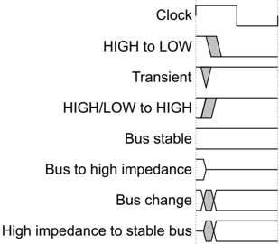

## Key to timing diagram conventions

Timing diagrams sometimes show single-bit signals as HIGH and LOW at the same time and they look similar to the bus change shown in Key to timing diagram conventions . If a timing diagram shows a single-bit signal in this way then its value does not affect the accompanying description.

## Signals

The signal conventions are:

Signal level

The level of an asserted signal depends on whether the signal is active-HIGH or active-LOW. Asserted means:

- HIGH for active-HIGH signals.

- LOW for active-LOW signals.

Lower-case n

At the start or end of a signal name denotes an active-LOW signal.

## Additional reading

This section lists publications by Arm and by third parties.

See Infocenter , http://infocenter.arm.com , for access to Arm documentation.

See on Arm , www.arm.com/cmsis , for embedded software development resources including the Cortex Microcontroller Software Interface Standard (CMSIS).

## Arm publications

This book contains information that is specific to this product. See the following documents for other relevant information:

- Arm ® v7-M Architecture Reference Manual (Arm DDI 0403).
- Arm ®  CoreLink ™  Level 2 Cache Controller L2C-310 Technical Reference Manual (Arm DDI 0246).
- Arm ®  CoreSight ™  ETM-M7 Technical Reference Manual (Arm DDI 0494).
- Arm ®  AMBA ®  AXI and ACE Protocol Specification (Arm IHI 0022).
- Arm ®  AMBA ® 3 AHB-Lite Protocol (v1.0) (Arm IHI 0033).
- Arm ®  AMBA ® 3 ATB Protocol Specification (Arm IHI 0032).
- Arm ®  AMBA ® 3 APB Protocol Specification (Arm IHI 0024).
- Arm ®  CoreSight ™  SoC-400 Technical Reference Manual (Arm DDI 0480).
- Arm ®  CoreSight ™  Architecture Specification (v2.0) (Arm IHI 0029).
- Arm ®  Debug Interface v5 Architecture Specification (Arm IHI 0031).
- Arm ®  Embedded Trace Macrocell Architecture Specification ETMv4 (Arm IHI 0064).

The following confidential books are only available to licensees:

- Arm ®  Cortex ® -M7 Processor Integration and Implementation Manual (Arm DII 0239).

## Other publications

This section lists relevant documents published by third parties:

- Test Access Port and Boundary-Scan Architecture, IEEE Standard 1149.1-2001 (JTAG).
- IEEE Standard for Binary Floating-Point Arithmetic , IEEE Standard 754-2008.

## Feedback

## Feedback on content

Arm welcomes feedback on this product and its documentation.

## Feedback on this product

If you have any comments or suggestions about this product, contact your supplier and give:

- The product name.
- The product revision or version.
- An explanation with as much information as you can provide. Include symptoms and diagnostic procedures if appropriate.

If you have comments on content then send an e-mail to errata@arm.com . Give:

- The title.
- The number, ARM DDI 0489F.
- The page numbers to which your comments apply.
- A concise explanation of your comments.

Arm also welcomes general suggestions for additions and improvements.

Note

Arm tests the PDF only in Adobe Acrobat and Acrobat Reader, and cannot guarantee the quality of the represented document when used with any other PDF reader.

## Chapter 1 Introduction

This chapter introduces the processor. It contains the following sections:

- About the Cortex-M7 processor on page 1-2.
- Component blocks on page 1-6.
- Interfaces on page 1-11.
- Supported standards on page 1-13.
- Design process on page 1-14.
- Documentation on page 1-15.
- Product revisions on page 1-16.

## 1.1 About the Cortex-M7 processor

The Cortex-M7 processor is a highly efficient high-performance, embedded processor that features low interrupt latency, low-cost debug, and has backwards compatibility with existing Cortex-M profile processors. The processor has an in-order super-scalar pipeline that means many instructions can be dual-issued, including load/load and load/store instruction pairs because of multiple memory interfaces.

Memory interfaces that the processor supports include:

- Tightly-Coupled Memory (TCM) interfaces.
- Harvard instruction and data caches.
- AXI master (AXIM) interface.
- Dedicated low-latency AHB-Lite peripheral (AHBP) interface.
- AHB-Lite slave (AHBS) interface that provides DMA access to TCMs.

The processor has an optional Memory Protection Unit (MPU) that can be configured to protect regions of memory. Error Correcting Code (ECC) functionality for error detection and correction, is included in the data and instruction caches when implemented. The TCM interfaces support the implementation of external ECC to provide improved reliability and to address safety-related applications.

The Cortex-M7 processor includes optional floating-point arithmetic functionality, with support for single and double-precision arithmetic. See Chapter 8 Floating Point Unit .

The processor is intended for high-performance, deeply embedded applications that require fast interrupt response features.

Figure 1-1 shows the processor in a typical system.

Figure 1-1 Example Cortex-M7 system

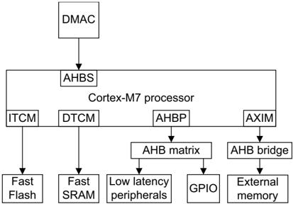

The main features of the Cortex-M7 processor include:

- An in-order issue, super-scalar pipeline with dynamic branch prediction.
- DSP extensions.
- The ARMv7-M Thumb ®  instruction set, defined in the Arm ® v7-M Architecture Reference Manual .
- Banked Stack Pointer (SP).
- Hardware integer divide instructions, SDIV and UDIV .

## 1.1.1 Features

## 1.1.2 Interfaces

- Handler and Thread modes.
- Thumb and Debug states.
- Automatic processor state saving and restoration for low-latency Interrupt Service Routine (ISR) entry and exit.
- Support for ARMv7-M big-endian byte-invariant or little-endian accesses.
- Support for ARMv7-M unaligned accesses.
- Low-latency interrupt processing achieved by:
- -A Nested Vectored Interrupt Controller (NVIC) closely integrated with the processor.
- -Supporting exception-continuable instructions, such as LDM , LDMDB , STM , STMDB , PUSH , POP and VLDM , VSTM , VPUSH , VPOP if the processor has the Floating Point Unit (FPU).
- A low-cost debug solution with the optional ability to:
- -Implement breakpoints.
- -Implement watchpoints, tracing, and system profiling.
- -Support printf() style debugging through an Instrumentation Trace Macrocell (ITM).
- -Optional Trace Port Interface Unit (TPIU).
- -Optional Debug Access Port (DAP).
- Support for an optional Embedded Trace Macrocell (ETM). See the Arm ®  CoreSight ™ ETM-M7 Technical Reference Manual for more information.
- A memory system, that includes an optional MPU and Harvard data and instruction cache with ECC.
- An optional Floating Point Unit (FPU).
- Low-power features including architectural clock gating, sleep mode and Wake-up Interrupt Controller (WIC).
- Optional AXI to AHB bridge for legacy memory system support.

The Cortex-M7 processor has a number of external interfaces.

Figure 1-2 on page 1-4 shows the external interfaces of the Cortex-M7 processor.

Figure 1-2 Cortex-M7 processor interfaces

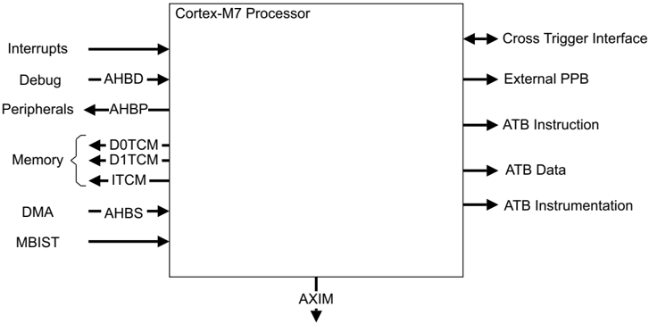

## 1.1.3 Configuration options

The Cortex-M7 processor has configurable options that you can configure during the implementation and integration stages to match your functional requirements.

Table 1-1 shows the configurable options at build time of the processor.

Table 1-1 Implementation options

| Feature                | Options                                                                                | Done at        |
|------------------------|----------------------------------------------------------------------------------------|----------------|
| Floating-point         | No floating-point.                                                                     | Implementation |
| Floating-point         | Single-precision floating-point only.                                                  | Implementation |
| Floating-point         | Single-precision and double-precision floating-point.                                  | Implementation |
| Instruction TCM        | No instruction TCM.                                                                    | Integration    |
| Instruction TCM        | 4KB-16MB (powers of 2).                                                                | Integration    |
| Data TCM               | No data TCM.                                                                           | Integration    |
| Data TCM               | 4KB-16MB (powers of 2). The Data TCM is split equally into two TCMs, D0TCM, and D1TCM. | Integration    |
| Instruction cache      | No instruction cache unit (ICU) a .                                                    | Implementation |
| Instruction cache      | Instruction cache unit is included.                                                    | Implementation |
| Data cache             | Area optimized AXIM interface, no data cache unit (DCU) b .                            | Implementation |
| Data cache             | Performance optimized AXIM interface, data cache unit is included.                     | Implementation |
| Instruction cache size | 4KB, 8KB, 16KB, 32KB, 64KB.                                                            | Integration    |
| Data cache size        | 4KB, 8KB, 16KB, 32KB, 64KB.                                                            | Integration    |
| AHB peripheral size    | 64MB, 128MB, 256MB, 512MB.                                                             | Integration    |
| ECC support on caches  | No ECC on instruction cache or data cache.                                             | Implementation |

ECC on all implemented caches.

Table 1-1 Implementation options (continued)

| Feature                                                     | Options                                                                                                                                                                                                                        | Done at        |
|-------------------------------------------------------------|--------------------------------------------------------------------------------------------------------------------------------------------------------------------------------------------------------------------------------|----------------|
| Protected memory regions                                    | 0 region, 8 regions, 16 regions.                                                                                                                                                                                               | Implementation |
| Interrupts                                                  | 1-240 interrupts.                                                                                                                                                                                                              | Implementation |
| Number bits of interrupt priority                           | Between three and eight bits of interrupt priority, between 8 and 256 levels of priority.                                                                                                                                      | Implementation |
| Debug watchpoints and breakpoints                           | Reduced set. Two data watchpoints comparators and four breakpoint comparators. Full set. Four data watchpoints comparators and eight breakpoint comparators.                                                                   | Implementation |
| ITM and Data Watchpoint and Trace (DWT) trace functionality | No ITM orDWT trace. Complete ITM and DWTtrace.                                                                                                                                                                                 | Implementation |
| ETM                                                         | No ETM support. ETM instruction trace only.                                                                                                                                                                                    | Implementation |
| Dual-redundant processor                                    | No dual-redundant processor. Dual-redundant processor included.                                                                                                                                                                | Implementation |
| Reset All Registers                                         | Only required registers that must be initialized are reset in the RTL. All registers are reset in the RTL excluding those in the ETM, if included. All registers are reset in the RTL including those in the ETM, if included. | Implementation |
| Cross Trigger Interface (CTI)                               | No Cross Trigger Interface. Cross Trigger Interface included.                                                                                                                                                                  | Implementation |
| Wake-upInterrupt Controller (WIC)                           | No Wake-up Interrupt controller.                                                                                                                                                                                               | Implementation |
|                                                             | Wake-up Interrupt controller included.                                                                                                                                                                                         |                |

## 1.2 Component blocks

The Cortex-M7 processor has fixed and optional component blocks. Optional components are:

- Wake-up Interrupt Controller (WIC).
- ITM.
- FPU.
- MPU.
- Instruction cache unit.
- Data cache unit.
- Cross Trigger Interface (CTI).
- ETM.

All other components are fixed.

Table 1-1 on page 1-4 shows the configurable options at implementation time of the processor.

Figure 1-3 on page 1-7 shows the optional and fixed components of the Cortex-M7 processor.

Figure 1-3 Cortex-M7 functional diagram

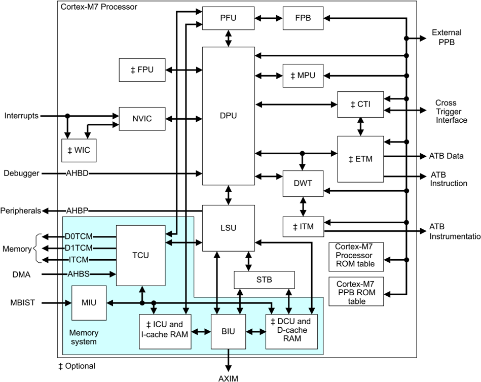

The Cortex-M7 processor contains the following component blocks:

- Data Processing Unit on page 1-8.
- Prefetch Unit on page 1-8.
- Load Store Unit on page 1-8.
- Floating Point Unit on page 1-8.
- Nested Vectored Interrupt Controller on page 1-9.
- Wake-up Interrupt Controller on page 1-9.
- Memory System on page 1-9.
- Memory Protection Unit on page 1-10.
- Cortex-M7 Processor and PPB ROM tables on page 1-10.
- Cross Trigger Interface Unit on page 1-10.
- ETM on page 1-10.
- Debug and trace components on page 1-10.

## 1.2.1 Data Processing Unit

The Data Processing Unit (DPU) provides:

- Parallelized integer register file with six read ports and four write ports for large-scale dual-issue.
- Extensive forwarding logic to minimise interlocks.
- Two ALUs, with one ALU capable of executing SIMD operations.
- Single MAC pipeline capable of 32x32-bit + 64-bit → 64-bit with two cycle result latency and one MAC per cycle throughput.
- Single divider unit with support for operand-dependent early termination.

The Prefetch Unit (PFU) provides:

- 64-bit instruction fetch bandwidth.
- 4x64-bit pre-fetch queue to decouple instruction pre-fetch from DPU pipeline operation.
- A Branch Target Address Cache (BTAC) for single-cycle turn-around of branch predictor state and target address.
- A static branch predictor when no BTAC is specified.
- Forwarding of flags for early resolution of direct branches in the decoder and first execution stages of the processor pipeline.

## 1.2.3 Load Store Unit

The Load Store Unit (LSU) provides:

- Dual 32-bit load channels to TCM, data cache, and AXI master (AXIM) interface for 64-bit load bandwidth and dual 32-bit load capability.
- Single 32-bit load channel to the AHB interface.
- Single 64-bit store channel.
- Store buffering to increase store throughput and minimize RAM contention with data and instruction reads.
- Separate store buffering for TCM, AHBP and AXIM for Quality of Service (QoS) and interface-specific optimizations.

## 1.2.4 Floating Point Unit

The optional Floating Point Unit (FPU) provides:

- Lazy floating-point context save. Automated stacking of floating-point state is delayed until the ISR attempts to execute a floating-point instruction. This reduces the latency to enter the ISR and removes floating-point context save for ISRs that do not use floating-point.
- Instructions for single-precision (C programming language float type) data-processing operations.
- Optional instructions for double-precision (C double type) data-processing operations.

## 1.2.2 Prefetch Unit

- Combined Multiply and Accumulate instructions for increased precision (Fused MAC).
- Hardware support for conversion, addition, subtraction, multiplication with optional accumulate, division, and square-root.
- Hardware support for denormals and all IEEE Standard 754-2008 rounding modes.
- 32 32-bit single-precision registers or 16 64-bit double-precision registers.

See Chapter 8 Floating Point Unit for more information.

## 1.2.5 Nested Vectored Interrupt Controller

The NVIC is closely integrated with the core to achieve low-latency interrupt processing. Features include:

- External interrupts, configurable from 1 to 240. This is configured at implementation.
- Configurable levels of interrupt priority from 8 to 256. Configured at implementation.
- Dynamic reprioritization of interrupts.
- Priority grouping. This enables selection of preempting interrupt levels and non preempting interrupt levels.
- Support for tail-chaining and late arrival of interrupts. This enables back-to-back interrupt processing without the overhead of state saving and restoration between interrupts.

See Chapter 7 Nested Vectored Interrupt Controller for more information.

## 1.2.6 Wake-up Interrupt Controller

The optional WIC provides ultra-low power sleep mode support.

See Low power modes on page 7-3 for more information.

## 1.2.7 Memory System

The optional memory system includes:

- A Bus Interface Unit (BIU) with a configurable AMBA 4 AXI interface that can support a high-performance L2 memory system.
- An extended AHB-Lite interface to support low-latency system peripherals.
- A TCM Control Unit (TCU) with TCM interfaces that can support external ECC logic and an AHB slave (AHBS) interface for system access to TCMs.
- Instruction cache and data cache units, with optional Error Correction Code (ECC).
- A Memory Built-in Self Test (MBIST) interface provided by the MBIST interface unit (MIU). The memory system supports online MBIST, where the RAM arrays can be accessed by the MBIST interface while the processor is running. MBIST is also supported during production test.

See Chapter 5 Memory System for more information.

## 1.2.8 Store Buffer

## 1.2.12 ETM

The Store Buffer (STB) holds store operations when they have left the load/store pipeline and have been committed by the DPU. From the STB, a store can request access to the cache RAM in the DCU, request the BIU to initiate linefills, or request the BIU to write the data out on the AXIM interface.

The STB can merge several store transactions into a single transaction if they are to the same 64-bit aligned address.

## 1.2.9 Memory Protection Unit

The optional MPU has configurable attributes for memory protection. It includes up to 16 memory regions and Sub Region Disable (SRD), enabling efficient use of memory regions. It also has the ability to enable a background region that implements the default memory map attributes. See Chapter 6 Memory Protection Unit for more information.

## 1.2.10 Cortex-M7 Processor and PPB ROM tables

The two ROM tables enable a debugger to identify and connect to CoreSight debug components. See Chapter 9 Debug for more information.

## 1.2.11 Cross Trigger Interface Unit

The optional CTI enables the debug logic and ETM to interact with each other and with other CoreSight components. See Chapter 10 Cross Trigger Interface .

The optional ETM provides instruction-only or instruction and data trace capabilities when configured. The trace stalling feature is not implemented in the Cortex-M7 processor. See the Arm ®  CoreSight ™  ETM-M7 Technical Reference Manual for more information.

## 1.2.13 Debug and trace components

- Configurable Breakpoint unit (FPB) for implementing breakpoints.
- Configurable Data Watchpoint and Trace (DWT) unit for implementing watchpoints, data tracing, and system profiling.
- Optional ITM for support of printf() style debugging, using instrumentation trace.
- Interfaces suitable for:
- -Passing on-chip data to a Trace Port Analyzer (TPA), including Single Wire Output (SWO) mode.
- -Debugger access to all memory and registers in the system, including access to memory-mapped devices, access to internal core registers when the core is halted, and access to debug control registers even when reset is asserted.

## 1.3 Interfaces

## 1.3.1 AHBP interface

## 1.3.2 AHBS interface

## 1.3.3 AHBD interface

## 1.3.5 ATB interfaces

## 1.3.6 TCM interface

The processor contains the following external interfaces:

- AHBP interface .
- AHBS interface .
- AHBD interface .
- External Private Peripheral Bus .
- ATB interfaces .
- TCM interface .
- Cross Trigger interface on page 1-12.
- MBIST interface on page 1-12.
- AXIM interface on page 1-12.

The AHB-Lite peripheral (AHBP) interface provides access suitable for low latency system peripherals. It provides support for unaligned memory accesses, write buffer for buffering of write data, and exclusive access transfers for multiprocessor systems. See AHB peripheral interface on page 5-25 for more information.

The AHB-Lite slave (AHBS) interface enables system access to TCMs. See AHB slave interface on page 5-33 for more information.

The AHB-Lite Debug (AHBD) interface provides debug access to the Cortex-M7 processor and the complete memory map. See About the AHBD interface on page 9-7 for more information.

## 1.3.4 External Private Peripheral Bus

The APB External PPB (EPPB) enables access to CoreSight-compatible debug and trace components, in the system connected to the processor.

The ATB interfaces output trace information used for debugging. The ATB interface is compatible with the CoreSight architecture. See the Arm ®  CoreSight ™  Architecture Specification (v2.0) for more information.

The processor can have up to two TCM memory instances, Instruction TCM (ITCM) and Data TCM (DTCM), each with a double word data width. Access to ITCM is through the ITCM 64-bit wide interface. Access to DTCM is through the D1TCM 32-bit wide interface and the 32-bit wide D0TCM interface. The DTCM accesses are split so that lower words always access D0TCM and upper words always access D1TCM. The size of both TCM instances is configurable, 4KB-16MB in powers of 2. See TCM interfaces on page 5-36 for more information.

## 1.3.7 Cross Trigger interface

The processor includes an optional Cross Trigger Interface Unit which includes an interface suitable for connection to external CoreSight components using a Cross Trigger Matrix. See Chapter 10 Cross Trigger Interface for more information.

## 1.3.8 MBIST interface

The MBIST interface is used for testing the RAMs during production test. The Cortex-M7 processor also allows the RAMs to be tested using the MBIST interface during normal execution. This is known as online MBIST.

Contact your implementation team for more information about the MBIST interface and online MBIST.

The AXI master (AXIM) interface provides high-performance access to an external memory system. The AXIM interface supports use of the Arm CoreLink L2C-310 Level 2 Cache Controller. L2C-310 Exclusive cache configuration is not supported. See AXIM interface on page 5-8 for more information.

## 1.3.9 AXIM interface

## 1.4 Supported standards

The processor complies with, or implements, the specifications described in:

- Arm architecture .
- Bus architecture .
- Debug .
- Embedded Trace Macrocell .
- Floating Point Unit .

This book complements architecture reference manuals, architecture specifications, protocol specifications, and relevant external standards. It does not duplicate information from these sources.

## 1.4.1 Arm architecture

The Cortex-M7 processor implements the ARMv7E-M architecture profile. See the Arm ® v7-M Architecture Reference Manual .

The Cortex-M7 processor FPB implements the Flash Patch Breakpoint version 2 architecture revision.

## 1.4.2 Bus architecture

The processor provides an:

- External interface that is a variant of the AMBA 3 AHB-Lite protocol.
- External interface that complies with the AMBA 4 AXI.

The processor also implements an interface for CoreSight and other debug components using the AMBA 3 APB protocol and AMBA 3 ATB Protocol.

For more information, see:

- The Arm ®  AMBA ® AXI and ACE Protocol Specification .
- The Arm ®  AMBA ® 3 AHB-Lite Protocol (v1.0) .
- The Arm ®  AMBA ® 3 APB Protocol Specification .
- The Arm ®  AMBA ® 3 ATB Protocol Specification .

The debug features of the processor implement the Arm debug interface architecture. See the Arm ®  Debug Interface v5 Architecture Specification .

## 1.4.4 Embedded Trace Macrocell

When implemented, the trace features of the processor implement the Arm Embedded Trace Macrocell (ETM)v4 architecture. See the Arm ®  Embedded Trace Macrocell Architecture Specification ETMv4 .

## 1.4.5 Floating Point Unit

Depending on your implementation, a Cortex-M7 processor with FPU can have single-precision only or single and double-precision floating-point data processing as defined by the FPv5 architecture, that is part of the ARMv7E-M architecture. It provides floating-point computation functionality that is compliant with the ANSI/IEEE Std 754-2008, IEEE Standard for Binary Floating-Point Arithmetic .

## 1.4.3 Debug

## 1.5 Design process

The Cortex-M7 processor is delivered as synthesizable RTL that must go through the implementation, integration, and programming processes before you can use it in a product.

The following definitions describe each top-level process in the design flow:

## Implementation

The implementer configures and synthesizes the RTL.

## Integration

The integrator connects the implemented design into a SoC. This includes connecting it to a memory system and peripherals.

## Programming

The system programmer develops the software required to configure and initialize the processor, and tests the required application software.

Each stage in the process can be performed by a different party. Implementation and integration choices affect the behavior and features of the processor.

For MCUs, often a single design team integrates the processor before synthesizing the complete design. Alternatively, the team can synthesize the processor on its own or partially integrated, to produce a macrocell that is then integrated, possibly by a separate team.

The operation of the final device depends on:

## Build configuration

The implementer chooses the options that affect how the RTL source files are pre-processed. These options usually include or exclude logic that affects one or more of the area, maximum frequency, and features of the resulting macrocell.

## Configuration inputs

The integrator configures some features of the processor by tying inputs to specific values. These configurations affect the start-up behavior before any software configuration is made. They can also limit the options available to the software.

## Software configuration

The programmer configures the processor by programming particular values into registers. This affects the behavior of the processor.

Note

This manual refers to implementation-defined features that are applicable to build configuration options. Reference to a feature that is included means that the appropriate build and pin configuration options are selected. Reference to an enabled feature means one that has also been configured by software.

## 1.6 Documentation

The Cortex-M7 processor documentation can help you complete the top-level processes of implementation, integration, and programming required to use the product correctly.

The Cortex-M7 processor documentation comprises a Technical Reference Manual, an Integration and Implementation Manual, and User Guide Reference Material.

## Technical Reference Manual

The Technical Reference Manual (TRM) describes the functionality and the effects of functional options on the behavior of the Cortex-M7 processor. It is required at all stages of the design flow. Some behavior described in the TRM might not be relevant because of the way that the Cortex-M7 processor is implemented and integrated. If you are programming the Cortex-M7 processor then contact the implementer to determine:

- The build configuration of the implementation.
- What integration, if any, was performed before implementing the processor.

## Integration and Implementation Manual

The Integration and Implementation Manual (IIM) describes:

- The available build configuration options and related issues in selecting them.
- How to configure the Register Transfer Level (RTL) with the build configuration options.
- How to integrate the processor into a SoC. This includes a description of the integration kit and describes the pins that the integrator must tie off to configure the macrocell for the required integration.
- How to implement the processor into your design. This includes floorplanning guidelines, Memory Built-in Self Test (MBIST) and Design for Test (DFT) information, and how to perform netlist dynamic verification on the processor.
- The processes to sign off the integration and implementation of the design.

The Arm product deliverables include reference scripts and information about using them to implement your design.

Reference methodology documentation from your EDA tools vendor complements the IIM.

The IIM is a confidential book that is only available to licensees.

## User Guide Reference Material

This document provides reference material that Arm partners can configure and include in a User Guide for an Arm Cortex-M7 processor. Typically:

- Each chapter in this reference material might correspond to a section in the User Guide.
- Each top-level section in this reference material might correspond to a chapter in the User Guide.

However, you can organize this material in any way, subject to the conditions of the license agreement under which Arm supplied the material.

See Additional reading on page xi for more information about the books associated with the Cortex-M7 processor.

## 1.7 Product revisions

This section describes the differences in functionality between product revisions:

r0p0 First release.

r0p1 The following changes have been made in this release:

- Updated CPUID reset value, 0x410FC271 .
- Various engineering errata fixes.

r0p2 The following changes have been made in this release:

- Updated CPUID reset value, 0x410FC272 .
- Various engineering errata fixes.

r1p0 The following changes have been made in this release:

- Updated CPUID reset value, 0x411FC270 .
- Added CTLPPBLOCK[3:0] to allow locking of registers ITCMCR, DTCMCR, AHBPCR, VTOR to prevent unwanted updates.
- Added ACTLR bit functions to allow low-capability AXI systems to disable AXI reads to DEV/SO memory and disable exclusive reads/writes to shared memory not initiated until all outstanding reads/stores on AXI are complete.
- Added MBISTIMPERR[2] output to MBIST interface to provide an error when attempting to access unimplemented memory.
- Improved handling of simultaneous AHBS and software activity relating to the same TCM.

r1p2 The following changes have been made in this release:

- Updated CPUID reset value, 0x411FC272 .
- Added section describing speculative accesses, which are used by the processor to increase performance.
- Updated section describing AXI transactions generated for Strongly-ordered or Device memory.

## Chapter 2 Programmers Model

This chapter describes the programmers model. It contains the following sections:

- About the programmers model on page 2-2.
- Modes of operation and execution on page 2-3.
- Instruction set summary on page 2-4.
- System address map on page 2-5.
- Exclusive monitor on page 2-8.
- Processor core registers on page 2-9.
- Exceptions on page 2-10.

## 2.1 About the programmers model

This chapter gives an overview of the Cortex-M7 processor programmers model that describes the implementation-defined options. In addition:

- Chapter 3 summarizes the system control features of the programmers model.
- Chapter 6 summarizes the MPU features of the programmers model.
- Chapter 7 summarizes the NVIC features of the programmers model.
- Chapter 8 summarizes the FPU features of the programmers model.
- Chapter 9 summarizes the Debug features of the programmers model.
- Chapter 10 summarizes the CTI features of the programmers model.
- Chapter 11 summarizes the DWT features of the programmers model.
- Chapter 12 summarizes the ITM features of the programmers model.

## 2.2 Modes of operation and execution

This section briefly describes the modes of operation and execution of the Cortex-M7 processor. See the Arm ® v7-M Architecture Reference Manual for more information.

## 2.2.1 Operating modes

The processor supports two modes of operation, Thread mode and Handler mode:

- The processor enters Thread mode on reset, or as a result of an exception return. Privileged and Unprivileged code can run in Thread mode.
- The processor enters Handler mode as a result of an exception. All code is privileged in Handler mode.

## 2.2.2 Operating states

The processor can operate in one of two operating states:

- Thumb state. This is normal execution running 16-bit and 32-bit halfword-aligned Thumb instructions.
- Debug state. This is the state when the processor is halted for debug.

## 2.2.3 Privileged access and unprivileged User access

Code can execute as privileged or unprivileged. Unprivileged execution limits or excludes access to some resources. Privileged execution has access to all resources. Handler mode is always privileged. Thread mode can be privileged or unprivileged.

## 2.3 Instruction set summary

The processor implements the ARMv7-M instruction set and features provided by the ARMv7E-M architecture profile. For more information about the ARMv7-M instructions, see the Arm ® v7-M Architecture Reference Manual.

## 2.3.1 Binary compatibility with other Cortex processors

The processor is binary compatible with the instruction sets and features implemented in other Cortex-M profile processors. You cannot move software from the Cortex-M7 processor to:

- The Cortex-M3 processor if it contains floating-point operations or instructions that are part of the DSP extension, such as SADD16.
- The Cortex-M4 processor if it contains double-precision floating-point operations.
- The Cortex-M0 or Cortex-M0+ processors because these are implementations of the ARMv6-M Architecture.

Code designed for the Cortex-M3 and Cortex-M4 processors is compatible with the Cortex-M7 processor as long as it does not rely on bit-banding.

To ensure a smooth transition when migrating software to the Cortex-M7 processor, Arm recommends that code designed to operate on the Cortex-M0, M0+, M3, and M4 processors obey the following rules and that you configure the Configuration and Control Register (CCR) appropriately:

- Use word transfers only to access registers in the NVIC and System Control Space (SCS).
- Treat all unused SCS registers and register fields on the processor as Do-Not-Modify.
- Configure the following fields in the CCR:
- -STKALIGN bit to 1.
- -UNALIGN\_TRP bit to 1.
- -Leave all other bits in the CCR register at their original value.

## 2.4 System address map

The processor contains an internal bus matrix that arbitrates the processor and external AHBD memory accesses to both the external memory system and to the internal SCS and debug components.

Priority is always given to the processor to ensure that any debug accesses are as non-intrusive as possible.

Figure 2-1 System address map

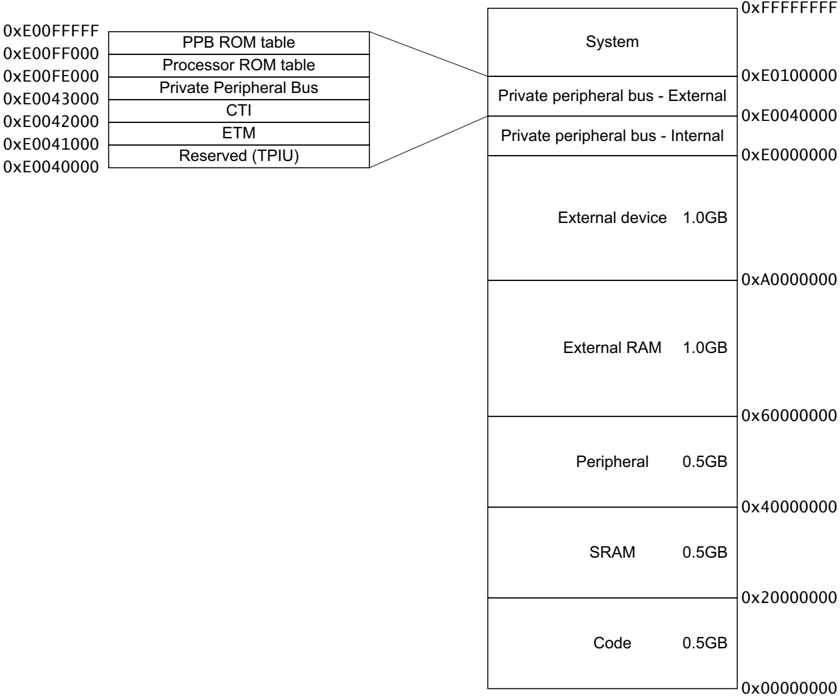

Figure 2-1 shows the system address map.

| 0xE00FFFFF            | PPB ROM table                                                                | System                |
|-----------------------|------------------------------------------------------------------------------|-----------------------|
| 0xE00FE000 0xE00FF000 | Private peripheral bus - External Private Peripheral Bus Processor ROM table | 0xE0100000            |
| 0xE0043000 0xE0042000 | CTI ETM                                                                      | 0xE0040000            |
| 0xE0041000            | Private peripheral bus Reserved (TPIU)                                       | - Internal 0xE0000000 |
| 0xE0040000            | External device 1.0GB                                                        |                       |
|                       |                                                                              | 0xA0000000            |
|                       |                                                                              | 0x40000000            |
|                       |                                                                              | 0x00000000            |

Table 2-1 shows the processor interfaces that are addressed by the different memory map regions.

Table 2-1 Memory regions

| Memory Map             | Region                                                                                                                                                                                                                                                                                                        |
|------------------------|---------------------------------------------------------------------------------------------------------------------------------------------------------------------------------------------------------------------------------------------------------------------------------------------------------------|
| Code                   | Instruction fetches and data accesses are performed over the ITCM or AXIM interface. When implemented and enabled, the ITCM is located at address 0x00000000.                                                                                                                                                 |
| SRAM                   | Instruction fetches and data accesses are performed over the DTCM or AXIM interface. When implemented and enabled, the DTCM is located at address 0x20000000.                                                                                                                                                 |
| Peripheral             | Data accesses are performed over the AHBP or AXIM interface. When implemented and enabled, the AHBP is located at address 0x40000000. Instruction fetches are performed over the AXIM interface.                                                                                                              |
| ExternalRAM            | Instruction fetches and data accesses are performed over the AXIM interface.                                                                                                                                                                                                                                  |
| External Device        | Instruction fetches and data accesses are performed over the AXIM interface.                                                                                                                                                                                                                                  |
| Private Peripheral Bus | Data accesses to registers associated with peripherals outside the processor are performed on the External Private Peripheral Bus (EPPB) interface. See Private peripheral bus . This memory region is Execute Never (XN), and so instruction fetches are prohibited. An MPU, if present, cannot change this. |
| System                 | System segment for vendor system peripherals. Data accesses are performed over the AHBP interface. This memory region is XN, and so instruction fetches are prohibited. An MPU, if present, cannot change this.                                                                                               |

See the Arm ® v7-M Architecture Reference Manual for more information about the memory model.

## 2.4.1 Private peripheral bus

The internal PPB interface provides access to:

- The Instrumentation Trace Macrocell (ITM).
- The Data Watchpoint and Trace (DWT).
- The Breakpoint unit (FPB).
- The SCS, including the MPU, the instruction and data cache, and the Nested Vectored Interrupt Controller (NVIC).
- The Processor and PPB ROM tables.

The external PPB interface provides access to:

- The Embedded Trace Macrocell (ETM).
- The Cross Trigger Interface (CTI).
- CoreSight debug and trace components in the external system.

## 2.4.2 Unaligned accesses that cross regions

The Cortex-M7 processor supports ARMv7 unaligned accesses, and performs all accesses as single, unaligned accesses. They are converted into two or more aligned accesses internally and are performed on the external interfaces of the processor.

Note

All Cortex-M7 processor external accesses are aligned.

Unaligned support is only available for load/store singles ( LDR , LDRH, STR, STRH ). Load/store double already supports word aligned accesses, but does not permit other unaligned accesses, and generates a fault if this is attempted.

Unaligned accesses that cross memory map boundaries are architecturally UNPREDICTABLE. The processor behavior is boundary dependent. Unaligned accesses are not supported to PPB space, and so there are no boundary crossing cases for PPB accesses.

## 2.5 Exclusive monitor

The Cortex-M7 processor implements a local exclusive monitor. For more information about semaphores and the local exclusive monitor see the Arm ® v7-M Architecture Reference Manual.

The local monitor within the processor is constructed so that it does not hold any physical address. Instead it treats any access as matching the address of the previous LDREX instruction. This means that the implemented Exclusives Reservation Granule (ERG) is the entire memory address range.

## 2.6 Processor core registers

The processor has the following 32-bit registers:

- 13 general-purpose registers, R0-R12.
- Stack Pointer (SP), R13 alias of banked registers, SP\_process and SP\_main.
- Link Register (LR), R14.
- Program Counter (PC), R15.
- Special-purpose Program Status Registers ( x PSR).

For more information about the processor register set, see the Arm ® v7-M Architecture Reference Manual .

## 2.7 Exceptions

The processor and the NVIC prioritize and handle all exceptions. When handling exceptions:

- All exceptions are handled in Handler mode.
- Processor state is automatically stored to the stack on an exception, and automatically restored from the stack at the end of the Interrupt Service Routine (ISR).
- The vector is fetched in parallel to the state saving, enabling efficient interrupt entry.

The processor supports tail-chaining that enables back-to-back interrupts without the overhead of state saving and restoration.

You configure the number of interrupts, and levels of interrupt priority, during implementation. Software can choose only to enable a subset of the configured number of interrupts, and can choose how many levels of the configured priorities to use.

Note

The EPSR.T bit supports the Arm architecture interworking model, however, as ARMv7-M only supports execution of Thumb instructions, it must always be maintained with the value 1. This means that all exception vectors must have bit[0] set. If bit[0] of the associated vector table entry is set to 0 on exception entry, execution of the first instruction causes an INVSTATE UsageFault. If this happens on a reset, this escalates to a HardFault, because UsageFault is disabled on reset.

## 2.7.1 Exception handling

External read faults from either the TCM interfaces, the AXIM interface, or the AHB interfaces generate a synchronous exception in the processor. External write faults generate an asynchronous exception in the processor.

The processor implements advanced exception and interrupt handling, as described in the Arm ® v7-M Architecture Reference Manual .

The processor exception model has the following implementation-defined behavior in addition to the architecturally-defined behavior:

- Exceptions on stacking from HardFault to NMI lockup at NMI priority.
- Exceptions on unstacking from NMI to HardFault lockup at HardFault priority.

To minimize interrupt latency, the processor can abandon the majority of multicycle instructions that are executing when an interrupt is recognized. The only exception is a load from Device or Strongly-ordered memory, or a shared store exclusive operation that starts on the AXI interface. All normal memory transactions are abandoned when an interrupt is recognized.

The processor restarts any abandoned operation on return from the interrupt. The processor also implements the Interruptible-continuable bits allowing load and store multiples to be interruptible and continuable. In these cases the processor resumes execution of these instructions after the last completed transfer instead of from the start. For more information on the Interruptible-continuable bits and key limitations on when they apply, see the Arm ® v7-M Architecture Reference Manual .

Specifically, on the Cortex-M7 processor, these instructions always restart instead of continue:

- The instruction faults.
- The instruction is inside an If-Then (IT) block.
- The instruction is a load multiple, has the base register in the list and has loaded the base register.
- The instruction is a load multiple and is subject to an ECC error.

## Chapter 3 System Control

This chapter describes the registers that program the processor. It contains the following sections:

- About system control on page 3-2.
- Register summary on page 3-3.
- Register descriptions on page 3-6.

## 3.1 About system control

This chapter describes the registers that control the operation of the processor. This includes registers in the:

- System Control Space.
- Access Control Space.
- Identification Space.
- Cache Maintenance Space.

## 3.2 Register summary

Table 3-1 shows the system control registers. Registers not described in this chapter are described in the Arm ® v7-M Architecture Reference Manual.

Table 3-1 System control registers

| Address    | Name       | Type    | Reset        | Description                                      |
|------------|------------|---------|--------------|--------------------------------------------------|
| 0xE000E008 | ACTLR      | RW      | 0x00000000   | Auxiliary Control Register on page 3-6           |
| 0xE000E00C | -          | -       | -            | Reserved                                         |
| 0xE000E010 | SYST_CSR   | RW      | 0x00000000   | SysTick Control and Status Register              |
| 0xE000E014 | SYST_RVR   | RW      | Unknown      | SysTick Reload Value Register                    |
| 0xE000E018 | SYST_CVR   | RW      | Unknown      | SysTick Current Value Register                   |
| 0xE000E01C | SYST_CALIB | RO      | - a          | SysTick Calibration Value Register               |
| 0xE000ED00 | CPUID      | RO      | 0x411FC272   | CPUID Base Register on page 3-8                  |
| 0xE000ED04 | ICSR       | RWor RO | 0x00000000   | Interrupt Control and State Register             |
| 0xE000ED08 | VTOR       | RW      | - b          | Vector Table Offset Register                     |
| 0xE000ED0C | AIRCR      | RW      | 0xFA050000 c | Application Interrupt and Reset Control Register |
| 0xE000ED10 | SCR        | RW      | 0x00000000   | System Control Register                          |
| 0xE000ED14 | CCR        | RW d    | 0x00040200   | Configuration and Control Register               |
| 0xE000ED18 | SHPR1      | RW      | 0x00000000   | System Handler Priority Register 1               |
| 0xE000ED1C | SHPR2      | RW      | 0x00000000   | System Handler Priority Register 2               |
| 0xE000ED20 | SHPR3      | RW      | 0x00000000   | System Handler Priority Register 3               |
| 0xE000ED24 | SHCSR      | RW      | 0x00000000   | System Handler Control and State Register        |
| 0xE000ED28 | CFSR       | RW      | 0x00000000   | Configurable Fault Status Registers e            |
| 0xE000ED2C | HFSR       | RW      | 0x00000000   | HardFault Status Register                        |
| 0xE000ED30 | DFSR       | RW      | 0x00000000   | Debug Fault Status Register                      |
| 0xE000ED34 | MMFAR      | RW      | Unknown      | MemManage Fault Address Register f               |
| 0xE000ED38 | BFAR       | RW      | Unknown      | BusFault Address Register f                      |
| 0xE000ED40 | ID_PFR0    | RO      | 0x00000030   | Processor Feature Register 0                     |
| 0xE000ED44 | ID_PFR1    | RO      | 0x00000200   | Processor Feature Register 1                     |
| 0xE000ED48 | ID_DFR0    | RO      | 0x00100000   | Debug Feature Register 0 g                       |
| 0xE000ED4C | ID_AFR0    | RO      | 0x00000000   | Auxiliary Feature Register 0                     |
| 0xE000ED50 | ID_MMFR0   | RO      | 0x00100030 h | Memory Model Feature Register 0                  |
| 0xE000ED54 | ID_MMFR1   | RO      | 0x00000000   | Memory Model Feature Register 1                  |
| 0xE000ED58 | ID_MMFR2   | RO      | 0x01000000   | Memory Model Feature Register 2                  |
| 0xE000ED5C | ID_MMFR3   | RO      | 0x00000000   | Memory Model Feature Register 3                  |

Table 3-1 System control registers (continued)

| Address    | Name       | Type   | Reset         | Description                                                    |
|------------|------------|--------|---------------|----------------------------------------------------------------|
| 0xE000ED60 | ID_ISAR0   | RO     | 0x01101110    | Instruction Set Attributes Register 0                          |
| 0xE000ED64 | ID_ISAR1   | RO     | 0x02112000    | Instruction Set Attributes Register 1                          |
| 0xE000ED68 | ID_ISAR2   | RO     | 0x20232231    | Instruction Set Attributes Register 2                          |
| 0xE000ED6C | ID_ISAR3   | RO     | 0x01111131    | Instruction Set Attributes Register 3                          |
| 0xE000ED70 | ID_ISAR4   | RO     | 0x01310132    | Instruction Set Attributes Register 4                          |
| 0xE000ED78 | CLIDR      | RO     | - i           | Cache Level ID Register on page 3-9                            |
| 0xE000ED7C | CTR        | RO     | 0x8303C003    | Cache Type Register                                            |
| 0xE000ED80 | CCSIDR     | RO     | - j           | Cache Size ID Register on page 3-10                            |
| 0xE000ED84 | CSSELR     | RW     | UNPREDICTABLE | Cache Size Selection Register on page 3-12                     |
| 0xE000ED88 | CPACR      | RW     | -             | Coprocessor Access Control Register                            |
| 0xE000EF00 | STIR       | WO     | 0x00000000    | Software Triggered Interrupt Register                          |
| 0xE000EF50 | ICIALLU    | WO     | Unknown       | Instruction cache invalidate all to Point of Unification (PoU) |
| 0xE000EF54 | -          | -      | -             | Reserved                                                       |
| 0xE000EF58 | ICIMVAU    | WO     | Unknown       | Instruction cache invalidate by address to PoU                 |
| 0xE000EF5C | DCIMVAC    | WO     | Unknown       | Data cache invalidate by address to Point of Coherency (PoC)   |
| 0xE000EF60 | DCISW      | WO     | Unknown       | Data cache invalidate by set/way                               |
| 0xE000EF64 | DCCMVAU    | WO     | Unknown       | Data cache by address to PoU                                   |
| 0xE000EF68 | DCCMVAC    | WO     | Unknown       | Data cache clean by address to PoC                             |
| 0xE000EF6C | DCCSW      | WO     | Unknown       | Data cache clean by set/way                                    |
| 0xE000EF70 | DCCIMVAC   | WO     | Unknown       | Data cache clean and invalidate by address to PoC              |
| 0xE000EF74 | DCCISW     | WO     | Unknown       | Data cache clean and invalidate by set/way                     |
| 0xE000EF78 | BPIALL     | RAZ/WI | Unknown       | Not implemented                                                |
| 0xE000EF7C | -          | -      | -             | Reserved                                                       |
| 0xE000EF80 | -          | -      | -             | Reserved                                                       |
| 0xE000EF90 | CM7_ITCMCR | RW     | Unknown       | Instruction and Data Tightly-Coupled Memory Control            |
| 0xE000EF94 | CM7_DTCMCR | RW     | Unknown       | Registers on page 3-13                                         |
| 0xE000EF98 | CM7_AHBPCR | RW     | Unknown       | AHBP Control Register on page 3-14                             |
| 0xE000EF9C | CM7_CACR   | RW     | Unknown       | L1 Cache Control Register on page 3-15                         |
| 0xE000EFA0 | CM7_AHBSCR | RW     | Unknown       | AHB Slave Control Register on page 3-20                        |
| 0xE000EFA4 | -          | -      | -             | Reserved                                                       |
| 0xE000EFA8 | CM7_ABFSR  | RW     | Unknown       | Auxiliary Bus Fault Status Register on page 3-16               |

Table 3-1 System control registers (continued)

| Address    | Name    | Type   | Reset      | Description                                                                                            |
|------------|---------|--------|------------|--------------------------------------------------------------------------------------------------------|
| 0xE000EFB0 | IEBR0 k | RW     | -          | Instruction Error bank Register 0-1 on page 3-17                                                       |
| 0xE000EFB4 | IEBR1 k | RW     | -          | Instruction Error bank Register 0-1 on page 3-17                                                       |
| 0xE000EFB8 | DEBR0 k | RW     | -          | Data Error bank Register 0-1 on page 3-18                                                              |
| 0xE000EFBC | DEBR1 k | RW     | -          | Data Error bank Register 0-1 on page 3-18                                                              |
| 0xE000EFD0 | PID4    | -      | 0x00000004 | See the Component and Peripheral ID register formats in the Arm ® v7-M Architecture Reference Manual . |
| 0xE000EFD4 | PID5    | -      | 0x00000000 | See the Component and Peripheral ID register formats in the Arm ® v7-M Architecture Reference Manual . |
| 0xE000EFD8 | PID6    | -      | 0x00000000 | See the Component and Peripheral ID register formats in the Arm ® v7-M Architecture Reference Manual . |
| 0xE000EFDC | PID7    | -      | 0x00000000 | See the Component and Peripheral ID register formats in the Arm ® v7-M Architecture Reference Manual . |
| 0xE000EFE0 | PID0    | -      | - l        | See the Component and Peripheral ID register formats in the Arm ® v7-M Architecture Reference Manual . |
| 0xE000EFE4 | PID1    | -      | 0x000000B0 | See the Component and Peripheral ID register formats in the Arm ® v7-M Architecture Reference Manual . |
| 0xE000EFE8 | PID2    | -      | 0x0000000B | See the Component and Peripheral ID register formats in the Arm ® v7-M Architecture Reference Manual . |
| 0xE000EFEC | PID3    | -      | 0x00000000 | See the Component and Peripheral ID register formats in the Arm ® v7-M Architecture Reference Manual . |
| 0xE000EFF0 | CID0    | -      | 0x0000000D | See the Component and Peripheral ID register formats in the Arm ® v7-M Architecture Reference Manual . |
| 0xE000EFF4 | CID1    | -      | 0x000000E0 | See the Component and Peripheral ID register formats in the Arm ® v7-M Architecture Reference Manual . |
| 0xE000EFF8 | CID2    | -      | 0x00000005 | See the Component and Peripheral ID register formats in the Arm ® v7-M Architecture Reference Manual . |
| 0xE000EFFC | CID3    | -      | 0x000000B1 | See the Component and Peripheral ID register formats in the Arm ® v7-M Architecture Reference Manual . |

- a. SYST\_CALIB indicates the value of signal CFGSTCALIB[25:0]. See Table 3-2.
- b. VTOR[31:7] indicates the value of signal INITVTOR[31:7] . VTOR[6:0] are RAZ.
- c. AIRCR[15] indicates the value of signal CFGBIGEND .
- d. The processor implements bit[9] of CCR, STKALIGN, as RO and has a value of 1.
- e. The 32-bit CFSR comprises the status registers for the faults that have configurable priority. Software can access the combined CFSR, or use byte or halfword accesses to access the individual registers, MemManage Status Register (MMFSR), BusFault Status Register (BFSR), and UsageFault Status Register (UFSR). See the Arm ® v7-M Architecture Reference Manual for more information.
- f. BFAR and MFAR are the same physical register. Because of this, the BFARVALID and MFARVALID bits are mutually exclusive.
- g. ID\_DFR0 reads as 0 if no debug support is implemented.
- h. The reset value depends on the values of signals CFGITCMSZ and CFGDTCMSZ .
- i. The reset value depends on whether L1 cache is implemented.
- j. Reset value depends on which caches are implemented and their sizes.
- k. Only present if ECC is present, otherwise RAZ/WI.
- l. This value is 0x00000000 for implementations without FPU or 0x0000000C for implementations with FPU.

Table 3-2 shows how signal CFGSTCALIB[25:0] is indicated in register SYST\_CALIB.

Table 3-2 SYST\_CALIB inputs

| Bits    | Name   | Input              |
|---------|--------|--------------------|
| [31]    | NOREF  | CFGSTCALIB[25] .   |
| [30]    | SKEW   | CFGSTCALIB[24] .   |
| [29:24] | -      | None. RAZ.         |
| [23:0]  | TENMS  | CFGSTCALIB[23:0] . |

## 3.3 Register descriptions

This section describes the following system control registers whose implementation is specific to this processor:

- Auxiliary Control Register .
- CPUID Base Register on page 3-8.
- Cache Level ID Register on page 3-9.
- Cache Size ID Register on page 3-10.
- Cache Size Selection Register on page 3-12.
- Instruction and Data Tightly-Coupled Memory Control Registers on page 3-13.
- AHBP Control Register on page 3-14.
- L1 Cache Control Register on page 3-15.
- Auxiliary Bus Fault Status Register on page 3-16.
- Instruction Error bank Register 0-1 on page 3-17.
- Data Error bank Register 0-1 on page 3-18.
- AHB Slave Control Register on page 3-20.

## 3.3.1 Auxiliary Control Register

The ACTLR characteristics are:

Purpose

Provides implementation defined configuration and control options for the processor.

Usage Constraints

There are no usage constraints.

Configurations

Available in all configurations.

Attributes

See the register summary in Table 3-1 on page 3-3.

Figure 3-1 shows the ACTLR bit assignments.

Figure 3-1 ACTLR bit assignments

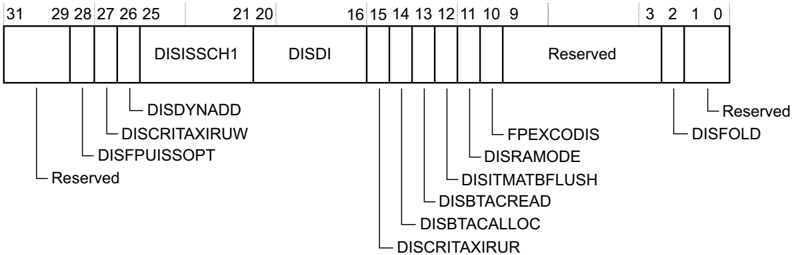

Table 3-3 shows the ACTLR bit assignments.

## Table 3-3 ACTLR bit assignments

| Bits    | Name           | Function                                                 | Function                                                                                                                                                                                                                                                                                                                                                      |
|---------|----------------|----------------------------------------------------------|---------------------------------------------------------------------------------------------------------------------------------------------------------------------------------------------------------------------------------------------------------------------------------------------------------------------------------------------------------------|
| [31:29] | -              | Reserved.                                                | Reserved.                                                                                                                                                                                                                                                                                                                                                     |
| [28]    | DISFPUISSOPT   | 0                                                        | Normal operation.                                                                                                                                                                                                                                                                                                                                             |
| [27]    | DISCRITAXIRUW  | Disable critical AXI read-under-write:                   | Disable critical AXI read-under-write:                                                                                                                                                                                                                                                                                                                        |
|         |                | 0                                                        | Normal operation. This is backwards compatible with r0. reads to DEV/SO memory. Exclusive reads to shared memory are                                                                                                                                                                                                                                          |
|         |                | 1                                                        | AXI not initiated on the AXIM AR channel until all outstanding stores on AXI are complete.                                                                                                                                                                                                                                                                    |
| [26]    | DISDYNADD      | Disables dynamic allocation of ADD and SUB instructions: | Disables dynamic allocation of ADD and SUB instructions:                                                                                                                                                                                                                                                                                                      |
|         |                | 0                                                        | Normal operation. Some ADD and SUB instructions are resolved in EX1.                                                                                                                                                                                                                                                                                          |
|         |                | 1                                                        | All ADD and SUB instructions are resolved in EX2.                                                                                                                                                                                                                                                                                                             |
| [25:21] | DISISSCH1      | 0                                                        | Normal operation.                                                                                                                                                                                                                                                                                                                                             |
|         |                | 1                                                        | Instruction type must not be issued in channel 1.                                                                                                                                                                                                                                                                                                             |
|         |                | Bit [25]                                                 | VFP.                                                                                                                                                                                                                                                                                                                                                          |
|         |                |                                                          | MACand MUL.                                                                                                                                                                                                                                                                                                                                                   |
|         |                | Bit [24] Bit [23]                                        | Integer Loads to PC.                                                                                                                                                                                                                                                                                                                                          |
|         |                | Bit [22]                                                 | Indirect branches, but not                                                                                                                                                                                                                                                                                                                                    |
|         |                |                                                          | loads to PC.                                                                                                                                                                                                                                                                                                                                                  |
|         |                | Bit [21]                                                 | Direct branches.                                                                                                                                                                                                                                                                                                                                              |
| [20:16] | DISDI          | 0                                                        | Normal operation.                                                                                                                                                                                                                                                                                                                                             |
|         |                | 1                                                        | Nothing can be dual-issued when this instruction type is in channel 0.                                                                                                                                                                                                                                                                                        |
|         |                | Bit [20]                                                 | VFP.                                                                                                                                                                                                                                                                                                                                                          |
|         |                | Bit [19]                                                 | Integer MACand MUL.                                                                                                                                                                                                                                                                                                                                           |
|         |                | Bit [18]                                                 | Loads to PC.                                                                                                                                                                                                                                                                                                                                                  |
|         |                | Bit [17]                                                 | Indirect branches, but not PC.                                                                                                                                                                                                                                                                                                                                |
|         |                |                                                          | loads to                                                                                                                                                                                                                                                                                                                                                      |
|         |                | Bit [16]                                                 | Direct branches.                                                                                                                                                                                                                                                                                                                                              |
| [15]    | DISCRITAXIRUR  | Disables critical AXI Read-Under-Read.                   | Disables critical AXI Read-Under-Read.                                                                                                                                                                                                                                                                                                                        |
|         |                | 0                                                        | Normal operation.                                                                                                                                                                                                                                                                                                                                             |
|         |                | 1                                                        | An AXI read to Strongly-ordered or Device memory, or an LDREX to shared memory, is not put on AXI if there are any outstanding reads on AXI. Transactions on AXI cannot be interrupted. This bit might reduce the time that these transactions are in progress and might improve worst case interrupt latency. Performance is decreased when this bit is set. |
| [14]    | DISBTACALLOC   | 0                                                        | Normal operation.                                                                                                                                                                                                                                                                                                                                             |
|         |                | 1                                                        | No new entries are allocated in Branch Target Address Cache (BTAC), but existing entries can be updated.                                                                                                                                                                                                                                                      |
| [13]    | DISBTACREAD    | 0                                                        | Normal operation.                                                                                                                                                                                                                                                                                                                                             |
|         |                | 1                                                        | BTAC is not used and only static branch prediction can occur.                                                                                                                                                                                                                                                                                                 |
| [12]    | DISITMATBFLUSH | Disables ITM and DWTATB flush:                           | Disables ITM and DWTATB flush:                                                                                                                                                                                                                                                                                                                                |
|         |                | 1                                                        | ITM and DWTATB flush disabled. AFVALID is ignored and AFREADY is held HIGH.                                                                                                                                                                                                                                                                                   |
|         |                | This bit is always 1 and therefore RAO/WI.               | This bit is always 1 and therefore RAO/WI.                                                                                                                                                                                                                                                                                                                    |

Table 3-4 shows the CPUID bit assignments.

## Table 3-3 ACTLR bit assignments (continued)

| Bits   | Name      | Function                                                                                                                  |
|--------|-----------|---------------------------------------------------------------------------------------------------------------------------|
| [11]   | DISRAMODE | Disables dynamic read allocate mode for Write-Back Write-Allocate memory regions: 0 Normal operation. 1 Dynamic disabled. |
| [10]   | FPEXCODIS | Disables FPU exception outputs. 0 Normal operation. 1 FPU exception outputs are disabled.                                 |
| [9:3]  | -         | Reserved.                                                                                                                 |
| [2]    | DISFOLD   | 0 Normal operation.                                                                                                       |
| [1:0]  | -         | Reserved.                                                                                                                 |

## 3.3.2 CPUID Base Register

The CPUID characteristics are:

Purpose

Specifies:

- The ID number of the processor core.
- The version number of the processor core.
- The implementation details of the processor core.

Usage Constraints

There are no usage constraints.

Configurations

Available in all configurations.

Attributes

See the register summary in Table 3-1 on page 3-3.

Figure 3-2 shows the CPUID bit assignments.

Figure 3-2 CPUID bit assignments

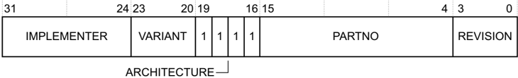

Table 3-4 CPUID bit assignments

| Bits    | Name        | Function                                                      |
|---------|-------------|---------------------------------------------------------------|
| [31:24] | IMPLEMENTER | Indicates implementer: 0x41 Arm.                              |
| [23:20] | VARIANT     | Indicates processor revision: 0x0 Revision 0. 0x1 Revision 1. |

Note

See Product revisions on page 1-16 for the different Cortex-M7 procesor revisions and the combinations of the VARIANT and REVISION bit fields used.

## 3.3.3 Cache Level ID Register

The CLIDR Register characteristics are:

Purpose

- Indicates the cache levels that are implemented. Architecturally, there can be a different number of cache levels on the instruction and data side.

- Captures the point-of-coherency.

- Captures the point-of-unification.

Usage constraints

The CLIDR is:

- A read-only register.

- Accessible in Privileged mode only.

Configurations

Available in all processor configurations.

Attributes

See the register summary in Table 3-5 on page 3-10.

Figure 3-3 shows the CLIDR bit assignments.

Figure 3-3  CLIDR bit assignments

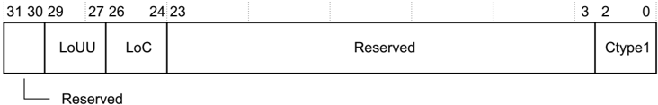

Table 3-4 CPUID bit assignments  (continued)

| Bits    | Name         | Function                 | Function                 |
|---------|--------------|--------------------------|--------------------------|
| [19:16] | ARCHITECTURE | Reads as 0xF .           | Reads as 0xF .           |
| [15:4]  | PARTNO       | Indicates part number:   | Indicates part number:   |
|         |              | 0xC27                    | Cortex-M7.               |
| [3:0]   | REVISION     | Indicates patch release: | Indicates patch release: |
|         |              | 0x0                      | Patch 0.                 |
|         |              | 0x1                      | Patch 1.                 |
|         |              | 0x2                      | Patch 2.                 |

Table 3-5 shows the CLIDR bit assignments.

Table 3-5 CLIDR bit assignments

| Bits    | Name   | Function                           | Function                                                       |
|---------|--------|------------------------------------|----------------------------------------------------------------|
| [31:30] | -      | Reserved.                          | Reserved.                                                      |
| [29:27] | LoUU   | Level of Unification Uniprocessor: | Level of Unification Uniprocessor:                             |
|         |        | 0b001                              | Level 2, if either cache is implemented.                       |
|         |        | 0b000                              | Level 1, if neither instruction nor data cache is implemented. |
| [26:24] | LoC    | Level of Coherency:                | Level of Coherency:                                            |
|         |        | 0b001                              | Level 2, if either cache is implemented.                       |
|         |        | 0b000                              | Level 1, if neither instruction nor data cache is implemented. |
| [23:3]  | -      | Reserved.                          | Reserved.                                                      |
| [2:0]   | Ctype1 | Level 1 cache type:                | Level 1 cache type:                                            |
|         |        | 0b000                              | No instruction or data cache is implemented.                   |
|         |        | 0b001                              | Instruction cache is implemented.                              |
|         |        | 0b010                              | Data cache is implemented.                                     |
|         |        | 0b011                              | Instruction and data cache are implemented.                    |

## 3.3.4 Cache Size ID Register

The CCSIDR characteristics are:

## Purpose

Provides information about the size and behavior of the instruction or data cache selected by the CSSELR. Architecturally, there can be up to eight levels of cache, containing instruction, data, or unified caches. This processor contains L1 instruction and data caches only.

Usage constraints

The CCSIDR is:

- A read-only register.

- Accessible in Privileged mode only.

Configurations

Available in all processor configurations.

If no instruction or data cache is configured, the corresponding CCSIDR is RAZ.

## Attributes

See the register summary in Table 3-6 on page 3-11.

Figure 3-4 shows the CCSIDR bit assignments.

Figure 3-4  CCSIDR bit assignments

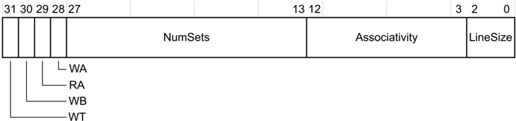

WT

Table 3-6 shows the CCSIDR bit assignments.

## Table 3-6 CCSIDR bit assignments

| Bits    | Name          | Function a                                                                              | Function a                                                                              |
|---------|---------------|-----------------------------------------------------------------------------------------|-----------------------------------------------------------------------------------------|
| [31]    | WT            | Indicates support available for Write-Through:                                          | Indicates support available for Write-Through:                                          |
| [30]    | WB            | Indicates support available for Write-Back:                                             | Indicates support available for Write-Back:                                             |
| [29]    | RA            | Indicates support available for read allocation:                                        | Indicates support available for read allocation:                                        |
| [28]    | WA            | Indicates support available for write allocation: 1 Write allocation support available. | Indicates support available for write allocation: 1 Write allocation support available. |
| [27:13] | NumSets       | Indicates the number of sets as: (number of sets) - 1.                                  | Indicates the number of sets as: (number of sets) - 1.                                  |
| [12:3]  | Associativity | Indicates the number of ways as: (number of ways) - 1.                                  | Indicates the number of ways as: (number of ways) - 1.                                  |
|         |               | 0x1                                                                                     | Represents two ways.                                                                    |
|         |               | 0x3                                                                                     | Represents four data ways.                                                              |
| [2:0]   | LineSize      | Indicates the number of words in each cache line.                                       | Indicates the number of words in each cache line.                                       |

The LineSize field is encoded as 2 less than log(2) of the number of words in the cache line. For example, a value of 0x0 indicates there are four words in a cache line, that is the minimum size for the cache. A value of 0x1 indicates there are eight words in a cache line.

Table 3-7 shows the individual bit field and complete register encodings for the CCSIDR. Use this to determine the cache size for the L1 data or instruction cache selected by the Cache Size Selection Register (CSSELR). See Cache Size Selection Register on page 3-12.

Table 3-7 CCSIDR encodings

|        |            |      | Complete register   | Register bit field encoding   | Register bit field encoding   | Register bit field encoding   | Register bit field encoding   | Register bit field encoding   |               |          |
|--------|------------|------|---------------------|-------------------------------|-------------------------------|-------------------------------|-------------------------------|-------------------------------|---------------|----------|
| CSSELR | Cache      | Size | encoding            | WT                            | WB                            | RA                            | WA                            | NumSets                       | Associativity | LineSize |
| 0x0    | Data cache | 4KB  | 0xF003E019          | 1                             | 1                             | 1                             | 1                             | 0x001F                        | 0x3           | 0x1      |
|        |            | 8KB  | 0xF007E019          |                               |                               |                               |                               | 0x003F                        |               |          |
|        |            | 16KB | 0xF00FE019          |                               |                               |                               |                               | 0x007F                        |               |          |
|        |            | 32KB | 0xF01FE019          |                               |                               |                               |                               | 0x00FF                        |               |          |
|        |            | 64KB | 0xF03FE019          |                               |                               |                               |                               | 0x01FF                        |               |          |

Table 3-8 shows the CSSELR bit assignments.

Table 3-8 CSSELR bit assignments

| Bits   | Name   | Function                                                                           |
|--------|--------|------------------------------------------------------------------------------------|
| [31:4] | -      | Reserved.                                                                          |
| [3:1]  | Level  | Identifies which cache level to select. 0b000 Level 1 cache. This field is RAZ/WI. |
| [0]    | InD    | Selects either instruction or data cache. 0 Data cache. 1 Instruction cache.       |

Table 3-7 CCSIDR encodings (continued)

|        |                   |      | Complete register   | Register bit field encoding   | Register bit field encoding   | Register bit field encoding   | Register bit field encoding   | Register bit field encoding   |               |          |
|--------|-------------------|------|---------------------|-------------------------------|-------------------------------|-------------------------------|-------------------------------|-------------------------------|---------------|----------|
| CSSELR | Cache             | Size | encoding            | WT                            | WB                            | RA                            | WA                            | NumSets                       | Associativity | LineSize |
| 0x1    | Instruction cache | 4KB  | 0xF007E009          | 1                             | 1                             | 1                             | 1                             | 0x003F                        | 0x1           | 0x1      |
| 0x1    | Instruction cache | 8KB  | 0xF00FE009          | 1                             | 1                             | 1                             | 1                             | 0x007F                        | 0x1           | 0x1      |
| 0x1    | Instruction cache | 16KB | 0xF01FE009          | 1                             | 1                             | 1                             | 1                             | 0x00FF                        | 0x1           | 0x1      |
| 0x1    | Instruction cache | 32KB | 0xF03FE009          | 1                             | 1                             | 1                             | 1                             | 0x01FF                        | 0x1           | 0x1      |
| 0x1    | Instruction cache | 64KB | 0xF07FE009          | 1                             | 1                             | 1                             | 1                             | 0x03FF                        | 0x1           | 0x1      |

## 3.3.5 Cache Size Selection Register

The CSSELR characteristics are:

Purpose

Holds the value that the processor uses to select the CSSELR to use.

Usage constraints

The CSSELR is:

- A read/write register.

- Accessible in Privileged mode only.

Configurations

Available in all processor configurations.

Attributes

See the register summary in Table 3-8.

Figure 3-5 shows the CSSELR bit assignments.

Figure 3-5  CSSELR bit assignments

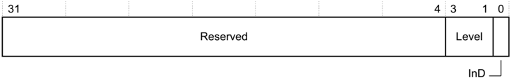

## 3.3.6 Instruction and Data Tightly-Coupled Memory Control Registers

The CM7\_ITCMCR and CM7\_DTCMCR characteristics are:

Purpose

Controls whether an access is mapped to TCM or AXIM interface.

Usage Constraints

Accessible in privileged mode only.

Configurations

Available in all configurations.

Attributes

See the register summary in Table 3-1 on page 3-3.

Figure 3-6 shows the CM7\_ITCMCR and CM7\_DTCMCR bit assignments.

Figure 3-6 CM7\_ITCMCR and CM7\_DTCMCR bit assignments

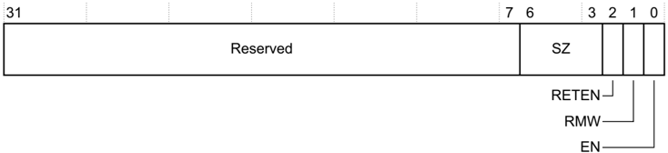

Table 3-9 shows the CM7\_ITCMCR and CM7\_DTCMCR bit assignments.

## Table 3-9 CM7\_ITCMCR and CM7\_DTCMCR bit assignments

| Bits   | Name   | Type   | Function                                          |
|--------|--------|--------|---------------------------------------------------|
| [31:7] | -      | -      | Reserved.                                         |
| [6:3]  | SZ     | RO     | TCM size. Indicates the size of the relevant TCM: |
|        |        |        | 0b0000 No TCM implemented. 0b0011 4KB.            |
|        |        |        | 0b0100 8KB.                                       |
|        |        |        | 0b0101 16KB.                                      |
|        |        |        | 0b0110 32KB.                                      |
|        |        |        | 0b0111 64KB.                                      |
|        |        |        | 0b1000 128KB.                                     |
|        |        |        | 0b1001 256KB.                                     |
|        |        |        | 0b1010 512KB.                                     |
|        |        |        | 0b1011 1MB.                                       |
|        |        |        | 0b1100 2MB.                                       |
|        |        |        | 0b1101 4MB.                                       |
|        |        |        | 0b1110 8MB.                                       |
|        |        |        | 0b1111 16MB.                                      |

All other encodings are reserved. The reset value is derived from the CFGITCMSZ and CFGDTCMSZ pins.

## Table 3-9 CM7\_ITCMCR and CM7\_DTCMCR bit assignments (continued)

| Bits   | Name   | Type   | Function                                                                                                                                                                                                                                                                                                                             |
|--------|--------|--------|--------------------------------------------------------------------------------------------------------------------------------------------------------------------------------------------------------------------------------------------------------------------------------------------------------------------------------------|
| [2]    | RETEN  | RW     | Retry phase enable. When enabled the processor guarantees to honor the retry output on the corresponding TCM interface, re-executing the instruction that performed the TCM access.                                                                                                                                                  |
| [1]    | RMW    | RW     | Read-Modify-Write (RMW) enable. Indicates that all writes to TCM, that are not the full width of the TCM RAM, use a RMWsequence: 0 RMWdisabled. 1 RMWenabled. The reset value is derived from the INITRMWEN pin. The RMWfunctionality can be used together with external logic to support error detection and correction in the TCM. |
| [0]    | EN     | RW     | TCM enable. When a TCM is disabled all accesses are made to the AXIM interface. 0 TCM disabled. 1 TCM enabled. The reset value is derived from the INITTCMEN pin.                                                                                                                                                                    |

## 3.3.7 AHBP Control Register

The CM7\_AHBPCR characteristics are:

Purpose

Controls accesses to AHBP or AXIM interface.

Usage Constraints

Accessible in privileged mode only.

Configurations

Available in all configurations.

Attributes

See the register summary in Table 3-1 on page 3-3.

Figure 3-7 CM7\_AHBPCR bit assignments

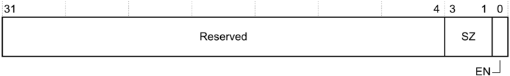

Table 3-10 shows the CM7\_AHBPCR bit assignments.

Table 3-10 CM7\_AHBPCR bit assignments

| Bits   | Name   | Type   | Function                                                                                                                                                          |
|--------|--------|--------|-------------------------------------------------------------------------------------------------------------------------------------------------------------------|
| [31:4] | -      | -      | Reserved.                                                                                                                                                         |
| [3:1]  | SZ     | RO     | AHBP size: 0b000 0MB. AHBP disabled. 0b001 64MB. 0b010 128MB. 0b011 256MB. 0b100 512MB. Other encodings are reserved. Reset values comes from the CFGAHBPSZ pins. |
| [0]    | EN     | RW     | AHBP enable: 0 AHBP disabled. When disabled all accesses are made to the AXIM interface. 1 AHBP enabled. The reset value is derived from the INITAHBPEN pins.     |

## 3.3.8 L1 Cache Control Register

The CM7\_CACR characteristics are:

Purpose

Controls the L1 ECC and the L1 cache coherency usage model.

Usage Constraints

Accessible in privileged mode only.

Configurations

Available in all configurations.

Attributes

See the register summary in Table 3-1 on page 3-3.

Figure 3-8 shows the CM7\_CACR bit assignments.

Figure 3-8 CM7\_CACR bit assignments

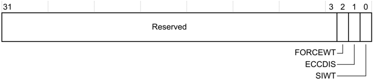

Table 3-11 shows the CM7\_CACR bit assignments.

Table 3-11 CM7\_CACR bit assignments

| Bits   | Name    | Type   | Function                                                                                                                                                                                                                                                                                                                                                                                                                                                                                                                                                                                                                                                                                                                           |
|--------|---------|--------|------------------------------------------------------------------------------------------------------------------------------------------------------------------------------------------------------------------------------------------------------------------------------------------------------------------------------------------------------------------------------------------------------------------------------------------------------------------------------------------------------------------------------------------------------------------------------------------------------------------------------------------------------------------------------------------------------------------------------------|
| [31:3] | -       | -      | Reserved, RAZ/WI.                                                                                                                                                                                                                                                                                                                                                                                                                                                                                                                                                                                                                                                                                                                  |
| [2]    | FORCEWT | RW     | Enables Force Write-Through in the data cache: 0 Disables Force Write-Through. 1 Enables Force Write-Through. All Cacheable memory regions are treated as Write-Through. This bit is RAZ/WI if the data cache is excluded. If the data cache is included the reset value of FORCEWT is 0.                                                                                                                                                                                                                                                                                                                                                                                                                                          |
| [1]    | ECCDIS  | RW     | Enables ECC in the instruction and data cache: 0 Enables ECC in the instruction and data cache. This is RAO/WI if both data cache and instruction cache are excluded or if ECC is excluded. 1 Disables ECC in the instruction and data cache.                                                                                                                                                                                                                                                                                                                                                                                                                                                                                      |
| [0]    | SIWT    | RW     | Shared cacheable-is-WT for data cache. Enables limited cache coherency usage: 0 Normal Cacheable Shared locations are treated as being Non-cacheable. Programmed inner cacheability attributes are ignored. This is the default mode of operation for Shared memory. The data cache is transparent to software for these locations and therefore no software maintenance is required to maintain coherency. 1 Normal Cacheable shared locations are treated as Write-Through. Programmed inner cacheability attributes are ignored. All writes are globally visible. Other memory agent updates are not visible to Cortex-M7 processor software without suitable cache maintenance. Useful for heterogeneous MP-systems where, for |

## 3.3.9 Auxiliary Bus Fault Status Register

The CM7\_ABFSR characteristics are:

| Purpose           | Stores information on the source of asynchronous bus faults.                                                                                                                         |
|-------------------|--------------------------------------------------------------------------------------------------------------------------------------------------------------------------------------|
| Usage Constraints | Accessible in privileged mode only. It is reset by nSYSRESET and is cleared to 0x0 on writes of any value. The value in this register is only defined when BFSR.IMPRECISERR is 0x1 . |
| Configurations    | Available in all configurations.                                                                                                                                                     |

Attributes

See the register summary in Table 3-1 on page 3-3.

Figure 3-9 shows the CM7\_ABFSR bit assignments.

Figure 3-9 CM7\_ABFSR bit assignments

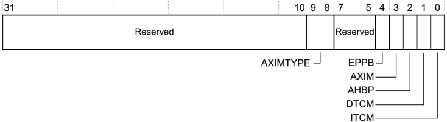

Table 3-12 shows the CM7\_ABFSR bit assignments.

Table 3-12 CM7\_ABFSR bit assignments

| Bits    | Name     | Function                                                                                             |
|---------|----------|------------------------------------------------------------------------------------------------------|
| [31:10] | -        | Reserved.                                                                                            |
| [9:8]   | AXIMTYPE | Indicates the type of fault on the AXIM interface: 0b00 OKAY. 0b01 EXOKAY. 0b10 SLVERR. 0b11 DECERR. |
| [7:5]   | -        | Reserved.                                                                                            |
| [4]     | EPPB     | Asynchronous fault on EPPB interface.                                                                |
| [3]     | AXIM     | Asynchronous fault on AXIM interface.                                                                |
| [2]     | AHBP     | Asynchronous fault on AHBP interface.                                                                |
| [1]     | DTCM     | Asynchronous fault on DTCM interface.                                                                |
| [0]     | ITCM     | Asynchronous fault on ITCM interface                                                                 |

## 3.3.10 Instruction Error bank Register 0-1

The IEBR0-1 characteristics are:

Purpose

Stores information about the error detected in the instruction cache during a cache lookup.

Usage Constraints

Accessible in privileged mode only.

Configurations

Available if the ECC configurable option is implemented.

Attributes

See the register summary in Table 3-1 on page 3-3.

Figure 3-10 on page 3-18 shows the IEBR0-1 bit assignments.

Figure 3-10  IEBR0-1 bit assignments

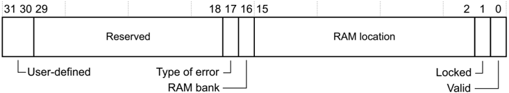

## Table 3-13 IEBR0-1 bit assignments

| Bits    | Name          | Type   | Description                                                                                                                                                                                                                                                                             |
|---------|---------------|--------|-----------------------------------------------------------------------------------------------------------------------------------------------------------------------------------------------------------------------------------------------------------------------------------------|
| [31:30] | -             | RW     | User-defined. Error detection logic sets this field to 0b00 on a new allocation and on powerup reset.                                                                                                                                                                                   |
| [29:18] | -             | RW     | Reserved                                                                                                                                                                                                                                                                                |
| [17]    | Type of error | RW     | Indicates the error type: 0 Correctable error. 1 Non-correctable error a .                                                                                                                                                                                                              |
| [16]    | RAMbank       | RW     | Indicates whichRAM bank to use: 0 Tag RAM. 1 Data RAM.                                                                                                                                                                                                                                  |
| [15:2]  | RAMlocation   | RW     | Indicates the location in instruction cache RAM: [14] Way. [13:4] Index. [3:2] Line doubleword offset.                                                                                                                                                                                  |
| [1]     | Locked        | RW     | Indicates whether the location is locked or not locked: 0 Location is not locked and available for hardware to allocate. 1 Location is locked by software. Hardware is not allowed to allocate to this entry. Reset by powerup reset to 0. Indicates whether the entry is valid or not: |
| [0]     | Valid         | RW     | 0 Entry is invalid. 1 Entry is valid. Reset by powerup reset to 0.                                                                                                                                                                                                                      |

## 3.3.11 Data Error bank Register 0-1

The DEBR0-1 characteristics are:

Purpose

Stores information about the error detected in the data cache during a cache lookup.

Usage Constraints

Accessible in privileged mode only.

Configurations

Available if the ECC configurable option is implemented.

Attributes

See the register summary in Table 3-1 on page 3-3.

Figure 3-11 on page 3-19 shows the DEBR0-1 bit assignments.

Table 3-13 shows the IEBR0-1 bit assignments.


## Figure 3-11  DEBR0-1

## Table 3-14 DEBR0-1 bit assignments

| Bits    | Name          | Type   | Description                                                                                                                                                                                                                                |
|---------|---------------|--------|--------------------------------------------------------------------------------------------------------------------------------------------------------------------------------------------------------------------------------------------|
| [31:30] | -             | RW     | User-defined. Error detection logic sets this field to 0b00 on a new allocation and on powerup reset.                                                                                                                                      |
| [29:18] | -             | RW     | Reserved.                                                                                                                                                                                                                                  |
| [17]    | Type of error | RW     | Indicates the error type: 0 Correctable error. 1 Non-correctable error a .                                                                                                                                                                 |
| [16]    | RAMbank       | RW     | Indicates whichRAM bank to use: 0 Tag RAM. 1 Data RAM.                                                                                                                                                                                     |
| [15:2]  | RAMlocation   | RW     | Indicates the data cacheRAM location: [15:14] Way. [13:5] Index. [4:2] Line word offset.                                                                                                                                                   |
| [1]     | Locked        | RW     | Indicates whether the location is locked or not locked: 0 Location is not locked and available for hardware to allocate. 1 Location is locked by software. Hardware is not allowed to allocate to this entry. Reset by powerup reset to 0. |
| [0]     | Valid         | RW     | Indicates whether the entry is valid or not: 0 Entry is invalid. 1 Entry is valid. Reset by powerup reset to 0.                                                                                                                            |

Table 3-14 shows the DEBR0-1 bit assignments.

## 3.3.12 AHB Slave Control Register

The CM7\_AHBSCR characteristics are:

Purpose

Controls the priority between software and AHB slave access to TCMs. See AHBS interface arbitration on page 5-34.

Usage Constraints

Accessible in privileged mode only.

Configurations

Available in all configurations.

Attributes

See the register summary in Table 3-1 on page 3-3.

Figure 3-12 shows the CM7\_AHBSCR bit assignments.

Figure 3-12 CM7\_AHBSCR bit assignments

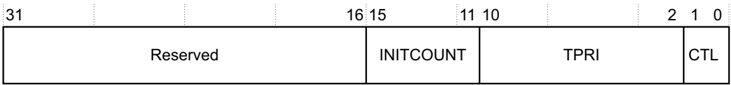

Table 3-15 shows the CM7\_AHBSCR bit assignments.

Table 3-15 CM7\_AHBSCR bit assignments

| Bits    | Name      | Type   | Function                                                                                                                                                                                                                                                                                                                                                                                                                                          | Function                                                                                                                                                                                                                                                                                                                                                                                                                                                                                                                                                                                                                                                                     |
|---------|-----------|--------|---------------------------------------------------------------------------------------------------------------------------------------------------------------------------------------------------------------------------------------------------------------------------------------------------------------------------------------------------------------------------------------------------------------------------------------------------|------------------------------------------------------------------------------------------------------------------------------------------------------------------------------------------------------------------------------------------------------------------------------------------------------------------------------------------------------------------------------------------------------------------------------------------------------------------------------------------------------------------------------------------------------------------------------------------------------------------------------------------------------------------------------|
| [31:16] | -         | -      | Reserved.                                                                                                                                                                                                                                                                                                                                                                                                                                         | Reserved.                                                                                                                                                                                                                                                                                                                                                                                                                                                                                                                                                                                                                                                                    |
| [15:11] | INITCOUNT | RW     | Fairness counter initialization value. Use to demote access priority of the requestor selected by the CM7_AHBSCR.CTL field. The reset value is 0b01 . Note • For round-robin mode set INITCOUNT to 0b01 and CM7_AHBSCR.CTL to 0b00 or 0b01 . • INITCOUNT must not be set to 0b00 because the demoted requestor then always takes priority when contention occurs, and might cause livelock. • INITCOUNT is not used when CM7_AHBSCR.CTL is 0b11 . | Fairness counter initialization value. Use to demote access priority of the requestor selected by the CM7_AHBSCR.CTL field. The reset value is 0b01 . Note • For round-robin mode set INITCOUNT to 0b01 and CM7_AHBSCR.CTL to 0b00 or 0b01 . • INITCOUNT must not be set to 0b00 because the demoted requestor then always takes priority when contention occurs, and might cause livelock. • INITCOUNT is not used when CM7_AHBSCR.CTL is 0b11 .                                                                                                                                                                                                                            |
| [10:2]  | TPRI      | RW     | Threshold execution priority for AHBS traffic demotion.                                                                                                                                                                                                                                                                                                                                                                                           | Threshold execution priority for AHBS traffic demotion.                                                                                                                                                                                                                                                                                                                                                                                                                                                                                                                                                                                                                      |
|         |           |        | 0b0xxxxxxx 0b11111111                                                                                                                                                                                                                                                                                                                                                                                                                             | Priority is TPRI[7:0]. This is the same as the NVIC register encodings. Priority of -1. This is the priority of the HardFault exception.                                                                                                                                                                                                                                                                                                                                                                                                                                                                                                                                     |
| [1:0]   | CTL       | RW     | AHBS prioritization control:                                                                                                                                                                                                                                                                                                                                                                                                                      | AHBS prioritization control:                                                                                                                                                                                                                                                                                                                                                                                                                                                                                                                                                                                                                                                 |
|         |           |        | 0b00                                                                                                                                                                                                                                                                                                                                                                                                                                              | AHBS access priority demoted. This is the reset value.                                                                                                                                                                                                                                                                                                                                                                                                                                                                                                                                                                                                                       |
|         |           |        | 0b01 0b10                                                                                                                                                                                                                                                                                                                                                                                                                                         | Software access priority demoted. AHBS access priority demoted by initializing the fairness counter to the CM7_AHBSCR.INITCOUNT value when the software execution priority is higher than or equal to the threshold level programmed in CM7_AHBSCR.TPRI. When the software execution priority is below this value, the fairness counter is initialized with 1 (round-robin). Note • The threshold level encoding matches the NVIC encoding and uses arithmetically larger numbers to represent lower priority. • The current execution priority of the processor is defined architecturally andincludestheeffectofthePRIMASK,BASEPRI,andFAULTMASK special-purpose registers. |
|         |           |        | 0b11                                                                                                                                                                                                                                                                                                                                                                                                                                              | AHBSPRI signal has control of access priority.                                                                                                                                                                                                                                                                                                                                                                                                                                                                                                                                                                                                                               |

## Chapter 4 Initialization

This chapter describes how to initialize the processor and which registers to access to enable functionality before using the processor features. It contains the following section:

- About Initialization on page 4-2.

## 4.1 About Initialization

Before you run the application, you might want to:

- Program particular values into various registers, for example, stack pointers.
- Enable various processor features, for example, error correction.
- Program particular values into memory, for example, the Tightly Coupled Memories (TCMs).

Other initialization requirements are described in:

- Initializing the MPU .
- Initializing the FPU .
- Initializing and enabling the L1 cache on page 4-3.
- Disabling cache error checking and correction on page 4-4.
- Enabling the TCM on page 4-4.
- Preloading TCM on page 4-5.
- Enabling the TCM retry and read-modify-write on page 4-5.
- Enabling the AHBP interface on page 4-6

Some of the requirements for initialization are optional depending on the features implemented in the Cortex-M7 processor.

```
Note
```

The Branch predictor is always enabled in the processor, therefore CCR.BP is RAO/WI. See Arm ® v7-M Architecture Reference Manual for more information on the Configuration and Control register.

## 4.1.1 Initializing the MPU

If the processor has been implemented with a Memory Protection Unit (MPU), before you can use it you must enable the MPU in the MPU\_CTRL register. See the Arm ® v7-M Architecture Reference Manual for more information.

When setting up the MPU, and if the MPU has previously been programmed, disable unused regions to prevent any previous region settings from affecting the new MPU setup.

## 4.1.2 Initializing the FPU

If the processor has been implemented with a Floating Point Unit (FPU) you must enable it before floating point instructions can be executed. The following code is an example of how to enable the feature.

CPACR EQU 0xE000ED88

```
LDR r0, =CPACR LDR r1, [R0] ; Read CPACR ORR STR r1, [R0] ; Write back the modified value to the CPACR DSB
```

```
r1, R1, #(0xF << 20) ; Set bits 20-23 to enable CP10 and CP11 coprocessors ISB
```

See the Arm ® v7-M Architecture Reference Manual for more information.

Note

Floating point logic is only available with the Cortex-M7 processor with FPU.

## 4.1.3 Initializing and enabling the L1 cache

If the processor has been implemented with L1 data or instruction caches, they must be invalidated before they are enabled in software, otherwise UNPREDICTABLE behavior can occur.

## Invalidate the entire data cache

Software can use the following code example to invalidate the entire data cache, if it has been included in the processor. The operation is carried out by iterating over each line of the cache and using the DCISW register in the Private Peripheral Bus (PPB) memory region to invalidate the line. The number of cache ways and sets is determined by reading the CCSIDR register.

```
CCSIDR EQU 0xE000ED80 ; Cache size ID register address CSSELR EQU 0xE000ED84 ; Cache size selection register address DCISW EQU 0xE000EF60 ; Cache maintenance op address: data cache clean and invalidate by set/way ; CSSELR selects the cache visible in CCSIDR MOV r0, #0x0 ; 0 = select 'level 1 data cache' LDR r11, =CSSELR ; STR r0, [r11] ; DSB ; Ensure write to CSSELR before proceeding LDR r11, =CCSIDR ; From CCSIDR LDR r2, [r11] ; Read data cache size information AND r1, r2, #0x7 ; r1 = cache line size ADD r7, r1, #0x4 ; r7 = number of words in a cache line UBFX r4, r2, #3, #10 ; r4 = number of 'ways'-1 of data cache UBFX r2, r2, #13, #15 ; r2 = number of 'set'-1 of data cache CLZ r6, r4 ; calculate bit offset for 'way' in DCISW LDR r11, =DCISW ; invalidate cache by set/way inv_loop1 ; For each 'set' MOV r1, r4 ; r1 = number of 'ways'-1 LSLS r8, r2, r7 ; shift 'set' value to bit 5 of r8 inv_loop2 ; For each 'way' LSLS r3, r1, r6 ; shift 'way' value to bit 30 in r6 ORRS r3, r3, r8 ; merge 'way' and 'set' value for DCISW STR r3, [r11] ; invalidate D-cache line SUBS r1, r1, #0x1 ; decrement 'way' BGE inv_loop2 ; End for each 'way' SUBS r2, r2, #0x1 ; Decrement 'set' BGE inv_loop1 ; End for each 'set' DSB ; Data sync barrier after invalidate cache ISB ; Instruction sync barrier after invalidate cache
```

## Invalidate instruction cache

You can use the following code example to invalidate the entire instruction cache, if it has been included in the processor. The operation is carried out by writing to the ICIALLU register in the PPB memory region.

ICIALLU EQU

```
0xE000EF50
```

```
MOV r0, #0x0 LDR r11, =ICIALLU STR r0, [r11] DSB ISB
```

## Enabling data and instruction caches

You can use the following code example to enable the data and instruction cache after they have been initialized. The operation is carried out by modifying the CCR.IC and CCR.DC fields in the PPB memory region.

```
CCR EQU 0xE000ED14 LDR r11, =CCR LDR r0, [r11] ORR r0, r0, #0x1:SHL:16 ; Set CCR.DC field ORR r0, r0, #0x1:SHL:17 ; Set CCR.IC field STR r0, [r11] DSB ISB
```

## 4.1.4 Disabling cache error checking and correction

If cache error checking and correction is included in the processor it is enabled by default from reset. The following code example can be used to disable the feature. The operation is carried out by modifying the CM7\_CACR.ECCEN bit the PPB memory region.

```
CM7_CACR EQU 0xE000EF9C LDR r11, =CM7_CACR LDR r0, [r11] BFC r0, #0x1, #0x1 ; Clear CM7_CACR.ECCEN STR r0, [r11] DSB ISB
```

Care must be taken when software changes the error checking fields in the CM7\_CACR. If the fields are changed when the caches contain data, ECC information in the caches might not be correct for the new setting, resulting in unexpected errors and data loss. Therefore the fields in the CM7\_CACR must only be changed when both caches are turned off and the entire cache must be invalidated after the change.

## 4.1.5 Enabling the TCM

The TCM interfaces can be enabled at reset in the system by an external signal on the processor. If they are disabled at reset then the following code example can be used to enable both the instruction and data TCM interfaces in software:

```
CM7_ITCMCR EQU 0xE000EF90 CM7_DTCMCR EQU 0xE000EF94
```

## 4.1.6 Preloading TCM

Methods to preload TCMs include:

## Memory copy with running boot code

Where boot code includes a memory copy routine that reads data from a ROM, and writes it into the appropriate TCM, you must enable the TCM to do this. This bootcode must be run from an address outside the TCM region.

DMA into TCM

The System includes a DMA device that reads data from a ROM, and writes it to the TCMs through the AHB slave interface. This method can be used to preload the TCM so they can be used by the processor from reset.

## Using the TCM from reset

If the TCM interface is configured to enable the TCM at reset and the reset vector address is inside the TCM memory region then the processor boots from TCM. The system must ensure that the bootcode software is present in the appropriate memory region before execution starts. This can be accomplished by either initializing the memory before reset or by transferring the data after reset using the AHB slave interface and asserting the CPUWAIT input signal. Asserting this signal stops the processor fetching or executing instructions after reset. When the CPUWAIT signal is deasserted the processor starts fetching instructions from the reset vector address in the normal way.

Note

When CPUWAIT has been deasserted to start the processor fetching, CPUWAIT must not be asserted again except when the processor is under processor reset or Power-on reset; that is nSYSRESET or nPORESET asserted. The processor does not halt if the CPUWAIT is asserted while the processor is running.

## 4.1.7 Enabling the TCM retry and read-modify-write

If the TCM connected to the processor supports error detection and correction then the TCM interface must be configured to support the retry and read-modify-write features. These can be enabled at reset in the system by external signals on the processor. If they are disabled at reset then the following code example can be used to enable them in software:

```
CM7_ITCMCR EQU 0xE000EF90
```

CM7\_DTCMCR EQU 0xE000EF94

```
LDR r11, =CM7_ITCMCR LDR r0, [r11] ORR r0, r0, #0x1 ; Set CM7_ITCMCR.EN field STR r0, [r11] LDR r11, =CM7_DTCMCR LDR r0, [r11] ORR r0, r0, #0x1 ; Set CM7_DTCMCR.EN field STR r0, [r11] DSB ISB
```

```
LDR r11, =CM7_ITCMCR LDR r0, [r11] ORR r0, r0, #0x1:SHL:1 ; Set CM7_ITCMCR.RMW field ORR r0, r0, #0x1:SHL:2 ; Set CM7_ITCMCR.RETEN field STR r0, [r11] LDR r11, =CM7_DTCMCR LDR r0, [r11] ORR r0, r0, #0x1:SHL:1 ; Set CM7_DTCMCR.RMW field ORR r0, r0, #0x1:SHL:2 ; Set CM7_DTCMCR.RETEN field STR r0, [r11] DSB ISB
```

## 4.1.8 Enabling the AHBP interface

The AHBP interface can be enabled at reset in the system by an external signal on the processor. If it is disabled at reset then the following code example can be used to enable the AHBP interface from software:

```
LDR r11, =CM7_AHBPCR LDR r0, [r11] ORR r0, r0, #0x1 ; Set CM7_AHBPCR.EN field STR r0, [r11] DSB
```

```
CM7_AHBPCR EQU 0xE000EF98 ISB
```

## Chapter 5 Memory System

This chapter describes the Cortex-M7 processor memory system. It contains the following sections:

- About the memory system on page 5-2.
- Speculative accesses on page 5-3.
- Fault handling on page 5-5.
- Memory types and memory system behavior on page 5-7.
- AXIM interface on page 5-8.
- AHB peripheral interface on page 5-25.
- AHB slave interface on page 5-33.
- TCM interfaces on page 5-36.
- L1 caches on page 5-41.

## 5.1 About the memory system

This section provides an overview of the Cortex-M7 processor memory system.

The Cortex-M7 processor memory system can be configured during implementation and integration. It consists of:

- Separate optional instruction and data caches.
- Optional instruction and data Tightly-Coupled Memory (TCM) areas.
- An AHB Slave (AHBS) interface.
- An optional Memory Protection Unit (MPU). See Chapter 6 Memory Protection Unit .
- MBIST interface.

The cache architecture is Harvard, that is, only instructions can be fetched from the instruction cache, and only data can be read from and written to the data cache.

In parallel with each of the caches are two areas of dedicated RAM accessible to both the instruction and data sides. These are regions of TCM.

Instruction TCM (ITCM) uses the ITCM interface and the Data TCM (DTCM) uses two interfaces, D0TCM and D1TCM. Cortex-M7 functional diagram on page 1-7 shows this.

The ITCM interface is 64-bits wide. The DTCM is divided into two 32-bit wide interfaces, D0TCM and D1TCM. The upper 32-bits of data is on the D1TCM interface and the lower 32-bits of the data is on the D0TCM interface.

Memory accesses to the ITCM, required for fetching instructions and for data transfer instructions, are performed if the address is in an enabled TCM region. Remaining instruction accesses and remaining data accesses that are not in a peripheral interface region are looked up in the appropriate L1 cache if they are cacheable. Accesses that are not serviced by the memory system are passed through the AXI master (AXIM) interface or the AHBP interface to the external memory system connected to the processor.

The Cortex-M7 processor only respects the memory ordering restrictions described in the Arm ® v7-M Architecture Reference Manual in case of memory transfers initiated by the same master interface. Ordering between different interfaces is not guaranteed without the use of barrier instructions.

Both instruction and data cache RAM can be configured at implementation time to have Error Correcting Code (ECC) to protect the data stored in the memory from errors. Each TCM interface can support external logic to the processor to report to the processor that an error has occurred.

The processor includes support for direct access to the TCM through the AHBS interface. The interface provides high bandwidth for DMA traffic to the memory and can be used when the remainder of the processor is in low-power standby mode, with the internal clock disabled.

The optional MPU handles both the instruction and data memory accesses. The MPU is responsible for protection checking, address access permissions, and memory attributes for all accesses. Some of these attributes can be passed through the AXIM interface or AHBP interface to the external memory system.

The memory system includes a monitor for exclusive accesses. Exclusive load and store instructions, for example LDREX and STREX , can be used with the appropriate memory monitoring to provide inter-process or inter-processor synchronization and semaphores. See the Arm ® v7-M Architecture Reference Manual for more information.

The processor is designed for use in chip designs that use the AMBA 4 AXI and AMBA 3 AHB-Lite protocols.

## 5.2 Speculative accesses

The Cortex-M7 processor performs speculative accesses to increase performance. Speculative accesses are permitted by the Armv7-M architecture and system designers should not assume that the scope of the speculation is fixed or definitively specified.

The following list describes several examples where speculative accesses can occur:

Note

This is not a comprehensive list of cases where speculative accesses can occur.

- Speculative instruction fetches can be initiated to any Normal, executable memory address. This can occur regardless of whether the fetched instruction gets executed or, in rare cases, whether the memory address contains any valid program instruction.
- Speculative data reads can be initiated to any Normal, read/write, or read-only memory address. In some rare cases, this can occur regardless of whether there is any instruction that causes the data read.
- Speculative cache linefills can be initiated to any Cacheable memory address, and in rare cases, regardless of whether there is any instruction that causes the cache linefill.
- Speculative reads that target a TCM region, in rare cases, can be initiated on any of the three TCM interfaces, regardless of which TCM interface the memory region is mapped to.

The following list describes the situations where a speculative access does not occur:

- Speculative instruction fetches are never made to memory addresses in an Execute Never region.
- Speculative data reads are never made to memory addresses marked as non-accessible in the MPU.
- Speculative cache linefills are never made to Non-cacheable memory addresses.
- Speculative data reads and speculative cache linefills are never made to Device or Strongly-ordered memory addresses.
- Speculative reads are never made on the AHBP interface.
- Speculative writes are never made.

Note

Memory regions mapped to the TCM are always treated as Normal Memory and therefore are always subject to speculation.

## 5.2.1 Considerations for system design

The system designer must ensure that the system is robust enough to handle speculative accesses, and ensure that all executable and Normal type memory regions are safe to access.

## Preventing speculative accesses

Speculative accesses do not cause any processor faults. The processor is aware whether an access is speculative, and ignores any error response signalled by the system due to the speculative access. However, the system where the processor is integrated in cannot distinguish

between speculative accesses from non-speculative accesses. Therefore, the system designer is required to ensure that the system is robust enough to handle speculative accesses, regardless of whether they are initiated to unexpected memory addresses.

Alternatively, if there are memory regions where no speculative accesses should be initiated to, Arm recommends that you set those regions to have all of the following attributes with the MPU:

- Device or Strongly-ordered.
- Execute Never.

Note

Memory regions mapped to the TCM are always treated as Normal Memory and therefore are always subject to speculation.

## Preventing accesses

The system must ensure that all executable and Normal type memory regions are safe to access. This implies that all accesses should eventually complete.

Note

- The processor does not cancel non-speculative accesses and therefore waits for the access to complete.
- The processor cannot guarantee that speculative accesses will get cancelled and therefore may wait for the access to complete.

For any addresses that are not considered safe to access, Arm recommends that you either ensure that the system returns an abort, or prevent accesses by setting those regions to have all of the following attributes with the MPU:

- Device or Strongly-ordered.
- Non-accessible.
- Execute Never.

## 5.3 Fault handling

Faults can occur on instruction fetches for the following reasons:

- MPU MemManage.
- External AXI slave error (SLVERR).
- External AXI decode error (DECERR).
- TCM external error.
- Breakpoints, and vector capture events.

Faults can occur on data accesses for the following reasons:

- MPU MemManage.
- Alignment UsageFault.
- External AXI slave error (SLVERR).
- External AXI decode error (DECERR).
- External AHB error from the AHBP port.
- TCM external error.
- Watchpoints.

Fault handling is described in:

- Faults .
- Usage models on page 5-6.

The classes of fault that can occur are:

- MPU faults .
- External faults .
- Debug events on page 5-6.
- Synchronous and asynchronous faults on page 5-6.

## MPU faults

The MPU can generate a fault for various reasons. MPU faults are always synchronous, and take priority over external faults. If an MPU fault occurs on an access that is not in the TCM, the AXI or AHB transactions for that access are not performed.

## External faults

A memory access or instruction fetch performed through the AXIM interface can generate two different types of error response, a slave error (SLVERR) or decode error (DECERR). These are known as external AXI errors, because they are generated by the AXI system outside the processor.

A memory access performed through the AHBP interface can generate a single error response. The processor manages this in the same way as a response of SLVERR from the AXI interface.

A memory or instruction fetch access performed on the TCM interface can generate a single error response. The processor manages this in the same way as a response of SLVERR from the AXI interface.

Synchronous faults are generated for instruction fetches and data loads. All stores generate asynchronous faults.

## 5.3.1 Faults

## 5.3.2 Usage models

Note

An AXI slave device in the system that cannot handle exclusive transactions returns OKAY in response to an exclusive read. This is also treated as an external error, and the processor behaves as if the response was SLVERR.

## Debug events

The debug logic in the processor can be configured to generate breakpoints or vector capture events on instruction fetches, and watchpoints on data accesses. If the processor is software-configured for monitor-mode debugging, a fault is taken when one of these events occurs, or when a BKPT instruction is executed. For more information, see Chapter 9 Debug .

## Synchronous and asynchronous faults

See External faults on page 5-5 for more information about the differences between synchronous and asynchronous faults.

This section describes some methods for handling errors in a system. Exactly how you program the processor to handle faults depends on the configuration of your processor and system, and what you are trying to achieve.

If a fault exception is taken, the fault handler reads the information in the link register, Program Status Register (PSR) in the stack, and fault status registers to determine the type of fault. Some types of fault are fatal to the system, and others can be fixed, and program execution resumed. For example, an MPU background MemManage might indicate a stack overflow, and be rectified by allocating more stack and reprogramming the MPU to reflect this. Alternatively, an asynchronous external fault might indicate that a software error meant that a store instruction occurred to an unmapped memory address. Such a fault is fatal to the system or process because no information is recorded about the address the error occurred on, or the instruction that caused the fault.

Table 5-1 shows the types of fault that are typically fatal because either the location of the error is not recorded or the error is unrecoverable. Some faults that are marked as not fatal might turn out to be fatal in some systems when the cause of the error has been determined. For example, an MPU background MemManage fault might indicate a stack overflow, that can be rectified, or it might indicate that, because of a bug, the software has accessed a nonexistent memory location, that can be fatal. These cases can be distinguished by determining the location where the error occurred.

## Table 5-1 Types of faults

| Type of fault         | Conditions                                                       | Source     | Synchronous   | Fatal   |
|-----------------------|------------------------------------------------------------------|------------|---------------|---------|
| MPU                   | Access not permitted by MPU a                                    | MPU        | Yes           | No      |
| Synchronous external  | Load using external memory interface                             | AXIM, AHBP | Yes           | No      |
| Asynchronous external | Store to Normal or Device memory using external memory interface | AXIM, AHBP | No            | Yes     |

## 5.4 Memory types and memory system behavior

The behavior of the memory system depends on the type attribute of the memory that is being accessed:

- By default, only Normal, Non-shareable memory regions can be cached in the RAMs. Caching only takes place if the appropriate cache is enabled and the memory type is cacheable. Shared cacheable memory regions can be cached if CACR.SIWT is set to 1.
- The store buffer can merge any stores to Normal memory if they are not from a store exclusive instruction accessing a memory region marked as Shared. See Store buffer on page 5-42 for more information.
- Only non-cached Shared exclusive transactions are marked as exclusive on the external interface. Load and store exclusive instructions to Shared cacheable memory regions do not result in any accesses marked as exclusive on the external interface if CACR.SIWT is set to 1.
- Only Normal memory is considered restartable, that is, a multi-word transfer can be abandoned part way through because of an interrupt, to be restarted after the interrupt has been handled. See Exception handling on page 2-10 for more information about interrupt behavior.
- For exclusive accesses to Non-shared memory only the internal exclusive monitor is updated and checked. Exclusive accesses to Shared memory are checked using the internal monitor and also, if necessary, using an external monitor using the external memory interface AXIM or AHBP.

Table 5-2 summarizes the processor memory types and associated behavior.

Table 5-2 Memory types and associated behavior

| Memory type      |            | Can be cached   | Merging   | Restartable   | Exclusives handled    |
|------------------|------------|-----------------|-----------|---------------|-----------------------|
| Normal           | Shared     | No a            | Yes       | Yes           | Internal and external |
|                  | Non-shared | Yes             | Yes       | Yes           | Internal only         |
| Device           | Shared     | No              | No        | No            | Internal and external |
|                  | Non-shared | No              | No        | No            | Internal only         |
| Strongly-ordered | Shared     | No              | No        | No            | Internal and external |

## 5.5 AXIM interface

This section describes the AXIM interface. The AXIM interface is a single 64-bit wide interface that connects to an external memory system. It is used for:

- Instruction fetches.
- Data cache linefills and evictions.
- Non-cacheable Normal-type memory data accesses.
- Device and Strongly-ordered type data accesses, normally to peripherals.

The AXIM interface conforms to the AXI4 standard as described in the Arm ®  AMBA ® AXI and ACE Protocol Specification . Within the AXI standard, the AXIM interface uses a number of extension signals to indicate inner memory attributes and the request source. See AXI extensions on page 5-12.

The AXIM interface can run at the same frequency as the processor or at a lower synchronous frequency.

Note

References in this section to an AXI slave refer to the AXI slave in the external system that is connected to the processor AXIM interface.

The following sections describe the attributes of the AXIM interface, and provide information about the types of burst generated:

- AXI attributes and transactions on page 5-9.
- Identifiers for AXIM interface accesses on page 5-11.
- AXI extensions on page 5-12.
- Memory system implications for AXI accesses on page 5-13.

Note

For more information on speculative accesses, see Speculative accesses on page 5-3.

## 5.5.1 AXI attributes and transactions

Table 5-3 shows the AXI attributes and transactions for the AXIM interface when the processor is configured with the L1 data cache. This is for use in a native AXI system with high memory bandwidth and supports multiple outstanding transactions, also known as a high performance AXIM interface.

Table 5-3 High performance AXIM attributes and transactions

| Attribute                   |   Value | Description                                                                                                                                                                                                                                                               |
|-----------------------------|---------|---------------------------------------------------------------------------------------------------------------------------------------------------------------------------------------------------------------------------------------------------------------------------|
| Write issuing capability    |      39 | Consisting of: • 15 writes to Strongly-ordered or Device memory. • 24 writes to Normal memory, that can be evictions, write bursts or single writes. A maximum of 17 of these can be to cacheable memory and a maximum of 10 to Non-cacheable or shareable memory.        |
| Read issuing capability     |       7 | Consisting of: • 2 data linefills. • 4 Non-cacheable data reads. • 1 instruction fetch or instruction linefill.                                                                                                                                                           |
| Write ID capability         |       4 | Consisting of: • 1 reserved for Strongly-ordered or Device memory. • 1 reserved for Normal, cacheable and Non-shareable memory. • 1 reserved for Normal, Non-cacheable or Shareable memory. • 1 reserved for cache line evictions (Normal, cacheable, Write-Back memory). |
| Read ID capability          |       4 | -                                                                                                                                                                                                                                                                         |
| Combined issuing capability |      40 | Consisting of: • 39 outstanding writes. • 1 instruction fetch a .                                                                                                                                                                                                         |

Only a subset of all possible AXI transactions can be generated. These are:

- For Normal, cacheable memory:
- -WRAP4 64-bit reads, for load and Write-Back Write-Allocate store linefills and instruction linefills.
- -INCR4 64-bit writes, for evictions.
- -INCR N (N:1-4) 64-bit for write transfers, for coalesced individual Write-Through or Write-Back, no Write-Allocate stores.
- -INCR N (N:1-4) 64-bit for read transfers, for loads when the data cache is disabled, or for instruction fetches when the instruction cache is disabled.
- For Normal, Non-cacheable memory:
- -INCR N (N:1-4) 64-bit for read transfers, for individual loads and load multiples.
- -INCR N (N:1-4) 64-bit for write transfers, for coalesced individual stores and store multiples.
- -INCR N (N:1-4) 64-bit for read transfers, for instruction fetches.
- -INCR 1 8-bit, 16-bit, and 32-bit exclusive reads and writes, for shared exclusives.

- For Strongly-ordered or Device memory:
- -INCR 1 8-bit, 16-bit and 32-bit reads and writes, for individual load and stores.
- -INCR 1 32-bit for read transfers, load multiples.
- -INCR N (N:1-2) 32-bit for write transfers, for store multiples.
- -INCR 1 8-bit, 16-bit and 32-bit exclusive reads and writes, for shared exclusives.
- No FIXED bursts are used.
- Write bursts to Normal memory can use the following optimizations:
- -Entire beats with no strobes set.
- -Non-contiguous strobes per beat.

These are allowed on AXI but have implications for bridging to AHB.

For more information on IDs used for different transactions, see Identifiers for AXIM interface accesses on page 5-11.

Table 5-4 shows the AXI attributes and transactions for when the processor is not configured to include the L1 data cache. That is, if you want to use it in a low-cost AXI system, or bridged to AHB, that has a low-bandwidth memory system, like on an off-chip memory system.

Table 5-4 Area optimized AXIM attributes and transactions

| Attribute                   |   Value | Description                                                                                        |
|-----------------------------|---------|----------------------------------------------------------------------------------------------------|
| Write issuing capability    |      25 | Consisting of: • 15 writes to Strongly-ordered or Device memory. • 10 writes to Normal memory.     |
| Read issuing capability     |       5 | Consisting of: • 4 data read. • 1 instruction fetch or instruction linefill.                       |
| Write ID capability         |       2 | Consisting of: • 1 reserved for Strongly-ordered or Device memory. • 1 reserved for Normal memory. |
| Read ID capability          |       2 | -                                                                                                  |
| Combined issuing capability |      26 | Consisting of: • 25 outstanding writes. • 1 instruction fetch a .                                  |

Only a subset of all possible AXI transactions can be generated. These are:

- For Normal memory:
- -WRAP4 64-bit read transfers, for instruction linefills where instruction cache is included.
- -INCR N (N:1-4) 64-bit for read transfers, for individual loads and load multiplies.
- -INCR N (N:1-4) 64-bit for write transfers, for coalesced individual stores and store multiples.

- -INCR N (N:1-4) 64-bit for read transfers, for Non-cacheable instruction fetches or all instruction fetches with no instruction cache.
- -INCR 1 8-bit, 16-bit and 32-bit exclusive reads and writes, for shared exclusives.
- For Strongly-ordered or Device memory:
- -INCR 1 8-bit, 16-bit and 32-bit reads and writes, for individual load and stores.
- -INCR 1 32-bit for read transfers, load multiples.
- -INCR N (N:1-2) 32-bit for write transfers, for store multiples.
- -INCR 1 8-bit, 16-bit and 32-bit exclusive reads and writes, for shared exclusives.
- No FIXED bursts are used.
- Write bursts to Normal memory can use the following optimizations:
- -Entire beats with no strobes set.
- -Non-contiguous strobes per beat.

These are allowed on AXIM interface but have implications for bridging to AHB.

For more information on IDs used for different transactions, see Identifiers for AXIM interface accesses .

## 5.5.2 Identifiers for AXIM interface accesses

The following ID values are for read and write channels, and Write-Allocate memory accesses on the AXIM interface:

- Read channels, ARID[2:0] , RID[2:0] :
- Write channels, AWID[1:0] , WID[1:0] , BID[1:0] :

0b000

Normal Non-cacheable, Device, and Strongly-ordered reads.

0b011 , 0b010

Data cache line-fills.

0b100

Instruction fetches.

| 0b00   | Normal, Non-cacheable writes, All shared exclusive writes, for example from STREX .   |
|--------|---------------------------------------------------------------------------------------|
| 0b01   | Normal cacheable writes to Write-Through and Write-Back, Non Write-Allocate memory.   |
| 0b10   | Device and Strongly-ordered writes.                                                   |
| 0b11   | Evictions to Normal cacheable Write-Back memory.                                      |

WID is not a required signal for AMBA 4 AXI. It is included for compatibility with AMBA 3 AXI systems.

## 5.5.3 AXI privilege information

AXI provides information about the privilege level of an access on the ARPROT and AWPROT signals. However, when accesses might be cached or merged together, the resulting transaction can have both privileged and user data combined. If this happens, the Cortex-M7 processor marks the transaction as privileged, even if it was initiated by a user process.

Table 5-5 shows Cortex-M7 mode and APROT values.

Table 5-5 Cortex-M7 mode and APROT values

| Processormode   | Type of access                          | Value of APROT                                                           |
|-----------------|-----------------------------------------|--------------------------------------------------------------------------|
| -               | Cacheable read access                   | Always marked as Privileged                                              |
| User            | Non-cacheable read access               | User except for LDM , LDRD and POP when the L1 data cache is implemented |
| Privileged      |                                         | Privileged                                                               |
| User            | Device or Strongly-ordered read access  | User                                                                     |
| Privileged      |                                         | Privileged                                                               |
| -               | Cacheable write access                  | Always marked as Privileged                                              |
| User            | Device or Strongly-ordered write access | User                                                                     |
| Privileged      |                                         | Privileged                                                               |
| User            | Normal non-cacheable write access       | Privileged, except for STREXB , STREXH , and STREX                       |
| Privileged      |                                         | Privileged                                                               |

## 5.5.4 Write response

## 5.5.5 AXI extensions

The AXIM interface requires that the slave does not return a write response until it has received the write address.

Note

This write response requirement is mandatory for systems using the AMBA 4 AXI protocol. It is also required if the Cortex-M7 processor is used with an external memory system using the AMBA 3 AXI protocol.

The AXIM interface uses the ARCACHE and AWCACHE AXI signals and the ARSHARE , AWSHARE , ARINNER , and AWINNER extension signals to indicate the memory attributes of the transfer, as returned by the MPU:

- ARCACHE and AWCACHE of the master interface are generated from the memory type and outer region attributes.
- ARINNER and AWINNER are generated from the memory type and inner region attributes.
- ARSHARE and AWSHARE are asserted for transactions to shared memory regions.

In additional to these attribute extension signals the AXIM interface includes the following signals:

## AWMASTER and ARMASTER

Indicates the source of the memory request. When set to:

- 0 The request has been generated by software running on the processor.

AWSPARSE

- 1 The request has been generated by a debug request on the AHB Debug (AHBD) interface.

The AWSPARSE is part of the write address channel signal group and indicates the burst uses sparse byte write-strobes, that is some of the beats of the write burst do not contain data. You can use this signal to optimize systems that bridge the AMBA 4 AXI protocol to AHB protocol.

See the Arm ®  AMBA ®  AXI and ACE Protocol Specification for valid encodings for all the AxCACHE and AxINNER signals.

## 5.5.6 Memory system implications for AXI accesses

The attributes of the memory being accessed can affect an AXI access. The memory system can cache any Normal memory address that is marked as either:

- Cacheable, Write-Back, Read-Allocate, Write-Allocate, Non-shareable.
- Cacheable, Write-Back, Read-Allocate only, Non-shareable.
- Cacheable, Write-Through, Read-Allocate only, Non-shareable.

However, Device and Strongly-ordered memory is always Non-cacheable. Also, any unaligned access to Device or Strongly-ordered memory generates alignment UsageFault and therefore does not cause any AXI transfer. This means that the access examples given in this chapter never show unaligned accesses to Device or Strongly-ordered memory.

Note

Memory regions marked as Non-Cacheable Normal must not be used to access read-sensitive peripherals in a system. This is because read transactions to these regions from the processor can be repeated multiple times if the originating load instruction is interrupted.

## 5.5.7 AXIM interface transfers

The processor conforms to the Arm ®  AMBA ® AXI and ACE Protocol Specification , but it does not generate all the AXI transaction types that the specification permits. This section describes the types of AXI transaction that the AXIM interface does not generate.

If you are designing an AXI slave to work only with the Cortex-M7 processor, and there are no other AXI masters in your system, you can take advantage of these restrictions and the interface attributes, described in Table 5-3 on page 5-9, to simplify the slave.

This section also contains tables that show some examples of the types of AXI burst that the processor generates. However, because a particular type of transaction is not shown here does not mean that the processor does not generate such a transaction.

Note

An AXI slave device connected to the AXIM interface must be capable of handling every kind of transaction permitted by the Arm ®  AMBA ® AXI and ACE Protocol Specification , except where there is an explicit statement in this chapter that such a transaction is not generated. You must not infer any additional restrictions from the example tables given.

Load and store instructions to Non-cacheable memory might not result in an AXI transfer because the data might either be retrieved from, or merged into the internal store data buffers. The exceptions to this are loads or stores to Strongly-ordered or Device memory. These always result in AXI transfers. See Strongly-ordered and Device transactions on page 5-15.

Restrictions on AXI transfers on page 5-15 describes restrictions on the type of transfers that the AXIM interface generates. If the processor is powered up, the buffered write response and read data channel ready signals, BREADY and RREADY, are always asserted. They are deasserted when the processor enters Dormant or Shutdown mode. You must not make any other assumptions about the AXI handshaking signals, except that they conform to the Arm ®  AMBA ® AXI and ACE Protocol Specification .

The following sections give examples of transfers generated by the AXIM interface:

- Restrictions on AXI transfers on page 5-15.
- Strongly-ordered and Device transactions on page 5-15.
- Linefills on page 5-20.
- Cache line write-back (eviction) on page 5-20.
- Non-cacheable reads on page 5-20.
- Non-cacheable, Write-Back no Write-Allocate or Write-Through writes on page 5-20.
- AXI transaction splitting on page 5-21.
- Normal write merging on page 5-22.

## Restrictions on AXI transfers

The AXIM interface applies the following restrictions to the AXI transactions it generates:

- A burst never transfers more than 32 bytes.
- The burst length is never more than four transfers.
- The maximum length of a Strongly-ordered or Device write burst is two transfers. Strongly-ordered or Device reads are always one transfer.
- No transaction ever crosses a 32-byte boundary in memory. See AXI transaction splitting on page 5-21.
- FIXED bursts are never used.
- The write address channel always issues INCR type bursts, and never WRAP or FIXED.
- WRAP type read bursts, see Linefills on page 5-20:
- -Are used only for linefills (reads) of cacheable Normal memory.
- -Always have a size of 64 bits, and a length of four transfers.
- -Always have a start address that is 64-bit aligned.
- If the transfer size is 8 bits or 16 bits then the burst length is always one transfer.
- The transfer size is never greater than 64 bits, because it is a 64-bit AXI bus.
- Instruction fetches, identified by ARPROT[2] , are always a 64 bit transfer size, and never locked or exclusive.
- Transactions to Device and Strongly-ordered memory are always to addresses that are aligned for the transfer size. See Strongly-ordered and Device transactions .
- Exclusive accesses are always to addresses that are aligned for the transfer size.
- Only exclusive accesses to shared memory result in exclusive accesses on the AXIM, identified by ARLOCK and AWLOCK . Exclusive accesses to non-shared memory are marked as non-exclusive accesses on the bus.

## Strongly-ordered and Device transactions

A load or store instruction to or from Strongly-ordered or Device memory always generates AXI transactions of the same size as implied by the instruction. All accesses using LDM , STM , LDRD , or STRD instructions to Strongly-ordered or Device memory occur as 32-bit transfers.

## LDRB

Table 5-6 shows the values of ARADDR , ARBURST , ARSIZE , and ARLEN for a LDRB from bytes 0-7 in Strongly-ordered or Device memory.

Table 5-6 LDRB from Strongly-ordered or Device

| Address[2:0]   | ARADDR   | ARBURST   | ARSIZE   | ARLEN           |
|----------------|----------|-----------|----------|-----------------|
| 0x0 (byte 0)   | 0x00     | Incr      | 8-bit    | 1 data transfer |
| 0x1 (byte 1)   | 0x01     | Incr      | 8-bit    | 1 data transfer |
| 0x2 (byte 2)   | 0x02     | Incr      | 8-bit    | 1 data transfer |
| 0x3 (byte 3)   | 0x03     | Incr      | 8-bit    | 1 data transfer |

## LDRH

Table 5-7 shows the values of ARADDR , ARBURST , ARSIZE , and ARLEN for a LDRH from halfwords 0-3 in Strongly-ordered or Device memory.

Table 5-7 LDRH from Strongly-ordered or Device memory

| Address[2:0]     | ARADDR   | ARBURST   | ARSIZE   | ARLEN           |
|------------------|----------|-----------|----------|-----------------|
| 0x0 (halfword 0) | 0x00     | Incr      | 16-bit   | 1 data transfer |
| 0x2 (halfword 1) | 0x02     | Incr      | 16-bit   | 1 data transfer |
| 0x4 (halfword 2) | 0x04     | Incr      | 16-bit   | 1 data transfer |
| 0x6 (halfword 3) | 0x06     | Incr      | 16-bit   | 1 data transfer |

Note

A load of a halfword from Strongly-ordered or Device memory addresses 0x1 , 0x3 , 0x5 , or 0x7 generates an alignment UsageFault.

## LDR or LDM that transfers one register

Table 5-8 shows the values of ARADDR , ARBURST , ARSIZE , and ARLEN for a LDR or an LDM that transfers one register (an LDM 1) in Strongly-ordered or Device memory.

Table 5-8 LDR or LDM1 from Strongly-ordered or Device memory

| Address[2:0]   | ARADDR   | ARBURST   | ARSIZE   | ARLEN           |
|----------------|----------|-----------|----------|-----------------|
| 0x0 (word 0)   | 0x00     | Incr      | 32-bit   | 1 data transfer |
| 0x4 (word 1)   | 0x04     | Incr      | 32-bit   | 1 data transfer |

Note

A load of a word from Strongly-ordered or Device memory addresses 0x1 , 0x2 , 0x3 , 0x5 , 0x6 , or 0x7 generates an alignment UsageFault.

Table 5-6 LDRB from Strongly-ordered or Device (continued)

| Address[2:0]   | ARADDR   | ARBURST   | ARSIZE   | ARLEN           |
|----------------|----------|-----------|----------|-----------------|
| 0x4 (byte 4)   | 0x04     | Incr      | 8-bit    | 1 data transfer |
| 0x5 (byte 5)   | 0x05     | Incr      | 8-bit    | 1 data transfer |
| 0x6 (byte 6)   | 0x06     | Incr      | 8-bit    | 1 data transfer |
| 0x7 (byte 7)   | 0x07     | Incr      | 8-bit    | 1 data transfer |

## LDM that transfers two registers

Table 5-9 shows the values of ARADDR , ARBURST , ARSIZE , and ARLEN for a LDM that transfers two registers (an LDM 2) in Strongly-ordered or Device memory.

Table 5-9 LDM2, Strongly-ordered or Device memory

| Address[3:0]   | ARADDR   | ARBURST   | ARSIZE   | ARLEN           |
|----------------|----------|-----------|----------|-----------------|
| 0x0 (word 0)   | 0x00     | Incr      | 32-bit   | 1 data transfer |
| 0x0 (word 0)   | 0x04     | Incr      | 32-bit   | 1 data transfer |
| 0x4 (word 1)   | 0x04     | Incr      | 32-bit   | 1 data transfer |
| 0x4 (word 1)   | 0x08     | Incr      | 32-bit   | 1 data transfer |
| 0x8 (word 2)   | 0x08     | Incr      | 32-bit   | 1 data transfer |
| 0x8 (word 2)   | 0x0C     | Incr      | 32-bit   | 1 data transfer |
| 0xC (word 3)   | 0x0C     | Incr      | 32-bit   | 1 data transfer |
| 0xC (word 3)   | 0x10     | Incr      | 32-bit   | 1 data transfer |

Note

A load-multiple from address 0x1 , 0x2 , 0x3 , 0x5 , 0x6 , 0x7 , 0x9 , 0xA , 0xB , 0xD , 0xE , or 0xF generates an alignment UsageFault.

## STRB

Table 5-10 shows the values of AWADDR , AWBURST , AWSIZE , AWLEN , and WSTRB for an STRB to Strongly-ordered or Device memory over the AXIM interface.

Table 5-10 STRB to Strongly-ordered or Device memory

| Address[2:0]   | AWADDR   | AWBURST   | AWSIZE   | AWLEN           | WSTRB      |
|----------------|----------|-----------|----------|-----------------|------------|
| 0x0 (byte 0)   | 0x00     | Incr      | 8-bit    | 1 data transfer | 0b00000001 |
| 0x1 (byte 1)   | 0x01     | Incr      | 8-bit    | 1 data transfer | 0b00000010 |
| 0x2 (byte 2)   | 0x02     | Incr      | 8-bit    | 1 data transfer | 0b00000100 |
| 0x3 (byte 3)   | 0x03     | Incr      | 8-bit    | 1 data transfer | 0b00001000 |
| 0x4 (byte 4)   | 0x04     | Incr      | 8-bit    | 1 data transfer | 0b00010000 |
| 0x5 (byte 5)   | 0x05     | Incr      | 8-bit    | 1 data transfer | 0b00100000 |
| 0x6 (byte 6)   | 0x06     | Incr      | 8-bit    | 1 data transfer | 0b01000000 |
| 0x7 (byte 7)   | 0x07     | Incr      | 8-bit    | 1 data transfer | 0b10000000 |

## STRH

Table 5-11 shows the values of AWADDR , AWBURST , AWSIZE , AWLEN , and WSTRB for an STRH over the AXIM interface to Strongly-ordered or Device memory.

Table 5-11 STRH to Strongly-ordered or Device memory

| Address[2:0]     | AWADDR   | AWBURST   | AWSIZE   | AWLEN           | WSTRB      |
|------------------|----------|-----------|----------|-----------------|------------|
| 0x0 (halfword 0) | 0x00     | Incr      | 16-bit   | 1 data transfer | 0b00000011 |
| 0x2 (halfword 1) | 0x02     | Incr      | 16-bit   | 1 data transfer | 0b00001100 |
| 0x4 (halfword 2) | 0x04     | Incr      | 16-bit   | 1 data transfer | 0b00110000 |
| 0x6 (halfword 3) | 0x06     | Incr      | 16-bit   | 1 data transfer | 0b11000000 |

Note

A store of a halfword to Strongly-ordered or Device memory addresses 0x1 , 0x3 , 0x5 , or 0x7 generates an alignment UsageFault.

## STR or STM of one register

Table 5-12 shows the values of AWADDR , AWBURST , AWSIZE , AWLEN , and WSTRB for an STR or an STM that transfers one register (an STM 1) over the AXIM interface to Strongly-ordered or Device memory.

Table 5-12 STR or STM1 to Strongly-ordered or Device memory

| Address[2:0]   | AWADD R   | AWBURST   | AWSIZE   | AWLEN           | WSTRB      |
|----------------|-----------|-----------|----------|-----------------|------------|
| 0x0 (word 0)   | 0x00      | Incr      | 32-bit   | 1 data transfer | 0b00001111 |
| 0x4 (word 1)   | 0x04      | Incr      | 32-bit   | 1 data transfer | 0b11110000 |

Note

A store of a word to Strongly-ordered or Device memory addresses 0x1 , 0x2 , 0x3 , 0x5 , 0x6 , or 0x7 generates an alignment UsageFault.

## STM of five registers

Table 5-13 shows the values of AWADDR , AWBURST , AWSIZE , AWLEN , and first WSTRB for an STM that writes five registers (an STM 5) over the AXIM interface to Strongly-ordered or Device memory.

Table 5-13 STM5 to Strongly-ordered or Device memory to word 0 or 1

| Address[4:0]   | AWADD R   | AWBURST   | AWSIZE   | AWLEN            | First WSTRB   |
|----------------|-----------|-----------|----------|------------------|---------------|
| 0x00 (word 0)  | 0x00      | Incr      | 32-bit   | 2 data transfer  | 0b00001111    |
|                | 0x08      | Incr      | 32-bit   | 2 data transfers | 0b00001111    |
|                | 0x10      | Incr      | 32-bit   | 1 data transfer  | 0b00001111    |

Table 5-13 STM5 to Strongly-ordered or Device memory to word 0 or 1 (continued)

| Address[4:0]   | AWADD R   | AWBURST   | AWSIZE   | AWLEN            | First WSTRB   |
|----------------|-----------|-----------|----------|------------------|---------------|
| 0x04 (word 1)  | 0x04      | Incr      | 32-bit   | 1 data transfer  | 0b11110000    |
|                | 0x08      | Incr      | 32-bit   | 2 data transfers | 0b00001111    |
|                | 0x10      | Incr      | 32-bit   | 2 data transfers | 0b00001111    |

Note

A store-multiple to address 0x1 , 0x2 , 0x3 , 0x5 , 0x6 , or 0x7 generates an alignment UsageFault.

## Linefills

Loads and instruction fetches from Normal, cacheable memory that do not hit in the cache generate a cache linefill when the appropriate cache is enabled. Table 5-14 shows the values of ARADDR , ARBURST , ARSIZE , and ARLEN for cache linefills.

Table 5-14 Linefill behavior on the AXI interface

| Address[4:0] a   | ARADDR   | ARBURST   | ARSIZE   | ARLEN            |
|------------------|----------|-----------|----------|------------------|
| 0x00 - 0x07      | 0x00     | Wrap      | 64-bit   | 4 data transfers |
| 0x08 - 0x0F      | 0x08     | Wrap      | 64-bit   | 4 data transfers |
| 0x10 - 0x17      | 0x10     | Wrap      | 64-bit   | 4 data transfers |
| 0x18 - 0x1F      | 0x18     | Wrap      | 64-bit   | 4 data transfers |

## Cache line write-back (eviction)

When a valid and dirty cache line is evicted from the data cache, a write-back of the data must occur. Table 5-15 shows the values of AWADDR , AWBURST , AWSIZE , and AWLEN for cache line write-backs, over the AXIM interface.

Table 5-15 Cache line write-back

| AWADDR[4:0]   | AWBURST   | AWSIZE   | AWLEN            |
|---------------|-----------|----------|------------------|
| 0x00          | Incr      | 64-bit   | 4 data transfers |

## Non-cacheable reads

Load instructions accessing Non-cacheable Normal memory generate AXI bursts that are not necessarily the same size or length as the instruction implies. In addition, if the data to be read is contained in the store buffer, the instruction might not generate an AXI read transaction at all.

## Non-cacheable, Write-Back no Write-Allocate or Write-Through writes

Store instructions to Non-cacheable, Write-Back no Write-Allocate Cacheable and Write-Through Cacheable memory generate AXI bursts that are not necessarily the same size or length as the instruction implies. The AXIM interface asserts byte-lane-strobes, WSTRB[7:0] , to ensure that only the bytes that were written by the instruction are updated.

The tables in this section give examples of the types of AXI transaction that might result from various store instructions, accessing various addresses in Normal memory. They are provided as examples only, and are not an exhaustive description of the AXI transactions. Depending on the state of the processor, and the timing of the accesses, the actual bursts generated might have a different size and length to the examples shown, even for the same instruction.

In addition, write operations to Normal memory can be merged to create more complex AXI transactions. See Normal write merging on page 5-22 for examples.

Table 5-16 shows possible values of AWADDR , AWBURST , AWSIZE , AWLEN , and WSTRB for an STRH to Normal memory.

Table 5-16 STRH to Cacheable write-through or Non-cacheable Normal memory

| Address[2:0]   | AWADDR   | AWBURST   | AWSIZE   | AWLEN           | WSTRB      |
|----------------|----------|-----------|----------|-----------------|------------|
| 0x0 (byte 0)   | 0x00     | Incr      | 64-bit   | 1 data transfer | 0b00000011 |
| 0x1 (byte 1)   | 0x00     | Incr      | 64-bit   | 1 data transfer | 0b00000110 |
| 0x2 (byte 2)   | 0x00     | Incr      | 64-bit   | 1 data transfer | 0b00001100 |
| 0x3 (byte 3)   | 0x00     | Incr      | 64-bit   | 1 data transfer | 0b00011000 |
| 0x4 (byte 4)   | 0x00     | Incr      | 64-bit   | 1 data transfer | 0b00110000 |
| 0x5 (byte 5)   | 0x00     | Incr      | 64-bit   | 1 data transfer | 0b01100000 |
| 0x6 (byte 6)   | 0x00     | Incr      | 64-bit   | 1 data transfer | 0b11000000 |
| 0x7 (byte 7)   | 0x00     | Incr      | 64-bit   | 1 data transfer | 0b10000000 |
| 0x7 (byte 7)   | 0x08     | Incr      | 64-bit   | 1 data transfer | 0b00000001 |

Table 5-17 shows possible values of AWADDR , AWBURST , AWSIZE , AWLEN , and WSTRB for an STR that transfers one register to Normal memory through the AXIM interface.

Table 5-17 STR to Cacheable write-through or Non-cacheable Normal memory

| Address[2:0]          | AWADDR    | AWBURST   | AWSIZE        | AWLEN                           | WSTRB                 |
|-----------------------|-----------|-----------|---------------|---------------------------------|-----------------------|
| 0x0 (byte 0) (word 0) | 0x00      | Incr      | 64-bit        | 1 data transfer                 | 0b00001111            |
| 0x1 (byte 1)          | 0x00      | Incr      | 64-bit        | 1 data transfer                 | 0b00011110            |
| 0x2 (byte 2)          | 0x00      | Incr      | 64-bit        | 1 data transfer                 | 0b00111100            |
| 0x3 (byte 3)          | 0x00      | Incr      | 64-bit        | 1 data transfer                 | 0b01111000            |
| 0x4 (byte 4) (word 1) | 0x00      | Incr      | 64-bit        | 1 data transfer                 | 0b11110000            |
| 0x5 (byte 5)          | 0x00 0x08 | Incr Incr | 64-bit 64-bit | 1 data transfer 1 data transfer | 0b11100000 0b00000001 |
| 0x6 (byte 6)          | 0x00 0x08 | Incr Incr | 64-bit 64-bit | 1 data transfer 1 data transfer | 0b11000000 0b00000011 |
| 0x7 (byte 5)          | 0x00 0x08 | Incr Incr | 64-bit 64-bit | 1 data transfer 1 data transfer | 0b10000000 0b00000111 |

## AXI transaction splitting

The processor splits AXI bursts when it accesses addresses across a cache line boundary, that is, a 32-byte boundary. An instruction that accesses memory across one or two 32-byte boundaries generates two or three AXI bursts respectively. The following examples show this behavior. They are provided as examples only, and are not an exhaustive description of the AXI transactions. Depending on the state of the processor, and the timing of the accesses, the actual bursts generated might have a different size and length to the examples shown, even for the same instruction.

For example, LDMIA R10, {R0-R5} loads six words from Non-cacheable, Normal memory. The number of AXI transactions generated by this instruction depends on the base address, R10:

- If all six words are in the same cache line, there is a single AXI transaction. For example, for LDMIA R10, {R0-R5} with R10 = 0x1008 , the interface might generate a burst of three, 64-bit read transfers, as shown in Table 5-18.
- If the data comes from two cache lines, then there are two AXI transactions. For example, for LDMIA R10, {R0-R5} with R10 = 0x1010 , the interface might generate one burst of two 64-bit reads, and one burst of a single 64-bit read, as shown in Table 5-19.

Table 5-18 AXI transaction splitting, all six words in same cache line

| ARADDR   | ARBURST   | ARSIZE   | ARLEN            |
|----------|-----------|----------|------------------|
| 0x1008   | Incr      | 64-bit   | 3 data transfers |

Table 5-19 AXI transaction splitting, data in two cache lines

| ARADDR   | ARBURST   | ARSIZE   | ARLEN            |
|----------|-----------|----------|------------------|
| 0x1010   | Incr      | 64-bit   | 2 data transfers |
| 0x1020   | Incr      | 64-bit   | 1 data transfer  |

Table 5-20 shows possible values of ARADDR , ARBURST , ARSIZE , and ARLEN for an LDR to Non-cacheable Normal memory that crosses a cache line boundary.

Table 5-20 Non-cacheable LDR or LDM1 crossing a cache line boundary

| Address[4:0]   | ARADDR   | ARBURST   | ARSIZE   | ARLEN           |
|----------------|----------|-----------|----------|-----------------|
| 0x1D (byte 29) | 0x1D     | Incr      | 32-bit   | 1 data transfer |
| 0x1D (byte 29) | 0x20     | Incr      | 32-bit   | 1 data transfer |
| 0x1E (byte 30) | 0x1E     | Incr      | 32-bit   | 1 data transfer |
| 0x1E (byte 30) | 0x20     | Incr      | 32-bit   | 1 data transfer |
| 0x1F (byte 31) | 0x1F     | Incr      | 32-bit   | 1 data transfer |
| 0x1F (byte 31) | 0x20     | Incr      | 32-bit   | 1 data transfer |

Table 5-21 shows possible values of AWADDR , AWBURST , AWSIZE , AWLEN , and WSTRB for an STRH to Non-cacheable Normal memory that crosses a cache line boundary.

Table 5-21 Non-cacheable STRH crossing a cache line boundary

| Address[4:0]   | AWADDR   | AWBURST   | AWSIZE   | AWLEN           | WSTRB      |
|----------------|----------|-----------|----------|-----------------|------------|
| 0x1F (byte 31) | 0x18     | Incr      | 64-bit   | 1 data transfer | 0b10000000 |
|                | 0x20     | Incr      | 64-bit   | 1 data transfer | 0b00000001 |

## Normal write merging

A store instruction to Non-cacheable, Write-Back no Write-Allocate Cacheable, or Write-Through Cacheable Normal memory might not result in an AXI transfer because of the merging of store data in the internal buffers.

The store buffer can detect when it contains more than one write request to the same cache line for Write-Through Cacheable or Non-cacheable Normal memory. This means it can combine the data from more than one instruction into a single write burst to improve the efficiency of the AXI interface. If the AXIM receives several write requests that do not form a single contiguous burst it can choose to output a single burst, with the WSTRB signal low for the bytes that do not have any data.

For write accesses to Normal memory, the store can perform writes out of order, if there are no address dependencies. It can do this to best use its ability to merge accesses.

The instruction sequence in Example 5-1 shows the merging of writes.

## Example 5-1 Write merging

```
MOV r0, #0x4000
```

```
STRH  r1, [r0, #0x18]; Store a halfword at 0x4018 STR   r2, [r0, #0xC] ; Store a word at 0x400C STMIA r0, {r4-r7}    ; Store four words at 0x4000 STRB  r3, [r0, #0x1D]; Store a byte at 0x401D
```

Table 5-22 shows the values of AWADDR , AWBURST , AWSIZE , AWLEN , and WSTRB generated if the memory at address 0x4000 is marked as Strongly-ordered or Device type memory.

Table 5-22 AXI transactions for Strongly-ordered or Device type memory

| AWADDR   | AWBURST   | AWSIZE   | AWLEN            | WSTRB                 |
|----------|-----------|----------|------------------|-----------------------|
| 0x4018   | Incr      | 16-bit   | 1 data transfer  | 0b00000011            |
| 0x400C   | Incr      | 32-bit   | 1 data transfer  | 0b11110000            |
| 0x4000   | Incr      | 32-bit   | 2 data transfers | 0b00001111 0b11110000 |
| 0x4008   | Incr      | 32-bit   | 2 data transfers | 0b00001111 0b11110000 |
| 0x401D   | Incr      | 8-bit    | 1 data transfer  | 0b00100000            |

In Example 5-1, each store instruction produces an AXI burst of the same size as the data written by the instruction.

Table 5-23 shows a possible resulting transaction if the same memory is marked as Non-cacheable Normal, or Write-Through Cacheable.

Table 5-23 AXI transactions for Non-cacheable Normal or Write-Through Cacheable memory

| AWADDR   | AWBURST   | AWSIZE   | AWLEN            | WSTRB                                       |
|----------|-----------|----------|------------------|---------------------------------------------|
| 0x4000   | Incr      | 64-bit   | 4 data transfers | 0b11111111 0b11111111 0b00000000 0b00100011 |

In this example:

- The store buffer has merged the STRB and STRH writes into one buffer entry, and therefore a single AXI transfer, the fourth in the burst.
- The writes, that occupy three buffer entries, have been merged into a single AXI burst of four transfers.
- The write generated by the STR instruction has not occurred, because it was overwritten by the STM instruction.
- The write transfers have occurred out of order with respect to the original program order.

The transactions shown in Table 5-23 on page 5-23 show this behavior. They are provided as examples only, and are not an exhaustive description of the AXI transactions. Depending on the state of the processor, and the timing of the accesses, the actual bursts generated might have a different size and length to the examples shown, even for the same instruction.

If the same memory is marked as Write-Back Cacheable, and the addresses are allocated into a cache line, no AXI write transactions occur until the cache line is evicted and performs a write-back transaction. See Cache line write-back (eviction) on page 5-20.

## 5.6 AHB peripheral interface

This section describes the attributes of the AHB-Lite Peripheral (AHBP) interface, and provides information about the types of burst generated.

The AHBP interface is a single 32-bit wide interface that connects to an external memory system. It is used only for data access. Instruction fetches are never performed on the interface.

## 5.6.1 AHBP interface transfers

The AHBP interface conforms to the AHB-Lite specification, but it does not generate all the AHB transaction types that the specification permits. This section describes the types of AHB transaction that the AHBP interface does not generate. If you are designing an AHB slave to work only with the Cortex-M7 processor AHBP interface, you can take advantage of these restrictions and the interface attributes described in the following sections to simplify the slave.

This section also contains tables that show some of the types of AHB transaction that the processor generates. However, because a particular type of transaction is not shown here does not mean that the processor does not generate such a transaction.

Note

An AHB slave device connected to the AHBP interface must be capable of handling every kind of transaction permitted by the AHB specification, except where there is an explicit statement in this chapter that such a transaction is not generated. You must not infer any additional restrictions from the example tables given.

Restrictions on AHBP interface transfers describes restrictions on the type of transfers that the AHBP interface generates.

The following sections give examples of transfers generated by the AHBP interface:

- Restrictions on AHBP interface transfers .
- Strongly-ordered and Device transactions on page 5-26.
- Normal reads on page 5-29.
- Normal writes on page 5-30.

## Restrictions on AHBP interface transfers

The AHBP interface applies the following restrictions to the AHB transactions it generates:

- The interface only uses one transfer and all bursts are single, that is HBURSTP[2:0] is always SINGLE.
- No transaction ever crosses a 4-byte boundary in memory.
- The transfer type, that is, HTRANSP[2:0] is never BUSY or SEQUENTIAL.
- The transfer size is never greater than 32 bits because it is a 32-bit AHB bus.
- All transactions are data accesses, that is HPROTP[0] is always 1.
- Transactions to Device and Strongly-ordered memory are always to addresses that are aligned for the transfer size.
- Exclusive accesses are always to addresses that are aligned for the transfer size.

## Strongly-ordered and Device transactions

A load or store instruction, to or from Strongly-ordered or Device memory, always generates AHB transactions of the size implied by the instruction. All accesses using LDM , STM , LDRD , or STRD instructions to Strongly-ordered or Device memory occur as single 32-bit transfers.

## LDRB

Table 5-24 shows the values of HADDRP[1:0] , HBURSTP , and HSIZEP for an LDRB from bytes 0-3 in Strongly-ordered or Device memory.

Table 5-24 LDRB transfers

| Address[1:0]   | HADDRP[1:0]   | HBURSTP   | HSIZEP   |
|----------------|---------------|-----------|----------|
| 0x0 (byte 0)   | 0x00          | Single    | 8-bit    |
| 0x1 (byte 1)   | 0x01          | Single    | 8-bit    |
| 0x2 (byte 2)   | 0x02          | Single    | 8-bit    |
| 0x3 (byte 3)   | 0x03          | Single    | 8-bit    |

## LDRH

Table 5-25 shows the values of HADDRP[1:0] , HBURSTP , and HSIZEP for an LDRH from halfwords 0-1 in Strongly-ordered or Device memory.

Table 5-25 LDRH transfers

| Address[1:0]     | HADDRP[1:0]   | HBURSTP   | HSIZEP   |
|------------------|---------------|-----------|----------|
| 0x0 (halfword 0) | 0x00          | Single    | 16-bit   |
| 0x2 (halfword 1) | 0x02          | Single    | 16-bit   |

Note

A load of a halfword from Strongly-ordered or Device memory addresses 0x1 or 0x3 generates an alignment UsageFault.

## LDR or LDM of one register

Table 5-26 shows the values of HADDRP[1:0] , HBURSTP , and HSIZEP for an LDR or an LDM that transfers one register, an LDM 1, in Strongly-ordered or Device memory.

Table 5-26 LDR or LDM of one register

| Address[1:0]   | HADDRP[1:0]   | HBURSTP   | HSIZEP   |
|----------------|---------------|-----------|----------|
| 0x0 (word 0)   | 0x00          | Single    | 32-bit   |

Note

A load of a word from Strongly-ordered or Device memory addresses 0x1 , 0x02 , 0x3 , 0x5 , 0x06 , or 0x7 generates an alignment UsageFault.

## LDM that transfers five registers

Table 5-27 shows the values of HADDRP[1:0] , HBURSTP , and HSIZEP for an LDM that transfers five registers, an LDM5 , in Strongly-ordered or Device memory.

## Table 5-27 LDM that transfers five registers

| Address[1:0]   | HADDRP[1:0]   | HBURSTP   | HSIZEP   |
|----------------|---------------|-----------|----------|
| 0x0 (word 0)   | 0x00          | Single    | 32-bit   |
| 0x0 (word 0)   | 0x04          | Single    | 32-bit   |
| 0x0 (word 0)   | 0x08          | Single    | 32-bit   |
| 0x0 (word 0)   | 0x0C          | Single    | 32-bit   |
| 0x0 (word 0)   | 0x10          | Single    | 32-bit   |
| 0x4 (word 1)   | 0x04          | Single    | 32-bit   |
| 0x4 (word 1)   | 0x08          | Single    | 32-bit   |
| 0x4 (word 1)   | 0x0C          | Single    | 32-bit   |
| 0x4 (word 1)   | 0x10          | Single    | 32-bit   |
| 0x4 (word 1)   | 0x14          | Single    | 32-bit   |

Note

A load of a word from Strongly-ordered or Device memory addresses 0x1 , 0x2 , or 0x3 generates an alignment UsageFault.

## STRB

Table 5-28 shows the values of HADDRP[1:0] , HBURSTP , and HSIZEP for an STRB from bytes 0-3 in Strongly-ordered or Device memory.

## Table 5-28 STRB transfers

| Address[1:0]   | HADDRP[1:0]   | HBURSTP   | HSIZEP   |
|----------------|---------------|-----------|----------|
| 0x0 (byte 0)   | 0x00          | Single    | 8-bit    |
| 0x1 (byte 1)   | 0x01          | Single    | 8-bit    |
| 0x2 (byte 2)   | 0x02          | Single    | 8-bit    |
| 0x3 (byte 3)   | 0x03          | Single    | 8-bit    |

## STRH

Table 5-29 shows the values of HADDRP[1:0] , HBURSTP , and HSIZEP for an STRH from halfwords 0-1 in Strongly-ordered or Device memory.

## Table 5-29 STRH transfers

| Address[1:0]     | HADDRP[1:0]   | HBURSTP   | HSIZEP   |
|------------------|---------------|-----------|----------|
| 0x0 (halfword 0) | 0x00          | Single    | 16-bit   |
| 0x2 (halfword 1) | 0x02          | Single    | 16-bit   |

Note

A store of a halfword to Strongly-ordered or Device memory addresses 0x1 or 0x3 generates an alignment UsageFault.

## STR of one register

Table 5-30 shows the values of HADDRP[1:0] , HBURSTP , and HSIZEP for an STR that transfers one register in Strongly-ordered or Device memory.

## Table 5-30 STR of one register

| Address[1:0]   | HADDRP[1:0]   | HBURSTP   | HSIZEP   |
|----------------|---------------|-----------|----------|
| 0x0 (word 0)   | 0x00          | Single    | 32-bit   |

Note

A store of a word to Strongly-ordered or Device memory addresses 0x1 , 0x2 , or 0x3 generates an alignment UsageFault.

## STM of five registers

Table 5-31 shows the values of HADDRP[1:0] , HBURSTP , and HSIZEP for an STM that transfers five registers, an STM5 , over the AHBP interface to Strongly-ordered or Device memory.

## Table 5-31 STM of five registers

| Address[1:0]   | HADDRP[1:0]   | HBURSTP   | HSIZEP   |
|----------------|---------------|-----------|----------|
| 0x0 (word 0)   | 0x00          | Single    | 32-bit   |
|                | 0x04          | Single    | 32-bit   |
|                | 0x08          | Single    | 32-bit   |
|                | 0x0C          | Single    | 32-bit   |
|                | 0x10          | Single    | 32-bit   |

Note

A store of a word from Strongly-ordered or Device memory addresses 0x1 , 0x2 , 0x3 , 0x5 , 0x6 , or 0x7 generates an alignment UsageFault.

## Normal reads

Load instructions accessing Normal memory generate AHBP interface transactions that might not be the same size or length as the instruction implies. The tables in this section give examples of AHBP transactions that might result from various load instructions, accessing various addresses in Normal memory. They are examples only, and are not an exhaustive description of the AHBP transactions.

## LDRH

Table 5-32 shows possible values of HADDRP[2:0] , HBURSTP , and HSIZEP for an LDRH from bytes 0 to 3 in Normal memory.

Table 5-32 LDRH transfers in Normal memory

| Address[1:0]   | HADDRP[2:0]   | HBURSTP   | HSIZEP   |
|----------------|---------------|-----------|----------|
| 0x0 (byte 0)   | 0x00          | Single    | 16-bit   |
| 0x1 (byte 1)   | 0x00          | Single    | 32-bit   |
| 0x2 (byte 2)   | 0x02          | Single    | 16-bit   |
| 0x3 (byte 3) a | 0x00          | Single    | 32-bit   |
|                | 0x04          | Single    | 32-bit   |

## Table 5-31 STM of five registers (continued)

| Address[1:0]   | HADDRP[1:0]   | HBURSTP   | HSIZEP   |
|----------------|---------------|-----------|----------|
| 0x4 (word 1)   | 0x04          | Single    | 32-bit   |
|                | 0x08          | Single    | 32-bit   |
|                | 0x0C          | Single    | 32-bit   |
|                | 0x10          | Single    | 32-bit   |
|                | 0x14          | Single    | 32-bit   |

## LDR

Table 5-33 shows possible values of HADDRP[2:0] , HBURSTP , and HSIZEP for an LDR from Normal memory.

Table 5-33 LDR transfers in Normal memory

| Address[1:0]   | HADDRP[2:0]   | HBURSTP   | HSIZEP   |
|----------------|---------------|-----------|----------|
| 0x0 (byte 0)   | 0x0           | Single    | 32-bit   |
| 0x1 (byte 1)   | 0x0           | Single    | 32-bit   |
| 0x1 (byte 1)   | 0x4           | Single    | 32-bit   |
| 0x2 (byte 2)   | 0x0           | Single    | 32-bit   |
| 0x2 (byte 2)   | 0x4           | Single    | 32-bit   |
| 0x3 (byte 3)   | 0x0           | Single    | 32-bit   |
| 0x3 (byte 3)   | 0x4           | Single    | 32-bit   |

## Normal writes

Store instructions accessing Normal memory generate AHBP interface transactions that might not be the same size or length as the instruction implies. The tables in this section give examples of AHBP transactions that might result from various store instructions, accessing various addresses in Normal memory. They are examples only, and are not an exhaustive description of the AHBP transactions.

## STRH

Table 5-34 shows possible values of HADDRP[1:0] , HBURSTP , and HSIZEP for an STRH from bytes 0 to 3 in Normal memory.

Table 5-34 STRH transfers in Normal memory

| Address[1:0]   | HADDRP[1:0]   | HBURSTP   | HSIZEP   |
|----------------|---------------|-----------|----------|
| 0x0 (byte 0)   | 0x00          | Single    | 16-bit   |
| 0x1 (byte 1)   | 0x01          | Single    | 8-bit    |
|                | 0x02          | Single    | 8-bit    |
| 0x2 (byte 2)   | 0x02          | Single    | 16-bit   |
| 0x3 (byte 3)   | 0x03          | Single    | 8-bit    |
|                | 0x04          | Single    | 8-bit    |

## STR or STM of one register

Table 5-35 shows possible values of HADDRP[1:0] , HBURSTP , and HSIZEP for an STR to Normal memory.

Table 5-35 STR transfers in Normal memory

| Address[1:0]         | HADDRP[1:0]   | HBURSTP   | HSIZEP   |
|----------------------|---------------|-----------|----------|
| 0x0 (byte 0, word 0) | 0x00          | Single    | 32-bit   |
| 0x1 (byte 1)         | 0x01          | Single    | 8-bit    |
| 0x1 (byte 1)         | 0x02          | Single    | 16-bit   |
| 0x1 (byte 1)         | 0x04          | Single    | 8-bit    |
| 0x2 (byte 2)         | 0x02          | Single    | 16-bit   |
| 0x2 (byte 2)         | 0x04          | Single    | 16-bit   |
| 0x3 (byte 3)         | 0x03          | Single    | 8-bit    |
| 0x3 (byte 3)         | 0x04          | Single    | 16-bit   |
| 0x3 (byte 3)         | 0x06          | Single    | 8-bit    |

## 5.6.2 AHBP semaphores

The peripheral interfaces use the internal exclusive monitor of the memory system to manage load, store and clear exclusive instructions to non-shared memory. The internal monitor checks exclusive accesses to shared memory and also, if necessary, any external monitor using the AHB memory interface. You can use these instructions to construct semaphores and ensure synchronization between different processes or processors. See the Arm ® v7-M Architecture Reference Manual for more information about how these instructions work.

Only exclusive instructions to shared memory result in exclusive accesses on the AHBP. Exclusive accesses to non-shared memory are marked as non-exclusive accesses on the bus.

The AHBP extension signals EXREQP and EXRESPP signal exclusive request and response for shared exclusive transactions on AHBP.

## AHBP exclusive accesses

This section describes the EXREQP and EXRESPP signals and the transaction properties for AHBP exclusive accesses:

- EXREQP is an address phase signal and is only asserted when HTRANSP indicates a valid transaction.
- EXRESPP is a data phase signal and is only sampled on a data phase when HREADYP is 1.

The processor only asserts the EXREQP signal when:

- A load exclusive is performed to a Shared memory region on the AHBP.
- A store exclusive is performed to a Shared memory region on the AHBP and the internal exclusive access monitor passes. When the internal exclusive access monitor fails, no store is performed on the AHBP.

Table 5-36 shows the transaction properties the system must use for EXRESPP .

Table 5-36 Transaction properties

| Transaction properties   | Transaction properties   | Required EXRESPP                                                                                              |
|--------------------------|--------------------------|---------------------------------------------------------------------------------------------------------------|
| EXREQP                   | Load/Store               | Required EXRESPP                                                                                              |
| 0                        | Load/Store               | -                                                                                                             |
| 1                        | Load                     | 0 if a system monitor is implemented that covers the access address 1 otherwise                               |
| 1                        | Store                    | 1 if a system monitor is implemented that covers the access address and the exclusive check fails 0 otherwise |

Software must avoid performing exclusive accesses to shared regions of memory if no global exclusive monitor is implemented that covers the region in question. The processor treats such accesses as an error condition and automatically takes a BusFault exception if a load is performed with EXREQP set to 1 and receives EXRESPP set to 1. The processor ignores EXRESPP for accesses that:

- Are performed with EXREQP set to 0. Arm recommends that the system drives EXRESPP to 0 in these cases.
- Return an error response on HRESPP .

The Cortex-M7 processor uses EXREQP and EXRESPP differently from the Cortex-M3 processor and the Cortex-M4 processor, therefore you might have to update both system hardware and software when moving to a system using the Cortex-M7 processor.

## 5.7 AHB slave interface

The 32-bit AHB slave (AHBS) interface provides system access to the ITCM, D1TCM, and D0TCM. It includes arbitration logic to support simultaneous system and processor TCM access requests. The AHBS implements the AMBA 3 AHB-Lite protocol.

Writes are buffered in the processor Store Queue (SQ). The SQ also buffers software writes to the TCM and it performs all stores in-order. Reads can be performed to the TCM out-of-order with respect to buffered writes.

If there is a data dependency between a read and a software or AHBS buffered write, hazarding logic stalls the read and attempts to drain the SQ until there are no longer any dependencies. Writes continue to be performed in-order. Hazarding is performed at byte granularity.

All AHBS accesses are treated as being the same endianness as memory. No data swizzling is performed for reads or writes.

The AHBS interface can be used when the processor is in sleep state.

The memory map presented on the AHBS:

- Is consistent with the memory map presented to software running on the processor.

Note

The TCM enable bits, defined in the ITCMCR and DTCMCR, do not affect AHBS accesses and instead only affect software visibility of the TCMs, see Instruction and Data Tightly-Coupled Memory Control Registers on page 3-13. AHBS accesses are handled independently of these bits.

- Has the additional restriction that only the TCM address range can be accessed. Any other addresses fail.

Table 5-37 shows the AHBS memory map. Accesses to locations outside the address ranges shown return an error response on the AHBS interface.

Table 5-37 AHBS memory map

| Start address   | End address              | HADDRS[2]   | TCM accessed   | TCM index     |
|-----------------|--------------------------|-------------|----------------|---------------|
| 0x00000000      | 0x00000000 + <ITCM size> | -           | ITCM           | HADDRS[n:3] a |
| 0x20000000      | 0x20000000 + <DTCM size> | 0           | D0TCM          | HADDRS[n:3] a |
| 0x20000000      | 0x20000000 + <DTCM size> | 1           | D1TCM          | HADDRS[n:3] a |

## 5.7.2 Restrictions on AHBS transactions

Loopback of transactions from the AXIM or AHBP interface onto the AHBS is not supported because it might cause deadlock.

## 5.7.1 Memory map

Note

Loopback arrangements are unlikely to be required. The processor has higher bandwidth to TCM than the AHBS interface. This means that software can directly transfer data to and from TCM faster than through the AHBS interface.

This restriction does not preclude arrangements where there is an indirect relationship between a master interface access and an AHBS access. For example, if a write from the AHBP interface requests an external agent to perform transactions on the AHBS interface. In this case do not introduce dependency in the system between the control access that initiates the transaction and the transaction itself.

AHBS interface transactions are not capable of performing MPU lookups. No distinction is made internally between unprivileged and privileged AHBS interface accesses as indicated on HPROTS . The system is entirely responsible for providing TCM protection functionality for AHBS interface accesses as required.

A TCM error mechanism must be used by the external TCM interface logic to indicate back to the AHBS interface that the access was aborted. In this case, the external TCM interface logic also mask writes and obfuscate read data. For more information on the TCM interface protocol, see TCM interface protocol on page 5-37.

The AHBS interface reads that are aborted on the TCM interface return the read data supplied with an error response on HRESPS . The AHBS interface writes are buffered and always return an OK response speculatively. If a write is subsequently aborted on the TCM interface, the AHBS raises an asynchronous abort to the system using the WABORTS signal.

The AHBS does not support exclusive or locked accesses and AHBS interface stores do not affect the state of the internal exclusive access monitor. This makes it unsuitable for systems requiring concurrency controls between the AHBS interface and software.

For more information on the TCM data sharing models supported between software and AHBS interface, see System access to TCM on page 5-39.

## 5.7.3 AHBS interface arbitration

There are two relevant points of arbitration in the processor:

- Accepting writes into the SQ from software and the AHBS interface.
- Performing TCM reads from software and the AHBS interface.

The processor supports five software-configurable arbitration modes:

- Round-robin only.
- Reduced AHBS interface bandwidth using the fairness counter.
- Reduced software bandwidth using the fairness counter.
- Round-robin but AHBS interface bandwidth is reduced using the fairness counter when execution priority is set above a defined threshold.
- Round-robin with AHBS interface bandwidth controlled by an input signal.

When active, the round-robin AHBS arbitration scheme has the following characteristics:

- Any requestor, that is, software or AHBS interface, is granted access when there is no contention. This scheme guarantees:
- -Optimal throughput for each requestor when contention is rare. In this case, the resource usage is not evenly balanced between requestors and one requestor is more active than the other. When contention is frequent however, the scheme used tends towards even resource allocation between the requestors.
- -Optimal average throughput across all requestors when contention is common.

The fairness counter determines which requestor gets access, where there is contention. This counter is decremented for each access where contention occurs, and is initialized to the CM7\_AHBSCR.INITCOUNT field value when it reaches 0. See AHB Slave Control Register on page 3-20 for more information about how to use CM7\_AHBSCR.INITCOUNT.

Some limited software configurability is provided to moderate AHBS interface bandwidth by demoting its priority to a significantly lower level without shutting it out completely. This is achieved by increasing the initialization value of the fairness counter that forces arbitration of an AHBS interface access. It is also possible to invert the priority scheme to allow AHBS interface accesses to take priority over software accesses using the fairness counter.

Typically this AHBS interface bandwidth moderation feature is expected to be used for real-time critical code that runs in a high priority ISR. To allow individual ISRs to demote AHBS interface traffic, a threshold execution priority (TPRI) mode is provided to enable the processor hardware to automatically do this. See AHB Slave Control Register on page 3-20 for more information about how to use TPRI.

Note

The processor could stop executing code if the counter initialization value is 0 and the AHBS interface fully occupies the bandwidth of a TCM or the SQ.

The system can control the AHBS interface access priority directly using the AHBSPRI input signal on the processor. See AHB Slave Control Register on page 3-20.

Note

- Improper programming might directly degrade overall system performance.
- For the AHBS interface to accept AHBS transactions all resets must be de-asserted.
- Changes to CM7\_AHBSCR might not occur immediately because the processor must completed existing AHBS interface traffic.
- CM7\_AHBSCR settings can be overruled and only be considered as a hint to the processor.

## 5.8 TCM interfaces

The memory system includes support for the connection of local Tightly Coupled Memory called ITCM and DTCM. The ITCM has one 64-bit memory interface and the DTCM has two 32-bit memory interfaces, D0TCM and D1TCM, selected on bit[2] of the request address. Each TCM interface is a physical connection on the processor that is suitable for connection to SRAM with minimal glue logic. These ports are optimized for low-latency memory.

The TCM interfaces are designed to be connected to RAM, or RAM-like memory, that is, Normal-type memory in the Arm architecture. The processor can issue speculative read accesses on these interfaces. Therefore, read accesses through the TCM interfaces can be repeated, and can access uninitialized or nonexistent memory locations. This means that the TCM interfaces are generally not suitable for read-sensitive devices such as FIFOs. If an access is speculative, the processor ignores any error or retry signaled for the access, see TCM interface protocol on page 5-37.

The TCM interfaces also have a wait signal to support slow memories, see TCM interface protocol on page 5-37.

The Prefetch Unit (PFU) can fetch instructions from any of the TCM interfaces. The Load Store Unit (LSU) and the AHBS interface can each read and write data using any of the TCM interfaces. Best performance is achieved if code is placed in ITCM and data in DTCM. However, there is no functional restriction in which TCM, code and data is placed.

Each TCM interface has a fixed base address, see System address map on page 2-5.

This section describes:

- TCM attributes and permissions .
- TCM configuration on page 5-37.
- TCM arbitration on page 5-37.
- TCM interface protocol on page 5-37.
- TCM read modify write on page 5-38.

Note

For more information on speculative accesses, see Speculative accesses on page 5-3.

## 5.8.1 TCM attributes and permissions

Accesses to the TCMs from the LSU and PFU are checked against the MPU for access permission. Memory access attributes and permissions are not exported on this interface. Any unaligned access to Device or Strongly Ordered memory generates an alignment UsageFault. Reads that generate an MPU fault or alignment UsageFault are still sent to the TCM interface, but the data is not used and the associated load instruction does not update any processor registers, ensuring protection is maintained. Writes that generate an MPU fault or alignment UsageFault are never broadcast on the TCM interface.

TCMs always behave as Non-cacheable Non-shared Normal memory, irrespective of the memory type attributes defined in the MPU for a memory region containing addresses held in the TCM. Access permissions associated with an MPU region in the TCM address space are treated in the same way as addresses outside the TCM address space. For more information about memory attributes, types, and permissions, see the Arm ® v7-M Architecture Reference Manual .

Note

For code portability to other Arm processors or systems, Arm recommends that TCM regions are always defined as Normal, Non-shared memory in the MPU. This is consistent with the default ARMv7E-M memory map attributes that apply when the MPU is either disabled or not implemented.

## 5.8.2 TCM configuration

The base address of each TCM is fixed:

- ITCM at 0x00000000 .
- DTCM at 0x20000000 .

The ITCM and DTCM occupy the lower parts of the code and data regions of the memory map respectively, see System address map on page 2-5.

The size of each TCM is configured during integration from 4KB to 16MB in powers of two. If a TCM is not present in a system, its size is 0KB.

The DTCM has two interfaces, D0TCM and D1TCM. This means the size of the RAM attached to each interface is half the total size of the DTCM.

The size of the TCMs is visible to software in the TCM Control Registers, see Instruction and Data Tightly-Coupled Memory Control Registers on page 3-13. Memory accesses to addresses above the implemented TCM address ranges in the code and data regions of the memory map are sent to the AXIM interface.

The ITCM and DTCM can be enabled or disabled by software using the ITCMCR.EN and DTCMCR.EN bits. See Instruction and Data Tightly-Coupled Memory Control Registers on page 3-13. Input configuration signals determine the values of these bits out of reset.

## 5.8.3 TCM arbitration

The TCU contains arbitration logic to arbitrate between TCM access requests for the LSU, PFU, AHBS and SQ. In most cases, the LSU has the highest priority, followed by the PFU, AHBs, and the SQ having the lowest priority.

When a higher-priority requestor is accessing a TCM, an access from a lower-priority device stalls.

In some circumstances the SQ can have the highest priority temporarily, for example, when a RAW hazard occurs because of a load from the same address as a store in the SQ. This ensures that the hazard is cleared as quickly as possible allowing the load to proceed. The AHBS interface might have the highest priority because of AHBS priority boosting, see AHBS interface arbitration on page 5-34. If the SQ and AHBS are priority boosted at the same time, the SQ then has the highest priority.

## 5.8.4 TCM interface protocol

Each TCM interface operates independently of each other, and each might perform either a read or a write access in a particular clock cycle. In addition to the address and data signals, the TCM interfaces also provide information about the source of an access and whether it is privileged or not. Therefore, it is possible to determine whether an access results from an instruction fetch from the PFU, a data access from the LSU, an SQ access, an MBIST interface access, or a DMA transfer from the AHBS interface.

During read accesses, an external TCM memory controller can indicate that the processor must wait one or more clock cycles before capturing the read data from the interface. The controller can also indicate that an error occurred during a read or a write access and that the processor must take a bus fault. The controller might, for example, use this error to indicate a privilege violation by decoding the address, privilege indication, or access source information. For more information about TCM errors, see Faults on page 5-5.

If the TCM memory controller supports ECC error detection and correction it can indicate to the processor that an access must be retried to return the corrected data. The TCM retry functionality in the processor must be enabled to support external TCM error correction by setting the ITCMCR.RETEN or DTCMCR.RETEN bits to 1. See Instruction and Data Tightly-Coupled Memory Control Registers on page 3-13.

Note

In a design where the TCM retry functionality is enabled and the TCM memory controller signals a retry in the retry phase of a debugger read request:

- The TCM access is not retried.
- An ERROR response is signaled to the debugger on the AHBD interface.

## 5.8.5 TCM read modify write

Read modify write can be enabled on the TCM interfaces by setting the ITCMCR.RMW or DTCMCR.RMW bits to 1, see Instruction and Data Tightly-Coupled Memory Control Registers on page 3-13. When enabled, the processor uses the read modify write sequence for writes that have a data size that are less than the width of the interface. This feature is intended to be used in systems that implement ECC in TCM.

Note

When ECC is being used, the TCMs must be initialized at boot time. This is to avoid speculative and mispredicted access from triggering ECC attempts to correct single-bit errors and system fault response from spurious double-bit errors which, if real, might be unrecoverable.

## 5.8.6 Booting from TCM

The following support is available for booting volatile TCM memory that must be initialized at reset:

- The TCMs can be enabled from reset independently of software, using configuration input signals.
- When the CPUWAIT signal is asserted HIGH from reset, it prevents the processor initiating its normal hardware bootup routine. This allows the TCMs to be loaded by system hardware before the processor performs any TCM accesses. When TCM loading is complete the signal is deasserted to allow the processor to boot up.
- The processor AHBS port functions while CPUWAIT is asserted and services transactions to load the TCMs initiated by system hardware. This avoids requiring external hardware on the TCM interface for boot-time initialization.

## 5.8.7 Integration with Flash memory

When executing 32-bit instructions, the processor execution bandwidth can be as high as 64 bits per cycle. For 16-bit instructions, it can be as high as 32 bits per cycle. The overall bandwidth is very application specific, however, for general-purpose products, assume 64 bits per cycle is required. The I-side memory system must sustain this bandwidth for maximum performance. Arm recommends that if Flash is integrated on the ITCM interface, you use a system cache or Flash accelerator to satisfy these fetch bandwidth requirements.

Alternatively, Flash can be integrated on the AXIM and the processor can be configured to include the I-cache.

## 5.8.8 System access to TCM

The AHBS interface provides system access to the TCMs even when the processor is running. Arbitration between software and AHBS accesses to the TCMs is supported without requiring external TCM interface logic.

There is no hardware support for concurrency control between software and AHBS access to the TCMs. In particular, software exclusive accesses to the TCMs is only subject to the internal exclusive monitor that does not take AHBS accesses into account. This implies that the system must not perform AHBS accesses to any regions of TCM memory that are used with software exclusive accesses.

However, it is possible to share data coherently between software running on the processor and the system using the AHBS interface and with the following processor hardware guarantees:

- Writes to the TCMs by software or AHBS are never repeated.

Note

Store multiple instructions and unaligned single stores can be repeated on exception return and are therefore exempt from this guarantee and unsuitable for software synchronization. The processor guarantees that no single-copy-atomic access is repeated. For more information on atomicity, see the Arm ® v7-M Architecture Reference Manual .

- Writes to a TCM by both software and AHBS have a single point of serialization, the TCM Store Queue. This means that when a write is observable by one master, it is guaranteed observable by the other.

- When a write on the AHBS interface is accepted, its data phase completes with an OK response, the processor assumes responsibility for the coherent observation of that data item. A read initiated by either master after the AHBS write completes, returns the updated data.

Note

TCMs are implicitly Normal memory, and therefore write buffering is permitted. A completed AHBS write does not imply that the write was performed on the TCM interface, but instead that it successfully entered the Store Queue. Therefore, if all writes are required to have been committed to memory first, the system must avoid resetting the processor until the Store Queue has drained.

The standard message passing model for data sharing can be used. The Arm architecture requires this model to work where coherency is supported, and is therefore portable to other Arm processors.

Table 5-38 shows the standard message passing software protocol.

Table 5-38 Standard message passing software protocol

| Data generator   | Data consumer          |
|------------------|------------------------|
| STR <data>       | LDR <valid>            |
| DMB              | LOOP until <valid> set |
| STR <valid>      | LDR <data>             |

Note

- Interrupt-based synchronization on the processor is possible when the AHBS interface is used to transfer system-generated data. In this model, an interrupt is generated when the AHBS completes the last data transfer. The first instruction in the ISR is guaranteed to observe any data items stored before, or on this transfer. In this case, the completion of the last AHBS access indicates global observability, instead of having to perform a software read of the location and waiting until it updates.
- This scheme is not guaranteed to be supported on other Arm processors and you must use it with care when you require code portability.

## 5.9 L1 caches

This section describes the behavior of the optional L1 caches in the Cortex-M7 processor memory system.

The memory system is configured during implementation and can include instruction and data caches of varying sizes. You can configure whether each cache controller is included and, if it is, configure the size of each cache independently. The cached instructions or data are fetched from external memory using the AXIM interface. The cache controllers use RAMs that are integrated into the Cortex-M7 processor during implementation.

Any access that is not for a TCM or the AHBP interface is handled by the appropriate cache controller. If the access is to Non-shared cacheable memory, and the cache is enabled, a lookup is performed in the cache and, if found in the cache, that is, a cache hit, the data is fetched from or written into the cache. When the cache is not enabled and for Non-cacheable or Shared memory the accesses are performed using the AXIM interface.

Both caches allocate a memory location to a cache line on a cache miss because of a read, that is, all cacheable locations are Read-Allocate. In addition, the data cache can allocate on a write access if the memory location is marked as Write-Allocate. When a cache line is allocated, the appropriate memory is fetched into a linefill buffer by the AXIM interface before being written to the cache. The linefill buffers always fetch the requested data first, return it, and fetch the rest of the cache line. This enables the data read without waiting for the linefill to complete and is known as critical word first and non-blocking behavior. If subsequent instructions require data from the same cache line, this can also be returned when it has been fetched without waiting for the linefill to complete, that is, the caches also support streaming . If an error is reported to the AXIM interface for a linefill, the linefill does not update the cache RAMs.

A synchronous fault is generated if the faulting data is used by a non-speculative read in the processor. An asynchronous fault is generated by a line-fill when an external fault occurs if write data from an address configured as Write-Back has been merged into the line from the store buffer. See Store buffer on page 5-42.

The data cache is four-way set-associative, the instruction cache is two-way set-associative. Both caches use a line-length of 32-bytes. If all the cache lines in a set are valid, to allocate a different address to the cache, the cache controller must evict a line from the cache.

Writes accesses that hit in the data cache are written into the cache RAMs. If the memory location is marked as Write-Through, the write is also performed on the AXIM interface, so that the data stored in the RAM remains coherent with the external memory system. If the memory is Write-Back, the cache line is marked as dirty, and the write is only performed on the AXIM interface when the line is evicted. When a dirty cache line is evicted, the data is passed to the write buffer in the AXIM interface to be written to the external memory system.

The cache controllers also manage the cache maintenance operations described in Cache maintenance operations on page 5-43.

Each cache can also be configured with ECC. If ECC is implemented and enabled, then the tags associated with each line, and data read from the cache are checked whenever a lookup is performed in the cache and, if possible, the data is corrected before being used in the processor. A full description of ECC error checking and correction is beyond the scope of this document. Contact Arm if you require more information.

For more information on the general rules about memory attributes and behavior, see the Arm ® v7-M Architecture Reference Manual .

## 5.9.1 Dynamic read allocate mode

When a memory region is marked as Write-Back Write-Allocate, it normally allocates a cache line on either a read miss or a write miss. However, there are some situations where allocating on writes is undesirable, such as executing the C standard library memset() function to clear a large block of memory to a known value. Writing large blocks of data like this can pollute the cache with unnecessary data. It can also waste power and performance if a linefill must be performed only to discard the linefill data because the entire line was subsequently written by the memset() .

To prevent this, the Cortex-M7 Bus Interface Unit (BIU) includes logic to detect when a full cache line has been written by the core before the linefill has completed. If this situation is detected on three consecutive linefills, it switches into dynamic read allocate mode. When in dynamic read allocate mode, loads behave as normal and can still cause linefills, and writes still lookup in the cache but, if they miss, they write out to external memory rather than starting a linefill.

The BIU continues in dynamic read allocate mode until it detects either a cacheable write burst to external memory that is not a full cache line, or there is a load to the same line as is currently being written to external memory.

Dynamic read allocate mode can be disabled by setting the ACTLR.DISRAMODE to 1. See Auxiliary Control Register on page 3-6.

The memory system includes a store buffer to hold data before it is written to the cache RAMs or passed to the AXIM interface. The store buffer has four entries. Each entry can contain up to 64 bits of data and a 32-bit address. All write requests from the data-side that are not to a TCM or the AHBP interface are stored in the store buffer.

## Store buffer merging

The store buffer has merging capabilities. If a previous write access has updated an entry, other write accesses on the same line can merge into this entry. Merging is only possible for stores to Normal memory.

Merging is possible between several entries that can be linked together if the data inside the different entries belong to the same cache line.

No merging occurs for writes to Strongly-ordered or Device memory. The processor automatically drains the store buffer as necessary before performing Strongly-ordered or Device reads.

## Store buffer behavior

The store buffer directs write requests to the following blocks:

- Cache controller for cacheable write hits:

The store buffer sends a cache lookup to check that the cache hits in the specified line, and if so, the store buffer merges its data into the cache when the entry is drained.

- AXIM interface:
- -For Non-cacheable, Write-Through Cacheable, Write-Back no Write-Allocate Cacheable stores that miss in the data cache, a write access is performed on the AXIM interface.

## 5.9.2 Store buffer

- -For Write-Back, Write-Allocate stores that miss in the data cache, a linefill is started using either of the two linefill buffers. When the linefill data is returned from the external memory system, the data in the store buffer is merged into the linefill buffer and subsequently written into the cache.

## Store buffer draining

A store buffer entry is drained if:

- All bytes in the entry have been written. This might result from merging.
- The entry can be merged into a linefill buffer.
- The entry contains a store to Device or Strongly-ordered memory.
- The entry is Non-cacheable or Write-Through and has been waiting for merge data for too long.

The store buffer is completely drained when:

- An explicit drain request is done for:
- -Cache maintenance operations.
- -A DMB or DSB instruction.
- -An exclusive store to Shared memory.
- The store buffer is full or likely to become full.

The store buffer is drained of all stores to Strongly-ordered or Device memory before a load is performed from Strongly-ordered or Device memory.

## 5.9.3 Cache maintenance operations

All cache maintenance operations are executed by writing to registers in the memory-mapped System Control Space (SCS) region of the internal PPB memory space. The operations supported for the data cache are:

- Invalidate by address.
- Invalidate by Set/Way combination.
- Clean by address.
- Clean by Set/Way combination.
- Clean and Invalidate by address.
- Clean and Invalidate by Set/Way combination.

The operations supported for the instruction cache are:

- Invalidate all.
- Invalidate by address.

For more information see Arm ® v7-M Architecture Reference Manual .

## 5.9.4 Cache interaction with memory system

After you enable or disable the instruction cache, you must issue an ISB instruction to flush the pipeline. This ensures that all subsequent instruction fetches see the effect of enabling or disabling the instruction cache.

After reset, you must invalidate each cache before enabling it.

When disabling the data cache, you must clean the entire cache to ensure that any dirty data is flushed to external memory.

Before enabling the data cache, you must invalidate the entire data cache because external memory might have changed from when the cache was disabled.

Before enabling the instruction cache, you must invalidate the entire instruction cache if external memory might have changed since the cache was disabled.

See Chapter 4 Initialization for example code suitable for initializing and enabling the instruction and data caches.

## Chapter 6 Memory Protection Unit

This chapter describes the Memory Protection Unit (MPU). It contains the following sections:

- About the MPU on page 6-2.
- MPU functional description on page 6-3.
- MPU programmers model on page 6-4.

## 6.1 About the MPU

The MPU is an optional component for memory protection. The processor supports the standard ARMv7 Protected Memory System Architecture model. The MPU provides full support for:

- Eight or sixteen protection regions.
- Overlapping protection regions, with ascending region priority:
- 15 Highest priority, when 16 regions are implemented.
- 7 Highest priority, when 8 regions are implemented.
- 0 Lowest priority.
- Access permissions.
- Exporting memory attributes to the system.

MPU mismatches and permission violations invoke the programmable-priority MemManage fault handler. See the Arm ® v7-M Architecture Reference Manual for more information.

You can use the MPU to:

- Enforce privilege rules.
- Separate processes.
- Enforce access rules.

## 6.2 MPU functional description

The access permission bits, TEX, C, B, AP, and XN, of the Region Attributes and Size Register, MPU\_RASR, control access to the corresponding memory region. If an access is made to an area of memory without the required permissions, a MemManage fault is raised. For more information, see the Arm ® v7-M Architecture Reference Manual .

Table 6-1 shows the MPU registers. These registers are described in the Arm ® v7-M Architecture Reference Manual .

## Table 6-1 MPU registers

| Address    | Name        | Type   | Reset        | Description                            |
|------------|-------------|--------|--------------|----------------------------------------|
| 0xE000ED90 | MPU_TYPE    | RO     | 0x00000800 a | MPU Type Register                      |
| 0xE000ED94 | MPU_CTRL    | RW     | 0x00000000   | MPU Control Register                   |
| 0xE000ED98 | MPU_RNR     | RW     | Unknown      | MPU Region Number Register             |
| 0xE000ED9C | MPU_RBAR    | RW     | Unknown      | MPU Region Base Address Register       |
| 0xE000EDA0 | MPU_RASR    | RW     | Unknown      | MPU Region Attribute and Size Register |
| 0xE000EDA4 | MPU_RBAR_A1 | RW     | Unknown      | MPU alias registers                    |
| 0xE000EDA8 | MPU_RASR_A1 | RW     | Unknown      | MPU alias registers                    |
| 0xE000EDAC | MPU_RBAR_A2 | RW     | Unknown      | MPU alias registers                    |
| 0xE000EDB0 | MPU_RASR_A2 | RW     | Unknown      | MPU alias registers                    |
| 0xE000EDB4 | MPU_RBAR_A3 | RW     | Unknown      | MPU alias registers                    |
| 0xE000EDB8 | MPU_RASR_A3 | RW     | Unknown      | MPU alias registers                    |

- a. The reset value depends on the number of regions implemented:

0x00000000

0 regions.

0x00000800

8 regions.

0x00001000

16 regions.

Note

The MPU registers support aligned word accesses only. Byte and halfword accesses are UNPREDICTABLE.

## Chapter 7

## Nested Vectored Interrupt Controller

This chapter describes the Nested Vectored Interrupt Controller (NVIC). It contains the following sections:

- About the NVIC on page 7-2.
- NVIC functional description on page 7-3.
- NVIC programmers model on page 7-4.

## 7.1 About the NVIC

The NVIC provides configurable interrupt handling abilities to the processor. It:

- Facilitates low-latency exception and interrupt handling.
- Controls power management.

## 7.2 NVIC functional description

The NVIC supports up to 240 interrupts each with up to 256 levels of priority. You can change the priority of an interrupt dynamically. The NVIC and the processor core interface are closely coupled, to enable low-latency interrupt processing and efficient processing of late arriving interrupts. The NVIC maintains knowledge of the stacked, or nested, interrupts to enable tail-chaining of interrupts.

You can only fully access the NVIC from privileged mode, but you can cause interrupts to enter a pending state in user mode if you enable the Configuration and Control Register. Any other user mode access causes a bus fault.

You can access all NVIC registers using only word accesses. For more information on NVIC registers accessibility and their usage constraints, see the Arm ® v7-M Architecture Reference Manual .

Processor exception handling is described in Exceptions on page 2-10.

## 7.2.1 Low power modes

Your implementation can include a Wake-up Interrupt Controller (WIC). This enables the processor and NVIC to be put into a very low-power sleep mode leaving the WIC to identify and prioritize interrupts. When the WIC is used, you must enable SLEEPDEEP in the System Control Register.

The processor fully implements the Wait For Interrupt ( WFI ), Wait For Event ( WFE ), and the Send Event ( SEV ) instructions. In addition, the processor also supports the use of SLEEPONEXIT, that causes the processor core to enter sleep mode when it returns from an exception handler to Thread mode. See the Arm ® v7-M Architecture Reference Manual for more information.

## 7.2.2 Level versus pulse interrupts

The processor supports both level and pulse interrupts. A level interrupt is held asserted until it is cleared by the ISR accessing the device. A pulse interrupt is a variant of an edge model. You must ensure that the pulse is sampled on the rising edge of the processor clock, FCLK , instead of being asynchronous.

For level interrupts, if the signal is not deasserted before the return from the interrupt routine, the interrupt again enters the pending state and re-activates. This is particularly useful for FIFO and buffer-based devices because it ensures that they drain either by a single ISR or by repeated invocations, with no extra work. This means that the device holds the signal in assert until the device is empty.

A pulse interrupt can be reasserted during the ISR so that the interrupt can be in the pending state and active at the same time. If another pulse arrives while the interrupt is still pending, the interrupt remains pending and the ISR runs only once.

Pulse interrupts are mostly used for external signals and for rate or repeat signals.

## 7.3 NVIC programmers model

This section describes the NVIC registers whose implementation is specific to this processor. Other registers are described in the Arm ® v7-M Architecture Reference Manual . Table 7-1 shows the NVIC registers.

Table 7-1 NVIC registers

| Address                 | Name                  | Type   | Reset      | Description                        |
|-------------------------|-----------------------|--------|------------|------------------------------------|
| 0xE000E004              | ICTR                  | RO     | -          | Interrupt Controller Type Register |
| 0xE000E100-0xE000E11C   | NVIC_ISER0-NVIC_ISER7 | RW     | 0x00000000 | Interrupt Set-Enable Registers     |
| 0xE000E180-0xE000E19C   | NVIC_ICER0-NVIC_ICER7 | RW     | 0x00000000 | Interrupt Clear-Enable Registers   |
| 0xE000E200-0xE000E21C   | NVIC_ISPR0-NVIC_ISPR7 | RW     | 0x00000000 | Interrupt Set-Pending Registers    |
| 0xE000E280-0xE000E29C   | NVIC_ICPR0-NVIC_ICPR7 | RW     | 0x00000000 | Interrupt Clear-Pending Registers  |
| 0xE000E300-0xE000E31C   | NVIC_IABR0-NVIC_IABR7 | RO     | 0x00000000 | Interrupt Active Bit Register      |
| 0xE000E400 - 0xE000E4EC | NVIC_IPR0-NVIC_IPR59  | RW     | 0x00000000 | Interrupt Priority Register        |

## 7.3.1 Interrupt Controller Type Register

The ICTR characteristics are:

Purpose

Shows the number of interrupt lines that the NVIC supports.

Usage Constraints

There are no usage constraints.

Configurations

Available in all configurations.

Attributes

See the register summary in Table 7-1.

Figure 7-1 shows the ICTR bit assignments.

Figure 7-1 ICTR bit assignments

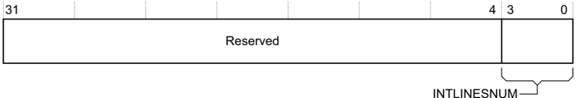

Table 7-2 shows the ICTR bit assignments.

Table 7-2 ICTR bit assignments

| Bits   | Name        | Function                                         | Function                                         |
|--------|-------------|--------------------------------------------------|--------------------------------------------------|
| [31:4] | -           | Reserved.                                        | Reserved.                                        |
| [3:0]  | INTLINESNUM | Total number of interrupt lines in groups of 32: | Total number of interrupt lines in groups of 32: |
|        |             | 0b0000                                           | 0-32.                                            |
|        |             | 0b0001                                           | 33-64.                                           |
|        |             | 0b0010                                           | 65-96.                                           |
|        |             | 0b0011                                           | 97-128.                                          |
|        |             | 0b0100                                           | 129-160.                                         |
|        |             | 0b0101                                           | 161-192.                                         |
|        |             | 0b0110                                           | 193-224.                                         |
|        |             | 0b0111                                           | 225-256 a .                                      |

## Chapter 8 Floating Point Unit

This chapter describes the Floating Point Unit (FPU). It contains the following sections:

- About the FPU on page 8-2.
- FPU functional description on page 8-3.
- FPU programmers model on page 8-5.

## 8.1 About the FPU

The Cortex-M7 processor with FPU is an implementation of the single-precision and double-precision variant of the ARMv7-M Architecture with Floating-Point Extension (FPv5).

The FPv5 extensions features are:

- Addition of double-precision operand support for existing data processing instructions in FPv4-SP-D16-M.
- Some new instructions for both double and single-precision operands.
- 16 double-precision registers. This is the same as for FPv4 and there are no additional registers.
- Software-enable control for single-precision and double-precision support using CPACR.
- Double-precision and single-precision support, when both are implemented, cannot be enabled independently of one another.
- Identical load/store instruction support to FPv4 extensions that already includes support for 64-bit data types.

Table 8-1 shows the ISA supported for the different configurations of the Cortex-M7 processor.

Table 8-1 Cortex-M7 ISA Support

| Configuration                                                       | ISA supported         |
|---------------------------------------------------------------------|-----------------------|
| Processor with no floating-point                                    | v7E-M                 |
| Processor with single-precision floating-point                      | v7E-M + FPv5-SP-D16-M |
| Processor with single-precision and double-precision floating-point | v7E-M + FPv5-DP-D16-M |

It provides floating-point computation functionality that is compliant with the ANSI/IEEE Std 754-2008, IEEE Standard for Binary Floating-Point Arithmetic , referred to as the IEEE 754 standard.

## 8.2 FPU functional description

This section describes the operations and that the FPU supports and what exceptions the FPU generates.

The FPU fully supports single-precision and double-precision add, subtract, multiply, divide, multiply and accumulate, and square root operations. It also provides conversions between fixed-point and floating-point data formats, and floating-point constant instructions.

The FPU provides an extension register file containing 32 single-precision registers. These can be viewed as:

- Sixteen 64-bit doubleword registers, D0-D15 .
- Thirty-two 32-bit single-word registers, S0-S31 .
- A combination of registers from these views.

For more information about the FPU, see the Arm ® v7-M Architecture Reference Manual .

This section contains the following:

- Modes of operation .
- Compliance with the IEEE 754 standard on page 8-4.
- Exceptions on page 8-4.

The modes of operation are controlled using the Floating-Point Status and Control Register, FPSCR. For more information about the FPSCR see the ARMv7-M Architecture Reference Manual .

## 8.2.1 Modes of operation

The FPU provides three modes of operation to accommodate a variety of applications:

- Full-compliance mode .
- Flush-to-zero mode .
- Default NaN mode .

## Full-compliance mode

In full-compliance mode, the FPU processes all operations according to the IEEE 754 standard in hardware.

## Flush-to-zero mode

Setting the FPSCR.FZ bit enables flush-to-zero mode. In this mode, the FPU treats all subnormal input operands of arithmetic operations as zeros in the operation. Exceptions that result from a zero operand are signaled appropriately. VABS , VNEG , and VMOV are not considered arithmetic operations and are not affected by flush-to-zero mode. A result that is tiny , as described in the IEEE 754 standard, where the destination precision is smaller in magnitude than the minimum normal value before rounding , is replaced with a zero. The FPSCR.IDC bit indicates when an input flush occurs. The FPSCR.UFC bit indicates when a result flush occurs.

## Default NaN mode

Setting the FPSCR.DN bit enables default NaN mode. In this mode, the result of any arithmetic data processing operation that involves an input NaN, or that generates a NaN result, returns the default NaN. Propagation of the fraction bits is maintained only by VABS , VNEG , and VMOV operations. All other arithmetic operations ignore any information in the fraction bits of an input NaN.

## 8.2.2 Compliance with the IEEE 754 standard

When Default NaN (DN) and Flush-to-Zero (FZ) modes are disabled, FPv5 functionality is compliant with the IEEE 754 standard in hardware. No support code is required to achieve this compliance.

See the Arm ® v7-M Architecture Reference Manual for information about FP architecture compliance with the IEEE 754 standard.

The FPU sets the cumulative exception status flag in the FPSCR register as required for each instruction, in accordance with the FPv5 architecture. The FPU does not support exception traps. The processor also has six output pins, FPIXC , FPUFC , FPOFC , FPDZC , FPIDC , and FPIOC , that each reflect the status of one of the cumulative exception flags.

The processor can reduce the exception latency by using lazy stacking. This means that the processor reserves space on the stack for the FP state, but does not save that state information to the stack until it is required to do so. See the Arm ® v7-M Architecture Reference Manual for more information.

## 8.2.3 Exceptions

## 8.3 FPU programmers model

Table 8-2 shows the floating-point system registers in the Cortex-M7 processor with FPU, when implemented. These registers are described in the Arm ® v7-M Architecture Reference Manual .

Table 8-2  Floating-point system registers

| Address    | Name   | Type   | Reset        | Description                      |
|------------|--------|--------|--------------|----------------------------------|
| 0xE000EF34 | FPCCR  | RW     | 0xC0000000   | Context Control Register         |
| 0xE000EF38 | FPCAR  | RW     | -            | Context Address Register         |
| 0xE000EF3C | FPDSCR | RW     | 0x00000000   | Default Status Control Register  |
| 0xE000EF40 | MVFR0  | RO     | 0x10110021 a | Media and VFP Feature Register 0 |
|            |        |        | 0x10110221 b |                                  |
| 0xE000EF44 | MVFR1  | RO     | 0x11000011 a | Media and VFP Feature Register 1 |
|            |        |        | 0x12000011 b |                                  |
| 0xE000EF48 | MVFR2  | RO     | 0x00000040   | Media and VFP Feature Register 2 |

## Chapter 9 Debug

This chapter describes how to debug and test software running on the processor. It contains the following sections:

- About debug on page 9-2.
- About the AHBD interface on page 9-7.
- About the FPB on page 9-8.

## 9.1 About debug

Cortex-M7 debug functionality includes processor halt, single-step, processor core register access, Vector Catch, unlimited software breakpoints, and full system memory access. See the Arm ® v7-M Architecture Reference Manual for more information. The processor also includes support for hardware breakpoints and watchpoints configured during implementation:

- A breakpoint unit supporting four to eight instruction comparators.
- A watchpoint unit supporting two or four watchpoints.

For processors that implement debug, Arm recommends that a debugger identify and connect to the debug components using the CoreSight debug infrastructure.

Figure 9-1 shows the recommended flow that a debugger can follow to discover the components in the CoreSight debug infrastructure. In this case a debugger reads the peripheral and component ID registers for each CoreSight component in the CoreSight system.

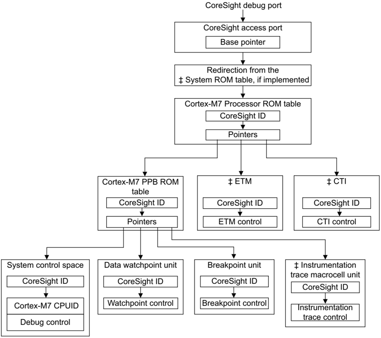

- ‡ Optional component

Figure 9-1 CoreSight discovery

To identify the Cortex-M7 processor within the CoreSight system, Arm recommends that a debugger perform the following actions:

1. Locate and identify the Cortex-M7 Processor ROM table using its CoreSight identification. See Table 9-2 on page 9-4 for more information.

2. Follow the pointer in the Cortex-M7 Processor ROM table to the Cortex-M7 PPB ROM table. From the PPB ROM table pointers the following components can be identified:
- a. System Control Space (SCS).
- b. Breakpoint unit (FPB).
- c. Data Watchpoint and Trace unit (DWT).
- d. Instrumentation Trace Macrocell unit (IMT).

See Table 9-4 on page 9-5 for more information.

When a debugger identifies the SCS from its CoreSight identification, it can identify the processor and its revision number from the CPUID register in the SCS at address 0xE000ED00 .

A debugger cannot rely on the Cortex-M7 Processor ROM table being the first ROM table encountered. One or more system ROM tables are required between the access port and the processor ROM table if other CoreSight components are in the system. If a system ROM table is present, this can include a unique identifier for the implementation.

## 9.1.1 Cortex-M7 Processor ROM table identification and entries

Table 9-1 shows the processor ROM table identification registers and values for debugger detection. This permits debuggers to identify the processor.

Table 9-1 Cortex-M7 Processor ROM table identification values

| Address    | Register       | Description                                                                                                                                                                                                |
|------------|----------------|------------------------------------------------------------------------------------------------------------------------------------------------------------------------------------------------------------|
| 0xE00FEFD0 | Peripheral ID4 | 0x00000004 Component and Peripheral ID register formats in the Arm ® v7-M Architecture Reference Manual 0x00000000 0x00000000 0x00000000 0x000000C8 0x000000B4 0x0000000B 0x00000000 0x0000000D 0x00000010 |
| 0xE00FEFD4 | Peripheral ID5 | 0x00000004 Component and Peripheral ID register formats in the Arm ® v7-M Architecture Reference Manual 0x00000000 0x00000000 0x00000000 0x000000C8 0x000000B4 0x0000000B 0x00000000 0x0000000D 0x00000010 |
| 0xE00FEFD8 | Peripheral ID6 | 0x00000004 Component and Peripheral ID register formats in the Arm ® v7-M Architecture Reference Manual 0x00000000 0x00000000 0x00000000 0x000000C8 0x000000B4 0x0000000B 0x00000000 0x0000000D 0x00000010 |
| 0xE00FEFDC | Peripheral ID7 | 0x00000004 Component and Peripheral ID register formats in the Arm ® v7-M Architecture Reference Manual 0x00000000 0x00000000 0x00000000 0x000000C8 0x000000B4 0x0000000B 0x00000000 0x0000000D 0x00000010 |
| 0xE00FEFE0 | Peripheral ID0 | 0x00000004 Component and Peripheral ID register formats in the Arm ® v7-M Architecture Reference Manual 0x00000000 0x00000000 0x00000000 0x000000C8 0x000000B4 0x0000000B 0x00000000 0x0000000D 0x00000010 |
| 0xE00FEFE4 | Peripheral ID1 | 0x00000004 Component and Peripheral ID register formats in the Arm ® v7-M Architecture Reference Manual 0x00000000 0x00000000 0x00000000 0x000000C8 0x000000B4 0x0000000B 0x00000000 0x0000000D 0x00000010 |
| 0xE00FEFE8 | Peripheral ID2 | 0x00000004 Component and Peripheral ID register formats in the Arm ® v7-M Architecture Reference Manual 0x00000000 0x00000000 0x00000000 0x000000C8 0x000000B4 0x0000000B 0x00000000 0x0000000D 0x00000010 |
| 0xE00FEFEC | Peripheral ID3 | 0x00000004 Component and Peripheral ID register formats in the Arm ® v7-M Architecture Reference Manual 0x00000000 0x00000000 0x00000000 0x000000C8 0x000000B4 0x0000000B 0x00000000 0x0000000D 0x00000010 |
| 0xE00FEFF0 | Component ID0  | 0x00000004 Component and Peripheral ID register formats in the Arm ® v7-M Architecture Reference Manual 0x00000000 0x00000000 0x00000000 0x000000C8 0x000000B4 0x0000000B 0x00000000 0x0000000D 0x00000010 |
| 0xE00FEFF4 | Component ID1  | 0x00000004 Component and Peripheral ID register formats in the Arm ® v7-M Architecture Reference Manual 0x00000000 0x00000000 0x00000000 0x000000C8 0x000000B4 0x0000000B 0x00000000 0x0000000D 0x00000010 |
| 0xE00FEFF8 | Component ID2  | 0x00000004 Component and Peripheral ID register formats in the Arm ® v7-M Architecture Reference Manual 0x00000000 0x00000000 0x00000000 0x000000C8 0x000000B4 0x0000000B 0x00000000 0x0000000D 0x00000010 |
| 0xE00FEFFC | Component ID3  | 0x00000004 Component and Peripheral ID register formats in the Arm ® v7-M Architecture Reference Manual 0x00000000 0x00000000 0x00000000 0x000000C8 0x000000B4 0x0000000B 0x00000000 0x0000000D 0x00000010 |

These values for the Peripheral ID registers identify this as the Cortex-M7 Processor ROM table. The Component ID registers identify this as a CoreSight ROM table.

Note

The Cortex-M7 Processor ROM table only supports word-size transactions.

Table 9-2 shows the CoreSight components that the Cortex-M7 Processor ROM table points to.

Table 9-2 Cortex-M7 Processor ROM table components

| Address    | Component              | Value        | Description                                                 |
|------------|------------------------|--------------|-------------------------------------------------------------|
| 0xE00FE000 | Cortex-M7 PPBROM Table | 0x00001003   | See Cortex-M7 PPB ROM table identification and entries      |
| 0xE00FE004 | ETM                    | 0xFFF43003 a | See the Arm ® CoreSight ™ ETM-M7 Technical Reference Manual |
| 0xE00FE008 | CTI                    | 0xFFF44003 b | See Chapter 10 Cross Trigger Interface                      |
| 0xE00FE00C | Reserved               | 0x1FF02002   | See the Arm ® CoreSight ™ Architecture Specification (v2.0) |
| 0xE00FE010 | End marker             | 0x00000000   | See the Arm ® CoreSight ™ Architecture Specification (v2.0) |
| 0xE00FEFCC | SYSTEM ACCESS          | 0x00000001   | See the Arm ® CoreSight ™ Architecture Specification (v2.0) |

The Cortex-M7 Processor ROM table entries point to the debug components of the processor. The offset for each entry is the offset of that component from the ROM table base address, 0xE00FE000 .

See the Arm ®  CoreSight ™  Architecture Specification (v2.0) for more information about the ROM table ID and component registers, and access types.

## 9.1.2 Cortex-M7 PPB ROM table identification and entries

Table 9-3 shows the Cortex-M7 PPB ROM table identification registers and values for debugger detection. This permits debuggers to identify the CoreSight components on the PPB in the processor and their debug capabilities.

Table 9-3 Cortex-M7 PPB ROM table identification values

| Address    | Register       | Description                                                                                                                                                                                                |
|------------|----------------|------------------------------------------------------------------------------------------------------------------------------------------------------------------------------------------------------------|
| 0xE00FFFD0 | Peripheral ID4 | 0x00000004 Component and Peripheral ID register formats in the Arm ® v7-M Architecture Reference Manual 0x00000000 0x00000000 0x00000000 0x000000C7 0x000000B4 0x0000000B 0x00000000 0x0000000D 0x00000010 |
| 0xE00FFFD4 | Peripheral ID5 | 0x00000004 Component and Peripheral ID register formats in the Arm ® v7-M Architecture Reference Manual 0x00000000 0x00000000 0x00000000 0x000000C7 0x000000B4 0x0000000B 0x00000000 0x0000000D 0x00000010 |
| 0xE00FFFD8 | Peripheral ID6 | 0x00000004 Component and Peripheral ID register formats in the Arm ® v7-M Architecture Reference Manual 0x00000000 0x00000000 0x00000000 0x000000C7 0x000000B4 0x0000000B 0x00000000 0x0000000D 0x00000010 |
| 0xE00FFFDC | Peripheral ID7 | 0x00000004 Component and Peripheral ID register formats in the Arm ® v7-M Architecture Reference Manual 0x00000000 0x00000000 0x00000000 0x000000C7 0x000000B4 0x0000000B 0x00000000 0x0000000D 0x00000010 |
| 0xE00FFFE0 | Peripheral ID0 | 0x00000004 Component and Peripheral ID register formats in the Arm ® v7-M Architecture Reference Manual 0x00000000 0x00000000 0x00000000 0x000000C7 0x000000B4 0x0000000B 0x00000000 0x0000000D 0x00000010 |
| 0xE00FFFE4 | Peripheral ID1 | 0x00000004 Component and Peripheral ID register formats in the Arm ® v7-M Architecture Reference Manual 0x00000000 0x00000000 0x00000000 0x000000C7 0x000000B4 0x0000000B 0x00000000 0x0000000D 0x00000010 |
| 0xE00FFFE8 | Peripheral ID2 | 0x00000004 Component and Peripheral ID register formats in the Arm ® v7-M Architecture Reference Manual 0x00000000 0x00000000 0x00000000 0x000000C7 0x000000B4 0x0000000B 0x00000000 0x0000000D 0x00000010 |
| 0xE00FFFEC | Peripheral ID3 | 0x00000004 Component and Peripheral ID register formats in the Arm ® v7-M Architecture Reference Manual 0x00000000 0x00000000 0x00000000 0x000000C7 0x000000B4 0x0000000B 0x00000000 0x0000000D 0x00000010 |
| 0xE00FFFF0 | Component ID0  | 0x00000004 Component and Peripheral ID register formats in the Arm ® v7-M Architecture Reference Manual 0x00000000 0x00000000 0x00000000 0x000000C7 0x000000B4 0x0000000B 0x00000000 0x0000000D 0x00000010 |
| 0xE00FFFF4 | Component ID1  | 0x00000004 Component and Peripheral ID register formats in the Arm ® v7-M Architecture Reference Manual 0x00000000 0x00000000 0x00000000 0x000000C7 0x000000B4 0x0000000B 0x00000000 0x0000000D 0x00000010 |
| 0xE00FFFF8 | Component ID2  | 0x00000004 Component and Peripheral ID register formats in the Arm ® v7-M Architecture Reference Manual 0x00000000 0x00000000 0x00000000 0x000000C7 0x000000B4 0x0000000B 0x00000000 0x0000000D 0x00000010 |
| 0xE00FFFFC | Component ID3  | 0x00000004 Component and Peripheral ID register formats in the Arm ® v7-M Architecture Reference Manual 0x00000000 0x00000000 0x00000000 0x000000C7 0x000000B4 0x0000000B 0x00000000 0x0000000D 0x00000010 |

These values for the Peripheral ID registers identify this as the Cortex-M7 PPB ROM table. The Component ID registers identify this as a CoreSight ROM table.

Note

The Cortex-M7 PPB ROM table only supports word size transactions.

Table 9-4 shows the CoreSight components that the Cortex-M7 PPB ROM table points to. The values depend on the implemented debug configuration.

Table 9-4 Cortex-M7 PPB ROM table components

| Address    | Component       | Value        | Description                                                                                                                                   |
|------------|-----------------|--------------|-----------------------------------------------------------------------------------------------------------------------------------------------|
| 0xE00FF000 | SCS             | 0xFFF0F003   | See System Control Space .                                                                                                                    |
| 0xE00FF004 | DWT             | 0xFFF02003   | See Table 11-1 on page 11-4.                                                                                                                  |
| 0xE00FF008 | FPB             | 0xFFF03003   | See Table 9-7 on page 9-8.                                                                                                                    |
| 0xE00FF00C | ITM             | 0xFFF01003 a | See Table 12-1 on page 12-4.                                                                                                                  |
| 0xE00FF010 | Reserved (TPIU) | 0xFFF41002   | Not present, TPIU not implemented inside Cortex-M7.                                                                                           |
| 0xE00FF014 | Reserved (ETM)  | 0xFFF42002   | Not present, ETM is referenced by the Cortex-M7 Processor ROMtable. See Cortex-M7 Processor ROM table identification and entries on page 9-3. |
| 0xE00FF018 | End marker      | 0x00000000   | See DAPaccessible ROMtable in the Arm ® v7-M Architecture Reference Manual .                                                                  |
| 0xE00FFFCC | SYSTEM ACCESS   | 0x00000001   | See DAPaccessible ROMtable in the Arm ® v7-M Architecture Reference Manual .                                                                  |

The Cortex-M7 PPB ROM table entries point to the debug components of the processor. The offset for each entry is the offset of that component from the ROM table base address, 0xE00FF000 .

See the Arm ® v7-M Architecture Reference Manual and the Arm ®  CoreSight ™  Architecture Specification (v2.0) for more information about the ROM table ID and component registers, and their addresses and access types.

## 9.1.3 System Control Space

The processor provides debug through registers in the SCS. See:

- Debug register summary on page 9-6.
- System address map on page 2-5.

## SCS CoreSight identification

Table 9-5 shows the SCS CoreSight identification registers and values for debugger detection. Final debugger identification of the Cortex-M7 processor is through the CPUID register in the SCS. See CPUID Base Register on page 3-8.

Table 9-5 SCS identification values

| Address    | Register       | Value        | Description                                                                                  |
|------------|----------------|--------------|----------------------------------------------------------------------------------------------|
| 0xE000EFD0 | Peripheral ID4 | 0x00000004   | Component and Peripheral ID register formats in the Arm ® v7-M Architecture Reference Manual |
| 0xE000EFD4 | Peripheral ID5 | 0x00000000   | Component and Peripheral ID register formats in the Arm ® v7-M Architecture Reference Manual |
| 0xE000EFD8 | Peripheral ID6 | 0x00000000   | Component and Peripheral ID register formats in the Arm ® v7-M Architecture Reference Manual |
| 0xE000EFDC | Peripheral ID7 | 0x00000000   | Component and Peripheral ID register formats in the Arm ® v7-M Architecture Reference Manual |
| 0xE000EFE0 | Peripheral ID0 | 0x0000000C a | Component and Peripheral ID register formats in the Arm ® v7-M Architecture Reference Manual |
| 0xE000EFE4 | Peripheral ID1 | 0x000000B0   | Component and Peripheral ID register formats in the Arm ® v7-M Architecture Reference Manual |
| 0xE000EFE8 | Peripheral ID2 | 0x0000000B   | Component and Peripheral ID register formats in the Arm ® v7-M Architecture Reference Manual |
| 0xE000EFEC | Peripheral ID3 | 0x00000000   | Component and Peripheral ID register formats in the Arm ® v7-M Architecture Reference Manual |
| 0xE000EFF0 | Component ID0  | 0x0000000D   | Component and Peripheral ID register formats in the Arm ® v7-M Architecture Reference Manual |
| 0xE000EFF4 | Component ID1  | 0x000000E0   | Component and Peripheral ID register formats in the Arm ® v7-M Architecture Reference Manual |
| 0xE000EFF8 | Component ID2  | 0x00000005   | Component and Peripheral ID register formats in the Arm ® v7-M Architecture Reference Manual |
| 0xE000EFFC | Component ID3  | 0x000000B1   | Component and Peripheral ID register formats in the Arm ® v7-M Architecture Reference Manual |

See the Arm ® v7-M Architecture Reference Manual and the Arm ®  CoreSight ™  Architecture Specification (v2.0) for more information about the ROM table ID and component registers, and their addresses and access types.

## 9.1.4 Debug register summary

Table 9-6 shows the debug registers. Each of these registers is 32 bits wide and is described in the Arm ® v7-M Architecture Reference Manual .

Table 9-6 Debug registers

| Address    | Name   | Type   | Reset        | Description                                  |
|------------|--------|--------|--------------|----------------------------------------------|
| 0xE000ED30 | DFSR   | RW     | 0x00000000 a | Debug Fault Status Register                  |
| 0xE000EDF0 | DHCSR  | RW     | 0x00000000   | Debug Halting Control and Status Register    |
| 0xE000EDF4 | DCRSR  | WO     | -            | Debug Core Register Selector Register        |
| 0xE000EDF8 | DCRDR  | RW     | -            | Debug Core Register Data Register            |
| 0xE000EDFC | DEMCR  | RW     | 0x00000000   | Debug Exception and Monitor Control Register |

## 9.2 About the AHBD interface

The 32-bit AHB debug (AHBD) interface implements the AMBA 3 AHB-Lite protocol.

It can be used with a CoreSight AHB-AP to provide debugger access to:

- All processor control and debug resources.
- A view of memory that is consistent with that observed by load/store instructions acting on the processor.

AHBD interface accesses are only in little-endian format. The processor ensures data is presented in the correct big- or little-endian format to the system. This is transparent to the debugger.

Note

- The instruction cache is not accessible to a debugger. Therefore debugger accesses to cacheable, executable regions of memory might not be coherent with the instructions visible to the instruction side of the processor.
- The data cache must be enabled by setting the CCR.DC to 1 to read and write data to the cache. If CCR.DC is set to 0, all debug requests to memory regions outside the TCM and peripheral address space, access only the external memory on AXIM even if the debug request is marked as cacheable on the AHBD interface.

## 9.3 About the FPB

The FPB implements hardware breakpoints.

The FPB can be configured during implementation to provide either four or eight instruction comparators. You can configure each comparator individually to return a BKPT instruction to the processor on a match, to provide hardware breakpoint capability.

The FPB does not support Flash patching. The FP\_REMAP register is not implemented and is RAZ/WI.

## 9.3.1 FPB functional description

The FPB contains both a global enable and individual enables for each of the comparators implemented. If the comparison for an entry matches, the address is remapped to a BKPT instruction if that feature is enabled.

If the FPB supports only four breakpoints then only comparators 0-3 are used, and comparators 4-7 are implemented as RAZ/WI.

## 9.3.2 FPB programmers model

Table 9-7 shows the FPB registers. Depending on the implementation of your processor, some of these registers might not be present. Any register that is configured as not present reads as zero.

Table 9-7 FPB register summary

| Address    | Name     | Type   | Reset                     | Description                     |
|------------|----------|--------|---------------------------|---------------------------------|
| 0xE0002000 | FP_CTRL  | RW     | 0x10000040 a 0x10000080 b | FlashPatch Control Register     |
| 0xE0002004 | FP_REMAP | RAZ/WI | -                         | Not implemented                 |
| 0xE0002008 | FP_COMP0 | RW     | 0b00000000 c              | FlashPatch Comparator Register0 |
| 0xE000200C | FP_COMP1 | RW     | 0b00000000                | FlashPatch Comparator Register1 |
| 0xE0002010 | FP_COMP2 | RW     | 0b00000000                | FlashPatch Comparator Register2 |
| 0xE0002014 | FP_COMP3 | RW     | 0b00000000                | FlashPatch Comparator Register3 |
| 0xE0002018 | FP_COMP4 | RW     | 0b00000000                | FlashPatch Comparator Register4 |
| 0xE000201C | FP_COMP5 | RW     | 0b00000000                | FlashPatch Comparator Register5 |
| 0xE0002020 | FP_COMP6 | RW     | 0b00000000                | FlashPatch Comparator Register6 |
| 0xE0002024 | FP_COMP7 | RW     | 0b00000000                | FlashPatch Comparator Register7 |
| 0xE0002FB0 | FP_LAR   | WO     | -                         | FlashPatch Lock Access Register |
| 0xE0002FB4 | FP_LSR   | RO     | Unknown                   | FlashPatch Lock Status Register |

Table 9-7 FPB register summary  (continued)

| Address    | Name   | Type   | Reset      | Description                         |
|------------|--------|--------|------------|-------------------------------------|
| 0xE0002FD0 | PID4   | RO     | 0x00000004 | Peripheral identification registers |
| 0xE0002FD4 | PID5   | RO     | 0x00000000 | Peripheral identification registers |
| 0xE0002FD8 | PID6   | RO     | 0x00000000 | Peripheral identification registers |
| 0xE0002FDC | PID7   | RO     | 0x00000000 | Peripheral identification registers |
| 0xE0002FE0 | PID0   | RO     | 0x0000000E | Peripheral identification registers |
| 0xE0002FE4 | PID1   | RO     | 0x000000B0 | Peripheral identification registers |
| 0xE0002FE8 | PID2   | RO     | 0x0000000B | Peripheral identification registers |
| 0xE0002FEC | PID3   | RO     | 0x00000000 | Peripheral identification registers |
| 0xE0002FF0 | CID0   | RO     | 0x0000000D | Component identification registers  |
| 0xE0002FF4 | CID1   | RO     | 0x000000E0 | Component identification registers  |
| 0xE0002FF8 | CID2   | RO     | 0x00000005 | Component identification registers  |
| 0xE0002FFC | CID3   | RO     | 0x000000B1 | Component identification registers  |

All FPB registers are described in the Arm ® v7-M Architecture Reference Manual .

## Chapter 10

## Cross Trigger Interface

This chapter describes the Cortex-M7 Cross Trigger Interface (CTI). It contains the following sections:

- About the CTI on page 10-2.
- Cortex-M7 CTI functional description on page 10-3.
- CTI programmers model on page 10-5.

## 10.1 About the CTI

If implemented, the CTI enables the debug logic and ETM to interact with each other and with other CoreSight components. This is called cross triggering. For example, you can configure the CTI to generate an interrupt when the ETM trigger event occurs.

## 10.2 Cortex-M7 CTI functional description

The Cortex-M7 CTI is connected to a number of trigger inputs and trigger outputs. Figure 10-1 shows the debug system components and the available trigger inputs and trigger outputs.

Figure 10-1 Debug system components

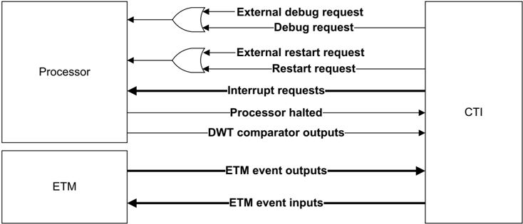

Table 10-1 shows how the CTI trigger inputs are connected to the Cortex-M7 processor.

Table 10-1 Trigger signals to the CTI

| Signal                          | Description                 | Connection   | Acknowledge, handshake   |
|---------------------------------|-----------------------------|--------------|--------------------------|
| ETM Event Output 3              | ETM to CTI Processor to CTI | Pulsed       | CTITRIGIN[7]             |
| ETM Event Output 2              | ETM to CTI Processor to CTI | Pulsed       | CTITRIGIN[6]             |
| CTITRIGIN[5] ETM Event Output 1 | ETM to CTI Processor to CTI | Pulsed       | CTITRIGIN[4]             |
| ETM Event Output 0              | ETM to CTI Processor to CTI | Pulsed       |                          |
| DWT Comparator Output 2         |                             | Pulsed       | CTITRIGIN[3]             |
| DWTComparator Output 1          |                             | Pulsed       | CTITRIGIN[2]             |
| DWTComparator Output 0          |                             | Pulsed       | CTITRIGIN[1]             |
| Processor Halted                |                             | Pulsed       | CTITRIGIN[0]             |

Table 10-2 shows how the CTI trigger outputs are connected to the processor and ETM.

Table 10-2 Trigger signals from the CTI

| Signal                          | Description              | Connection          | Acknowledge, handshake   |
|---------------------------------|--------------------------|---------------------|--------------------------|
| Processor                       | Restart CTI to Processor | Processor Restarted | CTITRIGOUT[7]            |
| ETM Event Input 3               | CTI to ETM               | Pulsed              | CTITRIGOUT[6]            |
| CTITRIGOUT[5] ETM Event         | Input 2                  | Pulsed              |                          |
| CTITRIGOUT[4] ETM Event Input 1 |                          |                     | Pulsed                   |
| CTITRIGOUT[3] ETM Event Input 0 |                          |                     | Pulsed                   |

Table 10-2 Trigger signals from the CTI (continued)

| Signal        | Description                       | Connection                                               | Acknowledge, handshake                                         |
|---------------|-----------------------------------|----------------------------------------------------------|----------------------------------------------------------------|
|               | Interrupt request 1 CTI to system | Acknowledged by writing to the CTIINTACK register in ISR | CTITRIGOUT[2]                                                  |
| CTITRIGOUT[1] | Interrupt request 0               |                                                          |                                                                |
| CTITRIGOUT[0] | Processor debug request           | CTI to processor                                         | Acknowledged by the debugger writing to the CTIINTACK register |

Note

- After the processor is halted using CTI Trigger Output 0, the Processor Debug Request signal remains asserted. The debugger must write to CTIINTACK to clear the halting request before restarting the processor.
- After asserting an interrupt using the CTI Trigger Output 1 or 2, the Interrupt Service Routine (ISR) must clear the interrupt request by writing to the CTI Interrupt Acknowledge, CTIINTACK.

## 10.3 CTI programmers model

Table 10-3 shows the CTI programmable registers. See the Arm ®  CoreSight ™  SoC-400 Technical Reference Manual for register descriptions.

## Table 10-3 CTI register summary

| Address offset   | Register name    | Type   | Reset value   | Description                                          |
|------------------|------------------|--------|---------------|------------------------------------------------------|
| 0x000            | CTICONTROL       | RW     | 0x00000000    | CTI Control Register                                 |
| 0x010            | CTIINTACK        | WO     | 0x00000000    | CTI Interrupt Acknowledge Register                   |
| 0x014            | CTIAPPSET        | RW     | 0x00000000    | CTI Application Trigger Set Register                 |
| 0x018            | CTIAPPCLEAR      | RW     | 0x00000000    | CTI Application Trigger Clear Register               |
| 0x01C            | CTIAPPPULSE      | WO     | 0x00000000    | CTI Application Pulse Register                       |
| 0x020 - 0x03C    | CTIINEN[7:0]     | RW     | 0x00000000    | CTI Trigger to Channel Enable Registers              |
| 0x0A0 - 0x0BC    | CTIOUTEN[7:0]    | RW     | 0x00000000    | CTI Channel to Trigger Enable Registers              |
| 0x130            | CTITRIGINSTATUS  | RO     | 0x00000000    | CTI Trigger In Status Register                       |
| 0x134            | CTITRIGOUTSTATUS | RO     | 0x00000000    | CTI Trigger Out Status Register                      |
| 0x138            | CTICHINSTATUS    | RO     | 0x00000000    | CTI Channel In Status Register                       |
| 0x140            | CTIGATE          | RW     | 0x00000000    | Enable CTI Channel Gate register                     |
| 0x144            | ASICCTL          | RW     | 0x00000000    | External Multiplexer Control register                |
| 0xEDC            | ITCHINACK        | WO     | 0x00000000    | Integration Test Channel Input Acknowledge register  |
| 0xEE0            | ITTRIGINACK      | WO     | 0x00000000    | Integration Test Trigger Input Acknowledge register  |
| 0xEE4            | ITCHOUT          | WO     | 0x00000000    | Integration Test Channel Output register             |
| 0xEE8            | ITTRIGOUT        | WO     | 0x00000000    | Integration Test Trigger Output register             |
| 0xEEC            | ITCHOUTACK       | WO     | 0x00000000    | Integration Test Channel Output Acknowledge register |
| 0xEF0            | ITTRIGOUTACK     | RO     | 0x00000000    | Integration Test Trigger Output Acknowledge register |
| 0xEF4            | ITCHIN           | RO     | 0x00000000    | Integration Test Channel Input register              |
| 0xEF8            | ITTRIGIN         | RO     | 0x00000000    | Integration Test Trigger Input register              |
| 0xF00            | ITCTRL           | RW     | 0x00000000    | Integration Mode Control register                    |
| 0xFA0            | CLAIMSET         | RW     | 0x0000000F    | Claim Tag Set register                               |
| 0xFA4            | CLAIMCLR         | RW     | 0x00000000    | Claim Tag Clear register                             |
| 0xFB0            | LAR              | WO     | 0x00000000    | Lock Access Register                                 |
| 0xFB4            | LSR              | RO     | 0x00000003    | Lock Status Register                                 |
| 0xFB8            | AUTHSTATUS       | RO     | 0x00000005    | Authentication Status register                       |
| 0xFC8            | DEVID            | RO     | 0x00040800    | Device Configuration register                        |

Table 10-3 CTI register summary (continued)

| Address offset   | Register name   | Type   | Reset value   | Description                     |
|------------------|-----------------|--------|---------------|---------------------------------|
| 0xFCC            | DEVTYPE         | RO     | 0x00000014    | Device Type Identifier register |
| 0xFD0            | PIDR4           | RO     | 0x00000004    | Peripheral ID4 Register         |
| 0xFD4            | -               | -      | -             | Reserved                        |
| 0xFD8            | -               | -      | -             | Reserved                        |
| 0xFDC            | -               | -      | -             | Reserved                        |
| 0xFE0            | PIDR0           | RO     | 0x00000006    | Peripheral ID0 Register         |
| 0xFE4            | PIDR1           | RO     | 0x000000B9    | Peripheral ID1 Register         |
| 0xFE8            | PIDR2           | RO     | 0x0000004B    | Peripheral ID2 Register         |
| 0xFEC            | PIDR3           | RO     | 0x00000000    | Peripheral ID3 Register         |
| 0xFF0            | CIDR0           | RO     | 0x0000000D    | Component ID0 Register          |
| 0xFF4            | CIDR1           | RO     | 0x00000090    | Component ID1 Register          |
| 0xFF8            | CIDR2           | RO     | 0x00000005    | Component ID2 Register          |
| 0xFFC            | CIDR3           | RO     | 0x000000B1    | Component ID3 Register          |

## Chapter 11 Data Watchpoint and Trace Unit

This chapter describes the Data Watchpoint and Trace (DWT) unit. It contains the following sections:

- About the DWT on page 11-2.
- DWT functional description on page 11-3.
- DWT programmers model on page 11-4.

## 11.1 About the DWT

The DWT is a debug unit that provides watchpoints and system profiling for the processor. Data tracing is also available if the processor has been implemented with DWT and ITM trace. See Chapter 12 Instrumentation Trace Macrocell Unit for details about the ITM.

## 11.2 DWT functional description

A full DWT contains four comparators that you can configure as:

- A hardware watchpoint.
- An ETM trigger.
- A PC sampler event trigger.
- A data address sampler event trigger.

The first comparator, DWT\_COMP0, can also compare against the clock cycle counter, CYCCNT. You can also use the second comparator, DWT\_COMP1, as a data comparator.

A reduced DWT contains two comparators that you can use as a watchpoint or as a trigger. The comparators support data matching.

The DWT if present contains counters for:

- Clock cycles, CYCCNT.
- Folded instructions.
- Load Store Unit (LSU) operations.
- Sleep cycles.
- CPI, that is all instruction cycles except for the first cycle.
- Interrupt overhead.

Note

An event is generated each time a counter overflows.

You can configure the DWT to generate PC samples at defined intervals, and to generate interrupt event information.

The DWT provides periodic requests for protocol synchronization to the ITM.

## 11.3 DWT programmers model

Table 11-1 shows the DWT registers. Depending on the implementation of your processor, some of these registers might not be present. Any register that is configured as not present reads as zero.

Table 11-1 DWT register summary

| Address    | Name          | Type   | Reset        | Description                       |
|------------|---------------|--------|--------------|-----------------------------------|
| 0xE0001000 | DWT_CTRL      | RW     | See a        | Control Register                  |
| 0xE0001004 | DWT_CYCCNT    | RW     | 0x00000000   | Cycle Count Register              |
| 0xE0001008 | DWT_CPICNT    | RW     | -            | CPI Count Register                |
| 0xE000100C | DWT_EXCCNT    | RW     | -            | Exception Overhead Count Register |
| 0xE0001010 | DWT_SLEEPCNT  | RW     | -            | Sleep Count Register              |
| 0xE0001014 | DWT_LSUCNT    | RW     | -            | LSU Count Register                |
| 0xE0001018 | DWT_FOLDCNT   | RW     | -            | Folded-instruction Count Register |
| 0xE000101C | DWT_PCSR      | RO     | -            | Program Counter Sample Register   |
| 0xE0001020 | DWT_COMP0     | RW     | -            | Comparator Register 0             |
| 0xE0001024 | DWT_MASK0     | RW     | -            | Mask Register 0                   |
| 0xE0001028 | DWT_FUNCTION0 | RW     | 0x00000000   | Function Register 0               |
| 0xE0001030 | DWT_COMP1     | RW     | -            | Comparator Register 1             |
| 0xE0001034 | DWT_MASK1     | RW     | -            | Mask Register1                    |
| 0xE0001038 | DWT_FUNCTION1 | RW     | 0x00000000 b | Function Register 1               |
| 0xE0001040 | DWT_COMP2     | RW     | -            | Comparator Register 2             |
| 0xE0001044 | DWT_MASK2     | RW     | -            | Mask Register 2                   |
| 0xE0001048 | DWT_FUNCTION2 | RW     | 0x00000000   | Function Register 2               |
| 0xE0001050 | DWT_COMP3     | RW     | -            | Comparator Register 3             |
| 0xE0001054 | DWT_MASK3     | RW     | -            | Mask Register 3                   |
| 0xE0001058 | DWT_FUNCTION3 | RW     | 0x00000000   | Function Register 3               |
| 0xE0001FB0 | DWT_LAR       | WO     | -            | Lock Access Register              |
| 0xE0001FB4 | DWT_LSR       | RO     | Unknown      | Lock Status Register              |

Table 11-1 DWT register summary  (continued)

| Address    | Name   | Type   | Reset      | Description                         |
|------------|--------|--------|------------|-------------------------------------|
| 0xE0001FD0 | PID4   | RO     | 0x00000004 | Peripheral identification registers |
| 0xE0001FD4 | PID5   | RO     | 0x00000000 | Peripheral identification registers |
| 0xE0001FD8 | PID6   | RO     | 0x00000000 | Peripheral identification registers |
| 0xE0001FDC | PID7   | RO     | 0x00000000 | Peripheral identification registers |
| 0xE0001FE0 | PID0   | RO     | 0x00000002 | Peripheral identification registers |
| 0xE0001FE4 | PID1   | RO     | 0x000000B0 | Peripheral identification registers |
| 0xE0001FE8 | PID2   | RO     | 0x0000000B | Peripheral identification registers |
| 0xE0001FEC | PID3   | RO     | 0x00000000 | Peripheral identification registers |
| 0xE0001FF0 | CID0   | RO     | 0x0000000D | Component identification registers  |
| 0xE0001FF4 | CID1   | RO     | 0x000000E0 | Component identification registers  |
| 0xE0001FF8 | CID2   | RO     | 0x00000005 | Component identification registers  |
| 0xE0001FFC | CID3   | RO     | 0x000000B1 | Component identification registers  |

- 0x28000000 for reduced DWT, without trace.
- b. If the processor is configured for minimal debug, the DWT\_FUNCTION1[9] is always RAZ. If the processor is configured for full debug, the DWT\_FUNCTION1[9] is always RA0. All other bits in the DWT\_FUNCTION1 register are reset to zero.

DWT registers are described in the Arm ® v7-M Architecture Reference Manual .

## Note

- Cycle matching functionality is only available in comparator 0.
- Data matching functionality is only available in comparator 1.
- Data value is only sampled for accesses that do not produce an MPU or bus fault. The PC is sampled irrespective of any faults. The PC is only sampled for the first address of a burst.
- The FUNCTION field in the DWT\_FUNCTION1 register is overridden for comparators given by DATAVADDR0 and DATAVADDR1 if DATAVMATCH is also set in DWT\_FUNCTION1. The comparators given by DATAVADDR0 and DATAVADDR1 can then only perform address comparator matches for comparator 1 data matches.
- Arm does not recommend PC match for watchpoints because watchpoints are asynchronous to the event that causes them. It mainly guards and triggers the ETM.

## Chapter 12 Instrumentation Trace Macrocell Unit

This chapter describes the Instrumentation Trace Macrocell (ITM) unit. It contains the following sections:

- About the ITM on page 12-2.
- ITM functional description on page 12-3.
- ITM programmers model on page 12-4.

## 12.1 About the ITM

The ITM is a an optional application-driven trace source that supports printf() style debugging to trace operating system and application events, and generates diagnostic system information.

## 12.2 ITM functional description

The ITM generates trace information as packets. There are four sources that can generate packets. If multiple sources generate packets at the same time, the ITM arbitrates the order that packets are output. The four sources in decreasing order of priority are:

Software trace

Software can write directly to ITM stimulus registers to generate packets.

Hardware trace

The DWT generates these packets, and the ITM outputs them.

Time stamping

Timestamps are generated relative to packets. The ITM contains a 21-bit counter to generate the timestamp. The processor clock output clocks the counter.

## Global system timestamping

Timestamps can optionally be generated using a system-wide 64-bit count value. The same count value is used for inserting timestamps in the ETM trace stream, permitting coarse-grain correlation.

## 12.3 ITM programmers model

Table 12-1 shows the ITM registers whose implementation is specific to this processor. Other registers are described in the Arm ® v7-M Architecture Reference Manual .

Depending on the implementation of your processor, the ITM registers might not be present. Any register that is configured as not present reads as zero.

Note

- You must enable TRCENA of the Debug Exception and Monitor Control Register before you program or use the ITM.
- If the ITM stream requires synchronization packets, you must configure the synchronization packet rate in the DWT.

Table 12-1 ITM register summary

| Address                 | Name                  | Type   | Reset      | Description                               |
|-------------------------|-----------------------|--------|------------|-------------------------------------------|
| 0xE0000000 - 0xE000007C | ITM_STIM0- ITM_STIM31 | RW     | -          | Stimulus Port Registers 0-31              |
| 0xE0000E00              | ITM_TER               | RW     | 0x00000000 | Trace Enable Register                     |
| 0xE0000E40              | ITM_TPR               | RW     | 0x00000000 | ITM Trace Privilege Register on page 12-5 |
| 0xE0000E80              | ITM_TCR               | RW     | 0x00000000 | Trace Control Register                    |
| 0xE0000EF0              | ITM_ITATRDY           | RO     | Unknown    | Integration Mode: Read ATB Ready          |
| 0xE0000EF8              | ITM_ITATVAL           | WO     | -          | Integration Mode: Write ATB Valid         |
| 0xE0000F00              | ITM_TCTRL             | RW     | 0x00000000 | Integration Mode Control Register         |
| 0xE0000FB0              | ITM_LAR               | WO     | -          | Lock Access Register                      |
| 0xE0000FB4              | ITM_LSR               | RO     | Unknown    | Lock Status Register                      |
| 0xE0000FD0              | PID4                  | RO     | 0x00000004 | Peripheral identification registers       |
| 0xE0000FD4              | PID5                  | RO     | 0x00000000 | Peripheral identification registers       |
| 0xE0000FD8              | PID6                  | RO     | 0x00000000 | Peripheral identification registers       |
| 0xE0000FDC              | PID7                  | RO     | 0x00000000 | Peripheral identification registers       |
| 0xE0000FE0              | PID0                  | RO     | 0x00000001 | Peripheral identification registers       |
| 0xE0000FE4              | PID1                  | RO     | 0x000000B0 | Peripheral identification registers       |
| 0xE0000FE8              | PID2                  | RO     | 0x0000000B | Peripheral identification registers       |
| 0xE0000FEC              | PID3                  | RO     | 0x00000000 | Peripheral identification registers       |
| 0xE0000FF0              | CID0                  | RO     | 0x0000000D | Component identification registers        |
| 0xE0000FF4              | CID1                  | RO     | 0x000000E0 | Component identification registers        |
| 0xE0000FF8              | CID2                  | RO     | 0x00000005 | Component identification registers        |
| 0xE0000FFC              | CID3                  | RO     | 0x000000B1 | Component identification registers        |

Note

ITM registers are fully accessible in privileged mode. In user mode, all registers can be read, but only the Stimulus Registers and Trace Enable Registers can be written, and only when the corresponding Trace Privilege Register bit is set. Invalid user mode writes to the ITM registers are discarded.

## 12.3.1 ITM Trace Privilege Register

The ITM\_TPR characteristics are:

Purpose

Enables an operating system to control the stimulus ports that are accessible by user code.

Usage constraints

You can only write to this register in privileged mode.

Configurations

This register is available if the ITM is configured in your implementation.

Attributes

See Table 12-1 on page 12-4.

Figure 12-1 shows the ITM\_TPR bit assignments.

Figure 12-1 ITM\_TPR bit assignments

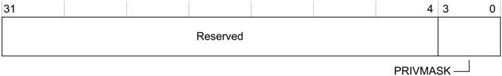

Table 12-2 ITM\_TPR bit assignments

| Bits   | Name     | Function                                          | Function                                                             |
|--------|----------|---------------------------------------------------|----------------------------------------------------------------------|
| [31:4] | -        | Reserved.                                         | Reserved.                                                            |
| [3:0]  | PRIVMASK | Bit mask to enable tracing on ITM stimulus ports: | Bit mask to enable tracing on ITM stimulus ports:                    |
|        |          | Bit[0]                                            | Stimulus ports [7:0]. Stimulus ports [15:8]. Stimulus ports [23:16]. |
|        |          | Bit[1]                                            |                                                                      |
|        |          | Bit[2]                                            |                                                                      |
|        |          | Bit[3]                                            | Stimulus ports [31:24].                                              |

Table 12-2 shows the ITM\_TPR bit assignments.

## Chapter 13 Cortex-M7 Trace Port Interface Unit

This appendix describes the Cortex-M7 Trace Port Interface Unit (TPIU) that is specific to the Cortex-M7 processor. It contains the following sections:

- About the Cortex-M7 TPIU on page 13-2.
- TPIU functional description on page 13-3.
- TPIU programmers model on page 13-5.

## 13.1 About the Cortex-M7 TPIU

The Cortex-M7 TPIU is an optional component that bridges between the on-chip trace data from the Embedded Trace Macrocell (ETM) and the Instrumentation Trace Macrocell (ITM), with separate IDs, to a data stream. The Cortex-M7 TPIU encapsulates IDs where required, and the data stream is then captured by an external Trace Port Analyzer (TPA).

The Cortex-M7 TPIU is a variant of the CoreSight SoC-400 TPIU that is specially designed for low-cost debug. Your implementation can replace the Cortex-M7 TPIU with other CoreSight components if your implementation requires the additional features of the CoreSight SoC-400 TPIU.

Note

The CM7TPIU only supports the ETM Instruction trace interface, configuration parameter ETM set to 1.

In this chapter, the term TPIU refers to the Cortex-M7 TPIU. For information about the CoreSight SoC-400 TPIU, see the Arm ®  CoreSight ™  SoC-400 Technical Reference Manual .

## 13.2 TPIU functional description

There are two configurations of the TPIU:

- A configuration that supports ITM debug trace.
- A configuration that supports both ITM and ETM debug trace.

If your implementation requires no trace support then the TPIU might not be present.

Note

If your system design uses the optional ETM component, the TPIU configuration supports both ITM and ETM debug trace. See the Arm ®  CoreSight ™  ETM-M7 Technical Reference Manual .

## 13.2.1 TPIU block diagrams

Figure 13-1 shows the component layout of the TPIU for both configurations.

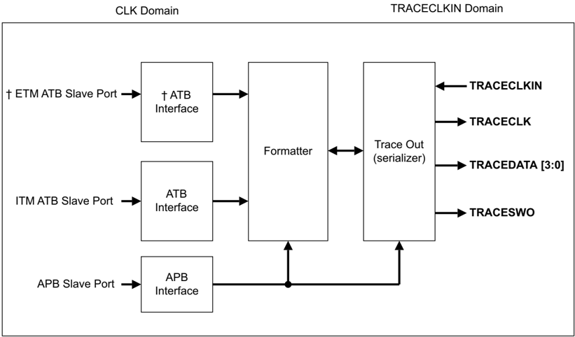

## 13.2.2 TPIU Formatter

The formatter inserts source ID signals into the data packet stream so that trace data can be re-associated with its trace source. The formatter is always active when the Trace Port Mode is active.

The formatting protocol is described in the Arm ®  CoreSight ™  Architecture Specification (v2.0) . You must enable synchronization packets in the DWT to provide synchronization for the formatter.

Figure 13-1 TPIU block diagram

When the formatter is enabled, half-sync packets can be inserted if there is no data to output after a frame has been started. Synchronization, caused by the distributed synchronization from the DWT, ensures that any partial frame is completed, and at least one full synchronization packet is generated.

## 13.2.3 Serial Wire Output format

The TPIU can output trace data in a Serial Wire Output (SWO) format:

- TPIU\_DEVID specifies the formats that are supported. See Device Configuration Register on page 13-12.
- TPIU\_SPPR specifies the SWO format in use. See the Arm ® v7-M Architecture Reference Manual .

When one of the two SWO modes is selected, you can enable the TPIU to bypass the formatter for trace output. If the formatter is bypassed, only the ITM and DWT trace source passes through. The TPIU accepts and discards data from the ETM. You can use this function to connect a device containing an ETM to a trace capture device that is only able to capture SWO data.

## TPIU programmers model

Table 13-1 shows the TPIU registers. Depending on the implementation of your processor, the TPIU registers might not be present, or the CoreSight TPIU might be present instead. Any register that is configured as not present reads as zero.

Table 13-1 TPIU registers

| Address    | Name        | Type   | Reset       | Description                                           |
|------------|-------------|--------|-------------|-------------------------------------------------------|
| 0xE0040000 | TPIU_SSPSR  | RO     | - a         | Supported Parallel Port Size Register                 |
| 0xE0040004 | TPIU_CSPSR  | RW     | 0x01        | Current Parallel Port Size Register                   |
| 0xE0040010 | TPIU_ACPR   | RW     | 0x0000      | Asynchronous Clock Prescaler Register on page 13-6    |
| 0xE00400F0 | TPIU_SPPR   | RW     | 0x01        | Selected Pin Protocol Register                        |
| 0xE0040300 | TPIU_FFSR   | RO     | 0x08        | Formatter and Flush Status Register on page 13-6      |
| 0xE0040304 | TPIU_FFCR   | RW     | 0x102       | Formatter and Flush Control Register on page 13-7     |
| 0xE0040308 | TPIU_FSCR   | RO     | 0x00        | Formatter Synchronization Counter Register            |
| 0xE0040EE8 | TRIGGER     | RO     | 0x0         | TRIGGER Register on page 13-8                         |
| 0xE0040EEC | FIFO data 0 | RO     | 0x0         | Integration ETM Data Register on page 13-9            |
| 0xE0040EF0 | ITATBCTR2   | RO     | 0x0         | Integration Test ATB Control Register 2 on page 13-10 |
| 0xE0040EFC | FIFO data 1 | RO     | 0x0         | Integration ITM Data Register on page 13-10           |
| 0xE0040EF8 | ITATBCTR0   | RO     | 0x0         | Integration Test ATB Control 0 Register on page 13-11 |
| 0xE0040F00 | ITCTRL      | RW     | 0x0         | Integration Mode Control on page 13-12                |
| 0xE0040FA0 | CLAIMSET    | RW     | 0xF         | Claim tag set                                         |
| 0xE0040FA4 | CLAIMCLR    | RW     | 0x0         | Claim tag clear                                       |
| 0xE0040FC8 | DEVID       | RO     | 0xCA0/0xCA1 | Device Configuration Register on page 13-12           |
| 0xE0040FCC | DEVTYPE     | RO     | 0x11        | Device Type Identifier Register on page 13-13         |
| 0xE0040FD0 | PID4        | RO     | 0x04        | Peripheral identification registers                   |
| 0xE0040FD4 | PID5        | RO     | 0x00        |                                                       |
| 0xE0040FD8 | PID6        | RO     | 0x00        |                                                       |
| 0xE0040FDC | PID7        | RO     | 0x00        |                                                       |
| 0xE0040FE0 | PID0        | RO     | 0xA9        |                                                       |
| 0xE0040FE4 | PID1        | RO     | 0xB9        |                                                       |
| 0xE0040FE8 | PID2        | RO     | 0x0B        |                                                       |
| 0xE0040FEC | PID3        | RO     | 0x00        |                                                       |
| 0xE0040FF0 | CID0        | RO     | 0x0D        | Component identification registers                    |
| 0xE0040FF4 | CID1        | RO     | 0x90        |                                                       |
| 0xE0040FF8 | CID2        | RO     | 0x05        |                                                       |
| 0xE0040FFC | CID3        | RO     | 0xB1        |                                                       |

## a. IMPLEMENTATION DEFINED.

The following sections describe the TPIU registers whose implementation is specific to this processor. The Formatter, Integration Mode Control, and Claim Tag registers are described in the Arm ®  CoreSight ™  Components Technical Reference Manual . Other registers are described in the Arm ® v7-M Architecture Reference Manual .

## 13.3.1 Asynchronous Clock Prescaler Register

The TPIU\_ACPR characteristics are:

Purpose

Scales the baud rate of the asynchronous output.

Usage constraints

There are no usage constraints.

Configurations

Available in all configurations.

Attributes

See Table 13-1 on page 13-5.

Figure 13-2 shows the TPIU\_ACPR bit assignments.

Figure 13-2 TPIU\_ACPR bit assignments

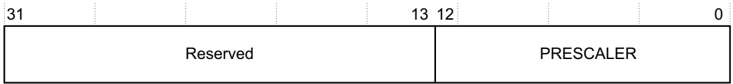

Table 13-2 shows the TPIU\_ACPR bit assignments.

## Table 13-2 TPIU\_ACPR bit assignments

| Bits    | Name      | Function                                 |
|---------|-----------|------------------------------------------|
| [31:13] | -         | Reserved. RAZ/SBZP.                      |
| [12:0]  | PRESCALER | Divisor for TRACECLKIN is Prescaler + 1. |

## 13.3.2 Formatter and Flush Status Register

The TPIU\_FFSR characteristics are:

Purpose

Indicates the status of the TPIU formatter.

Usage constraints

There are no usage constraints.

Configurations

Available in all configurations.

Attributes

See Table 13-1 on page 13-5.

Figure 13-3 shows the TPIU\_FFSR bit assignments.

Figure 13-3 TPIU\_FFSR bit assignments

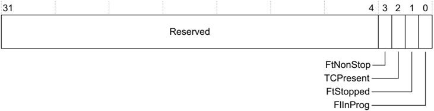

Table 13-3 shows the TPIU\_FFSR bit assignments.

Table 13-3 TPIU\_FFSR bit assignments

| Bits   | Name      | Function                    |
|--------|-----------|-----------------------------|
| [31:4] | -         | Reserved                    |
| [3]    | FtNonStop | Formatter cannot be stopped |
| [2]    | TCPresent | This bit always reads zero  |
| [1]    | FtStopped | This bit always reads zero  |
| [0]    | FlInProg  | This bit always reads zero  |

## 13.3.3 Formatter and Flush Control Register

The TPIU\_FFCR characteristics are:

Purpose

Controls the TPIU formatter.

Usage constraints

There are no usage constraints.

Configurations

Available in all configurations.

Attributes

See Table 13-1 on page 13-5.

Figure 13-4 shows the TPIU\_FFCR bit assignments.

Figure 13-4 TPIU\_FFCR bit assignments

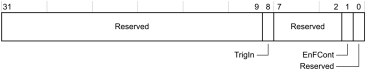

Table 13-4 shows the TPIU\_FFCR bit assignments.

Table 13-4 TPIU\_FFCR bit assignments

| Bits   | Name    | Function                                                                                                       |
|--------|---------|----------------------------------------------------------------------------------------------------------------|
| [31:9] | -       | Reserved.                                                                                                      |
| [8]    | TrigIn  | This bit Reads-As-One (RAO), specifying that triggers are inserted when a trigger pin is asserted.             |
| [7:2]  | -       | Reserved.                                                                                                      |
| [1]    | EnFCont | Enable continuous formatting. Value can be: 0 Continuous formatting disabled. 1 Continuous formatting enabled. |
| [0]    | -       | Reserved.                                                                                                      |

The TPIU can output trace data in a Serial Wire Output (SWO) format. See Serial Wire Output format on page 13-4.

When one of the two SWO modes is selected, bit[1] of TPIU\_FFCR enables the formatter to be bypassed. If the formatter is bypassed, only the ITM and DWT trace source passes through. The TPIU accepts and discards data from the ETM. You can use this function to connect a device containing an ETM to a trace capture device that is only able to capture SWO data. Enabling or disabling the formatter causes momentary data corruption.

Note

If TPIU\_SPPR is set to select Trace Port Mode, the formatter is automatically enabled. If you then select one of the SWO modes, TPIU\_FFCR reverts to its previously programed value.

## 13.3.4 TRIGGER Register

The TRIGGER characteristics are:

Purpose

Controls the integration test TRIGGER input.

Usage constraints

There are no usage constraints.

Configurations

Available in all configurations.

Attributes

See Table 13-1 on page 13-5.

Figure 13-5 shows the TRIGGER bit assignments.

Figure 13-5 TRIGGER bit assignments

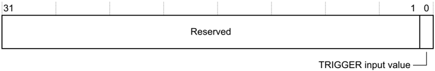

Table 13-5 shows the TRIGGER bit assignments.

Table 13-5 TRIGGER bit assignments

| Bits   | Name                | Function                                      |
|--------|---------------------|-----------------------------------------------|
| [31:1] | -                   | Reserved                                      |
| [0]    | TRIGGER input value | When read, this bit returns the TRIGGER input |

## 13.3.5 Integration ETM Data Register

The Integration ETM Data characteristics are:

Purpose

Controls trace data integration testing.

Usage constraints

You must set bit[1] of TPIU\_ITCTRL to use this register. See Integration Mode Control on page 13-12.

Configurations

Available in all configurations.

Attributes

See Table 13-1 on page 13-5.

Figure 13-6 shows the Integration ETM Data bit assignments.

Figure 13-6 Integration ETM Data bit assignments

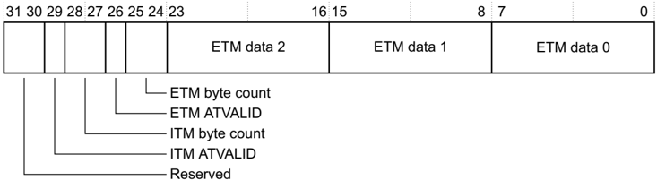

Table 13-6 shows the Integration ETM Data bit assignments.

Table 13-6 Integration ETM Data bit assignments

| Bits    | Name              | Function                                                                            |
|---------|-------------------|-------------------------------------------------------------------------------------|
| [31:30] | -                 | Reserved.                                                                           |
| [29]    | ITM ATVALID input | Returns the value of the ITM ATVALID signal.                                        |
| [28:27] | ITM byte count    | Number of bytes of ITM trace data since last read of Integration ITM Data Register. |
| [26]    | ETM ATVALID input | Returns the value of the ETM ATVALID signal.                                        |
| [25:24] | ETM byte count    | Number of bytes of ETM trace data since last read of Integration ETM Data Register. |
| [23:16] | ETM data 2        | ETM trace data. The TPIU discards this data when the register is read.              |
| [15:8]  | ETM data 1        | ETM trace data. The TPIU discards this data when the register is read.              |
| [7:0]   | ETM data 0        | ETM trace data. The TPIU discards this data when the register is read.              |

## 13.3.6 Integration Test ATB Control Register 2

The ITATBCTR2 characteristics are:

Purpose

Controls integration test.

Usage constraints

You must set bit[0] of TPIU\_ITCTRL to use this register. See Integration Mode Control on page 13-12.

Configurations

Available in all configurations.

Attributes

See Table 13-1 on page 13-5.

Figure 13-7 shows the ITATBCTR2 bit assignments.

Figure 13-7 ITATBCTR2 bit assignments

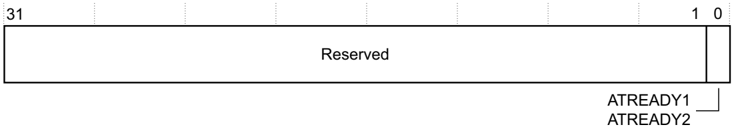

Table 13-7 ITATBCTR2 bit assignments

| Bits   | Name               | Function                                                                                                 |
|--------|--------------------|----------------------------------------------------------------------------------------------------------|
| [31:1] | -                  | Reserved                                                                                                 |
| [0]    | ATREADY1, ATREADY2 | This bit sets the value of both the ETM and ITM ATREADY outputs, if the TPIU is in integration test mode |

## 13.3.7 Integration ITM Data Register

The Integration ITM Data characteristics are:

Purpose

Controls trace data integration testing.

Usage constraints

You must set bit[1] of TPIU\_ITCTRL to use this register. See Integration Mode Control on page 13-12.

Configurations

Available in all configurations.

Attributes

See Table 13-1 on page 13-5.

Figure 13-8 on page 13-11 shows the Integration ITM Data bit assignments.

Table 13-7 shows the ITATBCTR2 bit assignments.

Figure 13-8 Integration ITM Data bit assignments

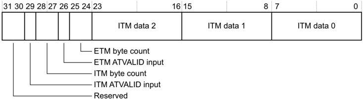

Table 13-8 shows the Integration ITM Data bit assignments.

Table 13-8 Integration ITM Data bit assignments

| Bits    | Name              | Function                                                                            |
|---------|-------------------|-------------------------------------------------------------------------------------|
| [31:30] | -                 | Reserved.                                                                           |
| [29]    | ITM ATVALID input | Returns the value of the ITM ATVALID signal.                                        |
| [28:27] | ITM byte count    | Number of bytes of ITM trace data since last read of Integration ITM Data Register. |
| [26]    | ETM ATVALID input | Returns the value of the ETM ATVALID signal.                                        |
| [25:24] | ETM byte count    | Number of bytes of ETM trace data since last read of Integration ETM Data Register. |
| [23:16] | ITM data 2        | ITM trace data. The TPIU discards this data when the register is read.              |
| [15:8]  | ITM data 1        | ITM trace data. The TPIU discards this data when the register is read.              |
| [7:0]   | ITM data 0        | ITM trace data. The TPIU discards this data when the register is read.              |

## 13.3.8 Integration Test ATB Control 0 Register

The ITATBCTR0 characteristics are:

Purpose

Integration test.

Usage constraints

There are no usage constraints.

Configurations

Available in all configurations.

Attributes

See Table 13-1 on page 13-5.

Figure 13-9 shows the ITATBCTR0 bit assignments.

Figure 13-9 ITATBCTR0 bit assignments

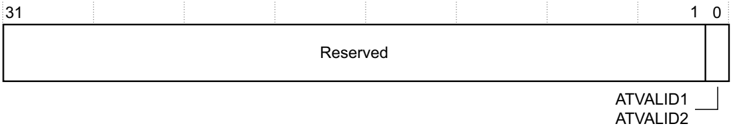

Table 13-9 shows the ITATBCTR0 bit assignments.

Table 13-9 ITATBCTR0 bit assignments

| Bits   | Name               | Function                                                                  |
|--------|--------------------|---------------------------------------------------------------------------|
| [31:1] | -                  | Reserved                                                                  |
| [0]    | ATVALID1, ATVALID2 | A read of this bit returns the value of ATVALIDS1 OR-gated with ATVALIDS2 |

## 13.3.9 Integration Mode Control

The TPIU\_ITCTRL characteristics are:

Purpose

Specifies normal or integration mode for the TPIU.

Usage constraints

There are no usage constraints.

Configurations

Available in all configurations.

Attributes

See Table 13-1 on page 13-5.

Figure 13-10 shows the TPIU\_ITCTRL bit assignments.

Figure 13-10 TPIU\_ITCTRL bit assignments

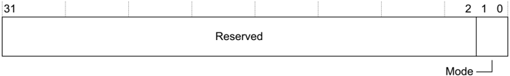

Table 13-10 shows the TPIU\_ITCTRL bit assignments.

Table 13-10 TPIU\_ITCTRL bit assignments

| Bits   | Name   | Function                                                                                                                                                                                                                                                |
|--------|--------|---------------------------------------------------------------------------------------------------------------------------------------------------------------------------------------------------------------------------------------------------------|
| [31:2] | -      | Reserved.                                                                                                                                                                                                                                               |
| [1:0]  | Mode   | Specifies the current mode for the TPIU: 0b00 Normal mode. 0b01 Integration test mode. 0b10 Integration data test mode. 0b11 Reserved. In integration data test mode, the trace output is disabled, directly from each input port using the integration |

## 13.3.10 Device Configuration Register

The TPIU\_DEVID characteristics are:

Purpose

Indicates the functions provided by the TPIU for use in topology detection.

Usage constraints

There are no usage constraints.

Configurations

Available in all configurations.

Attributes

See Table 13-1 on page 13-5.

Figure 13-11 shows the TPIU\_DEVID bit assignments.

Figure 13-11 TPIU\_DEVID bit assignments

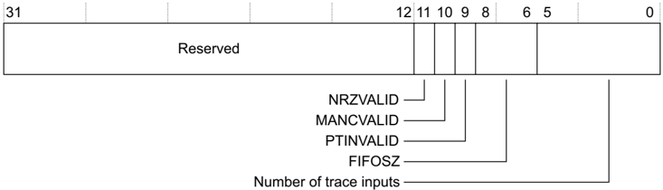

Table 13-11 shows the TPIU\_DEVID bit assignments.

Table 13-11 TPIU\_DEVID bit assignments

| Bits    | Name                   | Function                                                                                                                                                     |
|---------|------------------------|--------------------------------------------------------------------------------------------------------------------------------------------------------------|
| [31:12] | -                      | Reserved.                                                                                                                                                    |
| [11]    | NRZVALID               | Indicates support for SWO using UART/NRZ encoding. Always RAO. The output is supported.                                                                      |
| [10]    | MANCVALID              | Indicates support for SWO using Manchester encoding. Always RAO. The output is supported.                                                                    |
| [9]     | PTINVALID              | Indicates support for parallel trace port operation. Always RAZ. Trace data and clock modes are supported.                                                   |
| [8:6]   | FIFOSZ                 | Indicates the minimum implemented size of the TPIU output FIFO for trace data: 0b010 Four bytes.                                                             |
| [5:0]   | Number of trace inputs | Specifies the number of trace inputs: 0b000000 One input. 0b000001 Two inputs. If your implementation includes an ETM, the value of this field is 0b000001 . |

## 13.3.11 Device Type Identifier Register

The TPIU\_DEVTYPE characteristics are:

| Purpose           | Provides a debugger with information about the component when the Part Number field is not recognized. The debugger can then report this information.   |
|-------------------|---------------------------------------------------------------------------------------------------------------------------------------------------------|
| Usage Constraints | There are no usage constraints.                                                                                                                         |
| Configurations    | Available in all configurations.                                                                                                                        |
| Attributes        | See Table 13-1 on page 13-5. Figure 13-12 on page 13-14 shows the TPIU_DEVTYPE bit assignments.                                                         |

Figure 13-12  TPIU\_DEVTYPE bit assignments

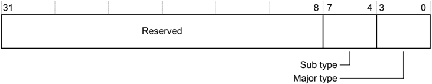

Table 13-12 shows the TPIU\_DEVTYPE bit assignments.

Table 13-12 TPIU\_DEVTYPE bit assignments

| Bits   | Name       | Function                                                            |
|--------|------------|---------------------------------------------------------------------|
| [31:8] | -          | Reserved.                                                           |
| [7:4]  | Sub type   | Identifies the classification of the debug component:               |
| [3:0]  | Major type | 0x11 Indicates this device is a trace sink and specifically a TPIU. |

## Chapter 14

## Fault detection and handling

This chapter describes the fault detection and handling features of the Cortex-M7 processor. It contains the following sections:

- About fault detection and handling on page 14-2.
- Cache RAM protection on page 14-3.
- Logic protection on page 14-6.

## 14.1 About fault detection and handling

The Cortex-M7 processor fault detection and handling features:

- Report any detected error to the system.
- Correct any detected and correctable error.

When the system-on-chip reports a failure, the logging and status must provide all the required information to identify the source of the failure. The intention is to detect and correct the errors as much as possible, and identify them to the system.

For Error Correcting Code (ECC) on RAM, all errors explicitly seen must be reported, so that the error propagation is minimized.

## 14.1.1 RAM and logic protection

The processor protects memories and logic in two different ways.

- The RAMs are protected with ECC.
- The logic of the individual processors is protected by duplication with diagnostic compare. This is known as redundant logic in a lock-step implementation.

These are independent, and can be used separately.

The processor uses Single Error Correction and Double Error Detection (SEC-DED) ECCs to detect and correct errors in the RAMs. A finite number of hard, that is, permanent errors can be detected and corrected with continued normal operation using dedicated error registers.

## 14.1.2 Analysis of errors

A monitor external to the processor is responsible for analyzing the notified error and marking the corrupted entries as reusable if it has been proven to be a soft error. This analysis can be performed by reading and writing the RAM directly through the processor MBIST interface.

## 14.2 Cache RAM protection

The following sections describe RAM protection:

- Protection method .
- RAM protection summary on page 14-4.
- ECC codes on page 14-4.
- RAM configuration on page 14-5.
- Performance impact on page 14-5.

## 14.2.1 Protection method

The following sections describe how RAM errors are managed:

- Detecting errors .
- Recovering from errors .
- Handling permanent errors .
- Error bank register behavior on page 14-4.

## Detecting errors

The Cortex-M7 processor uses ECC to detect errors in the cache RAMs.

## Recovering from errors

The Cortex-M7 processor can recover from a RAM error detected in the cache by using clean and invalidate and retry. When an error is detected, as shown in Table 14-1 on page 14-4, the corresponding index/way is cleaned and invalidated. When the clean and invalidate operation completed, the requester retries its access. The ECC can also be used to correct single-bit errors in the RAM.

## Instruction cache

In the instruction cache, lines are always clean so that invalidating the line is sufficient. The retried access then fetches the correct value from external memory.

## Data cache

In the data cache, the cache line can be dirty. The correction of the RAM contents is done as part of the clean and invalidate operation for caches. This takes place in the write buffer and the corrected data is written back to external memory. The retried access then reads the correct value from external memory. If the data cannot be corrected then the error is non-recoverable.

## Handling permanent errors

Permanent errors are handled as follows:

## General behavior

If hard, or permanent, errors occur on the RAMs, the clean, invalidate and retry scheme might cause a deadlock, and the access is continuously replayed. To prevent this, error bank registers are provided to mask the faulty locations as unusable and invalid. There are two banks for each side of the memory system. When an error is detected, the location is pushed in the bank, masking the corresponding valid bit of the location when reading and when allocating a new

line. The line is therefore no longer used unless the entry is reset. Because of implementation details, there is a short period of time when the line is still seen by the system, but is removed from the allocation pool.

The depth of the error bank determines how many errors can be supported by the system. When this limit is reached, the system might livelock. The processor provides information to the system indicating the number of corrupted locations to monitor the error bank status before it becomes full. This is a condition that can cause a potential deadlock. This information is reported on several pins signaling the use of the error bank, that is, showing if the error bank is empty or at least one error has been encountered.

## Error bank register behavior

Both the instruction and data side use the same algorithm to select the bank to update:

- If there is a non-valid, unlocked bank then it is always allocated in preference to a valid bank.
- If both banks are valid, or both banks are non-valid, and both are not locked then a round-robin counter updated on each allocation selects the bank to fill.
- If there is one locked bank then the other bank is always allocated, whether or not it is already valid.
- If both banks are locked then no allocation takes place.

## 14.2.2 RAM protection summary

Table 14-1 shows how the different types of RAM are protected.

Table 14-1 RAM protection summary

| RAM type                  | Protection   | Recoverable error                                                      | Non-recoverable error                             | Hard error support    |
|---------------------------|--------------|------------------------------------------------------------------------|---------------------------------------------------|-----------------------|
| Data tagRAM               | SEC-DED ECC  | Error seen as single bit errors                                        | Error seen as a multiple bit error                | Up to two hard errors |
| Data cache dataRAM        | SEC-DED ECC  | Error seen as single bit errors                                        | Error seen as a multiple bit error on dirty lines | Up to two hard errors |
| Instruction tagRAM        | SEC-DED ECC  | Any error, single or double, on the tag or valid bit stored in the RAM | None a                                            | Up to two hard errors |
| Instruction cache dataRAM | SEC-DED ECC  | Any error on the data stored in theRAM                                 | None a                                            | Up to two hard errors |

## 14.2.3 ECC codes

When implemented, the instruction and data caches have:

- Separate 32-bit ECC codes with seven check bits, one for:
- -Instruction cache tag RAM, that is RAM index, tag value, outer attributes and valid bit.
- -Data cache data RAM.

## 14.2.5 Performance impact

In an error-free system, the major performance impact is the cost of the read-modify-write scheme for non-full stores in the data side. If a store buffer slot does not contain at least a full 32-bit word, it must read the word to be able to compute the check bits. This can occur because software only writes to an area of memory with byte or halfword store instructions. The data can then be written in the RAM. This additional read can have a negative impact on performance because it prevents the slot from being used for another write.

The buffering and outstanding capabilities of the memory system mask part of the additional read, and it is negligible for most codes. However, Arm recommends that you use as few cacheable STRB and STRH instructions as possible to reduce the performance impact.

Note

There might be a frequency impact because XOR trees are added on the data returned from the RAMs.

- -Data cache data tag RAM, that is the RAM index, tag value, outer attributes, valid bit and dirty bit.
- A 64-bit ECC code with eight check bits for the instruction cache data RAM.

## 14.2.4 RAM configuration

Table 14-2 shows the RAM configuration with or without ECC when the processor is implemented with 4KB instruction and data cache.

Table 14-2 RAM configuration with or without ECC

| RAM                  | Storage for a RAM set without ECC   | Storage for a RAM set with ECC   |
|----------------------|-------------------------------------|----------------------------------|
| Data tagRAM          | 4x26 bits                           | 4x(26+7) bits                    |
| Data data RAM        | 8x32 bits                           | 8x(32+7) bits                    |
| Instruction tagRAM   | 4x22 bits                           | 4x(22+7) bits                    |
| Instruction data RAM | 4x64 bits                           | 4x(64+8) bits                    |

## 14.3 Logic protection

The processor logic can be protected by a duplicate, redundant, processor, that is the exact copy of the first processor. Both processors share the same RAMs protected with ECC and the same input pins. The second processor is delayed by two clock cycles so that this redundant system can detect glitches in the inputs.

The outputs of the two processors are compared on each cycle to detect any error. The outputs of the first processor are delayed so they can be synchronized with the second processor. This mechanism relies on the fact that any error occurring in the processor is eventually visible on the outputs of the processor, or is inherently a safe failure.

On detection of an error in one processor, both processors are reset before executing a code sequence, to put them in the same initial state. They can then restart execution from a previously taken snapshot.

The processor provides a template of the logic required for the comparison of the two processors.

## Appendix A Revisions

This appendix describes the technical changes between released issues of this book.

|               | Table A-1 Issue A   | Table A-1 Issue A   |
|---------------|---------------------|---------------------|
| Change        | Location            | Affects             |
| First release | -                   | -                   |

## Table A-2 Differences between issue A and issue B

| Change                                                                                         | Location                                  | Affects       |
|------------------------------------------------------------------------------------------------|-------------------------------------------|---------------|
| Arm ® v7-M Architecture Reference Manual , issue E.b, defines Flash Patch Breakpoint version 2 | Arm architecture on page 1-13             | r0p2 onwards  |
| Prefix CM7_ added to register names ITCMCR, DTCMCR, CACR, AHBSCR, ABFSR and AHBPCR             | -                                         | r0p2          |
| Cortex-M7 processor features clarified                                                         | Features on page 1-2                      | All revisions |
| Implementation options table updated                                                           | Table 1-1 on page 1-4                     | All revisions |
| Data Process Unit changed to Data Processing Unit                                              | Data Processing Unit on page 1-8          | All revisions |
| Single MACpipeline description clarified                                                       | Data Processing Unit on page 1-8          | All revisions |
| Prefetch Unit features clarified                                                               | Prefetch Unit on page 1-8                 | All revisions |
| ETM block description clarified                                                                | Cross Trigger Interface Unit on page 1-10 | All revisions |
| TCM interface description clarified                                                            | TCM interface on page 1-11                | All revisions |

## Table A-2 Differences between issue A and issue B (continued)

| Change                                                                     | Location                                                      | Affects       |
|----------------------------------------------------------------------------|---------------------------------------------------------------|---------------|
| MBIST interface description clarified                                      | MBIST interface on page 1-12                                  | All revisions |
| Binary compatibility with other Cortex processors section updated          | Binary compatibility with other Cortex processors on page 2-4 | All revisions |
| Exclusive monitor description clarified                                    | Exclusive monitor on page 2-8                                 | All revisions |
| Private peripheral bus section updated                                     | Private peripheral bus on page 2-6                            | All revisions |
| Exception handling section updated                                         | Exception handling on page 2-10                               | All revisions |
| System control registers table updated                                     | Table 3-1 on page 3-3                                         | r0p2          |
| Added ACTLR field descriptions for new system dependent optimization modes | Auxiliary Control Register on page 3-6                        | r0p2          |
| CPUID.REVISION function updated                                            | Table 3-4 on page 3-8                                         | r0p2          |
| CLIDR bit assignments table updated                                        | Table 3-5 on page 3-10                                        | r0p2          |
| CCSIDR bit assignments figure clarified                                    | CCSIDR bit assignments on page 3-10                           | All revisions |
| CCSIDR.Associativity function updated                                      | Table 3-6 on page 3-11                                        | r0p2          |
| AHBP Control Register clarified                                            | AHBP Control Register on page 3-14                            | All revisions |
| CACR[1] name and function updated                                          | Table 3-11 on page 3-16                                       | r0p2          |
| CACR[0] function updated                                                   | Table 3-11 on page 3-16                                       | All revisions |
| Changed RAZ to RAO in Note                                                 | About Initialization on page 4-2                              | All revisions |
| Note clarified                                                             | Preloading TCM on page 4-5                                    | All revisions |
| Changed AHBP peripheral interface to AHBP interface                        | About the memory system on page 5-2                           | All revisions |
| Changed AHBP peripheral port to AHBP port                                  | Fault handling on page 5-5                                    | All revisions |
| Write ID capability description clarified                                  | Table 5-3 on page 5-9                                         | All revisions |
| ARADDR value for address 0x1D updated                                      | Table 5-20 on page 5-22                                       | All revisions |
| TCM attributes and permissions section updated                             | TCM attributes and permissions on page 5-36                   | r0p1 and r0p2 |
| Store buffer behavior clarified                                            | Store buffer on page 5-42                                     | All revisions |
| Low power modes section updated                                            | Low power modes on page 7-3                                   | All revisions |
| Processor ROMtable identification values addresses updated                 | Table 9-1 on page 9-3                                         | All revisions |
| Processor ROMtable components table updated                                | Table 9-2 on page 9-4                                         | All revisions |
| FPB register summary table updated                                         | Table 9-7 on page 9-8                                         | All revisions |
| DWTregister summary table updated                                          | Table 11-1 on page 11-4                                       | All revisions |
| Error bank register behavior section added                                 | Protection method on page 14-3                                | All revisions |

## Table A-3 Differences between issue B and issue C

| Change                                             | Location                                       | Affects       |
|----------------------------------------------------|------------------------------------------------|---------------|
| Bullet list updated                                | About the Cortex-M7 processor on page 1-2      | r1p0          |
| Features updated                                   | Features on page 1-2                           | r1p0          |
| Memory system section updated                      | Memory System on page 1-9                      | r1p0          |
| Store Buffer section added                         | Store Buffer on page 1-10                      | All revisions |
| CPUID reset value updated                          | Table 3-1 on page 3-3                          | r1p0          |
| ACTLR bit functions updated                        | Table 3-3 on page 3-7                          | All revisions |
| CPUID.VARIANT and CPUID.REVISION functions updated | Table 3-4 on page 3-8                          | r1p0          |
| CSSELR bit assignments table updated               | Table 3-8 on page 3-12                         | All revisions |
| AHB slave interface section updated                | AHB slave interface on page 5-33               | r1p0          |
| Memory map section added                           | Memory map on page 5-33                        | r1p0          |
| Restrictions on AHBS transactions section updated  | Restrictions on AHBS transactions on page 5-33 | r1p0          |
| AHBS interface arbitration section updated         | AHBS interface arbitration on page 5-34        | r1p0          |
| TCM interfaces section updated                     | TCM interfaces on page 5-36                    | r1p0          |
| Note added                                         | TCM attributes and permissions on page 5-36    | r1p0          |
| TCM configuration section updated                  | TCM configuration on page 5-37                 | r1p0          |
| TCM arbitration section updated                    | TCM arbitration on page 5-37                   | r1p0          |
| TCM interface protocol section updated             | TCM interface protocol on page 5-37            | r1p0          |
| TCM read modify write section added                | TCM read modify write on page 5-38             | r1p0          |
| Booting from TCM section added                     | Booting from TCM on page 5-38                  | r1p0          |
| Integration with Flash memory section added        | Integration with Flash memory on page 5-39     | r1p0          |
| System access to TCM section added                 | System access to TCM on page 5-39              | r1p0          |

## Table A-4 Differences between issue C and issue D

| Change                                                     | Location                                           | Affects       |
|------------------------------------------------------------|----------------------------------------------------|---------------|
| Updated note about the Arm architecture interworking model | Exceptions on page 2-10                            | All revisions |
| CPUID.VARIANT and CPUID.REVISION functions updated         | Table 3-1 on page 3-3                              | r1p1          |
| Added a note to the CPUID register description             | CPUID Base Register on page 3-8                    | All revisions |
| Invalidate the entire data cache description updated       | Initializing and enabling the L1 cache on page 4-3 | All revisions |

## Table A-5 Differences between issue D and issue E

| Change                                                | Location                                       | Affects       |
|-------------------------------------------------------|------------------------------------------------|---------------|
| Diagram updated                                       | Figure 1-2 on page 1-4                         | r1p1          |
| Diagram updated                                       | Figure 1-3 on page 1-7                         | r1p1          |
| Trace stalling information added                      | ETM on page 1-10                               | All revisions |
| ITCM, DTCM and AHBP base addresses added              | Table 2-1 on page 2-6                          | All revisions |
| Table updated                                         | Table 3-3 on page 3-7                          | r1p1          |
| Memory ordering restrictions note added               | About the memory system on page 5-2            | r1p1          |
| Initializing TCMs with ECC note added                 | TCM read modify write on page 5-38             | All revisions |
| New chapter Cortex-M7 Trace Port Interface Unit added | Chapter 13 Cortex-M7 Trace Port Interface Unit | r1p1          |
| Table updated                                         | Table 13-1 on page 13-5                        | r1p1          |

## Table A-6 Differences between issue E and issue F

| Change                                                                    | Location                                             | Affects   |
|---------------------------------------------------------------------------|------------------------------------------------------|-----------|
| New sections added.                                                       | Speculative accesses on page 5-3                     | r1p2      |
| AXI transactions generated for Strongly-ordered or Device memory updated. | Identifiers for AXIM interface accesses on page 5-11 | r1p2      |
| Added note.                                                               | TCM interfaces on page 5-36                          | r1p2      |
| Added note.                                                               | TCM configuration on page 5-37                       | r1p2      |
| CPUID reset value updated.                                                | Table 3-1 on page 3-3                                | r1p2      |